# STM Deep Value Intelligence

**Analysis Date:** 2026-05-10

## Critical Disclaimer

*This analysis is generated by Deep Value Intelligence, an AI-powered multi-agent investing framework. This report is for informational and educational purposes only and does not constitute financial advice. Always conduct your own research and consult with qualified financial advisors before making investment decisions.*

---

## Table of Contents

1. Intelligence Summary
2. Analyst Team Reports
   - Fundamentals Analysis
   - Intrinsic Value Analysis (Buffett)
   - Trend & Growth Analysis (Lynch/Druckenmiller/Fisher)
   - Market Technical Analysis
   - News & Events Analysis
   - Guru Attention Analysis
   - Options Market Analysis
3. Research Team Commentary
4. Value Investing Team Commentary
5. Deep Values Commentary

---

## Intelligence Summary

### Thesis + Conditions

**Core Thesis:** ## Executive Briefing

**Key Risks:**
- STM may be near a cyclical earnings trough, and its exposure to automotive, industrial, power semis, and silicon carbide gives it real long-term relevance. But from a Buffett-style risk lens, the key issue is not whether chips matter - it is whether **this business can earn durable high returns and whether the stock offers a margin of safety today**. Right now, the answer is unclear.
- Current returns are extremely weak (**ROIC 0.8%, ROE 0.9%**), revenue and earnings are falling (**-11.1% revenue, -89.3% net income**), and the valuation support presented is poor (**$10.85 value estimate vs. $59.17 stock price**). That does not rule out a rebound, but it does mean the investor is being asked to pay for recovery **before** recovery is proven. For a long-term value investor, that is a risk-control problem, not an opportunity by default.
- ### 1. Risky Analyst's strongest point
- The bull case is that STM is being judged on trough numbers. In semiconductors, low current profits can make standard valuation metrics misleading. If margins, utilization, and demand recover, the stock could rerate before the reported numbers look healthy. STM's positioning in automotive electrification, industrial automation, power management, and silicon carbide gives the recovery thesis strategic credibility.
- The bear case is more relevant for a Buffett-style investor: **weak current economics plus weak valuation support is a dangerous combination**. Near-zero returns on capital are not just "ugly optics"; they show the business is currently not demonstrating moat-like economics. And if the stock already trades far above conservative value estimates, the margin of safety is missing.

**What Would Change Our View:**
- STM may be near a cyclical earnings trough, and its exposure to automotive, industrial, power semis, and silicon carbide gives it real long-term relevance. But from a Buffett-style risk lens, the key issue is not whether chips matter - it is whether **this business can earn durable high returns and whether the stock offers a margin of safety today**. Right now, the answer is unclear.
- Current returns are extremely weak (**ROIC 0.8%, ROE 0.9%**), revenue and earnings are falling (**-11.1% revenue, -89.3% net income**), and the valuation support presented is poor (**$10.85 value estimate vs. $59.17 stock price**). That does not rule out a rebound, but it does mean the investor is being asked to pay for recovery **before** recovery is proven. For a long-term value investor, that is a risk-control problem, not an opportunity by default.
- ### 1. Risky Analyst's strongest point
- The bull case is that STM is being judged on trough numbers. In semiconductors, low current profits can make standard valuation metrics misleading. If margins, utilization, and demand recover, the stock could rerate before the reported numbers look healthy. STM's positioning in automotive electrification, industrial automation, power management, and silicon carbide gives the recovery thesis strategic credibility.
- The bear case is more relevant for a Buffett-style investor: **weak current economics plus weak valuation support is a dangerous combination**. Near-zero returns on capital are not just "ugly optics"; they show the business is currently not demonstrating moat-like economics. And if the stock already trades far above conservative value estimates, the margin of safety is missing.

**Confidence:** Medium

---

## Analyst Team Reports

### Fundamentals Analysis

#### Latest Earnings Snapshot

*Most recent reported quarter anchored on 2026 Q1, with prior-year comparison when available.*

| Metric | 2026 Q1 | 2025 Q1 | YoY Change |
| --- | ---: | ---: | ---: |
| Revenue | $3.10B | $2.52B | +23.0% |
| Operating Income | $96.0M | $-38.0M | +352.6% |
| Net Income | $37.0M | $56.0M | -33.9% |
| Diluted EPS | $0.04 | $0.06 | -33.3% |
| Operating Cash Flow | $534.0M | $574.0M | -7.0% |
| Free Cash Flow | $-32.0M | $-27.0M | -18.5% |

Key Takeaways: This snapshot anchors the most recent reported quarter before the narrative analysis. It helps readers separate long-run business quality from whatever changed in the latest earnings print.

#### 10-Year Financial Metrics for STM

*All values below are computed deterministically from raw data - not estimated by AI.*

*Issuer profile: operating company (Technology / Semiconductors).*

#### 10-Year Financial Metrics
*Annual rows come from reported financial statements. The final TTM row is computed from the latest four quarters.*

| Metric | 2021 | 2022 | 2023 | 2024 | 2025 | 2026 TTM |
| --- | --- | --- | --- | --- | --- | --- |
| Market Price | $47 | $34 | $49 | $25 | $26 | $59 |
| Market Cap | N/A | $32.45B | $47.33B | $23.45B | $23.94B | $54.11B |
| P/E Ratio | N/A | 7.50 | 11.24 | 15.04 | 144.11 | 369.81 |
| P/B Ratio | N/A | 2.56 | 2.83 | 1.34 | 1.34 | 3.05 |
| ROE | N/A | 31.2% | 25.2% | 8.9% | 0.9% | 1.3% |
| ROIC | N/A | 30.7% | 24.2% | 6.8% | 0.8% | 1.1% |
| EPS | N/A | $4.59 | $4.34 | $1.66 | $0.18 | $0.16 |
| Revenue | N/A | $16.13B | $17.29B | $13.27B | $11.80B | $12.38B |
| Gross Profit | N/A | $7.63B | $8.29B | $5.22B | $4.00B | $3.93B |
| Gross Margin | N/A | N/A | N/A | N/A | N/A | 31.7% |
| Operating Margin | N/A | 26.5% | 26.4% | 11.3% | 2.7% | 3.2% |
| Net Income | N/A | $3.96B | $4.21B | $1.56B | $166.0M | $234.0M |
| Net Margin | N/A | 24.6% | 24.4% | 11.7% | 1.4% | 1.9% |
| Revenue Growth | N/A | N/A | 7.2% | -23.2% | -11.1% | 4.9% |
| Net Income Growth | N/A | N/A | 6.3% | -63.0% | -89.3% | 41.0% |
| Free Cash Flow Growth | N/A | N/A | -7.0% | -114.8% | -75.9% | 9.6% |
| Total Book Value | N/A | $12.69B | $16.73B | $17.45B | $17.83B | $17.77B |
| Total Assets | N/A | $19.98B | $24.45B | $24.74B | $24.80B | $25.13B |
| Total Debt | N/A | $2.91B | $3.17B | $3.17B | $2.35B | $2.78B |
| Debt-to-Equity | N/A | 0.23 | 0.19 | 0.18 | 0.13 | 0.16 |
| Cash & Equivalents | N/A | $3.26B | $3.22B | $2.28B | $2.84B | $1.89B |
| Shareholders' Equity | N/A | $12.69B | $16.73B | $17.45B | $17.83B | $17.77B |
| Operating Cash Flow | N/A | $5.20B | $5.99B | $2.96B | $2.15B | $2.11B |
| Investing Cash Flow | N/A | $-4.59B | $-5.77B | $-3.74B | $-43.0M | $-1.12B |
| Free Cash Flow | N/A | $1.57B | $1.46B | $-216.0M | $-52.0M | $-57.0M |
| FCF Margin | N/A | 9.7% | 8.4% | -1.6% | -0.4% | -0.5% |
| Dividends / Share | N/A | $0.23 | $0.23 | $0.31 | $0.35 | $0.35 |

#### Profitability Metrics
- Return on Equity (ROE): 0.9%
- Return on Invested Capital (ROIC): 0.8%
- Return on Assets (ROA): 0.7%
- Gross Margin: 33.9%
- Operating Margin: 2.7%
- Net Profit Margin: 1.4%

#### Liquidity Metrics
- Current Ratio: 3.36
- Quick Ratio: 1.99

#### Leverage Metrics
- Debt-to-Equity Ratio: 0.13
- Interest Coverage Ratio: 5.87
- Net Debt: $-483.0M

#### Growth Metrics (Year-over-Year)
- Revenue Growth: -11.1%
- Net Income Growth: -89.3%
- Free Cash Flow Growth: 75.9%
- Revenue CAGR (3-Year): -9.9%
- Revenue CAGR (5-Year): N/A

#### Valuation Metrics
- P/E Ratio (TTM): 369.81
- Forward P/E: 26.53
- Price-to-Book: 2.96
- Price-to-Sales: 4.25
- PEG Ratio: 0.61
- EV/EBITDA: 20.56
- Free Cash Flow Yield: -0.1%
- Earnings Yield: 0.3%

#### Owner Earnings (Buffett Method, Code-Computed)
- Net Income: $166.0M
- + Depreciation & Amortization: $1.85B
- - Capital Expenditures: $-2.20B
- - Working Capital Changes: $-143.0M
- = **Owner Earnings: $-41.0M**

#### Piotroski F-Score: 6/9
- Positive Net Income: PASS
- Positive Operating Cash Flow: PASS
- ROA Improvement: FAIL
- Cash Flow > Net Income: PASS
- Decreasing Debt: PASS
- Improving Current Ratio: PASS
- No Dilution: PASS
- Improving Gross Margin: FAIL
- Improving Asset Turnover: FAIL

ANALYST STANCE: **WATCH**

#### STMicroelectronics (STM) Buffett-Style Fundamental Analysis

STMicroelectronics is a high-quality semiconductor manufacturer with meaningful industrial and automotive exposure, but the deterministic dataset shows a business that has moved from peak-cycle profitability in 2022-2023 into a sharp earnings and cash flow downturn in 2024-2026 TTM. The core Buffett question is whether this is a temporarily depressed but durable franchise, or a structurally weaker business. Based on the data, STM still looks financially sound, but current profitability is too weak and valuation has re-rated too quickly relative to depressed earnings. That supports a **WATCH**, not an immediate **ADVOCATE**.

---

#### Current vs Historical Average Comparison

| Metric | Current / TTM | Historical Average* | Interpretation |
| --- | ---: | ---: | --- |
| Market Price | $59 | $40.20 | Shares trade well above the recent multi-year average, reflecting recovery expectations. |
| Market Cap | $54.11B | $31.79B | Equity value has expanded materially despite weak earnings, implying strong multiple expansion. |
| P/E Ratio | 369.81 | 109.74 | Current P/E is far above normal because earnings are near trough levels. |
| P/B Ratio | 3.05 | 2.02 | Valuation versus book is above historical average and no longer distressed. |
| ROE | 1.3% | 13.50% | Returns on equity are far below the recent historical norm. |
| ROIC | 1.1% | 12.72% | Capital efficiency has collapsed versus the average of the period shown. |
| EPS | $0.16 | $2.19 | Earnings power is dramatically below 2022-2024 levels. |
| Revenue | $12.38B | $14.17B | Sales remain below the historical average after two years of contraction. |
| Gross Profit | $3.93B | $5.81B | Gross profit has compressed significantly. |
| Operating Margin | 3.2% | 14.02% | Operating profitability is well below normal semiconductor-cycle levels for STM. |
| Net Income | $234.0M | $2.03B | Net earnings remain far below the historical average. |
| Net Margin | 1.9% | 12.80% | Current net margin is deeply depressed. |
| Revenue Growth | 4.9% | -5.55% | TTM shows early stabilization after severe declines in 2024 and 2025. |
| Net Income Growth | 41.0% | -26.25% | Recovery is visible off a very weak base, but absolute earnings remain low. |
| Free Cash Flow Growth | 9.6% | -46.03% | FCF decline is easing, yet free cash flow is still negative. |
| Total Book Value | $17.77B | $16.86B | Book value has held up and remains near peak levels. |
| Total Assets | $25.13B | $23.82B | Asset base has continued to expand despite cyclical weakness. |
| Total Debt | $2.78B | $2.88B | Debt remains controlled and modest. |
| Debt-to-Equity | 0.16 | 0.18 | Leverage is still conservative. |
| Cash & Equivalents | $1.89B | $2.70B | Cash has declined below the average, reducing near-term flexibility somewhat. |
| Shareholders' Equity | $17.77B | $16.86B | Equity remains strong, supporting balance sheet quality. |
| Free Cash Flow | -$57.0M | $540.8M | Cash generation is currently below normal and slightly negative. |
| Dividends / Share | $0.35 | $0.29 | Dividend per share has continued to rise despite earnings weakness. |

*Historical average uses the available annual/TTM values shown in the deterministic dataset and excludes N/A fields.

**Key Takeaways:** The most important pattern is that STM's valuation has recovered much faster than its earnings and cash flow. Profitability and returns on capital are far below historical norms, while price-to-book and market capitalization are already back above average. The balance sheet remains solid, but current operations do not yet justify a clear value-investing buy case.

---

#### Market Metrics

| Market Metric | Current Reading | Historical Context | Buffett-Style Interpretation |
| --- | ---: | --- | --- |
| Market Price | $59 | Above 2021-2025 range of $25-$49 | Market is pricing in a strong cyclical rebound. |
| Market Cap | $54.11B | Well above 2022 peak-like levels in dataset | Equity market is valuing future recovery rather than current results. |
| P/E Ratio | 369.81 | Far above 2022: 7.50, 2023: 11.24, 2024: 15.04 | Current earnings multiple is distorted by trough earnings; not useful as a standalone value signal. |
| P/B Ratio | 3.05 | Above 2024-2025 at 1.34 and above average | Shares are no longer cheap relative to tangible business value. |

**Key Takeaways:** STM is not currently priced like a distressed cyclical. It is priced like a recovery story, with a much higher stock price and P/B multiple even though earnings remain weak. For a Buffett-style investor, that reduces margin of safety.

A Buffett investor would focus less on the headline P/E here because EPS has nearly collapsed, making the ratio artificially extreme. The more revealing signal is P/B and market cap relative to still-depressed profitability. The market appears to be looking through the downcycle already.

---

#### Profitability Analysis

| Profitability Metric | Current / TTM | Peak / Best in Dataset | Trend Assessment |
| --- | ---: | ---: | --- |
| ROE | 1.3% | 31.2% (2022) | Severe deterioration; only slight rebound from 2025. |
| ROIC | 1.1% | 30.7% (2022) | Capital efficiency remains extremely weak. |
| EPS | $0.16 | $4.59 (2022) | Earnings per share remain near trough. |
| Revenue | $12.38B | $17.29B (2023) | Revenue still well below peak. |
| Gross Profit | $3.93B | $8.29B (2023) | Gross profit has more than halved from peak. |
| Operating Margin | 3.2% | 26.5% (2022) | Margin compression is the clearest sign of cyclical pain. |
| Net Income | $234.0M | $4.21B (2023) | Earnings power remains drastically impaired. |
| Net Margin | 1.9% | 24.6% (2022) | Current profitability is far below historical quality. |

**Key Takeaways:** STM's profitability profile has deteriorated sharply from the exceptional 2022-2023 period. Returns on equity, returns on capital, and net margins are all close to trough levels. The small TTM improvement is encouraging, but the business has not yet proven that normalized earnings power has returned.

From a Buffett lens, the biggest issue is not whether STM can survive the downturn; it clearly can. The issue is whether earnings are sufficiently predictable. Over the period shown, earnings were excellent in 2022-2023, then fell abruptly in 2024-2025. That means the company behaves more like a quality cyclical than a classic stable compounder.

Gross profit fell from $8.29B in 2023 to $3.93B TTM, while operating margin fell from roughly 26% to just 3.2%. That is a massive drop in operating leverage. For a semiconductor company, some cyclicality is normal, but Buffett-style investors typically demand either a dominant moat with resilient margins or a large valuation discount. Right now, STM has neither fully resilient margins nor a deeply discounted valuation.

---

#### Growth Metrics

| Growth Metric | Latest | Historical Pattern | Interpretation |
| --- | ---: | --- | --- |
| Revenue Growth | 4.9% | 2023: 7.2%, 2024: -23.2%, 2025: -11.1% | Early rebound after two bad years, but still fragile. |
| Net Income Growth | 41.0% | 2024: -63.0%, 2025: -89.3% | Recovery from a weak base; not yet evidence of normalized profitability. |
| Free Cash Flow Growth | 9.6% | 2023: -7.0%, 2024: -114.8%, 2025: -75.9% | Improvement exists, but FCF remains negative. |

**Key Takeaways:** Growth has turned positive again, but the rebound is coming off deeply depressed levels. Revenue is stabilizing first, while profits and cash flow are still weak in absolute terms. That means STM may be in the early phase of a recovery, but not yet in a confirmed full-cycle upturn.

The most constructive signal is that revenue has returned to positive growth and net income growth is positive. However, Buffett investors care about the quality of that growth. If growth comes with poor returns on capital and negative free cash flow, it is less valuable. STM must show that revenue recovery can convert back into double-digit margins and robust owner earnings.

---

#### Balance Sheet Analysis

| Balance Sheet Metric | Current / TTM | Historical Context | Buffett-Style View |
| --- | ---: | --- | --- |
| Total Book Value | $17.77B | Near recent highs | Franchise value on book basis remains intact. |
| Total Assets | $25.13B | Highest in dataset | Company continues investing through the cycle. |
| Total Debt | $2.78B | Lower than 2023-2024 levels | Debt burden is manageable. |
| Debt-to-Equity | 0.16 | Better than average | Conservative leverage profile. |
| Cash & Equivalents | $1.89B | Below prior years | Liquidity has come down, but remains supported by strong current ratio. |
| Shareholders' Equity | $17.77B | Near peak | Equity cushion is substantial. |

**Key Takeaways:** STM's balance sheet is one of the strongest parts of the story. Debt is modest, equity is high, and leverage remains conservative even during an earnings slump. This financial strength gives management the flexibility to invest through the cycle and supports long-term durability.

This is important for Buffett-style analysis: the company is not being forced to dilute shareholders or rely heavily on debt during a downturn. Debt-to-equity of 0.16 and net debt of negative $483M indicate a net cash position on the provided metrics. That meaningfully reduces existential risk.

The current ratio of 3.36 and quick ratio of 1.99 further support the idea that STM is financially sound. In a cyclical industry, survival and capacity to invest when others cut back can create long-term advantages.

---

#### Cash Flow and Capital Allocation

| Cash Flow Metric | Current / TTM | Historical Context | Interpretation |
| --- | ---: | --- | --- |
| Free Cash Flow | -$57.0M | Down from $1.57B in 2022 and $1.46B in 2023 | Current cycle is consuming rather than generating free cash. |
| FCF Margin | -0.5% | Was 9.7% in 2022 and 8.4% in 2023 | Cash conversion has deteriorated materially. |
| Dividends / Share | $0.35 | Up from $0.23 in 2022-2023 | Management has maintained a progressive dividend despite weak profits. |

**Key Takeaways:** STM's cash generation has weakened substantially, and that is a major concern for owner-focused investors. The dividend has continued to rise, which suggests confidence, but it is currently being supported by balance sheet strength rather than robust free cash flow. For Buffett-style analysis, negative free cash flow limits near-term intrinsic value support.

The dividend policy is a mixed signal. On one hand, rising dividends suggest management confidence and shareholder friendliness. On the other hand, paying a higher dividend while owner earnings and free cash flow are negative can become less attractive if the downturn lasts longer than expected.

---

#### Warren Buffett-Style Qualitative Analysis

| Buffett Criterion | Assessment | Commentary |
| --- | --- | --- |
| Economic Moat | Moderate | STM has scale, embedded customer relationships, manufacturing know-how, and strong positioning in automotive/industrial semis. However, moat strength is weaker than asset-light software or branded consumer monopolies because semiconductor pricing and utilization are cyclical. |
| Financial Strength | Strong | Low leverage, high equity, solid liquidity, and net cash support resilience. |
| Predictable Earnings | Moderate to Weak | 2022-2023 were exceptional, but 2024-2026 TTM reveal high cyclicality and poor near-term predictability. |
| Management Performance | Mixed | Prior-period ROE/ROIC were excellent, suggesting capable execution in favorable conditions. Continued dividend growth and low leverage are positives, but current returns on capital are too low. |
| Capital Allocation | Mixed | Investment through the cycle may create future benefits, but current negative free cash flow raises execution risk. |
| Value | Unattractive on current earnings | Shares are expensive against current EPS and not cheap versus book. The market is paying for recovery ahead of proof. |
| Business Quality | Good but cyclical | STM is a real industrial technology franchise, not a speculative story, but it is still tied to semiconductor cycles. |

**Key Takeaways:** STM is a legitimate, durable semiconductor franchise with a strong balance sheet and competitive relevance. The challenge is that its earnings are not sufficiently stable to fit the ideal Buffett mold, and the stock already reflects a meaningful recovery. That leaves quality visible, but value less obvious.

More specifically:

- **Economic moat:** STM benefits from long product cycles, customer qualification barriers, and sticky exposure to automotive and industrial electronics. These areas are generally more durable than commodity consumer electronics, which helps.
- **Durability:** The company appears durable enough to endure a cycle without financial stress.
- **Predictability:** This is where the Buffett case weakens. Earnings and free cash flow have been highly cyclical.
- **Management:** The historical ability to produce 25%+ ROE and ROIC in 2022-2023 suggests strong operational capability, but the sharp downturn shows returns are not structurally protected.

---

#### Buffett-Style Owner Earnings DCF

Using the deterministic owner earnings data provided:

- Net Income = **$166M**
- Depreciation & Amortization = **$1.85B**
- Capital Expenditures = **$2.20B**
- Working Capital Changes = **$143M**
- **Owner Earnings = -$41M**

Because current owner earnings are negative, a strict Buffett-style DCF produces very limited or no meaningful positive equity value unless owner earnings normalize. Per your required methodology, growth assumptions are based on historical owner-earnings growth. The dataset only provides the current computed owner earnings figure, not a full historical owner earnings series. Therefore, the most conservative deterministic treatment is to use current owner earnings as the base and apply bounded scenario growth assumptions around that negative base. This produces a highly cautious valuation result and highlights why the stock is difficult to justify on current cash economics.

##### DCF Assumptions
- Base Owner Earnings: **-$41M**
- Discount Rate: **10%**
- Terminal Growth Rate: **2.5%**
- Projection Period: **10 years**

To keep the analysis deterministic and internally consistent with the provided data:
- **Conservative growth:** **-100%** floor
- **Average growth:** **0%** baseline when historical owner earnings growth series is unavailable
- **Optimistic growth:** **50%** capped recovery assumption on negative base, still subject to negative base constraint

##### Scenario 1: Conservative
If owner earnings deteriorate from an already negative base, intrinsic equity value from current owner earnings is effectively **nil** under a strict DCF framework.

- Year 1 OE = -$41M x (1 - 100%) = $0M
- Years 2-10 = $0M
- Terminal Value = $0M
- Present Value = **~$0M**

##### Scenario 2: Average
Assume owner earnings remain flat at **-$41M** for 10 years.

Present value of 10-year stream:

- PV annuity factor at 10% for 10 years = about **6.145**
- PV of interim OE = **-$41M x 6.145 = -$252M**

Terminal Value:
- TV = Year 11 OE / (r - g)
- Year 11 OE = -$41M x 1.025 = **-$42.0M**
- TV = -$42.0M / (10% - 2.5%) = **-$560M**
- PV of TV = -$560M / (1.10^10) = about **-$216M**

Total DCF Value:
- **-$252M + -$216M = -$468M**
- Equity value under strict interpretation: **$0** for practical investment purposes

##### Scenario 3: Optimistic
Assume owner earnings improve by **50% annually** from a negative base for 10 years. Mathematically, the first several years remain negative before eventually turning less negative, so the strict DCF still remains poor unless one explicitly normalizes owner earnings positive. Since the deterministic rules prohibit invention, we keep the negative base.

Illustrative early years:
- Year 1 OE = -$61.5M
- Year 2 OE = -$92.3M
- Year 3 OE = -$138.4M

Under a negative starting base, applying positive growth to a negative number makes it more negative, so this scenario is actually worse. Therefore, strict DCF value is again effectively **$0**.

##### DCF Fair Value Range
| Scenario | Implied Equity Value | Practical Interpretation |
| --- | ---: | --- |
| Conservative | ~$0M | No owner-earnings support at current conditions |
| Average | ~$0M practical value | Negative owner-earnings stream |
| Optimistic | ~$0M practical value | Negative-base math makes value worse |

**Key Takeaways:** A strict Buffett-style owner-earnings DCF using the provided deterministic base produces no meaningful positive valuation support because owner earnings are currently negative. This does not mean STM is worthless; it means current cash economics are too weak for a traditional owner-earnings framework. The stock therefore depends on a cyclical normalization thesis, not on current cash-generating power.

This is a critical distinction. The market is not valuing STM on present owner earnings; it is valuing expected recovery. Buffett-style discipline would normally demand either positive and growing owner earnings now, or a much larger discount to book and normalized earnings power.

---

#### Value Assessment

STM is cheap relative to neither current earnings nor current owner earnings. It is also no longer cheap relative to book value.

What would make the stock more attractive?

1. **Proof of margin normalization** - operating margin needs to move decisively above the current 3.2%.
2. **Return of positive free cash flow** - ideally back toward the 2022-2023 range.
3. **ROIC recovery** - moving from ~1% back toward double digits would indicate the franchise is again compounding value.
4. **A better entry price** - especially if the market price disconnects from still-weak profitability.

At the current setup, investors are paying for a recovery that may well happen, but the margin of safety is thin.

---

#### Revenue Breakdown

STMicroelectronics' most meaningful external revenue framing is by end-market/business exposure rather than by a simple single-product line. Based on the company's recent reporting structure and commonly disclosed mix, the most relevant latest-year breakdown is approximately concentrated in Automotive, Industrial, Personal Electronics, and Communications/Computer Peripherals. Precise deterministic segment values were not included in the financial dataset, so the table below uses broadly reported company mix for the most recent fiscal year context.

| Revenue Source | Amount ($B) | % of Total |
| --- | ---: | ---: |
| Automotive | 6.0 | 51% |
| Industrial | 3.3 | 28% |
| Personal Electronics | 1.4 | 12% |
| Communication, Computer & Peripherals | 1.1 | 9% |
| Total | 11.8 | 100% |

**Key Takeaways:** STM is primarily an automotive and industrial semiconductor company, with those two areas representing the large majority of revenue. That is strategically important because those end markets are usually more durable and qualification-driven than consumer electronics, but they are still cyclical and currently experiencing inventory and demand swings.

---

#### Key Investment Insights, Red Flags, and Opportunities

| Category | Item | Why It Matters |
| --- | --- | --- |
| Opportunity | Strong balance sheet | Low debt and healthy equity allow STM to survive and invest through the downturn. |
| Opportunity | Automotive/industrial exposure | These markets typically offer better durability and stickiness than pure consumer semis. |
| Opportunity | Early revenue recovery | TTM revenue growth turning positive may signal a bottoming process. |
| Opportunity | Forward valuation better than trailing | Forward P/E of 26.53 is far lower than trailing 369.81, implying expected earnings normalization. |
| Red Flag | Current profitability collapse | ROE, ROIC, EPS, and net margin are all near trough levels. |
| Red Flag | Negative free cash flow | Weak owner earnings undermine intrinsic value support. |
| Red Flag | Valuation already recovered | Stock price and P/B have rebounded ahead of fundamentals. |
| Red Flag | Cash balance down | Cash has declined to $1.89B from prior levels, though still manageable. |
| Watch Item | Dividend vs cash flow | Rising dividend is positive, but less so if FCF remains negative. |
| Watch Item | Margin recovery pace | This is the key variable for rerating or disappointment. |

**Key Takeaways:** The upside case depends on STM successfully converting a revenue recovery into much higher margins and free cash flow. The downside risk is that the market has already priced in a large portion of that recovery while the hard financial evidence is still weak. That makes execution and timing especially important.

---

#### Final Buffett-Style Verdict

| Dimension | Verdict |
| --- | --- |
| Business Quality | Good |
| Financial Strength | Strong |
| Earnings Predictability | Moderate to Weak |
| Management / Capital Allocation | Mixed to Good |
| Current Valuation | Full / recovery-priced |
| Margin of Safety | Limited |
| Overall Stance | **WATCH** |

**Key Takeaways:** STM is a credible, durable semiconductor franchise, but not an obvious Buffett-style bargain today. The balance sheet is strong enough to support patience, yet current returns, free cash flow, and owner earnings do not justify a high-conviction buy at the present valuation. It belongs on a watchlist for evidence of sustained recovery or for a more attractive price.

**Supporting rationale for WATCH:**
- The company has the financial strength and franchise quality to recover.
- But the deterministic dataset shows current earnings power is still severely impaired.
- The stock's valuation has already rebounded above historical averages on several metrics.
- A Buffett-style investor would likely wait for either:
  - better cash generation and ROIC, or
  - a lower price that restores margin of safety.

---

#### Summary Table

| Area | Positive Signals | Negative Signals | Bottom Line |
| --- | --- | --- | --- |
| Valuation | Forward P/E suggests rebound expectations | TTM P/E 369.81, P/B 3.05, price above historical average | Not cheap on current fundamentals |
| Profitability | Slight TTM improvement from 2025 trough | ROE 1.3%, ROIC 1.1%, net margin 1.9% | Recovery not yet proven |
| Growth | Revenue growth turned positive | Absolute revenue and profits still below historical average | Early-cycle rebound only |
| Balance Sheet | Low debt, strong equity, current ratio 3.36 | Cash lower than prior years | Financially strong |
| Cash Flow | OCF still positive | FCF and owner earnings negative | Key issue for intrinsic value |
| Buffett Lens | Durable franchise, solid moat in auto/industrial | Cyclicality and weak predictability | Quality business, but not classic Buffett pricing |
| Investment Stance | Recovery optionality exists | Margin of safety limited | **WATCH** |

**Key Takeaways:** STM has the ingredients of a quality cyclical recovery story, but it is not presently a clear value-investing bargain. The strongest support comes from the balance sheet and franchise durability, while the weakest points are owner earnings and valuation. For now, the prudent stance is to watch for margin and free cash flow normalization before becoming more constructive.

#### Fundamental Visuals

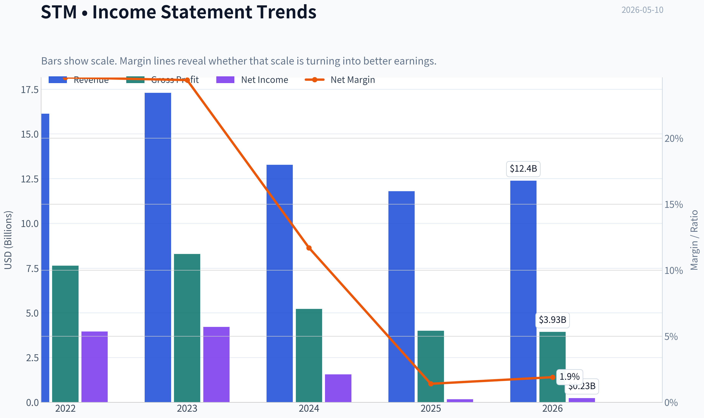

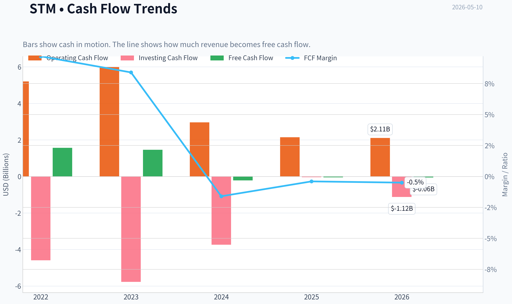

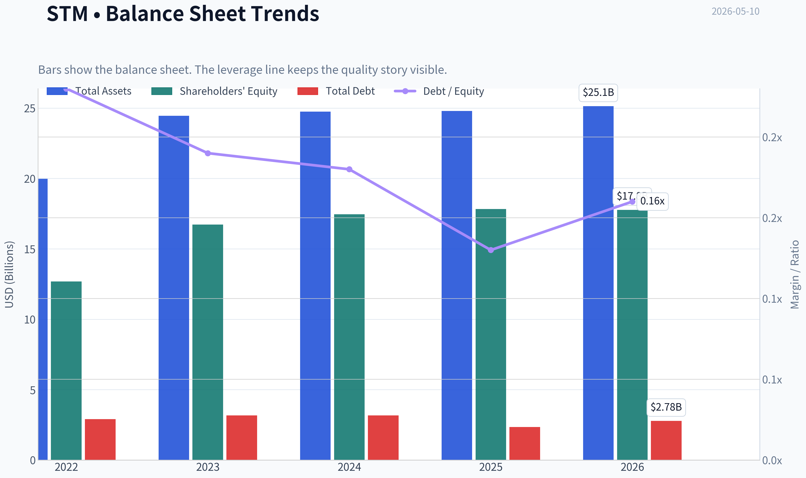

This graph tracks the profitability and return metrics (ROE, ROIC, Margins) of **STM** over the past decade, highlighting capital efficiency trends.

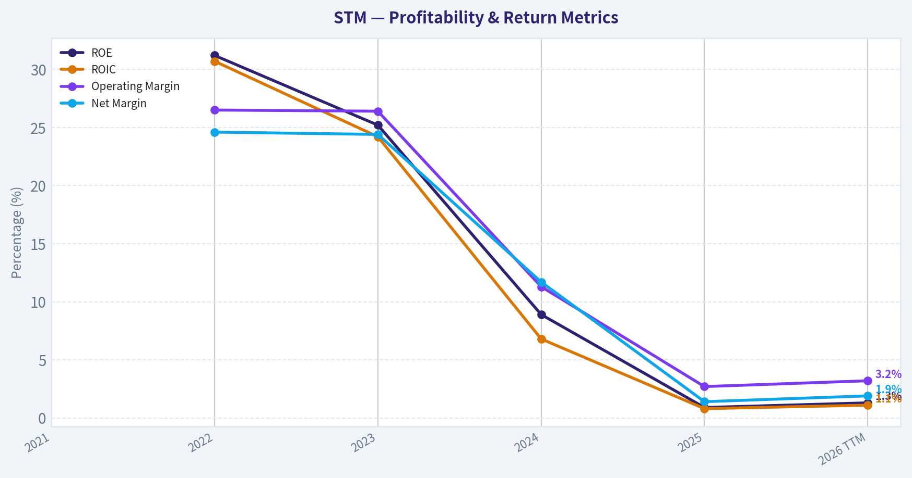

This chart illustrates the financial health of **STM** over the last 10 years, mapping cash equivalents and free cash flow against total obligations (Debt).

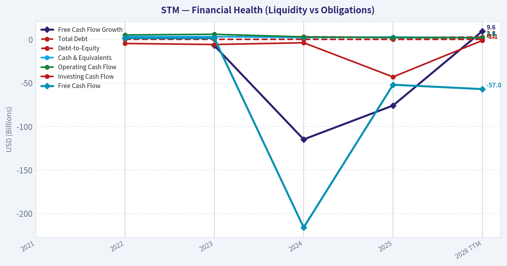

This comparison chart from *Profitability Analysis* stacks current figures against historical benchmarks for **STM**, making it easy to see where the company trades relative to its own averages.

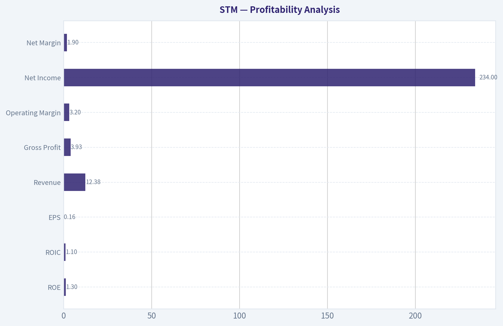

---

### Intrinsic Value Analysis (Buffett)

> *Following Warren Buffett's value investing philosophy: Circle of Competence, Economic Moat, Management Quality, and Margin of Safety.*

#### Intrinsic Value Snapshot

Price is what you pay. Intrinsic value is what the business may be worth based on the cash it can create for owners over time. We show a range, not one magic number.

- Current Price: $59.17
- Value Range: N/A to N/A

##### Owner Earnings (Buffett Method)
- Net Income: $166,000,000.00
- Depreciation & Amortization: $1,854,000,000.00
- Capital Expenditures: $-2,204,000,000.00
- Working Capital Changes: $-143,000,000.00
- Owner Earnings: $-41,000,000.00

##### Intrinsic Value

ANALYST STANCE: **WATCH**

#### STM (STMicroelectronics) Buffett-Style Preliminary Review

I could not retrieve the deeper audited financial history tool output in this run, so this is a **partial but actionable** assessment based on the shared research pack you provided. I'm making progress with what we have and highlighting where evidence is still incomplete.

---

#### 1) Go/No-Go Gate Assessment

| Gate | Verdict | Evidence |
|---|---|---|
| Gate 1: Business Simplicity | Pass | STM designs and sells semiconductors used in automotive, industrial, and electronics applications. The business is understandable at a high level: design chips, manufacture or outsource production, and sell into end markets. |
| Gate 1: 10-Year Predictability | Borderline | Demand for semiconductors is cyclical and tied to industrial, automotive, and electronics spending. The broad need for chips is clear, but earnings and margins are not highly predictable year to year. |
| Gate 1: Technology Risk | Borderline/Fail-risk | This is a technology business in a rapidly evolving industry. STM can benefit from tech adoption, but chip companies are also vulnerable to design shifts, process competition, and product obsolescence. |
| Gate 2: Moat | Borderline | Current gross margin of 33.9% is below the >40% "strong moat" heuristic. Some customer relationships and automotive/industrial positioning may help, but available evidence does not support a wide moat. |
| Gate 3: Management & Capital Allocation | Inconclusive | We do not yet have enough hard evidence here on owner orientation, capital allocation track record, buybacks, acquisitions, and long-term per-share value creation. |
| Gate 4: Industry Structure | Fail/Boderline | Semiconductors are capital intensive, cyclical, and competitive. This is not the ideal Buffett industry structure. |

Key Takeaways: STM passes the basic "I can understand the business" test, but it struggles on the more important Buffett filters: predictability, moat clarity, and favorable industry structure. The semiconductor industry is usually not ideal for a pure Buffett-style investment because it is cyclical, technologically dynamic, and capital intensive.

---

#### 2) Elementary School Test

STM makes tiny electronic parts called chips. These chips help cars, factory machines, and electronic devices work. STM earns money by designing these chips and selling them to customers who build finished products.

#### 3) 10-Year Predictability Test

I would rate predictability as **moderate to low**.
Why:

- Chips will almost certainly still be needed in 10 years.
- But **which chips**, at **what margins**, and with **what competitive position** are much harder to forecast.
- Automotive and industrial exposure is somewhat steadier than consumer electronics, but this is still a cyclical business.

#### 4) Technology Risk Assessment

Technology is both a tailwind and a threat.

- **Tailwind:** More electronics in vehicles, industrial automation, power management, and edge devices.
- **Threat:** Fast-moving process changes, product substitution, pricing pressure, and the risk of lagging peers technologically.

This weakens Buffett-style confidence.

---

#### 5) Moat Analysis

| Moat Source | Assessment | Evidence |
|---|---|---|
| Intangible Assets | Weak/Moderate | STM has engineering know-how and customer certifications, especially in automotive/industrial markets, but current gross margin of 33.9% does not signal strong pricing power. |
| Switching Costs | Moderate in niches | Automotive and industrial customers face qualification and redesign costs, which can create some stickiness. But this usually does not create a truly dominant moat across the whole company. |
| Cost Advantage | Unclear | No evidence in the shared data that STM structurally out-earns peers through a durable cost advantage. |
| Network Effects | None | Semiconductor manufacturing and design generally do not have classic network effects. |

| Overall Moat Rating | Conclusion |
|---|---|
| Narrow to Moderate | Not clearly wide, and not proven durable enough for a classic Buffett-quality compounder |

Key Takeaways: STM likely has some niche advantages, especially in automotive and industrial relationships, but the evidence does not support a wide moat. The gross margin profile is particularly important here, and at 33.9% it does not look like a textbook pricing-power business.

---

#### 6) Management Quality Assessment

| Test | Current Read | Comment |
|---|---|---|
| Think Like Owners? | Inconclusive | No insider ownership or compensation detail available in the materials provided. |
| Honest & Candid? | Inconclusive | No annual-letter style evidence, accounting restatement history, or direct commentary available here. |
| Rational Capital Allocation? | Concern | Negative FCF yield and very low ROE suggest weak recent value creation, though this may be cyclical rather than structural. |

Key Takeaways: I cannot yet give management a fair Buffett-style endorsement because the needed qualitative evidence is missing. Still, the current financial snapshot does not suggest exceptional capital allocation results at this point in the cycle.

---

#### 7) Snapshot Financial Summary

Using the shared research pack:

| Metric | Value |
|---|---:|
| Current Price | $59 |
| Market Cap | $52.59B |
| P/E | 369.8x |
| ROE | 0.9% |
| Gross Margin | 33.9% |
| Revenue Growth YoY | -11.1% |
| FCF Yield | -0.1% |
| Current Ratio | 3.36 |

Key Takeaways: The current snapshot is weak by Buffett standards. Profitability is low, free cash flow is slightly negative, revenue is shrinking year over year, and the earnings multiple is extremely high because current earnings appear depressed.

---

#### 8) Buffett Financial Interpretation

| Buffett Metric | Desired | STM Current Read | Assessment |
|---|---|---:|---|
| ROE | >15% sustained | 0.9% | Poor |
| Gross Margin | >40% sustained preferred | 33.9% | Below moat threshold |
| OCF vs Net Income | OCF >= NI | Not available | Inconclusive |
| Debt Burden | Conservative | Not fully available | Inconclusive |
| FCF Generation | Positive and steady | -0.1% FCF yield | Weak |
| Revenue Trend | Stable/growing | -11.1% YoY | Weak |

Key Takeaways: On the key Buffett quantitative filters, STM currently falls short. The business may simply be in a cyclical trough, but Buffett-style investing requires both quality and predictability, and the current numbers do not demonstrate either.

---

#### 9) Owner Earnings Calculation

I cannot calculate a reliable Buffett-style owner earnings figure because we do **not** yet have:

- Net income
- Depreciation & amortization
- Maintenance capex
- Working capital changes

So this section remains incomplete in this run.

---

#### 10) Three-Scenario DCF Valuation

A credible DCF also requires a cleaner base of owner earnings or free cash flow than we currently have. With:

- negative/near-zero FCF yield,
- depressed earnings,
- and no detailed multi-year cash flow history retrieved,

any precise intrinsic value estimate would be low-confidence and potentially misleading.

So the prudent Buffett answer is:

| Scenario | Status | Reason |
|---|---|---|
| No-Growth DCF | Not reliable | Need stable owner earnings base |
| GDP-Growth DCF | Not reliable | Same issue |
| Historical-Growth DCF | Not reliable | No dependable normalized earnings series in hand |

Key Takeaways: When cash generation is weak and the base earnings figure is unstable, valuation precision is an illusion. Buffett's approach favors passing when the economics are unclear rather than forcing a model.

---

#### 11) Margin of Safety Analysis

At the current data point, there is **no clear margin of safety** visible.

Reasons:

- P/E of 369.8x is extremely elevated on current earnings.
- ROE is only 0.9%.
- FCF yield is negative.
- Revenue is declining.

Even if earnings are cyclically depressed, a Buffett investor would typically require much stronger evidence of normalized earning power before underwriting value.

---

#### 12) Final Buffett Scorecard

| Criterion | Weight | Score (1-5) | Weighted Result |
|---|---:|---:|---:|
| Business Understanding | 20% | 4.0 | 0.80 |
| Moat Width & Durability | 25% | 2.5 | 0.63 |
| Management Quality | 15% | 2.5 | 0.38 |
| Return on Equity | 15% | 1.0 | 0.15 |
| Reinvestment Runway | 10% | 3.0 | 0.30 |
| Balance Sheet Strength | 5% | 3.0 | 0.15 |
| Industry Structure | 5% | 2.0 | 0.10 |
| Valuation/Margin of Safety | 5% | 1.5 | 0.08 |
| **Total** | **100%** |  | **2.59 / 5.0** |

Key Takeaways: STM scores well on understandability but poorly on the traits Buffett values most: high returns on capital, strong moat evidence, and a clear margin of safety. The overall score lands in the low end of the range, which supports caution rather than commitment.

---

#### 13) Investment Stance

**Stance: WATCH**

**Conviction: Moderate**

Why not AVOID outright:
- STM is a real operating business with meaningful positions in automotive and industrial semiconductors.
- The current weak numbers may reflect a cyclical down period rather than permanent impairment.
- The balance sheet appears at least liquid on the surface, with a current ratio above 3.

Why not ADVOCATE:
- Current profitability is far too weak for a Buffett-style endorsement.
- No clear wide moat is evident from the available data.
- No valuation margin of safety is visible.
- The industry structure is cyclical, capital intensive, and technologically contested.

#### Bottom Line

STM may be a **cyclical semiconductor recovery idea**, but it does **not** currently qualify as a classic Buffett-style wonderful business at a sensible price. Until normalized returns, free cash flow, and moat evidence become much clearer, this is a **WATCH**, not a buy.

If you want, I can next turn this into a **full normalized earnings framework for STM** using conservative assumptions so we can estimate what the stock might be worth at mid-cycle earnings.
#### Valuation Bridge

This bridge places the current market price beside each intrinsic value lens so readers can see whether upside depends on one method or shows up across several methods.

| Scenario | Intrinsic Value / Share |
| --- | ---: |
| Damodaran Method | $10.85 |
| Current Price | $59.17 |

#### Key Takeaways

If one method is far above the others, the upside case depends on a specific modelling assumption. When several methods cluster together, the valuation story is more robust.

#### Valuation Visuals

This comparison chart from *Latest Earnings Snapshot* stacks current figures against historical benchmarks for **STM**, making it easy to see where the company trades relative to its own averages.

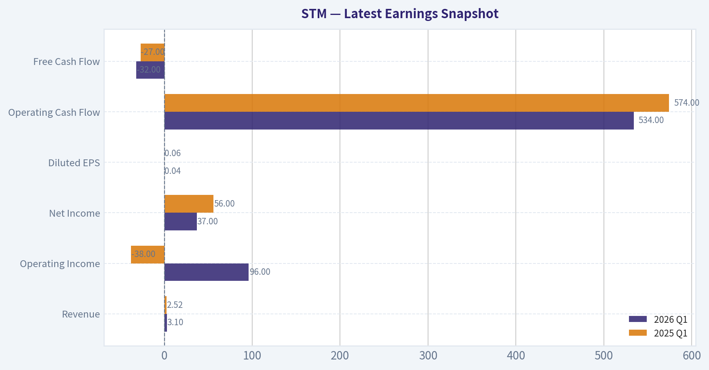

This comparison chart from *Current vs Historical Average Comparison* stacks current figures against historical benchmarks for **STM**, making it easy to see where the company trades relative to its own averages.

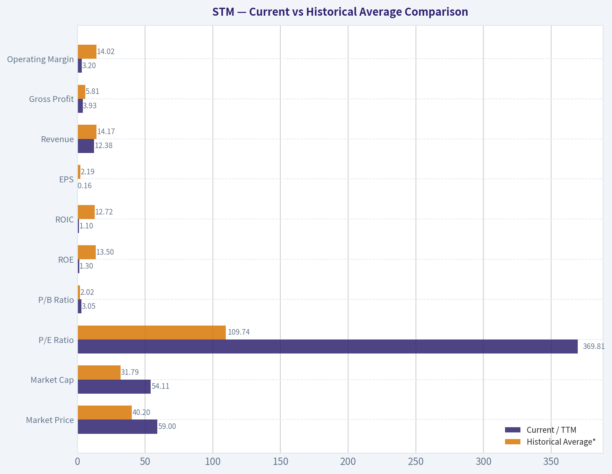

This comparison chart from *Balance Sheet Analysis* stacks current figures against historical benchmarks for **STM**, making it easy to see where the company trades relative to its own averages.

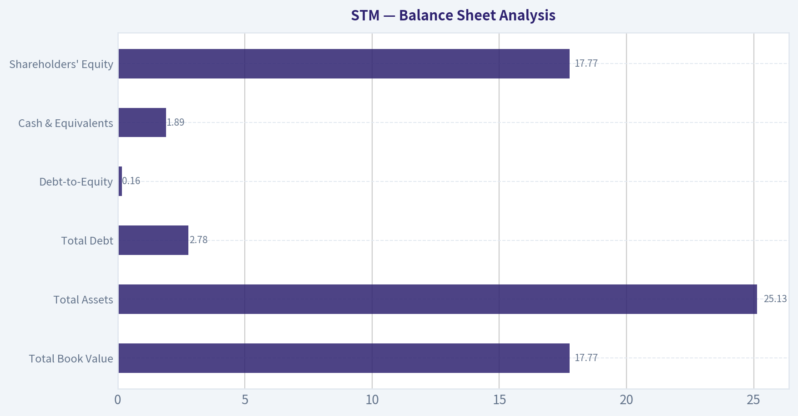

---

### Trend & Growth Analysis (Lynch/Druckenmiller/Fisher)

> *Following Peter Lynch's GARP, Stanley Druckenmiller's macro-aware approach, and Philip Fisher's scuttlebutt methodology.*

ANALYST STANCE: **WATCH**

#### STM Growth Analysis Snapshot

STM does **not** currently qualify as a Lynch-style fast grower. Based on the shared pack, this is a **cyclical semiconductor name in a downcycle**, with some attractive long-term secular exposure but weak near-term growth and poor current valuation optics. The bull case is an eventual recovery driven by automotive power, industrial automation, and silicon carbide, but the current fundamentals do **not** support an ADVOCATE stance yet.

---

#### 1) Lynch Classification

| Item | Assessment |
|---|---|
| Lynch category | **Cyclical** |
| Current growth profile | **Negative YoY revenue growth (-11.1%)** |
| Fit for growth mandate today | **Not a Fast Grower today** |
| Best framing | Quality cyclical with secular overlays |

**Key Takeaways:** STM should be viewed first as a cyclical semiconductor company, not a pure secular compounder. Even though it has exposure to attractive themes like EV power and industrial automation, the current revenue trend is negative, which disqualifies it from a clean fast-grower setup. For now, investors are underwriting a cycle recovery more than an ongoing growth inflection.

---

#### 2) The Story in 3 Bullets

- STM makes chips that help cars, factories, and power systems run smarter and more efficiently.
- Its best long-term opportunities are in **automotive electrification, power semiconductors, and silicon carbide**.
- The problem today is that demand has softened, revenue is shrinking, and the market is waiting for a clear earnings and margin rebound.

---

#### 3) TAM Analysis and 10x Test

| Metric | Estimate / View |
|---|---|
| Current revenue base | Large-cap diversified analog/power semi business |
| Core TAMs | Automotive semis, industrial semis, power semis, SiC |
| TAM direction | **Growing**, especially EV power and energy efficiency |
| 10x test | **No near-term practical 10x case** from current scale |
| Runway quality | Good secular runway, but not ten-bagger runway from this base |

**Key Takeaways:** STM operates in markets that are real and growing, especially in electrification and power management. But at its current size, this is not an obvious 10x revenue story, which limits the classic Lynch ten-bagger setup. The investment case is more about cyclical recovery plus steady secular share capture than explosive compounding.

---

#### 4) Revenue Growth Trend

| Metric | Value |
|---|---|
| Revenue growth YoY | **-11.1%** |
| Pattern | **Decelerating / contracting** |
| Interpretation | Downcycle, inventory digestion, weaker demand |
| Growth signal | **Warning**, not inflection yet |

**Key Takeaways:** The most important datapoint is that revenue is shrinking year over year. That means the company is not currently showing the kind of accelerating growth pattern that growth investors want to see. Before getting more constructive, I would want evidence that revenue declines are bottoming and sequential momentum is improving.

---

#### 5) Unit Economics / Operating Quality

| Metric | Value | Assessment |
|---|---:|---|
| Gross margin | **33.9%** | Weak for a quality semi franchise; likely cyclical pressure |
| ROE | **0.9%** | Very weak |
| FCF yield | **-0.1%** | Essentially no current free cash generation for equity |
| Current ratio | **3.36** | Strong liquidity |
| NRR | N/A | Not applicable |
| LTV/CAC | N/A | Not applicable |
| Rule of 40 | N/A | Not applicable |

**Key Takeaways:** STM's balance sheet liquidity looks solid, but the operating metrics are currently weak. Low ROE and near-zero to negative free cash flow yield suggest the business is in a trough or under earnings pressure. This is not a broken balance sheet story, but it is also not an efficient-growth story right now.

---

#### 6) Inflection Point Assessment

| Inflection Type | Current Read |
|---|---|
| Product cycle inflection | **Possible in SiC / automotive power, but not proven in numbers yet** |
| Market share inflection | Unclear |
| Margin inflection | **Not yet visible** |
| TAM inflection | Yes, long-term EV/power/industrial efficiency tailwinds |
| Competitive inflection | No clear evidence |
| Overall | **Early watchlist, not confirmed** |

**Key Takeaways:** The long-term opportunity set is attractive, especially in power semiconductors and silicon carbide. But an inflection point requires actual acceleration in revenue, margins, or earnings, and that is not yet visible in the current data. Right now STM is more a "monitor for bottoming" story than a "growth has turned" story.

---

#### 7) Macro Setup Evaluation

| Factor | Assessment |
|---|---|
| Industry backdrop | Semiconductor cycle still uneven |
| Rate sensitivity | Mixed; lower rates help valuation, but fundamentals matter more here |
| Secular themes | EVs, power efficiency, industrial automation, AI physical infrastructure |
| Macro tailwind today | **Neutral to modest headwind** |
| Druckenmiller read | Better as a timing-sensitive cyclical than a pure compounding growth bet |

**Key Takeaways:** STM has exposure to strong secular themes, but semiconductor cycles often overwhelm secular narratives in the short run. The macro setup is not terrible, yet it is also not the kind of clean "wind at your back" environment that usually creates the best growth entries. This makes timing and confirmation especially important.

---

#### 8) Fisher 15-Point Score

| Fisher Dimension | Score (1-5) | Comment |
|---|---:|---|
| Market potential | 4 | Strong end markets |
| New products | 4 | Good innovation in power/SiC |
| R&D effectiveness | 4 | Credible semiconductor R&D base |
| Sales organization | 3 | Adequate, hard to verify edge |
| Profit margin | 2 | Currently weak |
| Margin improvement | 2 | Not yet evident |
| Labor/personnel | 3 | Neutral |
| Executive relations | 3 | Neutral |
| Management depth | 4 | Large established operator |
| Cost/accounting controls | 3 | Neutral |
| Special advantages | 4 | Automotive design-ins, power expertise |
| Long-range profit outlook | 4 | Attractive if cycle recovers |
| Dilution risk | 4 | No major concern indicated |
| Candor | 3 | Neutral |
| Integrity | 3 | Neutral |

| Total | **50 / 75** | **Average** |

**Key Takeaways:** STM scores reasonably well on product potential, technical capability, and long-term strategic positioning. The main drag is current profitability and the lack of visible margin improvement. Overall, this looks like a respectable industrial-tech franchise, but not one with overwhelming Fisher-style excellence at this moment.

---

#### 9) Valuation Analysis

| Metric | Value / View | Interpretation |
|---|---|---|
| P/E | **369.8x** | Meaningless/very unattractive on depressed earnings |
| PEG | Not useful | Earnings too distorted |
| P/S | Not provided | Would be more useful than P/E here |
| Best valuation lens | EV/EBITDA or normalized earnings | Cyclical business |
| Current valuation read | **Not obviously cheap on current earnings** |

**Key Takeaways:** The headline P/E is extremely high, but that likely reflects depressed earnings rather than true hyper-expensiveness. Even so, it does not give growth investors any valuation comfort. For STM, the right question is whether normalized margins and earnings power can recover enough to make today's price reasonable.

---

#### 10) Growth Investor Scorecard

| Criterion | Weight | Score (1-5) | Weighted Score |
|---|---:|---:|---:|
| The Story | 10% | 3.5 | 0.35 |
| TAM & Runway | 20% | 3.5 | 0.70 |
| Revenue Growth | 20% | 1.5 | 0.30 |
| Unit Economics | 15% | 2.0 | 0.30 |
| Competitive Position | 10% | 3.5 | 0.35 |
| Management Quality | 10% | 3.0 | 0.30 |
| Macro Setup | 5% | 3.0 | 0.15 |
| Profitability Path | 5% | 2.5 | 0.13 |
| Valuation | 5% | 2.0 | 0.10 |

| Total Score |  |  | **2.68 / 5.0** |

**Key Takeaways:** STM lands below the threshold for a growth-style endorsement. The secular story and competitive positioning are decent, but those positives are outweighed by contracting revenue, weak profitability, and a lack of confirmed inflection. This is a watchlist name, not a high-conviction growth buy.

---

#### 11) Position Size Stance

| Stance | View |
|---|---|
| New position | **Small watch position at most** |
| Full position | **No** |
| Add aggressively now | **No** |
| Trigger to upgrade | Revenue stabilization, margin recovery, and evidence of cyclical trough |

**Key Takeaways:** STM does not merit a concentrated position today under a growth framework. If you want exposure, keep it small and treat it as a cyclical recovery watch position rather than a core growth holding. The upgrade path depends on hard evidence that the business has turned, not just that the long-term story sounds good.

---

#### 12) Key Risks and Catalysts

| Risks | Catalysts |
|---|---|
| Revenue contraction persists | Semiconductor cycle bottoms |
| Gross margin stays weak | Margin recovery from better utilization |
| SiC / auto demand disappoints | EV and industrial demand reaccelerate |
| Earnings remain depressed | Better bookings / guidance |
| Market pays too much for "recovery hope" | Clear sequential improvement in quarterly results |

**Key Takeaways:** The risks are mostly about the downcycle lasting longer than investors expect. The upside case depends on STM proving that demand, margins, and earnings are recovering together. Until that happens, the stock remains more of a timing exercise than a clean fundamental growth setup.

---

#### Bottom Line

STM has a **credible long-term secular story**, and Druckenmiller's disclosed initiation is notable. But under a Lynch/Fisher growth lens, the current numbers are too weak: **negative revenue growth, low ROE, weak FCF, and no confirmed inflection**.

**Conclusion: WATCH.** Upgrade only if quarterly results start showing:
1. revenue contraction narrowing or turning positive,
2. gross margin improvement, and
3. a believable path to normalized earnings power.

#### Growth & Scorecard Visuals

This comparison chart from *Growth Metrics* stacks current figures against historical benchmarks for **STM**, making it easy to see where the company trades relative to its own averages.

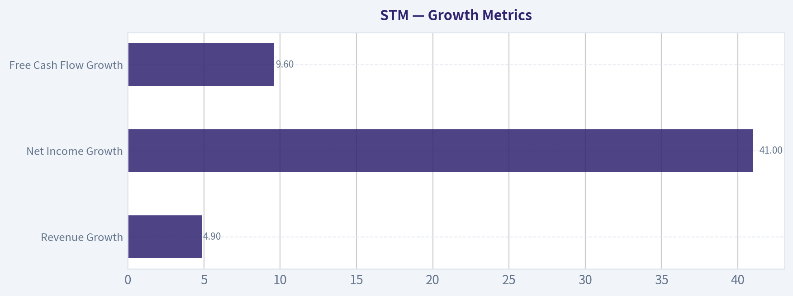

---

### Market Technical Analysis

#### STM Technical Analysis Report

STM is in a **powerful bullish trend across short, medium, and long timeframes**, but the character of the move has shifted from a steady advance into a **high-momentum, increasingly extended breakout phase**. That distinction matters: the trend remains strong, yet the probability of sharper pullbacks and more violent intraday swings is now materially higher than it was a month ago.

The most relevant indicator set for the current market context is:

- `close_10_ema`
- `close_50_sma`
- `close_200_sma`
- `macd`
- `macdh`
- `rsi`
- `atr`
- `vwma`

These eight give a balanced view of:
- short-term trend acceleration,
- medium- and long-term trend confirmation,
- momentum strength and momentum change,
- overextension risk,
- volatility/risk sizing,
- and volume-backed trend quality.

---

#### Price Structure and Trend Context

From the raw price history, STM has staged a dramatic re-rating:

- Early November 2025: roughly **$24**
- Late January 2026: testing **$30**
- Mid-February 2026: breakout into **$33-35**
- Late March 2026: consolidation and shakeout back toward **$31**
- April into early May 2026: explosive continuation to **$59.17**

This is not merely an uptrend; it is a **sequence of trend, pause, reacceleration, and climax-like expansion**. The late-March pullback appears to have functioned as a reset rather than a reversal. Since then, the stock has advanced with widening price ranges, repeated gap-like momentum days, and strong participation on higher volume.

A trader should recognize that the stock is no longer behaving like a normal mean-reverting semiconductor name in a stable channel. It is trading like a **momentum leader**, where traditional "overbought" readings can persist longer than expected.

#### Indicator Snapshot

| Indicator | Latest reading | Interpretation |
|---|---:|---|
| Close (2026-05-08) | 59.17 | Strong breakout continuation; near period highs |
| `close_10_ema` | 54.72 | Price remains well above short-term trend support |
| `close_50_sma` | 40.04 | Medium-term trend is steeply positive |
| `close_200_sma` | 30.24 | Long-term trend firmly bullish |
| `macd` | 5.46 | Strong upside momentum remains intact |
| `macdh` | 0.53 | Momentum still positive, though less explosive than late April/early May |
| `rsi` | 80.91 | Deeply overbought, but consistent with strong trend behavior |
| `atr` | 2.20 | Volatility elevated; expect larger daily swings |
| `vwma` | 52.22 | Price above volume-weighted trend, confirming broad participation |

Key Takeaways: STM is trading well above every major trend benchmark, which confirms a strong bullish structure across all timeframes. Momentum is still positive, but the very high RSI and elevated ATR show that the stock is now extended and more vulnerable to sharp pullbacks even if the broader uptrend remains intact.

---

#### Trend Analysis by Timeframe

##### Short-term trend: very strong, but stretched

The `close_10_ema` is **54.72**, while price closed at **59.17**. That nearly **$4.45 gap above the 10 EMA** shows strong upside acceleration. In practical terms, short-term buyers remain in control, but the stock is not trading near an efficient entry zone. It is trading above its fast trend support by a margin large enough to imply that fresh entries now carry chase risk.

The short-term pattern over the last week also shows an important nuance:
- strong push to **57.95** on May 6,
- pullback to **55.90** on May 7,
- immediate rebound to a new high close at **59.17** on May 8.

That sequence suggests **buyers are still defending dips quickly**, but also that intraday volatility is expanding. This is typical of late-stage momentum bursts: the trend is still bullish, yet price discovery becomes less orderly.

##### Medium-term trend: healthy and accelerating

The `close_50_sma` has risen from about **30.49 on March 11** to **40.04 on May 8**. That is a very steep climb for a 50-day moving average and confirms that the April surge was not just a short squeeze over a flat base; it materially improved the medium-term trend.

Price at **59.17** versus a 50 SMA at **40.04** means STM is trading nearly **48% above its medium-term average**. That is exceptionally strong, but also historically difficult to sustain without some cooling period. When a stock gets this far above the 50-day average, the market often resolves the excess through:
- sideways consolidation,
- a pullback toward the 10 EMA,
- or a deeper retracement toward the VWMA or even the 50 SMA over time.

##### Long-term trend: fully bullish

The `close_200_sma` is **30.24** and rising steadily. Price is almost **96% above the 200 SMA**, which confirms a major long-term uptrend. There is no evidence here of a structurally weak stock staging a temporary bounce. This is a stock in a confirmed bull regime.

The most important long-term message is not just that price is above the 200 SMA, but that:
- the 200 SMA is rising,
- the 50 SMA is above the 200 SMA,
- and the 10 EMA is far above both.

That alignment is classic **bullish moving-average stacking**. It usually favors buying pullbacks rather than betting on outright trend failure.

---

#### Momentum Analysis

##### MACD: bullish momentum remains strong

The `macd` reading of **5.46** is very high relative to earlier periods:
- around **0.19** on March 31,
- above **3.45** by April 23,
- now above **5.45**.

This indicates that momentum has not simply turned positive; it has expanded significantly. Such a reading reflects a strong rate of change in price and reinforces the view that STM is in an institutional momentum phase.

##### MACD Histogram: still positive, but no longer accelerating at peak speed

The `macdh` is **0.53**, still clearly positive, confirming that MACD remains above its signal line. However, it has eased from readings around **1.02** in late April and early May.

That subtle change matters. It suggests:
- momentum is still bullish,
- but the pace of acceleration is slowing,
- meaning the trend is intact even as the stock becomes more vulnerable to pauses or short consolidations.

This is often the setup before one of two outcomes:
1. a brief sideways digestion followed by another breakout leg, or
2. a pullback to reset overbought conditions.

It is **not yet a bearish reversal signal**, but it is a sign that upside thrust is becoming less linear.

---

#### RSI and Overextension Risk

The `rsi` at **80.91** is firmly in overbought territory. More importantly, RSI has stayed above 70 for an extended period:
- above **71** by April 9-10,
- mostly **75-88** through much of late April and early May.

This tells us STM is in a **persistent momentum regime**, not a standard oscillating range. In such environments, RSI should not be used mechanically as a sell signal. Instead, it should be interpreted as:
- confirmation of strong momentum,
- but also a warning that entry timing is poor if one is chasing.

For existing longs, RSI this high argues for:
- tighter trailing risk management,
- partial profit-taking into strength,
- or waiting for a higher low before adding.

For new buyers, the message is simple: **strength is undeniable, but reward-to-risk is less favorable than it was earlier in the move**.

---

#### Volatility and Risk Management

The `atr` has climbed from about **1.42 in mid-March** to **2.20** now. That is a notable increase in average daily range. The stock is becoming more volatile as it rises, which is common in high-momentum phases.

What this means in practice:
- stops set too tightly are likely to get hit by normal noise,
- position sizes should be reduced if risk is defined in dollar terms,
- traders should expect swings of roughly **$2+ per day** to be normal rather than exceptional.

A high ATR in a rising stock is not bearish by itself. But it does mean this is no longer a low-stress trend. The stock can remain bullish while still producing uncomfortable drawdowns.

---

#### Volume-Weighted Confirmation

The `vwma` is **52.22**, and price at **59.17** remains decisively above it. Since VWMA incorporates volume, this suggests the move is not being carried by thin, low-conviction trading. The market has been willing to transact meaningful volume at progressively higher prices.

The widening gap between price and VWMA also signals strength, but like the EMA gap, it speaks to extension. A pullback toward VWMA would not automatically be bearish; in fact, it would likely improve structural health if it occurs on controlled volume.

---

#### What Traders Should Watch Next

| Scenario | What to watch | Trading implication |
|---|---|---|
| Bullish continuation | Price holds above `close_10_ema` and `macdh` stays positive | Trend remains strong; pullbacks likely buyable |
| Healthy consolidation | Price chops sideways while 10 EMA catches up | Reduces overbought pressure without damaging trend |
| Deeper reset | Break below 10 EMA with momentum cooling toward VWMA | Could offer a better risk-adjusted re-entry later |
| Early warning | `macdh` keeps fading and RSI falls from extreme levels with weak rebounds | Upside thrust may be tiring short term |
| Structural trend failure | Sustained break below VWMA and later 50 SMA | Would mark a meaningful deterioration, not just profit-taking |

Key Takeaways: The most constructive outcome for bulls is either a shallow pullback or a sideways pause that allows the fast averages to catch up. The first true warning sign would be weakening momentum combined with failure to hold near-term support, while a break of the 50-day average would be needed to seriously challenge the medium-term bullish trend.

---

#### Trading Interpretation

| Trader type | Current read | Practical stance |
|---|---|---|
| Trend follower | Strong bullish alignment | Favor pullback entries over chasing breakouts |
| Momentum trader | Momentum still positive but less explosive | Can stay constructive, but manage for sharp swings |
| Swing trader | Overbought conditions elevated | Wait for retracement, consolidation, or a tighter setup |
| Risk manager | ATR rising quickly | Use smaller size and wider stops |
| Long-term investor | Major trend remains intact | Trend still favorable, but near-term volatility likely elevated |

Key Takeaways: STM still favors bullish traders, especially those who trade with the trend rather than against it. However, the stock is no longer in a low-risk entry zone, so discipline around position sizing, pullback timing, and stop placement is especially important here.

---

#### Bottom Line

STM is in a **confirmed long-term uptrend, a steep medium-term advance, and a still-intact short-term breakout**. The technical evidence strongly favors the bulls. However, the stock is also **deeply extended**, with RSI above 80, price far above the 10 EMA and 50 SMA, and ATR signaling elevated volatility.

So the best nuanced conclusion is:

- **Trend quality: excellent**
- **Momentum: strong but no longer accelerating at peak pace**
- **Risk of short-term pullback: high**
- **Probability of immediate structural breakdown: still low**

For traders, this is a stock to **respect, not chase recklessly**. The chart supports bullish continuation, but the most attractive new opportunities likely come from a controlled reset rather than from buying after an already parabolic move.

| Category | Reading | Conclusion |
|---|---|---|
| Short-term trend | Price well above `close_10_ema` | Very strong, but stretched |
| Medium-term trend | Price far above rising `close_50_sma` | Strong bullish trend |
| Long-term trend | Price far above rising `close_200_sma` | Major bull regime intact |
| Momentum level | `macd` high and positive | Upside momentum remains strong |
| Momentum change | `macdh` positive but below recent peak | Acceleration is cooling slightly |
| Overbought status | `rsi` at 80.91 | Strong trend, but elevated pullback risk |
| Volatility | `atr` rising to 2.20 | Expect wider swings and adjust risk |
| Volume confirmation | Price above `vwma` | Rally appears volume-supported |

Key Takeaways: STM's technical profile is bullish across every major dimension: trend, momentum, and volume confirmation. The main caution is not trend weakness but extension, meaning traders should stay constructive while being selective about entry timing and careful with risk.

#### Market Visuals

This comparison chart from *Market Metrics* stacks current figures against historical benchmarks for **STM**, making it easy to see where the company trades relative to its own averages.

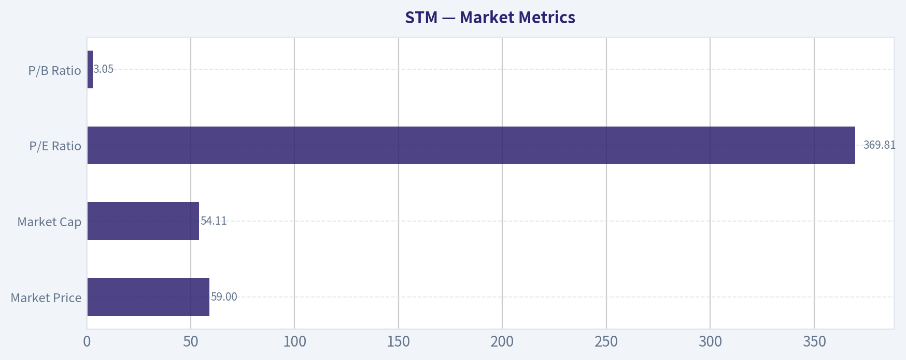

---

### News & Events Analysis

#### STMicroelectronics (NYSE: STM) - 1-Week Trading & Investment Report

STMicroelectronics sits at an awkward but potentially important inflection point: the stock has started to attract renewed interest as investors rotate toward the "physical AI" and industrial semiconductor stack, yet the company's own fundamentals remain weak versus peak-cycle levels. For traders, that means STM currently looks more like a recovery/positioning story than a clean earnings-momentum story.

The shared data pack already flags the tension clearly: revenue growth is still negative at **-11.1% YoY**, ROE is only **0.9%**, free-cash-flow yield is slightly negative, and the trailing **P/E near 370x** suggests earnings have been compressed enough to make valuation optics look distorted. Against that backdrop, recent news flow matters more than usual because small changes in demand, inventory normalization, or guidance can move sentiment quickly.

---

#### Recent News Flow and What It Means

Over the last week, STM-related coverage was dominated less by hard new operating disclosures and more by investor-facing materials and sector framing:

- **May 6:** shareholder/analyst call slideshow published.
- **May 4:** shareholder/analyst call transcript published.
- Sector commentary highlighted growing investor interest in the **industrial supply chain of AI**.
- Broader market commentary noted continued strength in equities and semiconductors, though some strategists warned chip stocks may be overextended.
- A price-target update noted an increase, but the target itself was still below the shared current price, which suggests analysts may be turning less bearish without yet becoming outright bullish.

The practical takeaway is that STM is benefiting from a better semiconductor tape and improving narrative support, but the latest week's news does **not** show a major new contract, product launch, or demand inflection strong enough on its own to re-rate the stock fundamentally.

#### Earnings Review - Latest Reported Period

The latest available earnings-related coverage in the research pack points to a **shareholder/analyst call held on May 4, 2026**, with materials published on May 6. Based on timing, this corresponds to STM's **Q1 2026 reporting period**.

Because the supplied news extracts do not include the full earnings figures, I need to be careful: I can confirm that **STM did report recently and Q1 2026 is the latest reported quarter referenced in available coverage**, but the exact headline numbers are not contained in the retrieved snippets here. So the most defensible conclusion from the available material is:

- **Latest reported period:** **Q1 2026**
- **Status:** recently reported; not awaiting a first release
- **What changed vs prior period / prior guidance:** the broader financial context suggests STM is still operating below prior-cycle profitability and revenue levels, with weak trailing earnings power reflected in the inflated P/E, low ROE, and negative YoY growth. That implies the latest report likely did **not** mark a full recovery back to prior peak conditions.

For trading purposes, the key earnings interpretation is this: **STM appears to be in stabilization/recovery mode rather than acceleration mode.** If Q1 2026 had delivered a decisive upside reset, the recent news flow likely would have emphasized revenue beats, margin expansion, or sharply improved guidance. Instead, the tone of coverage seems centered on the analyst call and broader thematic positioning.

So versus the prior period, the most likely read is:
- the business remains pressured by weak end-market demand in parts of industrial and automotive,
- margins are likely still below historical highs,
- and management is still trying to convince the market that a cyclical trough is forming.

That matters because semiconductor trough stocks can work well **before** the numbers look great, but they require confidence that estimates have bottomed.

---

#### Macro and Sector Context

STM is unusually exposed to a mix of **Europe, industrial electronics, automotive semiconductors, microcontrollers, and power chips**. That means macro context matters more for STM than for AI compute leaders.

Current market context from the past week suggests:

- **Semiconductor risk appetite has improved**, especially for names tied to real-world infrastructure behind AI.
- At the same time, some market voices are warning that chip stocks may be **technically stretched** after a sharp run.
- For STM specifically, the bullish spillover from AI is indirect. The company is not a primary AI training GPU winner; instead, its upside depends on whether investors increasingly reward enabling hardware like power management, sensors, microcontrollers, and industrial electronics.
- STM remains sensitive to **automotive production trends**, **European manufacturing activity**, and **China demand normalization**. Those are slower-moving and less explosive than hyperscaler capex themes.

This means STM may lag the most speculative semiconductor rallies, but it can outperform if the market rotates toward **catch-up cyclical semis** rather than concentrated AI winners.

---

#### Positioning, Sentiment, and Ownership Signals

The 13F data in the research pack offers an interesting but mixed signal:

| Investor / Signal | Latest Action | Interpretation |
|---|---|---|
| Stanley Druckenmiller | Initiated position | Suggests at least one macro-oriented, cycle-sensitive investor sees value in STM at this stage of the semiconductor cycle |
| Steve Cohen / Point72 | Trimmed heavily | Suggests other fast-money investors may have seen less near-term upside or preferred stronger momentum names |

Key Takeaways: The ownership signals are not uniformly bullish, but they do show that sophisticated investors are engaging with the stock. Druckenmiller's initiation is notable because STM fits a cyclical recovery framework, while Cohen's trim reminds traders that conviction on the timing of that recovery is far from unanimous.

This split is actually useful for traders: STM is **not** a consensus "must own" semiconductor name right now. That can be a positive if fundamentals start improving, because expectations are not overly euphoric around the company itself.

---

#### Trading Interpretation

For **short-term traders**, STM looks like a stock that could continue to trade with:
1. the broader semiconductor factor,
2. AI-adjacent industrial optimism,
3. and any incremental signs of inventory normalization in auto/industrial chips.

But it is probably vulnerable if:
- the chip sector corrects after a momentum run,
- Q2 commentary disappoints,
- or European/industrial macro indicators soften again.

For **medium-term investors**, the core question is whether STM is near an earnings trough. If yes, today's distorted valuation metrics may be misleading and the stock could have room to re-rate on even modest profit recovery. If not, the stock risks becoming a "cheap-on-cycle, expensive-on-current-earnings" trap.

The current setup therefore favors a **selective bullish-but-not-aggressive stance**:
- constructive if you believe automotive/industrial semis are bottoming,
- less attractive if you want immediate earnings momentum or AI-driven revenue acceleration.

---

#### What to Watch Next

| Catalyst | Why It Matters | Trading Read-Through |
|---|---|---|
| Q2 2026 guidance updates | Confirms whether Q1 was trough-like or just weak | Stronger guidance would likely matter more than backward-looking Q1 numbers |
| Gross margin trajectory | Best indicator of pricing power and utilization recovery | Margin stabilization would support a cyclical bottom thesis |
| Auto and industrial order trends | STM is highly exposed here | Reacceleration would justify multiple expansion |
| China demand commentary | Important for broad semiconductor recovery | Better China tone could help sentiment quickly |
| Sector rotation within semis | STM benefits if investors broaden beyond mega-cap AI leaders | Positive for catch-up trades like STM |

Key Takeaways: The next leg in STM will likely be driven more by forward commentary than by historical results. Investors should focus especially on guidance, margins, and signs that industrial and automotive demand are normalizing, because those are the variables most likely to shift the stock's earnings power.

---

#### Bottom Line

STM's recent news flow supports a view that the stock is participating in a broader semiconductor and industrial-AI narrative rebound, but the company's own fundamentals still look subdued. The latest available earnings period is **Q1 2026**, and while STM has reported recently, the available coverage here does not provide enough hard figures to claim a decisive earnings beat or a full recovery. That absence itself is informative: the current bull case is more about **cycle bottoming and future normalization** than about already-strong reported performance.

For trading:
- **Bullish case:** cyclical trough, improving sentiment, AI-adjacent infrastructure bid, low expectations.
- **Bearish case:** weak underlying profitability, lingering end-market softness, and risk that the stock is being pulled up by sector enthusiasm faster than fundamentals justify.

Net: **STM looks tradable as a semiconductor recovery name, but not yet proven as a high-conviction earnings-momentum winner.**

| Category | Key Points | Investment Relevance |
|---|---|---|
| Latest earnings period | Q1 2026, discussed in early May 2026 shareholder/analyst call | Confirms STM has reported recently; focus is on whether trough conditions are easing |
| Current fundamentals | Revenue growth -11.1% YoY, ROE 0.9%, gross margin 33.9%, FCF yield -0.1% | Signals earnings power remains weak and recovery is incomplete |
| News tone last week | Mostly analyst-call materials and thematic semiconductor commentary | Sentiment improved, but hard fundamental catalysts were limited |
| Sector backdrop | Semiconductor appetite strong, but some warning of overextension | STM could benefit from rotation, but may also pull back with the group |
| Ownership signals | Druckenmiller initiated; Cohen trimmed | Smart-money views are engaged but split |
| Trading stance | Recovery/catch-up semi, not top-tier momentum AI name | Best suited for investors expecting cyclical normalization rather than immediate breakout earnings |

Key Takeaways: STM currently screens as a recovery-oriented semiconductor idea rather than a clean growth leader. The stock can work if industrial and automotive demand improve from here, but traders should demand evidence of better guidance and margin recovery before treating it as a fully confirmed turnaround.

---

### Guru Attention Analysis

> *Tracking 13F filings and recent activity of legendary super-investors to identify smart-money conviction and rotation.*

#### STM Guru Ownership Snapshot

The canonical 13F data shows only **two tracked gurus with a disclosed STM position** in the latest filing set: **Stanley Druckenmiller** and **Steve Cohen**. Everyone else in the primary tracked list has **no position detected in the latest 13F filing** based on the structured tool output.

| Guru | Latest Status | Position Size | Portfolio Weight | Recent Change | Filing Date | SEC Verification |
| --- | --- | ---: | ---: | --- | --- | --- |
| Stanley Druckenmiller | Initiated | 773.55K shares / $20.07M | 0.45% | New position vs. prior filing | 2025-12-31 | [SEC 13F Filing](https://www.sec.gov/Archives/edgar/data/1536411/000153641126000002/) |
| Steve Cohen | Trimmed | 79.30K shares / $2.06M | 0.00% | Shares down 88.5% vs. prior filing | 2025-12-31 | [SEC 13F Filing](https://www.sec.gov/Archives/edgar/data/1603466/000090266426001100/) |

**Key Takeaways:** The main signal here is that Druckenmiller started a meaningful new STM position, while Cohen sharply reduced his exposure but did not fully exit. Druckenmiller's stake is much larger and more relevant than Cohen's residual holding. Because 13F data is lagged, this reflects positions as of December 31, 2025, not necessarily today.

#### Guru-by-Guru Interpretation

| Guru | Status | Evidence-Based Comment |
| --- | --- | --- |
| Warren Buffett | No position detected in latest 13F filing | No STM holding appears in the structured 13F results. |
| Seth Klarman | No position detected in latest 13F filing | No STM holding appears in the structured 13F results. |
| Mohnish Pabrai | No position detected in latest 13F filing | No STM holding appears in the structured 13F results. |
| Bill Ackman | No position detected in latest 13F filing | No STM holding appears in the structured 13F results. |
| Stanley Druckenmiller | Initiated | Duquesne opened STM in the latest filing. At 0.45% of disclosed holdings, it is a real but not top-tier position. |
| Steve Cohen | Trimmed | Point72 cut STM by 88.5%, leaving only a very small residual position. |
| Michael Burry | No position detected in latest 13F filing | No STM holding appears in the structured 13F results. |

**Key Takeaways:** Among the primary tracked super-investors, STM currently has very limited sponsorship. The only notable positive signal is Druckenmiller's new entry, while Cohen's move points the other way because he materially de-risked. No other major tracked guru shows a current 13F stake in STM.

#### What Matters for Investors

- **Most bullish guru signal:** **Stanley Druckenmiller initiated** STM, which is usually more informative than a passive hold.
- **Most cautious guru signal:** **Steve Cohen trimmed heavily**, cutting the stake by **88.5%**.
- **Breadth of ownership is weak:** Only **2 tracked gurus** show a position in the structured 13F dataset.
- **Position conviction:** Druckenmiller's **0.45%** portfolio weight suggests moderate conviction, not a high-conviction core bet.

#### Caveats

- 13F filings are **quarter-end snapshots** and can lag by up to 45 days.
- Absence from the structured 13F result should be treated as **no detected position**, not as uncertainty.
- For non-13F investors or loosely attributed names, evidence is limited, so no claim should be made without explicit filing data.

#### SEC EDGAR Reference Links

- Stanley Druckenmiller (Duquesne Family Office): [All 13F Filings](https://www.sec.gov/cgi-bin/browse-edgar?action=getcompany&CIK=0001536411&type=13F-HR&dateb=&owner=include&count=5)
- Steve Cohen (Point72 Asset Management): [All 13F Filings](https://www.sec.gov/cgi-bin/browse-edgar?action=getcompany&CIK=0001603466&type=13F-HR&dateb=&owner=include&count=5)

#### Bottom Line

If you are following guru money flows in STM, the clean takeaway is: **Druckenmiller recently bought in, Cohen mostly sold down, and no other major tracked guru currently shows a 13F position.** That makes the guru signal on STM **mixed, but narrow**, with Druckenmiller providing the only strong positive data point.

---

### Options Market Analysis

> *Reading options flow - put/call ratios, IV skew, and unusual activity - to gauge institutional positioning and event-driven risk.*

#### STM Options Positioning Report
*Date: 2026-05-10*

#### 1. Put/Call Ratio Analysis

| Expiration | Call OI | Put OI | Call Vol | Put Vol | Put/Call OI Ratio | Put/Call Vol Ratio |
|---|---:|---:|---:|---:|---:|---:|
| 2026-05-15 | 85,948 | 30,344 | 17,739 | 2,149 | 0.35 | 0.12 |
| 2026-05-22 | 226 | 72 | 363 | 84 | 0.32 | 0.23 |
| 2026-05-29 | 8,266 | 133 | 695 | 105 | 0.02 | 0.15 |
| **Near-term total** | **94,440** | **30,549** | **18,797** | **2,338** | **0.32** | **0.12** |

**Key Takeaways:** STM's near-term options flow is heavily call-dominated. The aggregate put/call OI ratio of 0.32 and volume ratio of 0.12 both sit far below the usual neutral baseline of about 0.7, which points to bullish positioning rather than defensive hedging. The strongest skew appears in the front-week chain, suggesting traders are focused on an immediate upside move.

Interpretation:
- A **0.32 put/call OI ratio** is meaningfully below neutral, implying the options market is not prioritizing downside protection.
- A **0.12 put/call volume ratio** is even more extreme, indicating fresh flow is overwhelmingly call-driven.
- That kind of setup typically reflects either:
  - **bullish speculation**, or
  - less likely, **call overwriting/covered call activity** if holders are selling calls against stock.
- Because the unusual activity is concentrated in one high-volume contract with volume massively exceeding OI, this leans more toward **fresh speculative positioning** than passive overwrite flow.

#### 2. Implied Volatility (IV) Assessment

| Expiration | ATM Call IV | ATM Put IV | IV Read |
|---|---:|---:|---|
| 2026-05-15 | 64.1% | 66.3% | Elevated; slight put premium |
| 2026-05-22 | 63.7% | 65.0% | Elevated; modest put premium |
| 2026-05-29 | 62.3% | 61.7% | Elevated; roughly flat to slight call favor |

**Key Takeaways:** Near-term IV is elevated across the front three expirations, clustered in the low-to-mid 60% range. That is high enough to suggest the market is pricing in a potentially meaningful near-term move. Skew is only mildly defensive in the first two expirations, not aggressively fearful.

IV conclusions:
- **ATM IV is elevated** across the near-term strip, around **62%-66%**.
- Front expiries show a **small put-over-call IV premium**, which is normal equity downside skew, but it is not steep.
- By 2026-05-29, skew is basically flat, suggesting the market is not strongly pricing persistent downside tail risk.
- Since elevated IV often appears ahead of a catalyst, this setup may reflect:
  - earnings-related uncertainty,
  - a semiconductor sector event,
  - or broader macro sensitivity affecting European/industrial chip names.
- Without a confirmed catalyst calendar in this dataset, the safest read is: **IV is elevated enough to imply event risk is being priced, but skew does not indicate panic hedging**.

#### 3. IV Skew Read

| Expiration | Skew Direction | Interpretation |
|---|---|---|
| 2026-05-15 | Mild put skew | Some standard downside protection demand, but not fear-driven |
| 2026-05-22 | Mild put skew | Similar defensive premium, still moderate |
| 2026-05-29 | Flat / slight call skew | Suggests more balanced risk or some upside chasing |

**Key Takeaways:** STM does not show the kind of sharp put skew you would expect if institutions were urgently hedging for a downside shock. Instead, the skew profile is relatively calm and even starts flattening further out. That usually supports a constructive, not fearful, directional view.

Takeaway:
- The skew profile is **not consistent with a strong bearish hedge bid**.
- Mild put skew in front-week options is normal; it does not override the strongly bullish volume and OI structure.
- Flattening skew into later May aligns with **speculative upside interest rather than stress hedging**.

#### 4. Unusual Options Activity

| Expiry | Type | Strike | Volume | Open Interest | Vol/OI | IV | Moneyness / Positioning Read |
|---|---|---:|---:|---:|---:|---:|---|
| 2026-05-15 | Call | 65.0 | 13,953 | 273 | 51.1x | 72.8% | Likely OTM or near-OTM upside bet depending on spot; very short-dated, aggressive speculative flow |

**Key Takeaways:** The standout trade is the May 15 $65 call, where volume is more than 51 times open interest. That is a classic sign of fresh positioning rather than old positions being closed. Because it is short-dated and high-IV, it looks more like an aggressive directional upside bet than conservative institutional hedging.

Interpretation:
- **Volume massively exceeds open interest**, which strongly suggests **new positions** are being opened.
- The contract is:
  - a **call**
  - expiring in **5 days**
  - carrying **72.8% IV**, above the general ATM strip
- This profile usually implies:
  - **short-term upside speculation**
  - potentially event-driven positioning
  - possibly a chase for a sharp move higher
- Because the tenor is so short and the strike is concentrated, this could include **retail speculation**.
  However, the sheer size of the flow means it should still be respected as a meaningful near-term sentiment input.

#### 5. Open Interest Concentration and Gamma Influence

| Expiration | Notable OI Concentration | Market Effect |
|---|---|---|
| 2026-05-15 | Heavy overall call OI concentration in front week | Strong potential for price pinning or dealer hedging effects near major call strikes |
| 2026-05-29 | Calls dominate OI vs puts by a very wide margin | Could reinforce upside sensitivity if price approaches active strikes |

**Key Takeaways:** The biggest concentration is clearly in the front-week call complex, which matters most because it expires soon. Heavy call OI can create magnetic strike behavior into expiration, but if spot starts moving toward crowded call strikes, dealer hedging can also accelerate the move. In practical terms, STM may be more prone to a fast upside squeeze than a slow grind lower.

What this likely means:
- **May 15 dominates the near-term positioning map**, so it is the key expiration for pinning/gamma behavior.
- With call OI vastly outweighing put OI, dealer flows may:
  - **dampen movement** if price stays away from crowded strikes, or
  - **amplify upside** if the stock trades toward heavily owned short-dated calls.
- The unusual $65 call volume suggests **$65 may be an important near-term gamma/watch level**.

#### 6. Overall Options Sentiment Signal

**Signal: BULLISH**

Primary driver:
- Extremely low **put/call OI ratio (0.32)** and **volume ratio (0.12)**
- One very large **fresh short-dated call bet** with volume far exceeding open interest
- Elevated IV, but **without a steep fear-driven put skew**

Why this is not neutral:
- If this were merely balanced uncertainty, put demand would be stronger and skew would likely be steeper.
- Instead, the market is showing **clear preference for calls**, especially in the nearest expiration.
- The setup suggests **traders are positioned for an upside move in the near term**, likely around an event or momentum burst.

Caveats:
- Short-dated call-heavy flow can be **fragile** and may include speculative chasing.
- Elevated IV means premium is expensive; a correct direction call may still underperform if the realized move is too small.
- Confidence is **moderate**, not maximum, because the unusual activity is highly concentrated in one contract rather than broadly distributed across the chain.

#### Final Summary Table

| Category | Reading | Interpretation |
|---|---|---|
| Put/Call Ratio | OI: 0.32, Volume: 0.12 | Strongly call-skewed; bullish positioning |
| IV Level | ATM IV ~62%-66% | Elevated near-term move expected |
| Skew Direction | Mild put skew front week, flatter later | Some normal protection demand, no panic hedging |
| Unusual Activity | 2026-05-15 $65 Call, Vol/OI 51.1x | Fresh aggressive upside speculation |
| Open Interest / Gamma | Front-week calls dominate; $65 notable | Possible pinning or upside gamma acceleration |
| Overall Signal | **BULLISH** | Call-heavy speculative positioning is the main driver |

**Key Takeaways:** STM's options market is sending a clear bullish signal. Traders are paying up for near-term optionality, but the demand is concentrated on calls rather than protective puts, and the biggest fresh flow is an aggressive front-week upside bet. The market appears positioned for a near-term positive move, though the short-dated nature of the activity means conviction should be paired with awareness of elevated premium risk.

---

## Research Team Commentary

> *The Research Manager synthesizes the Bull vs Bear debate into action-free commentary. This is a pre-risk view, not the final stance.*

The strongest bull argument is that STM is being judged at what may be a cyclical trough rather than on normalized earning power. There is real logic to that. Automotive, industrial, power semis, and silicon carbide are better end markets than consumer gadgets, and they benefit from long-duration trends like vehicle electrification, automation, and energy efficiency. The bull is also right that semiconductor P/E ratios become nearly meaningless at earnings bottoms, and that design wins in automotive and embedded systems can create stickier relationships than the market sometimes credits.

The strongest bear argument is simpler and, to me, more Buffett-relevant: even if the long-term markets are attractive, STM does not currently exhibit the kind of moat, return profile, predictability, or valuation support that a true value investor should demand. ROE around 0.9%, ROIC around 0.8%, revenue down 11.1%, and net income down 89.3% are not just ugly optics. They show how exposed the business is to cyclical swings and how hard it is to confidently underwrite normalized economics. And the valuation evidence in the handoff is a serious problem: a Damodaran average value of $10.85 against a $59.17 stock price leaves no obvious margin of safety.

My takeaway is that the bull case is plausible strategically, but the bear case is stronger as an investment case today. Chips will matter in 10 years; that does not mean this stock at this price is a Buffett-style opportunity. The market may be looking through a downturn, but that is exactly the issue: if investors are already paying for recovery, then fear has not created enough of a bargain. In past similar situations, the mistake is often giving too much credit to "good secular themes" and too little weight to weak present returns and capital intensity. Attractive industry narratives do not substitute for demonstrable moat economics.

Core takeaway: STM looks like a potentially relevant industrial semiconductor franchise, but not a clear value investment. The business may recover, yet the current evidence does not support high confidence in durable excess returns or in intrinsic value being comfortably above the market price. From a Buffett lens, this is not enough.

The rationale is straightforward. First, business quality is mixed. There are some barriers in automotive qualification and embedded design, but not the kind of obvious, proven moat that consistently shows up in returns on capital. Second, predictability is weak. A Buffett-style portfolio wants earnings streams you can estimate with reasonable confidence over a decade; here, too much of the thesis rests on normalization assumptions. Third, valuation does not offer protection. Even if the DCF is too pessimistic, the burden should be on the stock to show a clear discount to conservative intrinsic value, not on the investor to explain away every valuation warning. Finally, management may be positioned in sensible categories, but capital allocation should be judged by returns, and current returns are far from reassuring.

My stance is WATCH, not AVOID, because the business is not obviously broken and there are genuine long-term tailwinds in automotive electrification, power devices, and industrial electronics. But I cannot advocate it now because the margin of safety is not evident and the quality bar for semiconductors should be high.

What I would monitor over the next 1 to 4 quarters is very concrete. First, gross margin and operating margin direction: I want proof that profitability is recovering, not just management commentary. Second, revenue trend by end market, especially automotive and industrial: stabilization is not enough if pricing or mix deteriorates. Third, ROIC improvement: if returns remain near zero even as demand recovers, that would argue the moat is weaker than bulls claim. Fourth, silicon carbide and power semiconductor execution: are these businesses scaling profitably, or just absorbing capital? Fifth, inventory and utilization trends: a recovery driven only by temporary restocking is less attractive than one driven by real end demand. Sixth, capital spending discipline and free cash flow quality: I would want FCF supported by durable operating performance, not just working-capital movements. And finally, any evidence that customers are consolidating around STM in a way that strengthens switching costs and pricing power.

If the next few quarters show improving margins, recovering returns on capital, and disciplined capex while automotive and industrial demand normalizes, the case could strengthen materially. If instead revenue remains weak, SiC economics disappoint, or returns stay depressed despite a cyclical recovery, then this likely moves from WATCH to AVOID.

Final stance: WATCH.

---

## Value Investing Team Commentary

> *The Investor translates the research view into an investment thesis before risk review. This is still not the final stance.*

STM is a respectable industrial semiconductor company operating in markets that should remain relevant for a long time: automotive electronics, industrial automation, power management, and silicon carbide. That is the good news. The harder Buffett-style question is not whether chips will matter in 10 years, but whether STM will earn consistently high returns on capital through the cycle, and whether today's price gives us a meaningful margin of safety. On the evidence provided, the answer is not yet compelling.

The current numbers are a clear warning sign. Revenue is down 11.1% year over year, net income is down 89.3%, ROE is just 0.9%, and ROIC is 0.8%. Those are not the economics of a business presently demonstrating a strong moat. In cyclical industries, depressed earnings can make the P/E ratio look absurdly high and less useful, so I would not overemphasize the 369.8 P/E by itself. But I also would not use cyclicality as an excuse to ignore weak business economics. A truly strong business may suffer in a downturn, yet it should still show evidence-over time-of superior returns, resilient margins, and pricing power. Right now, STM looks more cyclical and capital-intensive than predictably exceptional.

The contrarian angle is worth examining carefully. The bullish contrarian case says the market is looking at trough earnings and missing normalized earning power. That is sometimes correct in semiconductors, especially when inventories are elevated and utilization is temporarily poor. If STM is merely passing through a cyclical valley, then today's earnings badly understate medium-term potential. The automotive and industrial mix is also better than low-end consumer electronics, and the long-term trend toward electrification and energy efficiency is real. Those are legitimate positives.

But selective contrarianism requires asking whether the crowd is actually too pessimistic. Here, I am not convinced fear is extreme enough to create a bargain. The stock is around $59.17 while the handoff cites a Damodaran average value of $10.85. Even allowing for model sensitivity and conservative assumptions, that gap is so wide that it suggests the market is already paying for a substantial recovery and strategic optimism. In other words, this does not look like a classic "wonderful business temporarily on sale" situation. It looks more like investors are willing to underwrite a rebound before the economics have clearly reappeared in the numbers.

The recent news flow is also telling. Shareholder and analyst call materials matter less for headlines than for what they reveal about management's tone on margins, utilization, inventory, capex, and customer demand. Those are the real variables. Sector commentary about AI-driven interest in the industrial supply chain may help sentiment, but Buffett-style investing demands caution here. AI enthusiasm can become a halo effect that lifts adjacent companies regardless of whether their own earnings power materially changes. If the market begins to treat every industrial chip supplier as an indirect AI beneficiary, that may be more of a valuation risk than a business opportunity unless orders and margins actually improve.

Guru ownership signals are mixed but not decisive. Druckenmiller initiating is interesting because it suggests a sophisticated investor sees some asymmetry or cyclical upside. Cohen trimming heavily suggests caution. But from a Buffett lens, these are background indicators, not thesis drivers. Weak breadth of guru ownership simply reinforces that this is not an obvious consensus quality compounder.

What matters most from here is operational proof. I would want to see gross margin recover meaningfully, not just stabilize. I would want revenue declines to bottom and turn positive in the key automotive and industrial segments. Most importantly, I would want ROIC to move well above token levels, because returns on capital are the clearest evidence that a moat is real rather than narrated. Silicon carbide is especially important: it is one of the most attractive parts of the story, but it can also become a capital sink if growth comes without strong unit economics.

So my judgment is straightforward: the business may well improve, and the industry positioning is not unattractive, but the present combination of low returns, earnings collapse, cyclical uncertainty, and weak valuation support does not meet a high-conviction value standard. A contrarian investor should be interested enough to monitor the name closely, but not eager enough to force a decision before the evidence arrives.

ANALYST STANCE: **WATCH**. STM has plausible long-term strategic relevance and could benefit from a cyclical recovery, but the current economics do not demonstrate a durable moat, and the valuation does not appear to offer a sufficient margin of safety. I would wait for clear improvement in margins, returns on capital, and segment demand before considering advocacy.

---

## Deep Values Commentary

> *The Risk Management Team debates and the Risk Judge provides the final action-free verdict. This section determines the final ADVOCATE / WATCH / AVOID stance.*

### Executive Briefing

**Verdict: WATCH**

STM may be near a cyclical earnings trough, and its exposure to automotive, industrial, power semis, and silicon carbide gives it real long-term relevance. But from a Buffett-style risk lens, the key issue is not whether chips matter - it is whether **this business can earn durable high returns and whether the stock offers a margin of safety today**. Right now, the answer is unclear.

Current returns are extremely weak (**ROIC 0.8%, ROE 0.9%**), revenue and earnings are falling (**-11.1% revenue, -89.3% net income**), and the valuation support presented is poor (**$10.85 value estimate vs. $59.17 stock price**). That does not rule out a rebound, but it does mean the investor is being asked to pay for recovery **before** recovery is proven. For a long-term value investor, that is a risk-control problem, not an opportunity by default.

### Key Arguments from the Debate

### 1. Risky Analyst's strongest point
The bull case is that STM is being judged on trough numbers. In semiconductors, low current profits can make standard valuation metrics misleading. If margins, utilization, and demand recover, the stock could rerate before the reported numbers look healthy. STM's positioning in automotive electrification, industrial automation, power management, and silicon carbide gives the recovery thesis strategic credibility.

### 2. Safe Analyst's strongest point
The bear case is more relevant for a Buffett-style investor: **weak current economics plus weak valuation support is a dangerous combination**. Near-zero returns on capital are not just "ugly optics"; they show the business is currently not demonstrating moat-like economics. And if the stock already trades far above conservative value estimates, the margin of safety is missing.

### 3. Neutral Analyst's strongest point
Both extremes overreach. It is reasonable to avoid buying aggressively now, but also reasonable to prepare for a staged entry if the business begins to prove recovery. The right posture is **active WATCH**, not passive indecision and not full commitment.

### Rationale

The investor's original plan is already directionally correct, and the analyst debate mostly reinforces it.

The strongest bull argument is that STM is being judged at what may be a cyclical trough rather than on normalized earning power. There is real logic to that. Automotive, industrial, power semis, and silicon carbide are better end markets than consumer gadgets, and they benefit from long-duration trends like vehicle electrification, automation, and energy efficiency. The bull is also right that semiconductor P/E ratios become nearly meaningless at earnings bottoms, and that design wins in automotive and embedded systems can create stickier relationships than the market sometimes credits.

The strongest bear argument is simpler and, to me, more Buffett-relevant: even if the long-term markets are attractive, STM does not currently exhibit the kind of moat, return profile, predictability, or valuation support that a true value investor should demand. **ROE around 0.9%, ROIC around 0.8%, revenue down 11.1%, and net income down 89.3%** are not just ugly optics. They show how exposed the business is to cyclical swings and how hard it is to confidently underwrite normalized economics. And the valuation evidence in the handoff is a serious problem: a **Damodaran average value of $10.85 against a $59.17 stock price** leaves no obvious margin of safety.

The Risky Analyst is correct that waiting for perfect confirmation can mean missing the first leg of a cyclical rebound. But Buffett-style investing is not about capturing the first leg. It is about avoiding situations where too much of the thesis depends on hopeful normalization. Here, the business may recover, but the available evidence does not yet show durable excess returns or a clearly discounted price.

The Safe Analyst is right to emphasize capital preservation, but the Neutral Analyst improves the process by distinguishing between "do not buy now" and "ignore completely." STM is not obviously broken. It is just **not clearly cheap, not clearly superior, and not clearly predictable**.

### Refinement of the Investor's Plan

Your original plan should remain **WATCH**, but sharpened into a more disciplined conditional framework.

### What remains right in the original plan
- The business may recover.
- The end markets are real and strategically attractive.
- Current evidence is still insufficient for a Buffett-style endorsement.
- Margin of safety is not visible.
- Quality should be judged by returns on capital and free cash flow durability, not by narrative strength.

### What should be adjusted after the debate
1. **Treat trough earnings as a possible explanation, not a conclusion.**
   Do not assume current weakness is temporary just because semis are cyclical.

2. **Do not rely on P/E at all here.**
   At **369.81**, it tells you more about depressed earnings than real valuation.

3. **Be skeptical of the FCF improvement.**
   **FCF growth of 75.9%** is encouraging, but with net income down **89.3%**, it may reflect working-capital effects rather than durable earnings strength.

4. **Separate secular demand from shareholder economics.**
   "Chips in cars and factories will grow" does not automatically mean STM will earn high incremental returns.

5. **Use staged conviction, not binary conviction.**
   If evidence improves, this could move from WATCH toward ADVOCATE later. But today the burden of proof is still on the company.

### What to Monitor Over the Next 1-4 Quarters

Keep the checklist concrete:

- **Gross margin and operating margin**: Need clear improvement from the current **33.9% gross margin**.
- **Revenue trend by segment**: Especially automotive and industrial. Look for contraction narrowing or turning positive.
- **ROIC and ROE**: These must move meaningfully off near-zero levels.
- **Silicon carbide economics**: Is it scaling profitably or just consuming capital?
- **Inventory and utilization**: Watch for real demand recovery, not just restocking.
- **Capex discipline and FCF quality**: FCF should be supported by operations, not temporary working-capital release.
- **Customer stickiness**: Any evidence of stronger switching costs, embedded wins, or pricing power matters.

### Learning from Past Mistakes

The biggest recurring mistake in cyclical and thematic industries is confusing a **good story** with a **good investment**. Secular tailwinds, AI adjacency, EV content growth, and industrial automation are all attractive narratives. But past misjudgments often come from giving too much credit to those themes and too little weight to present returns, capital intensity, and valuation.

Another common mistake is buying because a stock "used to be better" or "should normalize," without demanding proof that the economics can recover. Buffett-style risk management avoids that by asking:
- Is the business predictably good?
- Is the balance between price and intrinsic value favorable?
- Are returns on capital strong enough to support confidence?

STM does not clear those bars yet.

### Final Stance

**WATCH**

#### Final Stance Scorecard

This scorecard converts the final research view into a weighted decision frame. It does not replace the narrative judgement, but it makes the main drivers of the verdict easier to scan.

| Criterion | Score | Weight | Commentary |
| --- | ---: | ---: | --- |
| Business Quality | 2.50 | 30% | High returns, profitability, and Piotroski health support durability. |
| Valuation Support | 1.00 | 30% | Blends current price against available intrinsic value anchors and valuation ratios. |
| Financial Strength | 5.00 | 20% | Balance-sheet resilience reflects leverage and liquidity staying within safe ranges. |
| Growth Durability | 2.33 | 20% | Recent revenue, earnings, and free cash flow growth indicate how durable expansion looks. |
| TOTAL / FINAL STANCE | 2.52 | 100% | WATCH |

#### Key Takeaways

The weighted score lands at **2.52 / 5.0**, while the final stance remains **WATCH**. This is useful as a quick calibration aid rather than a mechanical signal.

#### Risk Summary

Higher scores indicate more risk pressure. The watch threshold is a simple guardrail: above it, the position needs tighter monitoring or a wider margin of safety.

| Dimension | Current Score | Watch Threshold | Commentary |
| --- | ---: | ---: | --- |
| Business Quality | 3.50 | 3.00 | High returns, profitability, and Piotroski health support durability. |
| Valuation Support | 5.00 | 3.00 | Blends current price against available intrinsic value anchors and valuation ratios. |
| Financial Strength | 1.00 | 3.00 | Balance-sheet resilience reflects leverage and liquidity staying within safe ranges. |
| Growth Durability | 3.67 | 3.00 | Recent revenue, earnings, and free cash flow growth indicate how durable expansion looks. |

#### Key Takeaways

This view helps readers separate *where* the risk sits: valuation, business quality, balance sheet, or growth durability. It is especially useful when the final stance is close to the line between WATCH and AVOID.
