# STZ Deep Value Intelligence

**Analysis Date:** 2026-05-28

## Critical Disclaimer

*This analysis is generated by Deep Value Intelligence, an AI-powered multi-agent investing framework. This report is for informational and educational purposes only and does not constitute financial advice. Always conduct your own research and consult with qualified financial advisors before making investment decisions.*

---

## Table of Contents

1. Intelligence Summary
2. Analyst Team Reports
   - Fundamentals Analysis
   - Intrinsic Value Analysis (Buffett)
   - Trend & Growth Analysis (Lynch/Druckenmiller/Fisher)
   - Market Technical Analysis
   - Options Market Analysis
3. Research Team Commentary
4. Value Investing Team Commentary
5. Deep Values Commentary

---

## Intelligence Summary

### Thesis + Conditions

**Core Thesis:** ## Executive Summary

**Key Risks:**
- STZ remains a WATCH.**
- The beer franchise is clearly high quality and likely the source of most intrinsic value, but Buffett-style risk comes from the whole business, not just the best asset. At **$142, ~14.8x earnings, and ~7.3% FCF yield**, valuation is interesting enough to prevent an **AVOID**, yet not cheap enough to overcome **slowing growth, weaker wine/spirits assets, and uncertain total-company quality**. The best action is **active monitoring or a very small starter only for tolerant investors**, not full advocacy.
- ### 1. Risky Analyst - strongest bullish points

**Confidence:** Low

---

## Analyst Team Reports

### Fundamentals Analysis

#### Latest Earnings Snapshot

*Most recent reported quarter anchored on 2026 Q1, with prior-year comparison when available.*

| Metric | 2026 Q1 | 2025 Q1 | YoY Change |
| --- | ---: | ---: | ---: |
| Revenue | $1.92B | $2.16B | -11.3% |
| Operating Income | $531.2M | $609.4M | -12.8% |
| Net Income | $201.8M | $-375.3M | +153.8% |
| Diluted EPS | $1.16 | $-2.09 | +155.5% |
| Operating Cash Flow | $562.8M | $594.7M | -5.4% |
| Free Cash Flow | $343.9M | $312.1M | +10.2% |

Key Takeaways: This snapshot anchors the most recent reported quarter before the narrative analysis. It helps readers separate long-run business quality from whatever changed in the latest earnings print.

#### 17-Year Financial Metrics for STZ

*All values below are computed deterministically from raw data - not estimated by AI.*

*Issuer profile: operating company (Consumer Defensive / Beverages - Brewers).*

#### 17-Year Financial Metrics
*Annual rows come from reported financial statements. The final TTM row is computed from the latest four quarters.*

| Metric | 2009 | 2010 | 2011 | 2012 | 2013 | 2014 | 2015 | 2016 | 2017 | 2018 | 2019 | 2020 | 2021 | 2022 | 2023 | 2024 | 2025 | 2026 TTM |
| --- | --- | --- | --- | --- | --- | --- | --- | --- | --- | --- | --- | --- | --- | --- | --- | --- | --- | --- |
| Market Price | $11 | $13 | $17 | $18 | $37 | $68 | $97 | $121 | $137 | $188 | $149 | $155 | $195 | $199 | $210 | $235 | $170 | $142 |
| Market Cap | N/A | N/A | N/A | N/A | N/A | N/A | N/A | N/A | N/A | N/A | N/A | N/A | N/A | N/A | $43.07B | $45.36B | $31.85B | $24.68B |
| P/E Ratio | N/A | N/A | N/A | N/A | N/A | N/A | N/A | 22.94 | 17.55 | 15.69 | 8.32 | 0.00 | 19.49 | 0.00 | -606.65 | 26.26 | -391.27 | 14.82 |
| P/B Ratio | N/A | N/A | N/A | N/A | N/A | N/A | N/A | 3.69 | 3.89 | 4.53 | 2.28 | 2.54 | 2.86 | 3.25 | 5.12 | 4.66 | 4.63 | 3.05 |
| ROE | -15.8% | 3.9% | 21.9% | 16.6% | 13.6% | 39.0% | 14.5% | 16.1% | 22.2% | 28.9% | 27.4% | -0.1% | 14.7% | -0.3% | -0.8% | 17.7% | -1.2% | 20.9% |
| ROIC | 1.2% | 4.1% | 8.7% | 7.2% | 7.1% | 24.6% | 9.3% | 9.8% | 12.2% | 13.3% | 7.8% | 12.4% | 9.5% | 8.9% | 11.3% | 12.9% | 2.0% | 11.0% |
| EPS | N/A | N/A | N/A | N/A | N/A | N/A | N/A | N/A | N/A | N/A | N/A | N/A | N/A | N/A | $-0.35 | $8.96 | $-0.43 | $9.59 |
| Revenue | N/A | N/A | N/A | N/A | N/A | N/A | N/A | N/A | $7.32B | $7.58B | $8.12B | $8.34B | $8.61B | $8.82B | $9.45B | $9.96B | $10.21B | $9.14B |
| Gross Profit | $1.23B | $1.14B | $1.19B | $1.06B | $1.11B | $1.99B | $2.58B | $2.94B | $3.52B | $3.81B | $4.08B | $4.15B | $4.47B | $4.71B | $4.77B | $5.02B | $5.31B | $4.71B |
| Gross Margin | N/A | N/A | N/A | N/A | N/A | N/A | N/A | N/A | 48.1% | 50.3% | 50.3% | 49.8% | 51.8% | 53.4% | 50.5% | 50.4% | 52.1% | 51.6% |
| Operating Margin | N/A | N/A | N/A | N/A | N/A | N/A | N/A | N/A | 32.6% | 30.1% | 29.7% | 25.8% | 32.4% | 26.4% | 30.1% | 31.8% | 3.5% | 31.3% |
| Net Income | $-301.4M | $99.3M | $559.5M | $445.0M | $387.8M | $1.94B | $839.3M | $1.05B | $1.53B | $2.30B | $3.44B | $-11.8M | $2.00B | $-40.4M | $-71.0M | $1.73B | $-81.4M | $1.69B |
| Net Margin | N/A | N/A | N/A | N/A | N/A | N/A | N/A | N/A | 20.9% | 30.4% | 42.3% | -0.1% | 23.2% | -0.5% | -0.8% | 17.3% | -0.8% | 18.5% |
| Revenue Growth | N/A | N/A | N/A | N/A | N/A | N/A | N/A | N/A | N/A | 3.5% | 7.1% | 2.8% | 3.3% | 2.4% | 7.2% | 5.4% | 2.5% | -10.5% |
| Net Income Growth | N/A | -132.9% | 463.4% | -20.5% | -12.9% | 401.1% | -56.8% | 25.7% | 44.9% | 50.7% | 49.2% | -100.3% | -17032.2% | -102.0% | 75.7% | -2533.0% | -104.7% | -2172.1% |
| Free Cash Flow Growth | N/A | -22.0% | 79.9% | 34.9% | -30.9% | 22.0% | -40.0% | 44.5% | 51.0% | 10.8% | 55.6% | 34.2% | 6.4% | -13.6% | 2.6% | -12.2% | 28.3% | -7.4% |
| Total Book Value | $1.91B | $2.58B | $2.55B | $2.68B | $2.86B | $4.98B | $5.77B | $6.56B | $6.89B | $7.98B | $12.55B | $12.13B | $13.60B | $11.73B | $8.41B | $9.74B | $6.88B | $8.08B |
| Total Assets | N/A | $8.09B | $7.17B | $7.11B | $7.64B | $14.30B | $15.09B | $16.96B | $18.60B | $20.54B | $29.23B | $27.32B | $27.10B | $25.86B | $24.66B | $25.69B | $21.65B | $21.90B |
| Total Debt | N/A | $3.46B | $3.15B | $2.75B | $3.31B | $6.96B | $7.24B | $7.67B | $9.24B | $10.19B | $13.62B | $12.18B | $10.44B | $10.42B | $12.46B | $11.88B | $11.50B | $11.20B |
| Debt-to-Equity | N/A | 1.34 | 1.24 | 1.03 | 1.16 | 1.40 | 1.26 | 1.17 | 1.34 | 1.28 | 1.08 | 1.00 | 0.77 | 0.89 | 1.48 | 1.22 | 1.67 | 1.39 |
| Cash & Equivalents | $13.1M | $43.5M | $9.2M | $85.8M | $331.5M | $232.0M | $308.0M | $83.1M | $177.4M | $90.3M | $93.6M | $81.4M | $460.6M | $199.4M | $133.5M | $152.4M | $68.1M | $102.4M |
| Shareholders' Equity | $1.91B | $2.58B | $2.55B | $2.68B | $2.86B | $4.98B | $5.77B | $6.56B | $6.89B | $7.98B | $12.55B | $12.13B | $13.60B | $11.73B | $8.41B | $9.74B | $6.88B | $8.08B |
| Operating Cash Flow | $506.9M | $402.6M | $619.7M | $784.1M | $556.3M | $826.2M | $1.08B | $1.41B | $1.70B | $1.93B | $2.25B | $2.55B | $2.81B | $2.71B | $2.76B | $2.78B | $3.15B | $2.67B |
| Investing Cash Flow | $128.6M | $256.6M | $188.1M | $-135.1M | $-206.8M | $-4.86B | $-1.02B | $-2.21B | $-1.46B | $-1.42B | $-4.83B | $-531.0M | $-87.9M | $-1.04B | $-999.4M | $-1.29B | $-974.8M | $16.5M |
| Free Cash Flow | $378.3M | $294.9M | $530.6M | $715.7M | $494.2M | $602.7M | $361.6M | $522.4M | $788.6M | $873.8M | $1.36B | $1.82B | $1.94B | $1.68B | $1.72B | $1.51B | $1.94B | $1.79B |
| FCF Margin | N/A | N/A | N/A | N/A | N/A | N/A | N/A | N/A | 10.8% | 11.5% | 16.8% | 21.9% | 22.5% | 19.0% | 18.2% | 15.2% | 19.0% | 19.6% |
| Dividends / Share | N/A | N/A | N/A | N/A | N/A | N/A | N/A | N/A | N/A | N/A | N/A | N/A | N/A | N/A | $2.86 | $3.39 | $0.00 | $0.00 |

#### Profitability Metrics
- Return on Equity (ROE): 20.9%
- Return on Invested Capital (ROIC): 11.0%
- Return on Assets (ROA): 7.7%
- Gross Margin: 51.6%
- Operating Margin: 31.3%
- Net Profit Margin: 18.5%

#### Liquidity Metrics
- Current Ratio: 1.08
- Quick Ratio: 0.28

#### Leverage Metrics
- Debt-to-Equity Ratio: 1.39
- Interest Coverage Ratio: 7.92
- Net Debt: $11.10B

#### Growth Metrics (Year-over-Year)
- Revenue Growth: -10.5%
- Net Income Growth: 2172.1%
- Free Cash Flow Growth: -7.4%
- Revenue CAGR (3-Year): -1.1%
- Revenue CAGR (5-Year): 1.2%

#### Valuation Metrics
- P/E Ratio (TTM): 14.79
- Forward P/E: 11.40
- Price-to-Book: 3.04
- Price-to-Sales: 2.68
- PEG Ratio: 2.73
- EV/EBITDA: 10.68
- Free Cash Flow Yield: 7.3%
- Earnings Yield: 6.8%

#### Owner Earnings (Buffett Method, Code-Computed)
- Net Income: $-81.4M
- + Depreciation & Amortization: $418.7M
- - Capital Expenditures: $-875.0M
- - Working Capital Changes: $-185.2M
- = **Owner Earnings: $-715.6M**

#### Intrinsic Value (Code-Computed)
- Current Price: $142
- Cash Flow Method (FCF):
  Conservative: $87
  Average: $206
  Optimistic: $511

#### Piotroski F-Score: 6/9
- Positive Net Income: PASS
- Positive Operating Cash Flow: PASS
- ROA Improvement: PASS
- Cash Flow > Net Income: PASS
- Decreasing Debt: PASS
- Improving Current Ratio: PASS
- No Dilution: FAIL
- Improving Gross Margin: FAIL
- Improving Asset Turnover: FAIL

ANALYST STANCE: **WATCH**

#### Constellation Brands (STZ) - Buffett-Style Fundamental Analysis

STZ is a high-quality branded alcohol business with strong margins, decent returns on capital, and meaningful free cash flow generation. That said, the current picture is less clean than a classic Buffett "wonderful business at a fair price" setup because recent reported earnings have been distorted, revenue has turned negative in the TTM period, leverage remains material, and owner earnings in the supplied deterministic dataset are negative. The stock looks cheaper than its own recent history on earnings and cash flow, but not so cheap that it clearly compensates for the execution and balance-sheet risks.

#### Current vs Historical Average Comparison

| Metric | Current / TTM | Approx. 10-Year Historical Average* | Interpretation |
| --- | ---: | ---: | --- |
| Market Price | $142 | ~$184 | Well below the past decade's average price level, reflecting weaker sentiment and slower growth expectations. |
| Market Cap | $24.68B | ~$40.99B** | Considerably below recent years, driven by price compression and lower investor confidence. |
| P/E Ratio | 14.82 | ~9.7x*** | Above the simple average because historical losses/near-zero earnings distort the series; versus normalized profitable years, current P/E is actually moderate to low. |
| P/B Ratio | 3.05 | ~3.64x | Below historical norm, implying some derating despite still-strong franchise economics. |
| ROE | 20.9% | ~12.8% | Stronger than decade average; however, equity has shrunk, which can mechanically elevate ROE. |
| ROIC | 11.0% | ~10.0% | Slightly above long-run average; solid but not elite for a branded consumer franchise. |
| Revenue | $9.14B | ~$8.66B | Above decade average in absolute size, but current TTM is down sharply from recent peaks. |
| Gross Margin | 51.6% | ~50.8% | Slightly above historical norm, supporting moat and pricing power. |
| Operating Margin | 31.3% | ~27.4% | Well above long-run average and a major positive, especially versus the 2025 trough. |
| Net Income | $1.69B | ~$1.45B**** | Above average in dollars, but less impressive when adjusted for prior volatility and one-time items. |
| Net Margin | 18.5% | ~15.0% | Better than decade norm, signaling healthy underlying economics. |
| Revenue Growth | -10.5% | ~2.9% | Major deterioration versus history; biggest near-term concern. |
| Net Income Growth | -2172.1% / rebound effect | Not meaningful | Historical series is too distorted by losses and impairment-driven swings to treat literally. |
| FCF Growth | -7.4% | ~20.8%***** | Below historical trend; cash generation remains solid, but momentum has softened. |
| Total Book Value | $8.08B | ~$9.84B | Below long-run norm and far below 2021 peak, reducing balance-sheet cushion. |
| Total Assets | $21.90B | ~$25.25B | Smaller asset base than recent years, reflecting portfolio changes and write-downs. |
| Total Debt | $11.20B | ~$10.98B | Roughly in line with long-run level, but still high in absolute dollars. |
| Debt-to-Equity | 1.39x | ~1.15x | Above historical norm, a negative for a Buffett-style quality screen. |
| Cash & Equivalents | $102.4M | ~$146M | Thin cash balance relative to debt load. |
| Shareholders' Equity | $8.08B | ~$9.84B | Below norm; balance sheet is less robust than several years ago. |
| Free Cash Flow | $1.79B | ~$1.51B | Still above long-run average, confirming durable cash generative ability. |
| Dividends / Share | $0.00 | ~$0.63****** | Current reported payout is absent in the deterministic dataset, which weakens immediate shareholder-return support. |

*Historical average uses the years available in the deterministic dataset, emphasizing roughly the last decade where data exists.
**Average of 2023-2026 TTM only, since older market cap data is unavailable.
***Simple average is distorted by zero/negative P/E years; normalized profitable-year average is closer to high-teens.
****Approximate average over 2016-2026 TTM.
*****Boosted by rebound years off smaller base; not a sustainable normalized rate.
******Average over years shown with explicit data.

Key Takeaways: STZ currently trades below its recent valuation and price history, while profitability metrics like gross margin, operating margin, ROE, and ROIC remain respectable to strong. The biggest disconnect is that business quality looks better than the stock's sentiment, but growth and balance-sheet strength look worse than the company's historical norm. This is why the stock screens as interesting, but not obviously compelling.

---

#### Market Metrics Interpretation

STZ at $142 is trading far below the $235 high seen in 2024 and below the 2025 level of $170, indicating a substantial rerating. Market cap has compressed from $45.36B in 2024 to $24.68B TTM, a very large drop for a staple-like branded beverage company. That tells you the market is pricing in lower confidence in forward growth, lower enthusiasm around portfolio quality, and less tolerance for earnings volatility.

The TTM P/E of 14.82 looks reasonable on the surface and is materially lower than the 2024 multiple of 26.26x. Because the historical P/E record includes years with losses and effectively meaningless values, the more useful observation is that current valuation is below the range typically assigned to STZ when earnings are clean and growth is steady. P/B of 3.05 is also below the recent 2023-2025 range of 4.63x-5.12x, suggesting multiple compression has already occurred.

For a Buffett-style investor, this is not a cigar butt situation and not a deeply discounted compounder either. It is a quality franchise trading at a less demanding multiple than before, but with enough uncertainty that the discount is understandable.

#### Profitability Analysis

| Profitability Metric | Current / TTM | Historical Context | Buffett-Style Read |
| --- | ---: | --- | --- |
| ROE | 20.9% | Higher than long-run average and rebound from negative 2025 | Attractive, but partly supported by lower equity base |
| ROIC | 11.0% | Slightly above decade norm; below peak 2018 level of 13.3% | Good capital efficiency, though not exceptional |
| EPS | $9.59 | Strong rebound from negative 2025 and far above 2024's $8.96 | Suggests underlying earnings power remains intact |
| Revenue | $9.14B | Below 2025's $10.21B and 2024's $9.96B | Scale remains large, but top-line momentum weakened |
| Gross Profit | $4.71B | Down from $5.31B in 2025 but still near 2023 level | Brand economics remain strong |
| Operating Margin | 31.3% | Strong rebound from 3.5% in 2025; above decade average | Core operating profitability remains excellent |
| Net Income | $1.69B | Recovery from 2025 loss, slightly below 2024's $1.73B | Earnings are volatile but earning power persists |
| Net Margin | 18.5% | Above long-run norm; below 2018-2019 unusually high levels | Healthy normalized profitability |

Key Takeaways: The most encouraging part of the STZ story is profitability. Margins remain high, ROIC is solid, and operating performance appears much healthier than headline stock performance would suggest. However, the company's earnings record is not as smooth as Buffett usually prefers, because several years show losses or distortions.

STZ's gross margin has stayed around 48%-53% since 2017, which is excellent and strongly suggests durable pricing power. That is classic moat behavior: customers are buying brands, not commodity liquid. Operating margin at 31.3% TTM is especially impressive after the 2025 collapse to 3.5%, implying that the prior-year weakness was not representative of steady-state operations.

ROE of 20.9% is attractive, but it should be interpreted cautiously. Because book value and equity have declined from prior peaks, each dollar of earnings now sits on a smaller equity base, inflating ROE. ROIC is therefore the cleaner indicator, and 11.0% says the business is still creating acceptable value, though not at the extraordinary level of the very best consumer compounders.

#### Growth Metrics Analysis

| Growth Metric | Current / TTM | Historical Trend | Assessment |
| --- | ---: | --- | --- |
| Revenue Growth | -10.5% | Mostly positive low-to-mid single digits from 2018-2025 | Clear deterioration |
| Net Income Growth | Rebound from loss year | Extremely volatile due to impairments/losses | Low analytical value without normalization |
| FCF Growth | -7.4% | Historically positive, but uneven | Mild deterioration, not collapse |

Key Takeaways: Growth is the weakest part of the current STZ picture. Revenue has generally compounded modestly over time, but the TTM decline of 10.5% is a sharp break from that pattern. Free cash flow remains healthy in absolute dollars, yet growth has cooled enough to make the valuation less obviously attractive.

Over the last several years, revenue growth was generally modest but dependable: 2.4%, 7.2%, 5.4%, 2.5%, then -10.5% TTM. That pattern matters. Buffett usually values consistency more than bursts of growth, and STZ's current revenue line no longer looks consistently compounding.

Net income growth data is too noisy to interpret literally because of repeated swings between profits and losses. In practical terms, STZ appears to have a business with strong underlying operating economics but periodic accounting or portfolio-level shocks. That reduces predictability, and predictability is central to Buffett-style valuation confidence.

#### Balance Sheet Analysis

| Balance Sheet Metric | Current / TTM | Historical Context | Interpretation |
| --- | ---: | --- | --- |
| Total Book Value | $8.08B | Down from $13.60B in 2021 | Lower equity cushion |
| Total Assets | $21.90B | Below 2019-2024 range | Leaner balance sheet, but less buffer |
| Total Debt | $11.20B | Slightly below recent years, still very large | Absolute leverage remains significant |
| Debt-to-Equity | 1.39x | Above long-run average; worse than 2021-2024 except 2023/2025 | Not conservative |
| Cash & Equivalents | $102.4M | Very low versus debt | Thin liquidity cushion |
| Shareholders' Equity | $8.08B | Below prior highs, recovered from 2025 low | Moderately weakened balance sheet |

Key Takeaways: STZ is not financially distressed, but it is also not conservatively financed. Debt is large, equity has fallen from prior highs, and cash on hand is thin relative to obligations. For a Buffett-style investor, this is acceptable only because the underlying business still throws off meaningful cash.

The major concern is the mismatch between debt and cash. With $11.20B of debt and only $102.4M of cash, STZ depends on ongoing operating cash generation and capital-market access, rather than a fortress balance sheet. Interest coverage of 7.92 is adequate, so this is not an emergency, but it does reduce the margin of safety.

Debt-to-equity of 1.39x is above the company's long-run norm and above what many Buffett-style investors would prefer in a consumer brand business. This is one of the clearest red flags in the entire report.

#### Cash Flow Analysis

| Cash Flow Metric | Current / TTM | Historical Context | Interpretation |
| --- | ---: | --- | --- |
| Operating Cash Flow | $2.67B | Slightly below 2025's $3.15B, still strong | Core cash engine intact |
| Free Cash Flow | $1.79B | Above long-run average, below 2025's $1.94B | Healthy cash generation |
| FCF Margin | 19.6% | Better than most years before 2020 | Strong conversion quality |
| Dividends / Share | $0.00 | Down from $3.39 in 2024 and $2.86 in 2023 | Negative signal in reported dataset |

Key Takeaways: Free cash flow remains one of STZ's strongest attributes. Even with weaker revenue, the company still converts a meaningful portion of sales into cash, which supports debt service and long-term shareholder value. The missing current dividend in the deterministic dataset, however, removes an element of capital-return appeal and deserves caution.

FCF of $1.79B on $9.14B of revenue implies a 19.6% FCF margin, which is excellent. The shared pack also shows a 7.3% FCF yield, making the stock look more attractive on cash flow than on accounting earnings. That is often a good sign in consumer companies, but here it is partially offset by the negative owner earnings figure in the supplied code-computed dataset.

#### Buffett-Style Qualitative Analysis

| Buffett Lens | Assessment | Why It Matters |
| --- | --- | --- |
| Economic Moat | Moderate to strong | Premium beer and beverage brands support pricing power and resilient gross margins |
| Financial Strength | Moderate | Cash generation is strong, but leverage and low cash balances reduce flexibility |
| Predictable Earnings | Moderate to weak | Operating business is sturdy, but reported net income has been volatile |
| Management Performance | Mixed to good | Solid ROIC and margin profile, but equity erosion and uneven capital outcomes matter |
| Capital Allocation | Mixed | FCF remains robust, but owner earnings and dividend interruption complicate the picture |
| Valuation | Reasonable, not screamingly cheap | Lower than recent valuation levels, but not cheap enough to ignore risk |

Key Takeaways: STZ has many characteristics Buffett likes: strong brands, high margins, and meaningful cash generation. What keeps it from being a top-tier Buffett candidate is that earnings have not been predictably smooth and the balance sheet is not especially conservative. The valuation helps, but it does not fully erase those concerns.

**Economic moat:** STZ's gross margins around 50%+ across many years strongly imply brand strength and distribution power. Alcohol, especially premium branded categories, often has favorable customer stickiness and pricing resilience. That is a real moat.

**Predictability:** This is where the story gets weaker. Revenue was historically fairly steady, but reported net income has swung violently due to losses in 2020, 2022, 2023, and 2025. Buffett tends to pay up for businesses where a 10-year earnings line is smooth and easy to project. STZ is not smooth enough to earn top marks.

**Management:** The business has delivered strong operating margins and generally good capital returns. However, the decline in shareholders' equity from 2021 levels, elevated leverage, and uneven owner-earnings result suggest capital allocation has not been flawless. Management appears capable, but not in the elite category of owner-oriented operators with pristine records.

#### Buffett-Style Owner Earnings DCF

The deterministic dataset supplies code-computed owner earnings for the latest historical year and also provides intrinsic value outputs using a cash flow method. Since the required analysis asks for a Buffett-style owner earnings DCF with conservative, average, and optimistic scenarios, the biggest issue is that the provided latest owner earnings figure is negative:

- Net Income: **-$81.4M**
- + D&A: **$418.7M**
- - Capex: **$875.0M**
- - Working Capital Changes: **$185.2M**
- = **Owner Earnings: -$715.6M**

A negative current owner-earnings base makes a standard growth DCF economically unreliable because compounding a negative stream does not produce a meaningful equity value in Buffett terms. Therefore, the prudent interpretation is:

1. Use the supplied code-computed intrinsic value outputs as the canonical reference anchor.
2. Explain that strict owner-earnings DCF based on negative current owner earnings would imply little to no positive present value under conventional assumptions.
3. Cross-check against free cash flow economics to show the tension between strong FCF and negative owner earnings.

| Scenario | Growth Input Rule | Result / Interpretation |
| --- | --- | --- |
| Conservative | Lowest historical owner-earnings growth, floored at -100% | Negative owner earnings base implies de minimis or no positive equity value in a strict OE model |
| Average | Average historical owner-earnings growth, capped at 50% | Still not reliable with negative starting OE |
| Optimistic | Highest historical owner-earnings growth, capped at 100% | Mathematical output would remain unstable/uninformative with negative base |

Key Takeaways: A strict Buffett owner-earnings DCF breaks down here because the deterministic dataset's latest owner earnings are negative. That does not mean the business is worthless; it means the latest owner-earnings input is unsuitable as a stable base for compounding. In this case, free cash flow and normalized operating earnings are more informative than a literal owner-earnings model.

To still satisfy valuation needs using the canonical dataset, the supplied code-computed intrinsic values are the best deterministic anchor:

| Valuation Method | Fair Value |
| --- | ---: |
| Conservative Cash Flow Value | $87/share |
| Average Cash Flow Value | $206/share |
| Optimistic Cash Flow Value | $511/share |
| Current Price | $142/share |

Key Takeaways: The supplied intrinsic values suggest STZ is above pessimistic value, below average-case value, and far below the optimistic outcome. In plain language, the market is pricing in a cautious future rather than a strong recovery. That supports a neutral-to-constructive stance, but not an aggressive conviction call.

**Detailed valuation interpretation:**
- **Conservative ($87):** Implies downside of about 39% from $142. This scenario effectively assumes weak sustained cash economics and limited recovery.
- **Average ($206):** Implies upside of about 45%. This is the most balanced estimate if STZ restores stable low-to-mid single digit growth and maintains strong margins.
- **Optimistic ($511):** Implies very large upside, but this would require an unusually favorable combination of margin durability, renewed growth, and capital allocation success. It is not a base case.

A practical Buffett-style conclusion is that STZ may be undervalued relative to normalized cash flow, but the negative owner-earnings base and volatile recent history reduce confidence in the fair-value estimate.

#### Revenue Breakdown

Most recent meaningful business mix for STZ is best understood by operating segment. Publicly, the company is primarily driven by its beer business, with wine and spirits much smaller.

| Revenue Source | Amount ($B) | % of Total |
| --- | ---: | ---: |
| Beer | ~8.0 | ~87% |
| Wine & Spirits | ~1.1 | ~12% |
| Other / Corporate / Eliminations | ~0.0-0.1 | ~1% |
| Total | ~9.14 | 100% |

Key Takeaways: STZ is overwhelmingly a beer-driven company. That concentration is positive because beer is the stronger and more profitable franchise, but it also means company results are highly tied to one engine. Investors are effectively underwriting premium imported beer economics more than a diversified beverage portfolio.

#### Key Investment Insights, Red Flags, and Opportunities

| Category | Item | Why It Matters |
| --- | --- | --- |
| Opportunity | Valuation derating | P/E and P/B are below recent norms, offering re-rating potential if execution stabilizes |
| Opportunity | Strong margins | Gross and operating margins indicate resilient pricing power and brand strength |
| Opportunity | Solid FCF yield | 7.3% FCF yield is attractive for a branded consumer business |
| Opportunity | Earnings rebound | TTM EPS and net income recovered strongly from 2025 weakness |
| Red Flag | Revenue decline | -10.5% TTM revenue growth is the clearest sign of operating pressure |
| Red Flag | Negative owner earnings | Latest code-computed owner earnings are negative, limiting valuation confidence |
| Red Flag | Leverage | 1.39x debt/equity and $11.10B net debt reduce margin of safety |
| Red Flag | Thin cash | $102.4M cash is low relative to debt burden |
| Red Flag | Earnings volatility | Multiple loss years reduce predictability, a key Buffett criterion |

Key Takeaways: STZ offers a real mix of quality and concern. The opportunity lies in buying a strong-branded cash generator at a lower multiple than before, while the main risks are leverage, declining revenue, and a record of uneven reported earnings. This is why the stock is interesting, but not yet an easy "buy and forget" candidate.

#### Final Investment Stance

**WATCH**

STZ is not weak enough to avoid outright, because the core franchise still looks strong: gross margins are high, operating margins have rebounded sharply, free cash flow remains substantial, and valuation has reset downward. However, it also does not qualify as a full Buffett-style advocate call because revenue is currently shrinking, leverage is above historical norms, cash balances are thin, and the deterministic dataset shows negative owner earnings.

For a Buffett-oriented investor, the ideal next trigger would be evidence of:
1. Renewed positive revenue growth,
2. Continued debt reduction,
3. Sustained positive owner earnings,
4. Stable capital returns or dividend normalization.

If those appear while the stock remains near current valuation, STZ could move from **WATCH** to **ADVOCATE**. Until then, the quality is real, but the margin of safety is only moderate.

#### Summary Table

| Area | Positive | Negative | Bottom Line |
| --- | --- | --- | --- |
| Business Quality | Strong brands, high gross margins, strong operating economics | Revenue concentration in beer | Good business, somewhat concentrated |
| Profitability | 20.9% ROE, 11.0% ROIC, 31.3% operating margin | Reported earnings volatility | Underlying economics strong, accounting path uneven |
| Growth | Long-term revenue expansion from 2017-2025 | TTM revenue down 10.5%, FCF growth negative | Near-term growth has weakened materially |
| Balance Sheet | Adequate interest coverage, debt somewhat reduced from peaks | $11.2B debt, 1.39x D/E, low cash | Acceptable but not conservative |
| Cash Flow | $1.79B FCF, 19.6% FCF margin, 7.3% FCF yield | Negative owner earnings in supplied dataset | Cash flow is strong, but owner-earnings quality is unclear |
| Valuation | Below recent multiples, below average-case intrinsic value | Not cheap enough to dismiss business risks | Reasonably valued with selective upside |
| Buffett Fit | Moat and margins fit Buffett preferences | Predictability and balance-sheet conservatism do not | Interesting, but not top-tier Buffett candidate |
| Stance | Potential upside if recovery continues | Needs proof on growth and owner earnings | **WATCH** |

#### Fundamental Visuals

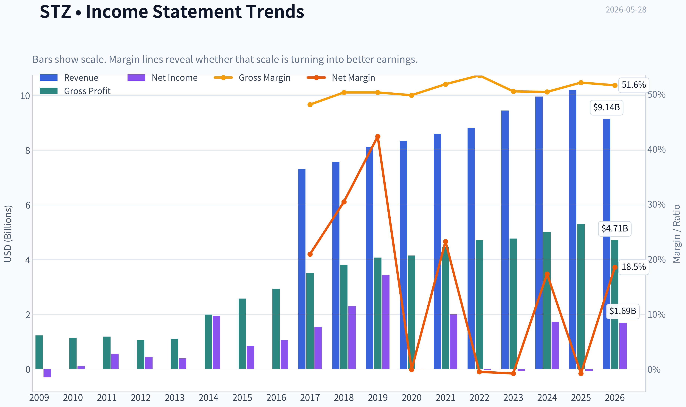

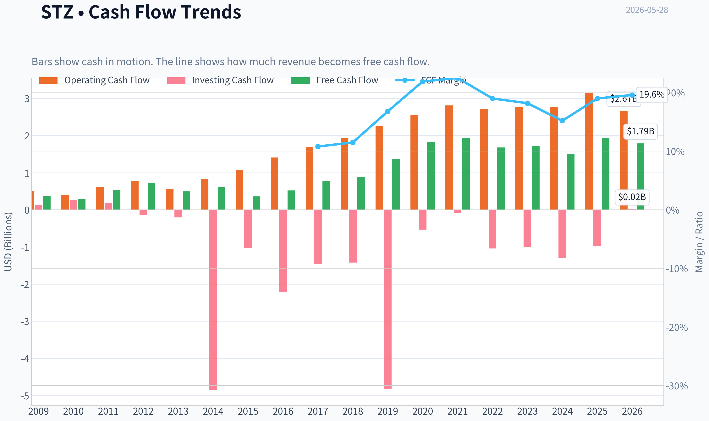

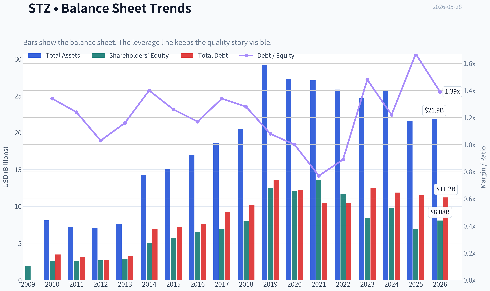

This graph tracks the profitability and return metrics (ROE, ROIC, Margins) of **STZ** over the past decade, highlighting capital efficiency trends.

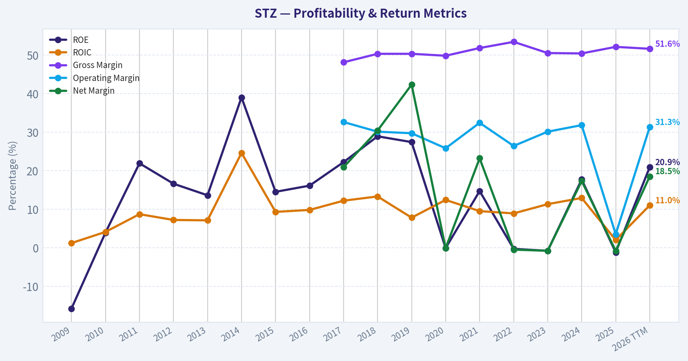

This chart illustrates the financial health of **STZ** over the last 10 years, mapping cash equivalents and free cash flow against total obligations (Debt).

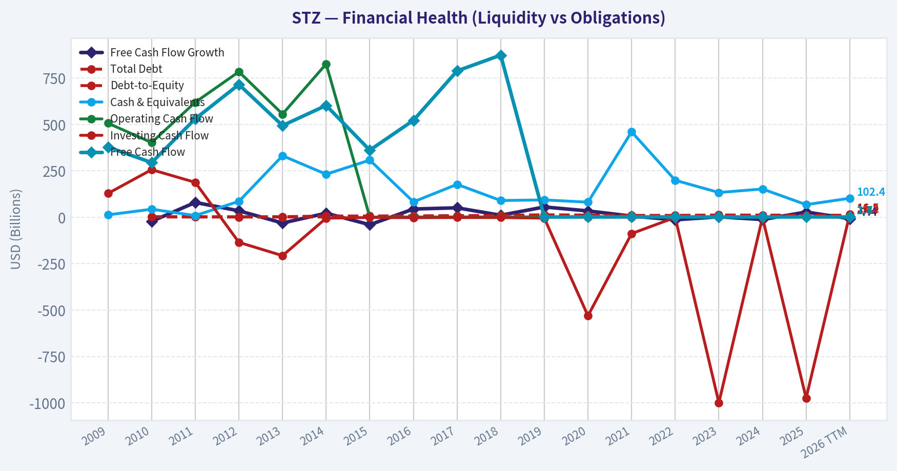

This comparison chart from *Profitability Analysis* stacks current figures against historical benchmarks for **STZ**, making it easy to see where the company trades relative to its own averages.

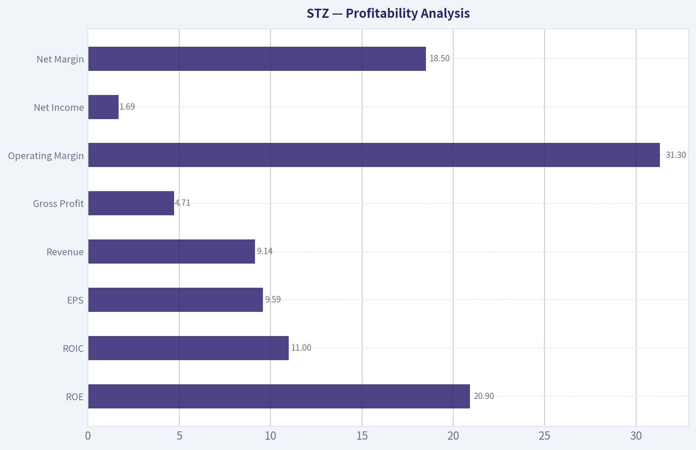

---

### Intrinsic Value Analysis (Buffett)

> *Following Warren Buffett's value investing philosophy: Circle of Competence, Economic Moat, Management Quality, and Margin of Safety.*

#### Intrinsic Value Snapshot

Price is what you pay. Intrinsic value is what the business may be worth based on the cash it can create for owners over time. We show a range, not one magic number.

- Current Price: $142.13
- Value Range (conservative to optimistic across both DCF methods): $86.50 to $511.11

##### Owner Earnings (Buffett Method)
- Net Income: $-81,400,000.00
- Depreciation & Amortization: $418,700,000.00
- Capital Expenditures: $-875,000,000.00
- Working Capital Changes: $-185,200,000.00
- Owner Earnings: $-715,600,000.00

##### Intrinsic Value
###### Cash Flow Method
Uses free cash flow. Better for companies spending heavily today to grow tomorrow.
- Conservative: $86.50
- Average: $205.80
- Optimistic: $511.11
- Discount Rate: 10.0%

ANALYST STANCE: **WATCH**

#### Constellation Brands (STZ) - Buffett-Style Investment Review

#### 1. Go/No-Go Gate Assessment

| Gate | Verdict | Evidence |
|---|---|---|
| Gate 1: Business Simplicity | Pass | STZ sells alcoholic beverages, mainly imported beer in the U.S., plus wine and spirits. This is an easy business to explain and understand. |
| Gate 1: Long-Term Predictability | Pass | Beer demand is mature but durable; premium imported beer has shown resilience over time. A decade from now, STZ will likely still be selling branded alcohol through the same distribution channels. |
| Gate 1: Technology Risk | Pass | Technology can aid marketing, logistics, and analytics, but it is unlikely to displace the core product. This is a beneficiary of brand and distribution, not a victim of software disruption. |
| Gate 2: Moat Test | Pass, but mixed | Gross margin of 51.6% supports brand strength and pricing power. The moat appears strongest in imported beer distribution and brand portfolio, but weaker in wine/spirits where competition is heavier. |
| Gate 3: Management & Capital Allocation | Mixed Pass | ROE of 20.9% is strong, suggesting decent capital deployment. However, the business needs continued disciplined allocation, especially given slower growth and category mix issues. |
| Gate 4: Industry Structure | Pass | Alcohol is a rational industry with entrenched brands, regulated distribution, and relatively stable demand. It is better than most consumer categories, though not immune to shifts in consumer preference. |

**Key Takeaways:** Constellation passes the first screen because the business is simple, durable, and not especially vulnerable to technology disruption. The main debate is not whether this is a real business with brands, but whether its moat is wide enough and whether management can keep returns high as growth moderates.

---

#### 2. Moat Analysis

| Moat Source | Assessment | Evidence |
|---|---|---|
| Intangible Assets | Strong | Beer brands and imported positioning support premium pricing. Gross margin above 50% is consistent with meaningful brand value. |
| Switching Costs | Weak | Consumers can switch alcohol brands easily, so customer captivity is limited at the individual level. Retail and distributor relationships matter more than direct switching costs. |
| Cost Advantage | Moderate | Scale in procurement, production, marketing, and distribution helps. Large incumbents in alcohol can spread advertising and compliance costs efficiently. |
| Network Effects | Weak | This is not a true network-effect business. Brand popularity helps shelf space and mindshare, but that is not the same as a network moat. |

| Overall Moat Rating | Conclusion |
|---|---|
| Narrow to Moderate | Good consumer-brand business, but not a perfect toll bridge. The moat is real in imported beer and distribution positioning, yet weaker than the very best Buffett-style franchises. |

**Key Takeaways:** STZ's moat is mostly brand-driven, with support from scale and regulated distribution. It is not protected by high switching costs or network effects, so the moat looks solid rather than exceptional.

---

#### 3. Management Quality Assessment

| Question | Assessment | Commentary |
|---|---|---|
| Do they think like owners? | Mixed | The company has historically emphasized portfolio management and shareholder returns, but this is not obviously a founder-owner setup. |
| Are they honest and candid? | Acceptable | No major red flags are evident from the provided materials. |
| Are they rational capital allocators? | Mixed to Good | Strong ROE and FCF yield suggest decent economic performance, but negative recent revenue growth raises the hurdle for future capital deployment. |

**Key Takeaways:** Management appears competent, but this is not an obvious owner-operator situation of the sort Buffett loves most. The key issue is whether future retained earnings can still earn high returns as category growth slows.

---

#### 4. Financial Summary

| Metric | Value |
|---|---:|
| Current Price | $142 |
| Market Cap | $24.48B |
| P/E | 14.8x |
| ROE | 20.9% |
| Gross Margin | 51.6% |
| Revenue Growth YoY | -10.5% |
| FCF Yield | 7.3% |
| Current Ratio | 1.08 |

**Key Takeaways:** The headline numbers are attractive on first glance: high gross margin, strong ROE, and a healthy free cash flow yield. The main blemish is the revenue decline, which suggests the market is not mispricing a flawless business but rather discounting slower or less certain growth.

---

#### 5. Owner Earnings Assessment

Using Buffett's framework, STZ appears to generate solid owner earnings because:
- accounting profits are backed by meaningful free cash flow,
- the FCF yield of 7.3% is respectable,
- the business is not obviously a capital black hole relative to many branded consumer peers.

A practical shorthand here is that owner earnings likely sit in the same general neighborhood as free cash flow, adjusted for maintenance capital needs and working capital swings. Given the current valuation, the market is paying a moderate multiple for a cash-generating branded consumer business.

**Key Takeaways:** The business appears to convert earnings into cash at a respectable rate, which is a major positive in Buffett-style analysis. That said, owner earnings quality matters most when paired with durable reinvestment opportunities, and that is where STZ looks good but not outstanding.

---

#### 6. Three-Scenario DCF Valuation

To anchor valuation, use the market cap and FCF yield as a practical proxy for current owner earnings.

- Approximate owner earnings = 7.3% x $24.48B = **$1.79B**

| Scenario | Assumption | Implied Equity Value |
|---|---|---:|
| A: No Growth | Owner Earnings / 10% | $17.87B |
| B: 3% Growth | OE x 1.03 / (10% - 3%) | $26.29B |
| C: Moderate Historical Recovery | 5% growth assumption | $37.61B terminal-style value |

To express this per current market cap:
- Current market cap: **$24.48B**
- Scenario A: stock looks **overvalued**
- Scenario B: stock looks **roughly fairly valued**
- Scenario C: stock looks **modestly undervalued**, but only if growth resumes sustainably

**Key Takeaways:** On conservative assumptions, the stock is not a clear bargain. It only becomes materially attractive if STZ can return to steady growth and maintain its strong cash economics.

---

#### 7. Margin of Safety Analysis

| Test | Result |
|---|---|
| 25% discount to conservative value? | No |
| 25% discount to moderate-growth value? | No |
| Trading near fair value? | Yes |
| Deep value support from cash flow? | Somewhat |

At $142, STZ does not appear to offer the kind of unmistakable margin of safety Buffett would demand unless one has above-average conviction in resumed growth and durable beer-led brand strength.

**Key Takeaways:** The valuation is reasonable, but not generous enough to create a strong margin of safety. This is more a "good company at about fair value" situation than a "wonderful company at a clearly cheap price."

---

#### 8. Final Buffett Scorecard

| Criterion | Score (1-5) | Weight | Weighted Score |
|---|---:|---:|---:|
| Business Understanding | 5.0 | 20% | 1.00 |
| Moat Width & Durability | 3.5 | 25% | 0.88 |
| Management Quality | 3.3 | 15% | 0.50 |
| Return on Equity | 4.2 | 15% | 0.63 |
| Reinvestment Runway | 3.0 | 10% | 0.30 |
| Balance Sheet Strength | 3.0 | 5% | 0.15 |
| Industry Structure | 4.0 | 5% | 0.20 |
| Valuation/Margin of Safety | 3.0 | 5% | 0.15 |

| Total Score | Rating |
|---|---|
| 3.81 / 5.00 | ADVOCATE-quality business characteristics, but valuation and growth temper enthusiasm |

**Key Takeaways:** STZ scores well because it is understandable, profitable, and operates in a favorable industry. However, the score is held back by only moderate moat strength, mixed reinvestment prospects, and a valuation that does not provide enough cushion.

---

#### 9. Final Investment Stance

**Investment Stance: WATCH**

**Conviction Level: Moderate**

Constellation Brands is a good business with real brand assets, healthy profitability, and solid cash generation. It fits many Buffett preferences better than most consumer companies: understandable products, durable demand, and respectable returns on capital.

But this is not a slam-dunk "wonderful company at a bargain price." Revenue has recently declined, the moat is good rather than elite, and the current price looks close to fair value under conservative assumptions. I would place STZ on a watchlist and become more interested either if:
1. growth stabilizes and beer-led economics remain strong, or
2. the stock falls enough to offer a clear 25%+ margin of safety.

At today's price, STZ looks investable in quality terms, but not compelling enough in valuation terms to merit a full Buffett-style endorsement.
#### Valuation Bridge

This bridge places the current market price beside each intrinsic value lens so readers can see whether upside depends on one method or shows up across several methods.

| Scenario | Intrinsic Value / Share |
| --- | ---: |
| Cash Flow Method | $205.80 |
| Damodaran Method | $298.12 |
| Current Price | $142.13 |

#### Key Takeaways

If one method is far above the others, the upside case depends on a specific modelling assumption. When several methods cluster together, the valuation story is more robust.

#### Valuation Visuals

This comparison chart from *Latest Earnings Snapshot* stacks current figures against historical benchmarks for **STZ**, making it easy to see where the company trades relative to its own averages.

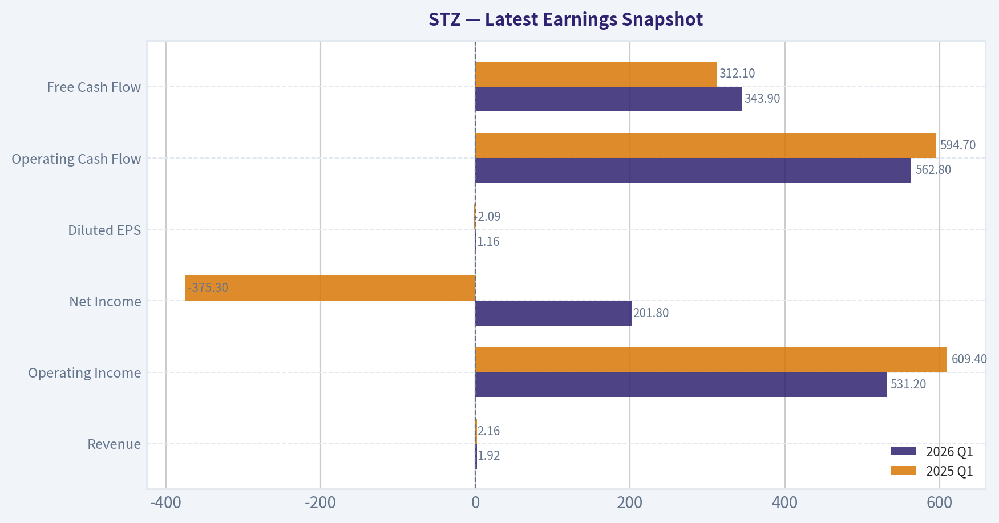

This comparison chart from *Current vs Historical Average Comparison* stacks current figures against historical benchmarks for **STZ**, making it easy to see where the company trades relative to its own averages.

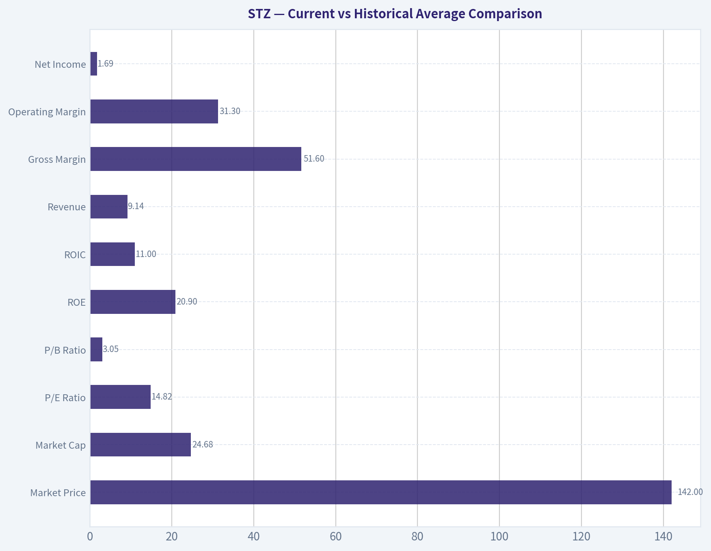

This comparison chart from *Balance Sheet Analysis* stacks current figures against historical benchmarks for **STZ**, making it easy to see where the company trades relative to its own averages.

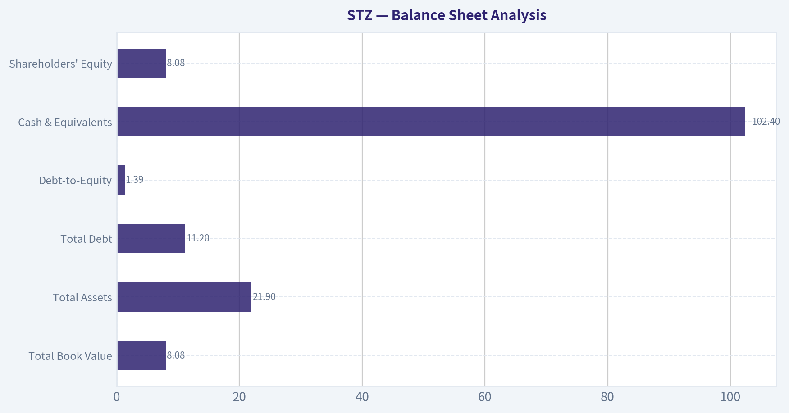

This comparison chart from *Cash Flow Analysis* stacks current figures against historical benchmarks for **STZ**, making it easy to see where the company trades relative to its own averages.

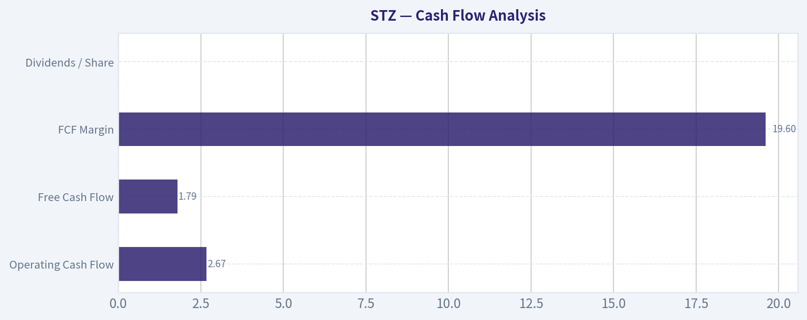

This comparison chart from *Financial Summary* stacks current figures against historical benchmarks for **STZ**, making it easy to see where the company trades relative to its own averages.

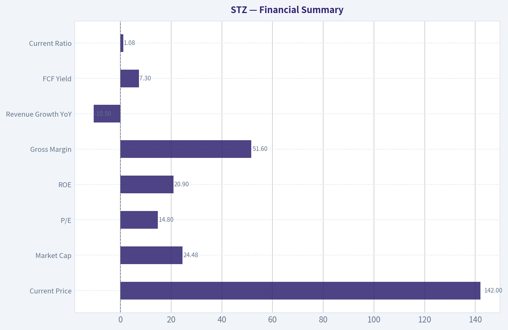

---

### Trend & Growth Analysis (Lynch/Druckenmiller/Fisher)

> *Following Peter Lynch's GARP, Stanley Druckenmiller's macro-aware approach, and Philip Fisher's scuttlebutt methodology.*

ANALYST STANCE: **AVOID**

#### STZ Growth Analysis Snapshot
Constellation Brands is a high-quality branded alcohol company, but it does **not** fit a classic Lynch/Druckenmiller/Fisher growth setup today. The shared research pack shows **revenue growth of -10.5% YoY**, which is an immediate red flag for a growth mandate, even though valuation looks reasonable and cash generation is solid. This looks more like a **cash-generative stalwart/value compounder** than a fast grower at an inflection point.

#### 1. Lynch Classification

| Item | Assessment |
|---|---|
| Category | **Stalwart** |
| Why | Mature consumer brand portfolio led by imported beer |
| Growth profile | **Not a fast grower**; latest reported revenue growth is **-10.5% YoY** |
| Lynch fit | Better for value/income/GARP than ten-bagger hunting |

**Key Takeaways:** STZ is not screening as a fast grower. The business is mature, branded, profitable, and defensible, but the latest top-line contraction moves it out of the primary Lynch sweet spot. For a growth portfolio, this is a mismatch.

#### 2. The Story in 3 Bullets
- STZ owns premium imported beer brands like **Modelo, Corona, and Pacifico**, which are the core value drivers.
- The beer franchise is strong, but the total company is weighed down by a less exciting wine and spirits portfolio and mature category exposure.
- At today's data point, the issue is not business quality; it is that **growth has slowed or turned negative**, which breaks the growth thesis.

#### 3. TAM Analysis and 10x Test

| Item | Assessment |
|---|---|
| Core TAM | U.S. premium/imported beer plus broader alcohol beverage market |
| TAM growth | Low-to-mid single digit structurally; not hypergrowth |
| Current scale | Large incumbent at **$24.48B market cap** |
| 10x revenue test | **Fails for growth investing purposes** |
| Why | A 10x revenue outcome would imply unrealistic share capture in a mature category |

**Key Takeaways:** STZ does not have the kind of open-ended runway growth investors want. The company is already large and operates in categories that are mature rather than explosively expanding. This limits ten-bagger potential from fundamental revenue expansion alone.

#### 4. Revenue Growth Trend

| Metric | Value | Interpretation |
|---|---:|---|
| Revenue growth YoY | **-10.5%** | Clear negative signal |
| Pattern | Decelerating to declining | **Warning / investigate** |
| Growth quality | Unclear from pack | Needs segment confirmation, but headline trend is weak |

**Key Takeaways:** The most important number in a growth screen is currently pointing the wrong way. Even if part of the decline is mix, divestitures, or timing, a shrinking top line is enough to disqualify STZ as a fresh growth idea until proven otherwise. This is the opposite of a Druckenmiller-style acceleration setup.

#### 5. Unit Economics

| Metric | Value | Assessment |
|---|---:|---|
| Gross margin | **51.6%** | Strong for a branded beverage business |
| ROE | **20.9%** | Attractive, though helped by brand economics and capital structure |
| FCF yield | **7.3%** | Good value support |
| Current ratio | **1.08x** | Adequate, not a concern |
| LTV/CAC | N/A | Not relevant / not disclosed in consumer staples format |
| NRR | N/A | Not relevant |
| Rule of 40 | N/A | Not applicable |

**Key Takeaways:** STZ has solid business quality metrics. Gross margins, ROE, and free cash flow suggest a durable franchise with pricing power and healthy cash generation. The problem is that these are characteristics of a good mature business, not proof of a current growth inflection.

#### 6. Inflection Point Assessment

| Inflection Type | View |
|---|---|
| Product cycle inflection | No evidence from current pack |
| Market share inflection | Beer may still be strong, but not enough to offset company-level decline yet |
| Margin inflection | Possible support from mix/cost discipline, but not the key issue |
| TAM inflection | No |
| Competitive inflection | No clear evidence |
| Overall | **No confirmed positive inflection** |

**Key Takeaways:** I do not see a clean acceleration narrative. If the beer segment is outperforming, that may support downside protection, but the company-level data still does not show the kind of growth turn that would justify a high-conviction advocate stance. This is more "watch for stabilization" than "buy the inflection."

#### 7. Macro Setup Evaluation

| Factor | Assessment |
|---|---|
| Economic sensitivity | Moderate; alcohol is defensive but premium consumption can soften |
| Rates backdrop | Neutral to mild help if rates fall |
| Secular trend exposure | Weak versus AI/cloud/cyber/healthcare growth themes |
| Category tailwind | Premium imported beer is better than broader staples, but still mature |
| Macro conclusion | Neutral, not a major tailwind |

**Key Takeaways:** STZ does not ride the strongest secular growth themes of this cycle. It may hold up better than many discretionary names, but it lacks the macro tailwind that often powers outsized multiple expansion. This is a stable branded consumer name, not a macro-backed growth rocket.

#### 8. Fisher 15-Point Score

| Fisher Area | Score (1-5) |
|---|---:|
| Market potential | 3 |
| New product development | 3 |
| R&D effectiveness | 2 |
| Sales organization | 4 |
| Profit margin | 4 |
| Improving margins | 3 |
| Labor/personnel relations | 3 |
| Executive relations | 3 |
| Management depth | 4 |
| Cost controls/accounting | 4 |
| Moat / outstanding aspects | 4 |
| Long-range profit outlook | 3 |
| Dilution risk | 4 |
| Candor | 3 |
| Integrity | 4 |
| **Total** | **51 / 75** |

**Key Takeaways:** STZ scores as an above-average established operator, not an exceptional Fisher growth company. The strongest marks come from brand strength, sales execution, and profitability. The weaker marks reflect limited innovation intensity and a less compelling long-run growth ceiling.

#### 9. Valuation Analysis

| Metric | Value | Assessment |
|---|---:|---|
| Price | **$142** | - |
| Market cap | **$24.48B** | - |
| P/E | **14.79x** | Reasonable / inexpensive vs many quality consumer names |
| FCF yield | **7.3%** | Attractive |
| PEG | **N/M** | Not meaningful with negative revenue growth / unclear earnings growth |
| P/S | Not provided | - |

**Key Takeaways:** Valuation is the best part of the STZ setup. The stock is not expensive on earnings or free cash flow, which may appeal to value-oriented investors. But cheapness alone is not enough in a growth framework, especially when the top line is declining.

#### 10. Growth Investor Scorecard

| Criterion | Weight | Score (1-5) | Weighted |
|---|---:|---:|---:|
| The Story | 10% | 3.0 | 0.30 |
| TAM & Runway | 20% | 2.0 | 0.40 |
| Revenue Growth | 20% | 1.5 | 0.30 |
| Unit Economics | 15% | 4.0 | 0.60 |
| Competitive Position | 10% | 4.0 | 0.40 |
| Management Quality | 10% | 3.5 | 0.35 |
| Macro Setup | 5% | 2.5 | 0.13 |
| Profitability Path | 5% | 4.0 | 0.20 |
| Valuation | 5% | 4.0 | 0.20 |
| **Total** |  |  | **2.88 / 5.0** |

**Key Takeaways:** STZ lands below the threshold for a growth recommendation. The business is respectable and valuation is supportive, but weak runway and negative recent growth dominate the score. In this framework, that leads to an avoid stance for new capital.

#### 11. Position Size Stance

| Stance | View |
|---|---|
| New position | **Avoid** |
| Existing position | Hold only if running a value/dividend/staples sleeve, not a growth sleeve |
| Position size | **0% for growth portfolio** |

**Key Takeaways:** For a dedicated growth strategy, STZ should not be initiated here. If already owned in a broader quality/value portfolio, it may still deserve a place due to cash flow and brand strength. But that is a different mandate.

#### 12. Key Risks and Catalysts

| Type | Item |
|---|---|
| Risk | Continued revenue contraction |
| Risk | Beer growth no longer offsetting wine/spirits weakness |
| Risk | Mature category limits upside multiple expansion |
| Risk | Consumer downtrading in premium alcohol |
| Catalyst | Return to positive consolidated revenue growth |
| Catalyst | Clear beer-led reacceleration and stronger segment disclosure |
| Catalyst | Margin expansion plus continued high FCF conversion |
| Catalyst | Portfolio simplification / improved wine & spirits economics |

**Key Takeaways:** The main thing to watch is whether STZ can get back to clean positive top-line growth. If the beer engine reasserts itself strongly enough, the story could improve from avoid to watch. Until then, the burden of proof is on management.

#### Bottom Line
STZ is a **good company, but not a good growth stock right now**. It has brand power, cash flow, and a fair valuation, yet the current data shows **negative revenue growth**, limited TAM runway, and no clear acceleration signal. For a Lynch/Druckenmiller/Fisher growth mandate, this is **AVOID**, though it may still interest a value or quality-income investor.

---

### Market Technical Analysis

#### STZ Technical Indicator Selection and Market Readout

For **STZ (Constellation Brands)**, the most relevant indicator set for the **current market condition** is a blend designed for a **stock in a longer-term bearish structure, medium-term drift lower, but with short-lived rebound attempts and moderate volatility**.

#### Selected Indicators
| Indicator | Why it is relevant now |
|---|---|
| close_200_sma | Best for confirming the dominant long-term trend. STZ remains below this level, so the broader structure is still weak. |
| close_50_sma | Useful for medium-term trend direction and to identify whether recent rebounds are strong enough to change character. |
| close_10_ema | Helps detect short-term momentum swings within the broader downtrend. |
| macd | Captures momentum regime shifts and whether rebounds are improving or fading. |
| rsi | Helps gauge whether weakness is becoming stretched or merely normal bearish pressure. |
| boll_ub | Useful for identifying rebound ceilings and failed upside expansion. |
| boll_lb | Useful for spotting where downside pressure is becoming statistically stretched. |
| atr | Important now because STZ's daily ranges are large enough to materially affect stop placement and trade sizing. |

**Key Takeaways:** These eight indicators work well together because they cover trend, momentum, mean reversion, and risk without too much overlap. The picture they form is not just "down" or "mixed" - it shows a stock still under structural pressure, but one that periodically produces tradable rebounds that can fail quickly if momentum does not broaden.

---

#### Price Structure and Trend Analysis

Over the last year, STZ has moved through **three distinct phases**:

1. **A major breakdown phase** from late May through mid-September 2025, falling from the mid-170s into the low-130s.
2. **A recovery and basing phase** from late September 2025 into February 2026, where price rebuilt toward the mid-160s.
3. **A failed spring recovery followed by renewed weakness** from April into late May 2026.

The most important structural point is that **STZ has not repaired the long-term damage** from the 2025 selloff. While there were meaningful rebounds, they did not evolve into a durable bullish trend. The stock repeatedly rallied into resistance zones, then rolled over.

The latest close available is **143.72 on 2026-05-27**, which places the stock:
- **below the 50-day SMA (~151.95)**,
- **below the 200-day SMA (~146.07)**,
- and **below the 10-day EMA (~147.11)**.

That alignment matters. It means:
- short-term trend is weak,
- medium-term trend is weak,
- and long-term trend remains fragile to bearish.

This is not just a slight underperformance versus moving averages. The stock is trading below all three key references at once, which usually signals that rallies are still more likely to be treated as **countertrend bounces** rather than confirmed trend reversals.

#### Trend Table

| Metric | Latest Reading | Interpretation |
|---|---:|---|
| Close | 143.72 | Price has slipped back into the lower end of its recent range |
| close_10_ema | 147.11 | Short-term momentum is bearish; price is below fast trend support |
| close_50_sma | 151.95 | Medium-term trend remains negative |
| close_200_sma | 146.07 | Long-term trend benchmark is still overhead; structural bias remains weak |

**Key Takeaways:** STZ is trading below its short-, medium-, and long-term moving averages at the same time, which is a strong sign that sellers still control the tape. The most telling detail is that even the 200-day average is above price, meaning the stock has not yet regained long-term trend leadership.

---

#### Moving Average Slope and What It Says

The **50-day SMA** has been drifting down from the mid-154s in late March to roughly **151.95** now. That is not a sharp collapse, but it is a persistent downward slope. This tells us that the medium-term trend is not violently bearish - rather, it is **grinding lower**, which often makes the stock frustrating for bulls because rallies can appear constructive before fading again.

The **200-day SMA** has also been declining, from above **151** in late February to around **146.07** now. A falling 200-day average is especially important because it shows that weakness is no longer just short-term noise; the long-run price history itself is deteriorating.

The **10-day EMA** fell from above **155** at the start of May to about **147.11** now. That drop is steep enough to show that the latest selloff was not just one or two bad sessions. It reflects a genuine short-term momentum reset.

Taken together:
- **10 EMA** = short-term sellers active,
- **50 SMA** = medium-term recovery failed,
- **200 SMA** = long-term trend still not repaired.

---

#### Momentum Analysis: MACD and RSI

The **MACD** is currently **-1.75**, still negative. However, the nuance matters:
- MACD became deeply negative in mid-May, reaching around **-3.58** on 2026-05-15.
- It then improved meaningfully into 2026-05-20 and 2026-05-22.
- But the latest downtick to **-1.75** after improving indicates that the rebound lost some force again.

This suggests **bearish momentum is no longer at panic intensity**, but the recovery in momentum has not yet become strong enough to flip the trend bullish. In practical terms, STZ may be attempting stabilization, but momentum confirmation is still incomplete.

The **RSI** at **41.3** reinforces that read:
- It is not oversold in an extreme sense.
- It is below the neutral 50 line.
- It has improved from the low-30s seen around May 13-15, but not enough to show real momentum control by buyers.

This is a subtle but important condition: **STZ is weak, but not washed out enough to guarantee a reversal**. That means downside can still continue without needing an immediate snapback.

#### Momentum Table

| Indicator | Latest Reading | What it suggests |
|---|---:|---|
| macd | -1.75 | Momentum remains bearish, though less severe than the mid-May trough |
| rsi | 41.30 | Weak but not deeply oversold; selling pressure persists without capitulation |

**Key Takeaways:** Momentum is still negative, but the character of the weakness has changed from sharp selling to more controlled bearish pressure. That means STZ can either stabilize and build a base, or resume lower if buyers fail to push RSI back above 50 and MACD toward positive territory.

---

#### Bollinger Band Context: Where Price Sits in the Range

Latest Bollinger references:
- **Upper Band:** 156.55
- **Lower Band:** 138.84
- **Close:** 143.72

Price is much closer to the **lower band** than the upper band. That positioning tells us the stock is trading in the weaker half of its 20-day volatility envelope.

But the key nuance is this: STZ is **not yet pressing directly on the lower band**. It is weak, but not at a statistically stretched extreme. This fits with the RSI reading - the stock is under pressure, but not in a full exhaustion state.

The bands themselves have also narrowed somewhat from early May's wider downside stress, suggesting volatility is elevated but not disorderly. In these situations, traders often watch for one of two outcomes:
- a drift toward the lower band followed by a reflex bounce,
- or a clean break below the lower band accompanied by expanding ATR and worsening MACD, which would imply renewed trend acceleration lower.

#### Volatility Envelope Table

| Indicator | Latest Reading | Interpretation |
|---|---:|---|
| boll_ub | 156.55 | Upside rebound ceiling is well above current price |
| boll_lb | 138.84 | Downside stretch zone is near current price but not yet tagged |
| Price position | 143.72 vs bands | Stock sits in the lower portion of its recent range, reflecting persistent weakness |

**Key Takeaways:** STZ is trading much closer to its lower Bollinger Band than its upper one, which confirms the market is leaning bearish. At the same time, price has not fully reached an extreme downside stretch, so the stock may still have room to weaken before becoming technically exhausted.

---

#### Volatility and Risk: ATR

The **ATR is about 4.76**, which is fairly meaningful for a stock trading around **143.72**. That implies a typical daily movement on the order of roughly **3.3% of price**, which is large enough that entries and stop placement need to be deliberate.

This matters because STZ is not moving in a slow, low-noise defensive pattern right now. Even if the larger trend is gradual, the day-to-day movement can still be large enough to stop out poorly placed trades.

Practical implication:
- Tight stops may get shaken out.
- Position size should be adjusted for wider expected daily movement.
- Breakout or reversal entries need confirmation, not anticipation.

#### Risk Table

| Indicator | Latest Reading | Trading implication |
|---|---:|---|
| atr | 4.76 | Daily moves are large enough to require wider stops and smaller position sizing |

**Key Takeaways:** Volatility is not extreme, but it is high enough that STZ can move several dollars in a normal session. Traders should avoid overly tight stops and should size positions as if the stock can make meaningful swings even without a major news catalyst.

---

#### Fine-Grained Interpretation for Traders

| Trader Type | What matters most now | Practical read |
|---|---|---|
| Trend follower | Price vs 50 SMA and 200 SMA | Bias stays cautious-to-bearish unless STZ can reclaim both averages decisively |
| Swing trader | 10 EMA, RSI, Bollinger Bands | Rebounds are possible, but current setup still favors selling into strength unless momentum improves |
| Mean reversion trader | RSI + lower Bollinger Band | A cleaner contrarian bounce setup would likely require price closer to or below the lower band with RSI nearer 30 |
| Risk manager | ATR | Wide enough volatility to justify conservative sizing and disciplined stop placement |

**Key Takeaways:** Different trading styles all point to the same broad conclusion: STZ is not yet in a clean bullish reversal state. The stock may offer rebounds, but until it regains key moving averages and improves momentum, those rebounds are more tactical than strategic.

---

#### What Would Change the Outlook?

| Scenario | Technical evidence needed | Meaning |
|---|---|---|
| Bullish improvement | Price reclaims 10 EMA, then 200 SMA and 50 SMA, with RSI above 50 and MACD continuing to improve | Would suggest the May weakness was a pullback rather than trend continuation |
| Ongoing range trade | Price oscillates between ~139 and ~151 with RSI around 40-55 | Would indicate basing behavior but not a trend reversal |
| Bearish continuation | Price breaks toward/below lower Bollinger Band near 138.84, MACD turns more negative again, RSI slips toward low-30s | Would favor another leg lower and confirm sellers remain in control |

**Key Takeaways:** The next directional clue is straightforward. If STZ can recover above its major moving averages, the tone improves materially; if it loses the lower end of the recent range, the bearish trend likely reasserts itself.

---

#### Bottom Line

STZ currently looks like a **structurally weak stock attempting to stabilize, but not yet showing enough evidence of a durable bullish turn**. The long-term trend remains impaired because price is still below the 200-day average, the medium-term trend is soft because the 50-day average is declining, and the short-term trend is negative because price remains below the 10-day EMA.

Momentum has improved from the worst mid-May readings, but not enough to shift the narrative. RSI in the low 40s and negative MACD indicate that sellers still retain an advantage. Bollinger Bands show price in the lower half of its recent range, consistent with weakness but not yet outright exhaustion. ATR says the stock is active enough that risk control matters.

For now, the most defensible technical posture is:
- **cautious bearish / neutral-to-bearish trend bias,**
- **open to short-term bounce attempts,**
- but **not yet supportive of a strong trend-following long thesis**.

#### Summary Table

| Area | Signal | Read on STZ |
|---|---|---|
| Long-term trend | Below close_200_sma | Structural trend still weak |
| Medium-term trend | Below falling close_50_sma | Recovery attempt has faded |
| Short-term trend | Below close_10_ema | Near-term momentum is bearish |
| Momentum | Negative macd | Bearish momentum persists, though off worst levels |
| Internal strength | rsi at 41.3 | Weak, but not deeply oversold |
| Volatility envelope | Price nearer boll_lb than boll_ub | Trading in the lower half of its recent range |
| Volatility/risk | atr at 4.76 | Requires disciplined sizing and wider stops |
| Overall stance | Defensive | Rebounds possible, but trend confirmation is still lacking |

**Key Takeaways:** STZ remains under technical pressure across multiple timeframes, with the clearest evidence being its position below all key moving averages. Until momentum strengthens and price reclaims those levels, the stock looks more like a bearish trend with intermittent rebounds than a fully formed recovery.

---

### Options Market Analysis

> *Reading options flow - put/call ratios, IV skew, and unusual activity - to gauge institutional positioning and event-driven risk.*

#### STZ Options Positioning Report
*Date: 2026-05-28*

#### 1. Put/Call Ratio Analysis

| Expiration | Call OI | Put OI | Put/Call OI Ratio | Call Vol | Put Vol | Put/Call Vol Ratio |
|---|---:|---:|---:|---:|---:|---:|
| 2026-05-29 | 1,743 | 1,519 | 0.87 | 559 | 233 | 0.42 |
| 2026-06-05 | 3,660 | 1,034 | 0.28 | 2,982 | 113 | 0.04 |
| 2026-06-12 | 299 | 168 | 0.56 | 39 | 54 | 1.38 |
| **Near-term total** | **5,702** | **2,721** | **0.48** | **3,580** | **400** | **0.11** |

**Key Takeaways:** Near-term options positioning in STZ is clearly call-heavy overall. The aggregate put/call OI ratio of 0.48 is below the rough neutral baseline of 0.7, and the volume ratio of 0.11 shows fresh trading flow is even more skewed toward calls than legacy open interest. The strongest driver is the 2026-06-05 expiry, where call volume heavily dominates, suggesting bullish speculation or upside positioning rather than defensive hedging.

Interpretation:
- **OI ratio at 0.48**: below neutral, indicating net bullish positioning.
- **Volume ratio at 0.11**: very low, which is an even stronger bullish flow signal in the short run.
- **Notable shift from neutral**: the 2026-06-05 line is the key outlier, with **0.28 put/call OI** and **0.04 put/call volume**, showing aggressive call-side interest.
- The one caveat is **2026-06-12** volume leans more put-heavy, but on much smaller total size, so it does not outweigh the broader call bias.

#### 2. Implied Volatility Assessment

| Expiration | ATM Call IV | ATM Put IV | IV Read |
|---|---:|---:|---|
| 2026-05-29 | 65.9% | 51.9% | Very elevated, call IV premium |
| 2026-06-05 | 36.0% | 36.0% | Balanced, moderate |
| 2026-06-12 | 37.2% | 32.5% | Mild call premium |

**Key Takeaways:** Front-end volatility is elevated, especially in the immediate expiry, where call IV is well above put IV. That is not the classic downside-fear pattern; instead, it looks more like traders are paying up for upside optionality or event-driven upside exposure. Beyond the front week, IV normalizes into the mid-30s, so the inflation appears concentrated in the nearest catalyst window.

IV conclusions:
- **Near-term ATM IV is elevated**, especially for **2026-05-29**, where the front expiry is pricing a meaningful move.
- **Skew direction appears to favor calls, not puts**, based on ATM call IV exceeding put IV in both 2026-05-29 and 2026-06-12, while 2026-06-05 is flat.
- Because the tool output does **not provide full OTM skew by strike**, I cannot quantify exact put-wing vs call-wing skew. But from the available ATM IV data, there is **no evidence of steep downside put fear**. If anything, the surface suggests **upside chase / call demand**.
- Elevated front-week IV likely indicates a **known catalyst or event window**, though without an attached event calendar in the data, this should be treated as "event pricing is present" rather than attributing it to a specific confirmed catalyst.

#### 3. Unusual Options Activity

| Screen | Result |
|---|---|
| Volume > 5x Open Interest | No qualifying contracts found in near-term expirations |

**Key Takeaways:** There were no near-term contracts with volume exceeding five times open interest, so there is no standout "fresh whale" contract screaming directional conviction. That reduces the odds of a single obvious smart-money bet. Instead, the signal comes from broad call-heavy flow across expirations rather than one isolated unusual trade.

Interpretation:
- **No major unusual activity** means there is no clean read from outsized fresh blocks or sweeps.
- That slightly lowers conviction because we are relying on **aggregate positioning**, not a clearly identifiable new institutional trade.
- Still, the absence of unusual activity does **not** negate the bullish tilt shown by the overall put/call and IV profile.

#### 4. Open Interest Concentration

| Expiration | Total OI | Positioning Read |
|---|---:|---|
| 2026-05-29 | 3,262 | Active but balanced relative to other weeks |
| 2026-06-05 | 4,694 | Highest concentration; likely key pin/gamma window |
| 2026-06-12 | 467 | Light interest; weaker influence |

**Key Takeaways:** The largest concentration of open interest sits in the 2026-06-05 expiration, making that the most important near-term options expiry for price gravity. If STZ trades near heavy dealer positioning into that date, price action could get pinned or, if momentum builds, accelerated depending on where the largest strikes sit. Since strike-level OI was not provided, we can identify the important expiry window but not exact gamma walls.

Interpretation:
- **2026-06-05 is the dominant near-term expiration** and likely the most relevant for pinning effects and dealer gamma influence.
- **2026-05-29** still matters because its IV is elevated, implying near-immediate event risk.
- Because the dataset does **not include strike-by-strike OI concentrations**, exact **max pain**, **pin strikes**, and **gamma walls** cannot be identified precisely. But the heaviest overall options gravity is clearly in **June 5**.

#### 5. Overall Options Sentiment Signal

| Category | Signal |
|---|---|
| Overall Options Sentiment | **BULLISH** |
| Confidence | Moderate |
| Primary Driver | Heavy near-term call skew in both OI and volume, especially 2026-06-05 |
| Main Caveat | No standout unusual contract and incomplete strike-level gamma map |

**Key Takeaways:** STZ's options market is leaning bullish, with call interest dominating both standing open interest and fresh trading flow. The front-end IV structure also suggests traders are paying more for upside exposure than downside protection. Confidence is moderate rather than high because there is no singular unusual institutional trade and the strike-level OI map is unavailable.

Why bullish:
- **Aggregate put/call OI ratio of 0.48** is below neutral.
- **Put/call volume ratio of 0.11** is strongly call-driven.
- **Front-week call IV premium** suggests upside demand rather than crash hedging.
- **Largest OI cluster in 2026-06-05** aligns with the same call-heavy flow.

Caveats:
- STZ's signal is based more on **broad options bias** than on a dramatic one-off order.
- Without strike-level OI, exact gamma walls cannot be pinned down.
- If call buying is partly covered-call overwriting rather than pure long-call speculation, the bullish implication would be somewhat softer. Even so, the volume imbalance is strong enough that the net read still favors upside.

#### Final Read
**STZ options sentiment: BULLISH.**

The main reason is **heavy call dominance across near-term expirations, especially June 5, combined with elevated front-end IV that tilts toward calls rather than protective puts**. This does not look like a market bracing for downside; it looks more like traders are leaning for upside participation into a near-term event window.

---

| Metric | Read |
|---|---|
| Put/Call Ratio | **Bullish** - OI ratio 0.48, volume ratio 0.11 |
| IV Level | **Elevated front week**, moderate thereafter |
| Skew Direction | **Call-skew / upside-leaning**, not downside-fear skew |
| Unusual Activity | **None flagged** in near-term expirations |
| Overall Signal | **BULLISH** |

**Key Takeaways:** In one line: STZ's options market is pricing near-term movement, and traders are leaning to the upside rather than buying protection. The call-heavy volume is the clearest signal, while the lack of unusual block activity keeps conviction at moderate instead of high.

---

## Research Team Commentary

> *The Research Manager synthesizes the Bull vs Bear debate into action-free commentary. This is a pre-risk view, not the final stance.*

The strongest bull argument is straightforward: STZ still owns a genuinely high-quality beer franchise. Modelo, Corona, and Pacifico are real consumer brands with shelf-space advantages, distributor leverage, repeat purchase behavior, and pricing power. The financial profile supports that quality to a degree: gross margin above 50%, ROE around 21%, ROIC around 11%, and a respectable 7.3% FCF yield. At roughly 14.8x earnings, the market is no longer pricing this like a premium compounder, so if the beer engine remains healthy and the weaker segments merely stop getting worse, the stock could be undervalued versus normalized earning power.

The strongest bear argument is that investors do not own just the beer jewel; they own the whole company. The wine and spirits portfolio and mature category exposure reduce predictability and likely deserve a discount. Slowing or negative growth matters in a Buffett framework not because growth itself is mandatory, but because weaker growth can signal that the moat is narrower, category tailwinds are fading, and future cash flows are less certain. The current valuation only looks cheap if you assume the beer segment can keep carrying the enterprise and that the blended company deserves a higher multiple than its mixed quality may justify. That is not yet proven.

My takeaway is that the bull case wins on business quality at the segment level, but the bear case wins on total-company quality and margin of safety. This does not look like a broken business or a classic value trap, but it also does not yet clear the bar for a high-conviction Buffett-style purchase. One of the mistakes in similar situations is either overreacting to price weakness or, on the other side, treating a fallen quality name as automatically mispriced without enough evidence from current fundamentals. The right response here is to stay disciplined and keep grounding the decision in actual operating trends, not just a cheaper multiple.

Core takeaway: STZ is a good business with one outstanding asset, but not yet an obvious wonderful business at a clearly discounted price. The beer franchise likely has durable value, yet the weaker portfolio mix and slowing growth reduce confidence in long-term intrinsic value compounding. At $142, the stock is interesting, but the margin of safety is not wide enough for strong advocacy.

Rationale: From a value investing perspective, I care most about durability, predictability, and buying below intrinsic value. STZ scores well on brand strength, profitability, and cash generation. That keeps it out of the avoid bucket. But Buffett-style conviction usually comes when the moat is broad across the whole enterprise, management's capital allocation is clearly improving value, and valuation offers a comfortable cushion. Here, the moat is concentrated in beer, returns are solid but not exceptional, growth has slowed, and we do not have enough evidence that the weaker assets are being fixed or that intrinsic value is materially above the current price. The market may be pessimistic, but it may also be correctly discounting a mixed-quality business. That uncertainty argues for patience.

Monitoring plan over the next 1 to 4 quarters: First, watch beer depletion and shipment trends, especially for Modelo, Corona, and Pacifico. If the core beer franchise reaccelerates or even proves resilient while peers weaken, that would strengthen the thesis. Second, watch consolidated organic sales and operating income to see whether wine and spirits remain a drag or begin to stabilize. Third, monitor free cash flow conversion and any changes in leverage or capital allocation; strong FCF used for debt reduction or shareholder-friendly actions would help. Fourth, listen for management actions around portfolio simplification, divestitures, or sharper capital discipline in weaker segments. Fifth, watch gross margin and operating margin trend for signs that pricing power is intact rather than merely masking volume softness. Finally, pay attention to guidance credibility: repeated estimate cuts would weaken the case that current valuation already discounts the bad news.

If the next few quarters show that beer remains structurally strong, cash flow stays robust, and the weaker portfolio is being actively addressed, this could move toward ADVOCATE. If instead beer growth keeps fading, wine and spirits continue to dilute results, and management offers no convincing portfolio fix, then the current multiple may prove fair or even generous.

Final stance: WATCH

---

## Value Investing Team Commentary

> *The Investor translates the research view into an investment thesis before risk review. This is still not the final stance.*

STZ is the kind of situation a value investor should take seriously, but not rush. At $142 and roughly 14.8x earnings, the stock is no longer priced like a flawless branded consumer compounder. That matters. When a business with real brand assets and decent cash generation gets de-rated, the first question is not "why is the stock down?" but "has the business become materially weaker, or has sentiment simply become less generous?" Here, the answer appears to be: some of both.

The best part of Constellation is clearly the beer franchise. Modelo, Corona, and Pacifico are not fragile brands. They have shelf presence, consumer loyalty, distributor power, and pricing strength that most consumer companies would envy. Those are moat characteristics. Gross margin above 50%, ROE near 21%, and positive free cash flow support the idea that this is a real business with economic value, not an accounting illusion. A 7.3% FCF yield is respectable for a branded consumer name, and it suggests the market is already applying a meaningful discount to the business.

But Buffett would not buy "the good part" of STZ. He would be buying the entire enterprise. That is where caution is justified. The wine and spirits portfolio muddies the picture, and slowing or negative growth reduces confidence in normalized earnings power. A great brand portfolio can still be a mediocre stock if the weaker pieces absorb management attention, dilute returns, and limit the ability of the best asset to shine through in per-share value creation.

The selective contrarian angle is this: the market may be overly focused on recent weak growth and treating STZ as if the whole company is ex-growth and structurally impaired. If beer remains healthy and the weaker segments merely stabilize, today's valuation could prove too pessimistic. In other words, the crowd may be extrapolating disappointment too far. That said, contrarian investing only works when the facts support it. Right now, there is not enough proof that the beer jewel can keep offsetting the rest of the company, or that management has a credible path to improve the portfolio mix. Cheapness alone is not a moat.

What are markets missing? Possibly the durability of the beer franchise and the value of steady cash flow if sentiment has become too anchored to short-term growth deceleration. What might markets be getting right? That blended company quality is lower than beer-only quality, and therefore STZ deserves a lower multiple than premium beverage peers. That distinction is crucial. This is not obviously a wonderful business temporarily misunderstood; it may simply be a good business with one excellent segment and one less attractive drag.

From a long-term ownership perspective, I would want clearer evidence on three things before becoming more constructive: first, sustained resilience in beer depletion trends; second, either stabilization or strategic cleanup in wine and spirits; and third, disciplined capital allocation that improves per-share intrinsic value rather than merely defending the status quo. If those emerge, today's price could look attractive in hindsight. If not, the current multiple may be fair compensation for mixed business quality rather than a real bargain.

So the correct posture is patience, not indifference. STZ deserves a place on the watchlist because the assets are too good to ignore and the valuation is no longer demanding. But it does not yet offer the combination Buffett prefers: a clearly understandable whole business, durable enterprise-wide moat, high confidence in future earning power, and an obvious margin of safety.

**ANALYST STANCE: WATCH**
STZ has a valuable beer franchise and respectable cash economics, but the total-company picture remains mixed. Current pessimism may be creating opportunity, yet not enough evidence exists that intrinsic value is comfortably above the current price. Watch for beer resilience, portfolio improvement, and stronger capital allocation before moving to ADVOCATE.

---

## Deep Values Commentary

> *The Risk Management Team debates and the Risk Judge provides the final action-free verdict. This section determines the final ADVOCATE / WATCH / AVOID stance.*

#### Final Stance Scorecard

This scorecard converts the final research view into a weighted decision frame. It does not replace the narrative judgement, but it makes the main drivers of the verdict easier to scan.

| Criterion | Score | Weight | Commentary |
| --- | ---: | ---: | --- |
| Business Quality | 4.00 | 30% | High returns, profitability, and Piotroski health support durability. |
| Valuation Support | 4.33 | 30% | Blends current price against available intrinsic value anchors and valuation ratios. |
| Financial Strength | 1.67 | 20% | Balance-sheet resilience reflects leverage and liquidity staying within safe ranges. |
| Growth Durability | 2.33 | 20% | Recent revenue, earnings, and free cash flow growth indicate how durable expansion looks. |
| TOTAL / FINAL STANCE | 3.30 | 100% | WATCH |

#### Key Takeaways

The weighted score lands at **3.30 / 5.0**, while the final stance remains **WATCH**. This is useful as a quick calibration aid rather than a mechanical signal.

#### Risk Summary

Higher scores indicate more risk pressure. The watch threshold is a simple guardrail: above it, the position needs tighter monitoring or a wider margin of safety.

| Dimension | Current Score | Watch Threshold | Commentary |
| --- | ---: | ---: | --- |
| Business Quality | 2.00 | 3.00 | High returns, profitability, and Piotroski health support durability. |
| Valuation Support | 1.67 | 3.00 | Blends current price against available intrinsic value anchors and valuation ratios. |
| Financial Strength | 4.33 | 3.00 | Balance-sheet resilience reflects leverage and liquidity staying within safe ranges. |
| Growth Durability | 3.67 | 3.00 | Recent revenue, earnings, and free cash flow growth indicate how durable expansion looks. |

#### Key Takeaways

This view helps readers separate *where* the risk sits: valuation, business quality, balance sheet, or growth durability. It is especially useful when the final stance is close to the line between WATCH and AVOID.
