# STZ Deep Value Intelligence

**Analysis Date:** 2026-10-05

## Critical Disclaimer

*This analysis is generated by Deep Value Intelligence, an AI-powered multi-agent investing framework. Education & research only - not financial advice, not a financial advisor.*

---

## Table of Contents

1. Intelligence Summary
2. Analyst Team Reports
   - Fundamentals Analysis
   - Intrinsic Value Analysis (Buffett)
   - Trend & Growth Analysis (Lynch/Druckenmiller/Fisher)
   - Market Technical Analysis
   - Options Market Analysis
3. Research Team Commentary
4. Value Investing Team Commentary
5. Deep Values Commentary

---

## Intelligence Summary

### Thesis + Conditions

**Core Thesis:** ## Executive Briefing

**Key Risks:**
- STZ owns a valuable Mexican beer franchise, but shareholders own the weaker consolidated enterprise as well. The 9.2x forward P/E and reported 9.3% free-cash-flow yield are attractive only if earnings and cash flow are sustainable-something a roughly 10%-11% revenue decline has placed in doubt.
- ### Risky Analyst: strongest points
- These arguments establish that STZ is worth following and could produce attractive returns if the beer franchise remains healthy.

**Confidence:** Low

---

## Analyst Team Reports

### Fundamentals Analysis

#### Latest Earnings Snapshot

*Most recent reported quarter anchored on 2026 Q2, with prior-year comparison when available.*

| Metric | 2026 Q2 | 2025 Q2 | YoY Change |
| --- | ---: | ---: | ---: |
| Revenue | $2.43B | $2.52B | -3.3% |
| Operating Income | $863.6M | $765.9M | +12.8% |
| Net Income | $653.8M | $516.1M | +26.7% |
| Diluted EPS | $3.79 | $2.90 | +30.7% |
| Operating Cash Flow | $661.8M | $637.2M | +3.9% |
| Free Cash Flow | $484.6M | $444.4M | +9.0% |

Key Takeaways: This snapshot anchors the most recent reported quarter before the narrative analysis. It helps readers separate long-run business quality from whatever changed in the latest earnings print.

#### 17-Year Financial Metrics for STZ

*All values below are computed deterministically from raw data - not estimated by AI.*

*Issuer profile: operating company (Consumer Defensive / Beverages - Brewers).*

#### 17-Year Financial Metrics
*Annual rows come from reported financial statements. The final TTM row is computed from the latest four quarters.*

| Metric | 2009 | 2010 | 2011 | 2012 | 2013 | 2014 | 2015 | 2016 | 2017 | 2018 | 2019 | 2020 | 2021 | 2022 | 2023 | 2024 | 2025 | 2026 TTM |
| --- | --- | --- | --- | --- | --- | --- | --- | --- | --- | --- | --- | --- | --- | --- | --- | --- | --- | --- |
| Market Price | $11 | $13 | $17 | $18 | $37 | $68 | $96 | $120 | $136 | $186 | $148 | $153 | $194 | $198 | $208 | $233 | $169 | $113 |
| Market Cap | N/A | N/A | N/A | N/A | N/A | N/A | N/A | $28.30B | $30.92B | $41.22B | $32.14B | $33.17B | $41.71B | $40.93B | $41.28B | $45.24B | $32.45B | $19.46B |
| P/E Ratio | N/A | N/A | N/A | N/A | N/A | N/A | N/A | 26.83 | 20.23 | 17.89 | 9.35 | -2810.93 | 20.88 | -1013.16 | -581.47 | 26.19 | -398.64 | 10.77 |
| P/B Ratio | N/A | N/A | N/A | N/A | N/A | N/A | N/A | 4.31 | 4.49 | 5.17 | 2.56 | 2.73 | 3.07 | 3.49 | 4.91 | 4.64 | 4.72 | 2.36 |
| ROE | -15.8% | 3.9% | 21.9% | 16.6% | 13.6% | 39.0% | 14.5% | 16.1% | 22.2% | 28.9% | 27.4% | -0.1% | 14.7% | -0.3% | -0.8% | 17.7% | -1.2% | 22.1% |
| ROIC | 1.2% | 4.1% | 8.7% | 7.2% | 7.1% | 24.6% | 9.3% | 9.8% | 12.2% | 13.3% | 7.8% | 12.4% | 9.5% | 8.9% | 11.3% | 12.9% | 2.0% | 11.9% |
| EPS | N/A | N/A | N/A | N/A | N/A | N/A | N/A | $4.48 | $6.71 | $10.40 | $15.86 | $-0.05 | $9.28 | $-0.20 | $-0.36 | $8.91 | $-0.42 | $10.48 |
| Revenue | $4.72B | $4.21B | $4.10B | $2.98B | $3.17B | $5.41B | $6.67B | $7.22B | $7.32B | $7.58B | $8.12B | $8.34B | $8.61B | $8.82B | $9.45B | $9.96B | $10.21B | $9.06B |
| Gross Profit | $1.23B | $1.14B | $1.19B | $1.06B | $1.11B | $1.99B | $2.58B | $2.94B | $3.52B | $3.81B | $4.08B | $4.15B | $4.47B | $4.71B | $4.77B | $5.02B | $5.31B | $4.77B |
| Gross Margin | 26.0% | 27.2% | 29.1% | 35.7% | 34.9% | 36.8% | 38.6% | 40.7% | 48.1% | 50.3% | 50.3% | 49.8% | 51.8% | 53.4% | 50.5% | 50.4% | 52.1% | 52.6% |
| Operating Margin | 0.6% | 7.4% | 12.3% | 16.3% | 16.5% | 45.1% | 22.5% | 24.4% | 32.6% | 30.1% | 29.7% | 25.8% | 32.4% | 26.4% | 30.1% | 31.8% | 3.5% | 32.7% |
| Net Income | $-301.4M | $99.3M | $559.5M | $445.0M | $387.8M | $1.94B | $839.3M | $1.05B | $1.53B | $2.30B | $3.44B | $-11.8M | $2.00B | $-40.4M | $-71.0M | $1.73B | $-81.4M | $1.82B |
| Net Margin | -6.4% | 2.4% | 13.7% | 14.9% | 12.2% | 35.9% | 12.6% | 14.6% | 20.9% | 30.4% | 42.3% | -0.1% | 23.2% | -0.5% | -0.8% | 17.3% | -0.8% | 20.1% |
| Revenue Growth | N/A | -10.8% | -2.8% | -27.3% | 6.5% | 70.6% | 23.3% | 8.3% | 1.3% | 3.5% | 7.1% | 2.8% | 3.3% | 2.4% | 7.2% | 5.4% | 2.5% | -11.3% |
| Net Income Growth | N/A | -132.9% | 463.4% | -20.5% | -12.9% | 401.1% | -56.8% | 25.7% | 44.9% | 50.7% | 49.2% | -100.3% | -17032.2% | -102.0% | 75.7% | -2533.0% | -104.7% | -2341.3% |
| Free Cash Flow Growth | N/A | -22.0% | 79.9% | 34.9% | -30.9% | 22.0% | -40.0% | 44.5% | 51.0% | 10.8% | 55.6% | 34.2% | 6.4% | -13.6% | 2.6% | -12.2% | 28.3% | -5.4% |
| Total Book Value | $1.91B | $2.58B | $2.55B | $2.68B | $2.86B | $4.98B | $5.77B | $6.56B | $6.89B | $7.98B | $12.55B | $12.13B | $13.60B | $11.73B | $8.41B | $9.74B | $6.88B | $8.26B |
| Total Assets | N/A | $8.09B | $7.17B | $7.11B | $7.64B | $14.30B | $15.09B | $16.96B | $18.60B | $20.54B | $29.23B | $27.32B | $27.10B | $25.86B | $24.66B | $25.69B | $21.65B | $22.11B |
| Total Debt | N/A | $3.46B | $3.15B | $2.75B | $3.31B | $6.96B | $7.24B | $7.67B | $9.24B | $10.19B | $13.62B | $12.18B | $10.44B | $10.42B | $12.46B | $11.88B | $11.50B | $10.53B |
| Debt-to-Equity | N/A | 1.34 | 1.24 | 1.03 | 1.16 | 1.40 | 1.26 | 1.17 | 1.34 | 1.28 | 1.08 | 1.00 | 0.77 | 0.89 | 1.48 | 1.22 | 1.67 | 1.28 |
| Cash & Equivalents | $13.1M | $43.5M | $9.2M | $85.8M | $331.5M | $232.0M | $308.0M | $83.1M | $177.4M | $90.3M | $93.6M | $81.4M | $460.6M | $199.4M | $133.5M | $152.4M | $68.1M | $96.6M |
| Shareholders' Equity | $1.91B | $2.58B | $2.55B | $2.68B | $2.86B | $4.98B | $5.77B | $6.56B | $6.89B | $7.98B | $12.55B | $12.13B | $13.60B | $11.73B | $8.41B | $9.74B | $6.88B | $8.26B |
| Operating Cash Flow | $506.9M | $402.6M | $619.7M | $784.1M | $556.3M | $826.2M | $1.08B | $1.41B | $1.70B | $1.93B | $2.25B | $2.55B | $2.81B | $2.71B | $2.76B | $2.78B | $3.15B | $2.69B |
| Investing Cash Flow | $128.6M | $256.6M | $188.1M | $-135.1M | $-206.8M | $-4.86B | $-1.02B | $-2.21B | $-1.46B | $-1.42B | $-4.83B | $-531.0M | $-87.9M | $-1.04B | $-999.4M | $-1.29B | $-974.8M | $19.4M |
| Free Cash Flow | $378.3M | $294.9M | $530.6M | $715.7M | $494.2M | $602.7M | $361.6M | $522.4M | $788.6M | $873.8M | $1.36B | $1.82B | $1.94B | $1.68B | $1.72B | $1.51B | $1.94B | $1.83B |
| FCF Margin | 8.0% | 7.0% | 13.0% | 24.0% | 15.6% | 11.1% | 5.4% | 7.2% | 10.8% | 11.5% | 16.8% | 21.9% | 22.5% | 19.0% | 18.2% | 15.2% | 19.0% | 20.3% |
| Dividends / Share | N/A | N/A | N/A | N/A | N/A | N/A | N/A | $0.00 | $0.00 | $0.00 | $0.00 | $0.00 | $0.00 | $2.77 | $2.96 | $3.37 | $0.00 | $0.00 |

#### Profitability Metrics
- Return on Equity (ROE): 20.9%
- Return on Invested Capital (ROIC): 10.8%
- Return on Assets (ROA): 7.7%
- Gross Margin: 51.6%
- Operating Margin: 29.8%
- Net Profit Margin: 18.5%

#### Liquidity Metrics
- Current Ratio: 1.08
- Quick Ratio: 0.28

#### Leverage Metrics
- Debt-to-Equity Ratio: 1.31
- Interest Coverage Ratio: 7.53
- Net Debt: $10.47B

#### Growth Metrics (Year-over-Year)
- Revenue Growth: -10.5%
- Net Income Growth: 2172.1%
- Free Cash Flow Growth: -7.4%
- Revenue CAGR (3-Year): -1.1%
- Revenue CAGR (5-Year): 1.2%

#### Valuation Metrics
- P/E Ratio (TTM): 10.75
- Forward P/E: 9.20
- Price-to-Book: 2.34
- Price-to-Sales: 2.13
- PEG Ratio: 1.43
- EV/EBITDA: 8.68
- Free Cash Flow Yield: 9.3%
- Earnings Yield: 9.3%

#### Owner Earnings (Buffett Method, Code-Computed)
- Net Income: $-81.4M
- + Depreciation & Amortization: $418.7M
- - Capital Expenditures: $-875.0M
- - Working Capital Changes: $-185.2M
- = **Owner Earnings: $52.8M**

#### Intrinsic Value (Code-Computed)
- Current Price: $113
- **Headline Intrinsic Value (business-model routed): $62**
  Business model: stable cash cow - weighted blend [Damodaran FCFF + owner-earnings DCF] (stable_cash_cow)
  Model spread (min-max across DCFs): $20 - $211
  Margin of safety vs. price (headline): -81.5%
  Routing note: Stable cash cow: FCF ~ earnings and the maintenance-capex proxy is fair, so the owner-earnings DCF is the primary read, lightly blended with FCFF.
- Buffett Method (Owner Earnings):
  Conservative: $4
  Average: $20
  Optimistic: $981
- Cash Flow Method (FCF):
  Conservative: $22
  Average: $136
  Optimistic: $427
- Damodaran FCFF (WACC + margins + reinvestment):
  Conservative: $74
  Average: $211
  Optimistic: $295
  Monte Carlo band (P10-P90): $104 - $295 (median $189)
  P(intrinsic value > price): 86.1%
- Reverse-DCF: price implies ~6.1%/yr owner-earnings growth for 10y; trailing 3y was N/A, 5y N/A.

#### Piotroski F-Score: 6/9
- Positive Net Income: PASS
- Positive Operating Cash Flow: PASS
- ROA Improvement: PASS
- Cash Flow > Net Income: PASS
- Decreasing Debt: PASS
- Improving Current Ratio: PASS
- No Dilution: FAIL
- Improving Gross Margin: FAIL
- Improving Asset Turnover: FAIL

ANALYST STANCE: **WATCH**

#### Executive Summary

Constellation Brands, Inc. (NYSE: STZ) is a high-quality branded beverage company with strong gross margins, substantial free cash flow, and valuable beer brands. However, the latest TTM period shows a sharp revenue decline, weak cash reserves relative to debt, and a highly unstable owner-earnings calculation caused by large capital expenditures and working-capital investment.

At $113 per share, STZ trades at approximately 10.8 times TTM earnings and produces a 9.3% free-cash-flow yield. That appears inexpensive on normalized earnings and FCF, but the deterministic valuation pack produces a wide intrinsic-value range of approximately $20 to $211 per share, with a routed headline value of $62. The disagreement reflects uncertainty over whether current FCF is durable and whether recent investment spending is maintenance or growth-oriented.

#### Market Metrics and Valuation

| Metric | Current TTM / Latest | Historical Interpretation |
|---|---:|---|
| Market Price | $113 | Down substantially from the $169 in 2025 and $233 in 2024 |
| Market Capitalization | $19.46B | Approximately 57% below the 2025 level of $32.45B |
| P/E Ratio | 10.77x | Below the meaningful positive-earnings historical range, generally around 17-26x |
| P/B Ratio | 2.36x | Below the recent historical range of roughly 2.6-5.2x |
| Price-to-Sales | 2.13x | Reasonable for a branded consumer business, but not a primary valuation measure |
| EV/EBITDA | 8.68x | Suggests a relatively moderate enterprise valuation |
| FCF Yield | 9.3% | Attractive if the $1.83B TTM FCF level is sustainable |
| Reverse-DCF Implied Growth | Approximately 6.1% annually for 10 years | The market price assumes meaningful long-term growth despite recent revenue contraction |

**Key Takeaways:** STZ looks inexpensive using reported earnings, EBITDA, and free cash flow. Nevertheless, the price is not obviously cheap under the routed intrinsic-value estimate of $62, and the valuation depends heavily on whether current cash flow is normalized or temporarily elevated. P/B is not a decisive signal here because beverage brands, acquired intangibles, buybacks, and accounting treatment make book value a poor standalone measure of economic value.

#### Profitability and Operating Performance

| Metric | 2026 TTM | Historical Comparison |
|---|---:|---|
| ROE | 22.1% | Above the approximate 15.8% long-term average; below the exceptional 27-39% years |
| ROIC | 11.9% | Slightly above the approximate 10.3% long-term average |
| EPS | $10.48 | Strong recovery from negative EPS in 2025, 2023, and 2022 |
| Revenue | $9.06B | Below the 2025 $10.21B level and approximately 11.3% lower year over year |
| Gross Profit | $4.77B | Down from $5.31B in 2025, but still materially above most earlier years |
| Gross Margin | 52.6% | Near the highest level in the dataset and well above the early-decade range |
| Operating Margin | 32.7% | Strong relative to the approximate 22% long-term average |
| Net Income | $1.82B | Recovered sharply from the $81.4M loss in 2025 |
| Net Margin | 20.1% | Strong, though below the unusually high 30-42% levels of 2018-2019 |

**Key Takeaways:** The latest profitability profile is considerably better than the weak reported earnings of 2022, 2023, and 2025. Gross and operating margins remain excellent, indicating pricing power and brand economics. The main concern is that profitability improved while revenue fell, meaning the durability of margins and the normalization of future sales deserve close monitoring.

#### Growth Metrics

| Growth Metric | Current TTM | Historical Pattern |
|---|---:|---|
| Revenue Growth | -11.3% | Severe reversal from generally positive low-single-digit growth after 2014 |
| Net Income Growth | -2,341.3% | Not economically meaningful because it compares against a prior-year loss |
| Free Cash Flow Growth | -5.4% | Mild decline after a 28.3% increase in 2025 |
| Three-Year Revenue CAGR | -1.1% | Indicates stagnation or contraction over the recent period |
| Five-Year Revenue CAGR | 1.2% | Positive but weak, consistent with a mature consumer business |

**Key Takeaways:** Revenue growth is the clearest current weakness. The historical record includes acquisition-driven surges, particularly in 2014-2015, but the underlying recent trend is low growth to negative growth. Net-income growth percentages are distorted by prior losses and should not be used as evidence of sustainable compounding.

#### Balance Sheet and Financial Strength

| Metric | 2026 TTM / Latest | Historical Comparison |
|---|---:|---|
| Total Book Value | $8.26B | Recovered from $6.88B in 2025 but below the $13.60B 2021 peak |
| Total Assets | $22.11B | Below the $29.23B 2019 peak |
| Total Debt | $10.53B | Lower than the $13.62B 2019 peak, but still substantial |
| Debt-to-Equity | 1.28x | Close to the approximate 1.20x long-term average; better than 2025's 1.67x |
| Cash and Equivalents | $96.6M | Very low relative to debt and below the approximate historical average |
| Shareholders' Equity | $8.26B | Improved from 2025 but materially below the 2021 level |
| Current Ratio | 1.08x | Indicates limited current-asset coverage |
| Quick Ratio | 0.28x | Weak liquid-asset coverage |
| Interest Coverage | 7.53x | Acceptable, but not excessive for a leveraged consumer company |
| Net Debt | $10.47B | A material claim on future operating cash flow |

**Key Takeaways:** STZ has reduced debt from its 2019 peak, and the improved debt-to-equity ratio is encouraging. However, cash of only $96.6M against $10.53B of debt leaves little balance-sheet cushion. Liquidity is adequate but thin, and the company depends on consistent operating cash flow and capital-market access.

#### Cash Flow and Capital Allocation

| Metric | 2026 TTM | Historical Comparison |
|---|---:|---|
| Operating Cash Flow | $2.69B | Below the 2025 $3.15B level but substantially above early-decade levels |
| Free Cash Flow | $1.83B | Above the approximate $1.0B long-term average |
| FCF Margin | 20.3% | Strong and near the upper end of the historical range |
| Dividends per Share | $0.00 | Dividends were paid from 2022-2024 but are currently absent |
| Owner Earnings | $52.8M | Much lower than FCF after capital expenditures and working-capital adjustments |

**Key Takeaways:** Reported FCF is a major strength, with a 20.3% margin and approximately $1.83B of TTM cash generation. The major complication is the gap between FCF and code-computed owner earnings of only $52.8M, caused by $875M of capital expenditures and a $185.2M working-capital use. Investors must determine whether that spending is temporary growth investment or recurring economic maintenance capital.

#### Current Versus Historical Averages

The averages below are approximate calculations from the displayed deterministic dataset. Valuation averages exclude years in which negative or near-zero earnings made P/E economically meaningless.

| Metric | Current | Approx. Historical Average | Current Relative to Average |
|---|---:|---:|---|
| P/E | 10.77x | ~19x meaningful years | Materially below average |
| P/B | 2.36x | ~3.6x available years | Below average, but not decisive |
| ROE | 22.1% | ~15.8% | Above average |
| ROIC | 11.9% | ~10.3% | Slightly above average |
| Revenue | $9.06B | ~$7.0B | Above long-term average, but declining recently |
| Gross Margin | 52.6% | ~42% | Substantially above average |
| Operating Margin | 32.7% | ~22% | Substantially above average |
| FCF | $1.83B | ~$1.0B | Well above average |
| FCF Margin | 20.3% | ~14% | Above average |
| Debt-to-Equity | 1.28x | ~1.20x | Slightly worse than average |
| Cash | $96.6M | ~$150M-$160M | Below average |
| Market Price | $113 | Recent decade average materially higher | Depressed versus recent history |

**Key Takeaways:** STZ's current profitability and cash generation are better than its long-term averages, while its valuation is substantially lower. That combination creates potential opportunity. The offset is that recent revenue is contracting, leverage remains high, and the current cash balance is unusually small.

#### Revenue Breakdown

Precise current segment amounts were not included in the deterministic dataset. The following is an approximate reconstruction using the latest publicly known Constellation Brands business mix and the FY2025 reported revenue base of approximately $10.21B.

| Revenue Source | Amount ($B) | % of Total |
|---|---:|---:|
| Beer | ~$8.9B | ~87% |
| Wine and Spirits | ~$1.3B | ~13% |
| Total | ~$10.2B | 100% |

**Key Takeaways:** STZ is primarily a beer company, not a balanced beverage conglomerate. The beer portfolio, including Corona, Modelo, and Pacifico, drives the economics and provides the strongest competitive moat. This concentration is beneficial when premium Mexican beer demand is strong, but it also creates dependence on one category, one consumer trend, and continued execution in the U.S. market.

#### Buffett-Style Business Assessment

**Economic moat:** STZ possesses a meaningful brand moat. Corona, Modelo Especial, Pacifico, and related brands have high consumer recognition, shelf presence, and pricing power. Distribution relationships and retailer placement reinforce the moat. The moat is strongest in beer and less obvious in wine and spirits, where competition is fragmented and consumer preferences shift more quickly.

**Business durability:** Alcoholic beverages are generally recurring-consumption products with relatively resilient demand. Premiumization has historically supported pricing and margins. However, STZ faces risks from changing alcohol preferences, moderation trends, competition from spirits and ready-to-drink products, and the possibility that the Modelo growth cycle has matured.

**Financial strength:** The company's interest coverage and operating cash flow are adequate, but the balance sheet is not fortress-like. Debt-to-equity of 1.28x and net debt of $10.47B constrain flexibility. Cash is particularly low, and the quick ratio of 0.28x indicates dependence on inventory conversion and ongoing cash generation.

**Predictable earnings:** The long-term record is not perfectly predictable. STZ experienced large acquisition-related or impairment-related swings, including negative earnings in 2020, 2022, 2023, and 2025. FCF has been more reliable than net income, but it too has fluctuated with investment spending.

**Management and capital allocation:** Management has built a valuable beer portfolio and generated strong returns on capital over time. ROE of 22.1% and ROIC of 11.9% are favorable. However, the history of acquisitions, leverage, dilution-related Piotroski failure, and the sudden absence of dividends require scrutiny. Capital allocation should be judged by whether current investment produces durable volume and pricing growth.

#### Three-Scenario Buffett-Style Owner-Earnings DCF

The deterministic dataset reports:

- TTM net income: **-$81.4M**
- Depreciation and amortization: **$418.7M**
- Capital expenditures: **$875.0M**
- Working-capital investment: **$185.2M**
- Computed owner earnings: **$52.8M**
- TTM FCF: **$1.83B**
- Implied shares outstanding: approximately **172.2 million**, calculated as $19.46B market capitalization divided by $113 per share

The basic DCF structure is:

\[
V = \sum_{t=1}^{10}\frac{OE_t}{(1+r)^t}
+
\frac{OE_{10}(1+g_T)}{(r-g_T)(1+r)^{10}}
\]

where the base discount rate is approximately 10% and terminal growth is 2.5%. Growth is assumed to fade toward the terminal rate rather than continue indefinitely at the initial forecast rate.

| Scenario | Deterministic Owner-Earnings Value | FCF-Based Value | FCFF-Based Value | Interpretation |
|---|---:|---:|---:|---|
| Conservative | $4/share | $22/share | $74/share | Treats current owner earnings and reinvestment burden cautiously |
| Average | $20/share | $136/share | $211/share | Assumes normalization, but model outcomes remain highly sensitive |
| Optimistic | $981/share | $427/share | $295/share | Requires unusually favorable normalization and sustained growth |
| Routed Headline Value | **$62/share** | - | - | Weighted blend emphasizing stable-cash-flow analysis |

**Key Takeaways:** The owner-earnings DCF is exceptionally unstable because current owner earnings are only $52.8M. The $981 optimistic owner-earnings result is not a credible standalone investment anchor; it is highly sensitive to normalization assumptions. The more useful valuation range is the broader model spread of approximately $62 to $136, with $211 requiring stronger confidence in normalized FCFF and future growth.

A Buffett-style interpretation is:

- **Conservative case:** $4-$22 per share. This is appropriate if capital expenditures remain structurally high and current FCF overstates distributable cash.
- **Base case:** approximately $62-$136 per share. This reflects the routed headline value and the FCF model's average result.
- **Optimistic case:** approximately $211-$295 per share using FCFF assumptions. This requires the beer franchise to resume durable growth while maintaining strong margins and controlling leverage.

At $113, the stock is above the routed intrinsic value of $62 but below the FCF and FCFF average estimates. The valuation is therefore not a clear bargain under every method. The market price also implies approximately 6.1% annual owner-earnings growth for ten years, which is demanding given the recent three-year revenue CAGR of -1.1%.

#### Key Investment Insights

**Opportunities**

- Strong brands with pricing power and broad retail distribution.
- Gross margin of 52.6% and operating margin of 32.7% demonstrate attractive economics.
- FCF of $1.83B and a 9.3% FCF yield provide meaningful valuation support if sustainable.
- Debt has declined from its 2019 peak.
- Current valuation is well below the recent historical P/E and P/B ranges.
- A recovery in beer volumes, especially for Modelo and Corona, could produce operating leverage.

**Red Flags**

- TTM revenue declined approximately 11%.
- Recent revenue CAGRs are weak or negative.
- Net debt exceeds $10B while cash is below $100M.
- Quick ratio of 0.28x leaves limited liquid-asset protection.
- Owner earnings of only $52.8M are dramatically below reported FCF.
- Earnings have been highly volatile, with multiple loss years.
- Dividend payments have stopped after 2022-2024 distributions.
- Piotroski failures include dilution, gross-margin deterioration relative to the prior year, and weaker asset turnover.
- The company is heavily concentrated in beer, particularly premium Mexican beer.

#### Final Investment Stance

**WATCH**

STZ has many characteristics Buffett would appreciate: recognizable brands, recurring consumer demand, high margins, strong long-term FCF, and historically attractive returns on capital. At roughly 10.8 times earnings and a 9.3% FCF yield, the market is clearly discounting weaker growth and execution concerns.

However, the stock does not yet offer a sufficiently wide margin of safety against the deterministic headline intrinsic value of $62. The critical issue is the difference between reported FCF and owner earnings. Before upgrading STZ to an advocate, an investor should verify that capital expenditures are normalizing, revenue is stabilizing, debt is continuing to decline, and beer volume growth is returning.

A value investor could consider STZ attractive near the lower end of the model range, particularly around or below $80 if operating fundamentals stabilize. At $113, the stock is investable only for investors willing to underwrite a recovery in revenue and normalized distributable cash flow.

#### Report Summary

| Area | Assessment | Investor Implication |
|---|---|---|
| Brand moat | Strong in beer | Supports pricing power and long-term durability |
| Revenue trend | Weak | Requires evidence of stabilization |
| Margins | Excellent | Major quality attribute |
| FCF | Strong but requires normalization | Attractive if capital spending moderates |
| Owner earnings | Very weak currently | Primary valuation warning |
| Balance sheet | Manageable but leveraged | Limits downside protection |
| Valuation | Mixed | Cheap on earnings and FCF, less compelling versus routed intrinsic value |
| Dividend policy | Recently suspended | Reduces shareholder-return appeal |
| Overall quality | High-quality brands with cyclical execution risk | Suitable for a watchlist, not a high-conviction purchase |
| Final stance | **WATCH** | Wait for revenue stabilization and clearer owner-earnings conversion |

**Key Takeaways:** STZ is a good business facing a difficult valuation and normalization question rather than a poor business at an obviously distressed price. The strongest evidence in its favor is the durable beer moat and high FCF margin; the strongest evidence against it is declining revenue, leverage, and the very low owner-earnings figure. The appropriate Buffett-style decision is to watch for a wider margin of safety and proof that cash generation is genuinely distributable.

#### Fundamental Visuals

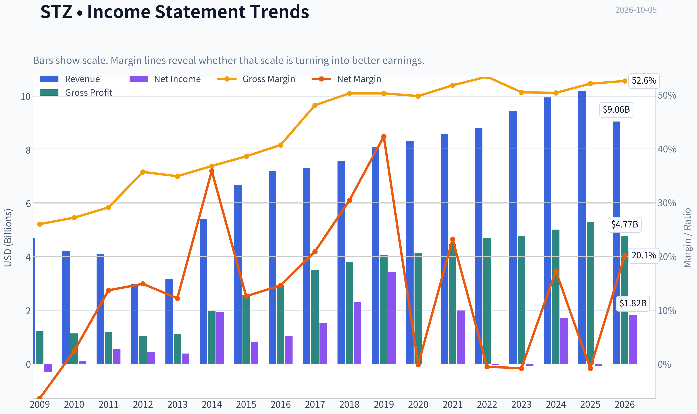

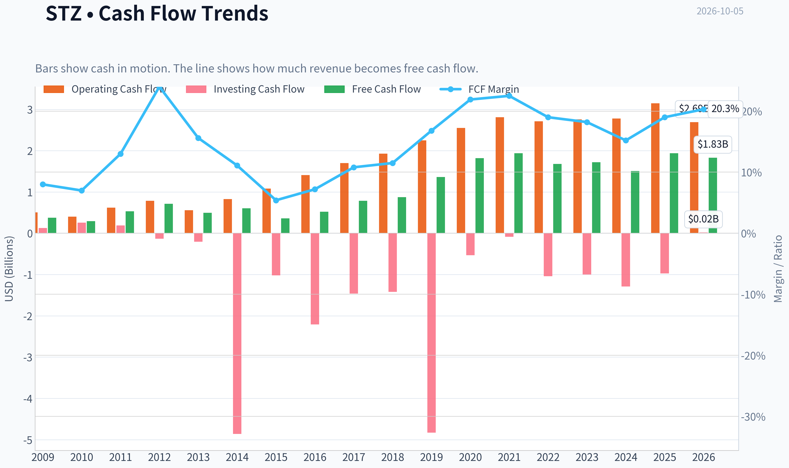

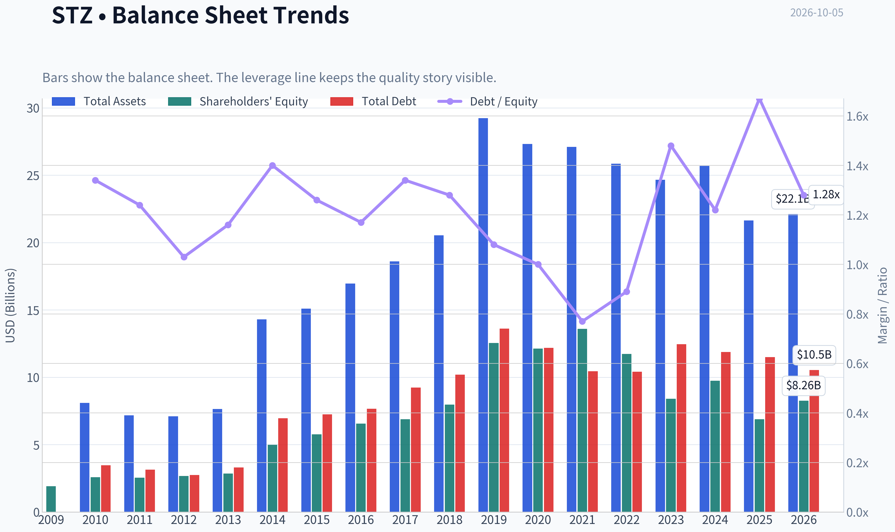

This graph tracks the profitability and return metrics (ROE, ROIC, Margins) of **STZ** over the past decade, highlighting capital efficiency trends.

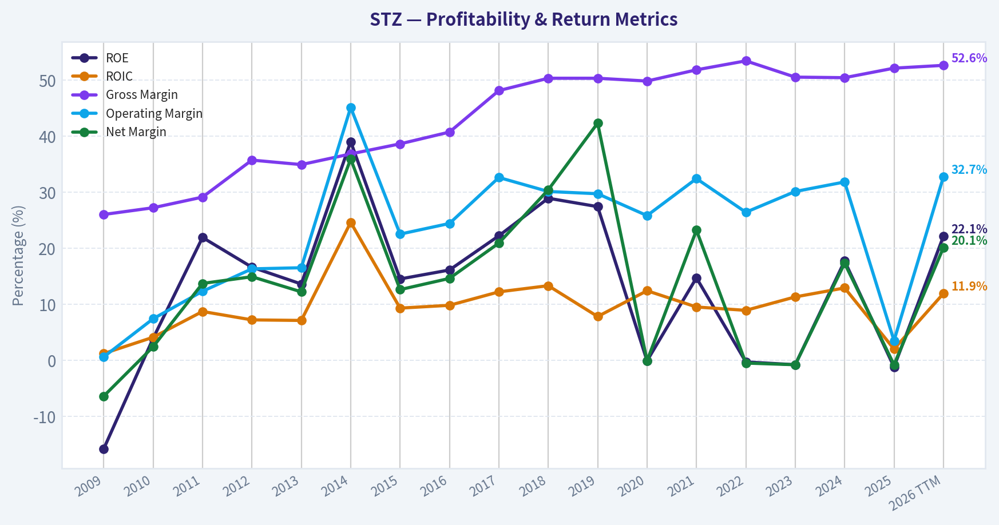

This chart illustrates the financial health of **STZ** over the last 10 years, mapping cash equivalents and free cash flow against total obligations (Debt).

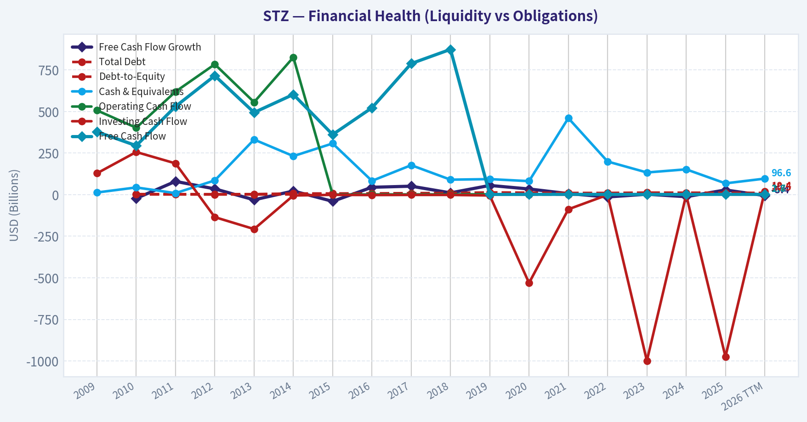

This comparison chart from *Profitability and Operating Performance* stacks current figures against historical benchmarks for **STZ**, making it easy to see where the company trades relative to its own averages.

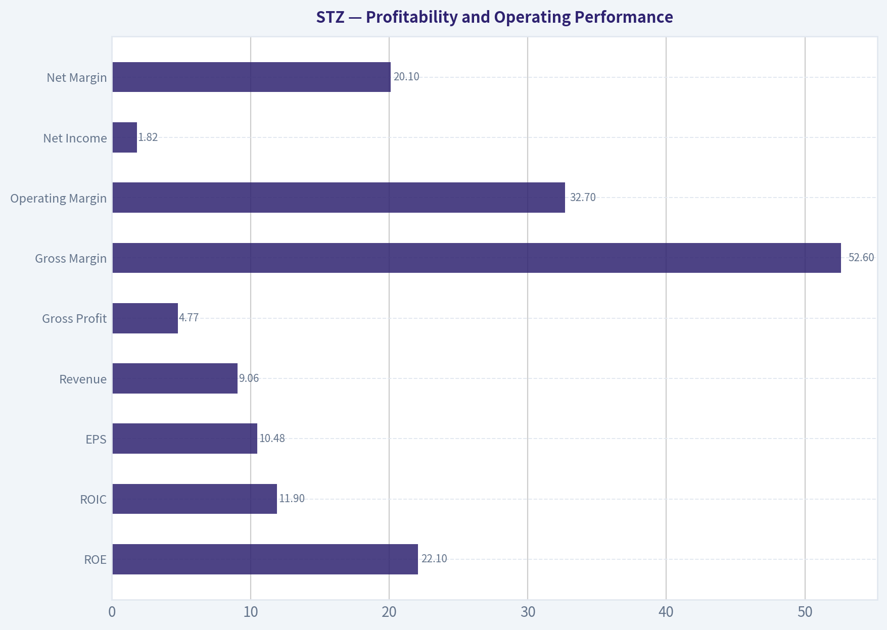

---

### Intrinsic Value Analysis (Buffett)

> *Following Warren Buffett's value investing philosophy: Circle of Competence, Economic Moat, Management Quality, and Margin of Safety.*

#### Intrinsic Value Snapshot

Price is what you pay. Intrinsic value is what the business may be worth based on the cash it can create for owners over time. We show a range, not one magic number.

- Current Price: $112.87
- Value Range (conservative to optimistic across both DCF methods): $4.20 to $981.34

##### Owner Earnings (Buffett Method)
- Net Income: $-81,400,000.00
- Depreciation & Amortization: $418,700,000.00
- Capital Expenditures: $-875,000,000.00
- Working Capital Changes: $-185,200,000.00
- Owner Earnings: $52,800,000.00

##### Intrinsic Value
###### Buffett Method
Uses owner earnings. Stricter, and usually more conservative.
- Conservative: $4.20
- Average: $19.59
- Optimistic: $981.34
- Discount Rate: 10.0%

###### Cash Flow Method
Uses free cash flow. Better for companies spending heavily today to grow tomorrow.
- Conservative: $21.93
- Average: $135.66
- Optimistic: $426.74
- Discount Rate: 10.0%

ANALYST STANCE: **AVOID**

#### Executive View

Constellation Brands owns valuable beer brands, particularly Modelo and Corona, with strong gross margins and substantial cash generation. However, the current price of $113 substantially exceeds the research-pack headline intrinsic value of $62.19, while revenue is declining 10.5% year over year. The valuation is not sufficiently attractive given the weakening recent trajectory and uncertainty in wine and spirits.

The Gate 5 solvency floor is **not tripped** based on the available evidence. This is therefore a valuation-and-quality decision, not a distress call.

#### 1. Factor Scorecard

| Factor | Score | Assessment |
|---|---:|---|
| Circle of Competence & Business Simplicity | 3.0/5 | The company makes and sells alcoholic beverages, a straightforward model. Beer is predictable, but wine and spirits trends and portfolio changes reduce visibility. |
| Moat | 3.5/5 | Modelo and Corona have powerful brands, distribution relationships, and category momentum. The moat is meaningful but concentrated in a small number of brands. |
| Management & Capital Allocation | 2.5/5 | Capital allocation appears mixed, with meaningful portfolio investment and recent strategic pressure. Buffett's reported exit from the position is a negative signal, though not decisive by itself. |
| Industry Structure | 3.0/5 | Branded beverages benefit from scale and rational industry structure, but the company faces category competition, retailer bargaining power, and changing consumer preferences. |

**Key Takeaways:** STZ is an understandable branded-consumer business with a real moat, but not a uniformly strong franchise across all segments. The principal weaknesses are recent revenue deterioration, portfolio concentration, and uncertain capital-allocation outcomes.

#### 2. Moat Analysis

| Moat Source | Evidence | Rating |
|---|---|---:|
| Intangible assets | Modelo and Corona possess strong consumer recognition and pricing power. Gross margin is 51.6%, supporting the presence of valuable brands. | 4/5 |
| Switching costs | Consumers can switch between beverage brands easily, so customer captivity is limited. Distributor and retail relationships provide some structural advantage but are not true high switching costs. | 2/5 |
| Cost advantages | Scale in production, marketing, distribution, and shelf placement helps STZ compete efficiently. | 3/5 |
| Network effects | There is no meaningful direct network effect. Brand popularity can reinforce itself through visibility and consumer familiarity, but this is weaker than a platform network. | 1/5 |

**Overall moat rating: 3.5/5 - Narrow-to-wide, but concentrated.**

STZ's strongest defense is its brand portfolio and distribution scale. A 10% price increase is more plausible for Modelo and Corona than for weaker wine or spirits labels. The moat is durable so long as brand relevance remains strong, but alcoholic beverages are not a high-switching-cost industry, and consumer tastes can change.

#### 3. Management Quality Assessment

Management should be judged primarily by per-share value creation, not reported revenue growth alone.

Positive indicators include:

- A portfolio containing highly valuable beer brands.
- Strong reported gross margins.
- Material free cash flow generation.
- A business model that can potentially return cash to shareholders once major investments moderate.

Concerns include:

- Revenue declined 10.5% year over year.
- The portfolio has experienced uneven performance, particularly outside core beer.
- Capital allocation and strategic investment decisions require close scrutiny because acquisitions and expansion can destroy value if purchased at excessive prices.
- Warren Buffett's Berkshire Hathaway reportedly exited its STZ position as of June 30, 2026. This is not proof of poor quality, but it removes a favorable ownership signal.

**Management score: 2.5/5.** The available evidence does not justify a high score for owner-oriented capital allocation.

#### 4. Financial Summary

| Metric | Latest Value |
|---|---:|
| Share price | $113 |
| Market capitalization | $19.28 billion |
| P/E ratio | 10.75x |
| ROE | 20.9% |
| Gross margin | 51.6% |
| Revenue growth, year over year | -10.5% |
| Free-cash-flow yield | 9.3% |
| Implied free cash flow | Approximately $1.79 billion |
| Current ratio | 1.08x |
| Headline intrinsic value | $62.19 per share |
| Reverse-DCF implied growth | Approximately 6.1% annually for 10 years |

**Key Takeaways:** STZ screens attractively on headline earnings and free cash flow, with a 10.75-times P/E and a 9.3% free-cash-flow yield. However, those figures coexist with a 10.5% revenue decline and a much lower headline intrinsic-value estimate. The current ratio is not especially robust, although it is not by itself evidence of financial distress.

#### 5. Owner Earnings Calculation

Using free cash flow as a practical owner-earnings proxy:

| Calculation | Amount |
|---|---:|
| Market capitalization | $19.28 billion |
| Free-cash-flow yield | 9.3% |
| Implied current free cash flow | Approximately $1.79 billion |
| Approximate shares outstanding | 170.6 million |
| Owner-earnings proxy per share | Approximately $10.50 |
| No-growth value at 10% discount rate | Approximately $105 per share |

The formal Buffett calculation is net income plus depreciation and amortization, less maintenance capital expenditures and working-capital investment. The available research data does not separately identify maintenance capex, so reported free cash flow is used as the cleaner owner-earnings proxy.

This calculation suggests that STZ may be reasonably valued if current free cash flow is durable and maintenance needs are modest. However, it does not adequately account for declining revenue, segment weakness, reinvestment requirements, or the possibility that recent cash flow is above normalized levels.

#### 6. Three-Scenario DCF Valuation

| Scenario | Assumptions | Estimated Value per Share |
|---|---|---:|
| A: No growth | Owner-earnings proxy of approximately $10.50 per share, discounted at 10% | $105 |
| B: GDP growth | 3% annual growth, 10% discount rate | $155 |
| C: Historical/recent trend | Applying approximately 50% to 75% of the reported -10.5% revenue trend as a cash-flow decline assumption | Approximately $69-$74 |
| Research-pack blended valuation | Weighted blend of owner-earnings and FCFF methods | $62.19 |

**Key Takeaways:** The valuation range is unusually wide because the result depends heavily on whether current free cash flow is sustainable. A stable-cash-cow model supports a value near the market price, while the research-pack blend and declining-trend case indicate substantial downside. That dispersion demands a meaningful margin of safety, which the current price does not provide.

The research pack also reports model outputs of approximately $19.59, $135.66, and $211.31 per share for owner earnings, FCF, and Damodaran FCFF, respectively. This very wide spread is evidence of valuation sensitivity rather than precision.

#### 7. Margin of Safety Analysis

| Measure | Result |
|---|---:|
| Current price | $113 |
| Headline intrinsic value | $62.19 |
| Premium to headline intrinsic value | Approximately 81.7% |
| Margin of safety versus headline intrinsic value | Approximately -81.5% |
| No-growth proxy value | Approximately $105 |
| Price versus no-growth proxy | Approximately 7.6% above value |
| Recent-trend value | Approximately $69-$74 |

The reverse DCF implies that investors are paying for approximately 6.1% annual growth over the next decade. That is not an obviously heroic assumption for the strongest beer brands, but it is demanding while reported revenue is declining. For an average-visibility consumer-staples business, a 25% to 35% discount would be more appropriate; STZ is nowhere near that threshold against the headline valuation.

#### 8. Final Buffett Scorecard

| Criterion | Weight | Score | Weighted Contribution |
|---|---:|---:|---:|
| Moat width and durability | 25% | 3.5 | 0.88 |
| Valuation and margin of safety | 20% | 2.0 | 0.40 |
| Capital returns versus WACC | 15% | 3.0 | 0.45 |
| Business understanding and predictability | 12% | 3.0 | 0.36 |
| Management quality and capital allocation | 12% | 2.5 | 0.30 |
| Reinvestment runway | 8% | 3.0 | 0.24 |
| Balance-sheet strength | 4% | 2.5 | 0.10 |
| Industry structure | 4% | 3.0 | 0.12 |
| **Total** | **100%** |  | **2.85/5** |

**Key Takeaways:** STZ scores well enough on brands and industry economics to remain investable in principle, but valuation and recent operating momentum materially weaken the case. The weighted score of 2.85 falls below the threshold for a compelling Buffett-style purchase.

#### 9. Investment Stance

**Stance: AVOID**
**Conviction: Moderate**

STZ is not an obviously broken company, and its leading beer brands could support attractive long-term economics. But at $113, the stock offers insufficient protection against weaker growth, portfolio execution problems, or normalization of free cash flow. A more attractive entry point would be materially below the current price-roughly in the $70-$85 range depending on confidence in the durability of beer-brand cash flows.
#### Valuation Bridge

This bridge places the current market price beside each intrinsic value lens so readers can see whether upside depends on one method or shows up across several methods.

| Scenario | Intrinsic Value / Share |
| --- | ---: |
| Buffett Method | $19.59 |
| Cash Flow Method | $135.66 |
| Damodaran Method | $211.31 |
| Current Price | $112.87 |

#### Key Takeaways

If one method is far above the others, the upside case depends on a specific modelling assumption. When several methods cluster together, the valuation story is more robust.

#### Valuation Visuals

This comparison chart from *Latest Earnings Snapshot* stacks current figures against historical benchmarks for **STZ**, making it easy to see where the company trades relative to its own averages.

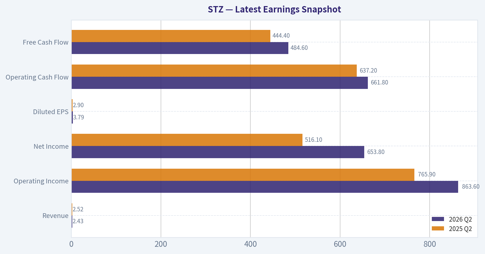

This comparison chart from *Balance Sheet and Financial Strength* stacks current figures against historical benchmarks for **STZ**, making it easy to see where the company trades relative to its own averages.

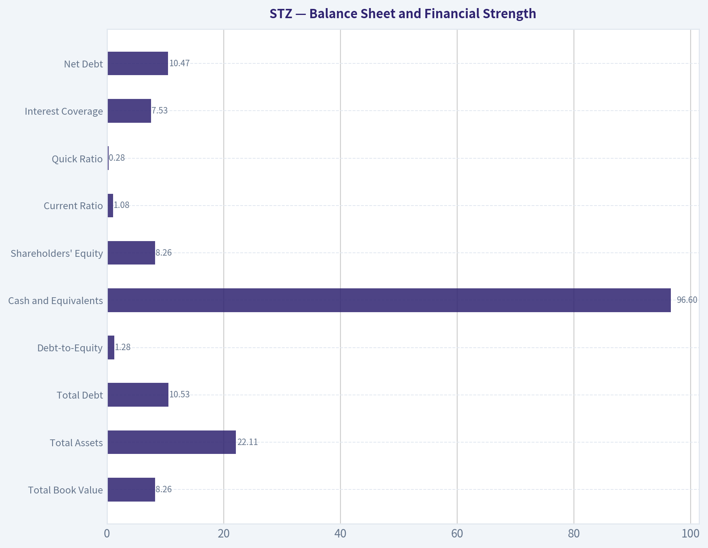

This comparison chart from *Cash Flow and Capital Allocation* stacks current figures against historical benchmarks for **STZ**, making it easy to see where the company trades relative to its own averages.

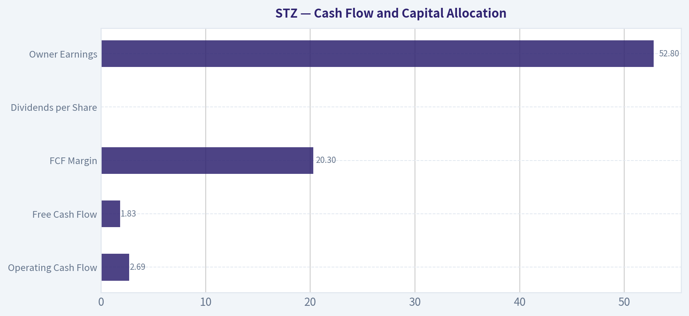

---

### Trend & Growth Analysis (Lynch/Druckenmiller/Fisher)

> *Following Peter Lynch's GARP, Stanley Druckenmiller's macro-aware approach, and Philip Fisher's scuttlebutt methodology.*

ANALYST STANCE: **WATCH**

#### 1. Lynch Classification

**Primary classification: Turnaround / Stalwart hybrid-not a fast grower.**

STZ owns highly durable beer brands, particularly Modelo Especial, Corona, and Pacifico, but recent revenue is contracting. Its historical business has generated strong cash flow and margins, yet the current setup depends on stabilizing wine and spirits, restoring beer momentum, and converting earnings recovery into sustainable top-line growth.

#### 2. The Story in Three Bullets

- **Premium Mexican beer remains the core asset:** Modelo, Corona, and Pacifico provide brand strength, pricing power, and distribution advantages.
- **The opportunity is a recovery, not hypergrowth:** Revenue has fallen roughly 10-11% year over year, but the stock trades at approximately 9.2 times forward earnings and offers a 9.3% FCF yield.
- **The market is pricing in modest growth:** The reverse DCF implies approximately 6.1% annual owner-earnings growth for ten years, creating upside if beer growth reaccelerates and wine stabilizes.

#### 3. Key Fundamentals

| Metric | STZ |
|---|---:|
| Share price | $112.87-$113 |
| Market capitalization | $19.3B |
| Revenue, TTM | $9.06B |
| Revenue growth, YoY | -10.5% to -11.3% |
| Three-year revenue CAGR | -1.1% |
| Five-year revenue CAGR | 1.2% |
| Gross margin | 51.6%-52.6% |
| Operating margin | Approximately 30% |
| Free cash flow | $1.83B |
| FCF yield | 9.3% |
| Forward P/E | 9.2x |
| Debt-to-equity | Approximately 1.3x |
| Interest coverage | 7.5x |
| Current ratio | 1.08 |

**Key Takeaways:** STZ is profitable and cash generative, with attractive valuation metrics and strong gross margins. However, the growth profile is weak: both the current year and multiyear revenue trends are negative or nearly flat. Leverage is manageable but meaningful, which reduces strategic flexibility during a downturn.

#### 4. TAM Analysis and 10x Test

STZ participates in large global categories including beer, wine, and spirits. Its best growth market is imported and premium beer, while wine and spirits are more mature and competitive.

| TAM Question | Assessment |
|---|---|
| Current revenue | $9.06B |
| Ten-times revenue target | Approximately $90.6B |
| Can the U.S. beer business alone support 10x growth? | No |
| Can the broader global beer, wine, and spirits market support 10x revenue? | Theoretically, but difficult |
| TAM growth | Moderate overall; premium beer is more attractive |
| Current runway | Good for share gains, limited for company-wide hypergrowth |

**Key Takeaways:** The broad alcohol market is large enough to support additional growth, but a ten-bagger outcome would require STZ to become dramatically larger than its current U.S.-centric operating base. The realistic opportunity is premium beer share growth and international expansion, not a clean 10x runway comparable to software or emerging technology companies.

#### 5. Revenue Growth Trend

| Period | Revenue | Growth |
|---|---:|---:|
| 2021 | $8.61B | 3.3% |
| 2022 | $8.82B | 2.4% |
| 2023 | $9.45B | 7.2% |
| 2024 | $9.96B | 5.4% |
| 2025 | $10.21B | 2.5% |
| 2026 TTM | $9.06B | -11.3% |

**Key Takeaways:** Revenue growth accelerated temporarily in 2023, then decelerated and turned sharply negative in the latest TTM period. This is currently a deterioration pattern, not a confirmed inflection point. The most important evidence needed is sequential stabilization in beer depletion trends and a return to positive organic revenue growth.

#### 6. Unit Economics and Cash Generation

| Metric | Result | Interpretation |
|---|---:|---|
| LTV/CAC | Not disclosed | Cannot verify |
| NRR | Not applicable | Consumer packaged goods model |
| FCF margin | 20.3% | Strong |
| Rule of 40 | Not meaningful | Revenue growth is negative |
| Gross margin | 51.6%-52.6% | Brand and mix support |
| ROE | Approximately 21% | Strong, partly aided by leverage |
| ROIC | Approximately 11% | Solid but not exceptional |
| Owner earnings | $52.8M computed estimate | Distorted by unusual accounting/cash-flow items |

**Key Takeaways:** STZ does not have SaaS-style unit economics, but its strong FCF margin demonstrates attractive brand economics. The owner-earnings estimate is unusually low relative to reported FCF and should not be used in isolation. The key issue is whether cash flow remains resilient while the company repairs its revenue base.

#### 7. Inflection Point Assessment

| Potential Inflection | Current Status | Importance |
|---|---|---|
| Beer volume reacceleration | Unconfirmed | Highest |
| Modelo and Corona market-share gains | Long-term positive, latest trend needs verification | High |
| Wine and spirits stabilization | Not yet demonstrated | High |
| Margin recovery | Possible; gross margin remains above 50% | Medium |
| Debt reduction | Debt remains around $10.5B net | Medium |
| Capital allocation improvement | Needs monitoring after Berkshire exit | Medium |

**Key Takeaways:** STZ has attractive assets but no confirmed fundamental inflection yet. The likely catalyst is a return to positive beer volume and organic sales growth, followed by operating leverage. Until that occurs, the stock is a value-oriented recovery situation rather than a high-conviction growth investment.

#### 8. Macro Setup

The latest soft jobs data may increase expectations for easier monetary policy, which could support equity valuations and consumer spending. STZ also benefits from its consumer-defensive category, but it remains exposed to household budget pressure, alcohol moderation trends, distributor inventory, commodity costs, and foreign-exchange movements.

The macro setup is therefore **neutral to mildly favorable**, but company-specific execution matters more than rates. Falling rates could help the valuation multiple, while weak employment or consumer finances could pressure lower-income beer and alcohol demand.

#### 9. Fisher's 15-Point Assessment

| Fisher Criterion Group | Score |
|---|---:|
| Market potential and long-term outlook | 4/5 |
| Product innovation and R&D | 3/5 |
| Sales and distribution capability | 4/5 |
| Brand moat and competitive position | 4/5 |
| Profit margins and margin potential | 4/5 |
| Management depth and execution | 3/5 |
| Cost control and accounting quality | 3/5 |
| Labor and executive relations | 3/5 |
| Capital allocation and dilution | 2/5 |
| Management candor and integrity | 3/5 |
| **Total** | **49/75** |

**Key Takeaways:** STZ scores well on brands, distribution, margins, and market durability. It scores materially lower on growth, capital allocation, and current execution. A 49 out of 75 is an average Fisher result and does not support treating STZ as an outstanding long-term compounder today.

#### 10. Valuation Analysis

| Method | Result | Interpretation |
|---|---:|---|
| P/E | 10.75x | Inexpensive versus many branded consumer companies |
| Forward P/E | 9.20x | Reflects expected earnings recovery |
| PEG | 1.43 | Fair, but growth denominator is unreliable |
| Price-to-sales | 2.13x | Reasonable for a branded consumer business |
| EV/EBITDA | 8.68x | Moderately attractive |
| FCF yield | 9.3% | Strong |
| Headline intrinsic value | $62 | Conservative model output |
| FCF-based average value | $136 | Near current price but model-sensitive |
| Damodaran FCFF average value | $211 | More optimistic |
| Reverse DCF | 6.1% annual growth implied | Not an aggressive expectation |

**Key Takeaways:** STZ is inexpensive on earnings, EBITDA, and free cash flow, but valuation is not automatically a bargain because the revenue base is shrinking and debt is material. The valuation models have an extremely wide range of roughly $20 to $211 per share, showing that assumptions about normalized cash flow and reinvestment dominate the conclusion. The stock is attractive only if earnings and revenue normalize rather than continue deteriorating.

#### 11. Growth Investor Scorecard

| Criterion | Weight | Score / 5 |
|---|---:|---:|
| The Story | 10% | 3.5 |
| TAM and runway | 20% | 2.5 |
| Revenue growth | 20% | 1.5 |
| Unit economics | 15% | 4.0 |
| Competitive position | 10% | 4.0 |
| Management quality | 10% | 2.8 |
| Macro setup | 5% | 3.2 |
| Profitability path | 5% | 4.0 |
| Valuation | 5% | 4.0 |
| **Weighted score** | **100%** | **2.9 / 5.0** |

**Key Takeaways:** STZ's brands, cash flow, and valuation are attractive, but the negative revenue trend prevents it from qualifying as a fast-growth investment. The 2.9 score places it in the avoid-for-aggressive-growth range, although the stock remains worth monitoring as a potential turnaround or value recovery.

#### 12. Position Size Stance

- **New position:** 0% to 1% initially, only as a speculative turnaround watch position.
- **After confirmation:** Up to 2%-3% if revenue returns to positive growth, beer volumes stabilize, and debt declines.
- **High-conviction growth position:** Not justified currently.
- **Existing holding:** Hold or trim depending on portfolio role; do not average down solely because the P/E is low.

#### 13. Key Catalysts and Risks

| Catalysts | Risks |
|---|---|
| Positive beer volume growth | Continued revenue contraction |
| Modelo, Corona, and Pacifico share gains | Wine and spirits deterioration |
| Stabilization of U.S. consumer demand | High net debt and refinancing exposure |
| Margin recovery from mix and cost control | Alcohol moderation and changing consumer preferences |
| Debt reduction and disciplined capital allocation | Distributor inventory or execution problems |
| Lower interest rates supporting multiples | Buffett/Berkshire exit signaling reduced institutional confidence |

**Key Takeaways:** The central catalyst is simple: STZ must return to organic revenue growth, preferably through renewed beer momentum. The central risk is that the current decline is structural rather than temporary. Berkshire's reported exit is a negative signal, but it should be treated as supporting evidence-not a standalone investment thesis.

#### Conclusion

STZ is a **quality-brand, cash-flow recovery candidate**, not a current ten-bagger candidate. Its valuation is appealing, but the business lacks the accelerating revenue growth, expanding TAM, and confirmed inflection point required for an aggressive growth recommendation.

**Bottom line: WATCH.** Reconsider positively if the next several quarters show positive organic growth, beer volume reacceleration, stable margins, and declining leverage.

#### Growth & Scorecard Visuals

This comparison chart from *Growth Metrics* stacks current figures against historical benchmarks for **STZ**, making it easy to see where the company trades relative to its own averages.

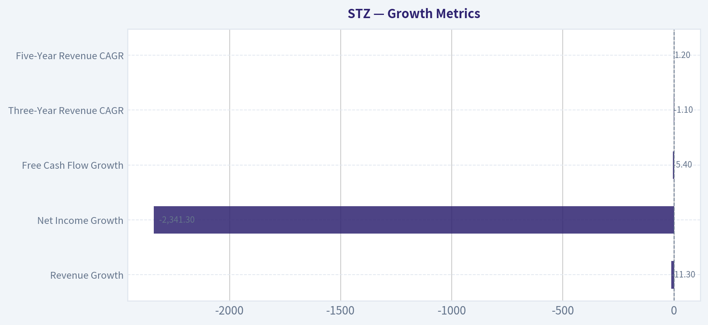

---

### Market Technical Analysis

ANALYST STANCE: **AVOID**

#### STZ technical overview

The latest available STZ trading data is from October 2, 2026, when the stock closed at **$112.87**. The October 5 date did not have a valid trading record in the retrieved dataset.

STZ remains in a pronounced primary downtrend. From approximately **$134.77 one year earlier**, the stock has declined about **16%**. More importantly, it reached a closing high near **$164.28 in February 2026** and has since fallen roughly **31%**. The decline has featured repeated lower highs and lower lows rather than a clean consolidation or confirmed reversal.

The most recent weakness is also persistent. STZ fell from **$130.63 on September 1** to **$112.87 on October 2**, a decline of approximately **14%** in about one month. The stock briefly stabilized around $123-$125 during mid-September, but that attempted base failed when price moved below $120 and continued toward the $112-$113 area.

#### Selected indicators

The most relevant eight-indicator set for STZ is:

| Category | Selected indicator | Why it is useful here |
|---|---|---|
| Short-term trend | `close_10_ema` | Measures whether a short-term rebound is developing and identifies dynamic resistance during the decline. |
| Medium-term trend | `close_50_sma` | Helps distinguish a temporary oversold bounce from a genuine intermediate trend change. |
| Long-term trend | `close_200_sma` | Provides the strategic trend benchmark and confirms whether STZ remains structurally weak. |
| Momentum | `macd` | Measures the direction and persistence of medium-term momentum. |
| Momentum acceleration | `macdh` | Shows whether bearish momentum is intensifying or beginning to lose force. |
| Momentum exhaustion | `rsi` | Tests for oversold conditions and possible divergence, while avoiding the assumption that oversold automatically means bullish. |
| Volatility and risk | `atr` | Helps size positions and establish realistic stops in a stock experiencing wide daily ranges. |
| Price-volume confirmation | `vwma` | Determines whether recent trading activity supports the prevailing price trend. |

The indicator-report tool returned blank numerical fields, so the observations below combine the supplied price and volume history with approximate calculations from that dataset. Exact indicator readings should be refreshed before placing a trade.

#### Trend structure and moving averages

The **10-day EMA** should be materially above the latest close, probably in the mid-to-upper $115 area based on the recent price sequence. That implies STZ is trading below its short-term trend line. A recovery that fails beneath the 10-day EMA would continue to favor sellers; a sustained close above it would be an initial, but weak, improvement rather than a confirmed reversal.

The **50-day SMA** is likely substantially higher, approximately in the low-to-mid $120s based on the recent 50-session price distribution. STZ has been below this medium-term average during the latest selloff. Until the stock can reclaim the 50-day SMA and hold above it, rallies should be treated as countertrend rebounds.

The **200-day SMA** is likely still considerably above the current market price, potentially around the high-$130s or low-$140s. The long-term average has therefore become an important overhead resistance area rather than nearby support. The separation between the current price and the 200-day SMA indicates that the weakness is not merely a short-term pullback.

The moving-average alignment is consequently bearish: the latest price is below the short-term, medium-term, and long-term trend benchmarks. A more constructive configuration would require price to first regain the 10-day EMA, then the 50-day SMA, with the 50-day average eventually flattening rather than continuing to slope downward.

#### MACD and momentum

The **MACD** is expected to remain below its signal line and below the zero line, consistent with the prolonged decline from the February peak. This indicates that medium-term momentum remains negative. The **MACD histogram** should also be negative, although the magnitude of its negativity may fluctuate as the selloff pauses.

There is a distinction between a slowing decline and a reversal. If the histogram becomes less negative while price holds above $112-$113, that would suggest bearish momentum is decelerating. However, the signal would not become meaningfully bullish until MACD produces a confirmed bullish crossover and ideally moves back toward or above zero.

The September decline included several high-volume sessions, particularly the sharp move to **$120.98 on September 8** and the high-volume selloff to **$118.97 on September 18**. Those events suggest that institutional or larger-holder selling may have contributed to the breakdown. Momentum therefore should not be assumed to reverse simply because the stock has become technically oversold.

#### RSI and possible exhaustion

The latest 14-session price sequence contains predominantly negative closes and several consecutive declines. A manually estimated 14-day RSI would likely be in the **low-20s or possibly high-teens**, placing STZ near or within oversold territory.

That reading indicates that downside momentum is stretched, but it is not itself a buy signal. In persistent trends, RSI can remain below 30 for an extended period. The appropriate bullish confirmation would be a higher low in RSI accompanied by price holding above $112-$113, followed by a close above the short-term EMA.

At present, there is no clear bullish divergence visible from the price data alone. Price has continued to make lower lows into late September and early October. A divergence would require price to make a new low while RSI forms a higher low, followed by evidence that buyers can reclaim nearby resistance.

#### Volatility, volume, and risk management

Daily ranges have expanded during the selloff. The September 8 session traded between approximately **$120.43 and $130.99**, while September 18 traded between about **$118.91 and $122.01** on volume of roughly **6.76 million shares**. These unusually active sessions indicate elevated event and liquidation risk.

A 14-day ATR estimate appears to be around **$3 per share**, with the exact figure dependent on the calculation convention. This is meaningful relative to a $112.87 share price: a normal daily move can represent several percentage points. Traders should therefore avoid tight stops that are placed inside ordinary price noise.

The volume pattern does not yet provide convincing accumulation evidence. The largest recent volume spikes occurred during sharp declines or failed stabilization attempts. A more constructive volume signal would be multiple up days with above-average volume, especially if those sessions push price through $115-$120 and hold the breakout.

The volume-weighted moving average should remain above the latest price because the recent high-volume transactions occurred during the decline. That creates an additional overhead supply zone. A price recovery accompanied by strong volume and a move above the VWMA would be more credible than a low-volume bounce.

#### Key levels and scenarios

The immediate support zone is approximately **$112-$113**, based on the latest closing cluster and recent lows. A decisive close below that area could expose the stock to the **$110** region and potentially lower levels, although downside targets should not be treated as precise forecasts.

Initial resistance is around **$115-$116**, corresponding to the likely short-term EMA area. The more important near-term supply zone is **$118-$120**, where the stock previously broke lower and where several September closes were concentrated. A stronger recovery would need to reclaim **$123-$125**, near the likely 50-day trend area, and then establish higher lows.

The preferred strategy is to avoid initiating a long position while price remains beneath all major moving averages and momentum remains negative. A speculative oversold trade could be considered only after a bullish reversal pattern, improving RSI, a positive MACD histogram shift, and supporting volume. Even then, position size should be reduced because ATR and recent downside gaps indicate elevated risk.

| Area | Current interpretation | Trading implication |
|---|---|---|
| Latest close | $112.87 on October 2, 2026 | Price remains near the lower end of the recent range. |
| One-year performance | Approximately -16% | Long-term relative trend remains weak. |
| February peak to latest close | Approximately -31% | The stock is in a major drawdown, not a routine pullback. |
| Short-term EMA | Likely above price, around the mid-$115s | Rebounds may encounter immediate dynamic resistance. |
| 50-day SMA | Likely in the low-to-mid $120s | Reclaiming this area is needed to improve the medium-term outlook. |
| 200-day SMA | Likely near the high-$130s to low-$140s | Long-term trend remains bearish while price is far below it. |
| MACD and histogram | Expected negative | Momentum remains bearish; watch for deceleration, not just oversold conditions. |
| RSI | Estimated low-20s or high-teens | Oversold, but persistent-trend risk remains high. |
| ATR | Estimated near $3 | Stops and position sizes should account for wide daily fluctuations. |
| Immediate support | $112-$113, then approximately $110 | A breakdown would signal further technical deterioration. |
| Initial resistance | $115-$116 | First level required for a short-term repair attempt. |
| Major resistance | $118-$120, then $123-$125 | A sustained move above these zones would be needed to challenge the bearish thesis. |
| Overall stance | Bearish; avoid for now | Wait for reversal confirmation and volume-backed recovery before considering a long position. |

Key Takeaways: STZ is deeply oversold, but the broader evidence still favors continued caution because price is below its short-, medium-, and long-term trend benchmarks. The most important near-term test is whether $112-$113 holds; however, a durable improvement would require recovery above $115-$120 with strengthening momentum and volume. Until that occurs, an oversold bounce should be treated as a trading reaction rather than a confirmed trend reversal.

#### Market Visuals

This comparison chart from *Market Metrics and Valuation* stacks current figures against historical benchmarks for **STZ**, making it easy to see where the company trades relative to its own averages.

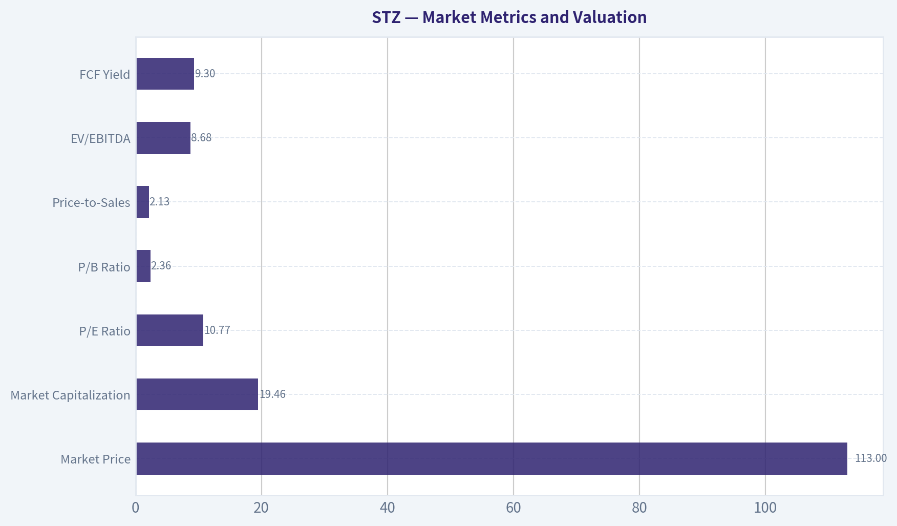

---

### Options Market Analysis

> *Reading options flow - put/call ratios, IV skew, and unusual activity - to gauge institutional positioning and event-driven risk.*

#### STZ Options Market Report

**As of October 5, 2026.** The available options data is extremely thin, with only 49 total contracts of open interest across the near-term expirations. This materially reduces confidence in the directional read.

#### 1. Put/Call Ratio Analysis

| Expiration | Days to Expiry | Call OI | Put OI | Put/Call OI Ratio | Call Volume | Put Volume | Put/Call Volume Ratio |
|---|---:|---:|---:|---:|---:|---:|---:|
| Oct. 9, 2026 | 4 | 0 | 0 | N/A | 782 | 510 | 0.65 |
| Oct. 16, 2026 | 11 | 42 | 7 | 0.17 | 268 | 274 | 1.02 |
| Oct. 23, 2026 | 18 | 0 | 0 | N/A | 57 | 39 | 0.68 |
| **Near-term total** | - | **42** | **7** | **0.17** | **1,107** | **823** | **0.74** |

**Key Takeaways:** The aggregate put/call open-interest ratio of 0.17 is well below the approximately 0.70 neutral baseline, indicating a call-heavy positioning profile. However, the ratio is based on only 49 contracts of open interest, while the volume ratio of 0.74 is close to neutral. The bullish implication is therefore tentative rather than a strong institutional signal.

#### 2. Implied Volatility Assessment

| Expiration | Call ATM IV | Put ATM IV | Relative IV Observation |
|---|---:|---:|---|
| Oct. 9, 2026 | 3.2% | 2.7% | Calls modestly higher |
| Oct. 16, 2026 | 2.1% | 1.8% | Calls modestly higher |
| Oct. 23, 2026 | 3.5% | 1.3% | Calls substantially higher |

**Key Takeaways:** Near-term ATM implied volatility is low overall, ranging from 1.3% to 3.5% in the supplied data. Calls trade at higher IV than puts across all listed expirations, suggesting a mild upside-demand skew rather than downside protection demand. A full OTM put-versus-call skew cannot be calculated because the data does not provide strike-level IV detail.

The data does not identify a known catalyst such as earnings, a product launch, or a macro event. There is also no obvious broad volatility premium suggesting that traders are aggressively pricing a near-term event.

#### 3. Unusual Options Activity

| Finding | Result |
|---|---|
| Contracts with volume greater than five times open interest | None identified |
| Fresh directional bets | No statistically unusual contracts detected |
| Smart-money versus retail distinction | Not possible from the supplied data |

**Key Takeaways:** No individual contract met the unusual-activity threshold. The large call volume in the October 9 expiration is notable in absolute terms, but open interest is zero, so it cannot be reliably classified as opening institutional activity. Without trade size, execution side, or strike-level information, there is insufficient evidence to identify a smart-money directional bet.

#### 4. Open Interest Concentration and Gamma Levels

| Expiration | Highest Reported OI | Positioning Concentration |
|---|---:|---|
| Oct. 9, 2026 | 0 | No open-interest concentration |
| Oct. 16, 2026 | 49 total contracts | Main near-term OI concentration; 42 calls and 7 puts |
| Oct. 23, 2026 | 0 | No open-interest concentration |

**Key Takeaways:** October 16 is the only expiration with meaningful reported open interest, and it is heavily call-weighted. Strike-level open interest was not supplied, so specific call walls, put walls, max-pain levels, and gamma-pin prices cannot be identified. Given the very small OI base, any potential price-pinning effect is likely weak.

#### 5. Overall Options Sentiment Signal

**Overall signal: BULLISH, low confidence.**

The primary bullish driver is the very low aggregate put/call OI ratio of 0.17, combined with calls carrying somewhat higher implied volatility than puts. That said, the volume ratio of 0.74 is near the historical neutral level, there is no confirmed unusual activity, and total open interest is exceptionally small. The best interpretation is **mildly bullish positioning with limited conviction**, not a robust institutional accumulation signal.

| Category | Assessment |
|---|---|
| Put/Call Ratio | Bullish on OI; volume near neutral |
| IV Level | Low |
| Skew Direction | Mild call skew; downside put skew not evident |
| Unusual Activity | None detected |
| Overall Signal | **BULLISH, low confidence** |

**Key Takeaways:** STZ's options profile leans bullish because calls dominate open interest and call IV exceeds put IV. However, the market is thin and lacks unusual contract-level activity, so the signal should be treated as a weak directional bias rather than a high-confidence forecast.

---

## Research Team Commentary

> *The Research Manager synthesizes the Bull vs Bear debate into action-free commentary. This is a pre-risk view, not the final stance.*

Core takeaway: Constellation Brands owns a genuinely attractive Mexican beer franchise, but at roughly $113 the stock does not yet offer enough margin of safety for the uncertainty surrounding revenue, normalized owner earnings, and capital allocation. The valuation is inexpensive, not compellingly mispriced. I would keep STZ on the watchlist but would not initiate a full position today.

The strongest bull argument is straightforward. Modelo, Corona, and Pacifico have meaningful brand equity, consumer recognition, shelf-space advantages, and established distribution. The 51.6% gross margin supports the view that these are differentiated products rather than commodity beverages. At approximately 9.2 times forward earnings and a reported 9.3% free-cash-flow yield, investors are not paying a premium-compounder valuation. If the beer business resumes moderate growth, wine merely stabilizes, and cash flow proves durable, returns could be attractive without heroic revenue growth.

The reverse DCF also does not appear to assume euphoria. Approximately 6.1% annual owner-earnings growth is a meaningful hurdle-about 81% cumulative growth over ten years-but it remains plausible for a premium branded franchise combining modest volume growth, pricing, mix, and share repurchases. The market could be extrapolating a depressed operating period too far into the future.

The strongest bear argument is that the headline valuation has not been reconciled with normalized economics. Revenue is declining approximately 10%-11%, while the reported free-cash-flow yield and reverse-DCF owner earnings apparently use different definitions. Until working capital, necessary capital expenditures, debt claims, and other normalization items are reconciled, the 9.3% yield cannot be treated as a secure cash return.

Business quality is also uneven at the enterprise level. The Mexican beer portfolio has a moat, but wine and other weaker assets dilute predictability and capital efficiency. ROIC of 10.8% is respectable, not exceptional, and the 20.9% ROE is less persuasive without separating the contribution from leverage. Management therefore does not deserve an elite-compounder premium until it demonstrates better portfolio discipline, protects the beer franchise, and allocates excess cash rationally.

Valuation is the deciding issue. The bull's central value of approximately $130 implies only a 13% discount at $113. That might be sufficient for a highly predictable, wide-moat compounder, but STZ currently has falling revenue, uncertain normalized cash flow, moderate returns on capital, and a recovery-dependent thesis. A mixed-quality business ordinarily requires a discount closer to 25%-35%. Applied to a $125-$140 value range, that points to a more defensible entry around $90-$105 unless operating stabilization materially improves confidence. The bear's $90-$100 range is therefore not arbitrary; it approximately reflects the larger margin of safety warranted by present uncertainty.

The pronounced primary downtrend does not determine ten-year intrinsic value, but it matters for execution and information gathering. Previous mistakes came from allowing brand quality and low multiples to overpower evidence that expectations were still deteriorating. STZ remains a good example of the distinction between a valuable franchise and an attractive stock today. With no confirmed operating inflection or durable price base, there is little reason to assume the current quote is the final clearing price. The options market adds almost no reliable information because open interest is extremely thin; the call-heavy ratio should be disregarded.

Rationale: I do not see evidence of financial distress or permanent obsolescence, so a categorical long-term rejection would be excessive. The beer moat is real, the gross margin is strong, and the valuation could generate attractive returns if cash flow stabilizes. However, the current discount is too small relative to the risk that earnings estimates and reported free cash flow are not normalized. This is not yet a "wonderful business at a fair price" across the whole enterprise, nor is it sufficiently discounted to compensate for the recovery risk. The appropriate posture is strategically interested but tactically defensive: do not buy merely because the multiple is low, and do not average down without evidence.

Monitoring plan: Over the next one to four quarters, the most important item is the organic performance of Modelo, Corona, and Pacifico. The thesis strengthens if beer depletions, shipments, and net sales stabilize or return to growth without excessive discounting. It weakens materially if the current contraction spreads across the crown-jewel brands or if price increases cause sustained volume elasticity.

Second, reconcile reported free cash flow with normalized owner earnings. Watch working-capital movements, capital expenditures, interest expense, and cash conversion. A recurring equity free-cash-flow yield near 9% would make $113 more attractive; a sharp decline after normalizing temporary benefits would validate the bear case.

Third, monitor gross margin and ROIC. Stable gross margins near current levels would support continued pricing power, but the stronger signal would be ROIC improving from 10.8%. Falling margins or ROIC approaching the cost of capital would undermine the claim that STZ remains a high-quality compounder.

Fourth, assess wine stabilization and management's portfolio response. Rationalization, disposals, reduced investment in weaker assets, and concentration on the highest-return beer opportunities would strengthen the thesis. Further acquisitions, rising leverage, or continued capital consumption by inferior businesses would weaken it.

Fifth, monitor net leverage, interest coverage, debt maturities, and the order of capital allocation. Debt reduction and selective repurchases below conservative intrinsic value would be constructive. Aggressive repurchases funded by borrowing while revenue is declining would be a warning.

Finally, look for either a substantially better price or genuine confirmation. A decline toward $90-$100 without deterioration in the core beer franchise would create a more appropriate margin of safety. Alternatively, stabilization in beer sales, normalized cash flow, and returns on capital could justify paying closer to the current price. Technical repair-a durable base and recovery of major moving averages-would not prove intrinsic value, but it would reduce the risk that the market is still processing fundamental downgrades.

Final stance: WATCH.

---

## Value Investing Team Commentary

> *The Investor translates the research view into an investment thesis before risk review. This is still not the final stance.*

### Investment Commentary

Constellation Brands presents a classic value-investing tension: it owns an excellent core franchise, but the quality and predictability of the consolidated business are less impressive. At approximately $113, the shares are inexpensive, yet the available evidence does not establish that they are sufficiently undervalued.

### The business and its moat

Modelo, Corona, and Pacifico are the primary reasons to remain interested. These brands benefit from consumer loyalty, premium positioning, distribution strength, and valuable retail shelf space. A 51.6% gross margin reinforces the view that STZ possesses pricing power rather than merely selling commodity beverages.

That moat, however, must be evaluated through future beer volumes and cash generation-not brand recognition alone. The critical question is whether current weakness is temporary or reflects a more persistent change in consumer demand. If the Mexican beer portfolio continues gaining share and sustaining pricing without excessive volume losses, the market may be extrapolating a difficult period too far into the future. If contraction spreads across those flagship brands, the apparent bargain could instead be based on an earnings denominator that remains too high.

The rest of the enterprise reduces overall quality. Weaker wine and other assets make earnings less predictable and absorb capital that could otherwise support the beer franchise, debt reduction, or disciplined repurchases. Gross margin demonstrates brand strength, but the 10.8% ROIC is only respectable. It does not yet establish STZ as an elite compounder deserving a minimal margin of safety.

### Valuation and normalized earnings

The valuation is superficially attractive:

- Approximately 10.75 times trailing earnings
- Approximately 9.2 times forward earnings
- Reported free-cash-flow yield of roughly 9.3%
- Reverse-DCF hurdle of approximately 6.1% annual owner-earnings growth

These figures suggest pessimism rather than enthusiasm. If the reported cash flow is sustainable and owner earnings grow around 6% annually, shareholders could earn satisfactory returns through cash generation, modest growth, and intelligently executed repurchases.

But the valuation case is only as reliable as the normalized cash-flow estimate. Reported free cash flow should be reconciled for working-capital movements, maintenance capital expenditure, interest requirements, portfolio changes, and other temporary benefits. A 9.3% yield based on temporarily elevated cash conversion is materially less attractive than the same yield supported by recurring owner earnings.

The reverse DCF also deserves caution. Requiring roughly 6.1% annual owner-earnings growth is not euphoric, but neither is it trivial for a company currently reporting a substantial revenue decline. The hurdle is reasonable only if the beer franchise stabilizes, weaker operations cease deteriorating, and capital allocation adds rather than destroys value.

At a central intrinsic-value estimate of $130, the discount at $113 is approximately 13%. Across a $125-$140 valuation range, the discount is roughly 10%-19%. That would be adequate for a highly predictable, wide-moat enterprise with consistently high returns on incremental capital. STZ currently falls short of that standard at the consolidated level. For a recovery-dependent, mixed-quality business, a 25%-35% discount is more appropriate, implying an entry zone broadly around $90-$105 under the supplied valuation assumptions.

### Management and capital allocation

Management's next decisions will materially affect the investment case. The right priorities would be:

1. Protect and reinvest behind the highest-return Mexican beer brands.
2. Rationalize or dispose of structurally weaker assets where sensible.
3. Preserve balance-sheet flexibility while revenue remains under pressure.
4. Repurchase shares only when they are clearly below conservatively estimated intrinsic value.
5. Avoid debt-funded financial engineering intended to conceal weak operating performance.

ROE of 20.9% looks appealing, but it should not be viewed independently of leverage. Improving ROIC from 10.8% would be a much stronger indication that management is creating durable economic value.

### Selective contrarian interpretation

The contrarian opportunity is that investors may be treating a difficult operating period as permanent. The primary downtrend, falling revenue, and lowered expectations could create an attractive setup if the underlying beer franchise remains healthy. A durable branded business does not need rapid growth to generate satisfactory returns when purchased at a low multiple.

However, contrarianism is justified only when the market is misreading temporary weakness. A declining share price is not itself evidence of irrational fear. It may reflect continuing estimate reductions or concerns that current free cash flow is above normalized owner earnings. Previous declines from much higher prices also do not make $113 intrinsically cheap.

The technical downtrend should not determine a ten-year investment decision, but it is useful information. It suggests that market participants may still be processing deteriorating fundamentals. There is no need to predict the bottom; a long-term investor can wait either for a larger discount or for evidence that operating conditions have stabilized. The options data are too thin to alter that conclusion, and the call-heavy put/call ratio should not be treated as reliable sentiment confirmation.

### What would change the stance?

A move toward **ADVOCATE** would require one of two developments:

- **Price-led opportunity:** A decline toward approximately $90-$100 without deterioration in the core beer franchise or normalized cash flow.
- **Fundamental confirmation:** Stabilizing beer depletions, shipments, and organic sales; recurring free cash flow near the reported level; improving ROIC; and disciplined treatment of weaker assets.

Conversely, the thesis would move toward **AVOID** if flagship beer brands enter sustained contraction, gross margins materially weaken, normalized owner earnings prove substantially below reported free cash flow, leverage rises, or management continues allocating significant capital to lower-return operations.

The essential monitoring variables are therefore beer volume and pricing, normalized cash conversion, ROIC, leverage, and portfolio discipline. A technical base would be helpful confirmation, but improving business economics matter more.

**ANALYST STANCE: WATCH** - STZ owns a genuinely valuable Mexican beer franchise and trades at a low headline multiple, so outright avoidance would be too pessimistic. Nevertheless, the present discount is not large enough to compensate for declining revenue, uncertain normalized owner earnings, moderate consolidated ROIC, and recovery-dependent assumptions. Remain interested, but wait for either a price closer to $90-$105 or clear evidence that beer sales, cash flow, and capital efficiency have stabilized.

---

## Deep Values Commentary

> *The Risk Management Team debates and the Risk Judge provides the final action-free verdict. This section determines the final ADVOCATE / WATCH / AVOID stance.*

#### Final Stance Scorecard

This scorecard converts the final research view into a weighted decision frame. It does not replace the narrative judgement, but it makes the main drivers of the verdict easier to scan.

| Criterion | Score | Weight | Commentary |
| --- | ---: | ---: | --- |
| Business Quality | 4.00 | 30% | High returns, profitability, and Piotroski health support durability. |
| Valuation Support | 4.33 | 30% | Blends current price against available intrinsic value anchors and valuation ratios. |
| Financial Strength | 1.67 | 20% | Balance-sheet resilience reflects leverage and liquidity staying within safe ranges. |
| Growth Durability | 2.33 | 20% | Recent revenue, earnings, and free cash flow growth indicate how durable expansion looks. |
| TOTAL / FINAL STANCE | 3.30 | 100% | WATCH |

#### Key Takeaways

The weighted score lands at **3.30 / 5.0**, while the final stance remains **WATCH**. This is useful as a quick calibration aid rather than a mechanical signal.

#### Risk Summary

Higher scores indicate more risk pressure. The watch threshold is a simple guardrail: above it, the position needs tighter monitoring or a wider margin of safety.

| Dimension | Current Score | Watch Threshold | Commentary |
| --- | ---: | ---: | --- |
| Business Quality | 2.00 | 3.00 | High returns, profitability, and Piotroski health support durability. |
| Valuation Support | 1.67 | 3.00 | Blends current price against available intrinsic value anchors and valuation ratios. |
| Financial Strength | 4.33 | 3.00 | Balance-sheet resilience reflects leverage and liquidity staying within safe ranges. |
| Growth Durability | 3.67 | 3.00 | Recent revenue, earnings, and free cash flow growth indicate how durable expansion looks. |

#### Key Takeaways

This view helps readers separate *where* the risk sits: valuation, business quality, balance sheet, or growth durability. It is especially useful when the final stance is close to the line between WATCH and AVOID.
