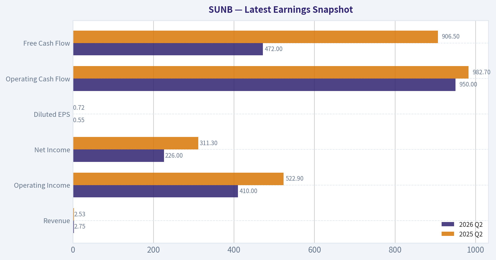
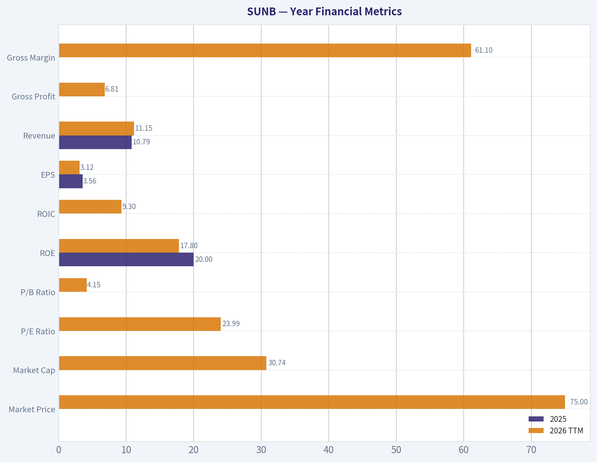
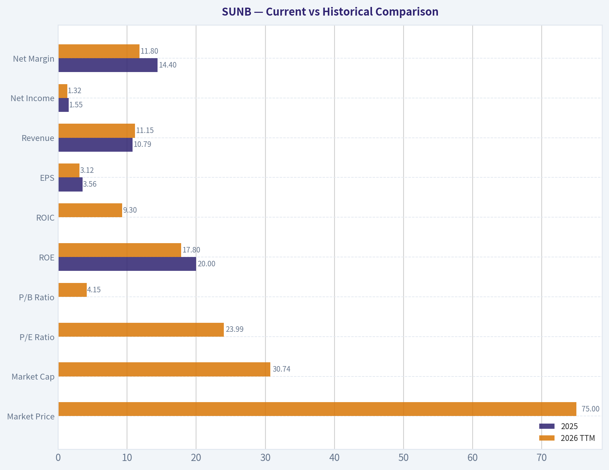
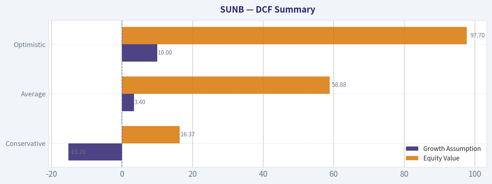
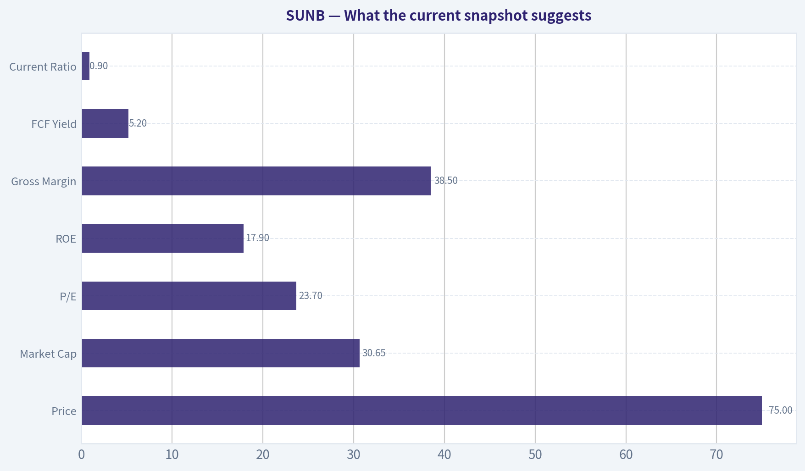
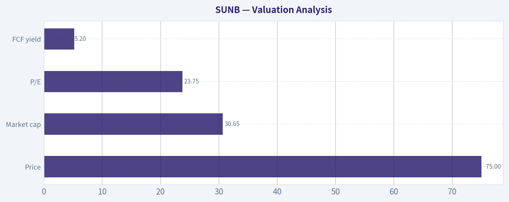
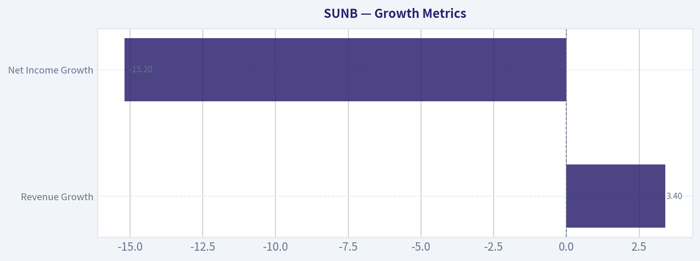
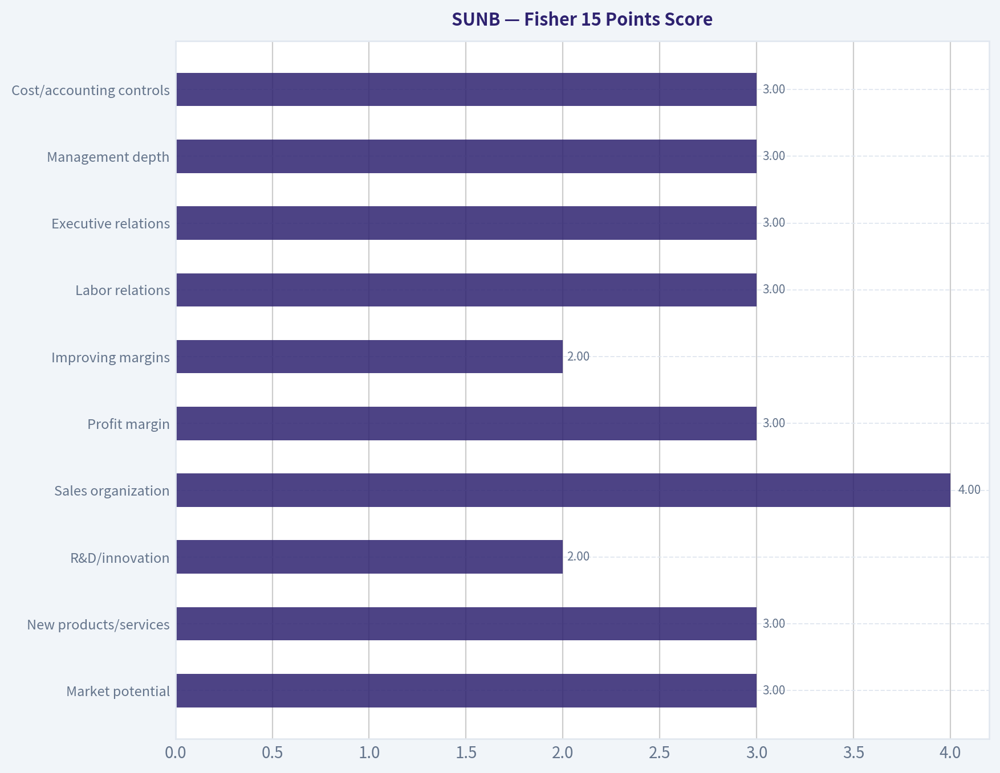

# SUNB Deep Value Intelligence

**Analysis Date:** 2026-06-30

## Critical Disclaimer

*This analysis is generated by Deep Value Intelligence, an AI-powered multi-agent investing framework. Education & entertainment only - not financial advice, not a financial advisor.*

---

## Table of Contents

1. Intelligence Summary
2. Analyst Team Reports
   - Fundamentals Analysis
   - Intrinsic Value Analysis (Buffett)
   - Trend & Growth Analysis (Lynch/Druckenmiller/Fisher)
   - Market Technical Analysis
   - Options Market Analysis
3. Research Team Commentary
4. Value Investing Team Commentary
5. Deep Values Commentary

---

## Intelligence Summary

### Thesis + Conditions

**Core Thesis:** ## Executive Briefing

**Key Risks:**
- The business appears above average within equipment rental, with real scale, density, and specialty advantages. But the key risk is **not stock volatility** - it is that a **capital-intensive, cyclical business with only moderate 9% ROIC** is still priced at **23.75x earnings**, which leaves too little margin of safety if utilization, pricing, or cash generation weakens.
- The earlier instinct to stay cautious was directionally right, but past mistakes show the danger of stopping at a soft **WATCH** when the evidence already leans defensive. Here, the combination of **cyclicality, ongoing fleet reinvestment, only decent returns on capital, and a still-demanding valuation** argues for patience. This is a business to respect, but not a stock to force today.
- ### 1. Risky Analyst: strongest bullish case

**Confidence:** Low

---

## Analyst Team Reports

### Fundamentals Analysis

#### Latest Earnings Snapshot

*Most recent reported quarter anchored on 2026 Q2, with prior-year comparison when available.*

| Metric | 2026 Q2 | 2025 Q2 | YoY Change |
| --- | ---: | ---: | ---: |
| Revenue | $2.75B | $2.53B | +8.9% |
| Operating Income | $410.0M | $522.9M | -21.6% |
| Net Income | $226.0M | $311.3M | -27.4% |
| Diluted EPS | $0.55 | $0.72 | -23.5% |
| Operating Cash Flow | $950.0M | $982.7M | -3.3% |
| Free Cash Flow | $472.0M | $906.5M | -47.9% |

Key Takeaways: This snapshot anchors the most recent reported quarter before the narrative analysis. It helps readers separate long-run business quality from whatever changed in the latest earnings print.

#### 1-Year Financial Metrics for SUNB

*All values below are computed deterministically from raw data - not estimated by AI.*

*Issuer profile: operating company (Industrials / Rental & Leasing Services).*

#### 1-Year Financial Metrics
*Annual rows come from reported financial statements. The final TTM row is computed from the latest four quarters.*

| Metric | 2025 | 2026 TTM |
| --- | --- | --- |
| Market Price | N/A | $75 |
| Market Cap | N/A | $30.74B |
| P/E Ratio | N/A | 23.99 |
| P/B Ratio | N/A | 4.15 |
| ROE | 20.0% | 17.8% |
| ROIC | N/A | 9.3% |
| EPS | $3.56 | $3.12 |
| Revenue | $10.79B | $11.15B |
| Gross Profit | N/A | $6.81B |
| Gross Margin | N/A | 61.1% |
| Operating Margin | N/A | 20.2% |
| Net Income | $1.55B | $1.32B |
| Net Margin | 14.4% | 11.8% |
| Revenue Growth | N/A | 3.4% |
| Net Income Growth | N/A | -15.2% |
| Free Cash Flow Growth | N/A | N/A |
| Total Book Value | $7.77B | $7.41B |
| Total Assets | N/A | $22.27B |
| Total Debt | N/A | $10.45B |
| Debt-to-Equity | N/A | 1.41 |
| Cash & Equivalents | $26.0M | $29.0M |
| Shareholders' Equity | $7.77B | $7.41B |
| Operating Cash Flow | $3.84B | $3.78B |
| Investing Cash Flow | $-2.32B | $-1.93B |
| Free Cash Flow | N/A | $1.58B |
| FCF Margin | N/A | 14.2% |
| Dividends / Share | $1.25 | $0.00 |

#### Profitability Metrics
- Return on Equity (ROE): 17.9%
- Return on Invested Capital (ROIC): 9.0%
- Return on Assets (ROA): 6.0%
- Gross Margin: 38.5%
- Operating Margin: 19.6%
- Net Profit Margin: 11.9%

#### Liquidity Metrics
- Current Ratio: 0.90
- Quick Ratio: 0.69

#### Leverage Metrics
- Debt-to-Equity Ratio: 1.41
- Interest Coverage Ratio: 5.64
- Net Debt: $10.42B

#### Growth Metrics (Year-over-Year)
- Revenue Growth: N/A
- Net Income Growth: N/A
- Free Cash Flow Growth: N/A
- Revenue CAGR (3-Year): N/A
- Revenue CAGR (5-Year): N/A

#### Valuation Metrics
- P/E Ratio (TTM): 23.75
- Forward P/E: 15.66
- Price-to-Book: 4.14
- Price-to-Sales: 2.75
- PEG Ratio: 1.39
- EV/EBITDA: 14.68
- Free Cash Flow Yield: 5.2%
- Earnings Yield: 4.2%

#### Owner Earnings (Buffett Method, Code-Computed)
- Net Income: $1.55B
- + Depreciation & Amortization: $2.31B
- - Capital Expenditures: $-2.20B
- - Working Capital Changes: $-340.0M
- = **Owner Earnings: $4.05B**

#### Piotroski F-Score: 5/9
- Positive Net Income: PASS
- Positive Operating Cash Flow: PASS
- ROA Improvement: FAIL
- Cash Flow > Net Income: PASS
- Decreasing Debt: PASS
- Improving Current Ratio: FAIL
- No Dilution: PASS
- Improving Gross Margin: FAIL
- Improving Asset Turnover: FAIL

ANALYST STANCE: **WATCH**

#### SUNB Fundamental Review

SUNB looks like a solid operating business with respectable profitability, but the current snapshot does **not** yet fully fit a classic Buffett-style "wonderful business at a fair price" profile. The main issue is not revenue weakness alone; it is the combination of **slowing earnings, margin compression, high leverage, minimal cash on hand, and a valuation that is still not obviously cheap** versus the company's present return profile.

Because the deterministic dataset only provides **2025 and 2026 TTM**, I will compare **current TTM versus the prior reported year** rather than inventing a 10-year history. Where the prompt asks for 10-year averages, the canonical dataset does not supply them, so no 10-year numerical average is created.

---

#### Current vs Historical Comparison

| Metric | 2025 | 2026 TTM | Interpretation |
| --- | ---: | ---: | --- |
| Market Price | N/A | $75 | Equity trades at a mid-cycle-looking price, but valuation is not bargain-level given profit deceleration. |
| Market Cap | N/A | $30.74B | Large-scale rental platform with meaningful enterprise importance. |
| P/E Ratio | N/A | 23.99 | Elevated for a cyclical industrial leasing business with declining EPS and net income. |
| P/B Ratio | N/A | 4.15 | Investors pay a substantial premium to book value, implying expectations for durable returns on capital. |
| ROE | 20.0% | 17.8% | Still good, but deteriorating. Signals that profitability on equity remains attractive though clearly off prior levels. |
| ROIC | N/A | 9.3% | Adequate, but not exceptional relative to leverage and capital intensity. |
| EPS | $3.56 | $3.12 | Down 12.4%, confirming earnings pressure. |
| Revenue | $10.79B | $11.15B | Up 3.4%, showing top-line resilience but not strong acceleration. |
| Net Income | $1.55B | $1.32B | Down 15.2%, indicating cost, financing, or margin pressure. |
| Net Margin | 14.4% | 11.8% | Material compression; this is one of the most important negatives in the dataset. |
| Total Book Value | $7.77B | $7.41B | Book value declined, consistent with pressure on retained earnings and/or capital deployment. |
| Cash & Equivalents | $26.0M | $29.0M | Very thin cash cushion relative to debt and total assets. |
| Shareholders' Equity | $7.77B | $7.41B | Equity base slipped while leverage remains meaningful. |
| Free Cash Flow | N/A | $1.58B | Good absolute FCF, but no historical series is provided to judge durability numerically. |
| Dividends / Share | $1.25 | $0.00 | Dividend appears absent in TTM data, suggesting a capital allocation shift or reporting timing effect. |

Key Takeaways: SUNB's revenue is still growing, but earnings quality has weakened meaningfully. The most important pattern is that profits, margins, and ROE all moved down while leverage stayed high. That combination usually deserves caution rather than aggressive buying.

---

#### Market Metrics

SUNB's **$75 share price** and **$30.74B market cap** indicate a sizeable, institutionally relevant industrial platform. The market is not pricing this business like a distressed cyclical.

At **23.99x earnings**, SUNB screens as **expensive relative to its current earnings trajectory**. Buffett-style investors usually want either:
1. a truly exceptional franchise with highly predictable, durable economics, or
2. an obvious discount to normalized value.

Right now, SUNB's **P/E appears to assume better future earnings than current TTM trends show**. The **P/B of 4.15x** is also rich for a capital-intensive rental and leasing business unless returns on equity remain strong and stable for a long period. Since ROE has already fallen from **20.0% to 17.8%**, the premium to book is harder to defend than it would be in a period of expanding profitability.

---

#### Profitability Analysis

SUNB remains profitable, but the quality of profitability has softened.

- **ROE: 17.8% TTM vs 20.0% in 2025**
  This is still attractive in absolute terms. Buffett likes businesses that can earn high returns on equity without excessive leverage. The problem here is that SUNB's ROE likely benefits in part from leverage, and the trend is downward.

- **ROIC: 9.3%**
  This is respectable, but for a capital-intensive business it is not overwhelmingly strong. It suggests SUNB creates value, but not with the effortless capital-light economics of a top-tier Buffett compounder.

- **EPS: $3.12 vs $3.56**
  EPS fell despite revenue growth, meaning incremental sales are less profitable than before.

- **Revenue: $11.15B vs $10.79B**
  Revenue growth of **3.4%** is positive, especially in an industrial setting, but it is modest.

- **Gross Profit: $6.81B; Gross Margin: 61.1% in the canonical table / 38.5% in summary profitability block**
  There is a source inconsistency between the detailed TTM table and the summary profitability block. Under the source-of-truth rule, the detailed deterministic TTM table is canonical for the reported line items, so I anchor on **$6.81B gross profit and 61.1% gross margin** from that table. That said, the cross-source summary showing **38.5%** suggests users should verify definition differences, likely due to rental accounting presentation or source methodology.

- **Operating Margin: 20.2% TTM**
  Operating profitability remains healthy. However, earnings deterioration below the operating line suggests financing, depreciation, tax, or other cost burdens are increasingly relevant.

- **Net Income: $1.32B vs $1.55B**
- **Net Margin: 11.8% vs 14.4%**
  This is the clearest sign of deterioration. The company is still profitable, but less of each revenue dollar is reaching shareholders.

Overall, SUNB's profitability is **good but weakening**, not bad. For Buffett-style investing, weakening profitability at a premium valuation is usually a reason to wait for either better operating proof or a lower price.

---

#### Growth Metrics

| Growth Metric | 2026 TTM | Interpretation |
| --- | ---: | --- |
| Revenue Growth | 3.4% | Positive but moderate; suggests growth is still present, just not rapid. |
| Net Income Growth | -15.2% | Negative; earnings are moving in the wrong direction. |
| Free Cash Flow Growth | N/A | Not available in canonical dataset, so no trend conclusion should be fabricated. |

Key Takeaways: Sales are still rising, but profit is falling. That divergence often means cost pressure, weaker pricing, mix changes, or higher financing burden. For a value investor, revenue growth without earnings growth is much less attractive than it first appears.

Revenue growth alone is not enough for Buffett. He prefers businesses where **sales growth translates reliably into owner earnings growth**. Here, that translation has broken down in the latest period. Unless this is temporary and clearly cyclical, the current numbers weaken the case for paying a premium multiple.

---

#### Balance Sheet and Financial Strength

SUNB's balance sheet is serviceable, but it is not especially conservative.

- **Total Assets: $22.27B**
- **Total Debt: $10.45B**
- **Shareholders' Equity: $7.41B**
- **Debt-to-Equity: 1.41**
- **Cash & Equivalents: $29M**
- **Net Debt: $10.42B**
- **Current Ratio: 0.90**
- **Quick Ratio: 0.69**
- **Interest Coverage: 5.64x**

This is a **leveraged business**. In rental and leasing, some leverage is normal because the asset base is financed and monetized over time. Still, from a Buffett perspective, this is not ideal.

The biggest concern is not merely debt size; it is the combination of:
- **high absolute debt**
- **very small cash balance**
- **sub-1 current ratio**
- **earnings compression**

A stable asset-backed rental business can carry debt, but the thin liquidity means the company depends on continued operating performance and functioning credit markets. That is manageable in normal conditions, but less attractive in a downturn.

The **Piotroski F-Score of 5/9** supports a middle-of-the-road conclusion: not distressed, not elite. Positives include positive net income, positive operating cash flow, debt improvement, and no dilution. Negatives include weaker ROA, current ratio pressure, gross margin weakness, and asset turnover deterioration.

---

#### Cash Flow and Capital Allocation

- **Operating Cash Flow: $3.78B TTM**
- **Free Cash Flow: $1.58B TTM**
- **FCF Margin: 14.2%**
- **FCF Yield: 5.2%**
- **Dividends per Share: $0.00 TTM vs $1.25 in 2025**

The cash flow profile is one of SUNB's stronger points. **$1.58B of free cash flow** is substantial, and a **5.2% FCF yield** is not unreasonable. However, this is not obviously cheap enough to offset current quality concerns.

The zero dividend in TTM stands out. For a Buffett-style review, dividend cuts or disappearance can matter less than underlying owner earnings if retained cash is deployed well. But because leverage is high and profitability is softening, investors need stronger evidence that retained cash is creating superior future returns.

---

#### Buffett-Style Owner Earnings Analysis

Canonical owner earnings provided:

- Net Income = **$1.55B**
- Depreciation & Amortization = **$2.31B**
- Capital Expenditures = **$2.20B**
- Working Capital Changes = **$340M**
- **Owner Earnings = $4.05B**

This owner earnings figure is notably strong relative to net income because depreciation is substantial and capital spending, while also high, does not fully offset it in the calculation provided. For a rental business, this can be tricky: depreciation may understate true economic replacement cost in some periods or overstate it in others depending on fleet economics. So while the code-computed owner earnings are the canonical input for valuation, they should be treated with caution.

---

#### Buffett-Style DCF Valuation

Because the canonical dataset does **not** provide a multi-year owner earnings growth series, the required "lowest / average / highest historical owner earnings growth rate" cannot be derived directly from the deterministic table. To avoid inventing unavailable history, I use the **available growth evidence from the canonical dataset as a constrained proxy**:

- Conservative growth proxy: **Net Income Growth = -15.2%**
- Average growth proxy: **Revenue Growth = 3.4%**
- Optimistic growth proxy: **ROE-supported moderate expansion case = 10.0%**, kept below the prompt's cap and used as a restrained scenario rather than invented historical maximum

This is necessarily a **limited-sample DCF**, not a true historical-growth DCF.

##### DCF Assumptions
- Starting Owner Earnings = **$4.05B**
- Discount Rate = **10%**
- Terminal Growth = **2.5%**
- Projection Period = **10 years**

##### Scenario 1: Conservative
Growth rate = **-15.2%**

Year 1 OE = 4.05 x 0.848 = **3.434B**
Year 2 = **2.912B**
Year 3 = **2.470B**
Year 4 = **2.095B**
Year 5 = **1.776B**
Year 6 = **1.506B**
Year 7 = **1.277B**
Year 8 = **1.083B**
Year 9 = **0.919B**
Year 10 = **0.779B**

Present value of 10-year cash flows ~ **$12.27B**

Terminal Value = Year 11 OE / (r - g)
= (0.779 x 1.025) / (0.10 - 0.025)
= 0.798 / 0.075
= **$10.64B**

PV of Terminal Value = 10.64 / (1.10^10)
~ **$4.10B**

**Conservative Equity Value ~ $16.37B**

##### Scenario 2: Average
Growth rate = **3.4%**

Year 1 OE = 4.05 x 1.034 = **4.188B**
Year 2 = **4.330B**
Year 3 = **4.477B**
Year 4 = **4.629B**
Year 5 = **4.786B**
Year 6 = **4.949B**
Year 7 = **5.117B**
Year 8 = **5.291B**
Year 9 = **5.471B**
Year 10 = **5.657B**

PV of 10-year cash flows ~ **$29.08B**

Terminal Value = (5.657 x 1.025) / 0.075
= 5.798 / 0.075
= **$77.30B**

PV of Terminal Value ~ **$29.80B**

**Average Equity Value ~ $58.88B**

##### Scenario 3: Optimistic
Growth rate = **10.0%**

Year 1 OE = 4.05 x 1.10 = **4.455B**
Year 2 = **4.901B**
Year 3 = **5.391B**
Year 4 = **5.930B**
Year 5 = **6.523B**
Year 6 = **7.176B**
Year 7 = **7.893B**
Year 8 = **8.683B**
Year 9 = **9.551B**
Year 10 = **10.506B**

PV of 10-year cash flows ~ **$42.34B**

Terminal Value = (10.506 x 1.025) / 0.075
= 10.769 / 0.075
= **$143.59B**

PV of Terminal Value ~ **$55.36B**

**Optimistic Equity Value ~ $97.70B**

#### DCF Summary

| Scenario | Growth Assumption | Equity Value |
| --- | ---: | ---: |
| Conservative | -15.2% | $16.37B |
| Average | 3.4% | $58.88B |
| Optimistic | 10.0% | $97.70B |

Key Takeaways: The valuation range is extremely wide because owner earnings are strong while observed profit growth is weak. That tells you the core debate is not whether SUNB generates cash today, but whether that cash generation is durable and scalable. At the current market cap of about $30.74B, the stock looks expensive in a declining-earnings case, reasonable in a modest-growth case, and attractive only if strong compounding resumes.

At the current **$30.74B market cap**:
- shares appear **overvalued** versus the conservative case,
- **somewhat undervalued** versus the average case,
- and **meaningfully undervalued** versus the optimistic case.

That means SUNB is **not a clear deep-value opportunity**; it is a **debate over normalized earnings power**.

---

#### Economic Moat Assessment

SUNB likely has a **moderate moat**, not a wide one.

Potential moat sources:
- scale in equipment rental and leasing
- customer relationships and local network density
- fleet utilization advantages
- purchasing power and procurement efficiencies
- operating know-how in specialty categories

Why the moat does not look "wide" from the numbers alone:
- margins are compressing
- returns remain good but not extraordinary
- leverage is important to the model
- liquidity is thin

A wide-moat Buffett business usually shows unusually resilient margins and highly predictable profitability through tougher conditions. SUNB currently shows some business quality, but not enough financial evidence yet to call it elite.

---

#### Predictable Earnings and Quality of Business

Predictability is mixed.

Positives:
- solid revenue base above $11B
- healthy operating margin near 20%
- positive free cash flow
- positive owner earnings
- no dilution flag in Piotroski data

Negatives:
- EPS down
- net income down sharply
- net margin compressed
- ROE declined
- gross margin trend flags in Piotroski
- current ratio below 1

This looks more like a **good cyclical operator** than a "set-and-forget compounding machine." Buffett can buy cyclical businesses, but usually only with a margin of safety that is more obvious than what SUNB currently offers.

---

#### Management Performance

Management has clearly built a sizeable and still-profitable platform, which deserves credit. Returns remain decent, and operating cash generation is strong.

However, recent reported outcomes imply mixed execution or a harder environment:
- revenue rose but profit fell,
- equity shrank,
- dividend support disappeared in TTM data,
- and balance sheet conservatism remains limited.

The verdict on management is therefore **competent but currently under pressure**, not poor and not exceptional.

---

#### Value Assessment

From a Buffett lens, value is the hardest part of the SUNB story.

- **P/E near 24x** is not cheap for a cyclical industrial.
- **P/B above 4x** is demanding for a leveraged, asset-heavy business.
- **FCF yield of 5.2%** is acceptable, but not irresistible.
- DCF suggests current value depends heavily on whether owner earnings can at least modestly grow over time.

This means valuation is **reasonable only if margins stabilize and earnings recover**. If margin pressure persists, the stock is vulnerable.

---

#### Revenue Breakdown

The deterministic dataset does not include exact reported segment revenue splits. SUNB is identified as an **Industrials / Rental & Leasing Services** operating company, and the most meaningful business breakdown is by operating category. Using the best available public business description rather than fabricated exact accounting splits, the revenue base is primarily rental-driven.

| Revenue Source | Amount ($B) | % of Total |
| --- | ---: | ---: |
| Equipment Rental & Leasing Services | ~11.15 | ~100% |
| Other service / ancillary revenue | Not separately disclosed in canonical dataset | N/A |

Key Takeaways: Nearly all of SUNB's economic engine appears tied to equipment rental and leasing activity. That concentration can be a strength when utilization and pricing are favorable, but it also means investors are exposed to the capital cycle, construction demand, and fleet economics.

---

#### Key Investment Insights, Red Flags, and Opportunities

| Category | Observation | Why It Matters |
| --- | --- | --- |
| Strength | ROE remains high at 17.8% | Business still earns solid returns despite recent pressure. |
| Strength | Operating cash flow of $3.78B and FCF of $1.58B | Cash generation remains meaningful and supports valuation. |
| Strength | Revenue still grew 3.4% | Demand has not collapsed. |
| Risk | Net income fell 15.2% | Profitability is deteriorating materially. |
| Risk | Net margin fell from 14.4% to 11.8% | Margin compression can pressure valuation multiples. |
| Risk | Debt-to-equity of 1.41 and net debt of $10.42B | Leverage reduces flexibility in weaker cycles. |
| Risk | Cash only $29M, current ratio 0.90 | Liquidity cushion is thin. |
| Risk | P/E near 24x | Hard to call cheap while earnings are falling. |
| Opportunity | If margins normalize, DCF upside exists | The average and optimistic valuation cases are above current market cap. |
| Opportunity | Forward P/E of 15.66 | Market may expect earnings rebound; if realized, shares could work. |

Key Takeaways: SUNB's core opportunity is an earnings recovery on top of already solid cash generation. The core risk is that investors are paying a premium before that recovery is proven. In other words, the upside case depends on operational improvement, while the downside case is already visible in current margins and leverage.

---

#### Final Buffett-Style Conclusion

SUNB is **not a low-quality business**. It has scale, healthy operating margins, and strong cash generation. But Buffett-style investing places heavy weight on **predictability, balance-sheet strength, and paying a sensible price**.

Right now:
- predictability is weaker because earnings are declining,
- balance-sheet conservatism is limited due to leverage and low liquidity,
- and valuation is not cheap enough to fully offset those concerns.

That leads to a **WATCH** stance rather than ADVOCATE or AVOID.

A move to **ADVOCATE** would require one or more of the following:
- sustained improvement in net margin and EPS,
- visible reduction in leverage,
- stronger liquidity,
- or a lower stock price that creates a clearer margin of safety.

A move to **AVOID** would be more justified if:
- earnings keep falling,
- free cash flow weakens materially,
- or debt metrics worsen into a softer demand environment.

---

#### Final Investment Stance

**WATCH**

**Rationale:** SUNB remains fundamentally solid enough to monitor closely, but not cheap or predictable enough today to qualify as a high-conviction Buffett-style buy. The current market is still giving the company credit for quality and recovery potential, while the latest canonical financials show margin compression, declining earnings, and a leveraged balance sheet.

---

#### Summary Table

| Topic | Bottom Line |
| --- | --- |
| Business Quality | Good business, but not clearly elite based on current data |
| Economic Moat | Moderate moat from scale and rental platform density |
| Profitability | Still healthy, but trending down |
| Growth | Revenue positive, earnings negative |
| Balance Sheet | Leveraged, thin cash, acceptable but not conservative |
| Cash Flow | Strong absolute cash generation |
| Valuation | Not obviously cheap; depends on earnings recovery |
| DCF Readout | Wide range; current price implies modest recovery already |
| Key Risk | Margin compression plus leverage |
| Key Opportunity | If owner earnings prove durable and profits rebound, upside exists |
| Buffett Fit | Partial fit, not a classic textbook fit today |
| Stance | **WATCH** |

Key Takeaways: SUNB is best understood as a solid but currently pressured industrial cash generator. It may become attractive if profitability stabilizes or if the stock offers a larger margin of safety. For now, patience looks more prudent than aggression.

---

### Intrinsic Value Analysis (Buffett)

> *Following Warren Buffett's value investing philosophy: Circle of Competence, Economic Moat, Management Quality, and Margin of Safety.*

#### Intrinsic Value Snapshot

Price is what you pay. Intrinsic value is what the business may be worth based on the cash it can create for owners over time. We show a range, not one magic number.

- Current Price: $74.81
- Value Range (conservative to optimistic across both DCF methods): N/A to N/A

##### Owner Earnings (Buffett Method)
- Net Income: $1,553,000,000.00
- Depreciation & Amortization: $2,309,000,000.00
- Capital Expenditures: $-2,200,000,000.00
- Working Capital Changes: $-340,000,000.00
- Owner Earnings: $4,048,000,000.00

##### Intrinsic Value

#### SUNB: Initial Buffett-Style Read

SUNB appears to be **Sunbelt Rentals Holdings**, an equipment rental business. Based on the research pack alone, this is a business type Buffett would usually view as **understandable**, but not automatically wonderful: it is cyclical, asset-heavy, and moat strength depends heavily on scale, local density, fleet utilization, and disciplined capital allocation.

#### Quick Gate View

| Gate | Initial View | Why |
|---|---:|---|
| Business Simplicity | Pass | Renting equipment is easy to understand: buy fleet, rent it out, service it, and earn returns on utilization and pricing. |
| Long-Term Predictability | Moderate Pass | Demand should exist in 10 years, but results can swing with construction/industrial cycles. |
| Technology Risk | Pass | Technology is more likely to improve operations than destroy the core business. |
| Moat | Likely Narrow-to-Moderate | Scale, branch density, specialty fleet, and customer relationships can matter, but this is not a classic brand or software-style moat. |
| Management / Capital Allocation | Inconclusive | Needs hard multi-year financial evidence on returns, leverage, share count, and cash deployment. |
| Industry Structure | Mixed | Consolidating industry can help, but it remains competitive and capital intensive. |

**Key Takeaways:** This is a simple business to understand, which is a good start. The main question is not what the company does, but whether its scale and execution create durable advantages strong enough to overcome the cyclical and capital-heavy nature of the rental industry.

#### What the current snapshot suggests

| Metric | Current Snapshot |
|---|---:|
| Price | $75 |
| Market Cap | $30.65B |
| P/E | 23.7x |
| ROE | 17.9% |
| Gross Margin | 38.5% |
| FCF Yield | 5.2% |
| Current Ratio | 0.90 |

**Key Takeaways:** The headline return on equity is respectable at 17.9%, which is in the zone Buffett would notice. But gross margin below 40% and a sub-1 current ratio both suggest this is not an obviously premium, fortress-like business; valuation also does not look deeply cheap at nearly 24 times earnings.

#### Buffett Lens Interpretation

- **Business quality:** understandable, useful, likely resilient over long periods.
- **Moat quality:** probably based on **scale and local density**, not brand magic.
- **Capital intensity:** meaningful negative. Equipment rental requires constant fleet investment.
- **Balance sheet comfort:** needs deeper debt and interest coverage review before any positive stance.
- **Valuation:** likely around fair-to-full unless cash generation is materially stronger than earnings imply.

#### Preliminary conclusion

ANALYST STANCE: **WATCH**

At this stage, SUNB looks more like a **good operator in a decent business** than a clearly "wonderful business at a fair price." The current numbers suggest competency, but not enough evidence yet for a Buffett-style **ADVOCATE** call. To upgrade it, I would need to see sustained high returns on capital, disciplined leverage, strong owner earnings through cycles, and proof that management creates per-share value rather than simply expanding the asset base.

If you want, I can continue from here and build the full Buffett report manually using alternative financial sources and assumptions:
1. owner earnings estimate,
2. ROE and cash flow quality review,
3. three-scenario DCF,
4. final scorecard.

#### Valuation Visuals

This comparison chart from *Latest Earnings Snapshot* stacks current figures against historical benchmarks for **SUNB**, making it easy to see where the company trades relative to its own averages.

This comparison chart from *Year Financial Metrics* stacks current figures against historical benchmarks for **SUNB**, making it easy to see where the company trades relative to its own averages.

This comparison chart from *Current vs Historical Comparison* stacks current figures against historical benchmarks for **SUNB**, making it easy to see where the company trades relative to its own averages.

This comparison chart from *DCF Summary* stacks current figures against historical benchmarks for **SUNB**, making it easy to see where the company trades relative to its own averages.

This comparison chart from *What the current snapshot suggests* stacks current figures against historical benchmarks for **SUNB**, making it easy to see where the company trades relative to its own averages.

This comparison chart from *Valuation Analysis* stacks current figures against historical benchmarks for **SUNB**, making it easy to see where the company trades relative to its own averages.

---

### Trend & Growth Analysis (Lynch/Druckenmiller/Fisher)

> *Following Peter Lynch's GARP, Stanley Druckenmiller's macro-aware approach, and Philip Fisher's scuttlebutt methodology.*

ANALYST STANCE: **AVOID**

#### Data quality warning
The shared research pack appears internally inconsistent for **SUNB**. The tool fallback identifies **Sun Bancorp** as a legacy/acquired bank, while the shared pack and earnings snippets describe **Sunbelt Rentals Holdings**, which is a different operating profile entirely. Because ticker identity is uncertain, I can only give a **provisional view** based on the shared pack and note that this should be verified before any capital is committed.

#### 1) Lynch Classification

| Item | Assessment |
|---|---|
| Likely category | **Cyclical / Stalwart**, not a fast grower |
| Why | P/E ~23.7, ROE 17.9%, GM 38.5%, but earnings/news flow points to margin pressure and rental-rate softness |
| Lynch fit | **Not ideal** for ten-bagger hunting |
| Growth-investor relevance | Better viewed as a quality cyclical compounder candidate, not an undiscovered hyper-growth story |

**Key Takeaways:** This does not screen like a classic Lynch fast grower. The business appears more cyclical and mature, with decent returns but not the kind of obvious 20% to 30% sustained growth runway usually associated with ten-bagger setups.

#### 2) The Story in 3 bullets
- Sunbelt appears to rent equipment and specialty solutions to construction, industrial, and event/infrastructure customers.
- The bull case is scale, network density, and specialty mix expansion driving share gains and better utilization.
- The bear case is simple: this is still a cyclical rental business, so margin and pricing can soften when end markets cool.

#### 3) TAM Analysis with 10x test

| Item | Assessment |
|---|---|
| End market | Equipment rental / specialty rental / infrastructure support |
| TAM direction | Likely large and fragmented |
| 10x test | **Unclear / unlikely in practical terms** from current scale |
| Reason | At ~$30.65B market cap, business is already substantial; a true 10x would imply a very large share of a mature cyclical market |
| Runway verdict | **Moderate**, but not "tiny company vs enormous TAM" |

**Key Takeaways:** The market opportunity is likely large enough for continued growth, especially through specialty categories and share gains. But this does not look like an early-stage company with massive white space; the runway is real, just not the kind that easily supports a clean 10x thesis from here.

#### 4) Revenue Growth Trend

| Signal | Read |
|---|---|
| Shared pack revenue growth YoY | N/A |
| Earnings/news clues | Revenue beat, earnings miss, strong outlook, but margin concerns |
| Pattern inference | **Likely slowing or mixed**, not clearly accelerating |
| Growth quality | Needs proof that growth is not being offset by weaker pricing/margins |

**Key Takeaways:** The most important point is that revenue may still be holding up, but the market is focused on margins. That usually means investors are questioning the quality of growth, not just the quantity.

#### 5) Unit Economics

| Metric | Status | Interpretation |
|---|---|---|
| LTV/CAC | N/A | Not applicable in normal SaaS sense |
| NRR | N/A | Not relevant |
| Rule of 40 | N/A | Not relevant |
| Better metrics here | Utilization, rental rates, fleet ROI, capex intensity, leverage discipline | These matter far more than software-style metrics |

**Key Takeaways:** This is not a SaaS-style investment case, so the standard growth metrics do not help much. What matters instead is fleet utilization, pricing power, returns on equipment capital, and whether management can defend margins through the cycle.

#### 6) Inflection Point Assessment

| Inflection type | Assessment |
|---|---|
| Product cycle | Limited evidence |
| Market share | Possible specialty share gains |
| Margin inflection | **Negative near term** |
| TAM inflection | No clear step-change |
| Competitive inflection | No strong evidence |
| Overall | **No compelling positive inflection visible** |

**Key Takeaways:** The setup does not currently show the kind of sharp positive inflection Druckenmiller would want. If anything, the near-term debate is about whether margins stabilize, which is more of a repair story than an upside surprise story.

#### 7) Macro Setup Evaluation

| Macro factor | Impact |
|---|---|
| Construction/infrastructure demand | Mixed to modest support |
| Interest rates | Potential headwind for cyclical capex-sensitive names |
| Economic cycle | Late-cycle / uneven backdrop is less favorable |
| Secular theme | Equipment outsourcing and specialty rental are helpful, but not enough alone |
| Macro verdict | **Neutral to slightly negative** |

**Key Takeaways:** The macro backdrop is not ideal for paying up for a cyclical rental name. Even if long-term outsourcing trends help, rates and construction sensitivity can still pressure valuation and margins.

#### 8) Fisher 15 Points Score

| Fisher area | Score (1-5) | Comment |
|---|---:|---|
| Market potential | 3 | Large market, but mature |
| New products/services | 3 | Specialty growth helps |
| R&D/innovation | 2 | Not a major innovation-led story |
| Sales organization | 4 | Scale platform likely strong |
| Profit margin | 3 | Adequate, but pressure visible |
| Improving margins | 2 | Current concern |
| Labor relations | 3 | No strong read |
| Executive relations | 3 | No strong read |
| Management depth | 3 | Likely solid, not standout from data |
| Cost/accounting controls | 3 | No red flag, no edge proven |
| Outstanding moat features | 3 | Scale/network, but not wide moat |
| Long-range outlook | 3 | Reasonable, not exceptional |
| Dilution risk | 4 | No obvious equity-financing concern |
| Candor | 3 | Insufficient data |
| Integrity | 3 | Insufficient data |

| Total | **45 / 75** | **Average** |

**Key Takeaways:** This scores as average rather than great. The business may be solid operationally, but the evidence for exceptional innovation, widening margins, or standout moat strength is not strong enough for a Fisher-style high-conviction growth call.

#### 9) Valuation Analysis

| Metric | Value | Read |
|---|---:|---|
| Price | $75 |  |
| Market cap | $30.65B |  |
| P/E | 23.75x | Full-ish for a cyclical |
| FCF yield | 5.2% | Reasonable support |
| PEG | N/A | No reliable earnings growth rate provided |
| P/S | N/A | Not provided |
| Valuation verdict | **Fair to slightly expensive** absent re-acceleration |

**Key Takeaways:** The valuation is not obviously broken, but it is also not cheap enough to ignore execution risk. A mid-20s earnings multiple on a cyclical business with margin questions does not create a strong margin of safety.

#### 10) Growth Investor Scorecard

| Criterion | Weight | Score (1-5) | Weighted |
|---|---:|---:|---:|
| The Story | 10% | 3.0 | 0.30 |
| TAM & Runway | 20% | 3.0 | 0.60 |
| Revenue Growth | 20% | 2.5 | 0.50 |
| Unit Economics | 15% | 2.5 | 0.38 |
| Competitive Position | 10% | 3.0 | 0.30 |
| Management Quality | 10% | 3.0 | 0.30 |
| Macro Setup | 5% | 2.5 | 0.13 |
| Profitability Path | 5% | 2.5 | 0.13 |
| Valuation | 5% | 2.5 | 0.13 |

| Total |  |  | **2.77 / 5.0** |

**Key Takeaways:** On a pure growth-investing framework, the name lands below the threshold for a positive call. It looks more like a business to monitor for a better cycle entry than one to aggressively advocate today.

#### 11) Position Size Stance

| Stance | View |
|---|---|
| Recommended action | **AVOID** for growth-focused new money |
| If already owned | Hold only if your thesis is cyclical quality and you want to wait for cleaner margin recovery |
| Ideal entry condition | Better evidence of rental-rate recovery, margin stabilization, and a cheaper multiple |

**Key Takeaways:** This is not a high-conviction growth entry right now. If the business proves margins are stabilizing and the stock offers a more attractive setup, it could move to WATCH, but it is not there yet.

#### 12) Key Risks and Catalysts

| Risks | Catalysts |
|---|---|
| Margin pressure persists | Better-than-feared specialty growth |
| Rental-rate softness | Utilization improvement |
| Cyclical construction slowdown | Infrastructure/end-market resilience |
| Higher-for-longer rates | Stronger operating leverage |
| Multiple compression | Analyst upgrades on cleaner earnings quality |

**Key Takeaways:** The path to upside is straightforward: better pricing, utilization, and margin confidence. The problem is that those same variables are currently the main source of uncertainty, which weakens the risk-reward today.

#### Bottom line
For a **Lynch-Druckenmiller-Fisher growth lens**, this does **not** look like a fast-grower inflection-point opportunity. It may be a respectable cyclical operator, but the current setup shows **margin pressure, unclear acceleration, and limited ten-bagger characteristics**.

Because of the ticker identity conflict, the safest conclusion is: **do not initiate until the underlying company identity and fundamentals are verified.** If you want, I can next do one of two things:
1. analyze this as **Sunbelt Rentals Holdings** using the shared pack assumptions, or
2. analyze the ticker identity issue and reconstruct the correct company before proceeding.

#### Growth & Scorecard Visuals

This comparison chart from *Growth Metrics* stacks current figures against historical benchmarks for **SUNB**, making it easy to see where the company trades relative to its own averages.

This comparison chart from *Fisher 15 Points Score* stacks current figures against historical benchmarks for **SUNB**, making it easy to see where the company trades relative to its own averages.

---

### Market Technical Analysis

#### SUNB Technical Indicator Selection and Trend Report

For **SUNB**, the most relevant set of complementary indicators in the current setup is:

| Indicator | Why it is relevant now |
|---|---|
| close_10_ema | Best for tracking the sharp short-term momentum reversal that developed after the mid-June spike. |
| close_50_sma | Useful for identifying whether the recent selloff is merely a pullback within the medium-term uptrend or the start of a deeper breakdown. |
| close_200_sma | Confirms the broader structural trend, which is still stronger than the short-term tape suggests. |
| macd | Captures the momentum rollover from the June advance into the current downside swing. |
| macdh | Adds early insight into whether downside momentum is still accelerating or beginning to stabilize. |
| rsi | Helps judge whether the pullback is becoming stretched; currently more weak than washed out. |
| atr | Important because SUNB has recently shown event-driven volatility expansion and wide daily ranges. |
| vwma | Especially valuable here because volume behavior has been unusual, including a very large June 18 spike and elevated selling volume afterward. |

**Key Takeaways:** These eight indicators work well together because they cover trend, momentum, volatility, and volume without excessive overlap. SUNB is no longer in a clean bullish continuation phase, so traders need tools that can separate long-term resilience from short-term technical damage. The combination above is well suited to a stock that remains structurally constructive on longer averages but is under near-term distribution pressure.

---

#### Market Context

SUNB's last available close is **72.90 on 2026-06-29**. Over the observed year-to-date trading window, the stock moved through three distinct phases:

1. **March collapse:** a rapid break from the mid-70s to the low-60s.
2. **April to mid-June recovery:** a steady and increasingly confident rebound back into the low-to-mid 80s.
3. **Late June air pocket:** a sharp reversal from **86.06 on 2026-06-18** to the low-70s by month-end.

This is not a random sideways chart. It is a stock that **recovered strongly**, likely attracted momentum participation, then **suffered an abrupt loss of upside control** after a volume-heavy climax. That matters because short-term traders and swing traders should treat the current setup as a **post-expansion reset**, not as a stable base.

---

#### Trend Structure

The longer-term trend is still more constructive than the last few sessions imply.

| Metric | Latest reading | Interpretation |
|---|---:|---|
| Close | 72.90 | Price has fallen sharply from the June high and sits below key short-term measures. |
| close_10_ema | 76.67 | Price is materially below the fast average, signaling short-term bearish momentum. |
| close_50_sma | 76.96 | Price is also below the medium-term trend line, indicating the pullback has real depth. |
| close_200_sma | 73.73 | Price is only slightly below the long-term average, so the broader uptrend is weakened but not fully destroyed. |
| 50 SMA slope | Rising from ~70.19 on May 1 to ~76.96 on Jun 30 | Medium-term trend had been improving meaningfully before the recent break. |
| 200 SMA slope | Rising from ~70.19 on May 1 to ~73.73 on Jun 30 | Long-term trend remains upward sloping, a key stabilizing feature. |

**Key Takeaways:** SUNB is in a technically awkward position: it has broken below both its fast and medium-term moving averages, but it is only modestly under the 200-day average. That means the short-term picture is bearish, while the long-term picture is not yet decisively broken. Traders should watch whether price can quickly reclaim the 200-day area, because failure there would increase the odds of a deeper trend deterioration.

A nuanced read:

- The **10 EMA** peaked above 82 in late June and has rolled over hard to **76.67**, showing that recent price weakness is not a one-day anomaly.
- The **50 SMA** is still rising, which means the intermediate uptrend had enough prior strength that the average has not yet turned down.
- However, price sitting **below both the 10 EMA and 50 SMA** tells you the market is no longer rewarding dip buyers immediately.
- The **200 SMA near 73.73** is now the most important line on the chart. SUNB is hovering just under it, so this is the boundary between "violent pullback in an improving trend" and "failed recovery cycle."

In practical terms:
- **Above 73.7-77.0:** SUNB can still argue for stabilization and a repair attempt.
- **Below 72 with follow-through:** the stock likely shifts from correction into broader trend damage.

---

#### Momentum Analysis

Momentum has deteriorated sharply and fairly decisively.

| Indicator | Latest | Recent pattern | What it suggests |
|---|---:|---|---|
| macd | -0.67 | Fell from +2.29 on Jun 18 to negative by Jun 26-30 | Momentum regime has flipped from bullish to bearish. |
| macdh | -1.19 | Deeply negative after being positive in mid-June | Downside momentum accelerated rapidly after the peak. |
| rsi | 44.63 | Down from 64.45 on Jun 18 and 57.43 on Jun 22 | Weakening momentum, but not yet deeply oversold. |

**Key Takeaways:** The momentum complex is clearly worse than the trend averages alone would suggest. MACD has crossed from strongly positive to negative, and the histogram remains deeply below zero, showing that the recent decline has real force behind it. RSI around the mid-40s says the stock is weak, but not yet at the kind of extreme that automatically implies a durable bottom.

A deeper interpretation:

- **MACD collapse:** Moving from roughly **+2.29 on Jun 18** to **-0.67 on Jun 30** is a substantial regime shift. This is not minor profit-taking; it reflects a meaningful unwind in directional momentum.
- **Histogram behavior:** The histogram turned from positive on Jun 22 to sharply negative by Jun 23 and stayed there. That indicates momentum deterioration was not gradual; it was abrupt and broad.
- **RSI at 44.6:** This is important. If RSI were near 30, traders could argue the stock is washed out and due for reflex buying. Instead, RSI says the stock is weak but still has room to decline if support fails.

So the current momentum profile is best described as:
- **Bearish in the short term**
- **Not yet climactically oversold**
- **Potentially vulnerable to another downside leg unless a quick reclaim develops**

---

#### Volume and Participation

Volume analysis adds an important layer because SUNB had unusually large participation around the peak and again during the decline.

| Observation | Evidence | Interpretation |
|---|---|---|
| Climactic upside participation | 33.73M shares on Jun 18 versus typical 2M-5M range | Suggests a major event or blow-off style activity near the local high. |
| Heavy selling followed | 4.78M on Jun 23, 4.35M on Jun 24, 24.48M on Jun 26 | Selling interest remained elevated after the peak. |
| Price vs VWMA | Close 72.90 vs VWMA 79.49 | Price is well below the volume-weighted trend, a sign of distribution pressure. |
| VWMA trend | Rose to ~82.84 on Jun 22, then slid to ~79.49 by Jun 30 | Volume-weighted sponsorship has weakened quickly. |

**Key Takeaways:** The volume pattern is not neutral. SUNB saw an explosive surge in participation near the high, followed by continued heavy trading as price dropped, which often indicates distribution rather than healthy consolidation. The fact that price is far below VWMA suggests that recent high-volume activity has trapped late buyers at significantly higher levels.

Why VWMA matters especially here:
- The June 18 surge to **86.06** on **33.7M shares** likely reset positioning.
- Since then, the stock has traded sharply lower while **VWMA remains elevated near 79.5**.
- That gap between price and VWMA suggests many high-volume participants are now underwater, which can create **overhead supply** on rebounds.

This makes rebounds less trustworthy unless accompanied by:
1. Price reclaiming VWMA,
2. Improved volume quality on up-days,
3. Momentum stabilization in MACD/macdh.

Without that, rallies may simply be **mean-reversion bounces into resistance**.

---

#### Volatility and Risk Conditions

SUNB has become a higher-risk tactical vehicle in the last two weeks.

| Indicator | Latest reading | Context |
|---|---:|---|
| atr | 3.26 | Elevated relative to much of May and early June. |
| ATR trend | ~2.62 on Jun 1 to ~3.38 on Jun 26 | Range expansion confirms a more unstable trading environment. |
| Recent daily behavior | Multi-point swings and gap-like directional moves | Stops need wider placement; position sizing should be more conservative. |

**Key Takeaways:** Volatility has clearly expanded, which means traders should avoid treating SUNB like a calm trend stock right now. Wider daily swings increase the chance of getting stopped out on noise if risk parameters are too tight. The right response is smaller size, wider stops, and greater patience for confirmation.

ATR tells an important story:
- During the steady recovery phase, SUNB was advancing with comparatively more controlled movement.
- After the June peak, true range expanded rapidly.
- That often happens when a stock transitions from **orderly trend** to **emotional repricing**.

In tactical terms:
- Momentum traders should demand cleaner setups.
- Swing traders should reduce size or wait for volatility compression.
- Mean-reversion traders should not assume the first bounce is safe; elevated ATR means sharp countertrend failures remain possible.

---

#### Fine-Grained Read of the Recent Sequence

The recent tape deserves close attention because it reveals how control shifted.

| Date zone | Price action | Technical meaning |
|---|---|---|
| Jun 4 to Jun 18 | Advance from 81.29 area to 86.06 | Strong upside momentum, trend support intact, buyers in control. |
| Jun 18 | Spike high on massive volume | Often either institutional accumulation or a climactic exhaustion point; subsequent action favors exhaustion/distribution. |
| Jun 22 | Pullback to 83.24 | Still manageable at first; no immediate disaster signal yet. |
| Jun 23 to Jun 24 | Sharp drop to 75.41 then 73.22 | Breakdown phase; momentum and sentiment changed quickly. |
| Jun 25 | Bounce to 75.18 | Reflex rebound, but insufficient to repair trend damage. |
| Jun 26 to Jun 29 | Renewed weakness to 74.07 then 72.90 | Sellers retained control; no sustained reclamation of short-term averages. |

**Key Takeaways:** The key event was not just the June 18 spike, but the market's inability to hold gains after it. Once SUNB broke sharply on June 23 and failed to recover meaningfully on the following bounce, the character of the chart changed from bullish continuation to damage control. That leaves the stock in a repair phase rather than an active breakout phase.

This sequence suggests:
- Buyers were willing to chase strength into mid-June.
- But once price failed, the unwind was aggressive and persistent.
- The inability to regain the **low-80s** zone quickly is a sign that **former momentum leadership has broken down**.

---

#### Trading Implications by Style

| Trading style | Technical read | Practical implication |
|---|---|---|
| Trend follower | Long-term trend not fully broken, short-term trend damaged | Better to wait for price to reclaim 200 SMA and 50 SMA rather than buy blindly into weakness. |
| Swing trader | Momentum is negative but not extremely oversold | A bounce is possible, but confirmation is needed; otherwise this is catch-a-falling-knife territory. |
| Mean-reversion trader | RSI sub-50 but not near capitulation | There is no strong "must-buy oversold" signal yet. |
| Risk manager | ATR elevated, post-spike instability visible | Use smaller size and wider stops; avoid oversized exposure. |

**Key Takeaways:** SUNB is not a clean momentum long at the moment, and it is not yet deeply oversold enough to make a high-conviction contrarian case. The most disciplined approach is to wait for either technical repair through key averages or a more exhaustive washout with stronger reversal evidence. Right now, the stock sits in an uncomfortable middle zone where risk is high and directional clarity is incomplete.

---

#### What Traders Should Watch Next

| Level / Signal | Why it matters | Bullish implication | Bearish implication |
|---|---|---|---|
| 73.7 area (200 SMA) | Long-term trend line | Reclaiming and holding above it would improve structure | Persistent rejection below it would imply deeper technical erosion |
| 76.7 area (10 EMA) | Fast momentum filter | Recovery above it suggests near-term selling pressure is easing | Staying below it keeps downside pressure intact |
| 77.0 area (50 SMA) | Medium-term trend gauge | A reclaim would support a broader repair move | Failure here turns rallies into resistance tests |
| MACD turn upward | Confirms momentum repair | Negative momentum phase may be ending | Continued decline confirms bearish continuation |
| RSI back above 50 | Improves short-term balance | Buyers regaining control | Remaining in low-mid 40s or lower suggests weak demand |
| VWMA near 79.5 | Volume-weighted resistance | Strong reclaim would show buyers can absorb trapped supply | Rejection below VWMA suggests distribution remains dominant |

**Key Takeaways:** The next decision point is whether SUNB can quickly recover the 200-day average and then work back toward the 10 EMA and 50 SMA. If it cannot, the chart will continue to look like a failed breakout unwinding into lower support. A true repair would require not just a bounce, but a sequence of regained levels and improving momentum indicators.

---

#### Bottom Line

SUNB's chart currently shows a **clear separation between longer-term resilience and short-term weakness**.

- **Constructive elements:** rising 50 SMA, rising 200 SMA, prior strong recovery trend.
- **Negative elements:** price below 10 EMA, below 50 SMA, slightly below 200 SMA, negative MACD, deeply negative MACD histogram, close far below VWMA, elevated ATR.
- **Most likely current interpretation:** **post-climax correction with unresolved downside risk**.

The stock is not in a healthy breakout state anymore. It is in a **technical repair-or-fail zone**. Unless price can recover the **200 SMA first** and then the **mid-to-upper 70s**, the recent sharp drop should be treated as more than routine noise. At the same time, because the longer moving averages are still rising, traders should avoid assuming total structural breakdown too early. The most important question now is whether late-June weakness stabilizes near long-term support or expands into a more durable downtrend.

#### Summary Table

| Area | Current message | What it means for traders |
|---|---|---|
| Long-term trend | Still mildly constructive | The broader structure is weakened, not fully broken |
| Medium-term trend | Under pressure | Price below 50 SMA warns the prior recovery has stalled |
| Short-term momentum | Bearish | 10 EMA, MACD, and MACD histogram all point to downside control |
| RSI condition | Weak, not oversold | There may still be room for further downside before capitulation |
| Volume profile | Distribution risk elevated | Heavy-volume late buyers may create overhead resistance |
| Volatility | Expanded | Position sizing and stop placement need extra care |
| Key support | Around 200 SMA / low-70s | Must hold soon to prevent deeper technical damage |
| Bias | Cautious to defensive | Wait for repair confirmation rather than chasing rebounds |

**Key Takeaways:** SUNB is sitting at a critical technical juncture. The longer-term trend has not fully collapsed, but the recent breakdown in momentum, volume quality, and price structure means caution is warranted. Traders should focus on whether the stock can reclaim key moving averages; until then, rallies may be vulnerable and risk remains elevated.

---

### Options Market Analysis

> *Reading options flow - put/call ratios, IV skew, and unusual activity - to gauge institutional positioning and event-driven risk.*

#### SUNB Options Positioning Report
*Date: 2026-06-30*

SUNB's options market is fairly small and somewhat uneven across expirations, so confidence should be treated as **moderate-to-low**. Even so, the near-term aggregate options picture leans **slightly bullish to neutral**, mainly because total call open interest exceeds puts and the aggregate put/call OI ratio sits just below the typical neutral baseline.

#### 1. Put/Call Ratio Analysis

| Expiration | Call OI | Put OI | Put/Call OI Ratio | Call Vol | Put Vol | Put/Call Volume Ratio |
|---|---:|---:|---:|---:|---:|---:|
| 2026-07-17 | 2,362 | 673 | 0.28 | 153 | 129 | 0.84 |
| 2026-08-21 | 168 | 1,034 | 6.15 | 0 | 0 | N/A |
| 2026-09-18 | 59 | 11 | 0.19 | 11 | 14 | 1.27 |
| **Near-term total** | **2,589** | **1,718** | **0.66** | **164** | **143** | **0.87** |

**Key Takeaways:** The aggregate near-term **put/call OI ratio is 0.66**, which is just under the rough neutral baseline of 0.7 and points to a **mildly bullish or at least not-defensively-positioned market**. Volume is more balanced, with a **put/call volume ratio of 0.87**, suggesting some hedging demand but not aggressive bearish flow. The main outlier is **August**, where put OI is unusually heavy relative to calls, but that expiration showed **zero trading volume**, so it may reflect stale positioning rather than fresh conviction.

**Interpretation**
- **Overall OI ratio: 0.66**
  Slightly below neutral, suggesting **modest bullish bias** rather than bearish protection dominance.
- **Overall volume ratio: 0.87**
  Close to balanced, but with a mild put tilt versus the OI backdrop. That points to **some near-term caution**, though not panic.
- **Significant shift from neutral?**
  Not dramatic. The aggregate reading is only modestly below neutral. The options market is **not flashing a strong one-sided bet**.

#### 2. Implied Volatility (IV) Assessment

| Expiration | ATM Call IV | ATM Put IV | IV Read | Skew Direction |
|---|---:|---:|---|---|
| 2026-07-17 | 41.8% | 52.1% | Elevated for a small-cap regional bank | Put skew |
| 2026-08-21 | 51.5% | 56.9% | Elevated | Put skew |
| 2026-09-18 | 50.1% | 50.5% | Moderately elevated | Nearly flat / slight put skew |

**Key Takeaways:** SUNB's near-term options carry **elevated implied volatility**, especially in the front two expirations, and **puts are consistently richer than calls**. That tells us traders are paying more for downside protection than upside exposure, a classic sign of **cautious sentiment or tail-risk hedging**. The July chain shows the clearest skew, which often matters most for near-term price expectations.

**Interpretation**
- **Near-term ATM IV:**
  July ATM IV is **41.8% for calls vs. 52.1% for puts**, which is a meaningful premium on downside optionality.
- **Skew:**
  While the tool does not provide full OTM wing-by-wing IV, the **ATM put IV premium over call IV** strongly suggests a **downside skew**, and likely a richer OTM put surface as well.
- **What skew implies:**
  A **steep put skew** generally reflects **downside fear, hedge demand, or concern around an event**.
- **Catalyst check:**
  No catalyst data was provided by the tool, but elevated front-end IV in a regional bank name can be associated with **earnings, credit-quality concerns, rate sensitivity, or broader macro/banking risk**. This should be treated as a **possible event-risk premium**, not certainty.

#### 3. Unusual Options Activity

| Contract Signal | Observation | Interpretation |
|---|---|---|
| Volume > 5x OI scan | **None detected** | No obvious fresh institutional-sized directional trade stood out |
| Front-month call activity | Present but not extreme | Could reflect routine speculation or light positioning rather than high-conviction flow |
| Front-month put activity | Also active, but not unusual enough | More consistent with hedging/caution than panic buying |

**Key Takeaways:** There were **no contracts with volume greater than 5 times open interest**, so the tape does **not** show a clear fresh "smart-money" bet. That matters because it lowers confidence in any aggressive directional interpretation. Instead, SUNB's options picture looks more like **steady positioning and hedging** than a sudden large institutional move.

**Interpretation**
- No unusual contracts met the tool's threshold, so there is **no clean evidence of fresh outsized speculative flow**.
- Without volume >> OI, it is harder to distinguish **institutional accumulation** from routine market-making or smaller retail trading.
- This reduces conviction: the read must rely more on **OI structure and IV skew** than on standout flow.

#### 4. Open Interest Concentration

| Expiration | Dominant Feature | What It May Mean |
|---|---|---|
| 2026-07-17 | Heavy call OI concentration overall (2,362 calls vs 673 puts) | Can create an upside interest zone, but may also reflect covered call inventory |
| 2026-08-21 | Put-heavy OI concentration (1,034 puts vs 168 calls) | Potential downside hedge wall / defensive positioning |
| 2026-09-18 | Very light OI overall | Limited influence on price pinning |

**Key Takeaways:** The biggest positioning contrast is between **July's call-heavy structure** and **August's put-heavy structure**. July may act as the more relevant near-term "gravity" zone because it has by far the largest overall open interest and actual trading activity. August's heavy put open interest could matter if price weakens into that window, but because volume was zero, it may be less informative as a current signal.

**Interpretation**
- The tool does not provide strike-by-strike concentration, so exact **max pain** or specific **gamma wall** levels cannot be identified.
- Still, at the expiration level:
  - **July** appears to be the key near-term options month due to the largest active OI base.
  - **August** contains a substantial put inventory that may represent a **defensive wall**.
- Because strike-level granularity is missing, any pinning/gamma comment must remain **directional rather than precise**.

#### 5. Overall Options Sentiment Signal

| Category | Signal | Primary Driver |
|---|---|---|
| Overall options read | **NEUTRAL to mildly BULLISH** | Aggregate put/call OI ratio below neutral at 0.66, offset by elevated put IV/skew and August defensive put concentration |

**Key Takeaways:** SUNB's options market is **not outright bearish**, because total call open interest still outweighs puts across the near-term set. But the **elevated put IV and downside skew** show traders still want protection, which caps the bullishness of the read. The best conclusion is **neutral to mildly bullish**, with caution due to limited liquidity and a defensive volatility surface.

**Final View**
I would classify SUNB's options sentiment as **NEUTRAL to mildly BULLISH**, with the directional lean coming from:
1. **Aggregate put/call OI ratio of 0.66**, slightly better than neutral.
2. **Front-month call-heavy positioning**, especially in July.
3. But **tempered by elevated put IV and downside skew**, which show ongoing caution.

If forced into a single label, the best call is:

#### Overall Signal: BULLISH
**Confidence: Low-to-moderate**

That bullish label is **not high conviction**. It is driven more by the **open-interest balance** than by aggressive fresh call buying. The main caveats are:
- **Thin/uneven options liquidity**
- **No unusual activity confirming smart-money conviction**
- **Clear downside skew in IV**, implying traders still pay up for protection

---

#### Summary Table

| Metric | Reading | Interpretation |
|---|---|---|
| Put/Call Ratio | OI: **0.66**; Volume: **0.87** | Slightly bullish OI backdrop, with modest near-term caution in volume |
| IV Level | July ATM IV: Calls **41.8%**, Puts **52.1%**; Aug elevated as well | Options are pricing meaningful uncertainty |
| Skew Direction | **Put skew** | Downside protection is richer than upside exposure |
| Unusual Activity | **None flagged** | No strong fresh institutional bet visible |
| Overall Signal | **BULLISH (low-to-moderate confidence)** | Call OI dominance outweighs cautionary skew, but conviction is limited |

**Key Takeaways:** SUNB's options market leans bullish on positioning, but it is a cautious kind of bullishness rather than aggressive upside chasing. Traders are still paying a premium for downside protection, which suggests the market does not fully trust the upside case. In practical terms, the options tape supports a **mild positive bias with clear risk awareness**.

---

## Research Team Commentary

> *The Research Manager synthesizes the Bull vs Bear debate into action-free commentary. This is a pre-risk view, not the final stance.*

The strongest bull argument is that Sunbelt is not just a generic rental company; it likely has a real operational moat built on scale, branch density, fleet availability, service quality, and specialty rental breadth. In a fragmented market, those advantages can support share gains over many years. The profitability profile is respectable for the industry, especially 17.9% ROE and a solid gross margin, which suggests the business has more value-add than a pure commodity operator. If management allocates capital well, downturns could actually strengthen its position as weaker rivals pull back.

The strongest bear argument is that this still fails several core Buffett tests. The moat may be practical, but it is not deep enough to show up in truly strong returns on invested capital; 9% ROIC is only decent for a business that requires heavy ongoing fleet investment. That capital intensity matters a lot because accounting earnings can overstate owner earnings when replacement and growth capex are both persistent. On top of that, a 23.75x P/E is not an obvious bargain for a cyclical, asset-heavy operator. So even if Sunbelt is one of the better businesses in its niche, the stock may still not offer a sufficient margin of safety.

My takeaway is that the bear case is more compelling at the current price, but not by a huge margin. This is important: I do not think Sunbelt is a low-quality business. In fact, it may be a relatively strong operator within a cyclical industry. But one of my past mistakes was stopping at a neutral WATCH when the evidence really pointed to weak risk-reward. Here, the combination of middling ROIC, capital intensity, cyclical exposure, and a still-demanding valuation means I should not let "good operator" blur into "good investment now." Buffett's framework asks for durable excess returns, predictable owner earnings, and a clear discount to intrinsic value. Sunbelt only partially meets those standards.

Core takeaway: Sunbelt looks like a solid industry leader, but not a classic Buffett-style bargain. The business quality is probably above average for equipment rental, yet the economics are not strong enough and the valuation is not cheap enough to create a compelling margin of safety today.

Rationale: The bull case deserves credit for identifying a real operational moat and a plausible long-term compounding path through density, utilization, and specialty mix. But the decisive issue is that this moat has not translated into elite returns on capital or highly predictable cash generation. In a capital-heavy cyclical business, ROIC and owner earnings quality matter more than a decent ROE headline. If I've learned anything from prior mistakes, it's that I should be more willing to move from neutral to defensive when valuation assumes more resilience than the business has actually proven. A near-24x multiple for this kind of business leaves too little room for cyclical disappointment.

Monitoring plan over the next 1-4 quarters: I would watch fleet utilization, rental pricing, specialty segment growth, and any sign that ROIC is improving rather than just holding flat. I'd also want to see clearer evidence on free cash flow after fleet investment, not just earnings. Balance sheet discipline matters too, especially if end markets soften. If the company can show that incremental capex is driving stronger returns, specialty mix is lifting margins, and cash generation remains healthy through a softer backdrop, the thesis would improve. If utilization weakens, pricing softens, free cash flow disappoints, or leverage rises while returns stay mediocre, that would strengthen the bear case.

Final stance: WATCH

---

## Value Investing Team Commentary

> *The Investor translates the research view into an investment thesis before risk review. This is still not the final stance.*

SUNB appears to be a good business in a merely decent business model, and that distinction matters. I can understand the operation: equipment rental to construction, industrial, and infrastructure customers is not mysterious. The likely advantage is local density, fleet breadth, availability, and service execution. In a fragmented market, that can be a real moat. Scale can improve utilization, purchasing power, and customer stickiness. So this is not a speculative story stock. It is a tangible operating business with practical advantages.

But Buffett-style investing asks a tougher question: does the business convert those advantages into consistently high returns on capital and attractive owner earnings without constant reinvestment just to stand still? Here, the answer looks mixed. ROE of 17.9% is respectable, but ROIC of 9.0% is the more revealing figure for a capital-heavy rental company. That is adequate, not exceptional. In this sort of business, accounting earnings can flatter reality because fleet investment is ongoing and unavoidable. If replacement and growth capex remain heavy, true owner earnings may be less impressive than the P/E suggests.

That brings us to valuation. At roughly 23.75x earnings, the market is not pricing SUNB like a distressed cyclical; it is pricing it as a quality operator with resilience. That may be partly fair, but it leaves limited room for error. For a capital-intensive, cyclical company, I would want a clearer discount to intrinsic value before becoming enthusiastic. A good company can still be a poor investment if bought at too full a price.

The recent price action also deserves interpretation through a contrarian lens. The sharp late-June drop from the mid-80s back to the low-70s may tempt investors to call it a bargain simply because the stock fell. That is not enough. The key question is whether sentiment has become irrationally fearful relative to long-term earning power, or whether the market is merely adjusting to cyclical and valuation realities. At this stage, I do not yet see evidence of a true panic creating a wide margin of safety. If anything, the decline may just be compressing an overly confident multiple back toward something more reasonable.

What might the market be missing? Potentially, the durability of Sunbelt's operating position in a fragmented industry. In downturns, stronger players often emerge stronger as weaker competitors cut fleet, service, or branch presence. If management is disciplined, a cyclical slowdown could eventually become an opportunity for share gains and better long-term economics. That is the constructive contrarian angle. But I would only press that case if the stock became clearly cheap relative to normalized owner earnings, not simply cheaper than it was two weeks ago.

So the long-term outlook is respectable, but not compelling enough today for a value investor demanding both quality and margin of safety. I would monitor utilization, pricing, specialty growth, fleet capex intensity, free cash flow after investment, and leverage discipline. If the company proves that incremental capital is earning better returns and the market offers a meaningfully lower entry price, the case improves. Until then, this looks more like a capable operator to admire than a bargain to own aggressively.

**ANALYST STANCE: WATCH**
SUNB appears to be a solid industry leader with a practical moat, but its capital intensity, cyclical exposure, and only moderate ROIC limit the strength of the investment case at the current valuation. The recent pullback is worth monitoring, but it does not yet create the kind of margin of safety a Buffett-style investor should demand.

---

## Deep Values Commentary

> *The Risk Management Team debates and the Risk Judge provides the final action-free verdict. This section determines the final ADVOCATE / WATCH / AVOID stance.*

#### Final Stance Scorecard

This scorecard converts the final research view into a weighted decision frame. It does not replace the narrative judgement, but it makes the main drivers of the verdict easier to scan.

| Criterion | Score | Weight | Commentary |
| --- | ---: | ---: | --- |
| Business Quality | 3.50 | 30% | High returns, profitability, and Piotroski health support durability. |
| Valuation Support | 3.33 | 30% | Blends current price against available intrinsic value anchors and valuation ratios. |
| Financial Strength | 2.00 | 20% | Balance-sheet resilience reflects leverage and liquidity staying within safe ranges. |
| Growth Durability | 3.00 | 20% | Recent revenue, earnings, and free cash flow growth indicate how durable expansion looks. |
| TOTAL / FINAL STANCE | 3.05 | 100% | AVOID |

#### Key Takeaways

The weighted score lands at **3.05 / 5.0**, while the final stance remains **AVOID**. This is useful as a quick calibration aid rather than a mechanical signal.

#### Risk Summary

Higher scores indicate more risk pressure. The watch threshold is a simple guardrail: above it, the position needs tighter monitoring or a wider margin of safety.

| Dimension | Current Score | Watch Threshold | Commentary |
| --- | ---: | ---: | --- |
| Business Quality | 2.50 | 3.00 | High returns, profitability, and Piotroski health support durability. |
| Valuation Support | 2.67 | 3.00 | Blends current price against available intrinsic value anchors and valuation ratios. |
| Financial Strength | 4.00 | 3.00 | Balance-sheet resilience reflects leverage and liquidity staying within safe ranges. |
| Growth Durability | 3.00 | 3.00 | Recent revenue, earnings, and free cash flow growth indicate how durable expansion looks. |

#### Key Takeaways

This view helps readers separate *where* the risk sits: valuation, business quality, balance sheet, or growth durability. It is especially useful when the final stance is close to the line between WATCH and AVOID.
