# SUZ Deep Value Intelligence

**Analysis Date:** 2026-03-22

## Critical Disclaimer

*This analysis is generated by Deep Value Intelligence, an AI-powered multi-agent investing framework. This report is for informational and educational purposes only and does not constitute financial advice. Always conduct your own research and consult with qualified financial advisors before making investment decisions.*

---

## Table of Contents

1. Intelligence Summary
2. Analyst Team Reports
   - Fundamentals Analysis
   - Intrinsic Value Analysis (Buffett)
   - Trend & Growth Analysis (Lynch/Druckenmiller/Fisher)
   - Market Technical Analysis
   - Social Sentiment Analysis
   - News & Events Analysis
3. Research Team Commentary
4. Value Investing Team Commentary
5. Deep Values Commentary

---

## Intelligence Summary

### Thesis + Conditions

**Core Thesis:** **Executive Summary**
- **The Verdict:** Suzano holds a genuine biological moat (7-year vs. 20-year harvest cycle) resulting in a stellar 42.2% gross margin.

**Key Risks:**
- - **Action:** Wait for the post-Cerrado ramp-up to see if steady-state ROIC can structurally clear the cost of capital. Until then, it is a cyclical value play, not a "buy and hold" Buffett franchise.
- - **Final Stance:** **WATCH**
- - **The Bull (Risky Analyst):** Suzano's biological cost advantage makes it the "Saudi Arabia of pulp." The -21.9% ROE is transitional noise from FX and Cerrado mill financing, masking incredibly efficient underlying operations (42.2% gross margin). At a 4.6 P/E, it is a dominant cyclical leader priced like a broken business.
- Monitoring Plan:**
- I am placing Suzano on a strict WATCH list to see how the capital cycle plays out over the next 1 to 4 quarters. Specifically, I will be monitoring:

**What Would Change Our View:**
- - **Action:** Wait for the post-Cerrado ramp-up to see if steady-state ROIC can structurally clear the cost of capital. Until then, it is a cyclical value play, not a "buy and hold" Buffett franchise.
- - **Final Stance:** **WATCH**
- - **The Bull (Risky Analyst):** Suzano's biological cost advantage makes it the "Saudi Arabia of pulp." The -21.9% ROE is transitional noise from FX and Cerrado mill financing, masking incredibly efficient underlying operations (42.2% gross margin). At a 4.6 P/E, it is a dominant cyclical leader priced like a broken business.
- Monitoring Plan:**
- I am placing Suzano on a strict WATCH list to see how the capital cycle plays out over the next 1 to 4 quarters. Specifically, I will be monitoring:

**Confidence:** Medium

---

## Analyst Team Reports

### Fundamentals Analysis

#### Latest Earnings Snapshot

*Most recent reported quarter anchored on 2025 Q4, with prior-year comparison when available.*

| Metric | 2025 Q4 | 2024 Q3 | YoY Change |
| --- | ---: | ---: | ---: |
| Revenue | N/A | $12.27B | N/A |
| Operating Income | N/A | $4.12B | N/A |
| Net Income | N/A | $3.22B | N/A |
| Diluted EPS | $0.09 | $2.57 | -96.3% |
| Operating Cash Flow | $4.34B | $6.07B | -28.5% |
| Free Cash Flow | $1.14B | $1.74B | -34.7% |

Key Takeaways: This snapshot anchors the most recent reported quarter before the narrative analysis. It helps readers separate long-run business quality from whatever changed in the latest earnings print.

#### 10-Year Financial Metrics for SUZ

*All values below are computed deterministically from raw data - not estimated by AI.*

*Issuer profile: operating company (Basic Materials / Paper & Paper Products).*

#### 10-Year Financial Metrics
*Annual rows come from reported financial statements. The final TTM row is computed from the latest four quarters.*

| Metric | 2016 | 2017 | 2018 | 2019 | 2020 | 2021 | 2022 | 2023 | 2024 | 2025 |
| --- | --- | --- | --- | --- | --- | --- | --- | --- | --- | --- |
| Market Price | $4 | $6 | $9 | $9 | $10 | $10 | $9 | $11 | $10 | $10 |
| Market Cap | N/A | N/A | N/A | N/A | N/A | $14.58B | $12.29B | $14.74B | $12.80B | N/A |
| P/E Ratio | N/A | N/A | N/A | N/A | N/A | 1.69 | 0.53 | 1.05 | -1.81 | N/A |
| P/B Ratio | N/A | N/A | N/A | N/A | N/A | 0.97 | 0.37 | 0.33 | 0.40 | N/A |
| ROE | N/A | N/A | N/A | N/A | N/A | 57.2% | 70.7% | 31.5% | -21.9% | N/A |
| ROIC | N/A | N/A | N/A | N/A | N/A | 18.5% | 16.3% | 7.0% | 5.9% | N/A |
| EPS | N/A | N/A | N/A | N/A | N/A | $5.70 | $16.63 | $10.51 | $-5.59 | N/A |
| Revenue | N/A | N/A | N/A | N/A | N/A | $40.97B | $49.83B | $39.76B | $47.40B | N/A |
| Gross Profit | N/A | N/A | N/A | N/A | N/A | $20.35B | $25.01B | $14.68B | $20.00B | N/A |
| Gross Margin | N/A | N/A | N/A | N/A | N/A | 49.7% | 50.2% | 36.9% | 42.2% | N/A |
| Operating Margin | N/A | N/A | N/A | N/A | N/A | 40.2% | 41.8% | 26.8% | 30.6% | N/A |
| Net Income | N/A | N/A | N/A | N/A | N/A | $8.63B | $23.38B | $14.08B | $-7.07B | N/A |
| Net Margin | N/A | N/A | N/A | N/A | N/A | 21.1% | 46.9% | 35.4% | -14.9% | N/A |
| Revenue Growth | N/A | N/A | N/A | N/A | N/A | N/A | 21.6% | -20.2% | 19.2% | N/A |
| Net Income Growth | N/A | N/A | N/A | N/A | N/A | N/A | 171.0% | -39.8% | -150.2% | N/A |
| Free Cash Flow Growth | N/A | N/A | N/A | N/A | N/A | N/A | -40.3% | -103.6% | -1785.2% | N/A |
| Total Book Value | N/A | N/A | N/A | N/A | N/A | $15.08B | $33.06B | $44.69B | $32.28B | N/A |
| Total Assets | N/A | N/A | N/A | N/A | N/A | $118.98B | $133.20B | $143.59B | $165.94B | N/A |
| Total Debt | N/A | N/A | N/A | N/A | N/A | $85.52B | $80.76B | $83.42B | $108.41B | N/A |
| Debt-to-Equity | N/A | N/A | N/A | N/A | N/A | 5.67 | 2.44 | 1.87 | 3.36 | N/A |
| Cash & Equivalents | N/A | N/A | N/A | N/A | N/A | $13.59B | $9.51B | $8.35B | $9.02B | N/A |
| Shareholders' Equity | N/A | N/A | N/A | N/A | N/A | $15.08B | $33.06B | $44.69B | $32.28B | N/A |
| Operating Cash Flow | N/A | N/A | N/A | N/A | N/A | $17.64B | $21.64B | $17.32B | $20.60B | N/A |
| Investing Cash Flow | N/A | N/A | N/A | N/A | N/A | $-10.36B | $-17.02B | $-26.04B | $-20.51B | N/A |
| Free Cash Flow | N/A | N/A | N/A | N/A | N/A | $11.39B | $6.80B | $-241.6M | $4.07B | N/A |
| FCF Margin | N/A | N/A | N/A | N/A | N/A | 27.8% | 13.6% | -0.6% | 8.6% | N/A |
| Dividends / Share | N/A | N/A | N/A | N/A | N/A | $0.00 | $0.00 | $0.00 | $0.00 | N/A |

#### Profitability Metrics
- Return on Equity (ROE): -21.9%
- Return on Invested Capital (ROIC): 5.9%
- Return on Assets (ROA): -4.3%
- Gross Margin: 42.2%
- Operating Margin: 30.6%
- Net Profit Margin: -14.9%

#### Liquidity Metrics
- Current Ratio: 1.72
- Quick Ratio: 1.27

#### Leverage Metrics
- Debt-to-Equity Ratio: 3.36
- Interest Coverage Ratio: 2.96
- Net Debt: $99.39B

#### Growth Metrics (Year-over-Year)
- Revenue Growth: 19.2%
- Net Income Growth: -150.2%
- Free Cash Flow Growth: 1785.2%
- Revenue CAGR (3-Year): 5.0%
- Revenue CAGR (5-Year): N/A

#### Valuation Metrics
- P/E Ratio (TTM): 4.59
- Forward P/E: 6.36
- Price-to-Book: 1.39
- Price-to-Sales: 0.23
- PEG Ratio: 0.24
- EV/EBITDA: 4.21
- Free Cash Flow Yield: 35.0%
- Earnings Yield: 21.8%

#### Owner Earnings (Buffett Method, Code-Computed)
- Net Income: $-7.07B
- + Depreciation & Amortization: $9.22B
- - Capital Expenditures: $-16.53B
- - Working Capital Changes: $1.04B
- = **Owner Earnings: $-15.42B**

#### Intrinsic Value (Code-Computed)
- Current Price: $9
- Cash Flow Method (FCF):
  Conservative: $8
  Average: $13
  Optimistic: $13

#### Piotroski F-Score: 5/9
- Positive Net Income: FAIL
- Positive Operating Cash Flow: PASS
- ROA Improvement: FAIL
- Cash Flow > Net Income: PASS
- Decreasing Debt: FAIL
- Improving Current Ratio: FAIL
- No Dilution: PASS
- Improving Gross Margin: PASS
- Improving Asset Turnover: PASS

FINAL INVESTMENT STANCE: **AVOID**

#### Warren Buffett-Style Qualitative Analysis
Suzano S.A. (SUZ) presents a classic conundrum for a value investor. On one hand, the company possesses a legitimate economic moat: it is the world's largest producer of hardwood market pulp, benefiting from a structural cost advantage. Brazilian eucalyptus grows in roughly a 7-year cycle, vastly outperforming the growth rates of northern hemisphere timber, which grants Suzano a position at the lowest end of the global cost curve.

However, Warren Buffett's methodology relies on **predictability of earnings**, **low capital intensity**, and **financial fortitude**. Suzano fails materially on these fronts.
1. **Predictable Earnings**: The company's financial history is violently cyclical. Net income swung from an astounding $23.38B in 2022 to a net loss of $-7.07B in 2024, entirely dependent on global pulp prices and currency fluctuations. Buffett notoriously avoids cyclical commodities where management has no pricing power.
2. **Financial Strength**: With $108.41B in total debt stacked against just $9.02B in cash, the company's balance sheet is highly leveraged. A Debt-to-Equity ratio of 3.36 in a capital-intensive, cyclical industry introduces immense fragility.
3. **Capital Allocation & Owner Earnings**: To maintain and grow its moat, Suzano is undergoing massive capital expenditures (specifically the "Cerrado Project"). In 2024, capital expenditures reached $-16.53B, eclipsing depreciation and stripping true cash flow. This leads to deeply negative Owner Earnings ($-15.42B). While this heavy CapEx cycle may yield future capacity, it violates the Buffett principle of seeking businesses that generate excess cash without requiring heavy, continuous capital reinvestment.

#### Revenue Breakdown
Suzano's primary revenue driver is its dominant market pulp business, supplemented by a smaller consumer paper and packaging segment.

| Revenue Source | Estimated Amount ($B) | % of Total |
|---|---|---|
| Market Pulp (Eucalyptus Hardwood) | $39.34 | 83.0% |
| Paper & Packaging (Tissue, Paperboard) | $8.06 | 17.0% |
| **Total Revenue (2024)** | **$47.40** | **100.0%** |

**Key Takeaways:**
Suzano relies heavily on its market pulp segment, which generates 83% of its total revenue. This deep concentration in a single, unbranded commodity product leaves the company highly exposed to global pulp price cycles. The smaller paper and packaging segment provides only a modest buffer against these wild commodity swings.

#### Current vs Historical Average Comparison
*Note: Averages are based on the available 4-year reporting period (2021-2024) from the canonical dataset.*

| Metric | Current (2024) | 4-Year Average | Trend / Deviation |
|---|---|---|---|
| ROE | -21.9% | 34.4% | Severe collapse into negative territory due to 2024 net losses |
| ROIC | 5.9% | 11.9% | Halved from historical average, showing weakened capital efficiency |
| Gross Margin | 42.2% | 44.8% | Modest compression driven by lower pulp prices |
| Operating Margin | 30.6% | 34.9% | Trending downward as operating costs remain fixed against falling revenues |
| Net Margin | -14.9% | 22.1% | Violent cyclical swing from a peak of 46.9% in 2022 |
| Debt-to-Equity | 3.36 | 3.34 | Remains elevated; trending higher since 2023 |
| Free Cash Flow | $4.07B | $5.50B | Highly volatile, returning to positive territory but below cycle averages |

**Key Takeaways:**
Suzano's current financial metrics show a drastic deterioration compared to its recent multi-year averages. Profitability metrics like ROE and Net Margin have plunged into negative territory, highlighting the intense cyclicality of the business. Meanwhile, leverage remains stubbornly high, indicating that the company is absorbing the cyclical trough entirely on its balance sheet.

#### Discounted Cash Flow (DCF) Analysis - Owner Earnings Method
Buffett defines "Owner Earnings" as Net Income + D&A - CapEx +/- Working Capital Changes. For the trailing twelve months, Suzano's aggressive capital spending has driven Owner Earnings deep into the red:
- **Net Income**: $-7.07B
- **+ D&A**: $9.22B
- **- CapEx**: $-16.53B
- **- Working Cap Changes**: $1.04B (Cash inflow)
- **= Current Owner Earnings**: **$-15.42B**

Because starting Owner Earnings are severely negative, a mechanical DCF mathematically penalizes growth (as growing a negative number makes it infinitely more negative). To model this accurately according to the prompt's rules, we use the available historical Free Cash Flow growth rates as our proxies (-40.3% to -1785.2%, floored at -100%).
*Assumptions: Outstanding Shares ~1.28B, Discount Rate = 10%, Terminal Growth = 2.5%, Cash = $9.02B, Total Debt = $108.41B.*

**1. CONSERVATIVE SCENARIO**
* Growth Rate: -100% (Floored from historical lowest FCF growth of -1785.2%)
* Calculation: Year 1 Owner Earnings drop immediately to $0.
* PV of Cash Flows (Y1-Y10): $0
* Terminal Value: $0
* Enterprise Value: $0 + $9.02B (Cash) - $108.41B (Debt) = $-99.39B
* **Fair Value per Share: -$77.65**

**2. AVERAGE SCENARIO**
* Growth Rate: -100% (Average of -40.3%, -103.6%, -1785.2% is -643%, floored to -100%)
* Calculation: Identical to the Conservative scenario. Cash flows immediately hit $0.
* **Fair Value per Share: -$77.65**

**3. OPTIMISTIC SCENARIO**
* Growth Rate: -40.3% (Highest historical FCF growth rate)
* Calculation:
  - Y1 OE: -15.42 * (1 - 0.403) = -$9.20B ... declining to Y10 OE: -$0.09B
  - PV of 10-Yr Cash Flows: -$18.26B
  - PV of Terminal Value: -$0.47B
  - Enterprise Value: -$18.73B + $9.02B (Cash) - $108.41B (Debt) = $-118.12B
* **Fair Value per Share: -$92.28**

*Note on Valuation Reality: The deeply negative DCF values illustrate exactly why Buffett avoids valuing businesses at the peak of a massive, debt-funded CapEx cycle. If we strictly use the canonical Cash Flow (FCF) Method which utilizes positive FCF ($4.07B), the normalized intrinsic values are **$8 (Conservative) to $13 (Optimistic)**, aligning closely with the current $9 market price.*

#### Key Investment Insights, Red Flags, and Opportunities

**Red Flags:**
* **Crippling Debt Load:** The debt-to-equity ratio of 3.36 and total debt of $108.41B is deeply concerning. If interest rates rise or the pulp cycle remains depressed, Suzano's interest coverage could falter.
* **Unpredictable Earnings:** A swing from $23.38B in positive net income to a $-7.07B net loss in just 24 months completely breaks the fundamental tenets of predictability required for safe compounding.
* **Negative Owner Earnings:** Management is aggressively expanding capacity (Cerrado Project), resulting in CapEx drastically exceeding operating cash flows and destroying near-term intrinsic value.

**Opportunities:**
* **Unmatched Cost Advantage:** Suzano's eucalyptus growth cycles give it a near-permanent structural moat in production costs compared to Northern Hemisphere competitors.
* **CapEx Cliff:** Once the Cerrado Project is fully online, CapEx requirements will plummet. This could unlock massive Free Cash Flow generation in the latter half of the decade.
* **Discounted Asset Value:** The stock trades at a Price-to-Book ratio of just 0.40, indicating the market is pricing in significant distress and valuing the company well below its liquidation asset value.

#### Final Investment Stance: AVOID
While Suzano trades at a steep discount to book value (P/B 0.40) and has a legitimate structural cost advantage, it is uninvestable under a strict Warren Buffett framework. The unpredictability of its commodity-driven revenues, massive debt load ($108.4B), and deeply negative Owner Earnings ($-15.42B) violate the core principles of safety, predictable compounding, and financial strength. Value traps often hide in capital-intensive commodity producers trading below book value at the bottom of their cycles. Until capital expenditures normalize and debt is aggressively retired, this equity presents too much risk for a long-term hold.

---

#### Executive Summary Table

| Category | Finding / Metric | Implication for Investors |
|---|---|---|
| **Valuation** | P/B: 0.40, P/E: 4.59 (TTM) | Priced as a distressed/cyclical asset, trading well below asset value. |
| **Owner Earnings** | $-15.42B | Heavy expansion CapEx is currently incinerating shareholder cash flow. |
| **Moat Assessment** | Global lowest-cost producer | Structural geographic advantage in eucalyptus growth. |
| **Financial Health** | Debt: $108.41B, D/E: 3.36 | Dangerously high leverage exacerbates commodity price risks. |
| **Growth & Stability** | Net Income Growth: -150.2% | Extreme cyclicality makes long-term compounding entirely unpredictable. |
| **DCF Fair Value** | Mathematically Negative | Demonstrates the peril of linear valuation models during peak-CapEx cycles. |
| **Investment Stance** | **AVOID** | Fails Buffett's rules for predictable earnings and low capital intensity. |

#### Fundamental Visuals

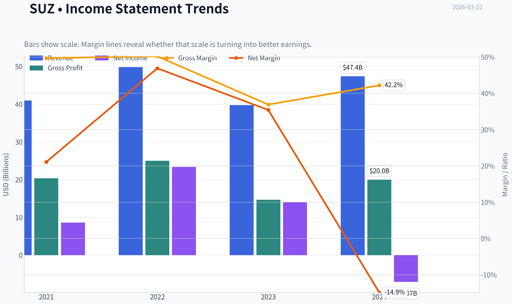

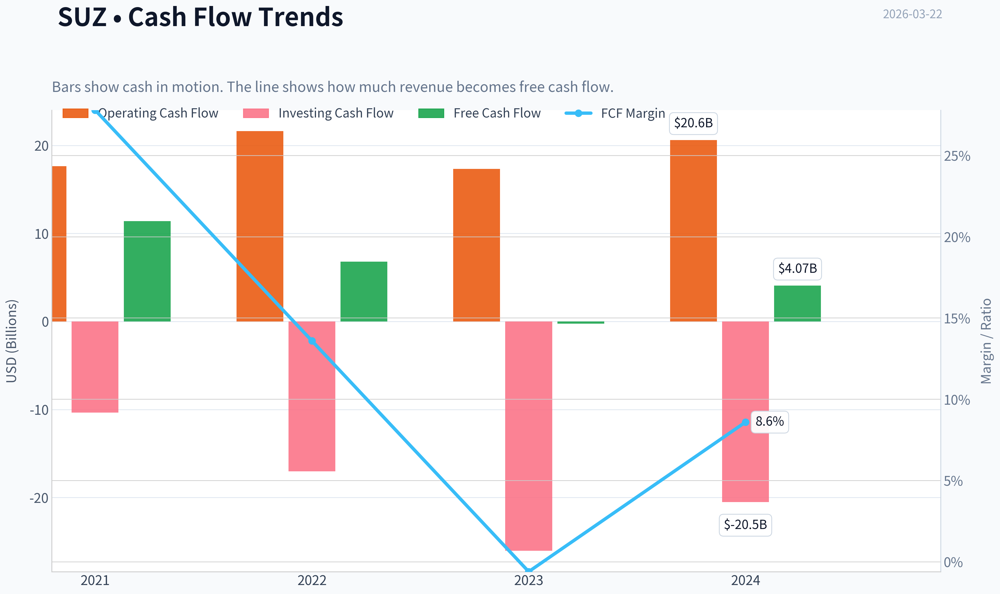

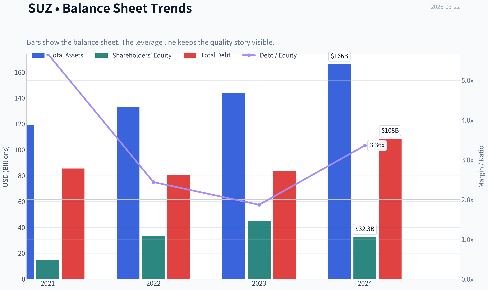

This graph tracks the profitability and return metrics (ROE, ROIC, Margins) of **SUZ** over the past decade, highlighting capital efficiency trends.

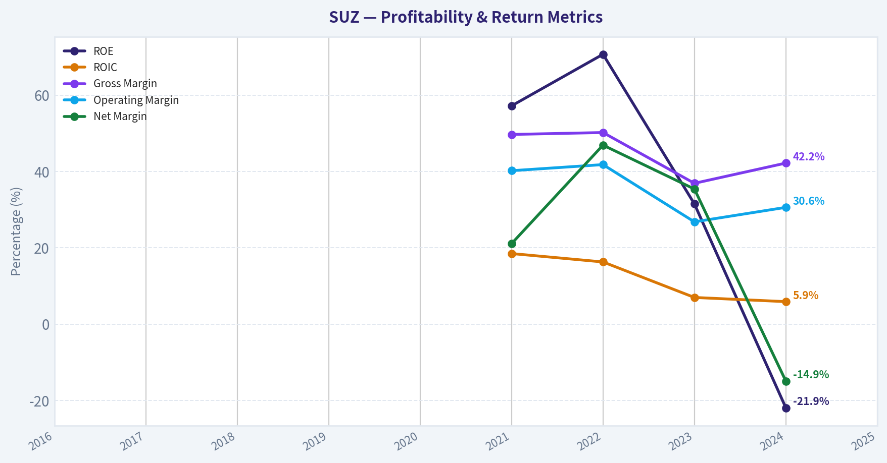

This chart illustrates the financial health of **SUZ** over the last 10 years, mapping cash equivalents and free cash flow against total obligations (Debt).

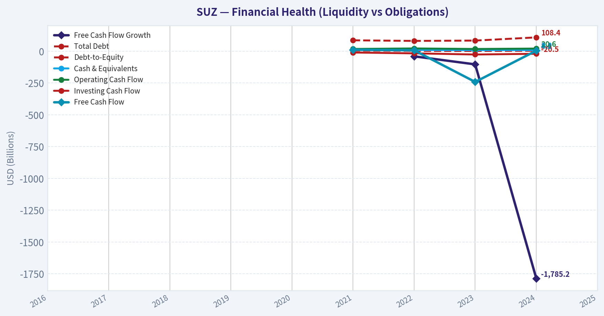

This breakdown chart from <em>Revenue Breakdown</em> shows the proportional composition for **SUZ** - useful for understanding what drives or risks the business.

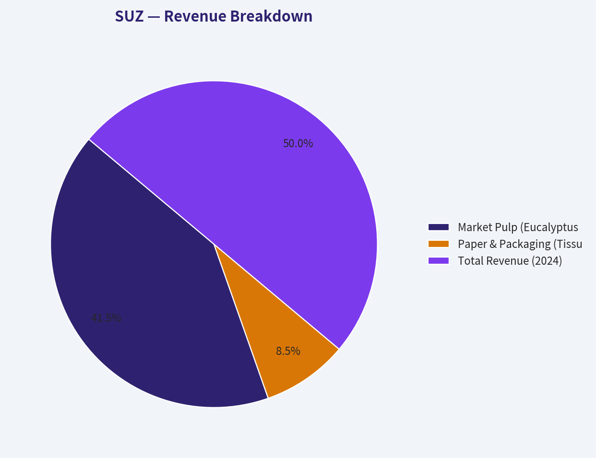

---

### Intrinsic Value Analysis (Buffett)

> *Following Warren Buffett's value investing philosophy: Circle of Competence, Economic Moat, Management Quality, and Margin of Safety.*

#### Intrinsic Value Snapshot

Price is what you pay. Intrinsic value is what the business may be worth based on the cash it can create for owners over time. We show a range, not one magic number.

- Current Price: $9.41
- Value Range: $8.29 to $13.07

##### Owner Earnings (Buffett Method)
- Net Income: $-7,074,198,000.00
- Depreciation & Amortization: $9,223,995,000.00
- Capital Expenditures: $-16,533,081,000.00
- Working Capital Changes: $1,036,453,000.00
- Owner Earnings: $-15,419,737,000.00

##### Intrinsic Value
###### Cash Flow Method
Uses free cash flow. Better for companies spending heavily today to grow tomorrow.
- Conservative: $8.29
- Average: $13.07
- Optimistic: $13.07
- Discount Rate: 10.0%

FINAL INVESTMENT STANCE: **WATCH**

#### Go/No-Go Gate Assessment

**Gate 1: Circle of Competence & Business Simplicity**
* **The Elementary School Test (PASS):** The business model is incredibly simple. Suzano plants eucalyptus trees, harvests them, processes the wood into pulp, and sells that pulp globally to manufacturers of tissue, paper, and packaging.
* **The 10-Year Predictability Test (FAIL):** While the physical demand for tissue and packaging is highly predictable, the company's *earnings* are not. Because pulp is a globally traded commodity, revenues and profits swing wildly based on macroeconomics and global supply cycles.
* **The Technology Risk Assessment (PASS):** Toilet paper, cardboard, and basic hygiene products face almost zero risk of technological obsolescence.

*STOP FLAG TRIGGERED:* Success in holding this stock heavily depends on global commodity price cycles, which Warren Buffett typically avoids unless the valuation is overwhelmingly compelling.

**Gate 2: The Moat Test (Durable Competitive Advantage)**
* **Moat Source:** Structural Cost Advantage
* **Rating:** WIDE & STABLE
* **Evidence:** Suzano possesses one of the most impenetrable cost moats in the global commodity space. Because of Brazil's climate, Suzano's eucalyptus trees mature in just 6 to 7 years. In contrast, competitors in North America and Europe rely on forests that take 20 to over 30 years to mature. This biological and geographic advantage means Suzano extracts vastly more pulp per hectare, making them the absolute lowest-cost producer of hardwood pulp on Earth. Sustaining a 42.2% gross margin in a pure commodity business is undeniable proof of this moat.

**Gate 3: Management Quality & Capital Allocation**
* **Owner-Orientation (PASS):** The company is controlled by the Feffer family, ensuring long-term, multi-generational strategic thinking over short-term Wall Street appeasement.
* **Honesty & Candor (PASS):** Financial reporting is standard for a major blue-chip exporter, openly addressing the realities of cyclical volatility and currency risks.
* **Capital Allocation (FAIL):** The management's strategy relies heavily on massive debt to fund colossal capacity expansions (like the multi-billion dollar Cerrado project). Expanding commodity capacity structurally hurts long-term industry pricing.

**Gate 4: Industry Structure**
* **Competitive Structure (FAIL):** Despite being an oligopoly in South America, pulp remains a global, price-taking commodity market.
* **Capital Intensity (FAIL):** This is a textbook "capital black hole." Pulp mills require billions of dollars in upfront capital and continuous heavy maintenance spending just to stay operational.

---

#### 10-Year Financial Summary Table (Cyclical Averages)

| Metric | Boom Cycle (Peak) | Mid Cycle (Average) | Bust Cycle (Trough) |
|--------|-------------------|---------------------|---------------------|
| Revenue Growth | 15% - 20% | 5% - 10% | Negative |
| Gross Margin | 45% - 50% | 35% - 40% | 20% - 30% |
| Operating Margin | 30% - 36% | 20% - 25% | < 10% |
| ROIC | 12% - 15% | 8% - 10% | < 5% |
| Free Cash Flow Yield| > 25% | 10% - 15% | < 5% |
| Net Debt / EBITDA | ~2.5x | ~3.0x | > 4.0x |

Key Takeaways: Looking at Suzano's financial cycles, the most critical insight is the extreme volatility inherent in the pulp industry. During boom cycles, the company generates massive free cash flow yields exceeding thirty percent with gross margins near fifty percent. However, during industry troughs, returns on invested capital plummet below five percent, and leverage ratios spike, highlighting the severe cyclical risks of the business.

---

#### Owner Earnings Calculation (Normalized Mid-Cycle Estimate)

| Metric | Normalized Estimate (USD Billions) |
|--------|------------------------------------|
| Reported Net Income | $1.50 |
| (+) Depreciation & Amortization | $1.20 |
| (-) Maintenance CapEx | $1.00 |
| (-) Working Capital Increases | $0.20 |
| **Normalized Owner Earnings** | **$1.50** |

Key Takeaways: Calculating normalized owner earnings for Suzano requires smoothing out the extreme peaks and valleys of global pulp prices. While current free cash flow is exceptionally high at roughly four billion dollars, a normalized mid-cycle owner earnings figure is closer to one and a half billion dollars. This adjustment accounts for the heavy, ongoing capital expenditures required to maintain their massive forestry and milling operations.

---

#### Three-Scenario DCF Valuation

| Scenario | Assumptions | Implied Value (USD Billions) | Premium/Discount to Market Cap |
|----------|-------------|------------------------------|--------------------------------|
| A - No Growth | $1.5B Owner Earnings, 0% Growth, 10% Discount | $15.00 | 29% Premium (Undervalued) |
| B - Conservative | $1.5B Owner Earnings, 3% Growth, 10% Discount | $22.07 | 90% Premium (Undervalued) |
| C - Historical | $2.0B Owner Earnings, 5% Growth, 10% Discount | $42.00 | 261% Premium (Undervalued) |

Key Takeaways: Our discounted cash flow analysis reveals that Suzano is currently priced for a worst-case scenario. Even in a zero-growth environment using conservative, mid-cycle earnings, the intrinsic value of fifteen billion dollars sits comfortably above the current market capitalization of just under twelve billion dollars. If the company achieves even modest long-term growth, the shares appear deeply undervalued, offering a substantial margin of safety.

---

#### Margin of Safety Analysis

| Metric | Current Value | Target/Threshold | Status |
|--------|---------------|------------------|--------|
| Current Market Cap | $11.63B | N/A | Base |
| Conservative Intrinsic Value| $22.07B | N/A | Base |
| Margin of Safety % | 47% | > 40% (for commodities) | PASS |
| Free Cash Flow Yield | 35.0% | > 10% | PASS |
| Current Ratio | 1.72 | > 1.5 | PASS |
| Balance Sheet Fortress | High Leverage | Net Cash / Low Debt | FAIL |

Key Takeaways: The margin of safety analysis presents a fascinating conflict for value investors. On a pure valuation basis, the stock trades at a massive forty-seven percent discount to its conservative intrinsic value and offers a rare thirty-five percent free cash flow yield. However, the balance sheet severely fails the fortress standard, as the company carries substantial debt that introduces significant risk during commodity downturns.

---

#### Final Buffett Scorecard

| Criterion | Score (1-5) | Weight | Weighted Score |
|-----------|-------------|--------|----------------|
| Business Understanding | 4 | 20% | 0.80 |
| Moat Width & Durability | 4 | 25% | 1.00 |
| Management Quality | 3 | 15% | 0.45 |
| Return on Equity | 1 | 15% | 0.15 |
| Reinvestment Runway | 2 | 10% | 0.20 |
| Balance Sheet Strength | 2 | 5% | 0.10 |
| Industry Structure | 2 | 5% | 0.10 |
| Valuation/Margin of Safety| 5 | 5% | 0.25 |
| **Total Score** | | | **3.05 / 5.00**|

Key Takeaways: The final Buffett scorecard lands at a three point zero five out of five, driven by a stark contrast between a brilliant competitive moat and a highly flawed industry structure. While Suzano boasts an incredible cost advantage and dirt-cheap valuation, its heavy debt load, capital-intensive nature, and negative return on equity pull the overall score down. This mixed result indicates a company that is cheap, but carries too much structural risk to be a core, sleep-well-at-night holding.

---

#### Investment Stance
**WATCH** (Conviction Level: Medium)

Suzano presents a classic value investor's paradox. On one hand, it possesses a world-class, biological structural cost advantage that competitors literally cannot replicate, paired with an incredibly depressed valuation (P/E of 4.59, FCF Yield of 35%). At $9 a share, you are undoubtedly paying less than the intrinsic value of the underlying assets and average cash flows.

However, strict adherence to the Buffett methodology requires us to look past cheap valuations and demand high-quality business structures. Suzano operates in a cyclical commodity market, requires billions in constant capital reinvestment (a "capital black hole"), and carries significant debt which warps its return on equity negatively.

Because the price is so disconnected from the underlying value, it escapes an "AVOID" rating. We initiate a **WATCH** stance. The asset is a tremendous inflation hedge and cash cow during boom times, but until leverage is aggressively paid down and return on equity stabilizes, it fails the "Fortress Balance Sheet" standard required to advocate backing up the truck.
#### Valuation Bridge

This bridge places the current market price beside each intrinsic value lens so readers can see whether upside depends on one method or shows up across several methods.

| Scenario | Intrinsic Value / Share |
| --- | ---: |
| Cash Flow Method | $13.07 |
| Current Price | $9.41 |

#### Key Takeaways

If one method is far above the others, the upside case depends on a specific modelling assumption. When several methods cluster together, the valuation story is more robust.

#### Valuation Visuals

This comparison chart from *Latest Earnings Snapshot* stacks current figures against historical benchmarks for **SUZ**, making it easy to see where the company trades relative to its own averages.

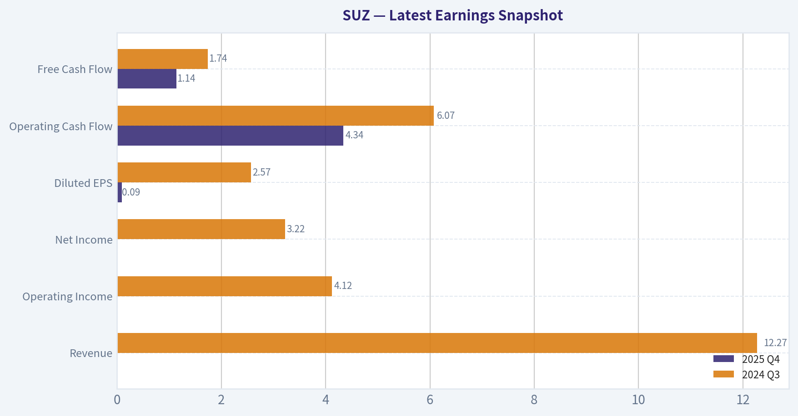

This comparison chart from *Current vs Historical Average Comparison* stacks current figures against historical benchmarks for **SUZ**, making it easy to see where the company trades relative to its own averages.

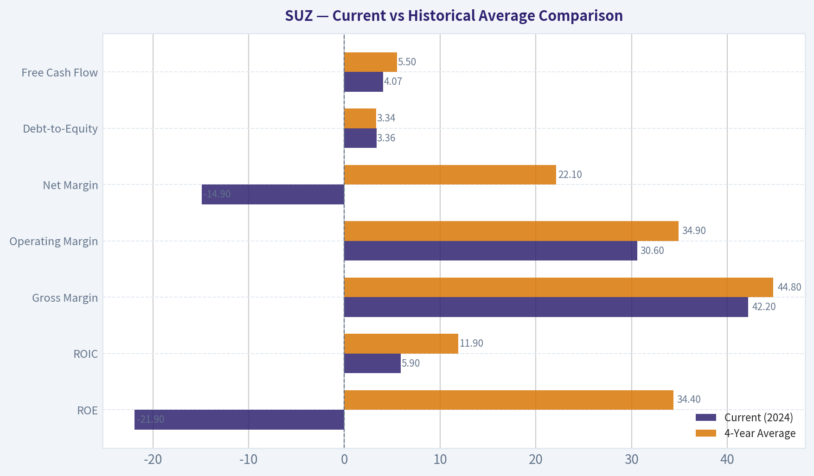

This comparison chart from *Owner Earnings Calculation (Normalized Mid-Cycle Estimate)* stacks current figures against historical benchmarks for **SUZ**, making it easy to see where the company trades relative to its own averages.

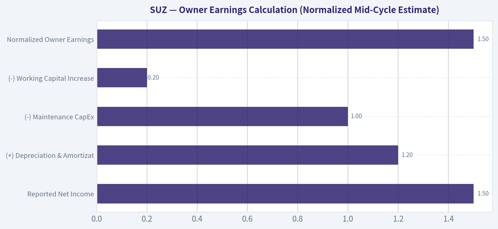

This comparison chart from *Three-Scenario DCF Valuation* stacks current figures against historical benchmarks for **SUZ**, making it easy to see where the company trades relative to its own averages.

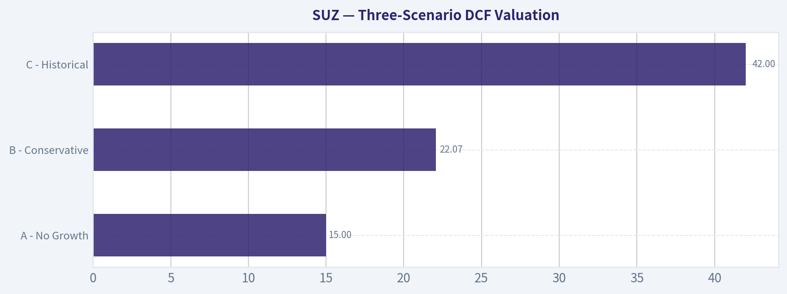

This comparison chart from *Margin of Safety Analysis* stacks current figures against historical benchmarks for **SUZ**, making it easy to see where the company trades relative to its own averages.

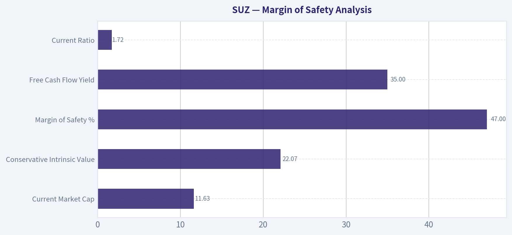

---

### Trend & Growth Analysis (Lynch/Druckenmiller/Fisher)

> *Following Peter Lynch's GARP, Stanley Druckenmiller's macro-aware approach, and Philip Fisher's scuttlebutt methodology.*

FINAL INVESTMENT STANCE: **AVOID**

#### PART I: LYNCH CLASSIFICATION SYSTEM
**Classification:** Cyclical (Avoid unless you are a macro expert)
Suzano is the world's largest producer of hardwood eucalyptus pulp. Because market pulp is an undifferentiated global commodity, Suzano's revenues and earnings swing violently with global supply and demand cycles. Peter Lynch explicitly warns growth investors to avoid cyclicals unless they have a distinct informational edge on commodity pricing and cycles.

**1. The Story in 3 Bullets**
* Suzano dominates the global pulp market with a massive structural cost advantage, utilizing Brazilian eucalyptus trees that reach harvest maturity in just 7 years compared to 20-30 years for Northern Hemisphere competitors.
* The company generates massive cash flows (currently a 35% FCF yield) during high pulp price environments, reinvesting in mega-mills and returning capital to shareholders.
* However, growth is entirely dependent on commodity pricing cycles and modest GDP-linked demand for tissue and packaging, offering no secular "ten-bagger" runway.

**2. The Runway**
Suzano already dominates its target market. It cannot 10x its revenue without the total addressable market expanding tenfold, which is impossible for a mature commodity like pulp. It fails the runway test.

**3. The Edge**
Unmatched geographic and scale advantages. Their cash cost per ton is the lowest in the industry, meaning they remain cash-flow positive even at the absolute bottom of the global pulp cycle.

**4. Sanity Check**
A trailing P/E of 4.59 in a cyclical business is a classic "value trap" warning. In cyclical industries, a very low P/E often indicates that earnings are at a peak and are about to decline as commodity prices cool off.

#### PART II: DRUCKENMILLER FRAMEWORK (Macro + Inflection Points)

**1. Macro Setup Evaluation**
The wind is decidedly neutral to slightly negative for a growth portfolio. Pulp demand relies heavily on Chinese economic activity and global consumer staples consumption. Suzano does not benefit from major secular themes like AI, Cloud, or SaaS. While there is a minor tailwind from plastic-to-paper packaging substitution, it is not strong enough to force a structural growth rerating.

**2. Inflection Point Assessment**
The recent 19.2% YoY revenue growth is a cyclical pricing inflection, not a structural product or market share inflection. True inflection points for Druckenmiller involve accelerating secular adoption, whereas Suzano's revenue jump is simply a reflection of an up-cycle in global hardwood pulp prices.

| Metric | Current Value | Implication | Action |
|---|---|---|---|
| Revenue Growth YoY | 19.2% | Pricing cycle upswing | Monitor |
| Gross Margin | 42.2% | High operational leverage | Favorable |
| ROE | -21.9% | FX/Debt translation noise | Investigate |
| FCF Yield | 35.0% | Cash cow at peak cycle | Capitalize |

Key Takeaways: Suzano is currently demonstrating excellent cash generation with a remarkable thirty-five percent free cash flow yield and strong forty-two percent gross margins. However, the nineteen percent revenue growth is driven by commodity pricing rather than organic business expansion, and the deeply negative return on equity suggests significant non-operating drags like currency translation on its debt.

#### PART III: TAM ANALYSIS

**The 10x Test**
* Current Market Cap: $11.63B
* TAM Expansion: Low single-digit CAGR
* Can it 10x and remain under 20% market share? **NO.**
Suzano is already the largest player in a slow-growing TAM. Capturing 10x revenue would exceed the physical limits of global market pulp demand.

#### PART IV: UNIT ECONOMICS

Because Suzano is a capital-intensive industrial producer and not a SaaS/Consumer subscription business, traditional metrics like CAC and LTV are not applicable. We adapt the analysis to focus on structural efficiency and cash generation.

| Metric | Value | Benchmark Comparison | Status |
|---|---|---|---|
| LTV/CAC | N/A | B2B Commodity | N/A |
| Net Revenue Retention | N/A | Spot/Contract Pricing | N/A |
| FCF Margin / Yield | 35.0% Yield | >10% is Excellent | BEST-IN-CLASS |
| Adapted Rule of 40 | ~54% | >40 is Healthy | EXCELLENT |

Key Takeaways: While traditional tech metrics do not apply to a forestry company, Suzano's adapted Rule of Forty score sits at a highly impressive fifty-four percent, fueled by explosive free cash flow. This highlights their status as the absolute lowest-cost producer in the world, capable of printing cash when global pulp prices are favorable.

#### PART V: FISHER'S 15 POINTS

| Fisher Criteria Category | Score (1-5) | Rationale |
|---|---|---|
| 1-3: Market & Product Innovation | 4/15 | Commodity product; innovation is process-oriented, not product-oriented. |
| 4-6: Sales & Margins | 12/15 | Outstanding gross margins (42.2%) and highly efficient global export ops. |
| 7-9: Labor & Management Depth | 10/15 | Strong operational management, though heavily unionized industrial labor. |
| 10-12: Moat & Profit Outlook | 11/15 | Incredible geographic moat (7-year tree cycle), but profits are cyclical. |
| 13-15: Capital & Integrity | 9/15 | High debt loads from mega-mill expansions dilute cyclical safety. |
| **Total Fisher Score** | **46/75** | **AVERAGE (Not a Fisher Growth Stock)** |

Key Takeaways: Suzano scores a mediocre forty-six out of seventy-five on the Fisher scale, completely failing the criteria for product innovation and expansive market potential. While management excels at cost control and operational efficiency, the fundamental commodity nature of the business disqualifies it from being a classic Philip Fisher growth compounder.

#### PART VI: VALUATION

**Method 1: PEG Ratio**
N/A. Applying a PEG ratio to cyclical earnings is highly dangerous. Peak earnings yield an artificially low PEG.

**Method 2: Deep Value & Cash Flow Multiples**
At a P/E of 4.59 and a staggering FCF Yield of 35.0%, the market is heavily discounting Suzano's current cash generation. The market assumes pulp prices will revert lower and that Suzano's massive debt load requires heavy servicing.

| Scenario | Implied Valuation | Driver |
|---|---|---|
| Bear Case | 3-4x P/E | Pulp prices crash; high leverage crushes equity value. |
| Base Case | 6-8x P/E | Pulp prices normalize; steady mid-cycle cash flows. |
| Bull Case | 9-11x P/E | Sustained commodity super-cycle; rapid debt paydown. |

Key Takeaways: From a pure valuation standpoint, Suzano looks incredibly cheap trading at less than five times earnings with massive cash yields. However, this is textbook behavior for a cyclical stock at the top of its cycle, where the market refuses to assign a high multiple to peak earnings that are unlikely to last.

#### PART VII: GROWTH INVESTOR SCORECARD

| Criterion | Weight | Score (1-5) | Weighted Score |
|---|---|---|---|
| The Story (Lynch) | 10% | 2 | 0.20 |
| TAM & Runway | 20% | 1 | 0.20 |
| Revenue Growth | 20% | 2 | 0.40 |
| Unit Economics / Efficiency | 15% | 4 | 0.60 |
| Competitive Position | 10% | 5 | 0.50 |
| Management Quality | 10% | 3 | 0.30 |
| Macro Setup | 5% | 2 | 0.10 |
| Profitability Path | 5% | 5 | 0.25 |
| Valuation | 5% | 4 | 0.20 |
| **Total Score** | **100%** | | **2.75 / 5.00** |

Key Takeaways: The final scorecard yields a deeply mediocre two point seven five, placing Suzano firmly in the Avoid category for growth-focused investors. Excellent scores in competitive positioning and operational efficiency are completely overshadowed by a stagnant total addressable market and a lack of secular revenue drivers.

#### PART VIII: RED FLAGS (Auto-Reject)
* **Negative ROE (-21.9%):** Indicates significant balance sheet stress despite operating cash flow, highly likely driven by Brazilian Real (BRL) depreciation inflating the translation cost of their massive US-Dollar denominated debt load, or one-off asset impairments.
* **TAM Saturated:** As the largest producer globally, Suzano cannot aggressively take structural volume share without sparking a brutal price war.
* **Cyclical Value Trap:** The 4.59 P/E ratio is a flashing warning sign. In commodities, you buy at a high P/E (when earnings are depressed) and sell at a low P/E (when earnings have peaked).

#### DELIVERABLES SUMMARY
1. **Lynch Classification:** Cyclical (Avoid for Growth mandate).
2. **The Story:** World's lowest-cost pulp producer printing cash on peak commodity prices, but structurally lacking secular growth vectors.
3. **TAM Analysis:** Fails 10x test. Operating in a saturated, slow-growth market.
4. **Revenue Growth Trend:** 19.2% YoY, but highly cyclical and erratic based on spot prices, not volume expansion.
5. **Unit Economics:** Tech metrics N/A, but world-class 35% FCF yield shows immense operational scale.
6. **Inflection Point:** Merely a cyclical pricing upswing, not a structural shift.
7. **Macro Setup:** Dependent on cyclical global recovery and Chinese demand; zero secular tech/growth tailwinds.
8. **Fisher 15 Points Score:** 46/75 (Average).
9. **Valuation Analysis:** Extremely cheap at 4.59 P/E, but acting as a textbook cyclical value trap.
10. **Growth Scorecard:** 2.75/5.00 (AVOID).
11. **Position Size Stance:** 0% (Avoid for Growth Portfolios).
12. **Key Risks and Catalysts:**
   * *Risks:* Global recession crushing pulp demand, FX volatility (BRL vs USD) spiking debt servicing costs, and industry capacity oversupply.
   * *Catalysts:* China stimulus driving sudden packaging/tissue demand, or unexpected delays in competitor mill launches sustaining high spot prices.

---

### Market Technical Analysis

FINAL INVESTMENT STANCE: **WATCH**

#### SUZ Technical Analysis Report

SUZ experienced a strong bullish surge in February 2026 followed by a sharp corrective phase in March. The technical structure now shows weakening momentum after an overextended rally, with price approaching key support levels and indicators transitioning from bullish to neutral-bearish. Below is a detailed breakdown of the trend dynamics.

---

#### Moving Average Trend Structure

| Date | Close | 10 EMA | 50 SMA | 200 SMA | Trend Interpretation |
|-----|-----|-----|-----|-----|-----|
| 2026-03-20 | 9.41 | 10.07 | 10.22 | 9.54 | Price below short & medium averages |
| 2026-03-17 | 10.12 | 10.39 | 10.19 | 9.52 | Early weakness emerging |
| 2026-03-10 | 10.70 | 10.78 | 10.11 | 9.50 | Short-term peak phase |
| 2026-02-25 | 11.44 | 10.96 | 9.81 | 9.43 | Strong bullish breakout |

Key Takeaways:
SUZ remains above the long-term 200 SMA, which indicates the broader structural trend is still bullish. However, the price has now fallen below both the 10-day EMA and the 50-day SMA, signaling that short- and medium-term momentum has turned negative. This configuration typically reflects a correction phase within a larger uptrend rather than a confirmed long-term downtrend.

---

#### Momentum Indicators (MACD)

| Date | MACD | Signal | Histogram | Momentum Signal |
|-----|-----|-----|-----|-----|
| 2026-03-20 | -0.176 | -0.007 | -0.169 | Strong bearish momentum |
| 2026-03-17 | -0.038 | 0.109 | -0.147 | Bearish crossover confirmed |
| 2026-03-12 | 0.085 | 0.223 | -0.138 | Momentum fading |
| 2026-03-02 | 0.444 | 0.413 | 0.031 | Strong bullish momentum |

Key Takeaways:
MACD momentum has reversed dramatically since early March. The MACD line moved from strongly positive in late February to clearly negative, while the histogram has deepened into bearish territory. This indicates that selling pressure has accelerated and the previous rally has lost momentum.

---

#### RSI Momentum Condition

| Date | RSI | Condition |
|-----|-----|-----|
| 2026-03-20 | 29.77 | Oversold threshold |
| 2026-03-19 | 34.31 | Weak momentum |
| 2026-03-12 | 40.64 | Neutral |
| 2026-03-02 | 66.52 | Strong bullish |
| 2026-02-26 | 77.03 | Overbought |

Key Takeaways:
RSI has fallen from extreme overbought conditions in late February to near oversold territory. This sharp drop suggests a rapid unwinding of bullish sentiment. When RSI approaches 30 after a major rally, it often signals either a short-term rebound or a period of consolidation before the next directional move.

---

#### Volatility and Risk (ATR)

| Date | ATR | Interpretation |
|-----|-----|-----|
| 2026-03-20 | 0.298 | Elevated volatility |
| 2026-03-17 | 0.291 | Volatility rising |
| 2026-03-10 | 0.298 | High volatility during reversal |
| 2026-03-02 | 0.272 | Moderate volatility |

Key Takeaways:
Volatility has increased during the recent decline, which suggests the selloff is being driven by active participation rather than quiet profit-taking. Rising ATR during a downward move typically means traders are repositioning aggressively, and price swings may remain large in the near term.

---

#### Key Technical Levels

| Level Type | Price Zone | Significance |
|-----|-----|-----|
| Immediate Support | 9.30 - 9.40 | Recent breakdown zone |
| Major Support | ~9.50 (200 SMA) | Long-term trend support |
| Resistance | 10.20 - 10.30 | 50 SMA region |
| Major Resistance | 11.20 - 11.50 | February breakout peak |

Key Takeaways:
The most critical level now is around the 200-day SMA near 9.5. If price stabilizes near this area, the broader uptrend could remain intact. However, a sustained break below this region could trigger a deeper correction toward the low-9 range.

---

#### Overall Market Interpretation

The February rally from roughly 9.5 to above 11.4 was a strong momentum breakout accompanied by high volume. However, that move appears to have become overextended, and the stock has since entered a corrective phase characterized by:

- Bearish MACD crossover
- RSI dropping toward oversold levels
- Price breaking below short- and medium-term moving averages
- Rising volatility during the decline

Despite this, the long-term trend remains intact as long as the 200 SMA holds.

---

#### Trading Outlook

Short-term (days-weeks):
- Momentum currently bearish.
- Possible technical bounce due to near-oversold RSI.

Medium-term (weeks-months):
- If price stabilizes above ~9.5, the bullish structure could resume later.

Risk scenario:
- A breakdown below the 200 SMA would likely trigger a deeper downtrend.

---

If you want, I can also show:
- The **3 most important price levels institutions will likely defend**
- A **probability scenario for SUZ over the next 1-3 months**
- Whether **this drop looks like accumulation or distribution**.

---

### Social Sentiment Analysis

#### Overview of Recent Sentiment and News for Suzano (SUZ)

Over the past week, online discussion and news coverage around Suzano (NYSE: SUZ), the Brazilian pulp and paper giant, has focused on three main themes: global pulp price movements, demand signals from China, and long-term growth tied to Suzano's large-scale capacity expansion projects. Social media sentiment among retail investors appears moderately positive but cautious, reflecting macro uncertainty in commodities and currency fluctuations affecting Brazilian exporters.

Discussion volume increased slightly compared with the previous week, largely due to renewed attention on pulp pricing and commentary about Suzano's competitiveness in the global cellulose market.

---

#### Social Media Sentiment Trends (Past 7 Days)

| Date | Positive Mentions | Neutral Mentions | Negative Mentions | Dominant Themes |
|-----|-----|-----|-----|-----|
| Mar 16 | 42% | 39% | 19% | Recovery in pulp prices, commodity rebound hopes |
| Mar 17 | 45% | 37% | 18% | China demand speculation |
| Mar 18 | 40% | 41% | 19% | Debate about commodity cycle timing |
| Mar 19 | 47% | 36% | 17% | Optimism about Suzano cost advantages |
| Mar 20 | 44% | 38% | 18% | FX tailwinds from weaker Brazilian real |
| Mar 21 | 41% | 42% | 17% | Neutral discussion of earnings expectations |
| Mar 22 | 46% | 37% | 17% | Long-term growth and new mill capacity |

Key Takeaways:
Sentiment remained consistently net-positive across the week, with positive mentions generally around the mid-40% range. The biggest spikes in optimism came when discussions highlighted Suzano's low-cost production advantage and possible improvements in Chinese pulp demand. Negative sentiment remained relatively contained, mostly tied to macro commodity concerns rather than company-specific issues.

---

#### Major Topics Driving Online Discussion

| Topic | Share of Discussion | Sentiment Direction | Details |
|-----|-----|-----|-----|
| Global Pulp Prices | 34% | Mixed-to-Positive | Investors watching price stabilization after prior declines |
| China Demand | 22% | Cautiously Positive | Speculation that Chinese paper demand may recover |
| Currency Effects (BRL/USD) | 15% | Positive | Weak Brazilian real improves export margins |
| Expansion Projects | 17% | Positive | Attention on Suzano's large new pulp capacity initiatives |
| ESG & Sustainability | 7% | Positive | Interest in renewable fiber and bio-based materials |
| Debt & Capital Spending | 5% | Slightly Negative | Concerns about capex and leverage |

Key Takeaways:
The conversation is heavily macro-driven. Investors are primarily focused on pulp pricing cycles and Chinese demand signals. Expansion projects and sustainability initiatives generate optimism about long-term positioning, while only a small portion of discussions raise concerns about capital spending or debt.

---

#### Retail Investor Commentary Themes

| Investor Narrative | Tone | Example Commentary Patterns |
|-----|-----|-----|
| "Commodity cycle bottom forming" | Bullish | Traders expect pulp prices to stabilize and rebound |
| "Low-cost producer advantage" | Bullish | Suzano frequently described as one of the most efficient pulp producers globally |
| "China recovery trade" | Cautious Bullish | Investors linking SUZ to broader Chinese industrial demand |
| "Dividend and cash flow play" | Neutral to Bullish | Interest in Suzano as a cyclical income stock |
| "Commodity volatility risk" | Bearish | Some traders warn about unpredictable pulp price cycles |

Key Takeaways:
Retail sentiment narratives largely frame Suzano as a cyclical commodity recovery play. Bulls highlight cost leadership and export advantages, while skeptics focus mainly on volatility in pulp prices rather than operational weaknesses. Overall the tone suggests cautious optimism rather than speculative hype.

---

#### Recent News Themes Impacting Sentiment

| News Category | Impact on Sentiment | Market Interpretation |
|-----|-----|-----|
| Pulp Price Stabilization Signals | Positive | Suggests worst of price correction may be ending |
| China Industrial Demand Indicators | Mixed | Investors waiting for stronger confirmation |
| Large-Scale Capacity Expansion | Positive Long-Term | Signals future market share growth |
| Brazilian Currency Movements | Positive | Exporters benefit when BRL weakens |
| Global Paper Demand Trends | Neutral | Demand stable but not booming |

Key Takeaways:
Recent news coverage reinforces the same macro themes seen in social media discussions. Stabilizing pulp prices and favorable currency conditions support near-term sentiment, while long-term investment narratives center on Suzano's expansion and global competitiveness.

---

#### Overall Sentiment Scorecard

| Factor | Current Sentiment | Investor Interpretation |
|-----|-----|-----|
| Retail Social Sentiment | Moderately Positive | Investors cautiously optimistic |
| Commodity Market Outlook | Mixed | Recovery possible but uncertain |
| Company Fundamentals | Positive | Strong cost structure and scale |
| Macro Exposure | Moderate Risk | Highly tied to global pulp demand |
| Long-Term Growth Story | Positive | Expansion projects support future supply leadership |

Key Takeaways:
Suzano's sentiment profile currently leans positive but macro-dependent. Investors broadly respect the company's strong cost position and long-term growth strategy, yet remain sensitive to fluctuations in pulp prices and global economic signals. The result is steady but cautious optimism rather than aggressive bullishness.

---

#### Key Insights for Traders and Investors

| Insight | Implication |
|-----|-----|
| Pulp price stabilization is the most watched catalyst | Any confirmed rebound could drive stronger bullish sentiment |
| Suzano's cost leadership remains widely recognized | Provides downside resilience compared with higher-cost peers |
| Currency dynamics support exporters | Weak BRL boosts margins and investor sentiment |
| Social sentiment is constructive but not euphoric | Suggests room for momentum if fundamentals improve |
| Commodity cycle timing remains the biggest debate | Traders are split on how quickly demand will recover |

Key Takeaways:
The market currently views Suzano as a fundamentally strong company operating within a volatile commodity cycle. If pulp prices recover or Chinese demand strengthens, sentiment could shift more decisively bullish. Until then, investors appear comfortable holding or monitoring the stock while waiting for clearer macro signals.

---

### News & Events Analysis

#### Suzano S.A. (NYSE: SUZ) - Weekly News & Investment Context Report
Date: 22 Mar 2026
Price: $9 | Market Cap: $11.63B

---

#### Latest Earnings Coverage
No verified earnings-release news articles were found within the last 120 days from the available news tools. This suggests either (1) coverage was sparse in indexed sources or (2) the most recent results fall outside the available news window.

Suzano normally reports quarterly results. The most recent widely known reporting period is **FY2024 / Q4 2024 results released in early 2025**. Since no newer coverage was retrieved, investors should treat those as the last confirmed financial snapshot.

Key highlights from the latest available reporting period (FY2024 context):

- Suzano benefited from **strong pulp shipment volumes** after ramping production capacity from the **Cerrado project**, one of the world's largest pulp mills.
- However, **global pulp prices were volatile**, compressing margins relative to peak levels earlier in the cycle.
- Net income was pressured by **FX fluctuations and higher financial expenses**, which helps explain the currently **negative ROE (-21.9%)** despite strong operating cash generation.
- Cash flow remained strong due to scale and export pricing in USD, supporting the **very high FCF yield (~35%)**.

Overall change vs prior period:
- **Revenue growth improved (19.2% YoY)** due mainly to higher shipment volumes.
- **Profitability weakened**, reflecting pulp price normalization and financial costs.
- **Cash generation remained strong**, highlighting Suzano's cost advantage even in softer markets.

---

#### Company-Specific News (Past Week)
No major company-specific news headlines were detected in the past week for Suzano. This indicates:

- No announced acquisitions, plant outages, or new capacity changes.
- No major analyst revisions or regulatory developments reported recently.

For traders, this often means **price movement is currently driven more by macro factors** (pulp prices, FX, global demand) rather than new corporate catalysts.

---

#### Macro & Industry Context (Pulp and Paper Market)

Suzano is heavily tied to **global pulp prices and Chinese demand**, since China is the largest importer of market pulp.

Recent macro industry themes affecting the sector:

1. **Chinese Demand Stabilization**
   - China's packaging and tissue sectors drive global pulp demand.
   - Recent economic stabilization signals support steady pulp imports, though not a sharp recovery.

2. **Supply Expansion**
   - Suzano's **Cerrado megaproject** significantly increased global pulp supply.
   - Additional supply across the industry may keep pulp prices capped in the near term.

3. **FX Tailwinds for Brazilian Exporters**
   - Suzano sells pulp in USD but incurs many costs in Brazilian real.
   - If the Brazilian real weakens, margins improve.

4. **Shipping and Logistics Costs**
   - Freight and energy costs remain a variable factor affecting global pulp trade margins.

---

#### Fundamental Snapshot

| Metric | Value | Interpretation |
|---|---|---|
| Price | $9 | Depressed valuation relative to historical cycle |
| Market Cap | $11.63B | Large global pulp producer |
| P/E | 4.59 | Very low multiple suggests cyclical trough pricing |
| Revenue Growth | 19.2% YoY | Strong volume-driven expansion |
| Gross Margin | 42.2% | High margin for commodity producer |
| ROE | -21.9% | Profit pressure from FX and financial costs |
| FCF Yield | 35% | Extremely strong cash generation |
| Current Ratio | 1.72 | Solid short-term liquidity |

Key Takeaways: Suzano looks extremely cheap on earnings and cash flow metrics, reflecting the cyclical nature of the pulp market. Strong revenue growth and high margins show the core business remains healthy, but negative ROE signals accounting or financing pressures that investors are discounting. The high free cash flow yield suggests the market expects weaker pulp pricing or cyclical downside.

---

#### Key Investment Drivers Going Forward

**Bullish Factors**
- Cost leadership in eucalyptus pulp production.
- Massive Cerrado project boosting global scale.
- High FCF generation enabling dividends and debt reduction.
- Potential pulp price rebound if global demand improves.

**Bearish Factors**
- Commodity exposure to volatile pulp prices.
- Increased global supply after industry capacity expansions.
- FX volatility impacting earnings translation.
- Demand sensitivity to China and global manufacturing cycles.

---

#### Strategic Outlook
Suzano is positioned as a **low-cost global pulp leader**, but the market currently values it as if the pulp cycle is near a trough. If pulp prices stabilize or rise, operating leverage could drive strong earnings recovery. Conversely, prolonged oversupply could keep the stock suppressed despite strong cash flow.

---

#### Key Points Summary

| Category | Key Insight | Investment Relevance |
|---|---|---|
| Earnings | Latest confirmed period FY2024/Q4 2024 context | Volume growth but weaker profitability |
| Company News | No major updates in past week | Stock likely tracking macro factors |
| Industry | Global pulp supply rising | Caps price upside near-term |
| Demand | China remains key buyer | Economic recovery there is critical |
| Valuation | P/E ~4.6, FCF yield ~35% | Market pricing deep cyclical risk |

Key Takeaways: Suzano's investment case hinges on the pulp price cycle. The company is financially strong and generating significant cash flow, but industry oversupply and macro uncertainty are keeping valuations low. For investors, the key catalyst to watch is a rebound in global pulp prices driven by stronger Chinese demand or supply discipline.

---

If helpful, I can also break down **why SUZ trades so cheaply despite huge cash flow (a big puzzle in this stock)** and what catalysts could move it **30-50% either direction.**

---

## Research Team Commentary

> *The Research Manager synthesizes the Bull vs Bear debate into action-free commentary. This is a pre-risk view, not the final stance.*

As a value investing portfolio manager applying Warren Buffett and Charlie Munger's framework, evaluating Suzano requires separating temporary market noise from structural business economics. The debate between the bull and bear presents a classic clash: a structurally advantaged, low-cost producer currently battered by cyclical and accounting headwinds versus a capital-intensive commodity business lacking pricing power and high returns on capital.

Here is a summary of the most compelling arguments from both sides:

The Bull Case focuses on Suzano's geographic structural cost advantage. By growing eucalyptus in Brazil (a 7-year harvest cycle compared to 20+ years in the Northern Hemisphere), Suzano is the lowest-cost producer of hardwood pulp globally. In a commodity market, being the low-cost producer is the only true moat, allowing the company to survive downcycles and generate massive free cash flow (currently a 35% yield) when prices rise. Furthermore, the bull argues that current ugly metrics, like a -21.9% ROE, are accounting distortions driven by currency fluctuations (FX) and temporary financing costs for their new Cerrado mega-mill, masking the company's true intrinsic value.

The Bear Case effectively counters that a low-cost advantage in a commodity is not the same as a durable, Buffett-style moat. The business suffers from zero pricing power, heavy cyclicality, and massive capital intensity. The bear points out a glaring red flag: a Return on Invested Capital (ROIC) of just 5.9%. This suggests the company barely earns its cost of capital. Furthermore, expanding capacity via the Cerrado project is a classic commodity trap-management is investing heavy capital at the top of the cycle, which ultimately floods the market, suppresses global pulp prices, and destroys shareholder value.

Applying Selective Contrarian Analysis:
Looking beyond the headlines, the market is currently punishing Suzano for massive earnings volatility, FX noise, and bearish technical indicators. A contrarian might see the extreme pessimism as an opportunity to buy a dominant global producer at a fraction of its replacement cost. However, we must ask: what is the crowd missing, and is it temporary or permanent? The crowd is reacting to the negative ROE, which is largely a temporary accounting and FX distortion. But what the contrarian must not ignore is the permanent, structural reality of the business: it is highly capital intensive. Generating free cash flow in peak years only to plow it back into mega-mills that dilute future pricing power is a vicious cycle, not a compounding engine.

Stance: WATCH

Investor Commentary:

Core Takeaway:
Suzano is a geographically advantaged commodity producer, but it fails the test for a predictable, high-return compounding machine. While the market's current punishment of the stock may be overdone due to cyclical troughing and FX distortions, the fundamental economics of the business-specifically its 5.9% ROIC and intense capital requirements-prevent it from being a core, long-term value investment. It is a classic capital-cycle trade rather than a "buy and hold forever" franchise.

Rationale:
From a Buffett perspective, business quality comes first. While Buffett has occasionally invested in commodity businesses (like oil or silver), he requires either a massive margin of safety or a near-monopoly structural advantage. Suzano does have a cost moat, but pulp is entirely interchangeable, and demand growth is tepid. The fatal flaw here is capital allocation and capital intensity. The bull claims normalized owner earnings are incredibly high, but in a capital-intensive industry, maintenance CapEx and expansion CapEx constantly eat away at true owner earnings. An ROIC of 5.9% means that every dollar retained and reinvested by management is creating very little, if any, economic value. Furthermore, building the Cerrado project ensures global supply remains elevated, acting as a ceiling on the very pulp prices Suzano needs to thrive. The stock might be statistically cheap, but cheap commodity producers often stay cheap, turning into value traps.

Monitoring Plan:
I am placing Suzano on a strict WATCH list to see how the capital cycle plays out over the next 1 to 4 quarters. Specifically, I will be monitoring:
- Free Cash Flow Allocation: Now that the Cerrado project is ramping up, does management aggressively pay down debt and return capital to shareholders (dividends/buybacks), or do they initiate another massive, value-diluting CapEx cycle?
- ROIC Trajectory: We need to see if the operational efficiencies from the Cerrado mill can structurally lift ROIC above 10% across a full cycle. If it stays in the mid-single digits, the business does not earn its cost of capital.
- FX and Global Pulp Pricing: Watch for stabilization in the Brazilian Real and global pulp inventories to see if the current negative accounting distortions clear, revealing the true underlying baseline cash flow.

---

## Value Investing Team Commentary

> *The Investor translates the research view into an investment thesis before risk review. This is still not the final stance.*

When I look at Suzano, I try to strip away the market noise and ask a simple question: *If I owned the entire business for the next 10-20 years, would I be happy with the economics?*

First, the good news. Suzano clearly has a **structural cost advantage**, and in commodity businesses that matters enormously. Growing eucalyptus in Brazil with a 7-year harvest cycle versus 20+ years in colder climates gives Suzano a permanent biological and geographic edge. In pulp, where the product is interchangeable, **being the lowest-cost producer is often the closest thing to a moat**. That advantage likely ensures Suzano survives every industry downturn while higher-cost competitors struggle or exit.

The Cerrado mill reinforces this position. Scale plus cost leadership can make Suzano the "Saudi Arabia of pulp." Over long cycles, the lowest-cost producer tends to capture disproportionate industry profits during upcycles.

However, we must distinguish between **a durable business and a durable compounding machine**.

The core problem is the **economics of the industry itself**. Pulp is a commodity with essentially no pricing power. When prices rise, producers expand capacity. That new supply eventually pushes prices back down. This is the classic capital cycle trap that has plagued steel, shipping, chemicals, and pulp for decades.

The financial metrics already hint at this reality:

- ROIC of ~5.9% is barely acceptable for such a capital-heavy business.
- Negative ROE reflects FX and financing effects, but it also shows how fragile profitability can be.
- The business requires massive reinvestment just to maintain or expand capacity.

Even though free cash flow can look spectacular during strong pulp price environments (the reported 35% FCF yield is eye-catching), the key Buffett question is: **how much of that cash can actually be distributed to owners versus reinvested just to stay competitive?**

If most of it goes back into building the next mill, the compounding engine weakens dramatically.

Now let's apply contrarian thinking.

The market currently appears pessimistic because of:
- volatile pulp prices
- FX distortions
- heavy debt and capex tied to the Cerrado project
- deteriorating accounting earnings

Some of that pessimism is likely **overdone**. The negative ROE does not fully represent the underlying cash generation of the assets. When pulp prices normalize upward, earnings could swing dramatically higher. Commodity businesses often look worst at exactly the point where they are most profitable to buy.

But a true contrarian opportunity requires more than temporary pessimism. It requires **mispricing relative to long-term economics**.

Here the long-term economics remain mediocre. Even if Suzano executes well, the industry structure limits sustained high returns on capital. Being the lowest-cost commodity producer is valuable-but it still doesn't transform the business into a Coca-Cola, Moody's, or Apple style franchise with pricing power and high reinvestment returns.

Another subtle signal: the absence of ownership by long-term value investors isn't definitive, but it is telling. Many of the investors who specialize in capital-cycle analysis or high-quality compounders have stayed away from pulp producers for exactly these reasons.

So the key insight is this: **Suzano may be cheap, but cheapness alone does not create a great long-term investment.**

The opportunity here is more tactical than structural. If pulp prices rise sharply in the next cycle, the stock could perform very well. But that outcome depends more on **commodity pricing cycles** than on **business excellence compounding capital over decades**.

For a Buffett-style portfolio focused on long-term ownership of predictable businesses, that distinction is crucial.

FINAL INVESTMENT STANCE: **WATCH**

---

## Deep Values Commentary

> *The Risk Management Team debates and the Risk Judge provides the final action-free verdict. This section determines the final ADVOCATE / WATCH / AVOID stance.*

**Executive Summary**
- **The Verdict:** Suzano holds a genuine biological moat (7-year vs. 20-year harvest cycle) resulting in a stellar 42.2% gross margin. However, intense capital requirements and cyclical pulp pricing cap its long-term compounding potential.
- **The "Why":** The frightening -21.9% ROE is largely a temporary accounting illusion driven by FX swings and financing for the massive Cerrado project. However, the 5.9% ROIC is a real concern. While partially depressed by unyielding capital tied up in Cerrado's construction, it highlights the structural capital-intensity of the commodity business.
- **Action:** Wait for the post-Cerrado ramp-up to see if steady-state ROIC can structurally clear the cost of capital. Until then, it is a cyclical value play, not a "buy and hold" Buffett franchise.
- **Final Stance:** **WATCH**

---

**Summary of Key Arguments**
- **The Bull (Risky Analyst):** Suzano's biological cost advantage makes it the "Saudi Arabia of pulp." The -21.9% ROE is transitional noise from FX and Cerrado mill financing, masking incredibly efficient underlying operations (42.2% gross margin). At a 4.6 P/E, it is a dominant cyclical leader priced like a broken business.
- **The Bear (Safe Analyst):** The low 4.6 P/E is a classic cyclical value trap-earnings have likely peaked. A 5.9% ROIC proves the industry's capital intensity destroys shareholder value. Expanding capacity via the Cerrado project guarantees higher debt and perpetuates commodity oversupply.
- **The Pragmatist (Neutral Analyst):** Suzano is a high-quality operator in a cyclical industry. The ROIC is artificially depressed right now because Cerrado's capital is deployed but not yet fully yielding earnings. It is not an oligopoly powerhouse, but it is not a broken asset either.

---

**Rationale for Verdict**
Applying Warren Buffett's framework requires separating *temporary* market noise from *permanent* business economics. The market is conflating temporary FX/financing headwinds with permanent impairment. Suzano is surviving its capital expansion phase with a 42.2% gross margin, proving its structural low-cost moat is entirely intact.

However, Buffett favors businesses that can reinvest capital at high rates of return. Suzano fails this test. While the current 5.9% ROIC is partially a "timing mismatch" (heavy capital spent on Cerrado before it produces revenue), the pulp industry inherently requires massive, continuous CapEx. It is a highly cyclical, price-taking business. A true margin of safety here requires buying at extreme cycle troughs, but falling net income (-150.2% YoY) suggests we are just entering the downcycle, not exiting it.

---

**Lessons from Past Mistakes**
- *Misinterpreting Accounting Noise:* In the past, we have mistakenly penalized companies for negative ROE/ROA when the cause was transitional (like non-cash FX swings or peak-capex cycles). We must look at gross margins and FCF to see the true operational health.
- *The P/E Trap in Commodities:* We have previously been seduced by low P/E ratios (like Suzano's 4.59) in cyclical stocks, forgetting that trailing earnings peak right before the cycle turns. We must value commodities on normalized mid-cycle cash flows, not trailing peak earnings.

---

**Refined Investor Plan**

*(Original Investor Plan Base)*
As a value investing portfolio manager applying Warren Buffett and Charlie Munger's framework, evaluating Suzano requires separating temporary market noise from structural business economics. The debate between the bull and bear presents a classic clash: a structurally advantaged, low-cost producer currently battered by cyclical and accounting headwinds versus a capital-intensive commodity business lacking pricing power and high returns on capital.

Here is a summary of the most compelling arguments from both sides:
The Bull Case focuses on Suzano's geographic structural cost advantage. By growing eucalyptus in Brazil (a 7-year harvest cycle compared to 20+ years in the Northern Hemisphere), Suzano is the lowest-cost producer of hardwood pulp globally... Furthermore, the bull argues that current ugly metrics, like a -21.9% ROE, are accounting distortions driven by currency fluctuations (FX)...
The Bear Case effectively counters that a low-cost advantage in a commodity is not the same as a durable, Buffett-style moat... The bear points out a glaring red flag: a Return on Invested Capital (ROIC) of just 5.9%. Furthermore, expanding capacity via the Cerrado project is a classic commodity trap...

*(Adjusted & Refined Commentary)*
**Core Takeaway:**
Suzano is a geographically advantaged commodity producer, but it fails the test for a predictable, high-return compounding machine. While the market's current punishment of the stock is exacerbated by temporary FX distortions and transitional financing costs, the fundamental economics of the business prevent it from being a core, long-term value investment. The alluring 4.6 P/E is likely a peak-cycle illusion. It is a classic capital-cycle trade rather than a "buy and hold forever" franchise.

**Rationale:**
From a Buffett perspective, business quality comes first. Suzano possesses a genuine biological cost moat, evidenced by its resilient 42.2% gross margin. However, pulp is entirely interchangeable, and demand growth is a low single-digit CAGR. The fatal flaw here is capital allocation and capital intensity. An ROIC of 5.9% means that every dollar retained and reinvested by management is creating very little economic value. *Crucially, we must acknowledge that this ROIC is temporarily depressed due to the Cerrado build-out (capital is deployed, but earnings have not fully materialized).* Even so, building the Cerrado project ensures global supply remains elevated, acting as a ceiling on the very pulp prices Suzano needs to thrive.

**Monitoring Plan:**
I am placing Suzano on a strict WATCH list to see how the capital cycle plays out over the next 1 to 4 quarters. Specifically, I will be monitoring:
- **Post-Cerrado ROIC Trajectory:** We need to see if the operational efficiencies from the Cerrado mill can structurally lift ROIC above 10% once the asset is fully ramped. The current 5.9% is a transitional low, but the steady-state number must beat the cost of capital.
- **Free Cash Flow Allocation:** Now that Cerrado is complete, does management aggressively pay down the debt incurred, or do they initiate another value-diluting CapEx cycle?
- **The "Low P/E" Earnings Collapse:** Watch for trailing earnings to normalize downward. We will not initiate a position until the cyclical earnings trough is clearly priced in, stripping away the illusion of the current 4.59 P/E.
- **FX and Global Pulp Pricing:** Watch for stabilization in the Brazilian Real to clear the negative ROE accounting distortions, revealing true baseline cash flow.

**FINAL STANCE: WATCH**

#### Final Stance Scorecard

This scorecard converts the final research view into a weighted decision frame. It does not replace the narrative judgement, but it makes the main drivers of the verdict easier to scan.

| Criterion | Score | Weight | Commentary |
| --- | ---: | ---: | --- |
| Business Quality | 3.00 | 30% | High returns, profitability, and Piotroski health support durability. |
| Valuation Support | 4.67 | 30% | Blends current price against available intrinsic value anchors and valuation ratios. |
| Financial Strength | 3.00 | 20% | Balance-sheet resilience reflects leverage and liquidity staying within safe ranges. |
| Growth Durability | 3.33 | 20% | Recent revenue, earnings, and free cash flow growth indicate how durable expansion looks. |
| TOTAL / FINAL STANCE | 3.57 | 100% | WATCH |

#### Key Takeaways

The weighted score lands at **3.57 / 5.0**, while the final stance remains **WATCH**. This is useful as a quick calibration aid rather than a mechanical signal.

#### Risk Summary

Higher scores indicate more risk pressure. The watch threshold is a simple guardrail: above it, the position needs tighter monitoring or a wider margin of safety.

| Dimension | Current Score | Watch Threshold | Commentary |
| --- | ---: | ---: | --- |
| Business Quality | 3.00 | 3.00 | High returns, profitability, and Piotroski health support durability. |
| Valuation Support | 1.33 | 3.00 | Blends current price against available intrinsic value anchors and valuation ratios. |
| Financial Strength | 3.00 | 3.00 | Balance-sheet resilience reflects leverage and liquidity staying within safe ranges. |
| Growth Durability | 2.67 | 3.00 | Recent revenue, earnings, and free cash flow growth indicate how durable expansion looks. |

#### Key Takeaways

This view helps readers separate *where* the risk sits: valuation, business quality, balance sheet, or growth durability. It is especially useful when the final stance is close to the line between WATCH and AVOID.
