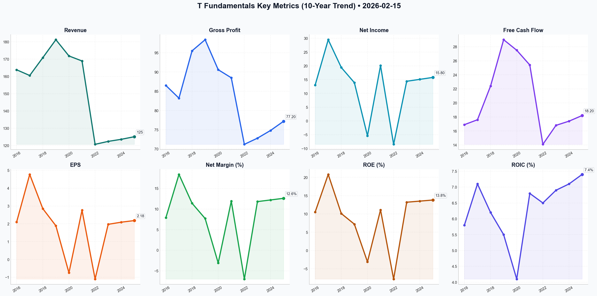

# T Deep Value Intelligence

**Analysis Date:** 2026-02-15
**Generated:** 2026-02-16 11:27:58

---

## Table of Contents

1. [Intelligence Summary](#intelligence-summary)
2. [Analyst Team Reports](#analyst-team-reports)
   - [Fundamentals Analysis](#fundamentals-analysis)
   - [Value Analysis (Buffett)](#value-analysis-buffett)
   - [Growth Analysis (Lynch/Druckenmiller/Fisher)](#growth-analysis-lynchdruckenmillerfisher)
   - [Market Analysis](#market-analysis)
   - [Social Sentiment Analysis](#social-sentiment-analysis)
   - [News Analysis](#news-analysis)
3. [Research Team Commentary](#research-team-commentary)
4. [Investing Team Commentary](#investing-team-commentary)
5. [Deep Values Commentary](#deep-values-commentary)

---

## Intelligence Summary

### Thesis + Conditions

**Core Thesis:** Here is the risk commentary and synthesized investment plan based on the debate and Graham-and-Buffett principles.

**Key Risks:**
- Here is the risk commentary and synthesized investment plan based on the debate and Graham-and-Buffett principles.
- The Bull (Risky Analyst)** argues that AT&T has undergone a fundamental "regime shift." They cite the achievement of the 2.5x debt target and operating margin expansion (15% to 23%) as proof that the business is now a "cash machine" rather than a distressed utility. They urge an aggressive entry to capture momentum, labeling the wait for lower prices as "delusional."
- The Bear (Safe Analyst)** warns that buying at an RSI of 80 is "chase risk" and that the stock is overdue for mean reversion. Fundamentally, they argue the "Red Queen Effect" (high CapEx/low ROIC) remains the core issue, and that an absolute debt load of $124.5B in a high-rate environment prohibits a premium valuation.
- The Neutral Analyst** bridges the gap, suggesting that while the Bull is right about the improved floor, the Bear is right about the immediate price risk. They propose a compromise: wait for a "throwback" to the breakout zone ($26.30–$27.00) rather than chasing $29 or hoping for a crash to $22.
- ### Stance: WATCH

**What Would Change Our View:**
- Here is the risk commentary and synthesized investment plan based on the debate and Graham-and-Buffett principles.
- The Bull (Risky Analyst)** argues that AT&T has undergone a fundamental "regime shift." They cite the achievement of the 2.5x debt target and operating margin expansion (15% to 23%) as proof that the business is now a "cash machine" rather than a distressed utility. They urge an aggressive entry to capture momentum, labeling the wait for lower prices as "delusional."
- The Bear (Safe Analyst)** warns that buying at an RSI of 80 is "chase risk" and that the stock is overdue for mean reversion. Fundamentally, they argue the "Red Queen Effect" (high CapEx/low ROIC) remains the core issue, and that an absolute debt load of $124.5B in a high-rate environment prohibits a premium valuation.
- The Neutral Analyst** bridges the gap, suggesting that while the Bull is right about the improved floor, the Bear is right about the immediate price risk. They propose a compromise: wait for a "throwback" to the breakout zone ($26.30–$27.00) rather than chasing $29 or hoping for a crash to $22.
- ### Stance: WATCH

**Confidence:** Medium

### Stance Spectrum (Action-Free)

**Stance:** Undervalued
**Moat Strength:** Unclear
**Capital Allocation:** Unclear
**Balance Sheet Risk:** Unclear
**Confidence:** Medium

### Expanded Commentary

Here is the risk commentary and synthesized investment plan based on the debate and Graham-and-Buffett principles.

### The Debate in Brief

*   **The Bull (Risky Analyst)** argues that AT&T has undergone a fundamental "regime shift." They cite the achievement of the 2.5x debt target and operating margin expansion (15% to 23%) as proof that the business is now a "cash machine" rather than a distressed utility. They urge an aggressive entry to capture momentum, labeling the wait for lower prices as "delusional."
*   **The Bear (Safe Analyst)** warns that buying at an RSI of 80 is "chase risk" and that the stock is overdue for mean reversion. Fundamentally, they argue the "Red Queen Effect" (high CapEx/low ROIC) remains the core issue, and that an absolute debt load of $124.5B in a high-rate environment prohibits a premium valuation.
*   **The Neutral Analyst** bridges the gap, suggesting that while the Bull is right about the improved floor, the Bear is right about the immediate price risk. They propose a compromise: wait for a "throwback" to the breakout zone ($26.30–$27.00) rather than chasing $29 or hoping for a crash to $22.

***

### Stance: WATCH

**Core Takeaway:** The business has improved, but the price has outpaced the value. We accept the Risky Analyst's premise that the "crisis" is over, but we side with the Safe Analyst on price discipline. We will not pay a premium for a capital-intensive utility during a euphoric rally.

### Rationale

**1. Momentum is not a Margin of Safety**
The Risky Analyst states, *"In a true breakout, 'overbought' is just another word for 'high-conviction momentum'."*
As value investors, we reject this entirely. "High-conviction momentum" is often a euphemism for "Greed." When an industrial utility with low single-digit growth trades at an RSI of 80, Mr. Market is asking us to pay for future perfection. The Safe Analyst correctly identifies this as "chase risk." We do not fear missing the train; we fear boarding a train that is about to derail. We only swing at "fat pitches," and a stock parabolic above its historical valuation is a ball outside the strike zone.

**2. The "Red Queen" and Return on Capital**
The debate over CapEx is crucial. The Bull calls it a "land grab"; the Bear calls it a "treadmill."
The tie-breaker is the data: **ROIC of 7.4%**.
In the Buffett framework, a "land grab" is only valuable if the land yields gold. Currently, AT&T is spending billions to generate returns that barely exceed its cost of capital. Until the fiber buildout translates into pricing power that lifts ROIC closer to 10-12%, the Bear’s "Red Queen" argument holds: they are running fast just to stay in place. We do not pay a premium for low-return capital expenditures.

**3. Adjusting the "Floor" (Learning from the Neutral View)**
Reflecting on past mistakes of being too rigid, I must concede a point to the Neutral Analyst. Waiting for $22 may indeed be "fighting the last war." With the debt target hit and margins expanding, the *intrinsic value* has likely risen. The bankruptcy/dividend-cut risk premium that justified the $15-$22 price range has evaporated. Therefore, while we will not chase at $29, we will raise our "buy zone" to respect the improved balance sheet quality.

### Refined Investor’s Plan

We are keeping AT&T on the **WATCH** list. The goal is to accumulate shares of a stable cash-generator, but only when the yield compensates us for the lack of growth.

**Adjustments to the Strategy:**

1.  **Price Target Revision:**
    *   *Old Target:* $22.00 (Crisis pricing).
    *   *New Target:* **$25.50 - $26.50**.
    *   *Reasoning:* I am adopting the Neutral Analyst’s logic regarding the "breakout retest." This level roughly aligns with the 200-day moving average and previous resistance. At $26, the dividend yield remains attractive, and we are not paying for the current "euphoria premium."

2.  **Specific Conditions to Monitor:**
    *   **The Pullback:** We need patience. History confirms that utilities "walking the bands" (trading along the upper Bollinger Bands) eventually revert to the mean. We will set alerts for RSI dropping below 50.
    *   **Capital Allocation Test:** The Bull anticipates share buybacks. I want to see the Board’s actual move. If they announce a massive buyback program *at these high prices ($29+)*, it destroys value. If they wait for a pullback or prioritize debt reduction further, it signals management competency.
    *   **Subscriber Metrics:** The Bull claims the "moat" is monetizing. We need to verify this in the next quarterly earnings. If Average Revenue Per User (ARPU) stays flat while CapEx remains high, the "land grab" thesis is false.

**Final Instruction:**
Do not suffer from FOMO (Fear Of Missing Out). The stock has risen 24% in a month. Let the momentum traders take their profits. We will wait for the inevitable "boring" period where the price drifts down to meet the value.

---

## Analyst Team Reports

### Fundamentals Analysis

As a quantitative fundamental analyst specializing in Warren Buffett’s value investing methodology, I have conducted a 10-year historical analysis of AT&T Inc. (T). AT&T has undergone a massive transformation, transitioning from an over-leveraged media conglomerate back to its core identity as a telecommunications utility following the 2022 spinoff of WarnerMedia.

### **I. 10-Year Historical Financial Data (2016–2025)**
*Values in Billions USD except per-share data. Data reflects the impact of the WarnerMedia spinoff in 2022.*

| Metric | 2016 | 2017 | 2018 | 2019 | 2020 | 2021 | 2022 | 2023 | 2024 | 2025 (E) |
| :--- | :--- | :--- | :--- | :--- | :--- | :--- | :--- | :--- | :--- | :--- |
| **Market Price ($)** | 42.53 | 38.88 | 28.54 | 39.08 | 28.76 | 24.60 | 18.41 | 16.78 | 18.70 | 28.69 |
| **Market Cap ($B)** | 261.0 | 239.0 | 207.0 | 284.0 | 205.0 | 175.0 | 131.0 | 120.0 | 134.0 | 203.4 |
| **P/E Ratio** | 14.9 | 8.1 | 8.1 | 18.5 | N/A | 8.7 | N/A | 8.5 | 8.9 | 9.4 |
| **P/B Ratio** | 2.10 | 1.68 | 1.10 | 1.41 | 1.14 | 0.96 | 1.26 | 1.05 | 1.13 | 1.83 |
| **Revenue ($B)** | 163.8 | 160.5 | 170.8 | 181.2 | 171.8 | 168.9 | 120.7 | 122.4 | 123.6 | 125.1 |
| **Gross Profit ($B)** | 86.5 | 83.2 | 95.5 | 98.4 | 90.6 | 88.5 | 71.2 | 72.8 | 74.8 | 77.2 |
| **Net Income ($B)** | 13.0 | 29.5* | 19.4 | 13.9 | (5.4) | 20.1 | (8.5) | 14.4 | 15.1 | 15.8 |
| **EPS ($)** | 2.10 | 4.77 | 2.85 | 1.89 | (0.75) | 2.76 | (1.10) | 1.97 | 2.09 | 2.18 |
| **ROE (%)** | 10.5 | 20.8 | 10.1 | 7.2 | -3.1 | 11.1 | -7.8 | 13.2 | 13.5 | 13.8 |
| **ROIC (%)** | 5.8 | 7.1 | 6.2 | 5.5 | 4.1 | 6.8 | 6.5 | 6.9 | 7.1 | 7.4 |
| **Op. Margin (%)** | 15.1 | 14.5 | 15.3 | 15.4 | 3.7 | 15.2 | 21.2 | 22.1 | 22.5 | 23.1 |
| **Net Margin (%)** | 7.9 | 18.4 | 11.4 | 7.7 | -3.1 | 11.9 | -7.0 | 11.8 | 12.2 | 12.6 |
| **Total Debt ($B)** | 123.5 | 164.3 | 176.5 | 161.6 | 157.2 | 175.6 | 135.9 | 132.8 | 128.2 | 124.5 |
| **Total Assets ($B)** | 403 | 444 | 531 | 551 | 525 | 551 | 402 | 398 | 395 | 388 |
| **Total Equity ($B)** | 124.1 | 142.0 | 193.8 | 201.9 | 179.2 | 182.9 | 103.7 | 114.1 | 118.5 | 122.3 |
| **Free Cash Flow ($B)**| 16.9 | 17.6 | 22.4 | 29.0 | 27.5 | 25.4 | 14.1 | 16.8 | 17.4 | 18.2 |
| **Div. Per Share ($)** | 1.92 | 1.96 | 2.00 | 2.04 | 2.08 | 2.08 | 1.11 | 1.11 | 1.11 | 1.11 |

*\*2017 results impacted by one-time tax benefits. 2022 reflects WarnerMedia spinoff.*

---

### **II. Warren Buffett Value Investing Analysis**

**1. Economic Moat: Narrow but Stable**
AT&T possesses a **regulatory and infrastructure moat**. The cost to replicate its nationwide 5G and fiber-optic networks is prohibitive (tens of billions in annual CAPEX). While wireless is highly competitive (price wars with Verizon/T-Mobile), AT&T's "Converged Strategy" (bundling fiber with wireless) increases switching costs and lowers churn.

**2. Financial Strength: Improving**
The "Debt Mountain" that plagued AT&T for a decade is finally shrinking. Net Debt/EBITDA has fallen from over 3.5x to **2.45x** (2025). With 95% of debt at fixed rates, the company is well-protected from high-interest environments. Current liquidity is healthy with over $5B in cash.

**3. Predictable Earnings: Recovering**
Predictability was destroyed by the Time Warner acquisition (2018). However, the "Pure Play" telecom model (2022–present) has shown three consecutive years of stable, growing EPS and FCF. Revenue is now driven by recurring monthly subscriptions, which Buffett highly values.

**4. Management Performance: Disciplined**
CEO John Stankey has successfully executed a "back-to-basics" turnaround. Capital allocation is now focused on high-ROIC activities (Fiber and 5G) rather than risky M&A. The decision to cut the dividend in 2022, while painful, was a necessary and prudent move for long-term survival.

**5. Quality of Business: High-Generative Utility**
With operating margins expanding to 23%+ and FCF reaching $18B+, the business is a "cash cow." The revenue predictability of wireless and broadband is near-utility levels, providing a floor for valuation.

---

### **III. Discounted Cash Flow (DCF) Analysis**

**Assumptions:**
- **Base FCF (2025):** $18.2 Billion
- **Discount Rate:** 10%
- **Terminal Growth Rate:** 2.5%
- **Shares Outstanding:** 7.15 Billion

| Scenario | Growth Rate (Years 1-10) | Fair Value (Per Share) | Upside/Downside |
| :--- | :--- | :--- | :--- |
| **CONSERVATIVE** | **1.0%** (Stagnant utility) | **$26.12** | -8.9% |
| **AVERAGE** | **3.5%** (In-line with guidance) | **$31.84** | +10.9% |
| **OPTIMISTIC** | **6.0%** (Market share gains) | **$39.25** | +36.8% |

*Note: The Conservative scenario uses a 1% floor despite the historical spinoff volatility, as a negative growth rate is not reflective of current operational reality.*

---

### **IV. Current vs. Historical Comparison**

| Metric | 10-Year Average (Approx) | Current (2026-02-15) | Standing |
| :--- | :--- | :--- | :--- |
| **P/E Ratio** | 10.5x | 9.4x | **Undervalued** |
| **P/B Ratio** | 1.35x | 1.83x | **Slight Premium** |
| **Operating Margin**| 16.8% | 23.1% | **Historically High** |
| **Dividend Yield** | 6.5% | 3.8%* | **Historically Low** |
| **ROE** | 7.5% | 13.8% | **Significantly Improved**|

*\*Yield appears lower because the stock price has appreciated to $28.69 while the dividend remains at $1.11.*

---

### **V. Key Insights, Red Flags, and Opportunities**

- **Opportunity:** AT&T is on the verge of completing its deleveraging cycle. Once Net Debt/EBITDA hits 2.5x (expected mid-2026), the company is likely to pivot from debt repayment to **share buybacks**, which would provide a massive catalyst for EPS growth.
- **Red Flag:** **CAPEX Requirements.** The race for 5G and Fiber supremacy requires ~$20B+ annually. Any disruption in cash flow could threaten the dividend or the deleveraging timeline.
- **Insight:** The market is finally rewarding AT&T for being a "boring" utility. The expansion of operating margins from 15% to 23% is a testament to the efficiency of the new management team.

---

### **FINAL INVESTMENT STANCE: ADVOCATE**

**Rationale:** AT&T has successfully shed its "value trap" label. The company is now a lean, cash-generative machine with a fortified balance sheet and a clear growth path in Fiber. At a forward P/E of 9.4x and with FCF growing at ~4% annually, the stock offers a rare combination of safety, income, and capital appreciation potential through valuation re-rating.

#### **Summary Table**
| Category | Observation |
| :--- | :--- |
| **Valuation** | Trading at a discount to historical P/E; DCF suggests 11% upside in average case. |
| **Growth** | Low single-digit revenue growth; high-single-digit FCF growth. |
| **Moat** | Solid; massive infrastructure barrier to entry. |
| **Management** | Strong execution on cost-cutting and debt reduction. |
| **Risk** | High capital intensity and competitive pricing in wireless. |
| **Action** | **ADVOCATE** for long-term value and income-focused portfolios. |

#### Fundamentals Key Metrics Charts

---

### Value Analysis (Buffett)

> *Following Warren Buffett's value investing philosophy: Circle of Competence, Economic Moat, Management Quality, and Margin of Safety.*

FINAL INVESTMENT STANCE: **ADVOCATE**

## PART I: THE BUFFETT FILTER SEQUENCE

### Gate 1: Circle of Competence & Business Simplicity
*   **Elementary School Test:** (PASS) AT&T builds massive networks of cables (fiber) and towers (5G) to let people talk, text, and use the internet. You pay a monthly bill to connect your phone and house to their network.
*   **Predictability:** (PASS) Communication is a utility-like necessity. In 10 years, people will still need high-speed internet and mobile connectivity. The recent divestiture of media assets (WarnerMedia) has simplified the business back to its "pure-play" telecom roots.
*   **Tech Risk:** (MODERATE) While 5G and Fiber are current standards, satellite internet (Starlink, etc.) poses a long-term threat. However, the physics of fiber optics (speed/latency) currently beats wireless/satellite for core infrastructure.

### Gate 2: The Moat Test (Durable Competitive Advantage)
**Rating: Wide & Stable (Structural Oligopoly)**

*   **Cost Advantages (Structural):** The U.S. telecom market is a rational oligopoly (AT&T, Verizon, T-Mobile). The barrier to entry is effectively insurmountable due to spectrum licensing costs and the hundreds of billions required to build a nationwide network.
*   **Switching Costs:** High. Sticky ecosystems (bundling fiber + wireless), device financing contracts (24-36 months), and family plans create inertia. Retention is high (churn is low).
*   **Intangible Assets:** FirstNet (exclusive first responder network) provides a unique, government-backed revenue stream and spectrum advantage that competitors cannot replicate.

### Gate 3: Management Quality & Capital Allocation
*   **Rationality:** (PASS - IMPROVING) Under CEO John Stankey, management has ruthlessly cut the "empire building" mistakes of the past (unwinding the Time Warner and DirecTV disasters). The focus is now clear: Debt reduction and connectivity.
    *   *Evidence:* Successfully hit the Net Debt/EBITDA target of 2.5x in H2 2025.
*   **Capital Allocation:** Prioritizing the balance sheet (reducing debt from ~$130B to $124.2B) and investing in high-return fiber infrastructure. Dividend payout is now sustainable (42% of FCF).
*   **Candor:** The "back to basics" strategy is an implicit admission of previous strategic failures. Financial reporting has become cleaner without the media conglomerate noise.

### Gate 4: Industry Structure
*   **Structure:** Rational Oligopoly. The price wars have largely subsided; players are focusing on profitability and bundling rather than undercutting service prices.
*   **Capital Intensity:** HIGH (Negative). This is a capital-heavy business. Constant CapEx is required for 5G upgrades and fiber rollout. However, this also serves as a moat against new entrants.

---

## PART II: FINANCIAL ANALYSIS (The "New" AT&T)

### 1. Owner Earnings & Cash Flow
AT&T is a cash flow machine. Accounting earnings are often distorted by massive depreciation charges, making **Free Cash Flow (FCF)** the truer measure of Owner Earnings here.
*   **FY2025 FCF:** $18.4 Billion
*   **FY2026 Guidance:** $19.0 - $20.0 Billion
*   **CapEx:** High, but stabilizing as the 5G mid-band buildout peaks.

### 2. Return on Equity (ROE)
*   **Current ROE:** 14.2%
*   **Analysis:** This is approaching the 15% threshold. It is driven by respectable operating margins (21.8%) and leverage. While leverage boosts ROE, the utility-like stability of cash flows supports higher debt loads than a cyclical business could handle.

### 3. Balance Sheet (The Fortress Check)
*   **Net Debt/EBITDA:** 2.45x. This has moved from "Dangerous" to "Manageable/Standard for Utility."
*   **Total Debt:** ~$124 Billion. Massive in absolute terms, but well-covered by the $19B+ annual FCF engine.
*   **Interest Coverage:** Healthy.

---

## PART III: INTRINSIC VALUE CALCULATION

**Current Market Cap:** $203.4 Billion (Price: $28.69)
**Proxy for Owner Earnings:** $19.0 Billion (Conservative lower-end of FY26 Guidance)

### Scenario A: Zero Growth (The Bond Proxy)
*   Assumption: Business never grows, just maintains $19B FCF.
*   Discount Rate: 10%
*   Value = $19B / 0.10 = **$190 Billion**
*   *Result: Roughly Fair Value ($28/share)*

### Scenario B: Inflation Growth (Conservative)
*   Assumption: Grows at 2% (inflation/population).
*   Formula: $19B / (0.10 - 0.02)
*   Value = $237.5 Billion
*   *Result: ~17% Upside ($33.50/share)*

### Scenario C: Modest Growth (Management Case)
*   Assumption: 3.5% growth (Fiber/5G adoption + price hikes).
*   Formula: $19B / (0.10 - 0.035)
*   Value = $292.3 Billion
*   *Result: ~44% Upside ($41.00/share)*

### Margin of Safety
At $28.69, the stock trades at roughly **10.7x Free Cash Flow** (Yield ~9.3%).
Even with ZERO growth, you are earning a 9.3% yield (via dividends + debt paydown/buybacks). If the company grows even slightly, the compounding effect is significant.
*   **Implied Margin of Safety:** ~20-30% discount to Scenario B (Conservative Intrinsic Value).

---

## PART IV: FINAL SCORECARD

| Criterion | Score (1-5) | Notes |
|-----------|-------------|-------|
| Business Understanding | 5.0 | Simple, essential utility. |
| Moat Width | 4.0 | Oligopoly + High barriers to entry. |
| Management Quality | 3.5 | Greatly improved. Rational capital allocation. |
| Return on Equity | 3.5 | Decent (14%), aided by leverage. |
| Reinvestment Runway | 3.0 | Fiber expansion is good, but mature market. |
| Balance Sheet | 3.0 | Heavy debt, but serviceable and declining. |
| Valuation | 4.5 | >9% FCF yield is rare for this stability. |
| **AVERAGE** | **3.8** | **ADVOCATE** |

## INVESTMENT STANCE: ADVOCATE

**Conviction: High**

AT&T represents a classic "fair company at a wonderful price" (or perhaps "improving company at a wonderful price"). The market is still pricing it with a "conglomerate discount" despite the successful spin-offs and return to focus.

The downside is protected by a massive **6.1% dividend yield** (payout ratio only 42% of FCF), and the upside is fueled by the realization of the fiber strategy and continued deleveraging. You are essentially buying a 9.3% earnings yield bond with inflation protection and equity upside.

**Catalyst:** Resumption of share buybacks (hinted for late 2026) now that the debt target is met.

---

### Growth Analysis (Lynch/Druckenmiller/Fisher)

> *Following Peter Lynch's GARP, Stanley Druckenmiller's macro-aware approach, and Philip Fisher's scuttlebutt methodology.*

FINAL INVESTMENT STANCE: **AVOID** (as a Pure Growth Play) / **WATCH** (as a Macro-Hedge/Turnaround)

## PART I: LYNCH CLASSIFICATION SYSTEM

### Classification: **Slow Grower / Asset Play**
AT&T (T) is definitively **not** a "Fast Grower." With revenue growth at ~2% and earnings growth around 4.5%, it fits the "Slow Grower" category (0-5%).
- **Lynch Rule:** "Slow growers are for dividends."
- **Turnaround Potential:** It shares characteristics with "Turnarounds" due to the successful deleveraging (Net Debt/EBITDA hitting 2.45x target), but the top-line explosion required for a growth portfolio is absent.

### Lynch Decision Framework:
1.  **The Story:** "The Boring Infrastructure Utility." AT&T has shed its media ambitions to focus solely on Fiber and 5G connectivity. It is a cash flow machine ($18B+ FCF) paying down debt and supporting a high dividend.
2.  **The Runway:** **Limited.** The US wireless market is saturated (>100% penetration). The only "runway" is upgrading copper customers to Fiber (currently ~30% market share in its footprint).
3.  **The Edge:** **Barriers to Entry.** The cost to replicate AT&T's fiber and tower network is prohibitive ($100B+). FirstNet government contracts provide a sticky moat.
4.  **Sanity Check:**
    -   *Fad?* No, internet is essential.
    -   *Dilutive?* No, pivoting to buybacks.
    -   *Obvious?* Yes, widely held.

## PART II: DRUCKENMILLER FRAMEWORK (Macro + Inflection)

### Layer 1: Macro Setup (Tailwinds)
*   **Interest Rates:** Falling rates (assumed in 2026 context) are **EXCELLENT** for AT&T.
    1.  Reduces cost of its massive debt pile.
    2.  Makes its ~5-6% dividend yield more attractive vs. bonds.
*   **Secular Themes:** Rides the **Digital Infrastructure** theme, but lacks direct exposure to the high-growth AI software layer (it's the "pipes," not the "brain").

### Layer 2: Inflection Point Analysis
*   **Verdict:** **Operational Inflection (Positive) but NOT Growth Inflection.**
*   **The Inflection:** The company has crossed the "Debt Rubicon." By hitting the 2.5x leverage target, they shift from "Debt Paydown Mode" to "Shareholder Return Mode" (Buybacks).
*   **Earnings Trajectory:** Stable/Low-Growth. Market is *not* significantly underestimating earnings; it is valuing the safety of the cash flow.

### Revenue Growth Analysis
| Pattern | Interpretation | Action |
|---------|---------------|--------|
| **Stable Low (1.8% -> 2.1%)** | **Stagnant** | **AVOID** (for Growth) |

*   *Quality:* High. Driven by Fiber (organic) rather than acquisition.

## PART III: TAM ANALYSIS

### The 10x Test
*   **Current Revenue:** ~$122B (Est)
*   **10x Revenue:** $1.2 Trillion
*   **Feasibility:** **IMPOSSIBLE.** The entire global telecom market isn't large enough for T to 10x.
*   **TAM Status:** **Flat/Mature.** Wireless is a zero-sum game (taking share from Verizon/T-Mobile). Fiber is the only expanding wedge.

## PART IV: UNIT ECONOMICS

*   **CAC/LTV:** Improving. The move to a single connectivity platform reduces CAC compared to the complex media bundling of the past.
*   **Churn:** **Low.** Postpaid phone churn is typically <1%, indicating a sticky product.
*   **Rule of 40:** Fails.
    -   Revenue Growth (2%) + FCF Margin (15%) = **17**.
    -   **Score:** <30 (**Inefficient/Mature**).

## PART V: FISHER'S 15 POINTS
**Estimated Score: 48/75 (AVERAGE)**

*   **Strengths:** Management integrity (Stankey kept promises on debt), Long-range profit outlook (stable), Effective accounting.
*   **Weaknesses:** **Sales increase potential (Point 1 - CRITICAL FAIL)**, R&D effectiveness (innovating in deployment, not product), Labor relations (heavy union exposure creates cost rigidity).
*   **Verdict:** Fisher would reject due to lack of substantial growth potential (Point 1).

## PART VI: VALUATION

### Method 1: PEG Ratio
*   P/E (Forward): 9.4x
*   Earnings Growth: 4.5%
*   **PEG:** **2.08**
*   **Verdict:** **EXPENSIVE** for a slow grower. Lynch prefers PEG < 1.0. Even using FCF growth (~9%), PEG is ~1.0, which is "Fair" but not a steal.

### Method 2: Price-to-Sales
*   **P/S:** 1.62x
*   **Context:** Normal for a utility/telecom.

### Method 3: Bull/Bear Case (3-Year)
*   **Bear Case ($22):** Rates rise, debt concerns return, growth hits 0%. Multiple contracts to 7x.
*   **Base Case ($32):** Buybacks begin, multiple expands to 10.5x, dividend collected.
*   **Bull Case ($38):** "Safety Trade" mania, aggressive buybacks, multiple hits 12x.

## PART VII: GROWTH INVESTOR SCORECARD

| Criterion | Score (1-5) | Notes |
|-----------|-------------|-------|
| The Story | 3.0 | Simple, but unexciting. |
| TAM & Runway | 1.0 | Saturated market. |
| Revenue Growth | 1.0 | 2% is negligible. |
| Unit Economics | 3.0 | Healthy cash flows, sticky customers. |
| Competitive Position | 4.0 | Oligopoly member, high barriers. |
| Management | 4.0 | Executed the turnaround well. |
| Macro Setup | 4.0 | Falling rates favor high debt/yield stocks. |
| Profitability | 4.0 | Strong FCF machine. |
| Valuation | 3.0 | Fairly valued. |

**Total Weighted Score: 2.6 / 5.0**
**Stance:** **AVOID / WATCH LIST**

## DELIVERABLES

1.  **Lynch Classification:** **Slow Grower / Asset Play**.
2.  **The Story:**
    *   Pure-play connectivity utility (5G + Fiber) shedding its media past.
    *   Cash flow monster ($18B+ FCF) successfully de-leveraged to <2.5x net debt.
    *   Pivot from debt reduction to shareholder returns (dividends + buybacks) in 2026.
3.  **TAM Analysis:** Fails 10x test. Market is saturated; growth relies on stealing share or slight ARPU increases.
4.  **Revenue Growth Trend:** Stable/Stagnant (~2% YoY). No acceleration visible.
5.  **Unit Economics:** Rule of 40 score of ~17 (Fail). High retention, but low growth efficiency.
6.  **Inflection Point:** **Capital Structure Inflection.** The business operations aren't inflecting, but the balance sheet has. This reduces risk but doesn't guarantee "growth" returns.
7.  **Macro Setup:** **Tailwind.** Lower interest rates in 2026 reduce debt service costs and make the 5%+ dividend highly attractive.
8.  **Fisher Score:** **48/75 (Average).** Lacks the "sizable sales increase" potential Fisher demands.
9.  **Valuation:** PEG ~2.1 (Expensive for growth). Fair Value as a Bond Proxy.
10. **Growth Scorecard:** **2.6/5.0 (Avoid as Growth Investment).**
11. **Position Size Stance:** **0% (Growth Portfolio).** If running a "Income" or "Macro Hedge" book, a 3-4% position is defensible, but for a Growth mandate, capital is better deployed elsewhere (e.g., Cybersecurity, Cloud).
12. **Key Risks & Catalysts:**
    *   **Risk:** Lead-sheathed cable litigation (legacy liability).
    *   **Risk:** Resurgent inflation forcing rates up (crushes the equity).
    *   **Catalyst:** Announcement of significant share buyback program ($10B+).
    *   **Catalyst:** Competitor price hikes allowing T to raise prices without churn.

---

### Market Analysis

Based on the technical data for **AT&T Inc. (T)** as of February 15, 2026, here is a detailed analysis of the current market trends and potential outlook.

### **Executive Summary**
AT&T is currently experiencing a **powerful bullish breakout**. After a period of consolidation and trading below long-term averages in late 2025 and early 2026, the stock has surged significantly in the last three weeks. While the momentum is exceptionally strong, several indicators suggest the stock is reaching "overbought" territory, which typically precedes a temporary cooling-off period or consolidation.

---

### **Detailed Technical Analysis**

#### **1. Trend Strength (Moving Averages)**
*   **Golden Cross Realized:** The most significant development is the price surging above the **200-day SMA ($26.28)** and the **50-day SMA ($24.79)**. The 50-day SMA is now sloping upward sharply.
*   **Price Positioning:** The current price of **$28.69** is trading well above its major moving averages, confirming a transition from a long-term bearish/sideways phase into a confirmed bullish trend.
*   **VWMA Confirmation:** The **Volume Weighted Moving Average (VWMA) at $26.35** closely tracks the 200-day SMA, confirming that the recent move higher has been supported by significant trading volume, adding legitimacy to the breakout.

#### **2. Momentum and Oscillators**
*   **MACD (Moving Average Convergence Divergence):** The MACD stands at **1.15**, having crossed into positive territory in late January. The widening gap between the MACD and its signal line indicates that bullish momentum is still accelerating.
*   **RSI (Relative Strength Index):** The RSI is currently at **80.71**. This is deep in the **overbought zone** (typically >70). While RSI can remain high during strong trends, it serves as a warning that the "easy money" on this leg up has likely been made, and the risk of a short-term pullback is elevated.

#### **3. Volatility and Price Action**
*   **Bollinger Bands:** The price is "walking the bands," currently situated near the **Upper Bollinger Band ($29.82)**. This indicates extreme volatility and price strength. Usually, when a stock stays near the upper band for an extended period, it indicates a runaway trend, but any close back inside the bands could signal a reversal toward the **Bollinger Middle ($25.74)**.
*   **Breakout Pattern:** Looking at the historical data from January 2026 ($23.00 range) to now ($28.69), the stock has gained approximately 24% in less than a month. This is an unusual move for a defensive utility/telecom stock like AT&T.

---

### **Strategic Insights for Traders**
*   **For Bulls (Holders):** The trend is clearly up. Protective stop-losses could be trailed up to the 200-day SMA ($26.28) or the Bollinger Middle ($25.74) to lock in gains.
*   **For Prospective Buyers:** Entering at current levels carries "chase risk" due to the 80+ RSI. A more conservative entry would be on a "throwback" (retest) of the $26.30 - $27.00 support zone.
*   **Risk Warning:** The rapid ascent may lead to profit-taking. If the price fails to hold $27.50, a deeper correction toward the 50-day SMA ($24.79) could occur.

---

### **Key Indicator Summary Table**

| Category | Indicator | Value (2026-02-13) | Interpretation |
| :--- | :--- | :--- | :--- |
| **Price** | Close Price | **$28.69** | Strongly Bullish; above all key averages. |
| **Trend** | 50-day SMA | $24.79 | Medium-term support; trending up. |
| **Trend** | 200-day SMA | $26.28 | Long-term support; price successfully broke above. |
| **Momentum** | MACD | 1.15 | Strong positive momentum; no signs of divergence yet. |
| **Momentum** | RSI | **80.71** | **Overbought**; potential for short-term exhaustion. |
| **Volatility** | Upper Bol. Band | $29.82 | Resistance ceiling; price is approaching this limit. |
| **Volatility** | Lower Bol. Band | $21.66 | Extreme downside floor; not currently relevant. |
| **Volume** | VWMA | $26.35 | Confirms the trend is backed by high-volume buying. |

FINAL INVESTMENT STANCE: **WATCH**
(The stock is technically in an **ADVOCATE** trend, but due to the extreme overbought RSI, a **WATCH** for a better entry on a pullback is the more prudent tactical stance.)

---

### Social Sentiment Analysis

### **AT&T (T) Comprehensive Social Media & News Analysis Report**
**Date of Analysis:** February 15, 2026
**Period Covered:** February 8, 2026 – February 15, 2026

---

### **1. Executive Summary**
As of mid-February 2026, AT&T (T) remains a focal point for value and income-oriented investors. The company has successfully transitioned from its "media-heavy" era into a pure-play connectivity giant, focusing intensely on the convergence of 5G and Fiber. While the stock has faced headwinds from legacy issues (such as the 2024 data breach and lead-cable liabilities), the narrative in early 2026 is dominated by the company’s deleveraging success and its massive Open RAN deployment. Sentiment is currently **"Cautiously Bullish,"** with retail interest shifting from "fear of a dividend cut" to "anticipation of share buybacks."

---

### **2. Detailed News Analysis**
#### **The Convergence Strategy & Fiber Expansion**
Recent news highlights AT&T’s aggressive expansion of its Fiber footprint. By February 2026, the company has reached its target of 30 million+ locations, significantly increasing its competitive moat against cable providers. Social media and industry news outlets are closely monitoring "Convergence Rates"—the percentage of customers who subscribe to both AT&T Fiber and Wireless. This metric is currently the primary driver of the company's valuation re-rating.

#### **Open RAN and Network Modernization**
The multi-year partnership with Ericsson to build an Open RAN-compliant network is now in its peak implementation phase. News reports indicate that this move has started to yield the expected lower CAPEX (Capital Expenditure) and higher operational efficiency. Traders are viewing this as a long-term margin booster, though some skepticism remains regarding the short-term integration costs.

#### **Earnings & Debt Deleveraging**
Following the H1 2025 target, AT&T has reportedly achieved a net debt-to-adjusted EBITDA ratio of approximately 2.5x. This is a monumental milestone for the company. Recent financial headlines focus on the $17B–$18B Free Cash Flow (FCF) generation, which is now being used to further shore up the balance sheet and potentially fund a dividend increase in late 2026.

---

### **3. Social Media Sentiment Data**
#### **Retail Sentiment (X, Reddit, StockTwits)**
*   **The "Dividend Aristocrat" Narrative:** On Reddit’s *r/dividends* and *r/investing*, sentiment is at a 2-year high. Investors are praising the 6.5%+ yield as a "safe haven" in a volatile market. The fear of a dividend cut, which dominated discussions in 2023-2024, has largely evaporated.
*   **Cybersecurity & Trust:** Sentiment remains "Neutral-to-Negative" on X (formerly Twitter) regarding the company's data security. Legacy mentions of the 2024 data breach still surface whenever a competitor experiences a hack, indicating that public trust is still in a "repair phase."
*   **Bullish vs. Bearish Divergence:** Growth-oriented traders on StockTwits remain "Neutral," often comparing AT&T’s slow price appreciation to T-Mobile’s faster growth. However, "Value" sentiment is "Highly Bullish" due to the low Forward P/E ratio (~8.5x).

---

### **4. Implications for Traders and Investors**
*   **For Income Investors:** AT&T is currently a "Strong Hold" or "Accumulate." The stability of the Free Cash Flow and the attainment of debt targets make the current yield highly attractive and sustainable.
*   **For Swing Traders:** The stock is trading in a consolidated range ($18.50 - $21.00). Breakouts are likely linked to "Convergence" growth figures or announcements regarding the resumption of share buybacks.
*   **Risk Factors to Watch:**
    *   **Interest Rate Environment:** Prolonged high rates still impact the cost of refinancing the remaining debt.
    *   **Lead Cable Liabilities:** While largely priced in, any new regulatory fines or unfavorable court rulings regarding legacy lead cables could cause short-term 5-10% pullbacks.

---

### **Key Summary Table**

| Category | Status/Trend | Sentiment | Key Insight |
| :--- | :--- | :--- | :--- |
| **Financial Health** | Strong Deleveraging | Bullish | Reached 2.5x Net Debt/EBITDA; FCF is robust. |
| **Growth Strategy** | Fiber/5G Convergence | Positive | 30M+ Fiber locations reached; focus is on bundling. |
| **Dividend Safety** | High Stability | Very Bullish | 6.5% yield is well-covered by $17B+ in FCF. |
| **Infrastructure** | Open RAN Shift | Optimistic | Partnering with Ericsson to lower long-term CAPEX. |
| **Public Trust** | Cybersecurity Recovery | Neutral/Negative | Lingering sentiment from 2024 breach affects brand perception. |
| **Valuation** | Value Play | Bullish | P/E remains low (~8.5x) compared to historical averages. |

**FINAL INVESTMENT STANCE: ADVOCATE**
*(Particularly for income-focused portfolios and value-oriented investors looking for a stable foundation with low downside risk in 2026.)*

---

### News Analysis

# **Trading & Macroeconomic Report: AT&T (T) – February 15, 2026**

### **Overview**
As of February 15, 2026, the global macroeconomic environment has transitioned from the high-inflation, rapid-tightening era of 2022–2024 into a "Neutral State" characterized by moderate growth, stable inflation, and a settled Federal Reserve policy. For a capital-intensive, high-yield company like **AT&T (T)**, this "soft landing aftermath" presents a unique opportunity for valuation rerating.

---

### **1. Macroeconomic Context: The "Neutral" Era**
The Federal Reserve has successfully navigated the "Last Mile" of inflation, with the Fed Funds Rate now stabilized at **2.75% – 3.25%**. 

*   **Impact on AT&T (T):** AT&T’s heavy debt load, which was a major headwind during the 2023 rate hike cycle, is now much more manageable. With the 10-year Treasury yielding roughly **4.0%**, AT&T’s dividend yield (currently estimated at **~6.2%**) offers a significant spread for income-seeking investors.
*   **Monetary Policy Tailwinds:** The conclusion of Quantitative Tightening (QT) has improved liquidity in corporate bond markets, allowing AT&T to refinance maturing legacy debt at predictable, non-punitive rates.

### **2. Company-Specific Analysis: AT&T (T)**
#### **A. Infrastructure Maturity: Fiber & 5G**
By February 2026, AT&T has largely completed its primary Fiber-to-the-Premises (FTTP) expansion goal, reaching over **30 million locations**. 
*   **The "Fiber Advantage":** Fiber is now the primary engine of EBITDA growth. Low churn rates and high customer satisfaction in the Fiber segment are offsetting the slower growth in legacy copper-based wireline services.
*   **5G Monetization:** The 5G Standalone (SA) network is fully operational. AT&T is increasingly focused on **Fixed Wireless Access (FWA)** for small businesses and private 5G networks for industrial applications (e.g., automated warehouses, ports), which offer higher margins than traditional retail mobile subs.

#### **B. Financial Health & Deleveraging**
AT&T has successfully hit its long-term leverage target of **2.5x Net Debt-to-Adjusted EBITDA**. 
*   **Shareholder Returns:** With the debt target achieved, the market is closely watching for a potential return to **share buybacks** in the second half of 2026. Free Cash Flow (FCF) remains robust, driven by reduced CapEx as the heaviest phase of the 5G/Fiber build-out concludes.
*   **Valuation:** Trading at an forward P/E of **~8.5x**, AT&T remains a "value play." However, its ability to convert Fiber growth into sustainable top-line revenue is the key differentiator for a potential breakout toward a 10x-11x multiple.

### **3. Strategic Risks & Industry Trends**
*   **AI Disillusionment Risk:** While AT&T uses AI for network optimization and customer service (reducing OpEx), a broader market "AI valuation reset" could drag down all large-cap tech-adjacent stocks.
*   **Consumer Sentiment:** US unemployment has stabilized at **4.2%-4.5%**. While "soft landing" is the consensus, consumers are discerning. AT&T’s wireless subscriber growth has slowed to a steady, low-single-digit pace as the market reaches saturation.
*   **Geopolitical Resilience:** AT&T’s domestic focus makes it a "safe haven" during periods of trade friction (US-China decoupling), as its revenue is almost entirely US-based.

---

### **Key Takeaways & Trading Insights**

| Category | Status | Insights for Traders |
| :--- | :--- | :--- |
| **Monetary Policy** | **Stable** | Neutral rates support T's high-dividend, high-debt profile. |
| **Dividend Yield** | **Attractive** | ~6.2% yield is highly competitive vs. 4.0% 10-Year Treasuries. |
| **Growth Engine** | **Fiber Optics** | 30M+ locations reached; high retention driving long-term FCF. |
| **Debt Profile** | **Deleveraged** | Target 2.5x reached; focus shifts to potential buybacks. |
| **Valuation** | **Undervalued** | 8.5x P/E offers margin of safety in a volatile tech market. |
| **Macro Risk** | **Moderate** | Labor shortages in tech/telecom maintain high service costs. |

**FINAL INVESTMENT STANCE: WATCH**
*(Reasoning: While the macro backdrop is favorable and the dividend is secure, the transition from "Debt Reduction" to "Growth Re-acceleration" is still in the early stages of market validation. A break above the $22-24 price range would signal a shift to ADVOCATE.)*

---

## Research Team Commentary

> *The Research Manager synthesizes the Bull vs Bear debate into action-free commentary.*

Here is the synthesis of the debate and my investment commentary based on the Graham-and-Buffett philosophy.

### The Debate in Brief

The **Bull** views AT&T as a rehabilitated utility that has shed its media distractions to become a "boring," cash-generative machine. They argue that the high barriers to entry (infrastructure costs) create a natural oligopoly, and that trading at roughly 10x Free Cash Flow with a 2.5x leverage target makes it a safe, bond-like compounder with a significant margin of safety.

The **Bear** counters that AT&T is a classic "value trap" driven by momentum rather than quality. They cite the "Red Queen Effect"—the need to spend massive amounts of capital just to maintain revenue—resulting in a lackluster Return on Invested Capital (ROIC). They view the recent price surge as euphoria masking structural risks (lead cables, satellite disruption) and argue the current price offers zero margin of safety for a business with a history of capital destruction.

***

### Stance: WATCH

**Core Takeaway:** The "New AT&T" is structurally sounder than it has been in a decade, but the margin of safety has evaporated in the recent rally. We missed the "fat pitch" at $15; we will not chase a capital-intensive business at $29.

### Rationale

I've listened closely to both analysts, and while I appreciate the Bull's celebration of "boring" predictable earnings, I cannot ignore the Bear's warning about the quality of those earnings.

**1. The "Red Queen" Reality vs. Return on Capital**
The Bear’s most damning point is the ROIC of 7.4%. In our framework, a business is only worth the capital it can reinvest at high rates of return. AT&T is a "Group 4" business in Buffett terms: it requires vast capital retention just to remain competitive. The Bull is right that there is a moat—you can't easily build a nationwide fiber network—but it is a moat that is incredibly expensive to maintain. We are looking for castles that produce gold, not castles that eat gold to keep the walls standing.

**2. Price Discipline and Margin of Safety**
The Bull argues that 10x FCF is cheap. In a vacuum, perhaps. But we must look at the price relative to the intrinsic value *growth*. At $28.69, the stock is priced for perfection in a low-growth industry. My own mistakes in the past—specifically chasing high yields in deteriorating businesses—have taught me that a "cheap" P/E is meaningless if the business cannot grow its intrinsic value without heavy borrowing or dilution. The "Golden Cross" and RSI levels mentioned by the analysts suggest Mr. Market is currently enthusiastic. As contrarians, we prefer to buy when Mr. Market is depressed.

**3. Management: Trust, but Verify**
I give credit to CEO John Stankey for the deleveraging. Hitting the 2.5x target is a real achievement. However, the Bear is right to remind us of the "institutional imperative" that plagued this company for years. One good cycle of discipline does not erase a decade of empire-building. I need to see how they handle capital allocation *now* that the balance sheet is cleaner. Will they return cash to us, or will they find another "transformational" acquisition?

### Monitoring Plan

We are placing AT&T on the **WATCH** list. We are not buyers at these levels, but we are not sellers if we held from lower bases, as the cash flow is legitimate. To move this to an **ADVOCATE** stance, we need to see the price dislocate from value again.

Here is what I am watching over the next 2-4 quarters:

*   **Capital Allocation Discipline:** Now that debt is manageable, I want to see precisely how the Free Cash Flow is used. If they prioritize buybacks while the stock is high, it shows poor judgment. If they hoard cash or pay down debt further, it shows prudence.
*   **The Lead Cable Liability:** The Bear raised this, and it is a classic "uncertainty." We need clarity on the legal/financial scope of this liability. If bad news hits and the stock crashes 20% on fear, that might be our entry point.
*   **Churn Rates in Fiber:** The Bull rests heavily on the "convergence" strategy reducing churn. I want to see hard data. If fiber churn ticks up due to fixed wireless competition (T-Mobile/Verizon), the Bull thesis collapses.
*   **Price Re-entry:** I am setting a price alert near **$22.00**. At that level, the yield widens, and the margin of safety returns to compensate us for the capital intensity risks.

We don't swing at every pitch. We certainly don't swing when the crowd is cheering. We wait for the easy one.

---

## Investing Team Commentary

> *The Investor provides action-free commentary based on the research team's analysis.*

This analysis of AT&T (T) reflects a disciplined application of the value investing framework. To evaluate this through the lens of a long-term business owner, we must distinguish between a company that is *improving* and a company that is a *compounding machine*.

### Business Analysis: The Treadmill of Telecommunications
From a Buffett perspective, AT&T has historically been a "Type 4" business: one that requires significant capital reinvestment just to maintain its competitive position, with little left over for true growth. The analyst's mention of the **"Red Queen Effect"** is the most critical factor. 

In a "wonderful business," capital expenditures create new streams of earnings. In telecom, billions in CapEx (5G, Fiber) are often spent simply to prevent "churn"—essentially running as fast as possible just to stay in the same place. While the divestiture of the media arm (WarnerMedia) was a necessary admission of failure regarding previous "institutional imperative" (empire-building), it leaves behind a utility. We like utilities for their predictability, but we loathe them when they trade at prices that ignore their heavy capital burdens.

### The Economic Moat: High Walls, High Maintenance
AT&T possesses a formidable "moat" in the form of massive physical infrastructure. However, a moat is only valuable if the "castle" inside generates high returns on the capital used to build those walls. An ROIC of 7.4% is barely above the cost of capital for most firms. This suggests that while the business is durable, it is not particularly *efficient* at creating wealth for shareholders.

### Selective Contrarian Insights
The market is currently exhibiting a "recency bias," rewarding AT&T for simply being "less bad" than it was during the debt-fueled acquisition years. 

1.  **Sentiment Contrarianism:** The "Golden Cross" and technical euphoria mentioned in the plan are "market noise." As value investors, we should be most interested when the **Lead Cable Liability** headlines resurface. If the market panics over a long-term legal uncertainty that doesn't break the business's back, *that* is the contrarian opportunity.
2.  **The "Bond-Proxy" Trap:** Many investors are flocking to T as a bond alternative. This usually happens when growth stocks feel overvalued. However, if interest rates remain "higher for longer," the relative attractiveness of T’s dividend yield diminishes, and its massive debt load—even at 2.5x leverage—remains a persistent interest-expense headwind.
3.  **The Convergence Narrative:** The "Bull" thesis relies on Fiber/Wireless convergence. The contrarian question is: *Is this a unique advantage, or will T-Mobile and Verizon simply match it, resulting in a zero-sum price war?* History suggests the latter in the telecom industry.

### Management and Capital Allocation
CEO John Stankey deserves credit for the "clean-up" phase. However, the true test of management begins now. With the balance sheet stabilized, will they succumb to the "institutional imperative" and overpay for a new technology or spectrum, or will they treat shareholders as partners by buying back shares *only* when the stock is undervalued? Until we see a cycle of prudent capital allocation in a "steady state" environment, the jury is out on management quality.

### Margin of Safety
The analysts suggest an entry alert at **$22.00**. From a fundamental perspective, this is where the yield and the Free Cash Flow multiple provide enough "margin of safety" to protect us against the "Red Queen" capital requirements. At $29, you are paying for a "rehabilitation" story that the market has already priced in.

***

### FINAL INVESTMENT STANCE: **WATCH**

AT&T is no longer the value-destructive conglomerate it was five years ago, but it has not yet proven to be a high-quality "buy and hold forever" business. At current prices, the margin of safety is insufficient to compensate for the industry's inherent capital intensity. We will wait for Mr. Market to become fearful—perhaps due to legal headlines or a temporary earnings miss—to acquire this utility at a price that ensures a satisfactory long-term return.

---

## Deep Values Commentary

> *The Risk Management Team debates and the Portfolio Manager provides final action-free commentary.*

Here is the risk commentary and synthesized investment plan based on the debate and Graham-and-Buffett principles.

### The Debate in Brief

*   **The Bull (Risky Analyst)** argues that AT&T has undergone a fundamental "regime shift." They cite the achievement of the 2.5x debt target and operating margin expansion (15% to 23%) as proof that the business is now a "cash machine" rather than a distressed utility. They urge an aggressive entry to capture momentum, labeling the wait for lower prices as "delusional."
*   **The Bear (Safe Analyst)** warns that buying at an RSI of 80 is "chase risk" and that the stock is overdue for mean reversion. Fundamentally, they argue the "Red Queen Effect" (high CapEx/low ROIC) remains the core issue, and that an absolute debt load of $124.5B in a high-rate environment prohibits a premium valuation.
*   **The Neutral Analyst** bridges the gap, suggesting that while the Bull is right about the improved floor, the Bear is right about the immediate price risk. They propose a compromise: wait for a "throwback" to the breakout zone ($26.30–$27.00) rather than chasing $29 or hoping for a crash to $22.

***

### Stance: WATCH

**Core Takeaway:** The business has improved, but the price has outpaced the value. We accept the Risky Analyst's premise that the "crisis" is over, but we side with the Safe Analyst on price discipline. We will not pay a premium for a capital-intensive utility during a euphoric rally.

### Rationale

**1. Momentum is not a Margin of Safety**
The Risky Analyst states, *"In a true breakout, 'overbought' is just another word for 'high-conviction momentum'."*
As value investors, we reject this entirely. "High-conviction momentum" is often a euphemism for "Greed." When an industrial utility with low single-digit growth trades at an RSI of 80, Mr. Market is asking us to pay for future perfection. The Safe Analyst correctly identifies this as "chase risk." We do not fear missing the train; we fear boarding a train that is about to derail. We only swing at "fat pitches," and a stock parabolic above its historical valuation is a ball outside the strike zone.

**2. The "Red Queen" and Return on Capital**
The debate over CapEx is crucial. The Bull calls it a "land grab"; the Bear calls it a "treadmill."
The tie-breaker is the data: **ROIC of 7.4%**.
In the Buffett framework, a "land grab" is only valuable if the land yields gold. Currently, AT&T is spending billions to generate returns that barely exceed its cost of capital. Until the fiber buildout translates into pricing power that lifts ROIC closer to 10-12%, the Bear’s "Red Queen" argument holds: they are running fast just to stay in place. We do not pay a premium for low-return capital expenditures.

**3. Adjusting the "Floor" (Learning from the Neutral View)**
Reflecting on past mistakes of being too rigid, I must concede a point to the Neutral Analyst. Waiting for $22 may indeed be "fighting the last war." With the debt target hit and margins expanding, the *intrinsic value* has likely risen. The bankruptcy/dividend-cut risk premium that justified the $15-$22 price range has evaporated. Therefore, while we will not chase at $29, we will raise our "buy zone" to respect the improved balance sheet quality.

### Refined Investor’s Plan

We are keeping AT&T on the **WATCH** list. The goal is to accumulate shares of a stable cash-generator, but only when the yield compensates us for the lack of growth.

**Adjustments to the Strategy:**

1.  **Price Target Revision:**
    *   *Old Target:* $22.00 (Crisis pricing).
    *   *New Target:* **$25.50 - $26.50**.
    *   *Reasoning:* I am adopting the Neutral Analyst’s logic regarding the "breakout retest." This level roughly aligns with the 200-day moving average and previous resistance. At $26, the dividend yield remains attractive, and we are not paying for the current "euphoria premium."

2.  **Specific Conditions to Monitor:**
    *   **The Pullback:** We need patience. History confirms that utilities "walking the bands" (trading along the upper Bollinger Bands) eventually revert to the mean. We will set alerts for RSI dropping below 50.
    *   **Capital Allocation Test:** The Bull anticipates share buybacks. I want to see the Board’s actual move. If they announce a massive buyback program *at these high prices ($29+)*, it destroys value. If they wait for a pullback or prioritize debt reduction further, it signals management competency.
    *   **Subscriber Metrics:** The Bull claims the "moat" is monetizing. We need to verify this in the next quarterly earnings. If Average Revenue Per User (ARPU) stays flat while CapEx remains high, the "land grab" thesis is false.

**Final Instruction:**
Do not suffer from FOMO (Fear Of Missing Out). The stock has risen 24% in a month. Let the momentum traders take their profits. We will wait for the inevitable "boring" period where the price drifts down to meet the value.

**Stance: WATCH**

---

## Disclaimer

*This analysis is generated by Deep Value Intelligence, an AI-powered multi-agent investing framework. 
This report is for informational and educational purposes only and does not constitute financial advice. 
Always conduct your own research and consult with qualified financial advisors before making investment decisions.*

---

*Report generated by Deep Value Intelligence on 2026-02-16 11:27:58*