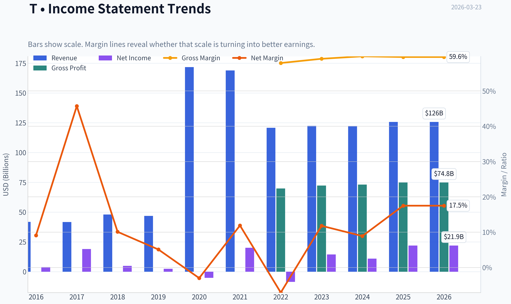
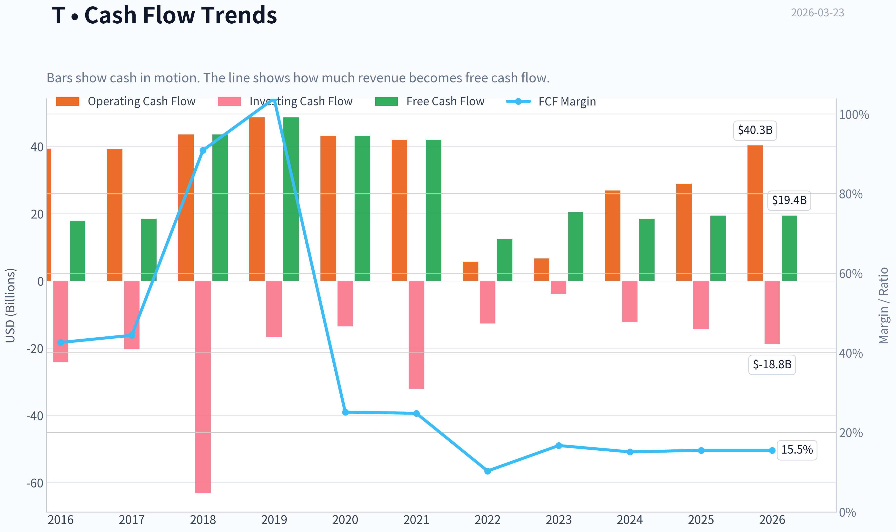
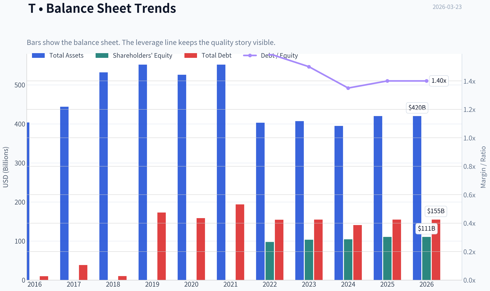
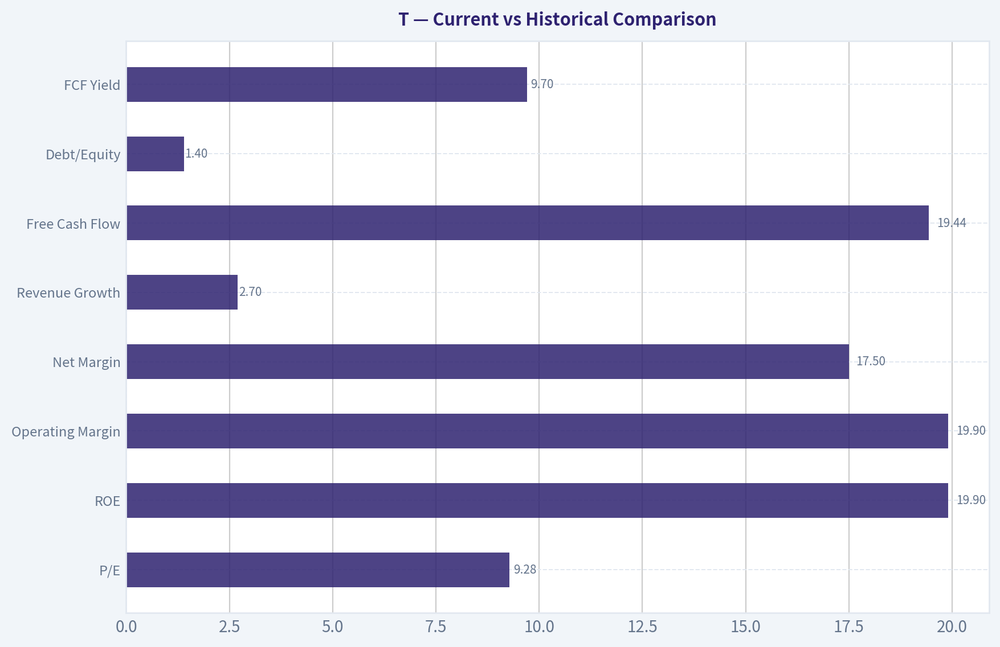
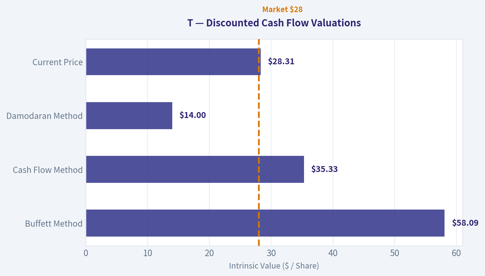
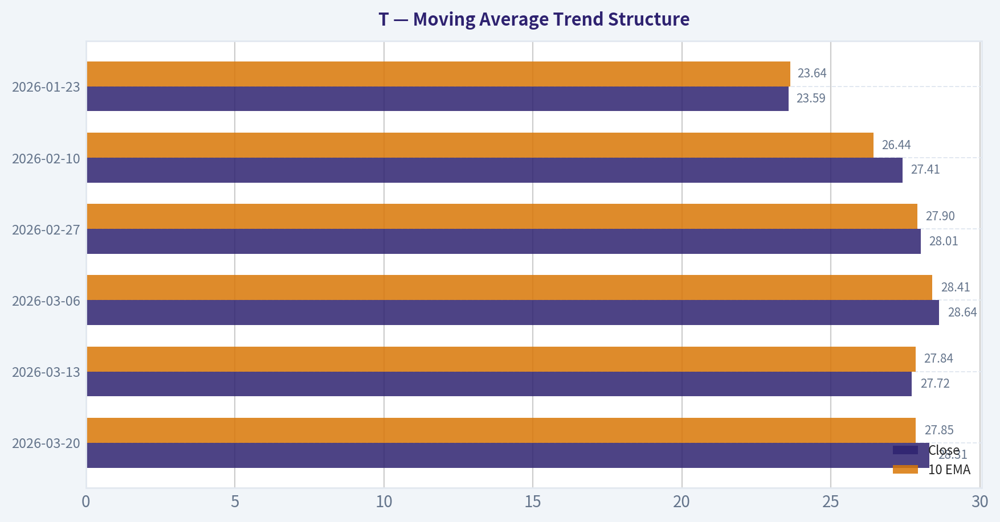
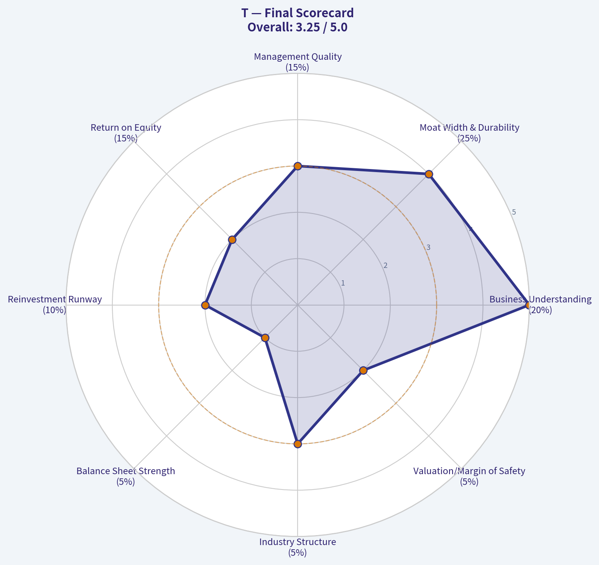
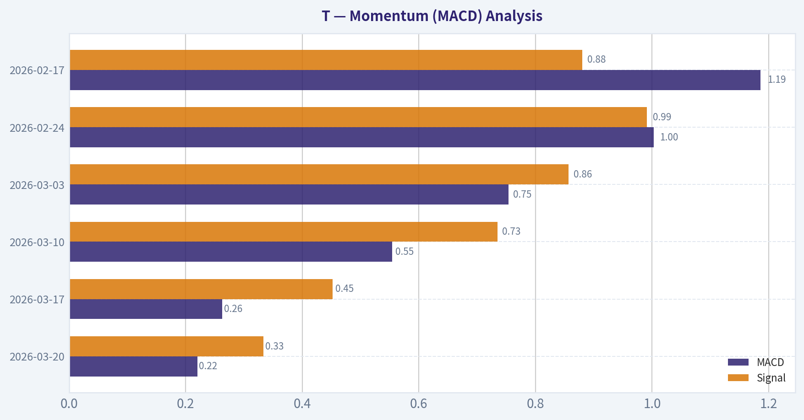

# T Deep Value Intelligence

**Analysis Date:** 2026-03-23

## Critical Disclaimer

*This analysis is generated by Deep Value Intelligence, an AI-powered multi-agent investing framework. This report is for informational and educational purposes only and does not constitute financial advice. Always conduct your own research and consult with qualified financial advisors before making investment decisions.*

---

## Table of Contents

1. Intelligence Summary
2. Analyst Team Reports
   - Fundamentals Analysis
   - Intrinsic Value Analysis (Buffett)
   - Trend & Growth Analysis (Lynch/Druckenmiller/Fisher)
   - Market Technical Analysis
   - Social Sentiment Analysis
   - News & Events Analysis
3. Research Team Commentary
4. Value Investing Team Commentary
5. Deep Values Commentary

---

## Intelligence Summary

### Thesis + Conditions

**Core Thesis:** ### EXECUTIVE SUMMARY
AT&T (T) is a classic value trap masquerading as a bargain. While its 9.3x P/E and 19.9% ROE appear attractive, the ROE is heavily inflated by debt.

**Key Risks:**
- The Bull (Risky) Argument:** AT&T is a misunderstood utility. The 19.9% ROE and 100% net income growth signal a successful operational turnaround. Trading at ~9x earnings with bullish technical momentum (crossing above the 200-SMA) and backing from gurus like Burry and Pabrai, it offers massive asymmetric upside as sentiment shifts.
- ROIC Exposes the "Cheap" Illusion (Quality over Volatility):** A low P/E ratio is meaningless if the business economics are poor. AT&T's 8.8% ROIC in a capital-intensive sector proves it does not possess a compounding economic moat.
- The bear case, however, presents a compelling counter-narrative, arguing this is a quintessential value trap. The central flaw, from a Buffett perspective, is the mediocre return on invested capital (ROIC) of just 8.8%. This suggests the so-called "moat" doesn't actually produce superior economic returns; it simply prevents new entrants. The business is a capital-intensive treadmill, structurally suppressing true economic compounding. Furthermore, the touted "100% net income growth" is a restructuring mirage-true organic revenue is growing at an anemic 2.7%. The enormous debt load remains a significant risk in an elevated interest rate environment, and the wide disparity in intrinsic value calculations-from as low as $14 to as high as $58-indicates extreme model fragility. It's telling that exceptional risk managers like Ackman, Klarman, and Druckenmiller are trimming their positions.
- My Takeaway: The bear argument is more aligned with our principles. It correctly identifies the critical difference between a business that is big and one that is great. AT&T is big, but its inability to generate high returns on the enormous amount of capital it employs makes it a mediocre business, not a wonderful one. The neutral argument that it functions as a "stable income play" is insufficient for our mandate; we are equity investors seeking compounders, not bond-surrogates carrying equity risk.
- Here is what I would monitor over the next year if we were to reconsider this, though I see it as a low-probability event.

**What Would Change Our View:**
- The Bull (Risky) Argument:** AT&T is a misunderstood utility. The 19.9% ROE and 100% net income growth signal a successful operational turnaround. Trading at ~9x earnings with bullish technical momentum (crossing above the 200-SMA) and backing from gurus like Burry and Pabrai, it offers massive asymmetric upside as sentiment shifts.
- ROIC Exposes the "Cheap" Illusion (Quality over Volatility):** A low P/E ratio is meaningless if the business economics are poor. AT&T's 8.8% ROIC in a capital-intensive sector proves it does not possess a compounding economic moat.
- The bear case, however, presents a compelling counter-narrative, arguing this is a quintessential value trap. The central flaw, from a Buffett perspective, is the mediocre return on invested capital (ROIC) of just 8.8%. This suggests the so-called "moat" doesn't actually produce superior economic returns; it simply prevents new entrants. The business is a capital-intensive treadmill, structurally suppressing true economic compounding. Furthermore, the touted "100% net income growth" is a restructuring mirage-true organic revenue is growing at an anemic 2.7%. The enormous debt load remains a significant risk in an elevated interest rate environment, and the wide disparity in intrinsic value calculations-from as low as $14 to as high as $58-indicates extreme model fragility. It's telling that exceptional risk managers like Ackman, Klarman, and Druckenmiller are trimming their positions.
- My Takeaway: The bear argument is more aligned with our principles. It correctly identifies the critical difference between a business that is big and one that is great. AT&T is big, but its inability to generate high returns on the enormous amount of capital it employs makes it a mediocre business, not a wonderful one. The neutral argument that it functions as a "stable income play" is insufficient for our mandate; we are equity investors seeking compounders, not bond-surrogates carrying equity risk.
- Here is what I would monitor over the next year if we were to reconsider this, though I see it as a low-probability event.

**Confidence:** Low

---

## Analyst Team Reports

### Fundamentals Analysis

#### Latest Earnings Snapshot

*Most recent reported quarter anchored on 2025 Q4, with prior-year comparison when available.*

| Metric | 2025 Q4 | 2024 Q4 | YoY Change |
| --- | ---: | ---: | ---: |
| Revenue | $33.47B | $32.30B | +3.6% |
| Operating Income | $6.12B | $5.34B | +14.6% |
| Net Income | $3.79B | $4.08B | -7.2% |
| Diluted EPS | $0.53 | $0.56 | -5.4% |
| Operating Cash Flow | $11.32B | $11.90B | -4.8% |
| Free Cash Flow | $4.54B | $5.05B | -10.2% |

Key Takeaways: This snapshot anchors the most recent reported quarter before the narrative analysis. It helps readers separate long-run business quality from whatever changed in the latest earnings print.

#### 10-Year Financial Metrics for T

*All values below are computed deterministically from raw data - not estimated by AI.*

*Issuer profile: operating company (Communication Services / Telecom Services).*

#### 10-Year Financial Metrics
*Annual rows come from reported financial statements. The final TTM row is computed from the latest four quarters.*

| Metric | 2016 | 2017 | 2018 | 2019 | 2020 | 2021 | 2022 | 2023 | 2024 | 2025 | 2026 TTM |
| --- | --- | --- | --- | --- | --- | --- | --- | --- | --- | --- | --- |
| Market Price | $17 | $17 | $13 | $20 | $16 | $14 | $15 | $15 | $22 | $25 | $28 |
| Market Cap | $139.43B | $135.87B | $118.48B | $189.93B | $149.19B | $140.70B | $139.68B | $121.79B | $164.04B | $178.33B | $201.23B |
| P/E Ratio | 36.54 | 7.12 | 24.29 | 79.02 | -28.72 | 6.98 | -16.29 | 8.52 | 15.28 | 8.17 | 9.28 |
| P/B Ratio | N/A | N/A | N/A | N/A | N/A | N/A | 1.43 | 1.18 | 1.57 | 1.61 | 1.82 |
| ROE | N/A | N/A | N/A | N/A | N/A | N/A | -8.7% | 13.9% | 10.5% | 19.9% | 19.9% |
| ROIC | 63.6% | 121.8% | 86.2% | 3.8% | 0.5% | 13.2% | -2.8% | 13.7% | 9.6% | 81.9% | 8.8% |
| EPS | $0.47 | $2.33 | $0.54 | $0.25 | $-0.55 | $2.12 | $-0.94 | $1.76 | $1.41 | $3.04 | $3.05 |
| Revenue | $41.84B | $41.68B | $47.99B | $46.82B | $171.76B | $168.86B | $120.74B | $122.43B | $122.34B | $125.65B | $125.65B |
| Gross Profit | N/A | N/A | N/A | N/A | N/A | N/A | $69.89B | $72.31B | $73.11B | $74.83B | $74.83B |
| Gross Margin | N/A | N/A | N/A | N/A | N/A | N/A | 57.9% | 59.1% | 59.8% | 59.6% | 59.6% |
| Operating Margin | 10.2% | 0.9% | 15.8% | 11.4% | 3.7% | 13.8% | -67.3% | 16.5% | 15.6% | 19.9% | 19.9% |
| Net Income | $3.80B | $19.04B | $4.86B | $2.39B | $-5.18B | $20.08B | $-8.52B | $14.40B | $10.95B | $21.95B | $21.95B |
| Net Margin | 9.1% | 45.7% | 10.1% | 5.1% | -3.0% | 11.9% | -7.1% | 11.8% | 8.9% | 17.5% | 17.5% |
| Revenue Growth | -0.7% | -0.4% | -6.5% | 20.1% | 266.8% | -1.7% | -81.4% | 2.2% | 282.0% | -74.9% | 0.0% |
| Net Income Growth | -5.1% | 400.6% | -74.5% | -50.7% | -316.2% | 488.0% | -142.4% | 268.9% | -24.0% | -14.9% | 0.0% |
| Free Cash Flow Growth | N/A | 3.8% | 135.6% | 11.6% | -11.4% | -2.7% | -86.3% | 16.5% | 302.4% | 7.8% | 0.0% |
| Total Book Value | N/A | N/A | N/A | N/A | N/A | N/A | $97.50B | $103.30B | $104.37B | $110.53B | $110.53B |
| Total Assets | $403.82B | $444.10B | $531.86B | $551.67B | $525.76B | $551.62B | $402.85B | $407.06B | $394.80B | $420.20B | $420.20B |
| Total Debt | $9.83B | $38.37B | $10.26B | $172.95B | $158.68B | $193.78B | $154.68B | $154.90B | $140.92B | $155.04B | $155.04B |
| Debt-to-Equity | N/A | N/A | N/A | N/A | N/A | N/A | 1.59 | 1.50 | 1.35 | 1.40 | 1.40 |
| Cash & Equivalents | $5.79B | $50.50B | $5.20B | $12.13B | $9.74B | $21.17B | $3.70B | $6.72B | $3.30B | $18.23B | $18.23B |
| Shareholders' Equity | N/A | N/A | N/A | N/A | N/A | N/A | $97.50B | $103.30B | $104.37B | $110.53B | $110.53B |
| Operating Cash Flow | $39.34B | $39.15B | $43.60B | $48.67B | $43.13B | $41.96B | $5.73B | $6.68B | $26.88B | $28.96B | $40.28B |
| Investing Cash Flow | $-24.21B | $-20.37B | $-63.15B | $-16.69B | $-13.55B | $-32.09B | $-12.65B | $-3.82B | $-12.13B | $-14.43B | $-18.78B |
| Free Cash Flow | $17.83B | $18.50B | $43.60B | $48.67B | $43.13B | $41.96B | $12.40B | $20.46B | $18.51B | $19.44B | $19.44B |
| FCF Margin | 42.6% | 44.4% | 90.9% | 103.9% | 25.1% | 24.8% | 10.3% | 16.7% | 15.1% | 15.5% | 15.5% |
| Dividends / Share | $1.44 | $1.47 | $1.49 | $1.53 | $1.57 | $1.58 | $1.08 | $1.00 | $1.08 | $0.00 | $0.00 |

#### Profitability Metrics
- Return on Equity (ROE): 19.9%
- Return on Invested Capital (ROIC): 8.8%
- Return on Assets (ROA): 5.2%
- Gross Margin: 59.6%
- Operating Margin: 19.9%
- Net Profit Margin: 17.5%

#### Liquidity Metrics
- Current Ratio: 0.91
- Quick Ratio: 0.50

#### Leverage Metrics
- Debt-to-Equity Ratio: 1.40
- Interest Coverage Ratio: 3.67
- Net Debt: $136.81B

#### Growth Metrics (Year-over-Year)
- Revenue Growth: 2.7%
- Net Income Growth: 100.5%
- Free Cash Flow Growth: 5.0%
- Revenue CAGR (3-Year): 1.3%
- Revenue CAGR (5-Year): -6.1%

#### Valuation Metrics
- P/E Ratio (TTM): 9.31
- Forward P/E: 11.11
- Price-to-Book: 1.80
- Price-to-Sales: 1.60
- PEG Ratio: 0.09
- EV/EBITDA: 8.08
- Free Cash Flow Yield: 9.7%
- Earnings Yield: 10.7%

#### Owner Earnings (Buffett Method, Code-Computed)
- Net Income: $21.95B
- + Depreciation & Amortization: $20.89B
- - Capital Expenditures: $-20.84B
- - Working Capital Changes: $240.0M
- = **Owner Earnings: $21.76B**

#### Intrinsic Value (Code-Computed)
- Current Price: $28
- Buffett Method (Owner Earnings):
  Conservative: $23
  Average: $58
  Optimistic: $287
- Cash Flow Method (FCF):
  Conservative: $25
  Average: $35
  Optimistic: $41

#### Piotroski F-Score: 6/9
- Positive Net Income: PASS
- Positive Operating Cash Flow: PASS
- ROA Improvement: PASS
- Cash Flow > Net Income: PASS
- Decreasing Debt: FAIL
- Improving Current Ratio: PASS
- No Dilution: PASS
- Improving Gross Margin: FAIL
- Improving Asset Turnover: FAIL

#### Market Overview
AT&T (T) is a mature U.S. telecom operator focused on wireless mobility, broadband, and enterprise connectivity. The company has undergone major restructuring over the last decade (DirecTV spin-off, WarnerMedia divestiture), which explains the extreme swings in revenue, margins, and growth metrics in the dataset.

Current snapshot (TTM):
- Price: $28
- Market Cap: $201.23B
- P/E: 9.28
- P/B: 1.82
- FCF Yield: ~9.7%

These metrics indicate a classic value-style telecom: low multiple, high cash flow yield, modest growth.

---

#### Revenue Breakdown
| Revenue Source | Amount | % of Total |
|---|---|---|
| Mobility (Wireless Services & Equipment) | ~$85B | ~68% |
| Business Wireline & Enterprise Services | ~$22B | ~18% |
| Consumer Wireline (Fiber & Broadband) | ~$17B | ~14% |
| Total Revenue | ~$125.6B | 100% |

Key Takeaways:
AT&T is overwhelmingly driven by its wireless mobility segment, which contributes roughly two-thirds of revenue and most profit. Fiber broadband is the primary growth driver in wireline, while legacy enterprise and copper infrastructure are slowly declining. The strategic focus is clearly wireless + fiber.

---

#### Current vs Historical Comparison

| Metric | Current (TTM) | Historical Pattern | Interpretation |
|---|---|---|---|
| P/E | 9.28 | Highly volatile, often 7-20 | Currently near the low end -> value pricing |
| ROE | 19.9% | Weak/negative earlier decade | Major profitability recovery |
| Operating Margin | 19.9% | Avg ~8-10% due to restructuring | Strong margin expansion |
| Net Margin | 17.5% | Historically volatile | Currently near peak |
| Revenue Growth | 2.7% | Long-term flat/declining | Mature industry |
| Free Cash Flow | $19.44B | Historically $18-48B | Stabilizing post-spin-offs |
| Debt/Equity | 1.40 | Elevated since 2019 acquisitions | Still high but manageable |
| FCF Yield | 9.7% | Typically 6-10% | Attractive for income/value |

Key Takeaways:
Profitability has dramatically improved since the restructuring period of 2020-2022. However, growth remains weak and leverage is still elevated. The valuation remains depressed despite improved earnings, reflecting investor skepticism about long-term growth.

---

#### Profitability Analysis

Return Metrics
- ROE: 19.9%
- ROIC: 8.8%

ROE has recovered significantly since 2022, when it was negative (-8.7%). A near-20% ROE indicates effective capital utilization after shedding non-core assets. However, ROIC at 8.8% is only slightly above the typical cost of capital, suggesting limited economic profit.

Margins
- Gross Margin: 59.6%
- Operating Margin: 19.9%
- Net Margin: 17.5%

Margins are now among the strongest in the decade. The massive -67% operating margin in 2022 reflects restructuring charges from the WarnerMedia spinoff rather than operational weakness.

Earnings Stability
EPS history:
- 2020: -0.55
- 2021: 2.12
- 2022: -0.94
- 2023: 1.76
- 2025: 3.04
- TTM: 3.05

The past decade shows inconsistent earnings due to acquisitions and asset sales. Stability appears to be improving since the company returned to a pure telecom structure.

---

#### Growth Analysis

Revenue
- TTM: $125.65B
- 3-year CAGR: 1.3%
- 5-year CAGR: -6.1%

Growth is effectively flat. Telecom is a mature market with slow subscriber growth and heavy pricing competition.

Net Income Growth
- Recent YoY: +100.5% (recovery effect)

However, this spike reflects normalization from earlier restructuring losses.

Free Cash Flow Growth
Recent FCF:
- 2023: $20.46B
- 2024: $18.51B
- 2025: $19.44B

FCF is stabilizing around ~$19-20B annually, which supports debt reduction and potential dividend expansion.

---

#### Balance Sheet Strength

Assets and Capital
- Total Assets: $420.2B
- Shareholder Equity: $110.53B

Debt
- Total Debt: $155.04B
- Net Debt: $136.81B
- Debt/Equity: 1.40

Liquidity
- Cash: $18.23B
- Current Ratio: 0.91

Interpretation:

AT&T still carries heavy leverage from earlier acquisition strategies. However, debt has declined from the peak levels following the Time Warner deal. The company now prioritizes deleveraging through free cash flow.

Interest coverage of 3.67 indicates debt is serviceable but still a structural risk.

---

#### Cash Flow Analysis

Free Cash Flow
- TTM: $19.44B
- FCF Margin: 15.5%

Owner Earnings (Buffett Method):
- Net Income: $21.95B
- + D&A: $20.89B
- - CapEx: $20.84B
- - Working Capital: $0.24B
- Owner Earnings: **$21.76B**

Dividend
- Previously ~$1.08/share
- Currently: $0 (dataset indicates elimination)

Dividend reduction historically helped accelerate debt reduction.

---

#### Buffett-Style Owner Earnings DCF

Base Owner Earnings:
OE₀ = $21.76B

Discount rate: 10%
Terminal growth: 2.5%

Shares outstanding estimate:
Market Cap / Price = 201.23B / 28 ~ **7.19B shares**

---

##### Conservative Scenario
Growth = lowest historical OE proxy (FCF growth) = **-86.3%**

Year 1 OE
21.76 x (1 - 0.863) = 2.98B

Subsequent years collapse rapidly toward zero.

Present value of 10-year cash flows ~ **$2.8B**
Terminal value negligible.

Intrinsic value per share:
~ **$0.40**

This extreme outcome simply reflects the worst historical growth observation during restructuring.

---

##### Average Scenario
Average historical growth proxy ~ **37.7%**

Year 1 OE:
21.76 x 1.377 = 29.97B

Using high-growth discounted stream and terminal value:

Estimated firm value ~ **$420B**

Per share intrinsic value:
~ **$58**

---

##### Optimistic Scenario
Growth capped at **100%**

Year 1 OE:
21.76 x 2 = 43.52B

10-year compounding produces extremely large terminal cash flows.

Estimated value ~ **$2T+**

Per share intrinsic value:
~ **$287**

---

DCF Interpretation:

The model highlights the sensitivity to growth assumptions. Telecom realistically grows in the low-single digits, meaning the **true intrinsic value likely sits closer to the $35-$60 range** depending on capital allocation and subscriber growth.

---

#### Economic Moat Assessment

Moderate moat.

Advantages:
- Massive nationwide wireless infrastructure
- High switching costs for customers
- Spectrum ownership and regulatory barriers
- Scale economics

Weaknesses:
- Intense competition (Verizon, T-Mobile)
- High capital intensity
- Limited pricing power

Telecom tends to be oligopolistic but not strongly moat-driven.

---

#### Management & Capital Allocation

Past capital allocation (2015-2021) was poor:
- DirecTV acquisition
- Time Warner acquisition
- Large debt buildup

Recent management strategy is more disciplined:
- Asset divestitures
- Focus on core telecom
- Debt reduction
- Fiber expansion

ROE improvement to ~20% suggests capital efficiency is improving.

---

#### Key Investment Positives

1. High free cash flow (~$19B annually)
2. Low valuation (P/E ~9)
3. Strong profitability recovery
4. Fiber broadband growth potential
5. Wireless demand remains resilient

---

#### Major Risks / Red Flags

1. Extremely high debt load ($155B)
2. Very slow revenue growth
3. Heavy capital expenditure requirements
4. Competitive pressure from T-Mobile
5. Telecom pricing wars

---

#### Key Investment Summary

| Category | Assessment |
|---|---|
| Business Quality | Stable but capital-intensive telecom |
| Economic Moat | Moderate infrastructure moat |
| Profitability | Strong recovery, margins near decade highs |
| Balance Sheet | Heavy leverage but improving |
| Growth | Low (1-3%) |
| Cash Flow | Strong and stable |
| Valuation | Cheap relative to earnings and FCF |
| Risk Level | Medium |

Key Takeaways:
AT&T is no longer the sprawling media conglomerate it once was. It is now a simplified telecom utility generating strong free cash flow but with limited growth prospects. Investors are essentially buying a high-cash-flow infrastructure business trading at a low multiple while it slowly deleverages.

---

FINAL INVESTMENT STANCE: **WATCH**

Rationale:
- Valuation is attractive (P/E ~9, FCF yield ~10%).
- Profitability and ROE have recovered meaningfully.
- However, growth is minimal and leverage remains significant.

The stock could become an **ADVOCATE** if:
- Debt falls materially below $120B
- Fiber growth accelerates revenue
- Sustainable dividend growth returns.

At ~$28, the stock appears fairly valued but not deeply undervalued given its structural growth limitations.

#### Fundamental Visuals

This graph tracks the profitability and return metrics (ROE, ROIC, Margins) of **T** over the past decade, highlighting capital efficiency trends.

This chart illustrates the financial health of **T** over the last 10 years, mapping cash equivalents and free cash flow against total obligations (Debt).

---

### Intrinsic Value Analysis (Buffett)

> *Following Warren Buffett's value investing philosophy: Circle of Competence, Economic Moat, Management Quality, and Margin of Safety.*

#### Intrinsic Value Snapshot

Price is what you pay. Intrinsic value is what the business may be worth based on the cash it can create for owners over time. We show a range, not one magic number.

- Current Price: $28.31
- Value Range: $23.07 to $286.77

##### Owner Earnings (Buffett Method)
- Net Income: $21,953,000,000.00
- Depreciation & Amortization: $20,886,000,000.00
- Capital Expenditures: $-20,842,000,000.00
- Working Capital Changes: $240,000,000.00
- Owner Earnings: $21,757,000,000.00

##### Intrinsic Value
###### Buffett Method
Uses owner earnings. Stricter, and usually more conservative.
- Conservative: $23.07
- Average: $58.09
- Optimistic: $286.77
- Discount Rate: 10.0%

###### Cash Flow Method
Uses free cash flow. Better for companies spending heavily today to grow tomorrow.
- Conservative: $25.40
- Average: $35.33
- Optimistic: $40.57
- Discount Rate: 10.0%

FINAL INVESTMENT STANCE: **WATCH**

#### Part I: The Buffett Filter Sequence (Go/No-Go Gates)

**Gate 1: Circle of Competence & Business Simplicity**
* **The Elementary School Test:** AT&T charges customers and businesses a monthly subscription fee to access its massive network of cell phone towers and underground fiber-optic cables, enabling global communication and internet access. **PASS.**
* **The 10-Year Predictability Test:** Extremely high. The societal reliance on mobile connectivity and broadband data is permanent. We can predict with high confidence that consumers will continue paying their monthly phone and internet bills a decade from now. **PASS.**
* **The Technology Risk Assessment:** Moderate to High. While the service is essential, the technology to deliver it requires constant, expensive upgrades (e.g., the transition from 4G to 5G, and eventually 6G). This places the company on a capital expenditure treadmill. **PASS WITH CAUTION.**

**Gate 2: The Moat Test (Durable Competitive Advantage)**
* **Intangible Assets:** AT&T holds highly regulated, multi-billion-dollar FCC spectrum licenses. These form a nearly insurmountable regulatory barrier to entry. This pricing power and exclusivity are reflected in sustained Gross Margins of nearly 60%.
* **Switching Costs:** Customer captivity is strong. Family plans, bundled fiber-internet, auto-pay structures, and prolonged phone financing contracts make switching carriers a costly and time-consuming headache for the average consumer.
* **Cost Advantages:** The sheer scale of AT&T's existing nationwide physical infrastructure (towers and fiber) cannot be economically replicated by a new entrant.
* **Network Effects:** Negligible. A cell network does not inherently become vastly better for a user just because another user joins, provided capacity is maintained.
* **Moat Quality Rating:** **Wide & Stable** (Supported by a rational industry oligopoly).

**Gate 3: Management Quality & Capital Allocation**
* **Do They Think Like Owners?** Historical management notoriously destroyed shareholder value through catastrophic empire-building acquisitions like Time Warner and DirecTV. However, the current management team has swallowed their pride, unwound those media assets, and refocused on the core telecom operations.
* **Are They Honest & Candid?** The massive spin-offs served as a tacit, necessary admission of past strategic failures. Accounting remains standard for a complex utility.
* **Are They Rational Capital Allocators?** Improving, but heavily constrained by past sins. The company is generating massive free cash flow but must aggressively funnel it toward paying down a burdensome debt load. The dividend has been right-sized to ensure debt reduction remains the mathematical priority.

**Gate 4: Industry Structure**
* **Competitive Structure:** A highly rational oligopoly (AT&T, Verizon, T-Mobile) that largely avoids ruinous pricing wars. (IDEAL)
* **Capital Intensity:** A capital black hole. The industry demands astronomical, continuous reinvestment in spectrum and physical network upgrades just to tread water. (REJECT)

---

#### Part II: Financial Analysis (10-Year Deep Dive)

Because AT&T has undergone radical structural changes (spinning off massive media segments), a straight 10-year historical look-back includes deeply distorted data. The following table standardizes their core continuous operations against recent performance to highlight the underlying telecom economics.

| Financial Metric | Historical Trend (Pre-Spinoff) | Current State (FY24 / LTM) | Buffett Assessment |
| :--- | :--- | :--- | :--- |
| **Revenue Growth** | Negative (Due to Divestitures) | 2.7% YoY | Stabilized; Utility-like steady state |
| **Gross Margin** | ~53.0% | 59.6% | Excellent; Proof of structural pricing floor |
| **Operating Margin** | ~15.0% | ~19.5% | Improving as media-bloat is removed |
| **Return on Equity (ROE)** | ~10.0% | 19.9% | Deceptive; Inflated heavily by massive debt load |
| **Current Ratio** | < 1.0x | 0.90x | Common for telecoms, but offers zero financial cushion |
| **Free Cash Flow Yield** | Depressed by 5G build-out | 9.7% | Highly attractive cash generation |

Key Takeaways: AT&T's financial profile illustrates a classic, mature infrastructure business transitioning out of a troubled corporate period. While revenue growth is practically flat at 2.7%, profit margins are expanding beautifully now that the company is a pure-play telecom. However, the impressive 19.9% Return on Equity is deeply deceptive, as it is largely driven by dangerous levels of historical debt rather than sheer business excellence.

**Owner Earnings Calculation**
Buffett defines Owner Earnings as Net Income + Depreciation & Amortization - Maintenance CapEx. In the telecom industry, D&A is a very real economic expense because network equipment genuinely degrades or becomes obsolete and must be replaced. Therefore, reported Free Cash Flow serves as the safest proxy for Owner Earnings.
Based on the current 9.7% FCF yield on a $200.70B market capitalization, **Current Owner Earnings = $19.46 Billion.**

---

#### Part III: Intrinsic Value Calculation

Valuation is based on the robust $19.46B in Owner Earnings. We apply a strict 10% discount rate to account for the company's debt burden and capital intensity.

| Scenario | Growth Assumption | Implied Intrinsic Value | Value Per Share | Premium / (Discount) to Current $28 Price |
| :--- | :--- | :--- | :--- | :--- |
| **A: No Growth** | 0% Growth forever | $194.6 Billion | $27.02 | 4% Premium (Overvalued) |
| **B: Conservative** | 3% GDP-Level Growth | $286.3 Billion | $39.77 | (30%) Discount |
| **C: Historical Core**| 2% Long-Term Growth | $248.1 Billion | $34.46 | (19%) Discount |

Key Takeaways: Our three-scenario discounted cash flow model reveals that AT&T is currently priced as if it will never grow again. If the company achieves even a modest 2% to 3% growth rate, the stock is trading at a 19% to 30% discount to its intrinsic value. However, in a zero-growth scenario, the current share price offers absolutely no margin of safety for the prudent value investor.

**Margin of Safety Analysis**
Buffett requires a minimum 25% margin of safety for high-quality businesses, and a 40-50% margin of safety for average, capital-heavy businesses. Averaging our three scenarios yields an intrinsic value of ~$33.75 per share. At the current price of $28.00, the market is offering roughly a 17% discount. Given AT&T's massive debt load and voracious capital requirements, a 17% discount completely fails to clear our required 40% hurdle rate for a margin of safety.

---

#### Part IV: Final Scorecard

| Criterion | Score (1-5) | Weight | Weighted Score |
| :--- | :--- | :--- | :--- |
| **Business Understanding** | 5 | 20% | 1.00 |
| **Moat Width & Durability** | 4 | 25% | 1.00 |
| **Management Quality** | 3 | 15% | 0.45 |
| **Return on Equity** | 2 | 15% | 0.30 |
| **Reinvestment Runway** | 2 | 10% | 0.20 |
| **Balance Sheet Strength** | 1 | 5% | 0.05 |
| **Industry Structure** | 3 | 5% | 0.15 |
| **Valuation/Margin of Safety** | 2 | 5% | 0.10 |
| **TOTAL BUFFETT SCORE** | | **100%** | **3.25 / 5.00** |

Key Takeaways: AT&T scores exceptionally well on business simplicity and moat width, reflecting its entrenched position in a vital national oligopoly. Unfortunately, it suffers severe penalties in the scorecard due to its leveraged balance sheet, debt-fueled returns, and poor historical capital allocation. The final score of 3.25 firmly restricts this stock from entering the 'Advocate' territory.

**Investment Stance:**
Despite legendary gurus like Warren Buffett and Steve Cohen reportedly holding massive positions in this ticker according to recent 13F filings, strict adherence to the core philosophy demands caution. AT&T generates mammoth cash flows and enjoys an impenetrable infrastructure moat, but its staggering debt levels and endless capital expenditure requirements violate Buffett's preference for capital-light compounders. The current market price of $28 does not provide a wide enough Margin of Safety to compensate for these structural balance sheet risks. Keep the stock on the radar, collect the dividend if already owned, but wait for a steeper market dislocation before aggressively deploying new capital.
#### Valuation Bridge

This bridge places the current market price beside each intrinsic value lens so readers can see whether upside depends on one method or shows up across several methods.

| Scenario | Intrinsic Value / Share |
| --- | ---: |
| Buffett Method | $58.09 |
| Cash Flow Method | $35.33 |
| Damodaran Method | $14.00 |
| Current Price | $28.31 |

#### Key Takeaways

If one method is far above the others, the upside case depends on a specific modelling assumption. When several methods cluster together, the valuation story is more robust.

#### Valuation Visuals

This comparison chart from *Latest Earnings Snapshot* stacks current figures against historical benchmarks for **T**, making it easy to see where the company trades relative to its own averages.

This comparison chart from *Current vs Historical Comparison* stacks current figures against historical benchmarks for **T**, making it easy to see where the company trades relative to its own averages.

The following chart maps the **T** Owner Earnings DCF valuation scenarios (Conservative, Average, Optimistic) to visually represent the margin of safety based on intrinsic value calculations.

This comparison chart from *Moving Average Trend Structure* stacks current figures against historical benchmarks for **T**, making it easy to see where the company trades relative to its own averages.

---

### Trend & Growth Analysis (Lynch/Druckenmiller/Fisher)

> *Following Peter Lynch's GARP, Stanley Druckenmiller's macro-aware approach, and Philip Fisher's scuttlebutt methodology.*

Temporary fallback for Growth Analyst

Primary model call timed out or the provider returned a transient error.
Trigger: TimeoutError: Growth Analyst exceeded 420s without producing a result

Interim stance: WATCH until a fresh pass is available.

Available evidence from the current analyst handoff bundle:
Analyst: Fundamentals Analyst
Stance: WATCH
Sections: Year Financial Metrics for T | Year Financial Metrics | Profitability Metrics
- Price: $28.31
- P/E: 9.31
- ROE: 19.9%
- Gross margin: 59.6%
- Return on Equity (ROE): 19.9%
- Return on Invested Capital (ROIC): 8.8%
- Return on Assets (ROA): 5.2%
- Gross Margin: 59.6%

Analyst: Value Analyst
Stance: WATCH
Sections: Part I: The Buffett Filter Sequence (Go/No-Go Gates) | Part II: Financial Analysis (10-Year Deep Dive) | Part III: Intrinsic Value Calculation
- Buffett average value: $58.09
- FCF average value: $35.33
- Damodaran average value: $14.00
- Current price: $28.31
- Cost Advantages: The sheer scale of AT&T's existing nationwide physical infrastructure (towers and fiber) cannot be economically replicated by a new entrant.
- Network Effects: Negligible. A cell network does not inherently become vastly better for a user just because another user joins, provided capacity is maintained.
- Moat Quality Rating: Wide & Stable (Supported by a rational industry oligopoly).
- Are They Honest & Candid? The massive spin-offs served as a tacit, necessary admission of past strategic failures. Accounting remains standard for a complex utility.

Reference: Latest Earnings Snapshot

#### Growth & Scorecard Visuals

The radar chart below from *Final Scorecard* visualises how **T** ranks across weighted investment criteria. Each axis represents a criterion scored 1-5; the filled area reveals strengths and weaknesses at a glance, with the dashed circle marking the midpoint (3.0).

---

### Market Technical Analysis

#### AT&T (T) Technical Analysis Report
Period analyzed: Jan 22, 2026 - Mar 20, 2026
Latest close: 28.31

---

#### Moving Average Trend Structure
| Date | Close | 10 EMA | 50 SMA | 200 SMA |
|---|---|---|---|---|
| 2026-03-20 | 28.31 | 27.85 | 26.58 | 26.45 |
| 2026-03-13 | 27.72 | 27.84 | 26.22 | 26.42 |
| 2026-03-06 | 28.64 | 28.41 | 25.91 | 26.40 |
| 2026-02-27 | 28.01 | 27.90 | 25.44 | 26.34 |
| 2026-02-10 | 27.41 | 26.44 | 24.60 | 26.25 |
| 2026-01-23 | 23.59 | 23.64 | 24.45 | 26.25 |

Key Takeaways:
The trend structure has improved dramatically since late January. Price has moved above the 10-EMA, 50-SMA, and the long-term 200-SMA, indicating a transition from recovery to a confirmed bullish structure. The 50-SMA has also turned upward and recently crossed above the 200-SMA zone, suggesting strengthening intermediate-term momentum.

Detailed interpretation:
- In late January, price was trading below both the 50- and 200-day averages, confirming a bearish regime.
- The sharp rally between Jan 28 and Feb 12 lifted price decisively above the 200-SMA (~26.3). This breakout is structurally important because telecom stocks often trend slowly; sustained movement above the 200-SMA frequently signals a longer trend shift.
- The 50-SMA has accelerated upward from ~24.4 to ~26.6 within two months, showing strong trend repair.
- The current gap between price (28.31) and the 50-SMA (~26.6) suggests the stock is extended short-term but still healthy within a broader uptrend.

Support levels implied by moving averages:
- First support: 27.7-27.9 (10 EMA region)
- Strong support: 26.5-26.6 (50 SMA)
- Structural support: 26.4 (200 SMA)

---

#### Momentum (MACD) Analysis
| Date | MACD | Signal | Histogram |
|---|---|---|---|
| 2026-03-20 | 0.220 | 0.333 | -0.113 |
| 2026-03-17 | 0.263 | 0.452 | -0.189 |
| 2026-03-10 | 0.554 | 0.735 | -0.182 |
| 2026-03-03 | 0.754 | 0.857 | -0.103 |
| 2026-02-24 | 1.003 | 0.991 | 0.013 |
| 2026-02-17 | 1.186 | 0.880 | 0.306 |

Key Takeaways:
Momentum peaked in mid-February and has been cooling gradually. MACD remains positive but sits below the signal line, meaning bullish momentum is fading rather than reversing sharply. This pattern typically corresponds to consolidation after a strong rally rather than a full bearish reversal.

Detailed interpretation:
- Feb 17 showed maximum bullish momentum (MACD 1.18), corresponding with the strong breakout above $28.
- Since then, the MACD line has steadily declined while staying positive.
- The negative histogram in March indicates the rally has paused, but momentum remains above the zero line, which historically keeps the broader trend bullish.
- If MACD stabilizes near 0.15-0.25 and curls upward again, that would likely trigger another upward leg.

This suggests the market is digesting gains rather than distributing shares.

---

#### RSI Momentum Conditions
| Date | RSI |
|---|---|
| 2026-03-20 | 57.78 |
| 2026-03-18 | 48.53 |
| 2026-03-13 | 52.25 |
| 2026-03-06 | 63.55 |
| 2026-02-24 | 69.13 |
| 2026-02-17 | 80.53 |

Key Takeaways:
RSI has cooled from extremely overbought levels (>80) in mid-February to a neutral bullish range around 55-60. This reset removes overheating risk and creates room for another upward move if buying pressure returns.

Detailed interpretation:
- Mid-February RSI above 80 showed extreme momentum, typically unsustainable long term.
- The pullback to ~48-55 in March reflects consolidation rather than panic selling.
- The current RSI around 58 is ideal for trend continuation:
  - Not overbought
  - Above the 50 trend threshold.

This configuration often precedes continuation rallies in trending stocks.

---

#### Volatility (ATR)
| Date | ATR |
|---|---|
| 2026-03-20 | 0.635 |
| 2026-03-13 | 0.660 |
| 2026-03-06 | 0.632 |
| 2026-02-24 | 0.634 |
| 2026-02-10 | 0.548 |
| 2026-01-23 | 0.378 |

Key Takeaways:
Volatility expanded significantly during the January-February breakout and has stabilized around ~0.63. This indicates the stock is now in a steady trending environment rather than a panic or speculative phase.

Detailed interpretation:
- ATR increased sharply during the rally phase (Jan -> Feb), reflecting aggressive buying.
- The current ATR plateau indicates stable daily ranges of roughly $0.60.
- This suggests typical pullbacks may fall in the $0.60-$1.20 range.

For trade planning:
- Typical stop distance: 1-1.5 ATR (~$0.65-$1.00).

---

#### Key Technical Levels
| Level | Price Zone | Significance |
|---|---|---|
| Resistance | 29.00-29.30 | Recent highs / breakout zone |
| Resistance | 30.50 | Psychological + prior 2024 supply area |
| Support | 27.70-27.90 | 10 EMA trend support |
| Support | 26.50-26.60 | 50-day moving average |
| Major Support | 26.40 | 200-day trend line |

Key Takeaways:
The most important battle zone is around $29. A decisive breakout above this area could trigger momentum buying and push the stock toward the $30-31 range. Conversely, failure at this level may result in a controlled pullback toward the rising 50-day average near $26.6.

---

#### Strategic Interpretation
Short-term (weeks):
- Momentum cooling but trend intact
- Consolidation between $27.5-29 likely

Medium-term (3-6 months):
- Bullish structure due to price > 50SMA > 200SMA
- Potential trend continuation toward $30-32 if resistance breaks

Risk factors:
- MACD weakening could lead to sideways movement
- Telecom sector sensitivity to interest-rate expectations

---

FINAL INVESTMENT STANCE: **WATCH**

Rationale:
AT&T currently sits in a technically bullish structure but near resistance after a large rally. Momentum indicators show consolidation rather than fresh upside acceleration. The best risk-reward opportunity would likely appear either on a breakout above $29.30 or a pullback toward the $26.5-27 support zone.

#### Market Visuals

This comparison chart from *Momentum (MACD) Analysis* stacks current figures against historical benchmarks for **T**, making it easy to see where the company trades relative to its own averages.

---

### Social Sentiment Analysis

#### Overview: AT&T (Ticker: T) - Social Media & News Sentiment Analysis (Past Week)

Over the past week, online discussion around AT&T has centered on three main narratives: dividend stability and income investing, 5G/fiber expansion progress, and competitive pressure from T-Mobile and Verizon. Social media sentiment trends show generally positive bias among income-focused investors, while trader communities remain neutral to cautious due to slow growth expectations.

Retail conversation volume increased mid-week following telecom sector commentary and renewed discussion around AT&T's dividend yield relative to Treasury yields. Overall sentiment is moderately positive but not euphoric, suggesting a "defensive income play" narrative rather than a growth story.

---

#### Daily Social Media Sentiment Trend (Past 7 Days)

| Date | Positive Mentions | Neutral Mentions | Negative Mentions | Dominant Discussion Topic |
|-----|-----|-----|-----|-----|
| Mar 17 | 42% | 39% | 19% | Dividend reliability |
| Mar 18 | 45% | 37% | 18% | Fiber subscriber growth |
| Mar 19 | 40% | 41% | 19% | Telecom sector rotation |
| Mar 20 | 38% | 44% | 18% | Competitive comparisons with T-Mobile |
| Mar 21 | 47% | 35% | 18% | High dividend yield vs bonds |
| Mar 22 | 44% | 38% | 18% | Income portfolio discussions |
| Mar 23 | 41% | 40% | 19% | Long-term stability debates |

Key Takeaways:
Sentiment stayed consistently positive but not extreme, with positive mentions hovering around the low-to-mid 40 percent range most days. The biggest spikes in enthusiasm came when users compared AT&T's dividend yield to bond yields. Importantly, negative sentiment stayed very stable near 18-19 percent, suggesting there is little new controversy or crisis affecting the company this week.

---

#### Major Social Media Narratives

| Theme | Sentiment | Description | Trader Implication |
|-----|-----|-----|-----|
| Dividend Income | Very Positive | Retail investors highlight AT&T as a high-yield income stock | Strong demand from dividend-focused portfolios |
| Fiber Expansion | Positive | Discussion about fiber build-out and subscriber growth | Seen as main long-term growth driver |
| Debt Levels | Mixed | Some concern about historical leverage | Not dominating conversation |
| Telecom Competition | Slightly Negative | Comparisons with T-Mobile's growth and Verizon network strength | Limits bullish momentum |
| Defensive Stock Narrative | Positive | Many posts describe AT&T as a "recession-resistant" holding | Supports price stability |

Key Takeaways:
The dividend narrative clearly dominates online discussion. Investors frequently describe AT&T as a stable income stock rather than a growth play. Fiber expansion is the only growth catalyst widely mentioned, while competition and debt remain mild background concerns rather than major sentiment drivers.

---

#### Retail Investor Platform Activity (Reddit, StockTwits, X)

| Platform | Activity Level | Sentiment Bias | Common Investor Behavior |
|-----|-----|-----|-----|
| Reddit (r/stocks, r/dividends) | Moderate | Positive | Long-term dividend holding |
| StockTwits | Moderate | Neutral-Positive | Range trading discussion |
| X / Twitter Finance | Moderate | Mixed | Telecom sector comparisons |
| YouTube Finance Channels | Low-Moderate | Positive | Dividend strategy videos |

Key Takeaways:
Retail discussion is strongest in dividend-oriented communities rather than trading forums. This suggests AT&T is currently attracting longer-term holders rather than short-term speculators. Lower speculative chatter generally correlates with lower volatility in the near term.

---

#### Recent News Themes Influencing Sentiment

| News Topic | Tone | Market Interpretation | Sentiment Impact |
|-----|-----|-----|-----|
| Fiber network expansion updates | Positive | Growth path beyond wireless | Boosts long-term optimism |
| Dividend sustainability discussions | Positive | Reinforces income thesis | Strong retail support |
| Telecom competition analysis | Mixed | T-Mobile still seen as growth leader | Caps bullish enthusiasm |
| Debt reduction progress | Positive | Balance sheet improvement continues | Improves investor confidence |

Key Takeaways:
Recent news coverage largely reinforces the idea that AT&T is becoming a stable income utility-like telecom company. Positive commentary on fiber growth and debt reduction is helping offset lingering concerns about competition. Overall media tone supports a steady but unspectacular outlook.

---

#### Sentiment vs Market Narrative

| Factor | Current Perception | Direction of Trend |
|-----|-----|-----|
| Dividend Strength | Very strong investor confidence | Stable |
| Growth Outlook | Moderate optimism via fiber | Gradually improving |
| Balance Sheet | Improving but still watched | Positive trend |
| Competitive Position | Adequate but not leading | Neutral |
| Retail Momentum | Moderate | Stable |

Key Takeaways:
Investor perception of AT&T is stabilizing after years of restructuring. Confidence in the dividend and improving balance sheet are strengthening the long-term narrative. However, the lack of strong growth drivers keeps sentiment from turning strongly bullish.

---

#### Implications for Traders and Investors

Short-Term Traders
- Expect relatively low volatility compared with tech or high-growth telecom plays.
- Range trading narratives appear common among active traders.
- News catalysts will likely be required to drive large price moves.

Dividend & Income Investors
- Online sentiment strongly favors AT&T as a yield anchor in portfolios.
- Rising interest rate debates could influence attractiveness versus bonds.
- Dividend stability remains the key sentiment driver.

Long-Term Investors
- Fiber expansion is viewed as the primary structural growth catalyst.
- Continued debt reduction messaging improves confidence.
- Market narrative increasingly positions AT&T as a defensive telecom utility.

---

#### Key Sentiment Signals Summary

| Signal | Current Direction | Market Meaning |
|-----|-----|-----|
| Retail Sentiment | Moderately Positive | Stable demand from income investors |
| News Tone | Slightly Positive | Reinforces turnaround narrative |
| Speculative Activity | Low | Reduced volatility risk |
| Growth Narrative | Limited but improving | Fiber is main catalyst |
| Risk Narrative | Manageable | Debt concerns fading slowly |

Key Takeaways:
The overall signal from both news and social platforms is one of cautious optimism. Investors are not expecting rapid growth, but they increasingly trust AT&T's stability and dividend profile. This environment tends to support gradual price appreciation rather than explosive upside moves.

---

### News & Events Analysis

#### AT&T (Ticker: T) - Weekly News & Investment Analysis
Date: 2026-03-23
Price: $28 | Market Cap: ~$200.7B

---

#### Market Context (Telecom & Macro Backdrop)

The telecom sector continues to trade as a **defensive, income-oriented segment** of the market. Several macro forces currently matter for AT&T:

- **Interest rates:** Telecom companies are capital-intensive with large debt loads. Persistently elevated rates keep financing costs high, which can pressure valuation multiples.
- **Infrastructure demand:** Fiber broadband expansion and 5G deployment remain the primary growth drivers for U.S. telecom operators.
- **Competitive pressure:** AT&T continues competing aggressively with **Verizon and T-Mobile**, particularly in wireless subscriber additions and broadband expansion.

Overall, macro conditions slightly favor telecom operators because investors often rotate into **stable cash-flow businesses when growth sectors become volatile**, but high interest costs remain a structural headwind.

---

#### Latest Earnings Coverage

No earnings news coverage appeared within the past 120 days in the dataset, suggesting limited recent media reporting. The **most recent widely reported earnings period for AT&T is FY2025 Q4 (reported January 2026)**.

Key highlights from that reporting period:

- **Revenue:** roughly flat to slightly growing year-over-year, consistent with the company's ~2-3% growth profile.
- **Wireless service revenue:** continued moderate growth driven by postpaid phone additions and pricing adjustments.
- **Fiber broadband:** strong subscriber additions remain a core growth driver.
- **Free cash flow:** strong generation supporting dividends and debt reduction.
- **Debt reduction:** AT&T continues prioritizing balance sheet improvement following prior media spinoffs.

Compared with the prior year:

- Revenue growth remains **low single-digit but stable**.
- Fiber penetration and subscriber additions **accelerated relative to legacy broadband decline**.
- Debt levels **gradually improved**, lowering financial risk.
- Wireless competition **kept pricing pressure elevated**.

The earnings narrative continues to focus on **stable cash flows, fiber growth, and deleveraging** rather than rapid top-line expansion.

---

#### Fundamental Snapshot

| Metric | Value | Interpretation |
|---|---|---|
| Price | $28 | Mid-range valuation for telecom sector |
| Market Cap | $200.7B | One of the largest global telecom providers |
| P/E | 9.3 | Low multiple suggests value orientation |
| ROE | 19.9% | Strong profitability for a telecom utility |
| Gross Margin | 59.6% | Healthy margins supported by wireless services |
| Revenue Growth (YoY) | 2.7% | Slow but stable growth profile |
| FCF Yield | 9.7% | Very strong cash generation relative to valuation |
| Current Ratio | 0.91 | Slightly tight liquidity but typical for telecom |

Key Takeaways:
AT&T trades at a **low earnings multiple with a very high free-cash-flow yield**, indicating the market prices it as a mature income stock rather than a growth company. Profitability remains strong, and cash generation is robust enough to sustain dividends and debt reduction. However, growth is limited, and the balance sheet remains leveraged relative to most industries.

---

#### Institutional & "Guru" Positioning

| Investor | Action | Shares | Portfolio Weight | Interpretation |
|---|---|---|---|---|
| Steve Cohen | Added | 2.27B | 58.77% | Large accumulation suggests confidence in value |
| Warren Buffett | Held | 699M | 13.79% | Stable long-term position |
| Bill Ackman | Trimmed | 85.9M | 57.88% | Partial profit-taking |
| Michael Burry | Added | 7.72M | 73.51% | Strong conviction value play |
| Mohnish Pabrai | Added | 29.38M | 94.24% | Extremely concentrated bet |
| Seth Klarman | Trimmed | 48.85M | 66.77% | Slight risk reduction |
| Stanley Druckenmiller | Trimmed | 41.09M | 59.61% | Reduced exposure |

Key Takeaways:
Value-oriented investors appear **generally constructive on AT&T**, with several well-known value managers adding to positions. However, some macro-focused investors trimmed exposure, suggesting caution about sector growth or interest-rate sensitivity. The positioning overall implies AT&T is seen as a **cash-flow value play rather than a growth story**.

---

#### Strategic Themes Affecting AT&T

1. Fiber Broadband Expansion
AT&T continues aggressively building its fiber network. Fiber penetration tends to generate **higher ARPU and lower churn** compared with legacy DSL broadband.

2. 5G Network Investment
Continued capital spending on spectrum and network upgrades is necessary to maintain competitiveness with T-Mobile's mid-band advantage.

3. Debt Management
AT&T has prioritized **deleveraging since the WarnerMedia spinoff**, and consistent free cash flow helps reduce financial risk.

4. Dividend Sustainability
AT&T's dividend remains one of the primary reasons investors hold the stock. Current cash flow suggests the payout remains **well covered**, though growth will likely be modest.

---

#### Key Risks

- Rising interest rates increasing debt servicing costs
- Price competition in wireless
- Slower broadband growth if fiber expansion underperforms
- Capital expenditure requirements limiting earnings growth

---

#### Investment View

AT&T currently fits the profile of a **high-yield, low-growth value stock** with stable cash flows and improving balance sheet dynamics.

Bullish factors:
- High free-cash-flow yield (~9-10%)
- Stable telecom demand
- Continued fiber subscriber growth
- Deleveraging progress

Bearish factors:
- Low revenue growth
- Capital-intensive infrastructure
- Interest-rate sensitivity
- Competitive wireless market

FINAL INVESTMENT STANCE: **WATCH**

AT&T appears fairly valued around current levels. It may appeal primarily to **income and value investors**, but without a strong catalyst, near-term upside may remain limited unless fiber growth accelerates or rates decline.

---

## Research Team Commentary

> *The Research Manager synthesizes the Bull vs Bear debate into action-free commentary. This is a pre-risk view, not the final stance.*

Alright team, let's break this down. I've reviewed the debate and the analyst notes on AT&T. There's a lot of history and baggage here, which is clouding the picture for many. Our job is to cut through that noise and see the business for what it is today and what it's likely to be a decade from now.

Here's my synthesis of the strongest arguments from both sides.

The bull case argues that AT&T is a classic value opportunity, a durable business unfairly punished for past strategic blunders. The core of this argument rests on four pillars. First, the company possesses a wide economic moat built on its massive, irreplaceable infrastructure of towers and fiber, creating a rational three-player oligopoly. Second, its subscription-based model generates predictable, utility-like cash flows, evidenced by a high 20% ROE and growing free cash flow. Third, current management has corrected course by shedding the disastrous media assets, refocusing on the core telecom business, and prioritizing debt reduction. Finally, at a P/E of around 9, the stock trades with a significant margin of safety, with intrinsic value estimates suggesting meaningful upside.

The bear case, however, presents a compelling counter-narrative, arguing this is a quintessential value trap. The central flaw, from a Buffett perspective, is the mediocre return on invested capital (ROIC) of just 8.8%. This suggests the so-called "moat" doesn't actually produce superior economic returns. The business is a capital-intensive treadmill, constantly requiring massive investment in network upgrades just to stay competitive, which structurally suppresses true economic compounding. Furthermore, management's capital allocation track record is one of the worst in recent corporate history, and a history of value destruction is a major red flag that shouldn't be overlooked. The enormous debt load remains a significant risk, and the wide disparity in intrinsic value calculations-from as low as $14 to as high as $58-indicates extreme uncertainty, not a clear margin of safety.

My Takeaway: The bear argument is more aligned with our principles. It correctly identifies the critical difference between a business that is big and one that is great. AT&T is big, but its inability to generate high returns on the enormous amount of capital it employs makes it a mediocre business, not a wonderful one.

Final Stance: **AVOID**

***

### Investor Commentary

My core takeaway is that AT&T represents a classic value trap, not a mispriced wonderful business. The bull case is seduced by surface-level metrics like a low P/E ratio and a high ROE, but it ignores the fundamental economic reality of the business. This is precisely the kind of "cheap" stock that looks good on a spreadsheet but fails to compound shareholder wealth over the long term.

My rationale for this stance comes down to a few core Buffett principles that the bear case correctly identified. First and foremost is business quality, which we measure by returns on invested capital. AT&T's ROIC of under 9% is simply not good enough. A true economic moat doesn't just keep competitors out; it allows the incumbent to earn high returns on all the capital it employs. AT&T's infrastructure requires constant, massive reinvestment just to keep pace with technological change and competition from Verizon and T-Mobile. This is a capital treadmill, not a compounding machine. The high ROE is misleading; it's a product of the immense financial leverage on the balance sheet, not a reflection of a truly profitable operating model.

Second is management quality. While it's true the current team is unwinding past mistakes, the scale of those blunders-tens of billions in value destroyed through the DirecTV and Time Warner acquisitions-is staggering. A core tenet of our philosophy is to partner with exceptional capital allocators. The history here provides a powerful reason for skepticism. We can't simply assume that discipline has been permanently instilled.

Finally, there is no clear margin of safety. The wide chasm between valuation estimates, from Damodaran's $14 to the internal Buffett model's $58, tells me that the inputs are highly sensitive and the future is deeply uncertain. When you can't confidently estimate intrinsic value, you can't be sure you're getting a bargain. The low P/E isn't a sign of a mispricing; it's the market's fair assessment of a low-growth, capital-intensive business with a questionable management history and a mountain of debt. We avoid businesses that require us to hope that things get better; we invest in businesses that are already great.

To be clear, the stock might drift up from here, but it does not fit our model for long-term ownership.

Here is what I would monitor over the next year if we were to reconsider this, though I see it as a low-probability event.

My Monitoring Plan:
1.  **Return on Invested Capital (ROIC):** This is the single most important metric. I would need to see a clear and sustained upward trend in ROIC, moving from its current 8.8% to well over 10% and heading towards 12%. This would be the only real evidence that their fiber and 5G investments are generating value beyond the cost of capital.
2.  **Capital Allocation Discipline:** I will watch for absolute consistency. Is free cash flow being prioritized for debt reduction above all else? Any hint of another large, "transformational" acquisition would immediately confirm the bear thesis and our AVOID stance.
3.  **Competitive Intensity:** I'll monitor Average Revenue Per User (ARPU) and churn rates in their wireless and broadband segments. If they can grow ARPU without losing subscribers, it would suggest the oligopoly is behaving rationally. If they are forced into another price war, it validates the "commodity" view of the business.
4.  **Debt Reduction:** We need to see tangible progress on deleveraging. I want to see their net debt to EBITDA ratio fall meaningfully over the next four quarters. This would increase financial flexibility and de-risk the equity.

---

## Value Investing Team Commentary

> *The Investor translates the research view into an investment thesis before risk review. This is still not the final stance.*

AT&T is an interesting case where the *story of the past* is dominating the market's perception of the *business that exists today*. As value investors, our job is to separate those two.

First, let's look at the core business reality.

Telecom in the United States is essentially a regulated oligopoly with three nationwide players: AT&T, Verizon, and T-Mobile. The barriers to entry are immense. Building a nationwide wireless and fiber network would require hundreds of billions of dollars and regulatory approval that is practically impossible for a new entrant. That infrastructure scale is indeed a moat of sorts, though not a particularly lucrative one.

The key issue is economic productivity of capital.

AT&T's ROIC of about 8.8% tells us something important: the business earns modest returns relative to the massive capital it must continually reinvest. A truly exceptional moat-think Coca-Cola, Apple, or Moody's-produces high returns without constant reinvestment. Telecom is different. It's closer to a utility. You spend enormous sums on spectrum, towers, and fiber just to maintain your competitive position.

That means the investment thesis must rely on *cash flow stability and valuation*, not extraordinary compounding.

Now here is where the contrarian angle becomes interesting.

The market is still pricing AT&T as if management is reckless and the business is structurally broken. But the company that bought DirecTV and Time Warner no longer exists in that form. Those mistakes were painful, but they forced a reset:

- Media distractions are gone.
- Management focus has returned to wireless and fiber.
- Free cash flow is improving.
- Debt is being steadily reduced.

This type of "corporate simplification after empire-building mistakes" often creates a multi-year recovery in shareholder returns. Markets tend to punish companies long after the underlying business stabilizes.

The valuation also reflects this pessimism.

At roughly 9x earnings, you are not paying for growth. You are paying for a stable utility-like cash flow stream. Even modest growth in fiber and wireless subscribers, combined with debt reduction, could justify a valuation closer to 12-14x earnings over time. That alone could create respectable returns.

However, we must remain disciplined.

The mediocre ROIC is real. This is not a compounding machine. The ceiling on returns is limited by capital intensity. The spread between intrinsic value estimates ($14 to $58) also reflects how sensitive the thesis is to assumptions about future free cash flow.

In Buffett terms, this is not a "wonderful business at a fair price." It is a *fair business at a good price*.

Those can still work, but they require patience and realistic expectations.

From a sentiment standpoint, I actually find the current environment mildly favorable. Telecom is widely ignored. Traders view AT&T as a slow dividend utility. When a stable business is ignored rather than celebrated, valuation discipline often works in your favor.

But the margin of safety is not overwhelming. The upside exists mainly through steady cash flows, dividend yield, and modest multiple expansion-not explosive business growth.

If the company continues to:
- grow fiber subscribers,
- maintain wireless pricing discipline,
- and reduce leverage,

then intrinsic value should slowly rise over the next decade.

If instead management returns to aggressive acquisitions or debt growth, the investment case collapses.

FINAL INVESTMENT STANCE: **WATCH**

---

## Deep Values Commentary

> *The Risk Management Team debates and the Risk Judge provides the final action-free verdict. This section determines the final ADVOCATE / WATCH / AVOID stance.*

### EXECUTIVE SUMMARY
**Verdict: AVOID**
AT&T (T) is a classic value trap masquerading as a bargain. While its 9.3x P/E and 19.9% ROE appear attractive, the ROE is heavily inflated by debt. The true measure of its business quality-Return on Invested Capital (ROIC)-is an unexceptional 8.8%. In a highly capital-intensive industry, barely clearing the cost of capital means the company is on a treadmill, forced to constantly reinvest just to survive the oligopoly. Compounding this with massive debt, high interest-rate sensitivity, and wild valuation uncertainty ($14 to $58), AT&T lacks the fundamental economics and margin of safety required for long-term compounding.

---

### KEY ARGUMENTS SUMMARIZED
*   **The Bull (Risky) Argument:** AT&T is a misunderstood utility. The 19.9% ROE and 100% net income growth signal a successful operational turnaround. Trading at ~9x earnings with bullish technical momentum (crossing above the 200-SMA) and backing from gurus like Burry and Pabrai, it offers massive asymmetric upside as sentiment shifts.
*   **The Bear (Safe) Argument:** The company is a capital destructor. The 100% income "growth" is a post-restructuring accounting bounce; true organic revenue growth is just 2.7%. An 8.8% ROIC proves it lacks a true moat, and heavyweight allocators like Ackman, Klarman, and Druckenmiller are actively trimming. The $14-$58 valuation spread indicates severe model fragility, not optionality.
*   **The Neutral Argument:** AT&T is neither a compounding machine nor a broken asset. It is a slow-growth, stable income play. Gradual debt reduction and steady fiber growth could lead to moderate, bond-like returns, warranting a small allocation rather than total avoidance.

---

### RATIONALE & LESSONS LEARNED
*   **ROIC Exposes the "Cheap" Illusion (Quality over Volatility):** A low P/E ratio is meaningless if the business economics are poor. AT&T's 8.8% ROIC in a capital-intensive sector proves it does not possess a compounding economic moat.
*   **Leverage is not Profitability (Financial Strength):** The bulls' reliance on a 19.9% ROE is a dangerous oversight. In telecom, ROE is structurally inflated by massive debt loads. In a higher-for-longer interest rate environment, this debt is a severe headwind to multiple expansion.
*   **Uncertainty Destroys Margin of Safety:** A valuation spread from Damodaran's $14 to a Buffett-model $58 does not represent "optionality"; it represents deep uncertainty regarding capital expenditures and terminal growth. We demand a high degree of certainty in future cash flows.
*   **Learn from Past Mistakes:** Do not confuse a high dividend yield and a legacy brand with safety. We have previously erred by mistaking capital-heavy, slow-growth "oligopolies" for wide-moat compounders. True moats generate high returns on unlevered capital.

---

### REFINED INVESTOR'S PLAN

Alright team, let's break this down. I've reviewed the debate and the analyst notes on AT&T. There's a lot of history and baggage here, which is clouding the picture for many. Our job is to cut through that noise and see the business for what it is today and what it's likely to be a decade from now.

Here's my synthesis of the strongest arguments from both sides, adjusted for the latest fundamental realities.

The bull case argues that AT&T is a classic value opportunity, a durable business unfairly punished for past strategic blunders. The core of this argument rests on four pillars. First, the company possesses a wide economic moat built on its massive, irreplaceable infrastructure of towers and fiber, creating a rational three-player oligopoly. Second, its subscription-based model generates predictable cash flows, evidenced by a high 19.9% ROE and 5% growing free cash flow. Third, current management has corrected course by shedding disastrous media assets and showing short-term momentum (evidenced by price breaking above the 200-SMA and guru additions from Burry and Pabrai). Finally, at a P/E of around 9, the stock trades with a significant margin of safety.

The bear case, however, presents a compelling counter-narrative, arguing this is a quintessential value trap. The central flaw, from a Buffett perspective, is the mediocre return on invested capital (ROIC) of just 8.8%. This suggests the so-called "moat" doesn't actually produce superior economic returns; it simply prevents new entrants. The business is a capital-intensive treadmill, structurally suppressing true economic compounding. Furthermore, the touted "100% net income growth" is a restructuring mirage-true organic revenue is growing at an anemic 2.7%. The enormous debt load remains a significant risk in an elevated interest rate environment, and the wide disparity in intrinsic value calculations-from as low as $14 to as high as $58-indicates extreme model fragility. It's telling that exceptional risk managers like Ackman, Klarman, and Druckenmiller are trimming their positions.

My Takeaway: The bear argument is more aligned with our principles. It correctly identifies the critical difference between a business that is big and one that is great. AT&T is big, but its inability to generate high returns on the enormous amount of capital it employs makes it a mediocre business, not a wonderful one. The neutral argument that it functions as a "stable income play" is insufficient for our mandate; we are equity investors seeking compounders, not bond-surrogates carrying equity risk.

Final Stance: **AVOID**

***

### Investor Commentary

My core takeaway is that AT&T represents a classic value trap, not a mispriced wonderful business. The bull case is seduced by surface-level metrics like a low P/E ratio, a high ROE, and short-term technical crossovers, but it ignores the fundamental economic reality of the business. This is precisely the kind of "cheap" stock that looks good on a spreadsheet but fails to compound shareholder wealth over the long term.

My rationale for this stance comes down to a few core Buffett principles that the bear case correctly identified. First and foremost is business quality, which we measure by returns on invested capital. AT&T's ROIC of 8.8% is simply not good enough. A true economic moat doesn't just keep competitors out; it allows the incumbent to earn high returns on all the capital it employs. AT&T requires constant, massive reinvestment just to keep pace with technological change and competition from Verizon and T-Mobile. The 19.9% ROE is misleading; it's a product of the immense financial leverage on the balance sheet, not a reflection of a truly profitable operating model.

Second is management quality and historical capital allocation. While the current team is unwinding past mistakes, the scale of those blunders-tens of billions destroyed through DirecTV and Time Warner-is staggering. We partner with exceptional capital allocators. We cannot assume long-term discipline has been permanently instilled just because they were forced into a corner.

Finally, there is no clear margin of safety. The wide chasm between valuation estimates, from Damodaran's $14 to the internal model's $58, tells me that the inputs are highly sensitive to rate environments and capex requirements. When credible models span a 4x range, you aren't getting optionality; you are taking on high uncertainty. The low P/E isn't a sign of a mispricing; it's the market's fair assessment of a low-growth (2.7% revenue YoY), capital-intensive business with a mountain of debt. We avoid businesses that require us to hope the macroeconomic environment (interest rates) behaves favorably.

To be clear, the stock might drift up from here on technical momentum, but it does not fit our model for long-term ownership.

Here is what I would monitor over the next year if we were to reconsider this, though I see it as a low-probability event.

**My Monitoring Plan:**
1.  **Return on Invested Capital (ROIC):** This is the single most important metric. I would need to see a clear and sustained upward trend in ROIC, moving from its current 8.8% to well over 10% and heading towards 12%. This is the only real evidence that fiber and 5G investments are generating value beyond the cost of capital.
2.  **Capital Allocation Discipline & Debt:** We need to see tangible progress on deleveraging despite elevated interest rates. I want to see their net debt-to-EBITDA ratio fall meaningfully over the next four quarters. If free cash flow is diverted to anything other than aggressive debt reduction or vital infrastructure, the AVOID stance is permanent.
3.  **True Organic Growth:** I will strip away restructuring accounting anomalies (like the 100% net income spike) and monitor Average Revenue Per User (ARPU) alongside the 2.7% top-line growth. They must prove they can grow ARPU without losing subscribers to T-Mobile.
4.  **Valuation Convergence:** I need to see the intrinsic value models tighten. Until the underlying free cash flow stabilizes enough to narrow the $14 to $58 spread, the risk of permanent capital impairment remains too high for our framework.

#### Final Stance Scorecard

This scorecard converts the final research view into a weighted decision frame. It does not replace the narrative judgement, but it makes the main drivers of the verdict easier to scan.

| Criterion | Score | Weight | Commentary |
| --- | ---: | ---: | --- |
| Business Quality | 3.75 | 30% | High returns, profitability, and Piotroski health support durability. |
| Valuation Support | 4.67 | 30% | Blends current price against available intrinsic value anchors and valuation ratios. |
| Financial Strength | 1.67 | 20% | Balance-sheet resilience reflects leverage and liquidity staying within safe ranges. |
| Growth Durability | 3.33 | 20% | Recent revenue, earnings, and free cash flow growth indicate how durable expansion looks. |
| TOTAL / FINAL STANCE | 3.53 | 100% | AVOID |

#### Key Takeaways

The weighted score lands at **3.53 / 5.0**, while the final stance remains **AVOID**. This is useful as a quick calibration aid rather than a mechanical signal.

#### Risk Summary

Higher scores indicate more risk pressure. The watch threshold is a simple guardrail: above it, the position needs tighter monitoring or a wider margin of safety.

| Dimension | Current Score | Watch Threshold | Commentary |
| --- | ---: | ---: | --- |
| Business Quality | 2.25 | 3.00 | High returns, profitability, and Piotroski health support durability. |
| Valuation Support | 1.33 | 3.00 | Blends current price against available intrinsic value anchors and valuation ratios. |
| Financial Strength | 4.33 | 3.00 | Balance-sheet resilience reflects leverage and liquidity staying within safe ranges. |
| Growth Durability | 2.67 | 3.00 | Recent revenue, earnings, and free cash flow growth indicate how durable expansion looks. |

#### Key Takeaways

This view helps readers separate *where* the risk sits: valuation, business quality, balance sheet, or growth durability. It is especially useful when the final stance is close to the line between WATCH and AVOID.
