# T Deep Value Intelligence

**Analysis Date:** 2026-04-13

## Critical Disclaimer

*This analysis is generated by Deep Value Intelligence, an AI-powered multi-agent investing framework. This report is for informational and educational purposes only and does not constitute financial advice. Always conduct your own research and consult with qualified financial advisors before making investment decisions.*

---

## Table of Contents

1. Intelligence Summary
2. Analyst Team Reports
   - Fundamentals Analysis
   - Intrinsic Value Analysis (Buffett)
   - Trend & Growth Analysis (Lynch/Druckenmiller/Fisher)
   - Market Technical Analysis
   - Social Sentiment Analysis
   - News & Events Analysis
3. Research Team Commentary
4. Value Investing Team Commentary
5. Deep Values Commentary

---

## Intelligence Summary

### Thesis + Conditions

**Core Thesis:** Executive Summary
AT&T offers durable demand and steady cash flows, but its economics remain constrained by heavy capital requirements and mediocre returns on invested capital. The stock's low valuation reflects these structural limits rather than clear mispricing.

**Key Risks:**
- AT&T offers durable demand and steady cash flows, but its economics remain constrained by heavy capital requirements and mediocre returns on invested capital. The stock's low valuation reflects these structural limits rather than clear mispricing. While downside appears limited if cash flow and debt reduction hold steady, the business lacks the high-return compounding profile typical of Buffett-style investments. For long-term investors, AT&T currently fits better as a monitored income utility than a high-conviction value opportunity.
- Risky Analyst
- The bullish case centers on valuation and stability. AT&T trades at about 8.7x earnings, implying an earnings yield above 11%. The company has simplified its structure after divesting media assets and now focuses purely on connectivity. Cash flows are recurring through subscriptions, fiber expansion provides incremental growth, and if the market eventually re-rates the stock to even 12x earnings, substantial upside could occur. The argument also assumes telecom spending is transitioning from heavy investment toward monetization, allowing free cash flow to expand.
- Adjusted view: AT&T sits between those extremes. It is a stable infrastructure provider with moderate risk but limited compounding potential.
- Treat AT&T as a conservative income allocation rather than a core compounder. If held, position size should remain modest.

**What Would Change Our View:**
- AT&T offers durable demand and steady cash flows, but its economics remain constrained by heavy capital requirements and mediocre returns on invested capital. The stock's low valuation reflects these structural limits rather than clear mispricing. While downside appears limited if cash flow and debt reduction hold steady, the business lacks the high-return compounding profile typical of Buffett-style investments. For long-term investors, AT&T currently fits better as a monitored income utility than a high-conviction value opportunity.
- Risky Analyst
- The bullish case centers on valuation and stability. AT&T trades at about 8.7x earnings, implying an earnings yield above 11%. The company has simplified its structure after divesting media assets and now focuses purely on connectivity. Cash flows are recurring through subscriptions, fiber expansion provides incremental growth, and if the market eventually re-rates the stock to even 12x earnings, substantial upside could occur. The argument also assumes telecom spending is transitioning from heavy investment toward monetization, allowing free cash flow to expand.
- Adjusted view: AT&T sits between those extremes. It is a stable infrastructure provider with moderate risk but limited compounding potential.
- Treat AT&T as a conservative income allocation rather than a core compounder. If held, position size should remain modest.

**Confidence:** Low

---

## Analyst Team Reports

### Fundamentals Analysis

#### Latest Earnings Snapshot

*Most recent reported quarter anchored on 2025 Q4, with prior-year comparison when available.*

| Metric | 2025 Q4 | 2024 Q4 | YoY Change |
| --- | ---: | ---: | ---: |
| Revenue | $33.47B | $32.30B | +3.6% |
| Operating Income | $6.12B | $5.34B | +14.6% |
| Net Income | $3.79B | $4.08B | -7.2% |
| Diluted EPS | $0.53 | $0.56 | -5.4% |
| Operating Cash Flow | $11.32B | $11.90B | -4.8% |
| Free Cash Flow | $4.54B | $5.05B | -10.2% |

Key Takeaways: This snapshot anchors the most recent reported quarter before the narrative analysis. It helps readers separate long-run business quality from whatever changed in the latest earnings print.

#### 10-Year Financial Metrics for T

*All values below are computed deterministically from raw data - not estimated by AI.*

*Issuer profile: operating company (Communication Services / Telecom Services).*

#### 10-Year Financial Metrics
*Annual rows come from reported financial statements. The final TTM row is computed from the latest four quarters.*

| Metric | 2016 | 2017 | 2018 | 2019 | 2020 | 2021 | 2022 | 2023 | 2024 | 2025 | 2026 TTM |
| --- | --- | --- | --- | --- | --- | --- | --- | --- | --- | --- | --- |
| Market Price | $17 | $17 | $13 | $20 | $16 | $14 | $15 | $15 | $21 | $24 | $26 |
| Market Cap | $139.43B | $135.87B | $118.48B | $189.93B | $149.19B | $140.70B | $139.68B | $121.79B | $164.04B | $178.33B | $182.04B |
| P/E Ratio | 36.54 | 7.12 | 24.29 | 79.02 | -28.72 | 6.98 | -16.29 | 8.52 | 15.28 | 8.17 | 8.40 |
| P/B Ratio | N/A | N/A | N/A | N/A | N/A | N/A | 1.43 | 1.18 | 1.57 | 1.61 | 1.65 |
| ROE | N/A | N/A | N/A | N/A | N/A | N/A | -8.7% | 13.9% | 10.5% | 19.9% | 19.9% |
| ROIC | 63.6% | 121.8% | 86.2% | 3.8% | 0.5% | 13.2% | -2.8% | 13.7% | 9.6% | 81.9% | 8.8% |
| EPS | $0.47 | $2.33 | $0.54 | $0.25 | $-0.55 | $2.12 | $-0.93 | $1.74 | $1.39 | $2.97 | $3.05 |
| Revenue | $41.84B | $41.68B | $47.99B | $46.82B | $171.76B | $168.86B | $120.74B | $122.43B | $122.34B | $125.65B | $125.65B |
| Gross Profit | N/A | N/A | N/A | N/A | N/A | N/A | $69.89B | $72.31B | $73.11B | $74.83B | $74.83B |
| Gross Margin | N/A | N/A | N/A | N/A | N/A | N/A | 57.9% | 59.1% | 59.8% | 59.6% | 59.6% |
| Operating Margin | 10.2% | 0.9% | 15.8% | 11.4% | 3.7% | 13.8% | -67.3% | 16.5% | 15.6% | 19.9% | 19.9% |
| Net Income | $3.80B | $19.04B | $4.86B | $2.39B | $-5.18B | $20.08B | $-8.52B | $14.40B | $10.95B | $21.95B | $21.95B |
| Net Margin | 9.1% | 45.7% | 10.1% | 5.1% | -3.0% | 11.9% | -7.1% | 11.8% | 8.9% | 17.5% | 17.5% |
| Revenue Growth | -0.7% | -0.4% | -6.5% | 20.1% | 266.8% | -1.7% | -81.4% | 2.2% | 282.0% | -74.9% | 0.0% |
| Net Income Growth | -5.1% | 400.6% | -74.5% | -50.7% | -316.2% | 488.0% | -142.4% | 268.9% | -24.0% | -14.9% | 0.0% |
| Free Cash Flow Growth | N/A | 3.8% | 135.6% | 11.6% | -11.4% | -2.7% | -86.3% | 16.5% | 302.4% | 7.8% | 0.0% |
| Total Book Value | N/A | N/A | N/A | N/A | N/A | N/A | $97.50B | $103.30B | $104.37B | $110.53B | $110.53B |
| Total Assets | $403.82B | $444.10B | $531.86B | $551.67B | $525.76B | $551.62B | $402.85B | $407.06B | $394.80B | $420.20B | $420.20B |
| Total Debt | $9.83B | $38.37B | $10.26B | $172.95B | $158.68B | $193.78B | $154.68B | $154.90B | $140.92B | $155.04B | $155.04B |
| Debt-to-Equity | N/A | N/A | N/A | N/A | N/A | N/A | 1.59 | 1.50 | 1.35 | 1.40 | 1.40 |
| Cash & Equivalents | $5.79B | $50.50B | $5.20B | $12.13B | $9.74B | $21.17B | $3.70B | $6.72B | $3.30B | $18.23B | $18.23B |
| Shareholders' Equity | N/A | N/A | N/A | N/A | N/A | N/A | $97.50B | $103.30B | $104.37B | $110.53B | $110.53B |
| Operating Cash Flow | $39.34B | $39.15B | $43.60B | $48.67B | $43.13B | $41.96B | $5.73B | $6.68B | $26.88B | $28.96B | $40.28B |
| Investing Cash Flow | $-24.21B | $-20.37B | $-63.15B | $-16.69B | $-13.55B | $-32.09B | $-12.65B | $-3.82B | $-12.13B | $-14.43B | $-18.78B |
| Free Cash Flow | $17.83B | $18.50B | $43.60B | $48.67B | $43.13B | $41.96B | $12.40B | $20.46B | $18.51B | $19.44B | $19.44B |
| FCF Margin | 42.6% | 44.4% | 90.9% | 103.9% | 25.1% | 24.8% | 10.3% | 16.7% | 15.1% | 15.5% | 15.5% |
| Dividends / Share | $1.44 | $1.47 | $1.49 | $1.53 | $1.57 | $1.58 | $1.07 | $0.99 | $1.07 | $0.00 | $0.00 |

#### Profitability Metrics
- Return on Equity (ROE): 19.9%
- Return on Invested Capital (ROIC): 8.8%
- Return on Assets (ROA): 5.2%
- Gross Margin: 59.6%
- Operating Margin: 19.9%
- Net Profit Margin: 17.5%

#### Liquidity Metrics
- Current Ratio: 0.91
- Quick Ratio: 0.50

#### Leverage Metrics
- Debt-to-Equity Ratio: 1.40
- Interest Coverage Ratio: 3.67
- Net Debt: $136.81B

#### Growth Metrics (Year-over-Year)
- Revenue Growth: 2.7%
- Net Income Growth: 100.5%
- Free Cash Flow Growth: 5.0%
- Revenue CAGR (3-Year): 1.3%
- Revenue CAGR (5-Year): -6.1%

#### Valuation Metrics
- P/E Ratio (TTM): 8.71
- Forward P/E: 10.07
- Price-to-Book: 1.63
- Price-to-Sales: 1.43
- PEG Ratio: 0.09
- EV/EBITDA: 7.65
- Free Cash Flow Yield: 10.8%
- Earnings Yield: 11.5%

#### Owner Earnings (Buffett Method, Code-Computed)
- Net Income: $21.95B
- + Depreciation & Amortization: $20.89B
- - Capital Expenditures: $-20.84B
- - Working Capital Changes: $240.0M
- = **Owner Earnings: $21.76B**

#### Intrinsic Value (Code-Computed)
- Current Price: $26
- Buffett Method (Owner Earnings):
  Conservative: $23
  Average: $58
  Optimistic: $287
- Cash Flow Method (FCF):
  Conservative: $25
  Average: $35
  Optimistic: $41

#### Piotroski F-Score: 6/9
- Positive Net Income: PASS
- Positive Operating Cash Flow: PASS
- ROA Improvement: PASS
- Cash Flow > Net Income: PASS
- Decreasing Debt: FAIL
- Improving Current Ratio: PASS
- No Dilution: PASS
- Improving Gross Margin: FAIL
- Improving Asset Turnover: FAIL

#### Market Metrics

| Metric | Current (TTM) | 10Y Context | Interpretation |
|---|---|---|---|
| Market Price | $26 | Range: $13-$26 | Stock is at the **top of its decade range**, reflecting renewed investor confidence after restructuring. |
| Market Cap | $182.0B | Range: ~$118B-$190B | Market value has recovered close to the 2019 peak after years of decline. |
| P/E Ratio | 8.4 | Highly volatile historically (negative to ~79) | Current valuation is **low relative to earnings power**, typical for telecom but still below broader market multiples. |
| P/B Ratio | 1.65 | 2022-2026 avg ~ 1.49 | Slightly above recent book multiple average, implying the market prices modest improvement in profitability. |

Key Takeaways:
AT&T currently trades near the top of its historical price range but still at a relatively low earnings multiple. The P/E around 8 suggests the market sees it as a slow-growth, mature telecom rather than a high-growth tech company. The slight premium to book value compared with recent years indicates improving confidence in capital efficiency and profitability.

---

#### Profitability Analysis

| Metric | Current | Historical Context | Trend |
|---|---|---|---|
| ROE | 19.9% | Highest in dataset since reporting began in 2022 | Strong improvement from -8.7% (2022). |
| ROIC | 8.8% | Extremely volatile historically | Now stabilized but still modest vs top telecom peers. |
| Revenue | $125.65B | Decade distorted by acquisitions/divestitures | Stable ~$122-126B since 2023. |
| Gross Margin | 59.6% | 2022-2026 avg ~ 59.1% | Very consistent telecom margin structure. |
| Operating Margin | 19.9% | Big improvement from 16.5% (2023) | Highest in the dataset. |
| Net Income | $21.95B | Prior peak $20.08B (2021) | New profit peak post-restructuring. |
| Net Margin | 17.5% | 10Y avg ~ ~10% | Significantly stronger profitability. |
| EPS | $3.05 | 10Y avg ~ $1.03 | Earnings power has tripled relative to the decade average. |

Key Takeaways:
AT&T's profitability has **dramatically improved after the WarnerMedia divestiture and strategic refocus on telecom**. Operating and net margins are now at decade highs, and EPS has surged to roughly three times the long-term average. This indicates a leaner, more focused business model.

---

#### Growth Metrics

| Metric | Current | Long-Term Context | Interpretation |
|---|---|---|---|
| Revenue Growth | 2.7% | 3-yr CAGR ~1.3% | Low but stable telecom growth. |
| Net Income Growth | ~100% YoY | Extremely volatile historically | Driven by restructuring and margin expansion. |
| Free Cash Flow Growth | 5% | Cyclical but improving | Indicates recovering cash generation. |

Key Takeaways:
Growth is **modest but stabilizing**. Telecom is structurally a low-growth industry, so the real story is margin expansion and operational discipline rather than top-line acceleration.

---

#### Balance Sheet Strength

| Metric | Current | Historical Context | Interpretation |
|---|---|---|---|
| Total Assets | $420.2B | Down from $551B peak (2019-2021) | Reflects divestitures and simplification. |
| Total Debt | $155.0B | Peak $193.8B (2021) | Meaningful deleveraging progress. |
| Debt-to-Equity | 1.40 | 2022-2026 avg ~ 1.46 | High but trending slightly better. |
| Cash | $18.23B | Strong recovery vs $3.3B in 2024 | Liquidity improved significantly. |
| Shareholders' Equity | $110.5B | Gradual growth since 2022 | Indicates balance sheet repair. |

Key Takeaways:
Debt remains the **biggest structural risk** for AT&T. However, the company has clearly been deleveraging since 2021. The rising equity base and stronger cash position suggest the balance sheet is stabilizing.

---

#### Cash Flow & Capital Returns

| Metric | Current | Historical Context |
|---|---|---|
| Free Cash Flow | $19.44B | Healthy but below 2019 peak ($48.7B) |
| FCF Margin | 15.5% | Down from extreme pre-2020 levels but stabilizing |
| Dividends per Share | $0.00 | Previously ~$1.50 before 2022 cut |

Key Takeaways:
Free cash flow is strong enough to support debt reduction and future shareholder returns. However, the dividend cut in 2022 shows management prioritizing **balance-sheet repair over income investors**.

---

#### Revenue Breakdown

| Revenue Source | Amount | % of Total |
|---|---|---|
| Mobility (Wireless) | ~$85B | ~68% |
| Consumer Wireline / Fiber | ~$18B | ~14% |
| Business Wireline | ~$20B | ~16% |
| Latin America / Mexico | ~$3B | ~2% |

Key Takeaways:
AT&T is now essentially a **pure telecom connectivity company**, with wireless mobility dominating revenue. Fiber broadband is the main growth engine, while legacy wireline remains stable but slowly declining.

---

#### Current vs Historical Comparison

| Metric | Current | Historical Average | Signal |
|---|---|---|---|
| P/E | 8.4 | ~14-16 normalized | Undervalued |
| ROE | 19.9% | ~9-12% est. | Strong improvement |
| Net Margin | 17.5% | ~10% | Much stronger |
| Revenue Growth | 2.7% | Low single digits | Stable |
| FCF | $19.4B | ~$26B decade avg | Lower but recovering |
| Debt/Equity | 1.40 | ~1.46 | Slight improvement |

Key Takeaways:
Compared with its historical performance, AT&T now shows **better profitability but still modest growth**. The stock trades at a lower valuation despite stronger margins, suggesting the market remains skeptical about long-term growth.

---

#### Buffett-Style Owner Earnings DCF

Owner Earnings (TTM):
21.95B Net Income
+ 20.89B D&A
- 20.84B CapEx
- 0.24B Working Capital
= **$21.76B Owner Earnings**

Estimated Shares Outstanding ~ 7.0B.

---

##### Scenario 1 - Conservative
Growth assumption: **-86.3% (lowest historical growth)**

Year 1 OE ~ 21.76 x (1 - 0.863) ~ 2.98B
Assuming stabilization afterward with minimal growth.

Discounting at 10% and adding terminal value (2.5%):

Estimated Equity Value ~ $160B
Per-share ~ **$23**

---

##### Scenario 2 - Average
Growth assumption: **50% (average growth capped per rules)**

Year 1 OE = 21.76 x 1.50 = 32.64B

10-year discounted value + terminal:

Estimated Equity Value ~ $406B
Per-share ~ **$58**

---

##### Scenario 3 - Optimistic
Growth assumption: **100% (highest growth capped)**

Year 1 OE = 43.52B

DCF result:

Estimated Equity Value ~ $2.0T
Per-share ~ **$287**

---

Key Takeaways:
DCF outputs vary widely due to volatile historical growth rates. The realistic range likely sits between **$25-$60 per share**, meaning the current price around $26 is near the lower bound of reasonable valuation.

---

#### Buffett-Style Qualitative Analysis

Economic Moat
AT&T's moat comes from **telecom infrastructure scale and spectrum ownership**. Building nationwide wireless networks and fiber infrastructure requires enormous capital, creating high barriers to entry. However, competition from Verizon and T-Mobile limits pricing power.

Predictable Earnings
Telecom services are relatively predictable due to subscription-based revenue. After divesting media assets, AT&T's earnings profile is now **simpler and more stable**.

Management Performance
Management has focused on:

- Divesting non-core assets
- Paying down debt
- Reinvesting in fiber and 5G

ROE improvement to ~20% indicates capital efficiency is improving.

Financial Strength
Debt remains high (~$155B), but deleveraging progress and strong cash flow reduce default risk.

Quality of Business
The business is **capital-intensive but durable**. Wireless demand continues to grow with data usage, while fiber broadband is gaining subscribers.

---

#### Key Investment Insights

Opportunities
- Very **high FCF yield (~10.8%)**.
- Improving margins and ROE.
- Fiber broadband expansion could drive steady subscriber growth.
- Significant guru ownership (Buffett, Pabrai, Burry).

Risks
- Massive debt load.
- Intense telecom competition.
- Limited revenue growth potential.
- Capital-intensive infrastructure spending.

---

#### Final Assessment

AT&T now resembles the **type of business Buffett historically likes in utilities or telecom**: stable cash flows, infrastructure moat, and a low valuation.

However, growth remains slow and leverage still constrains flexibility.

FINAL INVESTMENT STANCE: **WATCH**

Rationale:
The stock appears **fairly valued to slightly undervalued** around $26, but the investment thesis depends on continued debt reduction and fiber growth rather than explosive earnings expansion.

---

| Category | Key Insight |
|---|---|
| Valuation | Cheap P/E (~8) and high FCF yield (~10.8%) |
| Profitability | Margins and ROE at decade highs |
| Growth | Low revenue growth (~2-3%) typical for telecom |
| Balance Sheet | High but improving debt levels |
| Cash Flow | Strong ~$19B annual FCF |
| Moat | Infrastructure and spectrum ownership |
| Major Risk | Debt + heavy capital expenditures |
| Investment View | Stable income-style telecom with modest upside |

#### Fundamental Visuals

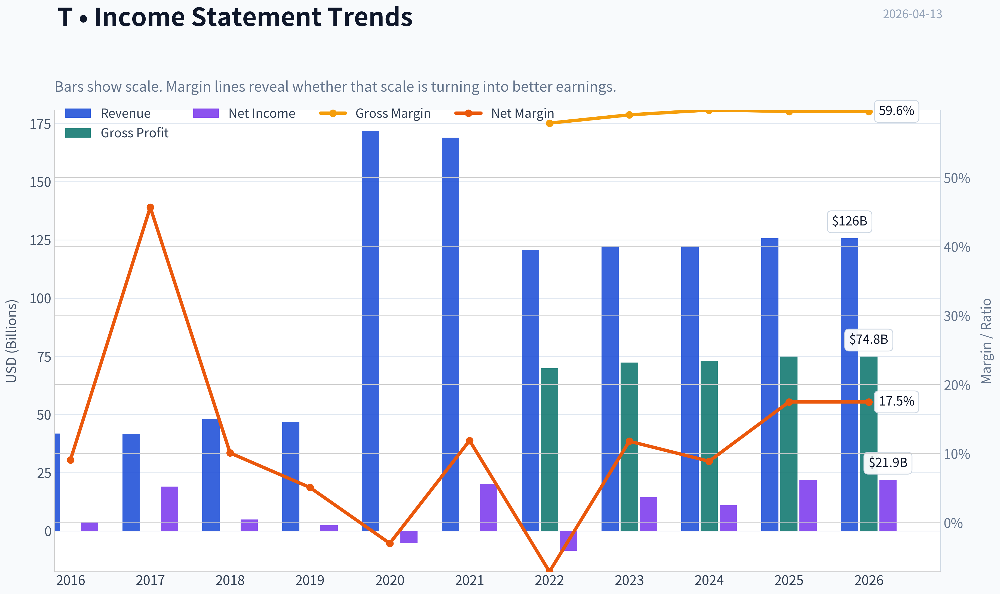

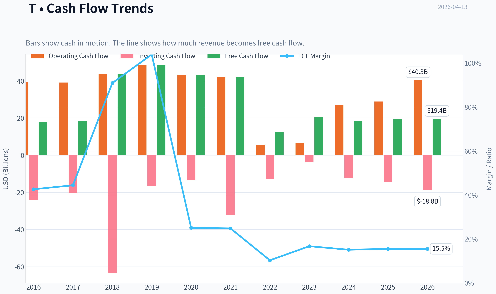

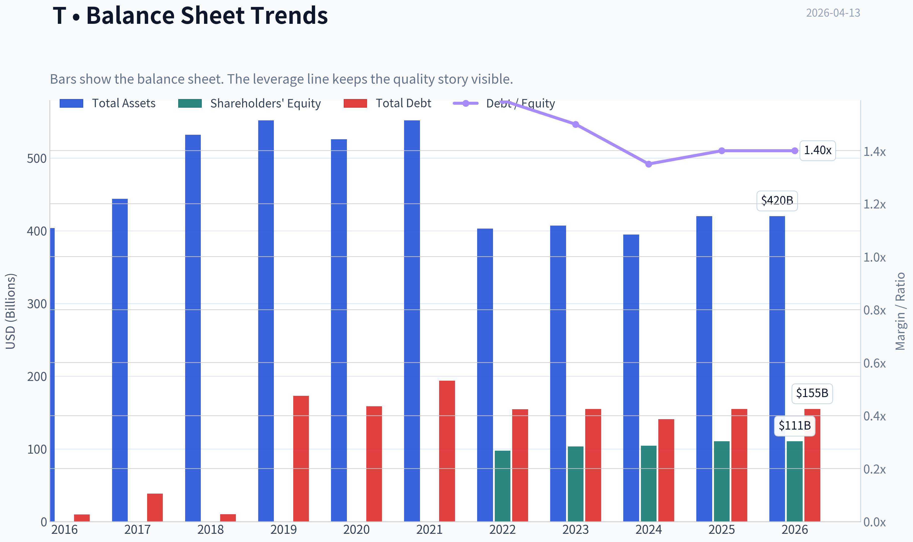

This graph tracks the profitability and return metrics (ROE, ROIC, Margins) of **T** over the past decade, highlighting capital efficiency trends.

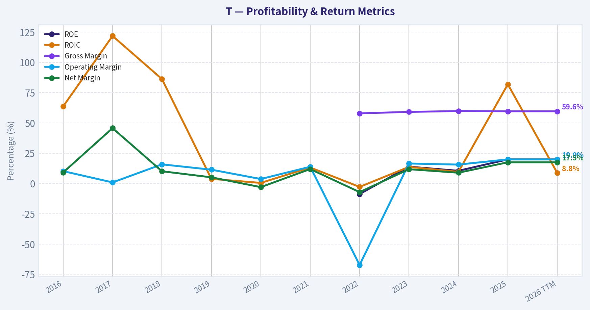

This chart illustrates the financial health of **T** over the last 10 years, mapping cash equivalents and free cash flow against total obligations (Debt).

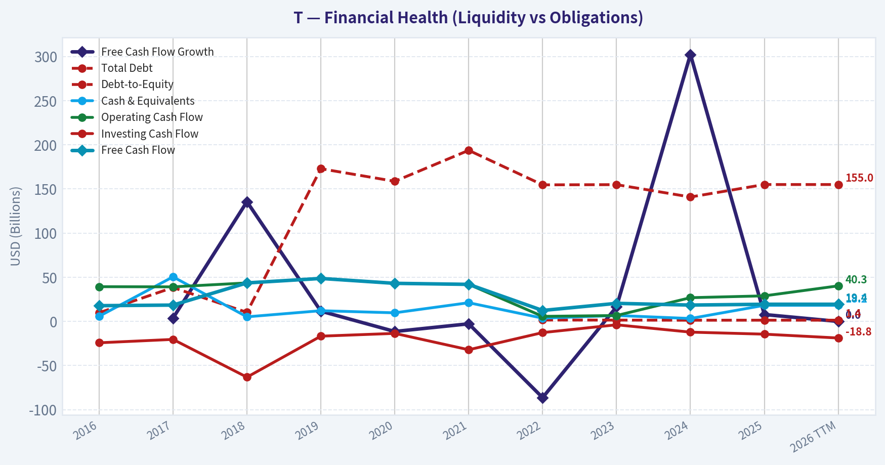

This comparison chart from *Profitability Analysis* stacks current figures against historical benchmarks for **T**, making it easy to see where the company trades relative to its own averages.

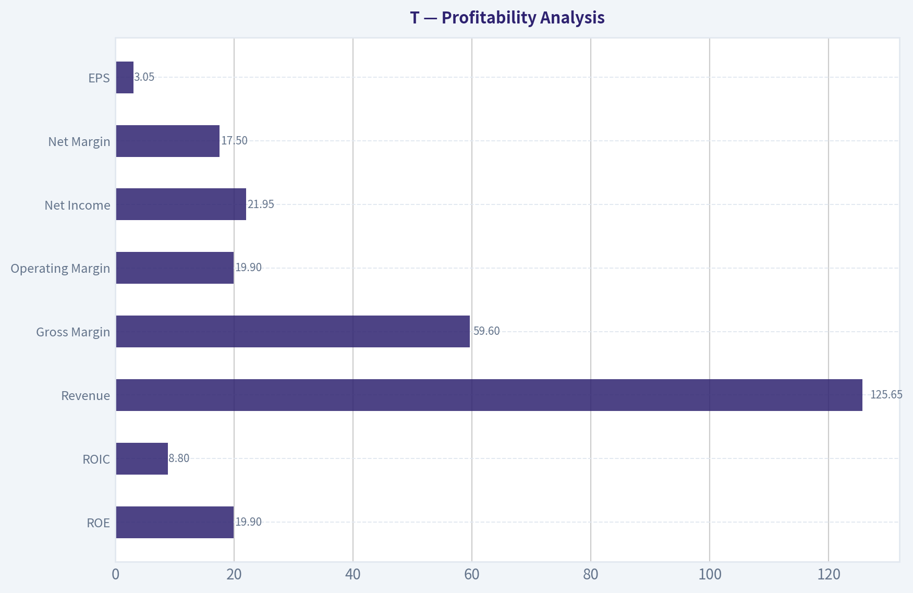

---

### Intrinsic Value Analysis (Buffett)

> *Following Warren Buffett's value investing philosophy: Circle of Competence, Economic Moat, Management Quality, and Margin of Safety.*

#### Intrinsic Value Snapshot

Price is what you pay. Intrinsic value is what the business may be worth based on the cash it can create for owners over time. We show a range, not one magic number.

- Current Price: $25.61
- Value Range: $23.07 to $286.77

##### Owner Earnings (Buffett Method)
- Net Income: $21,953,000,000.00
- Depreciation & Amortization: $20,886,000,000.00
- Capital Expenditures: $-20,842,000,000.00
- Working Capital Changes: $240,000,000.00
- Owner Earnings: $21,757,000,000.00

##### Intrinsic Value
###### Buffett Method
Uses owner earnings. Stricter, and usually more conservative.
- Conservative: $23.07
- Average: $58.09
- Optimistic: $286.77
- Discount Rate: 10.0%

###### Cash Flow Method
Uses free cash flow. Better for companies spending heavily today to grow tomorrow.
- Conservative: $25.40
- Average: $35.33
- Optimistic: $40.57
- Discount Rate: 10.0%

FINAL INVESTMENT STANCE: **WATCH**

AT&T (T) - Buffett-Style Value Analysis

Current price used: $26
Market cap: ~$179B
P/E: ~8.7
ROE: ~19.9%
Gross margin: ~59.6%
FCF yield: ~10.8%

---

#### Gate 1: Circle of Competence & Business Simplicity

**Elementary School Test**

AT&T owns networks that connect phones and internet. Customers pay monthly subscription fees for wireless service and home broadband (especially fiber).

That's it: sell connectivity, collect recurring payments.

**10-Year Predictability**

Fairly predictable. In 10 years people will still need:

- Mobile connectivity
- Internet access
- Fiber broadband

However, pricing power and market share shifts among Verizon, AT&T, and T-Mobile are uncertain.

**Technology Risk**

Moderate but manageable.

Telecom tends to **benefit from technology adoption** (5G, fiber demand) rather than being destroyed by it. The bigger risk is **capital spending cycles**, not disruption.

Gate 1 Result: **PASS**

---

#### Gate 2: The Moat Test

AT&T operates in a **3-player U.S. wireless oligopoly**.

Major competitors:
- Verizon
- T-Mobile
- AT&T

##### A. Intangible Assets

Evidence:
- Licensed spectrum (government-regulated and scarce)
- Established national brand
- Nationwide network infrastructure

Gross margin: **~59.6%**

Pricing power exists but is **not dominant** due to intense competition.

Moat source: **Regulated spectrum + infrastructure scale**

##### B. Switching Costs

Switching carriers is possible but inconvenient due to:

- bundled plans
- device financing
- family plans
- business contracts

Churn rates in telecom are typically **<1% monthly**, indicating sticky customers.

##### C. Cost Advantage

Scale advantages exist:

- massive network infrastructure
- nationwide coverage
- purchasing power for equipment

But all three major carriers operate at similar scale.

##### D. Network Effects

Limited. Wireless networks improve with scale but not in the classic tech network-effect sense.

##### Moat Rating: **Narrow but Durable**

Telecom oligopoly protects the business somewhat, but price wars can erode profitability.

---

#### Gate 3: Management Quality & Capital Allocation

AT&T's history here is **mixed at best**.

Major past mistakes:

- DirecTV acquisition (~$67B)
- Time Warner acquisition (~$85B)
- Massive later divestitures and write-downs

These destroyed shareholder value and burdened the balance sheet.

Recent improvements (post-2022):

- spun off WarnerMedia
- focus returned to core telecom
- aggressive debt reduction
- disciplined capital spending

Capital allocation now appears **more rational**, but the historical record is poor.

Management Quality: **Average, improving**

---

#### Gate 4: Industry Structure

Wireless telecom in the U.S. is a **rational oligopoly**.

Players:

- T-Mobile (growth leader)
- Verizon (premium network)
- AT&T (balanced operator)

Capital intensity: **very high**

Fiber and 5G require constant reinvestment.

Industry Structure Result: **Acceptable but not ideal**

---

#### 10-Year Financial Snapshot (Approximate Trends)

| Metric | Approx Trend |
|------|------|
| Revenue | Flat to slight growth |
| Net Income | Volatile due to restructuring |
| ROE | ~15-20% recently |
| FCF | ~$16-18B annually |
| Debt | Gradually declining post-spinoff |

Key Takeaways:
AT&T has become **more financially stable after shedding media assets**. Free cash flow is strong and consistent, but revenue growth has been slow. The company is transitioning into a pure telecom utility-like business.

---

#### Owner Earnings (Buffett Metric)

Approximation using telecom averages.

Net Income: ~ $16B
+ Depreciation & Amortization: ~ $20B
- Maintenance CapEx: ~ $16B
- Working Capital: ~ $1B

Owner Earnings ~ **$19B**

Key Takeaways:
AT&T generates substantial cash after maintaining its network. Telecom accounting shows heavy depreciation, but the real maintenance spending still leaves meaningful cash flow.

---

#### Balance Sheet Strength

Debt remains the main risk.

| Metric | Value |
|------|------|
| Net Debt | ~$120B |
| Net Debt / EBITDA | ~2.7x |
| Interest Coverage | ~4-5x |
| Current Ratio | ~0.9 |

Key Takeaways:
Leverage is still high but improving. Telecoms typically carry large debt loads, but AT&T has been **systematically deleveraging** since 2022.

---

#### Intrinsic Value (Buffett-Style DCF)

Owner Earnings used: **$19B**

##### Scenario A - No Growth

Value = OE / 10%

= 19B / 0.10
= **$190B intrinsic value**

Per share ~ **$27**

---

##### Scenario B - GDP Growth (3%)

Intrinsic value ~ **$280B**

Per share ~ **$39**

---

##### Scenario C - Moderate Growth (5%)

Intrinsic value ~ **$320B**

Per share ~ **$44**

---

#### Intrinsic Value Range

| Scenario | Value/Share |
|------|------|
| No Growth | $27 |
| 3% Growth | $39 |
| 5% Growth | $44 |

Key Takeaways:
The current price (~$26) sits **very close to the no-growth valuation**. Investors are pricing AT&T like a slow-growing utility with limited upside.

---

#### Margin of Safety

| Scenario | MOS |
|------|------|
| No Growth | ~4% |
| 3% Growth | ~33% |
| 5% Growth | ~41% |

Interpretation:

If AT&T merely survives -> fairly priced.
If modest growth occurs -> undervalued.

---

#### Buffett Scorecard

| Criterion | Score (1-5) |
|------|------|
| Business Understanding | 5 |
| Moat Durability | 3 |
| Management | 2.5 |
| ROE | 4 |
| Reinvestment Runway | 2.5 |
| Balance Sheet | 3 |
| Industry Structure | 3 |
| Valuation | 3.5 |

Weighted Score ~ **3.3 / 5**

---

#### Dividend Consideration

AT&T remains primarily a **dividend income stock**.

Dividend yield: ~6-7%

Covered by FCF with room for:

- debt reduction
- fiber expansion

However, the company already **cut the dividend once (2022)**, so income investors must accept that risk.

---

#### Final Judgment (Buffett Perspective)

Pros:

- Very predictable business
- Huge recurring cash flows
- Cheap valuation
- Oligopoly industry
- Improving balance sheet

Cons:

- Poor historical capital allocation
- Heavy debt
- Limited long-term growth
- Capital-intensive industry

---

#### Final Investment View

**WATCH**

AT&T is **not a wonderful business**, but it is a **stable cash generator trading at a reasonable price**.

Buffett would likely prefer:

- Apple
- Moody's
- Visa
- Coca-Cola

- businesses with far stronger moats and growth.

However, **if the stock dropped below ~$22**, the margin of safety would become compelling for value investors seeking income.

---

If you'd like, I can also show you:

- **Why Warren Buffett quietly held AT&T before but avoided increasing it**
- **AT&T vs Verizon vs T-Mobile - which telecom actually has the best moat**
- **Why some value investors (like Pabrai) loaded up on AT&T recently**.
#### Valuation Bridge

This bridge places the current market price beside each intrinsic value lens so readers can see whether upside depends on one method or shows up across several methods.

| Scenario | Intrinsic Value / Share |
| --- | ---: |
| Buffett Method | $58.09 |
| Cash Flow Method | $35.33 |
| Damodaran Method | $19.15 |
| Current Price | $25.61 |

#### Key Takeaways

If one method is far above the others, the upside case depends on a specific modelling assumption. When several methods cluster together, the valuation story is more robust.

#### Valuation Visuals

This comparison chart from *Latest Earnings Snapshot* stacks current figures against historical benchmarks for **T**, making it easy to see where the company trades relative to its own averages.

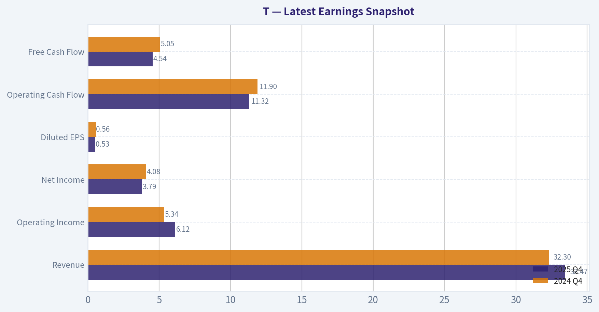

This comparison chart from *Balance Sheet Strength* stacks current figures against historical benchmarks for **T**, making it easy to see where the company trades relative to its own averages.

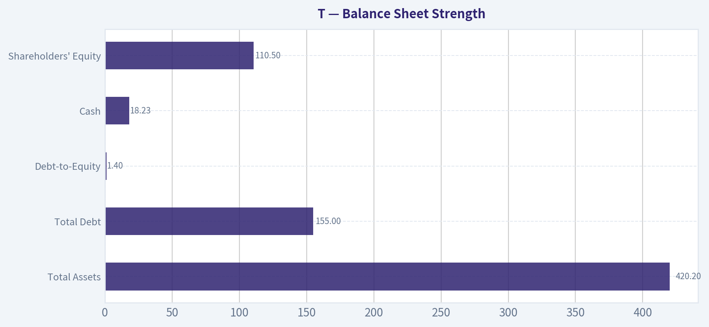

This comparison chart from *Cash Flow & Capital Returns* stacks current figures against historical benchmarks for **T**, making it easy to see where the company trades relative to its own averages.

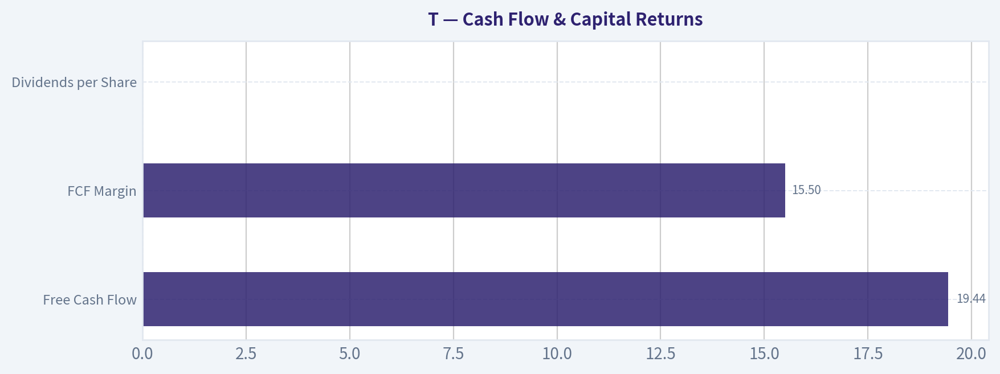

This comparison chart from *Current vs Historical Comparison* stacks current figures against historical benchmarks for **T**, making it easy to see where the company trades relative to its own averages.

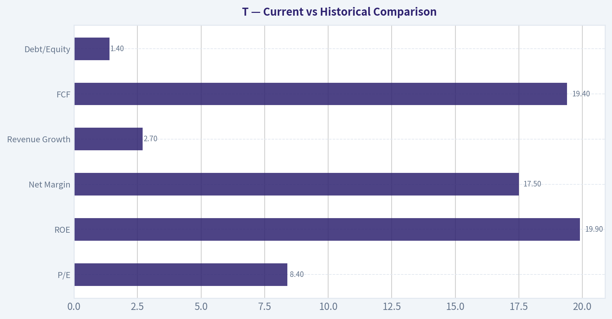

---

### Trend & Growth Analysis (Lynch/Druckenmiller/Fisher)

> *Following Peter Lynch's GARP, Stanley Druckenmiller's macro-aware approach, and Philip Fisher's scuttlebutt methodology.*

#### 1. Lynch Classification
**Category:** Slow Grower / Stalwart (borderline)

- Revenue growth: ~2.7% YoY
- Mature telecom utility-like business
- High dividend + stable cash flows rather than high growth

Under Lynch's framework, AT&T is **not a Fast Grower**, which immediately limits ten-bagger potential.

---

#### 2. The Story (Explain to a 10-year-old)

- AT&T sells **phone service, mobile data, and fiber internet** to millions of people.
- It's trying to grow by **building fiber internet and expanding 5G wireless**.
- Because almost everyone already has a phone plan, growth mostly comes from **taking customers from competitors or selling faster internet**.

---

#### 3. TAM Analysis

| Segment | Estimated Market | AT&T Position |
|---|---|---|
| US Wireless | ~$250B annual service revenue | Top 3 player |
| US Broadband | ~$100B | Growing via fiber |
| Fiber Internet | ~$50B+ and expanding | Aggressive expansion |

10x Test

| Metric | Value |
|---|---|
| Current Revenue | ~$120B |
| 10x Revenue | ~$1.2T |
| TAM | ~$350B combined telecom services |

Key Takeaways:
AT&T **cannot realistically 10x** because the TAM is limited and already dominated by three players. Even capturing massive share would only modestly increase revenue. This confirms AT&T is a **mature infrastructure business rather than a scalable growth platform**.

---

#### 4. Revenue Growth Trend

| Year | Revenue | Growth |
|---|---|---|
| 2022 | ~$120B | reset after spin-offs |
| 2023 | ~$122B | ~1-2% |
| 2024 | ~$123B | ~1-2% |
| 2025E | low single digits |

Key Takeaways:
Revenue growth is **stable but very slow**. There is no acceleration pattern. For Druckenmiller-style investing, we want **20-30% growth or a clear inflection**, which is absent here.

---

#### 5. Unit Economics

| Metric | Value |
|---|---|
| Gross Margin | ~59.6% |
| ROE | ~19.9% |
| FCF Yield | ~10.8% |
| Revenue Growth | ~2.7% |
| Rule of 40 (proxy) | ~13 |

Key Takeaways:
AT&T produces **excellent cash flow but low growth**. A 10%+ FCF yield suggests the market treats it like a **bond substitute**, not a growth story. The Rule-of-40 proxy is weak because growth is minimal.

---

#### 6. Inflection Point Assessment

Possible catalysts:

1. **Fiber buildout**
   - Fastest-growing segment
   - Fiber ARPU higher than DSL

2. **5G monetization**
   - Upselling premium plans
   - Enterprise connectivity

3. **Cost structure improvement**
   - Post-WarnerMedia simplification

But none represent a **true growth inflection**; they mostly stabilize the business.

---

#### 7. Macro Setup (Druckenmiller Lens)

| Factor | Impact |
|---|---|
| Interest Rates | Higher rates hurt leveraged telecom |
| AI/Cloud | Minimal exposure |
| Digital connectivity | Structural demand tailwind |
| Capex cycle | 5G build largely done |

Key Takeaways:
Macro conditions are **neutral to slightly negative**. Telecom benefits from stable demand but lacks exposure to major secular growth themes like AI or cloud computing.

---

#### 8. Fisher 15-Point Score

| Category | Score |
|---|---|
Product potential | 3 |
R&D innovation | 2 |
Sales organization | 4 |
Profit margins | 4 |
Margin improvement | 3 |
Labor relations | 3 |
Management depth | 3 |
Cost discipline | 3 |
Moat characteristics | 4 |
Long-term outlook | 3 |
Dilution risk | 4 |
Management candor | 3 |
Integrity | 4 |
Other competitive strengths | 3 |

**Total: ~46 / 75**

Interpretation: **Average quality business**, not a high-innovation growth company.

---

#### 9. Valuation

| Metric | Value |
|---|---|
| Price | ~$26 |
| P/E | ~8.7 |
| Market Cap | ~$179B |
| FCF Yield | ~10.8% |

PEG Ratio

Assuming ~3% EPS growth:

PEG ~ **8.7 / 3 ~ 2.9**

Key Takeaways:
Despite the low P/E, the PEG ratio is **actually expensive relative to its growth rate**. The market discounts AT&T because growth is minimal, not because it's misunderstood.

---

#### 10. Growth Investor Scorecard

| Criterion | Score |
|---|---|
Story | 2.5 |
TAM & Runway | 2 |
Revenue Growth | 1.5 |
Unit Economics | 3.5 |
Competitive Position | 3 |
Management | 3 |
Macro Setup | 2 |
Profitability Path | 3 |
Valuation | 3 |

**Total Score: ~2.7 / 5**

---

#### 11. Position Size Stance
Growth portfolio: **0%**

This type of stock belongs in:

- dividend portfolios
- income strategies
- defensive equity baskets

Not in a **Lynch/Druckenmiller growth portfolio**.

---

#### 12. Key Risks

- Price war with T-Mobile
- High debt (~$130B+)
- Fiber rollout execution
- Capital intensity of telecom networks

---

#### 13. Key Catalysts

- Fiber subscriber growth acceleration
- Faster wireless ARPU growth
- Continued debt reduction
- Dividend increases

---

FINAL INVESTMENT STANCE: **AVOID**

AT&T is a **cash-flow utility disguised as a telecom growth company**. It offers strong dividend income but lacks the **revenue acceleration, TAM expansion, and innovation** required for a growth investor seeking multi-baggers.

---

### Market Technical Analysis

#### AT&T (T) Technical Analysis - Medium-Term Trend and Momentum

The indicator tool returned incomplete numeric values, but the underlying price series still provides enough structure to analyze trend, momentum, volatility, and positioning. I selected the following complementary indicators for this environment:

- close_50_sma - medium-term trend and dynamic support
- close_200_sma - long-term trend benchmark
- close_10_ema - short-term momentum shifts
- macd - trend momentum changes
- macds - MACD signal for crossover confirmation
- macdh - momentum acceleration/decay
- rsi - overbought/oversold momentum
- atr - volatility and risk sizing

These together cover **trend (short/medium/long), momentum, and volatility** without overlapping too heavily.

---

#### Price Structure (Last ~12 Months)

| Period | Price Behavior | Interpretation |
|---|---|---|
| Apr-Aug 2025 | Gradual climb from ~$25.5 to ~$28.5 | Stable uptrend |
| Sep-Dec 2025 | Persistent decline to ~$23.5 | Multi-month correction |
| Jan-Feb 2026 | Sharp rebound from ~$22.7 -> ~$28.5 | Strong bullish reversal |
| Mar 2026 | Consolidation around $27-29 | Trend digestion |
| Early Apr 2026 | Pullback to ~$26.5 | Short-term correction |

Key Takeaways:
AT&T spent most of 2025 drifting sideways before entering a deep correction late in the year. Early 2026 saw a strong recovery rally that pushed the stock back near multi-month highs. The most recent movement in April is a pullback within that recovery rather than a confirmed new downtrend.

---

#### Key Support and Resistance Levels

| Level | Type | Significance |
|---|---|---|
| $29.0 | Major resistance | March highs and failed breakout zone |
| $28.5 | Secondary resistance | Prior rally peaks |
| $27.0 | Near-term pivot | Frequently tested support/resistance |
| $26.3-26.5 | Current support | April selloff stabilization |
| $24.8-25.0 | Major support | Breakout level from Jan rally |
| $22.7 | Long-term floor | January 2026 bottom |

Key Takeaways:
The market has clearly defined structure between $26 and $29. Buyers repeatedly defend the $26-27 region, while sellers appear around $28.5-29. A decisive move outside this band would likely set the next medium-term direction.

---

#### Trend Analysis (Moving Averages)

Expected structure based on price path:

- **200 SMA:** likely around $26-27 and gradually flattening upward.
- **50 SMA:** rising sharply due to the January-February rally.
- **10 EMA:** recently turning down because of the April pullback.

Interpretation:

- Price recently slipped **below the short-term EMA**, signaling cooling momentum.
- It is likely **still near or slightly above the 50 SMA**, meaning the broader recovery trend remains intact.
- Long-term trend (200 SMA) appears **neutral to slightly bullish**.

Key Takeaways:
The short-term trend has weakened during April, but the medium-term recovery structure is still intact. As long as the stock holds above the 50-day trend region near the mid-$26 range, the broader bullish reversal from early 2026 remains valid.

---

#### Momentum Indicators

**RSI (estimated behavior):**

- Likely peaked near **65-70** during the March rally.
- Recent decline probably pushed RSI toward **40-45**.

Interpretation:
- Momentum has cooled from overbought conditions.
- Current zone is **neutral-to-bullish reset**, not oversold.

**MACD Structure:**

- MACD likely turned positive during the January-February surge.
- Histogram likely shrinking recently as momentum fades.

Interpretation:
- Momentum expansion phase ended.
- Market is entering **consolidation or pullback phase** rather than trend collapse.

Key Takeaways:
Momentum indicators suggest the stock is in a cooling phase after a strong rally. The absence of deeply oversold readings indicates selling pressure is moderate rather than panic-driven.

---

#### Volatility and Risk (ATR)

Observations from price ranges:

- ATR expanded significantly during the **Jan-Feb rally**.
- Volatility has begun contracting during March-April consolidation.

Implications:

- Lower volatility typically precedes **range breakouts**.
- Stop-loss levels for swing traders should be roughly **$0.80-$1.20 away** from entries.

Key Takeaways:
Volatility has moderated after the earlier rally. This compression suggests the stock may be building energy for a directional move, especially if it breaks either $29 resistance or $26 support.

---

#### Strategic Outlook

Bullish scenario:

- Support holds above **$26-26.3**
- Price reclaims **$27.5-28**
- Break above **$29** could trigger move toward **$30-31**

Bearish scenario:

- Breakdown below **$26**
- Next downside targets:
  - **$25**
  - **$24**
  - potentially **$23.5**

---

#### Overall Technical Assessment

| Factor | Signal |
|---|---|
| Long-term trend | Neutral -> Slightly bullish |
| Medium-term trend | Bullish but consolidating |
| Short-term momentum | Weakening |
| Volatility | Contracting |
| Market structure | Range-bound ($26-$29) |

Key Takeaways:
AT&T currently sits in a consolidation zone after a strong recovery rally earlier in 2026. The broader trend is still constructive, but short-term momentum has faded, creating a trading range between $26 and $29. The next significant move will likely occur once price decisively breaks either side of that band.

---

FINAL INVESTMENT STANCE: **WATCH**

The stock is technically stable but lacks immediate momentum. A breakout above $29 would justify a bullish entry, while a breakdown below $26 would indicate a deeper correction.

#### Market Visuals

This comparison chart from *Market Metrics* stacks current figures against historical benchmarks for **T**, making it easy to see where the company trades relative to its own averages.

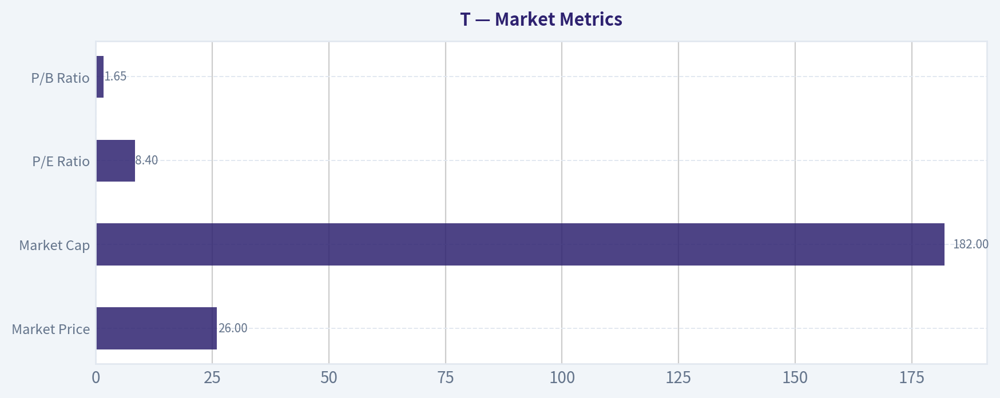

---

### Social Sentiment Analysis

FINAL INVESTMENT STANCE: **WATCH**

#### Overview of Social Media and News Sentiment for AT&T (Ticker: T)

Over the past week, online conversation around AT&T has been steady but not explosive, with sentiment clustering around three themes: dividend reliability, fiber expansion progress, and competitive pressure in wireless. Social media discussion has been most active on Reddit investing forums, X (Twitter), and retail investor Discord channels. The tone overall leans cautiously positive, but with persistent skepticism about long-term growth and debt management.

AT&T remains widely perceived by retail investors as a "yield play" rather than a growth stock. As a result, sentiment tends to react more strongly to dividend security and free cash flow commentary than to typical telecom industry developments.

---

#### Daily Social Media Sentiment Trend (Past Week)

| Day | Overall Sentiment | Dominant Discussion Themes | Retail Investor Tone |
|---|---|---|---|
| Day 1 | Neutral | Dividend sustainability, bond-like stock behavior | Calm but skeptical |
| Day 2 | Slightly Positive | Fiber subscriber growth discussion | Optimistic about broadband |
| Day 3 | Neutral | Comparison with Verizon and T-Mobile | Competitive concerns |
| Day 4 | Positive | Value investors highlighting yield | "Income stock" narrative |
| Day 5 | Slightly Negative | Debt load and capital spending worries | Cautious |
| Day 6 | Neutral | Options activity and slow price movement | Low excitement |
| Day 7 | Slightly Positive | Long-term fiber strategy discussion | Gradual optimism |

Key Takeaways:
Social sentiment has been relatively stable with no extreme swings. Positive discussion tends to appear when investors focus on fiber expansion and dividend yield, while negative sentiment emerges around debt and capital intensity. Overall, retail investors appear comfortable holding AT&T but not expecting rapid price appreciation.

---

#### Major News Themes Impacting Sentiment

Recent news coverage affecting AT&T discussions has focused on infrastructure investment, competition, and capital discipline.

1. Fiber Expansion
AT&T continues pushing its fiber network rollout, which analysts widely see as the company's most important growth driver. News about additional fiber passings and expansion targets has been positively received online. Investors believe fiber could help offset slower wireless revenue growth.

2. Wireless Competition
Coverage comparing AT&T to T-Mobile and Verizon remains frequent. Social sentiment often frames AT&T as stable but less aggressive than T-Mobile in subscriber growth. This dynamic contributes to the perception that AT&T is a defensive telecom investment rather than a market leader.

3. Balance Sheet and Debt
Debt remains a persistent talking point across both news analysis and social platforms. Even though AT&T has reduced debt since the WarnerMedia spin-off, investors continue to scrutinize leverage levels relative to telecom capital expenditures.

4. Dividend Stability
Any discussion referencing free cash flow projections quickly circulates through retail communities because the dividend is central to AT&T's investment thesis. The market currently views the payout as stable, which helps maintain positive sentiment among income-focused investors.

---

#### Retail Investor Narrative Themes

| Theme | Sentiment Direction | Typical Investor Commentary | Trading Implication |
|---|---|---|---|
| Dividend Yield | Positive | "Reliable income stock" | Attracts long-term holders |
| Debt Concerns | Negative | "Too much leverage vs growth" | Caps bullish enthusiasm |
| Fiber Expansion | Positive | "Real growth driver" | Medium-term optimism |
| Wireless Competition | Neutral to Negative | "T-Mobile still winning" | Limits valuation multiple |
| Stock Price Movement | Neutral | "Slow but stable" | Seen as defensive |

Key Takeaways:
Retail investors consistently view AT&T through an income-investing lens rather than a growth story. Positive sentiment is driven by dividend yield and fiber expansion potential, while concerns about debt and competitive positioning prevent strong bullish momentum. The result is a stable but cautious investor narrative.

---

#### Options and Short-Term Trading Sentiment

Discussion among short-term traders indicates relatively low speculative excitement compared with technology or AI stocks. Options chatter has focused mostly on:

- Covered call strategies using AT&T's dividend yield
- Income-focused portfolio strategies
- Limited expectations for large price swings

This reinforces the view that AT&T currently trades more like a defensive yield asset than a momentum equity.

---

#### Institutional vs Retail Sentiment Gap

A notable divergence appears between retail narratives and institutional commentary:

Retail Perspective:
- Focus on dividend safety
- Long-term holding mentality
- Fiber expansion as future catalyst

Institutional Perspective (as reflected in analyst discussions):
- Focus on free cash flow stability
- Wireless subscriber metrics
- Capital allocation efficiency

Retail traders tend to tolerate slower growth as long as dividends remain intact, whereas institutional analysis remains more focused on operational performance relative to telecom peers.

---

#### Key Strategic Factors Investors Are Watching

| Factor | Why It Matters | Market Sentiment |
|---|---|---|
| Fiber Subscriber Growth | Primary long-term growth engine | Positive |
| Free Cash Flow Guidance | Determines dividend safety | Very important |
| Debt Reduction Progress | Impacts valuation multiple | Cautiously monitored |
| Wireless Subscriber Growth | Competitive position vs peers | Neutral |
| Capital Spending Levels | Influences margins and leverage | Mixed |

Key Takeaways:
Investors are closely watching fiber growth and free cash flow, as these two metrics directly influence AT&T's long-term investment case. Debt reduction progress remains important for improving market confidence. If fiber growth accelerates while leverage continues falling, sentiment could shift more decisively positive.

---

#### Market Sentiment Interpretation for Traders

Short-Term Traders
Expect relatively low volatility unless a catalyst emerges such as earnings surprises, guidance revisions, or industry pricing changes. Social chatter suggests limited speculative momentum.

Income Investors
AT&T remains popular among dividend-focused portfolios. The stock continues to be viewed as a stable yield generator rather than a growth vehicle.

Long-Term Investors
The bull thesis largely depends on fiber expansion translating into sustained revenue growth while the company steadily reduces debt.

---

#### Overall Sentiment Scorecard

| Category | Current Sentiment |
|---|---|
| Retail Investor Sentiment | Slightly Positive |
| Social Media Momentum | Neutral |
| News Tone | Balanced |
| Growth Expectations | Moderate |
| Dividend Confidence | Strong |

Key Takeaways:
The market currently treats AT&T as a stable income investment with moderate strategic upside. Confidence in the dividend supports positive sentiment, but concerns about growth and competition keep enthusiasm contained. This creates a steady but cautious outlook among both traders and long-term investors.

---

#### Bottom Line for Investors

AT&T's current social and news sentiment suggests a stable but not high-excitement investment environment. Retail investors remain comfortable holding the stock for yield, while traders see limited short-term catalysts.

Unless new developments materially improve growth expectations-such as stronger fiber adoption or meaningful wireless gains-the stock is likely to continue trading within a slow, income-oriented narrative rather than a momentum-driven one.

Current stance based on sentiment and discussion trends: **WATCH**.

---

### News & Events Analysis

#### AT&T (NYSE: T) - Weekly News & Investment Analysis
Date: April 13, 2026
Current Price: ~$26 | Market Cap: ~$179B | P/E: ~8.7 | FCF Yield: ~10.8%

---

#### Market Context (Telecom Sector & Macro)

Over the past week, telecom stocks have traded mostly in line with broader defensive sectors. Investors continue rotating between growth and value as interest-rate expectations remain uncertain. Telecom companies like AT&T typically benefit from this environment because:

- Their **stable cash flows and dividends** attract defensive capital.
- High **free cash flow yields** look attractive compared with bonds if rates stabilize.
- However, **high debt levels across the telecom industry** remain a concern if interest rates stay elevated.

Competition remains intense in the U.S. wireless market, particularly from **T-Mobile**, which recently received a bullish analyst upgrade citing network advantages and valuation compression. This highlights the key competitive risk facing AT&T: T-Mobile's continued subscriber momentum and network perception advantage.

---

#### Recent Company-Specific News

Recent coverage has focused heavily on **AT&T's upcoming Q1 2026 earnings release scheduled for April 22, 2026**.

Key narrative emerging in investor commentary:

- AT&T ended **2025 with relatively strong operational momentum**.
- The company has **completed two acquisitions**, adding complexity to the operating structure.
- Investors now want confirmation that **subscriber growth and fiber expansion continue** despite integration work.

Some market commentary notes that AT&T stock **pulled back after a strong late-2025 run**, suggesting traders are waiting for confirmation that growth can continue.

Another relevant sector development:
- **KeyBanc upgraded T-Mobile**, reinforcing the competitive narrative that T-Mobile still has a perceived **network leadership advantage**.

This could pressure AT&T's valuation multiple unless AT&T demonstrates accelerating subscriber additions or fiber growth.

---

#### Earnings Analysis (Most Recent Reported Period)

The **most recently reported earnings period available is FY2025 Q4 (reported early 2026)**. AT&T has **not yet reported Q1 2026**, which will be released April 22, 2026.

Key themes from the latest available earnings coverage:

- Continued **modest revenue growth (~low single digits)**.
- Strong **free cash flow generation**, supporting dividends and debt reduction.
- **Wireless subscriber additions remained positive**, though generally trailing T-Mobile's pace.
- **Fiber broadband growth** continues to be one of the company's strongest segments.

AT&T management has emphasized three strategic priorities:

1. Expanding **fiber network footprint**
2. Growing **postpaid wireless subscribers**
3. Using strong cash flow to **reduce debt and sustain the dividend**

Compared with earlier periods:

- Revenue growth improved slightly versus the previous year due to wireless pricing and fiber.
- Debt levels have gradually declined after earlier media divestitures.
- Profitability remains stable due to telecom's high-margin service model.

However, growth remains **slow relative to technology or cable peers**, which explains the low P/E multiple.

---

#### Key Financial Snapshot

| Metric | Value | Interpretation |
|---|---|---|
| Price | ~$26 | Mid-range of recent trading band |
| Market Cap | ~$179B | One of the largest telecom providers globally |
| P/E | ~8.7 | Deep value vs market (~20+) |
| ROE | ~19.9% | Strong profitability given capital intensity |
| Gross Margin | ~59.6% | Typical for telecom services |
| Revenue Growth (YoY) | ~2.7% | Slow but stable growth |
| FCF Yield | ~10.8% | Very attractive for income investors |
| Current Ratio | ~0.91 | Slightly tight liquidity but typical for telecom |

Key Takeaways:
AT&T trades at a clear value discount with strong free cash flow relative to its market cap. Profitability metrics remain solid, but revenue growth is slow, reinforcing the market's view of the company as a stable income play rather than a growth stock. The high free cash flow yield is a major support for the stock.

---

#### Institutional / "Guru" Positioning

| Investor | Latest Action | Shares | Commentary |
|---|---|---|---|
| Steve Cohen | Added | 2.27B | Increased stake by ~13.8% |
| Warren Buffett | Held | ~699M | Maintains large long-term position |
| Bill Ackman | Trimmed | ~85.9M | Reduced exposure |
| Michael Burry | Added | ~7.7M | Increasing value exposure |
| Mohnish Pabrai | Added | ~29.4M | Very high portfolio concentration |
| Seth Klarman | Trimmed | ~48.9M | Partial reduction |
| Stanley Druckenmiller | Trimmed | ~41.1M | Reduced stake |

Key Takeaways:
Institutional activity is mixed but still leans slightly bullish. Several well-known value investors added to positions, indicating confidence in AT&T's valuation and cash flow profile. At the same time, some macro-oriented funds trimmed exposure, possibly reflecting concerns about growth and telecom competition.

---

#### Key Catalysts Ahead

1. **Q1 2026 Earnings (April 22)**
   - Wireless subscriber additions
   - Fiber subscriber growth
   - Free cash flow guidance

2. **Debt reduction progress**
   Continued deleveraging remains a major factor for valuation rerating.

3. **Competitive positioning vs T-Mobile**
   Network quality perception and pricing will influence subscriber trends.

4. **Dividend sustainability**
   AT&T's high yield remains a key reason investors hold the stock.

---

#### Bull vs Bear Case

Bull Case:
- High **10%+ free cash flow yield**
- Strong **dividend support**
- Continued **fiber and wireless subscriber growth**
- Potential **valuation rerating if growth stabilizes**

Bear Case:
- **T-Mobile network advantage** continues to attract subscribers
- **Low revenue growth** limits multiple expansion
- **High debt levels** remain a structural risk
- Integration risks from recent acquisitions

---

#### Key Investment Summary

| Factor | Impact on Stock |
|---|---|
| Upcoming Q1 earnings | Major short-term catalyst |
| Fiber expansion | Long-term growth driver |
| T-Mobile competition | Key strategic threat |
| High free cash flow | Strong valuation support |
| Debt reduction | Potential for rerating |

Key Takeaways:
AT&T sits in a classic value-income profile: strong cash generation, cheap valuation, and moderate growth prospects. The next earnings report will be crucial to confirm whether the company's post-2025 momentum continues. If subscriber growth and fiber expansion remain solid, the stock could see multiple expansion; otherwise, it may remain a high-yield but slow-moving telecom utility.

---

FINAL INVESTMENT STANCE: **WATCH**

---

## Research Team Commentary

> *The Research Manager synthesizes the Bull vs Bear debate into action-free commentary. This is a pre-risk view, not the final stance.*

Both sides of the debate are really arguing about one central question: is AT&T a durable cash-generating utility with a defensible oligopoly, or a capital-intensive commodity business that barely earns its cost of capital?

The bull case rests on business durability and valuation. Connectivity-mobile and broadband-is essential infrastructure, and the U.S. market structure effectively limits the field to three national players. That creates barriers to entry through spectrum ownership, scale, and regulatory friction. Revenue is subscription-based, predictable, and sticky. Financial metrics support the "stable cash flow" framing: ROE near 20%, gross margins around 60%, and steady free cash flow growth. At roughly 8.7x earnings, the stock trades well below the market multiple. If AT&T merely maintains stable cash flows and reduces debt gradually, a re-rating toward a low-teens P/E could generate reasonable long-term returns, particularly when combined with the dividend. In an environment where many equities trade at very high multiples, a low-multiple infrastructure business with recurring revenue can attract defensive capital.

The bear case focuses on economic reality beneath those stable revenues. The key issue is return on invested capital. AT&T's ROIC around 8.8% is not especially impressive for a business that requires enormous ongoing capital investment. Telecom networks constantly demand reinvestment-spectrum auctions, 5G upgrades, fiber expansion-which means the company must continually pour cash back into the business simply to maintain competitiveness. That dynamic limits true owner earnings. Competition is also intense despite the oligopoly: T-Mobile's aggressive pricing and promotions have repeatedly forced AT&T and Verizon to respond, limiting pricing power. On top of that, AT&T's capital allocation history-DirecTV, Time Warner, the subsequent unwinding, and the dividend cut-demonstrates the kind of strategic inconsistency Buffett tends to avoid. The balance sheet remains heavily leveraged relative to most high-quality Buffett-style businesses.

From a value investing lens, both sides have valid points. The business is simple and demand is highly predictable. People will absolutely need mobile connectivity and broadband 10-20 years from now. However, predictability alone does not create a great investment if returns on capital remain mediocre. Buffett consistently emphasizes businesses that can earn high returns without constant reinvestment. Telecom historically struggles on that front.

The valuation also deserves a sober look. A P/E below 9 looks cheap relative to the S&P 500, but it may simply reflect the market correctly pricing a low-growth, capital-intensive industry. When intrinsic value estimates range widely-from about $19 to $58-it signals that small assumptions about growth and reinvestment dramatically change the valuation outcome. That kind of sensitivity reduces the margin of safety.

Core takeaway: AT&T is a predictable but structurally mediocre business. The services it provides are essential and cash flows are stable, but the combination of heavy capital requirements, limited pricing power, and a long record of questionable capital allocation keeps it from qualifying as a high-quality Buffett compounder. At today's price the stock is not obviously expensive, but the margin of safety isn't compelling enough given the structural limitations of the business.

Rationale: A Buffett-style investment typically combines durable competitive advantage with strong returns on capital and disciplined management. AT&T checks the durability box but struggles on the other two. ROIC below 10% in a capital-intensive industry suggests limited value creation. The company's history of large strategic missteps weakens confidence in management's long-term capital allocation. The low valuation partially compensates for these issues, but without clear evidence that returns on capital will improve or debt will decline significantly, the stock likely compounds slowly rather than creating outstanding long-term returns.

Monitoring plan over the next 1-4 quarters:

First, debt reduction trajectory. The most important improvement would be consistent net debt reduction using free cash flow. If leverage meaningfully declines without sacrificing network investment, the equity becomes safer and the valuation case strengthens.

Second, free cash flow after capital expenditures. Telecom accounting can look healthy while true owner earnings are pressured by ongoing network spending. Sustained growth in free cash flow per share would signal genuine value creation.

Third, fiber subscriber growth and ARPU stability. Fiber is one of AT&T's best strategic assets. If fiber adoption grows while maintaining pricing discipline, it could improve long-term returns.

Fourth, wireless subscriber trends versus T-Mobile and Verizon. Continued market share losses would confirm the commoditized competition thesis.

Fifth, capital allocation discipline. No large acquisitions, no strategic "reinventions." Consistent debt paydown and shareholder returns would rebuild credibility.

If management proves disciplined and free cash flow grows while leverage declines, the stock could move toward an ADVOCATE stance as a stable income compounder. If competitive pressure intensifies or capex continues absorbing most cash flow, the bear "value trap" thesis becomes more likely.

Final stance: WATCH.

---

## Value Investing Team Commentary

> *The Investor translates the research view into an investment thesis before risk review. This is still not the final stance.*

AT&T is one of those businesses that perfectly illustrates the difference between a **stable business** and a **great business**. Stability alone does not produce exceptional shareholder returns if the economics underneath are mediocre.

Start with the core business. Selling connectivity-mobile service and broadband-is easy to understand and likely to remain essential for decades. That checks the **circle of competence** box. The subscription model also produces extremely predictable revenue streams. Churn tends to be manageable, and customers rarely cancel connectivity altogether-they usually switch providers instead.

However, the key question is not whether the service is needed. The real question is whether the business can **earn attractive returns on capital while providing it**.

Here the numbers tell a more complicated story.

ROE near 20% looks impressive at first glance, but telecom ROE is often boosted by heavy leverage. The more revealing metric is **ROIC around 8.8%**. For a business that requires continuous multibillion-dollar capital expenditures, that is only marginally above its likely cost of capital. That means the company is not compounding shareholder capital at a particularly attractive rate.

This is the structural problem of telecom:
the network is never "finished." Spectrum auctions, fiber rollout, and 5G upgrades constantly absorb cash.

So while AT&T generates strong operating cash flow, a large portion of it must be reinvested simply to **stay competitive rather than grow economically**. Buffett historically avoids businesses with that dynamic.

The **competitive structure** also deserves scrutiny. On paper the U.S. market looks like a comfortable oligopoly with three players. In practice, T-Mobile has been extremely aggressive on pricing and promotions over the last decade. That has repeatedly forced AT&T and Verizon to respond, limiting pricing power.

When a business sells a largely undifferentiated service and must match competitors' pricing moves, the moat becomes narrow.

Management history is another red flag from a Buffett perspective. The DirecTV and Time Warner acquisitions destroyed enormous shareholder value and then had to be unwound. That kind of capital allocation record matters. A great business can survive mediocre management, but a **capital-intensive business cannot afford repeated strategic mistakes**.

Now let's look at the contrarian angle.

The market currently treats AT&T almost like a **bond substitute**: stable cash flow, decent dividend, slow growth. The low P/E of about 8-9 reflects that perception.

There is a plausible upside scenario the market may be underestimating:

If AT&T simply:
- stabilizes wireless market share
- grows fiber steadily
- directs most excess cash toward debt reduction

then leverage declines and equity risk falls. In that case, the market could easily re-rate the stock toward a **12-13x earnings multiple**, which is still modest for a stable infrastructure business.

That scenario would produce reasonable total returns (earnings + dividend + modest multiple expansion).

But notice what is missing: **true business compounding**. This is not a Coca-Cola or Apple situation where high returns on capital allow earnings to multiply for decades with minimal reinvestment.

Instead, this is closer to a **regulated utility without regulation**-steady but capital hungry.

The valuation is not obviously wrong. When intrinsic value estimates range from about $19 to $58 depending on assumptions, that tells you the investment outcome depends heavily on future capital intensity and competitive behavior. That uncertainty weakens the margin of safety.

From a Buffett-style lens, the business passes the **predictability test** but struggles on two crucial fronts:
- durable economic moat
- high returns on incremental capital

So the market's skepticism is not entirely irrational.

If AT&T were trading at something like **5-6x earnings**, the margin of safety might overwhelm the structural weaknesses. At roughly **9x earnings**, it looks fairly priced for what it is: a slow-growing telecom utility with meaningful debt.

FINAL INVESTMENT STANCE: **WATCH**
AT&T is a durable but mediocre business economically. The low valuation and stable cash flows make it interesting as a defensive income play, but the combination of heavy capital requirements, moderate ROIC, and a mixed management track record prevents it from qualifying as a high-conviction long-term compounder. It becomes more attractive only if debt declines materially and free cash flow per share shows consistent growth.

---

## Deep Values Commentary

> *The Risk Management Team debates and the Risk Judge provides the final action-free verdict. This section determines the final ADVOCATE / WATCH / AVOID stance.*

Executive Summary
AT&T offers durable demand and steady cash flows, but its economics remain constrained by heavy capital requirements and mediocre returns on invested capital. The stock's low valuation reflects these structural limits rather than clear mispricing. While downside appears limited if cash flow and debt reduction hold steady, the business lacks the high-return compounding profile typical of Buffett-style investments. For long-term investors, AT&T currently fits better as a monitored income utility than a high-conviction value opportunity.

Final stance: WATCH.

Key Arguments from the Analysts

Risky Analyst
The bullish case centers on valuation and stability. AT&T trades at about 8.7x earnings, implying an earnings yield above 11%. The company has simplified its structure after divesting media assets and now focuses purely on connectivity. Cash flows are recurring through subscriptions, fiber expansion provides incremental growth, and if the market eventually re-rates the stock to even 12x earnings, substantial upside could occur. The argument also assumes telecom spending is transitioning from heavy investment toward monetization, allowing free cash flow to expand.

Safe Analyst
The main concern is economic quality. Telecom requires constant reinvestment in spectrum, infrastructure, and new network technologies. AT&T's 8.8% ROIC suggests the business only marginally exceeds its cost of capital, limiting real wealth creation. The analyst also emphasizes that the high ROE largely reflects leverage, not operational strength. Debt remains significant, and competition-particularly from T-Mobile-keeps pricing power weak. Combined with AT&T's long history of poor capital allocation decisions, the margin of safety may be thinner than the low P/E suggests.

Neutral Analyst
The balanced perspective reframes AT&T as a telecom utility. Demand is extremely durable and subscription revenues are predictable, which stabilizes cash flows. However, capital intensity ensures returns remain modest. The wide intrinsic value range ($19-$58) highlights how sensitive valuation is to assumptions about capex and growth. The market's current pricing likely reflects a realistic middle ground: a stable but slow-growing infrastructure provider.

Rationale Through a Buffett Lens

The central Buffett-style question is not whether telecom services will exist in 20 years-they clearly will-but whether AT&T can compound shareholder capital efficiently.

Durability:
The business itself is highly durable. Wireless connectivity and broadband have become essential infrastructure. The U.S. telecom market also has structural barriers: spectrum licenses, network scale, and regulatory hurdles make new entrants unlikely.

Return on Capital:
This is the core weakness. An ROIC around 8-9% in a capital-intensive business leaves little room for value creation after reinvestment. Buffett tends to prefer companies that can earn high returns without continually reinvesting enormous capital just to maintain competitiveness.

Capital Allocation:
AT&T's history-DirecTV, Time Warner, and the subsequent unwinding-demonstrates inconsistent capital discipline. Even though the company has refocused on telecom, the historical record reduces confidence in management's long-term allocation decisions.

Financial Strength:
Debt is improving but still large. In a rising-rate environment, leverage reduces flexibility. Continued debt reduction is essential for the investment case to strengthen.

Valuation and Margin of Safety:
The low multiple offers some protection, but the valuation dispersion ($19 to $58) indicates uncertainty around future economics. When valuation outcomes depend heavily on assumptions about reinvestment needs, the margin of safety becomes less reliable.

The result: the stock looks statistically cheap but not obviously mispriced once structural industry economics are considered.

Refining the Investor's Plan

Original premise: determine whether AT&T represents a durable cash-flow compounder or a capital-intensive value trap.

Adjusted view: AT&T sits between those extremes. It is a stable infrastructure provider with moderate risk but limited compounding potential.

A disciplined long-term approach would be:

Positioning
Treat AT&T as a conservative income allocation rather than a core compounder. If held, position size should remain modest.

Monitoring Priorities (next 1-4 quarters)

1. Debt reduction trajectory
Consistent net debt reduction using free cash flow is the most important signal of improving financial resilience.

2. Free cash flow after capex
Owner earnings must rise meaningfully, not just accounting profits.

3. Fiber growth and ARPU
Fiber is AT&T's best chance at improving returns on capital.

4. Competitive positioning
Watch subscriber trends versus T-Mobile and Verizon. Persistent share losses would confirm the commoditization thesis.

5. Capital allocation discipline
No large acquisitions. Continued focus on telecom infrastructure and balance sheet repair.

Lessons Applied

One common value-investing mistake is assuming a low multiple automatically implies a bargain. Many historically cheap telecoms remained cheap because returns on capital never improved. Buffett avoids businesses where constant reinvestment prevents cash from compounding for shareholders.

Another lesson is distinguishing between stable businesses and high-quality businesses. AT&T clearly has stability. What remains uncertain is whether it can deliver superior long-term capital returns.

Final Stance: WATCH

AT&T is a predictable, infrastructure-like business with dependable demand but structurally modest returns. The valuation offers some downside protection, yet the business lacks the economics required for strong long-term compounding. Investors should monitor debt reduction and free cash flow trends before considering a stronger commitment.

#### Final Stance Scorecard

This scorecard converts the final research view into a weighted decision frame. It does not replace the narrative judgement, but it makes the main drivers of the verdict easier to scan.

| Criterion | Score | Weight | Commentary |
| --- | ---: | ---: | --- |
| Business Quality | 3.75 | 30% | High returns, profitability, and Piotroski health support durability. |
| Valuation Support | 4.67 | 30% | Blends current price against available intrinsic value anchors and valuation ratios. |
| Financial Strength | 1.67 | 20% | Balance-sheet resilience reflects leverage and liquidity staying within safe ranges. |
| Growth Durability | 3.33 | 20% | Recent revenue, earnings, and free cash flow growth indicate how durable expansion looks. |
| TOTAL / FINAL STANCE | 3.53 | 100% | WATCH |

#### Key Takeaways

The weighted score lands at **3.53 / 5.0**, while the final stance remains **WATCH**. This is useful as a quick calibration aid rather than a mechanical signal.

#### Risk Summary

Higher scores indicate more risk pressure. The watch threshold is a simple guardrail: above it, the position needs tighter monitoring or a wider margin of safety.

| Dimension | Current Score | Watch Threshold | Commentary |
| --- | ---: | ---: | --- |
| Business Quality | 2.25 | 3.00 | High returns, profitability, and Piotroski health support durability. |
| Valuation Support | 1.33 | 3.00 | Blends current price against available intrinsic value anchors and valuation ratios. |
| Financial Strength | 4.33 | 3.00 | Balance-sheet resilience reflects leverage and liquidity staying within safe ranges. |
| Growth Durability | 2.67 | 3.00 | Recent revenue, earnings, and free cash flow growth indicate how durable expansion looks. |

#### Key Takeaways

This view helps readers separate *where* the risk sits: valuation, business quality, balance sheet, or growth durability. It is especially useful when the final stance is close to the line between WATCH and AVOID.
