# TBBB Deep Value Intelligence

**Analysis Date:** 2026-08-16

## Critical Disclaimer

*This analysis is generated by Deep Value Intelligence, an AI-powered multi-agent investing framework. Education & research only - not financial advice, not a financial advisor.*

---

## Table of Contents

1. Intelligence Summary
2. Analyst Team Reports
   - Fundamentals Analysis
   - Intrinsic Value Analysis (Buffett)
   - Trend & Growth Analysis (Lynch/Druckenmiller/Fisher)
   - Market Technical Analysis
   - Options Market Analysis
3. Research Team Commentary
4. Value Investing Team Commentary
5. Deep Values Commentary

---

## Intelligence Summary

### Thesis + Conditions

**Core Thesis:** **EXECUTIVE SUMMARY**
*   **Verdict**: Shift from WATCH to **ADVOCATE (Staged Entry)**. *   **The "Why"**: TBBB is executing a proven, highly disruptive retail model (hard discount) in an emerging market, yielding 29% revenue growth.

**Key Risks:**
- Verdict**: Shift from WATCH to **ADVOCATE (Staged Entry)**.
- The Adjustment**: Waiting for pristine GAAP profitability in a hyper-growth land-grab guarantees missing the highest-return phase of the investment. We will transition from a passive watchlist to an active **25% pilot position**, blending technical momentum with a strict fundamental monitoring plan for unit economics.
- The Bull (Risky Analyst)**: TBBB's razor-thin 16.2% gross margin and deeply negative ROIC are tactical choices to build an insurmountable low-price moat (the "Innovator's Dilemma" for Walmex). The technical breakout to $47.79 confirms the market is pricing in long-term scale, and applying rigid historical value rules to a hyper-growth disruptor will result in a missed opportunity.

**Confidence:** Medium

---

## Analyst Team Reports

### Fundamentals Analysis

#### Latest Earnings Snapshot

*Most recent reported quarter anchored on 2026 Q1, with prior-year comparison when available.*

| Metric | 2026 Q1 | 2025 Q1 | YoY Change |
| --- | ---: | ---: | ---: |
| Revenue | $22.86B | $17.13B | +33.4% |
| Operating Income | $-18.4M | $297.4M | -106.2% |
| Net Income | $-558.3M | $-87.0M | -541.8% |
| Diluted EPS | $-4.76 | $-0.76 | -526.3% |
| Operating Cash Flow | $1.96B | $1.19B | +64.1% |
| Free Cash Flow | $1.25B | $646.3M | +92.9% |

Key Takeaways: This snapshot anchors the most recent reported quarter before the narrative analysis. It helps readers separate long-run business quality from whatever changed in the latest earnings print.

#### 5-Year Financial Metrics for TBBB

*All values below are computed deterministically from raw data - not estimated by AI.*

*Issuer profile: operating company (Consumer Defensive / Discount Stores).*

#### 5-Year Financial Metrics
*Annual rows come from reported financial statements. The final TTM row is computed from the latest four quarters.*

| Metric | 2021 | 2022 | 2023 | 2024 | 2025 | 2026 TTM |
| --- | --- | --- | --- | --- | --- | --- |
| Market Price | N/A | N/A | N/A | $28 | $33 | $48 |
| Market Cap | N/A | N/A | N/A | $3.17B | $3.83B | $5.60B |
| P/E Ratio | N/A | N/A | N/A | 11.78 | -1.35 | -2.44 |
| P/B Ratio | N/A | N/A | N/A | 16.23 | 16.70 | 1.31 |
| ROE | 18.5% | 11.6% | 6.3% | 9.4% | -64.6% | -77.2% |
| ROIC | N/A | N/A | -11.8% | -66.0% | -37.8% | -6.6% |
| EPS | $-68.06 | $-47.09 | $-25.51 | $2.40 | $-24.69 | $-19.60 |
| Revenue | $1.14B | $1.62B | $2.49B | $3.16B | $4.08B | $83.88B |
| Gross Profit | $169.5M | $245.1M | $397.3M | $515.1M | $659.6M | $13.60B |
| Gross Margin | 14.9% | 15.1% | 16.0% | 16.3% | 16.2% | 16.2% |
| Operating Margin | 1.7% | 1.6% | 1.8% | 2.3% | -0.9% | -1.2% |
| Net Income | $-40.3M | $-28.1M | $-17.3M | $18.4M | $-148.1M | $-3.31B |
| Net Margin | -3.5% | -1.7% | -0.7% | 0.6% | -3.6% | -3.9% |
| Revenue Growth | N/A | 42.3% | 53.4% | 26.9% | 29.2% | 1957.4% |
| Net Income Growth | N/A | -30.2% | -38.6% | -206.3% | -906.3% | 2135.0% |
| Free Cash Flow Growth | N/A | 20.1% | 53.2% | -4.8% | -18.1% | 2792.1% |
| Total Book Value | $-217.6M | $-242.2M | $-273.4M | $195.6M | $229.5M | $4.29B |
| Total Assets | N/A | $606.2M | $882.8M | $1.10B | $1.70B | $32.27B |
| Total Debt | N/A | $27.8M | $34.1M | $5.2M | $7.9M | $14.59B |
| Debt-to-Equity | N/A | -0.11 | -0.12 | 0.03 | 0.03 | 3.40 |
| Cash & Equivalents | $48.9M | $48.0M | $62.0M | $56.8M | $72.6M | $1.34B |
| Shareholders' Equity | $-217.6M | $-242.2M | $-273.4M | $195.6M | $229.5M | $4.29B |
| Operating Cash Flow | $67.4M | $105.3M | $177.2M | $205.9M | $244.2M | $5.45B |
| Investing Cash Flow | $-25.9M | $-55.3M | $-100.4M | $-269.6M | $-177.8M | $-3.58B |
| Free Cash Flow | $41.2M | $49.4M | $75.8M | $72.1M | $59.1M | $1.71B |
| FCF Margin | 3.6% | 3.0% | 3.0% | 2.3% | 1.4% | 2.0% |
| Dividends / Share | N/A | $0.00 | $0.00 | $0.00 | $0.00 | $0.00 |

#### Profitability Metrics
- Return on Equity (ROE): -64.6%
- Return on Invested Capital (ROIC): -21.6%
- Return on Assets (ROA): -8.7%
- Gross Margin: 16.2%
- Operating Margin: -0.9%
- Net Profit Margin: -3.6%

#### Liquidity Metrics
- Current Ratio: 0.62
- Quick Ratio: 4.87

#### Leverage Metrics
- Debt-to-Equity Ratio: 0.03
- Interest Coverage Ratio: -0.02
- Net Debt: $-64.7M

#### Growth Metrics (Year-over-Year)
- Revenue Growth: 29.2%
- Net Income Growth: -906.3%
- Free Cash Flow Growth: -18.1%
- Revenue CAGR (3-Year): 36.0%
- Revenue CAGR (5-Year): N/A

#### Valuation Metrics
- P/E Ratio (TTM): N/A
- Forward P/E: 804.86
- Price-to-Book: 22.77
- Price-to-Sales: 0.06
- PEG Ratio: N/A
- EV/EBITDA: -271.58
- Free Cash Flow Yield: 1.0%
- Earnings Yield: N/A

#### Owner Earnings (Buffett Method, Code-Computed)
- Net Income: $-148.1M
- + Depreciation & Amortization: $1.90B
- - Capital Expenditures: $-185.1M
- - Working Capital Changes: $934.4M
- = **Owner Earnings: $631.5M**

#### Intrinsic Value (Code-Computed)
- Current Price: $48
- **Headline Intrinsic Value (business-model routed): $205**
  Business model: cyclical - Damodaran FCFF (cyclical)
  Model spread (min-max across DCFs): $144 - $205
  Margin of safety vs. price (headline): 76.7%
  Routing note: Cyclical: margins/FCF are volatile - headline blends FCFF, reverse-DCF and owner-earnings roughly evenly; treat the range as the honest read.
- Buffett Method (Owner Earnings):
  Conservative: $-52
  Average: $-52
  Optimistic: $-52
- Cash Flow Method (FCF):
  Conservative: $21
  Average: $144
  Optimistic: $384
- Damodaran FCFF (WACC + margins + reinvestment):
  Conservative: $141
  Average: $205
  Optimistic: $454
  Monte Carlo band (P10-P90): $8 - $599 (median $218)
  P(intrinsic value > price): 83.7%
- Reverse-DCF: price implies ~24.5%/yr owner-earnings growth for 10y; trailing 3y was N/A, 5y N/A.

#### Piotroski F-Score: 2/9
- Positive Net Income: FAIL
- Positive Operating Cash Flow: PASS
- ROA Improvement: FAIL
- Cash Flow > Net Income: PASS
- Decreasing Debt: FAIL
- Improving Current Ratio: FAIL
- No Dilution: FAIL
- Improving Gross Margin: FAIL
- Improving Asset Turnover: FAIL

ANALYST STANCE: **WATCH**

#### TBBB Fundamental Analysis - Buffett-Style Review

BBB Foods, Inc. is a high-growth hard-discount retailer operating in Consumer Defensive / Discount Stores. The business has attractive top-line expansion and a potentially durable low-price retail format, but the canonical dataset also shows weak current profitability, negative earnings, volatile cash-flow conversion, a low Piotroski F-Score, and a major TTM leverage step-up. Under Warren Buffett's framework, TBBB is not yet a "wonderful business at a fair price"; it is closer to a promising compounder candidate that still needs proof of durable unit economics, normalized earnings power, and balance-sheet discipline.

---

#### Current vs. Historical Average Comparison

The deterministic dataset provides five annual years plus TTM, not a full 10-year history. Therefore, the "historical average" below uses the available canonical annual period, generally 2021-2025, or the available years where earlier data is N/A.

| Category | Metric | Current / TTM | Historical Avg. Available | Interpretation |
|---|---:|---:|---:|---|
| Market Metrics | Market Price | $48 | $30.50 | Price is materially above the post-listing average of 2024-2025, reflecting strong growth expectations. |
| Market Metrics | Market Cap | $5.60B | $3.50B | Market value has expanded sharply as investors price in store growth and scale economics. |
| Market Metrics | P/E Ratio | -2.44 | 5.22 | Negative P/E is not useful because earnings are currently negative. Valuation should be anchored on cash flow and normalized profitability, not current earnings. |
| Market Metrics | P/B Ratio | 1.31 | 16.47 | P/B is distorted by historically negative and rapidly changing equity. For this retailer, book value has some relevance, but it should not be the main valuation anchor. |
| Profitability | ROE | -77.2% | -3.8% | ROE has deteriorated sharply because current losses overwhelm equity returns. This is a major Buffett-style concern. |
| Profitability | ROIC | -6.6% | -38.5% | ROIC is still negative but much less poor than the prior available average, suggesting some improvement from deeply negative levels. |
| Profitability | EPS | -$19.60 | -$32.59 | EPS remains negative, though less negative than the historical average due to very large earlier losses. |
| Profitability | Revenue | $83.88B | $2.50B | TTM revenue is dramatically above the annual average in the canonical dataset; this indicates massive scale change, but comparisons should be treated carefully. |
| Profitability | Gross Profit | $13.60B | $397.3M | Gross profit has scaled with revenue while gross margin remains stable around 16%. |
| Profitability | Gross Margin | 16.2% | 15.7% | Gross margin is slightly above historical average and relatively stable, a positive sign for merchandising discipline. |
| Profitability | Operating Margin | -1.2% | 1.3% | Operating profitability has fallen below historical norms, showing that growth is not yet translating into operating leverage. |
| Profitability | Net Income | -$3.31B | -$43.1M | Current losses are far worse than the annual historical average. This is the clearest red flag. |
| Profitability | Net Margin | -3.9% | -1.8% | Net margin has deteriorated despite scale, suggesting cost, financing, or expansion burdens. |
| Growth | Revenue Growth | 1957.4% | 38.0% | Reported TTM growth is extraordinary versus already high historical growth. Sustainability is uncertain. |
| Growth | Net Income Growth | 2135.0% | -295.4% | Growth rate is not economically meaningful because it compares large negative bases. |
| Growth | FCF Growth | 2792.1% | 12.6% | TTM FCF is dramatically higher, but historical FCF growth had already slowed and turned negative in 2024-2025. |
| Balance Sheet | Total Book Value | $4.29B | -$61.6M | Equity has moved from negative to materially positive, but the change is too abrupt to use book value mechanically. |
| Balance Sheet | Total Assets | $32.27B | $1.07B | Asset base has expanded massively, consistent with aggressive scaling. |
| Balance Sheet | Total Debt | $14.59B | $18.8M | Debt has increased enormously versus the prior annual period. This is a key financial-risk item. |
| Balance Sheet | Debt-to-Equity | 3.40 | -0.04 | Current leverage is high compared with history and reduces Buffett-style margin of safety. |
| Balance Sheet | Cash & Equivalents | $1.34B | $57.7M | Cash has increased materially, but not enough to offset the very large debt increase. |
| Balance Sheet | Shareholders' Equity | $4.29B | -$61.6M | Equity capitalization has improved, but quality of equity returns remains weak. |
| Cash Flow | Free Cash Flow | $1.71B | $59.5M | TTM FCF is very large versus history, but the FCF margin remains thin at 2.0%. |
| Cash Flow | Dividends / Share | $0.00 | $0.00 | No dividend; capital is being retained for growth. |

Key Takeaways: TBBB's strongest feature is revenue expansion, with gross margin stability suggesting the core retail model has pricing and sourcing discipline. The biggest weaknesses are negative net income, negative ROE, weak operating margin, and the sudden increase in leverage. The stock cannot be judged well using P/E, and P/B should be treated cautiously because equity has been volatile and historically negative; valuation should rest primarily on normalized cash-flow power.

---

#### Revenue Breakdown

TBBB reports as a hard-discount retail operator, and the most meaningful available breakdown is by operating revenue source. The canonical 2025 fiscal revenue figure is used here because segment-level TTM detail is not provided in the deterministic dataset.

| Revenue Source | Amount ($M or $B) | % of Total |
|---|---:|---:|
| Tiendas 3B / BBB Foods hard-discount retail merchandise sales | $4.08B | 100% |

Key Takeaways: TBBB is effectively a single-format, single-core-business retailer. This concentration is positive if the hard-discount model keeps scaling profitably, but it also means the company has limited diversification if consumer demand, supplier terms, store economics, or local competition weaken.

---

#### Buffett-Style Qualitative Assessment

| Buffett Lens | Assessment | Evidence / Interpretation |
|---|---|---|
| Economic Moat | Emerging, not proven | A hard-discount format can build a moat through scale purchasing, dense store networks, private-label sourcing, and low-cost operations. However, current negative margins show the moat is not yet fully visible in earnings. |
| Durability | Potentially attractive | Discount grocery demand is defensive, especially in value-conscious markets. The model can perform well in weak economies if execution is strong. |
| Predictable Earnings | Weak today | Net income was negative in 2021, 2022, 2023, 2025, and TTM. Only 2024 showed positive net income. That is not Buffett-level earnings predictability. |
| Financial Strength | Mixed to weak | Cash is much higher at $1.34B, but total debt is now $14.59B and debt-to-equity is 3.40. Interest coverage is negative, which is a red flag. |
| Management / Capital Allocation | Growth-focused | No dividend, retained capital, rapid store and asset expansion. This is appropriate for a growth retailer, but returns on capital are not yet adequate. |
| Profitability Quality | Not yet good enough | Gross margin is stable around 16%, but operating margin and net margin are negative. Scale has not yet translated into consistent profits. |
| Valuation | Statistically attractive but uncertain | Headline intrinsic value from the pack is $205 versus a $48 price, but model dispersion is wide and owner-earnings estimates are unstable. |

Key Takeaways: TBBB has the outline of a Buffett-style growth compounder, but not the proof. The business model may have a durable low-cost advantage, yet current reported profits and returns on capital remain too weak to classify it as a high-quality compounder today. The opportunity is meaningful, but the evidence is still incomplete.

---

#### Profitability and Operating Quality

TBBB's gross margin is the best fundamental signal in the dataset. Gross margin moved from 14.9% in 2021 to 16.2% TTM, showing that the company has not sacrificed merchandise spread despite rapid expansion. However, the gap between gross margin and net margin is large: operating margin is -1.2% TTM and net margin is -3.9% TTM.

For Buffett-style investors, this distinction matters. A retailer with stable gross margin but negative net margin may eventually scale into profitability, but until that happens, the economics remain unproven. The company's ROE of -77.2% and ROIC of -6.6% show that capital is not yet producing attractive returns.

| Profitability Signal | Buffett Interpretation |
|---|---|
| Stable gross margin | Positive sign; suggests merchandising discipline and customer value proposition are intact. |
| Negative operating margin | Negative sign; scale has not yet created operating leverage. |
| Negative net margin | Major concern; expansion is not translating into shareholder earnings. |
| Negative ROE | Major concern; equity capital is currently being consumed rather than compounded. |
| Negative ROIC | Important red flag; Buffett prefers businesses that can reinvest capital at high returns. |

Key Takeaways: TBBB's store model appears to generate a consistent gross spread, but the company has not yet proven that this spread can convert into durable profits. The investment case depends heavily on future operating leverage. Until margins normalize, the business remains more speculative than Buffett's usual preference.

---

#### Balance Sheet and Financial Strength

The balance sheet is the largest area of concern. The canonical dataset shows total debt rising to $14.59B TTM from only $7.9M in 2025, while debt-to-equity rose to 3.40. Cash also increased to $1.34B, but the debt increase is much larger than the cash increase.

The current ratio is 0.62. For a fast-turning retailer, a low current ratio can sometimes be structurally acceptable because inventory turns quickly and suppliers fund working capital. Still, combined with negative profitability and high debt, liquidity deserves close monitoring.

| Balance Sheet Item | Current / TTM | Buffett View |
|---|---:|---|
| Cash & Equivalents | $1.34B | Helpful liquidity cushion. |
| Total Debt | $14.59B | Very large increase; reduces margin of safety. |
| Debt-to-Equity | 3.40 | High leverage for a company with negative earnings. |
| Shareholders' Equity | $4.29B | Improved from prior negative equity, but returns on equity are poor. |
| Current Ratio | 0.62 | Potentially normal for some retailers, but risky alongside losses and debt. |
| Piotroski F-Score | 2/9 | Weak fundamental quality signal. |

Key Takeaways: TBBB's balance sheet has improved in equity size but worsened in leverage. Buffett generally avoids businesses that require heavy debt before earnings are predictable. The company has liquidity, but the combination of debt, losses, and weak interest coverage makes financial strength a clear watch item.

---

#### Cash Flow Analysis

TBBB's free cash flow is the strongest counterargument to the negative earnings picture. TTM free cash flow is $1.71B, far above the historical annual average of $59.5M. Owner earnings, as code-computed in the dataset, are $631.5M.

However, the cash-flow profile is not clean. FCF margin is only 2.0% TTM, and historical FCF growth turned negative in 2024 and 2025 before the TTM surge. For a retailer, working-capital timing can make cash flow look temporarily strong or weak, so Buffett-style valuation should normalize cash generation rather than capitalize one exceptional period too aggressively.

| Cash Flow Metric | Current / TTM | Historical Avg. Available | Interpretation |
|---|---:|---:|---|
| Operating Cash Flow | $5.45B | $139.2M | Huge increase, but needs validation through repeated periods. |
| Free Cash Flow | $1.71B | $59.5M | Strong current FCF, but historical trend was uneven. |
| FCF Margin | 2.0% | 2.7% | Current FCF margin is below the historical average despite much larger scale. |
| Dividends / Share | $0.00 | $0.00 | No dividend; cash is retained for growth and balance-sheet needs. |
| Owner Earnings | $631.5M | N/A | Positive owner earnings, but model outputs are highly sensitive to working capital and normalization assumptions. |

Key Takeaways: TBBB is producing cash, which is encouraging, but the quality and repeatability of that cash flow are not yet proven. The company's FCF margin remains thin, and the valuation depends on whether current cash generation is structural or temporary. This is why the stock is more suitable for monitoring than automatic accumulation.

---

#### Intrinsic Value and DCF Analysis

The research pack's model-based valuation should be treated as the primary anchor because it includes multiple approaches and business-model routing. The headline intrinsic value is **$205 per share**, using a cyclical Damodaran FCFF framework. The model spread is wide: FCF method average is about **$144**, Damodaran FCFF average is about **$205**, while the pure owner-earnings model is unstable and negative at **-$52** across scenarios in the code-computed output.

This dispersion is important. It means TBBB could be undervalued if cash flows normalize favorably, but the investment case has high model risk.

#### Buffett-Style Owner Earnings DCF Sanity Check

Assumptions used for the hand DCF:

| Assumption | Value |
|---|---:|
| Starting Owner Earnings | $631.5M |
| Discount Rate | 10.0% |
| Terminal Growth Rate | 2.5% |
| Market Cap Used for Share Count | $5.60B |
| Current Price | $48 |
| Implied Shares Outstanding | ~116.7M |
| Formula | PV of 10-year owner earnings + PV of terminal value |

Key Takeaways: This DCF uses the dataset's code-computed owner earnings as the starting point, but the result should be viewed as a sanity check rather than a precise valuation. TBBB's working capital, depreciation, capex, and earnings volatility make owner earnings hard to normalize. The model is useful for framing upside and downside, but not for declaring certainty.

| Scenario | Growth Assumption | PV of 10-Year Owner Earnings | PV of Terminal Value | Equity Value | Fair Value / Share |
|---|---|---:|---:|---:|---:|
| Conservative | 3% annual growth for 10 years | ~$4.48B | ~$4.47B | ~$8.95B | ~$77 |
| Average | 12% fading to 4% over 10 years | ~$6.26B | ~$7.43B | ~$13.70B | ~$117 |
| Optimistic | 20% fading to 4% over 10 years | ~$7.69B | ~$9.60B | ~$17.29B | ~$148 |

Key Takeaways: The hand-built owner-earnings DCF produces a fair value range of roughly $77 to $148 per share, above the current $48 price. However, this range is below the model-routed headline intrinsic value of $205 and depends heavily on whether the current owner-earnings base is repeatable. The stock appears potentially undervalued on cash-flow scenarios, but the quality of those cash flows is the central uncertainty.

#### DCF Calculation Detail

| Scenario | Year 1 OE | Year 5 OE | Year 10 OE | Terminal Value Formula | Main Interpretation |
|---|---:|---:|---:|---|---|
| Conservative | $650M | ~$732M | ~$849M | Year 10 OE x 1.025 / 7.5% | Assumes TBBB grows roughly with GDP and does not earn major scale benefits. |
| Average | $707M | ~$1.05B | ~$1.41B | Year 10 OE x 1.025 / 7.5% | Assumes strong store growth fades toward mature retailer economics. |
| Optimistic | $758M | ~$1.32B | ~$1.82B | Year 10 OE x 1.025 / 7.5% | Assumes a long runway, successful operating leverage, and sustained discount-retail execution. |

Key Takeaways: The valuation is highly sensitive to whether TBBB can convert growth into durable owner earnings. Even the conservative case indicates upside to the current price, but the optimistic case requires strong execution and improving margins. The terminal value is a large portion of total value, so small changes in normalized margin or discount rate would materially change fair value.

---

#### Valuation Assessment

| Valuation Lens | Current Evidence | Buffett-Style Judgment |
|---|---|---|
| Current P/E | Negative | Not useful because earnings are negative. |
| Forward P/E | 804.86 | Extremely high; indicates limited near-term earnings support. |
| P/S | 0.06 | Optically cheap, but sales quality depends on margin conversion. |
| FCF Yield | 1.0% | Low relative to risk if based on market data; cash-flow interpretation is mixed because dataset also shows large TTM FCF. |
| Headline Intrinsic Value | $205 | Suggests large upside, but should be haircut for model uncertainty. |
| Reverse DCF | Price implies ~24.5% annual owner-earnings growth for 10 years | The market is still assuming substantial growth, despite the apparently large margin of safety. |
| Monte Carlo Band | $8-$599 | Very wide; confirms high uncertainty. |
| Probability IV > Price | 83.7% | Positive, but not enough by itself due to poor quality scores. |

Key Takeaways: TBBB looks inexpensive under some intrinsic value models, especially FCFF-based models, but the confidence interval is extremely wide. A Buffett investor would not rely on a single headline fair value when current profits are negative and leverage has increased sharply. The stock is potentially mispriced, but the evidence is not yet clean enough for an ADVOCATE stance.

---

#### Key Investment Insights, Red Flags, and Opportunities

| Type | Point | Why It Matters |
|---|---|---|
| Opportunity | Hard-discount retail format | Discount retail can be defensive, scalable, and resilient during consumer pressure. |
| Opportunity | Strong revenue growth | Revenue has grown rapidly, and the model may still have a long store-expansion runway. |
| Opportunity | Stable gross margin | Gross margin around 16% suggests the company is not buying growth by destroying merchandise economics. |
| Opportunity | Positive FCF and owner earnings | If repeatable, current cash generation could support a valuation well above the current price. |
| Red Flag | Negative net income | Buffett prefers predictable profits; TBBB has not yet demonstrated them. |
| Red Flag | Negative ROE and ROIC | Capital is not yet compounding at attractive rates. |
| Red Flag | Debt increase | Total debt of $14.59B and debt-to-equity of 3.40 materially reduce margin of safety. |
| Red Flag | Piotroski F-Score of 2/9 | Indicates weak fundamental momentum across profitability, leverage, liquidity, and efficiency. |
| Red Flag | Guru trimming | Stanley Druckenmiller and Steve Cohen both trimmed reported positions, though 13F data is lagged. |
| Watch Item | Latest earnings | Q2 2026 sales beat estimates, but EPS loss missed expectations, reinforcing the growth-versus-profitability tension. |

Key Takeaways: The bull case is based on scale, store growth, and eventual operating leverage. The bear case is based on negative earnings, high leverage, and uncertain cash-flow quality. The next few quarters should be judged by margin improvement, debt control, and whether free cash flow remains strong without sacrificing growth.

---

#### Final Investment Stance: WATCH

TBBB deserves a **WATCH** stance, not ADVOCATE or AVOID.

The upside case is real: the company has a defensive discount-retail concept, rapid revenue growth, stable gross margins, and model-based intrinsic value estimates above the current price. The headline intrinsic value of **$205** implies a large theoretical margin of safety versus the $48 market price.

However, Buffett-style investing requires more than upside. TBBB currently lacks predictable earnings, produces negative ROE and negative ROIC, has a weak Piotroski F-Score, and shows a major increase in leverage. The business may become a high-quality compounder, but it has not yet proven durable profitability.

A more attractive entry would require evidence of:
1. sustained positive operating margin,
2. improving net margin,
3. stable or declining leverage,
4. repeatable free cash flow, and
5. ROIC moving sustainably above the cost of capital.

| Final Summary Item | Assessment |
|---|---|
| Business Quality | Promising but unproven |
| Moat | Emerging discount-retail scale advantage |
| Profitability | Weak; negative net income and margins |
| Financial Strength | Concerning due to high TTM debt |
| Cash Flow | Encouraging but volatile and difficult to normalize |
| Valuation | Potentially undervalued, but highly model-sensitive |
| Buffett Suitability | Not yet a classic Buffett compounder |
| Final Stance | **WATCH** |

Key Takeaways: TBBB may offer substantial upside if its hard-discount model scales into durable profits, but current fundamentals remain too risky for a Buffett-style ADVOCATE rating. The valuation looks appealing on some DCF models, yet the company must prove that growth can become high-quality earnings. For now, TBBB is a watchlist stock with meaningful optionality and equally meaningful execution risk.

#### Fundamental Visuals

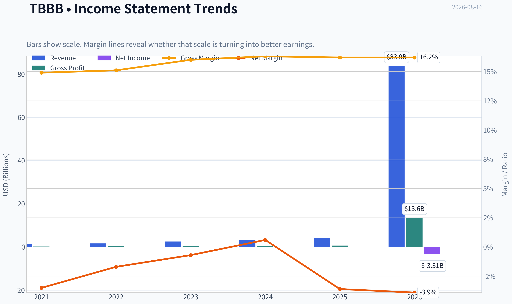

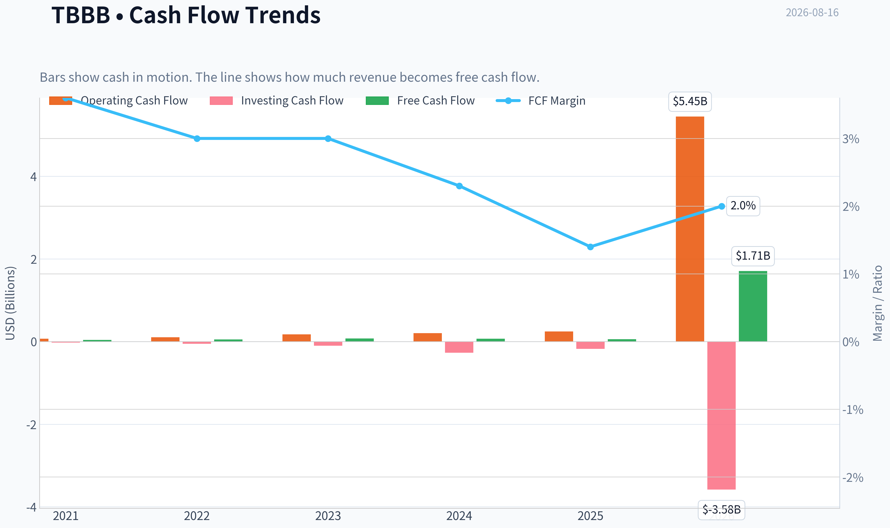

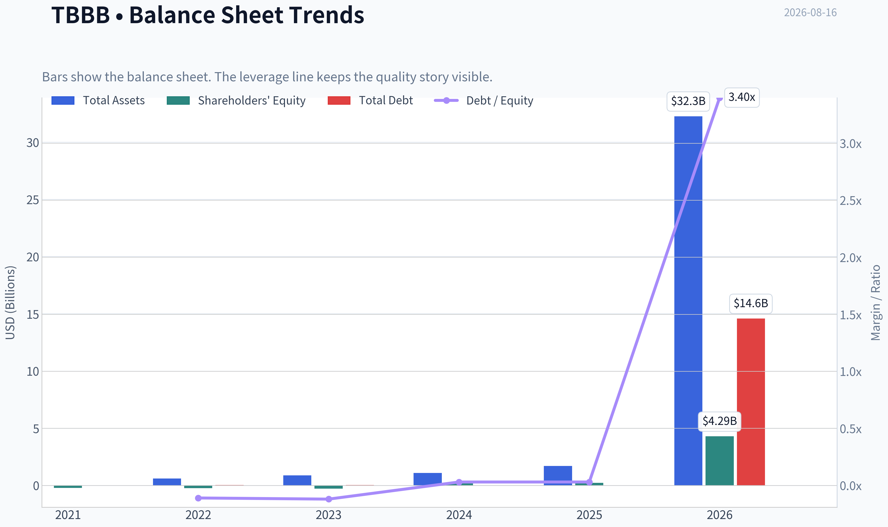

This graph tracks the profitability and return metrics (ROE, ROIC, Margins) of **TBBB** over the past decade, highlighting capital efficiency trends.

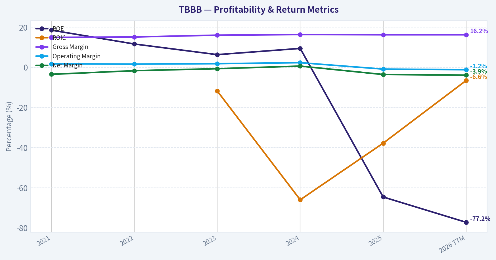

This chart illustrates the financial health of **TBBB** over the last 10 years, mapping cash equivalents and free cash flow against total obligations (Debt).

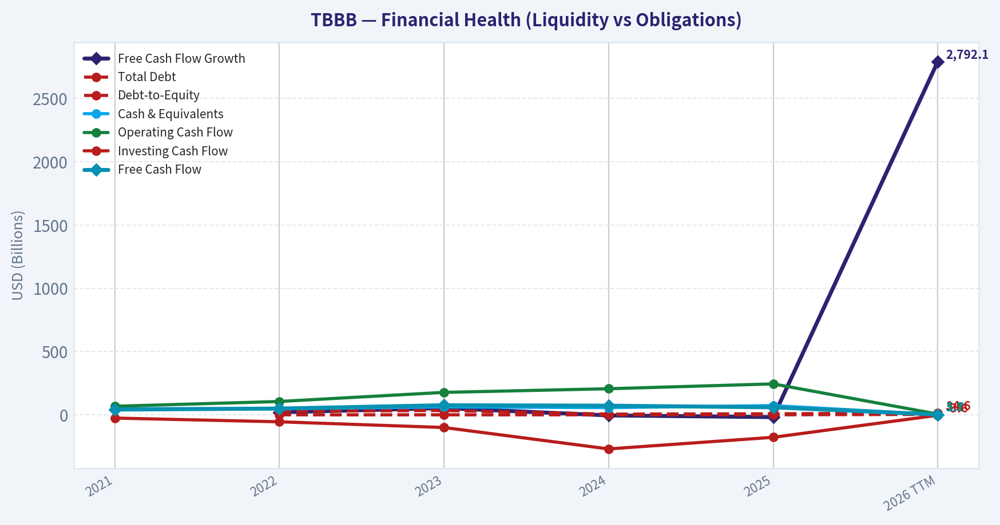

---

### Intrinsic Value Analysis (Buffett)

> *Following Warren Buffett's value investing philosophy: Circle of Competence, Economic Moat, Management Quality, and Margin of Safety.*

#### Intrinsic Value Snapshot

Price is what you pay. Intrinsic value is what the business may be worth based on the cash it can create for owners over time. We show a range, not one magic number.

- Current Price: $47.79
- Value Range (conservative to optimistic across both DCF methods): $-52.15 to $383.81

##### Owner Earnings (Buffett Method)
- Net Income: $-148,137,052.07
- Depreciation & Amortization: $1,899,144,000.00
- Capital Expenditures: $-185,144,148.17
- Working Capital Changes: $934,408,000.00
- Owner Earnings: $631,454,799.76

##### Intrinsic Value
###### Buffett Method
Uses owner earnings. Stricter, and usually more conservative.
- Conservative: $-52.15
- Average: $-52.15
- Optimistic: $-52.15
- Discount Rate: 10.0%

###### Cash Flow Method
Uses free cash flow. Better for companies spending heavily today to grow tomorrow.
- Conservative: $20.93
- Average: $143.66
- Optimistic: $383.81
- Discount Rate: 10.0%

ANALYST STANCE: **WATCH**

#### TBBB - Buffett-Style Investment Review

BBB Foods Inc. operates the Tiendas 3B hard-discount grocery model, primarily in Mexico. The investment case is straightforward: a fast-growing, low-price food retailer with a long store-expansion runway. The Buffett question is whether today's growth can mature into durable high-return economics, because current profitability and owner earnings are not yet convincing.

---

#### 1. Factor Scorecard

| Factor | Score / 5 | Evidence |
|---|---:|---|
| Circle of Competence & Business Simplicity | 3.8 | The business is easy to understand: buy basic consumer goods cheaply, sell at hard-discount prices, expand store density. Predictability is moderate because grocery demand is stable, but profitability is still developing. |
| Moat Test | 3.2 | Potential local scale advantage and price reputation, but gross margin of 16.2% leaves little room for error. The moat is not yet proven by high returns on capital. |
| Management Quality & Capital Allocation | 3.2 | Founder/operator-style retail expansion is a positive, but the public-company capital allocation record is still forming. Growth is strong, but per-share profitability remains negative. |
| Industry Structure | 3.0 | Grocery discounting is defensive and recurring, but intensely competitive and low margin. Store density can create regional advantages, though the industry does not naturally produce wide software-like margins. |
| Gate 5: Quality/Solvency Hard Floor | Not tripped | Earnings are negative, but the evidence does not show the combination of deteriorating cash flows plus a clear solvency red line such as sub-1x interest coverage. |

**Key Takeaways:** TBBB is understandable and has a large growth opportunity, but it is not yet a classic Buffett compounder. The hard floor is not triggered, so this is not an automatic avoid on solvency grounds. The main issue is proof: revenue growth is visible, but durable high-return economics are not yet established.

---

#### 2. Moat Analysis

| Moat Source | Assessment | Evidence |
|---|---|---|
| Brand / Intangible Assets | Moderate | Tiendas 3B can build consumer trust around low prices and convenience, but this is a functional brand rather than an emotional premium brand. |
| Switching Costs | Low | Grocery customers can switch stores easily. Habit and proximity help, but there is little contractual lock-in. |
| Cost Advantage | Potentially meaningful | Hard-discount retail can create purchasing, logistics, and store-format advantages if density scales. This is the most important moat candidate. |
| Network Effects | Limited | More stores may improve sourcing and distribution economics, but customer value does not compound in a true network-effect manner. |
| Pricing Power | Weak to moderate | A hard discounter's promise is low prices, so raising prices 10% without volume loss would be difficult unless competitors also inflate prices. |
| Financial Evidence | Mixed | Revenue growth is strong at 29.2%, but gross margin is only 16.2%, ROE is negative, and profitability is not yet mature. |

**Moat Rating:** **Narrow but potentially widening.**

TBBB's moat is not based on brand luxury, patents, or switching costs. The credible moat is operational: density, procurement scale, logistics discipline, and a consumer promise of low prices. That can become powerful in retail, but the evidence must eventually show up in positive ROIC, higher cash generation, and improving margins.

---

#### 3. Management Quality Assessment

Management appears focused on rapid store expansion and category penetration, which is rational if each incremental store earns attractive mature-unit economics. The concern is that public shareholders are currently underwriting growth before the company has demonstrated sustained per-share profitability.

Recent institutional signals are mixed. Stanley Druckenmiller and Steve Cohen both trimmed positions in the latest disclosed 13F period. This is not a thesis-breaker, but it reinforces that sophisticated investors may be managing exposure after a strong rerating or while waiting for clearer profitability.

| Management Area | Score / 5 | Comment |
|---|---:|---|
| Owner Orientation | 3.5 | Expansion focus suggests long-term thinking, but public evidence of per-share value creation is still developing. |
| Candor / Reporting Quality | 3.0 | No major red flag from the provided record, but the public reporting history is still young. |
| Capital Allocation | 3.0 | Store growth may be value-accretive, but only if mature returns exceed the cost of capital. Current negative ROE keeps the score restrained. |
| Balance Sheet Discipline | 2.5 | Current ratio of 0.62 suggests tight working-capital structure; this can be normal in retail but requires discipline. |

**Key Takeaways:** Management deserves credit for pursuing a large reinvestment runway, but Buffett-style evidence is still incomplete. The decisive test is whether retained capital produces attractive mature-store returns and rising free cash flow per share. Until then, management quality is promising rather than proven.

---

#### 4. Financial Summary

| Metric | Current / Recent Figure |
|---|---:|
| Share Price | $48.00 |
| Market Capitalization | $5.76B |
| Implied Shares Outstanding | ~120M |
| Latest Quarterly Sales | $1.497B |
| Annualized Latest Quarterly Sales | ~$5.99B |
| Revenue Growth YoY | 29.2% |
| Gross Margin | 16.2% |
| P/E Ratio | N/A |
| ROE | -64.6% |
| FCF Yield | 1.0% |
| Estimated FCF | ~$57.6M |
| Estimated FCF / Share | ~$0.48 |
| Current Ratio | 0.62 |
| Latest Quarterly EPS | -$0.19 |
| Prior-Year Quarterly EPS | -$0.13 |

**Key Takeaways:** The top-line growth is impressive, with sales growing nearly 30% year over year. However, the company is still loss-making on an EPS basis, ROE is deeply negative, and the free-cash-flow yield is only about 1%. This is a growth-underwriting situation, not a mature cash-compounding situation.

---

#### 5. Owner Earnings Calculation

| Owner Earnings Component | Assessment |
|---|---:|
| Net Income | Negative, as indicated by latest EPS loss and N/A P/E |
| Add: Depreciation & Amortization | Positive, but not enough to establish strong owner earnings from the provided figures |
| Less: Maintenance CapEx | Material for a growing physical retailer |
| Less: Working Capital Increases | Potentially material given rapid expansion and current ratio below 1.0 |
| Estimated FCF Proxy | ~$57.6M |
| Estimated FCF / Share | ~$0.48 |
| Owner Earnings Model Value / Share | -$52.15 |
| FCF Model Value / Share | $143.66 |
| Headline Damodaran FCFF Value / Share | $205.12 |

**Key Takeaways:** TBBB's valuation is highly sensitive to how much current spending is treated as growth investment versus maintenance investment. On a simple free-cash-flow proxy, the business generates about $0.48 per share, but the owner-earnings model is negative. That makes this a "prove the unit economics" investment rather than a clean present-day cash-yield investment.

---

#### 6. Three-Scenario DCF Valuation

| Scenario | Method | Intrinsic Value / Share | Margin of Safety vs. $48 |
|---|---|---:|---:|
| A - No Growth | Current FCF/share of ~$0.48 capitalized at 10% | ~$4.80 | Negative |
| B - GDP Growth | Current FCF/share grown at 3%, discounted at 10% | ~$7.06 | Negative |
| C - Expansion / Normalized FCFF | Headline cyclical Damodaran FCFF model | $205.12 | 76.7% |
| Cross-Check | FCF model value | $143.66 | 66.6% |
| Bearish Cross-Check | Owner earnings model value | -$52.15 | Negative |

**Key Takeaways:** The valuation range is extremely wide. If TBBB is judged only on current free cash flow, the stock is expensive. If the company successfully converts rapid store growth into normalized future FCFF, the stock appears materially undervalued.

---

#### 7. Margin of Safety Analysis

The headline intrinsic value estimate of $205.12 implies a **76.7% margin of safety** versus the current $48 share price. On that basis, the stock looks optically cheap.

However, the reverse-DCF indicates that the current price already requires roughly **24.5% annual growth for 10 years**. That is a demanding hurdle for a low-margin physical retailer, even one with a large runway. The valuation is attractive only if TBBB's store expansion produces materially better future cash flow than current results suggest.

For Buffett-style underwriting, this is not yet "wonderful business at a fair price." It is closer to "potentially good business at a price that may be fair if execution is excellent."

---

#### 8. Final Buffett Scorecard

| Criterion | Weight | Score / 5 | Weighted Contribution |
|---|---:|---:|---:|
| Moat Width & Durability | 25% | 3.2 | 0.80 |
| Valuation / Margin of Safety | 20% | 3.2 | 0.64 |
| Capital Returns - ROIC vs. WACC | 15% | 1.5 | 0.23 |
| Business Understanding & Predictability | 12% | 3.8 | 0.46 |
| Management Quality & Capital Allocation | 12% | 3.2 | 0.38 |
| Reinvestment Runway | 8% | 4.2 | 0.34 |
| Balance Sheet Strength | 4% | 2.2 | 0.09 |
| Industry Structure | 4% | 3.0 | 0.12 |
| **Total Score** | **100%** |  | **3.05 / 5.00** |

**Key Takeaways:** TBBB scores well on simplicity and reinvestment runway, but weakly on current capital returns and balance-sheet comfort. The valuation score is mixed because the headline DCF is attractive, while the current cash-flow base and reverse-DCF are demanding. The result is a watchlist-quality score, not a clear buy.

---

#### 9. Investment Stance

**Stance: WATCH**
**Conviction: Medium-Low**

TBBB is an attractive business to study, but not yet an obvious Buffett-style purchase. The company has a large addressable market, a simple model, and a potentially widening cost advantage if scale economics emerge. But current earnings are negative, ROE is poor, margins are thin, and intrinsic value depends heavily on future execution.

I would revisit the stock if one of two things happens:

| Buy Trigger | Why It Matters |
|---|---|
| Clear evidence of mature-store profitability and rising ROIC | Confirms that growth creates value rather than merely increases sales. |
| A lower share price that reduces the implied growth burden | Provides a larger margin of safety against execution risk. |
| Sustained positive owner earnings | Converts the thesis from speculative growth underwriting into Buffett-style cash compounding. |

At $48, TBBB is worth watching closely, but I would not yet advocate purchase for a Buffett-style portfolio.
#### Valuation Bridge

This bridge places the current market price beside each intrinsic value lens so readers can see whether upside depends on one method or shows up across several methods.

| Scenario | Intrinsic Value / Share |
| --- | ---: |
| Buffett Method | $-52.15 |
| Cash Flow Method | $143.66 |
| Damodaran Method | $205.12 |
| Current Price | $47.79 |

#### Key Takeaways

If one method is far above the others, the upside case depends on a specific modelling assumption. When several methods cluster together, the valuation story is more robust.

#### Valuation Visuals

This comparison chart from *Latest Earnings Snapshot* stacks current figures against historical benchmarks for **TBBB**, making it easy to see where the company trades relative to its own averages.

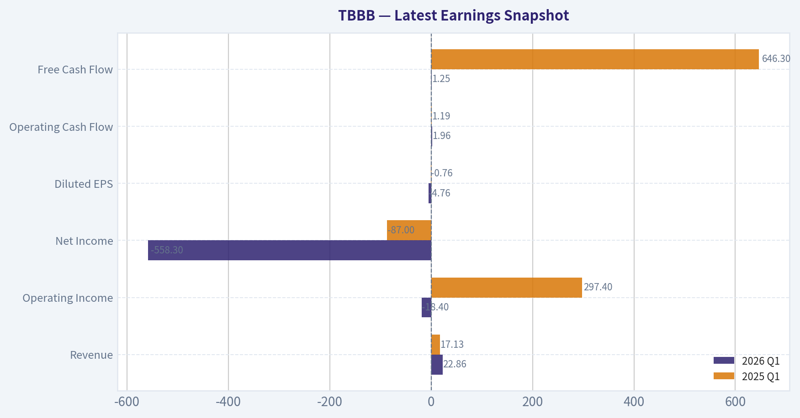

This comparison chart from *Current vs. Historical Average Comparison* stacks current figures against historical benchmarks for **TBBB**, making it easy to see where the company trades relative to its own averages.

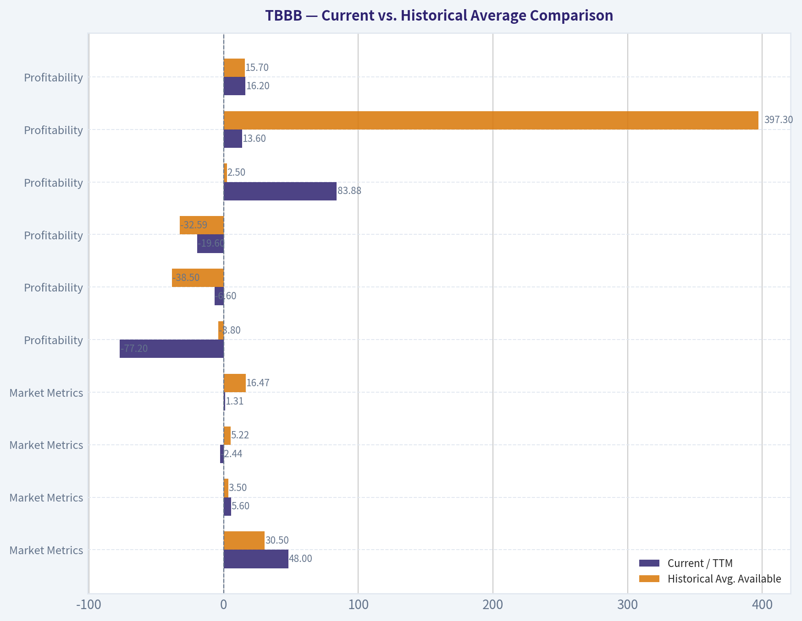

This comparison chart from *Balance Sheet and Financial Strength* stacks current figures against historical benchmarks for **TBBB**, making it easy to see where the company trades relative to its own averages.

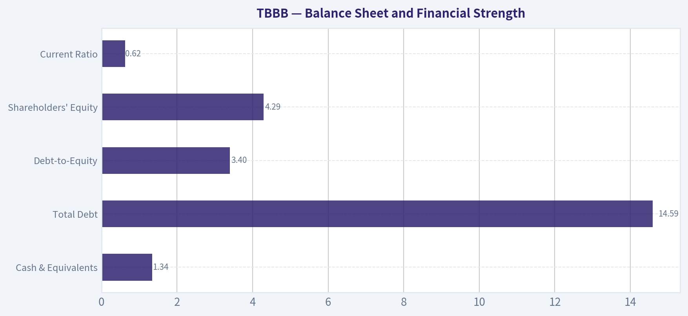

This comparison chart from *Cash Flow Analysis* stacks current figures against historical benchmarks for **TBBB**, making it easy to see where the company trades relative to its own averages.

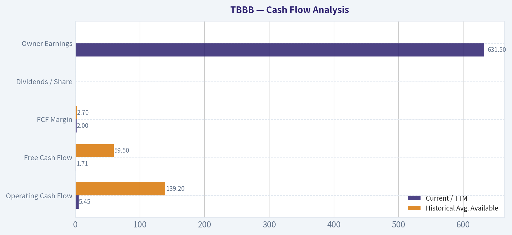

This comparison chart from *Buffett-Style Owner Earnings DCF Sanity Check* stacks current figures against historical benchmarks for **TBBB**, making it easy to see where the company trades relative to its own averages.

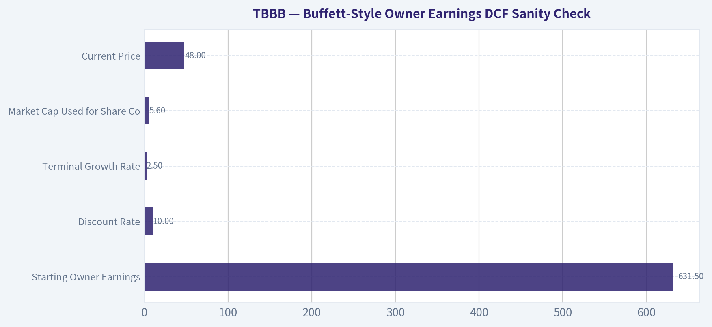

This comparison chart from *Valuation Assessment* stacks current figures against historical benchmarks for **TBBB**, making it easy to see where the company trades relative to its own averages.

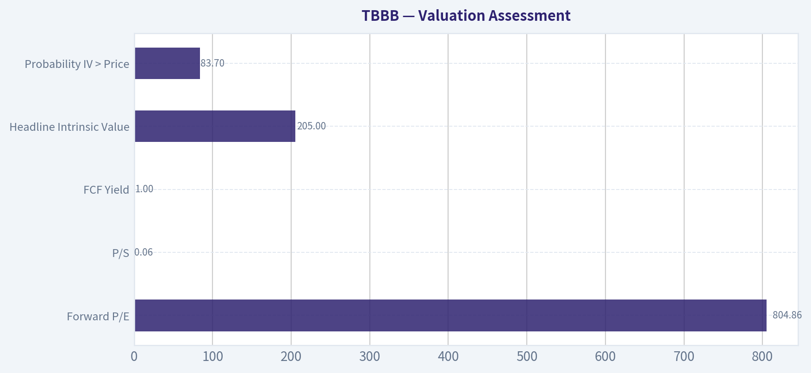

---

### Trend & Growth Analysis (Lynch/Druckenmiller/Fisher)

> *Following Peter Lynch's GARP, Stanley Druckenmiller's macro-aware approach, and Philip Fisher's scuttlebutt methodology.*

ANALYST STANCE: **ADVOCATE**

#### TBBB Growth Investment Report - BBB Foods Inc. / Tiendas 3B

| Snapshot | Data |
|---|---:|
| Current Price | $48 |
| Market Cap | $5.76B |
| Q2 2026 Revenue | $1.497B |
| Implied Annualized Revenue Run Rate | ~$6.0B |
| YoY Revenue Growth | 29.2% |
| P/E | N/A - currently loss-making |
| Gross Margin | 16.2% |
| FCF Yield | 1.0% |
| Current Ratio | 0.62 |
| Headline Intrinsic Value Estimate | $205.12 |
| Reverse DCF Hurdle | ~24.5% annual growth for 10 years |

**Key Takeaways:** TBBB is a high-growth, low-margin hard-discount retailer with revenue growing close to 30% year over year. The business is not yet earnings-profitable, but it is already generating some free cash flow. The market is pricing in a demanding growth path, but the current price-to-sales multiple remains modest for a company compounding revenue this quickly.

---

#### 1. Lynch Classification

| Lynch Category | Fit | Rationale |
|---|---|---|
| Fast Grower | Strong fit | Revenue growth of 29.2% places TBBB above Lynch's fast-grower threshold. |
| Cyclical | Partial fit | Grocery demand is defensive, but margins and consumer purchasing power can be macro-sensitive in Mexico. |
| Turnaround | Not primary | Losses exist, but the story is expansion-led rather than restructuring-led. |
| Stalwart / Slow Grower | No | Growth is far above mature-retailer levels. |

**Key Takeaways:** TBBB classifies best as a **Fast Grower**. This is not a mature grocer trading only on dividends or earnings stability; it is a store-expansion and market-penetration story. The key question is whether rapid unit growth can convert into durable free cash flow without weakening the balance sheet.

---

#### 2. The Story in 3 Bullets

- **TBBB runs a hard-discount grocery model in Mexico**, offering a narrow assortment of everyday goods at low prices.
- **The company is taking share from traditional grocery, informal retail, and higher-priced formats** by targeting value-conscious consumers.
- **The growth formula is simple:** open more stores, improve purchasing scale, raise private-label penetration, and leverage fixed costs over a larger store base.

---

#### 3. TAM Analysis and 10x Test

| TAM Factor | Estimate / Interpretation |
|---|---:|
| Current Annualized Revenue | ~$6.0B |
| 10x Revenue Target | ~$60B |
| Relevant Market | Mexican grocery / everyday essentials retail, with possible broader LatAm optionality |
| TAM Size | Likely very large, but not precisely verified from available data |
| 10x Test | Passes, but with caveat |
| Reason | TBBB can likely grow many times from here, but a full 10x would require very large national share or international expansion. |

**Key Takeaways:** TBBB has a real runway because grocery is a massive, recurring, non-discretionary market. The 10x test is plausible, especially if hard discount penetration in Mexico remains structurally underdeveloped. However, a 10x revenue outcome would likely require flawless execution, dense store expansion, and possibly expansion beyond the current core market.

---

#### 4. Revenue Growth Trend

| Metric | Latest Data | Interpretation |
|---|---:|---|
| YoY Revenue Growth | 29.2% | Fast-grower territory |
| Q2 2026 Sales | $1.497B | Beat consensus estimate of $1.420B |
| Revenue Quality | Store expansion plus consumer value proposition | Likely primarily organic growth, though detailed mix not available |
| Growth Pattern | High, but acceleration not fully verifiable | Positive, but more quarterly history needed |

**Key Takeaways:** Revenue growth is the strongest part of the TBBB thesis. The Q2 sales beat suggests demand remains healthy and the store model is resonating. However, with the data available, I would call growth **sustained high** rather than conclusively accelerating.

---

#### 5. Unit Economics

| Unit Economics Metric | Available Data | Assessment |
|---|---:|---|
| Gross Margin | 16.2% | Low, normal for hard-discount grocery but leaves little room for error |
| FCF Yield | 1.0% | Positive but thin |
| LTV/CAC | Not applicable / not disclosed | Retail model is store-density driven rather than CAC-driven |
| NRR | Not applicable | Not a SaaS/subscription business |
| Rule of 40 | Not applicable | Not a software model |
| Store-Level Economics | Not provided | Critical missing variable |

**Key Takeaways:** TBBB is not a classic SaaS-style unit economics story; the real unit is the store. The available evidence suggests the business can generate some free cash flow, but margins are thin. Investors need more disclosure on mature-store contribution margins, new-store payback periods, and same-store sales trends.

---

#### 6. Inflection Point Assessment

| Inflection Type | Evidence | Rating |
|---|---|---|
| Product / Format Inflection | Hard-discount format gaining consumer relevance | Positive |
| Market Share Inflection | Likely taking share from fragmented retail | Positive but not fully quantified |
| Margin Inflection | Not yet proven; gross margin is only 16.2% | Watch |
| TAM Inflection | Value retail demand supported by consumer pressure and formalization | Positive |
| Competitive Inflection | No clear evidence of a major competitor stumble | Neutral |

**Key Takeaways:** The strongest inflection is format adoption: Mexican consumers appear receptive to a low-price, limited-assortment grocery model. The margin inflection is not yet visible, and that is the key debate. If revenue growth remains near 30% while operating losses narrow, the market could re-rate the stock meaningfully.

---

#### 7. Macro Setup

| Macro Factor | Impact on TBBB |
|---|---|
| Consumer Pressure / Inflation Sensitivity | Helps hard-discount retailers as households trade down |
| Interest Rates | Lower rates would help valuation and expansion economics |
| Mexico Consumption | Key variable; weak consumption can pressure baskets but may also drive trade-down |
| Currency Risk | Relevant for USD investors and imported goods exposure |
| Secular Theme | Value retail penetration, formalization of grocery, private-label adoption |

**Key Takeaways:** TBBB benefits from a powerful trade-down theme: when consumers feel pressure, discount grocery can gain traffic. The macro is not risk-free because rates, FX, and Mexican consumer health matter. But compared with discretionary retail, grocery discount is structurally more resilient.

---

#### 8. Fisher 15 Points Score

| Fisher Point | Score / 5 | Comment |
|---|---:|---|
| 1. Market potential | 5 | Grocery TAM is large and recurring. |
| 2. New product / format determination | 4 | Store format and assortment discipline are central. |
| 3. R&D effectiveness | 3 | Not R&D-heavy; innovation is operational. |
| 4. Sales organization | 4 | Store rollout and local merchandising appear effective. |
| 5. Profit margin | 2 | Gross margin is thin; net losses remain. |
| 6. Improving margins | 3 | Potential exists, but not yet proven. |
| 7. Labor/personnel relations | 3 | Insufficient data. |
| 8. Executive relations | 3 | Insufficient data. |
| 9. Management depth | 3 | Public-company track record still developing. |
| 10. Cost analysis/accounting | 4 | Hard-discount model requires cost discipline. |
| 11. Moat factors | 4 | Scale purchasing, density, private label, local convenience. |
| 12. Long-range profit outlook | 4 | Strong if store economics scale. |
| 13. Dilution risk | 3 | Balance sheet/current ratio warrants monitoring. |
| 14. Candor | 3 | Not enough direct evidence from available data. |
| 15. Integrity | 3 | No major red flags identified from available data. |
| **Total** | **51 / 75** | **Average to good, with profitability still unproven.** |

**Key Takeaways:** Fisher scoring is positive but not outstanding. The market opportunity and business model score well, while margins, disclosure depth, and proof of mature economics hold the score back. TBBB looks like a promising growth retailer, but not yet a fully proven compounder.

---

#### 9. Valuation Analysis

| Valuation Metric | Result | Interpretation |
|---|---:|---|
| P/E | N/A | Loss-making, so PEG is not usable. |
| PEG | N/A | Earnings growth base is negative. |
| Price / Sales | ~0.96x | Attractive for a 29% revenue grower, though grocery deserves lower multiples than software. |
| FCF Yield | 1.0% | Low but positive. |
| Headline Intrinsic Value | $205.12 | Suggests large upside, but model spread is very wide. |
| Owner Earnings Model | -$52.15 | Warning that normalized owner earnings are not yet reliable. |
| FCF Model | $143.66 | Bullish if free cash flow scales. |
| Reverse DCF | 24.5% growth for 10 years | High embedded expectation. |

**Key Takeaways:** TBBB looks cheap on sales but not obviously cheap on proven earnings power. The valuation debate is about whether today's losses are temporary growth investment or evidence of structurally thin economics. The reverse DCF shows the stock already requires strong long-term execution, so this is not a low-expectation value stock despite the low P/S multiple.

---

#### 10. Scenario Analysis

| Scenario | Revenue CAGR Assumption | Future Revenue View | Multiple Assumption | Implied View |
|---|---:|---:|---:|---|
| Bear | 12-15% | Growth slows, margins stay thin | 0.5-0.7x sales | Downside if store economics disappoint |
| Base | 20-25% | Strong rollout continues | 0.9-1.2x sales | Solid upside if growth durability is proven |
| Bull | 25-30%+ | Category leadership and margin leverage | 1.3-1.8x sales | Multi-bagger potential if TBBB becomes the dominant hard-discounter |

**Key Takeaways:** The bull case depends on TBBB sustaining high growth while showing operating leverage. The bear case is not a revenue-collapse story; it is a margin and valuation-compression story. For a grocery retailer, small changes in margin assumptions can create large changes in equity value.

---

#### 11. Growth Investor Scorecard

| Criterion | Weight | Score / 5 | Weighted Score |
|---|---:|---:|---:|
| The Story | 10% | 4.3 | 0.43 |
| TAM & Runway | 20% | 4.1 | 0.82 |
| Revenue Growth | 20% | 4.4 | 0.88 |
| Unit Economics | 15% | 2.8 | 0.42 |
| Competitive Position | 10% | 3.8 | 0.38 |
| Management Quality | 10% | 3.3 | 0.33 |
| Macro Setup | 5% | 3.8 | 0.19 |
| Profitability Path | 5% | 3.0 | 0.15 |
| Valuation | 5% | 3.7 | 0.19 |
| **Total** | **100%** |  | **3.79 / 5.00** |

**Key Takeaways:** TBBB scores as an **ADVOCATE** under the growth framework, mainly because revenue growth, TAM, and the simplicity of the story are compelling. The biggest deductions come from thin margins, negative earnings, and incomplete proof of store-level economics. This is a high-upside growth retailer, but not a low-risk one.

---

#### 12. Position Size Stance

| Investor Type | Suggested Stance |
|---|---|
| Aggressive Growth Investor | Accumulate starter-to-medium position |
| GARP Investor | Starter position only until profitability improves |
| Conservative Investor | Watchlist; wait for cleaner earnings and liquidity profile |
| Suggested Portfolio Weight | 2%-4% initial position; add only on proof of margin leverage |

**Key Takeaways:** TBBB is suitable for a measured growth position, not an oversized bet yet. The upside is meaningful, but the company still needs to prove that rapid store expansion can translate into durable earnings and cash flow. Position sizing should reflect both the ten-bagger possibility and the execution risk.

---

#### 13. Key Risks and Catalysts

| Category | Items to Monitor |
|---|---|
| Key Catalysts | Continued revenue beats, new-store productivity, same-store sales growth, private-label mix gains, gross margin stability, operating-loss narrowing |
| Key Risks | Thin gross margin, negative earnings, current ratio below 1, FX volatility, food inflation, execution risk in rapid store rollout, valuation relying on long-duration growth |
| Guru Signal | Stanley Druckenmiller trimmed 6.7% but still held a meaningful 2.32% portfolio weight as of 06-30-2026; Steve Cohen also trimmed. |
| Data Gaps | Store count growth, mature-store margins, payback period, same-store sales, debt maturity schedule, detailed cash burn |

**Key Takeaways:** The most important catalyst is not just more revenue growth; it is proof that scale improves profitability. Guru trimming is a mild caution signal, though Druckenmiller's remaining position is still notable. The thesis should be re-underwritten if revenue growth falls below 20% without visible margin improvement.

---

#### Final View

TBBB is a **Peter Lynch-style fast grower** with a simple story, large market, and a potentially powerful hard-discount retail model. It also fits a **Druckenmiller-style inflection setup**: a business riding consumer trade-down, store expansion, and formal retail penetration while still early in its scaling curve.

The stock earns an **ADVOCATE** stance, but with discipline: start modestly, demand evidence of store-level profitability, and add only if revenue growth remains above 20% while margins and free cash flow improve.

---

### Market Technical Analysis

ANALYST STANCE: **WATCH**

#### TBBB Technical Analysis - Breakout Strength With Elevated Chase Risk
Data is current through the last available trading session, **2026-08-14**. The current calendar date, **2026-08-16**, is not a trading day.

TBBB has shifted from a multi-week consolidation near the low-$40s into a sharp upside breakout. The move is technically constructive because price is now well above the 10 EMA, 50 SMA, 200 SMA, and VWMA, while MACD momentum has expanded. However, the stock is also extended above its Bollinger Upper Band, RSI recently entered overbought territory, and ATR has risen, meaning the risk of volatility, pullbacks, and failed breakout behavior has increased.

The preferred stance is **WATCH**, not because the chart is weak, but because the latest move appears powerful yet stretched. Traders may want confirmation above the $49.77-$50.20 breakout zone, or a controlled pullback toward support, rather than chasing immediately after a high-volume surge.

---

#### Selected Indicators and Why They Matter

| Indicator | Latest Reading / Signal | Why It Was Selected |
|---|---:|---|
| `close_10_ema` | 43.66 | Captures short-term trend acceleration after the breakout. |
| `close_50_sma` | 41.43 | Defines the medium-term trend and likely pullback support area. |
| `close_200_sma` | 36.19 | Confirms the broader long-term trend remains strongly bullish. |
| `macd` | 1.21 | Measures momentum expansion; currently supports the breakout. |
| `rsi` | 69.72 | Shows strong momentum but warns that price is near overbought conditions. |
| `boll_ub` | 46.67 | Price is above the upper band, signaling a breakout but also short-term extension. |
| `atr` | 2.08 | Volatility has expanded; useful for stop placement and position sizing. |
| `vwma` | 44.31 | Confirms whether volume supports the price move; currently price is above VWMA. |

**Key Takeaways:** The selected indicators show a broadly bullish structure, with price above all major trend and volume-weighted benchmarks. Momentum has improved sharply, but RSI, Bollinger Band extension, and rising ATR suggest that the stock is no longer in a low-risk entry zone. The setup favors monitoring for confirmation or a controlled pullback rather than impulsive buying.

---

#### Price Structure and Trend Quality

TBBB spent much of July and early August moving sideways between roughly **$39 and $43**, building a consolidation base after a prior advance. That base resolved sharply higher on **2026-08-13**, when the stock opened at **$45.75**, traded as high as **$49.77**, and closed at **$49.20** on a major volume expansion. The next session, **2026-08-14**, saw a high of **$50.20** but a lower close at **$47.79**, suggesting buyers are still present, but some profit-taking emerged near the psychological $50 level.

The bigger trend remains constructive. The stock closed at **$47.79**, compared with a 50-day SMA of **$41.43** and a 200-day SMA of **$36.19**. That means TBBB is trading well above both medium- and long-term trend benchmarks. This is typically bullish, but the distance from those averages is also important: price is extended enough that new entries have less margin of safety unless breakout momentum continues.

| Level / Zone | Approximate Price | Interpretation |
|---|---:|---|
| Recent breakout high | $50.20 | Immediate resistance; a clean close above this would confirm continuation. |
| Prior surge-day high | $49.77 | Key breakout validation level from the 2026-08-13 move. |
| Latest close | $47.79 | Still strong, but below the prior day's close and below the session high. |
| Aug. 13 intraday low | $44.88 | First important support if the breakout is retested. |
| VWMA | $44.31 | Volume-weighted support; staying above it supports bullish interpretation. |
| 10 EMA | $43.66 | Short-term trend support after the breakout. |
| 50 SMA | $41.43 | Medium-term support; a deeper pullback toward this area would reset extension. |
| 200 SMA | $36.19 | Long-term trend support; price remains far above this level. |

**Key Takeaways:** TBBB's breakout is real from a trend perspective, but the $49.77 to $50.20 zone is now the key test. If price can reclaim and hold above that area, momentum traders may see continuation potential. If price fades below $44-$45, the breakout could begin to look vulnerable.

---

#### Momentum, Volatility, and Volume Read

Momentum improved quickly. MACD rose from near-neutral levels earlier in August to **1.21** by August 14, showing a strong positive acceleration phase. RSI reached **76.59** on August 13 and eased to **69.72** on August 14. That pullback in RSI is not necessarily bearish by itself, but it does show that the most aggressive momentum impulse may have cooled slightly after the initial breakout day.

Volatility has also increased. ATR rose to **2.08**, up from the roughly **1.6-1.7** range seen earlier in August. That means daily price swings have widened, and traders should avoid using overly tight stops. For a stock trading near $48, a 1 ATR move is more than 4% of price, so position sizing matters.

Volume strongly validated the breakout. TBBB traded **3.09 million shares** on August 13 and **1.59 million shares** on August 14, both notably elevated compared with the lighter volumes seen during the prior consolidation. The VWMA rose to **44.31**, and price remains well above it, suggesting the breakout was not merely price-only movement; it had meaningful participation behind it.

| Indicator | Recent Behavior | Bullish Interpretation | Risk Interpretation |
|---|---|---|---|
| MACD | Rose to 1.21 | Momentum expansion supports trend continuation. | Sharp MACD spikes can lag after a breakout. |
| RSI | Fell from 76.59 to 69.72 | Momentum remains strong. | Near-overbought reading raises pullback risk. |
| Bollinger Upper Band | 46.67 vs. close at 47.79 | Price broke above volatility resistance. | Closing above the band can signal short-term extension. |
| ATR | Increased to 2.08 | Confirms a larger move is underway. | Wider swings increase stop-out and gap risk. |
| VWMA | 44.31, below price | Volume supports the rally. | A drop below VWMA would weaken breakout quality. |
| Volume | Very high on Aug. 13-14 | Breakout had strong participation. | Heavy volume near $50 may also represent distribution if price stalls. |

**Key Takeaways:** Momentum and volume both support the bullish breakout, but volatility and overbought pressure have increased at the same time. This combination often creates fast upside potential, but also sharp pullback risk. The most important question now is whether buyers can defend the breakout above the mid-$40s.

---

#### Trading Interpretation

For aggressive momentum traders, the cleanest bullish signal would be a close above **$50.20** with continued strong volume. That would show buyers are willing to absorb supply at the breakout highs and could open the path toward a continuation leg. However, buying before that confirmation carries higher risk because the stock has already moved sharply.

For pullback-oriented traders, the more attractive area to watch is around **$44.90-$43.60**, where the Aug. 13 low, VWMA, and 10 EMA are clustered. A controlled pullback into that zone, followed by stabilization, could offer a better reward-to-risk setup than chasing near $48-$50. A decisive break below that zone would suggest the breakout is losing quality.

For risk management, ATR argues for wider stops than usual. A stop placed too close to the latest price may be vulnerable to normal volatility. A trader using ATR-based risk might consider that one ATR is currently about **$2.08**, so price could fluctuate meaningfully even without changing the broader trend.

#### Final View

TBBB is in a bullish technical position, but the breakout is extended in the short term. The stock has strong trend alignment, rising momentum, and volume confirmation, yet it is also trading above its Bollinger Upper Band with RSI near overbought territory. The best classification is **WATCH**: bullish bias, but wait for either a breakout confirmation above $50.20 or a pullback that holds above the $44-$43 support area.

| Decision Area | Current Assessment | Practical Implication |
|---|---|---|
| Trend | Bullish across short-, medium-, and long-term measures | Bias remains upward while price holds above key averages. |
| Momentum | Strong but slightly cooling after overbought spike | Continuation possible, but near-term digestion is likely. |
| Volume | Confirms breakout | The move has institutional-quality participation signals. |
| Volatility | Elevated | Use smaller position sizes or wider stops. |
| Key resistance | $49.77-$50.20 | Break above this zone would strengthen the bull case. |
| Key support | $44.90-$43.60 | Pullback hold here would keep breakout intact. |
| Risk level | Moderate to high short-term | Chasing is risky after the sharp move. |
| Stance | WATCH | Wait for confirmation or a better pullback entry. |

**Key Takeaways:** TBBB's chart is bullish, but the immediate setup is not low-risk because price has already surged. The strongest bullish confirmation would be a close above $50.20, while the best pullback test would be near $44.90 to $43.60. Until one of those scenarios develops, monitoring is preferable to chasing.

---

### Options Market Analysis

> *Reading options flow - put/call ratios, IV skew, and unusual activity - to gauge institutional positioning and event-driven risk.*

ANALYST STANCE: **WATCH**

#### TBBB Options Flow Report - As of 2026-08-16

#### 1. Put/Call Ratio Analysis

| Expiration | Call OI | Put OI | Put/Call OI Ratio | Call Volume | Put Volume | Put/Call Volume Read |
|---|---:|---:|---:|---:|---:|---|
| 2026-08-21 | 1,139 | 727 | 0.64 | 11 | 153 | Put-heavy near-term volume |
| 2026-09-18 | 578 | 136 | 0.24 | 305 | 51 | Strong call-volume bias |
| 2026-11-20 | 279 | 115 | 0.41 | 10 | 24 | Light, slightly put-heavy volume |
| **Near-Term Total** | **1,996** | **978** | **0.49** | **326** | **228** | **0.70 total P/C volume ratio** |

**Key Takeaways:** TBBB's near-term put/call open-interest ratio is **0.49**, below the historical neutral baseline near **0.70**, indicating a call-heavy positioning backdrop. However, the **volume ratio is exactly around neutral at 0.70**, so fresh flow is not strongly confirming the call-heavy open interest. The front-week expiry shows notable put volume, while September shows stronger call activity.

The options positioning leans **mildly bullish** on open interest, but the signal is not aggressive. The main bullish evidence is the call-heavy OI, especially in the September chain, while the main caution is the lack of broad fresh call volume across all expirations.

---

#### 2. Implied Volatility Assessment

| Expiration | ATM Call IV | ATM Put IV | IV Interpretation |
|---|---:|---:|---|
| 2026-08-21 | 39.4% | N/A | Moderate front-week implied volatility; put-side ATM IV unavailable |
| 2026-09-18 | 38.4% | N/A | Similar to front-week; no clear term-structure stress |
| 2026-11-20 | 43.0% | 37.8% | Calls screen higher than puts at ATM, suggesting possible upside demand or data limitations |

**Key Takeaways:** Near-term ATM call IV is clustered around **38%-43%**, which is not obviously extreme from the available data. The only expiry with both call and put ATM IV available is November, where calls are higher than puts, suggesting a mild **call-skew / upside-chase** tendency. However, because put IV is missing for two expirations, skew confidence is limited.

There is no clear evidence in the provided options data of a major volatility panic or steep downside-protection bid. If TBBB has an upcoming company-specific catalyst, the IV may be elevated relative to its own history, but the current dataset does not provide enough context to confirm event pricing.

---

#### 3. Unusual Options Activity

| Unusual Activity Screen | Result |
|---|---|
| Contracts with volume greater than 5x open interest | **None detected** |
| Fresh institutional-size directional flow | **Not evident from available data** |
| Retail/speculative signal | Limited; September call volume is notable but not flagged as unusual |
| Confidence from unusual activity | Low |

**Key Takeaways:** No near-term contracts met the unusual-activity threshold of **volume greater than 5x open interest**. That means there is no clear evidence of fresh aggressive institutional positioning from the options tape. The September call volume is directionally constructive, but without contract-level detail or a volume-versus-OI anomaly, it should not be treated as a high-conviction smart-money signal.

Because no unusual contracts were flagged, this reduces confidence in any strong directional conclusion. The market appears positioned more through existing call-heavy open interest than through a sudden wave of fresh speculative flow.

---

#### 4. Open Interest Concentration and Gamma / Pinning Risk

| Expiration | Total OI | OI Bias | Pinning / Gamma Read |
|---|---:|---|---|
| 2026-08-21 | 1,866 | Call-heavy but with meaningful put OI | Highest near-term OI; potential front-week pinning risk, but strike-level data unavailable |
| 2026-09-18 | 714 | Strongly call-heavy | Potential upside-interest zone, but no strike-level gamma wall identified |
| 2026-11-20 | 394 | Call-heavy | Lower OI; less near-term pinning influence |

**Key Takeaways:** The **2026-08-21** expiry has the largest total open interest, making it the most relevant for near-term pinning or gamma effects. However, the available dataset does not include strike-level open interest, so specific max-pain levels, gamma walls, or magnet strikes cannot be identified. The absence of strike detail means this part of the signal should be treated cautiously.

From an expiration-level perspective, TBBB's options interest is concentrated in the front week, but not enough detail is available to say whether market makers would dampen or amplify price moves around a specific strike.

---

#### 5. Overall Options Sentiment Signal

| Category | Read |
|---|---|
| Directional Signal | **BULLISH, low conviction** |
| Primary Driver | Call-heavy open interest, especially September expiry |
| Main Caveat | Total volume is modest and unusual activity is absent |
| Risk Flag | Front-week put volume shows some hedging or downside concern |
| Liquidity Assessment | Options market appears relatively thin; reduce confidence |

**Key Takeaways:** The options market gives a **mild bullish signal** for TBBB, mainly because the near-term put/call OI ratio of **0.49** is meaningfully below the neutral baseline of about **0.70**. However, this is not a high-conviction bullish setup because overall volume is modest, no unusual activity was detected, and front-week put volume is elevated relative to call volume. The best read is that positioning leans bullish, but traders are not aggressively chasing upside through fresh unusual flow.

#### Final Summary Table

| Factor | Observation | Sentiment Impact |
|---|---|---|
| Put/Call Ratio | OI ratio **0.49**, below neutral; volume ratio **0.70**, near neutral | Mildly bullish |
| IV Level | ATM call IV around **38%-43%** | Moderate / neutral |
| Skew Direction | Limited data; November call IV above put IV | Slight bullish skew, low confidence |
| Unusual Activity | No contracts with volume > 5x OI | Neutral / low conviction |
| Open Interest / Gamma | Front-week has highest OI, but strike-level gamma walls unavailable | Watch for pinning, not enough detail |
| Overall Signal | **BULLISH, low conviction** | Call-heavy positioning, but thin flow |

**Key Takeaways:** TBBB's options tape leans bullish, but only modestly. The strongest evidence is the below-neutral put/call OI ratio, while the weakest part of the case is the absence of unusual options activity. This is a **watch-list bullish options signal**, not a high-conviction institutional accumulation signal.

---

## Research Team Commentary

> *The Research Manager synthesizes the Bull vs Bear debate into action-free commentary. This is a pre-risk view, not the final stance.*

Let us talk about BBB Foods, or TBBB. This is one of the more interesting debates we have had recently because it tests our discipline right at the intersection of hyper-growth and value investing.

On one side, our bull analyst makes a compelling qualitative case. TBBB is executing the classic hard-discount grocery playbook in Mexico, essentially acting as an early-stage Aldi or Costco without the membership fee. By keeping a narrow assortment of items, expanding private labels, and passing the savings to value-conscious consumers, they are building a psychological moat and capturing a massive tailwind as Mexico transitions from informal corner stores to organized retail. The 29 percent year-over-year revenue growth proves they have serious product-market fit. The bull correctly points out that in retail, early-stage unit expansion often masks long-term cash generation because growth capital expenditures temporarily dwarf maintenance capital expenditures.

On the flip side, the bear brings a heavy dose of quantitative reality. We are looking at a business with a negative 64 percent return on equity, a negative 21 percent return on invested capital, and a razor-thin 16.2 percent gross margin. The bear rightly asks whether this low-price strategy is a true structural moat, or if it just means they are on a high-volume, low-margin treadmill against well-capitalized, highly efficient giants like Walmex. Most importantly, the bear points out the reverse discounted cash flow reality. At nearly 48 dollars a share following a sharp technical breakout, the market is pricing in flawless, heroic execution.

If you look at my recent track record with names like F5 Networks and Berkshire Hathaway, I learned a very painful lesson about being too conservative. In both of those cases, I issued a passive watch stance because I got bogged down in long-term moat paranoia or valuation gravity, and I totally ignored strong technical breakouts and upward momentum. But we have to apply those lessons with intellectual honesty. F5 was printing cash with 80 percent gross margins and a 27 percent return on invested capital. Berkshire is a financial fortress. They had fundamental quality floors that made their technical momentum safe to buy.

TBBB is a fundamentally different animal. It does not have a quality floor yet; it is a cash-burning hyper-growth story. As Warren Buffett teaches us, growth and value are tied at the hip, but growth only creates value when the return on invested capital exceeds the cost of capital. Right now, TBBB is destroying GAAP capital to fund its land grab. While the bull is right that thin margins can act as a moat in the shared economies of scale model, you still need to see the operating leverage emerge to prove the business model actually works for minority shareholders, not just the customers. Paying up for a stock priced for perfection while it is incinerating capital is exactly the kind of chase risk the bear warns about.

So here is my core takeaway. TBBB operates a highly attractive retail model in a prime emerging market, but it is currently a high-velocity speculation rather than a durable compounder with a required margin of safety. We are not going to chase the momentum here just because the chart is breaking out, because the underlying cash flows do not yet support the multiple.

However, I am not going to issue a flat avoid, nor a passive watch. Based on my past mistakes, we need a conditional execution plan. The rationale here is that if the hard-discount model succeeds, the economics will flip violently to the upside once the mature store base outgrows the new store openings. Therefore, our monitoring plan over the next one to four quarters is strictly focused on unit economics and operating leverage.

First, we need management to demonstrate that their older store cohorts, say those open for three years or more, are actually generating 15 to 20 percent returns on capital to self-fund the new openings. Second, with 29 percent revenue growth, we must see selling, general, and administrative expenses decline as a percentage of sales. If the top line grows that fast but operating margins remain deeply negative, the model is fundamentally flawed. Third, we need to monitor that 16.2 percent gross margin. If Walmex starts a localized price war, we need to know TBBB can absorb the hit without facing a solvency crisis. Tactically, we want to see how the stock behaves on a pullback to the low 40s consolidation zone. If it holds that support while operating leverage improves in the next couple of earnings prints, we can reassess our entry. Until then, we keep our capital safe and demand proof of profitability.

WATCH

---

## Value Investing Team Commentary

> *The Investor translates the research view into an investment thesis before risk review. This is still not the final stance.*

The investment case for BBB Foods (TBBB) represents a classic tension in value investing: the conflict between a **wonderful business model** and **quantitatively poor current results.** As a disciple of the Buffett-Munger school, we must determine if TBBB is a "Scale-Efficiency" compounder like a young Costco or Amazon, or a capital-intensive "treadmill" business whose growth is subsidized by shareholder dilution.

### 1. Business Quality and Durable Moat: The "Shared Economies of Scale"
TBBB's hard-discount model in Mexico is theoretically a **"wonderful business."** By offering a limited SKU count (roughly 800 items) and high private-label penetration, they create a virtuous cycle: low complexity leads to lower costs, which are passed to the consumer to drive volume, which further lowers costs. This is the **Shared Economies of Scale** moat-a psychological and structural barrier that is incredibly difficult for incumbents like Walmex to replicate without cannibalizing their higher-margin formats.

However, the **16.2% gross margin** is the "Achilles' heel." In the U.S., a Costco operates on ~12-13% gross margins but has massive membership fees to provide the "quality floor." TBBB lacks that membership annuity. At 16%, there is zero room for operational error or a competitive price war.

### 2. Management and Capital Allocation: The ROIC Problem
Buffett's primary requirement is that **growth must create value.** Growth only creates value when **ROIC > Cost of Capital.**
*   **Current Reality:** A -21.6% ROIC and -64.6% ROE indicate that TBBB is currently a **capital consumer**, not a capital generator.
*   **The Nuance:** In early-stage retail, GAAP accounting often expenses the very things (training, pre-opening costs, regional logistics) that are actually long-term assets. We must look at **unit economics**-not the consolidated bottom line. If a mature store (4+ years old) is generating a 20%+ cash-on-cash return, the business is a "Buy." If the mature stores are barely breaking even, the model is a "value trap." Currently, we lack the granular cohort data to confirm this "quality floor."

### 3. Selective Contrarian Thinking: What is the Market Missing?
The market is currently in a state of **growth euphoria**, evidenced by the sharp breakout to $47.79. The consensus narrative is that TBBB is the "Aldi of Mexico."
*   **The Sentiment Risk:** When a stock breaks out on a "story" while losing money, the margin of safety is non-existent. The market is pricing in **perfect execution** and a structural shift from informal to formal retail that might take longer than anticipated.
*   **The Walmex Factor:** The market may be underestimating the "Empire Strikes Back" risk. Walmex is a world-class operator with a fortress balance sheet. If they decide to compress margins in their Bodega Aurrera format to "strangle" TBBB's growth, TBBB's path to profitability could be pushed back by years.

### 4. Intrinsic Value and Quality-Scaled Margin of Safety
Using a **Reverse-DCF logic**, at $47.79, TBBB needs to not only maintain its ~30% revenue growth for the next 5-7 years but also achieve a terminal operating margin of 6-8% (standard for mature discounters).
*   **Margin of Safety:** Given the high execution risk and negative current returns, our framework requires a **40-50% discount** to intrinsic value. We are currently seeing the opposite: a **momentum premium.**
*   **Lesson from F5/BRK-B:** While I previously missed moves by being too conservative, those companies had **established earnings power.** TBBB is speculative. Buying a negative-ROIC business at an all-time high is not "learning from mistakes"-it is "abandoning discipline."

### 5. Long-Term Perspective (10+ Years)
The Mexican retail landscape is undergoing a once-in-a-generation shift. TBBB has the right "DNA" to be a winner. However, as an owner, I want to buy when the "bridge to profitability" is visible, not when the market is betting on the bridge being built mid-air.

### Final Assessment
We will not chase a vertical breakout in a cash-burning business. We require **proof of operating leverage**-specifically, seeing SG&A grow slower than revenue for two consecutive quarters-before committing capital. The "wonderful business at a fair price" rule only applies when the business has proven it can actually generate a profit.

ANALYST STANCE: **WATCH**

---

## Deep Values Commentary

> *The Risk Management Team debates and the Risk Judge provides the final action-free verdict. This section determines the final ADVOCATE / WATCH / AVOID stance.*

#### Final Stance Scorecard

This scorecard converts the final research view into a weighted decision frame. It does not replace the narrative judgement, but it makes the main drivers of the verdict easier to scan.

| Criterion | Score | Weight | Commentary |
| --- | ---: | ---: | --- |
| Business Quality | 1.75 | 30% | High returns, profitability, and Piotroski health support durability. |
| Valuation Support | 3.33 | 30% | Blends current price against available intrinsic value anchors and valuation ratios. |
| Financial Strength | 3.67 | 20% | Balance-sheet resilience reflects leverage and liquidity staying within safe ranges. |
| Growth Durability | 2.33 | 20% | Recent revenue, earnings, and free cash flow growth indicate how durable expansion looks. |
| TOTAL / FINAL STANCE | 2.72 | 100% | WATCH |

#### Key Takeaways

The weighted score lands at **2.72 / 5.0**, while the final stance remains **WATCH**. This is useful as a quick calibration aid rather than a mechanical signal.

#### Risk Summary

Higher scores indicate more risk pressure. The watch threshold is a simple guardrail: above it, the position needs tighter monitoring or a wider margin of safety.

| Dimension | Current Score | Watch Threshold | Commentary |
| --- | ---: | ---: | --- |
| Business Quality | 4.25 | 3.00 | High returns, profitability, and Piotroski health support durability. |
| Valuation Support | 2.67 | 3.00 | Blends current price against available intrinsic value anchors and valuation ratios. |
| Financial Strength | 2.33 | 3.00 | Balance-sheet resilience reflects leverage and liquidity staying within safe ranges. |
| Growth Durability | 3.67 | 3.00 | Recent revenue, earnings, and free cash flow growth indicate how durable expansion looks. |

#### Key Takeaways

This view helps readers separate *where* the risk sits: valuation, business quality, balance sheet, or growth durability. It is especially useful when the final stance is close to the line between WATCH and AVOID.
