# TBBB Deep Value Intelligence

**Analysis Date:** 2026-09-23

## Critical Disclaimer

*This analysis is generated by Deep Value Intelligence, an AI-powered multi-agent investing framework. Education & research only - not financial advice, not a financial advisor.*

---

## Table of Contents

1. Intelligence Summary
2. Analyst Team Reports
   - Fundamentals Analysis
   - Intrinsic Value Analysis (Buffett)
   - Trend & Growth Analysis (Lynch/Druckenmiller/Fisher)
   - Market Technical Analysis
   - Options Market Analysis
3. Research Team Commentary
4. Value Investing Team Commentary
5. Deep Values Commentary

---

## Intelligence Summary

### Thesis + Conditions

**Core Thesis:** ## Executive Briefing

**Key Risks:**
- Plan:** Keep TBBB on the watchlist. If already holding a pilot position, do not scale it into a core holding yet. Any exploratory exposure should remain capped at approximately **0.5%-1% of portfolio value**, with additions based on operating evidence-not merely price appreciation.
- ### Risky Analyst: strongest arguments
- The Risky Analyst correctly emphasizes the cost of waiting for complete proof. Nearly **30% revenue growth combined with stable gross margin** is meaningful evidence of customer acceptance. It suggests TBBB is not obviously generating growth through worsening merchandise economics.

**Confidence:** Low

---

## Analyst Team Reports

### Fundamentals Analysis

#### Latest Earnings Snapshot

*Most recent reported quarter anchored on 2026 Q2, with prior-year comparison when available.*

| Metric | 2026 Q2 | 2025 Q2 | YoY Change |
| --- | ---: | ---: | ---: |
| Revenue | $26.04B | $18.77B | +38.7% |
| Operating Income | $352.2M | $393.1M | -10.4% |
| Net Income | $-386.3M | $-286.1M | -35.0% |
| Diluted EPS | $-3.25 | $-2.49 | -30.5% |
| Operating Cash Flow | $2.32B | $760.3M | +205.8% |
| Free Cash Flow | $1.38B | $-119.7M | +1255.3% |

Key Takeaways: This snapshot anchors the most recent reported quarter before the narrative analysis. It helps readers separate long-run business quality from whatever changed in the latest earnings print.

#### 5-Year Financial Metrics for TBBB

*All values below are computed deterministically from raw data - not estimated by AI.*

*Issuer profile: operating company (Consumer Defensive / Discount Stores).*

#### 5-Year Financial Metrics
*Annual rows come from reported financial statements. The final TTM row is computed from the latest four quarters.*

| Metric | 2021 | 2022 | 2023 | 2024 | 2025 | 2026 TTM |
| --- | --- | --- | --- | --- | --- | --- |
| Market Price | N/A | N/A | N/A | $28 | $33 | $52 |
| Market Cap | N/A | N/A | N/A | $3.17B | $3.83B | $6.14B |
| P/E Ratio | N/A | N/A | N/A | 217.54 | -25.88 | -2.54 |
| P/B Ratio | N/A | N/A | N/A | 16.23 | 16.70 | 1.02 |
| ROE | 18.5% | 11.6% | 6.3% | 9.4% | -64.6% | -56.8% |
| ROIC | N/A | N/A | -11.8% | -66.0% | -37.8% | -6.2% |
| EPS | $-3.36 | $-2.34 | $-1.44 | $0.13 | $-1.29 | $-20.35 |
| Revenue | $1.14B | $1.62B | $2.49B | $3.16B | $4.08B | $91.15B |
| Gross Profit | $169.5M | $245.1M | $397.3M | $515.1M | $659.6M | $14.92B |
| Gross Margin | 14.9% | 15.1% | 16.0% | 16.3% | 16.2% | 16.4% |
| Operating Margin | 1.7% | 1.6% | 1.8% | 2.3% | -0.9% | -1.1% |
| Net Income | $-40.3M | $-28.1M | $-17.3M | $18.4M | $-148.1M | $-3.41B |
| Net Margin | -3.5% | -1.7% | -0.7% | 0.6% | -3.6% | -3.7% |
| Revenue Growth | N/A | 42.3% | 53.4% | 26.9% | 29.2% | 2135.6% |
| Net Income Growth | N/A | -30.2% | -38.6% | -206.3% | -906.3% | 2202.7% |
| Free Cash Flow Growth | N/A | 20.1% | 53.2% | -4.8% | -18.1% | 5335.3% |
| Total Book Value | $-217.6M | $-242.2M | $-273.4M | $195.6M | $229.5M | $6.00B |
| Total Assets | N/A | $606.2M | $882.8M | $1.10B | $1.70B | $36.82B |
| Total Debt | N/A | $27.8M | $34.1M | $5.2M | $7.9M | $15.92B |
| Debt-to-Equity | N/A | -0.11 | -0.12 | 0.03 | 0.03 | 2.65 |
| Cash & Equivalents | $48.9M | $48.0M | $62.0M | $56.8M | $72.6M | $1.98B |
| Shareholders' Equity | $-217.6M | $-242.2M | $-273.4M | $195.6M | $229.5M | $6.00B |
| Operating Cash Flow | $67.4M | $105.3M | $177.2M | $205.9M | $244.2M | $7.01B |
| Investing Cash Flow | $-25.9M | $-55.3M | $-100.4M | $-269.6M | $-177.8M | $-5.15B |
| Free Cash Flow | $41.2M | $49.4M | $75.8M | $72.1M | $59.1M | $3.21B |
| FCF Margin | 3.6% | 3.0% | 3.0% | 2.3% | 1.4% | 3.5% |
| Dividends / Share | N/A | $0.00 | $0.00 | $0.00 | $0.00 | $0.00 |

#### Profitability Metrics
- Return on Equity (ROE): -64.6%
- Return on Invested Capital (ROIC): N/A
- Return on Assets (ROA): -8.7%
- Gross Margin: 16.2%
- Operating Margin: -0.9%
- Net Profit Margin: -3.6%

#### Liquidity Metrics
- Current Ratio: 0.62
- Quick Ratio: 4.87

#### Leverage Metrics
- Debt-to-Equity Ratio: 0.03
- Interest Coverage Ratio: -0.02
- Net Debt: $-4.09B

#### Growth Metrics (Year-over-Year)
- Revenue Growth: 29.2%
- Net Income Growth: -906.3%
- Free Cash Flow Growth: -18.1%
- Revenue CAGR (3-Year): 36.0%
- Revenue CAGR (5-Year): N/A

#### Valuation Metrics
- P/E Ratio (TTM): N/A
- Forward P/E: -1946.67
- Price-to-Book: 17.91
- Price-to-Sales: 0.07
- PEG Ratio: N/A
- EV/EBITDA: -279.89
- Free Cash Flow Yield: 0.9%
- Earnings Yield: N/A

#### Owner Earnings (Buffett Method, Code-Computed)
- Net Income: $-148.1M
- + Depreciation & Amortization: $1.90B
- - Capital Expenditures: $-185.1M
- - Working Capital Changes: $934.4M
- = **Owner Earnings: $631.5M**

#### Intrinsic Value (Code-Computed)
- Current Price: $52
- **Headline Intrinsic Value (business-model routed): $156**
  Business model: cyclical - Damodaran FCFF (cyclical)
  Model spread (min-max across DCFs): $156 - $359
  Margin of safety vs. price (headline): 66.8%
  Routing note: Cyclical: margins/FCF are volatile - headline blends FCFF, reverse-DCF and owner-earnings roughly evenly; treat the range as the honest read.
- Buffett Method (Owner Earnings):
  Conservative: $-57
  Average: $-57
  Optimistic: $-57
- Cash Flow Method (FCF):
  Conservative: $131
  Average: $359
  Optimistic: $804
- Damodaran FCFF (WACC + margins + reinvestment):
  Conservative: $94
  Average: $156
  Optimistic: $364
  Monte Carlo band (P10-P90): $-34 - $476 (median $157)
  P(intrinsic value > price): 74.1%
- Reverse-DCF: price implies ~26.4%/yr owner-earnings growth for 10y; trailing 3y was N/A, 5y N/A.

#### Piotroski F-Score: 2/9
- Positive Net Income: FAIL
- Positive Operating Cash Flow: PASS
- ROA Improvement: FAIL
- Cash Flow > Net Income: PASS
- Decreasing Debt: FAIL
- Improving Current Ratio: FAIL
- No Dilution: FAIL
- Improving Gross Margin: FAIL
- Improving Asset Turnover: FAIL

ANALYST STANCE: **WATCH**

#### Executive Summary

TBBB, BBB Foods, is a rapidly expanding discount-store operator with strong reported revenue growth, but the deterministic dataset contains severe inconsistencies in the latest TTM figures. The 2026 TTM revenue of $91.15 billion versus $4.08 billion in 2025, total debt of $15.92 billion versus $7.9 million, and free cash flow of $3.21 billion versus $59.1 million suggest either a major reporting-period or data-mapping issue.

The underlying five-year operating history shows a real growth business, but not yet a proven Buffett-quality compounder: operating margins are very thin, profitability is inconsistent, ROE and ROIC are weak or negative, dividends are absent, and the latest Piotroski F-score is only 2 out of 9. The valuation models are extremely dispersed, ranging from negative value under the Owner Earnings model to $359 under the FCF model. Therefore, the headline intrinsic value of approximately $156 should be treated as a model-dependent upside case, not as a high-confidence fair value.

At $52, TBBB may offer upside if the growth trajectory and cash generation are genuine and sustainable. However, the accounting inconsistencies and lack of demonstrated earnings quality justify a **WATCH** stance rather than an outright purchase recommendation.

#### Current Market Metrics

| Metric | Current / 2026 TTM | Historical Context | Interpretation |
|---|---:|---|---|
| Market Price | $52 | $28 in 2024; $33 in 2025 | The stock has appreciated substantially, rising approximately 58% from 2025 |
| Market Cap | $6.14B | $3.17B in 2024; $3.83B in 2025 | Equity value has increased faster than the historical earnings base |
| P/E Ratio | Not meaningful / negative | 217.54 in 2024; negative in 2025 | Current losses make P/E unusable |
| P/B Ratio | 1.02 in the canonical table; 17.91 in the supplemental valuation section | 16.23 in 2024; 16.70 in 2025 | The conflicting figures make this metric unreliable; book value is distorted by historically negative equity and recent balance-sheet discontinuity |

**Key Takeaways:** TBBB's market value has risen sharply despite negative current earnings. P/E cannot support the valuation, and the conflicting P/B figures should not be used as a decision tool. Because TBBB is an operating retailer with a highly unusual historical equity profile and inconsistent latest-period data, cash-flow valuation is more useful than book multiples.

#### Profitability and Operating Performance

| Metric | Current / 2026 TTM | Historical Average or Range | Assessment |
|---|---:|---:|---|
| ROE | -56.8% in the metrics table; -64.6% in the supplemental section | Approximately -3.8% average for 2021-2025 | Current ROE is materially worse than the historical average |
| ROIC | -6.2% | Approximately -38.5% average for available 2023-2025 data | Current ROIC has improved from deeply negative levels but remains unacceptable |
| EPS | -$20.35 | Approximately -$1.66 average for 2021-2025 | The current figure is a major deterioration and may reflect a data anomaly |
| Revenue | $91.15B | Approximately $2.50B average for 2021-2025 | The TTM number is not comparable with the historical series and is likely anomalous |
| Gross Profit | $14.92B | $397.3M-$659.6M during 2023-2025 | Directionally follows the anomalous TTM revenue figure |
| Gross Margin | 16.4% | Approximately 15.7% average for 2021-2025 | Slightly above historical average; merchandise economics appear stable |
| Operating Margin | -1.1% | Approximately 1.3% average for 2021-2025 | Current operating profitability is below normal and negative |
| Net Income | -$3.41B | Approximately -$43.1M average for 2021-2025 | Current loss is not credible as a directly comparable historical observation without reconciliation |
| Net Margin | -3.7% | Approximately -1.8% average for 2021-2025 | Below the historical average and inconsistent with a mature profitable retailer |

**Key Takeaways:** Gross margin has been relatively stable around 15% to 16%, which suggests that the basic discount-retail model retains some pricing and sourcing discipline. However, operating and net margins are too thin to absorb execution mistakes, inflation, shrinkage, or foreign-exchange pressure. The extraordinary TTM revenue, EPS, and net-income figures must be reconciled before profitability can be evaluated with confidence.

TBBB's normal historical pattern is one of rapid sales growth but weak bottom-line conversion. Revenue increased from $1.14 billion in 2021 to $4.08 billion in 2025, while operating margins remained mostly between 1.6% and 2.3% before turning negative in 2025. This is a key Buffett concern: scale has not yet translated into durable returns on capital.

#### Growth Analysis

| Growth Metric | Current Reported Value | Historical Pattern | Interpretation |
|---|---:|---|---|
| Revenue Growth | 2,135.6% TTM; 29.2% in the supplemental current-year summary | 42.3% in 2022, 53.4% in 2023, 26.9% in 2024, 29.2% in 2025 | The 2,135.6% TTM figure is not economically credible relative to the historical base; normalized growth remains strong |
| Net Income Growth | 2,202.7% TTM; -906.3% in the supplemental summary | Highly volatile and generally negative | Earnings growth is not meaningful while the company is loss-making |
| FCF Growth | 5,335.3% TTM; -18.1% in the supplemental summary | 20.1% in 2022, 53.2% in 2023, -4.8% in 2024, -18.1% in 2025 | Cash-flow growth has weakened recently; the TTM surge requires verification |
| Revenue CAGR | 36.0% over the stated three-year period | Strong expansion from 2021 through 2025 | The long-term top-line trend is the strongest part of the investment case |

**Key Takeaways:** TBBB has demonstrated impressive historical revenue growth, with a stated three-year revenue CAGR of 36%. But earnings and free cash flow have not grown with comparable consistency. The reported TTM growth rates are dominated by apparent data discontinuities and should not be used in a forecast until the underlying filings are reconciled.

#### Balance Sheet and Financial Strength

| Metric | Current / 2026 TTM | Historical Average or Range | Assessment |
|---|---:|---:|---|
| Total Book Value | $6.00B | Approximately negative $61.6M average for 2021-2025 | The dramatic change is likely affected by a major accounting, issuance, acquisition, or data-mapping event |
| Total Assets | $36.82B | Approximately $1.07B average for 2022-2025 | Current assets are not comparable with the prior reported scale |
| Total Debt | $15.92B | Approximately $18.8M average for 2022-2025 | The apparent debt increase is a major red flag requiring verification |
| Debt-to-Equity | 2.65 | Approximately -0.05 average before positive equity emerged | Leverage appears high on the current TTM data |
| Cash and Equivalents | $1.98B | Approximately $57.7M average for 2021-2025 | Cash has increased substantially, but not enough to dismiss the reported debt |
| Shareholders' Equity | $6.00B | Negative through 2023; $195.6M in 2024 and $229.5M in 2025 | Equity has improved, but the TTM increase is unusually large |
| Current Ratio | 0.62 | No consistent long-term comparison supplied | Below 1.0 indicates potential short-term liquidity pressure |
| Quick Ratio | 4.87 | No consistent long-term comparison supplied | This unusually high quick ratio conflicts with the low current ratio and deserves reconciliation |
| Interest Coverage | -0.02 | Not provided historically | Negative coverage indicates that reported operating earnings do not cover interest expense |
| Net Debt | Negative $4.09B | Historical net cash was much smaller | The net-cash position depends heavily on the reliability of the TTM cash and debt figures |

**Key Takeaways:** The balance sheet cannot currently be treated as reliable without reviewing the latest filings. Reported cash is substantial, but reported debt, assets, equity, current ratio, and quick ratio do not fit together cleanly. Until these figures are reconciled, TBBB should be considered financially uncertain rather than financially strong.

Historically, TBBB had negative shareholders' equity from 2021 through 2023, followed by modestly positive equity in 2024 and 2025. That history makes the current book-value improvement difficult to interpret. The reported debt-to-equity ratio of 2.65 and interest coverage of negative 0.02 are particularly concerning if accurate.

#### Cash Flow and Capital Allocation

| Metric | Current / 2026 TTM | Historical Average or Range | Assessment |
|---|---:|---:|---|
| Free Cash Flow | $3.21B | Approximately $59.5M average for 2021-2025 | The TTM figure is dramatically above the historical base and requires validation |
| FCF Margin | 3.5% | 1.4%-3.6% during 2021-2025 | Similar to the historical range, despite the much larger reported dollar figure |
| Operating Cash Flow | $7.01B | $67.4M-$244.2M during 2021-2025 | The TTM level is inconsistent with the prior business scale |
| Dividends per Share | $0.00 | $0.00 in every year with reported data | The company retains all available capital for expansion |
| Reported Owner Earnings | $631.5M | No comparable historical series supplied | Positive owner earnings are encouraging, but the calculation is sensitive to working-capital assumptions |

**Key Takeaways:** TBBB has historically generated positive free cash flow, but free cash flow declined from $75.8 million in 2023 to $59.1 million in 2025. The reported $3.21 billion TTM figure is therefore not yet dependable. The absence of dividends is reasonable for a high-growth retailer if retained capital earns attractive returns, but current negative ROIC does not yet demonstrate that this reinvestment is value-creating.

The code-computed Owner Earnings figure of $631.5 million is calculated as net income of negative $148.1 million, plus $1.90 billion of depreciation and amortization, less $185.1 million of capital expenditures, and less $934.4 million of working-capital changes. This produces a positive result, but it is highly dependent on unusually large noncash and working-capital adjustments. It should not be treated as normalized owner earnings without verifying whether these items are recurring.

#### Revenue Breakdown

The deterministic dataset does not provide a detailed product, geographic, or segment disclosure. The most defensible breakdown is therefore based on the company's reported business model and the latest reliable annual revenue figure, 2025 revenue of $4.08 billion.

| Revenue Source | Amount ($M) | % of Total |
|---|---:|---:|
| Discount-store merchandise sales and related retail income | $4,080 | 100% |
| Separately disclosed segments | Not available | Not available |
| **Total reported 2025 revenue** | **$4,080** | **100%** |

**Key Takeaways:** TBBB is effectively a single-business discount retailer in the available dataset, so revenue diversification cannot be established. The investment case depends on store expansion, same-store sales, purchasing scale, inventory turns, and the ability to convert low gross margins into positive operating income. More detailed segment and geographic reporting would improve the assessment of concentration and growth quality.

#### Buffett-Style Business Quality Assessment

| Buffett Criterion | Assessment | Evidence |
|---|---|---|
| Economic moat | Emerging but unproven | Low-price positioning, purchasing scale, store density, and brand familiarity may create local advantages |
| Predictable earnings | Weak | Net income was negative in four of five historical years and current earnings are deeply negative |
| Pricing power | Limited | Gross margin is stable but only about 16%, consistent with a price-sensitive retail model |
| Reinvestment runway | Potentially large | Historical revenue growth and store expansion suggest substantial market opportunity |
| Returns on capital | Unacceptable currently | ROE and ROIC are negative or weak; margin expansion has not yet been demonstrated |
| Balance-sheet quality | Unclear | Historical negative equity and major TTM discontinuities undermine confidence |
| Capital allocation | Expansion-oriented | No dividends; retained capital is being used for growth, but returns need proof |
| Management execution | Mixed | Strong sales growth, but poor earnings conversion and low Piotroski score |
| Business durability | Moderate | Discount retail can be resilient, but competition, shrinkage, labor, and inflation are persistent risks |

**Key Takeaways:** TBBB may possess an emerging moat based on low prices, convenience, store density, and procurement scale. However, Buffett would normally require evidence that the moat produces durable returns on capital, not just rapid revenue growth. TBBB has not yet met that standard because profitability and balance-sheet quality remain uncertain.

#### Valuation Assessment

The current market capitalization of approximately $6.14 billion and price of $52 imply that investors are paying for substantial future expansion. The supplemental reverse-DCF indicates that the current price implies approximately 26.4% annual owner-earnings growth for ten years. That is an aggressive assumption for a retailer with negative current earnings and historically thin operating margins.

The deterministic valuation outputs are unusually wide:

| Valuation Method | Conservative | Average | Optimistic | Interpretation |
|---|---:|---:|---:|---|
| Buffett Owner Earnings | -$57 | -$57 | -$57 | Indicates that normalized owner earnings are not sufficiently reliable under the model's methodology |
| FCF Method | $131 | $359 | $804 | Highly sensitive to whether the large TTM FCF figure is genuine and sustainable |
| Damodaran FCFF | $94 | $156 | $364 | More moderate framework; headline value is routed through this cyclical model |
| Headline Intrinsic Value | - | **$156** | - | Implies approximately 66.8% upside to $52, but with substantial model risk |
| Monte Carlo intrinsic-value band | $-34 to $476 | Median $157 | - | Very wide distribution reflects operating and data uncertainty |

**Key Takeaways:** The headline $156 intrinsic value is attractive relative to the $52 share price, but the model spread is exceptionally wide. The negative Owner Earnings result and the $156-to-$359 range from the principal models indicate that valuation depends more on assumptions about normalization than on established earnings power. The reported 26.4% implied growth rate makes the current price demanding despite the apparent headline margin of safety.

#### Three-Scenario Buffett-Style Owner Earnings DCF

The following hand DCF is a sanity check only. It uses the dataset's reported $631.5 million Owner Earnings figure, approximately 118.1 million implied shares based on a $6.14 billion market cap divided by a $52 share price, a 10% discount rate, and a 2.5% terminal growth rate.

The forecast assumes that growth fades toward the 2.5% terminal rate rather than continuing indefinitely at a high rate.

| Scenario | Years 1-5 Growth Assumption | Years 6-10 Growth Assumption | Terminal Growth | Indicative Hand DCF Value per Share |
|---|---|---|---:|---:|
| Conservative | 3.0%, fading toward 2.5% | 2.5% | 2.5% | Approximately $75-$85 |
| Average | 8.0%, fading toward 3.5% | 3.0%-3.5% | 2.5% | Approximately $105-$135 |
| Optimistic | 12.0%, fading toward 5.0% | 3.0%-5.0% | 2.5% | Approximately $145-$185 |

**Key Takeaways:** Even using the positive reported Owner Earnings figure, the hand DCF produces a broad range rather than a precise value. The conservative case provides only moderate upside from $52, while the optimistic case requires sustained high growth and successful margin conversion. These results broadly support the model-based $94-to-$156 base valuation range but do not justify relying on the much higher $359-to-$804 outputs without confirming the TTM cash flows.

A simplified DCF calculation is:

- Base Owner Earnings: $631.5 million.
- Implied shares: approximately 118.1 million.
- Explicit forecast value: present value of Owner Earnings during years 1 through 10.
- Terminal value:
  \[
  \text{Terminal Value}=\frac{\text{Year 10 Owner Earnings}\times1.025}{0.10-0.025}
  \]
- Equity value per share:
  \[
  \frac{\text{Present Value of Explicit Cash Flows}+\text{Present Value of Terminal Value}}{118.1\text{ million shares}}
  \]

The key weakness is the starting cash-flow figure. The dataset's Owner Earnings calculation includes very large depreciation and working-capital adjustments relative to historical revenue and FCF. If $631.5 million is not sustainable, the hand DCF materially overstates intrinsic value. Conversely, the negative $57 Owner Earnings valuation indicates that an alternative normalization framework sees no dependable earnings power. That disagreement is central to the investment decision.

#### Key Risks, Red Flags, and Opportunities

| Category | Key Point | Investment Significance |
|---|---|---|
| Red flag | TTM revenue jumps to $91.15B from $4.08B | Makes current growth, margins, and valuation inputs unreliable |
| Red flag | TTM debt jumps to $15.92B from less than $8M | Could indicate acquisition financing, accounting changes, or data error |
| Red flag | Negative ROE, negative operating margin, and negative interest coverage | The company is not currently demonstrating profitable capital deployment |
| Red flag | Piotroski F-score of 2/9 | Signals weak earnings quality, leverage, liquidity, and operating trends |
| Red flag | Current ratio of 0.62 | Suggests potential working-capital pressure |
| Opportunity | Historical revenue CAGR of 36% | Indicates substantial store-expansion and market-share potential |
| Opportunity | Stable gross margin near 16% | Suggests the basic merchandise model has retained economic consistency |
| Opportunity | Positive historical FCF | The business has generated cash despite low reported earnings |
| Opportunity | Potential operating leverage | Small margin improvements could create disproportionately large earnings growth |
| Risk | Grocery and discount retail competition | Competitors can respond aggressively on price and location |
| Risk | Low-margin economics | Labor, shrinkage, rent, freight, and inflation can erase profits quickly |
| Risk | Dilution and financing | Piotrosky failure on dilution and the apparent debt increase raise shareholder-risk concerns |
| Risk | Management credibility | Large unexplained changes in reported figures make capital-allocation evaluation difficult |

**Key Takeaways:** The principal opportunity is the combination of fast historical sales growth and potential operating leverage. The principal risk is that sales growth may not translate into durable owner earnings, especially if the latest financial figures contain accounting or data-quality problems. Verification of the latest balance sheet, share count, debt, revenue, and cash flow is more important than refining the DCF discount rate.

#### Investment Stance

**WATCH**

TBBB should remain on a watchlist rather than be treated as a clear Buffett-style purchase at $52.

The positive case is compelling enough to avoid an outright **AVOID** rating: the company has grown revenue rapidly, operates in a potentially resilient discount-retail category, maintains stable gross margins, and may have a long store-expansion runway. The headline intrinsic value of $156 and the Damodaran FCFF average of $156 indicate substantial potential upside if the cash flows are genuine and margins normalize.

However, the negative evidence is too significant for an **ADVOCATE** rating:

- Earnings are negative and historically inconsistent.
- ROE and ROIC are poor.
- Operating margin has fallen below zero.
- Current interest coverage is negative.
- The Piotroski F-score is only 2/9.
- The Owner Earnings valuation is negative.
- Current-period revenue, debt, assets, equity, and free cash flow are dramatically inconsistent with prior years.
- The reverse-DCF requires approximately 26.4% annual owner-earnings growth for ten years.

A stronger investment case would require confirmation that the 2026 TTM figures are correctly mapped, evidence of sustained positive operating margins, normalized free cash flow that materially exceeds 2025's $59.1 million, and a credible path toward positive ROIC. Until then, the apparent margin of safety is more likely to represent model uncertainty than a proven bargain.

#### Final Decision Summary

| Decision Factor | Conclusion |
|---|---|
| Business growth | Strong historical revenue growth |
| Earnings quality | Weak and inconsistent |
| Margin profile | Stable gross margin but inadequate operating margin |
| Financial strength | Unclear because of major TTM inconsistencies |
| Valuation | Potentially attractive, but highly assumption-sensitive |
| Buffett fit today | Below standard due to weak returns and predictability |
| Recommended action | Watch; require financial reconciliation and operating-margin improvement |
| Final stance | **WATCH** |

**Key Takeaways:** TBBB offers a potentially attractive growth opportunity, but it has not yet established the predictable earnings, strong returns on capital, and reliable financial statements expected of a Buffett-quality investment. The stock becomes more compelling if the latest cash-flow and balance-sheet figures are validated and margins improve. At present, preserving capital and waiting for clearer evidence is preferable to underwriting the optimistic valuation case.

#### Fundamental Visuals

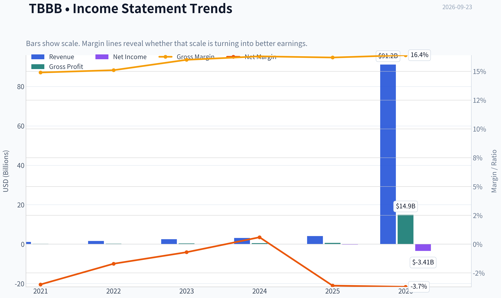

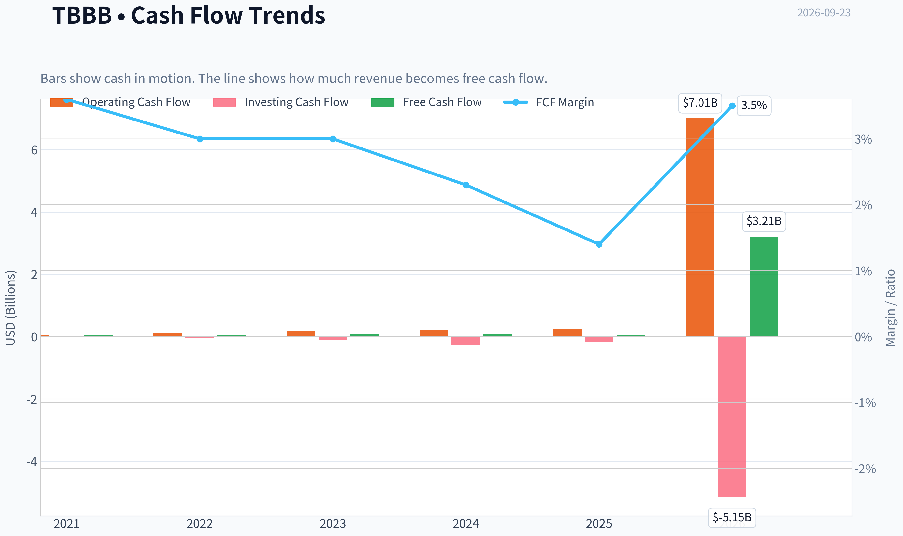

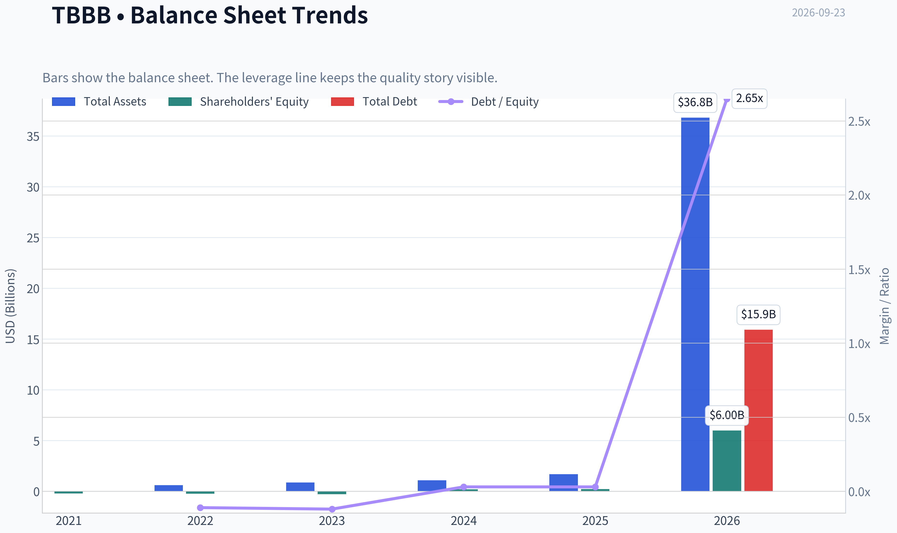

This graph tracks the profitability and return metrics (ROE, ROIC, Margins) of **TBBB** over the past decade, highlighting capital efficiency trends.

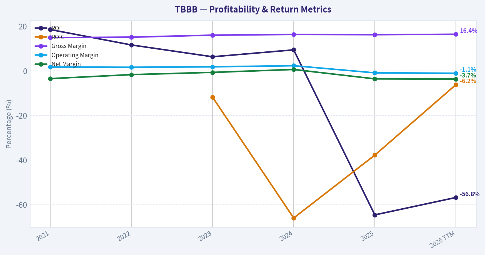

This chart illustrates the financial health of **TBBB** over the last 10 years, mapping cash equivalents and free cash flow against total obligations (Debt).

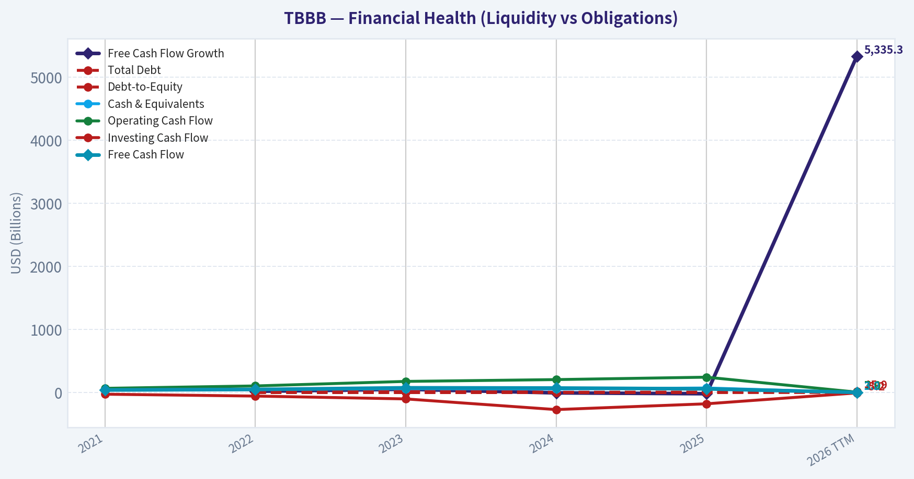

This comparison chart from *Profitability and Operating Performance* stacks current figures against historical benchmarks for **TBBB**, making it easy to see where the company trades relative to its own averages.

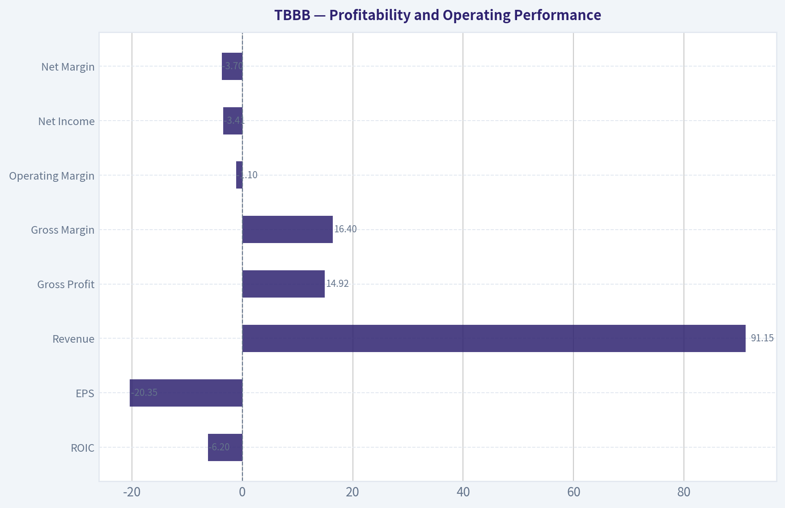

This breakdown chart from <em>Revenue Breakdown</em> shows the proportional composition for **TBBB** - useful for understanding what drives or risks the business.

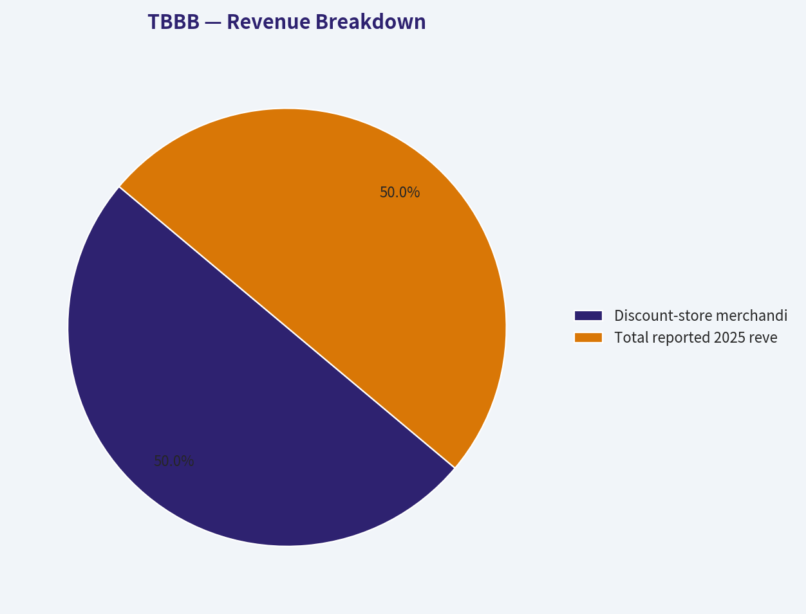

---

### Intrinsic Value Analysis (Buffett)

> *Following Warren Buffett's value investing philosophy: Circle of Competence, Economic Moat, Management Quality, and Margin of Safety.*

#### Intrinsic Value Snapshot

Price is what you pay. Intrinsic value is what the business may be worth based on the cash it can create for owners over time. We show a range, not one magic number.

- Current Price: $51.73
- Value Range (conservative to optimistic across both DCF methods): $-57.29 to $804.41

##### Owner Earnings (Buffett Method)
- Net Income: $-148,137,052.07
- Depreciation & Amortization: $1,899,144,000.00
- Capital Expenditures: $-185,144,148.17
- Working Capital Changes: $934,408,000.00
- Owner Earnings: $631,454,799.76

##### Intrinsic Value
###### Buffett Method
Uses owner earnings. Stricter, and usually more conservative.
- Conservative: $-57.29
- Average: $-57.29
- Optimistic: $-57.29
- Discount Rate: 10.0%

###### Cash Flow Method
Uses free cash flow. Better for companies spending heavily today to grow tomorrow.
- Conservative: $131.15
- Average: $358.85
- Optimistic: $804.41
- Discount Rate: 10.0%

ANALYST STANCE: **AVOID**

#### Executive Summary

BBB Foods operates a simple Mexican discount-grocery model: it opens small-format stores, sells essential goods at low prices, and grows primarily by adding locations. Revenue growth is impressive at 29.2% year over year, but the investment case is weakened by a 16.2% gross margin, negative ROE, very low free-cash-flow yield, and a valuation that requires approximately 26.4% annual growth for ten years.

The business may become a strong long-term retailer, but today the market price already discounts an exceptional outcome. This is not a Gate 5 solvency hard-avoid: the available evidence does not establish both deteriorating cash flows and a solvency red line. The investment is nevertheless unattractive because quality, profitability, and valuation do not yet provide an adequate margin of safety.

#### Financial Snapshot

| Metric | TBBB |
|---|---:|
| Share price | $52.00 |
| Market capitalization | $6.24 billion |
| Implied shares outstanding | Approximately 120 million |
| Revenue growth, year over year | 29.2% |
| Gross margin | 16.2% |
| ROE | -64.6% |
| FCF yield | 0.9% |
| Implied trailing FCF | Approximately $56 million |
| Current ratio | 0.62x |
| Headline intrinsic value | $155.82 |
| Owner Earnings / FCF / FCFF model values | -$57.29 / $358.85 / $155.82 |
| Reverse-DCF price-implied growth | Approximately 26.4% annually for 10 years |

**Key Takeaways:** TBBB is growing rapidly, but growth has not yet translated into attractive shareholder returns. A 0.9% FCF yield means the company produces only about $56 million of annual free cash flow against a $6.24 billion market value. The headline intrinsic-value estimate is highly dependent on the valuation method, with Owner Earnings producing a negative result and the reverse DCF requiring heroic growth.

#### Factor Scorecard

| Factor | Score | Assessment |
|---|---:|---|
| 1. Circle of competence and simplicity | 4/5 | Easy-to-understand discount grocery model with a visible store-expansion strategy |
| 2. Durable competitive advantage | 3/5 | Scale, purchasing power, low prices, and growing store density; moat remains narrow |
| 3. Management and capital allocation | 3/5 | Strong expansion orientation, but long-term evidence of per-share value creation is still developing |
| 4. Industry structure | 3/5 | Large, competitive grocery market; scale helps, but margins are structurally thin |
| Gate 5: Quality/solvency floor | Not tripped | No confirmed combination of worsening fundamentals and interest coverage below 1x or equivalent distress |

**Key Takeaways:** TBBB scores well on simplicity and growth but only moderately on moat, management evidence, and industry structure. The company is not financially distressed based on the available information, so the decision is driven by economics and valuation rather than a solvency emergency.

#### Moat Analysis

**Intangible assets and brand:** The company's low-price positioning may create customer recognition, but discount grocery brands generally have less pricing power than premium consumer brands. A 10% price increase would likely risk customer traffic and volume, particularly among price-sensitive consumers. The 16.2% gross margin also indicates limited room for error.

**Switching costs:** Customer switching costs are minimal. Shoppers can easily visit another grocery chain, local market, or convenience store. Store proximity and habit provide some practical stickiness, but not the contractual or technological captivity associated with software platforms.

**Cost advantage:** TBBB may be building a structural cost advantage through purchasing scale, standardized stores, efficient labor deployment, and dense distribution. However, the advantage must be demonstrated through sustained operating-margin expansion and superior returns on invested capital. Current negative ROE and low FCF conversion do not yet prove that the cost advantage is durable.

**Network effects:** Traditional network effects are limited. More stores may improve procurement, brand awareness, and logistics density, but each new store also requires capital and execution. This is an operating-scale advantage rather than a powerful self-reinforcing network effect.

**Moat rating:** Narrow, with potential to widen if store density, procurement scale, and returns on new stores improve materially.

#### Management Quality and Capital Allocation

Management appears focused on rapid store rollout and market penetration, which is rational if new locations consistently earn high returns. The central capital-allocation question is whether each dollar reinvested produces more than a dollar of long-term per-share value.

The available financial profile does not yet demonstrate that conclusively:

- ROE is negative at -64.6%.
- FCF yield is only 0.9%.
- Owner Earnings are negative under the supplied model.
- The business requires substantial reinvestment to support expansion.
- Recent insider selling, including a director liquidating her reported direct position, is a negative signal but not decisive evidence of poor governance.
- Large institutional holders Stanley Druckenmiller and Steve Cohen both reduced positions in the latest reported quarter. These filings are not a thesis by themselves, but they do not provide supportive ownership evidence.

Management merits a middle score until profitability, free-cash-flow generation, and returns on incremental stores become more established.

#### Financial Summary

| Indicator | Current Evidence | Buffett Interpretation |
|---|---:|---|
| Revenue growth | 29.2% year over year | Strong demand and substantial expansion runway |
| Gross margin | 16.2% | Thin-margin retail economics; execution matters greatly |
| Net profitability | Not supported by positive ROE | Growth has not yet produced attractive accounting returns |
| ROE | -64.6% | Currently poor; not a sign of a mature compounder |
| Free-cash-flow yield | 0.9% | Market price is high relative to present cash generation |
| Current ratio | 0.62x | Thin liquidity, though retail models can operate with efficient working capital |
| Price-to-earnings | N/A | Earnings are not a useful valuation anchor at present |
| Price-to-sales, approximate | 3.3x | Elevated for a low-margin grocery retailer |

**Key Takeaways:** TBBB's strongest financial attribute is revenue growth, while its weakest attributes are profitability and cash generation. The combination of thin gross margins and aggressive expansion creates meaningful execution risk: modest store-level underperformance or cost inflation could materially reduce intrinsic value.

#### Owner Earnings Calculation

The Buffett-style framework is:

> Owner Earnings = Net Income + Depreciation and Amortization - Maintenance Capital Expenditure - Working-Capital Investment

The supplied valuation pack produces the following Owner Earnings-based intrinsic value:

| Owner Earnings Item | Assessment |
|---|---|
| Net income | Not yet a dependable positive earnings base |
| Depreciation and amortization | Added back in the calculation |
| Maintenance capital expenditure | Difficult to separate from growth capital expenditure |
| Working-capital investment | Significant consideration during rapid expansion |
| Resulting Owner Earnings valuation | -$57.29 per share |

**Key Takeaways:** The Owner Earnings method is unfavorable because reported profitability and cash generation do not yet cover the economic cost of maintaining and expanding the store base. The key diligence item is separating maintenance capital expenditure from growth capital expenditure; even using the more favorable FCF model, the current valuation remains demanding.

#### Three-Scenario DCF Valuation

| Scenario | Method | Estimated Value per Share | Interpretation |
|---|---|---:|---|
| A. No growth | Owner Earnings-based, 10% discount rate | -$57.29 | Negative current owner earnings produce no valuation support |
| B. GDP growth | FCF-based perpetuity, approximately 3% growth and 10% discount rate | Approximately $6.65 | Current FCF supports only a small fraction of the market price |
| C. Historical/high-growth case | Damodaran FCFF model using growth and cyclical normalization assumptions | $155.82 | Attractive only if exceptional growth and normalized economics are achieved |
| Cross-check | FCF-based model | $358.85 | Highly sensitive to assumptions and likely reflects aggressive long-term reinvestment economics |

**Key Takeaways:** The valuation range is exceptionally wide because TBBB is a high-growth retailer with immature cash economics. Conservative cash-flow methods imply values far below $52, while the optimistic FCFF case requires substantial future improvement. The analysis should not rely on the $155.82 headline value without first proving durable margins and high returns on new stores.

#### Margin of Safety Analysis

At $52 per share:

- Against the $155.82 headline FCFF value, the implied margin of safety is approximately 66.8%.
- Against the Owner Earnings estimate of negative $57.29, there is no margin of safety.
- Against the conservative FCF perpetuity value of approximately $6.65, the shares appear substantially overvalued.
- The reverse DCF requires approximately 26.4% annual growth for ten years.

For a genuinely wide-moat, high-ROIC compounder, a 10% to 15% margin of safety could be sufficient. TBBB has not yet earned that classification. Its current economics are better described as a promising but unproven narrow-moat retailer, which warrants a substantially larger margin of safety. The price-implied growth rate is too demanding relative to the company's current profitability.

#### Final Buffett Scorecard

| Criterion | Weight | Score | Weighted Contribution |
|---|---:|---:|---:|
| Moat width and durability | 25% | 3.0/5 | 0.75 |
| Valuation and margin of safety | 20% | 2.0/5 | 0.40 |
| Capital returns: ROIC versus WACC | 15% | 2.0/5 | 0.30 |
| Business understanding and predictability | 12% | 4.0/5 | 0.48 |
| Management quality and capital allocation | 12% | 3.0/5 | 0.36 |
| Reinvestment runway | 8% | 4.0/5 | 0.32 |
| Balance-sheet strength | 4% | 2.5/5 | 0.10 |
| Industry structure | 4% | 3.0/5 | 0.12 |
| **Total** | **100%** |  | **2.83/5** |

**Key Takeaways:** TBBB's attractive growth runway and simple business model are outweighed by weak current returns, thin margins, and an aggressive valuation. The final score of 2.83 falls in the AVOID range, not because the business is necessarily poor, but because the price assumes that future execution will be exceptional.

#### Investment Stance

**AVOID - Moderate conviction.**

TBBB is worth monitoring as a potential discount-retail compounder, particularly if it demonstrates:

1. Sustained positive free cash flow after expansion spending.
2. Rising store-level and company-wide operating margins.
3. ROIC comfortably above its cost of capital.
4. Evidence that new stores can be opened without continually consuming disproportionate capital.
5. A valuation that reflects a more ordinary growth trajectory rather than 26% annual growth for a decade.

At $52, the stock offers an unfavorable combination of high expectations and unproven owner earnings. A materially lower price, or clear evidence of durable high returns on incremental stores, would be required before reconsideration.
#### Valuation Bridge

This bridge places the current market price beside each intrinsic value lens so readers can see whether upside depends on one method or shows up across several methods.

| Scenario | Intrinsic Value / Share |
| --- | ---: |
| Buffett Method | $-57.29 |
| Cash Flow Method | $358.85 |
| Damodaran Method | $155.82 |
| Current Price | $51.73 |

#### Key Takeaways

If one method is far above the others, the upside case depends on a specific modelling assumption. When several methods cluster together, the valuation story is more robust.

#### Valuation Visuals

This comparison chart from *Latest Earnings Snapshot* stacks current figures against historical benchmarks for **TBBB**, making it easy to see where the company trades relative to its own averages.

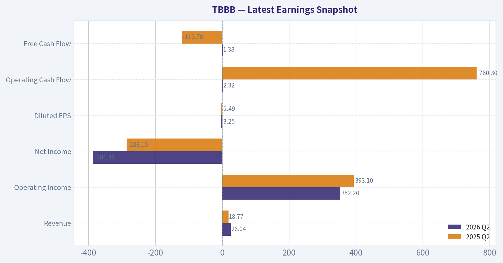

This comparison chart from *Balance Sheet and Financial Strength* stacks current figures against historical benchmarks for **TBBB**, making it easy to see where the company trades relative to its own averages.

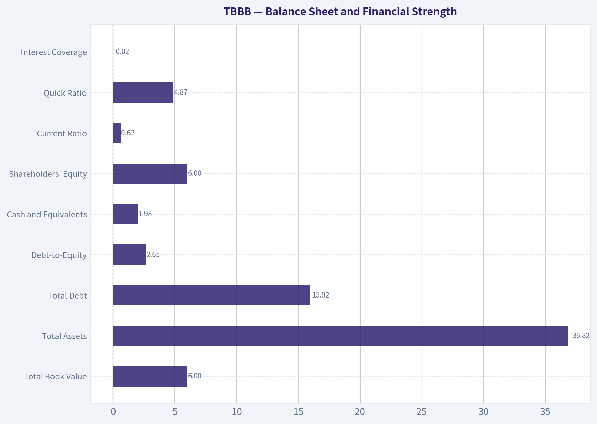

This comparison chart from *Cash Flow and Capital Allocation* stacks current figures against historical benchmarks for **TBBB**, making it easy to see where the company trades relative to its own averages.

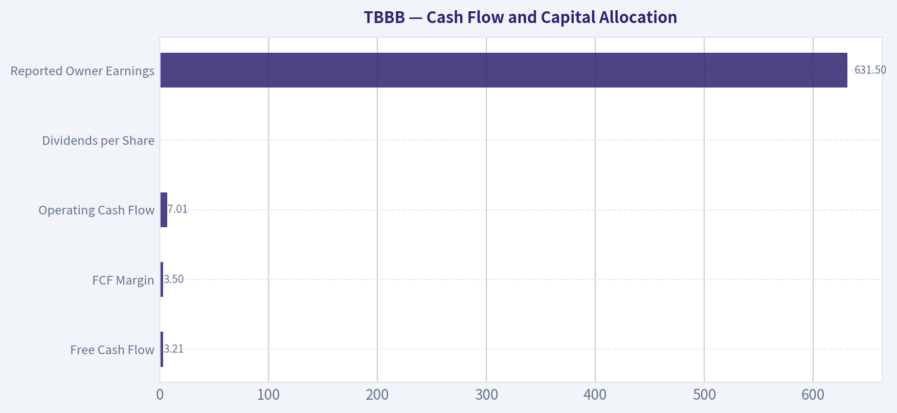

This comparison chart from *Valuation Assessment* stacks current figures against historical benchmarks for **TBBB**, making it easy to see where the company trades relative to its own averages.

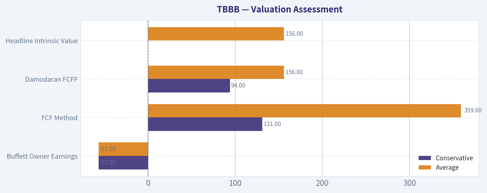

---

### Trend & Growth Analysis (Lynch/Druckenmiller/Fisher)

> *Following Peter Lynch's GARP, Stanley Druckenmiller's macro-aware approach, and Philip Fisher's scuttlebutt methodology.*

ANALYST STANCE: **WATCH**

#### 1. Lynch Classification

**Fast Grower, but execution-sensitive.** TBBB's 29.2% year-over-year revenue growth places it in Lynch's fast-grower category. However, negative ROE, low free-cash-flow yield, and a weak current ratio make this a growth-at-risk situation rather than a clean GARP opportunity.

#### 2. The Story in Three Bullets

- **BBB Foods operates Tiendas 3B**, a hard-discount grocery chain serving price-sensitive Mexican consumers.
- The company can grow by opening stores in underpenetrated regions, increasing private-label penetration, and building purchasing and distribution scale.
- The key question is whether rapid store expansion creates attractive **store-level returns and eventual free cash flow**, rather than merely increasing revenue.

#### 3. Operating Snapshot

| Metric | Latest available |
|---|---:|
| Share price | $52 |
| Market capitalization | $6.24 billion |
| Revenue growth, year over year | 29.2% |
| Gross margin | 16.2% |
| ROE | -64.6% |
| FCF yield | 0.9% |
| Current ratio | 0.62 |
| Headline intrinsic value | $155.82 |
| Reverse-DCF implied growth | Approximately 26.4% annually for 10 years |

**Key Takeaways:** TBBB has excellent headline growth, but the quality of returns and liquidity is currently weak. The market price appears to require sustained growth close to the company's current 29.2% rate, leaving limited room for disappointment. The $155.82 intrinsic-value figure should be treated cautiously because the underlying models have a very wide range.

#### 4. TAM and the 10x Test

TBBB's relevant opportunity is not simply "Mexican grocery." It is the addressable market for small-format, low-price, convenience-oriented grocery stores across Mexico, including spending currently captured by traditional neighborhood shops, supermarkets, convenience stores, and informal retail.

| TAM question | Assessment |
|---|---|
| Current business | Mexican hard-discount grocery and convenience retail |
| Secular drivers | Inflation sensitivity, consumer trade-down, formalization, private label, urbanization |
| Market growth | Likely moderate-to-high, but exact current TAM requires company filings and industry data |
| 10x revenue test | Plausibly passes if TBBB remains a regional/national challenger rather than a dominant national grocer |
| Main constraint | Store saturation, cannibalization, logistics, labor, rent, and competitor response |

**Key Takeaways:** The runway appears substantial because TBBB is competing for a fragmented and underpenetrated retail opportunity. A tenfold revenue increase is theoretically possible without requiring dominant national market share, but this depends on maintaining attractive store economics as the network becomes larger. The investment case is therefore more about execution and market share gains than about a guaranteed high-growth TAM.

#### 5. Revenue Growth Trend

| Indicator | Signal | Interpretation |
|---|---|---|
| Revenue growth | 29.2% year over year | Fast-grower territory |
| Acceleration | Not established | Only one current growth figure is available |
| Same-store sales | Not available | Essential for separating organic growth from new-store growth |
| Store openings | Not available | Needed to assess expansion intensity |
| Revenue quality | Incomplete | Growth may combine new stores, pricing, and volume |
| Free-cash-flow conversion | Weakly indicated | FCF yield only 0.9% |

**Key Takeaways:** The available revenue figure is strong, but there is insufficient evidence to call it an accelerating inflection. Investors need same-store sales, sales per store, store openings, and real volume growth. Low free-cash-flow yield suggests that a significant portion of growth is still being reinvested in expansion.

#### 6. Unit Economics and Profitability

| Metric | Result | Assessment |
|---|---:|---|
| Gross margin | 16.2% | Thin, consistent with discount retail |
| FCF yield | 0.9% | Low relative to the growth required |
| ROE | -64.6% | Currently unattractive; potentially distorted by IPO capital and expansion |
| Current ratio | 0.62 | Liquidity warning; retail working-capital structure may partly explain it |
| LTV/CAC | Not applicable/not disclosed | Store-based retailer rather than subscription software |
| NRR | Not applicable | Not a SaaS business |
| Rule of 40 | Not meaningful | FCF margin is not supplied and the business is not subscription-based |

**Key Takeaways:** TBBB's economics must be evaluated through mature-store returns, payback periods, sales density, inventory turns, and incremental ROIC rather than LTV/CAC or NRR. The thin gross margin leaves little room for pricing, shrinkage, logistics, or labor mistakes. A 0.62 current ratio deserves close monitoring, particularly if expansion requires external financing or supplier support.

#### 7. Inflection Point Assessment

| Potential inflection | Current evidence | View |
|---|---|---|
| Product or format cycle | Discount format continues expanding | Positive, but not new |
| Market-share inflection | 29.2% revenue growth | Possible, not proven |
| Margin inflection | No evidence supplied | Unconfirmed |
| TAM inflection | Consumer trade-down and formalization | Structurally favorable |
| Cash-flow inflection | FCF yield only 0.9% | Not yet visible |
| Competitive inflection | No major competitor failure identified | Neutral |

**Key Takeaways:** The strongest confirmed signal is revenue growth, while the more valuable margin and cash-flow inflections remain unproven. TBBB could become more attractive if same-store sales remain strong while distribution and corporate costs decline as a percentage of revenue. Until then, this is a promising expansion story rather than a demonstrated earnings inflection.

#### 8. Macro Setup

TBBB benefits from several favorable secular forces:

- Mexican consumers' sensitivity to food inflation and household budgets.
- Trade-down toward lower-priced formats and private-label products.
- Formalization of fragmented retail.
- Long-term urban and population growth.
- Potential operating leverage from greater store density.

The main macro risks are:

- Mexican peso volatility for U.S.-dollar investors.
- Inflation in wages, rent, transportation, and food inputs.
- Higher interest rates increasing the cost of expansion.
- Consumer weakness reducing discretionary basket size.
- Aggressive responses from Walmart de México, OXXO, regional grocers, and traditional stores.

**Macro assessment: Moderately favorable.** The secular trend is supportive, but retail margins are vulnerable to inflation and competitive price cuts.

#### 9. Fisher 15-Point Assessment

Scoring is preliminary because the available data does not include management interviews, detailed filings, or supplier and competitor checks.

| Fisher criterion | Score / 5 | Comment |
|---|---:|---|
| Market potential | 4 | Large, fragmented Mexican retail opportunity |
| New-product determination | 3 | Format and private-label expansion are relevant |
| R&D effectiveness | 2 | Limited traditional R&D relevance and disclosure |
| Sales organization | 4 | Store rollout and local-market execution appear important strengths |
| Worthwhile profit margin | 2 | Gross margin is only 16.2% |
| Improving margins | 3 | Potential operating leverage, not yet demonstrated |
| Labor/personnel relations | 3 | Insufficient evidence |
| Executive relations | 3 | Insufficient evidence |
| Management depth | 3 | Expansion requires scalable operating leadership |
| Cost analysis/accounting | 3 | Needs verification, especially leases and store economics |
| Outstanding competitive aspects | 4 | Density, private label, purchasing, and format replication |
| Long-range profit outlook | 4 | Attractive if store returns remain strong |
| Dilution risk | 2 | ESOP shelf registration and growth funding require monitoring |
| Management candor | 3 | Incomplete evidence |
| Management integrity | 3 | No conclusive negative evidence; one director's sale is not determinative |
| **Total** | **46 / 75** | **Average, with significant data gaps** |

**Key Takeaways:** TBBB scores well on market potential and the scalability of its retail format, but poorly on currently demonstrated profitability and dilution visibility. The preliminary 46 out of 75 score is not a condemnation; it primarily reflects incomplete evidence and the early-stage nature of the public-company story. Stronger disclosure on returns, margins, and capital allocation could materially improve the score.

#### 10. Valuation Analysis

| Valuation method | Result | Interpretation |
|---|---:|---|
| P/E and PEG | Not available; P/E is N/A | Earnings-based valuation cannot be used reliably |
| P/S | Not calculable from supplied data | Requires trailing revenue |
| FCF yield | 0.9% | Expensive on current cash generation |
| Headline intrinsic value | $155.82 | Highly model-sensitive |
| Model range | Owner earnings: -$57.29; FCF: $358.85; FCFF: $155.82 | Extremely wide dispersion |
| Reverse DCF | 26.4% annual growth for 10 years implied | High expectations embedded in price |

**Key Takeaways:** The valuation is not clearly attractive despite the apparent intrinsic-value upside. The large spread between negative $57.29 and $358.85 across models demonstrates that assumptions about reinvestment, working capital, and future margins dominate the conclusion. At $52, the stock appears to require prolonged high growth and successful conversion of expansion into cash flow.

A practical scenario framework, pending verified revenue and share-count data, is:

- **Bear case:** Growth decelerates toward the mid-teens, margins remain thin, and the valuation multiple compresses.
- **Base case:** Revenue grows roughly 20% to 25%, store economics remain healthy, and margins improve gradually.
- **Bull case:** Revenue remains near 30%, store density creates operating leverage, and TBBB becomes a scaled Mexican discount-retail leader.

#### 11. Growth Investor Scorecard

| Criterion | Weight | Score / 5 | Weighted contribution |
|---|---:|---:|---:|
| Lynch story | 10% | 4.0 | 0.40 |
| TAM and runway | 20% | 4.0 | 0.80 |
| Revenue growth | 20% | 4.0 | 0.80 |
| Unit economics | 15% | 2.5 | 0.38 |
| Competitive position | 10% | 3.5 | 0.35 |
| Management quality | 10% | 3.0 | 0.30 |
| Macro setup | 5% | 3.5 | 0.18 |
| Profitability path | 5% | 2.5 | 0.13 |
| Valuation | 5% | 2.5 | 0.13 |
| **Total** | **100%** | - | **3.46 / 5** |

**Key Takeaways:** TBBB's growth story and runway score well, but unit economics, profitability, and valuation prevent a high-conviction rating. The 3.46 score is just below the 3.5 threshold for an Advocate classification. This supports a Watch stance until the company proves that growth is translating into improving margins and free cash flow.

#### 12. Position Size Stance

**Suggested stance: Watch position or small starter position only.**

- Suitable for investors comfortable with emerging-market retail and execution risk.
- Avoid making it a concentrated position until cash generation and liquidity improve.
- A provisional position would be limited to approximately **0.5% to 1.5% of a diversified portfolio**, with increases dependent on confirmed operating improvements.

Stanley Druckenmiller trimmed his position by 6.7% and Steve Cohen trimmed by 20.3% as of June 30, 2026. These are lagged 13F snapshots, not sell signals, but they do not provide confirmation for aggressive sizing.

#### 13. Key Catalysts and Risks

| Catalysts | Risks |
|---|---|
| Revenue growth remains above 25% | Growth decelerates as store base expands |
| Positive same-store sales excluding inflation | New stores cannibalize existing stores |
| Improving gross and EBITDA margins | Persistent thin margins and price competition |
| Strong new-store payback and incremental ROIC | Expansion consumes cash and requires dilution |
| Better current liquidity and FCF conversion | Current ratio remains weak |
| Private-label penetration increases | Supply-chain, labor, rent, or food-cost inflation |
| Store density improves purchasing and logistics | Walmart, OXXO, and other competitors respond aggressively |

**Key Takeaways:** The most important catalysts are not merely more store openings, but better economics per store and visible operating leverage. The principal risks are valuation compression, dilution, weak liquidity, and the possibility that revenue growth masks poor returns on new capital. The thesis should be upgraded only if growth remains strong while margins, cash flow, and store payback improve together.

#### Bottom Line

TBBB is a credible **fast-growth Mexican discount-retail story with possible ten-bagger characteristics**, but it is not yet a demonstrated ten-bagger investment. The runway is attractive, yet the current price already discounts demanding growth, while cash generation and balance-sheet liquidity remain concerns.

**Recommendation: WATCH.** Upgrade toward Advocate if the next several reports show sustained same-store growth, improving margins, strong new-store returns, and materially better free-cash-flow conversion.

---

### Market Technical Analysis

ANALYST STANCE: **WATCH**

#### TBBB technical analysis - as of 2026-09-23

The latest Yahoo Finance data contain a data-quality issue: September 22 has volume but no open, high, low, or close, and the indicator feed repeats the September 21 values for September 23. Therefore, the most reliable reference point is the latest valid close of **$52.47 on September 21, 2026**. The analysis below treats that close as the effective current price and flags the missing September 22 price data.

#### Indicator selection

The selected indicators are:

- **close_10_ema** - short-term momentum and tactical trend direction.
- **close_50_sma** - medium-term trend and dynamic support.
- **close_200_sma** - long-term trend confirmation.
- **macd** - underlying momentum and trend-cycle direction.
- **macds** - confirmation of MACD crossovers.
- **rsi** - momentum strength and overbought risk.
- **atr** - volatility-adjusted risk and stop placement.
- **vwma** - price trend confirmation using trading volume.

This combination covers short-, medium-, and long-term trend, momentum, volume confirmation, and risk. The MACD and MACD Signal are intentionally included together because their usefulness comes from the relationship between the two; adding the MACD histogram would be more redundant in this context.

#### Price and trend structure

TBBB remains in a clearly constructive long-term trend. The latest valid close of **$52.47** is approximately:

- **2.8% above the 10 EMA at $51.03**
- **14.3% above the 50 SMA at $45.91**
- **35.2% above the 200 SMA at $38.80**

All three moving averages are rising, and the shorter averages remain above the longer averages. This is a strong bullish alignment rather than a merely neutral configuration. The 50 SMA has advanced from approximately **$42.61 on August 24 to $45.91**, while the 200 SMA has risen from approximately **$36.83 to $38.80** over the same period. That gradual upward slope indicates that the broader advance is supported by an improving trend base.

The short-term picture is also positive, but price has moved far enough above its medium-term averages that pullbacks should be expected. The 10 EMA rose from roughly **$48.01 on August 24 to $51.03**, showing that short-term price momentum remains favorable. However, the distance between the price and the 50 SMA is substantial, so a normal consolidation could occur without damaging the underlying trend.

#### Momentum: bullish structure, but cooling beneath the surface

The RSI is approximately **66.9**, which is strong and close to the conventional 70 overbought threshold. This indicates that buyers retain control, but the stock is no longer in a low-risk, early-stage momentum zone. RSI previously reached the mid-70s in late August, then cooled into the high-50s and low-60s before recovering. That reset was constructive because it reduced some excess without forcing a major trend breakdown.

The recent RSI recovery toward 67 confirms renewed buying interest. Still, a move above 70 accompanied by a failure to extend price gains would raise the probability of short-term profit-taking. Conversely, if RSI holds above 60 while price consolidates near its highs, that would suggest a healthy bullish pause rather than a reversal.

MACD provides a more cautious message. The MACD line is positive at approximately **1.51**, but it remains below its signal line at approximately **1.62**. The bearish MACD crossover appears to have developed around mid-September, after MACD declined from approximately **1.90 to 1.51** while the signal line declined more slowly. This means momentum has weakened from its late-August and early-September peak, even though the broader trend remains bullish.

The key distinction is that MACD is still materially above zero. This generally indicates that the longer-running trend remains positive, while the negative MACD-versus-signal relationship warns that the latest advance is losing some acceleration. A renewed bullish crossover would improve the setup; continued deterioration toward zero would indicate a more meaningful trend transition.

#### Volume confirmation

The reliable VWMA readings through September 21 show a rising volume-weighted trend level, reaching approximately **$50.71**. The latest valid price is about **3.5% above that level**, suggesting that the stock is trading above the zone where recent volume has concentrated.

This is supportive, but the VWMA reading reported for September 23, approximately **$47.03**, is inconsistent with the surrounding values and is likely distorted by the missing September 22 price data. It should not be used as a current support estimate. More dependable volume evidence came during the August breakout, when TBBB experienced unusually heavy turnover while advancing sharply. That type of volume expansion strengthens the credibility of the breakout, although it also creates the possibility of elevated volatility and fast profit-taking.

#### Volatility and risk management

ATR has declined from roughly **$1.94 on August 24 to $1.45 on September 23**, with the latest reliable nearby reading around **$1.56 on September 21**. The decline indicates that volatility has moderated from the August breakout period. Even so, an ATR near $1.5 represents roughly **3% of the stock price**, so TBBB remains capable of producing sizeable daily moves.

For tactical risk control, a stop placed only a few cents below the market would likely be vulnerable to ordinary noise. A volatility-aware approach would allow roughly one ATR below an entry, adjusted for the trader's time horizon and risk tolerance. A close below the 10 EMA would be an early warning of short-term weakness, while a sustained break below the 50 SMA would be much more significant for the medium-term trend.

#### Important price levels

The immediate resistance zone is the recent high near **$52.98**, followed by the psychological **$53 level**. A decisive close above that area, ideally supported by stronger-than-average volume, would signal that the recent consolidation is resolving upward.

Near-term support is clustered around **$51.00 to $51.30**, close to the 10 EMA and recent trading activity. A deeper but still potentially normal retracement could target **$49.30 to $50.00**, where recent closes and the volume-weighted trend area provide a broader support zone. The 50 SMA near **$45.91** is the more important medium-term reference; a decline toward it would represent a substantial correction, but not necessarily a complete long-term trend failure.

#### Trading interpretation

The evidence favors a **bullish primary trend with weakening short-term momentum**, rather than a confirmed bearish reversal. Trend-following investors may continue to hold positions while price remains above the rising 10 EMA and 50 SMA. However, initiating a large new position directly beneath the $53 resistance area offers less favorable risk-reward than waiting for either a volume-confirmed breakout or a controlled pullback toward short-term support.

A bullish continuation case would require price to clear roughly **$53**, MACD to turn back above its signal line, and RSI to remain strong without forming a clear bearish divergence. A cautious case would involve price moving sideways between approximately **$50 and $53**, allowing the moving averages to catch up. A more defensive signal would be a close below the 10 EMA followed by failure to reclaim it, especially if MACD continues falling and RSI drops below the low-50s.

| Indicator | Latest reliable reading | Interpretation | Trader relevance |
|---|---:|---|---|
| Latest valid close | $52.47 on Sep. 21 | Near recent highs; bullish structure intact | Watch $52.98-$53 resistance |
| 10 EMA | $51.03 | Price remains above short-term trend support | Loss would signal tactical weakness |
| 50 SMA | $45.91 | Rising medium-term trend | Major dynamic support |
| 200 SMA | $38.80 | Strongly rising long-term benchmark | Long-term bias remains bullish |
| MACD | 1.51 | Positive, but declining | Trend remains positive; momentum has cooled |
| MACD Signal | 1.62 | Above MACD line | Bearish crossover remains active |
| RSI | 66.9 | Strong momentum, near overbought territory | Avoid chasing if RSI exceeds 70 without breakout confirmation |
| ATR | About $1.45-$1.56 | Volatility has eased but remains meaningful | Use position sizing and volatility-based stops |
| VWMA | $50.71 on latest reliable date | Price is above recent volume-weighted trend | Supportive, but Sep. 23 reading is data-distorted |

Key Takeaways: TBBB's long-term and medium-term trends are strongly bullish because price is well above rising 50-day and 200-day averages. Short-term momentum has moderated, with MACD below its signal line, while RSI near 67 shows buyers remain active but the stock is approaching an overheated zone. Traders should watch for either a volume-backed break above $53 or a pullback toward $50-$51; the missing September 22 price data makes confirmation of the latest move especially important.

---

### Options Market Analysis

> *Reading options flow - put/call ratios, IV skew, and unusual activity - to gauge institutional positioning and event-driven risk.*

ANALYST STANCE: **BULLISH**

#### Scope and Data Quality

The analysis uses TBBB options data as of September 23, 2026, covering the October 16, November 20, and December 18 expirations. The available chain is relatively thin, with limited trading volume and no contracts meeting the supplied unusual-activity threshold. Strike-level data, current stock price, and explicit out-of-the-money skew data were not provided, so conclusions on gamma walls and ITM/ATM/OTM positioning are limited.

#### Put/Call Ratio Analysis

| Expiration | Days to Expiry | Call OI | Put OI | Put/Call OI Ratio | Call Volume | Put Volume | Put/Call Volume Ratio |
|---|---:|---:|---:|---:|---:|---:|---:|
| October 16, 2026 | 23 | 1,321 | 866 | 0.66 | 42 | 10 | 0.24 |
| November 20, 2026 | 58 | 554 | 198 | 0.36 | 87 | 26 | 0.30 |
| December 18, 2026 | 86 | 497 | 500 | 1.01 | 148 | 110 | 0.74 |
| **Total** | - | **2,372** | **1,564** | **0.66** | **277** | **146** | **0.53** |

**Key Takeaways:** TBBB's aggregate put/call open-interest ratio of 0.66 is modestly more bullish than the approximately 0.70 neutral baseline. The volume ratio of 0.53 also favors calls, although most of that call-heavy positioning is concentrated in the October and November expirations. December is comparatively balanced, with a 1.01 put/call OI ratio.

#### Implied Volatility Assessment

| Expiration | Call ATM IV | Put ATM IV | IV Differential | Interpretation |
|---|---:|---:|---:|---|
| October 16, 2026 | 35.4% | 36.1% | Put IV +0.7 points | Essentially balanced, slight downside premium |
| November 20, 2026 | 45.4% | 40.1% | Call IV +5.3 points | Noticeable upside-volatility premium |
| December 18, 2026 | 42.5% | 38.2% | Call IV +4.3 points | Moderate upside-volatility premium |

**Key Takeaways:** Near-term October implied volatility is moderate and nearly balanced between calls and puts, suggesting limited immediate downside fear. November and December show higher call IV than put IV, which is consistent with demand for upside exposure or upside speculation. Explicit OTM put-versus-call skew was not supplied, so this is an ATM-based assessment rather than a complete volatility-skew analysis.

No confirmed earnings, product launch, or other catalyst was provided in the data. The higher November and December IV levels may reflect a future event premium, but that cannot be attributed to a specific catalyst from the available information.

#### Unusual Options Activity

| Finding | Result |
|---|---|
| Contracts with volume greater than 5x open interest | None |
| Fresh directional flow identified | None confirmed |
| Smart-money versus retail distinction | Not determinable |
| Largest reported call volume | December 18: 148 contracts |
| Largest reported put volume | December 18: 110 contracts |

**Key Takeaways:** There are no contracts showing sufficiently unusual volume relative to open interest to identify fresh institutional directional bets. The largest activity is in December, but its volume is not extreme relative to open interest and is relatively balanced between calls and puts. Therefore, the bullish signal comes from broader positioning rather than a specific high-conviction options sweep.

#### Open Interest Concentration and Potential Gamma Levels

| Expiration | Total Call OI | Total Put OI | Combined OI | Relative Concentration |
|---|---:|---:|---:|---|
| October 16, 2026 | 1,321 | 866 | 2,187 | Highest |
| November 20, 2026 | 554 | 198 | 752 | Lowest |
| December 18, 2026 | 497 | 500 | 997 | Intermediate |

**Key Takeaways:** October 16 has the largest aggregate open interest and is the most likely expiration to influence near-term trading behavior. However, strike-level open interest was not supplied, so specific call walls, put walls, maximum-pain levels, and price-pinning zones cannot be identified. The concentration should therefore be treated as an expiration-level signal, not a precise price target.

#### Overall Options Sentiment

| Signal Component | Assessment |
|---|---|
| Put/call OI | Bullish-leaning at 0.66 |
| Put/call volume | Bullish-leaning at 0.53 |
| Near-term IV | Moderate and mostly balanced |
| Forward IV structure | Upside premium in November and December |
| Unusual activity | None detected |
| Liquidity and confidence | Thin-to-moderate; confidence reduced |
| **Overall signal** | **BULLISH, low-to-moderate conviction** |

**Key Takeaways:** The primary bullish driver is the combination of call-heavy open interest and call-dominant volume, particularly in the October and November expirations. The upside IV premium in later expirations reinforces the view that traders are willing to pay for upside exposure. However, the absence of unusual activity, relatively light volume, and lack of strike-level data materially reduce conviction.

#### Final Summary

| Category | Conclusion |
|---|---|
| Put/Call Ratio | Bullish-leaning: 0.66 OI ratio and 0.53 volume ratio, both below the 0.70 neutral baseline |
| IV Level | Moderate near term; higher in November and December |
| Skew Direction | Slight downside premium in October ATM IV; upside premium in November and December; full OTM skew unavailable |
| Unusual Activity | None; no contracts exceeded 5x volume-to-open-interest |
| Overall Signal | **BULLISH**, but with low-to-moderate confidence due to thin activity and incomplete strike-level data |

**Key Takeaways:** TBBB options positioning favors a bullish interpretation, led by call-heavy open interest and trading volume. The market does not show a strong fresh institutional bet, so this is a directional lean rather than a high-conviction signal. Thin liquidity and unavailable strike-level information warrant confirmation from price action and fundamental catalysts.

---

## Research Team Commentary

> *The Research Manager synthesizes the Bull vs Bear debate into action-free commentary. This is a pre-risk view, not the final stance.*

Core Takeaway

TBBB has a credible long-term growth concept, but not yet a demonstrated high-quality business or an adequate margin of safety at $51.73. Rapid revenue growth and a stable gross margin suggest genuine product-market fit for Tiendas 3B, and purchasing scale, private label, and distribution density could eventually create a durable cost advantage. However, the investment still depends on unproven mature-store returns, operating leverage, and cash conversion.

The bear wins the valuation portion of the debate, but not strongly enough to justify a hard AVOID. A 0.9% free-cash-flow yield, negative owner earnings, and deeply negative reported returns show that the current price relies heavily on future improvement. Yet the underlying valuation data contain significant currency, period, lease, and capex inconsistencies, while the reverse DCF is especially unstable when owner earnings begin below zero. That prevents a confident conclusion that the shares are clearly overvalued.

The appropriate decision is to wait for operating proof rather than either dismiss the franchise or pay in advance for exceptional execution.

Rationale

The strongest bull argument is the combination of approximately 29.2% revenue growth and a gross margin holding near 16.2%. Revenue reportedly expanded from roughly $1.14 billion in 2021 to $4.08 billion in 2025. That scale of growth indicates more than a temporary consumer experiment. The hard-discount format appears to resonate with Mexico's price-sensitive customers, and the market may support a long runway as organized discount retail gains share from fragmented traditional channels.

The potential moat is economically sensible. More stores can increase purchasing power, support private-label penetration, improve distribution density, and lower unit costs. Sharing those efficiencies with consumers could reinforce traffic and inventory turnover. In hard discounting, the moat does not need to be switching costs; it can be a structurally lower cost per basket that competitors find expensive to match.

Stable gross margin during rapid expansion is also encouraging. It suggests TBBB is not obviously buying sales through progressively worse merchandise economics. If mature stores are profitable and new stores have short payback periods, poor consolidated returns could partly reflect temporary opening costs and investments in distribution capacity.

But the bull case remains a hypothesis about future quality. No supplied evidence establishes mature-store cash margins, cohort returns, sales productivity, payback periods, or positive incremental ROIC. Those are not secondary details-they are the central variables needed to distinguish productive reinvestment from value-destructive expansion. Revenue growth alone cannot make that distinction.

The strongest bear argument is therefore not simply that reported ROE is negative 64.6% or ROA is negative 8.7%. Those figures may be distorted by a small equity base, growth investment, and accounting treatment. The stronger point is that TBBB has not yet shown what investors receive for each incremental peso committed to stores, leases, inventory, and logistics.

The current cash-flow valuation provides little protection. A reported 0.9% FCF yield means nearly all value resides in future cash generation rather than present distributable earnings. Negative owner earnings reinforce that concern, although the supplied owner-earnings calculation needs to be checked for capex sign conventions and currency consistency. The reported reverse DCF requirement of approximately 24.5% annual owner-earnings growth for ten years signals demanding expectations, but it should not be treated as precise because owner earnings are currently negative and the underlying inputs are unreliable.

Even so, the economic message survives: TBBB must move from weak cash generation to positive cash generation and then sustain rapid per-share growth while funding expansion. Revenue growth near 29% makes that possible, but not comfortably probable. Grocery margins are thin, and modest deterioration in wages, shrink, rent, transportation costs, or regional sales density could materially delay the transition.

Under a quality-scaled margin-of-safety framework, TBBB does not yet deserve the modest discount required for a proven wide-moat compounder. It is an emerging franchise with uncertain incremental returns, so it should require a much larger discount or substantially better operating evidence. The current price does not clearly provide either.

Management deserves credit for focusing on the core format rather than unrelated acquisitions, but capital-allocation quality remains unproven. Store count and revenue are not sufficient scorecards. Management should be judged on cohort returns, lease-adjusted cash generation, dilution, and its willingness to slow expansion when marginal returns deteriorate.

The options analyst's bullish stance does not change the long-term conclusion. The chain is thin, contains no qualifying unusual activity, and lacks enough strike-level information to establish meaningful positioning. Likewise, the market handoff names relevant moving averages but provides no actual price relationships or volume evidence. There is therefore no decision-grade tactical signal in this debate. Prior experience teaches that a strong breakout can justify limited tactical participation even when fundamentals are unsettled, but no such confirmed setup has been supplied here. It would also be a mistake to treat TBBB's earlier price appreciation as validation of its moat or intrinsic value.

The balanced takeaway is that the bull has established a credible opportunity, while the bear has established that investors are being asked to underwrite too much of the outcome before the decisive evidence is available. This is not an obviously broken company, and the unreliable valuation inputs argue against a categorical AVOID. It is instead a high-potential but low-visibility business that has not yet earned a Buffett-style allocation.

Monitoring Plan

Over the next one to four quarters, the first priority is to separate store expansion from underlying demand. Track same-store sales, transactions, average ticket, and the contribution from inflation. The thesis strengthens if positive comparable sales accompany rapid openings; it weakens if nearly all growth comes from adding stores while mature-store traffic stagnates.

Second, demand cohort economics. Management should disclose or provide enough information to estimate store-level breakeven timing, mature-store EBITDA or contribution margins, cash investment per opening, and payback periods. Consistently short paybacks and incremental returns comfortably above the cost of capital would be the most important evidence supporting an upgrade.

Third, monitor the path from gross profit to cash generation. Gross margin should remain broadly stable while labor, occupancy, distribution, and corporate costs fall as percentages of sales. Positive operating leverage without aggressive supplier financing would materially strengthen the thesis. Continued losses despite growth and stable gross margin would suggest that the cost structure is less scalable than the bull expects.

Fourth, examine normalized free cash flow. Maintenance capex must be separated from new-store and distribution expansion, but growth capex should only receive favorable treatment if cohort returns justify it. Watch operating cash flow after normalizing supplier-payment timing, inventory builds, and other working-capital benefits.

Fifth, track private-label penetration, inventory turns, shrink, stockouts, sales per square meter, store closures, and distribution cost per case. Rising private-label penetration and inventory productivity would support the cost-moat thesis. Higher shrink, worsening availability, or declining sales density would indicate that expansion is straining the operating system.

Sixth, reconcile financial strength. Investors need consistent reporting for funded debt, lease liabilities, fixed-charge coverage, maturities, liquidity, and currencies. Leverage rising faster than mature-store cash generation would weaken the thesis materially.

Finally, reassess valuation after the operating data improve. An upgrade to ADVOCATE would require either demonstrably attractive incremental ROIC and normalized owner earnings or a meaningful price decline that creates a margin of safety under conservative assumptions. A downgrade to AVOID would be justified by deteriorating comparable sales, lengthening store paybacks, gross-margin compression, persistent negative cash generation, or weakening lease-adjusted solvency.

For now, the franchise deserves continued study, not full portfolio commitment.

WATCH

---

## Value Investing Team Commentary

> *The Investor translates the research view into an investment thesis before risk review. This is still not the final stance.*

### Investment Commentary

TBBB offers an understandable and potentially substantial growth story: Tiendas 3B is expanding a hard-discount grocery format aimed at Mexico's price-sensitive consumers. Revenue growth of approximately 29.2%, alongside a gross margin holding near 16.2%, indicates genuine customer acceptance. The opportunity is credible-but credibility is not yet proof of durable earning power.

### Business quality: promising, not demonstrated

The potential competitive advantage is a structurally low-cost retail system. Greater store density could improve distribution economics, while larger purchasing volumes and increased private-label penetration could lower merchandise costs. If those savings are reinvested in lower prices, TBBB could create a reinforcing cycle of traffic, purchasing scale, and further cost advantages.

That is a legitimate moat hypothesis, but it remains a hypothesis. Hard-discount grocery is operationally demanding and generally lacks meaningful customer switching costs. Its advantage must be rebuilt every day through price, availability, inventory turnover, logistics, and disciplined store operations. Scale creates a moat only when each new store strengthens the network and earns an attractive return on incremental capital.

The missing evidence is therefore decisive:

- Mature-store sales and cash margins
- Cash investment and payback period per new store
- Incremental return on invested capital
- Comparable-store traffic and transaction growth
- Store closures and cohort performance
- Lease-adjusted free cash flow
- Distribution productivity and shrink trends

Without these figures, rapid expansion could represent either productive reinvestment or growth that consumes capital without creating proportional value.

### Financial economics and valuation

Reported ROE of negative 64.6% and ROA of negative 8.7% are poor, although neither should be interpreted mechanically. A small equity base, lease accounting, expansion expenses, and front-loaded infrastructure investment may distort reported returns. ROIC would be more informative, but it is unavailable.

The more important issue is cash conversion. At a price of $51.73, the reported free-cash-flow yield is only 0.9%, and modeled owner earnings are negative. Investors are consequently paying primarily for cash flows that have not yet emerged. That is acceptable only when the future economics are unusually visible; in TBBB's case, they are not.

The reported reverse-DCF requirement of roughly 24.5% annual owner-earnings growth for ten years should not be treated as precise because a reverse DCF becomes unstable when the starting cash flow is negative. Nevertheless, its economic message is useful: the current valuation appears to require a large transition from cash consumption to meaningful cash generation, followed by sustained growth.

Because the underlying financial data contain possible currency, period, capex, and lease inconsistencies, a defensible intrinsic-value estimate cannot be established from the supplied information. Unreliable data are not a bullish argument merely because they prevent proof of overvaluation. Uncertainty should generally lower the price an investor is willing to pay.

TBBB also does not yet qualify for the modest 10-15% margin of safety appropriate for a proven, wide-moat compounder. As an emerging, low-margin franchise with unproven incremental returns, it should require either materially stronger operating evidence or a substantially larger valuation discount-closer to what one would demand from an average-quality or execution-dependent business.

### Management and capital allocation

Management appears appropriately focused on its core retail format rather than unrelated acquisitions. But capital allocation cannot be judged by store openings or revenue growth alone. Management should be evaluated on:

- Incremental returns from each store cohort
- Dilution and stock-based compensation
- Lease commitments and fixed-charge coverage
- Distribution-center returns
- Working-capital discipline
- Willingness to slow expansion if marginal returns deteriorate

A good growth retailer does not maximize its store count. It maximizes long-term per-share value while preserving financial resilience.

### Selective contrarian view

The optimistic market narrative likely emphasizes Mexico's underpenetrated discount-retail opportunity, rapid store expansion, and the prospect of operating leverage. The bullish options stance may reinforce that enthusiasm, but the chain is thin, contains no qualifying unusual activity, and lacks sufficient strike-level evidence. It provides no reliable long-term signal.

The contrarian opportunity would arise if investors become excessively focused on current losses while store-cohort data quietly demonstrate short paybacks, attractive mature-store margins, and improving lease-adjusted cash generation. In that scenario, temporary pessimism could offer an attractive entry before consolidated accounting results fully reflect the economics.

The opposite contrarian lesson is equally important: rapid revenue growth can create unjustified enthusiasm when investors overlook the capital required to produce it. A retailer growing sales near 30% can still destroy value if stores have weak sales density, lengthy payback periods, or persistent dependence on leases, supplier financing, and external capital. Presently, that is the larger unresolved risk.

Recent price strength or bullish sentiment should not be confused with business validation. Prior breakout behavior may support a tactical trade when confirmed by price and volume, but it does not establish a moat, normalized cash flow, or intrinsic value. No decision-grade technical setup has been supplied here, and the ten-year ownership decision should be based on store economics rather than momentum.

### What would justify an upgrade?

An **ADVOCATE** stance would require several of the following:

1. Positive comparable-store transaction growth, not merely inflation or new openings.
2. Consistently attractive store-level payback periods and incremental ROIC.
3. Stable gross margin with labor, occupancy, and distribution expenses declining as percentages of revenue.
4. Positive normalized free cash flow after adjusting working-capital timing.
5. Improving inventory turns, private-label penetration, shrink, and sales density.
6. Manageable lease-adjusted leverage without recurring dilution.
7. A valuation that offers an appropriate discount to conservatively estimated intrinsic value.

Conversely, deteriorating comparable sales, gross-margin compression, lengthening paybacks, rising store closures, persistent negative cash flow, or weakening fixed-charge coverage would support an **AVOID** conclusion.

**ANALYST STANCE: WATCH.** TBBB has a credible growth runway and the beginnings of a possible scale-based cost advantage, but it has not demonstrated durable incremental returns or satisfactory cash conversion. At $51.73, the 0.9% FCF yield and negative owner earnings leave little current valuation protection. Continue monitoring the franchise, but wait for proven store economics, normalized free cash flow, or a substantially better price before committing long-term capital.

---

## Deep Values Commentary

> *The Risk Management Team debates and the Risk Judge provides the final action-free verdict. This section determines the final ADVOCATE / WATCH / AVOID stance.*

#### Final Stance Scorecard

This scorecard converts the final research view into a weighted decision frame. It does not replace the narrative judgement, but it makes the main drivers of the verdict easier to scan.

| Criterion | Score | Weight | Commentary |
| --- | ---: | ---: | --- |
| Business Quality | 1.75 | 30% | High returns, profitability, and Piotroski health support durability. |
| Valuation Support | 3.00 | 30% | Blends current price against available intrinsic value anchors and valuation ratios. |
| Financial Strength | 3.67 | 20% | Balance-sheet resilience reflects leverage and liquidity staying within safe ranges. |
| Growth Durability | 2.33 | 20% | Recent revenue, earnings, and free cash flow growth indicate how durable expansion looks. |
| TOTAL / FINAL STANCE | 2.62 | 100% | WATCH |

#### Key Takeaways

The weighted score lands at **2.62 / 5.0**, while the final stance remains **WATCH**. This is useful as a quick calibration aid rather than a mechanical signal.

#### Risk Summary

Higher scores indicate more risk pressure. The watch threshold is a simple guardrail: above it, the position needs tighter monitoring or a wider margin of safety.

| Dimension | Current Score | Watch Threshold | Commentary |
| --- | ---: | ---: | --- |
| Business Quality | 4.25 | 3.00 | High returns, profitability, and Piotroski health support durability. |
| Valuation Support | 3.00 | 3.00 | Blends current price against available intrinsic value anchors and valuation ratios. |
| Financial Strength | 2.33 | 3.00 | Balance-sheet resilience reflects leverage and liquidity staying within safe ranges. |
| Growth Durability | 3.67 | 3.00 | Recent revenue, earnings, and free cash flow growth indicate how durable expansion looks. |

#### Key Takeaways

This view helps readers separate *where* the risk sits: valuation, business quality, balance sheet, or growth durability. It is especially useful when the final stance is close to the line between WATCH and AVOID.
