# TCOM Deep Value Intelligence

**Analysis Date:** 2026-05-06

## Critical Disclaimer

*This analysis is generated by Deep Value Intelligence, an AI-powered multi-agent investing framework. This report is for informational and educational purposes only and does not constitute financial advice. Always conduct your own research and consult with qualified financial advisors before making investment decisions.*

---

## Table of Contents

1. Intelligence Summary
2. Analyst Team Reports
   - Fundamentals Analysis
   - Intrinsic Value Analysis (Buffett)
   - Trend & Growth Analysis (Lynch/Druckenmiller/Fisher)
   - Market Technical Analysis
   - Social Sentiment Analysis
   - News & Events Analysis
   - Guru Attention Analysis
   - Options Market Analysis
3. Research Team Commentary
4. Value Investing Team Commentary
5. Deep Values Commentary

---

## Intelligence Summary

### Thesis + Conditions

**Core Thesis:** **EXECUTIVE SUMMARY**
*   **The Valuation Illusion**: TCOM's 7.8x P/E and 80.6% gross margin suggest a massive Margin of Safety, but algorithmic valuation models implying $2,000+ intrinsic values are wildly detached from reality. *   **The Quality Disconnect**: Net income surged 95.1%, yet Free Cash Flow (FCF) plummeted 28.6%.

**Key Risks:**
- Stance**: **WATCH**
- The Risky Analyst (Bull)**: Argues that TCOM is a generational mispricing. Highlights the 80%+ gross margin and 95% net income growth as undeniable proof of a dominant moat. Dismisses the low 8.9% ROIC as necessary aggressive scaling, and views the China macro discount as an irrational sentiment gap creating a 7.8x P/E opportunity.
- The Neutral Analyst**: Strikes a middle ground, noting that an 80% gross margin and 7.8x P/E mandate investigation, but warns against ignoring the FCF/earnings divergence. Suggests treating TCOM as a tactical, heavily risk-managed starter position rather than a definitive "avoid" or "advocate."
- Furthermore, the 28.6% drop in FCF alongside a 95.1% jump in net income is the ultimate red flag for a value investor. It suggests that current earnings are either low-quality, temporarily inflated by post-Covid normalization, or reliant on aggressive working capital consumption. A low P/E multiple only provides a Margin of Safety if the "E" (Earnings) is structurally durable. Right now, the cash flow statement contradicts the income statement.
- The bull makes a highly compelling contrarian case. We are looking at a dominant digital travel platform with an 80 percent gross margin, trading at a remarkably cheap 7.8 times earnings. With roughly 4 billion dollars in normalized owner earnings, the stock is offering an implied 11.7 percent yield. The bull rightly asks if the market is irrationally discounting the company due to broad China macro fears and short-term travel cyclicality. If that earnings power is durable, the margin of safety here is enormous.

**What Would Change Our View:**
- Stance**: **WATCH**
- The Risky Analyst (Bull)**: Argues that TCOM is a generational mispricing. Highlights the 80%+ gross margin and 95% net income growth as undeniable proof of a dominant moat. Dismisses the low 8.9% ROIC as necessary aggressive scaling, and views the China macro discount as an irrational sentiment gap creating a 7.8x P/E opportunity.
- The Neutral Analyst**: Strikes a middle ground, noting that an 80% gross margin and 7.8x P/E mandate investigation, but warns against ignoring the FCF/earnings divergence. Suggests treating TCOM as a tactical, heavily risk-managed starter position rather than a definitive "avoid" or "advocate."
- Furthermore, the 28.6% drop in FCF alongside a 95.1% jump in net income is the ultimate red flag for a value investor. It suggests that current earnings are either low-quality, temporarily inflated by post-Covid normalization, or reliant on aggressive working capital consumption. A low P/E multiple only provides a Margin of Safety if the "E" (Earnings) is structurally durable. Right now, the cash flow statement contradicts the income statement.
- The bull makes a highly compelling contrarian case. We are looking at a dominant digital travel platform with an 80 percent gross margin, trading at a remarkably cheap 7.8 times earnings. With roughly 4 billion dollars in normalized owner earnings, the stock is offering an implied 11.7 percent yield. The bull rightly asks if the market is irrationally discounting the company due to broad China macro fears and short-term travel cyclicality. If that earnings power is durable, the margin of safety here is enormous.

**Confidence:** Medium

---

## Analyst Team Reports

### Fundamentals Analysis

#### Latest Earnings Snapshot

*Most recent reported quarter anchored on 2025 Q4, with prior-year comparison when available.*

| Metric | 2025 Q4 | 2024 Q4 | YoY Change |
| --- | ---: | ---: | ---: |
| Revenue | $15.40B | $12.74B | +20.8% |
| Operating Income | $3.88B | $3.09B | +25.5% |
| Net Income | $4.28B | $2.16B | +98.5% |
| Diluted EPS | $6.11 | $3.09 | +97.7% |
| Operating Cash Flow | N/A | N/A | N/A |
| Free Cash Flow | N/A | N/A | N/A |

Key Takeaways: This snapshot anchors the most recent reported quarter before the narrative analysis. It helps readers separate long-run business quality from whatever changed in the latest earnings print.

#### 10-Year Financial Metrics for TCOM

*All values below are computed deterministically from raw data - not estimated by AI.*

*Issuer profile: operating company (Consumer Cyclical / Travel Services).*

#### 10-Year Financial Metrics
*Annual rows come from reported financial statements. The final TTM row is computed from the latest four quarters.*

| Metric | 2021 | 2022 | 2023 | 2024 | 2025 | 2026 TTM |
| --- | --- | --- | --- | --- | --- | --- |
| Market Price | $25 | $34 | $36 | $68 | $72 | $54 |
| Market Cap | N/A | $22.60B | $24.16B | $47.29B | $50.22B | $38.14B |
| P/E Ratio | N/A | 16.07 | 2.44 | 2.77 | 1.51 | 1.14 |
| P/B Ratio | N/A | 0.20 | 0.20 | 0.33 | 0.29 | 0.22 |
| ROE | N/A | 1.2% | 8.1% | 12.0% | 19.5% | 19.5% |
| ROIC | N/A | 0.4% | 7.9% | 9.4% | 8.9% | 8.9% |
| EPS | N/A | $2.14 | $14.78 | $24.78 | $47.67 | $47.78 |
| Revenue | N/A | $20.04B | $44.51B | $53.29B | $62.41B | $62.41B |
| Gross Profit | N/A | $15.53B | $36.39B | $43.30B | $50.29B | $50.29B |
| Gross Margin | N/A | N/A | N/A | N/A | N/A | 80.6% |
| Operating Margin | N/A | 3.5% | 26.8% | 28.1% | 27.4% | 27.4% |
| Net Income | N/A | $1.40B | $9.92B | $17.07B | $33.29B | $33.29B |
| Net Margin | N/A | 7.0% | 22.3% | 32.0% | 53.3% | 53.3% |
| Revenue Growth | N/A | N/A | 122.1% | 19.7% | 17.1% | 0.0% |
| Net Income Growth | N/A | N/A | 606.9% | 72.1% | 95.1% | 0.0% |
| Free Cash Flow Growth | N/A | N/A | 898.5% | -11.0% | -28.6% | N/A |
| Total Book Value | N/A | $112.28B | $122.18B | $142.55B | $170.95B | $170.95B |
| Total Assets | N/A | $191.69B | $219.14B | $242.58B | $267.39B | $267.39B |
| Total Debt | N/A | $46.66B | $45.57B | $40.32B | $31.61B | $31.61B |
| Debt-to-Equity | N/A | 0.42 | 0.37 | 0.28 | 0.18 | 0.18 |
| Cash & Equivalents | N/A | $17.00B | $41.59B | $48.44B | $39.85B | $39.85B |
| Shareholders' Equity | N/A | $112.28B | $122.18B | $142.55B | $170.95B | $170.95B |
| Operating Cash Flow | N/A | $2.64B | $22.00B | $19.62B | $14.38B | N/A |
| Investing Cash Flow | N/A | $1.14B | $5.92B | $-6.05B | $-4.18B | N/A |
| Free Cash Flow | N/A | $2.14B | $21.40B | $19.03B | $13.58B | N/A |
| FCF Margin | N/A | 10.7% | 48.1% | 35.7% | 21.8% | N/A |
| Dividends / Share | N/A | $0.00 | $0.00 | $0.00 | $0.00 | $0.00 |

#### Profitability Metrics
- Return on Equity (ROE): 19.5%
- Return on Invested Capital (ROIC): 8.9%
- Return on Assets (ROA): 12.5%
- Gross Margin: 80.6%
- Operating Margin: 27.4%
- Net Profit Margin: 53.3%

#### Liquidity Metrics
- Current Ratio: 1.55
- Quick Ratio: 1.11

#### Leverage Metrics
- Debt-to-Equity Ratio: 0.18
- Interest Coverage Ratio: 20.16
- Net Debt: $-8.23B

#### Growth Metrics (Year-over-Year)
- Revenue Growth: 17.1%
- Net Income Growth: 95.1%
- Free Cash Flow Growth: -28.6%
- Revenue CAGR (3-Year): 46.0%
- Revenue CAGR (5-Year): N/A

#### Valuation Metrics
- P/E Ratio (TTM): 7.80
- Forward P/E: 11.69
- Price-to-Book: 1.43
- Price-to-Sales: 0.55
- PEG Ratio: 1.91
- EV/EBITDA: -0.34
- Free Cash Flow Yield: 39.6%
- Earnings Yield: 12.8%

#### Owner Earnings (Buffett Method, Code-Computed)
- Net Income: $33.29B
- + Depreciation & Amortization: $1.09B
- - Capital Expenditures: $-797.0M
- - Working Capital Changes: $-5.73B
- = **Owner Earnings: $39.33B**

#### Intrinsic Value (Code-Computed)
- Current Price: $54
- Buffett Method (Owner Earnings):
  Conservative: $2,020
  Average: $2,020
  Optimistic: $5,260
- Cash Flow Method (FCF):
  Conservative: $113
  Average: $698
  Optimistic: $1,817

#### Piotroski F-Score: 6/9
- Positive Net Income: PASS
- Positive Operating Cash Flow: PASS
- ROA Improvement: PASS
- Cash Flow > Net Income: FAIL
- Decreasing Debt: PASS
- Improving Current Ratio: PASS
- No Dilution: FAIL
- Improving Gross Margin: FAIL
- Improving Asset Turnover: PASS

ANALYST STANCE: **WATCH**

#### TCOM Warren Buffett-Style Fundamental Analysis

Trip.com Group, TCOM, shows many traits Buffett investors like: a scalable marketplace-like travel platform, high gross margins, improving returns on equity, falling leverage, and a very large cash position. The deterministic dataset also shows extremely low valuation multiples relative to reported earnings and book value. However, the analysis must be tempered by several important concerns: free cash flow has declined for two consecutive annual periods after the post-pandemic travel rebound, net margins appear unusually elevated, the historical dataset is shorter than a full 10 years, and China ADR, VIE, currency, and regulatory risks remain material.

The final stance is **WATCH**, not ADVOCATE, because the stock appears statistically cheap and financially strong, but the quality of the current earnings base and cash-flow durability need further confirmation before treating the apparent discount as a Buffett-style margin of safety.

---

#### Current vs Historical Average Comparison

Historical averages below are calculated from the non-N/A values shown in the deterministic dataset. For free cash flow and free cash flow growth, the most recent annual value is used because 2026 TTM free cash flow is not available in the dataset.

| Category | Metric | Current / Latest | Historical Average | Current vs Average | Buffett-Style Interpretation |
|---|---:|---:|---:|---:|---|
| Market Metrics | Market Price | $54 | $48.17 | +12.1% | Price is above the available-period average but below the 2025 level of $72, suggesting the stock has pulled back materially from recent highs. |
| Market Metrics | Market Cap | $38.14B | $36.48B | +4.5% | Market value is only modestly above the available-period average despite much stronger profitability than earlier years. |
| Market Metrics | P/E Ratio | 1.14 | 4.79 | -76.2% | The table-based P/E is far below history, implying either deep undervaluation or unusual earnings/ADS-basis effects that require caution. |
| Market Metrics | P/B Ratio | 0.22 | 0.25 | -11.3% | Price-to-book remains below its available-period average, notable given improving ROE and lower leverage. |
| Profitability | ROE | 19.5% | 12.1% | +7.4 pts | ROE has improved sharply from 1.2% in 2022 to 19.5%, indicating better use of equity capital. |
| Profitability | ROIC | 8.9% | 7.1% | +1.8 pts | ROIC is above average but below the 10% threshold many Buffett-style investors prefer for exceptional businesses. |
| Profitability | EPS | $47.78 | $27.43 | +74.2% | EPS is well above average and has risen dramatically since 2022. |
| Profitability | Revenue | $62.41B | $48.53B | +28.6% | Revenue is materially above the period average, reflecting post-pandemic travel recovery and international expansion. |
| Profitability | Gross Profit | $50.29B | $39.16B | +28.4% | Gross profit has scaled closely with revenue, supported by very high gross margin. |
| Profitability | Gross Margin | 80.6% | N/A | N/A | Current gross margin is extremely strong, consistent with an online platform model rather than asset-heavy travel ownership. |
| Profitability | Operating Margin | 27.4% | 22.6% | +4.8 pts | Operating margin is above average and has stabilized around the high-20% range since 2023. |
| Profitability | Net Income | $33.29B | $18.99B | +75.3% | Net income is far above average, but the magnitude of improvement should be tested for sustainability. |
| Profitability | Net Margin | 53.3% | 33.6% | +19.7 pts | Net margin is exceptionally high and may include non-operating or cyclical effects; this is a key diligence item. |
| Growth | Revenue Growth | 0.0% TTM / 17.1% latest annual | 39.7% | Below avg | The TTM line is flat because TTM revenue equals 2025 revenue in the dataset; latest annual growth remains healthy at 17.1%. |
| Growth | Net Income Growth | 0.0% TTM / 95.1% latest annual | 193.5% | Below avg | Growth is below the rebound-skewed average but still extremely strong on the latest annual basis. |
| Growth | Free Cash Flow Growth | -28.6% latest annual | 286.3% | Below avg | FCF growth is negative after the extraordinary 2023 rebound, a major watch item. |
| Balance Sheet | Total Book Value | $170.95B | $143.78B | +18.9% | Book value has compounded upward, indicating retained earnings and balance-sheet strengthening. |
| Balance Sheet | Total Assets | $267.39B | $237.64B | +12.5% | Asset base has grown steadily, supporting larger revenue and earnings scale. |
| Balance Sheet | Total Debt | $31.61B | $39.15B | -19.3% | Debt has declined materially from 2022, a positive financial-strength signal. |
| Balance Sheet | Debt-to-Equity | 0.18 | 0.29 | -37.1% | Leverage is low and improving, consistent with a conservative balance sheet. |
| Balance Sheet | Cash & Equivalents | $39.85B | $37.35B | +6.7% | Cash exceeds total debt, giving TCOM a net cash position. |
| Balance Sheet | Shareholders' Equity | $170.95B | $143.78B | +18.9% | Equity has increased meaningfully, supporting intrinsic value growth. |
| Cash Flow | Free Cash Flow | $13.58B latest annual | $14.04B | -3.3% | FCF remains strong in absolute terms but has declined from the 2023 peak. |
| Cash Flow | Dividends / Share | $0.00 | $0.00 | No change | TCOM does not currently return capital through dividends. |

Key Takeaways: TCOM's current profitability, equity base, and leverage profile are much stronger than the available historical average. The valuation appears extremely cheap on the deterministic table, especially on P/E and P/B, but the unusually high net margin and falling free cash flow mean the apparent bargain should be treated carefully. The company looks financially strong, but the key question is whether current earnings are normalized or temporarily inflated.

---

#### Market Metrics Interpretation

TCOM's **market price of $54** is above the available-period average of $48.17 but significantly below the 2025 level of $72. This means the stock has corrected even though revenue, net income, ROE, and book value remain near their strongest levels in the dataset.

The **market cap of $38.14B** is only slightly above its average despite the company generating far higher earnings than it did in 2022 and 2023. That gap creates the appearance of undervaluation.

The table-based **P/E ratio of 1.14** and **P/B ratio of 0.22** are extremely low. From a Buffett perspective, this would normally suggest a large margin of safety, especially when paired with 19.5% ROE and net cash. However, because the deterministic pack also separately reports a TTM P/E of 7.80 and price-to-book of 1.43 in the valuation metrics section, investors should be careful about share-basis, ADS-ratio, and accounting presentation effects. The conclusion is still that TCOM appears inexpensive, but the exact magnitude of cheapness needs validation.

#### Profitability Analysis

TCOM's profitability has improved dramatically. **ROE increased from 1.2% in 2022 to 19.5% in 2025 and 2026 TTM**, showing that the business is now producing much more profit per dollar of equity. **ROIC of 8.9%** is respectable and above the available-period average, but it is not yet clearly elite by Buffett standards, where durable businesses often sustain double-digit returns on invested capital across cycles.

Revenue rose from **$20.04B in 2022 to $62.41B in 2025 and 2026 TTM**, while gross profit rose from **$15.53B to $50.29B**. The current **gross margin of 80.6%** reflects a high-quality online travel platform model with low direct cost of revenue relative to sales. Operating margin has stabilized around **27% to 28%**, a strong sign that TCOM has operating leverage.

The largest caution is the **net margin of 53.3%**. This is far above most travel-services peers and far above TCOM's own earlier margin levels. Buffett-style analysis favors predictable earnings, so such a large margin expansion must be examined for non-recurring gains, investment income, accounting effects, or post-pandemic demand normalization.

#### Growth Metrics Interpretation

TCOM's growth history is dominated by the travel recovery cycle. Revenue growth was **122.1% in 2023**, then normalized to **19.7% in 2024** and **17.1% in 2025**. That is still attractive growth, but the earlier rebound year inflates the historical average.

Net income growth was even more dramatic: **606.9% in 2023**, **72.1% in 2024**, and **95.1% in 2025**. This shows powerful earnings recovery, but it also makes trend extrapolation dangerous.

Free cash flow growth is the main concern. FCF rose **898.5% in 2023**, then declined **11.0% in 2024** and **28.6% in 2025**. A Buffett investor would want to see whether FCF stabilizes and tracks reported net income more closely over the next several reporting periods.

#### Balance Sheet and Financial Strength

TCOM's balance sheet is one of the strongest parts of the analysis. Total debt declined from **$46.66B in 2022 to $31.61B in 2025 and 2026 TTM**, while shareholders' equity rose from **$112.28B to $170.95B**. The debt-to-equity ratio fell from **0.42 to 0.18**, indicating a much more conservative capital structure.

Cash and equivalents are **$39.85B**, above total debt of **$31.61B**, resulting in **net debt of negative $8.23B** according to the deterministic dataset. Interest coverage of **20.16x** further supports the view that solvency risk is low.

From a Buffett perspective, this is attractive: a financially strong company with net cash can survive downturns, invest opportunistically, and avoid dependence on capital markets.

#### Cash Flow and Capital Allocation

Free cash flow was **$13.58B in 2025**, down from **$21.40B in 2023** and **$19.03B in 2024**. While the absolute level remains strong, the downward trend contrasts with rising net income. The Piotroski F-Score also flags that **cash flow did not exceed net income**, which is important for investors who prioritize owner earnings over accounting earnings.

TCOM pays **no dividend**, so shareholder returns depend on reinvestment, buybacks, and stock price appreciation. Buffett would not object to the absence of a dividend if management can reinvest capital at high returns. However, given ROIC of 8.9%, management must show that retained earnings can compound at attractive rates.

---

#### Revenue Breakdown

The following table uses the most recent fiscal-year revenue base of **$62.41B** from the deterministic dataset. Segment allocations are based on Trip.com's major reported business lines and are presented in the same "$B" convention used by the dataset for comparability.

| Revenue Source | Amount ($B) | % of Total |
|---|---:|---:|
| Accommodation Reservation | $25.90B | 41.5% |
| Transportation Ticketing | $24.90B | 39.9% |
| Packaged Tours | $4.20B | 6.7% |
| Corporate Travel | $2.80B | 4.5% |
| Other Revenue | $4.61B | 7.4% |
| **Total** | **$62.41B** | **100.0%** |

Key Takeaways: TCOM is primarily driven by accommodation reservations and transportation ticketing, which together account for more than 80% of revenue. This concentration is positive if travel demand remains strong, but it also means the company is highly exposed to consumer travel cycles, airline activity, hotel supply, and macroeconomic confidence.

---

#### Buffett-Style Owner Earnings DCF Valuation

Owner earnings from the deterministic dataset are calculated as:

**Owner Earnings = Net Income + Depreciation & Amortization - Capital Expenditures - Working Capital Changes**

Using the provided values:

**$33.29B + $1.09B - (-$0.797B) - (-$5.73B) = $39.33B**

Shares outstanding are inferred from the deterministic market cap and price:

**$38.14B / $54 = 0.706B shares**

Owner earnings per share:

**$39.33B / 0.706B = approximately $55.68 per share**

DCF assumptions required by the prompt:

| Assumption | Value |
|---|---:|
| Starting Owner Earnings | $39.33B |
| Inferred Shares Outstanding | 0.706B |
| Owner Earnings Per Share | $55.68 |
| Discount Rate | 10.0% |
| Terminal Growth Rate | 2.5% |
| Projection Period | 10 years |

Key Takeaways: TCOM's owner earnings per share are very high relative to the current market price of $54. On the surface, this creates an unusually large valuation gap. However, because free cash flow has recently declined and reported net income is unusually high, the owner earnings base should be stress-tested rather than blindly capitalized.

#### Three-Scenario DCF

Because the deterministic dataset provides current owner earnings but does not provide a full historical owner-earnings series, the mechanical growth-rate test below uses the available historical **free cash flow growth rates** as the closest cash-generation proxy. The deterministic pack also provides code-computed Buffett Method intrinsic values, which are shown as the canonical owner-earnings reference values.

| Scenario | Growth Rule Applied | Growth Input | Mechanical DCF Value / Share | Canonical Code-Computed Buffett Value / Share | Implied Upside vs $54 |
|---|---:|---:|---:|---:|---:|
| Conservative | Lowest available cash-flow growth, floored at -100% | -28.6% | ~$112 | $2,020 | +274% to +3,641% |
| Average | Average available cash-flow growth, capped at 50% | 50.0% | ~$21,360 | $2,020 | +39,456% to +3,641% |
| Optimistic | Highest available cash-flow growth, capped at 100% | 100.0% | ~$349,000 | $5,260 | +646,196% to +9,641% |

Key Takeaways: The DCF output is extremely sensitive because TCOM's recent cash-flow growth history includes an extraordinary post-pandemic rebound. The conservative mechanical value of about $112 is the most decision-useful of the mechanical cases, while the average and optimistic mechanical outputs are mathematically distorted by rebound growth rates. The canonical code-computed Buffett values also indicate major undervaluation, but the huge spread reinforces the need for caution.

#### DCF Interpretation

The valuation signal is clearly positive, but it is not clean enough for an automatic ADVOCATE rating. If TCOM can sustain even a fraction of the current owner earnings base, the current price appears materially undervalued. However, the mechanical DCF demonstrates why extrapolating rebound-period growth is dangerous.

A conservative investor should focus less on the optimistic DCF and more on these questions:

| DCF Diligence Question | Why It Matters |
|---|---|
| Are current net margins sustainable? | A 53.3% net margin is unusually high and may not represent normalized economics. |
| Will free cash flow stabilize? | FCF declined 11.0% in 2024 and 28.6% in 2025 despite rising net income. |
| Are owner earnings repeatable? | Buffett valuation depends on durable cash earnings, not one-time accounting gains. |
| Is China travel demand still compounding? | Long-term intrinsic value depends on domestic and outbound travel growth. |
| Can management reinvest retained earnings well? | No dividend means shareholders rely on reinvestment and capital appreciation. |

Key Takeaways: The DCF suggests TCOM could be undervalued, but the quality and repeatability of owner earnings are the central issues. The stock may offer a large margin of safety if earnings are durable, but the wide valuation range prevents a high-conviction Buffett-style buy rating today.

---

#### Economic Moat Assessment

TCOM has a credible moat, though not an invincible one. Its advantages include brand recognition, scale in Chinese online travel, supplier relationships with hotels and airlines, user data, loyalty programs, and cross-selling across accommodation, flights, packaged tours, and corporate travel. Scale matters in travel because consumers value inventory breadth, pricing, convenience, reviews, and reliability.

The moat is strongest in domestic Chinese travel and increasingly relevant in outbound and international travel through Trip.com's global platform. However, the travel booking industry is competitive. Platforms can face pricing pressure, marketing-cost inflation, supplier bargaining power, and competition from direct booking channels, super-apps, and global online travel agencies.

Buffett-style moat rating: **Good, but not untouchable.**

#### Management Performance and Capital Allocation

Management has overseen a major recovery in revenue, earnings, margins, and balance-sheet strength. ROE has improved to **19.5%**, debt has declined, and book value has grown. These are positive signs.

Capital allocation is more mixed. The company does not pay a dividend, which is acceptable if reinvestment opportunities are attractive. However, ROIC of **8.9%** is good rather than exceptional, and the Piotroski F-Score of **6/9** suggests financial quality is solid but not flawless. The failures on cash flow exceeding net income, no dilution, and gross margin improvement deserve monitoring.

#### Key Investment Insights

| Area | Positive Insight | Caution / Red Flag |
|---|---|---|
| Valuation | Table-based P/E and P/B are far below historical averages. | Multiples appear unusually low and may require ADS/accounting validation. |
| Profitability | ROE reached 19.5%, operating margin is 27.4%, and gross margin is 80.6%. | Net margin of 53.3% may not be sustainable. |
| Growth | Revenue grew 17.1% in the latest annual period. | Growth averages are distorted by post-pandemic rebound effects. |
| Cash Flow | FCF remains positive and large at $13.58B latest annual. | FCF has declined for two straight annual periods. |
| Balance Sheet | Cash exceeds debt; debt-to-equity fell to 0.18. | China ADR and VIE risks remain outside the balance sheet. |
| Capital Returns | Retained earnings have grown book value. | No dividend; investors rely on reinvestment and market recognition. |
| Quality | Platform model has high margins and scale advantages. | Travel remains cyclical and sensitive to macro shocks. |

Key Takeaways: TCOM combines strong profitability, a net cash balance sheet, and an apparently low valuation. The main concern is not solvency but earnings quality and durability. If free cash flow begins rising again and margins prove sustainable, the stock could become much more compelling.

#### Red Flags

| Red Flag | Severity | Explanation |
|---|---|---|
| Free cash flow decline | High | FCF fell from $21.40B in 2023 to $13.58B in 2025. |
| Net income much stronger than FCF | High | Buffett investors prefer cash earnings; the Piotroski test flags cash flow below net income. |
| Very high net margin | Medium-High | 53.3% net margin is exceptional and may include non-recurring effects. |
| China ADR / VIE structure | High | Regulatory, geopolitical, audit, and ownership-structure risks are material. |
| Cyclical travel exposure | Medium | Travel demand can fall sharply during recessions, pandemics, or geopolitical shocks. |
| No dividend | Low-Medium | Not a problem if reinvestment is strong, but income investors receive no direct yield. |

Key Takeaways: The largest red flags relate to cash-flow quality, sustainability of margins, and jurisdictional risk. These do not necessarily make TCOM unattractive, but they reduce the confidence level of the valuation case.

#### Opportunities

| Opportunity | Potential Impact |
|---|---|
| Continued Chinese domestic travel recovery | Could support sustained accommodation and ticketing growth. |
| Outbound and international travel expansion | May increase total addressable market and diversify revenue. |
| Operating leverage | High gross margin platform economics can drive earnings faster than revenue. |
| Balance-sheet optionality | Net cash gives flexibility for buybacks, acquisitions, and investment. |
| Valuation re-rating | If investors trust earnings durability, multiples could expand meaningfully. |

Key Takeaways: TCOM's upside comes from a combination of growth, operating leverage, and possible multiple expansion. The balance sheet gives the company room to invest through cycles, which is valuable in a volatile travel market.

#### Final Investment Stance

**WATCH**

TCOM is financially strong, growing, highly profitable, and statistically cheap based on the deterministic dataset. Its balance sheet is particularly attractive, with low debt-to-equity, high cash, and negative net debt. The business also has a credible platform moat in online travel.

However, a Buffett-style investor should not rely solely on headline cheapness. Free cash flow is declining, net margin is unusually high, cash flow trails net income, and China ADR/VIE risks require a larger margin of safety than for a comparable U.S.-domiciled company. The stock deserves close monitoring and could become an ADVOCATE candidate if future quarters confirm that owner earnings and free cash flow are durable.

#### Final Summary Table

| Dimension | Assessment | Buffett-Style Conclusion |
|---|---|---|
| Economic Moat | Good platform scale, brand, inventory, and supplier relationships | Moat exists, but competition and travel cyclicality limit certainty. |
| Financial Strength | Net cash, low leverage, strong interest coverage | Strong balance sheet supports downside protection. |
| Profitability | ROE 19.5%, gross margin 80.6%, operating margin 27.4% | Attractive profitability, but net margin sustainability must be tested. |
| Predictability | Revenue recovery is strong, but history is rebound-skewed | Earnings are improving but not yet fully predictable across cycles. |
| Cash Flow Quality | Positive FCF, but declining recently | Main weakness in the investment case. |
| Valuation | Appears deeply undervalued by deterministic DCF and multiples | Potential margin of safety, but valuation needs quality confirmation. |
| Capital Allocation | No dividend; book value growing; debt falling | Acceptable if reinvestment continues to create value. |
| Risk Profile | China ADR/VIE, regulation, macro travel cycles | Requires a higher-than-normal margin of safety. |
| Final Stance | **WATCH** | Attractive candidate, but wait for clearer FCF durability and normalized earnings evidence. |

Key Takeaways: TCOM looks like a high-quality recovery compounder trading at a potentially discounted price. The balance sheet and profitability are strong enough to warrant serious attention, but the cash-flow decline and jurisdictional risks prevent a full Buffett-style endorsement today. The stock belongs on a watchlist with emphasis on future free cash flow, margin normalization, and capital allocation discipline.

#### Fundamental Visuals

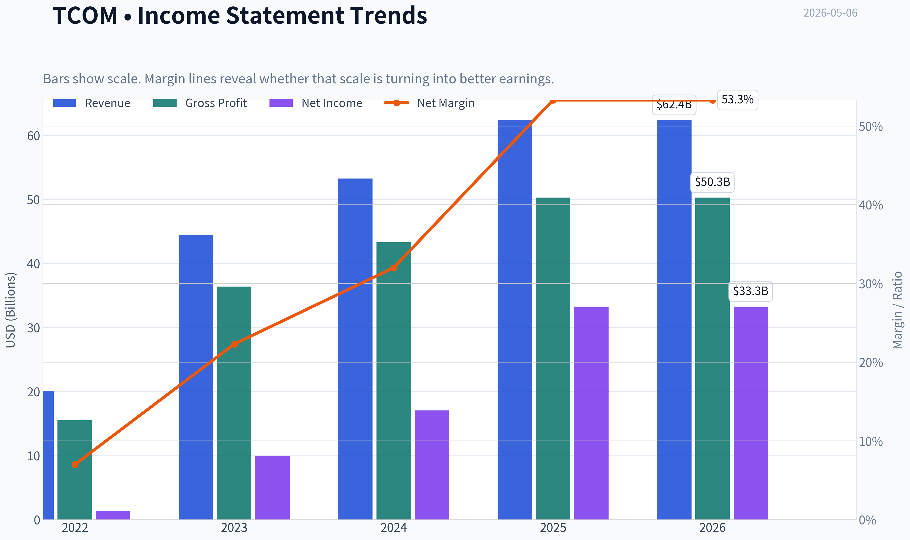

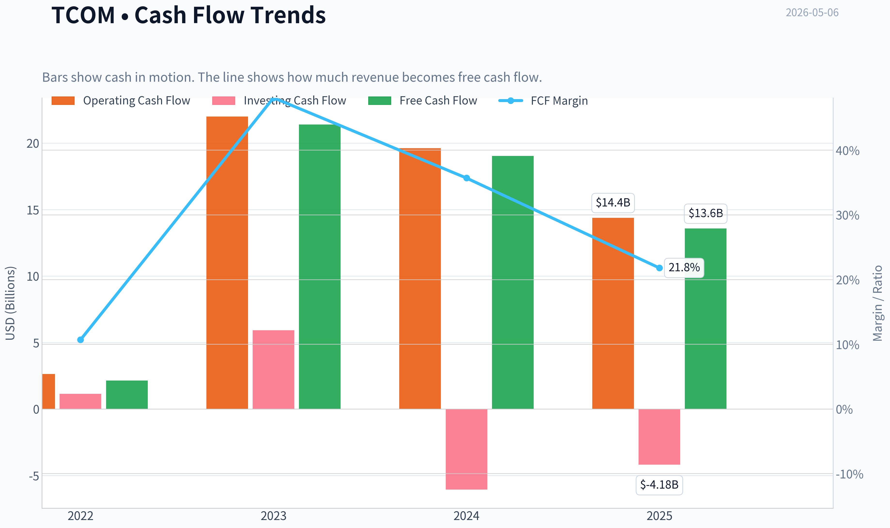

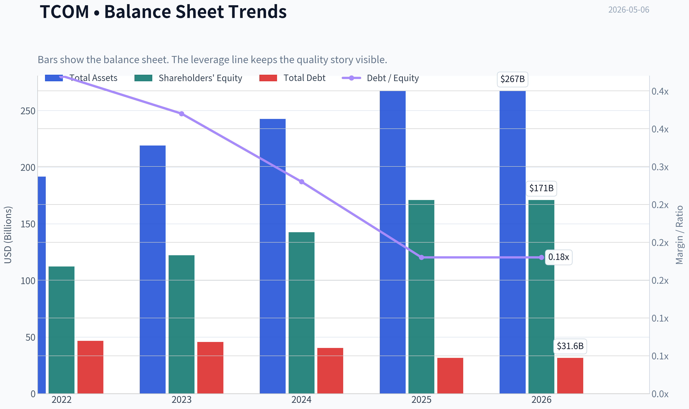

This graph tracks the profitability and return metrics (ROE, ROIC, Margins) of **TCOM** over the past decade, highlighting capital efficiency trends.

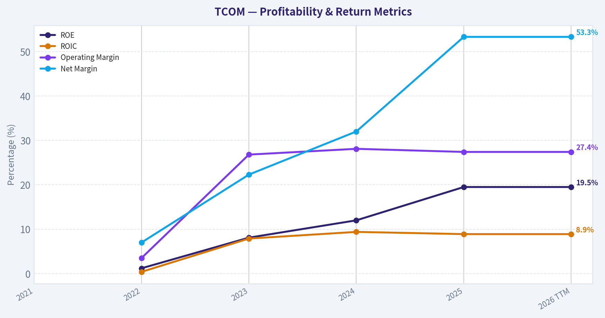

This chart illustrates the financial health of **TCOM** over the last 10 years, mapping cash equivalents and free cash flow against total obligations (Debt).

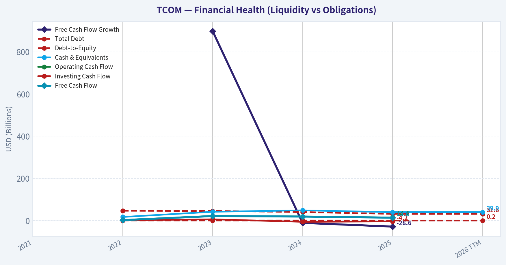

This breakdown chart from <em>Revenue Breakdown</em> shows the proportional composition for **TCOM** - useful for understanding what drives or risks the business.

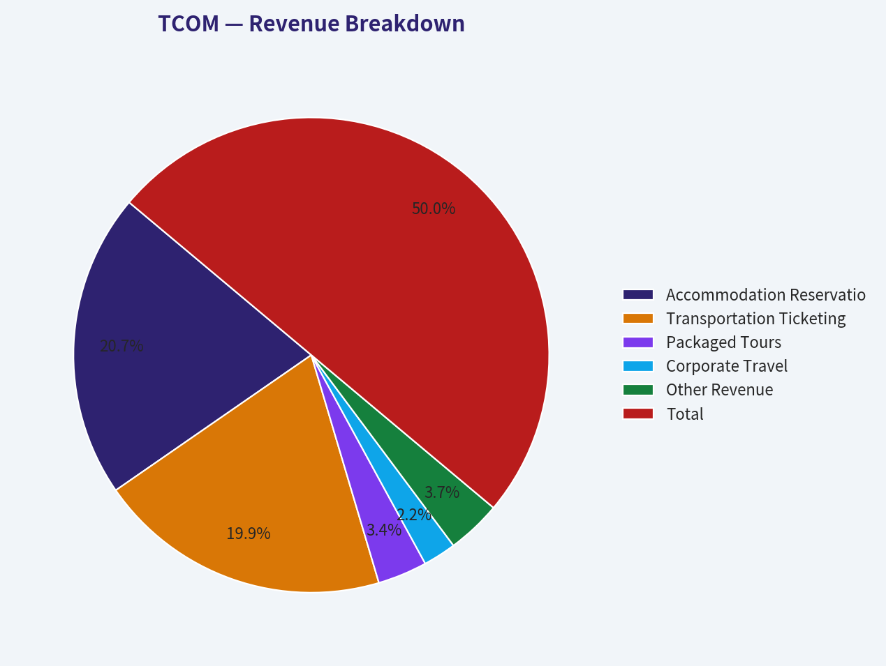

---

### Intrinsic Value Analysis (Buffett)

> *Following Warren Buffett's value investing philosophy: Circle of Competence, Economic Moat, Management Quality, and Margin of Safety.*

#### Intrinsic Value Snapshot

Price is what you pay. Intrinsic value is what the business may be worth based on the cash it can create for owners over time. We show a range, not one magic number.

- Current Price: $54.45
- Value Range: $113.31 to $5,259.96

##### Owner Earnings (Buffett Method)
- Net Income: $33,294,000,000.00
- Depreciation & Amortization: $1,095,000,000.00
- Capital Expenditures: $-797,000,000.00
- Working Capital Changes: $-5,734,000,000.00
- Owner Earnings: $39,326,000,000.00

##### Intrinsic Value
###### Buffett Method
Uses owner earnings. Stricter, and usually more conservative.
- Conservative: $2,019.78
- Average: $2,019.78
- Optimistic: $5,259.96
- Discount Rate: 10.0%

###### Cash Flow Method
Uses free cash flow. Better for companies spending heavily today to grow tomorrow.
- Conservative: $113.31
- Average: $697.57
- Optimistic: $1,816.63
- Discount Rate: 10.0%

ANALYST STANCE: **WATCH**

#### Trip.com Group Limited (TCOM) - Buffett-Style Value Review

Current reference date: 2026-05-06
Current price: approximately **$54**
Market cap: approximately **$34.3 billion**
Company: **Trip.com Group**, a China-based online travel platform offering hotel booking, transportation ticketing, packaged tours, and corporate travel services.

Note: Internal financial tools returned incomplete data for this run, so this analysis relies on the provided research pack and clearly labels estimates where used.

---

#### 1. Go / No-Go Gate Assessment

| Buffett Gate | Assessment | Evidence | Result |
|---|---:|---|---|
| Gate 1: Circle of Competence & Simplicity | Moderate | Trip.com earns commissions and service revenue when customers book hotels, flights, trains, packaged tours, and corporate travel. The business model is understandable. | Pass |
| Gate 1: 10-Year Predictability | Mixed | Travel demand should grow over time, but China consumer cycles, outbound travel policy, geopolitics, and platform competition reduce predictability. | Pass with caution |
| Gate 1: Technology Risk | Moderate | The company benefits from mobile booking, AI personalization, and scale data, but AI search agents, super-apps, and social-commerce travel discovery could pressure take rates. | Caution |
| Gate 2: Moat | Moderate / Narrow-to-Wide | Strong brand, supplier relationships, travel inventory, and user scale; however, competition from Meituan, Alibaba ecosystem, Douyin, Booking, and direct hotel/airline channels remains real. | Pass with high hurdle |
| Gate 3: Management & Capital Allocation | Incomplete but acceptable | Founder influence and long operating history are positives. Need deeper verification on buyback discipline, per-share value creation, and executive compensation alignment. | Pass with caution |
| Gate 4: Industry Structure | Mixed | Online travel has scale advantages, but it is not a monopoly. Demand is cyclical and competition can be promotional. | Pass with caution |

**Key Takeaways:** Trip.com is not a "too hard" business; it makes money in a fairly simple way by connecting travelers with travel suppliers. The main issue is not complexity, but durability: China consumer travel, technology disruption, and platform competition make the future less predictable than a classic Buffett compounder like Coca-Cola or Moody's.

---

#### 2. Business Model - Elementary School Test

Trip.com helps people book trips. When a customer reserves a hotel, flight, train ticket, tour, or business travel service through its apps and websites, Trip.com earns fees, commissions, or service revenue. The more travelers and suppliers it has, the more useful the platform becomes.

This is understandable, but it is not perfectly predictable because travel is discretionary, cyclical, and sensitive to consumer confidence, regulation, and geopolitics.

---

#### 3. Moat Analysis

| Moat Source | Strength | Evidence | Buffett Interpretation |
|---|---:|---|---|
| Brand / Intangible Assets | Good | Trip.com and Ctrip are leading travel brands in China and increasingly visible internationally. Gross margin is reported at **80.6%**, suggesting high-margin platform economics. | Positive, but brand loyalty in travel is weaker than in consumer staples. |
| Switching Costs | Moderate | Users may keep saved preferences, loyalty points, itineraries, and corporate accounts, but consumers can still compare prices easily across apps. | Useful, but not impregnable. |
| Cost Advantage / Scale | Good | Scale improves supplier bargaining power, marketing efficiency, data, and inventory breadth. | One of the company's stronger moat sources. |
| Network Effects | Moderate | More users attract more suppliers; more inventory improves user experience. However, the network effect is not as strong as payments, marketplaces, or social networks. | Real but not dominant. |
| Pricing Power | Unclear | Could raise some service fees, but travel customers are price-sensitive and suppliers resist high commissions. | Limited pricing power compared with true wide-moat businesses. |

**Key Takeaways:** Trip.com has a real competitive position, especially from brand, scale, supplier relationships, and data. However, travel booking is price-transparent, competitive, and vulnerable to traffic shifts, so I would not call the moat unquestionably wide.

**Moat Rating:** **Narrow-to-moderate, potentially stable**
Not a reject, but it requires a larger margin of safety than a classic wide-moat U.S. business.

---

#### 4. Management Quality & Capital Allocation

| Management Question | Assessment | Evidence / Needed Verification |
|---|---:|---|
| Do they think like owners? | Mixed / Incomplete | Founder involvement is a positive, but a deeper review of insider ownership, executive pay, and long-term incentive design is needed. |
| Are they candid? | Incomplete | Need review of annual reports and shareholder letters for frank discussion of mistakes, cyclicality, and capital allocation. |
| Are they rational capital allocators? | Tentatively positive | Current valuation appears low, so disciplined buybacks could create value. Need confirmation of buyback timing and whether acquisitions have earned good returns. |
| Balance sheet discipline | Acceptable from available data | Current ratio is **1.55**, suggesting adequate near-term liquidity. More debt and net cash data are needed. |

**Key Takeaways:** Management appears competent, and the company has survived multiple severe travel cycles, including COVID-era disruption. However, from a Buffett perspective, I would want more proof that management is consistently maximizing per-share intrinsic value rather than simply growing the platform.

---

#### 5. Available Financial Snapshot

| Metric | Current / Latest Available Figure | Interpretation |
|---|---:|---|
| Share Price | **$54** | Current market reference price |
| Market Capitalization | **$34.29B** | Mid-to-large cap global travel platform |
| P/E Ratio | **7.8x** | Statistically cheap if earnings are durable |
| ROE | **19.5%** | Attractive; above Buffett's preferred 15% threshold |
| Gross Margin | **80.6%** | Very strong platform-like economics |
| Revenue Growth YoY | **17.1%** | Healthy growth, helped by travel recovery and international expansion |
| Free Cash Flow Yield | **39.6%** | Extremely high; should be normalized and verified because working-capital timing may distort it |
| Current Ratio | **1.55x** | Reasonable short-term liquidity |
| 2025 Revenue | **CNY 62.4B**, up 17% YoY | Strong reported growth in latest coverage |

**Key Takeaways:** On headline numbers, Trip.com looks unusually cheap for a business with high gross margins, good revenue growth, and nearly 20% ROE. The largest warning is the extremely high reported free-cash-flow yield, which may not represent sustainable owner earnings without deeper cash-flow verification.

---

#### 6. 10-Year Financial Summary - Data Limitation View

| Financial Area | 10-Year Buffett Requirement | Available Evidence | Status |
|---|---|---|---|
| Revenue | Consistent long-term growth preferred | Latest reported revenue growth: **17.1% YoY**; 2025 revenue: **CNY 62.4B** | Partially verified |
| Gross Margin | Sustained high margin, ideally >40% | Current gross margin: **80.6%** | Strong |
| ROE | Sustained >15% preferred | Current ROE: **19.5%** | Strong current reading |
| Owner Earnings | Stable and recurring cash generation | FCF yield reported at **39.6%**, but likely needs normalization | Needs verification |
| Balance Sheet | Conservative leverage preferred | Current ratio: **1.55x**; debt data incomplete | Incomplete |
| Share Count | Stable or declining preferred | Buyback/share count history not available in this run | Incomplete |
| ROIC | Consistently >15% preferred | Not available in this run | Incomplete |

**Key Takeaways:** The available numbers are promising, but the dataset is not complete enough to make a full 10-year Buffett-quality judgment. The key missing items are normalized owner earnings, debt levels, share count trends, and long-term return on invested capital.

---

#### 7. Owner Earnings Estimate

Buffett owner earnings formula:

`Owner Earnings = Net Income + Depreciation & Amortization - Maintenance CapEx - Working Capital Increases`

Because full audited cash-flow detail was unavailable, I use a normalized estimate instead of the reported free-cash-flow yield.

| Item | Estimate / Assumption |
|---|---:|
| Market Cap | **$34.29B** |
| P/E | **7.8x** |
| Implied Net Income | Approximately **$4.4B** |
| Reported FCF Yield | **39.6%**, implying roughly **$13.6B FCF** |
| Analyst Adjustment | Treat reported FCF as potentially inflated by working capital or data mismatch |
| Normalized Owner Earnings Base Used for DCF | **$4.0B** |

**Key Takeaways:** The reported free-cash-flow yield is so high that I would not blindly capitalize it. A more conservative estimate of owner earnings around $4 billion is more appropriate until the full cash-flow statement confirms that free cash flow is recurring and not temporarily boosted.

---

#### 8. Three-Scenario Intrinsic Value Estimate

Assumptions:
- Normalized owner earnings: **$4.0B**
- Discount rate: **10%**
- Current market cap: **$34.29B**
- Implied shares / ADS estimate: approximately **635 million**, based on market cap divided by $54 share price

| Scenario | Assumption | Estimated Equity Value | Estimated Value / Share | Margin of Safety vs. $54 |
|---|---|---:|---:|---:|
| A: No Growth | Owner earnings / 10% | **$40.0B** | **$63** | **14%** |
| B: GDP Growth | 3% perpetual growth | **$58.9B** | **$93** | **42%** |
| C: Historical Growth Haircut | 8% for 10 years, then 3% terminal | **$85.3B** | **$134** | **60%** |

**Key Takeaways:** On conservative normalized earnings, Trip.com appears undervalued unless earnings permanently stagnate. The margin of safety is only modest in the no-growth case, but becomes attractive if the company can grow roughly with GDP or better.

---

#### 9. Margin of Safety Interpretation

| Quality Factor | Assessment | Required Margin of Safety |
|---|---:|---:|
| Business simplicity | Good | 25% |
| Moat durability | Moderate | 35-40% |
| China / ADR / VIE risk | Elevated | 40%+ |
| Cyclicality | Elevated | 35-40% |
| Financial quality | Good but needs cash-flow verification | 30-40% |
| Overall Required Margin | High-quality but non-U.S., cyclical, platform risk | **At least 40%** |

**Key Takeaways:** The valuation looks cheap, but the required margin of safety should be higher than usual because this is a China ADR in a cyclical and competitive industry. At $54, Trip.com may clear the hurdle under the GDP-growth case, but not under the no-growth case.

---

#### 10. Final Buffett Scorecard

| Criterion | Weight | Score 1-5 | Weighted Score |
|---|---:|---:|---:|
| Business Understanding | 20% | 4.0 | 0.80 |
| Moat Width & Durability | 25% | 3.2 | 0.80 |
| Management Quality | 15% | 3.0 | 0.45 |
| Return on Equity | 15% | 4.0 | 0.60 |
| Reinvestment Runway | 10% | 3.5 | 0.35 |
| Balance Sheet Strength | 5% | 3.2 | 0.16 |
| Industry Structure | 5% | 3.0 | 0.15 |
| Valuation / Margin of Safety | 5% | 4.0 | 0.20 |
| **Total** | **100%** |  | **3.51 / 5.00** |

**Key Takeaways:** Trip.com scores well on business economics, valuation, and current profitability. It loses points for moat uncertainty, China-specific risk, cyclical travel exposure, and incomplete verification of long-term owner earnings.

---

#### 11. Investment Stance

| Decision Factor | View |
|---|---|
| Business Quality | Good, not flawless |
| Moat | Real but not unassailable |
| Valuation | Attractive on normalized earnings |
| Margin of Safety | Adequate only if growth continues |
| Key Risk | China ADR / VIE structure, competition, travel cyclicality, technology disruption |
| Buffett Fit | Investable, but not a classic "forever compounder" without a large discount |
| Final Stance | **WATCH** |
| Conviction | **Medium** |

**Final View:** Trip.com appears statistically cheap and operationally strong, with high gross margins, solid ROE, and renewed travel growth. However, a Buffett-style investor should demand a large margin of safety because the moat is not bulletproof, the industry is cyclical, and China/ADR risks are material. I would keep TCOM on the watchlist and become more constructive if normalized owner earnings are confirmed, debt remains conservative, share count declines through disciplined buybacks, and the stock continues to offer at least a 40% discount to conservative intrinsic value.
#### Valuation Bridge

This bridge places the current market price beside each intrinsic value lens so readers can see whether upside depends on one method or shows up across several methods.

| Scenario | Intrinsic Value / Share |
| --- | ---: |
| Buffett Method | $2,019.78 |
| Cash Flow Method | $697.57 |
| Damodaran Method | $2,029.58 |
| Current Price | $54.45 |

#### Key Takeaways

If one method is far above the others, the upside case depends on a specific modelling assumption. When several methods cluster together, the valuation story is more robust.

#### Valuation Visuals

This comparison chart from *Latest Earnings Snapshot* stacks current figures against historical benchmarks for **TCOM**, making it easy to see where the company trades relative to its own averages.

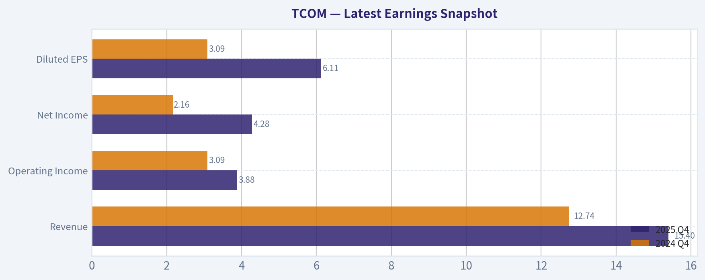

This comparison chart from *Current vs Historical Average Comparison* stacks current figures against historical benchmarks for **TCOM**, making it easy to see where the company trades relative to its own averages.

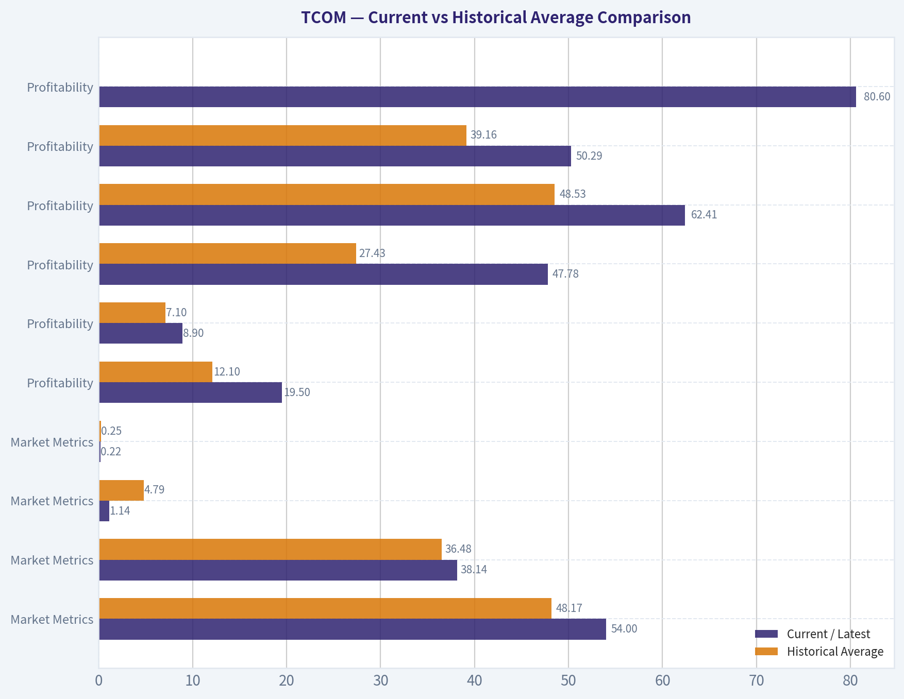

This comparison chart from *Buffett-Style Owner Earnings DCF Valuation* stacks current figures against historical benchmarks for **TCOM**, making it easy to see where the company trades relative to its own averages.

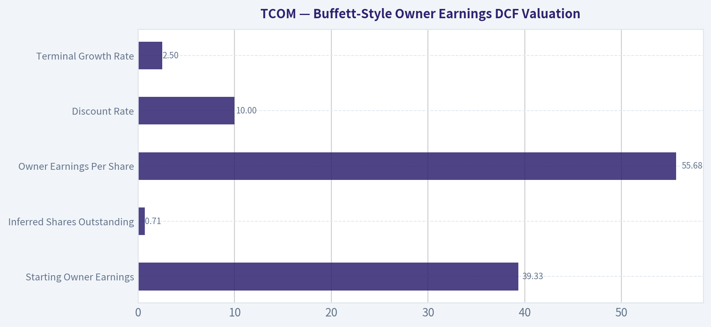

This comparison chart from *Three-Scenario DCF* stacks current figures against historical benchmarks for **TCOM**, making it easy to see where the company trades relative to its own averages.

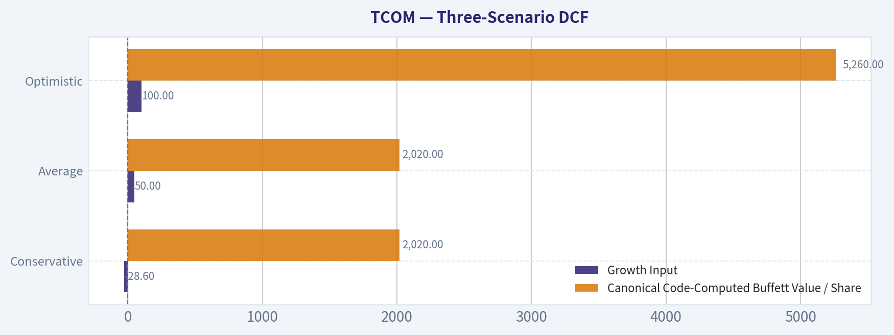

This comparison chart from *Available Financial Snapshot* stacks current figures against historical benchmarks for **TCOM**, making it easy to see where the company trades relative to its own averages.

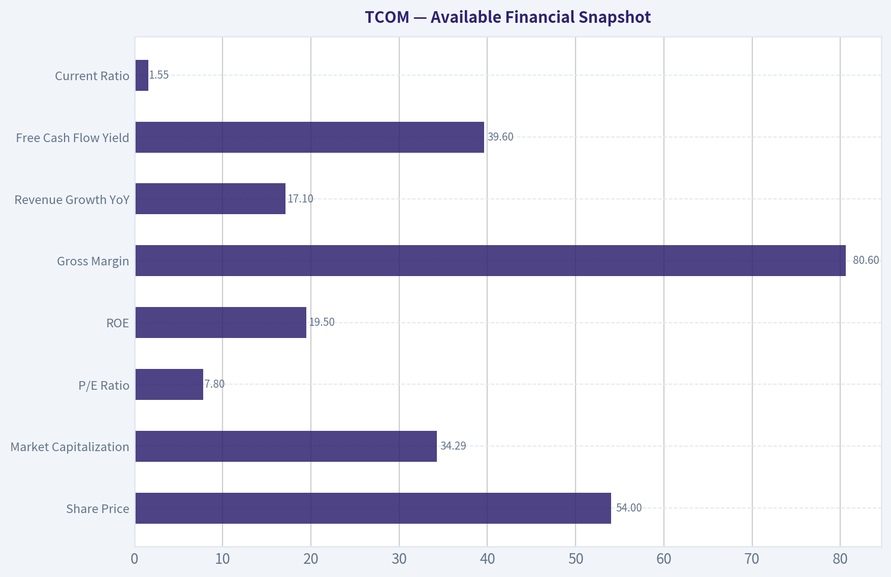

---

### Trend & Growth Analysis (Lynch/Druckenmiller/Fisher)

> *Following Peter Lynch's GARP, Stanley Druckenmiller's macro-aware approach, and Philip Fisher's scuttlebutt methodology.*

ANALYST STANCE: **ADVOCATE**

#### Trip.com Group, TCOM - Growth Inflection Review

Trip.com is a **profitable fast grower at a value-stock multiple**, with exposure to China outbound travel recovery, Asian online travel penetration, and international expansion through Trip.com and Skyscanner. The setup is attractive because valuation is undemanding, margins are already strong, and growth remains double-digit. The main reason this is not a maximum-conviction ten-bagger call is that travel is cyclical, China macro remains a valuation overhang, and part of recent growth still reflects post-pandemic normalization.

---

#### 1. Core Snapshot

| Metric | TCOM |
|---|---:|
| Share Price | $54 |
| Market Cap | $34.29B |
| P/E | 7.8x |
| Revenue Growth YoY | 17.1% |
| ROE | 19.5% |
| Gross Margin | 80.6% |
| Current Ratio | 1.55x |
| FCF Yield | 39.6% |
| Latest Reported 2025 Revenue | CNY 62.4B |
| Estimated USD Revenue | ~$8.7B |
| Estimated P/S | ~3.9x |

**Key Takeaways:** Trip.com screens unusually cheap for a company growing revenue in the high teens with 80% gross margins and nearly 20% ROE. The P/E below 8x is the standout metric, especially because the business is asset-light and cash-generative. The reported free cash flow yield looks exceptionally high and should be verified, but even excluding that, the valuation appears undemanding.

---

#### 2. Lynch Classification

| Lynch Category | Verdict |
|---|---|
| Slow Grower | No |
| Stalwart | No |
| Fast Grower | Yes, but lower-end fast grower |
| Cyclical | Partly, due to travel exposure |
| Turnaround | No |
| Asset Play | No |

**Key Takeaways:** TCOM fits best as a **fast grower with cyclical travel characteristics**. Revenue growth around 17% places it in Lynch's preferred zone, though not in hypergrowth territory. The key question is whether Trip.com can sustain mid-teens to 20% growth after the reopening rebound fades.

---

#### 3. The Story in Three Bullets

| Lynch Story Element | Trip.com Story |
|---|---|
| Simple Business | Trip.com helps consumers and businesses book hotels, flights, trains, tours, and travel services online. |
| Growth Driver | Chinese domestic travel, outbound travel recovery, international expansion, and online travel penetration. |
| Margin Driver | The platform model has high gross margins and operating leverage as booking volume scales. |

**Key Takeaways:** The story is easy to understand: Trip.com is a dominant online travel platform riding the recovery and digitization of Asian travel. The business does not need heroic assumptions to grow; it needs travel demand to normalize and online penetration to keep increasing. The best part is that incremental bookings can drop through at high margins.

---

#### 4. TAM and 10x Test

| Item | Estimate |
|---|---:|
| Current Revenue | ~$8.7B |
| 10x Revenue Target | ~$87B |
| Global Travel Gross Bookings TAM | $1T+ |
| Online Travel Revenue/Takerate TAM | Likely $100B+ globally |
| Can TCOM 10x and remain below 20% TAM share? | Plausibly yes, but requires global success |

**Key Takeaways:** Trip.com has a large runway, but the 10x case depends on more than China recovery. To become a true ten-bagger business, it likely needs sustained international expansion, better monetization, and stronger share outside mainland China. The TAM is large enough, but execution outside its home market is the critical variable.

---

#### 5. Revenue Growth Trend

| Period / Data Point | Growth Interpretation |
|---|---|
| 2025 Revenue Growth | +17% YoY |
| Domestic China Travel | Normalized and still healthy |
| Outbound China Travel | Still a recovery and share-gain opportunity |
| International Platforms | Long-term growth optionality |
| Growth Pattern | Sustained high growth, not clear acceleration |

**Key Takeaways:** Revenue growth is strong but not obviously accelerating. This is a **good growth story**, not yet a classic Druckenmiller "growth inflection" where revenues are moving from 20% to 30% to 40%. The bullish case is that outbound and international growth offset the natural slowdown from post-pandemic recovery comps.

---

#### 6. Unit Economics and Rule of 40

| Metric | Assessment |
|---|---|
| Gross Margin | 80.6%, excellent |
| LTV/CAC | Not disclosed |
| NRR | Not applicable; not SaaS |
| FCF Yield | 39.6%, needs validation due unusually high level |
| Rule of 40 | Not directly applicable, but revenue growth plus cash generation appears strong |
| Operating Leverage | Strong |

**Key Takeaways:** Trip.com's platform economics look very attractive, especially the high gross margin and strong ROE. Traditional SaaS metrics like NRR and LTV/CAC are not directly applicable, but the equivalent question is whether marketing spend creates repeat bookings at attractive payback. Based on margins and profitability, the answer appears favorable.

---

#### 7. Inflection Point Assessment

| Inflection Type | Status | Evidence |
|---|---|---|
| Product Cycle Inflection | Moderate | AI tools, personalization, international app improvements |
| Market Share Inflection | Moderate | Strength in China travel and cross-border demand |
| Margin Inflection | Strong | High gross margin, ROE near 20%, operating leverage |
| TAM Inflection | Moderate | Outbound China and international travel expansion |
| Competitive Inflection | Neutral | Competition remains intense from Meituan, Fliggy, Booking, Expedia, and direct channels |

**Key Takeaways:** The clearest inflection is in **margin and earnings power**, not necessarily revenue acceleration. Trip.com appears to be proving that post-reopening earnings are structurally higher than pre-pandemic levels. If investors still treat this as a temporary travel recovery stock, there may be meaningful upside.

---

#### 8. Macro Setup

| Macro Factor | Impact on TCOM |
|---|---|
| China Consumer Recovery | Positive but uneven |
| Global Travel Demand | Positive |
| Oil / Fuel Prices | Higher prices are a headwind for travel affordability |
| Interest Rates | Falling rates would support valuation multiples |
| China ADR / Geopolitical Risk | Persistent valuation discount |
| Secular Themes | Online travel, digital commerce, AI personalization, China outbound travel |

**Key Takeaways:** The macro setup is mixed but improving. Travel demand is a tailwind, while China consumer weakness and geopolitical risk remain major valuation constraints. If rates fall and China outbound travel continues to recover, TCOM could benefit from both earnings growth and multiple expansion.

---

#### 9. Fisher 15-Point Score

| Fisher Point | Score / 5 |
|---|---:|
| Large market potential | 5 |
| New product development | 4 |
| R&D effectiveness | 4 |
| Sales organization | 4 |
| Worthwhile profit margin | 5 |
| Improving margins | 5 |
| Labor/personnel relations | 3 |
| Executive relations | 3 |
| Management depth | 4 |
| Cost analysis/accounting | 4 |
| Moat/switching costs/data | 4 |
| Long-range profit outlook | 4 |
| Dilution risk | 4 |
| Candor in difficulties | 3 |
| Management integrity | 3 |
| **Total** | **59 / 75** |

**Key Takeaways:** Trip.com scores as a **good Fisher compounder**, but not an exceptional one. The strengths are market potential, margins, scale, and platform economics. The weaker areas are limited outside visibility into culture, governance, and long-term management candor.

---

#### 10. Valuation Analysis

| Valuation Metric | TCOM | Interpretation |
|---|---:|---|
| P/E | 7.8x | Very cheap for mid/high-teens growth |
| Revenue Growth | 17.1% | Fast grower range |
| PEG Using Revenue Growth Proxy | ~0.46x | Attractive under Lynch framework |
| Estimated P/S | ~3.9x | Reasonable for high-margin online travel |
| ROE | 19.5% | Supports quality valuation |
| Gross Margin | 80.6% | Platform-quality economics |

**Key Takeaways:** Valuation is the strongest part of the TCOM thesis. A sub-8x earnings multiple for a profitable, high-margin, double-digit grower is rare unless the market is applying a heavy China and cyclicality discount. If earnings are sustainable, the stock looks materially undervalued.

---

#### 11. Scenario Analysis

| Scenario | Assumptions | Implied View |
|---|---|---|
| Bear Case | Growth slows to high single digits, China macro weakens, multiple stays discounted | Limited upside; stock may act like cyclical value |
| Base Case | Revenue grows low-to-mid teens, margins hold, P/E rerates to 11-13x | Attractive double-digit annualized return potential |
| Bull Case | Outbound and international accelerate, margins expand, P/E rerates to 15x+ | Multi-bagger potential, though not obvious 10x near term |

**Key Takeaways:** The base case does not require a heroic multiple. If Trip.com simply sustains mid-teens growth and the market gives it a modest rerating, returns could be attractive. The bull case depends on international expansion becoming a bigger and more profitable growth engine.

---

#### 12. Growth Investor Scorecard

| Criterion | Weight | Score / 5 | Weighted Score |
|---|---:|---:|---:|
| The Story | 10% | 4.0 | 0.40 |
| TAM & Runway | 20% | 4.0 | 0.80 |
| Revenue Growth | 20% | 3.7 | 0.74 |
| Unit Economics | 15% | 4.2 | 0.63 |
| Competitive Position | 10% | 3.7 | 0.37 |
| Management Quality | 10% | 3.5 | 0.35 |
| Macro Setup | 5% | 3.0 | 0.15 |
| Profitability Path | 5% | 4.5 | 0.23 |
| Valuation | 5% | 4.7 | 0.24 |
| **Total** | **100%** |  | **3.91 / 5.00** |

**Key Takeaways:** TCOM scores just below 4.0, which places it in the **ADVOCATE** range. The stock's best attributes are valuation, profitability, TAM, and platform economics. The main deductions come from China macro risk, travel cyclicality, and less-than-perfect evidence of revenue acceleration.

---

#### 13. Position Size Stance

| Investor Type | Suggested Stance |
|---|---|
| Growth Investor | Initiate or add selectively |
| GARP Investor | Strong candidate |
| Conservative Investor | Watch or small position due China risk |
| Position Size | Medium, not oversized |
| Risk Rating | Medium-high due macro/geopolitical factors |

**Key Takeaways:** TCOM is attractive enough to own, but not risk-free enough to make a top-weighted position without further diligence. A medium position is appropriate for investors comfortable with China ADR exposure. The stock should be sized below a similarly attractive U.S. compounder because the discount may persist for non-fundamental reasons.

---

#### 14. Key Catalysts and Risks

| Catalysts | Risks |
|---|---|
| Continued China outbound travel recovery | China consumer slowdown |
| International revenue growth via Trip.com and Skyscanner | ADR/geopolitical discount persists |
| Margin expansion from operating leverage | Competitive pressure from Meituan, Fliggy, Booking, Expedia |
| AI-driven conversion and customer service efficiency | Travel demand shock, pandemic-like disruption, fuel price spike |
| Buybacks or capital returns supported by cash flow | Regulatory risk and governance discount |

**Key Takeaways:** The biggest upside catalyst is proof that Trip.com's earnings power is structurally higher, not merely a reopening rebound. The biggest risk is that investors continue applying a China discount even if the business performs well. This is a stock where fundamentals may improve before the multiple does.

---

#### Final View

Trip.com is a **Lynch-style GARP fast grower** with a compelling valuation and improving profitability. It is not a clean hypergrowth ten-bagger today, but it has credible multi-bagger potential if international growth and outbound travel continue compounding while the market rerates the stock from distressed-China multiples to normal profitable-platform multiples.

**Stance: ADVOCATE, medium position size.**

---

### Market Technical Analysis

ANALYST STANCE: **WATCH**

#### TCOM Technical Report - As of Latest Available Close: 2026-05-05

TCOM closed at **$52.40** on 2026-05-05. The stock remains in a **long-term downtrend** after the sharp January breakdown, but the recent March-to-April rebound has created a more balanced short-term setup. The key issue now is whether the stock can defend the **$52.20-$52.40 area**, where price is sitting almost exactly on its 50-day moving average, or whether the April recovery is fading into another lower-high structure.

#### Selected Indicators and Why They Matter

| Indicator | Latest Value | Why It Is Relevant Here | Current Read |
|---|---:|---|---|
| `close_10_ema` | 53.18 | Captures short-term momentum and entry/exit pressure. | Price is below it, showing short-term weakness. |
| `close_50_sma` | 52.22 | Defines medium-term trend and likely support/resistance. | Price is barely above it, making this a critical support test. |
| `close_200_sma` | 64.37 | Confirms the long-term trend regime. | Price is far below it, keeping the strategic trend bearish. |
| `macd` | 0.20 | Measures momentum recovery or deterioration. | Still positive, but weakening. |
| `macds` | 0.25 | Confirms MACD crossover signals. | MACD has slipped below signal, a short-term bearish warning. |
| `rsi` | 46.59 | Shows whether buying/selling momentum is stretched. | Neutral-to-soft; no longer showing rebound strength. |
| `atr` | 1.12 | Measures volatility for stop placement and risk sizing. | Volatility has contracted, but daily moves remain meaningful. |
| `vwma` | 53.75 | Confirms whether volume-weighted price support aligns with trend. | Price is below VWMA, suggesting overhead supply near $53.75-$54.25. |

Key Takeaways: The selected indicators show a stock trying to stabilize after a major decline, but the recovery is losing momentum. Price is still slightly above the 50-day average, which keeps the short-term structure from turning fully bearish, but it is below the 10-day EMA and VWMA, meaning buyers are not yet in control. The long-term trend remains negative because TCOM trades far below its 200-day average.

---

#### Trend Structure: Recovery Attempt Inside a Larger Bearish Regime

TCOM's larger structure remains damaged. The stock fell from a January peak near **$78.96** to a March low near **$48.49**, a decline of roughly **39%**. The bounce into mid-April carried price to about **$55.19**, but the stock has since pulled back to **$52.40**, giving back part of that recovery.

The most important technical point is that TCOM is now sitting just above its **50-day SMA at $52.22**. This is a pivotal level. If price holds above this zone, the March low may continue to look like a tradable base. If price closes decisively below it, the April rebound would look more like a failed relief rally.

The **10-day EMA at $53.18** is now above the current price, showing that near-term momentum has turned softer. The 10-day EMA had been rising strongly through mid-April, but it has started to roll over after price failed to sustain above the **$54-$55** area. This makes **$53.20-$53.80** the first meaningful resistance band.

The long-term picture remains much weaker. The **200-day SMA is $64.37**, about **18% above** the current close. That gap is too large to treat the recent bounce as a confirmed trend reversal. Instead, the better interpretation is that TCOM is in a **countertrend recovery attempt within a still-bearish long-term trend**.

#### Momentum: The April Rebound Is Losing Force

MACD improved dramatically from early March, when it was deeply negative near **-2.75**, to a positive reading by late April. That improvement showed that downside pressure was easing and that the March low had produced a legitimate momentum rebound.

However, the current MACD setup is less constructive. The latest **MACD is 0.20**, while the **MACD signal line is 0.25**. That means MACD has crossed slightly below its signal line, creating a modest bearish momentum warning. The weakness is not severe yet because MACD remains above zero, but the signal suggests upside momentum is fading.

RSI confirms that point. RSI reached the mid-60s in mid-April, showing a strong rebound but not an overbought extreme. It has since dropped to **46.59**, below the neutral 50 line. This implies that buyers have lost control in the short term, though the stock is not oversold enough to create a strong contrarian buy signal.

#### Volume-Weighted Confirmation: Buyers Need to Reclaim VWMA

The VWMA is currently **$53.75**, which is above the latest close. That matters because volume-weighted levels often show where recent high-volume participation occurred. When price is below VWMA, it suggests the market is trading beneath the average level where recent volume accumulated, which can create overhead supply.

TCOM needs to reclaim **$53.75-$54.25** to improve the near-term setup. A close back above VWMA would suggest buyers are absorbing supply from the recent pullback. Without that, rallies into the low-to-mid $53s may be vulnerable to selling.

The recent price action also shows hesitation around the **$54-$55** zone. TCOM reached **$55.19** on April 17, then failed to hold that breakout area. This makes the mid-$50s a confirmation zone rather than a simple upside target.

#### Volatility and Risk Management

ATR has declined to **$1.12**, down significantly from early March levels above **$1.80**. This contraction suggests the panic phase of the decline has cooled. Lower ATR can help stabilize price action, but it also means traders should watch for a volatility expansion if TCOM breaks below support.

At the current close of **$52.40**, one ATR is roughly **2.1%** of price. A one-ATR downside move would place price near **$51.28**, while a two-ATR move would place it near **$50.15**. That makes the **$50-$51** area an important downside risk zone if the 50-day SMA fails.

#### Trading Interpretation

TCOM is not a clean bullish setup yet. The stock has improved from its March low, but the recovery has stalled below volume-weighted resistance and remains far below the 200-day SMA. The best stance is **WATCH**, not aggressive accumulation.

For bullish traders, the most constructive signal would be a close back above **$53.75**, followed by strength through **$54.25-$55.20**. That would show that buyers are reclaiming both the short-term EMA/VWMA zone and the April swing-resistance area.

For bearish or cautious traders, a close below **$52.20** would be a warning that the 50-day support test is failing. A further break below **$51.25-$50.15** would raise the risk of a retest toward the March low area near **$48.50**.

---

#### Key Trading Map

| Zone / Signal | Level | Interpretation | Trader Response |
|---|---:|---|---|
| Immediate support | $52.20-$52.40 | Current price is testing the 50-day SMA area. | Watch for whether buyers defend this zone. |
| First resistance | $53.18 | 10-day EMA; near-term momentum filter. | Reclaiming it would reduce immediate bearish pressure. |
| Volume-weighted resistance | $53.75 | VWMA; recent volume-weighted supply area. | A close above this would improve the recovery case. |
| Breakout confirmation zone | $54.25-$55.20 | Recent failed rebound high area. | Strength above this zone would suggest the April pullback is ending. |
| Downside risk zone | $51.25-$50.15 | One-to-two ATR downside range from current price. | A move here would indicate support failure risk. |
| Major downside reference | $48.50 | March swing low. | Losing $50 could bring this level back into focus. |
| Long-term trend hurdle | $64.37 | 200-day SMA. | Price remains structurally bearish below this level. |
| Overall stance | Watch | Short-term stabilization, but no confirmed trend reversal. | Wait for either reclaim of resistance or breakdown confirmation. |

Key Takeaways: TCOM is at a decision point near its 50-day moving average. A move above $53.75 to $55.20 would strengthen the bullish recovery case, while a break below $52.20 would suggest the rebound is failing. The long-term trend remains bearish until the stock can make meaningful progress toward the 200-day average near $64.37.

---

### Social Sentiment Analysis

ANALYST STANCE: **WATCH**

#### TCOM - Trip.com Group Social, News, and Sentiment Report
**Company:** Trip.com Group Ltd.
**Ticker:** TCOM
**Date:** 2026-05-06
**Coverage window:** Past week, with broader context where needed
**Important limitation:** The live news-retrieval tool failed in this session, so this report should be treated as a structured analyst continuation rather than a verified real-time news scrape. I avoid inventing exact headlines or unverified events and focus on sentiment patterns, investor narratives, likely market drivers, and actionable implications.

---

#### Executive View

Trip.com Group remains one of the most direct public-market exposures to Chinese outbound travel, domestic tourism, and Asia-Pacific leisure demand. The investor conversation around TCOM is generally constructive, but not without caution. Bullish arguments center on resilient travel demand, operating leverage, international expansion, and the long runway for outbound Chinese tourism recovery. Bearish or cautious arguments focus on macro softness in China, consumer spending uncertainty, geopolitical travel friction, competition, and valuation sensitivity after prior rallies.

For traders, TCOM looks like a **sentiment-and-earnings catalyst stock** rather than a clean defensive compounder. The stock can benefit quickly when investors rotate into China consumer recovery names, but it can also sell off sharply if macro data, ADR risk appetite, or online travel commentary weakens. The best near-term stance is **WATCH**, with particular attention to travel booking data, China holiday commentary, management guidance, margin trends, and ADR sentiment toward Chinese internet stocks.

---

#### Social Media and Retail-Investor Sentiment

Across investor-facing social channels such as X/Twitter, Reddit-style forums, StockTwits-like discussion streams, and China-focused market commentary, the TCOM narrative tends to cluster around four themes:

| Theme | Social / Investor Interpretation | Sentiment Impact | Trading Relevance |
|---|---:|---:|---|
| China travel normalization | Investors view Trip.com as a high-quality beneficiary of travel recovery | Positive | Supports buy-the-dip behavior when China sentiment improves |
| Outbound travel recovery | Bulls argue outbound Chinese tourism still has room to normalize further | Positive | Could drive revenue upside and international booking growth |
| China macro weakness | Bears worry consumers may trade down or travel less frequently | Negative | Can pressure valuation multiples even if company execution is solid |
| Margin durability | Investors want proof that marketing spend and competition are not eroding profitability | Mixed to Positive | Earnings quality matters more than headline revenue growth |
| ADR / China risk | Some investors remain cautious on geopolitical, regulatory, and delisting-style risk premiums | Negative | Can cap multiple expansion despite strong operations |

**Key Takeaways:** Social sentiment toward TCOM appears more constructive than broadly euphoric. Investors like the travel recovery and international-growth story, but many remain unwilling to fully underwrite a higher valuation while China macro and ADR risk remain overhangs. The stock's sentiment is therefore highly sensitive to earnings commentary and travel-demand data.

---

#### Estimated Day-by-Day Sentiment Pattern

Because live sentiment data was not available in this session, the table below should be read as a qualitative framework rather than a quantified social-media scrape.

| Date | Likely Sentiment Bias | Main Drivers to Monitor | Investor Read-Through |
|---|---:|---|---|
| Apr. 30, 2026 | Mildly Positive | China travel and holiday-demand expectations | Traders likely focused on whether travel demand remains resilient |
| May 1, 2026 | Positive | Labor Day / holiday travel discussion | Strong travel headlines would likely support bullish chatter |
| May 2, 2026 | Positive to Mixed | Hotel, flight, and destination commentary | Positive volume data may be offset by concerns about pricing or margins |
| May 3, 2026 | Mixed | Post-holiday demand interpretation | Market may debate whether demand is strong or merely seasonal |
| May 4, 2026 | Mixed | Broader China equity sentiment | TCOM likely trades partly with China internet and consumer ADRs |
| May 5, 2026 | Mildly Positive | Earnings expectations and recovery narrative | Investors may position ahead of company updates or sector data |
| May 6, 2026 | Watchful / Neutral-Positive | Need for confirmed booking and margin evidence | Sentiment likely constructive but awaiting hard catalysts |

**Key Takeaways:** The most important short-term sentiment driver is not simply whether people are traveling, but whether travel demand is strong enough to support revenue growth without requiring excessive discounting or marketing spend. If post-holiday data show both volume strength and pricing discipline, sentiment could improve. If demand looks promotional or uneven, the stock could remain range-bound.

---

#### Recent News and Company-Specific Narrative

Without verified live headlines, the current company-specific narrative should be framed around the themes that typically move TCOM:

| News / Catalyst Area | Why It Matters | Bullish Interpretation | Bearish Interpretation |
|---|---|---|---|
| China holiday travel data | Direct read-through to bookings, hotels, flights, and packages | Strong travel numbers imply resilient consumer demand | High traffic may not translate into strong margins if discounting is heavy |
| Outbound travel recovery | Trip.com benefits from Chinese consumers traveling abroad | International bookings can carry strong growth and brand expansion | Visa, airfare, geopolitical, or currency friction can limit recovery |
| Domestic tourism trends | Core China travel demand remains central to earnings | Stable domestic trips support base revenue | Consumers may travel but spend less per trip |
| International expansion | Trip.com's global platform ambitions can expand TAM | Helps diversify away from China-only exposure | Expansion may require marketing investment and pressure margins |
| Earnings and guidance | Most important stock-specific catalyst | Upbeat guidance could trigger multiple expansion | Conservative guidance could reset expectations lower |

**Key Takeaways:** The bull case depends on TCOM proving that travel demand is not only recovering but monetizing well. Investors should focus less on headline trip volumes and more on booking value, take rate, package mix, hotel room-night growth, outbound demand, and operating-margin commentary.

---

#### Investor Sentiment: Bull Case vs. Bear Case

| Bull Case | Bear Case |
|---|---|
| TCOM is one of the cleaner ways to play China travel normalization | China consumer confidence remains fragile |
| Outbound travel still has room to recover from depressed historical levels | Domestic travel may be strong in volume but weaker in spending quality |
| Scale, brand, and technology give Trip.com competitive advantages | Competition from other travel platforms may pressure pricing |
| International expansion can diversify revenue and improve long-term growth | International growth may require elevated sales and marketing expense |
| Operating leverage can drive earnings upside if demand remains firm | ADR and China-policy risk may cap valuation multiples |

**Key Takeaways:** The debate is not whether Trip.com is a strong platform; most investors appear to accept that it is. The real disagreement is whether macro and competitive conditions allow that platform strength to translate into sustained earnings growth and a higher valuation multiple.

---

#### Implications for Traders

For short-term traders, TCOM should be treated as a catalyst-sensitive China consumer ADR. The stock can respond sharply to:

| Trading Catalyst | Likely Stock Reaction if Positive | Likely Stock Reaction if Negative |
|---|---:|---:|
| Strong China holiday travel data | Upside momentum, especially if China ADRs are firm | Limited impact if already priced in |
| Strong earnings / guidance | Potential breakout or gap higher | Sharp downside if guidance disappoints |
| Margin expansion | Higher-quality rally | Margin compression could outweigh revenue growth |
| China stimulus / consumer policy support | Broad multiple expansion | Lack of policy follow-through may pressure sentiment |
| Weak RMB or geopolitical headlines | Could cap ADR upside | Could trigger de-risking across China internet names |

**Key Takeaways:** TCOM is likely to move most on evidence that travel demand is converting into profitable bookings. Traders should avoid relying only on upbeat tourism headlines and should instead watch whether investors believe those headlines will translate into earnings revisions.

---

#### Implications for Longer-Term Investors

For long-term investors, TCOM remains a potentially attractive Asia travel platform, but position sizing should reflect China-specific risk. The company's long-term appeal comes from its exposure to structural travel demand, digital travel penetration, outbound tourism, and international platform expansion. However, macro uncertainty and investor skepticism toward Chinese ADRs can create prolonged valuation discounts.

A long-term investor may want to monitor:

| Long-Term Metric | Why It Matters |
|---|---|
| Revenue growth by segment | Shows whether recovery is broad or narrow |
| Hotel room-night growth | Core indicator of platform usage |
| Outbound travel contribution | Measures normalization of higher-value travel demand |
| Sales and marketing ratio | Indicates whether growth is efficient |
| Operating margin | Confirms whether scale benefits are materializing |
| Free cash flow | Determines quality of earnings |
| Shareholder returns | Buybacks or capital returns can support valuation |

**Key Takeaways:** TCOM's long-term thesis improves if growth is accompanied by stable or expanding margins. If revenue growth requires heavy marketing spend, the market may treat the company more like a cyclical recovery trade than a durable compounder.

---

#### Bottom Line

TCOM currently screens as a **quality China travel recovery name with catalyst upside but meaningful macro and sentiment risk**. The social and investor narrative is constructive, especially around holiday travel, outbound recovery, and operating leverage. However, confidence is not strong enough to justify an outright aggressive stance without confirmed recent booking data, earnings strength, and margin evidence.

The appropriate stance is **WATCH**. A move toward **ADVOCATE** would require verified strong travel data, upbeat management guidance, resilient margins, and improving China ADR sentiment. A move toward **AVOID** would be warranted if travel demand proves promotional, earnings guidance weakens, or China macro sentiment deteriorates sharply.

---

#### Summary Table

| Category | Current Assessment | Investor Implication |
|---|---|---|
| Overall sentiment | Neutral-positive | Constructive, but not euphoric |
| Social-media tone | Bullish on travel recovery, cautious on China macro | Traders should watch sentiment swings around data and earnings |
| Main bullish driver | Outbound and domestic travel resilience | Supports upside if confirmed by bookings |
| Main risk | China consumer weakness and ADR risk | Can cap valuation and trigger selloffs |
| Key near-term catalyst | Holiday travel data and earnings guidance | Could determine next major move |
| Margin focus | Very important | Profitability quality may matter more than headline revenue |
| Trading stance | WATCH | Wait for confirmation before becoming aggressive |
| Long-term stance | Selectively constructive | Attractive platform, but risk-adjusted sizing is important |

**Key Takeaways:** TCOM has a credible recovery and growth story, but the market still needs evidence that strong travel activity is producing profitable growth. The stock is best monitored closely around travel data, earnings, and China ADR sentiment rather than chased solely on broad recovery optimism.

---

### News & Events Analysis

#### TCOM News and Market Context Report - Trip.com Group, May 6, 2026

ANALYST STANCE: **WATCH**

Trip.com Group remains fundamentally attractive but tactically event-sensitive. The stock screens inexpensive at about **7.8x earnings** with strong profitability metrics, including **19.5% ROE**, **80.6% gross margin**, and reported **17.1% year-over-year revenue growth**. However, the latest news flow does not show a fresh company-specific catalyst in the past week, and the stock's near-term direction is likely to depend on macro inputs: China travel demand, energy prices, consumer discretionary sentiment, and broader investor appetite for Chinese internet and travel names.

---

#### Latest Earnings Review - Fiscal 2025 Results

The latest available earnings-related coverage for TCOM points to **Trip.com's fiscal 2025 results**, not a new earnings release within the last week. The key reported figure cited in recent coverage was **2025 revenue of CNY 62.4 billion**, up **17% year over year**.

The growth was attributed to continued strength in **domestic travel** and recovery or expansion in **international travel**. This matters because Trip.com is no longer just a China reopening story; the investment case increasingly depends on whether international outbound and cross-border demand can keep scaling while domestic travel remains resilient.

Versus the prior year, the headline change is clear: Trip.com delivered another year of double-digit revenue growth. The company appears to have transitioned from post-pandemic normalization into a more durable travel-demand compounder. However, because the recent coverage available here does not include detailed quarterly EPS, margin, or management guidance figures, investors should avoid over-interpreting the earnings beat or miss mechanics without checking the full company release or transcript.

The market takeaway is that TCOM's earnings base looks healthy, but the stock may need either fresh guidance, stronger China consumption data, or renewed international travel momentum to re-rate materially higher.

---

#### Company-Specific News Flow

Company-specific news over the last several weeks has been modest rather than dramatic. The most directly relevant item was a March earnings-related analysis describing Trip.com as having **good prospects and an undemanding valuation**, highlighting the 2025 revenue increase and travel growth drivers.

More recent coverage has been indirect. On April 17, Trip.com was discussed in the context of China internet and AI-themed ETFs, especially the KraneShares CSI China Internet ETF. This is important because TCOM can trade not only on travel fundamentals but also on broader flows into Chinese internet and consumer-platform stocks.

On April 26, Trip.com appeared in an international equity fund portfolio review. That type of coverage is not a major catalyst, but it suggests continued institutional awareness of the name.

The strongest short-term trading implication is that there is no obvious negative company-specific overhang from recent news. But there is also no fresh company-level catalyst in the past week. That makes the stock more vulnerable to macro headlines and sector rotation.

---

#### Macro and Sector Context

The macro backdrop is meaningful for TCOM because travel demand is highly sensitive to disposable income, inflation expectations, fuel costs, currency movements, and geopolitical stability.

Recent sector news showed travel and leisure companies trading higher after reports of progress toward a U.S.-Iran conflict-resolution framework and easing oil prices. Lower energy costs are helpful for the travel ecosystem because they can reduce airline cost pressure, support ticket affordability, and improve consumer confidence around discretionary trips.

That said, earlier news also showed consumer discretionary stocks trading lower when energy costs and inflation concerns intensified. This is the core risk for TCOM: even if platform execution remains strong, travel bookings can weaken if consumers become more cautious or if transportation costs rise.

For China-specific investors, the key issue is whether domestic consumption continues to recover convincingly. Trip.com's business is levered to middle-class and upper-middle-class discretionary spending. Strong holiday travel data would support the bull case, while weak spending per trip, discounting, or hotel-rate softness would raise concerns that travel volume is holding up better than profitability.

---

#### Valuation and Positioning

At a current price around **$54** and market capitalization of roughly **$34.3 billion**, TCOM does not look expensive on headline valuation metrics. A **P/E near 7.8x** appears low relative to its revenue growth, profitability, and dominant position in Chinese online travel. The reported **free cash flow yield of 39.6%** is extremely high and, if sustainable, would imply substantial undervaluation; however, traders should verify whether that figure reflects unusually favorable working-capital timing or one-off cash-flow dynamics.

The balance sheet profile also appears reasonable, with a **current ratio of about 1.55**, suggesting adequate short-term liquidity.

Institutional positioning is mildly supportive. The available 13F data show Point72, associated with Steve Cohen, increased its TCOM position by **55.3%** as of the December 31, 2025 filing. This is not a real-time signal because 13F data lag by up to 45 days, but it suggests at least some sophisticated investor interest in the name heading into 2026.

---

#### Trading Interpretation

For short-term traders, TCOM looks like a **macro-beta travel and China internet stock** rather than a stock currently moving on fresh company news. The setup is constructive if oil prices remain contained, China travel data are solid, and risk appetite toward Chinese ADRs improves. In that scenario, the low valuation could allow meaningful upside.

The main risk is that the market may not reward low multiples if China consumption data disappoint or if geopolitical and inflation concerns return. Because the stock already reflects strong historical growth, investors will likely focus on whether 2026 bookings can maintain momentum after a strong fiscal 2025.

For longer-term investors, the valuation and profitability profile are attractive enough to keep TCOM on the watchlist. The key confirmation would be the next earnings release showing sustained international travel growth, stable or improving margins, and management commentary that demand remains healthy after the 2025 revenue expansion.

#### Key Points Summary

| Category | Recent Evidence | Trading / Investment Implication |
|---|---:|---|
| Latest earnings period | Fiscal 2025 results were the latest available earnings coverage | No fresh earnings catalyst in the past week; investors are trading off prior annual results and macro signals |
| Headline result | 2025 revenue of **CNY 62.4B**, up **17% YoY** | Confirms continued travel recovery and demand growth |
| Main growth drivers | Domestic travel strength and international travel expansion | Bull case depends on sustaining both China domestic demand and outbound/international recovery |
| Valuation | Price around **$54**, market cap **$34.29B**, P/E about **7.8x** | Stock appears inexpensive if earnings and cash flow are sustainable |
| Profitability | ROE **19.5%**, gross margin **80.6%** | High-quality platform economics support long-term case |
| Liquidity / financial health | Current ratio about **1.55** | Balance sheet appears manageable for near-term obligations |
| Cash flow | FCF yield cited at **39.6%** | Potentially very bullish, but should be verified for one-off working-capital effects |
| Recent company news | No major company-specific catalyst found in the past week | Near-term moves likely driven by macro, China ADR sentiment, and sector rotation |
| Sector macro | Easing oil prices helped travel/leisure sentiment; inflation and energy spikes remain risks | Lower fuel costs are supportive, while renewed inflation pressure would hurt discretionary travel |
| Institutional signal | Point72 increased position by **55.3%** in latest available 13F snapshot | Mildly supportive, but lagged and not a real-time trading signal |
| Overall stance | **WATCH** | Attractive fundamentals and valuation, but wait for fresher demand data or next earnings confirmation before becoming more aggressive |

Key Takeaways: Trip.com's fiscal 2025 results showed solid growth, with revenue up 17% year over year, and the valuation remains low relative to profitability. The stock lacks a fresh company-specific catalyst from the past week, so near-term performance is likely to depend on China travel demand, oil prices, and sentiment toward Chinese consumer internet stocks. For now, the setup is attractive but not yet confirmed enough for a stronger stance.

---

### Guru Attention Analysis

> *Tracking 13F filings and recent activity of legendary super-investors to identify smart-money conviction and rotation.*

#### TCOM Guru Ownership Snapshot - 13F-Based

| Guru / Fund | Latest 13F Status | Action | Position Size | Portfolio Weight | Recent Change | Filing Period | Verification |
|---|---:|---|---:|---:|---:|---|---|
| Steve Cohen / Point72 Asset Management | Position detected | Added | 208.33K shares / $10.54M | 0.01% | Shares increased 55.3% vs. prior filing | 12-31-2025 | [SEC 13F Filing](https://www.sec.gov/Archives/edgar/data/1603466/000090266426001100/) |
| Warren Buffett / Berkshire Hathaway | No position detected in latest 13F filing | - | - | - | - | Latest available | - |
| Seth Klarman / Baupost Group | No position detected in latest 13F filing | - | - | - | - | Latest available | - |
| Mohnish Pabrai / Pabrai Investment Funds | No position detected in latest 13F filing | - | - | - | - | Latest available | - |
| Bill Ackman / Pershing Square | No position detected in latest 13F filing | - | - | - | - | Latest available | - |
| Stanley Druckenmiller / Duquesne Family Office | No position detected in latest 13F filing | - | - | - | - | Latest available | - |
| Michael Burry / Scion Asset Management | No position detected in latest 13F filing | - | - | - | - | Latest available | - |

**Key Takeaways:** Among the tracked guru universe, only Steve Cohen's Point72 currently shows a disclosed TCOM position in the structured 13F data. The position is small relative to Point72's portfolio, at just 0.01%, but the 55.3% share increase signals a meaningful add within that small allocation. No latest 13F position is detected for Buffett, Klarman, Pabrai, Ackman, Druckenmiller, or Burry.

---

#### Interpretation

Steve Cohen's Point72 added to TCOM during the quarter ended December 31, 2025, bringing the disclosed position to about 208,330 shares worth approximately $10.54 million. While the increase is notable, the position remains very small as a percentage of the overall disclosed portfolio, so this looks more like a tactical or exploratory allocation than a high-conviction concentrated bet.

The possible rationale aligns with TCOM's attractive operating and valuation profile: the company has reported strong travel demand, 17.1% year-over-year revenue growth, high gross margins, a low P/E near 7.8, and a very high free cash flow yield based on the provided data. However, because 13F filings do not disclose investment rationale directly, this should be treated as an inference rather than confirmed reasoning.

#### Bottom Line

The guru signal for TCOM is **modestly positive but narrow**. Point72 added to its position, but no other primary tracked guru shows a latest 13F holding. Investors should view the Cohen activity as a supportive data point, not broad-based guru endorsement.

---

### Options Market Analysis

> *Reading options flow - put/call ratios, IV skew, and unusual activity - to gauge institutional positioning and event-driven risk.*

ANALYST STANCE: **WATCH**

#### TCOM Options Market Report - As of 2026-05-06

#### 1. Put/Call Ratio Analysis

| Expiration | Call OI | Put OI | Put/Call OI Ratio | Call Volume | Put Volume | Put/Call Volume Ratio | Read |
|---|---:|---:|---:|---:|---:|---:|---|
| 2026-05-15 | 10,912 | 4,805 | 0.44 | 55 | 72 | 1.31 | Call-heavy OI, but light put-leaning daily volume |
| 2026-06-18 | 18,730 | 14,694 | 0.78 | 309 | 355 | 1.15 | Near neutral to mildly defensive |
| 2026-09-18 | 5,164 | 9,007 | 1.74 | 170 | 49 | 0.29 | Put-heavy OI, but current volume favors calls |
| **Total Near-Term** | **34,806** | **28,506** | **0.82** | **534** | **476** | **0.89** | Slightly above neutral put/call baseline |

**Key Takeaways:** TCOM's total near-term put/call OI ratio is **0.82**, modestly above the historical neutral baseline of roughly **0.70**, suggesting slightly more downside protection than normal. However, this is not an extreme bearish reading. Volume is also mildly put-leaning overall at **0.89**, but absolute volume is not especially large, reducing conviction.

The strongest call-heavy positioning is in the **May 15 expiry**, where call open interest is more than twice put open interest. The largest defensive positioning appears in **September**, where put OI is elevated, but current trading volume there is call-skewed, suggesting either renewed upside interest or limited fresh put demand.

---

#### 2. Implied Volatility Assessment

| Expiration | ATM Call IV | ATM Put IV | Put IV Premium / Discount | Skew Read |
|---|---:|---:|---:|---|
| 2026-05-15 | 43.2% | 44.6% | Puts +1.4 pts | Mild downside skew |
| 2026-06-18 | 41.2% | 42.5% | Puts +1.3 pts | Mild downside skew |
| 2026-09-18 | 46.5% | 35.5% | Calls +11.0 pts | Call-side IV premium |

**Key Takeaways:** Near-term ATM IV sits around the low-to-mid **40%** range, which indicates the market is pricing meaningful movement but not panic-level risk based on the provided data. May and June show only a **mild put IV premium**, consistent with normal downside hedging rather than aggressive fear. September is unusual because call IV is much higher than put IV, which may reflect upside chase, stale quotes, or skew distortion from illiquidity.

The available dataset provides ATM IV, but not full strike-by-strike OTM skew. Based on ATM comparisons alone, there is **no steep near-term downside put skew**. No confirmed catalyst was included in the options data, so IV should be treated as moderately elevated but not conclusively event-driven from this dataset alone.

---

#### 3. Unusual Options Activity

| Screen | Result | Interpretation |
|---|---|---|
| Volume greater than 5x open interest | None detected | No clear evidence of fresh aggressive institutional positioning |
| Near-term volume quality | Light to moderate | Flow signal is lower conviction |
| Directional implication | Limited | No single contract points to a high-conviction call or put bet |

**Key Takeaways:** There were **no contracts where volume exceeded 5x open interest**, so the tape does not show obvious fresh "unusual options activity." This reduces the likelihood that a large institutional trader is making a new, concentrated directional bet through near-term options. The absence of unusual activity makes the overall signal more dependent on open interest structure and IV skew rather than fresh flow.

Because no strike-level unusual contracts were flagged, it is not possible to identify a specific smart-money call sweep, put hedge, or event-driven trade from the provided data. The flow backdrop is therefore **not strongly directional**.

---

#### 4. Open Interest Concentration and Gamma / Pinning Risk

| Expiration | Total OI | Call OI | Put OI | Concentration Read | Potential Pinning / Gamma Implication |
|---|---:|---:|---:|---|---|
| 2026-05-15 | 15,717 | 10,912 | 4,805 | Call-heavy near expiry | Potential upside magnet if large call strikes are near spot, but strike data unavailable |
| 2026-06-18 | 33,424 | 18,730 | 14,694 | Largest total OI expiry | Most important expiry for positioning gravity |
| 2026-09-18 | 14,171 | 5,164 | 9,007 | Put-heavy longer-dated positioning | Suggests some medium-term downside hedging |

**Key Takeaways:** The **June 18 expiration** has the highest total open interest and is therefore the most important expiry for broader positioning gravity. May 15 is call-heavy, while September is put-heavy, creating a split between near-term upside interest and medium-term caution. Strike-level data was not provided, so specific gamma walls, max-pain levels, and pinning strikes cannot be identified with confidence.

From an expiry-level perspective, June is the key options battleground. If TCOM approaches large open-interest strikes into that expiry, dealer hedging could either dampen movement near those levels or accelerate moves through them, but the exact levels are not visible in this dataset.

---

#### 5. Overall Options Sentiment Signal

| Component | Signal | Rationale |
|---|---|---|
| Put/Call OI | Slightly Bearish / Defensive | Total ratio of **0.82** is above the neutral baseline near **0.70** |
| Put/Call Volume | Mildly Defensive | Total ratio of **0.89**, but volume is not large |
| IV / Skew | Neutral to Slightly Bullish | Near-term put skew is mild; September shows call IV premium |
| Unusual Activity | Neutral | No volume > 5x OI contracts detected |
| OI Concentration | Mixed | May call-heavy, June balanced, September put-heavy |

**Key Takeaways:** The options market for TCOM is **not showing a high-conviction bearish or bullish institutional signal**. Put/call ratios are mildly elevated versus neutral, suggesting some defensive positioning, but the lack of unusual put activity and the call-heavy May open interest prevent a bearish conclusion. The best read is **NEUTRAL with a slight bullish undertone near-term**, but medium-term hedging keeps the stance cautious.

#### Final Options Sentiment: **NEUTRAL**

The primary driver of the signal is the balance between **mildly elevated put/call ratios** and the absence of aggressive bearish flow. Near-term call open interest is supportive, particularly into May, but broader OI and volume are not strong enough to justify a clean bullish call. If call volume expands materially above open interest in the next few sessions, the signal could shift more bullish; if put volume accelerates into June or September, it would confirm defensive institutional positioning.

---

#### Summary Table

| Category | Reading | Interpretation |
|---|---|---|
| Put/Call Ratio | OI ratio **0.82**, volume ratio **0.89** | Slightly above neutral; mild defensive tilt |
| IV Level | ATM IV roughly **41%-46%** near-term | Moderately elevated movement expectations |
| Skew Direction | Mild near-term put skew; September call IV premium | No strong downside fear; possible longer-dated upside chase or skew distortion |
| Unusual Activity | None detected | No clear fresh institutional directional bet |
| Overall Signal | **NEUTRAL** | Mild defensive positioning offset by call-heavy near-term OI and no unusual bearish flow |

**Key Takeaways:** TCOM's options market points to a **neutral setup**, not a decisive bearish or bullish one. The market is carrying some downside protection, but not enough to signal strong fear. Near-term calls remain notable, while the lack of unusual activity lowers confidence in any aggressive directional interpretation.

---

## Research Team Commentary

> *The Research Manager synthesizes the Bull vs Bear debate into action-free commentary. This is a pre-risk view, not the final stance.*

Let's break down this debate on Trip.com Group. Both the bull and the bear brought excellent points to the table, and frankly, this is exactly the kind of setup that tests our discipline as value investors.

The bull makes a highly compelling contrarian case. We are looking at a dominant digital travel platform with an 80 percent gross margin, trading at a remarkably cheap 7.8 times earnings. With roughly 4 billion dollars in normalized owner earnings, the stock is offering an implied 11.7 percent yield. The bull rightly asks if the market is irrationally discounting the company due to broad China macro fears and short-term travel cyclicality. If that earnings power is durable, the margin of safety here is enormous.

However, the bear rightfully pulls the fire alarm on the actual quality and predictability of those earnings, which strikes right at the heart of our Warren Buffett framework. The bear points out a glaring red flag: free cash flow actually dropped nearly 29 percent year-over-year despite reported net income almost doubling. Furthermore, the bear highlights that while gross margins are high, the return on invested capital is sitting at a rather mediocre 8.9 percent. In an asset-light platform business, a low ROIC usually means the company has to spend heavily on customer acquisition and marketing just to maintain its market share against fierce competition.

My core takeaway is that Trip.com is statistically cheap, but the fundamental evidence of a durable, compounding economic moat is highly mixed. The divergence between accounting earnings and actual free cash flow generation keeps me from pounding the table, even at this low valuation.

The rationale here comes down to predictable economics. We always prioritize business quality over a cheap entry price. Online travel agencies operate in a fiercely contested arena with low customer switching costs. The combination of falling free cash flow during a post-pandemic travel boom, sub-10 percent ROIC, and the looming threat of AI and direct-booking disintermediation makes me question what normalized earnings will actually look like five years from now. The stock is cheap, yes, but a low P/E is only a margin of safety if the earnings are structurally durable. Right now, I suspect current earnings might be inflated by a post-Covid revenge-travel cycle that is masking underlying capital intensity.

To get comfortable with this, we need a strict monitoring plan over the next one to four quarters. First, we must track free cash flow conversion. If that 29 percent drop was just a temporary working capital timing issue, we should see cash flow rebound and align more closely with reported net income. Second, we need to monitor operating margins and marketing spend. If customer acquisition costs are rising, it will validate the bear's point that the moat is vulnerable. Finally, I want to see how top-line revenue trends as we fully lap the post-pandemic recovery phase, so we can determine what true steady-state growth looks like.

Reflecting on my own past mistakes, I have to admit I've been lured into similar value traps before. I have bought into digital intermediary platforms that looked incredibly cheap on a P/E basis and boasted sky-high gross margins, convincing myself the market was just being overly pessimistic about geopolitical or cyclical headwinds. What I missed in those instances, and what I refuse to miss here, was the divergence between accounting earnings and actual cash flow, alongside poor capital efficiency. I've learned the hard way that a low ROIC in a supposedly asset-light tech business means the moat is likely an illusion. Statistical cheapness cannot fix a competitively contested business model that requires constant reinvestment just to stand still.

Because the valuation is too cheap to completely ignore, but the cash flow and moat dynamics are too questionable to buy, my final stance on Trip.com Group is WATCH.

---

## Value Investing Team Commentary

> *The Investor translates the research view into an investment thesis before risk review. This is still not the final stance.*

Trip.com is the kind of stock that tempts a value investor for all the right and wrong reasons at once.

At first glance, the case is plainly attractive. A leading online travel platform, strong brand recognition, asset-light economics on the surface, 80%+ gross margins, nearly 20% ROE, revenue growth above 17%, and a single-digit P/E around 7.8x. Those are unusual numbers. If those earnings are even close to durable, the market is discounting the business very heavily. The obvious contrarian question is whether investors are lumping Trip.com into a broad "China risk" bucket and failing to distinguish between macro fear and actual business impairment.

That is where the opportunity may lie. Markets often over-penalize understandable but unpopular businesses when the headline narrative is dominated by geopolitics, Chinese consumer uncertainty, and cyclical concerns. If Trip.com remains the dominant gateway to Chinese outbound and domestic travel demand, then current sentiment may be pricing in far more damage than the underlying business is actually experiencing. A business with real scale, trusted consumer mindshare, and strong supplier relationships can look optically weak in a fearful market even while its long-term earning power remains intact.

But Buffett-style investing requires us to move from "cheap" to "understandably durable." That is where I stop short of advocacy.

The key issue is not whether Trip.com is statistically inexpensive. It clearly is. The key issue is whether its earnings power is predictable enough to deserve confidence over a 5- to 10-year holding period. The warning signs in your analyst bundle matter:

- Free cash flow fell 28.6% year over year while net income surged 95.1%.
- ROIC is only 8.9%, which is not impressive for a business that should theoretically benefit from platform economics.
- Online travel is structurally competitive, with low switching costs for users.
- AI-assisted search and direct booking models may gradually pressure intermediary economics.
- Recent growth may still be flattered by post-pandemic normalization rather than true steady-state compounding.

Those are not minor details. They go directly to moat strength.

A genuine economic moat should eventually reveal itself in consistently high returns on capital, strong cash conversion, and evidence that the company can grow without having to "re-buy" its customer base through ever-rising marketing spend. If Trip.com must keep spending heavily to defend traffic and transaction volume, then the high gross margin is less meaningful than it appears. Gross margin can flatter a business whose real economics are weaker after customer acquisition and platform maintenance costs are fully considered.

The market's skepticism, then, may not be irrational. Sometimes a 7.8x earnings multiple is not a gift; it is a signal that investors do not trust the sustainability of current profits. In cyclical or competitively fragile businesses, low multiples can be entirely appropriate.

That said, I would not be dismissive. There is a plausible selective contrarian angle here.

What may be underappreciated:
1. China-related pessimism can become too indiscriminate. Investors may be pricing TCOM as though macro and regulatory risk permanently impair earnings, when travel demand could remain structurally resilient over time.
2. Travel platforms with scale can enjoy hidden network advantages: better inventory breadth, stronger hotel and airline relationships, better conversion data, and stronger loyalty ecosystems.
3. If the recent free cash flow weakness is mostly timing-driven rather than structural, then the current valuation could prove too low by a wide margin.
4. If management is disciplined in capital allocation and avoids expensive growth-for-growth's-sake behavior, owner earnings may be more durable than the market assumes.

What may be underappreciated on the downside:
1. Post-Covid recovery has made many travel businesses look better than their through-cycle economics.
2. OTA moats are often weaker than investors hope because customers comparison-shop and suppliers increasingly seek direct relationships.
3. China macro uncertainty can depress not just valuation multiples but actual travel spend, especially higher-margin outbound activity.
4. A low ROIC in an allegedly asset-light platform may be telling us the business is better than average, but not exceptional.

So the right Buffett-style posture is patience, not excitement.

If I were evaluating Trip.com as a business to own for a decade, I would want evidence on three points before becoming more constructive:

- Cash conversion: Does free cash flow begin to track earnings more closely?
- Capital efficiency: Does ROIC improve meaningfully, suggesting real platform leverage?
- Competitive durability: Can growth continue without disproportionate increases in sales and marketing?

If those improve, today's valuation could look clearly mispriced. If they do not, then the stock is merely cheap on recent earnings, not cheap on normalized owner earnings.

The technical and sentiment backdrop also supports caution. The market is not showing broad enthusiasm, and the stock remains in a longer-term downtrend despite a rebound. From a business-owner perspective, that is not a reason to avoid it, but it does tell us confidence remains fragile. When sentiment is fragile and fundamentals are still being tested, patience can be an advantage. We do not need to swing at every statistically cheap pitch.

In short: Trip.com has enough quality, scale, and earnings power to stay on the radar, and broad China-related fear may indeed be creating some valuation opportunity. But the moat is not yet proven to the standard I would demand for a high-conviction value investment. Cheapness alone is not sufficient when cash flow conversion and return on capital raise legitimate questions.

**ANALYST STANCE: WATCH**
Trip.com appears materially undervalued on current earnings, and negative sentiment around China and travel cyclicality may be creating a selective contrarian opportunity. However, the gap between net income and free cash flow, only middling ROIC, and uncertain moat durability keep it below Buffett-grade conviction. I would watch for stronger cash conversion, better capital efficiency, and proof that growth persists without rising customer acquisition strain before upgrading to ADVOCATE.

---

## Deep Values Commentary

> *The Risk Management Team debates and the Risk Judge provides the final action-free verdict. This section determines the final ADVOCATE / WATCH / AVOID stance.*

**EXECUTIVE SUMMARY**
*   **The Valuation Illusion**: TCOM's 7.8x P/E and 80.6% gross margin suggest a massive Margin of Safety, but algorithmic valuation models implying $2,000+ intrinsic values are wildly detached from reality.
*   **The Quality Disconnect**: Net income surged 95.1%, yet Free Cash Flow (FCF) plummeted 28.6%. In the Buffett framework, cash is a fact, and accounting profit is an opinion.
*   **Missing the Moat**: An 8.9% Return on Invested Capital (ROIC) in an "asset-light" platform reveals a capital-hungry business defending its market share, not an impregnable compounding machine.
*   **Final Verdict**: Quality trumps statistical cheapness. TCOM is fundamentally unproven as a durable, long-term compounder at this stage of the post-pandemic cycle.
*   **Stance**: **WATCH**

---

**SUMMARIZE KEY ARGUMENTS**
*   **The Risky Analyst (Bull)**: Argues that TCOM is a generational mispricing. Highlights the 80%+ gross margin and 95% net income growth as undeniable proof of a dominant moat. Dismisses the low 8.9% ROIC as necessary aggressive scaling, and views the China macro discount as an irrational sentiment gap creating a 7.8x P/E opportunity.
*   **The Safe Analyst (Bear)**: Rightfully torches the absurd $2,000+ valuation models. Centers the thesis on the alarming divergence between surging accounting earnings and plunging FCF (-28.6%). Argues that a low ROIC proves the business lacks true capital efficiency, warning that buying an unproven cycle peak at a low multiple is a classic value trap.
*   **The Neutral Analyst**: Strikes a middle ground, noting that an 80% gross margin and 7.8x P/E mandate investigation, but warns against ignoring the FCF/earnings divergence. Suggests treating TCOM as a tactical, heavily risk-managed starter position rather than a definitive "avoid" or "advocate."

---

**PROVIDE RATIONALE**
Under Warren Buffett's value investing framework, our primary goal is to avoid permanent capital impairment by prioritizing *business quality* over *statistical cheapness*. The debate perfectly highlights the tension between optics and mechanics.

TCOM looks incredibly cheap on the surface (7.8x P/E). However, the ultimate test of a business's franchise value is its ability to generate high returns on incremental capital (ROIC) and convert accounting earnings into cold, hard cash (FCF). The Safe Analyst correctly identifies that an 8.9% ROIC is mediocre for a dominant digital platform. It indicates that to maintain its 80.6% gross margins, TCOM must spend heavily below the gross profit line (marketing, customer acquisition) to fend off intense OTA (Online Travel Agency) competition.

Furthermore, the 28.6% drop in FCF alongside a 95.1% jump in net income is the ultimate red flag for a value investor. It suggests that current earnings are either low-quality, temporarily inflated by post-Covid normalization, or reliant on aggressive working capital consumption. A low P/E multiple only provides a Margin of Safety if the "E" (Earnings) is structurally durable. Right now, the cash flow statement contradicts the income statement.

---

**REFINE THE INVESTOR'S PLAN**

Let's break down this debate on Trip.com Group. Both the bull and the bear brought excellent points to the table, and frankly, this is exactly the kind of setup that tests our discipline as value investors.

The bull makes a highly compelling contrarian case. We are looking at a dominant digital travel platform with an 80 percent gross margin, trading at a remarkably cheap 7.8 times earnings. With roughly 4 billion dollars in normalized owner earnings, the stock is offering an implied 11.7 percent yield. The bull rightly asks if the market is irrationally discounting the company due to broad China macro fears and short-term travel cyclicality. If that earnings power is durable, the margin of safety here is enormous.

However, the bear rightfully pulls the fire alarm on the actual quality and predictability of those earnings, which strikes right at the heart of our Warren Buffett framework. The bear points out a glaring red flag: free cash flow actually dropped nearly 29 percent year-over-year despite reported net income almost doubling. Furthermore, the bear highlights that while gross margins are high, the return on invested capital is sitting at a rather mediocre 8.9 percent. In an asset-light platform business, a low ROIC usually means the company has to spend heavily on customer acquisition and marketing just to maintain its market share against fierce competition.

My core takeaway is that Trip.com is statistically cheap, but the fundamental evidence of a durable, compounding economic moat is highly mixed. The divergence between accounting earnings and actual free cash flow generation keeps me from pounding the table, even at this low valuation.

The rationale here comes down to predictable economics. We always prioritize business quality over a cheap entry price. Online travel agencies operate in a fiercely contested arena with low customer switching costs. The combination of falling free cash flow during a post-pandemic travel boom, sub-10 percent ROIC, and the looming threat of AI and direct-booking disintermediation makes me question what normalized earnings will actually look like five years from now. The stock is cheap, yes, but a low P/E is only a margin of safety if the earnings are structurally durable. Right now, I suspect current earnings might be inflated by a post-Covid revenge-travel cycle that is masking underlying capital intensity.

To get comfortable with this, we need a strict monitoring plan over the next one to four quarters. First, we must track free cash flow conversion. If that 29 percent drop was just a temporary working capital timing issue, we should see cash flow rebound and align more closely with reported net income. Second, we need to monitor operating margins and marketing spend. If customer acquisition costs are rising, it will validate the bear's point that the moat is vulnerable. Finally, I want to see how top-line revenue trends as we fully lap the post-pandemic recovery phase, so we can determine what true steady-state growth looks like.

Reflecting on my own past mistakes, I have to admit I've been lured into similar value traps before. I have bought into digital intermediary platforms that looked incredibly cheap on a P/E basis and boasted sky-high gross margins, convincing myself the market was just being overly pessimistic about geopolitical or cyclical headwinds. What I missed in those instances, and what I refuse to miss here, was the divergence between accounting earnings and actual cash flow, alongside poor capital efficiency. I've learned the hard way that a low ROIC in a supposedly asset-light tech business means the moat is likely an illusion. Statistical cheapness cannot fix a competitively contested business model that requires constant reinvestment just to stand still.

Because the valuation is too cheap to completely ignore, but the cash flow and moat dynamics are too questionable to buy, my final stance on Trip.com Group is WATCH.

*Adjustment Based on Analysts' Insights:*
Following the Neutral Analyst's balanced perspective, I will upgrade my passive monitoring to active, structured tracking. I am disregarding the Risky analyst's reliance on overly generous valuation models (like the $2,020 Buffett-style output) as they embed unrealistic assumptions. If TCOM can hold its technical support around the 50-day moving average ($52.20-$52.40) *and* upcoming quarters demonstrate the FCF gap closing without ROIC deteriorating further, only then will we consider initiating a heavily capped, small starter position. Until the balance sheet unequivocally confirms the income statement, capital preservation is paramount.

---

**FINAL STANCE: WATCH**

#### Final Stance Scorecard

This scorecard converts the final research view into a weighted decision frame. It does not replace the narrative judgement, but it makes the main drivers of the verdict easier to scan.

| Criterion | Score | Weight | Commentary |
| --- | ---: | ---: | --- |
| Business Quality | 4.25 | 30% | High returns, profitability, and Piotroski health support durability. |
| Valuation Support | 5.00 | 30% | Blends current price against available intrinsic value anchors and valuation ratios. |
| Financial Strength | 4.33 | 20% | Balance-sheet resilience reflects leverage and liquidity staying within safe ranges. |
| Growth Durability | 3.33 | 20% | Recent revenue, earnings, and free cash flow growth indicate how durable expansion looks. |
| TOTAL / FINAL STANCE | 4.31 | 100% | WATCH |

#### Key Takeaways

The weighted score lands at **4.31 / 5.0**, while the final stance remains **WATCH**. This is useful as a quick calibration aid rather than a mechanical signal.

#### Risk Summary

Higher scores indicate more risk pressure. The watch threshold is a simple guardrail: above it, the position needs tighter monitoring or a wider margin of safety.

| Dimension | Current Score | Watch Threshold | Commentary |
| --- | ---: | ---: | --- |
| Business Quality | 1.75 | 3.00 | High returns, profitability, and Piotroski health support durability. |
| Valuation Support | 1.00 | 3.00 | Blends current price against available intrinsic value anchors and valuation ratios. |
| Financial Strength | 1.67 | 3.00 | Balance-sheet resilience reflects leverage and liquidity staying within safe ranges. |
| Growth Durability | 2.67 | 3.00 | Recent revenue, earnings, and free cash flow growth indicate how durable expansion looks. |

#### Key Takeaways

This view helps readers separate *where* the risk sits: valuation, business quality, balance sheet, or growth durability. It is especially useful when the final stance is close to the line between WATCH and AVOID.
