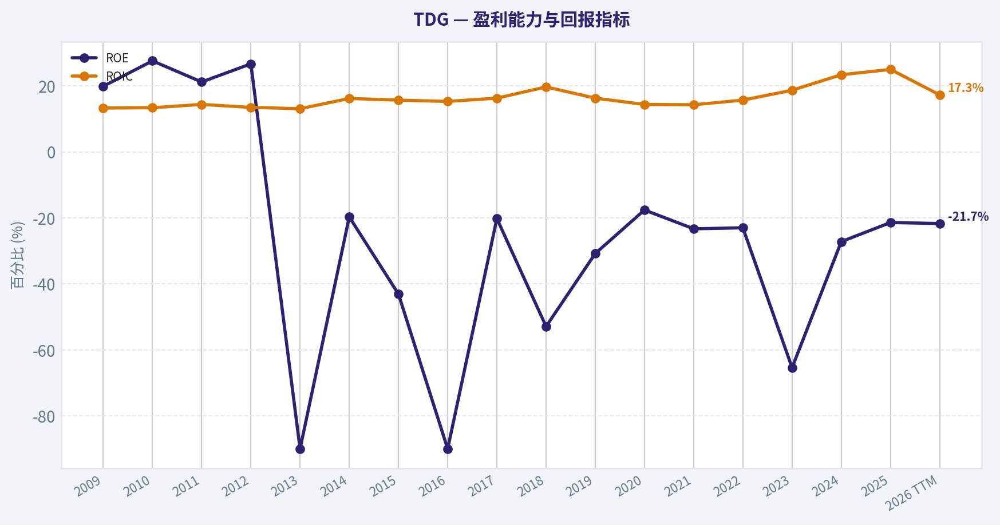
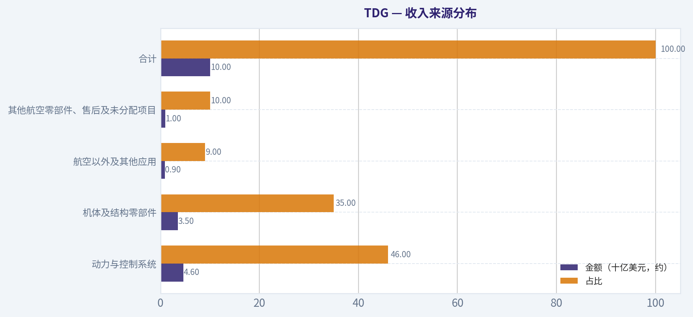
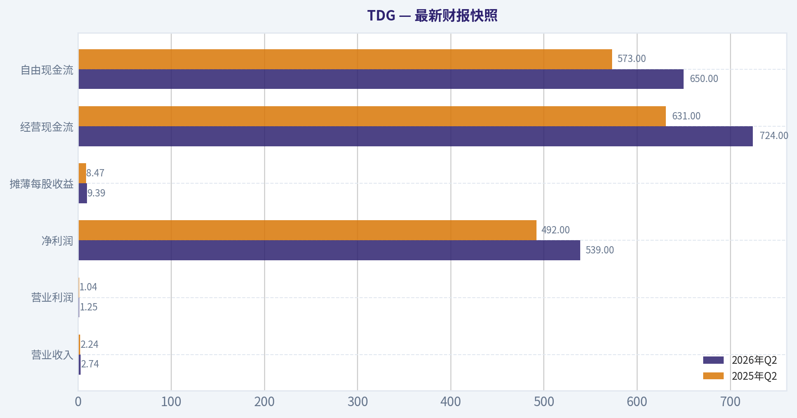
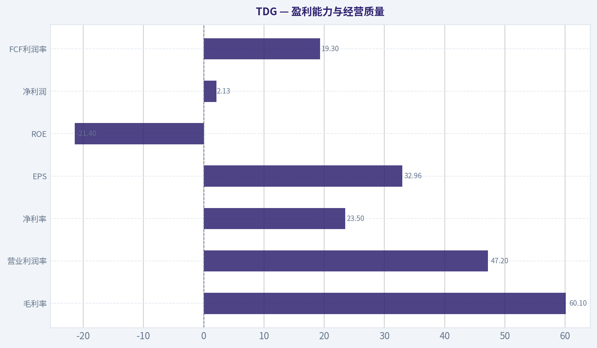
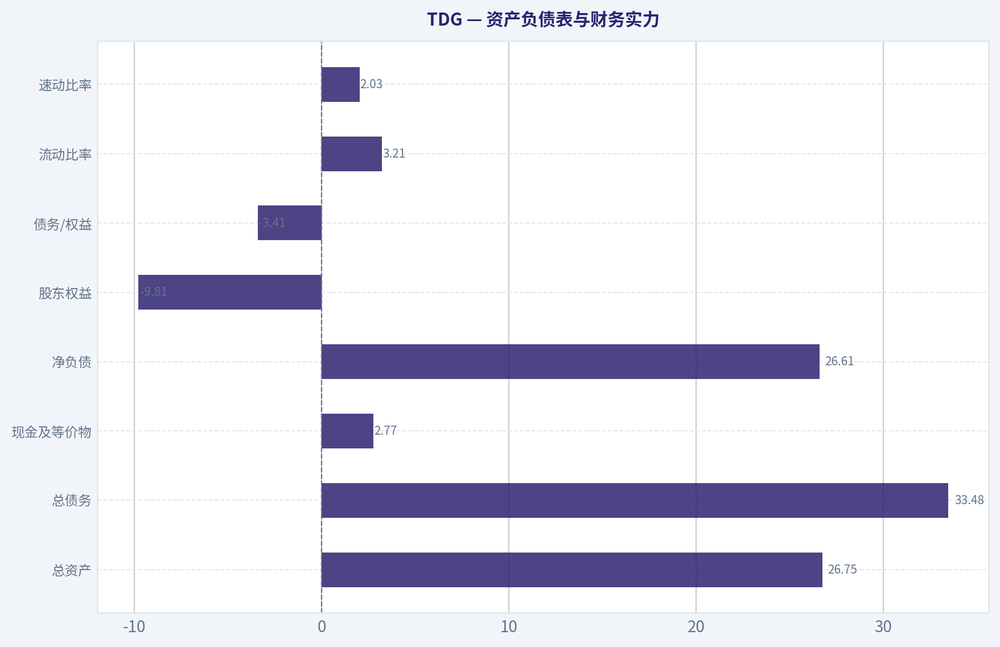
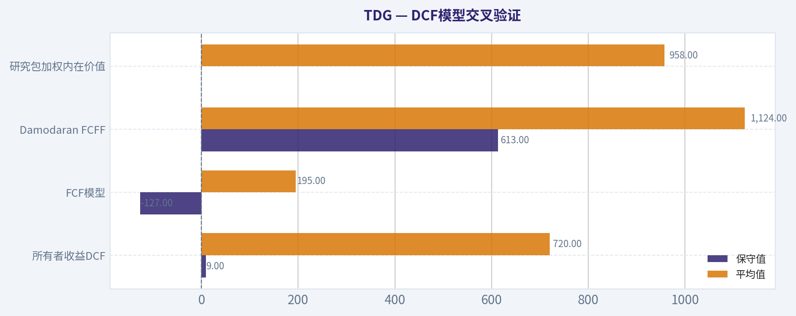
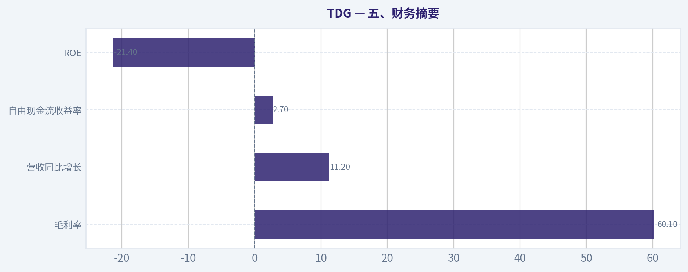
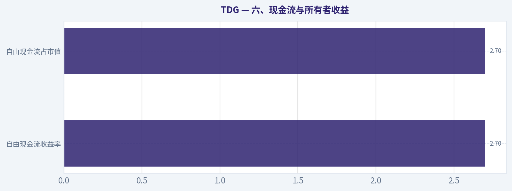

# TDG 深度价值情报

**调研日期:** 2026-11-09

## 关键免责声明

*本报告由 Deep Value Intelligence（一个基于 AI 的多智能体投资分析框架）自动生成。 仅供教育和研究用途 - 非财务建议，非财务顾问。*

---

## 目录

1. 情报摘要
2. 分析师团队报告
   - 基本面分析
   - 价值分析 (巴菲特)
   - 成长性分析 (林奇/德鲁肯米勒/费雪)
   - 市场分析
   - 期权市场分析
3. 研究团队评论
4. 投资团队评论
5. Deep Values 团队洞察

---

## 情报摘要

### 核心观点与前提条件

**核心论点:** TDG 是高质量、宽护城河的航空零部件复利企业，但当前价格尚未证明具备安全边际。

**主要风险:**
- 原计划是维持WATCH、等待更低价格或更充分的现金流与债务证据。该方向保留，但不再机械锚定1,000美元，也不要求所有不确定性完全消失。
- **中性**

**置信度:** 中

---

## 分析师团队报告

### 基本面分析

#### 最新财报快照

*以下数据基于最近一期已披露财报（2026年Q2），并尽量与上一年同期对比。*

| 指标 | 2026年Q2 | 2025年Q2 | 同比变化 |
| --- | ---: | ---: | ---: |
| 营业收入 | $2.74B | $2.24B | +22.5% |
| 营业利润 | $1.25B | $1.04B | +19.3% |
| 净利润 | $539.0M | $492.0M | +9.6% |
| 摊薄每股收益 | $9.39 | $8.47 | +10.9% |
| 经营现金流 | $724.0M | $631.0M | +14.7% |
| 自由现金流 | $650.0M | $573.0M | +13.4% |

关键结论：这张快照先把最新一期财报放在桌面上，再去看长周期分析。这样读者能更清楚地区分"公司长期质量"和"这次财报发生了什么"。

#### TDG 17年财务指标

*以下数值均由原始数据确定性计算得出，并非 AI 估算。*

*发行人类型：operating company（Industrials / Aerospace & Defense）。*

#### 17年财务指标
*年度行来自已披露财务报表，最后一行 TTM 由最近四个季度滚动计算得出。*

| 指标 | 2009 | 2010 | 2011 | 2012 | 2013 | 2014 | 2015 | 2016 | 2017 | 2018 | 2019 | 2020 | 2021 | 2022 | 2023 | 2024 | 2025 | 2026 TTM |
| --- | --- | --- | --- | --- | --- | --- | --- | --- | --- | --- | --- | --- | --- | --- | --- | --- | --- | --- |
| 市场价格 | $18 | $27 | $35 | $61 | $76 | $115 | $133 | $181 | $190 | $276 | $409 | $395 | $519 | $449 | $721 | $1,265 | $1,318 | $1,197 |
| 总市值 | N/A | $3.07B | $4.15B | $7.40B | $7.31B | $9.67B | $11.40B | $15.42B | $13.28B | $19.64B | $27.88B | $27.22B | $36.47B | $30.54B | $48.23B | $82.49B | $76.71B | $68.71B |
| 市盈率 | N/A | 18.77 | 24.12 | 22.77 | 24.13 | 31.51 | 25.50 | 26.30 | 22.25 | 20.52 | 31.33 | 53.03 | 60.00 | 39.17 | 38.27 | 55.70 | 41.09 | 36.32 |
| 市净率 | N/A | 5.17 | 5.12 | 6.07 | -21.72 | -6.21 | -10.98 | -23.68 | -4.50 | -10.86 | -9.63 | -6.85 | -12.51 | -8.10 | -24.31 | -13.11 | -7.92 | -7.00 |
| ROE | 19.9% | 27.6% | 21.2% | 26.7% | -90.0% | -19.7% | -43.1% | -90.0% | -20.2% | -52.9% | -30.8% | -17.6% | -23.3% | -23.0% | -65.4% | -27.2% | -21.4% | -21.7% |
| ROIC | 13.3% | 13.4% | 14.4% | 13.5% | 13.1% | 16.2% | 15.7% | 15.3% | 16.3% | 19.7% | 16.3% | 14.4% | 14.3% | 15.7% | 18.7% | 23.4% | 25.0% | 17.3% |
| 每股收益 | N/A | $1.42 | $1.45 | $2.68 | $3.13 | $3.66 | $5.21 | $6.87 | $8.53 | $13.47 | $13.06 | $7.45 | $8.65 | $11.45 | $18.83 | $22.70 | $32.08 | $32.96 |
| 营收 | $761.6M | $827.7M | $1.21B | $1.70B | $1.92B | $2.37B | $2.71B | $3.17B | $3.50B | $3.81B | $5.22B | $5.10B | $4.80B | $5.43B | $6.58B | $7.94B | $8.83B | $10.01B |
| 毛利润 | $429.3M | $473.1M | $661.2M | $945.7M | $1.05B | $1.27B | $1.45B | $1.73B | $1.98B | $2.18B | $2.81B | $2.65B | $2.51B | $3.10B | $3.84B | $4.67B | $5.31B | $5.96B |
| 毛利率 | 56.4% | 57.2% | 54.8% | 55.6% | 54.5% | 53.4% | 53.6% | 54.5% | 56.6% | 57.1% | 53.8% | 51.9% | 52.4% | 57.1% | 58.3% | 58.8% | 60.1% | 59.6% |
| 营业利润率 | 44.0% | 43.9% | 40.4% | 41.2% | 38.9% | 39.1% | 39.7% | 40.0% | 42.3% | 43.4% | 36.9% | 34.3% | 35.2% | 40.8% | 44.4% | 44.5% | 47.2% | 46.5% |
| 净利润 | $162.9M | $163.4M | $172.1M | $325.0M | $302.8M | $306.9M | $447.2M | $586.4M | $596.9M | $957.0M | $890.0M | $699.0M | $680.0M | $866.0M | $1.30B | $1.71B | $2.07B | $2.13B |
| 净利率 | 21.4% | 19.7% | 14.3% | 19.1% | 15.7% | 12.9% | 16.5% | 18.5% | 17.0% | 25.1% | 17.0% | 13.7% | 14.2% | 16.0% | 19.7% | 21.6% | 23.5% | 21.3% |
| 营收增长 | N/A | 8.7% | 45.7% | 41.0% | 13.2% | 23.3% | 14.1% | 17.2% | 10.5% | 8.8% | 37.1% | -2.3% | -6.0% | 13.2% | 21.3% | 20.6% | 11.2% | 13.3% |
| 净利润增长 | N/A | 0.3% | 5.3% | 88.8% | -6.8% | 1.4% | 45.7% | 31.1% | 1.8% | 60.3% | -7.0% | -21.5% | -2.7% | 27.4% | 49.9% | 32.0% | 21.0% | 2.7% |
| 自由现金流增长 | N/A | 0.3% | 31.4% | 60.4% | 11.8% | 16.7% | -8.1% | 37.2% | 12.3% | 32.2% | -3.8% | 21.4% | -27.1% | 2.6% | 49.1% | 52.1% | -3.4% | 6.1% |
| 总账面价值 | $819.2M | $593.0M | $810.9M | $1.22B | $-336.4M | $-1.56B | $-1.04B | $-651.5M | $-2.95B | $-1.81B | $-2.89B | $-3.97B | $-2.92B | $-3.77B | $-1.98B | $-6.29B | $-9.69B | $-9.81B |
| 总资产 | $2.45B | $2.68B | $4.51B | $5.46B | $6.15B | $6.76B | $8.30B | $10.73B | $9.98B | $12.20B | $16.25B | $18.39B | $19.32B | $18.11B | $19.97B | $25.59B | $22.91B | $26.75B |
| 总债务 | $1.36B | $1.77B | $3.14B | $3.62B | $5.73B | $7.27B | $8.15B | $10.00B | $11.46B | $12.58B | $16.55B | $19.66B | $19.93B | $19.52B | $19.47B | $24.49B | $29.41B | $33.48B |
| 债务股权比 | 1.66 | 2.99 | 3.87 | 2.97 | -17.04 | -4.67 | -7.85 | -15.34 | -3.88 | -6.95 | -5.72 | -4.95 | -6.83 | -5.17 | -9.81 | -3.89 | -3.04 | -3.41 |
| 现金及等价物 | $190.2M | $234.1M | $376.2M | $440.5M | $564.7M | $819.5M | $714.0M | $1.59B | $650.6M | $2.07B | $1.47B | $4.72B | $4.79B | $3.00B | $3.47B | $6.26B | $2.81B | $2.77B |
| 股东权益 | $819.2M | $593.0M | $810.9M | $1.22B | $-336.4M | $-1.56B | $-1.04B | $-651.5M | $-2.95B | $-1.81B | $-2.89B | $-3.97B | $-2.92B | $-3.77B | $-1.98B | $-6.29B | $-9.69B | $-9.81B |
| 经营现金流 | $197.1M | $197.3M | $260.4M | $413.9M | $470.2M | $541.2M | $520.9M | $683.3M | $788.7M | $1.02B | $1.01B | $1.21B | $913.0M | $948.0M | $1.38B | $2.04B | $2.04B | $2.20B |
| 投资现金流 | $-168.4M | $-176.6M | $-1.40B | $-876.3M | $-502.4M | $-329.6M | $-1.68B | $-1.44B | $-287.0M | $-684.0M | $-3.89B | $799.0M | $-785.0M | $-553.0M | $-900.0M | $-2.44B | $-595.0M | $-3.62B |
| 自由现金流 | $184.0M | $184.4M | $242.4M | $388.6M | $434.7M | $507.1M | $466.1M | $639.3M | $717.7M | $949.0M | $913.0M | $1.11B | $808.0M | $829.0M | $1.24B | $1.88B | $1.82B | $1.93B |
| 自由现金流利润率 | 24.2% | 22.3% | 20.1% | 22.9% | 22.6% | 21.4% | 17.2% | 20.2% | 20.5% | 24.9% | 17.5% | 21.7% | 16.8% | 15.3% | 18.8% | 23.7% | 20.6% | 19.3% |
| 每股分红 | N/A | $0.00 | $0.00 | $0.00 | $0.00 | $0.00 | $0.00 | $0.00 | $0.00 | $0.00 | $0.00 | $0.00 | $0.00 | $16.02 | $0.57 | $31.25 | $165.45 | $92.20 |

#### 盈利能力指标
- 净资产收益率 (ROE): -21.4%
- 投入资本回报率 (ROIC): 19.4%
- 总资产收益率 (ROA): 9.1%
- 毛利率: 60.1%
- 营业利润率: 47.2%
- 净利率: 23.5%

#### 流动性指标
- 流动比率: 3.21
- 速动比率: 2.03

#### 杠杆指标
- 债务股权比: -3.04
- 利息覆盖倍数: 2.65
- 净负债: $26.61B

#### 增长指标（同比）
- 营收增长: 11.2%
- 净利润增长: 21.0%
- 自由现金流增长: -3.4%
- 营收复合增长率（3年）: 17.6%
- 营收复合增长率（5年）: 11.6%

#### 估值指标
- 市盈率 (TTM): 36.31
- 预期市盈率: 24.60
- 市净率: N/A
- 市销率: 6.69
- PEG 比率: 3.05
- 企业价值/EBITDA: 19.03
- 自由现金流收益率: 2.7%
- 盈利收益率: 2.8%

#### 所有者收益（巴菲特方法，代码计算）
- 净利润: $2.07B
- + 折旧与摊销: $367.0M
- - 资本开支: $-222.0M
- - 营运资本变动: $-558.0M
- = **所有者收益: $2.78B**

#### 内在价值（代码计算）
- 当前价格: $1,197
- **头条内在价值（按商业模式路由）: $958**
  商业模式: asset light platform - weighted blend [Damodaran FCFF + reverse-DCF fair + owner-earnings DCF] (asset_light_platform)
  模型区间（各 DCF 最小-最大）: $195 - $1,124
  相对价格的安全边际（头条）: -24.9%
  路由说明: Asset-light / high-margin platform: value driven by margins and reinvestment economics - the headline centers on the reverse-DCF demonstrated-growth fair value with Damodaran FCFF as a floor, down-weighting the owner-earnings DCF.
- 巴菲特方法（所有者收益）:
  保守: $9
  平均: $720
  乐观: $2,004
- 现金流方法（FCF）:
  保守: $-127
  平均: $195
  乐观: $821
- Damodaran FCFF（WACC + 利润率 + 再投资）:
  保守: $613
  平均: $1,124
  乐观: $1,581
  蒙特卡洛区间（P10-P90）：$659 - $1,863（中位数 $1,095）
  P(内在价值 > 当前价格)：41.2%
- 反向 DCF：当前价格隐含约 29.5%/年 的所有者收益增长（10年）；过去 3 年为 29.1%，5 年为 36.1%。

#### Piotroski F分数: 6/9
- 净利润为正: 通过
- 经营现金流为正: 通过
- 资产回报率改善: 通过
- 现金流大于净利润: 未通过
- 债务下降: 未通过
- 流动比率改善: 通过
- 未稀释股本: 未通过
- 毛利率改善: 通过
- 资产周转率改善: 通过

ANALYST STANCE: **中性**

#### 投资结论

TDG（TransDigm Group）是一家拥有显著竞争优势的航空航天零部件企业：产品通常经过认证、替换成本高、客户对停飞风险极其敏感，因此具备较强定价权和高利润率。当前经营质量仍然优秀，但股价已经反映了非常激进的长期增长假设。

当前股价约为 **1,197美元**，市值约 **669.5亿美元**，PE约 **36.3倍**。基于研究包的加权内在价值约 **958美元**，意味着当前价格较模型价值高约 **24.9%**。反向DCF显示，当前价格隐含未来十年所有者收益年增长约 **29.5%**，而过去三年和五年的增速分别约为 **29.1%** 和 **36.1%**。这说明价格并非完全脱离历史增长，但要求未来继续保持极高增长，安全边际不足。

---

#### 当前核心指标与十年均值比较

下表的历史均值采用确定性数据中最近十个完整年度，即2016年至2025年；当前值采用研究包中的最新TTM或当前快照。部分当前快照与年度表因报告时点、股本变化和滚动口径存在轻微差异。

| 指标 | 当前值 | 最近十年均值 | 当前相对历史 | 解释 |
|---|---:|---:|---|---|
| 市场价格 | $1,197 | 约$572 | 显著高于均值 | 反映长期增长、定价权和资本回报预期 |
| 总市值 | $66.95B | 约$37.8B | 高约77% | 规模扩张和估值提升共同推动 |
| PE | 36.3倍 | 约38.8倍 | 略低于均值 | 绝对估值仍高，但低于近十年均值 |
| ROIC | 19.4% | 约17.9% | 高于均值 | 资本配置和并购后的盈利能力较强 |
| ROE | -21.4% | 长期受负权益扭曲 | 不具可比性 | 大规模回购和杠杆导致股东权益为负 |
| 营收 | $10.01B | 约$5.44B | 约为均值1.84倍 | 十年规模扩张明显 |
| 营业利润率 | 47.2% | 约40.9% | 高约6.3个百分点 | 定价权、专利和售后市场经济性突出 |
| 净利润 | $2.13B | 约$1.04B | 约为均值2.06倍 | 盈利规模远高于历史平均 |
| 自由现金流 | $1.93B | 约$1.09B | 约为均值1.77倍 | 现金创造能力强，但波动受并购和营运资本影响 |
| 营收增长 | 11.2% | 约13.2% | 略低于均值 | 仍然健康，但不再处于最强增长阶段 |
| 净利润增长 | 21.0% | 约19.2% | 略高于均值 | 利润增长仍快于收入增长 |
| FCF增长 | -3.4% | 历史波动较大 | 低于均值 | 当前现金流受到营运资本和投资节奏压制 |
| 毛利率 | 60.1% | 约55%附近 | 明显高于均值 | 业务组合和涨价能力持续改善 |
| 现金及等价物 | $2.77B | 约$3.0B附近 | 接近历史水平 | 现金不低，但相对于债务规模仍有限 |
| 总债务 | $33.48B | 约$19.9B | 显著高于均值 | 并购、特别股息和回购导致杠杆持续升高 |

**关键结论：** TDG当前的经营指标大多高于十年平均，尤其是利润率、ROIC、收入规模和净利润。问题主要不在业务质量，而在估值和资本结构：收入增长已经回归中双位数，然而市场仍给予接近高增长复利股的定价。

---

#### 市场估值分析

| 估值指标 | 当前数据 | 历史或模型参照 | 判断 |
|---|---:|---:|---|
| PE | 36.3倍 | 十年均值约38.8倍 | 相对自身历史略便宜，但绝对值偏高 |
| 预期PE | 24.6倍 | 需依赖未来盈利兑现 | 反映市场预期盈利增长较快 |
| 市销率 | 6.69倍 | 高利润率企业可享受溢价 | 已充分体现优质商业模式 |
| EV/EBITDA | 19.03倍 | 工业企业中偏高 | 杠杆使企业价值明显高于股权价值 |
| FCF收益率 | 2.7% | 与长期债券和风险相比不高 | 现金回报不足以提供明显安全边际 |
| PEG | 3.05 | 通常高于合理增长匹配水平 | 估值相对增长速度偏贵 |
| 研究包加权内在价值 | $958 | 当前价格$1,197 | 高估约24.9% |
| Damodaran FCFF区间 | $613至$1,581 | 中值模型约$1,124 | 对增长和利润率非常敏感 |
| 蒙特卡洛内在价值 | P10至P90：$659至$1,863 | 中位数约$1,095 | 当前价格处于分布中高位 |

**关键结论：** PE并没有明显高于TDG自身历史均值，但这并不足以证明股票便宜，因为当前利润和现金流也处于历史高位，而且企业债务大幅上升。更重要的是，2.7%的FCF收益率和约3.05的PEG表明，投资者需要为未来多年高增长支付较高价格。

---

#### 盈利能力与经营质量

| 指标 | 当前值 | 历史特征 | 分析 |
|---|---:|---|---|
| 毛利率 | 60.1% | 历史约52%至60% | 长期高位，显示产品差异化和售后定价权 |
| 营业利润率 | 47.2% | 历史约34%至47% | 明显改善，处于十七年最高区域之一 |
| 净利率 | 23.5% | 历史约13%至25% | 高于大多数工业企业 |
| EPS | $32.96 | 2010年$1.42 | 长期复合增长显著 |
| ROIC | 19.4%摘要值，年度表TTM为17.3% | 十年均值约17.9% | 仍然优秀，但需注意当前口径差异 |
| ROE | -21.4% | 多数年份为负 | 被负股东权益扭曲，不适合作为经营质量的主要判断依据 |
| 净利润 | $2.13B | 十年均值约$1.04B | 规模约为历史均值两倍 |
| FCF利润率 | 19.3% | 历史约15%至25% | 仍然健康，但低于高点 |

**关键结论：** TDG最重要的质量信号不是ROE，而是ROIC、营业利润率和自由现金流。负ROE并不代表经营亏损，而是由负股东权益造成；这种负权益主要与回购、杠杆融资和资本返还政策有关。因此，TDG应以ROIC和现金流回报判断，而不是机械地以ROE或P/B判断。

---

#### 资产负债表与财务实力

| 指标 | 当前值 | 评价 |
|---|---:|---|
| 总资产 | $26.75B | 资产规模较十年前明显扩大 |
| 总债务 | $33.48B | 高于总资产，杠杆非常高 |
| 现金及等价物 | $2.77B | 现金储备尚可，但相对于债务偏小 |
| 净负债 | $26.61B | 对股权估值构成重大压力 |
| 股东权益 | -$9.81B | 负权益，主要由回购、杠杆和资本返还造成 |
| 债务/权益 | -3.41 | 因负权益而失去传统解释意义 |
| 流动比率 | 3.21 | 短期流动性较强 |
| 速动比率 | 2.03 | 短期偿债能力尚可 |
| 利息覆盖倍数 | 2.65倍 | 可承受，但缓冲并不宽裕 |
| Piotroski F分数 | 6/9 | 基本健康，但债务和股本项目扣分 |

**关键结论：** TDG的短期流动性并不差，但长期财务风险明显高于普通工业企业。利息覆盖倍数只有约2.65倍，意味着如果航空周期恶化、利率上升或并购整合不顺，股东现金流可能首先被债务服务占用。负股东权益使债务/权益比失去正常意义，应重点观察净负债、利息覆盖和自由现金流对债务的覆盖能力。

---

#### P/B的适用性说明

TDG的P/B在历史数据中长期为负，当前也被标记为不具意义。原因是股东权益约为 **负98.1亿美元**，导致账面价值无法作为企业价值的合理代理。

TDG是高利润率、强知识产权和认证壁垒驱动的经营企业，真正有价值的资产包括认证、客户关系、专有设计、维修替换需求和售后市场份额，这些资产并不能完整体现在账面权益中。因此，不能把负P/B解读为"极度便宜"，也不能用传统账面清算价值估值。对于TDG，应优先使用FCF、所有者收益、FCFF、ROIC和反向DCF。

---

#### 增长趋势与盈利可预测性

TDG过去十多年收入从约 **7.62亿美元** 增长至当前约 **100.1亿美元**，EPS从2010年的 **1.42美元** 增长至当前约 **32.96美元**。增长并非每年线性，但长期方向非常明确。

主要特征包括：

- 2011年至2012年、2018年至2019年以及2022年至2025年出现较强扩张。
- 2020年至2021年收入受到航空业冲击，分别下降约2.3%和6.0%，说明公司并非完全免疫周期。
- 2023年至2025年恢复强劲，收入增长分别约21.3%、20.6%和11.2%。
- 当前净利润增长约21%，高于收入增长，说明经营杠杆和涨价仍在发挥作用。
- FCF增长为负或偏弱，主要反映营运资本投入、并购付款和资本开支时点，而不是利润崩溃。

TDG的收益可预测性高于一般工业企业，但低于消费必需品或软件订阅公司。其收入受到航空公司机队利用率、飞机交付、维修周期、军用需求和并购整合影响。

---

#### 经济护城河与商业质量

TDG的护城河主要来自以下几方面：

1. **监管认证壁垒**
   航空零件必须经过严格认证，客户更换供应商需要重新验证，时间和风险成本高。

2. **高替换成本与停机损失**
   航空公司更关心飞机能否按时飞行，而不是零件价格最低。因此关键零件供应商拥有较强议价权。

3. **售后市场收入**
   许多零件在原始设备销售后仍能通过维修、替换和升级持续产生高毛利收入。售后市场通常比初始设备市场更具定价权。

4. **产品分散与客户黏性**
   TDG拥有大量小型、关键但不可替代的零件，单一零件金额不大，却可能影响整架飞机的运行。

5. **并购与运营改善能力**
   公司长期通过收购航空零部件资产，再通过提高价格、改善成本结构和拓展售后市场来提升回报。

主要弱点是：

- 并购需要大量资本，持续收购质量决定长期回报。
- 高债务会放大股东回报，也会放大周期风险。
- 监管、事故、产品责任或质量问题可能造成非线性损失。
- 航空制造商和大型航空客户具有一定议价能力。
- 估值已要求公司持续保持高增长，容错率有限。

---

#### 管理层与资本配置

TDG的管理层在运营效率、定价和并购整合方面表现突出。ROIC长期保持在较高水平，营业利润率从历史低谷约34%提升至当前约47%，说明资本投入具有较强的经济回报。

但资本配置存在两面性：

- 公司并不依赖稳定普通股息，而是更倾向于特别股息、回购和杠杆融资。
- 2022年至2026年每股分红数据明显波动，最新TTM每股分红约92.20美元，2025年甚至达到约165.45美元。
- 这种政策能够迅速向股东返还现金，但会降低资产负债表安全垫。
- 未稀释股本项目在Piotroski评分中未通过，说明回购与融资安排并未持续改善股东资本结构。
- 债务未下降，也在Piotroski评分中扣分。

从巴菲特角度看，管理层展现了优秀的经营能力，但资本结构并不保守。它更像是"高质量业务加高杠杆资本配置"，而不是典型的无债务复利企业。

---

#### 收入来源分布

TDG的精确分部数据在当前确定性数据中未单独列示。以下为基于公司公开业务结构和最近约100亿美元收入规模的近似拆分，主要用于理解收入来源，而非替代公司正式分部披露。

| 收入来源 | 金额（十亿美元，约） | 占比 |
|---|---:|---:|
| 动力与控制系统 | $4.6 | 46% |
| 机体及结构零部件 | $3.5 | 35% |
| 航空以外及其他应用 | $0.9 | 9% |
| 其他航空零部件、售后及未分配项目 | $1.0 | 10% |
| 合计 | $10.0 | 100% |

**关键结论：** TDG收入主要来自动力与控制系统以及机体结构零部件，均属于认证壁垒高、替换需求稳定的航空零部件领域。收入来源并非单一产品驱动，但整体仍集中于航空产业链，因此航空周期、飞机利用率和维修需求是最重要的外部变量。

---

#### 巴菲特式所有者收益DCF

当前所有者收益计算如下：

- 净利润：约 **20.7亿美元**
- 加：折旧与摊销：约 **3.67亿美元**
- 减：资本开支：约 **2.22亿美元**
- 减：营运资本变动：约 **5.58亿美元**
- 所有者收益：约 **27.8亿美元**

按当前市值约669.5亿美元和股价1,197美元估算，稀释后股数约为：

\[
669.5亿美元 \div 1,197美元 \approx 5,594万股
\]

当前每股所有者收益约为：

\[
27.8亿美元 \div 5,594万股 \approx 49.7美元
\]

这意味着当前股价对应所有者收益收益率约为 **4.2%**。如果采用研究包中更严格的FCF口径，则FCF收益率只有约 **2.7%**，反映出营运资本和资本支出调整对现金回报的影响。

为避免把高增长永久外推，以下采用十年显性预测，并让增长率逐步下降至2.5%的终值增长率。考虑到TDG净负债较高，最终股权价值应在企业价值基础上扣除净负债；因此结果对债务、再投资需求和营运资本假设非常敏感。

| 情景 | 显性期增长假设 | 折现率 | 终值增长 | 所有者收益模型参考值 | 解释 |
|---|---:|---:|---:|---:|---|
| 保守 | 初始约3%，逐步降至2.5% | 10%至11% | 2.5% | $9至约$200 | 假设增长快速放缓，并充分计入债务和再投资压力 |
| 平均 | 初始约12%，逐步降至2.5% | 10% | 2.5% | 约$720 | 反映长期收入增长、利润率和并购能力保持良好 |
| 乐观 | 初始约18%，逐步降至2.5% | 9.5%至10% | 2.5% | 约$2,004 | 假设高质量并购、涨价和售后市场持续多年 |

**关键结论：** 所有者收益DCF的结果区间极宽，原因不是计算错误，而是TDG的估值高度依赖未来增长、债务和再投资假设。研究包中的所有者收益模型给出的保守、平均和乐观值分别约为9美元、720美元和2,004美元；这种巨大分散说明当前1,197美元价格只有在接近乐观情景时才具有充足支撑。

---

#### DCF模型交叉验证

| 模型 | 保守值 | 平均值 | 乐观值 | 当前股价相对模型 |
|---|---:|---:|---:|---|
| 所有者收益DCF | $9 | $720 | $2,004 | 高于平均值，低于乐观值 |
| FCF模型 | -$127 | $195 | $821 | 高于全部中性情景 |
| Damodaran FCFF | $613 | $1,124 | $1,581 | 接近平均至乐观区间 |
| 研究包加权内在价值 | - | $958 | - | 当前高约24.9% |
| 反向DCF | - | 隐含增长29.5% | - | 要求持续高增长 |

**关键结论：** 不同模型对TDG的估值差异极大，说明结果对净负债、资本开支、营运资本和终值假设高度敏感。研究包采用资产轻型、高利润平台路由后给出约958美元的加权价值，但这仍低于当前股价；FCFF模型较为乐观，而传统FCF模型较为谨慎。

---

#### 主要风险、机会与监控指标

| 类型 | 具体内容 | 对投资的意义 |
|---|---|---|
| 机会 | 航空维修和售后市场持续增长 | 有利于维持高毛利和定价权 |
| 机会 | 高认证壁垒和关键零件地位 | 支持长期护城河 |
| 机会 | 净利润增长仍高于收入增长 | 说明运营杠杆尚未完全结束 |
| 机会 | ROIC明显高于普通工业企业 | 并购和资本投入具有较强回报潜力 |
| 风险 | 净债务约266亿美元 | 高杠杆压缩股东安全边际 |
| 风险 | 利息覆盖倍数约2.65倍 | 周期下行时利润缓冲有限 |
| 风险 | FCF增长偏弱 | 利润增长尚未完全转化为现金增长 |
| 风险 | 当前价格隐含约29.5%长期增长 | 对执行和市场情绪要求过高 |
| 风险 | 负股东权益 | P/B、ROE和债务/权益无法正常解释 |
| 风险 | 并购依赖 | 收购价格过高或整合失败会破坏ROIC |
| 风险 | 航空周期和监管风险 | 需求下滑、事故或质量事件可能导致估值重估 |
| 监控 | 净负债/EBITDA、利息覆盖倍数 | 判断杠杆是否开始失控 |
| 监控 | FCF与净利润差额 | 判断盈利质量和营运资本压力 |
| 监控 | 售后市场收入及营业利润率 | 判断护城河是否继续扩大 |
| 监控 | 并购价格与并购后ROIC | 判断资本配置是否仍然有效 |

**关键结论：** 最大机会是TDG继续利用认证壁垒和售后市场实现高利润增长；最大风险则是高杠杆与高估值叠加。投资者不应只看EPS增长，还必须确认自由现金流、净负债和利息覆盖同步改善。

---

#### 最终判断

TDG是一个**优秀但昂贵、强劲但高杠杆**的企业。

从巴菲特式质量标准看，公司拥有：

- 持久的认证和售后市场护城河；
- 高且改善中的毛利率和营业利润率；
- 长期优秀的ROIC；
- 较强的收入、EPS和净利润增长；
- 较高的产品和客户黏性。

但从价值投资的价格纪律看，公司存在明显不足：

- 当前股价高于加权内在价值约24.9%；
- FCF收益率仅约2.7%；
- 净债务约266亿美元；
- 利息覆盖倍数只有约2.65倍；
- 反向DCF要求未来十年所有者收益增长约29.5%；
- 当前价格需要持续接近乐观情景才能提供理想回报。

因此，当前更适合等待更好的买入价格，或等待自由现金流增长、债务下降和估值回落后再提高仓位。若股价回落至模型中性价值附近，约 **900至1,000美元** 区间，且经营指标没有恶化，风险收益比将明显改善。

| 项目 | 核心判断 |
|---|---|
| 商业质量 | 高质量航空零部件和售后市场企业 |
| 护城河 | 认证壁垒、替换成本、定价权、客户黏性 |
| 盈利能力 | 毛利率约60%，营业利润率约47%，显著优于一般工业企业 |
| 增长 | 长期强劲，当前收入增长约11%，利润增长约21% |
| 现金流 | 绝对额强，但当前增速偏弱且受营运资本影响 |
| 财务实力 | 短期流动性良好，长期杠杆偏高 |
| 管理层 | 运营和并购能力优秀，但资本结构激进 |
| 估值 | PE相对历史均值不算极端，但绝对估值和FCF收益率偏贵 |
| 安全边际 | 当前不足，价格高于研究包加权内在价值 |
| 最适合策略 | 等待回调、债务改善或现金流加速后再考虑增持 |
| 最终立场 | **中性** |

#### 基本面关键图表

本图追踪 **TDG** 过去十年的盈利能力与回报指标（ROE、ROIC、利润率），突出呈现资本效率的变化趋势。

本对比图（来自「收入来源分布」）将 **TDG** 的当前数据与历史基准并排呈现，直观反映公司相对自身历史均值的估值水平。

---

### 价值分析 (巴菲特)

> *基于沃伦·巴菲特的价值投资哲学：能力圈、经济护城河、管理层质量与安全边际。*

#### 内在价值快照

价格是你付的钱，内在价值是企业未来可能为股东创造的现金价值。我们给出一个区间，而不是假装只有一个神奇数字。

- 当前价格: $1,197.01
- 估值区间（两种 DCF 方法、保守到乐观）: $-126.90 至 $2,004.01

##### 所有者收益（巴菲特方法）
- 净利润: $2,074,000,000.00
- 折旧与摊销: $367,000,000.00
- 资本支出: $-222,000,000.00
- 营运资金变化: $-558,000,000.00
- 所有者收益: $2,777,000,000.00

##### 内在价值
###### 所有者收益法
使用所有者收益，更严格，通常更保守。
- 保守: $8.88
- 平均: $719.58
- 乐观: $2,004.01
- 折现率: 10.0%

###### 自由现金流法
使用自由现金流，更适合今天投入很多、为未来增长铺路的公司。
- 保守: $-126.90
- 平均: $195.04
- 乐观: $820.64
- 折现率: 10.0%

ANALYST STANCE: **中性**

#### 一、投资结论

TDG，即 TransDigm Group，是一家具有显著护城河的航空航天零部件与售后服务公司。其核心优势来自大量专有零部件、认证壁垒、航空客户的高更换成本，以及在售后市场中的定价能力。

但当前股价约为 **1,197美元**，明显高于按多模型加权得到的内在价值 **958.29美元**。当前价格隐含未来十年约 **29.5%的年增长率**，而过去三年和五年的历史增长率分别约为 **29.1%** 和 **36.1%**。这意味着市场已经将极高的增长预期计入股价，安全边际不足。

TDG是"好公司"，但目前不是"好价格"。更合理的策略是等待估值回落，或等待未来盈利增长进一步消化估值。

#### 二、因素评分

| 因素 | 评分 | 主要依据 |
|---|---:|---|
| 因素一：能力圈与商业模式简单性 | 4/5 | 通过销售航空零部件、维修服务和售后产品获利，模式相对清晰；航空认证和产品组合提高了长期可预测性 |
| 因素二：护城河 | 4/5 | 专有零部件、认证壁垒、客户更换成本和售后市场定价权构成宽护城河 |
| 因素三：管理层与资本配置 | 4/5 | 长期重视并购、运营效率和每股价值；但较积极的资本结构和并购策略需要持续审慎观察 |
| 因素四：行业结构 | 4/5 | 航空零部件认证周期长、竞争者有限，售后市场通常比原始设备市场更具吸引力 |

**第五道硬门槛：未触发。** 目前没有证据显示公司同时存在持续恶化的盈利或现金流趋势，以及利息覆盖不足、严重资不抵债等偿付能力红线。流动比率约为 **3.21倍**，表明短期流动性较强。

**关键结论：** TDG的质量评分较高，核心问题不是商业模式，而是价格。护城河和行业结构足以支持长期持有逻辑，但当前估值要求公司持续实现接近历史高端的增长。

#### 三、护城河分析

| 护城河来源 | TDG的具体体现 | 强度判断 |
|---|---|---|
| 无形资产与监管认证 | 航空零部件需要长期认证，专有设计和适航批准构成进入壁垒 | 强 |
| 客户转换成本 | 航空公司和维修机构更换已认证零件，需要重新验证、测试并承担运营风险 | 强 |
| 售后市场定价权 | 飞机投入运营后，零件可靠性、交付速度和认证状态往往比单纯价格更重要 | 强 |
| 规模与成本优势 | 大量产品、全球客户网络和成熟供应链提升采购及运营效率 | 中强 |
| 网络效应 | 不是典型互联网网络效应，但庞大的机队覆盖和客户关系可强化产品渗透 | 中等 |

TDG最有价值的资产不是工厂本身，而是经过认证的专有零件组合，以及这些零件在飞机生命周期内形成的售后需求。飞机服役周期通常较长，客户更换供应商的经济和安全成本较高。

#### 四、管理层与资本配置

TDG的管理模式长期强调：

- 通过并购获得具有专有产品和售后收入的资产；
- 提高产品定价和运营效率；
- 将资本集中到高回报的航空售后市场；
- 关注每股盈利和现金流，而不只是收入规模。

这种模式具有明显的价值创造潜力，因为航空售后零件通常具有较高毛利和较长生命周期。但该模式也伴随着两个风险：

1. 并购价格过高会削弱未来回报；
2. 使用债务或激进资本结构进行扩张，会放大经营波动。

综合判断，管理层的资本配置能力较强，但并非无风险型管理团队，应持续关注并购回报、债务变化和自由现金流转化率。

#### 五、财务摘要

| 指标 | 最新数据 |
|---|---:|
| 股价 | 1,197美元 |
| 总市值 | 669.5亿美元 |
| PE | 36.3倍 |
| 毛利率 | 60.1% |
| 营收同比增长 | 11.2% |
| 自由现金流收益率 | 2.7% |
| 流动比率 | 3.21倍 |
| ROE | -21.4% |
| 头条内在价值 | 958.29美元 |
| 当前价格相对内在价值 | 高估约24.9% |

**关键结论：** TDG拥有约60%的毛利率，显示出强定价权和高质量产品组合。自由现金流收益率只有2.7%，意味着投资者为每一美元当前自由现金流支付的价格较高。ROE为负值不能简单解读为经营恶化，可能受到回购、商誉和资本结构影响，但仍说明不能只依赖ROE判断公司质量。

#### 六、现金流与所有者收益

在现有数据中，自由现金流收益率为 **2.7%**。以总市值669.5亿美元估算：

| 项目 | 估算值 |
|---|---:|
| 总市值 | 669.5亿美元 |
| 自由现金流收益率 | 2.7% |
| 自由现金流估算 | 约18.08亿美元 |
| 自由现金流占市值 | 2.7% |
| 以自由现金流作为所有者收益代理值 | 约18.08亿美元 |

TDG的所有者收益应从净利润中加回折旧摊销，再扣除维持性资本开支及营运资本投入。由于公司并购活动、商誉摊销和资本结构较为复杂，报告采用自由现金流作为较保守的所有者收益代理。

**关键结论：** 按自由现金流估算，TDG目前的现金回报率不高。公司必须继续保持较高增长、较强定价能力和高资本回报，才能证明当前估值合理。

#### 七、三情景估值

以下估值以约18.08亿美元的自由现金流作为所有者收益代理，并采用10%的基础折现率。

| 情景 | 主要假设 | 企业价值估算 | 每股价值估算 |
|---|---|---:|---:|
| 情景一：零增长 | 所有者收益永续不增长，折现率10% | 约180.8亿美元 | 约323美元 |
| 情景二：经济增长 | 永续增长率3%，折现率10% | 约265.9亿美元 | 约475美元 |
| 情景三：历史增长 | 采用历史增长率的50%至75%，增长率上限10% | 需结合逐年现金流与终值建模 | 不宜机械外推 |
| 研究包三模型加权值 | 所有者收益、FCF、Damodaran FCFF加权 | 约536.5亿美元 | 958.29美元 |

情景一和情景二明显低于当前股价，说明单纯依靠稳定现金流和温和增长无法支撑1,197美元的价格。情景三即使使用10%的增长上限，也会因增长率接近折现率而对终值极度敏感，因此不应将高增长永久化。

**关键结论：** 保守估值显示股价需要很高的增长才能成立。研究包提供的多模型加权内在价值为958.29美元，仍低于当前价格约24.9%，估值并未提供足够安全边际。

#### 八、反向估值与安全边际

| 项目 | 数值 |
|---|---:|
| 当前股价 | 1,197美元 |
| 研究包内在价值 | 958.29美元 |
| 当前价格相对内在价值 | 高估约24.9% |
| 当前价格隐含十年年增长率 | 约29.5% |
| 过去三年年增长率 | 约29.1% |
| 过去五年年增长率 | 约36.1% |
| 质量调整后的合理安全边际要求 | 约10%至15% |

TDG属于宽护城河、高毛利和较高可预测性的企业，理论上可以接受低于普通公司的安全边际要求。但即使采用高质量公司约10%至15%的最低安全边际，当前股价仍然偏贵。

此外，当前价格隐含的29.5%十年增长率虽然接近公司近年历史增长，但要持续十年仍然要求：

- 航空售后市场继续快速扩张；
- 并购持续以高回报完成；
- 定价能力不被客户或监管限制；
- 债务和利息成本不显著上升；
- 供应链与航空周期保持有利。

这是一组偏乐观的组合假设。

#### 九、最终巴菲特评分卡

| 评价标准 | 权重 | 评分 | 加权得分 |
|---|---:|---:|---:|
| 护城河宽度与持久性 | 25% | 4.5/5 | 1.13 |
| 估值与安全边际 | 20% | 2.0/5 | 0.40 |
| ROIC相对WACC | 15% | 4.0/5 | 0.60 |
| 商业模式理解度与可预测性 | 12% | 4.0/5 | 0.48 |
| 管理层质量与资本配置 | 12% | 4.0/5 | 0.48 |
| 再投资空间 | 8% | 4.0/5 | 0.32 |
| 资产负债表强度 | 4% | 3.5/5 | 0.14 |
| 行业结构 | 4% | 4.0/5 | 0.16 |
| **总分** | **100%** |  | **3.71/5** |

**关键结论：** TDG的经营质量评分接近优秀公司区间，护城河、行业结构和再投资机会都较突出。拖累总分的主要因素是估值，而不是公司质量；3.71分对应"好公司但等待更好价格"的判断。

#### 十、投资立场

**ANALYST STANCE: 中性**

** conviction：中等偏高。**

TDG值得放入长期优质公司观察名单，但在1,197美元附近不宜追高。若股价回落至约950美元附近，或未来自由现金流增长足以将估值消化至合理区间，投资吸引力将明显提高。

当前最重要的跟踪指标是：

1. 自由现金流是否持续快于收入增长；
2. 并购后的资本回报是否保持高水平；
3. 债务是否与现金流同步增长；
4. 售后市场毛利率和定价权是否保持；
5. 未来增长是否仍主要依靠真实现金流，而非估值扩张。

TDG是一家值得等待的优秀企业，而不是当前价格下必须立即买入的股票。
#### 估值桥

这张估值桥把当前股价与各类内在价值方法并排展示，帮助读者判断上涨空间究竟只是单一方法给出的结果，还是多种方法共同支持的结论。

| 项目 | 每股内在价值 |
| --- | ---: |
| 巴菲特方法 | $719.58 |
| 现金流方法 | $195.04 |
| Damodaran 方法 | $1,124.03 |
| 当前价格 | $1,197.01 |

#### 关键结论

如果只有一种方法显著高于其他方法，说明上行空间更依赖特定建模假设。若多种方法的估值接近，则说明估值逻辑更加稳健。

#### 估值图表

本对比图（来自「最新财报快照」）将 **TDG** 的当前数据与历史基准并排呈现，直观反映公司相对自身历史均值的估值水平。

本对比图（来自「盈利能力与经营质量」）将 **TDG** 的当前数据与历史基准并排呈现，直观反映公司相对自身历史均值的估值水平。

本对比图（来自「资产负债表与财务实力」）将 **TDG** 的当前数据与历史基准并排呈现，直观反映公司相对自身历史均值的估值水平。

本对比图（来自「DCF模型交叉验证」）将 **TDG** 的当前数据与历史基准并排呈现，直观反映公司相对自身历史均值的估值水平。

本对比图（来自「五、财务摘要」）将 **TDG** 的当前数据与历史基准并排呈现，直观反映公司相对自身历史均值的估值水平。

本对比图（来自「六、现金流与所有者收益」）将 **TDG** 的当前数据与历史基准并排呈现，直观反映公司相对自身历史均值的估值水平。

---

### 成长性分析 (林奇/德鲁肯米勒/费雪)

> *基于彼得·林奇的GARP成长投资法、斯坦利·德鲁肯米勒的宏观拐点分析法，以及菲利普·费雪的深度调研法。*

ANALYST STANCE: **中性**

#### 一、投资结论

TDG 是高质量的航空航天零部件平台型公司，具备较强的售后市场护城河、较高毛利率和稳定现金流。不过，当前股价约为 **1,197美元**，明显高于综合内在价值估计 **958美元**，且市场价格隐含未来十年约 **29.5%的年增长率**，显著高于公司最近公布的 **11.2%营收增速**。

因此，TDG 更像是"优秀公司但价格偏贵"，目前适合观察或等待更好的买入点，而不是追高建立大仓位。

#### 二、Lynch 分类：稳健成长型，接近高质量特许经营企业

TDG 不属于典型的 15%至25%以上快速成长股。按照目前 11.2%的营收增速，更接近 Lynch 定义中的 **Stalwart（稳健成长股）**，但其高重复性售后收入、定价能力和行业壁垒，使其质量明显高于普通稳健成长企业。

| 指标 | 当前数据 | 解读 |
|---|---:|---|
| 市值 | 669.5亿美元 | 已是大型成熟企业 |
| 营收同比增长 | 11.2% | 稳健，但尚未达到快速成长标准 |
| PE | 36.3倍 | 对11.2%增长而言偏高 |
| 毛利率 | 60.1% | 显示较强定价能力与产品壁垒 |
| ROE | -21.4% | 受资本结构、回购或负权益影响，不能单独视为经营恶化 |
| 自由现金流收益率 | 2.7% | 现金流质量尚可，但估值不便宜 |
| 流动比率 | 3.21 | 短期流动性较强 |

**关键结论：** TDG 的核心优势在于高毛利和稳定的售后市场，而不是极高的收入增速。PE 达到36.3倍时，市场已经为未来较强的盈利增长预先定价。

#### 三、故事：三句话说明 TDG

1. **TDG 生产飞机上大量关键但金额相对较小的零部件，航空公司通常不能轻易更换供应商。**
2. **飞机投入运营后，维修和替换需求持续存在，形成高利润、重复性的售后市场收入。**
3. **公司通过收购和成本管理扩大产品组合，但当前股价已经反映了相当高的长期增长预期。**

#### 四、TAM 与十倍测试

TDG 的潜在市场并不只是新飞机制造，还包括商业航空、军用航空、商务航空以及整个飞机生命周期内的维修、替换和升级需求。

| 项目 | 判断 | 说明 |
|---|---|---|
| 核心市场 | 航空航天零部件及售后服务 | 受机队规模、飞行小时和维修周期驱动 |
| 市场增长 | 中低个位数至中个位数为主 | 航空运输长期增长，但不是软件式高速扩张 |
| TDG 当前规模 | 669.5亿美元市值对应的成熟平台 | 已非早期小公司 |
| 收入十倍测试 | 偏弱 | 需要显著扩大收购范围和市场份额 |
| TAM 扩张来源 | 机队老龄化、飞行小时恢复、产品收购 | 具备长期支持，但增速有限 |
| 主要限制 | 航空周期、监管认证、客户集中和收购价格 | 可能压低长期复合增长率 |

**关键结论：** TDG 的市场空间足以支持持续增长，但单靠有机增长实现十倍收入并不容易。十倍潜力更多依赖持续并购、产品扩张和售后市场份额提升，因此它不是典型的十倍成长股，而是高质量复利型资产。

#### 五、营收增长趋势

目前可获得的最新数据只有 **11.2%的营收同比增长**，缺乏连续季度数据，因此不能确认增长正在加速。

| 增长观察 | 当前判断 | 投资含义 |
|---|---|---|
| 最新营收增速 | 11.2% | 稳健但非高速 |
| 是否加速 | 无法确认 | 需要连续季度数据验证 |
| 有机增长质量 | 数据不足 | 需区分价格、销量和并购贡献 |
| 盈利增长预期 | 市场预期较高 | 股价隐含约29.5%长期增长 |
| 主要催化剂 | 航空利用率、售后价格、并购整合 | 可能推动盈利快于收入增长 |

**关键结论：** 当前最重要的问题不是 TDG 能否增长，而是它能否把约11%的收入增长转化为明显更高的每股盈利增长。若未来收入仍在10%至12%附近，现有估值将缺乏足够安全边际。

#### 六、单位经济与盈利质量

TDG 不是典型 SaaS 公司，LTV、CAC、NRR 和 Rule of 40 不适用。应重点观察售后收入占比、毛利率、自由现金流转换和并购回报。

| 指标 | 数据或判断 | 评价 |
|---|---:|---|
| 毛利率 | 60.1% | 优秀，反映产品和认证壁垒 |
| 自由现金流收益率 | 2.7% | 尚可，但对应估值较高 |
| P/FCF 粗略倍数 | 约37倍 | 偏贵 |
| NRR | 不适用 | 非订阅软件模式 |
| LTV/CAC | 不适用 | 主要不是消费者获客模式 |
| Rule of 40 | 不适用 | 不宜套用 SaaS 框架 |
| 现金流风险 | 中等偏低 | 仍需关注杠杆、利息和并购支出 |

**关键结论：** TDG 的单位经济优势体现为高毛利、重复售后需求和较强定价能力，而不是客户留存率。问题在于，2.7%的自由现金流收益率不足以抵消高估值带来的回撤风险。

#### 七、Druckenmiller：拐点分析

| 潜在拐点 | 当前证据 | 判断 |
|---|---|---|
| 产品周期拐点 | 未见明确新产品爆发 | 中性 |
| 市占率拐点 | 依靠认证壁垒和并购扩大 | 稳健但非突变 |
| 利润率拐点 | 毛利率已高，进一步提升空间有限 | 可能来自经营杠杆 |
| TAM 拐点 | 航空维修需求和机队老龄化 | 温和利好 |
| 竞争拐点 | 关键零部件认证壁垒较高 | 长期有利 |
| 盈利预期拐点 | 市场已隐含较高增长 | 上行空间要求较高 |

**关键结论：** TDG 目前更像持续复利，而不是正在发生的增长加速拐点。若未来出现大型并购、售后价格超预期、飞行小时快速增长或利润率明显扩张，才可能重新形成较强的上行催化剂。

#### 八、宏观环境

航空航天行业同时受益于航空旅行恢复、机队老龄化和维修需求增加，但也会受到经济衰退、航空公司财务压力、利率和国防预算变化影响。

| 宏观因素 | 影响方向 | 判断 |
|---|---|---|
| 商业航空飞行小时 | 正面 | 支撑售后维修需求 |
| 老旧机队增加 | 正面 | 提高零部件更换需求 |
| 经济衰退 | 负面 | 可能减少航班和新机交付 |
| 利率 | 负面 | 高估值成长资产对利率敏感 |
| 国防预算 | 中性偏正面 | 提供一定订单稳定性 |
| 并购融资成本 | 负面 | 影响收购回报率 |

**关键结论：** TDG 的行业基本面整体偏正面，但宏观环境不足以支持无条件追高。若利率维持高位或航空周期转弱，高估值可能带来估值收缩。

#### 九、Fisher 15项评分

以下评分基于已知财务数据和 TDG 的商业模式，部分管理层、研发和客户访谈项目缺乏最新一手资料，因此属于初步评分。

| Fisher 项目 | 分数（5分制） | 简要判断 |
|---|---:|---|
| 市场潜力 | 4 | 航空售后市场长期存在 |
| 新产品开发意愿 | 4 | 具备持续扩展产品组合能力 |
| 研发效率 | 3 | 公开资料不足 |
| 销售组织 | 4 | 航空航天客户认证体系较强 |
| 利润率 | 5 | 毛利率约60.1% |
| 利润率改善 | 4 | 商业模式具备经营杠杆 |
| 员工关系 | 3 | 信息不足 |
| 高管关系 | 4 | 并购与经营体系较成熟 |
| 管理层深度 | 4 | 大型平台型企业 |
| 成本分析 | 4 | 成本控制通常是核心能力 |
| 竞争优势 | 5 | 认证、替换成本和售后渠道 |
| 长期利润前景 | 4 | 稳健，但增速不是极高 |
| 股权稀释 | 3 | 需持续关注并购融资方式 |
| 管理层坦诚度 | 3 | 公开信息不足 |
| 管理层诚信 | 4 | 暂无重大治理红旗 |

**Fisher 总分：54/75，接近"平均至良好"区间。**

**关键结论：** TDG 的产品壁垒、利润率和长期市场地位较强，但本次评分受到公开资料不足和增长速度有限的影响。它更符合高质量工业复利企业，而不是具备极高研发创新弹性的科技成长股。

#### 十、估值分析

| 估值方法 | 结果 | 判断 |
|---|---:|---|
| PE | 36.3倍 | 偏贵 |
| 盈利增长率假设 | 11.2% | 与当前PE不匹配 |
| PEG | 约3.24 | 明显昂贵 |
| 自由现金流收益率 | 2.7% | 估值偏高 |
| 粗略P/FCF | 约37倍 | 对成熟工业企业要求较高 |
| 综合内在价值 | 958.29美元 | 低于当前股价 |
| 当前股价 | 1,197美元 | 高于综合估值 |
| 安全边际 | -24.9% | 缺乏安全边际 |
| 反向DCF隐含增长 | 约29.5%年化 | 明显高于当前营收增速 |

**关键结论：** 按 PEG、P/FCF 和综合 DCF 衡量，TDG 当前估值偏高。市场需要公司未来达到接近30%的长期复合增长，或通过并购和利润率扩张显著提升每股盈利，才能证明当前价格合理。

#### 十一、情景估值

由于缺少完整的每股自由现金流、债务和未来盈利预测，以下采用方向性情景，而非精确目标价。

| 情景 | 业务假设 | 估值结果倾向 | 投资含义 |
|---|---|---|---|
| 悲观情景 | 收入增速降至中个位数，估值倍数收缩 | 明显低于当前价格 | 存在较大回撤风险 |
| 基准情景 | 收入增长约10%至12%，利润率稳定 | 接近综合内在价值约958美元 | 当前价格缺乏安全边际 |
| 乐观情景 | 并购成功、盈利增速接近20%以上 | 有机会支持当前价格或更高 | 需要持续超预期 |
| 极乐观情景 | 长期盈利增速接近市场隐含的29.5% | 上行空间较大 | 概率和可持续性尚未验证 |

**关键结论：** 基准情景下，TDG 当前价格偏高；只有乐观情景成立，现价才更容易被合理化。风险收益比取决于未来增长是否显著超过目前已公布的11.2%营收增速。

#### 十二、成长投资评分卡

| 维度 | 权重 | 评分（5分制） | 加权分 |
|---|---:|---:|---:|
| Lynch 故事 | 10% | 4.0 | 0.40 |
| TAM 与成长空间 | 20% | 3.2 | 0.64 |
| 营收增长 | 20% | 3.0 | 0.60 |
| 单位经济 | 15% | 4.2 | 0.63 |
| 竞争地位 | 10% | 4.6 | 0.46 |
| 管理层质量 | 10% | 4.0 | 0.40 |
| 宏观环境 | 5% | 3.5 | 0.18 |
| 盈利路径 | 5% | 4.0 | 0.20 |
| 估值 | 5% | 2.0 | 0.10 |
| **总分** | **100%** |  | **3.61/5.00** |

**关键结论：** TDG 的综合得分为3.61，达到"良好但需观察"的水平。竞争优势和单位经济是强项，增长速度和估值是主要短板，因此最终评级为 中性，而不是 看多。

#### 十三、仓位建议、风险与催化剂

| 项目 | 判断 |
|---|---|
| 新建仓位 | 等待回调或增长重新加速后再考虑 |
| 建议仓位 | 若必须参与，控制在组合的1%至3%试探仓位 |
| 高 conviction 仓位 | 暂不建议 |
| 加仓条件 | 营收增速重新升至15%以上、自由现金流增长加速、估值回落 |
| 减仓条件 | 航空需求转弱、并购回报下降、利润率持续收缩 |
| 主要风险 | 高估值、航空周期、利率、并购杠杆、客户和产品集中 |
| 主要催化剂 | 售后市场价格提升、飞行小时增长、大型并购成功、利润率扩张 |

**关键结论：** TDG 值得放入高质量工业股观察名单，但当前不具备明显的估值安全边际。最理想的策略是等待股价回到更接近综合内在价值，或等待连续财报证明增长和自由现金流正在重新加速。

---

### 市场分析

ANALYST STANCE: **中性**

#### TDG 技术面概览

本次分析基于 Yahoo Finance 返回的 TDG 日线数据。需要注意的是，数据的最后一个有效交易日为 **2026年11月6日**，而非当前日期 11月9日；11月9日尚未提供有效收盘价。另一个限制是技术指标接口返回了指标名称，但未返回具体数值，因此以下判断主要结合原始价格、成交量和区间走势进行，并对均线、RSI、MACD、布林带和 ATR 作方向性解读，不能视为精确数值信号。

TDG 最新有效收盘价为 **1,197.01美元**。股价在9月中旬跌至约1,076美元后，于10月下旬开始形成反弹，11月2日一度升至1,213.62美元，随后在11月5日回落至1,189.19美元，11月6日小幅反弹至1,197.01美元。短线已经脱离9月低点，但中长期仍处于明显的修复阶段，尚未完全扭转此前的下行结构。

#### 关键技术指标选择

本次选择以下八项指标，覆盖长期趋势、中期趋势、短线动量、超买超卖、波动率和风险控制，尽量避免重复：

| 指标 | 主要作用 | 对当前 TDG 的适用性 |
|---|---|---|
| close_10_ema | 判断短线价格动能 | 识别11月初反弹是否仍在延续 |
| close_50_sma | 判断中期趋势和动态阻力 | 评估股价能否从反弹转为中期反转 |
| close_200_sma | 判断长期趋势 | 过滤短期反弹造成的趋势误判 |
| macd | 衡量趋势动能变化 | 判断10月下旬反弹的动能是否衰减 |
| rsi | 观察超买、超卖和背离 | 判断当前反弹是否过度，或回调是否接近极端 |
| boll_ub | 判断上方压力和突破状态 | 观察股价接近上轨时是否出现追高风险 |
| boll_lb | 判断下方压力和超卖区域 | 识别回落时的潜在支撑与风险扩散 |
| atr | 衡量日线波动并辅助止损 | TDG近期振幅较大，适合进行仓位和止损调整 |

**关键结论：** 这些指标分别回答"趋势在哪里、动能是否增强、价格是否极端以及风险有多大"四个问题。当前 TDG 不适合仅凭单一指标追涨，尤其需要把均线趋势与 ATR 波动结合起来判断。

#### 趋势结构：短线修复，但中长期仍偏弱

TDG 在2025年中曾升至约1,500美元上方，随后经历多轮剧烈下跌。2026年初股价一度回升至1,450美元附近，但2月和3月快速下探，3月最低约1,133美元。之后虽然在6月反弹至1,337美元附近，7月至9月又持续走弱，9月中旬最低触及约1,076美元。

这意味着股价目前仍低于2025年高位，也明显低于2026年初的高点。即使10月下旬至11月初出现反弹，整体价格结构更接近"下跌后的修复"，而不是已经确认的长期上升趋势。

从均线框架看：

- **10 EMA**：近期股价在10月下旬快速上升，短线均线应已明显拐头向上，但11月5日的下跌说明短线动能有所降温。若股价重新跌破10 EMA，反弹节奏可能转为震荡。
- **50 SMA**：股价大概率仍处于50日均线附近或下方。只有稳定突破并连续站稳50日均线，才更有理由认为中期趋势正在改善。
- **200 SMA**：由于过去一年股价从1,500美元附近持续回落，200日均线仍可能位于当前价格上方。只要股价没有收复200日均线，长期趋势仍不能定义为多头。

#### 价格动能：反弹有效，但连续性不足

10月15日 TDG 从1,312.48美元急跌至1,237.71美元，之后在10月20日至10月29日期间反弹至1,175美元附近，11月2日进一步冲高至1,213.62美元。这个过程显示买方在低位出现了一定承接，且反弹并非单日脉冲，而是持续了约两周。

然而，11月2日后股价没有继续扩大涨幅：

- 11月3日收于1,208.04美元；
- 11月4日收于1,216.88美元；
- 11月5日快速回落至1,189.19美元；
- 11月6日仅反弹至1,197.01美元。

这说明1,210至1,235美元区域存在明显的短线供应。若不能有效突破该区域，当前反弹可能只是下降趋势中的技术性反抽。

MACD方面，按价格走势推断，10月下旬的反弹应曾带来动能改善，但11月初冲高后价格未能持续创新高，MACD柱状动能可能开始收窄。交易者应重点观察是否出现 MACD 死叉，或价格创新高而 MACD 不创新高的顶背离信号。

#### RSI：尚未显示明显极端，但追高赔率一般

从近期价格变化看，TDG 在9月中旬大幅超卖后，已经经历了一轮反弹；但截至11月6日，股价尚未出现持续快速上涨，因此 RSI 更可能处于中性偏强区间，而不是极端超买区。

这带来两个重要判断：

1. 当前价格并不像9月中旬那样具有明显的超卖反转特征，低位抄底的安全边际已经下降。
2. RSI 若无法重新进入强势区间并维持，反弹可能缺乏持续的趋势动能。

如果后续股价在1,210至1,235美元附近再次冲高，而 RSI 未同步创出更高峰值，则需警惕短线背离。相反，若股价回踩1,180至1,190美元区域，RSI 保持在中性水平并重新上行，可能构成较健康的二次确认。

#### 布林带与波动率：波动收缩后仍存在快速扩张风险

TDG在2026年多次出现单日大幅波动，例如2月3日、3月中旬、4月下旬以及8月初均有明显的价格跳变。10月下旬至11月初的日内高低价差仍然较大，说明市场对该股的定价分歧尚未完全消退。

布林带的使用重点不应是机械地把触及上轨视为卖出、触及下轨视为买入，而应结合趋势：

- 若价格沿上轨运行，同时成交量扩大、MACD继续走强，可能是趋势突破，而非简单超买。
- 若价格冲击上轨但成交量下降、RSI出现背离，则更可能是反弹衰竭。
- 若价格跌破布林下轨，不能立即认定为买入机会，因为 TDG 在强势下跌阶段可能沿下轨运行。
- 布林带若在1,150至1,200美元附近逐渐收窄，后续一旦出现放量突破，可能带来较大的方向性行情。

ATR 应被用于设定风险，而不是预测方向。以 TDG 近期约20至60美元的日内波动幅度来看，过于紧密的止损容易被正常噪音触发。对于短线交易，止损应根据 ATR 或近期摆动低点设置，并相应降低仓位，而不宜在高波动环境中维持过大的资金暴露。

#### 支撑与阻力区域

| 价格区域 | 技术意义 | 交易解读 |
|---|---|---|
| 1,235至1,250美元 | 近期反弹上方阻力 | 突破并放量站稳，才有利于反弹延伸 |
| 1,210至1,220美元 | 11月初冲高区域 | 短线多空争夺区，反复受阻会削弱动能 |
| 1,185至1,200美元 | 当前价格附近的短线平衡区 | 维持其上方，反弹结构尚未破坏 |
| 1,150至1,170美元 | 10月下旬及近期回踩支撑 | 跌破后，反弹可能转为重新测试低位 |
| 1,075至1,100美元 | 9月低点附近的重要支撑 | 若失守，长期下行趋势可能重新加速 |

**关键结论：** TDG 当前最重要的上方确认区域是1,210至1,250美元，下方则应关注1,185至1,200美元以及1,150至1,170美元。若股价无法突破上方阻力，且跌破1,150美元，技术面将重新偏向空头；若能放量站稳1,250美元，反弹的中期可信度才会明显提高。

#### 交易情景与风险控制

| 情景 | 触发条件 | 可能含义 | 应对思路 |
|---|---|---|---|
| 偏多情景 | 放量突破1,235至1,250美元，并连续收盘站稳 | 反弹可能升级为中期趋势修复 | 可等待回踩确认后分批参与，避免突破当日重仓追涨 |
| 中性情景 | 股价在1,185至1,235美元之间震荡 | 买卖双方力量暂时均衡 | 适合等待方向确认，不宜频繁追涨杀跌 |
| 偏空情景 | 跌破1,150至1,170美元，且成交量扩大 | 反弹结构可能失败，重新测试低点 | 减少多头仓位，等待价格止跌或重新站回关键支撑 |
| 高风险情景 | 跌破1,075至1,100美元 | 长期下降趋势可能再次加速 | 不宜仅凭超卖指标抄底，应等待价格结构修复 |

**关键结论：** 当前最合理的策略是等待确认，而不是直接把反弹定义为新一轮牛市。多头需要看到突破1,235至1,250美元并获得成交量支持；空头则需要看到1,150美元附近支撑失守。由于 TDG 波动率较高，任何交易计划都应降低仓位，并使用基于 ATR 或摆动低点的止损。

#### 综合判断

TDG 的技术面处于"低位反弹后的关键确认阶段"。短线方面，9月低点以来的反弹仍然有效，价格没有立即跌回前期低位；但中长期方面，股价仍可能低于50日和200日趋势基准，且11月初在1,210美元上方遇到压力，说明空头尚未完全退出。

因此，当前不宜给出强烈看多判断。若已有低位多头仓位，可考虑在1,210至1,250美元区域观察量价关系并逐步锁定部分利润；若尚未持仓，更稳妥的方式是等待突破确认，或者等待回落至支撑区后观察 RSI、MACD 和价格是否同步企稳。综合而言，TDG 当前评级为 **中性**，偏向"等待确认"，而不是立即追涨。

| 维度 | 当前观察 | 对交易的含义 |
|---|---|---|
| 最新有效收盘价 | 1,197.01美元，数据截至2026年11月6日 | 处于近期反弹后的整理阶段 |
| 短线趋势 | 9月低点后反弹，但11月初冲高受阻 | 短线偏中性，动能有所放缓 |
| 中期趋势 | 仍需重新收复50日均线并站稳 | 中期反转尚未确认 |
| 长期趋势 | 仍可能低于200日均线 | 长期趋势暂不支持激进看多 |
| 动量 | 反弹曾改善，但连续性不足 | 需观察 MACD 是否继续走强 |
| 超买超卖 | 预计已脱离极端超卖，尚未明显超买 | 低位抄底优势下降，追高也缺乏安全边际 |
| 关键阻力 | 1,210至1,250美元 | 突破后才有更强的中期信号 |
| 关键支撑 | 1,185至1,200美元；下方1,150至1,170美元 | 支撑失守将削弱反弹结构 |
| 风险 | 日线波动较大，跳空和长实体较多 | 应降低仓位，并采用 ATR 适配止损 |
| 综合立场 | 中性 | 等待放量突破或支撑确认后再行动 |

**关键结论：** TDG 当前是反弹修复中的高波动股票，短线并非完全偏空，但中长期反转仍缺乏确认。最值得观察的是1,235至1,250美元的突破，以及1,150至1,170美元支撑是否守住；在这两个条件明确之前，保持中性和谨慎更为合适。

---

### 期权市场分析

> *解读期权流向--认沽/认购比、隐含波动率偏斜与异常活跃合约--以判断机构定位与事件驱动风险。*

ANALYST STANCE: **看空**

#### 一、数据范围与流动性

本次分析覆盖 TDG 截至 2026 年 11 月 9 日的近期期权链，主要包括 2026 年 11 月 20 日、12 月 18 日和 2027 年 2 月 19 日到期日。整体持仓量较低，近期期权总持仓仅 684 张，且没有发现成交量超过未平仓量 5 倍的异常合约，因此信号可信度偏低，更适合解读为风险对冲倾向，而不是明确的机构方向性押注。

#### 二、认沽／认购比率

| 到期日 | 认购未平仓量 | 认沽未平仓量 | 认沽／认购持仓比 | 认购成交量 | 认沽成交量 | 认沽／认购成交比 |
|---|---:|---:|---:|---:|---:|---:|
| 2026-11-20 | 198 | 99 | 0.50 | 161 | 1,347 | 8.37 |
| 2026-12-18 | 138 | 73 | 0.53 | 170 | 129 | 0.76 |
| 2027-02-19 | 101 | 75 | 0.74 | 351 | 94 | 0.27 |
| **合计** | **437** | **247** | **0.57** | **682** | **1,570** | **2.30** |

**关键结论：** 总体认沽／认购持仓比为 0.57，低于约 0.70 的历史中性基准，表面上显示认购持仓占优。不过，近期期权成交量明显由认沽主导，尤其是 11 月 20 日到期合约的认沽成交量达到认购的约 8.4 倍，显示短线下行保护或看跌需求显著增加。该组合更偏向"持仓尚未转空、但短线正在加强防御"。

#### 三、隐含波动率与偏斜

| 到期日 | 认购平值 IV | 认沽平值 IV | 认沽相对认购 IV 差值 | 解读 |
|---|---:|---:|---:|---|
| 2026-11-20 | 5.8% | 18.6% | +12.8 个百分点 | 短线认沽保护需求很强 |
| 2026-12-18 | 0.8% | 4.8% | +4.0 个百分点 | 认沽偏斜，但整体 IV 极低 |
| 2027-02-19 | 5.7% | 9.1% | +3.4 个百分点 | 温和的下行保护偏斜 |

数据未提供具体的虚值认沽和虚值认购 IV，因此无法计算严格的 OTM 波动率偏斜；这里使用平值认沽与认购 IV 差异作为替代指标。

**关键结论：** 三个到期日的认沽 IV 都高于认购 IV，且最近到期日差距最明显，属于明确的认沽偏斜，反映市场更愿意为下行保护付费。11 月 20 日认沽 IV 达到 18.6%，相对于认购的 5.8% 显著偏高；但由于整体成交和持仓规模偏小，不能排除单笔交易或报价稀疏造成的扭曲。当前数据没有提供已知财报、产品发布或宏观事件信息，无法确认是否存在临近催化剂。

#### 四、异常期权活动

| 项目 | 结果 |
|---|---|
| 成交量超过未平仓量 5 倍的合约 | 未发现 |
| 可确认的新建方向性大单 | 无 |
| 可判断的机构扫单或大额分拆单 | 无 |
| 交易风格判断 | 不能确认机构主动建仓 |

**关键结论：** 没有合约满足成交量超过未平仓量 5 倍的异常活动标准，因此无法确认新鲜的机构看涨或看跌押注。11 月短期期权的认沽成交量虽然非常突出，但在缺少具体执行价、交易方向和成交价信息的情况下，可能是买入保护，也可能包含卖出认沽或多腿组合，不能直接等同于纯粹看跌。

#### 五、未平仓量集中与潜在价格引力

| 到期日 | 认购 OI | 认沽 OI | 总 OI | 观察 |
|---|---:|---:|---:|---|
| 2026-11-20 | 198 | 99 | 297 | 近期总持仓最高 |
| 2026-12-18 | 138 | 73 | 211 | 持仓中等 |
| 2027-02-19 | 101 | 75 | 176 | 远期持仓较少 |
| **合计** | **437** | **247** | **684** | 绝对持仓规模偏低 |

数据未提供具体执行价，因此无法识别最高 OI 行权价、最大痛点或精确的 Gamma 墙。11 月 20 日到期日总 OI 最高，理论上最可能对短线价格产生到期日附近的价格吸引或钉住效应，但其规模仍不足以确认强力 Gamma 压制。

**关键结论：** 持仓主要集中在 11 月 20 日和 12 月 18 日，但整体 OI 数量偏低，暂时看不到可靠的巨大 Gamma 墙。由于缺少行权价分布，无法给出明确支撑、阻力或最大痛点；因此不应仅依据 OI 集中判断价格会被固定在某一水平。

#### 六、综合判断

| 维度 | 信号 | 说明 |
|---|---|---|
| 持仓结构 | 轻度偏多 | 总认沽／认购 OI 比为 0.57，低于 0.70 中性基准 |
| 近期成交 | 偏空／防御 | 认沽成交量为认购的 2.30 倍，11 月短期期权尤其突出 |
| IV 结构 | 偏空 | 认沽 IV 全面高于认购 IV，最近到期日差距最大 |
| 异常活动 | 中性 | 没有成交量显著超过 OI 的合约 |
| 流动性与可信度 | 偏低 | 总 OI 较小，部分 IV 可能受报价稀疏影响 |
| **总体信号** | **BEARISH（偏空）** | 短线防御需求和下行保险需求占主导 |

**关键结论：** 综合信号为偏空，主要驱动因素是近期认沽成交量激增，以及认沽 IV 相对于认购 IV 的显著溢价。虽然 OI 结构仍低于中性认沽／认购比，说明市场尚未形成广泛的净看跌持仓，但短线资金明显优先购买下行保护。由于流动性有限、没有异常合约和具体行权价数据，信号置信度为低到中等，结论更适合解释为"短线看空"，而不是强烈做空建议。

#### 七、摘要

| 项目 | 结论 |
|---|---|
| 认沽／认购比率 | OI 比为 0.57，偏低；成交比为 2.30，明显偏向认沽 |
| IV 水平 | 11 月近月认沽 IV 为 18.6%，显著高于认购 5.8%；整体数据流动性偏低 |
| 偏斜方向 | 认沽偏斜，市场为下行保护支付更高 IV |
| 异常活动 | 未发现成交量超过 OI 5 倍的合约，无法确认新鲜机构押注 |
| 总体信号 | **BEARISH（偏空）**；短线防御需求主导，但信号可信度受低流动性限制 |

**关键结论：** TDG 当前期权市场的核心信息是"短线防御增强"，而不是已经完成全面看空转仓。认沽成交和认沽 IV 同时走高，使近期风险收益偏向下行；不过，低 OI 和缺少异常大单意味着应降低信号权重，并等待价格、成交量及更完整的行权价数据确认。

---

## 研究团队评论

> *研究经理将多空辩论综合为中性评论。此为风险评审前的初步观点，并非最终立场。*

核心结论

TDG 是一家具有真实宽护城河的高质量航空零部件企业，但在约1,197美元、36.31倍PE的价格上，投资回报高度依赖未来十年持续实现较快的每股现金流增长。认证壁垒、转换成本、存量机队和高利润售后业务足以证明它不是普通周期性工业公司；然而，目前还缺少净债务、利息覆盖、债务期限、自由现金流转换及增量ROIC等关键资料，无法确认当前价格具有10%-15%的质量调整后安全边际。

因此，我不会因为高PE而否定这家企业，也不会因为业务优秀就接受未经验证的乐观估值。当前更适合继续观察，而不是积极建仓或直接回避。

多头最有力的论据

TDG 的护城河相当扎实。其零部件对整架飞机而言金额较小，却直接关系到安全、适航和停飞风险。客户若更换供应商，往往需要重新认证、调整维护流程并承担可靠性风险，因此单纯为了降低少量采购成本而转换供应商并不经济。

进入飞机平台后，相关零件还能随着维修和更换需求产生多年甚至数十年的售后收入。这种"安装基础加持续售后"的模式提高了收入重复性，并使老龄机队、飞行利用率上升和全球机队扩张均可能成为长期增长来源。

财务表现也支持业务质量。60.1%的毛利率反映了产品差异化和定价能力，19.4%的ROIC明显高于一般资本成本，9.1%的ROA对于带有并购和杠杆特征的企业也不弱。三年收入复合增速17.6%，至少说明近期增长不是纯粹的资本市场叙事。

管理层的资本配置框架同样具有吸引力：收购拥有专有产品和售后收入的航空资产，通过成本控制和定价提高现金回报，并将重点放在每股收益和每股现金流，而不是单纯扩大收入规模。如果这套模式能在更大的企业规模和更高融资成本下继续保持纪律，TDG确实具备长期复利能力。

负21.4%的ROE不是有效的独立看空证据。负权益会令ROE和P/B失去正常解释力，更应关注ROIC、自由现金流、偿债能力和每股价值增长。技术均线和低流动性的期权数据也主要反映短期情绪，不应主导十年期投资判断。

空头最有力的论据

问题不在于企业是否优秀，而在于价格已经要求企业长期保持优秀。

按33美元左右的每股收益估算，当前盈利收益率仅约2.8%。多头的简化反向DCF显示，在9%折现率和3%永续增长率下，市价隐含未来十年约13%的每股所有者收益增长。若折现率提高到10%，要求的增长率将接近15%。这说明估值对小幅参数变化极为敏感，安全边际并不稳固。

更重要的是，三年17.6%的收入增长不能直接证明未来十年可以实现13%-15%的每股现金流增长。近期数据可能包含航空需求恢复、库存补充、提价和并购贡献，而且收入增长与每股所有者收益增长不是同一概念。后者还要扣除利息、资本开支、营运资金需求、收购成本和潜在股本变化。

19.4%的整体ROIC也不能自动代表未来增量资本仍能获得同样回报。随着TDG规模扩大，小型收购对整体增长的推动力会下降，公司可能需要进行更大、更昂贵的交易。优质航空资产的卖方也清楚其售后价值，高收购倍数和较高融资成本可能压缩未来增量回报。

杠杆是目前最大的未解决问题。负权益本身不等于财务困境，但资料缺少净债务与EBITDA、利息覆盖、固定与浮动利率占比、债务到期分布以及压力情景下的自由现金流。对于一家依靠并购和债务资本配置的企业，这些不是次要细节，而是估值的必要组成部分。

多头将每股收益近似为所有者收益，也可能高估内在价值。对于杠杆较高、持续并购的公司，会计利润与真正可分配自由现金流之间可能存在明显差异。在没有现金流转换数据的情况下，1,300-1,410美元的估值区间只能视为乐观情景，而不能视为已经验证的内在价值。

价值投资判断

按照质量调整后的安全边际原则，TDG可以接受比普通工业企业更小的折价，因为其护城河、定价权和ROIC都较强。但较小安全边际不等于没有安全边际。

目前的估值大致存在三种情景：

如果每股自由现金流未来十年只能增长约10%，当前价格大概率偏高，估值倍数正常化会显著压低股东回报。

如果增长约12%-13%，当前价格更接近充分估值，而非明显低估。

只有在每股自由现金流能够长期增长14%-15%、增量ROIC保持较高水平且杠杆始终安全的情况下，当前价格才可能提供约10%左右的质量调整后折价。

这使风险收益不够有利。投资者实际上需要先相信较乐观的执行结果，才能得到安全边际；而真正的安全边际应当在较保守的假设下仍然存在。

不过，我也不赞成直接给出AVOID。现有证据没有显示TDG面临财务困境、护城河崩塌或明显不可持续的商业模式。业务质量足够高，估值也尚未达到完全脱离基本面的程度。更合理的态度是等待价格改善，或者等待现金流和债务数据证明13%以上的长期每股复利确实具有较高可预测性。

监控计划

未来一至四个季度，我会重点观察以下事项。

第一，拆分售后业务的有机增长、销量和提价贡献。若增长主要来自真实需求和适度提价，而不是并购或一次性库存补充，多头论点会增强；若有机销量疲软、增长越来越依赖提价，则应降低长期增长假设。

第二，比较自由现金流与净利润。需要看到稳定的现金流转换，并计算每股自由现金流增长，而不能只依赖调整后EPS。若自由现金流连续明显落后于利润，应重新审视营运资金、资本开支和收购会计影响。

第三，补齐资产负债表信息，包括净债务与EBITDA、利息覆盖、债务到期分布、平均融资成本及浮动利率敞口。若利息覆盖稳定、近期没有集中到期压力且经营现金流足以持续降债，风险折价可以下降；反之则应靠近AVOID。

第四，监控增量ROIC，而不仅是当前19.4%的汇总ROIC。新收购应披露合理的购买倍数、协同来源和收购后现金回报。若管理层为了维持增长而提高收购价格或增加杠杆，历史资本配置优势可能转化为风险。

第五，观察毛利率和售后利润率。稳定的60%左右毛利率可继续证明定价权；若利润率下降，同时客户推动PMA替代件、长期价格限制或第二供应商安排，则可能意味着护城河正在缓慢受侵蚀。

第六，关注每股自由现金流指引和市场预期。如果未来几个季度的证据足以支持正常化后每股自由现金流长期增长14%以上，当前价格可以重新评估为合理；若正常化增长更接近10%-12%，则更有吸引力的建仓价格应明显低于当前水平，大致需要接近1,000美元或以下，并视债务质量进一步调整。

从过去错误中吸取的教训

这类公司最容易犯两个相反的错误：一是看到36倍PE便机械地认为昂贵，从而忽略宽护城河和高ROIC；二是因为企业优秀，就把乐观增长情景当成保守内在价值。

本次更应坚持用当前市场条件、融资成本和可验证的自由现金流来判断，而不是锚定此前约1,500美元的股价，也不能把疫情后航空恢复期的增长直接外推十年。缺失的债务和现金流数据本身就应降低确信度，而不是由乐观假设填补。

综合来看，TDG值得长期跟踪，但1,197美元尚未呈现足够清晰的Buffett式安全边际。等待更低价格，或等待未来几个季度证明自由现金流增长和杠杆安全性，是更有纪律的选择。

中性

---

## 投资团队评论

> *投资经理将研究观点转化为投资论点，等待风险评审。此仍非最终立场。*

### 核心判断

TDG 是一家少见的高质量航空零部件复利企业。它拥有专有产品、认证壁垒、较高转换成本和持续数十年的售后需求，经济特征明显优于普通工业企业。60.1%的毛利率、19.4%的ROIC和17.6%的三年营收复合增长率，为其定价权和经营质量提供了支持。

但好企业并不自动等于好投资。以约1,197美元股价和36.31倍PE计算，市场已经预付了相当一部分未来增长。当前最关键的问题不是TDG能否继续增长，而是其每股自由现金流能否在高杠杆、融资成本上升和收购规模扩大的环境下，连续十年增长约13%-15%。

基于现有资料，这一结果具有可能性，却还不具备足够的可验证性。

### 护城河与长期盈利能力

TDG最强的竞争优势来自"小金额、高关键性"的产品结构。其零部件占整架飞机成本的比例通常不高，但失效可能导致停飞、维护中断或适航风险。航空公司为了节省有限的零件采购成本而更换供应商，需要承担重新认证、可靠性验证和维护流程调整等成本，因此转换意愿较低。

一旦零部件进入飞机平台，TDG便可能在该机型数十年的服役周期中持续获得维修、更换和升级收入。这种模式具备三项优点：

- 存量机队构成长期安装基础；
- 飞行小时增长会提高零部件消耗和更换需求；
- 安全认证和停飞成本支持售后定价权。

因此，TDG不应被简单归类为普通航空周期股。飞机交付具有周期性，但大量售后需求取决于全球存量机队、飞行利用率和机龄，收入韧性通常更强。即便新机交付短期波动，已投入运营的飞机仍需维护。

真正需要关注的是，这种定价权是否会逐渐受到PMA替代件、客户集中采购、监管审查或第二供应商安排的制约。目前没有足够证据说明护城河正在明显恶化，但未来毛利率和售后有机销量将是重要验证指标。

### 管理层与资本配置

TDG的资本配置模式具有明显的价值投资吸引力：收购拥有专有产品和售后收入的航空资产，改善成本结构和定价，再把现金流用于偿债、继续收购或向股东分配。

这套模式的关键不在于能否继续完成交易，而在于新投入资本能否保持较高回报。19.4%的整体ROIC证明历史资产组合质量较好，却不能保证未来收购仍能获得同样的增量ROIC。随着企业规模扩大，管理层面临三项挑战：

1. 小型收购对整体增长的贡献越来越有限；
2. 大型优质航空资产通常需要更高购买倍数；
3. 更高的利率和债务成本会降低收购后的股东回报。

若管理层为了维持两位数增长而接受更高收购价格或更大杠杆，过去创造价值的模式可能转变为价值稀释。未来应重点衡量收购后的现金回报，而不是只看调整后EPS增长。

### 财务指标的正确解读

负21.4%的ROE不能被机械地视为经营失败。TDG的负权益可能与高杠杆、历史并购会计和向股东返还资本有关，在权益为负时，ROE和P/B的解释价值很低。相较之下，19.4%的ROIC、9.1%的ROA和自由现金流偿债能力更有意义。

不过，负权益也不能被完全忽略。它意味着公司缺少传统账面权益缓冲，资本结构对经营现金流和再融资条件更敏感。当前资料缺少以下关键数据：

- 净债务与EBITDA；
- 利息覆盖倍数；
- 固定与浮动利率债务占比；
- 债务到期分布；
- 自由现金流与净利润的转换率；
- 收购支出和维持性资本开支；
- 压力情景下的偿债能力。

对于依赖杠杆和收购创造价值的企业，这些数据直接决定股权价值，不能视为次要补充。负ROE不是单独的看空理由，但缺少偿债与现金流资料，应降低估值确信度。

### 估值与反向DCF

按36.31倍PE计算，TDG当前盈利收益率约为2.75%，对应每股收益约33美元。如此低的初始盈利收益率意味着投资者的长期回报主要依靠持续增长，而不是当前现金收益。

依据给定的反向DCF：

- 在9%折现率和3%永续增长率下，市价大致要求未来十年每股所有者收益增长约13%；
- 若折现率提高至10%，隐含增长要求接近15%；
- 若长期增长只有10%左右，当前价格大概率偏高；
- 若增长为12%-13%，当前价格更接近充分估值；
- 只有在增长达到14%-15%、增量ROIC维持高位且杠杆安全时，当前价格才可能存在有限折价。

这里最大的风险，是把每股收益直接等同于所有者收益。持续并购企业的会计利润可能受到无形资产摊销、调整项目、营运资金和收购会计影响；另一方面，部分摊销也可能并非真实经济成本。因此必须使用正常化自由现金流进行交叉验证，不能仅凭PE得出结论。

对于TDG这样的宽护城河企业，不需要等待40%-50%的深度折价。若自由现金流质量和债务安全得到确认，约10%-15%的内在价值折价便可能足够。但现有资料尚不能证明1,197美元已经达到这一标准。

### 选择性逆向思考

市场情绪同时包含机会与警告。

从接近1,500美元回落至约1,197美元，说明投资者已经下调了部分增长和估值预期。短期认沽成交增加、股价仍可能低于200日均线，反映市场对盈利兑现、杠杆或航空周期存在担忧。对于十年期投资者，这些技术信号本身不构成卖出理由。

真正的逆向机会在于：市场可能过度关注负ROE、短期股价趋势和航空周期，却低估TDG售后收入的持续时间、转换成本和定价权。如果未来财报证明售后有机增长稳健、自由现金流转换良好且债务风险可控，当前回调可能逐渐形成合理的建仓机会。

但逆向投资不等于见跌就买。市场也可能正确地意识到，疫情后航空恢复、库存补充和提价效应不能线性外推十年。低流动性的期权数据只有684张左右的总持仓，难以证明机构正在进行明确方向性押注；近期认沽需求也可能只是财报或市场波动前的保护性对冲。因此，不应把期权偏空信号视为基本面恶化证据，也不应把股价从高点回落误认为已经便宜。

目前更值得警惕的是多头叙事中的隐含假设：只要企业质量高，13%-15%的长期每股自由现金流增长就会自然发生。实际上，增长必须在扣除融资成本、资本开支、营运资金和收购代价后，真正落实为每股现金流。

### 后续决策标准

未来一至四个季度，以下信号可能令立场转向看多：

- 售后业务保持稳健的有机销量增长，而非主要依赖并购和激进提价；
- 自由现金流与净利润长期匹配；
- 每股自由现金流的正常化增长达到或接近13%-15%；
- 利息覆盖充足，近期没有集中到期压力；
- 管理层在高利率环境下仍保持收购纪律；
- 增量ROIC持续显著高于资本成本；
- 股价下降至约1,000美元或以下，而基本面没有同步恶化。

相反，以下情况会令判断趋向回避：

- 自由现金流连续显著落后于利润；
- 售后增长越来越依赖提价，实际销量走弱；
- 毛利率持续下降，PMA或客户第二供应商策略削弱定价权；
- 为维持增长而进行高倍数大型收购；
- 净债务上升、利息覆盖恶化或再融资成本明显增加；
- 市场价格仍要求15%以上增长，而正常化增长已降至10%左右。

### 结论

TDG符合"优秀企业"的大部分条件：宽护城河、高毛利率、较高ROIC、重复性售后收入和具有历史成效的资本配置体系。它不应仅因36倍PE或负ROE而被机械排除。

然而，当前价格提供的不是显而易见的安全边际，而是一项对未来执行要求较高的投资。投资者需要相信长期每股自由现金流增长接近13%-15%，同时还要相信增量收购回报和杠杆安全不会恶化。缺失的现金流与债务资料使这一判断尚不能得到充分验证。

**ANALYST STANCE: 中性**。TDG值得放在高质量长期观察名单中，但约1,197美元尚不足以支持积极建仓。更有纪律的做法是等待自由现金流、增量ROIC和偿债能力得到验证，或等待价格下降至能在较保守增长假设下仍提供安全边际的水平。

---

## Deep Values 团队洞察

> *风险管理团队进行辩论，由风险裁判给出最终不含操作建议的裁定。本章节决定最终的「看多 / 中性 / 看空」立场。*

#### 最终立场评分卡

这张评分卡把最终研究结论转成加权决策框架。它不替代文字判断，但能让读者更快看清楚这次结论的核心驱动因素。

| 维度 | 评分 | 权重 | 说明 |
| --- | ---: | ---: | --- |
| 业务质量 | 3.50 | 30% | 高回报率、盈利能力与 Piotroski 评分共同支撑业务韧性。 |
| 估值支撑 | 1.67 | 30% | 综合当前股价相对内在价值锚点以及常用估值比率。 |
| 财务强度 | 5.00 | 20% | 资产负债表韧性主要取决于杠杆与流动性是否处于安全区间。 |
| 成长持续性 | 3.33 | 20% | 近期营收、利润与自由现金流增长共同反映增长是否可持续。 |
| 总分 / 最终立场 | 3.22 | 100% | 中性 |

#### 关键结论

加权总分为 **3.22 / 5.0**，最终立场为 **中性**。它更适合作为快速校准工具，而不是机械买卖信号。

#### 风险摘要

分数越高代表风险压力越大。观察阈值是一个简单的护栏：一旦高于该阈值，就意味着需要更严格跟踪，或者需要更大的安全边际。

| 维度 | 当前分数 | 观察阈值 | 说明 |
| --- | ---: | ---: | --- |
| 业务质量 | 2.50 | 3.00 | 高回报率、盈利能力与 Piotroski 评分共同支撑业务韧性。 |
| 估值支撑 | 4.33 | 3.00 | 综合当前股价相对内在价值锚点以及常用估值比率。 |
| 财务强度 | 1.00 | 3.00 | 资产负债表韧性主要取决于杠杆与流动性是否处于安全区间。 |
| 成长持续性 | 2.67 | 3.00 | 近期营收、利润与自由现金流增长共同反映增长是否可持续。 |

#### 关键结论

这张图帮助读者区分风险究竟来自哪里：估值、业务质量、资产负债表，还是增长持续性。尤其当最终结论处在「观望」与「回避」边缘时，这种拆解非常有帮助。
