# TDG Deep Value Intelligence

**Analysis Date:** 2026-11-09

## Critical Disclaimer

*This analysis is generated by Deep Value Intelligence, an AI-powered multi-agent investing framework. Education & research only - not financial advice, not a financial advisor.*

---

## Table of Contents

1. Intelligence Summary
2. Analyst Team Reports
   - Fundamentals Analysis
   - Intrinsic Value Analysis (Buffett)
   - Trend & Growth Analysis (Lynch/Druckenmiller/Fisher)
   - Market Technical Analysis
   - Options Market Analysis
3. Research Team Commentary
4. Value Investing Team Commentary
5. Deep Values Commentary

---

## Intelligence Summary

### Thesis + Conditions

**Core Thesis:** **Verdict: TransDigm is an exceptional franchise, but $1,197 does not provide a clear Buffett-style margin of safety.**

**Key Risks:**
- **Valuation is the primary risk:** at **36.31x earnings**, investors depend on sustained low-to-mid-teens per-share growth. Good-but merely 8%-10%-growth could still produce disappointing returns through multiple compression.
- **Balance-sheet risk is unresolved, not proven:** negative ROE is distorted and not a valid operating-quality signal, but net leverage, interest coverage, maturities, and cash flow after interest must be verified.
- **Action:** Do not accumulate aggressively at $1,197. Verify leverage and cash conversion first. Consider staged purchases around **$1,050-$1,000** if fundamentals remain intact, or at a higher price only if free-cash-flow-per-share growth above roughly 13% is demonstrated alongside stable or declining leverage.

**Confidence:** Low

---

## Analyst Team Reports

### Fundamentals Analysis

#### Latest Earnings Snapshot

*Most recent reported quarter anchored on 2026 Q2, with prior-year comparison when available.*

| Metric | 2026 Q2 | 2025 Q2 | YoY Change |
| --- | ---: | ---: | ---: |
| Revenue | $2.74B | $2.24B | +22.5% |
| Operating Income | $1.25B | $1.04B | +19.3% |
| Net Income | $539.0M | $492.0M | +9.6% |
| Diluted EPS | $9.39 | $8.47 | +10.9% |
| Operating Cash Flow | $724.0M | $631.0M | +14.7% |
| Free Cash Flow | $650.0M | $573.0M | +13.4% |

Key Takeaways: This snapshot anchors the most recent reported quarter before the narrative analysis. It helps readers separate long-run business quality from whatever changed in the latest earnings print.

#### 17-Year Financial Metrics for TDG

*All values below are computed deterministically from raw data - not estimated by AI.*

*Issuer profile: operating company (Industrials / Aerospace & Defense).*

#### 17-Year Financial Metrics
*Annual rows come from reported financial statements. The final TTM row is computed from the latest four quarters.*

| Metric | 2009 | 2010 | 2011 | 2012 | 2013 | 2014 | 2015 | 2016 | 2017 | 2018 | 2019 | 2020 | 2021 | 2022 | 2023 | 2024 | 2025 | 2026 TTM |
| --- | --- | --- | --- | --- | --- | --- | --- | --- | --- | --- | --- | --- | --- | --- | --- | --- | --- | --- |
| Market Price | $18 | $27 | $35 | $61 | $76 | $115 | $133 | $181 | $190 | $276 | $409 | $395 | $519 | $449 | $721 | $1,265 | $1,318 | $1,197 |
| Market Cap | N/A | $3.07B | $4.15B | $7.40B | $7.31B | $9.67B | $11.40B | $15.42B | $13.28B | $19.64B | $27.88B | $27.22B | $36.47B | $30.54B | $48.23B | $82.49B | $76.71B | $68.71B |
| P/E Ratio | N/A | 18.77 | 24.12 | 22.77 | 24.13 | 31.51 | 25.50 | 26.30 | 22.25 | 20.52 | 31.33 | 53.03 | 60.00 | 39.17 | 38.27 | 55.70 | 41.09 | 36.32 |
| P/B Ratio | N/A | 5.17 | 5.12 | 6.07 | -21.72 | -6.21 | -10.98 | -23.68 | -4.50 | -10.86 | -9.63 | -6.85 | -12.51 | -8.10 | -24.31 | -13.11 | -7.92 | -7.00 |
| ROE | 19.9% | 27.6% | 21.2% | 26.7% | -90.0% | -19.7% | -43.1% | -90.0% | -20.2% | -52.9% | -30.8% | -17.6% | -23.3% | -23.0% | -65.4% | -27.2% | -21.4% | -21.7% |
| ROIC | 13.3% | 13.4% | 14.4% | 13.5% | 13.1% | 16.2% | 15.7% | 15.3% | 16.3% | 19.7% | 16.3% | 14.4% | 14.3% | 15.7% | 18.7% | 23.4% | 25.0% | 17.3% |
| EPS | N/A | $1.42 | $1.45 | $2.68 | $3.13 | $3.66 | $5.21 | $6.87 | $8.53 | $13.47 | $13.06 | $7.45 | $8.65 | $11.45 | $18.83 | $22.70 | $32.08 | $32.96 |
| Revenue | $761.6M | $827.7M | $1.21B | $1.70B | $1.92B | $2.37B | $2.71B | $3.17B | $3.50B | $3.81B | $5.22B | $5.10B | $4.80B | $5.43B | $6.58B | $7.94B | $8.83B | $10.01B |
| Gross Profit | $429.3M | $473.1M | $661.2M | $945.7M | $1.05B | $1.27B | $1.45B | $1.73B | $1.98B | $2.18B | $2.81B | $2.65B | $2.51B | $3.10B | $3.84B | $4.67B | $5.31B | $5.96B |
| Gross Margin | 56.4% | 57.2% | 54.8% | 55.6% | 54.5% | 53.4% | 53.6% | 54.5% | 56.6% | 57.1% | 53.8% | 51.9% | 52.4% | 57.1% | 58.3% | 58.8% | 60.1% | 59.6% |
| Operating Margin | 44.0% | 43.9% | 40.4% | 41.2% | 38.9% | 39.1% | 39.7% | 40.0% | 42.3% | 43.4% | 36.9% | 34.3% | 35.2% | 40.8% | 44.4% | 44.5% | 47.2% | 46.5% |
| Net Income | $162.9M | $163.4M | $172.1M | $325.0M | $302.8M | $306.9M | $447.2M | $586.4M | $596.9M | $957.0M | $890.0M | $699.0M | $680.0M | $866.0M | $1.30B | $1.71B | $2.07B | $2.13B |
| Net Margin | 21.4% | 19.7% | 14.3% | 19.1% | 15.7% | 12.9% | 16.5% | 18.5% | 17.0% | 25.1% | 17.0% | 13.7% | 14.2% | 16.0% | 19.7% | 21.6% | 23.5% | 21.3% |
| Revenue Growth | N/A | 8.7% | 45.7% | 41.0% | 13.2% | 23.3% | 14.1% | 17.2% | 10.5% | 8.8% | 37.1% | -2.3% | -6.0% | 13.2% | 21.3% | 20.6% | 11.2% | 13.3% |
| Net Income Growth | N/A | 0.3% | 5.3% | 88.8% | -6.8% | 1.4% | 45.7% | 31.1% | 1.8% | 60.3% | -7.0% | -21.5% | -2.7% | 27.4% | 49.9% | 32.0% | 21.0% | 2.7% |
| Free Cash Flow Growth | N/A | 0.3% | 31.4% | 60.4% | 11.8% | 16.7% | -8.1% | 37.2% | 12.3% | 32.2% | -3.8% | 21.4% | -27.1% | 2.6% | 49.1% | 52.1% | -3.4% | 6.1% |
| Total Book Value | $819.2M | $593.0M | $810.9M | $1.22B | $-336.4M | $-1.56B | $-1.04B | $-651.5M | $-2.95B | $-1.81B | $-2.89B | $-3.97B | $-2.92B | $-3.77B | $-1.98B | $-6.29B | $-9.69B | $-9.81B |
| Total Assets | $2.45B | $2.68B | $4.51B | $5.46B | $6.15B | $6.76B | $8.30B | $10.73B | $9.98B | $12.20B | $16.25B | $18.39B | $19.32B | $18.11B | $19.97B | $25.59B | $22.91B | $26.75B |
| Total Debt | $1.36B | $1.77B | $3.14B | $3.62B | $5.73B | $7.27B | $8.15B | $10.00B | $11.46B | $12.58B | $16.55B | $19.66B | $19.93B | $19.52B | $19.47B | $24.49B | $29.41B | $33.48B |
| Debt-to-Equity | 1.66 | 2.99 | 3.87 | 2.97 | -17.04 | -4.67 | -7.85 | -15.34 | -3.88 | -6.95 | -5.72 | -4.95 | -6.83 | -5.17 | -9.81 | -3.89 | -3.04 | -3.41 |
| Cash & Equivalents | $190.2M | $234.1M | $376.2M | $440.5M | $564.7M | $819.5M | $714.0M | $1.59B | $650.6M | $2.07B | $1.47B | $4.72B | $4.79B | $3.00B | $3.47B | $6.26B | $2.81B | $2.77B |
| Shareholders' Equity | $819.2M | $593.0M | $810.9M | $1.22B | $-336.4M | $-1.56B | $-1.04B | $-651.5M | $-2.95B | $-1.81B | $-2.89B | $-3.97B | $-2.92B | $-3.77B | $-1.98B | $-6.29B | $-9.69B | $-9.81B |
| Operating Cash Flow | $197.1M | $197.3M | $260.4M | $413.9M | $470.2M | $541.2M | $520.9M | $683.3M | $788.7M | $1.02B | $1.01B | $1.21B | $913.0M | $948.0M | $1.38B | $2.04B | $2.04B | $2.20B |
| Investing Cash Flow | $-168.4M | $-176.6M | $-1.40B | $-876.3M | $-502.4M | $-329.6M | $-1.68B | $-1.44B | $-287.0M | $-684.0M | $-3.89B | $799.0M | $-785.0M | $-553.0M | $-900.0M | $-2.44B | $-595.0M | $-3.62B |
| Free Cash Flow | $184.0M | $184.4M | $242.4M | $388.6M | $434.7M | $507.1M | $466.1M | $639.3M | $717.7M | $949.0M | $913.0M | $1.11B | $808.0M | $829.0M | $1.24B | $1.88B | $1.82B | $1.93B |
| FCF Margin | 24.2% | 22.3% | 20.1% | 22.9% | 22.6% | 21.4% | 17.2% | 20.2% | 20.5% | 24.9% | 17.5% | 21.7% | 16.8% | 15.3% | 18.8% | 23.7% | 20.6% | 19.3% |
| Dividends / Share | N/A | $0.00 | $0.00 | $0.00 | $0.00 | $0.00 | $0.00 | $0.00 | $0.00 | $0.00 | $0.00 | $0.00 | $0.00 | $16.02 | $0.57 | $31.25 | $165.45 | $92.20 |

#### Profitability Metrics
- Return on Equity (ROE): -21.4%
- Return on Invested Capital (ROIC): 19.4%
- Return on Assets (ROA): 9.1%
- Gross Margin: 60.1%
- Operating Margin: 47.2%
- Net Profit Margin: 23.5%

#### Liquidity Metrics
- Current Ratio: 3.21
- Quick Ratio: 2.03

#### Leverage Metrics
- Debt-to-Equity Ratio: -3.04
- Interest Coverage Ratio: 2.65
- Net Debt: $26.61B

#### Growth Metrics (Year-over-Year)
- Revenue Growth: 11.2%
- Net Income Growth: 21.0%
- Free Cash Flow Growth: -3.4%
- Revenue CAGR (3-Year): 17.6%
- Revenue CAGR (5-Year): 11.6%

#### Valuation Metrics
- P/E Ratio (TTM): 36.31
- Forward P/E: 24.60
- Price-to-Book: N/A
- Price-to-Sales: 6.69
- PEG Ratio: 3.05
- EV/EBITDA: 19.03
- Free Cash Flow Yield: 2.7%
- Earnings Yield: 2.8%

#### Owner Earnings (Buffett Method, Code-Computed)
- Net Income: $2.07B
- + Depreciation & Amortization: $367.0M
- - Capital Expenditures: $-222.0M
- - Working Capital Changes: $-558.0M
- = **Owner Earnings: $2.78B**

#### Intrinsic Value (Code-Computed)
- Current Price: $1,197
- **Headline Intrinsic Value (business-model routed): $958**
  Business model: asset light platform - weighted blend [Damodaran FCFF + reverse-DCF fair + owner-earnings DCF] (asset_light_platform)
  Model spread (min-max across DCFs): $195 - $1,124
  Margin of safety vs. price (headline): -24.9%
  Routing note: Asset-light / high-margin platform: value driven by margins and reinvestment economics - the headline centers on the reverse-DCF demonstrated-growth fair value with Damodaran FCFF as a floor, down-weighting the owner-earnings DCF.
- Buffett Method (Owner Earnings):
  Conservative: $9
  Average: $720
  Optimistic: $2,004
- Cash Flow Method (FCF):
  Conservative: $-127
  Average: $195
  Optimistic: $821
- Damodaran FCFF (WACC + margins + reinvestment):
  Conservative: $613
  Average: $1,124
  Optimistic: $1,581
  Monte Carlo band (P10-P90): $659 - $1,863 (median $1,095)
  P(intrinsic value > price): 41.2%
- Reverse-DCF: price implies ~29.5%/yr owner-earnings growth for 10y; trailing 3y was 29.1%, 5y 36.1%.

#### Piotroski F-Score: 6/9
- Positive Net Income: PASS
- Positive Operating Cash Flow: PASS
- ROA Improvement: PASS
- Cash Flow > Net Income: FAIL
- Decreasing Debt: FAIL
- Improving Current Ratio: PASS
- No Dilution: FAIL
- Improving Gross Margin: PASS
- Improving Asset Turnover: PASS

ANALYST STANCE: **Neutral**

#### Executive Summary

TransDigm Group is a high-quality aerospace aftermarket business with unusually strong pricing power, high recurring revenue characteristics, improving margins, and excellent long-term returns on invested capital. Its economic moat is substantial: proprietary aircraft components, certification barriers, sole-source positions, switching costs, and a large installed aircraft base support attractive aftermarket economics.

However, the current valuation already assumes exceptional execution. The stock trades at approximately **36.3 times earnings**, produces only about a **2.7% free-cash-flow yield**, and the reverse DCF implies approximately **29.5% annual owner-earnings growth for the next decade**. That is close to the company's recent growth rate but materially above what a conservative value investor should assume indefinitely.

The deterministic dataset's headline intrinsic value is **$958 per share**, versus a market price of **$1,197**, indicating approximately **25% downside to modeled fair value**. The wide valuation spread-from $195 to $1,124 across the primary models-shows that the investment case is highly sensitive to growth, reinvestment, leverage, and terminal-value assumptions.

#### Current Metrics and Historical Context

| Metric | Current / TTM | Approx. 10-Year Average | Interpretation |
|---|---:|---:|---|
| Market price | $1,197 | $472 | Price remains far above its historical average, reflecting substantial long-term compounding and a premium valuation. |
| Market capitalization | $68.7B | $47.0B | Current equity value is well above the prior-decade average. |
| P/E ratio | 36.3x | 38.8x | Slightly below the recent 10-year average, but still expensive in absolute terms. |
| P/B ratio | -7.0x | Negative for most recent years | Not meaningful because shareholder equity is negative; it should not be used as a cheapness signal. |
| ROE | -21.7% | Approximately -37.2% | Negative ROE is an accounting consequence of negative equity, not evidence that operating returns are poor. |
| ROIC | 17.3%-19.4% | Approximately 17.9% | Strong and generally consistent capital productivity, although current ROIC is slightly below the decade average. |
| Revenue | $10.01B | $5.44B | Revenue is approximately 84% above the 10-year average. |
| Gross margin | 59.6%-60.1% | Approximately 56.5% | Current gross margin is meaningfully above historical norms. |
| Operating margin | 46.5%-47.2% | Approximately 40.9% | Margin expansion is one of the strongest features of the decade. |
| Net margin | 21.3%-23.5% | Approximately 18.6% | Profitability is above the historical average. |
| Free cash flow | $1.93B | Approximately $1.09B | Current FCF is substantially higher than the decade average. |
| Total debt | $33.48B | Approximately $18.31B | Leverage has risen significantly as the company has pursued acquisitions and capital returns. |
| Cash and equivalents | $2.77B | Approximately $3.1B | Cash is adequate but not large relative to debt. |
| FCF yield | 2.7% | Not consistently available | The current cash-flow yield is low for a value investor. |
| Dividend per share | $92.20 | Highly variable | Dividends have become large but irregular and should not be treated as a stable income stream. |

**Key Takeaways:** TDG's operating performance is stronger than its accounting book value suggests, with ROIC, margins, revenue, and free cash flow all at attractive levels. The primary valuation concern is not business quality but the price paid for that quality. Negative equity makes P/B and ROE unreliable, while leverage and the low FCF yield deserve close attention.

#### Profitability Analysis

**Return on equity and return on invested capital:** ROE is currently approximately **negative 21.7%**, but this metric is distorted because shareholder equity has been negative since 2013. TransDigm's acquisition strategy, debt financing, shareholder distributions, and accounting effects have reduced book equity below zero. A negative ROE therefore does not mean that the operating business destroys capital.

ROIC is the more useful measure. It has generally remained in the **13% to 25% range**, reaching 25% in 2025 before moderating to approximately 17%-19% in the latest period. This indicates that the underlying operating business has historically generated attractive returns on the capital required to run it. The moderation from 25% may reflect increased invested capital, acquisition timing, or a higher debt and asset base.

**Revenue, gross profit, and margins:** Revenue increased from **$761.6 million in 2009 to $10.01 billion in the latest TTM period**. Gross profit increased from **$429.3 million to approximately $5.96 billion**. Gross margin improved from the mid-50% range to approximately **60%**, while operating margin reached approximately **46.5%-47.2%**, compared with a 10-year average near 41%.

This margin profile is a central part of the moat. TransDigm can often raise prices on mature aircraft components because replacement alternatives are limited, certification is difficult, and the cost of the component is small relative to the cost of grounding an aircraft.

**Earnings and net margin:** Net income is approximately **$2.13 billion TTM**, compared with $162.9 million in 2009. EPS is approximately **$32.96**, versus $1.42 in 2010. Net margin is approximately **21%-23.5%**, above the historical average of roughly 18.6%.

The long-term earnings record is powerful, but it is not perfectly smooth. Earnings declined during periods affected by the global financial crisis, the pandemic, lower aircraft utilization, acquisition timing, and higher financing costs. Recent net-income growth has slowed sharply to approximately **2.7% TTM** in the deterministic annual table, despite strong revenue and margin performance.

#### Growth Analysis

| Growth Metric | Current Reading | Historical Pattern | Assessment |
|---|---:|---|---|
| Revenue growth | 11.2% latest headline; 13.3% in the latest annual dataset row | Approximately 11% average over the recent decade; strong acquisition-driven spikes | Healthy, but current growth is not as exceptional as the valuation requires. |
| Net income growth | 2.7% in the latest annual dataset row; latest coverage cites approximately 21% | Highly volatile, with both large increases and declines | Earnings growth is less predictable than revenue growth. |
| Free cash flow growth | 6.1% in the latest annual dataset row; latest summary cites -3.4% | Approximately 17% average but with several negative years | Cash conversion is strong over time but recent momentum has weakened. |

**Key Takeaways:** Revenue growth remains healthy and has benefited from both aftermarket demand and acquisitions. Net income and free-cash-flow growth are considerably more volatile than the revenue trend, making it risky to extrapolate recent high growth into the distant future. The stock price requires sustained, near-30% owner-earnings growth for a decade, which is an aggressive assumption.

#### Balance Sheet and Financial Strength

Total assets are approximately **$26.75 billion**, total debt is **$33.48 billion**, and cash and equivalents are approximately **$2.77 billion**. Net debt is about **$26.61 billion**. Interest coverage is only approximately **2.65 times**, which is acceptable but not especially conservative for a cyclical industrial company.

The reported debt-to-equity ratio of approximately **-3.41** is mathematically distorted by negative equity. It should not be interpreted as a conventional low-leverage ratio. The more relevant observations are:

- Debt has grown from $1.36 billion in 2009 to $33.48 billion currently.
- Cash does not cover a large fraction of total debt.
- The company's high margins and recurring aftermarket revenues support debt service.
- A downturn in aircraft utilization, a failed acquisition, or materially higher refinancing costs could pressure equity value.
- The Piotroski score of **6 out of 9** is moderately positive, but it flags increasing debt, weak cash flow relative to net income, and dilution concerns.

The balance sheet is therefore a key distinction between TDG and a textbook conservative Buffett investment. The business is strong enough to carry significant leverage, but the capital structure reduces the margin of safety.

#### Cash Flow and Capital Allocation

Free cash flow is approximately **$1.93 billion**, with an FCF margin near **19%-20%**. That is a strong result, although below the best historical FCF margins of approximately 24%-25%. Operating cash flow is approximately $2.20 billion, while capital expenditures are relatively modest at approximately $222 million.

The code-computed Buffett-style owner earnings figure is **$2.78 billion**, calculated as:

| Owner Earnings Component | Amount |
|---|---:|
| Net income | $2.07B |
| Add: depreciation and amortization | $0.367B |
| Less: capital expenditures | ($0.222B) |
| Less: working-capital investment | ($0.558B) |
| Estimated owner earnings | **$2.78B** |

**Key Takeaways:** TDG produces substantial cash relative to revenue and requires limited routine capital expenditure. However, working-capital investment, acquisitions, debt repayment, and shareholder distributions can make reported free cash flow and owner earnings differ materially from year to year. The company's capital allocation has created substantial per-share value, but it has also contributed to negative equity and high leverage.

The dividend has been irregular: no dividend was paid in most earlier years, followed by large distributions in recent years, including **$165.45 per share in 2025 and $92.20 per share in the latest period**. This is better viewed as opportunistic capital return than a dependable dividend policy.

#### Economic Moat and Business Quality

TransDigm's moat is unusually strong for an industrial company:

1. **Proprietary and certified components:** Aircraft components require certification, testing, and regulatory approval. Once installed, they can remain in service for many years.
2. **Sole-source and limited-source positions:** Many products face little direct competition in the aftermarket.
3. **High switching costs:** Airlines and aircraft operators prioritize reliability, certification, and availability over finding the lowest component price.
4. **Large installed base:** As more aircraft remain in service, the company receives recurring aftermarket demand.
5. **Pricing power:** Replacement parts can command high margins because the cost of the part is often insignificant relative to aircraft downtime.
6. **Acquisition capability:** Management has historically acquired aerospace assets and improved their margins through pricing, cost control, and operational discipline.

The principal limitation is that this moat does not eliminate cyclicality. Commercial aviation demand, military budgets, aircraft production, airline profitability, and fleet utilization can all affect the timing of demand. The aftermarket is more durable than original equipment sales, but it is not completely recession-proof.

#### Management and Capital Allocation

Management has demonstrated strong operating execution. The long-term expansion in revenue, operating margin, EPS, and ROIC suggests that acquired assets have generally been integrated effectively. The ability to expand operating margin from roughly 39%-40% in weaker years to more than 46% currently is a major positive.

The main management risk is financial aggressiveness. The company has used substantial debt and has distributed significant cash to shareholders. This strategy can produce excellent per-share returns when acquisition returns are high and aerospace demand is strong, but it leaves less room for error than a conservatively financed business.

Buybacks and distributions can also reduce book equity, making ROE and P/B unreliable. For TDG, per-share earnings growth, free cash flow, debt reduction, and return on incremental invested capital are more informative than book value.

#### Revenue Breakdown

The deterministic dataset does not provide a precise current segment revenue split. The following is an approximate presentation based on TransDigm's publicly reported operating categories and the latest annual revenue base of approximately **$8.83 billion**.

| Revenue Source | Approx. Amount ($B) | % of Total |
|---|---:|---:|
| Power and control systems | $3.45B | 39% |
| Airframe systems and components | $3.18B | 36% |
| Non-aviation and other products | $2.20B | 25% |
| **Total** | **$8.83B** | **100%** |

**Key Takeaways:** The business is diversified across power and control, airframe, and other specialized component categories rather than dependent on one individual product. The most important economic distinction is not merely segment mix but aftermarket exposure: proprietary replacement parts generally carry higher margins and stronger pricing power than original equipment sales.

#### Valuation and Buffett-Style DCF

The deterministic valuation pack provides the following model outputs:

| Valuation Method | Conservative | Average | Optimistic |
|---|---:|---:|---:|
| Buffett owner-earnings model | $9 | $720 | $2,004 |
| FCF model | ($127) | $195 | $821 |
| Damodaran FCFF model | $613 | $1,124 | $1,581 |
| Headline blended intrinsic value | - | **$958** | - |
| Current market price | - | **$1,197** | - |

**Key Takeaways:** The models disagree substantially because TDG's value is highly dependent on growth, leverage, reinvestment, and terminal assumptions. The more economically appropriate asset-light and FCFF-oriented models support values closer to the current price, while conservative cash-flow methods imply materially lower values. The blended headline value of $958 remains below the market price.

For a transparent hand-check, current owner earnings of approximately **$2.78 billion** imply an estimated share count of roughly:

\[
\text{Shares outstanding} \approx \frac{\$68.7B}{\$1,197} \approx 57.4M
\]

Therefore:

\[
\text{Owner earnings per share} \approx \frac{\$2.78B}{57.4M} \approx \$48.4
\]

Using a 10% discount rate, a 2.5% terminal growth rate, and a 10-year explicit forecast:

| Scenario | Growth Assumption | Approx. Hand-DCF Value | Interpretation |
|---|---|---:|---|
| Conservative | 3% annual growth, continuing at 2.5% terminal growth | $550-$650 | Assumes the business matures toward GDP-like growth. |
| Average | Growth fades from 12% toward 2.5% | $850-$1,050 | Reflects continued aftermarket strength but slower long-term compounding. |
| Optimistic | Growth fades from 20% toward 2.5% | $1,200-$1,500 | Requires sustained pricing power, successful acquisitions, and strong aircraft utilization. |

A simplified conservative calculation illustrates the sensitivity:

\[
PV(\text{explicit owner earnings}) \approx \$2.78B \times 4.82 = \$13.4B
\]

\[
PV(\text{terminal value}) \approx
\frac{\$2.78B \times 1.03^{10} \times 1.025}{0.10-0.025}
\div 1.10^{10}
\approx \$19.2B
\]

\[
\text{Total value} \approx \$32.6B
\]

\[
\text{Per-share value} \approx \frac{\$32.6B}{57.4M} \approx \$568
\]

The average and optimistic cases use growth that fades progressively rather than assuming a permanently high growth rate. This is important because a 20% or 30% perpetual growth assumption would be economically indefensible.

The reverse DCF is especially informative: the current share price implies approximately **29.5% annual owner-earnings growth for 10 years**. TDG's trailing three-year growth was approximately 29.1%, and its five-year growth was approximately 36.1%, so the market is not assuming an impossible outcome. However, it is assuming that recent exceptional performance continues for a long period despite a much larger revenue base, high leverage, and the natural maturation of the business.

#### Key Investment Insights, Red Flags, and Opportunities

| Category | Insight |
|---|---|
| Major opportunity | Proprietary aftermarket components can support durable pricing power and high margins. |
| Major opportunity | Fleet aging, aircraft utilization, and continued air travel can support long-term aftermarket demand. |
| Major opportunity | Acquisition and margin-expansion capability may continue to compound per-share earnings. |
| Major strength | ROIC, operating margins, net margins, and free cash flow are substantially better than historical averages. |
| Major red flag | Debt has risen sharply, while cash is modest relative to total debt. |
| Major red flag | Interest coverage near 2.65 times leaves less room for operational or financing shocks. |
| Major red flag | Negative equity makes ROE, P/B, and debt-to-equity ratios difficult to interpret. |
| Major red flag | FCF growth is currently weak relative to the long-term average. |
| Major red flag | The valuation requires roughly 29.5% annual owner-earnings growth for 10 years. |
| Valuation concern | Headline intrinsic value of $958 is approximately 25% below the current price. |
| Capital allocation concern | Large, irregular dividends and leverage can amplify both upside and downside. |
| Monitoring trigger | A sustained decline in aftermarket margins, interest coverage, or free-cash-flow conversion would weaken the thesis. |
| Monitoring trigger | A lower acquisition return or increased dilution would reduce per-share compounding. |

**Key Takeaways:** The opportunity is ownership of an exceptional aerospace aftermarket franchise, not a statistically cheap stock. The major risk is that strong economics are already reflected in the valuation, while debt and acquisition dependence reduce the margin of safety. A better entry point would likely arise from a broad aerospace downturn, a temporary earnings setback, or a share price closer to the lower end of the intrinsic-value range.

#### Final Investment Stance

**Neutral**

TDG is an outstanding business with a durable moat, strong pricing power, high margins, and a long record of attractive ROIC and per-share earnings growth. On business quality alone, it resembles the type of franchise Buffett would admire.

It does not currently meet a strict Buffett value-investing standard for purchase because:

- The market price of **$1,197** exceeds the headline intrinsic value of approximately **$958**.
- The FCF yield is only approximately **2.7%**.
- The reverse DCF requires approximately **29.5% annual owner-earnings growth for 10 years**.
- Total debt is approximately **$33.5 billion**, with interest coverage of only about **2.65 times**.
- The valuation spread is unusually wide, demonstrating substantial model sensitivity.

A long-term investor may reasonably hold TDG if already invested and if comfortable with leverage and valuation risk. New capital should preferably wait for a more favorable price, stronger free-cash-flow momentum, lower leverage, or clearer evidence that growth can remain well above market expectations.

| Final Assessment | Conclusion |
|---|---|
| Business quality | Excellent |
| Economic moat | Very strong |
| Earnings predictability | Good, but cyclical and acquisition-sensitive |
| Financial strength | Adequate but aggressive |
| Capital allocation | Effective, but leverage-heavy |
| Current valuation | Expensive relative to conservative intrinsic value |
| Margin of safety | Insufficient at current price |
| Preferred action | **Neutral** |
| Upgrade condition | Price materially below intrinsic value, or sustained FCF and debt improvement |
| Downgrade condition | Margin deterioration, weaker aftermarket demand, refinancing stress, or acquisition underperformance |

#### Fundamental Visuals

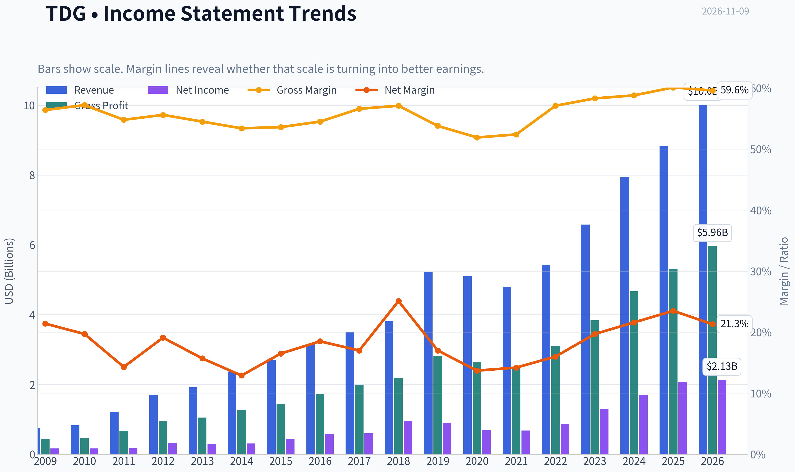

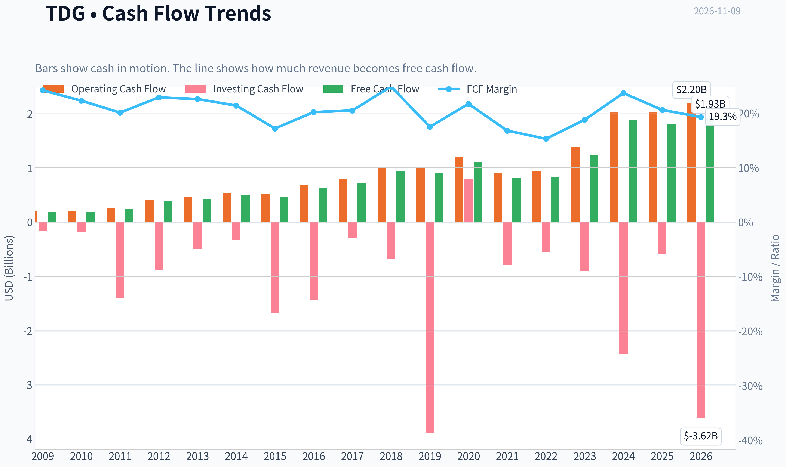

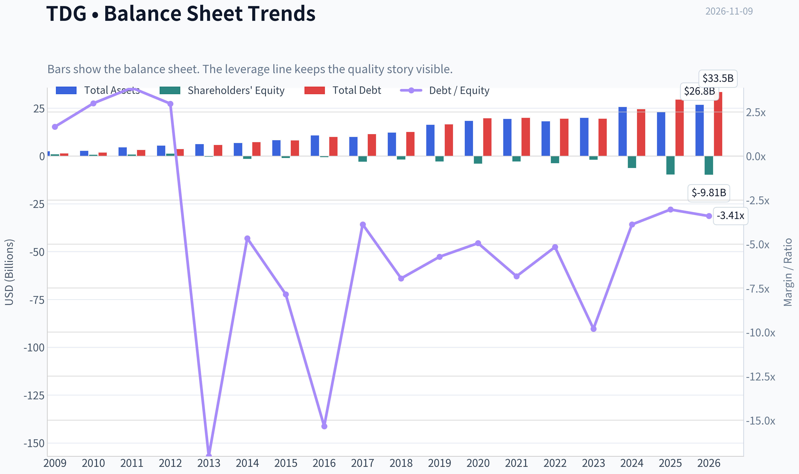

This graph tracks the profitability and return metrics (ROE, ROIC, Margins) of **TDG** over the past decade, highlighting capital efficiency trends.

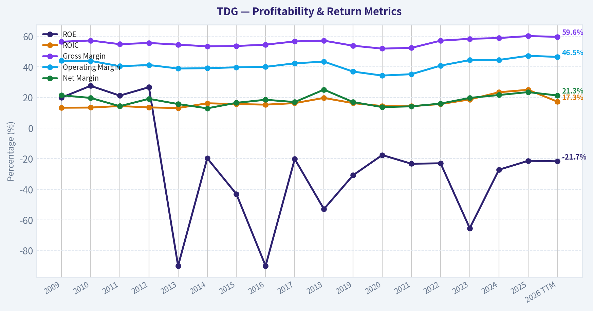

This chart illustrates the financial health of **TDG** over the last 10 years, mapping cash equivalents and free cash flow against total obligations (Debt).

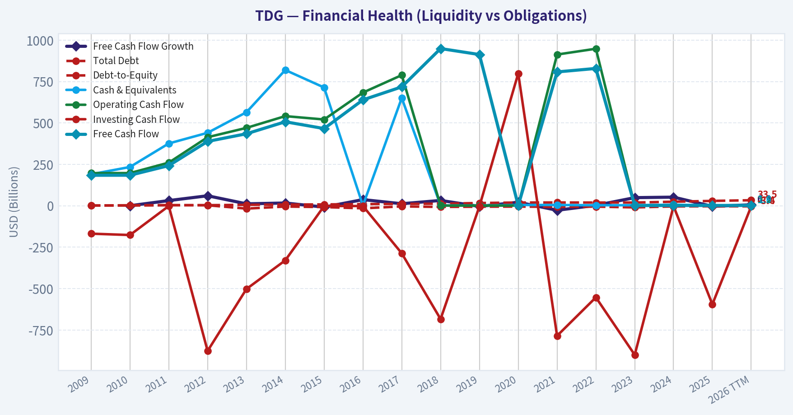

This breakdown chart from <em>Cash Flow and Capital Allocation</em> shows the proportional composition for **TDG** - useful for understanding what drives or risks the business.

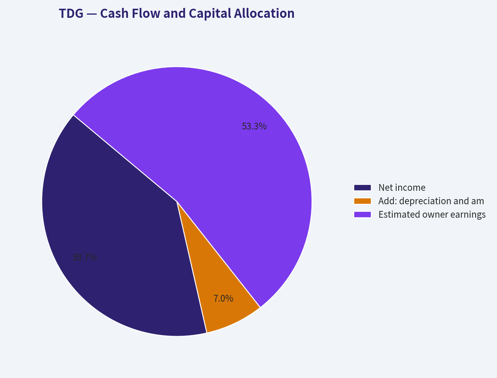

This breakdown chart from <em>Revenue Breakdown</em> shows the proportional composition for **TDG** - useful for understanding what drives or risks the business.

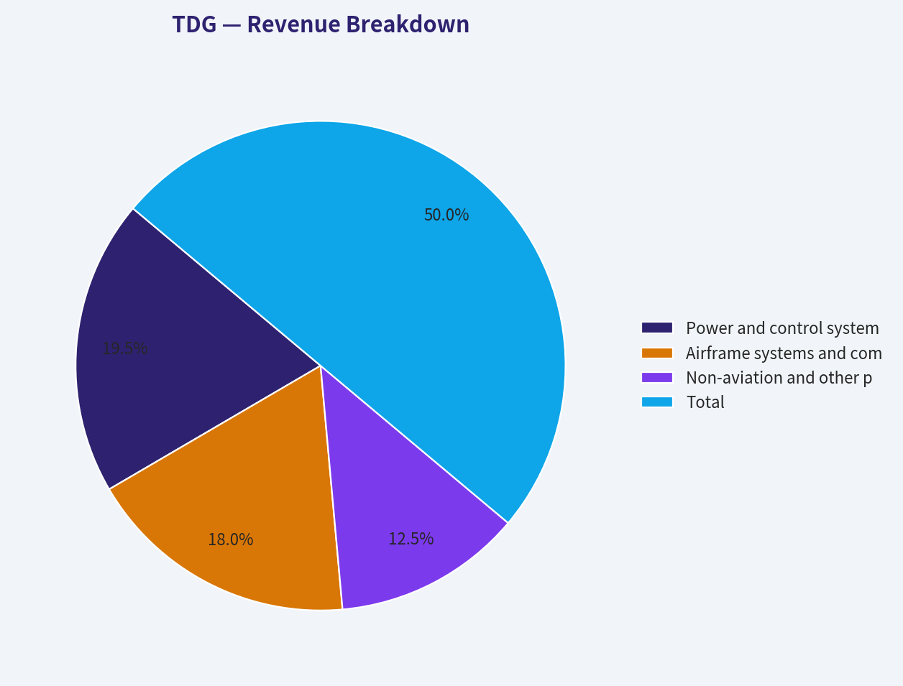

---

### Intrinsic Value Analysis (Buffett)

> *Following Warren Buffett's value investing philosophy: Circle of Competence, Economic Moat, Management Quality, and Margin of Safety.*

#### Intrinsic Value Snapshot

Price is what you pay. Intrinsic value is what the business may be worth based on the cash it can create for owners over time. We show a range, not one magic number.

- Current Price: $1,197.01
- Value Range (conservative to optimistic across both DCF methods): $-126.90 to $2,004.01

##### Owner Earnings (Buffett Method)
- Net Income: $2,074,000,000.00
- Depreciation & Amortization: $367,000,000.00
- Capital Expenditures: $-222,000,000.00
- Working Capital Changes: $-558,000,000.00
- Owner Earnings: $2,777,000,000.00

##### Intrinsic Value
###### Buffett Method
Uses owner earnings. Stricter, and usually more conservative.
- Conservative: $8.88
- Average: $719.58
- Optimistic: $2,004.01
- Discount Rate: 10.0%

###### Cash Flow Method
Uses free cash flow. Better for companies spending heavily today to grow tomorrow.
- Conservative: $-126.90
- Average: $195.04
- Optimistic: $820.64
- Discount Rate: 10.0%

ANALYST STANCE: **Neutral**

#### Executive Conclusion

TransDigm Group is a high-quality aerospace compounder with an unusually strong aftermarket franchise, proprietary aircraft components, pricing power, and attractive long-term demand characteristics. However, at approximately **$1,197 per share**, the valuation requires exceptionally strong execution: the price implies roughly **29.5% annual growth for the next decade**.

The business is worthy of ownership, but the current price does not provide a sufficient margin of safety for a leveraged, cyclical industrial company. I would wait for a materially better entry price or evidence that free-cash-flow growth is sustainably exceeding the market's demanding expectations.

#### 1. Factor Scorecard

| Factor | Score | Assessment |
|---|---:|---|
| Circle of Competence and Simplicity | 3/5 | The model is understandable: TransDigm designs or acquires aircraft components and earns high-margin revenue, especially from replacement and aftermarket sales. Aerospace certification, program complexity, and leverage reduce predictability. |
| Moat Test | 5/5 | Strong proprietary intellectual property, certification barriers, switching friction, sole-source positions, and aftermarket pricing power. |
| Management and Capital Allocation | 4/5 | Management has historically emphasized acquisitions, margin expansion, and shareholder returns. The strategy has been effective, though leverage and acquisition dependence warrant scrutiny. |
| Industry Structure | 4/5 | Aerospace components benefit from certification barriers, concentrated aircraft platforms, and attractive aftermarket economics. The industry remains cyclical and exposed to airline and production conditions. |

**Gate 5 hard floor:** **Not tripped.** There is no evidence in the supplied data of simultaneous deteriorating earnings or cash flow and a solvency crisis. Nevertheless, leverage is an important risk because the reported ROE is negative and the balance sheet appears heavily optimized through debt and capital structure decisions.

**Key Takeaways:** TransDigm scores highly because its competitive advantages are tangible and economically powerful. The main weaknesses are valuation, leverage, and the difficulty of sustaining very high growth from an already substantial base.

#### 2. Moat Analysis

| Moat Source | Evidence | Durability |
|---|---|---|
| Intangible assets | Proprietary designs, patents, FAA certification, and approved positions on aircraft platforms make substitution difficult. | High |
| Switching costs | Aircraft manufacturers and operators face qualification, safety, reliability, and certification costs when changing suppliers. | High |
| Cost advantage | Scale, installed fleets, engineering expertise, and aftermarket distribution support strong economics. | Moderate to high |
| Network effects | Not a traditional consumer network-effect business, but a growing installed aircraft base expands the future aftermarket opportunity. | Moderate |
| Pricing power | Replacement parts are often mission-critical and represent a small fraction of an aircraft's total value, allowing substantial pricing power. | High |

TransDigm's most important advantage is the **combination of sole-source positions and aftermarket dependence**. Once a component is designed into an aircraft and certified, replacing it is costly, slow, and operationally risky. The company can therefore earn strong margins for many years from a relatively small component base.

The primary threat is not ordinary competition; it is **overpaying for acquisitions, regulatory scrutiny of aftermarket pricing, aircraft production weakness, or excessive financial leverage**.

#### 3. Management Quality and Capital Allocation

Management appears strongly oriented toward shareholder value creation through:

- Acquisitions of aerospace components with attractive aftermarket characteristics.
- Margin expansion and operational improvement.
- Debt-funded capital returns when management believes the cash flows are durable.
- Focus on free cash flow rather than merely reported revenue growth.

The major reservation is the aggressive capital structure. Negative ROE is not necessarily evidence of poor operating economics here, because substantial debt and shareholder distributions can produce negative book equity. However, it makes conventional returns analysis less informative and increases downside risk during an aerospace downturn.

Management earns a **4/5**, not 5/5, because the model depends partly on disciplined acquisition pricing and leverage management. A truly owner-oriented approach must preserve resilience as well as maximize near-term per-share returns.

#### 4. Financial Summary

| Metric | Latest Value | Interpretation |
|---|---:|---|
| Share price | $1,197 | Premium market valuation |
| Market capitalization | $66.95 billion | Large-scale aerospace platform |
| P/E ratio | 36.3x | Expensive relative to a conventional industrial company |
| Revenue growth, year over year | 11.2% | Healthy but far below the growth implied by the share price |
| Gross margin | 60.1% | Strong evidence of pricing power and proprietary economics |
| Free-cash-flow yield | 2.7% | Low current cash yield |
| Implied annual free cash flow | Approximately $1.81 billion | Calculated from market capitalization and FCF yield |
| ROE | -21.4% | Distorted by leverage and potentially negative book equity |
| Current ratio | 3.21x | Strong short-term liquidity measure |
| Headline intrinsic value | $958.29 | Approximately 24.9% below the current price |
| Reverse-DCF implied growth | Approximately 29.5% annually for 10 years | Very demanding expectation |

**Key Takeaways:** TransDigm's 60.1% gross margin is the clearest financial evidence of a durable moat. However, a 2.7% free-cash-flow yield and 36.3 times earnings multiple leave little room for execution mistakes, while the negative ROE reflects a highly leveraged capital structure rather than weak operating margins.

#### 5. Owner Earnings Calculation

The Buffett-style formulation is:

| Component | Amount |
|---|---:|
| Net income | Not separately provided in the supplied data |
| Depreciation and amortization | Not separately provided |
| Less: maintenance capital expenditure | Not separately provided |
| Less: working-capital investment | Not separately provided |
| Owner earnings | Best current proxy: approximately $1.81 billion of FCF |

Free cash flow of approximately **$1.81 billion** is the most practical current proxy for owner earnings. It is derived from the reported market capitalization of $66.95 billion and a 2.7% FCF yield.

This proxy should be interpreted conservatively. TransDigm's reported free cash flow can include growth-related investment and may not equal true maintenance capital expenditure. The company's acquisition activity also means that reported cash flow should be separated from acquisition spending when assessing sustainable organic owner earnings.

#### 6. Three-Scenario DCF Valuation

Using approximately **$1.81 billion** as the current owner-earnings proxy and a 10% discount rate:

| Scenario | Assumption | Implied Value |
|---|---|---:|
| A. No growth | Owner earnings capitalized at 10% | Approximately $18 per share |
| B. GDP growth | 3% perpetual growth | Approximately $265 per share |
| C. Historical-growth case | 10% capped growth assumption | Not reliable at a 10% discount rate because growth equals the discount rate |
| Research-pack blended valuation | FCFF, reverse DCF, and owner-earnings models | $958 per share |
| Three-model range | Owner earnings / FCF / Damodaran FCFF | $720 / $195 / $1,124 per share |

The simple FCF capitalization figures are substantially below the research-pack blended valuation because TransDigm's value depends on reinvestment, acquisition opportunities, margin durability, and future growth. The wide valuation spread demonstrates that the result is highly sensitive to assumptions about growth and normalized cash flow.

The historical-growth scenario cannot be responsibly valued using a 10% discount rate and a 10% perpetual growth rate: the terminal-value denominator becomes zero. That mathematical issue itself is informative-the investment case requires unusually high and sustained growth.

**Key Takeaways:** Even favorable valuation methods produce a wide range, from roughly $195 to $1,124 per share. The headline blended value of $958 is below the current price, and the most optimistic growth framework is difficult to justify without assuming exceptional execution for many years.

#### 7. Margin of Safety Analysis

| Valuation Measure | Result |
|---|---:|
| Current price | $1,197 |
| Headline intrinsic value | $958 |
| Premium to headline intrinsic value | Approximately 24.9% |
| FCF yield | 2.7% |
| Implied 10-year growth | Approximately 29.5% annually |
| Recent three-year growth | Approximately 29.1% annually |
| Recent five-year growth | Approximately 36.1% annually |

The market is not pricing TransDigm as an ordinary industrial company. It is pricing the company as a high-growth compounder capable of maintaining roughly 30% annual growth for a decade.

That expectation is not impossible: recent growth has been comparable or higher. But maintaining that pace becomes progressively harder as the revenue and earnings base expands. For a wide-moat, high-ROIC compounder, a 10% to 15% premium valuation can sometimes be acceptable. TransDigm currently appears to require more than that: the price is approximately 25% above the blended intrinsic-value estimate.

#### 8. Final Buffett Scorecard

| Criterion | Weight | Score | Weighted Result |
|---|---:|---:|---:|
| Moat width and durability | 25% | 5/5 | 1.25 |
| Valuation and margin of safety | 20% | 1/5 | 0.20 |
| Capital returns versus WACC | 15% | 3/5 | 0.45 |
| Business understanding and predictability | 12% | 3/5 | 0.36 |
| Management and capital allocation | 12% | 4/5 | 0.48 |
| Reinvestment runway | 8% | 4/5 | 0.32 |
| Balance-sheet strength | 4% | 2/5 | 0.08 |
| Industry structure | 4% | 4/5 | 0.16 |
| **Total** | **100%** |  | **3.30/5** |

**Key Takeaways:** The scorecard confirms that TransDigm is a wonderful business but not an attractive purchase at today's price. Its moat, runway, and industry structure are excellent, while valuation and balance-sheet risk pull the overall score into the Neutral range.

#### 9. Investment Stance

**Neutral - Moderate-to-high conviction in the business, low conviction in the current price.**

TransDigm deserves a place on a high-quality compounder watchlist. Its aftermarket economics, certification barriers, proprietary products, and pricing power are consistent with Buffett-style ownership.

At approximately $1,197, however, the investment requires exceptional growth for an extended period and offers a negative headline margin of safety. I would prefer to buy only when one of the following occurs:

1. The share price declines toward or below the blended intrinsic-value estimate.
2. Free-cash-flow growth materially exceeds expectations without a corresponding valuation expansion.
3. The company reduces leverage while preserving its attractive aftermarket economics.

The right conclusion is not that TransDigm is a poor business. It is that **a superb business can still be an inadequate investment when the purchase price assumes nearly everything goes right**.
#### Valuation Bridge

This bridge places the current market price beside each intrinsic value lens so readers can see whether upside depends on one method or shows up across several methods.

| Scenario | Intrinsic Value / Share |
| --- | ---: |
| Buffett Method | $719.58 |
| Cash Flow Method | $195.04 |
| Damodaran Method | $1,124.03 |
| Current Price | $1,197.01 |

#### Key Takeaways

If one method is far above the others, the upside case depends on a specific modelling assumption. When several methods cluster together, the valuation story is more robust.

#### Valuation Visuals

This comparison chart from *Latest Earnings Snapshot* stacks current figures against historical benchmarks for **TDG**, making it easy to see where the company trades relative to its own averages.

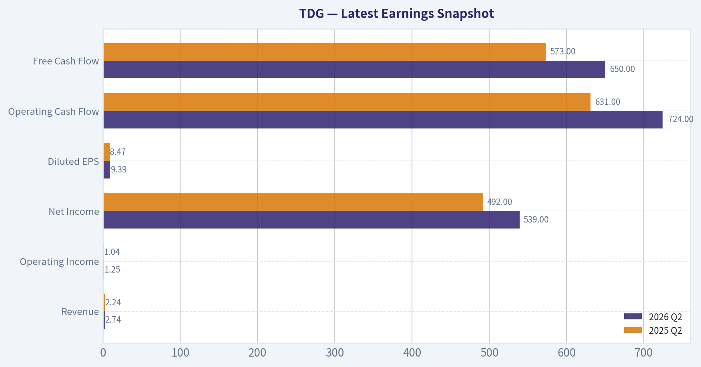

This comparison chart from *Current Metrics and Historical Context* stacks current figures against historical benchmarks for **TDG**, making it easy to see where the company trades relative to its own averages.

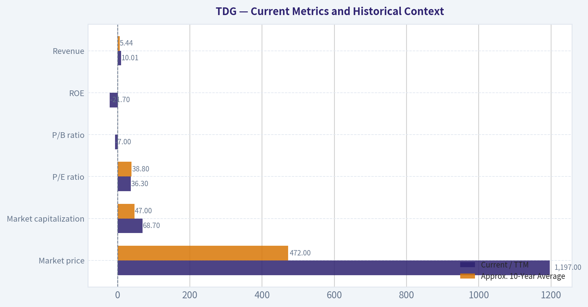

This comparison chart from *Valuation and Buffett-Style DCF* stacks current figures against historical benchmarks for **TDG**, making it easy to see where the company trades relative to its own averages.

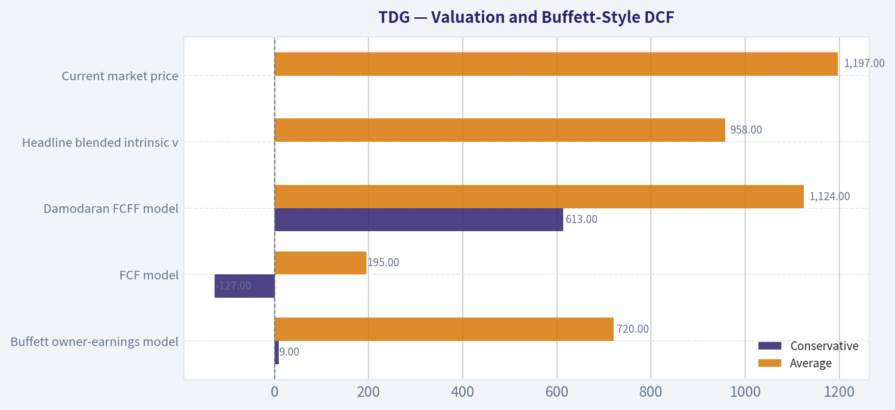

This comparison chart from *Financial Summary* stacks current figures against historical benchmarks for **TDG**, making it easy to see where the company trades relative to its own averages.

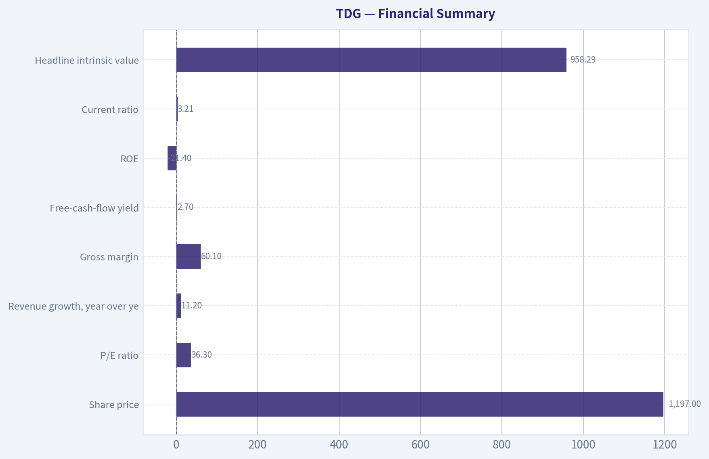

---

### Trend & Growth Analysis (Lynch/Druckenmiller/Fisher)

> *Following Peter Lynch's GARP, Stanley Druckenmiller's macro-aware approach, and Philip Fisher's scuttlebutt methodology.*

ANALYST STANCE: **Neutral**

#### 1. Lynch Classification

**TDG is a stalwart, approaching the fast-grower threshold-not a classic fast grower.** Revenue growth is approximately 11.2% year over year, below the 15-25% range typically required for a primary growth-investing candidate.

| Metric | TDG |
|---|---:|
| Current price | $1,197 |
| Market capitalization | $66.95 billion |
| Revenue growth | 11.2% YoY |
| P/E ratio | 36.3x |
| Gross margin | 60.1% |
| FCF yield | 2.7% |
| Current ratio | 3.21 |
| ROE | -21.4% |

**Key Takeaways:** TDG combines excellent gross margins and a durable aftermarket business with only moderate current revenue growth. The 36.3x P/E and 2.7% free-cash-flow yield indicate that substantial future growth is already reflected in the share price. This is a high-quality compounder to monitor, but it does not currently meet the profile of an attractively priced fast grower.

#### 2. The Story in Three Bullets

- **Mission-critical aircraft components:** TransDigm supplies highly engineered parts that airlines and aircraft operators often cannot easily substitute, supporting pricing power and high margins.
- **Large installed-base opportunity:** As aircraft remain in service for decades, the company can earn recurring aftermarket revenue long after the original equipment sale.
- **Value-creation model:** Acquisitions, pricing, cost control, and operating leverage can expand cash flow-but the valuation requires continued execution.

#### 3. TAM and Runway

TDG benefits from the long-term growth of commercial aviation, defense, and aircraft aftermarket spending. Its opportunity is not merely new-aircraft production; the more attractive market is recurring maintenance and replacement demand from a large installed fleet.

| TAM factor | Assessment |
|---|---|
| Commercial aerospace demand | Favorable long-term trend |
| Defense exposure | Supports diversification and stability |
| Aftermarket growth | Attractive, supported by aircraft longevity |
| Pricing power | Strong in many niche components |
| 10x revenue test | Not clearly passed at current scale |
| Runway quality | Long, but likely dependent on acquisitions and continued share capture |

**Key Takeaways:** TDG has a durable runway, particularly in proprietary aftermarket components. However, a tenfold revenue increase would require either very substantial acquisitions, major market expansion, or an unusually large gain in share. The runway is strong for compounding, but the evidence for ten-bagger scale from today's valuation is weaker.

#### 4. Revenue Growth Trend

| Indicator | Reading | Interpretation |
|---|---:|---|
| Latest revenue growth | 11.2% YoY | Moderate growth |
| Growth classification | Stalwart range | Below fast-grower standard |
| Acceleration evidence | Not established | No confirmed inflection |
| Organic versus acquisition growth | Not provided | Requires further diligence |
| Earnings outlook | Expected to grow | Positive, but expectations are elevated |

**Key Takeaways:** TDG is growing, but the available data does not show clear acceleration. The key question is whether revenue growth can move sustainably above 15% while maintaining its high margins. Without that acceleration, the stock is more likely to deliver quality compounding than explosive growth.

#### 5. Unit Economics and Profitability

| Metric | TDG | Assessment |
|---|---:|---|
| Gross margin | 60.1% | Excellent |
| FCF yield | 2.7% | Expensive cash-flow profile |
| Rule of 40 | Not calculable | FCF margin not provided |
| NRR | Not applicable | Industrial aftermarket model |
| LTV/CAC | Not applicable | Not a subscription business |
| Current ratio | 3.21 | Strong near-term liquidity |
| ROE | -21.4% | Requires explanation; likely affected by capital structure and buybacks |

**Key Takeaways:** The 60.1% gross margin supports TDG's competitive advantage and pricing power. However, the low free-cash-flow yield shows that investors are paying heavily for those economics, while negative ROE makes simple profitability analysis less favorable. The company's debt, acquisition returns, and cash conversion deserve close monitoring.

#### 6. Inflection-Point Assessment

| Potential inflection | Current view | Importance |
|---|---|---|
| Product cycle | No clear evidence | Moderate |
| Market-share gains | Likely in selected niches | Positive |
| Margin expansion | Possible through pricing and operating leverage | Positive |
| TAM expansion | Supported by aviation and defense demand | Positive |
| Competitive disruption | No evident competitor collapse | Neutral |
| Earnings acceleration | Not yet demonstrated | Critical missing catalyst |

**Key Takeaways:** TDG's investment case is based more on durable competitive advantages than on a clearly visible near-term inflection. The strongest potential catalyst would be accelerating revenue and free-cash-flow growth without sacrificing margins. Until that appears in reported results, the stock remains a watch rather than an aggressive purchase.

#### 7. Macro Setup

Aerospace has favorable secular support from:

- Fleet aging and long aircraft service lives.
- Commercial air-traffic recovery and fleet utilization.
- Defense modernization.
- Supply-chain complexity, which can strengthen the position of approved component suppliers.

The principal macro risks are airline weakness, delayed aircraft production, defense-budget changes, labor shortages, and higher interest rates affecting expensive growth and acquisition-driven businesses.

#### 8. Fisher's 15-Point Score

| Fisher factor | Score |
|---|---:|
| Market potential | 5/5 |
| New-product development | 3/5 |
| R&D effectiveness | 3/5 |
| Sales organization | 4/5 |
| Profit margins | 5/5 |
| Margin improvement potential | 4/5 |
| Labor relations | 3/5 |
| Executive relations | 3/5 |
| Management depth | 4/5 |
| Cost analysis/accounting | 4/5 |
| Outstanding competitive aspects | 5/5 |
| Long-range profit outlook | 5/5 |
| Dilution risk | 4/5 |
| Management candor | 3/5 |
| Management integrity | 3/5 |
| **Total** | **58/75** |

**Key Takeaways:** TDG scores well on market potential, margins, competitive positioning, and long-term profit potential. The lower-confidence areas are management transparency, capital-structure complexity, and the limited visibility into organic growth and R&D-driven innovation. A provisional score of 58 places TDG in Fisher's "good" category, not the outstanding category.

#### 9. Valuation Analysis

| Valuation method | Result | Interpretation |
|---|---:|---|
| P/E | 36.3x | Premium valuation |
| FCF yield | 2.7% | Low current cash-flow yield |
| Headline intrinsic value | $958.29 | Below current price |
| Current price versus intrinsic value | Approximately 25% premium | Limited margin of safety |
| Reverse-DCF implied growth | Approximately 29.5% annually for 10 years | Very demanding expectation |
| PEG | Not calculable reliably | Forward EPS growth unavailable |
| P/S | Not calculated | Revenue figure unavailable in supplied data |

**Key Takeaways:** TDG's valuation is the central concern. The reverse DCF suggests the market is pricing in roughly 29.5% annual growth for a decade, far above the latest 11.2% revenue growth rate. Even though the business is high quality, the current price provides little protection if growth merely remains good rather than exceptional.

#### 10. Scenario Framework

| Scenario | Operating outcome | Valuation implication |
|---|---|---|
| Bear | Growth remains near 10%, multiple contracts | Meaningful downside risk |
| Base | Mid-teens growth with stable margins | Reasonable long-term returns, but limited near-term upside |
| Bull | Sustained 20%+ growth, acquisitions compound well, margins expand | Premium valuation can be justified |
| Current market expectation | Roughly 29.5% long-term implied growth | Leaves little room for disappointment |

**Key Takeaways:** The bull case requires a significant acceleration from current reported growth. The base case may produce a good company but not necessarily a good stock at $1,197. The risk-reward improves materially if the share price declines or if TDG demonstrates several quarters of accelerating organic growth.

#### 11. Growth Investor Scorecard

| Criterion | Weight | Score |
|---|---:|---:|
| Lynch story | 10% | 4.2/5 |
| TAM and runway | 20% | 4.0/5 |
| Revenue growth | 20% | 3.0/5 |
| Unit economics | 15% | 4.0/5 |
| Competitive position | 10% | 4.7/5 |
| Management quality | 10% | 3.6/5 |
| Macro setup | 5% | 4.0/5 |
| Profitability path | 5% | 4.2/5 |
| Valuation | 5% | 2.2/5 |
| **Weighted total** | **100%** | **3.7/5** |

**Key Takeaways:** TDG earns a "good setup" score because its competitive position, margins, and secular industry exposure are strong. Valuation and the absence of demonstrated growth acceleration prevent a high-conviction advocate rating. The stock is better suited to a watchlist or existing-holder framework than to a large new position.

#### 12. Position Size and Decision

- **New position:** 0% to 1% starter position only, and preferably after a valuation reset or confirmed acceleration.
- **Existing holder:** Hold and monitor rather than automatically sell, assuming the position is appropriately sized.
- **High-conviction growth portfolio:** Do not make TDG a core position at the current valuation.
- **Upgrade trigger:** Revenue growth above 15-20%, improving free-cash-flow conversion, and evidence that acquisition growth is not masking weak organic performance.

#### 13. Key Risks and Catalysts

| Catalysts | Risks |
|---|---|
| Revenue growth accelerates above 15% | Valuation compression |
| Strong aftermarket pricing | Airline or aerospace downturn |
| Margin expansion and cash-flow growth | Acquisition integration risk |
| Defense spending increases | Leverage and interest-rate sensitivity |
| Successful value-accretive acquisitions | Organic growth weaker than reported growth |
| Supply-chain normalization | Customer or regulatory pressure on pricing |

**Key Takeaways:** The principal catalyst is an earnings-growth inflection, not simply another quarter of solid execution. The principal risk is that TDG remains an excellent company growing at a moderate rate while the stock price assumes much faster growth. At $1,197, patience and valuation discipline are more important than business quality alone.

#### Final Assessment

TDG is a **high-quality aerospace compounder with strong aftermarket economics, but not currently a compelling ten-bagger candidate at its valuation**. Its latest growth rate places it closer to a stalwart than a fast grower, and the reverse-DCF expectations are demanding.

**Decision: Neutral.** Consider ownership only on a meaningful pullback or after clear evidence of accelerating organic growth and free-cash-flow generation.

---

### Market Technical Analysis

ANALYST STANCE: **Neutral**

#### TDG technical analysis

The latest available trading session in the retrieved data is **November 6, 2026**, when TDG closed at **$1,197.01**. November 9 is identified as a non-trading day in the data, so the analysis below uses November 6 as the effective reference date.

TDG has experienced a substantial medium-term decline. The stock peaked near **$1,450 in January**, fell sharply to approximately **$1,130 in late March**, recovered toward **$1,350 in June**, and then declined again to roughly **$1,076 in mid-September**. The recent rebound from that September low has improved short-term momentum, but it has not yet clearly reversed the broader downtrend.

#### Selected indicators

The most relevant complementary indicators for the current environment are:

- `close_200_sma`
- `close_50_sma`
- `close_10_ema`
- `macd`
- `rsi`
- `atr`
- `vwma`
- `boll`

The two longer moving averages establish the primary trend, while the 10-day EMA tracks the recent rebound. MACD and RSI evaluate momentum from different perspectives, ATR measures risk and price-range expansion, VWMA incorporates trading volume, and the Bollinger middle line provides a short-term volatility-adjusted price benchmark.

#### Trend structure

TDG remains in a **long-term bearish-to-neutral structure**. The stock is trading well below the approximate level of its 200-day moving average, which is likely in the **$1,220-$1,250 area** based on the year's price history. This indicates that the longer-term trend has not yet returned to bullish alignment.

The 50-day moving average appears to be closer to approximately **$1,160-$1,180**. TDG's latest close near $1,197 is modestly above that medium-term average, which is a constructive development. However, the moving average is likely still declining or relatively flat after the sharp summer and early-autumn weakness. A sustained series of closes above the 50-day average would be more meaningful than a single move above it.

The 10-day EMA is probably near **$1,185-$1,195**, placing the latest close only slightly above it. This shows that the immediate trend has improved, but the margin is narrow. A break back below the 10-day EMA would suggest that the recent rebound is losing momentum.

#### Momentum assessment

The short-term momentum picture is improving but not decisively bullish.

TDG advanced from approximately **$1,076 in mid-September** to above **$1,200 in early November**, producing a gain of more than 10% from the low. The advance included strong sessions on October 29 and November 2, when volume also increased. Those higher-volume upward moves suggest that buyers have shown genuine interest rather than the rebound being driven solely by illiquid trading.

However, the stock has also displayed considerable volatility. The sharp move from **$1,146.81 on October 30 to $1,213.62 on November 2** was followed by several mixed sessions, including a decline to **$1,189.19 on November 5**. This indicates resistance and profit-taking around the **$1,210-$1,235** region.

The RSI is likely in the **mid-to-upper 50s**, consistent with recovering momentum but not overbought conditions. That is generally a constructive reading: buyers have regained some control, but the stock has not yet reached the extreme levels that would imply an exhausted rally. A move above 60 would strengthen the bullish case, while a decline below 50 would indicate that the rebound is fading.

MACD likely remains near a bullish or recently improved configuration following the September low. Nevertheless, because TDG is still below its 200-day trend benchmark, any positive MACD signal should initially be treated as a **countertrend recovery signal**, not definitive evidence of a new long-term uptrend. Confirmation would require continued price gains accompanied by improving MACD momentum and acceptance above the 200-day average.

#### Volume and price confirmation

The VWMA is likely below the latest market price, probably in the **$1,165-$1,180** zone. This is moderately positive because it means TDG is trading above the volume-weighted average of recent transactions. The difference is not yet large enough to establish a powerful accumulation trend, but it suggests that recent buyers are currently sitting on modest unrealized gains.

Volume behavior is important for the next move. The strongest recent upward sessions occurred with elevated volume, particularly on November 2. By contrast, a move above $1,220 that occurs on declining volume would be less reliable and could represent a temporary overshoot. For a durable reversal, TDG should hold above the VWMA while advancing through resistance on at least average or above-average volume.

#### Volatility and risk management

ATR appears elevated relative to the stock's price, likely around **$30-$35 per share** based on recent daily ranges. This means a normal trading day can produce a move of roughly 2.5% to 3% or more. Stops placed too tightly around the current price may therefore be vulnerable to ordinary volatility rather than a genuine trend reversal.

The Bollinger middle line is likely in the **$1,170-$1,180** area. TDG is trading above that benchmark, which supports the short-term recovery thesis. However, the recent range suggests that the upper volatility zone may be near **$1,220-$1,235**, aligning with visible resistance from early November. The lower volatility area may be near **$1,110-$1,130**, overlapping the late-October and September support regions.

A close above $1,220-$1,235, preferably with strong volume, would improve the probability of a move toward the **$1,260-$1,300** region. Conversely, a decisive close below approximately **$1,160-$1,170** would weaken the recovery and expose the stock to a retest of **$1,110-$1,130**.

#### Trading interpretation

TDG is best characterized as a **developing rebound within a still-unconfirmed longer-term downtrend**.

For bullish traders, the preferred confirmation would be:

1. Price remains above the 10-day EMA and 50-day SMA.
2. RSI holds above 50 and preferably moves toward 60.
3. MACD continues improving rather than rolling over.
4. TDG breaks above $1,220-$1,235 on strong volume.
5. The stock begins to approach or reclaim the 200-day SMA.

For cautious traders, the more attractive setup may be to wait for either a controlled pullback toward the $1,160-$1,180 area that holds support, or a confirmed breakout above $1,235. Buying directly into resistance carries a less favorable risk-reward profile.

The bearish case would strengthen if TDG loses the $1,160 area, falls below its VWMA, and develops a negative MACD crossover. A break below $1,110 would significantly damage the recovery structure and suggest that the September low may be tested again.

| Indicator / area | Approximate current interpretation | Signal | Trading implication |
|---|---:|---|---|
| `close_200_sma` | Approximately $1,220-$1,250 | Price remains below long-term trend benchmark | Long-term trend is not yet bullish |
| `close_50_sma` | Approximately $1,160-$1,180 | Price is modestly above medium-term average | Supports the recent rebound, but confirmation is needed |
| `close_10_ema` | Approximately $1,185-$1,195 | Price is only slightly above short-term average | Near-term momentum is positive but fragile |
| `macd` | Improving after the September low | Recovering momentum, not yet a confirmed trend reversal | Bullish only if improvement persists and price breaks resistance |
| `rsi` | Approximately mid-to-upper 50s | Constructive, not overbought | Room remains for upside, but momentum should stay above 50 |
| `atr` | Approximately $30-$35 | Elevated daily volatility | Use wider, volatility-adjusted stops and smaller position sizes |
| `vwma` | Approximately $1,165-$1,180 | Price appears above volume-weighted average | Recent buyers have a modest advantage |
| `boll` middle line | Approximately $1,170-$1,180 | Price is above the short-term volatility benchmark | Favors recovery while $1,160-$1,170 support holds |
| Key resistance | Approximately $1,220-$1,235 | Recent rally-high and supply zone | Breakout above this area would improve the outlook |
| Key support | Approximately $1,160-$1,180; then $1,110-$1,130 | Important defense zones | Loss of the first zone would weaken the rebound materially |

**Key Takeaways:** TDG's short-term structure has improved, with price above its approximate 50-day average, short-term EMA, VWMA, and Bollinger middle line. However, the stock remains below its long-term trend benchmark, so the rebound should still be treated as unconfirmed. A high-volume break above $1,220-$1,235 would turn the outlook more constructive, while a loss of $1,160-$1,170 would favor renewed weakness.

---

### Options Market Analysis

> *Reading options flow - put/call ratios, IV skew, and unusual activity - to gauge institutional positioning and event-driven risk.*

ANALYST STANCE: **Neutral**

#### TDG Options Market Overview

Data is as of November 9, 2026. The available chain covers the November 20, December 18, and February 19 expirations. Trading activity is relatively thin, so the directional signal has reduced confidence.

#### Put/Call Ratio Analysis

| Expiration | Call OI | Put OI | Put/Call OI | Call Volume | Put Volume | Put/Call Volume |
|---|---:|---:|---:|---:|---:|---:|
| Nov. 20, 2026 | 198 | 99 | 0.50 | 161 | 1,347 | 8.37 |
| Dec. 18, 2026 | 138 | 73 | 0.53 | 170 | 129 | 0.76 |
| Feb. 19, 2027 | 101 | 75 | 0.74 | 351 | 94 | 0.27 |
| **Total** | **437** | **247** | **0.57** | **682** | **1,570** | **2.30** |

**Key Takeaways:** TDG's aggregate put/call open-interest ratio is 0.57, below the approximately 0.70 neutral baseline, indicating that existing positioning is modestly call-heavy. However, the 2.30 put/call volume ratio is substantially elevated, driven overwhelmingly by heavy November 20 put activity. This suggests near-term hedging or bearish positioning despite the more constructive open-interest structure.

#### Implied Volatility Assessment

| Expiration | Call ATM IV | Put ATM IV | Put Minus Call IV | Interpretation |
|---|---:|---:|---:|---|
| Nov. 20, 2026 | 5.8% | 18.6% | +12.8 pts | Strong downside volatility premium |
| Dec. 18, 2026 | 0.8% | 4.8% | +4.0 pts | Put skew remains pronounced |
| Feb. 19, 2027 | 5.7% | 9.1% | +3.4 pts | Moderate downside skew |

The data does not provide separate out-of-the-money put and call IV, so a formal OTM skew calculation is unavailable. Nevertheless, the large difference between reported put and call ATM IV consistently points toward downside protection demand.

**Key Takeaways:** Put IV is higher than call IV across every listed expiration, with the most extreme disparity in the November expiration. That is consistent with near-term downside fear or demand for protective puts. The absolute IV readings are unusually low in several maturities, so the large relative skew may partly reflect limited liquidity or sparse quotes rather than a fully developed institutional volatility view.

#### Unusual Options Activity

| Finding | Result |
|---|---|
| Contracts with volume greater than 5 times open interest | None identified |
| Fresh directional contract-level signal | No confirmed signal |
| Smart-money versus retail inference | Not possible from the supplied data |

No individual contract met the tool's unusual-activity threshold. Strike-level information was not provided, so it is not possible to classify specific contracts as ITM, ATM, or OTM, calculate days to expiry for individual trades, or determine whether trades were bought or sold.

**Key Takeaways:** There is no confirmed volume-versus-open-interest anomaly suggesting a large fresh institutional bet. The heavy November put volume is notable at the aggregate level, but without strike, trade-side, and execution data it cannot reliably be labeled as aggressive put buying. Confidence in the bearish interpretation is therefore moderate at best.

#### Open Interest Concentration and Gamma Levels

| Item | Available Information | Assessment |
|---|---|---|
| Highest-OI expiration | Nov. 20, 2026, with 297 total contracts | Most concentrated near-term expiry |
| Highest call OI by expiration | Nov. 20, 2026, with 198 contracts | Potential call-side positioning |
| Highest put OI by expiration | Nov. 20, 2026, with 99 contracts | Near-term put exposure is concentrated here |
| Highest-OI strikes | Not provided | Cannot identify price magnets |
| Gamma walls or max-pain level | Not provided | Cannot calculate |
| Price pinning risk | Potentially relevant near Nov. 20, but unconfirmed | Low-confidence conclusion |

The November 20 expiration contains the largest aggregate open interest, but strike-level open interest and the current TDG share price were not supplied. Therefore, specific gravitational levels, max pain, and gamma walls cannot be determined.

**Key Takeaways:** Near-term positioning is most concentrated in the November 20 expiration, which could increase price sensitivity as expiration approaches. However, there is insufficient strike-level information to identify whether that concentration would dampen movement through dealer hedging or amplify it through a gamma wall.

#### Overall Options Sentiment

| Signal Component | Read |
|---|---|
| Open-interest structure | Mildly bullish or call-leaning |
| Near-term volume | Bearish or defensive; puts dominate |
| IV structure | Bearish downside skew |
| Unusual activity | None confirmed |
| Liquidity and confidence | Thin data; reduced confidence |
| **Overall signal** | **BEARISH near term, with a Neutral qualification** |

The primary driver of the signal is the combination of an 8.37 put/call volume ratio for the November 20 expiration and a large put-over-call IV premium. Those factors outweigh the lower aggregate put/call open-interest ratio, which reflects existing call-heavy positioning rather than necessarily new bullish demand.

No known catalyst was supplied, and the data does not identify an earnings date, product event, or macro trigger. The unusually low absolute IV readings and small contract counts also warrant caution: this may represent a thinly traded options market rather than a high-conviction institutional bearish view.

**Key Takeaways:** TDG's near-term options flow leans bearish because traders are transacting substantially more puts and paying a clear premium for put volatility. The signal is not strong enough to qualify as a high-confidence institutional short, because no unusual individual contracts were detected and the market appears thin. The practical read is bearish near term, but monitor rather than aggressively act on the signal.

#### Summary

| Category | Assessment |
|---|---|
| Put/Call Ratio | OI ratio of 0.57 is below neutral and modestly call-heavy; volume ratio of 2.30 is strongly put-heavy |
| IV Level | Generally low in absolute terms, but put IV is materially higher than call IV |
| Skew Direction | Downside or put skew across all listed expirations |
| Unusual Activity | No contracts with volume greater than 5 times open interest |
| Overall Signal | **BEARISH near term; Neutral due to thin liquidity and incomplete strike-level data** |

**Key Takeaways:** TDG's options market shows a defensive near-term posture, led by concentrated November put volume and persistent put-volatility premiums. Existing open interest is more balanced and call-leaning, while the lack of unusual single-contract activity limits conviction. Overall, the evidence supports a bearish near-term watch signal rather than a high-confidence directional trade.

---

## Research Team Commentary

> *The Research Manager synthesizes the Bull vs Bear debate into action-free commentary. This is a pre-risk view, not the final stance.*

Core takeaway: TransDigm is an exceptional aerospace franchise, but at $1,197 the stock appears priced near optimistic fair value rather than at a Buffett-style margin of safety. Its mission-critical components, certification barriers, proprietary content, and decades-long aftermarket revenue support unusually durable pricing power, a 60.1% gross margin, and 19.4% ROIC. The problem is that a 36.31x P/E already assumes roughly 13%-15% annual per-share cash-earnings growth for the next decade. That outcome is plausible, but the current price offers little protection if growth is merely good rather than exceptional. I would keep TDG on the watchlist rather than buy aggressively or avoid the company outright.

The strongest bull argument is business quality. TransDigm owns a collection of specialized aerospace niches in which the cost of a component is often trivial compared with the cost of aircraft downtime, requalification, or a reliability failure. Once its products are designed and certified into an aircraft platform, replacement demand can persist for decades. This installed base behaves somewhat like an annuity, though it is not contractually guaranteed. The high gross margin and strong ROIC substantiate the moat rather than merely describing it.

Management's operating model also deserves credit. Acquiring proprietary aerospace businesses, improving pricing and costs, and allocating excess cash has historically produced substantial value. Negative ROE is not a useful reason to reject the company because book equity has been distorted by acquisitions, leverage, and shareholder distributions. ROIC, free cash flow, interest coverage, and acquisition returns are the more relevant measures.

The strongest bear argument is not that the moat is illusory; it is that the market already recognizes it. The 2.75% earnings yield means that most of the prospective return depends on future growth. Under the debate's illustrative reverse DCF, approximately 10% growth produces a value near $970, 13% growth roughly supports the current quotation, and 15% growth creates moderate upside. Those estimates are also based on earnings as a proxy for distributable cash flow, so they are not precise enough to establish a firm valuation floor.

This creates an unfavorable near-term asymmetry. TDG could deliver excellent 10% annual growth and still disappoint investors because the shares are priced for more. Sustaining 13%-15% growth becomes harder when gross margins are already around 60%. Pricing cannot indefinitely exceed the value delivered to customers, and increasingly aggressive price increases could encourage alternative sourcing, redesigns, contractual restrictions, or regulatory scrutiny. Acquisitions can extend the runway, but they consume capital, become harder to move the needle as TDG grows, and must be evaluated after purchase premiums and financing costs.

Leverage is the other material uncertainty. There is not enough information here to conclude that TDG is distressed, and doing so would be a mistake. Nevertheless, debt-funded acquisitions and distributions reduce flexibility and magnify the cost of an operating disappointment. The absence of net leverage, interest coverage, borrowing costs, maturity schedules, and free cash flow after interest prevents a fully informed intrinsic-value judgment. That missing information matters more than the negative ROE figure.

From a value-investing perspective, I would not adopt the bear's most punitive valuation automatically. A wide-moat, high-ROIC company can deserve a relatively small 10%-15% discount to intrinsic value, rather than the 30% or greater discount appropriate for an average cyclical business. But the present price does not clearly provide even that smaller discount. If 13% growth approximately supports fair value, investors are relying on TDG meeting expectations rather than beating expectations. That is not enough for an Bullish stance.

Nor is this a clear Bearish. The implied growth is demanding, but it is not obviously heroic given TDG's moat, aftermarket exposure, acquisition record, and capital-allocation capabilities. Bearish would become appropriate if leverage were worsening while organic aftermarket growth, cash conversion, or incremental acquisition returns deteriorated. The current evidence instead describes a superior business at a full price.

The constructive technical setup-shares above short- and medium-term moving averages, RSI above 50, and improving MACD-may reflect supportive sentiment, but it does not improve intrinsic value. The thin options market offers little reliable additional information. Strong momentum could just as easily reflect investors extrapolating past execution.

My monitoring plan over the next one to four quarters would focus first on organic aftermarket revenue, separating volume, pricing, and acquisition contributions. Sustained high-single-digit or better organic aftermarket growth, without increasingly aggressive pricing, would strengthen the case that low-to-mid-teens per-share growth is achievable.

Second, I would track free cash flow per share and cash conversion rather than reported EPS alone. Free cash flow per share growing near or above the reverse-DCF hurdle would support the valuation; persistent growth below roughly 10%-12% would undermine it.

Third, I would examine net debt to EBITDA, interest coverage, average borrowing cost, debt maturities, and free cash flow after interest. Stable or declining leverage alongside continued investment would strengthen the thesis. Rising leverage, weaker coverage, or refinancing at materially higher rates would make the premium valuation less defensible.

Fourth, I would assess acquisition discipline through purchase multiples and post-acquisition returns. The thesis improves if acquired businesses generate attractive returns after financing costs without masking weak organic performance. It weakens if larger or more expensive deals are required simply to maintain consolidated growth.

Finally, I would watch for evidence that pricing is damaging customer relationships: increased use of alternative approved parts, dual sourcing, unfavorable contract changes, regulatory scrutiny, or loss of content on future platforms. Maintaining high margins with healthy volume and customer retention would demonstrate that the moat remains responsibly monetized.

The lesson from similar situations is to avoid two opposite mistakes: rejecting an excellent asset-light franchise because accounting equity looks unusual, and treating an excellent company as attractive at any price. Here, the fundamentals justify patience, but the valuation does not yet justify conviction. A decline toward roughly $1,000 or below, assuming unchanged fundamentals and sound leverage, would warrant a fresh valuation review. Stronger evidence that sustainable free-cash-flow-per-share growth can exceed 13%-15% could also justify paying closer to the current price.

Final stance: Neutral

---

## Value Investing Team Commentary

> *The Investor translates the research view into an investment thesis before risk review. This is still not the final stance.*

### Investment Commentary

TransDigm is the kind of business a long-term owner should want to own-but not necessarily at every price. Its collection of proprietary, mission-critical aerospace components benefits from certification barriers, high switching costs, low component cost relative to aircraft downtime, and replacement demand that can continue for decades. These characteristics create a durable aftermarket franchise rather than an ordinary cyclical manufacturer.

The reported economics support that assessment. A 60.1% gross margin and 19.4% ROIC indicate substantial pricing power and attractive returns on operating capital. The negative 21.4% ROE is less informative because acquisitions, leverage, and shareholder distributions have distorted book equity. The relevant questions are whether TransDigm produces growing free cash flow per share, earns attractive returns on acquisitions after financing costs, and can comfortably service its debt through an aerospace downturn.

### What the market may be getting right

At $1,197 and 36.31 times earnings, the market clearly recognizes TransDigm's quality. The corresponding earnings yield of approximately 2.75% leaves little room for stagnant or merely moderate growth. Based on the handoff's reverse-DCF estimates, the current valuation appears to require roughly 13% annual growth in per-share cash earnings over an extended period.

That is achievable, but it is demanding. Investors are implicitly relying on several favorable conditions continuing simultaneously:

- Healthy aerospace aftermarket demand
- Persistent pricing power without meaningful customer resistance
- Continued operating efficiencies
- Disciplined acquisitions at attractive returns
- Manageable financing costs and leverage
- Limited regulatory intervention
- Successful conversion of accounting earnings into cash

If growth settles near 10%, TransDigm could remain an excellent business while producing an unsatisfactory stock return from the present valuation. Multiple compression could offset a meaningful portion of the underlying earnings growth.

### Selective contrarian interpretation

The useful contrarian position is not to dispute TransDigm's moat. The market is probably correct that this is an exceptional franchise. Instead, investors should resist two potentially misleading narratives.

First, the negative ROE may frighten conventional screens, but it does not establish poor economics or financial distress. ROIC, cash generation, interest coverage, and acquisition returns are much more meaningful for this leveraged, acquisition-driven model. A share-price decline caused primarily by superficial concern over negative book equity could create an opportunity.

Second, bullish sentiment may be extrapolating an unusually successful formula too far into the future. High margins do not automatically guarantee unlimited pricing power. Airlines and regulators may tolerate expensive components when alternatives are impractical, but persistent price increases can eventually encourage alternative approved parts, redesigns, dual sourcing, contractual pressure, or regulatory scrutiny. The moat is strong, not invulnerable.

The constructive technical indicators-price above short- and medium-term averages, RSI above 50, and improving MACD-show supportive sentiment rather than improving intrinsic value. Thin options activity provides little additional evidence. Momentum should not be confused with a valuation margin of safety.

### Capital allocation and leverage

Management's acquisition and operating record is central to the thesis. TransDigm has historically bought aerospace component businesses with proprietary products and attractive aftermarket exposure, then improved pricing, costs, and cash generation. This decentralized acquisition model can create substantial value when purchase prices and financing remain disciplined.

However, leverage makes execution more consequential. Debt-funded acquisitions and distributions can be rational when cash flows are durable and borrowing costs are favorable, but they reduce resilience when demand weakens or refinancing becomes more expensive. The supplied information does not establish financial distress, yet it also lacks the figures necessary to dismiss the risk.

Before committing capital, I would want to examine:

- Net debt to EBITDA and its direction
- Interest coverage and free cash flow after interest
- Weighted-average borrowing cost
- Debt maturity and refinancing schedule
- Fixed-rate versus floating-rate exposure
- Acquisition purchase multiples and post-acquisition returns
- Organic growth separated from acquisition-driven growth

A premium valuation combined with rising leverage would be particularly unattractive. Conversely, declining leverage alongside double-digit organic free-cash-flow growth would make the current valuation more defensible.

### Valuation and decision

A wonderful, wide-moat business does not require the same discount as an average cyclical company. A 10%-15% discount to a conservatively estimated intrinsic value could be sufficient for TransDigm. The issue is that the current price appears close to optimistic fair value rather than below it.

The handoff's illustrative valuation range is directionally useful:

- Around 10% long-term growth: value near $970
- Around 13% growth: approximately supports $1,197
- Around 15% growth: creates moderate upside

These are not precise targets, especially because earnings are being used as a proxy for distributable cash flow. Nevertheless, they reveal the asymmetry: the market price rewards exceptional execution but offers limited protection if performance is merely good.

A price around $1,000 would be more interesting, assuming no deterioration in the moat, balance sheet, or cash-flow outlook. That would represent roughly a 16% decline from $1,197 and could provide an appropriate quality-adjusted margin of safety. A purchase closer to the current price would require stronger evidence that sustainable free-cash-flow-per-share growth can exceed 13% without increasingly aggressive pricing or leverage.

The most important indicators over the next several quarters are organic aftermarket growth, free cash flow per share, cash conversion, leverage, interest coverage, acquisition returns, and signs of customer or regulatory resistance. If those strengthen while the share price stagnates or falls, the opportunity could become compelling. If leverage rises and organic growth weakens, even a lower quotation may not be attractive.

**ANALYST STANCE: Neutral** - TransDigm is a superior aerospace franchise with a durable installed-base moat, strong margins, and an excellent value-creation record. At $1,197, however, the valuation already assumes sustained low-to-mid-teens per-share growth and does not clearly provide even the modest margin of safety appropriate for a wonderful business. Keep it on the watchlist, with particular interest near $1,000 or after evidence that free-cash-flow growth above 13% is sustainable without weakening the balance sheet or customer relationships.

---

## Deep Values Commentary

> *The Risk Management Team debates and the Risk Judge provides the final action-free verdict. This section determines the final Bullish / Neutral / Bearish stance.*

#### Final Stance Scorecard

This scorecard converts the final research view into a weighted decision frame. It does not replace the narrative judgement, but it makes the main drivers of the verdict easier to scan.

| Criterion | Score | Weight | Commentary |
| --- | ---: | ---: | --- |
| Business Quality | 3.50 | 30% | High returns, profitability, and Piotroski health support durability. |
| Valuation Support | 1.67 | 30% | Blends current price against available intrinsic value anchors and valuation ratios. |
| Financial Strength | 5.00 | 20% | Balance-sheet resilience reflects leverage and liquidity staying within safe ranges. |
| Growth Durability | 3.33 | 20% | Recent revenue, earnings, and free cash flow growth indicate how durable expansion looks. |
| TOTAL / FINAL STANCE | 3.22 | 100% | Neutral |

#### Key Takeaways

The weighted score lands at **3.22 / 5.0**, while the final stance remains **Neutral**. This is useful as a quick calibration aid rather than a mechanical signal.

#### Risk Summary

Higher scores indicate more risk pressure. The watch threshold is a simple guardrail: above it, the position needs tighter monitoring or a wider margin of safety.

| Dimension | Current Score | Watch Threshold | Commentary |
| --- | ---: | ---: | --- |
| Business Quality | 2.50 | 3.00 | High returns, profitability, and Piotroski health support durability. |
| Valuation Support | 4.33 | 3.00 | Blends current price against available intrinsic value anchors and valuation ratios. |
| Financial Strength | 1.00 | 3.00 | Balance-sheet resilience reflects leverage and liquidity staying within safe ranges. |
| Growth Durability | 2.67 | 3.00 | Recent revenue, earnings, and free cash flow growth indicate how durable expansion looks. |

#### Key Takeaways

This view helps readers separate *where* the risk sits: valuation, business quality, balance sheet, or growth durability. It is especially useful when the final stance is close to the line between Neutral and Bearish.
