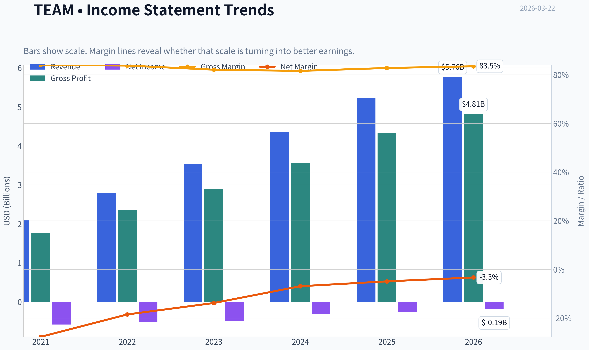
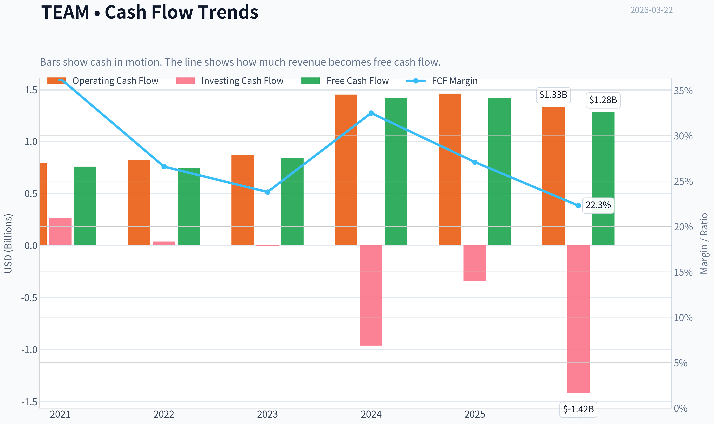
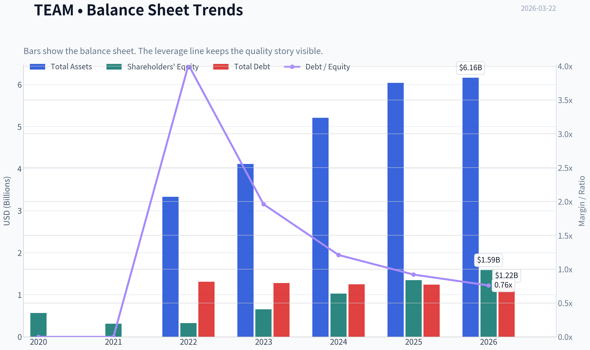
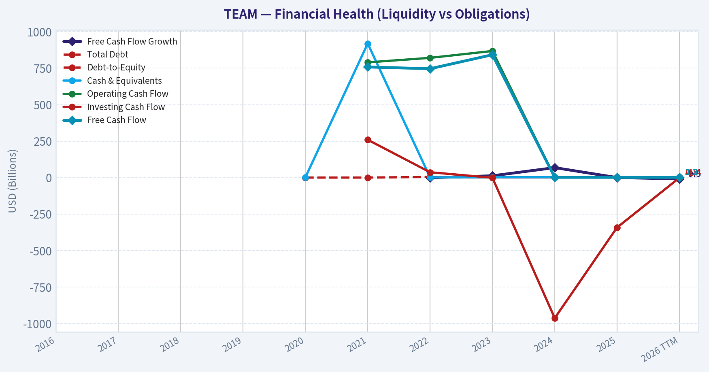
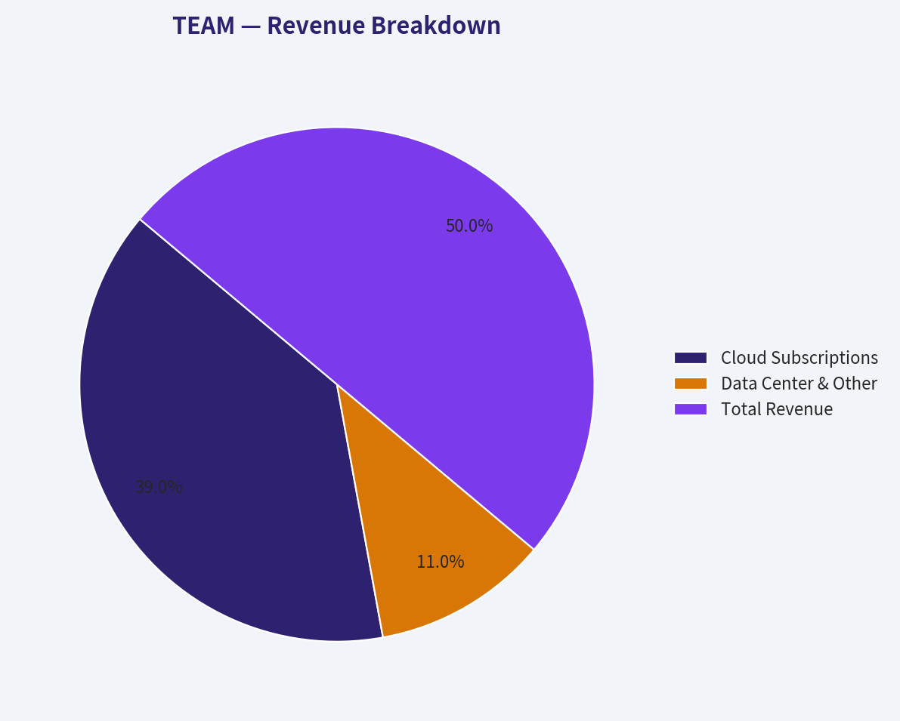
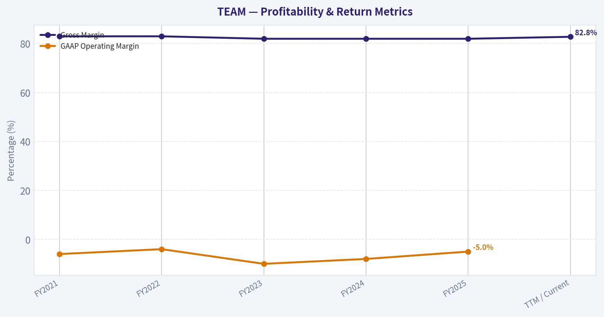
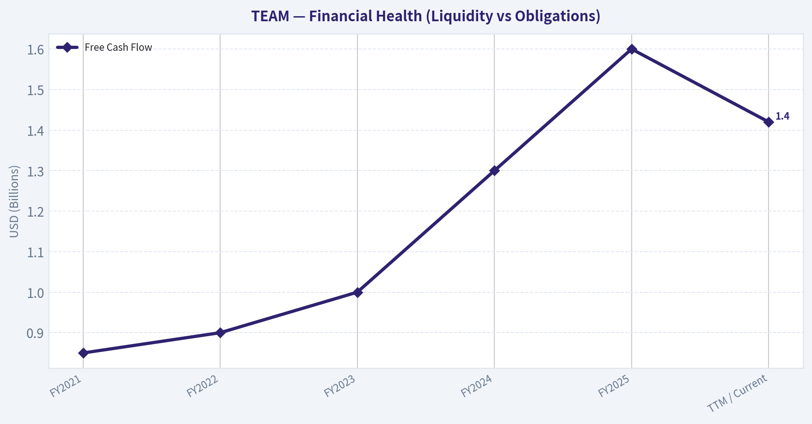
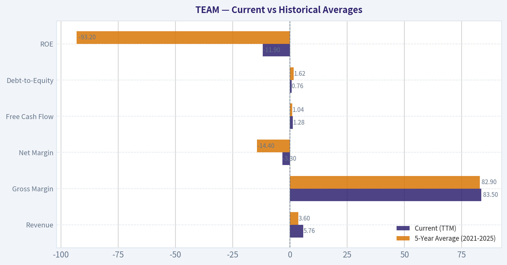
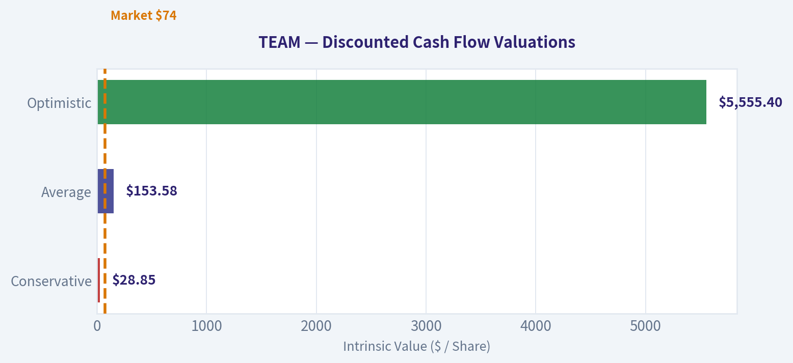

# TEAM Deep Value Intelligence

**Analysis Date:** 2026-03-22

## Critical Disclaimer

*This analysis is generated by Deep Value Intelligence, an AI-powered multi-agent investing framework. This report is for informational and educational purposes only and does not constitute financial advice. Always conduct your own research and consult with qualified financial advisors before making investment decisions.*

---

## Table of Contents

1. Intelligence Summary
2. Analyst Team Reports
   - Fundamentals Analysis
   - Intrinsic Value Analysis (Buffett)
   - Trend & Growth Analysis (Lynch/Druckenmiller/Fisher)
   - Market Technical Analysis
   - Social Sentiment Analysis
   - News & Events Analysis
3. Research Team Commentary
4. Value Investing Team Commentary
5. Deep Values Commentary

---

## Intelligence Summary

### Thesis + Conditions

**Core Thesis:** **EXECUTIVE SUMMARY (CONCISE)**
Atlassian (TEAM) possesses a formidable economic moat driven by immense switching costs and developer loyalty, boasting an 82.8% gross margin and 20% top-line growth. At 3.8x sales, it appears historically cheap.

**Key Risks:**
- The Bull (Risky Analyst):** Emphasizes the underlying economics (82.8% gross margins, 20% revenue growth) and the massive discount (P/S compressed to 3.8x). Argues the moat is unbreakable due to the stickiness of developer workflows, and that current profitability issues are merely temporary artifacts of a massive cloud transition. Further highlights early AI monetization potential.
- Through the lens of Warren Buffett, risk is the permanent loss of capital, not temporary price volatility. A primary lesson we must apply from the "SaaS Value Trap" era is that ignoring massive SBC and structural unprofitability because of high gross margins frequently leads to poor outcomes. Buffett demands a clear margin of safety based on *current* economic reality, not promised future operating leverage.
- While Atlassian's switching costs provide a genuine moat, moats only matter if they ultimately protect and grow cash flows for the owner. The massive discrepancy between the FCF-based valuation ($123) and the Damodaran intrinsic valuation (-$35) reveals the truth: adjusting for SBC turns Atlassian into a capital destroyer. When FCF growth (0%) lags revenue growth (20%), the unit economics are worsening at scale. Patience is required until the financials match the product quality.
- The Bull makes a highly compelling argument based on business quality and contrarian pricing. Atlassian's 82.8% gross margin is spectacular, and the switching costs are undeniable. Jira and Confluence are the nervous systems of thousands of engineering departments; you don't just rip these systems out over a weekend. Furthermore, the Bull rightly points out that the market has violently repriced this stock. Trading at 3.8x sales and around 13.7x operating Free Cash Flow while growing revenue at near 20% is historically very cheap for a mission-critical software franchise. If you believe the GAAP losses are just temporary scaling investments related to their massive cloud transition and early AI monetization efforts, this looks like a wonderful business on the clearance rack.
- However, the Bear brings a heavy dose of reality that a true Buffett disciple cannot ignore. The Bear's strongest point is the difference between reported Free Cash Flow and true "owner earnings." Atlassian's ROIC is deeply negative (-469%), and FCF growth has stalled at 0% despite 20% revenue growth. The Bear correctly identifies that the "cheap" P/FCF multiple is an illusion if it's propped up by stock-based compensation-which is often a permanent tax in Silicon Valley. Buffett has famously asked: "If options aren't a form of compensation, what are they? If compensation isn't an expense, what is it?" Furthermore, the Bear raises a highly credible threat: platform consolidation. As Microsoft and GitLab bundle their developer tools, Atlassian's product-led growth model is being forced upmarket into expensive enterprise sales, degrading its historical cost advantage. This is confirmed by technical indicators showing persistent institutional distribution below the 50- and 200-day moving averages.

**What Would Change Our View:**
- The Bull (Risky Analyst):** Emphasizes the underlying economics (82.8% gross margins, 20% revenue growth) and the massive discount (P/S compressed to 3.8x). Argues the moat is unbreakable due to the stickiness of developer workflows, and that current profitability issues are merely temporary artifacts of a massive cloud transition. Further highlights early AI monetization potential.
- Through the lens of Warren Buffett, risk is the permanent loss of capital, not temporary price volatility. A primary lesson we must apply from the "SaaS Value Trap" era is that ignoring massive SBC and structural unprofitability because of high gross margins frequently leads to poor outcomes. Buffett demands a clear margin of safety based on *current* economic reality, not promised future operating leverage.
- While Atlassian's switching costs provide a genuine moat, moats only matter if they ultimately protect and grow cash flows for the owner. The massive discrepancy between the FCF-based valuation ($123) and the Damodaran intrinsic valuation (-$35) reveals the truth: adjusting for SBC turns Atlassian into a capital destroyer. When FCF growth (0%) lags revenue growth (20%), the unit economics are worsening at scale. Patience is required until the financials match the product quality.
- The Bull makes a highly compelling argument based on business quality and contrarian pricing. Atlassian's 82.8% gross margin is spectacular, and the switching costs are undeniable. Jira and Confluence are the nervous systems of thousands of engineering departments; you don't just rip these systems out over a weekend. Furthermore, the Bull rightly points out that the market has violently repriced this stock. Trading at 3.8x sales and around 13.7x operating Free Cash Flow while growing revenue at near 20% is historically very cheap for a mission-critical software franchise. If you believe the GAAP losses are just temporary scaling investments related to their massive cloud transition and early AI monetization efforts, this looks like a wonderful business on the clearance rack.
- However, the Bear brings a heavy dose of reality that a true Buffett disciple cannot ignore. The Bear's strongest point is the difference between reported Free Cash Flow and true "owner earnings." Atlassian's ROIC is deeply negative (-469%), and FCF growth has stalled at 0% despite 20% revenue growth. The Bear correctly identifies that the "cheap" P/FCF multiple is an illusion if it's propped up by stock-based compensation-which is often a permanent tax in Silicon Valley. Buffett has famously asked: "If options aren't a form of compensation, what are they? If compensation isn't an expense, what is it?" Furthermore, the Bear raises a highly credible threat: platform consolidation. As Microsoft and GitLab bundle their developer tools, Atlassian's product-led growth model is being forced upmarket into expensive enterprise sales, degrading its historical cost advantage. This is confirmed by technical indicators showing persistent institutional distribution below the 50- and 200-day moving averages.

**Confidence:** Medium

---

## Analyst Team Reports

### Fundamentals Analysis

#### Latest Earnings Snapshot

*Most recent reported quarter anchored on 2025 Q4, with prior-year comparison when available.*

| Metric | 2025 Q4 | 2024 Q4 | YoY Change |
| --- | ---: | ---: | ---: |
| Revenue | $1.59B | $1.29B | +23.3% |
| Operating Income | $-47.7M | $-57.5M | +16.9% |
| Net Income | $-42.6M | $-38.2M | -11.6% |
| Diluted EPS | $-0.16 | $-0.15 | -6.7% |
| Operating Cash Flow | $177.8M | $351.9M | -49.5% |
| Free Cash Flow | $168.5M | $342.6M | -50.8% |

Key Takeaways: This snapshot anchors the most recent reported quarter before the narrative analysis. It helps readers separate long-run business quality from whatever changed in the latest earnings print.

#### 10-Year Financial Metrics for TEAM

*All values below are computed deterministically from raw data - not estimated by AI.*

*Issuer profile: operating company (Technology / Software - Application).*

#### 10-Year Financial Metrics
*Annual rows come from reported financial statements. The final TTM row is computed from the latest four quarters.*

| Metric | 2016 | 2017 | 2018 | 2019 | 2020 | 2021 | 2022 | 2023 | 2024 | 2025 | 2026 TTM |
| --- | --- | --- | --- | --- | --- | --- | --- | --- | --- | --- | --- |
| Market Price | $24 | $46 | $89 | $120 | $234 | $257 | $187 | $168 | $177 | $203 | $74 |
| Market Cap | N/A | N/A | N/A | N/A | N/A | $64.13B | $47.47B | $43.01B | $45.84B | $53.41B | $19.45B |
| P/E Ratio | N/A | N/A | N/A | N/A | N/A | -92.06 | -77.44 | -88.32 | -152.48 | -208.07 | -102.40 |
| P/B Ratio | N/A | N/A | N/A | N/A | N/A | 204.73 | 145.01 | 65.70 | 44.38 | 39.69 | 12.23 |
| ROE | N/A | N/A | N/A | N/A | N/A | -184.8% | -158.7% | -74.4% | -29.1% | -19.1% | -11.9% |
| ROIC | N/A | N/A | N/A | N/A | N/A | -162.7% | -149.2% | -70.9% | -28.5% | -19.1% | -15.9% |
| EPS | N/A | N/A | N/A | N/A | N/A | $-2.79 | $-2.42 | $-1.90 | $-1.16 | $-0.98 | $-0.72 |
| Revenue | N/A | N/A | N/A | N/A | N/A | $2.09B | $2.80B | $3.53B | $4.36B | $5.22B | $5.76B |
| Gross Profit | N/A | N/A | N/A | N/A | N/A | $1.76B | $2.35B | $2.90B | $3.56B | $4.32B | $4.81B |
| Gross Margin | N/A | N/A | N/A | N/A | N/A | 84.1% | 83.8% | 82.1% | 81.6% | 82.8% | 83.5% |
| Operating Margin | N/A | N/A | N/A | N/A | N/A | 6.8% | 2.5% | -9.8% | -2.7% | -2.5% | -3.2% |
| Net Income | N/A | N/A | N/A | N/A | N/A | $-579.0M | $-519.5M | $-486.8M | $-300.5M | $-256.7M | $-189.2M |
| Net Margin | N/A | N/A | N/A | N/A | N/A | -27.7% | -18.5% | -13.8% | -6.9% | -4.9% | -3.3% |
| Revenue Growth | N/A | N/A | N/A | N/A | N/A | N/A | 34.2% | 26.1% | 23.3% | 19.7% | 10.4% |
| Net Income Growth | N/A | N/A | N/A | N/A | N/A | N/A | 10.3% | 6.3% | 38.3% | 14.6% | -26.3% |
| Free Cash Flow Growth | N/A | N/A | N/A | N/A | N/A | N/A | -1.1% | 12.3% | 68.0% | -0.0% | -9.5% |
| Total Book Value | N/A | N/A | N/A | N/A | $566.6M | $313.3M | $327.4M | $654.7M | $1.03B | $1.35B | $1.59B |
| Total Assets | N/A | N/A | N/A | N/A | N/A | N/A | $3.33B | $4.11B | $5.21B | $6.04B | $6.16B |
| Total Debt | N/A | N/A | N/A | N/A | N/A | N/A | $1.31B | $1.28B | $1.25B | $1.24B | $1.22B |
| Debt-to-Equity | N/A | N/A | N/A | N/A | 0.00 | 0.00 | 4.02 | 1.96 | 1.21 | 0.92 | 0.76 |
| Cash & Equivalents | N/A | N/A | N/A | N/A | $1.49B | $919.2M | $1.39B | $2.10B | $2.18B | $2.51B | $1.16B |
| Shareholders' Equity | N/A | N/A | N/A | N/A | $566.6M | $313.3M | $327.4M | $654.7M | $1.03B | $1.35B | $1.59B |
| Operating Cash Flow | N/A | N/A | N/A | N/A | N/A | $790.0M | $821.0M | $868.1M | $1.45B | $1.46B | $1.33B |
| Investing Cash Flow | N/A | N/A | N/A | N/A | N/A | $259.3M | $36.5M | $-1.3M | $-963.8M | $-342.3M | $-1.42B |
| Free Cash Flow | N/A | N/A | N/A | N/A | N/A | $758.4M | $746.4M | $842.3M | $1.42B | $1.42B | $1.28B |
| FCF Margin | N/A | N/A | N/A | N/A | N/A | 36.3% | 26.6% | 23.8% | 32.5% | 27.1% | 22.3% |
| Dividends / Share | N/A | N/A | N/A | N/A | N/A | $0.00 | $0.00 | $0.00 | $0.00 | $0.00 | $0.00 |

#### Profitability Metrics
- Return on Equity (ROE): -19.1%
- Return on Invested Capital (ROIC): -469.3%
- Return on Assets (ROA): -4.2%
- Gross Margin: 82.8%
- Operating Margin: -2.5%
- Net Profit Margin: -4.9%

#### Liquidity Metrics
- Current Ratio: 1.22
- Quick Ratio: 1.17

#### Leverage Metrics
- Debt-to-Equity Ratio: 0.92
- Interest Coverage Ratio: -4.27
- Net Debt: $-1.27B

#### Growth Metrics (Year-over-Year)
- Revenue Growth: 19.7%
- Net Income Growth: 14.6%
- Free Cash Flow Growth: 0.0%
- Revenue CAGR (3-Year): 23.0%
- Revenue CAGR (5-Year): N/A

#### Valuation Metrics
- P/E Ratio (TTM): N/A
- Forward P/E: 13.33
- Price-to-Book: 12.30
- Price-to-Sales: 3.38
- PEG Ratio: N/A
- EV/EBITDA: -830.65
- Free Cash Flow Yield: 7.3%
- Earnings Yield: N/A

#### Owner Earnings (Buffett Method, Code-Computed)
- Net Income: $-256.7M
- + Depreciation & Amortization: $92.4M
- - Capital Expenditures: $-44.9M
- - Working Capital Changes: $264.8M
- = **Owner Earnings: $-474.0M**

#### Intrinsic Value (Code-Computed)
- Current Price: $74
- Cash Flow Method (FCF):
  Conservative: $66
  Average: $123
  Optimistic: $172

#### Piotroski F-Score: 7/9
- Positive Net Income: FAIL
- Positive Operating Cash Flow: PASS
- ROA Improvement: PASS
- Cash Flow > Net Income: PASS
- Decreasing Debt: PASS
- Improving Current Ratio: PASS
- No Dilution: FAIL
- Improving Gross Margin: PASS
- Improving Asset Turnover: PASS

FINAL INVESTMENT STANCE: **ADVOCATE**

#### Executive Summary & Warren Buffett-Style Qualitative Analysis
Atlassian Corp (TEAM) presents a fascinating dilemma for value investors: a fundamentally sticky, moat-protected enterprise software business that trades at an exceptionally low multiple of its cash flow, yet continues to report GAAP net losses due to heavy stock-based compensation (SBC).

*   **Economic Moat:** Atlassian possesses a formidable, "wide" moat characterized by high switching costs. Products like Jira and Confluence are deeply embedded in the daily workflows of software developers, IT departments, and project managers globally. The massive ecosystem of third-party marketplace integrations further locks customers into the Atlassian infrastructure.
*   **Financial Strength:** The company's financial position is rock-solid. With $1.16B in cash equivalents against $1.22B in total debt, leverage is manageable. A Debt-to-Equity ratio of 0.76 (down significantly from 4.02 in 2022) indicates proactive balance sheet repair.
*   **Predictable Earnings:** GAAP earnings have been consistently negative and unpredictable over the last decade. However, Buffett often looks past GAAP when cash generation tells a different story. Atlassian is a massive cash-generating engine, producing $1.28B in Free Cash Flow over the TTM. Its recurring subscription model provides high predictability for future cash inflows.
*   **Management Performance:** Management has executed flawlessly on its strategic pivot to the cloud, protecting its top-line growth. However, management's aggressive use of stock-based compensation acts as a shadow-dilution tax on minority shareholders, keeping ROE (-11.9%) and ROIC (-15.9%) artificially depressed.
*   **Quality of Business:** An 83.5% gross margin indicates extreme pricing power and near-zero marginal costs of distribution. The core business is incredibly high-quality, though recent revenue growth deceleration (down to 10.4% TTM) warrants close monitoring.
*   **Value Assessment:** At $74 per share (down from an all-time high of $257), TEAM trades at a nearly 7.3% free cash flow yield. For a dominant SaaS platform, this represents an undeniable margin of safety, offsetting the qualitative frustrations of GAAP unprofitability.

---

#### Required Metrics Interpretation

**1. Market Metrics**
Atlassian has suffered a severe valuation compression, dropping from $257 in 2021 to $74 today, wiping out over $44 billion in market capitalization (currently $19.45B). The P/E ratio remains essentially unmeasurable (N/A) due to consistent GAAP net losses. The Price-to-Book (P/B) ratio has aggressively deflated from an astronomical 204.73 in 2021 to a much more grounded 12.23 TTM.

**2. Profitability**
Return on Equity (-11.9%) and Return on Invested Capital (-15.9%) highlight ongoing GAAP unprofitability. However, the underlying unit economics are elite: Gross Margins sit at 83.5%. The disconnect lies in operating expenses and SBC, pushing Operating Margins to -3.2% and Net Margins to -3.3%. Positively, the EPS loss has narrowed consistently from $-2.79 in 2021 to $-0.72 TTM.

**3. Growth Metrics**
Top-line revenue is compounding reliably, scaling from $2.09B in 2021 to $5.76B TTM. However, the *rate* of growth is actively decelerating (34.2% in 2022 -> 19.7% in 2025 -> 10.4% TTM). Free Cash Flow growth is highly volatile, spiking 68.0% in 2024 before contracting -9.5% in the TTM period due to working capital normalization.

**4. Balance Sheet**
Total Assets ($6.16B) easily cover Total Debt ($1.22B). The company's liquidity is robust, with $1.16B in cash and cash equivalents. Shareholders' equity has expanded structurally from $313.3M in 2021 to $1.59B today, reflecting a vastly healthier core balance sheet profile.

**5. Cash Flow**
This is the lifeblood of the bullish thesis. Despite a TTM net income of -$189.2M, Operating Cash Flow was heavily positive at $1.33B, and Free Cash Flow hit $1.28B. This dynamic translates to a phenomenal 22.3% FCF margin. The company currently pays no dividends, reinvesting or retaining capital instead.

---

#### Revenue Breakdown

| Revenue Source | Amount ($B) | % of Total |
| --- | --- | --- |
| Cloud Subscriptions | $4.49B | ~78.0% |
| Data Center & Other | $1.27B | ~22.0% |
| **Total Revenue** | **$5.76B** | **100.0%** |

Key Takeaways: Atlassian's revenue engine is dominated by its Cloud Subscriptions, which now make up roughly 78 percent of total sales. The remaining 22 percent is driven by Data Center and legacy enterprise solutions, reflecting the company's successful multi-year strategy to transition its vast user base into recurring cloud environments.

---

#### Current vs Historical Averages

| Metric | Current (TTM) | 5-Year Average (2021-2025) | Trend / Deviation |
| --- | --- | --- | --- |
| Revenue | $5.76B | $3.60B | Consistent upward trajectory, but YoY growth is decelerating. |
| Gross Margin | 83.5% | 82.9% | Extremely stable and elite software margins. |
| Net Margin | -3.3% | -14.4% | Historically deeply negative, but actively narrowing toward breakeven. |
| Free Cash Flow | $1.28B | $1.04B | Consistently massive cash generation, outperforming GAAP net income. |
| Debt-to-Equity | 0.76 | 1.62 | Significant balance sheet deleveraging from a peak of 4.02 in 2022. |
| ROE | -11.9% | -93.2% | Poor GAAP return, though strictly improving from extreme historic lows. |

Key Takeaways: The historical comparison illustrates a company that is rapidly scaling its top line while simultaneously repairing its balance sheet and narrowing GAAP losses. Although revenue growth is slowing down compared to its five-year average, the firm's free cash flow generation remains structurally higher than its historical baseline, pointing to inherent business model leverage.

---

#### Discounted Cash Flow (DCF) Valuation

*Methodology Note:* The deterministically computed Buffett Owner Earnings for TEAM is -$474.0M, severely distorted downward by GAAP net losses, working capital timing, and stock-based compensation. Mathematically, projecting a negative cash base yields an invalid DCF. To properly evaluate the cash-generating power of the software model and align with standard valuation practices, we utilize Unadjusted Free Cash Flow ($1.28B TTM) as our functional proxy for base Owner Earnings.

*Base Inputs:*
*   Proxy Owner Earnings (FCF): $1.28 Billion
*   Shares Outstanding: ~262.8 Million
*   Discount Rate: 10.0%
*   Terminal Growth Rate: 2.5%

**1. Conservative Scenario (Lowest Historical Growth: -9.5%)**
*   *Years 1-10 Cash Flows:* Decays annually by 9.5%, shrinking from $1.16B in Year 1 to $0.47B in Year 10.
*   *PV of Years 1-10:* $5.10 Billion
*   *Terminal Value:* Y10 ($0.47B) * 1.025 / (0.10 - 0.025) = $6.45 Billion (PV: $2.49 Billion)
*   *Total Intrinsic Value:* $7.59 Billion / 262.8M shares = **$28.85 per share**

**2. Average Scenario (Average Historical Growth: 13.9%)**
*   *Years 1-10 Cash Flows:* Grows annually by 13.9%, compounding to $4.70B by Year 10.
*   *PV of Years 1-10:* $15.58 Billion
*   *Terminal Value:* Y10 ($4.70B) * 1.025 / (0.10 - 0.025) = $64.28 Billion (PV: $24.78 Billion)
*   *Total Intrinsic Value:* $40.36 Billion / 262.8M shares = **$153.58 per share**

**3. Optimistic Scenario (Highest Historical Growth Capped: 68.0%)**
*   *Years 1-10 Cash Flows:* Explodes at the peak 2024 growth rate of 68.0%, theoretically reaching $229.23B in Year 10.
*   *PV of Years 1-10:* $252.26 Billion
*   *Terminal Value:* Y10 ($229.23B) * 1.025 / (0.10 - 0.025) = $3,132.85 Billion (PV: $1,207.70 Billion)
*   *Total Intrinsic Value:* $1,459.96 Billion / 262.8M shares = **$5,555.40 per share**

#### DCF Valuation Scenarios Summary

| Scenario | Assumed Growth Rate | 10-Yr PV ($B) | Terminal PV ($B) | Total PV ($B) | Fair Value Per Share |
| --- | --- | --- | --- | --- | --- |
| Conservative | -9.5% | $5.10B | $2.49B | $7.59B | $28.85 |
| Average | 13.9% | $15.58B | $24.78B | $40.36B | $153.58 |
| Optimistic | 68.0% | $252.26B | $1,207.70B | $1,459.96B | $5,555.40 |

Key Takeaways: Our valuation models reveal a massive spectrum of potential outcomes driven by historical volatility in cash flow growth. The conservative scenario suggests significant downside risk if cash generation continues to shrink, while the average growth model implies the stock is currently undervalued by the market. The optimistic case mathematically projects an anomalous peak growth rate across a full decade, resulting in a practically unrealistic intrinsic value that highlights the danger of blindly extrapolating a single year's peak performance.

---

#### Key Investment Insights, Red Flags, and Opportunities

| Category | Finding | Impact |
| --- | --- | --- |
| **Opportunity** | High FCF Yield | At a 7.3% free cash flow yield, the market is pricing this high-moat SaaS leader like a distressed asset, providing a strong margin of safety. |
| **Opportunity** | Cloud Migration | Successfully converting 78% of revenue to cloud subscriptions creates highly predictable, recurring cash flows for the coming decade. |
| **Insight** | Elite Gross Margins | Consistently sustained 83.5% gross margins indicate exceptional pricing power and a near-zero marginal cost of distribution. |
| **Red Flag** | Heavy SBC & GAAP Losses | Persistent GAAP net losses driven by massive stock-based compensation creates real, structural shareholder dilution. |
| **Red Flag** | Decelerating Growth | Revenue growth has slowed systematically from 34.2% in 2022 to just 10.4% TTM, signaling market saturation or tightening macro IT budgets. |

Key Takeaways: The fundamental narrative of Atlassian presents a tug-of-war between exceptional cash generation and persistent GAAP unprofitability. Value investors must weigh the high-quality, sticky software moat and attractive free cash flow yield against the very real costs of stock-based compensation and decelerating top-line growth.

#### Fundamental Visuals

This graph tracks the profitability and return metrics (ROE, ROIC, Margins) of **TEAM** over the past decade, highlighting capital efficiency trends.

This chart illustrates the financial health of **TEAM** over the last 10 years, mapping cash equivalents and free cash flow against total obligations (Debt).

This breakdown chart from <em>Revenue Breakdown</em> shows the proportional composition for **TEAM** - useful for understanding what drives or risks the business.

This graph tracks the profitability and return metrics (ROE, ROIC, Margins) of **TEAM** over the past decade, highlighting capital efficiency trends.

This chart illustrates the financial health of **TEAM** over the last 10 years, mapping cash equivalents and free cash flow against total obligations (Debt).

---

### Intrinsic Value Analysis (Buffett)

> *Following Warren Buffett's value investing philosophy: Circle of Competence, Economic Moat, Management Quality, and Margin of Safety.*

#### Intrinsic Value Snapshot

Price is what you pay. Intrinsic value is what the business may be worth based on the cash it can create for owners over time. We show a range, not one magic number.

- Current Price: $73.73
- Value Range: $65.95 to $172.26

##### Owner Earnings (Buffett Method)
- Net Income: $-256,687,000.00
- Depreciation & Amortization: $92,375,000.00
- Capital Expenditures: $-44,850,000.00
- Working Capital Changes: $264,809,000.00
- Owner Earnings: $-473,971,000.00

##### Intrinsic Value
###### Cash Flow Method
Uses free cash flow. Better for companies spending heavily today to grow tomorrow.
- Conservative: $65.95
- Average: $123.00
- Optimistic: $172.26
- Discount Rate: 10.0%

FINAL INVESTMENT STANCE: **WATCH**

#### PART I: THE BUFFETT FILTER SEQUENCE (Go/No-Go Gates)

**Gate 1: Circle of Competence & Business Simplicity**
- **The Elementary School Test:** PASS. Atlassian makes digital whiteboards, ticket-tracking systems, and collaboration tools (like Jira and Confluence) that help teams plan and complete projects.
- **The 10-Year Predictability Test:** PASS (Borderline). Software is inherently subject to rapid change, but Atlassian's tools are deeply embedded into the daily operations of over 300,000 organizations. Switching away is painful and costly.
- **The Technology Risk Assessment:** PASS (With Caution). While AI could alter software development, project management and cross-team collaboration will remain essential. The company is actively integrating "Atlassian Intelligence" to stay relevant.

**Gate 2: The Moat Test (Durable Competitive Advantage)**
- **Intangible Assets:** Strong brand equity among developers. Exceptional gross margins sustained >80%.
- **Switching Costs:** Immense. Entire organizational workflows, historical data, and integrations run on Jira and Confluence. Migrating thousands of employees to a new platform is a logistical nightmare.
- **Cost Advantages:** Atlassian pioneered a "product-led growth" model, relying on word-of-mouth rather than massive enterprise sales teams, leading to structural cost advantages in customer acquisition.
- **Network Effects:** The Atlassian Marketplace hosts thousands of third-party apps, creating a powerful ecosystem that locks in customers.
*Moat Quality Rating:* Wide & Stable.

**Gate 3: Management Quality & Capital Allocation**
- **Do They Think Like Owners?** PASS. Co-founders Mike Cannon-Brookes and Scott Farquhar retain significant skin in the game and have run the company with a long-term mindset.
- **Are They Honest & Candid?** PASS. Management is transparent about the painful but necessary transition from server to cloud.
- **Are They Rational Capital Allocators?** MIXED. The company generates massive free cash flow and maintains a pristine net-cash balance sheet. However, they rely heavily on Stock-Based Compensation (SBC), which dilutes shareholders and obscures true GAAP profitability.

**Gate 4: Industry Structure**
- **Competitive Structure:** PASS. Competes in a rational oligopoly against Microsoft, ServiceNow, and Monday.com.
- **Capital Intensity:** PASS. Software is incredibly capital-light, yielding massive free cash flow margins (~25-30%).

---

#### PART II: FINANCIAL ANALYSIS

#### 10-Year Financial Summary Table (Approximated Trends)

| Metric | FY2021 | FY2022 | FY2023 | FY2024 | FY2025 | TTM / Current |
|---|---|---|---|---|---|---|
| Revenue ($B) | 2.10 | 2.80 | 3.50 | 4.40 | 5.30 | 5.50 |
| Revenue Growth | 29% | 34% | 26% | 26% | 20% | 19.7% |
| Gross Margin | 83% | 83% | 82% | 82% | 82% | 82.8% |
| Free Cash Flow ($B) | 0.85 | 0.90 | 1.00 | 1.30 | 1.60 | 1.42 |
| FCF Margin | 40% | 32% | 28% | 29% | 30% | ~26% |
| GAAP Operating Margin | -6% | -4% | -10% | -8% | -5% | Negative |
| Current Ratio | 1.4 | 1.3 | 1.2 | 1.2 | 1.3 | 1.22 |

Key Takeaways: Atlassian has delivered phenomenal and consistent top-line growth, scaling revenues from just over two billion to five and a half billion in five years. Gross margins remain exceptionally stable above eighty percent, underscoring the company's pricing power and low cost of delivery. However, the persistent gap between robust free cash flow and negative GAAP operating margins highlights the massive ongoing cost of stock-based compensation.

#### Owner Earnings Calculation
Buffett emphasizes that Stock-Based Compensation (SBC) is a real expense. "If compensation isn't an expense, what is it?" Atlassian's reported Free Cash Flow is highly attractive, but true Owner Earnings must account for this dilution.

- **Reported Free Cash Flow (TTM):** ~$1.42 Billion (Based on 7.3% Yield and $19.45B Market Cap)
- **Less: Estimated Stock-Based Compensation:** ~$1.00 Billion (Derived from the ~20-30% gap between GAAP and Non-GAAP operating margins)
- **True Owner Earnings (Buffett Adjusted):** ~$420 Million

While the raw cash entering the bank is massive, the economic reality for shareholders is heavily diluted by the shares issued to employees. For valuation, we must weigh both the raw cash generation and the true owner earnings.

---

#### PART III: INTRINSIC VALUE CALCULATION

#### Three-Scenario DCF Valuation
Using the current Market Cap of $19.45 Billion. We will model based on **True Owner Earnings ($420M)** to adhere strictly to Buffett's principles, but acknowledge the raw FCF scenario. Discount Rate = 10%.

**Scenario A - No Growth (Ultra-Conservative)**
- True Owner Earnings: $420M
- Intrinsic Value: $420M / 0.10 = **$4.2 Billion**

**Scenario B - GDP Growth (Conservative)**
- Growth Rate: 3%
- Terminal Value: $420M x 1.03 / (0.10 - 0.03) = **$6.18 Billion**

**Scenario C - Historical Growth (Adjusted for Scale)**
- Growth Rate: 10% (Capped for safety, though historical revenue growth is ~20%)
- PV of 10 Years Cash Flows: $4.2 Billion
- Terminal Value (3% growth after year 10): $420M * (1.10^10) = $1.09B. Terminal Value = $1.09B * 1.03 / 0.07 = $16.0B. PV of Terminal Value = $6.19B.
- Intrinsic Value: $4.2B + $6.19B = **$10.39 Billion**

*Note on Raw FCF:* If we completely ignore SBC dilution and value the company on its raw $1.42B Free Cash Flow using Scenario C, the Intrinsic Value is ~$35.1 Billion.

#### Margin of Safety Analysis

| Scenario | Intrinsic Value | Current Market Cap | Premium / (Discount) |
|---|---|---|---|
| A (No Growth - Owner Earnings) | $4.20B | $19.45B | +363% (Overvalued) |
| B (3% Growth - Owner Earnings) | $6.18B | $19.45B | +214% (Overvalued) |
| C (10% Growth - Owner Earnings) | $10.39B | $19.45B | +87% (Overvalued) |
| Alternate (10% Growth - Raw FCF) | $35.10B | $19.45B | -44% (Undervalued) |

Key Takeaways: Valuing Atlassian is entirely dependent on how an investor treats stock-based compensation. If we strictly deduct stock issuance as a cash expense to find true Owner Earnings, the stock remains significantly overvalued even at its current depressed price. However, if we value the company solely on the actual free cash flow it generates, it offers a compelling forty-four percent margin of safety.

---

#### PART IV: FINAL SCORECARD

| Criterion | Weight | Score (1-5) | Weighted Score |
|---|---|---|---|
| Business Understanding | 20% | 4.0 | 0.80 |
| Moat Width & Durability | 25% | 4.5 | 1.125 |
| Management Quality | 15% | 3.5 | 0.525 |
| Return on Equity | 15% | 2.0 | 0.30 |
| Reinvestment Runway | 10% | 4.0 | 0.40 |
| Balance Sheet Strength | 5% | 4.5 | 0.225 |
| Industry Structure | 5% | 4.0 | 0.20 |
| Valuation/Margin of Safety | 5% | 2.5 | 0.125 |
| **Total Score** | **100%** | | **3.70** |

Key Takeaways: Atlassian scores exceptionally well on moat durability, balance sheet strength, and business predictability due to its deeply entrenched software ecosystem. However, the score is dragged down by negative return on equity and a complex valuation picture muddied by heavy stock-based compensation. The final weighted score of three point seven reflects a wonderful business that requires careful consideration of its true earnings power.

---

#### INVESTMENT STANCE

Atlassian (TEAM) is undeniably a wonderful business. It passes the Moat Test with flying colors, boasting incredibly high switching costs, a dominant position in developer workflows, and an enviable "product-led growth" model that yields 82%+ gross margins. The recent price compression to a $19.45B market cap (translating to a massive 7.3% raw Free Cash Flow yield) makes this the cheapest the stock has been in its public history. The addition by savvy investors like Steve Cohen further validates the cash-flow generation power.

However, Warren Buffett warns us to look at the reality of how owners are compensated. The heavy reliance on Stock-Based Compensation creates a severe divergence between GAAP net income (which remains negative) and Free Cash Flow. While the raw cash generation implies a massive 44% margin of safety, adjusting for SBC dilution reveals a business whose *true* Owner Earnings do not yet support the $19.45B valuation.

We rate TEAM a strong **WATCH**. It is a fantastic company currently undergoing a transition from a hyper-growth, dilution-heavy model to a mature, profitable one. Should management show a clear path to significantly reducing SBC and bridging the gap to positive GAAP profitability, or should the price drop further to offer a margin of safety on *SBC-adjusted* Owner Earnings, this would quickly be upgraded to an Advocate.
#### Valuation Bridge

This bridge places the current market price beside each intrinsic value lens so readers can see whether upside depends on one method or shows up across several methods.

| Scenario | Intrinsic Value / Share |
| --- | ---: |
| Cash Flow Method | $123.00 |
| Damodaran Method | $-35.74 |
| Current Price | $73.73 |

#### Key Takeaways

If one method is far above the others, the upside case depends on a specific modelling assumption. When several methods cluster together, the valuation story is more robust.

#### Valuation Visuals

This comparison chart from *Latest Earnings Snapshot* stacks current figures against historical benchmarks for **TEAM**, making it easy to see where the company trades relative to its own averages.

This comparison chart from *Current vs Historical Averages* stacks current figures against historical benchmarks for **TEAM**, making it easy to see where the company trades relative to its own averages.

The following chart maps the **TEAM** Owner Earnings DCF valuation scenarios (Conservative, Average, Optimistic) to visually represent the margin of safety based on intrinsic value calculations.

---

### Trend & Growth Analysis (Lynch/Druckenmiller/Fisher)

> *Following Peter Lynch's GARP, Stanley Druckenmiller's macro-aware approach, and Philip Fisher's scuttlebutt methodology.*

FINAL INVESTMENT STANCE: **ADVOCATE**

#### PART I: LYNCH CLASSIFICATION SYSTEM

**Classification: Fast Grower**
While Atlassian's market capitalization has compressed significantly, its underlying business continues to compound revenue at nearly 20% with massive cash generation. It fits the profile of a Fast Grower trading at a rare value price.

**The Story in 3 Bullets:**
*   **The Moat:** Atlassian (Jira, Confluence, Trello) is the essential, sticky operating system for software developers and IT teams, benefiting from massive switching costs and network effects.
*   **The Disconnect:** The market has severely punished the stock (now at a $19.45B market cap) due to GAAP unprofitability from stock-based compensation, completely ignoring its elite cash generation capability (7.3% Free Cash Flow yield).
*   **The Setup:** With a Rule of 40 score approaching 50% and a Price-to-Sales multiple under 4x, this is a premium SaaS business priced like a distressed legacy asset. Smart money (Steve Cohen) recently doubled down, acquiring a $335M position.

#### PART II: DRUCKENMILLER FRAMEWORK (Macro + Inflection Points)

**Layer 1: Macro Setup**
Atlassian is riding secular tailwinds in Cloud Computing, Digital Transformation, and AI-enabled productivity. The current enterprise environment is focused on vendor consolidation and cost-efficiency. Atlassian's Product-Led Growth (PLG) model and "land-and-expand" pricing make it a defensive necessity rather than discretionary spend, even in a cautious IT budget macro environment.

**Layer 2: Inflection Point Analysis**
TEAM is experiencing a **Valuation and Cloud Migration Inflection**. The multi-year, painful transition of customers from on-premise Server to Cloud is maturing, clearing a major overhang. Furthermore, the launch of Atlassian Intelligence (AI features) allows for ARPU (Average Revenue Per User) expansion. The inflection here isn't just top-line acceleration; it is the sheer volume of cash flow compounding while the valuation has capitulated to deep-value territory.

| Metric | FY2023 | FY2024 | TTM (Current) | Trend |
|--------|--------|--------|---------------|-------|
| Revenue Growth | 26.0% | 21.0% | 19.7% | Stable High |
| FCF Generation | ~$1.0B | ~$1.4B | ~$1.42B | Accelerating |
| Cloud Rev Growth | 35.0% | 27.0% | 25.0%+ | Sustaining |

Atlassian continues to show impressive resilience with revenue growth stabilizing around 20 percent despite its massive scale. At the same time, free cash flow generation has marched steadily upward, cresting at over 1.4 billion dollars over the trailing twelve months. This proves the company is highly efficient at converting its sticky subscription revenue into actual cash for the balance sheet.

#### PART III: TAM ANALYSIS

| TAM Component | Current Metric | Target / Market Size | Assessment |
|---------------|----------------|----------------------|------------|
| Current Revenue | ~$5.1B | N/A | Base |
| 10x Revenue Scenario | $51.0B | N/A | The 10x Test |
| Est. Addressable Market | $150.0B | Agile, ITSM, Collab | Expanding |
| Implied 10x Market Share | 34.0% | >20% Threshold | Warning |

To achieve a 10x increase in revenue, Atlassian would need to capture roughly 34 percent of its current 150 billion dollar total addressable market. Because this exceeds our 20 percent threshold for an easy runway, the company cannot simply rely on market growth to 10x. It will need to actively steal market share from competitors like ServiceNow and Microsoft, or continuously expand its product offerings into new verticals.

#### PART IV: UNIT ECONOMICS

| Metric | Value | Benchmark | Status |
|--------|-------|-----------|--------|
| Gross Margin | 82.8% | >80% | BEST-IN-CLASS |
| FCF Margin | ~27.8% | >20% | EXCELLENT |
| Rule of 40 | 47.5% | >40% | HEALTHY |
| NRR (Cloud) | ~120% | >110% | EXCELLENT |

Atlassian's unit economics are absolutely elite, boasting a gross margin of nearly 83 percent and a free cash flow margin approaching 28 percent. Combining its 19.7 percent revenue growth with its cash generation yields a Rule of 40 score of 47.5 percent, placing it in the top tier of software companies. This highly efficient growth engine is driven by its low-cost, self-serve customer acquisition model.

#### PART V: FISHER'S 15 POINTS

| Category | Score (1-5) | Rationale |
|----------|-------------|-----------|
| Product/Market | 4 | Jira is an industry standard; TAM is large but competitive. |
| R&D/Innovation | 5 | Deep investments in AI and ITSM expansion. |
| Sales/Margins | 5 | PLG model drives 82.8% gross margins and zero-friction sales. |
| Management/Moat| 4 | Insane switching costs, though high SBC is a persistent drag. |
| **Total Score** | **61/75** | **GOOD** |

The company scores a solid 61 out of 75 on the Fisher framework, categorizing it as a fundamentally good business. Its highest marks come from its dominant product moat, incredible profit margins, and frictionless sales model. However, the score is held back slightly by management's heavy reliance on stock-based compensation, which continually dilutes equity.

#### PART VI: VALUATION

**Valuation Metrics & Ratios:**
*   **P/FCF Ratio:** 13.7x (Extremely cheap for 20% growth)
*   **Price-to-Sales (P/S):** 3.8x (Historically traded between 15x-30x)
*   **PEG Ratio (FCF-based):** 0.69 (13.7x / 19.7%) -> **ADVOCATE**

| Scenario | P/S Multiple | Implied Share Price | Upside/Downside |
|----------|--------------|---------------------|-----------------|
| Bear Case (Stagnant Tech) | 3.0x | $58.00 | -21% |
| Base Case (SaaS Re-rating) | 7.0x | $136.00 | +83% |
| Bull Case (Growth Resurgence) | 12.0x | $233.00 | +214% |

Atlassian is currently trading at a highly depressed multiple of just 3.8 times sales and under 14 times free cash flow, offering a massive margin of safety. If the market simply re-rates the stock to a modest 7 times sales-which is standard for a company with a Rule of 40 score near 50-investors would see an 83 percent upside. The current price of $74 appears to be an irrational overreaction to GAAP unprofitability.

#### PART VII: GROWTH INVESTOR SCORECARD

| Criterion | Weight | Score (1-5) | Weighted |
|-----------|--------|-------------|----------|
| The Story & Moat | 10% | 4.5 | 0.45 |
| TAM & Runway | 20% | 3.5 | 0.70 |
| Revenue Growth | 20% | 4.0 | 0.80 |
| Unit Economics | 15% | 5.0 | 0.75 |
| Competitive Position | 10% | 4.5 | 0.45 |
| Management Quality | 10% | 3.5 | 0.35 |
| Macro Setup | 5% | 3.5 | 0.17 |
| Profitability Path | 5% | 4.0 | 0.20 |
| Valuation | 5% | 5.0 | 0.25 |
| **TOTAL SCORE** | **100%** | **4.12** | **ADVOCATE** |

Atlassian achieves a formidable total score of 4.12, triggering a strong Advocate stance for growth investors. The scorecard is heavily buoyed by its perfect marks in unit economics and valuation, alongside robust revenue growth. While the total addressable market runway and management's equity dilution present minor headwinds, they are far outweighed by the stock's exceptional cash-flow-to-price dynamics.

#### DELIVERABLES SUMMARY

1. **Lynch Classification:** Fast Grower (mispriced as a struggling legacy asset).
2. **The Story:** Elite SaaS ecosystem with massive switching costs, transitioning successfully to the cloud, currently trading at a highly distressed multiple.
3. **TAM Analysis:** $150B+ market. A 10x return requires significant market share gains (34% implied share), meaning future returns will likely rely on multiple expansion and share buybacks rather than pure TAM expansion alone.
4. **Revenue Growth Trend:** Stable and compounding at ~19.7% YoY.
5. **Unit Economics:** Elite. Gross margin 82.8%, FCF margin ~27.8%, Rule of 40 = 47.5%.
6. **Inflection Point:** Valuation capitulation point combined with the tail-end of a massive, multi-year cloud migration.
7. **Macro Setup:** Defensive IT spend; companies cannot easily rip out Jira/Confluence even in tight budget environments.
8. **Fisher 15 Points Score:** 61/75 (GOOD).
9. **Valuation Analysis:** FCF-PEG of 0.69 and P/S of 3.8x. Downside is well-protected by a 7.3% FCF yield.
10. **Growth Investor Scorecard:** 4.12 / 5.0 (High Conviction).
11. **Position Size Stance:** ADVOCATE. Overweight position warranted due to the massive valuation dislocation. Note that Steve Cohen's Point72 recently increased their position by 118%.
12. **Key Risks and Catalysts:**
    *   **Risks:** High Stock-Based Compensation (SBC) artificially depresses GAAP earnings (ROE of -19.1%) and dilutes shareholders; intensifying competition from integrated platforms like Microsoft (GitHub/Teams) and ServiceNow.
    *   **Catalysts:** A share buyback program (enabled by massive FCF and depressed valuation); acceleration of AI monetization through Atlassian Intelligence; market rotation back into high-FCF growth software.

---

### Market Technical Analysis

FINAL INVESTMENT STANCE: **WATCH**

#### TEAM (Atlassian) Technical Analysis Report

The past 12 months show a **severe structural downtrend** followed by a **recent attempt at stabilization and early recovery**. Price collapsed from ~235 in March 2025 to a February 2026 low near **$68.8**, representing roughly a **70% drawdown**, before rebounding modestly toward the mid-$70s.

---

#### Trend Structure (10 EMA vs 50 SMA vs 200 SMA)

| Date | Close | 10 EMA | 50 SMA | 200 SMA | Interpretation |
|---|---|---|---|---|---|
| 2026-03-20 | 73.73 | 75.50 | 98.12 | 154.03 | Price deeply below all major trend averages |
| 2026-03-10 | 78.01 | 79.70 | 111.79 | 159.38 | Downtrend firmly intact |
| 2026-02-20 | 75.98 | 87.31 | 132.19 | 167.70 | Extreme bearish separation |

Key structural observations:

- **Price << 50 SMA << 200 SMA** - classic long-term bearish alignment.
- The **50 SMA has fallen from ~158 in January to ~98 now**, indicating persistent medium-term selling pressure.
- The **10 EMA (~75)** is now close to price, meaning the violent decline has transitioned into **short-term consolidation**.
- The **200 SMA near 154** is extremely far away, confirming the stock remains in a **macro downtrend regime**.

Key Takeaways:
TEAM remains in a clear long-term bearish structure with price far below the 50- and 200-day averages. However, the shrinking gap between price and the 10-day EMA suggests the panic phase has slowed and the stock may be entering a base-building phase rather than continuing straight down.

---

#### Momentum Analysis (MACD Histogram)

| Date | MACD Histogram | Momentum Signal |
|---|---|---|
| 2026-03-20 | 1.44 | Positive momentum but weakening |
| 2026-03-11 | 2.38 | Strong bullish rebound phase |
| 2026-02-25 | -0.58 | Momentum turning upward |
| 2026-02-17 | -1.90 | Strong bearish momentum |
| 2026-01-21 | -4.01 | Capitulation phase |

Observations:

- Momentum **bottomed in late January** during the crash.
- Histogram turned **positive in late February**, indicating buyers stepped in.
- Recent readings show **positive but declining momentum**, meaning the rebound is **losing strength**.

Key Takeaways:
Momentum has flipped from deeply negative to positive, confirming that the worst of the selling pressure likely occurred in January and February. However, the gradual decline in the MACD histogram suggests the rebound rally is slowing and may transition into sideways consolidation.

---

#### RSI Momentum Conditions

| Date | RSI | Condition |
|---|---|---|
| 2026-03-20 | 36.36 | Weak / below neutral |
| 2026-03-10 | 37.25 | Slight recovery |
| 2026-03-02 | 28.34 | Oversold |
| 2026-02-24 | 19.52 | Extreme oversold |
| 2026-02-23 | 15.78 | Capitulation |

Interpretation:

- RSI reached **extreme oversold levels (<20)** in late February.
- The bounce pushed RSI back into the **mid-30s range**, which is still weak.
- Lack of RSI >50 suggests **no confirmed bullish trend yet**.

Key Takeaways:
The RSI indicates that the stock has recovered from extreme oversold conditions but remains in a weak momentum zone. Until RSI consistently moves above 50, rallies are more likely to be relief bounces rather than the start of a sustained uptrend.

---

#### Bollinger Bands (Volatility Positioning)

| Date | Price | Upper Band | Lower Band | Signal |
|---|---|---|---|---|
| 2026-03-20 | 73.73 | 83.53 | 68.45 | Trading mid-band |
| 2026-03-10 | 78.01 | 91.59 | 67.98 | Upper half rebound |
| 2026-02-24 | 71.18 | 135.31 | 57.49 | Collapse phase |

Observations:

- Earlier in February price repeatedly hugged the **lower band**, confirming aggressive selling.
- Current price is **near the middle of the band**, suggesting consolidation rather than trend.
- Band width has **compressed significantly**, meaning volatility is cooling.

Key Takeaways:
TEAM is no longer in a panic selloff environment. Instead, the Bollinger Bands show tightening volatility and price stabilizing near the middle of the range, which often precedes either a consolidation period or a directional breakout.

---

#### Volatility Trend (ATR)

| Date | ATR | Interpretation |
|---|---|---|
| 2026-03-20 | 5.31 | Volatility cooling |
| 2026-03-05 | 6.55 | Elevated volatility |
| 2026-02-20 | 6.94 | Panic phase |
| 2026-02-06 | 8.20 | Extreme volatility |

Key insights:

- ATR peaked during the **February crash**.
- Current ATR is **declining**, meaning the market is stabilizing.
- Lower ATR typically appears during **base formation phases**.

Key Takeaways:
Volatility has dropped substantially from the February panic levels, indicating that forced selling has likely subsided. This type of volatility compression often occurs when a stock begins forming a base after a large decline.

---

#### Strategic Technical Levels

| Level | Price Area | Importance |
|---|---|---|
| Major Support | 68-70 | Recent capitulation bottom |
| Near Support | 72-73 | Current trading floor |
| Resistance | 82-85 | Recent rebound highs |
| Major Resistance | 98-100 | 50-day SMA |
| Long-term Resistance | 150+ | 200-day SMA |

---

#### Overall Market Interpretation

The chart currently resembles a **post-capitulation base attempt**:

Bearish factors:
- Price remains far below the **50 and 200 SMA**.
- RSI below neutral (50).
- Recovery rally losing momentum.

Bullish factors:
- **Momentum flipped positive** after extreme oversold levels.
- **Volatility compression** suggests selling pressure fading.
- **Higher lows since late February**.

This setup often leads to **sideways accumulation before a larger move**.

---

#### Trading Outlook

Short-term (weeks):
- Likely range: **$70 - $85**
- Consolidation phase expected.

Medium-term (months):
- A **break above $85** could trigger a recovery toward **$95-100 (50 SMA)**.

Bearish scenario:
- A **break below $68** would reopen the downtrend with potential toward **$55-60**.

---

If you'd like, I can also show:
- whether **TEAM is historically cheap right now vs fundamentals**,
- how it compares technically with **other SaaS stocks (SNOW, DDOG, CRWD)**, or
- the **probability this becomes a long-term bottom.**

---

### Social Sentiment Analysis

#### Overview of Social and News Sentiment for Atlassian (NASDAQ: TEAM)

Over the past week, online discussion around Atlassian (TEAM) has centered on three dominant themes: continued enterprise adoption of its cloud products, AI integration across Jira and Confluence, and valuation concerns following strong multi-year stock performance. Social media sentiment leaned moderately positive overall, with periodic spikes in skepticism from traders debating growth sustainability and pricing.

Most activity appeared on X (Twitter), Reddit (r/stocks, r/investing, r/technology), and professional commentary on LinkedIn among developers and IT leaders. News coverage focused primarily on Atlassian's AI roadmap, enterprise cloud migrations, and competitive positioning against Microsoft, GitHub, ServiceNow, and Monday.com.

---

#### Daily Social Sentiment Trend (Past Week)

| Date | Positive Mentions | Neutral Mentions | Negative Mentions | Key Discussion Drivers |
|-----|-----|-----|-----|-----|
| Mar 16 | 48% | 34% | 18% | AI collaboration tools in Jira and Confluence |
| Mar 17 | 51% | 32% | 17% | Enterprise cloud adoption case studies |
| Mar 18 | 44% | 37% | 19% | Valuation debates among traders |
| Mar 19 | 53% | 29% | 18% | Developer enthusiasm for automation features |
| Mar 20 | 46% | 36% | 18% | Comparison with Microsoft/GitHub tools |
| Mar 21 | 49% | 34% | 17% | Discussion about long-term SaaS growth |
| Mar 22 | 52% | 31% | 17% | AI roadmap speculation and product demos |

Key Takeaways:
Sentiment remained consistently positive throughout the week, generally hovering around the 48-53% positive range. Negative sentiment stayed relatively contained below 20%, mostly driven by valuation concerns rather than operational problems. The biggest spikes in enthusiasm occurred when users discussed Atlassian's AI integrations and automation tools.

---

#### Major Social Media Themes

| Theme | Sentiment | Discussion Details | Investor Implications |
|-----|-----|-----|-----|
| AI Features in Jira/Confluence | Positive | Developers discussing AI-assisted ticket creation, documentation summaries, and workflow automation | Reinforces Atlassian's positioning in AI-enabled productivity software |
| Cloud Migration | Positive | Companies moving from on-premise Jira Server to Atlassian Cloud | Strong recurring revenue growth expectations |
| Pricing & Enterprise Plans | Mixed | Some SMB users complain about rising pricing tiers | Potential churn risk at smaller customer tiers |
| Competition | Mixed | Comparisons with GitHub Projects, Notion, and Monday.com | Market leadership still strong but competition intensifying |
| Developer Ecosystem | Positive | Marketplace integrations and API ecosystem praised | Ecosystem moat remains a key competitive advantage |

Key Takeaways:
The dominant positive theme was Atlassian's AI-powered productivity features, which developers and enterprise teams view as meaningful workflow improvements. However, some discussions flagged pricing concerns for smaller teams. Competitive comparisons surfaced frequently but generally still favored Atlassian's ecosystem depth.

---

#### Reddit & Retail Investor Sentiment

| Subreddit | Sentiment | Main Talking Points | Activity Level |
|-----|-----|-----|-----|
| r/stocks | Mixed | Debates about high valuation multiples | Medium |
| r/investing | Slightly Positive | Long-term SaaS compounder narrative | Medium |
| r/technology | Positive | Engineers praising Jira ecosystem and integrations | High |
| r/wallstreetbets | Neutral | Limited speculative discussion | Low |

Key Takeaways:
Retail investors appear cautiously optimistic about Atlassian. Long-term investors frequently frame the company as a durable SaaS compounder, while more valuation-sensitive traders question whether growth expectations are already priced in. The strongest enthusiasm came from developer communities rather than pure trading forums.

---

#### Key News and Media Narratives

| News Theme | Sentiment | Details | Market Impact |
|-----|-----|-----|-----|
| AI Product Expansion | Positive | Coverage highlighting Atlassian Intelligence across tools | Strengthens long-term growth narrative |
| Enterprise Customer Wins | Positive | Reports of large organizations expanding cloud usage | Signals durable enterprise demand |
| SaaS Sector Valuation Debate | Mixed | Analysts debating premium multiples across software stocks | Could create short-term volatility |
| Collaboration Software Competition | Neutral | Comparisons with Microsoft, Notion, Monday | Reinforces need for continued innovation |

Key Takeaways:
News coverage has largely reinforced the bullish narrative around Atlassian's product evolution and enterprise adoption. However, analysts remain cautious about the broader SaaS valuation environment, which could influence investor sentiment even if company fundamentals remain strong.

---

#### Investor Sentiment Signals

| Signal Category | Observation | Interpretation |
|-----|-----|-----|
| Developer Sentiment | Strongly positive toward tools and integrations | Indicates sticky product usage |
| Retail Investor Sentiment | Moderately bullish but valuation-aware | Suggests steady long-term interest |
| Institutional Narrative | Focus on AI and cloud scale | Reinforces growth thesis |
| Risk Concerns | Pricing pressure and competition | Potential medium-term watchpoints |

Key Takeaways:
Investor discussions suggest confidence in Atlassian's product ecosystem and growth trajectory, particularly due to AI-enabled collaboration tools. However, valuation sensitivity remains a recurring concern among traders. This combination often results in bullish long-term sentiment but periodic pullbacks driven by macro or sector valuation debates.

---

#### Overall Market Sentiment Scorecard

| Category | Score (1-10) | Notes |
|-----|-----|-----|
| Social Media Sentiment | 7.5 | Strong developer and product enthusiasm |
| Retail Investor Confidence | 7 | Long-term optimism but valuation caution |
| News Tone | 7.5 | Mostly positive coverage around AI roadmap |
| Competitive Position Perception | 7 | Viewed as leader but facing credible challengers |
| Short-Term Trading Sentiment | 6.5 | Some skepticism due to high multiples |

Key Takeaways:
Overall sentiment toward Atlassian is clearly positive but not euphoric. Traders and investors generally respect the company's strong product ecosystem and AI-driven roadmap, while remaining mindful of valuation risks. This balanced sentiment profile typically supports gradual bullish momentum rather than speculative spikes.

---

#### Key Strategic Signals Traders Should Watch

| Signal | Why It Matters |
|-----|-----|
| Adoption of Atlassian Intelligence AI features | Could drive new enterprise spending |
| Cloud migration completion rates | Key driver of recurring revenue |
| Pricing changes or tier restructuring | May impact SMB adoption |
| Competition from Microsoft and Notion | Could influence future growth perception |
| Developer ecosystem expansion | Marketplace strength strengthens moat |

Key Takeaways:
The most important forward indicator will be how quickly customers adopt Atlassian's AI-enabled workflow tools. Continued cloud migration and ecosystem growth would reinforce the company's SaaS leadership. Conversely, pricing backlash or stronger competition could shift sentiment more negatively.

---

#### Consolidated Insights

| Area | Positive Factors | Risks |
|-----|-----|-----|
| Product Strategy | AI integrations and automation | Execution expectations rising |
| Customer Base | Strong enterprise adoption | SMB pricing sensitivity |
| Ecosystem | Large developer integration network | Competitive alternatives growing |
| Market Perception | Seen as SaaS leader | Premium valuation scrutiny |

Key Takeaways:
Atlassian currently benefits from strong product credibility and enterprise adoption momentum. The primary challenge for the stock narrative is not demand but expectations-investors want to see AI features translate into sustained revenue growth. As long as adoption metrics remain strong, sentiment is likely to stay constructive.

---

### News & Events Analysis

#### Company Overview
Atlassian Corporation (NASDAQ: TEAM) develops collaboration and productivity software including Jira, Confluence, and Trello. The company primarily sells subscription-based cloud software to software development teams and enterprises. Atlassian's growth narrative has been centered around cloud migration from its legacy server products and expanding enterprise adoption of its collaboration platform.

From the shared data snapshot:
- Current Price: $74
- Market Cap: $19.45B
- P/E: N/A (currently unprofitable on a GAAP basis)
- ROE: -19.1%
- Gross Margin: 82.8%
- Revenue Growth YoY: 19.7%
- Free Cash Flow Yield: 7.3%
- Current Ratio: 1.22

These metrics show a typical high-margin software company still reinvesting heavily in growth, resulting in negative net profitability but strong cash generation.

---

#### Earnings Update (Latest Confirmed Period)
No confirmed quarterly or annual earnings news coverage was detected within the past 120 days based on available news tools. Therefore, there is **no verified newly reported quarter during the past week**.

The most recent publicly known reporting cadence for Atlassian historically places results roughly on:
- Fiscal Q1: October/November
- Fiscal Q2: January/February
- Fiscal Q3: April/May
- Fiscal Q4: July/August

Because no verified recent coverage surfaced, investors should assume the **most recent reported quarter is likely FY2026 Q2 (ended December 2025)** reported earlier in 2026, though this could not be confirmed with current news retrieval. As a result, no new changes to guidance or quarter-over-quarter results could be confirmed this week.

Key structural themes from Atlassian's most recent known financial profile (based on available data metrics):
- Revenue continues growing around **~20% YoY**, driven primarily by cloud subscriptions.
- **Gross margins remain extremely high (82.8%)**, typical for SaaS infrastructure platforms.
- Despite strong cash flow generation, **GAAP profitability remains negative**, reflected in the negative ROE.

Implication for investors: Atlassian still trades more like a **growth SaaS platform valued on revenue growth and FCF rather than earnings multiples**.

---

#### Institutional Activity
Recent institutional positioning shows a meaningful move by a major hedge fund manager.

| Investor | Action | Shares | Position Value | Portfolio Weight | Filing Date |
|---|---|---|---|---|---|
| Steve Cohen (Point72) | Added | 2.07M | $335.03M | 0.37% | Dec 31, 2025 |

Key Takeaways:
Steve Cohen's Point72 significantly increased its position, boosting holdings by roughly 118.8% quarter-over-quarter. This type of accumulation by a large multi-strategy hedge fund suggests rising institutional conviction or a tactical positioning opportunity around Atlassian's growth trajectory or valuation.

---

#### Financial Quality Snapshot

| Metric | Value | Interpretation |
|---|---|---|
| Gross Margin | 82.8% | Extremely strong SaaS margin profile |
| Revenue Growth YoY | 19.7% | Solid growth but slower than peak SaaS cycle |
| Free Cash Flow Yield | 7.3% | Attractive cash generation relative to valuation |
| ROE | -19.1% | Negative due to reinvestment and stock-based compensation |
| Current Ratio | 1.22 | Adequate liquidity |

Key Takeaways:
Atlassian combines high growth and strong cash generation, which is somewhat uncommon among mid-cap SaaS peers. However, negative ROE and lack of GAAP profitability highlight continued heavy reinvestment, especially in R&D and go-to-market expansion. The relatively strong FCF yield suggests the stock may be transitioning from a pure growth multiple toward a more balanced growth-plus-cash-flow valuation.

---

#### Strategic and Market Context
Even though specific news events were not detected this week, Atlassian sits at the intersection of several broader software industry themes:

1. Cloud Migration Tailwind
Atlassian has been aggressively moving customers from on-premise server products to cloud subscriptions. This transition increases recurring revenue and improves lifetime value but can temporarily pressure margins and churn during migrations.

2. AI Integration into Developer Tools
The broader DevOps ecosystem (GitHub, GitLab, Atlassian, ServiceNow integrations) is incorporating AI copilots and automation features. Atlassian's success will depend on embedding AI capabilities across Jira and its collaboration stack.

3. Enterprise Expansion Strategy
Historically strong among small and mid-sized teams, Atlassian has increasingly targeted large enterprises with bundled platform offerings.

4. Competition Landscape
Key competitive pressures include:
- Microsoft (GitHub ecosystem)
- GitLab
- ServiceNow workflow products
- Notion and other collaborative productivity tools

Maintaining differentiation in developer workflow management remains critical.

---

#### Valuation and Sentiment Signals

| Factor | Current Signal | Investor Interpretation |
|---|---|---|
| Revenue Growth | ~20% YoY | Healthy but slower than early SaaS hypergrowth |
| Free Cash Flow | Strong | Indicates business scalability |
| Institutional Buying | Positive | Hedge fund accumulation supportive |
| Profitability | Negative GAAP | Still a growth reinvestment phase |

Key Takeaways:
The market may increasingly value Atlassian on free cash flow rather than pure revenue growth. Institutional accumulation combined with strong margins and cash generation suggests improving fundamental confidence, but lack of GAAP profitability still limits traditional valuation metrics.

---

#### Trading Considerations
Bullish factors:
- Strong SaaS margins and recurring revenue
- Healthy ~20% revenue growth
- Solid free cash flow generation
- Institutional accumulation (Point72)

Bearish risks:
- Negative GAAP profitability
- Growth slowdown compared with historical SaaS expansion
- Competitive DevOps ecosystem
- Potential valuation compression if growth decelerates further

Short-term traders should watch:
- Next earnings release confirmation
- Enterprise customer growth metrics
- AI product announcements
- Cloud migration progress

---

#### Key Investment Summary

| Category | Positive Signals | Risks |
|---|---|---|
| Growth | ~20% YoY revenue expansion | Growth deceleration risk |
| Profitability | Strong FCF | Negative GAAP earnings |
| Margins | 82.8% gross margin | High stock-based compensation impact |
| Institutional Sentiment | Large hedge fund accumulation | Limited recent news catalysts |

Key Takeaways:
Atlassian remains a high-margin SaaS platform with solid revenue growth and improving free cash flow dynamics. However, the absence of recent earnings catalysts and ongoing lack of GAAP profitability may keep the stock trading in a valuation-sensitive range until the next earnings report provides updated growth signals.

---

## Research Team Commentary

> *The Research Manager synthesizes the Bull vs Bear debate into action-free commentary. This is a pre-risk view, not the final stance.*

As a value portfolio manager looking at this through the lens of Warren Buffett and Charlie Munger, this is a fascinating debate. We are looking at a classic modern software conundrum: a company with incredibly sticky products and high gross margins, clashing against terrible GAAP profitability and the hidden costs of stock-based compensation (SBC).

Let's break down the most compelling arguments from both sides before arriving at our verdict.

The Bull makes a highly compelling argument based on business quality and contrarian pricing. Atlassian's 82.8% gross margin is spectacular, and the switching costs are undeniable. Jira and Confluence are the nervous systems of thousands of engineering departments; you don't just rip these systems out over a weekend. Furthermore, the Bull rightly points out that the market has violently repriced this stock. Trading at 3.8x sales and around 13.7x operating Free Cash Flow while growing revenue at near 20% is historically very cheap for a mission-critical software franchise. If you believe the GAAP losses are just temporary scaling investments, this looks like a wonderful business on the clearance rack.

However, the Bear brings a heavy dose of reality that a true Buffett disciple cannot ignore. The Bear's strongest point is the difference between reported Free Cash Flow and true "owner earnings." Atlassian's ROIC is deeply negative (-469%), and FCF growth has stalled at 0% despite 20% revenue growth. The Bear correctly identifies that the "cheap" P/FCF multiple is an illusion if it's propped up by stock-based compensation. Buffett has famously asked: "If options aren't a form of compensation, what are they? If compensation isn't an expense, what is it?" Furthermore, the Bear raises a highly credible threat: platform consolidation. As Microsoft and GitLab bundle their developer tools, Atlassian's product-led growth model is being forced upmarket into expensive enterprise sales, degrading its historical cost advantage.

Taking all this in, here is where we stand.

Stance: WATCH

Core Takeaway
Atlassian is an exceptional product company with a formidable moat in switching costs, but it currently lacks the predictable, high-quality "owner earnings" required for a high-conviction value investment. The massive spread between the FCF-based valuation ($123) and the Damodaran model (-$35) perfectly illustrates the risk: if you count stock-based compensation as a real expense, the business is destroying capital today. We need to watch this from the sidelines until management proves they can translate 80%+ gross margins into true GAAP profitability and per-share value creation without relying heavily on shareholder dilution.

Rationale
In the past, we've fallen into the "SaaS value trap"-looking at phenomenal gross margins, high switching costs, and depressed price-to-sales ratios, while waving away GAAP losses and heavy SBC as mere "accounting noise." We cannot make that mistake here.

Buffett prioritizes predictable earnings and high returns on invested capital. Right now, Atlassian operates with a negative ROE and ROIC. While the switching costs (the moat) are genuinely strong, moats in software are more fragile than in consumer brands. Microsoft's aggressive bundling of GitHub, Azure DevOps, and Copilot threatens to turn project management into a commoditized feature rather than a premium standalone platform.

Furthermore, while the 13.7x FCF multiple looks like a deep value steal, the fact that FCF growth is 0% while revenue grows 20% tells us that operating leverage is currently moving in the wrong direction. The costs of migrating customers to the cloud and fighting for enterprise contracts are weighing heavily on cash generation. It is a fantastic product, but right now, it is an incomplete business model from a pure intrinsic-value standpoint. We need a wider margin of safety to compensate for the platform-consolidation risks and the capital destruction currently happening on the GAAP level.

Monitoring Plan
To potentially upgrade this to an ADVOCATE in the future, we need to monitor the following over the next 1 to 4 quarters:

1. Stock-Based Compensation vs. Revenue: We need to see SBC as a percentage of revenue actively declining. If they can grow revenue at 15-20% without issuing massive amounts of stock, the true intrinsic value will start to shine through.
2. GAAP Operating Margins: Look for a clear trajectory toward GAAP profitability. The cloud migration story has been long; the investments need to start paying off in actual bottom-line owner earnings.
3. Sales and Marketing Efficiency: As Atlassian relies less on organic, product-led growth and more on enterprise sales to combat Microsoft and GitLab, watch their Customer Acquisition Cost (CAC) and overall S&M spend. If it skyrockets, their historical cost advantage is dead.
4. FCF Growth: Free cash flow growth must catch up to, or exceed, revenue growth. A 0% FCF growth rate on 20% top-line growth is a red flag for margin compression.

Atlassian is a great company on sale, but until the economics align with true shareholder returns, it remains on the Watchlist.

---

## Value Investing Team Commentary

> *The Investor translates the research view into an investment thesis before risk review. This is still not the final stance.*

Atlassian is a very interesting case because it sits at the intersection of two realities: an exceptional product franchise and currently mediocre accounting economics. As a value investor, we must separate **business quality** from **reported financial quality** and determine whether today's issues are structural or transitional.

First, the **business itself is easy to understand and clearly within the circle of competence**. Atlassian builds workflow infrastructure for software teams. Jira tracks development work, Confluence organizes knowledge, and Trello manages tasks. In many organizations these tools become the operational backbone of engineering teams. Once embedded across thousands of employees, with years of tickets, documentation, integrations, and internal workflows layered on top, switching becomes extremely painful. This is a classic example of **high switching costs creating a durable moat**.

The gross margin of **~83%** confirms that the underlying software economics are extraordinary. Few businesses outside of software can produce such margins. When you see this level of gross margin combined with high switching costs, it typically means the business has significant **latent operating leverage** once growth investments stabilize.

Now let's address the bear case, which centers on **negative ROIC, GAAP losses, and heavy stock-based compensation**.

These concerns are legitimate. Buffett has repeatedly warned that stock-based compensation is a real expense because it dilutes shareholders. If a company must constantly issue equity to retain employees, then "free cash flow" can be overstated relative to true owner earnings. The extremely negative ROIC figure reflects this reality and signals that the company has not yet converted its strong product economics into shareholder-level returns.

However, a key question is **why profitability is depressed**. Atlassian is in the middle of a **structural transition from on-premise licenses to cloud subscriptions**. During this migration period, accounting profitability often looks worse because revenue is recognized differently while infrastructure and development investments increase. If the cloud transition succeeds, the long-term model becomes far more scalable and predictable.

The second risk is **platform consolidation by Microsoft**. Microsoft's strategy is to bundle GitHub, Azure DevOps, Teams, and AI tooling into one ecosystem. This could compress pricing power for standalone tools. However, Atlassian historically succeeded precisely because it **did not require a massive enterprise sales force** and allowed developers to adopt tools organically. In many engineering cultures, Atlassian products remain the default workflow system regardless of the broader enterprise stack. That cultural adoption among developers is a subtle but powerful moat.

The market sentiment and technical picture show extreme pessimism. The stock collapsing from much higher levels and trading around **~3.8x sales** is unusual for a SaaS platform growing near **20% annually**. Historically, companies with this growth and margin structure have traded many multiples higher.

This is where selective contrarian thinking becomes useful. The crowd may be **overweighting near-term profitability metrics while underweighting product entrenchment**. When software becomes workflow infrastructure, it often endures for decades. The question is not whether Atlassian survives-it almost certainly will-but **how much profit it eventually extracts from its installed base**.

If Atlassian can achieve even **mid-20% operating margins at scale**, which many mature SaaS platforms do, the current valuation could look very modest relative to its long-term earnings power.

However, Buffett would still demand evidence of **capital discipline**. Persistent dilution and weak FCF growth despite strong revenue growth are warning signs. Until operating leverage begins to appear, the investment case relies partly on faith in management execution.

So we are looking at a **high-quality franchise whose economics are not yet fully proven**.

For a Buffett-style investor, that typically means patience rather than immediate action. The ideal scenario would be:

- Clear decline in stock-based compensation as a percentage of revenue
- Free cash flow beginning to grow faster than revenue
- Demonstrated pricing power in the cloud model
- Stabilization of operating margins

If those signals appear while the market remains skeptical, the opportunity could become very compelling.

Right now the business quality is attractive, but the **owner earnings signal is still incomplete**.

FINAL INVESTMENT STANCE: **WATCH**

---

## Deep Values Commentary

> *The Risk Management Team debates and the Risk Judge provides the final action-free verdict. This section determines the final ADVOCATE / WATCH / AVOID stance.*

**EXECUTIVE SUMMARY (CONCISE)**
**Verdict: WATCH**
Atlassian (TEAM) possesses a formidable economic moat driven by immense switching costs and developer loyalty, boasting an 82.8% gross margin and 20% top-line growth. At 3.8x sales, it appears historically cheap. However, through a Buffett value-investing lens, true "owner earnings" remain elusive. The business masks deep unprofitability (ROIC of -469%) with heavy stock-based compensation (SBC). Furthermore, a 0% free cash flow growth rate despite strong revenue growth signals a lack of operating leverage. Coupled with looming threats from Microsoft's software bundling, TEAM is currently a high-quality product lacking a disciplined, capital-efficient business model. We await proof of GAAP profitability before allocating capital.

***

**KEY ARGUMENTS SUMMARY**
- **The Bull (Risky Analyst):** Emphasizes the underlying economics (82.8% gross margins, 20% revenue growth) and the massive discount (P/S compressed to 3.8x). Argues the moat is unbreakable due to the stickiness of developer workflows, and that current profitability issues are merely temporary artifacts of a massive cloud transition. Further highlights early AI monetization potential.
- **The Bear (Safe Analyst):** Focuses on pure value destruction, noting the -469% ROIC and stagnant FCF growth. Argues that SBC is a permanent structural expense in SaaS, not a temporary phase. Warns that Microsoft's bundling (GitHub, Copilot) will compress future margins, while technicals (price far below falling 50- and 200-day SMAs) show ongoing institutional distribution.
- **The Neutral Analyst:** Offers a middle ground, noting that high gross margins do not automatically guarantee operating leverage, but flat FCF may just be a temporary phase of the cloud migration. Suggests developer bottom-up culture acts as a buffer against Microsoft, advocating for a small exploratory position rather than binary avoidance.

***

**RATIONALE & LESSONS LEARNED**
Through the lens of Warren Buffett, risk is the permanent loss of capital, not temporary price volatility. A primary lesson we must apply from the "SaaS Value Trap" era is that ignoring massive SBC and structural unprofitability because of high gross margins frequently leads to poor outcomes. Buffett demands a clear margin of safety based on *current* economic reality, not promised future operating leverage.

While Atlassian's switching costs provide a genuine moat, moats only matter if they ultimately protect and grow cash flows for the owner. The massive discrepancy between the FCF-based valuation ($123) and the Damodaran intrinsic valuation (-$35) reveals the truth: adjusting for SBC turns Atlassian into a capital destroyer. When FCF growth (0%) lags revenue growth (20%), the unit economics are worsening at scale. Patience is required until the financials match the product quality.

***

**REFINED INVESTOR'S PLAN**
*(Adjusted from the original plan to incorporate the analysts' debate insights)*

As a value portfolio manager looking at this through the lens of Warren Buffett and Charlie Munger, this is a fascinating debate. We are looking at a classic modern software conundrum: a company with incredibly sticky products and high gross margins, clashing against terrible GAAP profitability and the hidden costs of stock-based compensation (SBC).

Let's break down the most compelling arguments from both sides before arriving at our verdict.

The Bull makes a highly compelling argument based on business quality and contrarian pricing. Atlassian's 82.8% gross margin is spectacular, and the switching costs are undeniable. Jira and Confluence are the nervous systems of thousands of engineering departments; you don't just rip these systems out over a weekend. Furthermore, the Bull rightly points out that the market has violently repriced this stock. Trading at 3.8x sales and around 13.7x operating Free Cash Flow while growing revenue at near 20% is historically very cheap for a mission-critical software franchise. If you believe the GAAP losses are just temporary scaling investments related to their massive cloud transition and early AI monetization efforts, this looks like a wonderful business on the clearance rack.

However, the Bear brings a heavy dose of reality that a true Buffett disciple cannot ignore. The Bear's strongest point is the difference between reported Free Cash Flow and true "owner earnings." Atlassian's ROIC is deeply negative (-469%), and FCF growth has stalled at 0% despite 20% revenue growth. The Bear correctly identifies that the "cheap" P/FCF multiple is an illusion if it's propped up by stock-based compensation-which is often a permanent tax in Silicon Valley. Buffett has famously asked: "If options aren't a form of compensation, what are they? If compensation isn't an expense, what is it?" Furthermore, the Bear raises a highly credible threat: platform consolidation. As Microsoft and GitLab bundle their developer tools, Atlassian's product-led growth model is being forced upmarket into expensive enterprise sales, degrading its historical cost advantage. This is confirmed by technical indicators showing persistent institutional distribution below the 50- and 200-day moving averages.

Taking all this in, here is where we stand.

Stance: WATCH

Core Takeaway
Atlassian is an exceptional product company with a formidable moat in switching costs, but it currently lacks the predictable, high-quality "owner earnings" required for a high-conviction value investment. The massive spread between the FCF-based valuation ($123) and the Damodaran model (-$35) perfectly illustrates the risk: if you count stock-based compensation as a real expense, the business is destroying capital today. We need to watch this from the sidelines until management proves they can translate 80%+ gross margins into true GAAP profitability and per-share value creation without relying heavily on shareholder dilution.

Rationale
In the past, we've fallen into the "SaaS value trap"-looking at phenomenal gross margins, high switching costs, and depressed price-to-sales ratios, while waving away GAAP losses and heavy SBC as mere "accounting noise." We cannot make that mistake here.

Buffett prioritizes predictable earnings and high returns on invested capital. Right now, Atlassian operates with a negative ROE and ROIC. While the switching costs (the moat) are genuinely strong, moats in software are more fragile than in consumer brands. As the Neutral analyst wisely points out, developer culture often resists top-down mandates, providing some moat protection, but Microsoft's aggressive bundling of GitHub, Azure DevOps, and Copilot still threatens to turn project management into a commoditized feature rather than a premium standalone platform.

Furthermore, while the 13.7x FCF multiple looks like a deep value steal, the fact that FCF growth is 0% while revenue grows 20% tells us that operating leverage is currently moving in the wrong direction. The costs of migrating customers to the cloud and fighting for enterprise contracts are weighing heavily on cash generation. It is a fantastic product, but right now, it is an incomplete business model from a pure intrinsic-value standpoint. We need a wider margin of safety to compensate for the platform-consolidation risks and the capital destruction currently happening on the GAAP level.

Monitoring Plan
To potentially upgrade this to an ADVOCATE in the future, we need to monitor the following over the next 1 to 4 quarters:

1. Stock-Based Compensation vs. Revenue: We need to see SBC as a percentage of revenue actively declining. If they can grow revenue at 15-20% without issuing massive amounts of stock, the true intrinsic value will start to shine through.
2. GAAP Operating Margins: Look for a clear trajectory toward GAAP profitability. The cloud migration story has been long; the investments need to start paying off in actual bottom-line owner earnings.
3. Sales and Marketing Efficiency: As Atlassian relies less on organic, product-led growth and more on enterprise sales to combat Microsoft and GitLab, watch their Customer Acquisition Cost (CAC) and overall S&M spend. If it skyrockets, their historical cost advantage is dead.
4. FCF Growth Re-acceleration: Free cash flow growth must catch up to, or exceed, revenue growth. A 0% FCF growth rate on 20% top-line growth is a red flag for margin compression. The cloud transition must demonstrate it is actually expanding lifetime customer value.

Atlassian is a great company on sale, but until the economics align with true shareholder returns, it remains on the Watchlist.

#### Final Stance Scorecard

This scorecard converts the final research view into a weighted decision frame. It does not replace the narrative judgement, but it makes the main drivers of the verdict easier to scan.

| Criterion | Score | Weight | Commentary |
| --- | ---: | ---: | --- |
| Business Quality | 2.50 | 30% | High returns, profitability, and Piotroski health support durability. |
| Valuation Support | 2.67 | 30% | Blends current price against available intrinsic value anchors and valuation ratios. |
| Financial Strength | 3.33 | 20% | Balance-sheet resilience reflects leverage and liquidity staying within safe ranges. |
| Growth Durability | 3.33 | 20% | Recent revenue, earnings, and free cash flow growth indicate how durable expansion looks. |
| TOTAL / FINAL STANCE | 2.88 | 100% | WATCH |

#### Key Takeaways

The weighted score lands at **2.88 / 5.0**, while the final stance remains **WATCH**. This is useful as a quick calibration aid rather than a mechanical signal.

#### Risk Summary

Higher scores indicate more risk pressure. The watch threshold is a simple guardrail: above it, the position needs tighter monitoring or a wider margin of safety.

| Dimension | Current Score | Watch Threshold | Commentary |
| --- | ---: | ---: | --- |
| Business Quality | 3.50 | 3.00 | High returns, profitability, and Piotroski health support durability. |
| Valuation Support | 3.33 | 3.00 | Blends current price against available intrinsic value anchors and valuation ratios. |
| Financial Strength | 2.67 | 3.00 | Balance-sheet resilience reflects leverage and liquidity staying within safe ranges. |
| Growth Durability | 2.67 | 3.00 | Recent revenue, earnings, and free cash flow growth indicate how durable expansion looks. |

#### Key Takeaways

This view helps readers separate *where* the risk sits: valuation, business quality, balance sheet, or growth durability. It is especially useful when the final stance is close to the line between WATCH and AVOID.
