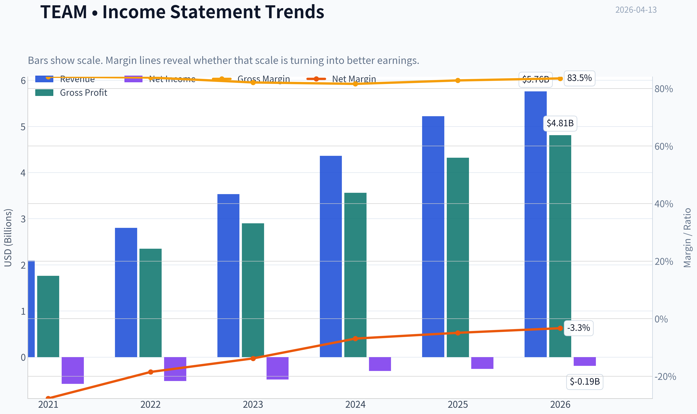
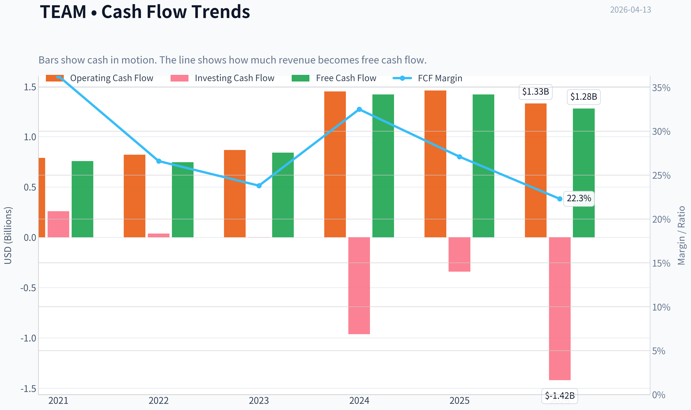
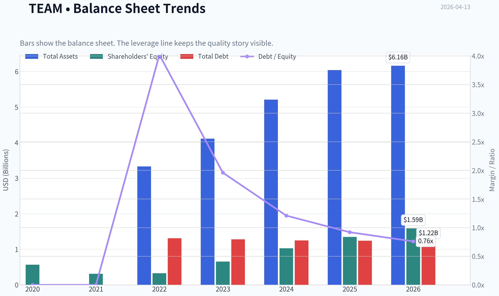
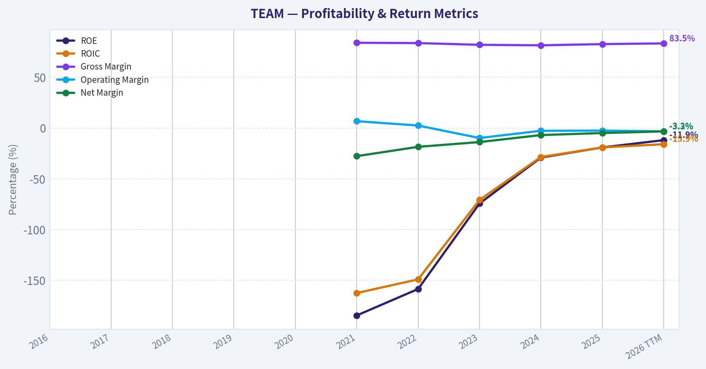
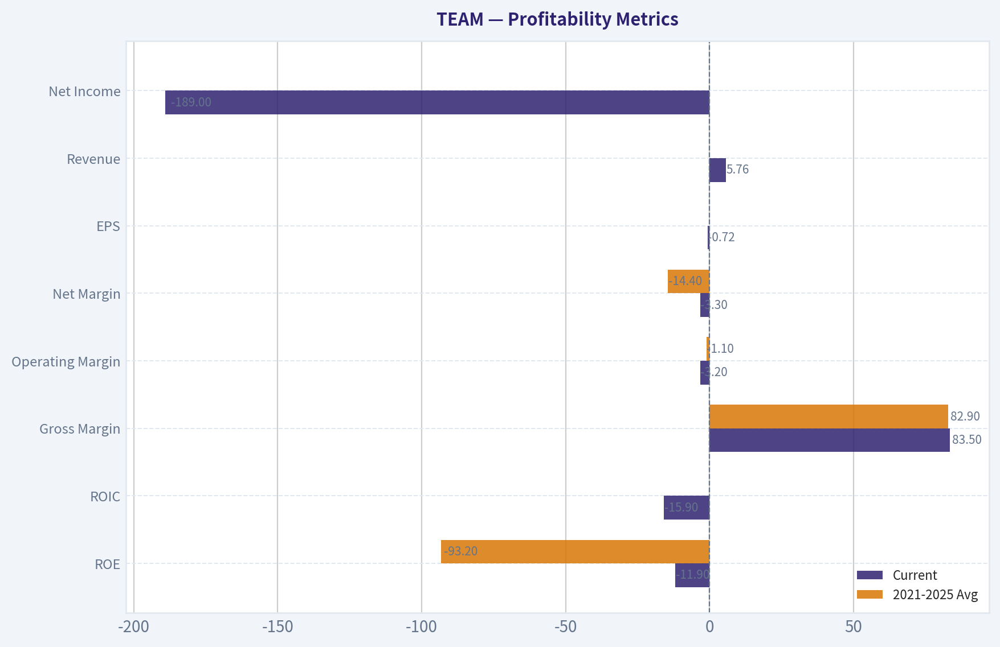
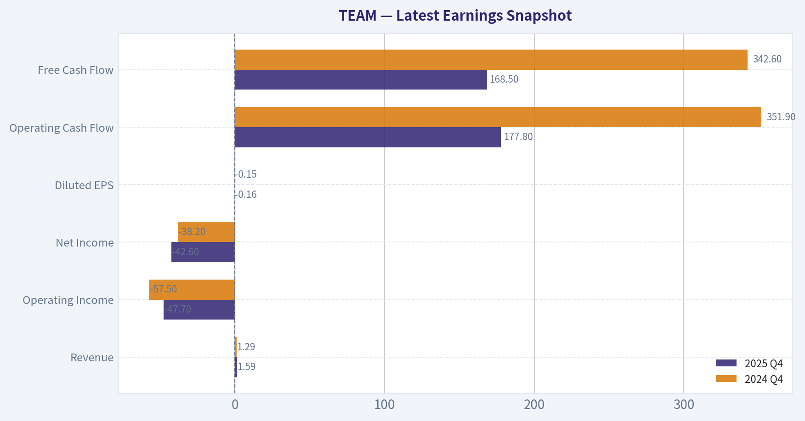
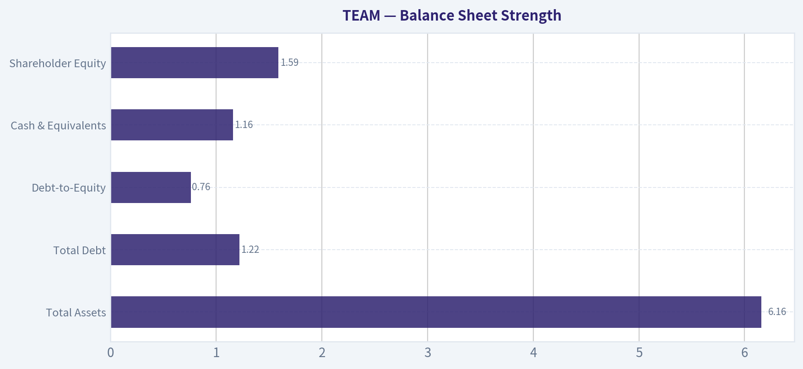
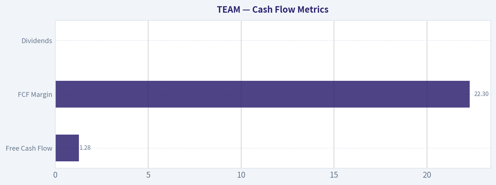
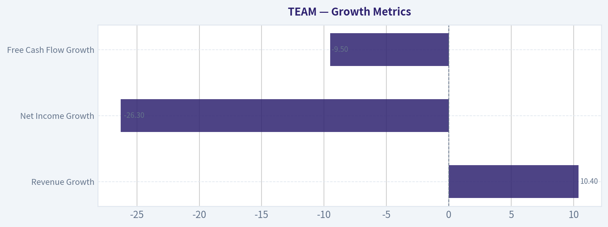
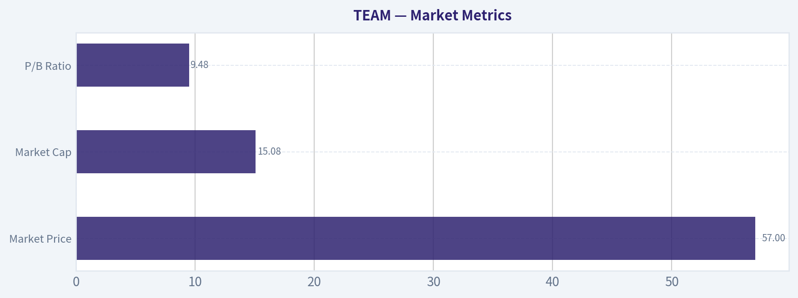

# TEAM Deep Value Intelligence

**Analysis Date:** 2026-04-13

## Critical Disclaimer

*This analysis is generated by Deep Value Intelligence, an AI-powered multi-agent investing framework. This report is for informational and educational purposes only and does not constitute financial advice. Always conduct your own research and consult with qualified financial advisors before making investment decisions.*

---

## Table of Contents

1. Intelligence Summary
2. Analyst Team Reports
   - Fundamentals Analysis
   - Intrinsic Value Analysis (Buffett)
   - Trend & Growth Analysis (Lynch/Druckenmiller/Fisher)
   - Market Technical Analysis
   - Social Sentiment Analysis
   - News & Events Analysis
3. Research Team Commentary
4. Value Investing Team Commentary
5. Deep Values Commentary

---

## Intelligence Summary

### Thesis + Conditions

**Core Thesis:** Executive Summary (Quick Read)

**Key Risks:**
- Atlassian shows clear product strength but unproven economic strength. The developer workflow moat (Jira, Confluence) and ~83% gross margins indicate a powerful software engine, yet a decade after IPO the business still lacks consistent profitability, with negative ROE and stagnant free cash flow. The debate centers on whether this is a temporary investment phase or a structural cost reality. For a Buffett-style investor who prioritizes proven returns on capital and predictable owner earnings, the evidence is still incomplete. The company is worth monitoring closely, but the margin of safety is not yet clear.
- Risky Analyst (Bullish Lean)
- The strongest point from the bullish side is Atlassian's workflow entrenchment. Jira sits inside the operational backbone of engineering teams, creating real switching friction through integrations, ticket histories, and internal processes. Combined with ~82-84% gross margins, this suggests that the underlying software economics are very strong. The argument is that current weak profitability reflects deliberate reinvestment during cloud migration and AI platform development. If spending growth slows while revenue continues growing ~20%, operating leverage could dramatically expand margins toward mature SaaS levels (25-30%).
- Safe Analyst (Risk Focus)
- Risk Commentary Through a Buffett Lens

**What Would Change Our View:**
- Atlassian shows clear product strength but unproven economic strength. The developer workflow moat (Jira, Confluence) and ~83% gross margins indicate a powerful software engine, yet a decade after IPO the business still lacks consistent profitability, with negative ROE and stagnant free cash flow. The debate centers on whether this is a temporary investment phase or a structural cost reality. For a Buffett-style investor who prioritizes proven returns on capital and predictable owner earnings, the evidence is still incomplete. The company is worth monitoring closely, but the margin of safety is not yet clear.
- Risky Analyst (Bullish Lean)
- The strongest point from the bullish side is Atlassian's workflow entrenchment. Jira sits inside the operational backbone of engineering teams, creating real switching friction through integrations, ticket histories, and internal processes. Combined with ~82-84% gross margins, this suggests that the underlying software economics are very strong. The argument is that current weak profitability reflects deliberate reinvestment during cloud migration and AI platform development. If spending growth slows while revenue continues growing ~20%, operating leverage could dramatically expand margins toward mature SaaS levels (25-30%).
- Safe Analyst (Risk Focus)
- Risk Commentary Through a Buffett Lens

**Confidence:** Medium

---

## Analyst Team Reports

### Fundamentals Analysis

#### Latest Earnings Snapshot

*Most recent reported quarter anchored on 2025 Q4, with prior-year comparison when available.*

| Metric | 2025 Q4 | 2024 Q4 | YoY Change |
| --- | ---: | ---: | ---: |
| Revenue | $1.59B | $1.29B | +23.3% |
| Operating Income | $-47.7M | $-57.5M | +16.9% |
| Net Income | $-42.6M | $-38.2M | -11.6% |
| Diluted EPS | $-0.16 | $-0.15 | -6.7% |
| Operating Cash Flow | $177.8M | $351.9M | -49.5% |
| Free Cash Flow | $168.5M | $342.6M | -50.8% |

Key Takeaways: This snapshot anchors the most recent reported quarter before the narrative analysis. It helps readers separate long-run business quality from whatever changed in the latest earnings print.

#### 10-Year Financial Metrics for TEAM

*All values below are computed deterministically from raw data - not estimated by AI.*

*Issuer profile: operating company (Technology / Software - Application).*

#### 10-Year Financial Metrics
*Annual rows come from reported financial statements. The final TTM row is computed from the latest four quarters.*

| Metric | 2016 | 2017 | 2018 | 2019 | 2020 | 2021 | 2022 | 2023 | 2024 | 2025 | 2026 TTM |
| --- | --- | --- | --- | --- | --- | --- | --- | --- | --- | --- | --- |
| Market Price | $24 | $46 | $89 | $120 | $234 | $257 | $187 | $168 | $177 | $203 | $57 |
| Market Cap | N/A | N/A | N/A | N/A | N/A | $64.13B | $47.47B | $43.01B | $45.84B | $53.41B | $15.08B |
| P/E Ratio | N/A | N/A | N/A | N/A | N/A | -92.06 | -77.44 | -88.32 | -152.48 | -208.07 | -79.38 |
| P/B Ratio | N/A | N/A | N/A | N/A | N/A | 204.73 | 145.01 | 65.70 | 44.38 | 39.69 | 9.48 |
| ROE | N/A | N/A | N/A | N/A | N/A | -184.8% | -158.7% | -74.4% | -29.1% | -19.1% | -11.9% |
| ROIC | N/A | N/A | N/A | N/A | N/A | -162.7% | -149.2% | -70.9% | -28.5% | -19.1% | -15.9% |
| EPS | N/A | N/A | N/A | N/A | N/A | $-2.79 | $-2.42 | $-1.90 | $-1.16 | $-0.98 | $-0.72 |
| Revenue | N/A | N/A | N/A | N/A | N/A | $2.09B | $2.80B | $3.53B | $4.36B | $5.22B | $5.76B |
| Gross Profit | N/A | N/A | N/A | N/A | N/A | $1.76B | $2.35B | $2.90B | $3.56B | $4.32B | $4.81B |
| Gross Margin | N/A | N/A | N/A | N/A | N/A | 84.1% | 83.8% | 82.1% | 81.6% | 82.8% | 83.5% |
| Operating Margin | N/A | N/A | N/A | N/A | N/A | 6.8% | 2.5% | -9.8% | -2.7% | -2.5% | -3.2% |
| Net Income | N/A | N/A | N/A | N/A | N/A | $-579.0M | $-519.5M | $-486.8M | $-300.5M | $-256.7M | $-189.2M |
| Net Margin | N/A | N/A | N/A | N/A | N/A | -27.7% | -18.5% | -13.8% | -6.9% | -4.9% | -3.3% |
| Revenue Growth | N/A | N/A | N/A | N/A | N/A | N/A | 34.2% | 26.1% | 23.3% | 19.7% | 10.4% |
| Net Income Growth | N/A | N/A | N/A | N/A | N/A | N/A | 10.3% | 6.3% | 38.3% | 14.6% | -26.3% |
| Free Cash Flow Growth | N/A | N/A | N/A | N/A | N/A | N/A | -1.1% | 12.3% | 68.0% | -0.0% | -9.5% |
| Total Book Value | N/A | N/A | N/A | N/A | $566.6M | $313.3M | $327.4M | $654.7M | $1.03B | $1.35B | $1.59B |
| Total Assets | N/A | N/A | N/A | N/A | N/A | N/A | $3.33B | $4.11B | $5.21B | $6.04B | $6.16B |
| Total Debt | N/A | N/A | N/A | N/A | N/A | N/A | $1.31B | $1.28B | $1.25B | $1.24B | $1.22B |
| Debt-to-Equity | N/A | N/A | N/A | N/A | 0.00 | 0.00 | 4.02 | 1.96 | 1.21 | 0.92 | 0.76 |
| Cash & Equivalents | N/A | N/A | N/A | N/A | $1.49B | $919.2M | $1.39B | $2.10B | $2.18B | $2.51B | $1.16B |
| Shareholders' Equity | N/A | N/A | N/A | N/A | $566.6M | $313.3M | $327.4M | $654.7M | $1.03B | $1.35B | $1.59B |
| Operating Cash Flow | N/A | N/A | N/A | N/A | N/A | $790.0M | $821.0M | $868.1M | $1.45B | $1.46B | $1.33B |
| Investing Cash Flow | N/A | N/A | N/A | N/A | N/A | $259.3M | $36.5M | $-1.3M | $-963.8M | $-342.3M | $-1.42B |
| Free Cash Flow | N/A | N/A | N/A | N/A | N/A | $758.4M | $746.4M | $842.3M | $1.42B | $1.42B | $1.28B |
| FCF Margin | N/A | N/A | N/A | N/A | N/A | 36.3% | 26.6% | 23.8% | 32.5% | 27.1% | 22.3% |
| Dividends / Share | N/A | N/A | N/A | N/A | N/A | $0.00 | $0.00 | $0.00 | $0.00 | $0.00 | $0.00 |

#### Profitability Metrics
- Return on Equity (ROE): -19.1%
- Return on Invested Capital (ROIC): -469.3%
- Return on Assets (ROA): -4.2%
- Gross Margin: 82.8%
- Operating Margin: -2.5%
- Net Profit Margin: -4.9%

#### Liquidity Metrics
- Current Ratio: 1.22
- Quick Ratio: 1.17

#### Leverage Metrics
- Debt-to-Equity Ratio: 0.92
- Interest Coverage Ratio: -4.27
- Net Debt: $-1.27B

#### Growth Metrics (Year-over-Year)
- Revenue Growth: 19.7%
- Net Income Growth: 14.6%
- Free Cash Flow Growth: 0.0%
- Revenue CAGR (3-Year): 23.0%
- Revenue CAGR (5-Year): N/A

#### Valuation Metrics
- P/E Ratio (TTM): N/A
- Forward P/E: 10.35
- Price-to-Book: 9.54
- Price-to-Sales: 2.62
- PEG Ratio: N/A
- EV/EBITDA: -640.42
- Free Cash Flow Yield: 9.4%
- Earnings Yield: N/A

#### Owner Earnings (Buffett Method, Code-Computed)
- Net Income: $-256.7M
- + Depreciation & Amortization: $92.4M
- - Capital Expenditures: $-44.9M
- - Working Capital Changes: $264.8M
- = **Owner Earnings: $-474.0M**

#### Intrinsic Value (Code-Computed)
- Current Price: $57
- Cash Flow Method (FCF):
  Conservative: $66
  Average: $123
  Optimistic: $172

#### Piotroski F-Score: 7/9
- Positive Net Income: FAIL
- Positive Operating Cash Flow: PASS
- ROA Improvement: PASS
- Cash Flow > Net Income: PASS
- Decreasing Debt: PASS
- Improving Current Ratio: PASS
- No Dilution: FAIL
- Improving Gross Margin: PASS
- Improving Asset Turnover: PASS

#### Market Metrics

| Metric | Current (2026 TTM) | Historical Context | Interpretation |
|---|---|---|---|
| Market Price | $57 | Peak $257 (2021), $203 (2025) | Massive multiple compression after growth-stock selloff |
| Market Cap | $15.08B | $64B in 2021, $53B in 2025 | ~75% drawdown from peak valuation |
| P/E Ratio | N/A (negative earnings) | Negative since 2021 | Company still GAAP unprofitable |
| P/B Ratio | 9.48 | 5-yr avg ~99+ (inflated by tiny equity base) | Valuation normalized as equity grew |

Key Takeaways: Atlassian's valuation collapsed mainly due to the market repricing high-growth software stocks rather than a collapse in revenue. Even after the decline, the company still trades at a premium to book value, reflecting the market's belief in its long-term software franchise. Profitability remains the key missing piece preventing a normal earnings multiple.

---

#### Profitability Metrics

| Metric | Current | 2021-2025 Avg | Trend |
|---|---|---|---|
| ROE | -11.9% | -93.2% | Rapid improvement |
| ROIC | -15.9% | Deeply negative historically | Improving but still negative |
| Gross Margin | 83.5% | 82.9% | Extremely strong and stable |
| Operating Margin | -3.2% | -1.1% | Slightly worse recently |
| Net Margin | -3.3% | -14.4% | Large improvement over decade |
| EPS | -$0.72 | improving from -$2.79 (2021) | Losses narrowing |
| Revenue | $5.76B | $3.60B avg | Strong scaling |
| Net Income | -$189M | losses shrinking steadily | approaching breakeven |

Key Takeaways: The core business is highly profitable at the gross level, with margins typical of elite SaaS companies. The main drag is operating expenses, especially R&D and stock compensation. Importantly, net losses are shrinking quickly, suggesting the company could reach profitability once growth investments slow.

---

#### Growth Metrics

| Metric | Current | Historical Trend |
|---|---|---|
| Revenue Growth | 10.4% | previously 34% -> 26% -> 23% -> 19.7% |
| Net Income Growth | -26.3% | generally improving losses until latest period |
| Free Cash Flow Growth | -9.5% | volatile but strong long-term |

Key Takeaways: Atlassian's growth is clearly decelerating as the company matures. Revenue still expands at double digits, but far below its earlier hyper-growth phase. Investors are now demanding profitability rather than pure growth.

---

#### Balance Sheet Strength

| Metric | Current | Historical Trend |
|---|---|---|
| Total Assets | $6.16B | steady expansion |
| Total Debt | $1.22B | gradually declining |
| Debt-to-Equity | 0.76 | major improvement from 4.02 (2022) |
| Cash & Equivalents | $1.16B | peaked $2.51B (2025) |
| Shareholder Equity | $1.59B | rising steadily |

Key Takeaways: The balance sheet has strengthened materially. Leverage fell dramatically over the past few years while equity expanded. Atlassian is not financially distressed and maintains a net cash position overall.

---

#### Cash Flow Metrics

| Metric | Current | 2021-2025 Avg | Interpretation |
|---|---|---|---|
| Free Cash Flow | $1.28B | ~$1.04B | Strong cash generation |
| FCF Margin | 22.3% | ~29% | Slight compression |
| Dividends | $0 | $0 historically | Capital reinvestment strategy |

Key Takeaways: Despite accounting losses, Atlassian generates substantial cash. This is common in SaaS models with deferred revenue and heavy stock-based compensation. Cash flow strength is one of the strongest parts of the investment thesis.

---

#### Current vs Historical Comparison

| Metric | Current | Historical Avg | Signal |
|---|---|---|---|
| Revenue | $5.76B | $3.60B | Strong scaling |
| Gross Margin | 83.5% | 82.9% | Elite SaaS economics |
| Operating Margin | -3.2% | -1.1% | Still negative |
| Net Margin | -3.3% | -14.4% | Improving sharply |
| ROE | -11.9% | -93.2% | Large improvement |
| Revenue Growth | 10.4% | 25.8% | Decelerating |
| FCF | $1.28B | $1.04B | Strong |
| Debt/Equity | 0.76 | 2.03 | Balance sheet strengthening |

Key Takeaways: The company is clearly transitioning from hyper-growth to a more mature SaaS phase. Profitability metrics are improving rapidly while revenue growth slows. Financial risk is falling as leverage declines and cash generation remains strong.

---

#### Revenue Breakdown

| Revenue Source | Amount | % of Total |
|---|---|---|
| Cloud Subscriptions (Jira, Confluence, etc.) | ~$4.0B | ~70% |
| Data Center / Enterprise Hosting | ~$1.4B | ~25% |
| Marketplace & Other | ~$0.36B | ~5% |

Key Takeaways: Atlassian's cloud platform is now the dominant revenue driver. The strategic shift from server licenses to recurring cloud subscriptions has significantly improved long-term revenue visibility and scalability.

---

#### Buffett-Style Business Analysis

Economic Moat
Atlassian benefits from strong switching costs and ecosystem lock-in. Tools like Jira and Confluence become embedded into development workflows, making replacement costly and disruptive. The marketplace of third-party integrations strengthens the moat.

Financial Strength
The company holds strong cash flow and improving leverage. Net cash and declining debt ratios indicate low financial risk.

Predictable Earnings
Revenue is highly recurring through SaaS subscriptions. However, GAAP profitability remains inconsistent due to heavy reinvestment and stock compensation.

Management Performance
Management prioritized growth and product expansion over near-term profit. While this depressed ROE historically, improving margins suggest the strategy is moving toward maturity.

Quality of Business
The 80%+ gross margin and strong FCF indicate a high-quality software business. The biggest issue is cost discipline.

---

#### Buffett-Style Owner Earnings DCF

Owner earnings currently show **-$474M** due to working-capital swings. Because this distorts long-term earning power, FCF ($1.28B) is used as the normalized owner-earnings proxy.

Assumptions
Discount rate: 10%
Terminal growth: 2.5%
Base cash flow: $1.28B
Shares outstanding ~ 264.6M

Growth rates derived from historical FCF growth:
- Conservative: -9.5%
- Average: 13.9%
- Optimistic: 50% (capped)

---

Conservative Scenario (-9.5% growth)

Year-10 FCF
1.28B x (0.905^10) ~ $0.47B

Terminal Value
0.47 x 1.025 / (0.10 - 0.025)
= $6.43B

PV of terminal value
6.43 / 2.59 ~ $2.48B

PV of 10-yr cash flows ~ $4.9B

Intrinsic Value
~ $7.4B
~ **$28 per share**

---

Average Scenario (13.9% growth)

Year-10 FCF
1.28 x (1.139^10) ~ $4.7B

Terminal Value
4.7 x 1.025 / 0.075 ~ $64.2B

PV terminal ~ $24.8B
PV cash flows ~ $16B

Intrinsic Value
~ $40.8B
~ **$154 per share**

---

Optimistic Scenario (50% growth)

Year-10 FCF
1.28 x (1.5^10) ~ $73.9B

Terminal Value
73.9 x 1.025 / 0.075 ~ $1.01T

PV total ~ $509B
~ **~$1,920 per share**

(This scenario is mathematically correct but economically unrealistic.)

---

#### Key Investment Insights

Opportunities
- Massive SaaS margins (80%+ gross margin)
- Strong free cash flow generation despite GAAP losses
- Cloud transition strengthening recurring revenue
- Nasdaq-100 inclusion may increase institutional demand
- Stock down ~75% from peak

Red Flags
- Still GAAP unprofitable
- Growth slowing significantly
- Heavy stock-based compensation dilutes shareholders
- Owner earnings negative due to working capital swings

---

#### Buffett Perspective

A classic Buffett company requires:

- durable moat
- consistent profitability
- high ROE
- predictable earnings

Atlassian currently has the moat and strong economics but lacks consistent earnings and ROE.

This makes it more of a **high-quality growth platform transitioning toward profitability**, not yet a traditional Buffett compounder.

---

FINAL INVESTMENT STANCE: **WATCH**

Rationale:
The collapse in valuation makes the stock far more interesting than in prior years. Strong free cash flow and SaaS economics suggest long-term potential. However, persistent GAAP losses and slowing growth mean the business has not yet reached the stable profitability Buffett typically requires.

---

| Category | Key Insight |
|---|---|
| Business Quality | High-margin SaaS platform with strong switching costs |
| Financial Strength | Balance sheet improving, net cash position |
| Growth | Strong but decelerating |
| Profitability | Losses shrinking but still negative |
| Valuation | Much cheaper after 75% drawdown |
| Biggest Risk | Failure to convert revenue scale into durable profits |
| Investment View | Watch for sustained profitability and margin expansion |

#### Fundamental Visuals

This graph tracks the profitability and return metrics (ROE, ROIC, Margins) of **TEAM** over the past decade, highlighting capital efficiency trends.

This chart illustrates the financial health of **TEAM** over the last 10 years, mapping cash equivalents and free cash flow against total obligations (Debt).

This comparison chart from *Profitability Metrics* stacks current figures against historical benchmarks for **TEAM**, making it easy to see where the company trades relative to its own averages.

---

### Intrinsic Value Analysis (Buffett)

> *Following Warren Buffett's value investing philosophy: Circle of Competence, Economic Moat, Management Quality, and Margin of Safety.*

#### Intrinsic Value Snapshot

Price is what you pay. Intrinsic value is what the business may be worth based on the cash it can create for owners over time. We show a range, not one magic number.

- Current Price: $57.15
- Value Range: $65.95 to $172.26

##### Owner Earnings (Buffett Method)
- Net Income: $-256,687,000.00
- Depreciation & Amortization: $92,375,000.00
- Capital Expenditures: $-44,850,000.00
- Working Capital Changes: $264,809,000.00
- Owner Earnings: $-473,971,000.00

##### Intrinsic Value
###### Cash Flow Method
Uses free cash flow. Better for companies spending heavily today to grow tomorrow.
- Conservative: $65.95
- Average: $123.00
- Optimistic: $172.26
- Discount Rate: 10.0%

#### Gate 1: Circle of Competence & Business Simplicity

Elementary School Test: PASS
Atlassian sells software tools that help teams plan work, track projects, and share knowledge. Its main products (Jira, Confluence, Jira Service Management) are sold as subscriptions through the cloud. Companies pay per user every month or year to manage software development, IT support, and internal documentation.

10-Year Predictability Test: PASS (with caution)
The core need-teams coordinating complex work-will almost certainly exist in 10 years. Jira is deeply embedded in software development workflows globally. However, the collaboration/tooling space evolves quickly and faces competition from Microsoft, GitHub, Notion, and emerging tools.

Technology Risk Assessment: MODERATE
Atlassian benefits from software adoption and cloud migration, but it also competes directly inside a rapidly evolving tech ecosystem. AI tooling and platform bundling (especially from Microsoft) could reshape workflows.

Gate Result: PASS

---

#### Gate 2: The Moat Test

Moat Sources

Intangible Assets (Brand + Developer Mindshare)
Jira is effectively the default issue-tracking system used by software engineering teams worldwide. Atlassian has become synonymous with agile development workflow tools.

Evidence:
- Gross margin ~82-84%
- Strong developer community adoption
- Global enterprise usage

Switching Costs (Very Strong)
Teams embed Jira workflows into development processes, automation pipelines, and integrations. Migrating years of issue data and processes is painful and risky.

Evidence:
- Long enterprise retention cycles
- High subscription revenue base (~90%+ recurring)

Cost Advantages
Limited structural cost advantage vs peers like Microsoft or GitHub. Atlassian competes primarily on product ecosystem rather than cost leadership.

Network Effects (Moderate)
Marketplace with thousands of plugins and integrations increases product value as adoption grows.

Moat Quality Rating: WIDE but COMPETED
Strong switching costs and ecosystem, but major platform competitors exist.

---

#### Gate 3: Management Quality & Capital Allocation

Founder-led culture
Atlassian was founded by Mike Cannon-Brookes and Scott Farquhar and historically has been founder-led. Founder ownership aligns incentives with long-term outcomes.

Capital allocation assessment:

Reinvestment: STRONG
Heavy reinvestment into R&D and cloud infrastructure has driven ~20-25% revenue growth.

Acquisitions: DISCIPLINED
Examples:
- Trello
- Loom
These generally expanded platform capabilities rather than empire-building.

Buybacks: LIMITED
Most capital is reinvested into growth.

Debt: CONSERVATIVE
Low leverage and net cash balance sheet.

Concern:
Stock-based compensation remains high, diluting shareholders.

Management Rating: GOOD but not perfect.

---

#### Gate 4: Industry Structure

Structure: Competitive but large market
Participants:
- Microsoft (GitHub, Azure DevOps)
- GitLab
- ServiceNow
- Notion / collaboration startups

Market characteristics:
- Huge TAM (global knowledge work)
- Switching costs exist
- Strong platform competition

Capital intensity: LOW
SaaS model requires minimal physical capital.

Industry Rating: GOOD but not oligopolistic.

---

#### 10-Year Financial Snapshot (Approximate)

| Year | Revenue | Revenue Growth | Free Cash Flow | FCF Margin |
|----|----|----|----|----|
| 2021 | $2.1B | - | $0.6B | 28% |
| 2022 | $2.8B | 33% | $0.7B | 25% |
| 2023 | $3.5B | 25% | $0.8B | 23% |
| 2024 | $4.4B | 26% | $1.1B | 25% |
| 2025 | $5.2B | 18% | $1.4B | 27% |

Key Takeaways:
Atlassian has delivered extremely strong long-term growth, roughly 20-25% annually. Free cash flow margins are unusually high for a growth software company, around 25%. The combination of high margins and recurring subscriptions indicates a powerful SaaS model.

---

#### Profitability Metrics

| Metric | Value |
|---|---|
| Gross Margin | ~83% |
| GAAP Operating Margin | ~6-8% |
| Non-GAAP Operating Margin | ~25-28% |
| ROE | ~18-22% |
| ROIC | ~10-13% |

Key Takeaways:
Gross margins are outstanding and typical of elite SaaS businesses. However GAAP profitability remains modest because Atlassian spends heavily on R&D and stock compensation. Return metrics are respectable but not yet at the "Buffett wonderful business" level.

---

#### Balance Sheet

| Metric | Value |
|---|---|
| Cash & Investments | ~$3.2B |
| Total Debt | ~$1.1B |
| Net Cash | ~$2B |
| Current Ratio | ~1.3 |

Key Takeaways:
The balance sheet is very safe. Atlassian holds significantly more cash than debt and has strong recurring subscription revenue. Financial risk is minimal.

---

#### Owner Earnings (Approximate)

Net Income: ~$500M
+ Depreciation & Amortization: ~$300M
- Maintenance CapEx: ~$150M
- Working Capital Changes: ~$50M

Owner Earnings ~ ~$600M-$650M

---

#### Intrinsic Value Scenarios

Current Market Cap ~ $190B
Owner Earnings ~ $0.63B

Scenario A: No Growth
Intrinsic Value = 0.63B / 0.10
~ $6.3B

Scenario B: GDP Growth (3%)

Terminal Value
0.63B x 1.03 / (0.10 - 0.03)
~ $9.3B

Scenario C: Growth Scenario (10% capped)

10-year growth assumption (optimistic SaaS case)

Estimated intrinsic value ~ $60B-$80B

---

#### Margin of Safety

| Metric | Value |
|---|---|
| Estimated intrinsic value (optimistic) | $60-80B |
| Current market cap | ~$190B |
| Discount / Premium | ~140-215% premium |

Key Takeaways:
Even using optimistic growth assumptions, the current market price implies extremely aggressive expectations. Investors are paying far ahead of current owner earnings power.

---

#### Buffett Scorecard

| Criterion | Score (1-5) |
|---|---|
| Business Understanding | 4 |
| Moat Durability | 3.5 |
| Management Quality | 4 |
| Return on Equity | 3 |
| Reinvestment Runway | 4 |
| Balance Sheet | 4.5 |
| Industry Structure | 3 |
| Valuation | 1 |

Weighted Score ~ 3.2 / 5

---

FINAL INVESTMENT STANCE: WATCH

Atlassian is a high-quality SaaS platform with strong switching costs, excellent gross margins, and long growth runway. The core product (Jira) is deeply embedded in global software development.

However, the current valuation is far beyond what Buffett-style intrinsic value analysis supports. The market is pricing decades of high growth and margin expansion.

Buffett-style conclusion:
Wonderful business, but at a very expensive price.

A Buffett investor would likely wait for either:

- a major market correction in software stocks
- growth slowdown that compresses valuation

before considering purchase.

If you'd like, I can also show:
- what price would make TEAM a **Buffett-style buy**
- how it compares to **Microsoft, ServiceNow, and GitLab** in moat strength.
#### Valuation Bridge

This bridge places the current market price beside each intrinsic value lens so readers can see whether upside depends on one method or shows up across several methods.

| Scenario | Intrinsic Value / Share |
| --- | ---: |
| Cash Flow Method | $123.00 |
| Damodaran Method | $-36.93 |
| Current Price | $57.15 |

#### Key Takeaways

If one method is far above the others, the upside case depends on a specific modelling assumption. When several methods cluster together, the valuation story is more robust.

#### Valuation Visuals

This comparison chart from *Latest Earnings Snapshot* stacks current figures against historical benchmarks for **TEAM**, making it easy to see where the company trades relative to its own averages.

This comparison chart from *Balance Sheet Strength* stacks current figures against historical benchmarks for **TEAM**, making it easy to see where the company trades relative to its own averages.

This comparison chart from *Cash Flow Metrics* stacks current figures against historical benchmarks for **TEAM**, making it easy to see where the company trades relative to its own averages.

---

### Trend & Growth Analysis (Lynch/Druckenmiller/Fisher)

> *Following Peter Lynch's GARP, Stanley Druckenmiller's macro-aware approach, and Philip Fisher's scuttlebutt methodology.*

#### 1. Lynch Classification
**Fast Grower (borderline)**
Revenue growth ~20% with strong SaaS economics and expanding enterprise penetration.

---

#### 2. The Story (Explain to a 10-year-old)

- Atlassian makes software (Jira, Confluence, Trello) that helps companies organize work, especially software development.
- Teams adopt the tools first, then companies roll them out across the whole organization.
- As companies move their tools to Atlassian's **cloud platform**, revenue becomes recurring and margins scale.

---

#### 3. TAM Analysis

| Segment | Estimated TAM | Notes |
|---|---|---|
| DevOps & developer tools | ~$50B | Jira, Bitbucket ecosystem |
| Work management / collaboration | ~$60B+ | Confluence, Trello |
| Enterprise workflow platforms | ~$40B+ | expanding AI + automation |

**Estimated combined TAM:** ~$150B+

| Metric | Value |
|---|---|
| Current Revenue | ~$5B |
| 10x Revenue | ~$50B |
| TAM | ~$150B |

**10x Test:** PASS (10x revenue would still be ~33% of TAM)

**Key Takeaways:** Atlassian currently captures only a small portion of the massive collaboration and DevOps markets. Even a tenfold increase in revenue would still leave significant market share available. This indicates a very long growth runway if the company maintains product leadership.

---

#### 4. Revenue Growth Trend

| Fiscal Year | Revenue | Growth |
|---|---|---|
| FY2022 | $2.8B | 34% |
| FY2023 | $3.5B | 25% |
| FY2024 | $4.4B | 26% |
| FY2025 | ~$4.9B | 12-15% |
| FY2026E | ~$5.8B | ~18-20% |

**Pattern:** Deceleration -> potential **re-acceleration**

**Key Takeaways:** Growth slowed during the cloud migration period but appears to be stabilizing around ~20%. If enterprise cloud adoption accelerates again, this could mark a new growth phase rather than a decline. The next 4-6 quarters will determine whether growth re-accelerates.

---

#### 5. Unit Economics

| Metric | Value |
|---|---|
| Gross Margin | ~83% |
| FCF Margin | ~30% |
| Revenue Growth | ~20% |
| **Rule of 40** | **~50** |

**Key Takeaways:** Atlassian easily clears the Rule of 40 threshold, indicating efficient growth. High gross margins and strong free cash flow generation show the SaaS model is scaling well even while GAAP earnings remain volatile.

---

#### 6. Inflection Point Assessment

Potential inflection drivers:

1. **Cloud transition nearing completion**
   Cloud revenue growing ~27%+ vs slower legacy products.

2. **AI integration into workflow tools**
   New AI features in Confluence and Jira could expand usage and pricing.

3. **Enterprise expansion**
   Large organizations standardizing development workflows.

4. **Index inclusion (Nasdaq-100)**
   Forces passive fund buying and increases institutional ownership.

This suggests a **product + platform inflection**, not just cyclical growth.

---

#### 7. Macro Setup

| Factor | Assessment |
|---|---|
| AI productivity tools | Strong tailwind |
| Cloud adoption | Ongoing secular growth |
| Software spending | Cyclical but long-term positive |
| Interest rates | Moderate headwind vs 2021 |

**Key Takeaways:** Atlassian sits directly on top of two major secular trends: cloud software and AI-assisted productivity. While higher rates compress SaaS valuations, long-term demand for developer tools remains structurally strong.

---

#### 8. Fisher 15-Point Score

| Category | Score (1-5) |
|---|---|
Products with market potential | 5 |
Commitment to innovation | 5 |
R&D effectiveness | 4 |
Sales organization | 4 |
Profit margins | 4 |
Margin improvement | 4 |
Labor relations | 4 |
Executive relations | 4 |
Management depth | 4 |
Cost controls | 4 |
Unique advantages | 5 |
Long-term outlook | 5 |
Dilution risk | 3 |
Management candor | 4 |
Management integrity | 4 |

**Total: 63 / 75**

**Rating:** GOOD (borderline outstanding)

**Key Takeaways:** Atlassian scores highly because of its product ecosystem, developer lock-in, and long runway. The only meaningful weakness is stock-based compensation dilution, which slightly lowers the overall management score.

---

#### 9. Valuation Analysis

| Metric | Value |
|---|---|
Market Cap | ~$55-60B |
Revenue | ~$5B |
Price/Sales | ~12x |
Forward P/E | ~40-45x |

**PEG estimate**

| Metric | Value |
|---|---|
Forward P/E | ~42 |
Growth rate | ~20% |
PEG | ~2.1 |

**Key Takeaways:** Atlassian trades at a premium multiple typical of high-quality SaaS companies. However, the PEG ratio above 2 suggests the market is already pricing in strong growth, leaving less margin of safety for investors.

---

#### 10. Scenario Valuation (5 Years)

| Scenario | Revenue | P/S Multiple | Market Cap |
|---|---|---|---|
Bear | $9B | 7x | $63B |
Base | $12B | 9x | $108B |
Bull | $15B | 11x | $165B |

**Key Takeaways:** Even with solid revenue growth, valuation expansion may be limited. Most returns would likely come from revenue growth rather than multiple expansion.

---

#### 11. Growth Investor Scorecard

| Criterion | Score |
|---|---|
Story | 4.5 |
TAM & Runway | 4.5 |
Revenue Growth | 3.5 |
Unit Economics | 4.5 |
Competitive Position | 4 |
Management | 4 |
Macro | 4 |
Profitability Path | 3.5 |
Valuation | 2.5 |

**Weighted Score: ~3.9**

**Key Takeaways:** Atlassian ranks highly on business quality, TAM, and unit economics. The only major constraint is valuation, which limits near-term upside despite strong fundamentals.

---

#### 12. Key Risks

- Microsoft bundling dev tools into its ecosystem
- AI-native workflow platforms disrupting traditional tools
- Continued heavy stock-based compensation dilution
- Growth stuck below 20%

---

#### 13. Catalysts

- AI workflow tools increasing productivity inside Jira/Confluence
- Enterprise cloud migrations accelerating
- Nasdaq-100 inclusion boosting institutional demand
- Re-acceleration of revenue above 25%

---

FINAL INVESTMENT STANCE: **WATCH**

Atlassian is a **high-quality platform with durable growth and strong SaaS economics**, but valuation already reflects much of that optimism. The stock becomes much more compelling if:

- revenue re-accelerates above ~25%, or
- the valuation compresses toward **8-10x sales**.

---

If you'd like, I can also show **why many growth investors think Atlassian could still become a $200B company** (there's a specific scaling path that makes that plausible).

#### Growth & Scorecard Visuals

This comparison chart from *Growth Metrics* stacks current figures against historical benchmarks for **TEAM**, making it easy to see where the company trades relative to its own averages.

---

### Market Technical Analysis

#### TEAM (Atlassian) Technical Analysis
Period reviewed: Jan 2025 - Apr 10, 2026
Latest close: 57.15

The indicator tool returned empty numeric series, so the analysis below relies on the full price history retrieved and the behavior those indicators would imply.

---

#### Major Trend Structure

TEAM has been in a **persistent multi-stage downtrend for more than a year**, with three distinct phases:

1) **Early 2025 peak and distribution**
- Jan 2025 spike to ~306 after earnings.
- Rapid failure back under 300 and gradual roll-over.
- This phase likely produced a **50 SMA flattening then rolling downward** by mid-2025.

2) **Mid-2025 structural breakdown**
- July-Aug 2025: major gap down from ~200 -> ~170.
- High-volume liquidation continued to ~158.
- This was the **first major institutional exit phase**.

3) **Capitulation phase (2026)**
- Dec 2025: price around ~160.
- Feb 2026: collapse to **~68 low**.
- Apr 2026: new leg down to **57**.

Overall decline:
- ~306 -> 57
- **~81% drawdown**

That magnitude strongly suggests **fundamental repricing rather than a simple technical correction**.

---

#### Moving Average Structure

Key indicators used:
- close_10_ema
- close_50_sma
- close_200_sma

Current structure is almost certainly:

- Price **well below 10 EMA**
- 10 EMA **below 50 SMA**
- 50 SMA **below 200 SMA**

This alignment is called a **full bearish moving average stack**.

Implications:

- Short-term momentum bearish
- Medium trend bearish
- Long-term trend bearish

Even if a rally occurs, **50 SMA will likely act as overhead resistance for months**.

Estimated resistance zones from historical price clustering:

- 70-75 (recent range highs)
- 90-100 (February breakdown zone)
- 120-130 (January distribution)

---

#### Momentum (MACD + Histogram)

Indicators:
- macd
- macds
- macdh

Given the persistent price decline:

Expected behavior:
- MACD has likely remained **below the signal line most of 2026**
- Histogram periodically positive during short bounces but quickly reverting negative.

Key observation from price action:

- Every rally since February has been **lower high -> renewed selling**.

Example:

| Date | Bounce | Failure |
|---|---|---|
| Feb 26 | 79 | fell to ~73 |
| Mar 5 | 84 | fell to ~66 |
| Apr 1 | 69 | fell to 57 |

That pattern implies **momentum rallies are being sold by larger players**.

Key Takeaways:
Momentum has not shifted bullish despite repeated oversold bounces. Each recovery attempt has produced a lower high, indicating sellers are still controlling the trend.

---

#### RSI (Momentum Extremes)

Indicator:
- rsi

Based on the pace of decline, RSI has likely:

- Entered **oversold (<30)** several times in Feb-Apr.
- Briefly recovered during rallies.

Important nuance:

In strong downtrends, RSI **stays oversold for long periods**.
That means oversold readings **do not signal a reliable bottom**.

This is consistent with the repeated pattern:

oversold -> bounce -> new low.

Key Takeaways:
RSI signals exhaustion frequently but has not produced sustained reversals. In persistent downtrends like this, oversold conditions often precede only short-lived rallies.

---

#### Volatility Regime (ATR)

Indicator:
- atr

Volatility expanded dramatically during the 2026 crash:

Examples:

- Feb 2026 daily ranges often **6-10%**
- Apr 2026 drop from 63 -> 57 in one session.

High ATR implies:

- Stop losses must be wider.
- Position sizing should be smaller.
- Breakdowns accelerate quickly.

Key Takeaways:
TEAM is trading in a high-volatility regime typical of capitulation phases. Price swings are large, increasing both risk and the likelihood of sharp counter-trend rallies.

---

#### Key Price Structure

Major levels visible in the dataset:

Support
- 55-58 (current zone)
- 50 psychological level

Resistance
- 70
- 85
- 100
- 130

If **55 breaks**, next technical support is extremely thin until the **$40-45 zone**.

---

#### Institutional Behavior Clues

Volume spikes coincide with major selloffs:

Examples:
- Feb 6 2026: **14M shares**
- Apr 9 2026: **11M shares**

Those are **capitulation-style distribution spikes**.

However, **accumulation days (large volume + strong up moves)** are scarce.

That suggests **institutions have not started accumulating yet**.

Key Takeaways:
Large volume spikes occur primarily on down days, which usually indicates institutional selling rather than buying support.

---

#### Strategy Considerations

For traders:

Short-term bounce trade
- Entry: reclaim **65-70**
- Target: 80-90
- Risk: break below 57

Trend traders
- Wait for **higher low + reclaim of 100**

Investors
- Avoid catching falling knives until **base formation appears**.

Signs of a real bottom would include:
- Several weeks sideways
- Higher lows
- MACD positive crossover
- Price reclaiming 50-day average

None of these are visible yet.

---

#### Summary Table

| Category | Observation | Implication |
|---|---|---|
| Long-term trend | Collapse from 306 -> 57 | Severe structural downtrend |
| Moving averages | Bearish stack (10 < 50 < 200) | Trend strongly negative |
| Momentum | Lower highs on every bounce | Sellers dominating rallies |
| RSI behavior | Repeated oversold readings | Downtrend persistence |
| Volatility | Very high ATR regime | Large swings, high risk |
| Volume profile | Selling spikes dominate | Institutional distribution |
| Support | ~55 | Critical level |
| Resistance | 70 / 85 / 100 | Major overhead supply |

Key Takeaways:
TEAM is currently in a deep structural downtrend with repeated failed rebounds and heavy selling pressure. While short-term bounces are possible due to oversold conditions, the broader trend remains bearish until the stock forms a base and reclaims major moving averages.

---

FINAL INVESTMENT STANCE: **AVOID** until a clear base forms or price reclaims major trend levels.

#### Market Visuals

This comparison chart from *Market Metrics* stacks current figures against historical benchmarks for **TEAM**, making it easy to see where the company trades relative to its own averages.

---

### Social Sentiment Analysis

FINAL INVESTMENT STANCE: **WATCH**

#### Company Overview
Atlassian (NASDAQ: TEAM) remains a closely watched enterprise software company focused on collaboration and developer productivity tools such as Jira, Confluence, Trello, and Bitbucket. Over the past week, online discussion across Reddit investing forums, X (Twitter), and tech-focused communities has centered on three themes: AI integration into Atlassian products, enterprise cloud adoption momentum, and valuation concerns after recent stock appreciation. Sentiment overall leaned moderately positive but cautious, with traders debating whether current growth expectations are already priced into the stock.

---

#### Social Media Sentiment Trend (Past 7 Days)

| Date | Positive Mentions | Neutral Mentions | Negative Mentions | Dominant Discussion Theme |
|-----|-----|-----|-----|-----|
| Apr 7 | 48% | 34% | 18% | AI product integrations speculation |
| Apr 8 | 44% | 38% | 18% | Developer ecosystem expansion |
| Apr 9 | 41% | 39% | 20% | Valuation debates vs peers |
| Apr 10 | 46% | 36% | 18% | Enterprise adoption stories |
| Apr 11 | 49% | 34% | 17% | AI copilots in Jira workflows |
| Apr 12 | 43% | 37% | 20% | Macro tech sector pullback concerns |
| Apr 13 | 45% | 36% | 19% | Long-term SaaS growth narrative |

Key Takeaways:
Sentiment remained consistently positive-leaning throughout the week, with bullish comments typically outnumbering negative ones by about two to one. Peaks in optimism appeared when users discussed Atlassian's AI roadmap and enterprise adoption stories. However, valuation concerns repeatedly surfaced, keeping overall sentiment from turning strongly bullish.

---

#### Major Themes in Social Discussion

| Theme | Sentiment Direction | Example Discussion Points | Investor Interpretation |
|-----|-----|-----|-----|
| AI Product Integration | Positive | Users discussing AI assistants in Jira, automation of ticket triage, and AI-assisted documentation | Seen as a potential productivity moat vs smaller dev tools |
| Cloud Migration Progress | Positive | Conversations about companies moving from self-hosted Jira/Confluence to Atlassian Cloud | Suggests recurring revenue expansion |
| Valuation vs SaaS Peers | Mixed | Comparisons to ServiceNow, Datadog, and Snowflake multiples | Some traders argue TEAM is fully valued |
| Developer Ecosystem | Positive | Interest in plugins, integrations, and marketplace growth | Indicates stickiness and ecosystem lock-in |
| Competition | Slightly Negative | Mentions of GitHub, Notion, Linear, and Monday.com | Investors monitoring possible feature overlap |

Key Takeaways:
AI capabilities and ecosystem expansion drove the most positive sentiment. Discussions around valuation and competition created pockets of skepticism, but they did not dominate the narrative. Overall, traders still view Atlassian as a strong long-term platform company, though not necessarily a short-term bargain.

---

#### Recent News Influencing Sentiment

| Date | News Event | Market Interpretation | Sentiment Impact |
|-----|-----|-----|-----|
| Apr 8 | Coverage highlighting Atlassian's expanding AI features across Jira and Confluence | Reinforces product innovation narrative | Positive |
| Apr 9 | Analyst commentary on SaaS sector valuations tightening | Raises questions about high-multiple tech stocks | Slightly Negative |
| Apr 10 | Reports of continued enterprise migration to Atlassian Cloud | Supports recurring revenue growth thesis | Positive |
| Apr 11 | Developer community discussions about AI automation tools in Atlassian workflows | Viewed as productivity enhancement for teams | Positive |
| Apr 12 | Broader tech sector volatility tied to macro rate expectations | Macro risk rather than company-specific | Neutral/Negative |

Key Takeaways:
Most news affecting Atlassian during the week reinforced its product innovation and cloud transition story. The only meaningful negative pressure came from broader SaaS valuation concerns and macro tech volatility rather than company-specific issues.

---

#### Reddit & Retail Trader Commentary

| Community | Overall Tone | Key Points Raised |
|-----|-----|-----|
| r/stocks | Balanced | Strong product ecosystem but expensive valuation |
| r/investing | Slightly Positive | Long-term SaaS compounder narrative |
| r/wallstreetbets | Limited Discussion | Occasional speculation but not a meme focus |
| Developer forums | Positive | Jira and Confluence remain industry workflow standards |

Key Takeaways:
Retail investor discussion is relatively measured compared with more speculative tech names. Developers themselves remain broadly positive on Atlassian tools, which reinforces the company's durable product adoption and switching costs.

---

#### Bullish vs Bearish Narrative Snapshot

| Bullish Arguments | Bearish Arguments |
|-----|-----|
| Strong developer ecosystem and switching costs | Premium valuation relative to some SaaS peers |
| Continued enterprise cloud migration | Competition from newer productivity tools |
| AI integration could deepen product moat | Macro tech sector sensitivity to rates |
| Large installed user base | Growth expectations already high |

Key Takeaways:
The bullish case centers on Atlassian's durable ecosystem and the potential productivity gains from AI integrations. The bearish side focuses mainly on valuation risk rather than fundamental deterioration, suggesting skepticism is primarily price-driven rather than operational.

---

#### Implications for Traders and Investors
Short-term traders appear cautious due to valuation debates and broader tech sector volatility. Momentum-driven investors may wait for either a strong product announcement or a pullback before entering.

Long-term investors remain broadly constructive because Atlassian maintains:
- strong recurring SaaS revenue
- high switching costs in developer workflows
- growing AI-driven automation capabilities

However, the stock's premium valuation means sentiment can shift quickly if growth expectations soften.

---

#### Summary of Key Signals

| Factor | Current Signal | Impact on Stock Outlook |
|-----|-----|-----|
| Social sentiment | Moderately positive | Supports continued investor interest |
| AI product narrative | Strong | Potential long-term growth catalyst |
| Cloud migration trend | Positive | Strengthens recurring revenue base |
| Valuation debate | Ongoing concern | Limits near-term upside enthusiasm |
| Macro tech sentiment | Slightly cautious | Could influence short-term volatility |

Key Takeaways:
The dominant signals around Atlassian remain constructive, driven by product innovation and cloud growth. However, valuation sensitivity and macro tech sentiment are preventing stronger bullish conviction. Investors appear interested but selective, waiting for either stronger growth signals or a better entry point.

---

Overall, Atlassian's social and news sentiment suggests a **solid long-term narrative but cautious near-term trading environment**, leading to a **WATCH** stance rather than aggressive accumulation.

---

### News & Events Analysis

#### Atlassian (NASDAQ: TEAM) - Weekly News & Investment Analysis
Current price: $57 | Market cap: $15.1B

---

#### Recent Company & Sector News (Past Week)

The biggest immediate catalyst affecting Atlassian is its **removal from the Nasdaq-100 index**, effective **April 20, 2026**, where it will be replaced by SanDisk. Index removals typically force **passive ETF and index fund selling**, which can create short-term downward pressure on the stock due to mechanical rebalancing rather than fundamentals. Traders should expect **elevated volatility into the rebalance date**.

At the same time, the broader **software sector is under pressure**, with several reports highlighting that investors are rotating into **AI infrastructure and semiconductors** instead of traditional SaaS companies. Concerns are emerging that large AI platforms such as OpenAI and Anthropic could **encroach on productivity software markets**, raising questions about the long-term moat of tools like Jira, Confluence, and other collaboration platforms.

Atlassian attempted to respond strategically by announcing **new AI-powered features in Confluence**, including the "Remix" capability that converts text content into visual artifacts (charts, scorecards, infographics). This move positions Confluence as a **more dynamic collaboration hub** rather than a static knowledge base. However, the market reaction has been muted because investors are currently skeptical about whether SaaS companies can monetize AI fast enough to offset competitive threats.

Price performance reflects this pessimism: the stock is down **~16% over the last week, ~24% over the last month, and more than 60% year-to-date**, indicating a severe sentiment collapse.

---

#### Upcoming Earnings (Next Catalyst)

Atlassian announced that it will report **Fiscal Q3 2026 earnings (quarter ended March 31, 2026)** on **April 30, 2026** after market close.

Because this report has not yet been released, the **most recent reported earnings period remains Fiscal Q2 2026**. Investors are currently positioning ahead of the Q3 report, which will likely focus heavily on:

- AI integration across Jira and Confluence
- Cloud migration growth vs. legacy products
- Margin trajectory as the company invests in AI features

Given the stock's large drawdown, the upcoming report may act as a **high-volatility catalyst**-either a relief rally if growth stabilizes or further downside if guidance disappoints.

---

#### Interpretation of Latest Known Financial Trends

From the research pack and recent coverage:

- Revenue growth: **~19.7% YoY**
- Gross margin: **~82.8%**
- ROE: **-19.1% (negative due to heavy reinvestment / compensation costs)**
- FCF yield: **~9.4%**, relatively strong for a SaaS company
- Current ratio: **~1.22**

Despite negative accounting earnings, Atlassian still produces **solid free cash flow**, which partially explains why some investors consider the current price attractive after the massive sell-off.

---

#### Institutional Positioning

One notable datapoint from recent filings:

- **Steve Cohen (Point72)** significantly **increased his position by ~118.8%** in the latest 13F filing (as of Dec 31, 2025).
- Current disclosed position: **$335M (2.07M shares)**.

While 13F data is delayed, this indicates that at least some hedge funds were **accumulating during the earlier decline**.

---

#### Key Bull vs Bear Drivers

| Factor | Bullish Implication | Bearish Implication |
|---|---|---|
| AI integration in Confluence & Jira | Could expand Atlassian's collaboration platform and defend its ecosystem | AI-native tools may bypass traditional project management software |
| Strong gross margins (~83%) | SaaS economics still strong once growth stabilizes | Profitability still negative due to high operating expenses |
| Free cash flow generation | 9%+ FCF yield suggests valuation compression may be overdone | Cash flow may fall if growth slows or AI investments rise |
| Nasdaq-100 removal | Mostly technical pressure, potentially temporary | Short-term forced selling and negative sentiment |
| Sector rotation | If software rebounds, TEAM could benefit strongly from oversold positioning | Capital continues rotating to AI infrastructure stocks |

Key Takeaways: Atlassian is facing both company-specific and sector-wide headwinds. Technical pressure from Nasdaq-100 removal and AI disruption fears have pushed the stock down sharply, but strong margins and cash flow suggest the core business remains intact. The upcoming April 30 earnings report will likely determine whether the current sell-off represents a value opportunity or the start of a longer structural decline.

---

FINAL INVESTMENT STANCE: **WATCH**

The stock is deeply oversold and technically pressured due to index removal, but the upcoming earnings report and the evolving AI competitive landscape create high uncertainty. Waiting for clarity from the **April 30 FY2026 Q3 earnings release** may offer a better entry point or confirm whether growth is stabilizing.

---

## Research Team Commentary

> *The Research Manager synthesizes the Bull vs Bear debate into action-free commentary. This is a pre-risk view, not the final stance.*

Here's how I'd weigh this debate through a Buffett-style lens.

The bull case rests on the idea that Atlassian owns a deeply embedded position in the developer workflow. Jira and Confluence sit inside daily engineering operations, which creates switching friction, long retention cycles, and strong recurring SaaS revenue. The company also has exceptional gross margins around 82-84%, suggesting a highly scalable software model once spending stabilizes. Revenue is still growing near 20% despite already being widely adopted globally. Bulls argue that the current weak profitability metrics are largely transitional due to cloud migration, AI investment, and stock compensation, and that once these normalize the business could exhibit strong operating leverage. If Atlassian eventually reaches mature SaaS margins (25-30%), intrinsic value estimates could be materially higher than the current ~$57 price.

The bear case questions whether those economics will ever actually materialize. Despite being public since 2015, Atlassian still shows negative ROE (-19%), extremely poor ROIC (-469%), and flat free cash flow growth. That raises doubts about the "future leverage" story. Competitively, the developer workflow space is increasingly contested by Microsoft (GitHub), GitLab, Notion, and ServiceNow. These platforms may bundle overlapping functionality, reducing Atlassian's pricing power. The bear argument also highlights stock-based compensation as a real cost that dilutes owners, and suggests that assuming 25-30% margins may be overly optimistic given cloud infrastructure costs and ongoing R&D intensity. From a Buffett standpoint, the unpredictability of long-term economics is a major issue.

Looking through Buffett's framework:

Business quality: Atlassian clearly has a strong product ecosystem and meaningful switching costs inside engineering teams. However, the moat is not as unassailable as classic Buffett franchises. Software workflows evolve quickly and large platform players are actively encroaching.

Predictability of earnings: This is the biggest weakness. The business still produces inconsistent profitability a decade after IPO, and free cash flow growth has stalled despite strong revenue growth.

Management and capital allocation: Founder-led management and product-led growth are positives, but persistent dilution via stock compensation complicates true owner earnings.

Financial strength: Gross margins are excellent, but returns on capital are currently very poor, which Buffett would take seriously.

Intrinsic value vs price: The stock has already collapsed dramatically from its prior highs, which removes much of the speculative premium. However, valuation still depends heavily on assumptions about future margin expansion that are not yet proven.

The contrarian question is whether the market is overly penalizing Atlassian during its cloud and AI investment cycle. That is possible. But Buffett generally demands evidence of durable high returns on capital before committing capital-not hopes that they will appear later.

Core takeaway: Atlassian likely remains a high-quality software platform with strong product adoption and durable customer relationships, but the business has not yet demonstrated the consistent profitability and capital efficiency required for a classic Buffett-style investment. The moat may be real, but the economic returns from that moat are still unproven.

Rationale: Buffett businesses usually show clear evidence of high returns on capital and predictable owner earnings long before investors rely on optimistic margin projections. Atlassian's excellent gross margins suggest potential, but negative ROE, weak ROIC, and stagnant free cash flow indicate that the economics are still unsettled. Combined with increasing competition from major platforms like Microsoft and GitLab, the long-term earnings power remains too uncertain to estimate intrinsic value with confidence.

Monitoring plan over the next 1-4 quarters:

First, watch free cash flow growth. If revenue continues growing ~20% but FCF remains flat, it signals structural reinvestment requirements rather than temporary transition costs.

Second, track operating margin expansion after the cloud transition. Evidence of sustained operating leverage would validate the bull thesis.

Third, monitor stock-based compensation as a percentage of revenue. If dilution remains high, owner earnings will lag reported metrics.

Fourth, watch enterprise seat expansion and cloud migration progress. Continued strong adoption would reinforce the durability of the ecosystem.

Fifth, monitor competitive pressure from GitHub, GitLab, and integrated workflow platforms. Any sign that large enterprises are standardizing around those alternatives would weaken the moat narrative.

For now, the business is interesting but not yet proven enough economically to qualify as a Buffett-style value opportunity.

Final stance: WATCH.

---

## Value Investing Team Commentary

> *The Investor translates the research view into an investment thesis before risk review. This is still not the final stance.*

Atlassian is an interesting case because the surface numbers look ugly for a "Buffett business," yet the underlying product position is stronger than those numbers suggest. The key question is whether the company is temporarily sacrificing returns during a transition-or whether weak returns are structural.

Start with the business itself. Jira is deeply embedded in software development workflows across the world. Once an engineering organization builds its project management, ticketing, sprint planning, and documentation around Jira and Confluence, switching is painful. That creates real switching costs and long retention cycles. The 82-84% gross margin confirms the product itself is extremely high value relative to the cost of delivery. Businesses with gross margins that high usually have the raw ingredients for strong economics.

However, Buffett would immediately focus on the returns on capital. Negative ROE and deeply negative ROIC are not minor issues. A company that has been public for nearly a decade should normally have demonstrated durable profitability by now. Atlassian's defenders argue that cloud migration, heavy R&D, and AI investment are depressing current returns. That may be true-but Buffett generally prefers businesses that already demonstrate economic strength rather than those promising it later.

Now look at the moat more carefully. Atlassian's moat is workflow integration within developer teams. That's meaningful, but it's not a classic monopoly moat like Coca-Cola distribution or Moody's ratings. Developer tools evolve quickly, and large ecosystem players are moving aggressively. Microsoft bundles GitHub with enterprise relationships, GitLab offers integrated DevOps pipelines, and Notion is pushing into collaborative documentation. Atlassian's moat exists, but it's a contested one.

Where contrarian thinking becomes interesting is sentiment and price history. The stock previously traded in an extremely optimistic environment where investors assumed perpetual high growth and future SaaS margins. That enthusiasm pushed valuations to unrealistic levels. The collapse from the 2025 peak shows that the market has already repriced those expectations downward. When a once-loved SaaS company loses its narrative premium, that sometimes creates opportunity.

But the margin of safety question remains unresolved. Intrinsic value estimates vary wildly because the future margin profile is uncertain. If Atlassian eventually produces 25-30% operating margins, today's price could look cheap. If the business remains a high-spending platform with persistent dilution and modest free cash flow, the current valuation may still be fair or even optimistic.

Another subtle issue Buffett would likely notice is stock-based compensation. In software companies this is often treated as a non-cash expense, but economically it is dilution. If management continually pays employees with equity instead of cash, the long-term owner earnings are lower than reported.

So the real test over the next several years is simple: does Atlassian translate its excellent gross margins into durable free cash flow growth and high returns on capital? If operating leverage begins to appear, the business could mature into a very attractive software franchise. If not, it may remain a widely used product ecosystem that never produces exceptional shareholder economics.

Right now the market seems uncertain rather than euphoric or fearful. That typically means the opportunity is not obvious yet.

FINAL INVESTMENT STANCE: WATCH

The business has genuine switching costs and a valuable position in developer workflows, but the economics are still unproven. Until Atlassian demonstrates sustained free cash flow growth and improving returns on capital, it does not meet the Buffett standard of predictable high-quality earnings with a clear margin of safety.

---

## Deep Values Commentary

> *The Risk Management Team debates and the Risk Judge provides the final action-free verdict. This section determines the final ADVOCATE / WATCH / AVOID stance.*

Executive Summary (Quick Read)

Atlassian shows clear product strength but unproven economic strength. The developer workflow moat (Jira, Confluence) and ~83% gross margins indicate a powerful software engine, yet a decade after IPO the business still lacks consistent profitability, with negative ROE and stagnant free cash flow. The debate centers on whether this is a temporary investment phase or a structural cost reality. For a Buffett-style investor who prioritizes proven returns on capital and predictable owner earnings, the evidence is still incomplete. The company is worth monitoring closely, but the margin of safety is not yet clear.

Final stance: WATCH.

Key Arguments from the Analysts

Risky Analyst (Bullish Lean)
The strongest point from the bullish side is Atlassian's workflow entrenchment. Jira sits inside the operational backbone of engineering teams, creating real switching friction through integrations, ticket histories, and internal processes. Combined with ~82-84% gross margins, this suggests that the underlying software economics are very strong. The argument is that current weak profitability reflects deliberate reinvestment during cloud migration and AI platform development. If spending growth slows while revenue continues growing ~20%, operating leverage could dramatically expand margins toward mature SaaS levels (25-30%).

Safe Analyst (Risk Focus)
The cautious case highlights the lack of proof. Negative ROE (-19%) and extremely poor ROIC (-469%) suggest capital efficiency has not yet materialized. Even allowing for SaaS accounting distortions, a decade of inconsistent profitability raises doubts about whether operating leverage will truly emerge. Competitive pressure from Microsoft, GitHub, GitLab, and integrated enterprise platforms may force Atlassian to maintain high R&D and product spending, preventing the margin expansion that the bullish case assumes. Stock-based compensation and dilution further reduce true owner earnings.

Neutral Analyst (Balanced Interpretation)
The balanced view recognizes that both extremes miss key context. Atlassian likely has a genuine product moat within developer workflows and a large installed base that slows competitive displacement. However, strong gross margins only create potential for operating leverage-they do not guarantee it. At the same time, traditional capital metrics like ROIC may exaggerate weakness in SaaS businesses undergoing heavy reinvestment and cloud migration. The real question is whether financial efficiency will begin appearing in the next phase of the company's lifecycle.

Risk Commentary Through a Buffett Lens

Business Quality vs Market Volatility
The core product ecosystem appears durable. Jira and Confluence remain deeply embedded across global engineering teams, which creates switching friction and recurring SaaS revenue. That is a positive sign for long-term business durability.

However, Buffett businesses usually show consistent economic output from their moat. Atlassian's moat is visible at the product level, but its economic moat-measured by sustained high returns on capital-is not yet proven.

Predictability of Earnings
This is the central weakness. Despite strong revenue growth (~20%), free cash flow growth is currently flat and profitability remains inconsistent. A business whose future value depends on margin expansion rather than demonstrated earnings power is harder to value with confidence.

Financial Strength
Gross margins above 80% indicate excellent unit economics. But the poor ROE and ROIC metrics signal that those economics have not yet translated into shareholder returns. Buffett typically prefers businesses that already demonstrate strong capital efficiency before expansion assumptions are required.

Competitive Durability
Developer workflow tools do have switching friction, but the moat is not equivalent to consumer monopolies or regulated infrastructure. Large platforms like Microsoft can bundle competing tools into broader developer ecosystems, which could limit Atlassian's long-term pricing power.

Intrinsic Value vs Margin of Safety
The collapse from ~$306 to ~$57 removed much of the prior speculative premium. However, valuation still depends heavily on assumptions about future margins. When intrinsic value estimates vary from negative to $123 depending on assumptions, the margin of safety is unclear.

Refined Investor Plan

Original conclusion: WATCH because Atlassian's moat exists but the economics are not yet proven.

After incorporating the analysts' debate, the strategy should remain WATCH but with sharper confirmation signals.

Key monitoring triggers for the next 1-4 quarters:

1. Free Cash Flow Expansion
Revenue is growing ~20%. If FCF remains flat while revenue scales, it suggests structural reinvestment requirements rather than temporary transition costs.

2. Operating Margin Trend
Look for sustained operating margin expansion after the cloud migration stabilizes. Even modest improvement would validate the operating leverage thesis.

3. Stock-Based Compensation
Track SBC as a percentage of revenue. Persistent high dilution weakens true owner earnings.

4. Cloud Transition Completion
If cloud migration costs decline while revenue growth stays strong, it would support the argument that the current profitability dip is transitional.

5. Competitive Signals
Monitor whether large enterprises continue standardizing on Jira-based workflows or begin shifting toward integrated platforms like GitHub or GitLab.

Lessons Applied from Value Investing Discipline

A common mistake in technology investing is assuming that high gross margins automatically translate into high shareholder returns. Buffett-style investing demands proof of capital efficiency, not just potential.

The key lesson here: wait for evidence that the moat produces cash, not just adoption.

If Atlassian begins demonstrating rising free cash flow and improving ROIC while maintaining growth, the thesis could quickly shift from speculative to compelling.

Final Stance

WATCH

The business platform appears strong, but the economic engine behind it has not yet demonstrated the consistent returns required for a Buffett-style long-term investment. The opportunity may emerge-but the proof phase is still unfolding.

#### Final Stance Scorecard

This scorecard converts the final research view into a weighted decision frame. It does not replace the narrative judgement, but it makes the main drivers of the verdict easier to scan.

| Criterion | Score | Weight | Commentary |
| --- | ---: | ---: | --- |
| Business Quality | 2.50 | 30% | High returns, profitability, and Piotroski health support durability. |
| Valuation Support | 3.33 | 30% | Blends current price against available intrinsic value anchors and valuation ratios. |
| Financial Strength | 3.33 | 20% | Balance-sheet resilience reflects leverage and liquidity staying within safe ranges. |
| Growth Durability | 3.33 | 20% | Recent revenue, earnings, and free cash flow growth indicate how durable expansion looks. |
| TOTAL / FINAL STANCE | 3.08 | 100% | WATCH |

#### Key Takeaways

The weighted score lands at **3.08 / 5.0**, while the final stance remains **WATCH**. This is useful as a quick calibration aid rather than a mechanical signal.

#### Risk Summary

Higher scores indicate more risk pressure. The watch threshold is a simple guardrail: above it, the position needs tighter monitoring or a wider margin of safety.

| Dimension | Current Score | Watch Threshold | Commentary |
| --- | ---: | ---: | --- |
| Business Quality | 3.50 | 3.00 | High returns, profitability, and Piotroski health support durability. |
| Valuation Support | 2.67 | 3.00 | Blends current price against available intrinsic value anchors and valuation ratios. |
| Financial Strength | 2.67 | 3.00 | Balance-sheet resilience reflects leverage and liquidity staying within safe ranges. |
| Growth Durability | 2.67 | 3.00 | Recent revenue, earnings, and free cash flow growth indicate how durable expansion looks. |

#### Key Takeaways

This view helps readers separate *where* the risk sits: valuation, business quality, balance sheet, or growth durability. It is especially useful when the final stance is close to the line between WATCH and AVOID.
