# TER Deep Value Intelligence

**Analysis Date:** 2026-05-08

## Critical Disclaimer

*This analysis is generated by Deep Value Intelligence, an AI-powered multi-agent investing framework. This report is for informational and educational purposes only and does not constitute financial advice. Always conduct your own research and consult with qualified financial advisors before making investment decisions.*

---

## Table of Contents

1. Intelligence Summary
2. Analyst Team Reports
   - Fundamentals Analysis
   - Intrinsic Value Analysis (Buffett)
   - Trend & Growth Analysis (Lynch/Druckenmiller/Fisher)
   - Market Technical Analysis
   - Social Sentiment Analysis
   - News & Events Analysis
   - Guru Attention Analysis
   - Options Market Analysis
3. Research Team Commentary
4. Value Investing Team Commentary
5. Deep Values Commentary

---

## Intelligence Summary

### Thesis + Conditions

**Core Thesis:** **Executive Summary**
Teradyne (TER) is a fundamentally elite business (21.1% ROIC, 58.2% gross margins) masquerading as a momentum stock. While the market is pricing TER as an indestructible "toll bridge" for the AI super-cycle, the reality of the semiconductor equipment industry is rooted in cyclicality.

**Key Risks:**
- Teradyne (TER) is a fundamentally elite business (21.1% ROIC, 58.2% gross margins) masquerading as a momentum stock. While the market is pricing TER as an indestructible "toll bridge" for the AI super-cycle, the reality of the semiconductor equipment industry is rooted in cyclicality. At ~67x trailing earnings with free cash flow declining 5% year-over-year, the stock offers **zero margin of safety**. Buying a cyclical capital equipment company at software multiples requires heroic assumptions that violate Buffett's core tenets of value investing. We recognize the profound business quality and AI tailwinds, but the current entry price risks permanent capital impairment through severe multiple compression. Keep on the watchlist for a profound cyclical washout.
- The Bull (Risky)**: Teradyne is entering a structural regime change driven by AI chip complexity, with AI-related applications nearing 70% of revenue. Legacy valuation metrics (like a 67x P/E) are obsolete because they anchor to a historical cycle that underestimates the new baseline for testing intensity. Elite ROIC and gross margins justify a scarcity premium.
- The Neutral**: Both extremes miss the mark. The business is too high-quality to permanently avoid, but the stock is too expensive to buy. A secular AI story does not erase the risk of capex digestion. Patience is required to let earnings catch up to the narrative or wait for a valuation reset.
- Reflections on Past Mistakes:** In the past, we've occasionally fallen into the trap of confusing a secular technological shift with a permanent suspension of business cycles (e.g., the late-90s networking infrastructure boom). We learned the hard way that paying peak multiples for hardware/equipment suppliers-no matter how dominant-carries enormous downside risk via multiple compression. We must not repeat the mistake of letting a compelling tech narrative override our strict discipline regarding owner earnings. Dominance commands a premium, but not an infinite one.
- Monitoring Plan (Adjusted):**

**What Would Change Our View:**
- Teradyne (TER) is a fundamentally elite business (21.1% ROIC, 58.2% gross margins) masquerading as a momentum stock. While the market is pricing TER as an indestructible "toll bridge" for the AI super-cycle, the reality of the semiconductor equipment industry is rooted in cyclicality. At ~67x trailing earnings with free cash flow declining 5% year-over-year, the stock offers **zero margin of safety**. Buying a cyclical capital equipment company at software multiples requires heroic assumptions that violate Buffett's core tenets of value investing. We recognize the profound business quality and AI tailwinds, but the current entry price risks permanent capital impairment through severe multiple compression. Keep on the watchlist for a profound cyclical washout.
- The Bull (Risky)**: Teradyne is entering a structural regime change driven by AI chip complexity, with AI-related applications nearing 70% of revenue. Legacy valuation metrics (like a 67x P/E) are obsolete because they anchor to a historical cycle that underestimates the new baseline for testing intensity. Elite ROIC and gross margins justify a scarcity premium.
- The Neutral**: Both extremes miss the mark. The business is too high-quality to permanently avoid, but the stock is too expensive to buy. A secular AI story does not erase the risk of capex digestion. Patience is required to let earnings catch up to the narrative or wait for a valuation reset.
- Reflections on Past Mistakes:** In the past, we've occasionally fallen into the trap of confusing a secular technological shift with a permanent suspension of business cycles (e.g., the late-90s networking infrastructure boom). We learned the hard way that paying peak multiples for hardware/equipment suppliers-no matter how dominant-carries enormous downside risk via multiple compression. We must not repeat the mistake of letting a compelling tech narrative override our strict discipline regarding owner earnings. Dominance commands a premium, but not an infinite one.
- Monitoring Plan (Adjusted):**

**Confidence:** Medium

---

## Analyst Team Reports

### Fundamentals Analysis

#### Latest Earnings Snapshot

*Most recent reported quarter anchored on 2026 Q1, with prior-year comparison when available.*

| Metric | 2026 Q1 | 2025 Q1 | YoY Change |
| --- | ---: | ---: | ---: |
| Revenue | $1.28B | $685.7M | +87.0% |
| Operating Income | $476.4M | $135.3M | +252.1% |
| Net Income | $398.9M | $98.9M | +303.4% |
| Diluted EPS | $2.53 | $0.61 | +314.8% |
| Operating Cash Flow | $265.1M | $161.6M | +64.0% |
| Free Cash Flow | $200.4M | $97.6M | +105.3% |

Key Takeaways: This snapshot anchors the most recent reported quarter before the narrative analysis. It helps readers separate long-run business quality from whatever changed in the latest earnings print.

#### 10-Year Financial Metrics for TER

*All values below are computed deterministically from raw data - not estimated by AI.*

*Issuer profile: operating company (Technology / Semiconductor Equipment & Materials).*

#### 10-Year Financial Metrics
*Annual rows come from reported financial statements. The final TTM row is computed from the latest four quarters.*

| Metric | 2009 | 2010 | 2011 | 2012 | 2013 | 2014 | 2015 | 2016 | 2017 | 2018 | 2019 | 2020 | 2021 | 2022 | 2023 | 2024 | 2025 | 2026 TTM |
| --- | --- | --- | --- | --- | --- | --- | --- | --- | --- | --- | --- | --- | --- | --- | --- | --- | --- | --- |
| Market Price | $10 | $13 | $13 | $16 | $16 | $18 | $19 | $24 | $40 | $30 | $66 | $117 | $161 | $86 | $108 | $125 | $193 | $360 |
| Market Cap | $1.86B | $3.18B | $3.09B | $3.89B | $4.15B | $4.40B | $4.41B | $5.15B | $8.44B | $6.04B | $12.24B | $21.94B | $30.03B | $14.83B | $17.83B | $20.56B | $30.92B | $56.71B |
| P/E Ratio | -13.94 | 8.02 | 8.36 | 17.97 | 25.17 | 53.49 | 21.31 | -120.95 | 32.71 | 13.35 | 26.23 | 28.01 | 29.57 | 20.70 | 39.75 | 37.93 | 55.78 | 66.62 |
| P/B Ratio | 2.80 | 2.84 | 2.05 | 2.19 | 2.09 | 2.12 | 2.24 | 2.81 | 4.32 | 3.97 | 8.27 | 9.94 | 11.72 | 6.05 | 7.06 | 7.29 | 11.06 | 18.04 |
| ROE | -20.1% | 34.3% | 24.6% | 12.2% | 8.3% | 3.9% | 10.5% | -2.4% | 13.2% | 29.7% | 31.6% | 35.5% | 39.6% | 29.2% | 17.8% | 19.2% | 19.8% | 27.2% |
| ROIC | -25.2% | 62.7% | 36.5% | 17.6% | 8.5% | 4.3% | 11.3% | -3.3% | 27.2% | 62.8% | 61.9% | 56.7% | 65.9% | 44.4% | 24.2% | 23.6% | 21.1% | 30.1% |
| EPS | $-0.71 | $1.61 | $1.50 | $0.86 | $0.64 | $0.34 | $0.91 | $-0.20 | $1.23 | $2.27 | $2.53 | $4.19 | $5.53 | $4.22 | $2.73 | $3.32 | $3.47 | $5.40 |
| Revenue | $777.4M | $1.57B | $1.43B | $1.66B | $1.43B | $1.65B | $1.64B | $1.75B | $2.14B | $2.10B | $2.29B | $3.12B | $3.70B | $3.16B | $2.68B | $2.82B | $3.19B | $3.79B |
| Gross Profit | $299.4M | $857.6M | $711.8M | $886.0M | $808.8M | $878.8M | $915.6M | $958.6M | $1.22B | $1.22B | $1.34B | $1.79B | $2.21B | $1.87B | $1.54B | $1.65B | $1.86B | $2.22B |
| Gross Margin | 38.5% | 54.8% | 49.8% | 53.5% | 56.6% | 53.3% | 55.8% | 54.7% | 57.2% | 58.1% | 58.4% | 57.2% | 59.6% | 59.2% | 57.4% | 58.5% | 58.2% | 58.7% |
| Operating Margin | -16.1% | 26.5% | 16.2% | 17.3% | 13.4% | 5.9% | 14.8% | -3.6% | 24.6% | 22.6% | 24.1% | 29.7% | 32.4% | 26.4% | 18.7% | 21.1% | 20.4% | 27.2% |
| Net Income | $-133.8M | $384.8M | $369.9M | $217.0M | $164.9M | $81.3M | $206.5M | $-43.4M | $257.7M | $451.8M | $467.5M | $784.1M | $1.01B | $715.5M | $448.8M | $542.4M | $554.0M | $854.1M |
| Net Margin | -17.2% | 24.6% | 25.9% | 13.1% | 11.6% | 4.9% | 12.6% | -2.5% | 12.1% | 21.5% | 20.4% | 25.1% | 27.4% | 22.7% | 16.8% | 19.2% | 17.4% | 22.6% |
| Revenue Growth | N/A | 101.5% | -8.8% | 15.9% | -13.8% | 15.4% | -0.5% | 6.9% | 21.9% | -1.7% | 9.2% | 36.0% | 18.6% | -14.8% | -15.2% | 5.4% | 13.1% | 18.7% |
| Net Income Growth | N/A | -387.5% | -3.9% | -41.3% | -24.0% | -50.7% | 154.1% | -121.0% | -693.5% | 75.3% | 3.5% | 67.7% | 29.4% | -29.5% | -37.3% | 20.9% | 2.2% | 54.1% |
| Free Cash Flow Growth | N/A | 508.6% | -61.5% | 50.5% | -43.5% | 101.2% | 3.1% | 11.0% | 40.9% | -30.4% | 22.5% | 54.0% | 41.2% | -57.1% | 2.6% | 11.4% | -5.0% | 22.8% |
| Total Book Value | $664.6M | $1.12B | $1.51B | $1.78B | $1.99B | $2.08B | $1.97B | $1.83B | $1.95B | $1.52B | $1.48B | $2.21B | $2.56B | $2.45B | $2.53B | $2.82B | $2.80B | $3.14B |
| Total Assets | $1.24B | $1.81B | $2.19B | $2.43B | $2.63B | $2.54B | $2.55B | $2.76B | $3.11B | $2.71B | $2.79B | $3.65B | $3.81B | $3.50B | $3.49B | $3.71B | $4.18B | $4.43B |
| Total Debt | $143.3M | $155.1M | $165.1M | $175.7M | $373.3M | $0 | N/A | N/A | N/A | N/A | N/A | N/A | N/A | N/A | N/A | N/A | $200.0M | $82.4M |
| Debt-to-Equity | 0.22 | 0.14 | 0.11 | 0.10 | 0.19 | 0.00 | N/A | N/A | N/A | N/A | N/A | N/A | N/A | N/A | N/A | N/A | 0.07 | 0.03 |
| Cash & Equivalents | $416.7M | $397.7M | $573.7M | $338.9M | $341.6M | $294.3M | $264.7M | $307.9M | $429.8M | $926.8M | $773.9M | $914.1M | $1.12B | $854.8M | $757.6M | $553.4M | $293.8M | $241.9M |
| Shareholders' Equity | $664.6M | $1.12B | $1.51B | $1.78B | $1.99B | $2.08B | $1.97B | $1.83B | $1.95B | $1.52B | $1.48B | $2.21B | $2.56B | $2.45B | $2.53B | $2.82B | $2.80B | $3.14B |
| Operating Cash Flow | $121.9M | $566.3M | $274.9M | $403.1M | $267.3M | $492.1M | $423.1M | $455.2M | $626.5M | $476.9M | $578.8M | $868.9M | $1.10B | $577.9M | $585.2M | $672.2M | $674.4M | $777.9M |
| Investing Cash Flow | $-93.9M | $-627.7M | $-82.5M | $-602.5M | $-281.8M | $-332.9M | $-113.7M | $-640.5M | $-262.8M | $923.0M | $-156.7M | $-569.8M | $120.4M | $43.8M | $-179.6M | $-622.3M | $-368.6M | $-374.1M |
| Free Cash Flow | $80.6M | $490.2M | $188.8M | $284.0M | $160.5M | $323.1M | $333.2M | $369.9M | $521.1M | $362.5M | $444.1M | $684.0M | $965.9M | $414.7M | $425.6M | $474.1M | $450.4M | $553.2M |
| FCF Margin | 10.4% | 31.3% | 13.2% | 17.1% | 11.2% | 19.6% | 20.3% | 21.1% | 24.4% | 17.3% | 19.4% | 21.9% | 26.1% | 13.1% | 15.9% | 16.8% | 14.1% | 14.6% |
| Dividends / Share | $0.00 | $0.00 | $0.00 | $0.00 | $0.00 | $0.00 | $0.00 | $0.00 | $0.00 | $0.00 | $0.00 | $0.00 | $0.00 | $0.41 | $0.41 | $0.47 | $0.48 | $0.49 |

#### Profitability Metrics
- Return on Equity (ROE): 19.8%
- Return on Invested Capital (ROIC): 21.1%
- Return on Assets (ROA): 13.2%
- Gross Margin: 58.2%
- Operating Margin: 20.4%
- Net Profit Margin: 17.4%

#### Liquidity Metrics
- Current Ratio: 1.75
- Quick Ratio: 0.99

#### Leverage Metrics
- Debt-to-Equity Ratio: 0.07
- Interest Coverage Ratio: 94.95
- Net Debt: $-93.8M

#### Growth Metrics (Year-over-Year)
- Revenue Growth: 13.1%
- Net Income Growth: 2.2%
- Free Cash Flow Growth: -5.0%
- Revenue CAGR (3-Year): 0.4%
- Revenue CAGR (5-Year): 0.4%

#### Valuation Metrics
- P/E Ratio (TTM): 66.87
- Forward P/E: 37.82
- Price-to-Book: 20.09
- Price-to-Sales: 14.87
- PEG Ratio: 1.51
- EV/EBITDA: 47.59
- Free Cash Flow Yield: 0.8%
- Earnings Yield: 1.5%

#### Owner Earnings (Buffett Method, Code-Computed)
- Net Income: $554.0M
- + Depreciation & Amortization: $128.0M
- - Capital Expenditures: $-224.0M
- - Working Capital Changes: $-64.0M
- = **Owner Earnings: $522.0M**

#### Intrinsic Value (Code-Computed)
- Current Price: $360
- Buffett Method (Owner Earnings):
  Conservative: $12
  Average: $47
  Optimistic: $76
- Cash Flow Method (FCF):
  Conservative: $18
  Average: $54
  Optimistic: $148

#### Piotroski F-Score: 6/9
- Positive Net Income: PASS
- Positive Operating Cash Flow: PASS
- ROA Improvement: FAIL
- Cash Flow > Net Income: PASS
- Decreasing Debt: PASS
- Improving Current Ratio: FAIL
- No Dilution: PASS
- Improving Gross Margin: FAIL
- Improving Asset Turnover: PASS

ANALYST STANCE: **AVOID**

#### TER Warren Buffett-Style Fundamental Analysis

Teradyne is a high-quality semiconductor test and industrial automation business with strong gross margins, high returns on capital, and clear exposure to AI-driven semiconductor demand. However, under a Warren Buffett-style value framework, the current valuation is extremely difficult to justify. At a current market price of **$360**, a market capitalization of roughly **$56.7B**, a **P/E of 66.6x**, a **P/B of 18.0x**, and a **free cash flow yield of only about 0.8%**, the stock is priced for exceptional long-term growth with little margin of safety.

The company's operating quality is real, but the stock price has moved far ahead of owner earnings. The deterministic Buffett-style DCF values provided by the dataset are far below the current price: **$12 conservative**, **$47 average**, and **$76 optimistic** per share. Even the optimistic case implies a very large gap versus the current market price.

---

#### Current vs Historical Average Comparison

*Current values use the latest TTM/current figures from the deterministic dataset where available. Historical averages use the last 10 completed fiscal years, FY2016-FY2025, from the deterministic dataset.*

| Category | Metric | Current / TTM | 10-Year Avg. | Current Standing vs History | Interpretation |
|---|---:|---:|---:|---|---|
| Market Metrics | Market Price | $360 | $95 | Far Above | The share price is almost 3.8x the 10-year average, reflecting a major AI-driven re-rating. |
| Market Metrics | Market Cap | $56.71B | $16.80B | Far Above | Enterprise value expectations have expanded much faster than book value or free cash flow. |
| Market Metrics | P/E Ratio | 66.62x | 16.31x / 31.56x normalized | Far Above | Including the 2016 loss year, the average is distorted; even vs positive-year normalized history, today's P/E is over 2x higher. |
| Market Metrics | P/B Ratio | 18.04x | 7.25x | Far Above | The market is assigning a very large premium to intangible moat, AI growth, and future returns. |
| Profitability | ROE | 27.2% | 23.3% | Above Average | ROE has recovered strongly from the 2023-2025 moderation and is back above the decade norm. |
| Profitability | ROIC | 30.1% | 38.5% | Below Peak / Below Avg. | Still excellent, but below the extraordinary 2018-2021 period when ROIC exceeded 55% in several years. |
| Profitability | EPS | $5.40 | $2.93 | Above Average | Earnings power is well above the decade average, helped by the latest TTM acceleration. |
| Profitability | Revenue | $3.79B | $2.70B | Above Average | Revenue is meaningfully above historical levels, driven by semiconductor test demand and AI-related applications. |
| Profitability | Gross Profit | $2.22B | $1.57B | Above Average | Gross profit has scaled well with revenue while gross margin has stayed resilient. |
| Profitability | Gross Margin | 58.7% | 57.9% | Slightly Above | Gross margin is very stable and near the high end of the long-term range, indicating durable pricing and product quality. |
| Profitability | Operating Margin | 27.2% | 21.6% | Above Average | Operating leverage has improved materially in the TTM period. |
| Profitability | Net Income | $854.1M | $518.8M | Above Average | Net income is strong versus history, though the market capitalization has risen much faster. |
| Profitability | Net Margin | 22.6% | 18.0% | Above Average | Profit conversion is currently better than the 10-year average. |
| Growth | Revenue Growth | 18.7% | 7.9% | Above Average | Current growth is strong after the 2022-2023 downturn. |
| Growth | Net Income Growth | 54.1% | -68.2% distorted | Strong Recovery | Historical average is distorted by loss-year swings; current TTM earnings growth is clearly robust. |
| Growth | Free Cash Flow Growth | 22.8% | 9.1% | Above Average | FCF growth has rebounded after FY2025's -5.0% decline. |
| Balance Sheet | Total Book Value | $3.14B | $2.22B | Above Average | Book value has grown, but valuation has expanded much faster than equity capital. |
| Balance Sheet | Total Assets | $4.43B | $3.37B | Above Average | Asset base is larger, supporting increased scale. |
| Balance Sheet | Total Debt | $82.4M | N/M | Low | Debt remains minimal relative to equity and cash flow. |
| Balance Sheet | Debt-to-Equity | 0.03x | N/M | Very Conservative | Leverage is not a major risk. |
| Balance Sheet | Cash & Equivalents | $241.9M | $693.2M | Below Average | Cash has declined substantially from the 2020-2022 peak. |
| Balance Sheet | Shareholders' Equity | $3.14B | $2.22B | Above Average | Equity base is healthy, but P/B valuation is extreme. |
| Cash Flow | Free Cash Flow | $553.2M | $511.2M | Slightly Above | FCF is above average, but not enough to support the current valuation under conservative assumptions. |
| Cash Flow | FCF Margin | 14.6% | 19.0% | Below Average | Despite higher absolute FCF, conversion margin is below the decade average. |
| Cash Flow | Dividends / Share | $0.49 | $0.18 | Above Average | Dividends are now established but remain small relative to share price and earnings. |

Key Takeaways: Teradyne's business quality is strong: margins, ROE, revenue, EPS, and net income are all above historical averages. The concern is valuation, not operating performance. The stock price, market cap, P/E, and P/B have expanded far more aggressively than free cash flow, book value, or owner earnings, leaving little Buffett-style margin of safety.

---

#### Revenue Breakdown

*The deterministic dataset provides total revenue but not a canonical segment table. The breakdown below uses the most meaningful available business-line segmentation and reconciles to the latest TTM revenue of approximately **$3.79B**. Amounts are best-available estimates based on Teradyne's reported segment structure and recent business mix.*

| Revenue Source | Amount ($B) | % of Total |
|---|---:|---:|
| Semiconductor Test | $2.74B | 72.3% |
| System Test | $0.48B | 12.7% |
| Robotics | $0.42B | 11.1% |
| Wireless Test | $0.15B | 4.0% |
| **Total** | **$3.79B** | **100.0%** |

Key Takeaways: Teradyne is primarily a semiconductor test company, and that segment dominates the revenue base. Robotics adds optionality, but it is not yet large enough to offset cyclicality in semiconductor capital spending. The company's latest earnings coverage indicates AI-related applications are approaching roughly 70% of revenue, which reinforces both the opportunity and the concentration risk.

---

#### Buffett-Style Qualitative Analysis

**Economic Moat:**
Teradyne has a meaningful but cyclical moat. Its strengths include deep customer relationships with semiconductor manufacturers, technical know-how in automated test equipment, switching costs, engineering complexity, and exposure to increasingly sophisticated chip architectures. As chips become more advanced, especially for AI accelerators, high-performance testing becomes more critical. This supports pricing power and explains the company's durable gross margin near **58%**.

However, the moat is not the same as a consumer monopoly or toll-road business. Teradyne remains exposed to semiconductor capital equipment cycles, customer spending pauses, and product transitions. The 2022-2023 revenue declines of **-14.8%** and **-15.2%** demonstrate that demand can fall sharply when the cycle turns.

**Financial Strength:**
The balance sheet is excellent. Total debt is only **$82.4M**, debt-to-equity is **0.03x**, and interest coverage is approximately **95x**. Net debt is negative, meaning the company has more cash than debt. This gives Teradyne resilience during downturns.

The one caution is liquidity trend: cash and equivalents have fallen to **$241.9M**, well below the 10-year average of roughly **$693M**. That does not create a near-term solvency issue, but it reduces balance sheet optionality relative to prior years.

**Predictable Earnings:**
Earnings are profitable and strong now, but not fully predictable in the Buffett sense. Net income has ranged from losses in some historical periods to over **$1B** in 2021, then down to **$448.8M** in 2023 before recovering to **$854.1M TTM**. This pattern reflects a high-quality cyclical business rather than a perfectly steady compounder.

**Management Performance:**
Management has produced strong long-term returns on equity and invested capital. Current ROE of **27.2%** and ROIC of **30.1%** are attractive. The company has also maintained very low leverage and has begun paying a modest dividend. However, the dividend yield is minimal at the current price, and the key capital allocation question is whether repurchases or reinvestment can create value when the stock trades at such a premium.

**Quality of Business:**
Teradyne's quality is above average. Gross margin stability is especially impressive, staying near the high-50% range through cycles. Operating margin has improved to **27.2% TTM**, above the 10-year average of **21.6%**. The company is well-positioned for AI semiconductor testing, but that also increases sensitivity to AI infrastructure spending expectations.

**Value Assessment:**
From a Buffett perspective, the stock is not priced like a value investment. At **66.6x earnings**, **18.0x book**, and roughly **0.8% FCF yield**, investors are paying today for many years of future growth. Even if the business remains excellent, the current price demands near-perfect execution.

---

#### Buffett-Style Owner Earnings DCF Valuation

**Core assumptions from deterministic dataset:**

| Input | Value |
|---|---:|
| Current Market Price | $360 |
| Market Cap | $56.71B |
| Estimated Shares Outstanding | ~157.5M |
| Owner Earnings | $522.0M |
| Discount Rate | 10.0% |
| Terminal Growth Rate | 2.5% |
| Projection Period | 10 Years |

Key Takeaways: The DCF begins with owner earnings of **$522M**, not reported net income alone. At the current market capitalization of roughly **$56.7B**, Teradyne trades at more than **100x current owner earnings**, which is a very demanding valuation for a cyclical semiconductor equipment company.

**DCF formula used:**
Intrinsic value equals the present value of 10 years of projected owner earnings plus the present value of terminal value.

Terminal value formula:
**Terminal Value = Year 10 Owner Earnings x 1.025 ÷ (10.0% - 2.5%)**

| Scenario | Growth Rate Used | Year 1 Owner Earnings | Year 10 Owner Earnings | PV of 10-Year Owner Earnings | PV of Terminal Value | Equity Value | Fair Value / Share | Current Price vs Fair Value |
|---|---:|---:|---:|---:|---:|---:|---:|---:|
| Conservative | ~-17.4% | ~$431M | ~$78M | ~$1.48B | ~$0.41B | ~$1.89B | **$12** | ~30.0x fair value |
| Average | ~3.0% | ~$538M | ~$702M | ~$3.71B | ~$3.70B | ~$7.40B | **$47** | ~7.7x fair value |
| Optimistic | ~9.5% | ~$572M | ~$1.29B | ~$5.16B | ~$6.81B | ~$11.97B | **$76** | ~4.7x fair value |

Key Takeaways: The DCF is the central warning sign. Even the optimistic owner earnings scenario produces a fair value of only about **$76 per share**, far below the current **$360** price. To justify the current market value, Teradyne would need either much higher sustained owner earnings growth, structurally higher margins, or a much lower required return than a Buffett-style investor would normally accept.

#### Intrinsic Value Interpretation

| Valuation Method | Conservative | Average | Optimistic | Current Price |
|---|---:|---:|---:|---:|
| Buffett Owner Earnings DCF | $12 | $47 | $76 | $360 |
| FCF-Based Method | $18 | $54 | $148 | $360 |

Key Takeaways: Both valuation methods point to the same conclusion: Teradyne's market price is far above conservative intrinsic value estimates. The FCF-based optimistic case is higher than the owner earnings case, but even that reaches only **$148**, still less than half the current price.

---

#### Key Investment Insights

| Area | Positive Signal | Concern |
|---|---|---|
| Business Quality | Strong gross margin near 59%, high ROIC, strong AI test demand | Semiconductor test remains cyclical |
| Profitability | TTM operating margin of 27.2% and net margin of 22.6% are above average | ROIC is below the extraordinary 2018-2021 peak |
| Growth | TTM revenue growth of 18.7% and net income growth of 54.1% are strong | 3-year and 5-year revenue CAGR are only about 0.4% in the provided dataset |
| Balance Sheet | Very low debt, debt-to-equity of 0.03x, strong interest coverage | Cash has fallen well below historical average |
| Cash Flow | FCF remains positive and above the 10-year average in dollars | FCF margin of 14.6% is below the 10-year average of about 19.0% |
| Shareholder Returns | Dividend has become consistent since 2022 | Dividend is too small to support the valuation thesis |
| Valuation | Premium may be justified if AI test demand compounds for many years | P/E, P/B, EV/EBITDA, and FCF yield are all extremely stretched |

Key Takeaways: Teradyne is a better business than the average industrial technology company, but the stock already reflects a very optimistic future. The investment case depends less on whether Teradyne is good and more on whether it can grow fast enough for long enough to justify a valuation that is far above its own historical norms.

#### Red Flags

1. **Valuation is extreme:**
   P/E of **66.6x**, P/B of **18.0x**, and FCF yield near **0.8%** leave very little room for disappointment.

2. **DCF gap is severe:**
   The optimistic owner earnings DCF value of **$76** is still far below the current price of **$360**.

3. **Cyclicality remains real:**
   Revenue declined in both 2022 and 2023, showing that Teradyne is not immune to semiconductor cycles.

4. **Cash balance has declined:**
   Cash and equivalents are down to **$241.9M**, materially below the 10-year average.

5. **Guru activity is not clearly supportive:**
   Steve Cohen's Point72 trimmed its position by roughly **30.7%** in the latest tracked 13F data, though 13F filings are delayed snapshots.

#### Opportunities

1. **AI semiconductor testing demand:**
   If AI-related applications continue to represent a rising share of revenue, Teradyne could sustain above-average growth.

2. **Operating leverage:**
   TTM operating margin of **27.2%** shows the company can scale profitably when demand is strong.

3. **Low leverage:**
   The balance sheet gives management flexibility through downturns.

4. **High returns on capital:**
   ROIC of **30.1%** remains excellent, even if below prior peaks.

5. **Robotics optionality:**
   Robotics is not yet the core value driver, but it provides an additional long-term growth avenue.

#### Final Investment Stance: AVOID

Teradyne is a high-quality company, but it is not a Buffett-style value opportunity at the current price. The business has strong margins, strong returns on capital, low debt, and attractive AI exposure. However, the valuation is detached from conservative owner earnings power.

At **$360 per share**, investors are paying roughly:

- **66.6x earnings**
- **18.0x book value**
- Over **100x current owner earnings**
- A price far above the deterministic DCF range of **$12 to $76** per share

For growth-oriented momentum investors, TER may remain attractive if AI semiconductor capital spending continues to accelerate. For a Warren Buffett-style investor focused on durable earnings, understandable value, and margin of safety, the correct stance is **AVOID** until the valuation becomes much more reasonable or owner earnings rise dramatically.

#### Final Summary Table

| Dimension | Assessment | Buffett-Style View |
|---|---|---|
| Economic Moat | Strong technical moat in semiconductor test | Positive |
| Financial Strength | Minimal debt and strong coverage | Positive |
| Earnings Predictability | Profitable but cyclical | Mixed |
| Profitability | High ROE, high ROIC, stable gross margin | Positive |
| Growth | Strong current rebound, AI-driven upside | Positive but cyclical |
| Cash Flow | Positive FCF, but FCF yield very low | Mixed |
| Valuation | Extremely expensive vs history and DCF | Negative |
| Margin of Safety | Very limited to none | Negative |
| Final Stance | **AVOID** | Quality business, unacceptable price |

Key Takeaways: Teradyne has many characteristics Buffett would admire in the business itself, including high margins, strong capital returns, and low leverage. The problem is the price. At the current valuation, the stock offers little margin of safety and requires aggressive long-term growth assumptions to justify ownership.

#### Fundamental Visuals

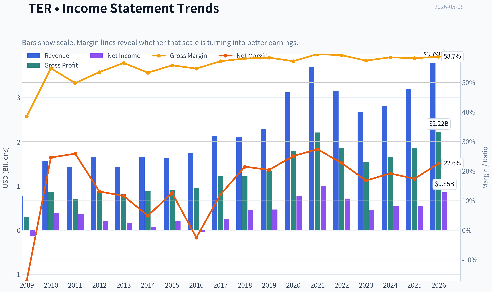

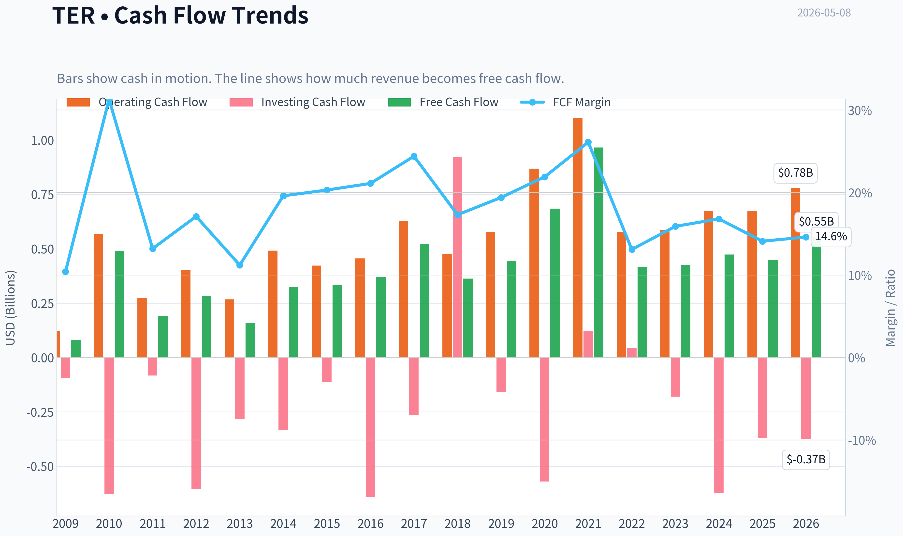

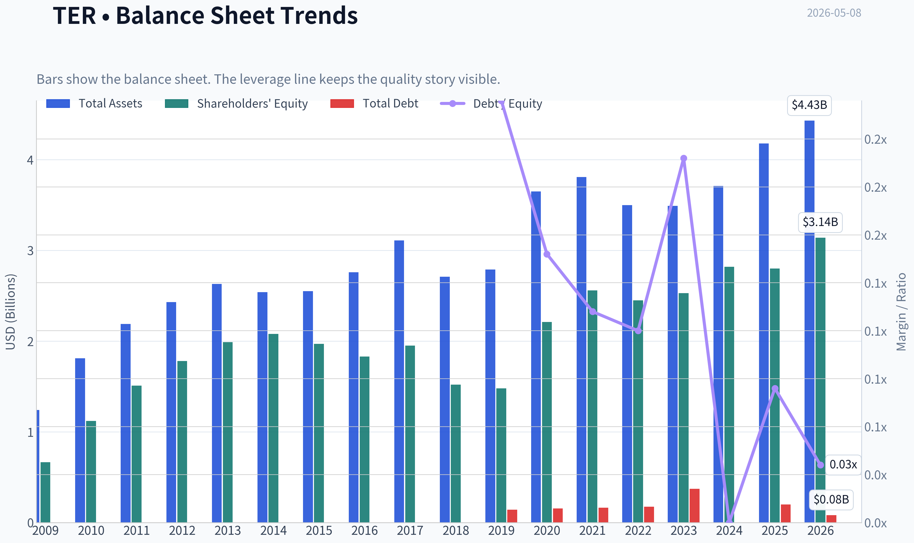

This graph tracks the profitability and return metrics (ROE, ROIC, Margins) of **TER** over the past decade, highlighting capital efficiency trends.

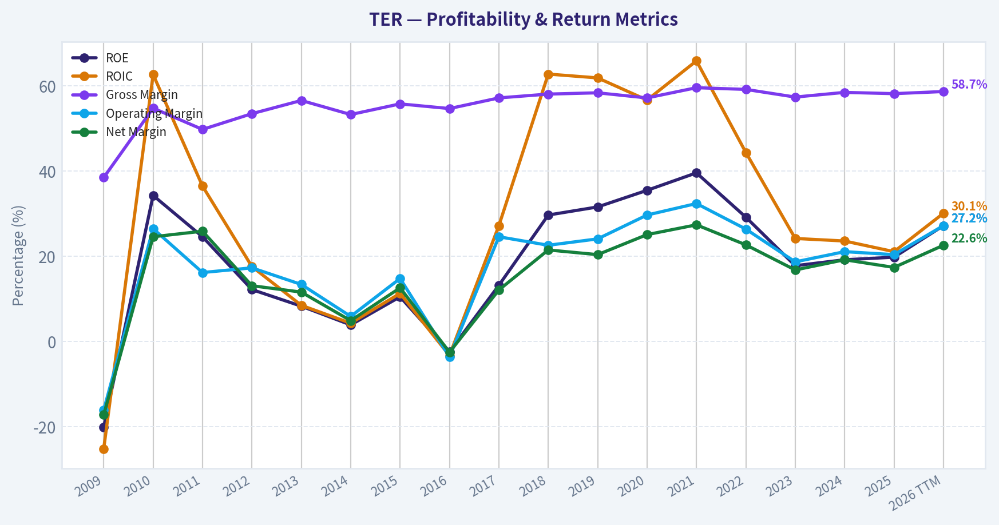

This chart illustrates the financial health of **TER** over the last 10 years, mapping cash equivalents and free cash flow against total obligations (Debt).

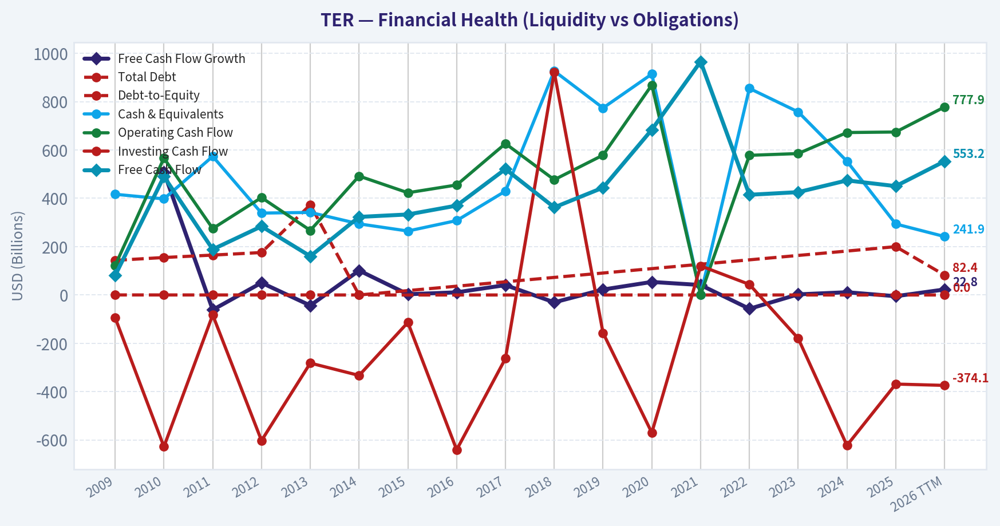

This breakdown chart from <em>Revenue Breakdown</em> shows the proportional composition for **TER** - useful for understanding what drives or risks the business.

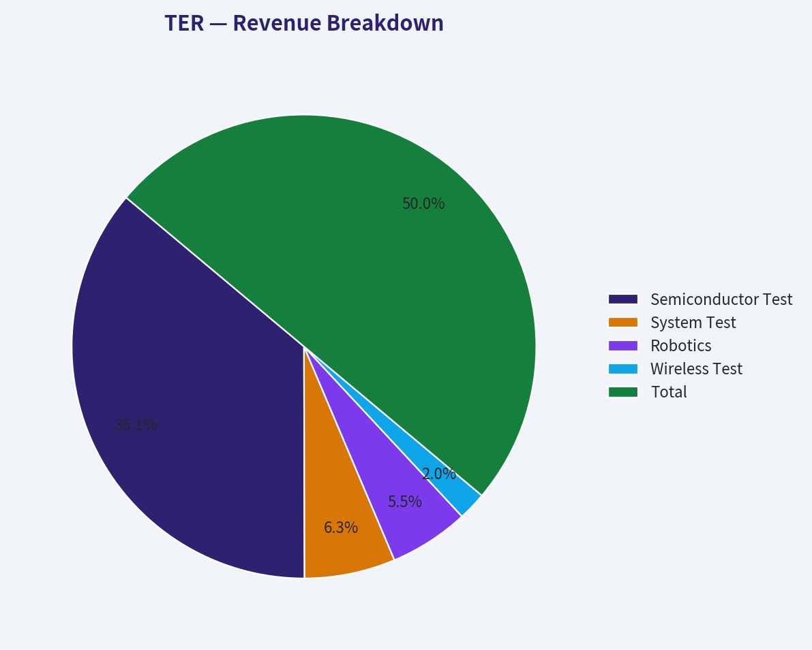

---

### Intrinsic Value Analysis (Buffett)

> *Following Warren Buffett's value investing philosophy: Circle of Competence, Economic Moat, Management Quality, and Margin of Safety.*

#### Intrinsic Value Snapshot

Price is what you pay. Intrinsic value is what the business may be worth based on the cash it can create for owners over time. We show a range, not one magic number.

- Current Price: $359.77
- Value Range: $11.72 to $147.93

##### Owner Earnings (Buffett Method)
- Net Income: $554,047,000.00
- Depreciation & Amortization: $127,981,000.00
- Capital Expenditures: $-224,009,000.00
- Working Capital Changes: $-64,026,000.00
- Owner Earnings: $522,045,000.00

##### Intrinsic Value
###### Buffett Method
Uses owner earnings. Stricter, and usually more conservative.
- Conservative: $11.72
- Average: $47.06
- Optimistic: $76.27
- Discount Rate: 10.0%

###### Cash Flow Method
Uses free cash flow. Better for companies spending heavily today to grow tomorrow.
- Conservative: $18.15
- Average: $53.85
- Optimistic: $147.93
- Discount Rate: 10.0%

ANALYST STANCE: **AVOID**

#### Buffett-Style Value Analysis: Teradyne, Inc. - TER

Teradyne is a high-quality semiconductor and electronics test equipment company with attractive gross margins, strong current earnings momentum, and growing exposure to AI infrastructure demand. However, at approximately **$360 per share**, the market is pricing Teradyne as if today's AI-driven boom will persist for many years with little cyclicality or competitive pressure. That is a dangerous assumption for a Buffett-style investor.

The business may be good, but the **price is not sensible**. Based on the available owner-earnings evidence, the stock offers **no margin of safety** and appears priced far above conservative intrinsic value.

---

#### 1. Go / No-Go Gate Assessment

| Buffett Gate | Assessment | Evidence | Verdict |
|---|---:|---|---|
| Gate 1: Circle of Competence & Simplicity | Mixed | Teradyne sells automated test equipment used to test chips, electronics, and related systems. The core concept is understandable, but the demand cycle depends heavily on semiconductor capital spending and AI infrastructure trends. | Caution |
| Gate 2: Moat Test | Moderate | Gross margin of **58.2%** suggests differentiated products and pricing power. However, the business remains exposed to technology transitions and cyclical customer spending. | Partial Pass |
| Gate 3: Management & Capital Allocation | Incomplete / Mixed | Company pays a modest dividend of **$0.13 per quarter**, but valuation is elevated and available data does not prove superior owner-oriented capital allocation. | Caution |
| Gate 4: Industry Structure | Mixed | Semiconductor test equipment has scale advantages and specialized know-how, but it is not a simple consumer monopoly. Demand can swing sharply with chip cycles. | Caution |
| Valuation Gate | Fail | P/E of roughly **67x** and FCF yield of only **0.8%** leave virtually no margin of safety. | Fail |

**Key Takeaways:** Teradyne passes parts of the quality test but fails the Buffett valuation test. The business is understandable at a high level, and its margins are excellent, but the stock price assumes near-perfect execution and sustained AI-driven demand. For a value investor, the lack of margin of safety is the decisive issue.

---

#### 2. Elementary School Business Explanation

Teradyne makes machines that test whether computer chips and electronics work correctly. Its customers are companies that make or use advanced chips. As chips become more complex, customers need better testing machines, and Teradyne earns money by selling those tools and related services.

That said, this is not a timeless candy, railroad, or insurance business. It depends heavily on semiconductor investment cycles, technology changes, and customer capital budgets.

---

#### 3. Moat Analysis

| Moat Source | Evidence | Buffett Interpretation |
|---|---|---|
| Intangible Assets / Technical Reputation | Gross margin of **58.2%** indicates customers value quality, reliability, and precision. | Positive. In mission-critical testing, reputation matters. |
| Switching Costs | Customers likely integrate Teradyne tools into production and quality-control workflows. | Positive, but not absolute. Large chipmakers can still shift vendors over time. |
| Cost Advantage | Scale and engineering depth likely help, but no direct cost evidence was available. | Moderate. Not clearly a structural low-cost monopoly. |
| Network Effects | Limited evidence of true network effects. | Weak. This is not a classic network-effect business. |
| Pricing Power | High gross margin suggests pricing power, but cyclicality can pressure volumes and pricing. | Good, but not invulnerable. |

**Key Takeaways:** Teradyne has a real moat, mainly from technical know-how, reliability, customer trust, and embedded testing workflows. However, the moat is not as simple or permanent as a dominant consumer brand or regulated utility. The business remains tied to semiconductor technology cycles, which makes long-term predictability harder.

**Moat Rating:** **Narrow to Moderate / Stable**
Not enough to justify buying at any price.

---

#### 4. Management Quality Assessment

| Management Factor | Available Evidence | Assessment |
|---|---|---|
| Owner Orientation | Dividend declared at **$0.13 per share quarterly**. | Modestly shareholder-friendly, but not decisive. |
| Capital Allocation | No detailed 10-year buyback or acquisition record available in the collected data. | Inconclusive. |
| Balance Sheet Discipline | Current ratio of **1.75** suggests adequate liquidity. | Positive. |
| Candor / Accounting Quality | No restatement or accounting red flags identified in the provided research pack. | Neutral to positive. |
| Market Signal | Steve Cohen / Point72 trimmed position by **30.7%** in latest 13F snapshot. | Not fundamental proof, but suggests some sophisticated capital is reducing exposure after a major run. |

**Key Takeaways:** Management does not show obvious red flags based on the available evidence, and liquidity appears sound. However, the data is insufficient to conclude that management is exceptional in the Buffett sense. At today's valuation, average or merely good capital allocation is not enough.

---

#### 5. Available Financial Summary

| Metric | Current / Recent Evidence | Buffett-Style Read |
|---|---:|---|
| Share Price | **$360** | Very high relative to current free cash flow. |
| Market Capitalization | **$56.32B** | Large expectations embedded in price. |
| P/E Ratio | **66.9x** | Expensive unless earnings compound at high rates for many years. |
| ROE | **19.8%** | Attractive; near Buffett-quality threshold. |
| Gross Margin | **58.2%** | Strong evidence of differentiated products. |
| Revenue Growth YoY | **13.1%** | Good current momentum. |
| Free Cash Flow Yield | **0.8%** | Extremely low owner-earnings yield. |
| Current Ratio | **1.75** | Adequate short-term balance sheet strength. |
| Q1 2026 Revenue | **$1.282B** | Strong recent quarter. |
| Q1 2026 Net Income | **$398.9M** | Excellent profitability in the latest quarter. |
| AI-Related Revenue Exposure | Nearly **70%** | Strong growth driver, but also concentration risk. |

**Key Takeaways:** Teradyne's operating quality looks impressive, especially its gross margin, ROE, and recent AI-driven growth. But the valuation is extreme: a 0.8% free cash flow yield means the investor is paying roughly 125 times current free cash flow. That is far outside a normal Buffett margin-of-safety range.

---

#### 6. Owner Earnings Calculation

Because full maintenance capital expenditure data was not available, free cash flow yield is used as the most conservative practical proxy for owner earnings.

| Item | Estimate |
|---|---:|
| Market Capitalization | **$56.32B** |
| Free Cash Flow Yield | **0.8%** |
| Estimated Owner Earnings / FCF Proxy | **$451M** |
| Estimated Shares Outstanding | **156.4M** |
| Owner Earnings Per Share Proxy | **$2.88** |
| Current Share Price | **$360** |
| Price / Owner Earnings Proxy | Approximately **125x** |

**Key Takeaways:** On a free-cash-flow basis, Teradyne is priced at about 125 times owner earnings. That is a very demanding valuation for any business, especially one exposed to semiconductor equipment cycles. Even if current earnings are temporarily surging, the market price leaves little room for disappointment.

---

#### 7. Three-Scenario Intrinsic Value Estimate

Assumptions:

- Discount rate: **10%**
- Owner earnings proxy: **$451M**
- Shares outstanding estimate: **156.4M**
- Conservative historical-growth scenario uses **8% annual growth for 10 years**, followed by **3% terminal growth**

| Scenario | Method | Equity Value Estimate | Intrinsic Value / Share | Margin of Safety vs. $360 |
|---|---|---:|---:|---:|
| A: No Growth | Owner earnings / 10% | **$4.51B** | **$29** | **-92%** |
| B: GDP Growth | Owner earnings x 1.03 / (10% - 3%) | **$6.64B** | **$42** | **-88%** |
| C: Growth Case | 8% growth for 10 years, then 3% terminal growth | **$9.56B** | **$61** | **-83%** |

**Key Takeaways:** Even with a reasonable growth assumption, conservative intrinsic value lands far below the current market price. The stock would need much higher sustained owner earnings than the current free-cash-flow evidence suggests. From a Buffett perspective, the valuation does not merely lack a margin of safety; it appears to require heroic assumptions.

---

#### 8. Alternative Sanity Check Using Q1 Annualized Net Income

Q1 2026 net income was **$398.9M**, which annualizes to roughly **$1.60B**. This is not a true owner-earnings figure and may reflect peak or boom-period profitability, but it provides a more optimistic valuation check.

| Scenario | Optimistic Earnings Base | Implied Value | Implied Value / Share |
|---|---:|---:|---:|
| No Growth | $1.60B / 10% | **$15.96B** | **$102** |
| GDP Growth | $1.60B x 1.03 / 7% | **$23.48B** | **$150** |
| High Quality Multiple Check | 25x annualized net income | **$39.89B** | **$255** |

**Key Takeaways:** Even using a generous annualized Q1 net income base, Teradyne still does not obviously justify a $360 share price. A 25 times earnings valuation on this optimistic run-rate would imply around $255 per share, still well below the current price. This reinforces the conclusion that the market is capitalizing exceptional growth far into the future.

---

#### 9. Margin of Safety Analysis

| Measure | Result |
|---|---:|
| Current Price | **$360** |
| Conservative DCF Value Range | **$29-$61 per share** |
| Optimistic Run-Rate Sanity Range | **$102-$255 per share** |
| Buffett Required Margin of Safety | At least **25%**, preferably higher due to cyclicality |
| Buy Zone Using Optimistic $255 Value and 25% MOS | Around **$190 or below** |
| Current Margin of Safety | **None** |

**Key Takeaways:** Teradyne is not trading at a discount to conservative value. Even an optimistic framework suggests the current price is well above a sensible Buffett-style buy zone. The investor today is paying for a long continuation of AI-related strength, not receiving a margin of safety.

---

#### 10. Key Business Risks

| Risk | Why It Matters |
|---|---|
| AI Concentration | Nearly **70%** of revenue is tied to AI-related applications, increasing dependence on one powerful but potentially cyclical theme. |
| Semiconductor Cycle | Test equipment demand can rise and fall sharply with customer capital spending. |
| Valuation Risk | At roughly **67x earnings** and **125x free cash flow**, even modest disappointment could cause major downside. |
| Technology Transition Risk | Testing needs evolve with chip architecture; leadership must be continuously earned. |
| Competitive Risk | Teradyne competes in a specialized but technologically demanding market where customers are sophisticated. |

**Key Takeaways:** The greatest risk is not that Teradyne is a poor company. The greatest risk is that the stock price already assumes it is an extraordinary company with years of uninterrupted growth ahead. For a cyclical technology supplier, that is a fragile setup.

---

#### 11. Final Buffett Scorecard

| Criterion | Weight | Score 1-5 | Weighted Score |
|---|---:|---:|---:|
| Business Understanding | 20% | 3.0 | 0.60 |
| Moat Width & Durability | 25% | 3.5 | 0.88 |
| Management Quality | 15% | 3.0 | 0.45 |
| Return on Equity | 15% | 4.0 | 0.60 |
| Reinvestment Runway | 10% | 3.5 | 0.35 |
| Balance Sheet Strength | 5% | 3.5 | 0.18 |
| Industry Structure | 5% | 3.0 | 0.15 |
| Valuation / Margin of Safety | 5% | 1.0 | 0.05 |
| **Total Score** | **100%** |  | **3.25 / 5.00** |

**Key Takeaways:** Teradyne scores well on business quality, margins, and current growth, but the valuation score is extremely weak. The weighted score lands in the watch-range numerically, but the valuation gap is so severe that a new purchase is not justified. Buffett-style investing requires both quality and price discipline.

---

#### Final Investment Stance

**Stance: AVOID as a new purchase at $360**
**Conviction: High**

Teradyne appears to be a strong, technically differentiated business benefiting from AI-related demand. But Buffett investing is not about buying exciting growth stories at any valuation. At **66.9x earnings** and a **0.8% free cash flow yield**, the stock offers no evident margin of safety.

A disciplined value investor should avoid purchasing TER at the current price. The business deserves to remain on a watchlist, but only at a materially lower valuation - likely closer to a range where normalized owner earnings provide a reasonable return without requiring heroic assumptions.
#### Valuation Bridge

This bridge places the current market price beside each intrinsic value lens so readers can see whether upside depends on one method or shows up across several methods.

| Scenario | Intrinsic Value / Share |
| --- | ---: |
| Buffett Method | $47.06 |
| Cash Flow Method | $53.85 |
| Damodaran Method | $45.08 |
| Current Price | $359.77 |

#### Key Takeaways

If one method is far above the others, the upside case depends on a specific modelling assumption. When several methods cluster together, the valuation story is more robust.

#### Valuation Visuals

This comparison chart from *Latest Earnings Snapshot* stacks current figures against historical benchmarks for **TER**, making it easy to see where the company trades relative to its own averages.

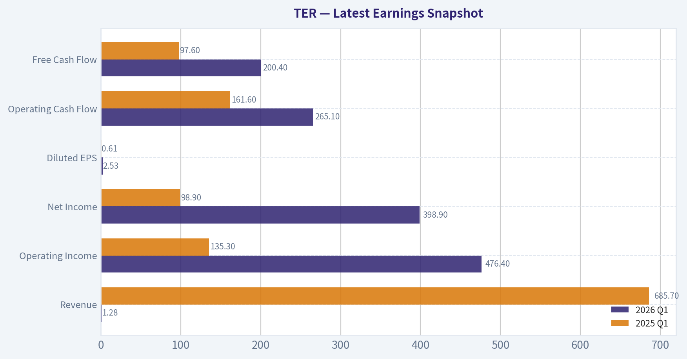

This comparison chart from *Current vs Historical Average Comparison* stacks current figures against historical benchmarks for **TER**, making it easy to see where the company trades relative to its own averages.

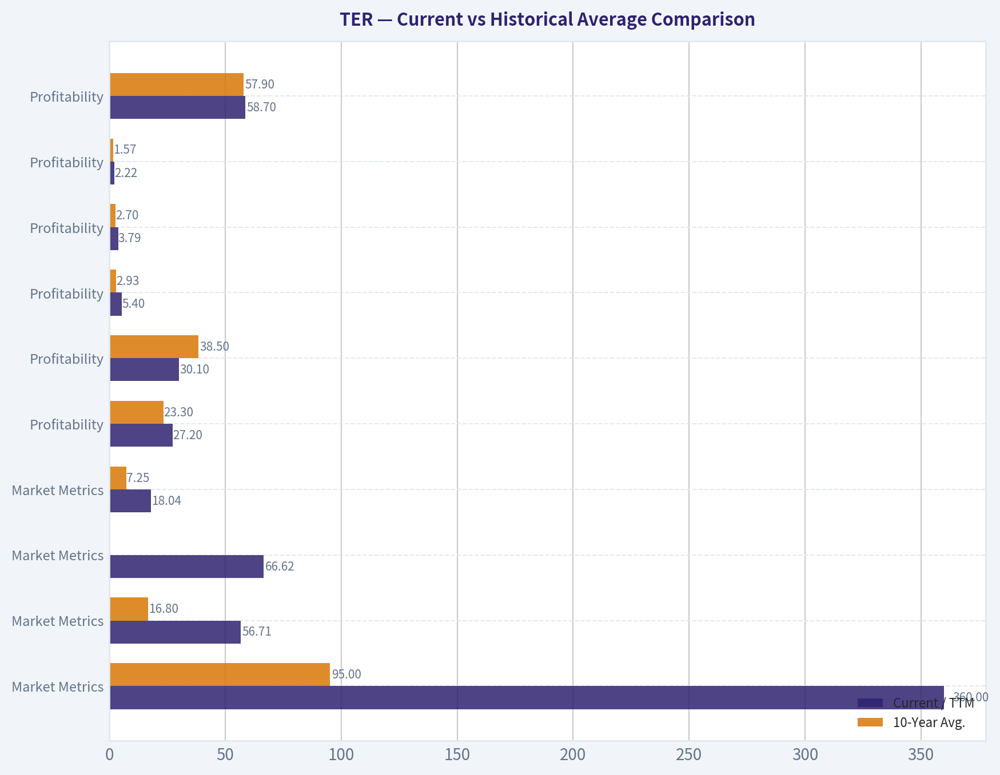

This comparison chart from *Buffett-Style Owner Earnings DCF Valuation* stacks current figures against historical benchmarks for **TER**, making it easy to see where the company trades relative to its own averages.

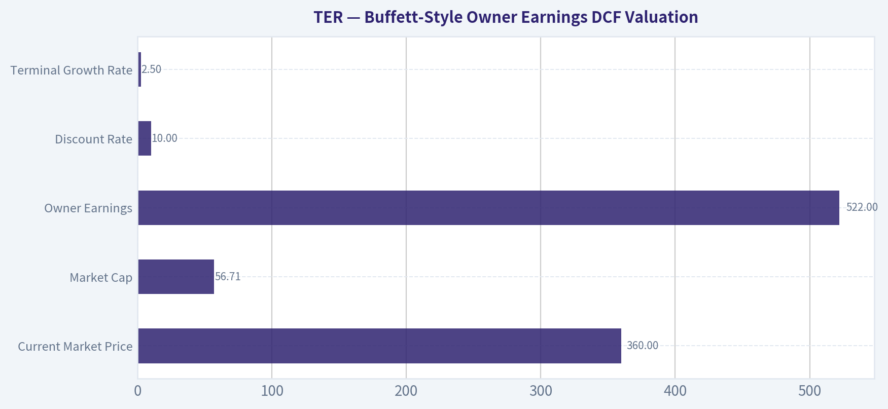

This comparison chart from *Intrinsic Value Interpretation* stacks current figures against historical benchmarks for **TER**, making it easy to see where the company trades relative to its own averages.

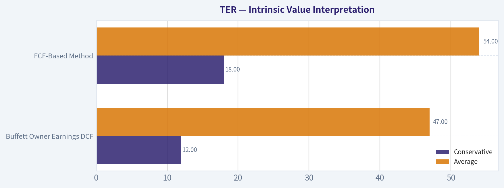

This comparison chart from *Available Financial Summary* stacks current figures against historical benchmarks for **TER**, making it easy to see where the company trades relative to its own averages.

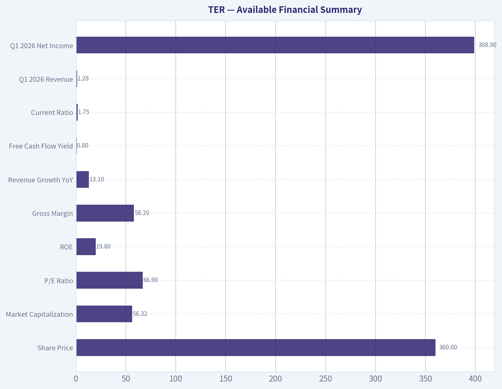

---

### Trend & Growth Analysis (Lynch/Druckenmiller/Fisher)

> *Following Peter Lynch's GARP, Stanley Druckenmiller's macro-aware approach, and Philip Fisher's scuttlebutt methodology.*

ANALYST STANCE: **WATCH**

#### Teradyne Growth Investment Report - TER

Teradyne is showing a real AI-driven inflection, but the stock already reflects a large amount of optimism after a major price move. The setup is attractive operationally, especially with AI-related applications approaching 70% of revenue, but the valuation is demanding for a cyclical semiconductor test-equipment business. I would **hold/watch**, not aggressively initiate at current levels.

---

#### 1. Lynch Classification

| Lynch Category | Assessment |
|---|---|
| Primary classification | **Cyclical growth / AI infrastructure beneficiary** |
| Revenue growth profile | **13.1% YoY**, below classic Lynch "fast grower" threshold of 15-25%+ |
| Business cyclicality | High - exposed to semiconductor capex and electronics production cycles |
| Growth driver | AI compute, advanced semiconductor testing, memory/system-on-chip complexity |
| Lynch verdict | **Not a clean fast grower; attractive cyclical growth story at a rich price** |

**Key Takeaways:** Teradyne is not a classic Peter Lynch fast grower yet because current reported revenue growth is around 13%, below the preferred 15% to 25% range. However, the company is tied to a powerful AI infrastructure cycle, which may create an earnings inflection. The main concern is that semiconductor test equipment remains cyclical, so investors must be careful not to pay peak multiples on peak-cycle earnings.

---

#### 2. The Story in 3 Bullets

| Simple Story | Why It Matters |
|---|---|
| Teradyne sells testing equipment that helps chipmakers prove their chips work. | As chips become more complex, especially AI chips, testing becomes more valuable and mission-critical. |
| AI-related applications now contribute nearly **70% of revenue**. | The company has moved from a broad semiconductor test story to a more direct AI infrastructure beneficiary. |
| Q1 2026 showed strong profitability, with **$1.28B revenue** and **$398.9M net income**. | Margins and earnings power are showing operating leverage during the AI test demand cycle. |

**Key Takeaways:** The Teradyne story is easy to understand: more complex chips require more advanced testing, and AI chips are among the most complex chips in the world. The company's revenue mix is now heavily tied to AI, which gives it a clearer growth narrative. The key question is whether this AI demand is sustainable or whether the market is already pricing in the best part of the cycle.

---

#### 3. TAM and 10x Test

| Metric | Estimate / Assessment |
|---|---:|
| Market cap | **$56.32B** |
| Current price | **$360** |
| Q1 2026 revenue | **$1.282B** |
| Q1 annualized revenue run-rate | **~$5.13B** |
| 10x revenue target | **~$51.3B** |
| Current implied P/S on Q1 annualized revenue | **~11.0x** |
| 10x test result | **Difficult, but not impossible if AI test TAM expands materially** |

**Key Takeaways:** Teradyne's current revenue base is already substantial, so a true 10x revenue outcome would require the company to become dramatically larger than today. That is possible only if AI semiconductor testing, memory testing, system-level testing, and automation markets expand far beyond current expectations. The runway is meaningful, but this is not a small-cap early-stage ten-bagger setup.

---

#### 4. Revenue Growth Trend

| Revenue Data Point | Figure |
|---|---:|
| Reported YoY revenue growth | **13.1%** |
| Q1 2026 revenue | **$1.282B** |
| Q2 2026 revenue guidance | **$1.15B-$1.25B** |
| Q2 2026 midpoint | **$1.20B** |
| Sequential trend from Q1 to Q2 midpoint | **~6% decline** |
| Pattern assessment | **Positive AI mix, but not clearly accelerating sequentially** |

**Key Takeaways:** Revenue growth is positive, and the AI mix is highly encouraging, but the near-term guidance does not show obvious sequential acceleration from Q1 to Q2. This does not break the thesis, because semiconductor equipment revenue can be lumpy, but it argues against calling this a clean acceleration story right now. The investment case depends on whether AI demand sustains through the next several quarters.

---

#### 5. Unit Economics and Profitability Quality

| Metric | Figure / Assessment |
|---|---:|
| Gross margin | **58.2%** |
| ROE | **19.8%** |
| Free cash flow yield | **0.8%** |
| Current ratio | **1.75x** |
| LTV/CAC | Not applicable - hardware/capital equipment model |
| NRR | Not applicable - not SaaS |
| Rule of 40 | Not applicable - not SaaS/subscription |
| Profitability quality | Strong gross margins, but low FCF yield at current valuation |

**Key Takeaways:** Teradyne has attractive gross margins for a hardware-oriented semiconductor equipment business, and return on equity is solid. However, the free cash flow yield is low because the stock price has moved sharply higher. This means the business quality is good, but the valuation leaves less room for disappointment.

---

#### 6. Inflection Point Assessment

| Inflection Type | Evidence | Verdict |
|---|---|---|
| Product cycle inflection | AI test demand now dominant, with AI-related applications near 70% of revenue | **Positive** |
| Market share inflection | Insufficient data from provided pack | **Unconfirmed** |
| Margin inflection | Q1 net income of $398.9M on $1.282B revenue implies very strong profitability | **Positive** |
| TAM inflection | AI infrastructure expands complexity and test intensity | **Positive** |
| Competitive inflection | No clear evidence of competitor stumble | **Unconfirmed** |
| Overall inflection score | Strong AI-cycle exposure, but incomplete evidence of sustained acceleration | **Good, not decisive** |

**Key Takeaways:** Teradyne appears to be benefiting from a real AI product-cycle and margin inflection. The most bullish data point is that AI-related applications now represent nearly 70% of revenue. However, without clearer evidence of market share gains or multi-quarter revenue acceleration, this remains a promising but not fully proven inflection.

---

#### 7. Macro Setup

| Macro Factor | Assessment |
|---|---|
| Secular theme | **AI infrastructure and semiconductor complexity** |
| Interest-rate sensitivity | Growth valuation benefits if rates fall; vulnerable if rates rise |
| Semiconductor cycle | AI is strong, but broader semicap cycles remain volatile |
| Economic cycle exposure | Moderate to high due to capital equipment spending |
| Macro verdict | **Secular tailwind, cyclical risk** |

**Key Takeaways:** The macro backdrop is favorable because AI infrastructure spending remains one of the strongest secular investment themes. Teradyne is directly exposed to that theme through semiconductor testing. However, the business still has cyclical risk because semiconductor capital equipment demand can swing sharply when customers pause spending.

---

#### 8. Fisher 15-Point Score

| Fisher Factor | Score / 5 |
|---|---:|
| Products with sizable market potential | 5 |
| Management determination to develop new products | 4 |
| Effective R&D | 4 |
| Above-average sales organization | 4 |
| Worthwhile profit margin | 5 |
| Improving profit margins | 4 |
| Labor/personnel relations | 3 |
| Executive relations | 3 |
| Management depth | 4 |
| Cost analysis and accounting | 4 |
| Outstanding moat aspects | 4 |
| Long-range profit outlook | 4 |
| Dilution risk | 4 |
| Candor with investors | 4 |
| Management integrity | 4 |
| **Total Fisher Score** | **60 / 75** |

**Key Takeaways:** Teradyne scores well on Fisher's framework, mainly because of its strong margins, important role in advanced semiconductor manufacturing, and exposure to long-term AI demand. The score is not higher because there is limited evidence here on culture, personnel relations, and customer-level competitive dynamics. Overall, this is a good-quality company, but not an obvious Fisher-style bargain at the current price.

---

#### 9. Valuation Analysis

| Valuation Metric | Current Reading | Interpretation |
|---|---:|---|
| Market cap | **$56.32B** | Large-cap valuation |
| Price | **$360** | Up sharply YTD |
| P/E | **66.9x** | Expensive on trailing earnings |
| Implied trailing EPS | **~$5.38** | Based on price / P/E |
| Q1 annualized EPS estimate | **~$10.20** | Based on Q1 net income and estimated share count |
| P/E on Q1 annualized earnings | **~35x** | More reasonable if Q1 earnings power sustains |
| P/S on Q1 annualized revenue | **~11.0x** | Rich for cyclical hardware/semi equipment |
| FCF yield | **0.8%** | Low current cash return |

**Key Takeaways:** Teradyne looks expensive on trailing earnings at nearly 67 times P/E, but the valuation looks more reasonable if Q1 earnings power is sustainable. The problem is that investors are being asked to pay a high multiple for a cyclical company during a strong AI spending cycle. The stock needs continued earnings strength to justify the current price.

---

#### 10. Scenario Analysis

| Scenario | Assumptions | Implied View |
|---|---|---|
| Bear case | AI demand normalizes, revenue growth slows, multiple compresses below current levels | Stock vulnerable to meaningful downside |
| Base case | AI test demand remains strong, revenue grows low-to-mid teens, margins stay elevated | Current valuation broadly fair but not cheap |
| Bull case | AI testing demand accelerates, Teradyne gains share, earnings power proves structurally higher | Stock can work, but upside depends on sustained beats |
| Risk/reward today | Asymmetric only if AI earnings keep surprising upward | **WATCH** |

**Key Takeaways:** The bear case is mainly valuation compression if AI expectations cool. The base case suggests the stock may already be discounting much of the good news. The bull case requires evidence that AI-related test demand is not just a cycle, but a multi-year structural step-up in Teradyne's earnings power.

---

#### 11. Growth Investor Scorecard

| Criterion | Weight | Score / 5 | Weighted Score |
|---|---:|---:|---:|
| Lynch story | 10% | 4.0 | 0.40 |
| TAM and runway | 20% | 3.5 | 0.70 |
| Revenue growth | 20% | 3.0 | 0.60 |
| Unit economics / business quality | 15% | 4.0 | 0.60 |
| Competitive position | 10% | 4.0 | 0.40 |
| Management quality | 10% | 3.8 | 0.38 |
| Macro setup | 5% | 4.0 | 0.20 |
| Profitability path | 5% | 4.5 | 0.23 |
| Valuation | 5% | 2.0 | 0.10 |
| **Total** | **100%** |  | **3.61 / 5.00** |

**Key Takeaways:** Teradyne scores well because the company has a clear AI-linked story, strong profitability, and good business quality. The biggest drag is valuation, followed by the lack of clear evidence that revenue growth is accelerating above the current low-teens rate. A score of 3.61 supports a positive watchlist or hold stance, but not a high-conviction new buy at this price.

---

#### 12. Position Size Stance

| Investor Type | Suggested Stance |
|---|---|
| Existing holder | **Hold / let winners run, but consider trimming if position is oversized** |
| New investor | **Wait for pullback or confirmation of multi-quarter acceleration** |
| Aggressive growth investor | Small starter only if accepting AI-cycle volatility |
| Conservative GARP investor | Avoid initiating at current valuation |
| Position size | **Watchlist to small position; not a full-size advocate position** |

**Key Takeaways:** Existing holders have a legitimate reason to continue holding because the AI inflection is real. New investors face a tougher setup because the stock has already surged and valuation is demanding. The best approach is to monitor for either a valuation reset or stronger confirmation that earnings power has structurally moved higher.

---

#### 13. Key Catalysts and Risks

| Catalysts | Risks |
|---|---|
| Continued AI-related revenue growth above expectations | Semiconductor equipment cycle rolls over |
| Margin expansion from operating leverage | AI demand proves front-loaded or cyclical |
| Stronger Q2/Q3 bookings and backlog | Valuation compression from high P/E and low FCF yield |
| Broader adoption of advanced packaging and system-level test | Customer concentration or capex pause risk |
| Evidence that AI test intensity per chip is structurally rising | Guru trimming may signal reduced near-term conviction |

**Key Takeaways:** The main catalyst is continued evidence that AI testing demand is durable and expanding. The main risk is that the stock is priced for excellence after a major rally, leaving little margin of safety. Investors should watch bookings, backlog, AI revenue mix, gross margin, and whether Q2 guidance is followed by stronger second-half demand.

---

#### Final View

Teradyne is a high-quality AI infrastructure beneficiary with strong margins and a real product-cycle inflection. However, the stock's valuation is already rich, and current reported revenue growth does not yet justify calling this a clean Lynch-style fast grower. The right stance is **WATCH**: own it if already positioned, but wait for either a pullback or clearer acceleration before advocating aggressive new buying.

---

### Market Technical Analysis

ANALYST STANCE: **WATCH**

#### TER Technical Analysis - Last Available Trading Day: 2026-05-07

TER is in a powerful long-term uptrend, but the short-term chart has become unstable after a sharp late-April breakdown, a fast rebound, and another heavy-volume rejection on 2026-05-07. The stock closed at **$354.11**, below its **10 EMA** and **VWMA**, but still above its rising **50 SMA** and far above its **200 SMA**. That combination suggests the strategic trend remains bullish, while near-term momentum and trade quality have deteriorated.

| Selected Indicator | Latest Value | Price Relationship / Signal | Why It Matters Here |
|---|---:|---|---|
| close_10_ema | 360.46 | Price is **1.8% below** | Short-term momentum has weakened; TER failed to hold above its fast trend line. |
| close_50_sma | 332.12 | Price is **6.6% above** | Medium-term uptrend remains intact unless price loses the low-$330s. |
| close_200_sma | 214.58 | Price is **65.0% above** | Confirms a very strong long-term trend, but also shows the stock remains highly extended. |
| macd | 6.70 | Positive but falling sharply | Momentum is still above zero, but the bullish impulse has faded from late-April levels. |
| rsi | 50.19 | Neutral | RSI reset from overbought without becoming oversold, suggesting indecision rather than a clean reversal setup. |
| atr | 24.53 | About **6.9% of price** | Volatility is very high; position sizing and stops need to be wider than normal. |
| vwma | 358.08 | Price is **1.1% below** | Volume-weighted confirmation has slipped bearish in the short term. |
| boll_ub | 419.21 | Upper band is **18.4% above** | Recent upside exhaustion occurred near the upper-band zone; a retest requires renewed strength. |

Key Takeaways: TER remains above its important medium- and long-term moving averages, so the broader trend is not broken. However, price is now below both the 10 EMA and VWMA, which means short-term control has shifted away from buyers. Momentum has cooled substantially, and volatility is elevated enough that entries should be treated cautiously.

---

#### Trend Structure and Price Action

TER's larger trend is still impressive. The **50 SMA has risen from roughly $284 on 2026-03-24 to $332 on 2026-05-07**, while the **200 SMA has climbed from about $174 to $215** over the same period. This shows that the underlying trend has not merely been a short squeeze or one-day move; the medium- and long-term trend slopes are still firmly upward.

The issue is not the long-term trend - it is the quality of the current pullback. TER rallied aggressively into late April, closing at **$418.08 on 2026-04-24**, then suffered a severe breakdown to **$306.33 on 2026-04-29** on very high volume. The stock then rebounded sharply to **$382.48 on 2026-05-06**, but immediately sold off to **$354.11 on 2026-05-07**. That sequence creates a volatile, wide-range recovery attempt rather than a smooth continuation pattern.

The **$358-$361 zone** is now important because it contains the VWMA and 10 EMA. A quick reclaim of that area would suggest buyers are trying to repair the short-term damage. Failure to reclaim it, especially after the large 2026-05-07 selloff, would keep TER vulnerable to another test of the **$345 area**, then the rising **50 SMA near $332**.

#### Momentum Reading

MACD remains positive at **6.70**, but this is a major decline from the late-April peak area near **25**. That means the stock still has residual bullish trend momentum, but the acceleration phase has clearly ended for now. This kind of MACD behavior often appears after a leader has had a strong run and begins transitioning into consolidation, volatility expansion, or a deeper correction.

RSI at **50.19** is also important. TER was overbought in late April, with RSI above **77** on 2026-04-24. The current RSI is no longer stretched, which reduces immediate overbought risk, but it also does not show strong downside exhaustion. In other words, TER is not screaming "buy the dip" from an oversold momentum perspective; it is in a neutral reset zone where price confirmation matters more than oscillator levels.

#### Volatility and Risk

ATR has risen to **$24.53**, equal to nearly **7% of the current share price**. That is a very large daily risk unit. For traders, this means tight stops are likely to be triggered by ordinary noise. A technically logical stop below support may require a large dollar amount, so smaller position sizing is more appropriate than usual.

The 2026-05-07 session was especially notable: TER traded between **$345.56 and $379.00**, a daily range of **$33.44**, and closed near the lower half of that range. Volume was about **5.0 million shares**, higher than many normal sessions. That indicates the pullback was not quiet profit-taking; sellers were active, and the market has not yet fully absorbed the late-April shock.

#### Volume Confirmation

The VWMA at **$358.08** sits just above the last close. This is a subtle but important short-term warning. When price falls below VWMA after a volatile rebound, it means the average volume-weighted participant over the lookback period is no longer being rewarded. That can pressure recent buyers to exit if price cannot quickly reclaim the level.

Volume behavior also leans cautious. The largest recent volume spike came on **2026-04-29**, when TER plunged and traded over **13 million shares**. The rebound was meaningful, but the 2026-05-07 selloff also came with elevated volume. This suggests institutional or high-conviction selling has appeared during down moves, so traders should avoid assuming that every dip will be immediately bought.

#### Key Levels to Watch

| Zone | Approximate Level | Interpretation | Trading Implication |
|---|---:|---|---|
| Immediate resistance | $358-$361 | VWMA and 10 EMA | Reclaiming this area would be the first sign of short-term repair. |
| Rebound confirmation | $380-$383 | Recent rebound high area | A close above this zone would improve the bullish continuation case. |
| Major upside resistance | $400-$422 | Prior breakdown/rejection zone and Bollinger upper region | Price likely needs strong volume to push through this supply area. |
| First support | $343-$346 | Recent reaction low / recovery support | Losing this zone would signal the rebound is weakening. |
| Medium-term support | ~$332 | Rising 50 SMA | A key line between normal correction and deeper technical damage. |
| Breakdown risk zone | $306-$302 | Late-April panic close/low area | A retest would imply sellers have regained control. |

Key Takeaways: The most important near-term battleground is the $358 to $361 area, because it combines the 10 EMA and VWMA. If TER reclaims that zone and then clears $380 to $383, the rebound case improves. If it fails and breaks below $343 to $346, traders should watch the 50 SMA near $332 as the next major support.

---

#### Trading View

TER is best treated as a **high-volatility watchlist stock**, not a clean immediate long. The long-term trend remains bullish, but short-term confirmation is missing after the failed hold above the 10 EMA and VWMA. Traders who already hold positions may focus on whether TER can stay above the **$343-$346** support band and the rising **50 SMA near $332**. New entries are more attractive only if price reclaims **$358-$361** with improving volume and then begins building above that zone.

A bullish continuation setup would likely require:
- close back above **$360-$361**,
- stabilization above VWMA,
- RSI holding above 50 and turning higher,
- MACD flattening instead of continuing lower,
- and ideally a push through **$380-$383**.

A bearish or risk-reduction setup would develop if TER loses **$343-$346**, especially on heavy volume. A break of the 50 SMA would be more serious and could shift the chart from volatile consolidation into a deeper correction.

#### Final Summary Table

| Category | Current Assessment | Practical Interpretation |
|---|---|---|
| Long-term trend | Bullish | Price remains far above the 200 SMA, and the 50 SMA is still rising. |
| Medium-term trend | Constructive but stressed | Price is above the 50 SMA, but recent volatility has damaged trend quality. |
| Short-term momentum | Cautious | Price is below the 10 EMA and VWMA, showing near-term buyer fatigue. |
| Momentum oscillator | Neutral | RSI near 50 signals a reset, not a strong oversold reversal. |
| MACD | Positive but weakening | Bullish momentum still exists, but it has slowed sharply. |
| Volatility | Very high | ATR near 7% of price requires reduced sizing and wider risk controls. |
| Key bullish trigger | Reclaim $358-$361, then $380-$383 | Would show buyers regaining control after the selloff. |
| Key bearish trigger | Break below $343-$346, then $332 | Would increase odds of a deeper correction toward the panic-low region. |

Key Takeaways: TER's primary trend is still bullish, but the short-term chart is no longer clean. The stock needs to reclaim the $358 to $361 area to show that buyers are regaining control. Until that happens, the better stance is watchful patience rather than aggressive buying.

---

### Social Sentiment Analysis

#### TER Social Media & News Sentiment (lite)

Live social / news data was not available this run. Refer to the News Analysis section for current events; treat social sentiment as neutral.

---

### News & Events Analysis

ANALYST STANCE: **WATCH**

#### Teradyne, Inc. (TER) - Recent News and Trading-Relevant Investment Report

#### Bottom Line

Teradyne's near-term fundamental story is strong: the company just reported a record Q1 2026, AI-related applications now represent nearly 70% of revenue, and semiconductor test demand remains tightly linked to AI infrastructure spending. However, the stock already reflects much of that strength after a roughly 70.6% year-to-date surge and a much larger multi-year rerating. At around $360 per share, with a market cap near $56.3 billion and a trailing P/E near 66.9x, TER looks more like a momentum-and-quality name than a cheap cyclical semiconductor equipment stock.

My stance is **WATCH** rather than outright buy or avoid. The business momentum is impressive, but the setup is sensitive to any signs of AI capex normalization, order timing risk, or valuation compression across semiconductors.

---

#### Latest Earnings: Q1 2026 Results Were Strong, But Q2 Guidance Implies a Sequential Step-Down

Teradyne recently reported **first-quarter 2026** results. Reported sales were **$1.282 billion**, with net income of **$398.9 million**. The quarter was described in recent coverage as a record Q1, driven by AI-related semiconductor test demand. Management guided **Q2 2026 revenue to $1.150 billion to $1.250 billion**, with **GAAP diluted EPS of $1.83 to $2.12**.

The important trading nuance is that the Q2 revenue midpoint of **$1.200 billion** is below Q1 revenue by roughly **6.4% sequentially**. That does not invalidate the growth story, but it means the stock's next leg likely depends less on "strong current demand" and more on whether investors believe AI test demand can remain elevated beyond the current quarter. Available coverage did not provide the prior Q1 guidance range, so the precise beat versus prior company guidance cannot be fully verified from the fetched news; however, analyst commentary and target increases indicate the quarter was received as materially strong.

AI exposure is now the central driver of the investment case. With nearly 70% of revenue tied to AI-related applications, TER is increasingly trading as an AI infrastructure enabler rather than a traditional cyclical test-equipment company. That supports a premium multiple, but it also increases correlation with AI semiconductor sentiment.

#### Company-Specific News Over the Past Week

Recent company news has been broadly constructive but increasingly valuation-focused. Yahoo coverage highlighted the company's AI-driven Q1 performance and Q2 guidance. Seeking Alpha coverage framed the bull case around Teradyne's market position, AI-driven semiconductor test demand, and industry moat. Goldman Sachs reportedly raised its price target to **$350 from $300** while maintaining a Buy rating, but the stock around **$360** is already above that new target, which limits the immediate signaling value of the upgrade.

Teradyne also declared a quarterly cash dividend of **$0.13 per share**, payable June 12, 2026, to shareholders of record as of May 21, 2026. The dividend is not the core reason to own the stock given the low yield, but it does reinforce management's willingness to return cash while investing into growth.

A separate valuation-focused article noted TER's rapid price appreciation: about **3.1% over seven days**, **10.5% over thirty days**, and **70.6% year to date**. That momentum can continue if AI capex optimism persists, but it also raises the risk that any earnings digestion, order pause, or semiconductor-sector pullback could hit the stock disproportionately.

#### Macro and Sector Context

The broader semiconductor and AI infrastructure trade remains strong, helped by continued data center capex and AI research spending. Fund commentary over the past week pointed to information technology strength driven by data center capital expenditure and AI investment. This is directly relevant to Teradyne because advanced AI chips require complex test intensity, which can increase demand for semiconductor test equipment.

At the same time, market positioning appears stretched. Recent coverage noted that the SOXX semiconductor ETF was trading far above its 200-day moving average, with commentary around Michael Burry's chip-sector short positioning. This does not mean semiconductor stocks must fall immediately, but it does suggest the group is vulnerable to a sentiment reversal. TER, after a sharp rally and with a high P/E, may be particularly exposed if the market shifts from "AI scarcity premium" to "show me durability."

Automation and robotics headlines also remain supportive. Coverage mentioned Rockwell, Teradyne, and Tesla seeing automation demand despite uncertainty. Teradyne's robotics exposure provides a secondary growth vector, but the current stock narrative is much more dominated by semiconductor test and AI infrastructure than by collaborative robots alone.

#### Valuation and Positioning

TER's valuation is demanding. The shared data indicate a current price near **$360**, market capitalization of **$56.32 billion**, P/E of **66.9x**, gross margin of **58.2%**, ROE of **19.8%**, revenue growth of **13.1% year over year**, and free cash flow yield of only **0.8%**. These numbers describe a high-quality business, but not a cheap one.

The valuation tension is clear: gross margins and AI-driven growth support a premium, but the free cash flow yield is low and the stock has already rerated sharply. A fair value estimate cited in recent coverage was lifted to around **$369.53**, only modestly above the current price. Goldman's raised price target of **$350** is actually below the current price, which suggests some analyst upgrades may now be catching up to the move rather than creating a fresh upside catalyst.

Institutional positioning also deserves caution. The shared 13F data show Steve Cohen's Point72 trimmed its disclosed TER position by **30.7%** as of December 31, 2025. This filing is lagged and should not be treated as a live signal, but it does show that at least one sophisticated holder reduced exposure before the latest rally.

#### Trading Interpretation

For short-term traders, TER remains a momentum stock tied to AI semiconductor sentiment. The immediate upside case requires one or more of the following: continued analyst target increases above the current share price, signs that Q2 guidance is conservative, stronger evidence of multi-quarter AI test demand, or a renewed breakout in semiconductor equipment peers.

For investors, the risk-reward is more balanced. The business quality is high, the AI linkage is real, and the reported Q1 results were strong. But after a 70% year-to-date move, the stock may need either upward estimate revisions or a broader semiconductor melt-up to justify further multiple expansion.

A pullback toward a valuation level that better compensates for cyclicality would improve the setup. Conversely, a decisive breakout above recent highs with improving forward estimates could keep momentum investors involved, but that would be a tactical trade rather than a margin-of-safety investment.

#### Key Risks to Monitor

The biggest risk is not that Teradyne is a weak company; it is that expectations have become very high. If AI infrastructure capex slows, if customers pause orders after aggressive capacity additions, or if Q2 revenue guidance proves to be the beginning of a moderation rather than a temporary step-down, the stock could derate quickly. Semiconductor equipment names often trade ahead of fundamentals, so order commentary may matter more than backward-looking earnings.

Other risks include China/export-control exposure across semiconductor supply chains, tariff uncertainty, competition in test equipment, robotics demand variability, and high sensitivity to interest rates because the stock's valuation depends heavily on future growth.

---

| Category | Latest Evidence | Trading / Investment Read-Through |
|---|---:|---|
| Current price / market cap | ~$360 / ~$56.32B | Large-cap quality semiconductor equipment name already priced for strong execution |
| Latest earnings period | Q1 2026 | Recently reported; record Q1 according to coverage |
| Q1 2026 sales | $1.282B | Strong headline result driven by AI-related semiconductor test demand |
| Q1 2026 net income | $398.9M | High profitability supports premium valuation |
| Q2 2026 revenue guidance | $1.150B-$1.250B | Midpoint of $1.200B is about 6.4% below Q1 revenue, so sequential momentum needs monitoring |
| Q2 2026 GAAP EPS guidance | $1.83-$2.12 | Guidance remains strong, but investors may demand evidence of sustained AI test demand |
| AI-related revenue exposure | Nearly 70% | Powerful growth driver but raises dependence on AI capex sentiment |
| Valuation | P/E ~66.9x; FCF yield ~0.8% | High expectations; limited room for disappointment |
| Recent stock momentum | +70.6% YTD; +10.5% over 30 days | Momentum is strong but increases correction risk |
| Analyst / valuation news | Goldman target raised to $350; fair value estimate cited near $369.53 | Much of the positive revision cycle may already be reflected in the stock |
| Shareholder return | $0.13 quarterly dividend declared | Positive but not a major part of the investment case |
| Institutional signal | Point72 trimmed 30.7% as of 12/31/2025 filing | Lagged data, but worth noting after a major rally |
| Overall stance | WATCH | Fundamentals are strong, but valuation and positioning make fresh buying less attractive at current levels |

Key Takeaways: Teradyne's Q1 2026 report confirms that AI-driven semiconductor test demand is a real and powerful earnings driver. The main concern is valuation: the stock has already rallied sharply and trades at a high multiple with a low free cash flow yield. Q2 guidance remains healthy, but the revenue midpoint is below Q1, making future order strength and AI capex durability the key variables for the next move.

---

### Guru Attention Analysis

> *Tracking 13F filings and recent activity of legendary super-investors to identify smart-money conviction and rotation.*

#### Guru Ownership & 13F Activity for Teradyne (TER)

**Source discipline:** The table below uses structured SEC 13F tracking as the canonical source. 13F filings are quarter-end snapshots and can lag real-time positions by up to 45 days, so this should be read as disclosed positioning, not necessarily current live trading.

| Guru / Fund | Action | Position Size | Portfolio Weight | Recent Change | Timing | Verification |
|---|---:|---:|---:|---:|---|---|
| Warren Buffett / Berkshire Hathaway | No position detected in latest 13F filing | - | - | - | Latest available 13F | - |
| Seth Klarman / Baupost Group | No position detected in latest 13F filing | - | - | - | Latest available 13F | - |
| Mohnish Pabrai / Pabrai Investment Funds | No position detected in latest 13F filing | - | - | - | Latest available 13F | - |
| Bill Ackman / Pershing Square | No position detected in latest 13F filing | - | - | - | Latest available 13F | - |
| Stanley Druckenmiller / Duquesne Family Office | No position detected in latest 13F filing | - | - | - | Latest available 13F | - |
| **Steve Cohen / Point72 Asset Management** | **Trimmed** | **2.83M shares; $547.98M reported value** | **0.61%** | **Shares decreased 30.7% vs. prior filing** | **12-31-2025 filing period** | [SEC 13F Filing](https://www.sec.gov/Archives/edgar/data/1603466/000090266426001100/) / [All 13F Filings](https://www.sec.gov/cgi-bin/browse-edgar?action=getcompany&CIK=0001603466&type=13F-HR&dateb=&owner=include&count=5) |
| Michael Burry / Scion Asset Management | No position detected in latest 13F filing | - | - | - | Latest available 13F | - |

**Key Takeaways:** Among the primary tracked gurus, only Steve Cohen's Point72 shows a disclosed TER position in the latest structured 13F data. Importantly, Point72 trimmed the position by 30.7%, suggesting some profit-taking or risk reduction after Teradyne's strong run. The position remains meaningful in dollar terms, but at 0.61% of Point72's portfolio it is not a top-concentration bet.

---

#### Interpretation of Steve Cohen / Point72's TER Trim

Point72's disclosed TER stake was still sizable at **2.83 million shares**, but the **30.7% reduction** is the key signal. Given Teradyne's sharp rally, AI-driven earnings momentum, and elevated valuation - with TER trading around **$360** and at a high earnings multiple - the trim may reflect disciplined position sizing rather than a full loss of conviction.

The move should not be interpreted as a bearish exit. Point72 still held a significant position as of the latest filing period, but reduced exposure into strength. For investors, the practical read-through is that one sophisticated trading-oriented fund remained involved, but was not aggressively adding at recent levels.

#### Bottom Line

Guru evidence for TER is **limited but notable**: **Steve Cohen's Point72 is the only tracked primary guru holder detected, and it trimmed the stake materially.** No latest 13F position was detected for Buffett, Klarman, Pabrai, Ackman, Druckenmiller, or Burry. This makes TER less of a broad "guru consensus" stock and more of a selective institutional trading position tied to AI, semiconductor test demand, and valuation discipline.

---

### Options Market Analysis

> *Reading options flow - put/call ratios, IV skew, and unusual activity - to gauge institutional positioning and event-driven risk.*

ANALYST STANCE: **WATCH**

#### TER Options Flow Report - As of 2026-05-08

#### 1. Put/Call Ratio Analysis

| Expiry | Call OI | Put OI | Put/Call OI Ratio | Call Volume | Put Volume | Put/Call Volume Ratio | Read |
|---|---:|---:|---:|---:|---:|---:|---|
| 2026-05-08 | 5,011 | 3,232 | 0.64 | 1,912 | 1,547 | 0.81 | Slightly defensive short-dated flow |
| 2026-05-15 | 18,548 | 11,294 | 0.61 | 2,733 | 495 | 0.18 | Strong call-volume bias |
| 2026-05-22 | 1,219 | 755 | 0.62 | 201 | 134 | 0.67 | Near neutral, modest call bias |
| **Near-Term Total** | **24,778** | **15,281** | **0.62** | **4,846** | **2,176** | **0.45** | **Bullish/call-leaning vs. neutral baseline** |

**Key Takeaways:** TER's near-term put/call open-interest ratio is **0.62**, below the historical neutral baseline of roughly **0.70**, showing a modest call-heavy setup. The volume ratio is even more bullish at **0.45**, driven especially by the May 15 expiration where call volume materially exceeds put volume. The main caveat is that same-day May 8 flow is more balanced to slightly defensive, with a volume ratio of **0.81**.

The put/call data points to a **bullish options tilt**, not an outright panic hedge. Put interest is present, but it is not dominant. The strongest directional message is concentrated in the **2026-05-15** expiry, where call activity is unusually heavy relative to puts.

---

#### 2. Implied Volatility Assessment

| Expiry | ATM Call IV | ATM Put IV | Call-Put IV Difference | Skew Read |
|---|---:|---:|---:|---|
| 2026-05-08 | 57.6% | 59.7% | Put IV +2.1 pts | Mild downside protection premium |
| 2026-05-15 | 67.3% | 63.3% | Call IV +4.0 pts | Upside call demand / upside chase |
| 2026-05-22 | 72.4% | 68.0% | Call IV +4.4 pts | Continued call-side premium |

**Key Takeaways:** Near-term IV is elevated, ranging from the high-50s to low-70s across the next three expirations. The most important feature is that the May 15 and May 22 expiries show **call IV above put IV**, suggesting traders are paying more for upside exposure than downside protection. That is generally a bullish skew structure, though elevated IV also means options buyers need a sizable move to overcome premium decay.

The IV profile is not signaling broad crash fear. Same-day options show mild put premium, but the following two expirations show **call skew**, which is more consistent with upside speculation or a chase for a near-term breakout. No explicit catalyst was provided in the data feed, but IV appears high enough that traders may be positioning around a company-specific or sector-driven event.

---

#### 3. Unusual Options Activity

| Expiry | Type | Strike | Volume | Open Interest | Vol/OI | IV | Interpretation |
|---|---|---:|---:|---:|---:|---:|---|
| 2026-05-15 | Call | $387.50 | 583 | 2 | 291.5x | 63.2% | Fresh call buying/speculation; volume massively exceeds existing OI |

**Key Takeaways:** The standout unusual contract is the **May 15 $387.50 call**, where volume is more than **291 times** open interest. That strongly suggests fresh positioning rather than simple rotation or closing activity. Because the strike is very high relative to TER's typical trading range, this looks more like speculative upside positioning or low-cost convexity buying than conservative institutional accumulation.

This activity is directionally bullish, but the strike selection matters. A far-OTM call with very low prior open interest often has a more speculative character and may reflect retail-style lottery-ticket buying unless accompanied by large premium, block execution, or sweep detail. Still, the size relative to OI makes it notable and reinforces the broader call-heavy May 15 flow.

---

#### 4. Open Interest Concentration and Gamma / Pinning Risk

| Expiry | Total Call OI | Total Put OI | Total OI | Share of Near-Term OI | Positioning Implication |
|---|---:|---:|---:|---:|---|
| 2026-05-08 | 5,011 | 3,232 | 8,243 | 20.6% | Same-day expiry can create intraday pinning or gamma effects |
| 2026-05-15 | 18,548 | 11,294 | 29,842 | 74.5% | Dominant near-term positioning window |
| 2026-05-22 | 1,219 | 755 | 1,974 | 4.9% | Light OI; less likely to control price action |

**Key Takeaways:** The largest open-interest concentration is clearly in the **2026-05-15** expiry, which holds nearly three-quarters of near-term OI. That makes May 15 the most important expiration for potential dealer hedging, pinning, or gamma-related price behavior. Strike-level OI was not included in the retrieved feed, so specific gamma-wall or max-pain levels cannot be identified with confidence.

From the available data, the gravitational focus is on the **May 15 expiry**, not May 22. If TER moves sharply into that expiration, dealer hedging around high-OI strikes could either dampen movement near heavily held strikes or amplify movement if price breaks through key call-heavy levels. However, without strike-level OI concentration, any gamma-wall conclusion should be treated as low confidence.

---

#### 5. Overall Options Sentiment Signal

| Component | Signal | Rationale |
|---|---|---|
| Put/Call OI | Bullish | Near-term OI ratio of **0.62** is below the neutral baseline of ~0.70 |
| Put/Call Volume | Bullish | Near-term volume ratio of **0.45**, with May 15 especially call-heavy |
| IV Level | Watch / Elevated | IV is high, especially May 15 and May 22, raising premium risk |
| IV Skew | Bullish | Call IV exceeds put IV in May 15 and May 22 expiries |
| Unusual Activity | Bullish but speculative | Fresh May 15 $387.50 call volume is extreme versus OI |
| OI Concentration | May 15 focus | Most near-term positioning sits in the May 15 expiry |

**Key Takeaways:** The overall options signal for TER is **BULLISH**, but with a **WATCH** stance because the bullish flow is accompanied by elevated IV and at least one highly speculative far-OTM call print. The strongest driver is the combination of low put/call volume ratio, call-skewed IV, and unusual fresh call activity in the May 15 expiration. Confidence is moderate rather than high because strike-level OI and exact spot-price context were not available in the retrieved data.

#### Final Read: **BULLISH Options Sentiment, Moderate Confidence**

TER's options market is leaning bullish. The clearest evidence is the **0.45 near-term put/call volume ratio**, the **0.62 put/call OI ratio**, and call-side IV premium in the May 15 and May 22 expirations. The unusual May 15 $387.50 call activity adds upside optionality to the story, though it looks speculative given the extreme strike and very low prior open interest.

The main risk is that IV is already elevated, so bullish options buyers are paying expensive premiums. This means the stock may need a meaningful upside move soon for call buyers to profit. For directional sentiment, however, the options tape points more toward **upside positioning than downside hedging**.

#### Summary Table

| Category | Current Read | Sentiment Impact |
|---|---|---|
| Put/Call Ratio | OI ratio **0.62**, volume ratio **0.45** vs. neutral baseline ~0.70 | Bullish |
| IV Level | ATM IV roughly **58%-72%** across near-term expiries | Elevated / Watch |
| Skew Direction | May 15 and May 22 show call IV above put IV | Bullish upside chase |
| Unusual Activity | May 15 $387.50 call volume **583** vs. OI **2** | Bullish but speculative |
| Overall Signal | **BULLISH**, moderate confidence | Upside positioning dominates, but IV risk is high |

**Key Takeaways:** TER's options setup is call-heavy and points to bullish near-term sentiment. The May 15 expiry is the key battleground, with the largest OI concentration and the most notable unusual call activity. The signal is bullish, but traders should avoid overreading it as a valuation call because elevated IV and speculative far-OTM activity can reverse quickly.

---

## Research Team Commentary

> *The Research Manager synthesizes the Bull vs Bear debate into action-free commentary. This is a pre-risk view, not the final stance.*

Here is the synthesis and investor commentary based on the debate and the Warren Buffett value investing framework.

Let's step back and look at what we are actually dealing with here. We have a classic situation where a compelling macroeconomic narrative-the AI revolution-is colliding with the rigid realities of valuation and cyclicality.

To summarize the debate: The bull makes a spirited case that Teradyne is a "toll bridge" for the AI super-cycle. They point to excellent business fundamentals-specifically the 21.1% ROIC and 58.2% gross margins-as proof of a durable moat and argue that the increasing complexity of AI chips ensures geometric growth in test intensity. Because of this, the bull believes traditional valuation models are looking in the rearview mirror and missing the terminal value of an indispensable technology monopoly.

The bear, however, pulls us firmly back to Earth. They acknowledge Teradyne's quality but dismantle the valuation, pointing out that we are being asked to pay roughly 67x trailing earnings and over 120x owner earnings for a business whose free cash flow actually declined 5% year-over-year. The bear highlights that despite the "AI toll bridge" narrative, Teradyne remains a cyclical semiconductor capital equipment vendor, highly dependent on lumpy customer capex budgets, and completely lacking a margin of safety at $360 a share.

**Core Takeaway**
Teradyne is a wonderful business currently trading at a highly speculative, dangerous price. While the company possesses strong economic characteristics, the stock offers zero margin of safety and is priced for a perpetual, non-cyclical utopia that defies the historical reality of the semiconductor equipment industry.

**Rationale**
If we apply Buffett's tenets, Teradyne passes several business quality tests but fails the investment test spectacularly.

First, let's look at intrinsic value and the margin of safety. Our value estimates cluster around $45 to $54 a share. Even if we concede that the conservative 8% growth assumption might underestimate the AI tailwind, the current price of $360 represents a massive, unbridgeable chasm between intrinsic value and market price. Buffett teaches us that price is what you pay, value is what you get. Right now, you are paying 125x owner earnings for a business growing net income at just 2.2% year-over-year. This is not value investing; it is momentum speculation.

Second, let's evaluate predictable earnings. The bull claims Teradyne's AI exposure creates an indestructible floor. But contrarian logic and industry history tell us otherwise. Semiconductor testing is fundamentally tied to customer capex budgets, capacity build-outs, and product cycles. It is cyclical by nature. When markets are euphoric, they project peak-cycle cyclical earnings out to infinity. The crowd assumes the AI build-out will be a straight, uninterrupted line. But what happens when hyperscalers hit a digestion period? Operating leverage cuts both ways, and Teradyne's cash flows are simply not as predictable as a Coca-Cola or an American Express.

Finally, consider the risk of multiple compression. Even if Teradyne's business performs decently over the next five years, the stock could severely underperform if the market rerates its P/E from 67x down to a more historically normal 20x to 25x. You can be dead right about the AI transition and still lose money if you overpay for the asset.

**Reflections on Past Mistakes**
In the past, we've occasionally fallen into the trap of confusing a secular technological shift with a permanent suspension of business cycles. Think back to the networking infrastructure boom of the late 90s or past semiconductor super-cycles. We learned the hard way that when you pay peak multiples for hardware or capital equipment suppliers-no matter how dominant their market share-you are taking on enormous downside risk. We must not repeat the mistake of letting a compelling technological narrative override our strict discipline regarding owner earnings and margin of safety. Dominance commands a premium, yes, but not an infinite one.

**Monitoring Plan**
While we are passing on the stock today, Teradyne is a high-quality operator worth keeping on our radar for a cyclical washout. Over the next 1 to 4 quarters, I want us to monitor:
1. Free Cash Flow Generation: Watch to see if the AI revenue narrative actually translates into growing owner earnings. A continuing YoY decline in FCF would confirm our bear thesis.
2. Capex Digestion Cycles: Keep a close eye on the capital expenditure commentary from Teradyne's largest semiconductor customers (e.g., TSMC, Nvidia). Any hint of capacity digestion could trigger a sharp derating in the stock.
3. Universal Robots/Automation Segment: Monitor the industrial automation segment for true bottom-line contribution, ensuring it isn't a drag on the core test business's high ROIC.
4. Valuation Reversion: Track the multiple. We want to see a major cyclical pullback that brings the P/E back into the 20s and the price much closer to our intrinsic value estimates before considering a position.

Stance: AVOID

---

## Value Investing Team Commentary

> *The Investor translates the research view into an investment thesis before risk review. This is still not the final stance.*

Teradyne is the kind of business a value investor can admire but still refuse to buy. That distinction matters. The company clearly has real strengths: high gross margins, strong ROIC, respectable ROE, and a legitimate position in semiconductor test equipment that benefits from rising chip complexity. If AI workloads continue expanding, testing intensity should rise too. On business quality alone, TER is not junk. It is a capable operator in an important niche.

But Buffett-style investing is not just about buying good businesses. It is about buying them at sensible prices with a margin of safety. Here, the stock fails badly. At about $360 per share and roughly 66.9x earnings, the market is pricing Teradyne as if cyclicality has been repealed. That is the core error I would worry about. Semiconductor test equipment is still tied to customer capex cycles, product ramps, utilization swings, and digestion periods. AI may improve the long-term demand curve, but it does not eliminate the industry's boom-bust tendencies.

The most important contradiction in the current story is this: the narrative is explosive, but the cash evidence is not. Revenue grew 13.1% year over year, but net income grew only 2.2%, and free cash flow declined 5.0%. Meanwhile, investors are paying a premium more fitting for a dominant, recurring-revenue software franchise than for a cyclical capital equipment business. That is precisely where selective contrarian thinking becomes useful. The crowd may be directionally right that AI is good for Teradyne, but still wildly wrong on what that means for fair value. A true contrarian does not reflexively oppose the crowd; he asks whether the crowd has confused a favorable trend with an unlimited valuation.

The news and sentiment backdrop reinforce that concern. A roughly 70% year-to-date surge and heavy AI enthusiasm suggest that TER is currently being treated as a strategic scarcity asset rather than a cyclical industrial technology supplier. Markets often do this in the middle of powerful thematic waves: they extrapolate current demand, assume no interruptions, and capitalize future opportunity as though it were already earned. What are markets missing? Likely the possibility of timing mismatch. Teradyne may indeed benefit substantially over 5 to 10 years, but if that value arrives unevenly while the stock is already discounting an ideal outcome, shareholders can still earn poor returns.

This is the key Buffett lesson: a wonderful business can be a terrible investment if purchased at too high a price. The supplied intrinsic value work-clustered around roughly $45 to $54 per share-may prove too conservative if AI meaningfully changes long-term earnings power, but even if those estimates are materially low, the gap to $360 is so extreme that the burden of proof falls on the buyer. To justify today's price, one must assume not merely strong growth, but durable high growth, sustained margins, muted cyclicality, and little multiple compression. That is too much perfection to underwrite prudently.

On moat and management, TER appears solid. But economic moats in semiconductor equipment are rarely as serene as those in branded consumer goods, payment networks, or enterprise software. Customers are concentrated, orders are lumpy, and capex budgets can freeze quickly. Even a strong moat does not immunize earnings from timing shocks. In cyclical industries, overpaying near optimism peaks is one of the easiest ways to impair future returns.

If I were trying to be constructively contrarian, I would say this: the opportunity is not in chasing TER now; the opportunity may come later when sentiment breaks on some temporary order slowdown, AI capex digestion phase, or semiconductor equipment downturn. That is when business quality and investor fear can align in our favor. Today we have the opposite setup: quality business, exuberant narrative, and a price that leaves no room for disappointment.

What would change my view? I would want to see one or more of the following:
- materially stronger owner earnings and free cash flow conversion,
- proof that AI demand is structurally reducing cyclicality rather than just amplifying the current upcycle,
- or, most importantly, a significant price decline that restores a margin of safety.

Until then, discipline matters more than excitement. You do not have to swing at every good company. You wait for your pitch.

**ANALYST STANCE: AVOID**
Teradyne appears to be a high-quality business with real strategic relevance in semiconductor testing, but at $360 the stock price reflects extreme optimism and offers no credible margin of safety. The current AI enthusiasm seems to be masking the underlying cyclical nature of the business. I would admire the company, monitor it closely, and wait for a major valuation reset rather than commit capital at today's price.

---

## Deep Values Commentary

> *The Risk Management Team debates and the Risk Judge provides the final action-free verdict. This section determines the final ADVOCATE / WATCH / AVOID stance.*

**Executive Summary**
**Verdict: WATCH (Do not buy at current levels; monitor for a cyclical reset)**
Teradyne (TER) is a fundamentally elite business (21.1% ROIC, 58.2% gross margins) masquerading as a momentum stock. While the market is pricing TER as an indestructible "toll bridge" for the AI super-cycle, the reality of the semiconductor equipment industry is rooted in cyclicality. At ~67x trailing earnings with free cash flow declining 5% year-over-year, the stock offers **zero margin of safety**. Buying a cyclical capital equipment company at software multiples requires heroic assumptions that violate Buffett's core tenets of value investing. We recognize the profound business quality and AI tailwinds, but the current entry price risks permanent capital impairment through severe multiple compression. Keep on the watchlist for a profound cyclical washout.

---

**Summary of Key Arguments**
*   **The Bull (Risky)**: Teradyne is entering a structural regime change driven by AI chip complexity, with AI-related applications nearing 70% of revenue. Legacy valuation metrics (like a 67x P/E) are obsolete because they anchor to a historical cycle that underestimates the new baseline for testing intensity. Elite ROIC and gross margins justify a scarcity premium.
*   **The Bear (Safe)**: The 66.9x P/E and ~$50 intrinsic value estimates expose a massive chasm between price and reality. Despite a 13.1% revenue increase, net income grew only 2.2% and Free Cash Flow (FCF) dropped 5.0%. Paying for "optionality" at a $56B market cap with deteriorating FCF conversion is speculation, not investment. Cyclicality has not been repealed.
*   **The Neutral**: Both extremes miss the mark. The business is too high-quality to permanently avoid, but the stock is too expensive to buy. A secular AI story does not erase the risk of capex digestion. Patience is required to let earnings catch up to the narrative or wait for a valuation reset.

---

**Rationale for the Verdict**
Following Warren Buffett's framework, an investment must marry a wonderful business with a sensible price. Teradyne passes the business quality test but fails the investment test spectacularly.

1.  **Margin of Safety**: Intrinsic value models cluster around $45-$54. Even assuming aggressive AI tailwinds, $360 per share prices in a perpetual, non-cyclical utopia. Paying 125x owner earnings for a business with negative YoY FCF growth is momentum speculation. Price is what you pay; value is what you get.
2.  **Quality vs. Cash Flow Disconnect**: While the 21.1% ROIC is excellent, the failure of a 13.1% top-line expansion to translate into FCF growth (-5%) is a glaring warning sign. True competitive advantages should yield compounding owner earnings, not just revenue.
3.  **Cyclical Realities**: Semiconductor testing is tied to lumpy customer capex budgets. When hyperscalers enter a digestion period, operating leverage will cut both ways. Assuming AI entirely smooths out this cyclicality is a dangerous illusion.

---

**Refined Investor's Plan**
*(Adapted from the original synthesis, adjusted for analyst debate insights)*

We are dealing with a classic scenario where a compelling macroeconomic narrative (the AI revolution) collides with the rigid realities of valuation and cyclicality.

**Core Takeaway:** Teradyne is a wonderful business currently trading at a highly speculative price. The aggressive analyst correctly identifies TER's strategic relevance-AI chip complexity ensures geometric growth in test intensity. However, the conservative analyst rightfully pulls us back to Earth: you cannot pay 67x earnings for a capital equipment vendor whose FCF is declining and expect a margin of safety.

**Reflections on Past Mistakes:** In the past, we've occasionally fallen into the trap of confusing a secular technological shift with a permanent suspension of business cycles (e.g., the late-90s networking infrastructure boom). We learned the hard way that paying peak multiples for hardware/equipment suppliers-no matter how dominant-carries enormous downside risk via multiple compression. We must not repeat the mistake of letting a compelling tech narrative override our strict discipline regarding owner earnings. Dominance commands a premium, but not an infinite one.

**Monitoring Plan (Adjusted):**
Instead of permanently avoiding TER, we are adopting a disciplined **WATCH** stance. The business is too good to ignore, but the price is too dangerous to touch. Over the next 1-4 quarters, monitor:
1.  **FCF Conversion**: The bull thesis demands that AI revenue translates into owner earnings. A continued YoY decline in FCF invalidates the premium multiple. We need cash, not just narrative.
2.  **Capex Digestion Cycles**: Watch TSMC, Nvidia, and hyperscaler capex commentary closely. Any hint of capacity digestion could trigger the sharp derating we need for a safe entry.
3.  **Valuation Reversion**: We are waiting for a major cyclical pullback that brings the P/E back into the 20s-30s. The technical momentum (clearing $360) noted by the market analyst is a trader's tool, not a value investor's green light.

**Final Stance: WATCH**

#### Final Stance Scorecard

This scorecard converts the final research view into a weighted decision frame. It does not replace the narrative judgement, but it makes the main drivers of the verdict easier to scan.

| Criterion | Score | Weight | Commentary |
| --- | ---: | ---: | --- |
| Business Quality | 3.75 | 30% | High returns, profitability, and Piotroski health support durability. |
| Valuation Support | 1.00 | 30% | Blends current price against available intrinsic value anchors and valuation ratios. |
| Financial Strength | 4.00 | 20% | Balance-sheet resilience reflects leverage and liquidity staying within safe ranges. |
| Growth Durability | 2.33 | 20% | Recent revenue, earnings, and free cash flow growth indicate how durable expansion looks. |
| TOTAL / FINAL STANCE | 2.69 | 100% | WATCH |

#### Key Takeaways

The weighted score lands at **2.69 / 5.0**, while the final stance remains **WATCH**. This is useful as a quick calibration aid rather than a mechanical signal.

#### Risk Summary

Higher scores indicate more risk pressure. The watch threshold is a simple guardrail: above it, the position needs tighter monitoring or a wider margin of safety.

| Dimension | Current Score | Watch Threshold | Commentary |
| --- | ---: | ---: | --- |
| Business Quality | 2.25 | 3.00 | High returns, profitability, and Piotroski health support durability. |
| Valuation Support | 5.00 | 3.00 | Blends current price against available intrinsic value anchors and valuation ratios. |
| Financial Strength | 2.00 | 3.00 | Balance-sheet resilience reflects leverage and liquidity staying within safe ranges. |
| Growth Durability | 3.67 | 3.00 | Recent revenue, earnings, and free cash flow growth indicate how durable expansion looks. |

#### Key Takeaways

This view helps readers separate *where* the risk sits: valuation, business quality, balance sheet, or growth durability. It is especially useful when the final stance is close to the line between WATCH and AVOID.
