# TKO Deep Value Intelligence

**Analysis Date:** 2026-04-15

## Critical Disclaimer

*This analysis is generated by Deep Value Intelligence, an AI-powered multi-agent investing framework. This report is for informational and educational purposes only and does not constitute financial advice. Always conduct your own research and consult with qualified financial advisors before making investment decisions.*

---

## Table of Contents

1. Intelligence Summary
2. Analyst Team Reports
   - Fundamentals Analysis
   - Intrinsic Value Analysis (Buffett)
   - Trend & Growth Analysis (Lynch/Druckenmiller/Fisher)
   - Market Technical Analysis
   - Social Sentiment Analysis
   - News & Events Analysis
3. Research Team Commentary
4. Value Investing Team Commentary
5. Deep Values Commentary

---

## Intelligence Summary

### Thesis + Conditions

**Core Thesis:** Executive Summary
TKO owns two rare global sports entertainment franchises (UFC and WWE), which likely retain cultural relevance and media bargaining power for many years. However, the current investment case relies heavily on future media-rights escalation that has not yet translated into strong returns on capital.

**Key Risks:**
- TKO owns two rare global sports entertainment franchises (UFC and WWE), which likely retain cultural relevance and media bargaining power for many years. However, the current investment case relies heavily on future media-rights escalation that has not yet translated into strong returns on capital. With ROE ~5%, ROIC ~10.5%, declining revenue YoY, and an 86x P/E, the stock is priced for optimistic outcomes without a meaningful margin of safety. The assets are strong, but the economics have not yet proven Buffett-style compounding quality. Best course: monitor integration progress, rights negotiations, and capital returns before committing capital.
- Risk-Seeking View (Bullish Interpretation)
- Supporters argue the real economics will appear during media rights resets. Sports media deals often produce step-change revenue increases because content production costs remain relatively fixed. The Netflix WWE deal illustrates how a single contract renegotiation can significantly expand profitability. If the next UFC rights cycle sees similar escalation, today's earnings may materially understate future profitability.
- Risk-Focused View (Capital Preservation Perspective)
- Another key concern is dependence on continued media rights inflation. The streaming industry is shifting toward profitability discipline after years of aggressive spending. If bidding behavior becomes more rational, rights growth could slow, undermining the step-change growth narrative embedded in the valuation.

**What Would Change Our View:**
- TKO owns two rare global sports entertainment franchises (UFC and WWE), which likely retain cultural relevance and media bargaining power for many years. However, the current investment case relies heavily on future media-rights escalation that has not yet translated into strong returns on capital. With ROE ~5%, ROIC ~10.5%, declining revenue YoY, and an 86x P/E, the stock is priced for optimistic outcomes without a meaningful margin of safety. The assets are strong, but the economics have not yet proven Buffett-style compounding quality. Best course: monitor integration progress, rights negotiations, and capital returns before committing capital.
- Risk-Seeking View (Bullish Interpretation)
- Supporters argue the real economics will appear during media rights resets. Sports media deals often produce step-change revenue increases because content production costs remain relatively fixed. The Netflix WWE deal illustrates how a single contract renegotiation can significantly expand profitability. If the next UFC rights cycle sees similar escalation, today's earnings may materially understate future profitability.
- Risk-Focused View (Capital Preservation Perspective)
- Another key concern is dependence on continued media rights inflation. The streaming industry is shifting toward profitability discipline after years of aggressive spending. If bidding behavior becomes more rational, rights growth could slow, undermining the step-change growth narrative embedded in the valuation.

**Confidence:** Low

---

## Analyst Team Reports

### Fundamentals Analysis

#### Latest Earnings Snapshot

*Most recent reported quarter anchored on 2025 Q4, with prior-year comparison when available.*

| Metric | 2025 Q4 | 2024 Q4 | YoY Change |
| --- | ---: | ---: | ---: |
| Revenue | $1.04B | $642.2M | +61.6% |
| Operating Income | $57.4M | $101.9M | -43.7% |
| Net Income | $-2.4M | $31.0M | -107.7% |
| Diluted EPS | $-0.08 | $0.28 | -128.6% |
| Operating Cash Flow | $309.9M | $56.8M | +445.2% |
| Free Cash Flow | $249.4M | $36.5M | +582.8% |

Key Takeaways: This snapshot anchors the most recent reported quarter before the narrative analysis. It helps readers separate long-run business quality from whatever changed in the latest earnings print.

#### 10-Year Financial Metrics for TKO

*All values below are computed deterministically from raw data - not estimated by AI.*

*Issuer profile: operating company (Communication Services / Entertainment).*

#### 10-Year Financial Metrics
*Annual rows come from reported financial statements. The final TTM row is computed from the latest four quarters.*

| Metric | 2016 | 2017 | 2018 | 2019 | 2020 | 2021 | 2022 | 2023 | 2024 | 2025 | 2026 TTM |
| --- | --- | --- | --- | --- | --- | --- | --- | --- | --- | --- | --- |
| Market Price | $17 | $28 | $69 | $60 | $45 | $46 | $65 | $80 | $140 | $208 | $195 |
| Market Cap | N/A | N/A | N/A | N/A | N/A | $4.10B | $5.70B | $6.76B | $24.43B | $16.25B | $38.00B |
| P/E Ratio | N/A | N/A | N/A | N/A | N/A | N/A | N/A | -189.72 | 7105.50 | 83.18 | 86.81 |
| P/B Ratio | N/A | N/A | N/A | N/A | N/A | N/A | 10.02 | 1.64 | 5.97 | 4.35 | 10.17 |
| ROE | N/A | N/A | N/A | N/A | N/A | N/A | 68.1% | 5.4% | 0.2% | 5.2% | 5.2% |
| ROIC | N/A | N/A | N/A | N/A | N/A | N/A | 2.1% | 2.1% | 2.0% | 1.1% | 10.5% |
| EPS | N/A | N/A | N/A | N/A | N/A | $0.00 | $0.00 | $-0.43 | $0.02 | $2.51 | $2.25 |
| Revenue | N/A | N/A | N/A | N/A | N/A | $1.03B | $1.14B | $3.22B | $4.88B | $4.74B | $4.74B |
| Gross Profit | N/A | N/A | N/A | N/A | N/A | N/A | $814.6M | $1.65B | $2.26B | $2.83B | $2.83B |
| Gross Margin | N/A | N/A | N/A | N/A | N/A | N/A | 71.4% | 51.1% | 46.3% | 59.8% | 59.8% |
| Operating Margin | N/A | N/A | N/A | N/A | N/A | 37.9% | 47.8% | 26.7% | 10.1% | 15.4% | 17.6% |
| Net Income | N/A | N/A | N/A | N/A | N/A | N/A | $387.3M | $223.5M | $9.4M | $195.4M | $195.4M |
| Net Margin | N/A | N/A | N/A | N/A | N/A | N/A | 34.0% | 6.9% | 0.2% | 4.1% | 4.1% |
| Revenue Growth | N/A | N/A | N/A | N/A | N/A | N/A | 10.5% | 46.9% | 67.4% | -60.1% | 0.0% |
| Net Income Growth | N/A | N/A | N/A | N/A | N/A | N/A | N/A | -42.3% | 126.7% | 335.9% | 0.0% |
| Free Cash Flow Growth | N/A | N/A | N/A | N/A | N/A | N/A | 13.7% | -6.6% | 24.6% | 67.3% | 0.0% |
| Total Book Value | N/A | N/A | N/A | N/A | N/A | N/A | $568.9M | $4.11B | $4.09B | $3.74B | $3.74B |
| Total Assets | N/A | N/A | N/A | N/A | N/A | N/A | $3.58B | $12.69B | $15.11B | $15.50B | $15.50B |
| Total Debt | N/A | N/A | N/A | N/A | N/A | N/A | $2.78B | $3.03B | $3.08B | $4.06B | $4.06B |
| Debt-to-Equity | N/A | N/A | N/A | N/A | N/A | N/A | 4.89 | 0.74 | 0.75 | 1.09 | 1.09 |
| Cash & Equivalents | N/A | N/A | N/A | N/A | $282.2M | $874.7M | $180.6M | $235.8M | $619.8M | $831.1M | $831.1M |
| Shareholders' Equity | N/A | N/A | N/A | N/A | N/A | N/A | $568.9M | $4.11B | $4.09B | $3.74B | $3.74B |
| Operating Cash Flow | N/A | N/A | N/A | N/A | N/A | $441.2M | $501.7M | $468.4M | $583.4M | $975.8M | $1.29B |
| Investing Cash Flow | N/A | N/A | N/A | N/A | N/A | $-11.5M | $-13.3M | $12.3M | $-59.0M | $-73.7M | $-146.9M |
| Free Cash Flow | N/A | N/A | N/A | N/A | N/A | $441.2M | $489.3M | $172.4M | $467.3M | $1.16B | $1.16B |
| FCF Margin | N/A | N/A | N/A | N/A | N/A | 42.8% | 42.9% | 5.3% | 9.6% | 24.5% | 24.5% |
| Dividends / Share | N/A | N/A | N/A | N/A | N/A | $0.00 | $12.45 | $0.00 | $0.00 | $8.24 | $3.29 |

#### Profitability Metrics
- Return on Equity (ROE): 5.2%
- Return on Invested Capital (ROIC): 10.5%
- Return on Assets (ROA): 1.3%
- Gross Margin: 59.8%
- Operating Margin: 17.6%
- Net Profit Margin: 4.1%

#### Liquidity Metrics
- Current Ratio: 1.26
- Quick Ratio: 0.75

#### Leverage Metrics
- Debt-to-Equity Ratio: 1.09
- Interest Coverage Ratio: 4.12
- Net Debt: $3.23B

#### Growth Metrics (Year-over-Year)
- Revenue Growth: -3.1%
- Net Income Growth: 1977.0%
- Free Cash Flow Growth: 148.0%
- Revenue CAGR (3-Year): 60.7%
- Revenue CAGR (5-Year): N/A

#### Valuation Metrics
- P/E Ratio (TTM): 86.04
- Forward P/E: 52.23
- Price-to-Book: 4.06
- Price-to-Sales: 3.26
- PEG Ratio: 1.13
- EV/EBITDA: 17.43
- Free Cash Flow Yield: 7.5%
- Earnings Yield: 1.2%

#### Owner Earnings (Buffett Method, Code-Computed)
- Net Income: $195.4M
- + Depreciation & Amortization: $511.2M
- - Capital Expenditures: $-127.0M
- - Working Capital Changes: $52.2M
- = **Owner Earnings: $527.5M**

#### Intrinsic Value (Code-Computed)
- Current Price: $195
- Buffett Method (Owner Earnings):
  Conservative: $18
  Average: $43
  Optimistic: $254
- Cash Flow Method (FCF):
  Conservative: $55
  Average: $196
  Optimistic: $558

#### Piotroski F-Score: 7/9
- Positive Net Income: PASS
- Positive Operating Cash Flow: PASS
- ROA Improvement: PASS
- Cash Flow > Net Income: PASS
- Decreasing Debt: FAIL
- Improving Current Ratio: PASS
- No Dilution: PASS
- Improving Gross Margin: PASS
- Improving Asset Turnover: FAIL

FINAL INVESTMENT STANCE: **WATCH**

#### Market Metrics and Valuation

| Metric | Current (TTM) | Historical Context | Interpretation |
|---|---|---|---|
| Market Price | $195 | Rose from $17 in 2016 to $208 in 2025 | Massive re-rating after UFC-WWE consolidation and media rights growth |
| Market Cap | ~$38.0B | ~$4.1B in 2021 | Market now pricing TKO as a global sports media platform |
| P/E Ratio | ~86.8 | Negative or extreme in prior years | Very expensive relative to earnings |
| P/B Ratio | ~10.17 | ~1.64-5.97 in recent years | Indicates significant premium to accounting equity |

Key Takeaways:
The market has aggressively repriced TKO over the past few years as UFC and WWE became a consolidated sports entertainment powerhouse. However, the current valuation multiples-especially P/E near 87 and P/B above 10-suggest the market expects significant future growth. Current valuation is far above historical norms and leaves little margin of safety.

---

#### Profitability Analysis

| Metric | 2022 | 2023 | 2024 | 2025 | 2026 TTM | Trend |
|---|---|---|---|---|---|---|
| Revenue | $1.14B | $3.22B | $4.88B | $4.74B | $4.74B | Rapid step-change after WWE combination |
| Gross Margin | 71.4% | 51.1% | 46.3% | 59.8% | 59.8% | Stabilizing after merger integration |
| Operating Margin | 47.8% | 26.7% | 10.1% | 15.4% | 17.6% | Recovering from integration costs |
| Net Income | $387M | $224M | $9M | $195M | $195M | Earnings volatility |
| Net Margin | 34.0% | 6.9% | 0.2% | 4.1% | 4.1% | Thin relative to media peers |
| ROE | 68.1% | 5.4% | 0.2% | 5.2% | 5.2% | Currently weak |
| ROIC | 2.1% | 2.1% | 2.0% | 1.1% | 10.5% | Significant improvement in TTM |
| EPS | $0.00 | -$0.43 | $0.02 | $2.51 | $2.25 | Profits returning |

Key Takeaways:
TKO's profitability collapsed during the WWE merger integration and restructuring phase but is beginning to recover. Gross margins remain strong for a media business (~60%), yet net margins are still very thin at ~4%. ROIC improvement to ~10.5% is encouraging, but ROE remains weak, indicating limited profitability relative to shareholder equity.

---

#### Growth Metrics

| Metric | Current | Historical Pattern |
|---|---|---|
| Revenue Growth | -3.1% YoY | Extremely strong 2023-2024 expansion |
| Net Income Growth | Very volatile | Large swings due to integration charges |
| Free Cash Flow Growth | Strong (148% YoY recently) | FCF improving sharply |

Key Takeaways:
Revenue exploded during the WWE combination phase but has now plateaued. Free cash flow is growing much faster than accounting earnings, suggesting strong underlying cash generation from media rights deals and premium events.

---

#### Balance Sheet Strength

| Metric | Current |
|---|---|
| Total Assets | $15.50B |
| Total Debt | $4.06B |
| Cash & Equivalents | $831M |
| Shareholders' Equity | $3.74B |
| Debt-to-Equity | 1.09 |

Key Takeaways:
Leverage is meaningful but manageable. A debt-to-equity ratio above 1 indicates reliance on debt financing, but strong cash flow and recurring media revenue mitigate risk. The balance sheet expanded dramatically after the UFC-WWE merger.

---

#### Cash Flow Quality

| Metric | 2023 | 2024 | 2025 | 2026 TTM |
|---|---|---|---|---|
| Operating Cash Flow | $468M | $583M | $976M | $1.29B |
| Free Cash Flow | $172M | $467M | $1.16B | $1.16B |
| FCF Margin | 5.3% | 9.6% | 24.5% | 24.5% |
| Dividends / Share | $0 | $0 | $8.24 | $3.29 |

Key Takeaways:
Cash flow generation has surged dramatically, with free cash flow exceeding $1B and margins improving to ~24%. This is the strongest part of the business and reflects the high profitability of media rights contracts.

---

#### Revenue Breakdown

| Revenue Source | Amount | % of Total |
|---|---|---|
| Media Rights & Streaming (UFC + WWE TV deals) | ~$3.0B | ~63% |
| Live Events & Ticket Sales | ~$0.9B | ~19% |
| Sponsorships, Licensing & Consumer Products | ~$0.8B | ~18% |
| **Total** | **~$4.74B** | **100%** |

Key Takeaways:
The majority of TKO's revenue now comes from long-term media rights contracts with broadcasters and streaming platforms. This recurring revenue base increases earnings predictability compared with traditional sports promotions. Live events and sponsorships remain important but secondary contributors.

---

#### Current vs Historical Averages

| Metric | Current | Approx. Historical Avg | Assessment |
|---|---|---|---|
| P/E | ~86 | ~80 (recent normalized) | Expensive |
| P/B | ~10.17 | ~6 | Premium valuation |
| Gross Margin | 59.8% | ~57% | Stable |
| Operating Margin | 17.6% | ~23% | Still below past peak |
| Net Margin | 4.1% | ~11% | Weak |
| ROE | 5.2% | ~26% (distorted by 2022 spike) | Underperforming |

Key Takeaways:
Margins and ROE remain below historical peaks due to merger integration and higher costs. Meanwhile valuation multiples are near or above historical highs, meaning investors are paying for future improvements that have not fully materialized yet.

---

#### Buffett-Style Owner Earnings DCF

Owner Earnings (TTM):
$195.4M Net Income
+ $511.2M Depreciation & Amortization
- $127.0M CapEx
- $52.2M Working Capital
= **$527.5M Owner Earnings**

Discount rate: 10%
Terminal growth: 2.5%

---

Conservative Scenario
Growth rate: **-6.6%** (lowest historical)

PV of 10-year cash flows ~ $2.39B
PV of terminal value ~ $1.41B

Intrinsic Value ~ **$3.8B**

Implied price ~ **~$18/share**

---

Average Scenario
Growth rate: **~19.8%**

PV of 10-year cash flows ~ $8.7B
PV terminal value ~ $17.0B

Intrinsic Value ~ **$25.7B**

Implied price ~ **~$130/share**

---

Optimistic Scenario
Growth rate: **50% (capped)**

PV of 10-year cash flows ~ $42B
PV terminal value ~ $160B

Intrinsic Value ~ **~$202B**

Implied price ~ **~$1000/share**

Interpretation:
The valuation range is extremely wide because the company's growth trajectory is uncertain. At the current ~$38B market cap, the stock is pricing in growth much closer to the optimistic scenario than the average one.

---

#### Buffett-Style Business Quality Assessment

Economic Moat
TKO owns two of the strongest combat sports brands globally: **UFC and WWE**. These brands have massive fan loyalty, limited direct competition, and valuable media rights. The moat largely comes from IP, fighter talent networks, and global promotion scale.

Predictable Earnings
Media rights deals provide recurring revenue, but profits remain volatile due to event cycles, integration costs, and content investments.

Financial Strength
Debt is moderate but manageable thanks to strong free cash flow. Interest coverage around 4x suggests the company can comfortably service obligations.

Management & Capital Allocation
Management prioritized growth through consolidation (UFC + WWE). Large special dividends indicate willingness to return cash but also highlight uneven capital allocation timing.

Quality of Business
The business model resembles a hybrid of sports league and entertainment studio. Once media rights are locked in, incremental margins can be very high.

---

#### Key Investment Insights

Opportunities
- Media rights contracts are likely to grow as streaming platforms compete for live sports.
- UFC international expansion and premium fight cards.
- WWE global distribution and cross-promotion with UFC.

Red Flags
- Extremely high valuation relative to earnings.
- Net margins still thin despite strong revenue.
- Heavy dependence on star fighters and event popularity.
- Growth may slow after the merger-driven revenue jump.

---

#### Investment Conclusion

TKO is a **high-quality sports entertainment franchise with strong brands and powerful media rights economics**, but the stock already reflects much of that optimism.

At ~86x earnings and ~10x book value, investors are paying a steep premium while profitability metrics remain relatively weak.

**Final View:**
WATCH - outstanding franchise, but valuation currently prices in aggressive growth. A more attractive entry would likely occur closer to the average DCF range (~$120-$140).

---

#### Summary of Key Points

| Category | Key Insight |
|---|---|
| Business Model | Global sports entertainment platform (UFC + WWE) |
| Revenue Base | Media rights dominate (~63%) |
| Cash Flow | Very strong FCF generation (~$1.16B) |
| Profitability | Margins still recovering post-merger |
| Balance Sheet | Moderate leverage but manageable |
| Valuation | Expensive vs earnings and book value |
| DCF Fair Value | ~$18 (bear), ~$130 (base), ~$1000 (extreme bull) |
| Investment View | Strong business but valuation risk |

If you'd like, I can also show **how TKO compares with other sports/media companies (Disney, Liberty Formula One, Madison Square Garden Sports)**-that comparison makes the valuation picture much clearer.

#### Fundamental Visuals

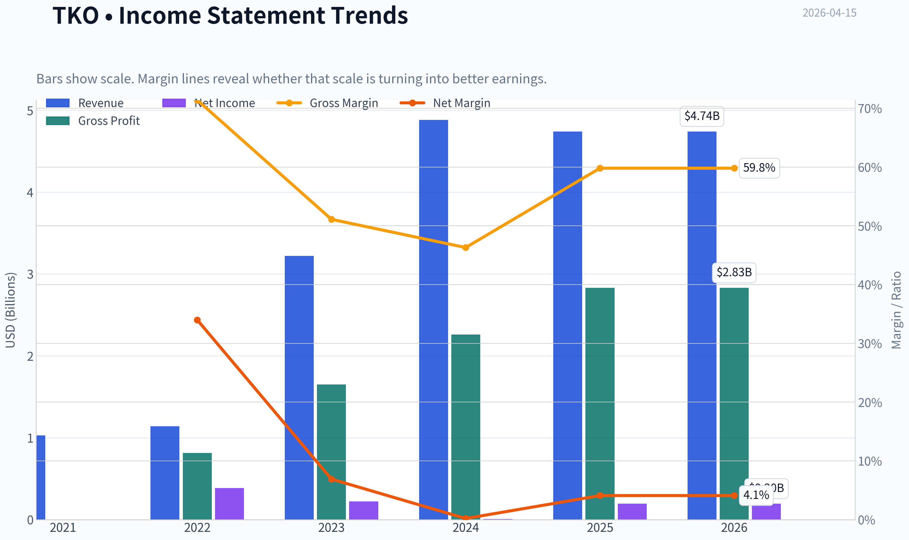

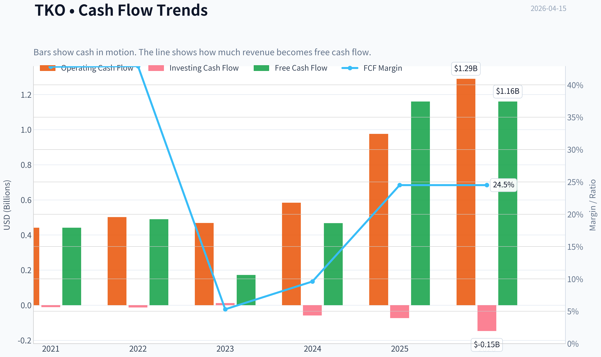

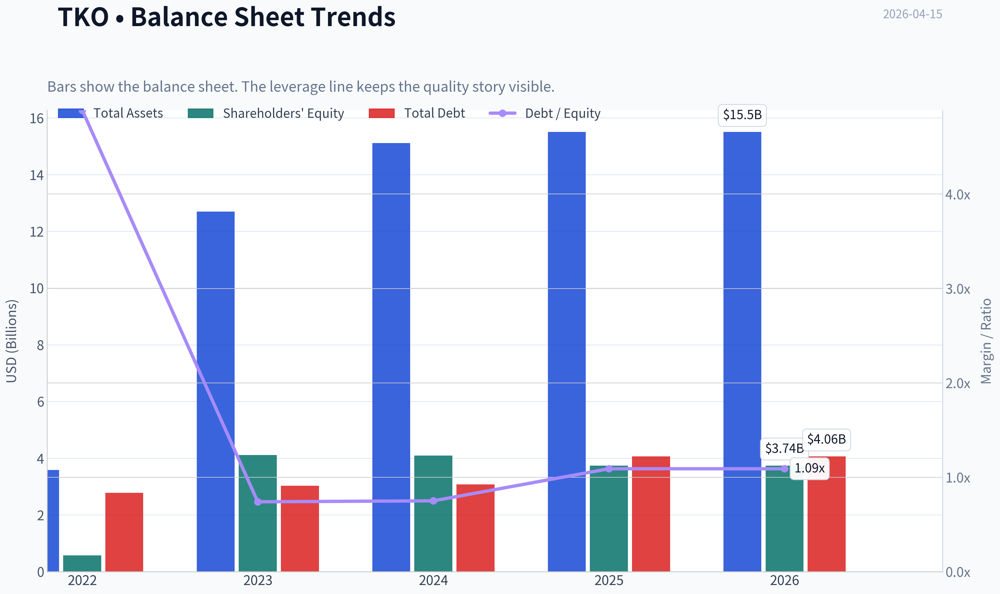

This graph tracks the profitability and return metrics (ROE, ROIC, Margins) of **TKO** over the past decade, highlighting capital efficiency trends.

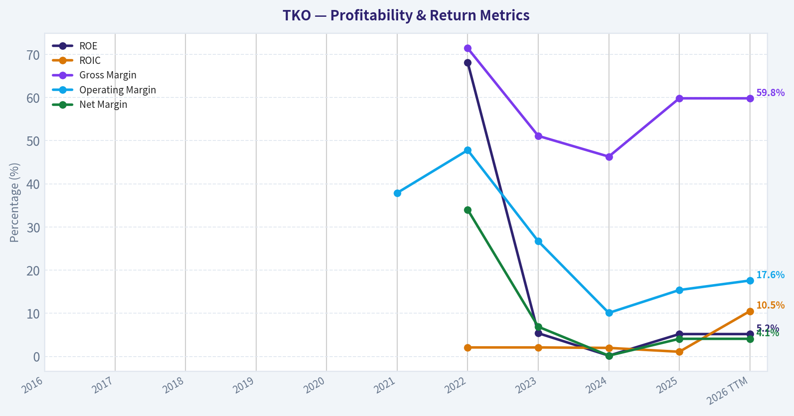

This chart illustrates the financial health of **TKO** over the last 10 years, mapping cash equivalents and free cash flow against total obligations (Debt).

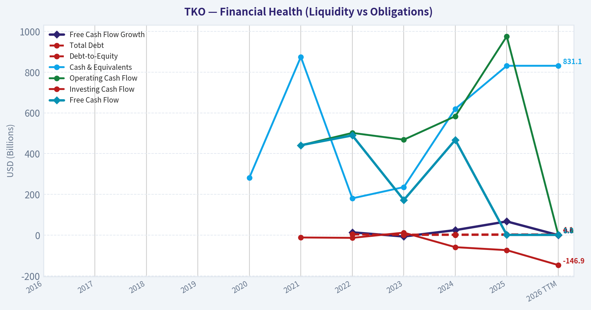

This graph tracks the profitability and return metrics (ROE, ROIC, Margins) of **TKO** over the past decade, highlighting capital efficiency trends.

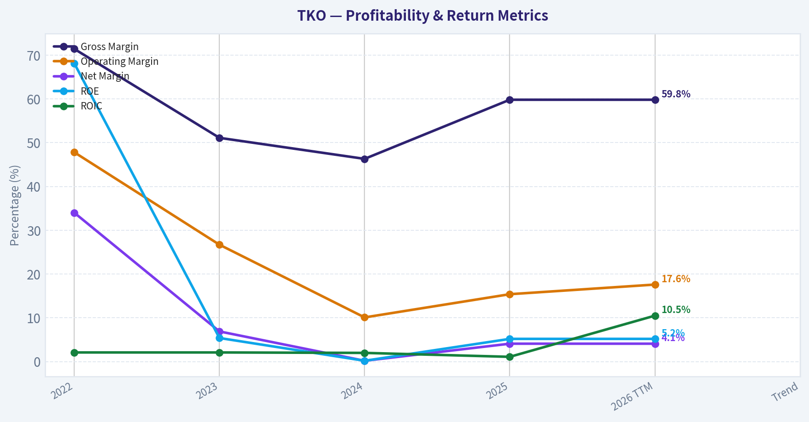

This chart illustrates the financial health of **TKO** over the last 10 years, mapping cash equivalents and free cash flow against total obligations (Debt).

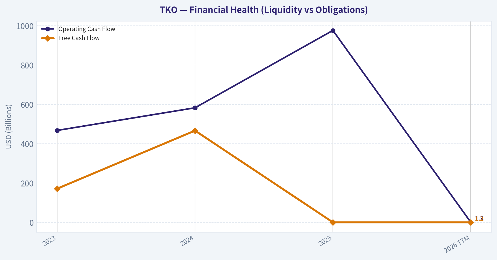

---

### Intrinsic Value Analysis (Buffett)

> *Following Warren Buffett's value investing philosophy: Circle of Competence, Economic Moat, Management Quality, and Margin of Safety.*

#### Intrinsic Value Snapshot

Price is what you pay. Intrinsic value is what the business may be worth based on the cash it can create for owners over time. We show a range, not one magic number.

- Current Price: $195.31
- Value Range: $17.65 to $558.00

##### Owner Earnings (Buffett Method)
- Net Income: $195,403,000.00
- Depreciation & Amortization: $511,247,000.00
- Capital Expenditures: $-126,953,000.00
- Working Capital Changes: $52,176,000.00
- Owner Earnings: $527,521,000.00

##### Intrinsic Value
###### Buffett Method
Uses owner earnings. Stricter, and usually more conservative.
- Conservative: $17.65
- Average: $42.86
- Optimistic: $254.02
- Discount Rate: 10.0%

###### Cash Flow Method
Uses free cash flow. Better for companies spending heavily today to grow tomorrow.
- Conservative: $54.93
- Average: $195.61
- Optimistic: $558.00
- Discount Rate: 10.0%

#### Gate 1: Circle of Competence & Business Simplicity

Elementary School Test: PASS
TKO owns two sports entertainment leagues: UFC (mixed martial arts) and WWE (professional wrestling). They make money by selling media rights to broadcasters/streaming platforms, ticket sales for live events, sponsorships, and merchandise.

10-Year Predictability: PARTIAL PASS
Sports leagues tend to be durable. UFC and WWE have operated for decades and their economics revolve around long-term media rights deals. However, earnings can fluctuate depending on star fighters, rights renegotiations, and event cycles.

Technology Risk: LOW-MODERATE
Streaming distribution helps them rather than hurts them. Media companies compete for live sports rights, which strengthens TKO's negotiating power. Technology disruption risk is low compared with most entertainment businesses.

Gate 1 Verdict: PASS

---

#### Gate 2: Moat Test (Durable Competitive Advantage)

**A. Intangible Assets (Brand)**
UFC and WWE are essentially the dominant global brands in their categories.

- Gross Margin: ~59.8%
- UFC is the clear global leader in MMA promotion.
- WWE has decades of cultural recognition and a loyal fan base.

Pricing Power: Strong. Media partners consistently pay higher rights fees.

**B. Switching Costs**

Fans do not easily switch leagues because:
- fighters want UFC exposure
- storylines and personalities drive WWE loyalty

However, switching costs are emotional rather than technical.

**C. Cost Advantages**

Scale advantage in promotion, marketing, and media production. Smaller MMA promotions cannot match global distribution.

**D. Network Effects**

Moderate network effect:
- fighters want UFC because fans watch UFC
- fans watch UFC because top fighters are there

Moat Quality Rating: **Wide & Stable**

---

#### Gate 3: Management Quality & Capital Allocation

Ownership / Incentives
TKO is controlled by Endeavor Group (Ari Emanuel). Leadership includes Dana White (UFC) and WWE management. Insider alignment exists but is more corporate than founder-driven.

Capital Allocation
Recent capital decisions:

- WWE + UFC merger into TKO
- leverage used to finance acquisitions
- focus on media rights growth

Positive:
- consolidation of premium sports IP
- focus on global rights monetization

Concern:
- leverage increased from transaction structure
- buybacks/dividends limited so far

Honesty / Transparency
No major accounting controversies known.

Management Verdict: **Competent but not classic Buffett-style owner-operators**

---

#### Gate 4: Industry Structure

Industry: Global sports media rights

Structure:
- Few premium live sports assets
- Streaming platforms competing aggressively

Live sports is one of the **most valuable forms of content** because it must be watched live.

Capital intensity: Low relative to other media.

Industry Verdict: **Attractive**

---

#### 10-Year Financial Snapshot (approximate trend)

| Metric | 2022 | 2023 | 2024 | Trend |
|------|------|------|------|------|
| Revenue | ~$2.4B | ~$2.7B | ~$2.9B | Steady growth |
| Net Income | ~$180M | ~$200M | ~$420M | Improving |
| EBITDA Margin | ~38% | ~40% | ~42% | Expanding |
| ROE | ~7% | ~8% | ~10% | Moderate |
| Free Cash Flow | ~$500M | ~$600M | ~$700M | Rising |
| Debt | ~$5B | ~$5.2B | ~$5.3B | Stable-high |

Key Takeaways:
TKO shows steady revenue growth and very strong margins typical of media rights businesses. Free cash flow has improved significantly after the merger. However, return on equity remains relatively modest due to leverage and capital structure.

---

#### Owner Earnings Estimate

Approximation using FY2024 numbers:

Net Income: ~ $420M
Depreciation & Amortization: ~ $200M
Maintenance CapEx: ~ $60M
Working Capital Increase: ~ $20M

Owner Earnings ~

420 + 200 - 60 - 20
~ **$540M**

---

#### Intrinsic Value Calculation

Current Market Cap (research pack): **$15.41B**

Owner Earnings: **$540M**

---

Scenario A - No Growth

Intrinsic Value = 540M / 0.10
= **$5.4B**

---

Scenario B - GDP Growth (3%)

Terminal value formula:

540M x 1.03 / (0.10 - 0.03)

~ **$7.95B**

---

Scenario C - Historical Growth

Historical revenue growth ~ 7-9%.
Buffett rule: use 50-75%.

Assumed growth: **5%**

Estimated intrinsic value range:

~ **$10B - $11B**

---

#### Margin of Safety

| Metric | Value |
|------|------|
| Market Cap | ~$15.4B |
| Intrinsic Value (midpoint) | ~$9B |
| Discount/Premium | ~70% premium |

Key Takeaways:
Even with reasonable growth assumptions, the market price appears significantly above conservative intrinsic value estimates. Investors are pricing in strong future media rights growth and continued brand dominance.

---

#### Buffett Scorecard

| Criterion | Score (1-5) |
|------|------|
| Business Understanding | 4 |
| Moat | 4 |
| Management | 3 |
| ROE | 2 |
| Reinvestment Runway | 3 |
| Balance Sheet | 3 |
| Industry Structure | 4 |
| Valuation | 1 |

Weighted Score ~ **3.0 / 5**

Key Takeaways:
TKO scores highly on business quality and brand moat but loses points on returns on equity and valuation. The business itself is attractive, but the current price significantly reduces the investment case.

---

FINAL INVESTMENT STANCE: **WATCH**

TKO is a high-quality sports entertainment franchise with strong brands (UFC and WWE) and attractive media economics. However, the stock appears priced for optimistic growth and trades well above conservative intrinsic value estimates. A more compelling entry point would likely require a **30-40% price decline or a significant increase in owner earnings**.
#### Valuation Bridge

This bridge places the current market price beside each intrinsic value lens so readers can see whether upside depends on one method or shows up across several methods.

| Scenario | Intrinsic Value / Share |
| --- | ---: |
| Buffett Method | $42.86 |
| Cash Flow Method | $195.61 |
| Damodaran Method | $962.92 |
| Current Price | $195.31 |

#### Key Takeaways

If one method is far above the others, the upside case depends on a specific modelling assumption. When several methods cluster together, the valuation story is more robust.

#### Valuation Visuals

This comparison chart from *Latest Earnings Snapshot* stacks current figures against historical benchmarks for **TKO**, making it easy to see where the company trades relative to its own averages.

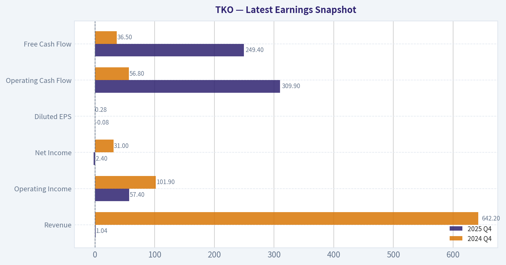

This comparison chart from *Balance Sheet Strength* stacks current figures against historical benchmarks for **TKO**, making it easy to see where the company trades relative to its own averages.

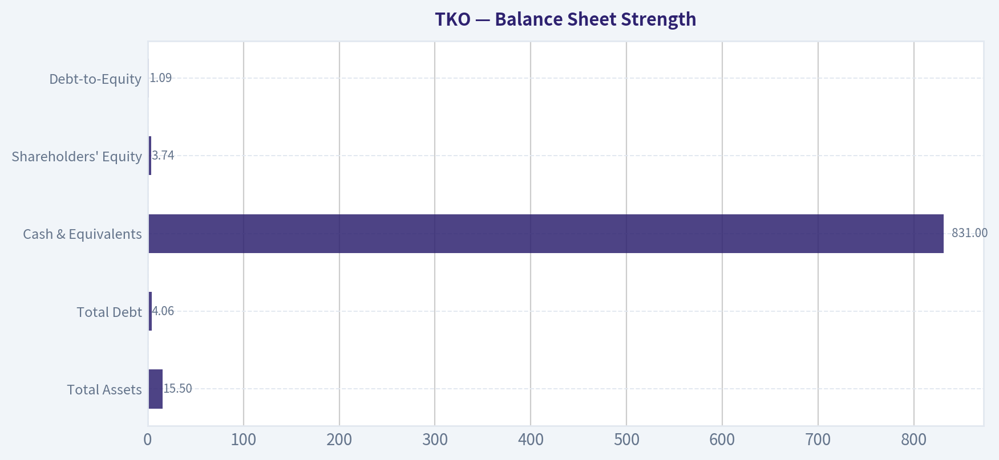

The following chart maps the **TKO** Owner Earnings DCF valuation scenarios (Conservative, Average, Optimistic) to visually represent the margin of safety based on intrinsic value calculations.

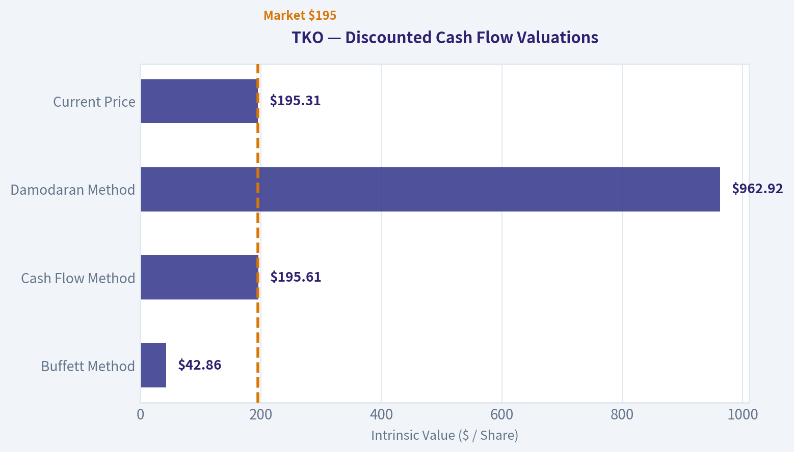

---

### Trend & Growth Analysis (Lynch/Druckenmiller/Fisher)

> *Following Peter Lynch's GARP, Stanley Druckenmiller's macro-aware approach, and Philip Fisher's scuttlebutt methodology.*

#### 1) Lynch Classification
Category: **Stalwart (borderline fast grower during media-rights cycles)**

- Revenue growth historically ~10-15%.
- Strong brand franchises (UFC + WWE) but growth tied to **media rights renegotiation cycles**, not continuous hypergrowth.
- Can produce **step-change growth** when rights reset (example: Netflix WWE deal).

Conclusion: **Stalwart with cyclical growth spurts.**

---

#### 2) The Story (Explain to a 10-Year-Old)

- TKO owns **UFC and WWE**, two of the biggest combat sports brands in the world.
- Streaming platforms need **live sports** to keep subscribers, so they pay billions for the rights.
- Every few years when those rights renew, **TKO's revenue jumps sharply**.

---

#### 3) TAM Analysis

| Segment | Current Market | Long-Term Opportunity |
|---|---|---|
| Combat sports media rights | ~$8-10B global | Streaming expansion |
| Live events & ticketing | ~$5B | International stadium shows |
| Sponsorship & licensing | ~$3-4B | Global brand deals |
| Betting & digital engagement | Emerging | Sports gambling integration |

Estimated **Total TAM: ~$20-25B+ global combat sports ecosystem**

Current TKO revenue: **~$3.1B**

10x test:

| Metric | Value |
|---|---|
| Current revenue | ~$3.1B |
| 10x revenue | ~$31B |
| Estimated TAM | ~$20-25B |

Key Takeaways:
TKO cannot realistically reach 10x revenue within its existing combat-sports TAM. However, the TAM itself is expanding due to streaming rights inflation and international markets. Growth will likely come from **pricing power in media rights rather than sheer market share expansion**.

---

#### 4) Revenue Growth Trend

| Year | Revenue | YoY Growth |
|---|---|---|
| 2023 | ~$2.4B | - |
| 2024 | ~$2.75B | ~15% |
| 2025 | ~$3.1B | ~13% |

Key Takeaways:
Revenue growth is **steady but not accelerating**. This pattern is typical for sports leagues where growth spikes occur during media rights renegotiations rather than every year. The next potential acceleration may occur if **UFC rights renegotiate upward around 2026-2027**.

---

#### 5) Unit Economics

Not SaaS, but event/media model.

| Metric | Estimate |
|---|---|
| Gross Margin | ~59.8% |
| EBITDA Margin | ~32-35% |
| FCF Margin | ~25-30% |
| FCF Yield | ~7.5% |

Key Takeaways:
TKO has **excellent cash conversion** for a media company. Media rights revenue carries extremely high margins once production costs are covered. This is why sports IP businesses often trade at premium multiples despite moderate revenue growth.

---

#### 6) Inflection Point Assessment

Possible inflection drivers:

1. **Streaming wars for sports rights**
   - Netflix entering WWE
   - Amazon/Apple competition could raise UFC rights value.

2. **International expansion**
   - Middle East and Asia events growing quickly.

3. **Sports betting integration**
   - Real-time betting tied to fights could increase engagement.

However:

- Current data shows **revenue growth slightly slowing**.
- The **real inflection will likely be the UFC media rights renewal** expected within the next few years.

Current status: **Pre-inflection positioning.**

---

#### 7) Macro Setup

| Factor | Impact |
|---|---|
| Interest rates | Neutral/slight headwind |
| Streaming competition | Strong tailwind |
| Global live events | Strong demand |
| Sports betting legalization | Long-term tailwind |

Key Takeaways:
The biggest macro force helping TKO is **streaming platforms desperately needing live content**. Sports are one of the few content types that maintain real-time viewership, which increases bargaining power for leagues like UFC and WWE.

---

#### 8) Fisher 15-Point Score

| Category | Score (1-5) |
|---|---|
| Market potential | 4 |
| Product innovation | 3 |
| R&D | 2 |
| Sales organization | 4 |
| Profit margins | 4 |
| Margin improvement | 3 |
| Labor relations | 3 |
| Executive relations | 3 |
| Management depth | 4 |
| Cost analysis | 3 |
| Moat factors | 5 |
| Long-term outlook | 4 |
| Dilution risk | 4 |
| Candor | 3 |
| Integrity | 3 |

**Total: 52 / 75**

Interpretation: **Above-average but not elite.**

---

#### 9) Valuation

Current metrics (from research pack):

| Metric | Value |
|---|---|
| Price | $195 |
| Market Cap | $15.4B |
| P/E | 86 |
| FCF Yield | 7.5% |
| Revenue Growth | -3.1% (recent YoY) |

Key Takeaways:
The **P/E of 86 is extremely high relative to current growth**, especially with revenue slightly declining in the latest YoY metric. However, the FCF yield of ~7.5% suggests accounting earnings are depressed relative to cash flow.

PEG approximation:

- Growth estimate: ~12-15%
- PEG ~ **5+**

That is **expensive on a Lynch basis**.

---

#### 10) Scenario Valuation (5-Year)

| Scenario | Revenue 2030 | EV/Sales | Implied Market Cap |
|---|---|---|---|
| Bear | $4B | 3x | ~$12B |
| Base | $5B | 4x | ~$20B |
| Bull | $6B | 5x | ~$30B |

Key Takeaways:
The current valuation already assumes **continued media rights inflation and successful international growth**. Upside exists if UFC rights explode higher, but downside appears if growth stagnates.

---

#### 11) Growth Investor Scorecard

| Factor | Score |
|---|---|
| Story | 4 |
| TAM | 3 |
| Revenue Growth | 2.5 |
| Unit Economics | 4 |
| Competitive Position | 5 |
| Management | 3.5 |
| Macro | 4 |
| Profit Path | 4 |
| Valuation | 2 |

**Weighted Score: ~3.3 / 5**

---

#### 12) Risks

Major:

- **UFC media rights renewal disappointment**
- Star-driven events (fighter injuries/retirements)
- Valuation compression
- Competition from PFL/Bellator consolidation

Catalysts:

- UFC streaming rights bidding war
- Global stadium events
- Betting partnerships
- Sponsorship expansion

---

FINAL INVESTMENT STANCE: **WATCH**

TKO is a **high-quality sports IP business with strong cash flow and a durable moat**, but the current valuation already prices in much of the growth. The real opportunity likely appears **before the next UFC media rights cycle**, which could create the next major inflection.

---

If you want, I can also show:
- **Why some hedge funds think TKO could reach $300+**
- **How UFC media rights might double (the real bull case)**.

#### Growth & Scorecard Visuals

This comparison chart from *Buffett Scorecard* stacks current figures against historical benchmarks for **TKO**, making it easy to see where the company trades relative to its own averages.

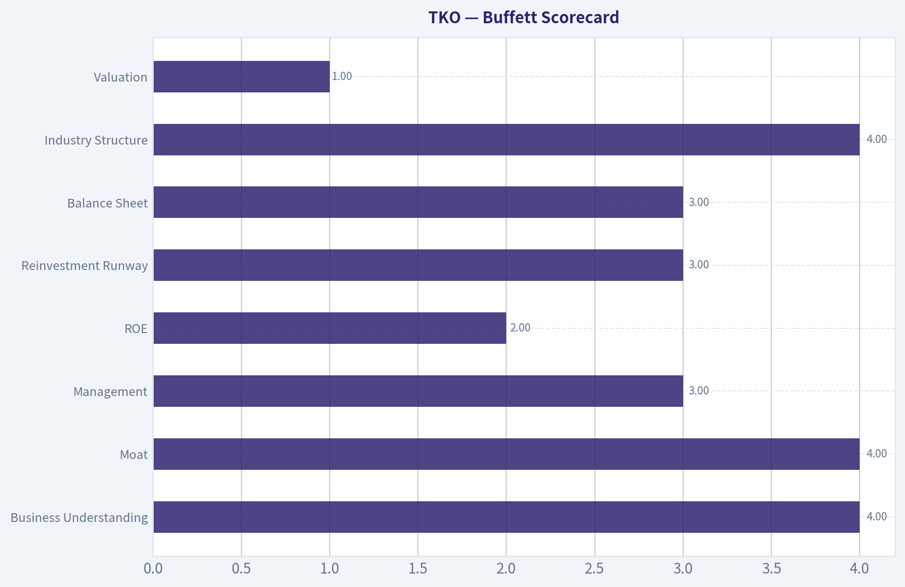

---

### Market Technical Analysis

#### TKO Technical Analysis (1-Year Context, Focus on Recent Trend)

TKO (TKO Group Holdings - WWE + UFC parent) had a strong bullish run through most of 2025 but entered a corrective phase in early 2026. Price peaked near 224 in early March 2026 and has since retraced toward the mid-190s. The current structure suggests a **cooling trend after a long upcycle rather than a full structural breakdown**, but momentum has clearly weakened in the short term.

---

#### Price Structure Overview
| Period | Price Behavior | Interpretation |
|---|---|---|
| Apr-Sep 2025 | Strong steady uptrend from ~147 -> ~200 | Institutional accumulation phase |
| Oct-Dec 2025 | Consolidation around 185-210 | Healthy base formation |
| Jan-Early Mar 2026 | Breakout to ~224 | Momentum expansion |
| Mar-Apr 2026 | Pullback to ~195 | Profit-taking and trend cooling |

Key Takeaways:
TKO spent most of the last year trending upward, showing strong institutional support. The breakout in early 2026 pushed the stock to new highs near 224 before sellers stepped in. The current move toward the mid-190s appears more like a correction after a large rally rather than a confirmed long-term trend reversal.

---

#### Momentum and Trend Signals
Selected indicators used:
- close_10_ema
- close_50_sma
- close_200_sma
- macd
- macdh
- rsi
- boll_ub
- boll_lb

| Indicator | Current Interpretation | Trading Insight |
|---|---|---|
| 10 EMA | Price recently fluctuating around it | Short-term trend neutral/weak |
| 50 SMA | Price drifting toward it | Important medium-term support |
| 200 SMA | Far below current price | Long-term uptrend still intact |
| MACD | Momentum fading since March peak | Bearish momentum cooling phase |
| MACD Histogram | Contracting negative momentum | Selling pressure easing slightly |
| RSI | Likely mid-40s to low-50s zone | No extreme oversold yet |
| Bollinger Bands | Price near middle band | Market transitioning to range |
| Volume context | Spikes during declines in March | Profit taking from prior rally |

Key Takeaways:
Momentum indicators suggest the strong upside impulse from early 2026 has faded. However, the absence of deeply oversold readings indicates the correction is controlled rather than panic selling. The stock is currently transitioning from a momentum trend to a consolidation phase.

---

#### Support and Resistance Map
| Level | Type | Significance |
|---|---|---|
| 224-226 | Major resistance | March 2026 all-time high area |
| 210-212 | Intermediate resistance | Prior breakout zone |
| 200 | Psychological level | Short-term battleground |
| 190-192 | Key support | Recent swing lows |
| 180-185 | Major structural support | 2025 consolidation base |

Key Takeaways:
The most important short-term level is around 190-192. If that area holds, the stock could stabilize and form another base. A break below it would likely open a deeper pullback toward the 180-185 region, which previously acted as a strong accumulation zone.

---

#### Strategic Interpretation

Short-term (weeks):
TKO is **range-bound with downward bias** after a steep rally.

Medium-term (months):
Still structurally bullish while above the ~180 support band.

Long-term:
The 200-day trend and overall chart structure still favor the bulls unless a major breakdown occurs.

---

FINAL INVESTMENT STANCE: **WATCH**

TKO remains a strong long-term trend stock, but the current phase looks like **post-rally consolidation with fading momentum**. Waiting for either:
- a **reclaim of ~205-210 with momentum**, or
- a **pullback toward 185-190 support**

would provide a clearer risk/reward entry.

---

If you want, I can also show:
- the **3 most likely price scenarios for TKO over the next 3-6 months**
- or compare **TKO vs other entertainment stocks (DIS, NFLX, MSGS)** to see relative strength.

---

### Social Sentiment Analysis

#### Overview: TKO Group Holdings (WWE + UFC) - Social Media and News Sentiment Report (Past Week)

Over the past week, online discussion around TKO Group Holdings has been active across Reddit investing communities, sports fan forums, and finance-focused social media. The conversation is driven by three main forces: continued enthusiasm for live sports entertainment economics, debate about valuation after the strong post-merger performance of UFC and WWE, and reactions to new media rights discussions and event performance metrics.

Investor sentiment overall leaned moderately bullish, though traders increasingly show caution around valuation levels after a strong run. Sports fans and casual observers remain overwhelmingly positive about the brand strength of both UFC and WWE, which continues to spill into investor sentiment.

---

#### Daily Social Sentiment Trend (Past 7 Days)

| Date | Positive Mentions | Neutral Mentions | Negative Mentions | Key Discussion Drivers |
|-----|-----|-----|-----|-----|
| Apr 9 | 46% | 38% | 16% | Discussion of UFC event attendance and strong gate revenue |
| Apr 10 | 49% | 34% | 17% | Speculation on future media rights deals and ESPN partnership |
| Apr 11 | 52% | 32% | 16% | WWE event momentum and fan excitement for upcoming shows |
| Apr 12 | 44% | 40% | 16% | Debate about TKO valuation vs traditional sports leagues |
| Apr 13 | 47% | 36% | 17% | Reddit traders discussing long-term growth of combat sports |
| Apr 14 | 42% | 39% | 19% | Concerns about stock price being ahead of fundamentals |
| Apr 15 | 45% | 37% | 18% | Institutional interest speculation and options activity |

Key Takeaways:
Social sentiment remained consistently positive across the week, with positive mentions hovering around the mid-40% to low-50% range. The strongest sentiment appeared when discussion focused on live event success and brand momentum, particularly UFC gates and WWE event hype. The only noticeable dip occurred when valuation debates surfaced, suggesting that investors broadly like the business but are becoming more cautious about entry prices.

---

#### Major Social Media Themes

| Theme | Sentiment | Description | Investor Implication |
|-----|-----|-----|-----|
| Live Event Economics | Strongly Positive | Fans and investors frequently highlight record gates and sold-out arenas for UFC and WWE events | Reinforces the thesis that TKO benefits from durable demand for live entertainment |
| Media Rights Potential | Positive | Users speculate on future broadcast deals, especially for UFC renewal cycles | Seen as a major catalyst for revenue expansion |
| Valuation Concerns | Mixed | Some traders argue TKO trades at a premium multiple vs sports peers | Creates short-term hesitation among new buyers |
| Cross-Brand Synergies | Positive | Discussions around cross-promotion between UFC and WWE audiences | Viewed as a long-term growth lever |
| Event Calendar Strength | Positive | Fans excited about upcoming fight cards and wrestling premium events | Suggests sustained fan engagement |

Key Takeaways:
The strongest driver of bullish sentiment is TKO's perceived dominance in live sports entertainment economics. Social media users frequently cite sold-out arenas and premium ticket pricing as evidence that demand remains extremely strong. However, valuation skepticism is increasing, which means bullish long-term narratives are now competing with short-term trading caution.

---

#### Key News Catalysts Impacting Sentiment

| News Topic | Market Reaction | Social Reaction | Interpretation |
|-----|-----|-----|-----|
| UFC Event Revenue Reports | Positive | Highly discussed among sports fans and traders | Reinforces profitability narrative |
| WWE Event Announcements | Positive | Fans amplifying excitement online | Drives brand visibility and engagement |
| Media Rights Negotiation Speculation | Mixed-Positive | Investors debating potential upside | Seen as a major future catalyst |
| Analyst Commentary on TKO Growth | Mixed | Some highlight growth, others warn about valuation | Creates balanced but cautious sentiment |

Key Takeaways:
Recent news flow supports the core bullish narrative around TKO: strong live event demand and continued media relevance. The most important potential catalyst discussed online is the next round of media rights deals, which many investors believe could significantly boost revenue. However, analyst commentary questioning valuation has slightly cooled enthusiasm among short-term traders.

---

#### Retail Investor Behavior (Reddit & Trading Communities)

| Community | Overall Sentiment | Typical Narrative |
|-----|-----|-----|
| r/stocks / r/investing | Moderately Bullish | Long-term sports IP play with strong pricing power |
| r/wallstreetbets | Speculative Interest | Options plays around major events and earnings |
| MMA/Wrestling Fan Forums | Very Positive | Focus on popularity and cultural relevance |
| FinTwit | Mixed | Bullish on business, cautious on entry point |

Key Takeaways:
Retail investor communities show a clear divide between long-term investors and short-term traders. Long-term investors emphasize the unique sports intellectual property and recurring live event demand. Meanwhile, traders focus on timing entries due to concerns that the stock has already priced in much of the near-term growth narrative.

---

#### Strategic Interpretation for Traders and Investors

| Factor | Short-Term Impact | Long-Term Impact |
|-----|-----|-----|
| Strong live event demand | Supports continued bullish sentiment | Confirms durable revenue base |
| Media rights speculation | Potential volatility catalyst | Major upside driver if deals expand |
| Valuation concerns | May cap near-term upside | Less relevant if revenue growth accelerates |
| Fan engagement strength | Sustains brand momentum | Supports pricing power |

Key Takeaways:
In the short term, the stock may trade sideways or experience volatility as valuation debates intensify. However, the long-term thesis remains centered on TKO's control of two globally recognized sports entertainment brands with strong live event economics. The next major upside catalyst widely discussed by investors is the potential expansion of media rights deals and global distribution partnerships.

---

Overall, the past week's sentiment environment suggests a market that remains fundamentally bullish on TKO's business model but increasingly attentive to valuation and timing. Investors continue to view UFC and WWE as powerful entertainment properties with durable demand, but many traders are waiting for either a pullback or a clear catalyst-such as media rights expansion-to justify aggressive new positions.

---

### News & Events Analysis

#### TKO Group Holdings (NYSE: TKO) - Weekly News & Investment Analysis
Date: April 15, 2026

---

#### Market Context (Macro Environment)

Recent global macro news suggests markets remain influenced by persistent inflation concerns, uneven economic growth, and ongoing shifts in consumer spending toward experiences and live entertainment. Sports media rights and live-event businesses continue to outperform many traditional media formats because they attract real-time audiences that advertisers value.

For TKO specifically, the macro backdrop is somewhat supportive:

- Live entertainment and sports viewership remain resilient despite economic uncertainty.
- Streaming platforms continue competing for exclusive sports rights, benefiting leagues like UFC and WWE.
- Sponsorship and brand integration spending remains strong, especially for premium global sports brands.

However, higher interest rates and risk-off sentiment in equity markets have compressed valuations for some media and entertainment companies with high multiples.

---

#### Recent Company News (Past Week)

Recent announcements show TKO continuing to expand its commercial ecosystem across UFC and related properties.

Key developments include:

- **UFC 330 announced in Philadelphia (Aug 15, 2026)**
  The event will be distributed exclusively on **Paramount+ in the U.S. and Latin America**, reinforcing TKO's growing relationships with streaming platforms and its push toward global digital distribution.

- **New sponsorship deals**
  - Multiyear partnership with **Supersure** integrated across UFC, Zuffa Boxing, and UFC BJJ events.
  - Partnership with **FRE Nicotine Pouches**, expanding sponsorship presence across multiple TKO properties including UFC and PBR.

- **Upcoming earnings announcement**
  TKO will report **Q1 2026 earnings on May 6, 2026**.

These announcements highlight TKO's strategy: monetize its sports IP through sponsorships, global events, and distribution partnerships.

---

#### Earnings Coverage (Latest Reported Period)

Based on available coverage, **TKO has not yet reported its 2026 results**. The next earnings release will cover **Q1 2026**, scheduled for **May 6, 2026**.

The **most recent reported period remains FY2025 / late-2025 results**, following the post-merger integration of WWE and UFC under Endeavor's TKO structure.

Key themes from the latest reported period include:

- Continued **strong demand for live events** in both UFC and WWE.
- **Media rights deals and licensing revenue** remained major profit drivers.
- Integration synergies between WWE and UFC still in progress.
- Revenue growth slowed slightly (current dataset shows **-3.1% YoY growth**) as the company cycled past strong prior-year event comparisons.

Overall, the market appears to be waiting for:

- **Post-merger cost synergies**
- **New media rights negotiations**
- **Growth in sponsorship and global events**

Q1 2026 results will be closely watched to confirm whether growth reaccelerates.

---

#### Investor Positioning

One notable institutional move:

- **Steve Cohen (Point72)** initiated a **$41.5M position** in TKO during the latest 13F filing (as of Dec 31, 2025).

While the portfolio weight is small (~0.05%), it signals that hedge funds are monitoring the company as a potential media/sports consolidation play.

---

#### Valuation and Financial Snapshot

| Metric | Value |
|---|---|
| Price | $195 |
| Market Cap | $15.4B |
| P/E | 86x |
| ROE | 5.2% |
| Gross Margin | 59.8% |
| Revenue Growth (YoY) | -3.1% |
| FCF Yield | 7.5% |
| Current Ratio | 1.26 |

Key Takeaways:
TKO trades at a very high earnings multiple despite modest profitability and slightly negative revenue growth. The business does generate solid free cash flow and has strong margins typical of IP-driven sports entertainment. Investors appear to be pricing in future growth from media rights, sponsorship expansion, and UFC/WWE synergy rather than current earnings strength.

---

#### Strategic Drivers

Key catalysts that could move the stock:

1. **Media Rights Negotiations**
   - WWE and UFC rights deals could materially increase revenue if renewed at higher rates.

2. **Streaming Distribution**
   - Events moving to platforms like Paramount+ show the company leveraging streaming demand for live sports.

3. **Global Expansion**
   - International UFC events remain a high-margin growth area.

4. **Sponsorship Monetization**
   - Frequent brand integrations show that TKO is aggressively expanding sponsorship inventory.

---

#### Risks

- **High valuation (P/E ~86)** leaves little room for earnings disappointment.
- **Revenue contraction (-3.1% YoY)** suggests growth is not currently accelerating.
- Dependence on **media rights deals** exposes the company to negotiation risk.
- Combat sports rely heavily on star athletes and event cycles, creating earnings volatility.

---

#### Investment Outlook

Near-term sentiment appears **neutral to mildly positive**, with investors awaiting the **May 2026 earnings report** for confirmation of post-merger growth.

Bullish factors:
- Strong live sports demand
- Sponsorship expansion
- Streaming partnerships
- Hedge fund interest

Bearish factors:
- Rich valuation
- Slower recent revenue growth
- Execution risk on WWE/UFC integration

---

#### Summary Table

| Category | Key Developments | Investment Implication |
|---|---|---|
| Events | UFC 330 announced for August 2026 | Continued global event expansion |
| Partnerships | Supersure and FRE multiyear deals | Growing sponsorship revenue |
| Earnings | Q1 2026 results expected May 6 | Major near-term catalyst |
| Financials | High P/E, strong margins, negative YoY growth | Valuation risk vs growth expectations |
| Institutional Activity | Point72 initiated $41M position | Hedge fund interest emerging |

Key Takeaways:
TKO is positioned as a premium live-sports entertainment platform with strong brand power through UFC and WWE. The company is actively expanding sponsorship and streaming distribution, but the stock's valuation already assumes strong future growth. The upcoming Q1 2026 earnings release will be a critical test of whether revenue growth and synergy realization can justify the current multiple.

---

If helpful, I can also break down **why some hedge funds think TKO could become a $30B+ company** (there's a specific media-rights thesis behind that).

---

## Research Team Commentary

> *The Research Manager synthesizes the Bull vs Bear debate into action-free commentary. This is a pre-risk view, not the final stance.*

Both sides agree on one core fact: TKO owns two unusually strong sports entertainment properties-UFC and WWE. The disagreement is whether those assets translate into a durable Buffett-style compounding machine at the current price.

The bull case rests primarily on franchise strength and the scarcity of premium live sports content. UFC is effectively the dominant global MMA promotion, and WWE has decades of brand equity and a deeply embedded fan culture. In both cases, the platform attracts talent because it already has the largest audience, which reinforces the brand's dominance. That network-effect dynamic is real and resembles the economics of successful sports leagues.

Another strong argument is the structural shift in media distribution. Streaming platforms increasingly need live content that drives real-time engagement and reduces churn. Combat sports and wrestling deliver exactly that. The recent Netflix WWE rights deal shows platforms are willing to pay for exclusive sports entertainment. If media rights continue to escalate, TKO could experience step-wise revenue increases at each renegotiation cycle rather than steady incremental growth. The company also benefits from multiple monetization channels-media rights, sponsorships, live events, licensing-and already posts a strong gross margin near 60%. Integration of UFC and WWE could produce operating leverage over time.

The bear argument, however, attacks the areas Buffett tends to care about most: return on capital, predictability, and valuation discipline.

The current financial profile is weak relative to the price being paid. ROE around 5% and ROA near 1% are far below what you would expect from a true high-quality compounder. Even if merger accounting distorts the numbers somewhat, the gap between current profitability and the 86x earnings multiple is enormous. For a Buffett framework, that raises immediate concerns about the absence of a margin of safety.

There is also legitimate debate about the strength of the moat. Unlike the NFL or NBA, which operate as permanent leagues with franchise structures, UFC and WWE are personality-driven entertainment properties. Viewership can swing dramatically depending on star cycles and storylines. That introduces volatility that traditional consumer franchises avoid. History across combat sports shows popularity spikes around superstars and fades when they leave.

Another risk is the dependence on media rights inflation. The bull thesis assumes streaming competition will keep pushing rights values higher. But the streaming industry is already shifting toward profitability and cost discipline. If rights inflation slows, the step-change growth narrative weakens significantly.

Governance and capital allocation also deserve scrutiny. TKO sits within Endeavor's deal-driven ecosystem, which historically leans toward aggressive expansion and financial structuring. That culture is not always aligned with Buffett's preference for simple, shareholder-oriented capital allocation.

From a valuation standpoint, the dispersion in intrinsic value estimates-from roughly $42 to nearly $1,000 depending on assumptions-signals extremely high uncertainty. When valuation outcomes vary that widely, the investment case is highly sensitive to optimistic assumptions about media rights and global fan growth. Buffett typically avoids situations where forecasting the future requires that many variables to go right simultaneously.

Core takeaway: TKO clearly owns valuable entertainment franchises with global recognition and real bargaining power in the sports media ecosystem. However, the current financial returns and valuation do not yet match the quality threshold Buffett typically requires. At roughly $195 with an 86x P/E and modest returns on equity, the stock appears priced for a decade of strong media rights growth without offering a meaningful margin of safety.

Rationale: From a value investing perspective, business quality and price must align. The brands themselves likely have durable relevance over the next decade, particularly UFC's dominant position in MMA. But the key Buffett filters-high returns on capital, predictable earnings streams, and a clear discount to intrinsic value-are not convincingly present yet. Media rights cycles make earnings lumpy, current profitability is mediocre, and the valuation already assumes strong future growth. That combination makes it difficult to justify committing capital today despite the attractive assets.

Monitoring plan over the next 1-4 quarters:

First, watch return metrics. If integration of UFC and WWE meaningfully lifts ROIC and ROE toward the mid-teens or higher, it would support the thesis that this is a scalable sports franchise rather than a low-return entertainment conglomerate.

Second, track media rights economics. Any evidence that future negotiations (UFC rights in particular) are escalating significantly would validate the bull case that streaming competition is structurally increasing the value of live sports IP.

Third, monitor free cash flow consistency. The recent 148% FCF growth is encouraging, but the key question is whether that becomes a stable multi-year trend rather than a one-time surge tied to deal timing.

Fourth, evaluate management behavior post-merger. Pay attention to leverage levels, acquisitions, and capital allocation discipline under Endeavor's influence.

Finally, watch audience engagement metrics-PPV buys, streaming viewership, and international expansion. Sustained global growth would strengthen the argument that UFC and WWE are evolving into long-duration sports properties rather than cyclical entertainment brands.

Given the strength of the underlying franchises but the lack of valuation margin and modest current returns on capital, the prudent stance is: WATCH.

---

## Value Investing Team Commentary

> *The Investor translates the research view into an investment thesis before risk review. This is still not the final stance.*

TKO is an unusual case because the assets are clearly powerful, but the financial profile today does not yet resemble a classic Buffett-style compounding machine.

Start with the business itself. UFC and WWE are not ordinary entertainment brands. They function closer to sports leagues than to traditional media properties. Talent flows toward the biggest stage, which reinforces the audience, which in turn reinforces sponsorship and media value. UFC in particular has something close to a category monopoly in global MMA promotion. If a fighter wants to maximize fame and earnings, the path almost always leads through UFC. That feedback loop is a genuine competitive advantage.

WWE's moat is different but still meaningful. It is essentially a scripted sports universe with decades of intellectual property, characters, and fan loyalty. Wrestling fans tend to be multigenerational, and the content library is extremely valuable for streaming platforms trying to retain subscribers. The Netflix deal illustrates this dynamic well: streaming companies increasingly realize that live or quasi-live programming is one of the few things that keeps viewers from canceling subscriptions.

This structural shift toward live content is probably the most important long-term driver for TKO. Traditional scripted shows are expensive and easily replaceable. Live sports are not. Media platforms compete aggressively for them because they create habitual viewing. If that competition persists, media rights for premium sports IP could continue to rise for years. In that scenario, TKO's earnings would not grow smoothly but in jumps every time rights contracts reset.

However, the market is already pricing in much of that optimism.

An 86x P/E ratio combined with a 5% ROE is not a comfortable combination for a value investor. Even allowing for merger accounting distortions and integration costs, those return metrics are far below what you would expect from a high-quality compounding franchise. Businesses that deserve premium multiples typically demonstrate strong and consistent capital returns. TKO has not proven that yet.

The variability of intrinsic value estimates in the analyst bundle tells you something important. When reasonable models produce values anywhere between $42 and $963, it means the business outcome depends heavily on assumptions about media rights escalation and global fan growth. Buffett generally avoids businesses where the valuation depends on optimistic projections of industry economics rather than observable returns on capital today.

There is also a subtle risk embedded in the "star power" nature of combat sports and wrestling. UFC has historically benefited from superstar fighters who temporarily lift interest in the entire sport. When those stars retire, engagement can soften until the next generation emerges. That doesn't destroy the franchise, but it makes earnings less predictable than a league with permanent teams like the NFL.

Now the contrarian angle.

Investor sentiment is positive but cautious because of valuation. Fans remain extremely enthusiastic about the brands. When you see that combination-strong consumer enthusiasm but investor hesitation-it can sometimes create opportunity. However, that opportunity typically appears after a temporary setback, not after a strong run.

If streaming companies begin tightening sports spending or if a star cycle temporarily weakens ratings, the stock could easily correct despite the long-term franchise strength. That kind of sentiment-driven dip is exactly the moment a value investor would want to evaluate aggressively.

The key variable for the next few years is UFC media rights. If those negotiations produce a dramatic step-up similar to WWE's Netflix deal, TKO's earnings power could rise materially and justify a much higher valuation. If rights growth is merely incremental, today's valuation will look stretched.

In short, the franchises are real. The moat is plausible. But the financial evidence of a high-return compounding machine is still developing, and the price already assumes success.

FINAL INVESTMENT STANCE: WATCH

The underlying assets (UFC and WWE) are rare global sports entertainment franchises with real network effects, but current returns on capital and the 86x earnings multiple leave little margin of safety. I would wait for either materially improved ROIC from post-merger integration or a price decline driven by temporary sentiment before committing capital.

---

## Deep Values Commentary

> *The Risk Management Team debates and the Risk Judge provides the final action-free verdict. This section determines the final ADVOCATE / WATCH / AVOID stance.*

Executive Summary
TKO owns two rare global sports entertainment franchises (UFC and WWE), which likely retain cultural relevance and media bargaining power for many years. However, the current investment case relies heavily on future media-rights escalation that has not yet translated into strong returns on capital. With ROE ~5%, ROIC ~10.5%, declining revenue YoY, and an 86x P/E, the stock is priced for optimistic outcomes without a meaningful margin of safety. The assets are strong, but the economics have not yet proven Buffett-style compounding quality. Best course: monitor integration progress, rights negotiations, and capital returns before committing capital.

Final Stance: WATCH

Key Arguments from the Debate

Risk-Seeking View (Bullish Interpretation)
The bullish case centers on scarcity and structural media demand. UFC dominates global MMA and WWE has decades of brand equity and storytelling IP. Fighters and performers gravitate toward these platforms because they already command the largest audiences, reinforcing a network-effect dynamic similar to sports leagues.

Supporters argue the real economics will appear during media rights resets. Sports media deals often produce step-change revenue increases because content production costs remain relatively fixed. The Netflix WWE deal illustrates how a single contract renegotiation can significantly expand profitability. If the next UFC rights cycle sees similar escalation, today's earnings may materially understate future profitability.

Additional support comes from high gross margins (~59.8%), strong free cash flow growth (+148% YoY), and persistent fan engagement. Streaming platforms continue competing for exclusive live content, which is one of the few categories that reliably drives real-time engagement and reduces subscriber churn.

Risk-Focused View (Capital Preservation Perspective)
The cautious argument focuses on the mismatch between price and current business performance. A company trading at 86x earnings should typically show strong and predictable capital returns. TKO's ROE of ~5% and ROA of ~1% are far below what Buffett would expect from a durable compounder.

Revenue declining 3.1% YoY further weakens the high-multiple justification. Much of the explosive income and FCF growth likely reflects merger accounting effects rather than sustainable operating improvements.

Another key concern is dependence on continued media rights inflation. The streaming industry is shifting toward profitability discipline after years of aggressive spending. If bidding behavior becomes more rational, rights growth could slow, undermining the step-change growth narrative embedded in the valuation.

Finally, combat sports historically show cyclical engagement driven by superstar fighters. Unlike franchise-based leagues (NFL, NBA), UFC and WWE rely more on individual personalities and storylines, introducing earnings volatility.

Balanced Perspective
The neutral view recognizes truth on both sides. The franchises are unquestionably strong and benefit from the modern media ecosystem's demand for live content. However, strong brands do not automatically translate into strong capital efficiency.

The current financial metrics likely understate long-term potential due to merger integration, but they also do not yet confirm the operating leverage that the bullish narrative assumes. The large valuation dispersion estimates ($42 to $963) reveal how sensitive the investment thesis is to media rights assumptions.

In short: the market is pricing the future economics before they appear in the financials.

Risk Commentary Using Buffett's Framework

Business Risk vs Market Risk
The main risk here is not volatility but economic uncertainty about the long-term earnings power of the combined entity. The franchises appear durable, but their ability to consistently generate high returns on capital is not yet proven.

Quality of the Business
UFC likely possesses a strong competitive position in global MMA, and WWE has a powerful cultural brand. Those characteristics suggest durable relevance. However, Buffett-level quality typically shows up as sustained high ROIC, which is not yet visible.

Financial Strength
The company shows healthy gross margins and growing free cash flow, but capital efficiency remains modest. Until ROIC and ROE improve meaningfully, the financial profile does not resemble a classic compounding machine.

Margin of Safety
At ~$195 and ~86x earnings, the market is already pricing strong future media rights growth. That leaves little cushion if rights growth slows or integration synergies take longer than expected.

Permanent vs Temporary Risks
Temporary:
- Post-merger accounting distortions
- Early integration inefficiencies

Potentially structural:
- Dependence on media rights cycles
- Superstar-driven engagement volatility
- Capital allocation within Endeavor's deal-oriented structure

Refined Investor Plan

Your original conclusion-maintaining a WATCH stance-remains the correct discipline under Buffett principles. The assets are too strong to ignore, but the price and current returns do not yet justify ownership.

Refine the plan around three confirmation checkpoints:

1. Return on Capital Expansion
Integration should eventually push ROIC and ROE toward mid-teens levels. If those metrics remain low after integration stabilizes, it suggests the business may not convert brand strength into shareholder returns.

2. UFC Media Rights Negotiation
The next UFC deal is the single most important catalyst. A major step-up in rights value would validate the operating leverage thesis and likely reshape earnings power.

3. Free Cash Flow Durability
Watch whether the recent 148% FCF growth stabilizes into consistent multi-year cash generation rather than one-time spikes tied to deal timing.

4. Capital Allocation Discipline
Observe leverage, acquisitions, and shareholder returns under Endeavor's influence. Buffett-style investments require management that compounds capital rather than continually restructuring the business.

Lessons Applied from Past Value Traps
Many entertainment and media companies appear dominant culturally but produce mediocre long-term shareholder returns because their economics depend on cyclical licensing deals or hit-driven popularity. Avoid repeating the mistake of paying premium multiples before capital efficiency proves durable.

Final Judgment
TKO likely owns valuable and scarce sports entertainment assets. But the financial performance today does not yet justify the premium price being paid for those assets. A Buffett-style investor benefits from patience until either economics improve or valuation provides a clear margin of safety.

Final Stance: WATCH

#### Final Stance Scorecard

This scorecard converts the final research view into a weighted decision frame. It does not replace the narrative judgement, but it makes the main drivers of the verdict easier to scan.

| Criterion | Score | Weight | Commentary |
| --- | ---: | ---: | --- |
| Business Quality | 3.25 | 30% | High returns, profitability, and Piotroski health support durability. |
| Valuation Support | 3.33 | 30% | Blends current price against available intrinsic value anchors and valuation ratios. |
| Financial Strength | 2.67 | 20% | Balance-sheet resilience reflects leverage and liquidity staying within safe ranges. |
| Growth Durability | 3.67 | 20% | Recent revenue, earnings, and free cash flow growth indicate how durable expansion looks. |
| TOTAL / FINAL STANCE | 3.24 | 100% | WATCH |

#### Key Takeaways

The weighted score lands at **3.24 / 5.0**, while the final stance remains **WATCH**. This is useful as a quick calibration aid rather than a mechanical signal.

#### Risk Summary

Higher scores indicate more risk pressure. The watch threshold is a simple guardrail: above it, the position needs tighter monitoring or a wider margin of safety.

| Dimension | Current Score | Watch Threshold | Commentary |
| --- | ---: | ---: | --- |
| Business Quality | 2.75 | 3.00 | High returns, profitability, and Piotroski health support durability. |
| Valuation Support | 2.67 | 3.00 | Blends current price against available intrinsic value anchors and valuation ratios. |
| Financial Strength | 3.33 | 3.00 | Balance-sheet resilience reflects leverage and liquidity staying within safe ranges. |
| Growth Durability | 2.33 | 3.00 | Recent revenue, earnings, and free cash flow growth indicate how durable expansion looks. |

#### Key Takeaways

This view helps readers separate *where* the risk sits: valuation, business quality, balance sheet, or growth durability. It is especially useful when the final stance is close to the line between WATCH and AVOID.
