# TLN Deep Value Intelligence

**Analysis Date:** 2026-11-27

## Critical Disclaimer

*This analysis is generated by Deep Value Intelligence, an AI-powered multi-agent investing framework. Education & research only - not financial advice, not a financial advisor.*

---

## Table of Contents

1. Intelligence Summary
2. Analyst Team Reports
   - Fundamentals Analysis
   - Intrinsic Value Analysis (Buffett)
   - Trend & Growth Analysis (Lynch/Druckenmiller/Fisher)
   - Market Technical Analysis
   - Options Market Analysis
3. Research Team Commentary
4. Value Investing Team Commentary
5. Deep Values Commentary

---

## Intelligence Summary

### Thesis + Conditions

**Core Thesis:** Talen Energy owns scarce, difficult-to-replicate generation and grid-connected assets that could benefit from data-center demand and tighter power markets. Revenue grew 22%, and more than two gigawatts of reported multiyear PJM coverage could improve cash-flow visibility.

**Key Risks:**
- The bullish transition is credible, but the margin of safety is unproven. **Stance: Neutral.**
- The Risky Analyst correctly argues that historical accounting returns may understate the strategic value of:
- The 22% revenue increase indicates that rising power demand is affecting reported results, not merely supporting a distant AI narrative. If new contracts require little incremental capital, contract-level returns could improve much faster than consolidated historical ROIC.

**Confidence:** Medium

---

## Analyst Team Reports

### Fundamentals Analysis

#### Latest Earnings Snapshot

*Most recent reported quarter anchored on 2026 Q3, with prior-year comparison when available.*

| Metric | 2026 Q3 | 2025 Q3 | YoY Change |
| --- | ---: | ---: | ---: |
| Revenue | $1.51B | $770.0M | +96.1% |
| Operating Income | $445.0M | $227.0M | +96.0% |
| Net Income | $138.0M | $207.0M | -33.3% |
| Diluted EPS | $2.88 | $4.25 | -32.2% |
| Operating Cash Flow | $463.0M | $489.0M | -5.3% |
| Free Cash Flow | $261.0M | $424.0M | -38.4% |

Key Takeaways: This snapshot anchors the most recent reported quarter before the narrative analysis. It helps readers separate long-run business quality from whatever changed in the latest earnings print.

#### 7-Year Financial Metrics for TLN

*All values below are computed deterministically from raw data - not estimated by AI.*

*Issuer profile: operating company (Utilities / Utilities - Independent Power Producers).*

#### 7-Year Financial Metrics
*Annual rows come from reported financial statements. The final TTM row is computed from the latest four quarters.*

| Metric | 2013 | 2014 | 2015 | 2021 | 2022 | 2024 | 2025 | 2026 TTM |
| --- | --- | --- | --- | --- | --- | --- | --- | --- |
| Market Price | N/A | N/A | N/A | N/A | N/A | $201 | $375 | $352 |
| Market Cap | N/A | N/A | N/A | N/A | N/A | $11.38B | $17.13B | $16.90B |
| P/E Ratio | N/A | N/A | N/A | N/A | N/A | 11.40 | -78.25 | N/A |
| P/B Ratio | N/A | N/A | N/A | N/A | N/A | 8.20 | 15.67 | 10.69 |
| ROE | -4.8% | 10.5% | -7.9% | N/A | 268.3% | 72.0% | -20.0% | -16.1% |
| ROIC | -5.1% | 4.9% | -0.2% | N/A | N/A | 2.9% | -2.5% | 6.9% |
| EPS | $-2.75 | $4.91 | $-3.10 | $-20.69 | $-10.06 | $17.67 | $-4.79 | $-5.29 |
| Revenue | N/A | N/A | N/A | $1.77B | $3.09B | $2.12B | $2.58B | $4.48B |
| Gross Profit | N/A | N/A | N/A | N/A | N/A | N/A | N/A | $1.91B |
| Gross Margin | N/A | N/A | N/A | N/A | N/A | N/A | N/A | 42.7% |
| Operating Margin | N/A | N/A | N/A | N/A | 7.8% | 10.7% | -3.5% | 15.3% |
| Net Income | $-230.0M | $410.0M | $-341.0M | $-989.0M | $-1.29B | $998.0M | $-219.0M | $-254.0M |
| Net Margin | N/A | N/A | N/A | -55.7% | -41.9% | 47.2% | -8.5% | -5.7% |
| Revenue Growth | N/A | N/A | N/A | N/A | 74.0% | N/A | 22.0% | 73.6% |
| Net Income Growth | N/A | -278.3% | -183.2% | 190.0% | 30.7% | N/A | -121.9% | 16.0% |
| Free Cash Flow Growth | N/A | -126.6% | 589.1% | N/A | N/A | N/A | 254.4% | -53.6% |
| Total Book Value | $4.80B | $3.91B | $4.30B | N/A | $-482.0M | $1.39B | $1.09B | $1.58B |
| Total Assets | N/A | $10.76B | $12.81B | N/A | N/A | $6.11B | $10.90B | $15.09B |
| Total Debt | N/A | $2.85B | $4.79B | N/A | N/A | $3.00B | $6.81B | $9.57B |
| Debt-to-Equity | N/A | 0.73 | 1.11 | N/A | N/A | 2.17 | 6.23 | 6.06 |
| Cash & Equivalents | $239.0M | $352.0M | $141.0M | $743.0M | $988.0M | $328.0M | $689.0M | $335.0M |
| Shareholders' Equity | $4.80B | $3.91B | $4.30B | N/A | $-482.0M | $1.39B | $1.09B | $1.58B |
| Operating Cash Flow | $410.0M | $462.0M | $768.0M | $-291.0M | $187.0M | $256.0M | $704.0M | $770.0M |
| Investing Cash Flow | $-631.0M | $497.0M | $-915.0M | $-328.0M | $-368.0M | $1.17B | $-4.00B | $-6.81B |
| Free Cash Flow | $-173.0M | $46.0M | $317.0M | N/A | $-45.0M | $171.0M | $606.0M | $281.0M |
| FCF Margin | N/A | N/A | N/A | N/A | -1.5% | 8.1% | 23.5% | 6.3% |
| Dividends / Share | $0.00 | $0.00 | $0.00 | $0.00 | $0.00 | $0.00 | $0.00 | $0.00 |

#### Profitability Metrics
- Return on Equity (ROE): -20.0%
- Return on Invested Capital (ROIC): -1.6%
- Return on Assets (ROA): -2.0%
- Gross Margin: N/A
- Operating Margin: -3.5%
- Net Profit Margin: -8.5%

#### Liquidity Metrics
- Current Ratio: 1.28
- Quick Ratio: 0.81

#### Leverage Metrics
- Debt-to-Equity Ratio: 6.23
- Interest Coverage Ratio: -0.30
- Net Debt: $6.12B

#### Growth Metrics (Year-over-Year)
- Revenue Growth: 22.0%
- Net Income Growth: -121.9%
- Free Cash Flow Growth: 254.4%
- Revenue CAGR (3-Year): -5.8%
- Revenue CAGR (5-Year): N/A

#### Valuation Metrics
- P/E Ratio (TTM): N/A
- Forward P/E: 10.95
- Price-to-Book: 10.55
- Price-to-Sales: 3.42
- PEG Ratio: N/A
- EV/EBITDA: 36.42
- Free Cash Flow Yield: 4.0%
- Earnings Yield: N/A

#### Owner Earnings (Buffett Method, Code-Computed)
- Net Income: $-219.0M
- + Depreciation & Amortization: $279.0M
- - Capital Expenditures: $-98.0M
- + Working Capital (cash-flow statement; negative = cash tied up): $-103.0M
- = **Owner Earnings: $6.9M**

#### Intrinsic Value (DVI estimate - no DeepValues app value for this ticker)
- Current Price: $352
- Buffett Method (Owner Earnings):
  Conservative: $-190
  Average: $-190
  Optimistic: $-183
- Cash Flow Method (FCF):
  Conservative: $18
  Average: $18
  Optimistic: $356
- Damodaran FCFF (WACC + margins + reinvestment):
  Conservative: $-703
  Average: $-219
  Optimistic: $-689
  Monte Carlo band (P10-P90): $-550 - $-219 (median $-318)
  P(intrinsic value > price): 0.0%
- Reverse-DCF: price implies ~34.9%/yr owner-earnings growth for 10y; trailing 3y was N/A, 5y N/A.

#### Piotroski F-Score: 3/9
- Positive Net Income: FAIL
- Positive Operating Cash Flow: PASS
- ROA Improvement: FAIL
- Cash Flow > Net Income: PASS
- Decreasing Debt: FAIL
- Improving Current Ratio: FAIL
- No Dilution: PASS
- Improving Gross Margin: FAIL
- Improving Asset Turnover: FAIL

ANALYST STANCE: **Neutral**

#### Executive Summary

Talen Energy Corp. is an operating company in Utilities-Independent Power Producers. The latest deterministic dataset shows rapidly improving revenue and operating cash flow, but the improvement has not yet translated into durable net earnings, strong returns on capital, or a conservative balance sheet.

The current price is **$352**, compared with a deterministic market capitalization of **$16.90 billion**. TTM revenue reached **$4.48 billion**, operating cash flow was **$770 million**, and free cash flow was **$281 million**. However, TTM net income remained negative at **$254 million**, owner earnings were only **$6.9 million**, debt was **$9.57 billion**, and debt-to-equity was **6.06**.

The valuation is difficult to support using normalized Buffett-style owner earnings. The DVI estimate is **negative $219.14 per share**, while the reverse DCF indicates that the current price implies approximately **34.9% annual owner-earnings growth for ten years**. That implied growth rate is far above the company's demonstrated earnings consistency and capital structure capacity.

#### Current Metrics Compared With Historical Averages

The historical averages below use only non-missing values shown in the deterministic dataset. Several averages are heavily distorted by restructuring, cyclical power-market conditions, and exceptionally large gains or losses.

| Metric | Current / TTM | Historical Average | Interpretation |
|---|---:|---:|---|
| Market Price | $352 | $309.33 | Current price is 13.8% above the available 2024-2026 average |
| Market Cap | $16.90B | $15.14B | 11.6% above the available historical average |
| P/E Ratio | N/A | -33.43 | Not meaningful because current earnings are negative and historical earnings were highly volatile |
| P/B Ratio | 10.69 | 11.52 | Slightly below the available average, but still elevated relative to book value |
| ROE | -16.1% | 43.1% | Current result is far below average; average is distorted by 268.3% ROE in 2022 |
| ROIC | 6.9% | 1.2% | Current TTM ROIC is better than the available average, but remains modest for a highly leveraged operator |
| EPS | -$5.29 | -$5.51 | Near the historical average, but still negative |
| Revenue | $4.48B | $2.81B | 59.5% above the available average, reflecting a major recent revenue step-up |
| Operating Margin | 15.3% | 7.6% | Approximately double the available average |
| Net Income | -$254M | -$239M | Slightly worse than the available average |
| Net Margin | -5.7% | Not sufficiently available | Negative despite improved operating performance |
| Revenue Growth | 73.6% | 56.5% | Strong current growth, although based on sparse observations |
| Net Income Growth | 16.0% | -57.8% | Improvement from severely negative prior periods, not evidence of normalized profitability |
| Free Cash Flow | $281M | $172M | Above the available average, but down 53.6% year over year |
| Free Cash Flow Growth | -53.6% | 165.8% | Current decline follows a large prior-year increase |
| Total Debt | $9.57B | $5.40B | Approximately 77% above the available average |
| Cash & Equivalents | $335M | $477M | Below the available average |
| Debt-to-Equity | 6.06 | 3.26 | Materially higher than the available average |
| Shareholders' Equity | $1.58B | $2.11B where available | Below the earlier positive-equity average and affected by prior negative equity |
| Dividends per Share | $0.00 | $0.00 | No dividend record in the displayed period |

Key Takeaways: Talen's revenue and operating margin are currently much stronger than their available historical averages, but debt has expanded even faster than operating improvement. The most important disconnect is between positive operating cash flow and still-negative net income and owner earnings. Valuation therefore depends on sustained future improvement rather than on current earnings power.

#### Market Metrics and Valuation

- **Market price:** $352.
- **Market capitalization:** $16.90 billion in the canonical table. The shared research summary separately references approximately $15.32 billion; the deterministic table is treated as the canonical source.
- **P/E:** Not meaningful on a TTM basis because EPS is negative at **-$5.29**.
- **P/B:** **10.69**, compared with an available historical average of approximately **11.52**. Unlike an asset-light software or platform business, book value is economically relevant to a power-generation company, but this ratio remains difficult to interpret because equity has been volatile, debt is very high, and the current equity base is relatively small. A modest decline from the historical average does not by itself establish undervaluation.
- **Price-to-sales:** 3.42.
- **EV/EBITDA:** 36.42.
- **FCF yield:** 4.0%.

The central valuation issue is that market value reflects a substantial expectation of durable growth in contracted power, capacity, and data-center-related demand, while current owner earnings are only **$6.9 million**. A 4% FCF yield is not especially compelling for a company with negative net income, high leverage, volatile capital expenditure, and negative interest coverage.

#### Profitability and Earnings Quality

| Metric | 2026 TTM | Historical Pattern | Assessment |
|---|---:|---|---|
| ROE | -16.1% | -4.8%, 10.5%, -7.9%, 268.3%, 72.0%, -20.0% | Extremely volatile; the average is not representative because of the 2022 outlier |
| ROIC | 6.9% | Mostly negative or low single digit | Recent improvement, but not yet a strong long-term capital-return record |
| EPS | -$5.29 | Negative in six of eight displayed periods | Earnings reliability is weak |
| Revenue | $4.48B | $1.77B-$4.48B where available | Strong recent expansion |
| Gross Profit | $1.91B | Historical values unavailable | TTM gross margin is 42.7% |
| Operating Margin | 15.3% | 7.8%, 10.7%, -3.5%, 15.3% | Material improvement, but the historical sample is sparse |
| Net Income | -$254M | Highly cyclical and frequently negative | Operating gains have not yet reached the bottom line |
| Net Margin | -5.7% | -55.7%, -41.9%, 47.2%, -8.5%, -5.7% | Current margin remains negative |

Key Takeaways: The TTM operating margin of 15.3% is a meaningful improvement from the 2025 loss-making margin, and TTM ROIC of 6.9% is better than most available observations. Nevertheless, negative EPS, negative net income, and a history of large earnings swings mean that the business has not yet demonstrated the predictable profitability required for a conventional Buffett-quality compounder.

#### Growth and Cash Generation

Revenue growth was **73.6% TTM**, versus **22.0% in 2025**. That acceleration is significant, but it should be interpreted alongside the sparse and irregular historical record. The available three-year revenue CAGR is **negative 5.8%**, showing that the latest surge has not yet established a long-term compounding pattern.

Free cash flow was **$281 million**, down **53.6%** from the prior year after reaching $606 million in 2025. This decline is particularly important because investing cash flow was **negative $6.81 billion** in the TTM period, compared with negative $4.00 billion in 2025. Large investment requirements can be economically productive, but they reduce near-term distributable cash and increase dependence on financing and successful project execution.

The company generated **$770 million of operating cash flow**, but the Buffett owner-earnings calculation was only **$6.9 million**:

| Owner Earnings Calculation | Amount |
|---|---:|
| Net income | -$219M |
| Add: depreciation and amortization | +$279M |
| Less: capital expenditures | -$98M |
| Working-capital effect | -$103M |
| Computed owner earnings | **$6.9M** |

Key Takeaways: Operating cash flow is positive and revenue momentum is strong, but owner earnings are almost negligible because losses, working-capital investment, and capital requirements absorb most of the cash-generation benefit. The 53.6% decline in TTM free cash flow further weakens the case for treating recent growth as a stable, self-funded compounding trend.

#### Balance Sheet and Financial Strength

- **Total assets:** $15.09 billion.
- **Total debt:** $9.57 billion.
- **Cash and equivalents:** $335 million.
- **Net debt:** $6.12 billion.
- **Shareholders' equity:** $1.58 billion.
- **Debt-to-equity:** 6.06.
- **Current ratio:** 1.28.
- **Quick ratio:** 0.81.
- **Interest coverage:** -0.30.

The balance sheet is the principal financial risk. Debt is approximately **28.6 times** current owner earnings and more than **34 times** TTM free cash flow. The current ratio is above one, but the quick ratio below one indicates that immediately liquid assets do not fully cover current liabilities. Interest coverage is negative because operating profitability has not consistently covered financing costs.

The Piotroski F-score is **3 out of 9**, with failures on positive net income, improving ROA, declining debt, improving current ratio, gross-margin improvement, and asset-turnover improvement. This is not a definitive forecast, but it reinforces the conclusion that financial quality remains fragile.

#### Revenue Breakdown

The deterministic dataset provides consolidated revenue but does not provide a precise latest-year allocation by generation asset, capacity sales, retail activity, or geography. The table therefore avoids inventing segment percentages.

| Revenue Source | Amount ($B) | % of Total |
|---|---:|---:|
| Consolidated TTM revenue; segment allocation unavailable in the deterministic dataset | $4.48B | 100% |

Key Takeaways: The available data confirms substantial consolidated revenue growth but does not permit a reliable quantitative split by business line. Talen's economically important sources are generally associated with power generation, capacity, energy-market sales, and contracted arrangements, but the relative contribution of each cannot be established from the supplied canonical dataset.

#### Buffett-Style Qualitative Analysis

**Economic moat:** Talen's potential moat is based on scarce generation assets, interconnection access, operating permits, location within constrained power markets, and the value of reliable electricity to large customers. Long-term PJM capacity arrangements can improve revenue visibility. However, an independent power producer generally faces commodity-price exposure, regulatory risk, maintenance requirements, and substantial capital intensity. The moat is therefore asset-based and market-specific rather than demonstrated through consistently high returns on capital.

**Financial strength:** Financial strength is weak. Debt of $9.57 billion, net debt of $6.12 billion, a 6.06 debt-to-equity ratio, and negative interest coverage leave limited room for operational setbacks or extended power-price weakness. Cash of $335 million is modest relative to debt and the scale of reported capital investment.

**Predictable earnings:** The earnings record is poor for predictability. Net income was negative in most displayed periods, EPS was negative in six of eight periods, and ROE ranged from negative results to an abnormal 268.3%. Revenue is improving, but revenue predictability is not equivalent to earnings predictability.

**Management and capital allocation:** Management has produced a major recent revenue and operating-margin improvement, and operating cash flow is positive. At the same time, debt has risen sharply, free cash flow has fallen year over year, and the company pays no dividend. The capital-allocation record therefore appears oriented toward expansion and asset investment rather than current shareholder distributions. Whether that strategy creates value depends on realized returns from the large investment program.

**Quality of business:** Talen operates in an economically important industry with potentially durable demand for dispatchable and contracted power. The business can benefit from data-center load growth and capacity scarcity, but the economics are cyclical, leveraged, and capital intensive. It does not yet meet the standard of a highly predictable, low-debt, consistently high-return business.

#### Three-Scenario Buffett Owner-Earnings DCF

The DVI estimate is the stronger model supplied in the research pack and is quoted as the intrinsic-value reference: **negative $219.14 per share**. Its three-model spread is approximately **negative $190.00** for the owner-earnings model, **$18.24** for the FCF model, and **negative $219.14** for the Damodaran FCFF model.

The hand DCF below is only a sanity check. It uses:

- Starting owner earnings: **$6.9 million**.
- Implied diluted shares: approximately **48.0 million**, calculated from $16.90 billion market capitalization divided by $352 per share.
- Discount rate: **10%**.
- Terminal growth rate: **2.5%**.
- Ten-year explicit forecast.
- Growth rates fade linearly toward the 2.5% terminal rate.
- No terminal value is allowed to grow above the discount rate in perpetuity.

| Scenario | Year 1 Growth | Year 10 Growth | Approx. PV of Explicit Cash Flow | Approx. PV of Terminal Value | Equity Value | Approx. Value per Share |
|---|---:|---:|---:|---:|---:|---:|
| Conservative | 3.0% | 2.5% | $54M | $86M | $140M | $2.90 |
| Average | 10.0% | 2.5% | $66M | $106M | $172M | $3.60 |
| Optimistic | 20.0% | 2.5% | $84M | $140M | $224M | $4.70 |

Key Takeaways: Even a favorable hand DCF produces values far below $352 because the starting owner-earnings base is only $6.9 million. The optimistic case assumes very strong early growth followed by a fade to 2.5%, yet still yields less than $5 per share. The negative DVI estimate reflects the possibility that normalized cash flows, financing obligations, reinvestment requirements, and risk-adjusted discounting make equity value economically negative under a stronger model.

A simplified calculation for the average case is:

- Year 1 owner earnings: $6.9M x 1.10 = **$7.59M**.
- Growth fades from 10.0% toward 2.5% over ten years.
- Present value of the ten annual cash flows: approximately **$66M**.
- Year 10 owner earnings: approximately **$14.0M**.
- Year 11 owner earnings: approximately **$14.4M**.
- Terminal value: $14.4M ÷ (10.0% - 2.5%) = approximately **$192M**.
- Present value of terminal value: approximately **$106M**.
- Total equity value: approximately **$172M**.
- Divided by approximately 48.0 million shares: **about $3.60 per share**.

The gap between the hand DCF and the market price is not a minor margin-of-safety issue. It indicates that the current valuation requires a transformation in owner earnings, not merely continuation of the current $281 million FCF level. The reverse DCF's implied **34.9% annual owner-earnings growth** for ten years is therefore a useful cross-check: it quantifies how demanding the current valuation is.

#### Key Investment Insights, Red Flags, and Opportunities

| Category | Evidence | Significance |
|---|---|---|
| Growth opportunity | TTM revenue of $4.48B and 73.6% revenue growth | Strong demand or contract expansion could materially improve operating leverage |
| Contract visibility | Long-term PJM capacity arrangements reported in the research pack | May reduce some merchant-price exposure and improve cash-flow visibility |
| Operating improvement | TTM operating margin of 15.3% versus -3.5% in 2025 | Indicates substantial recent operational improvement |
| Data-center exposure | Power demand from large computing customers may support generation economics | Potentially durable demand driver, but execution and concentration risks remain |
| Leverage | $9.57B debt and 6.06 debt-to-equity | Limits resilience and raises refinancing and interest-cost risk |
| Earnings quality | TTM net loss of $254M and EPS of -$5.29 | Revenue growth has not yet produced reliable shareholder earnings |
| Cash conversion | $6.9M owner earnings versus $281M FCF | Owner-earnings calculation is highly sensitive to reinvestment and working capital |
| Capital intensity | TTM investing cash flow of -$6.81B | Expansion may require continued external capital |
| Liquidity | $335M cash, 0.81 quick ratio, -0.30 interest coverage | Limited cushion if operating conditions deteriorate |
| Valuation | $352 price versus hand DCF values of roughly $2.90-$4.70 | Market value assumes a major future earnings transformation |
| Shareholder distributions | Zero dividends throughout the displayed period | No current cash yield to offset execution and leverage risks |

Key Takeaways: The opportunity is a potentially valuable combination of scarce power assets, contracted capacity, and structural electricity-demand growth. The red flags are more immediate: very high leverage, negative earnings, falling TTM free cash flow, weak liquidity, and a valuation that requires exceptional future owner-earnings growth.

#### Final Stance

**Neutral.**

The evidence supports the view that Talen may possess strategically valuable power assets and a meaningful growth runway, particularly if contracted capacity and data-center demand translate into durable cash flows. However, the current evidence does not support the valuation at **$352** under conservative or average Buffett-style owner-earnings assumptions.

A stronger conclusion would require sustained positive net income, materially higher owner earnings, improved interest coverage, lower leverage relative to cash generation, and proof that recent revenue growth can persist without proportionately larger capital requirements. Until those conditions are demonstrated, the shares represent a high-expectation, high-leverage valuation case rather than a conventional predictable-value compounder.

#### Summary Table

| Area | Current Evidence | Buffett-Style Conclusion |
|---|---|---|
| Valuation | $352 price; P/E unavailable; DVI intrinsic value -$219.14 | Valuation requires exceptional future improvement |
| Revenue | $4.48B TTM; 73.6% growth | Strong recent momentum, but historical compounding remains unproven |
| Profitability | -$254M net income; 15.3% operating margin | Operations improved, but shareholder earnings remain negative |
| Owner earnings | $6.9M | Too small to support the current equity value under standard DCF assumptions |
| Balance sheet | $9.57B debt; 6.06 debt-to-equity | Major financial risk |
| Cash flow | $770M operating cash flow; $281M FCF | Positive but volatile and pressured by large investment needs |
| Moat | Scarce generation assets and contracted capacity | Potentially meaningful, but asset-based and cyclical |
| Predictability | Negative EPS in most displayed periods | Not yet consistent with a predictable earnings franchise |
| Capital allocation | No dividends; substantial investment spending | Value depends on high returns from expansion |
| Overall stance | Growth potential offset by leverage and valuation | **Neutral** |

Key Takeaways: Talen's strategic assets and recent operating improvement create a credible business opportunity, but the financial record remains too volatile and leveraged for a high-confidence intrinsic-value case. The decisive variable is whether owner earnings can expand by several orders of magnitude from the current $6.9 million while debt and reinvestment requirements remain manageable.

#### Fundamental Visuals

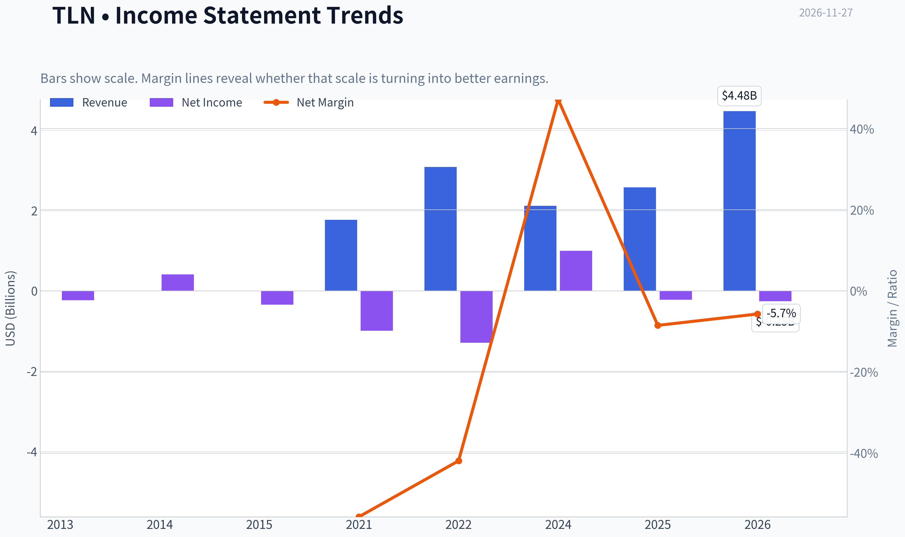

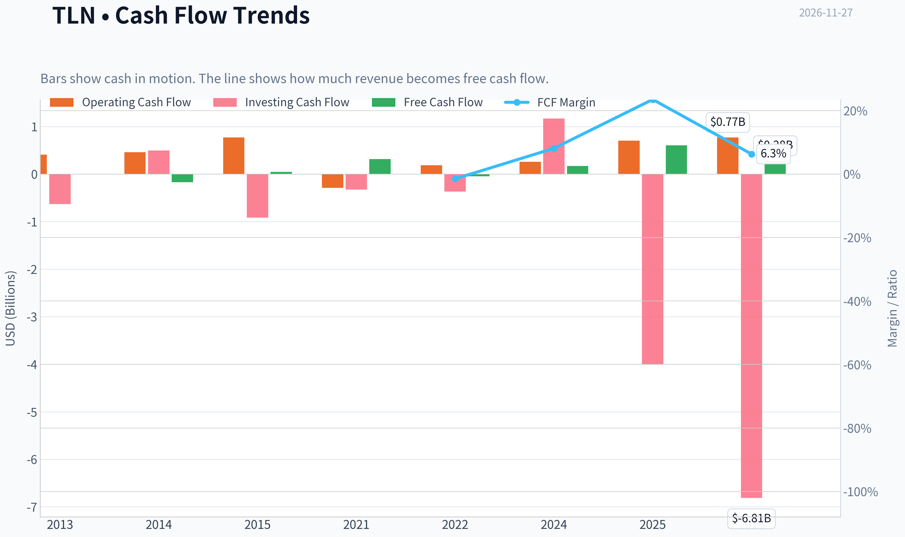

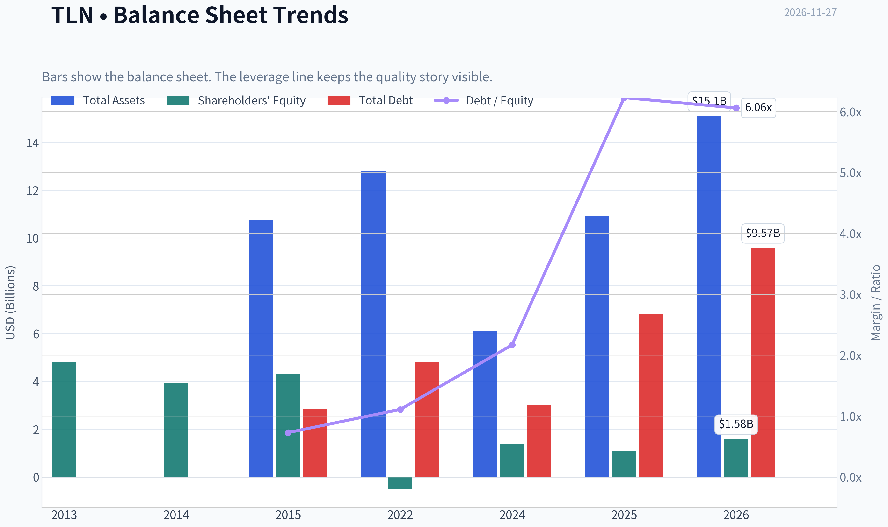

This graph tracks the profitability and return metrics (ROE, ROIC, Margins) of **TLN** over the past decade, highlighting capital efficiency trends.

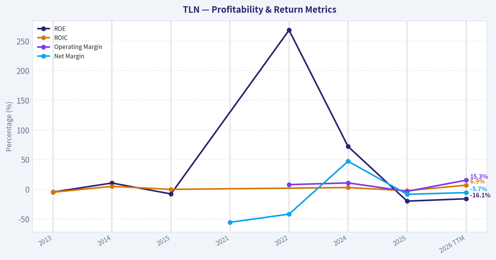

This chart illustrates the financial health of **TLN** over the last 10 years, mapping cash equivalents and free cash flow against total obligations (Debt).

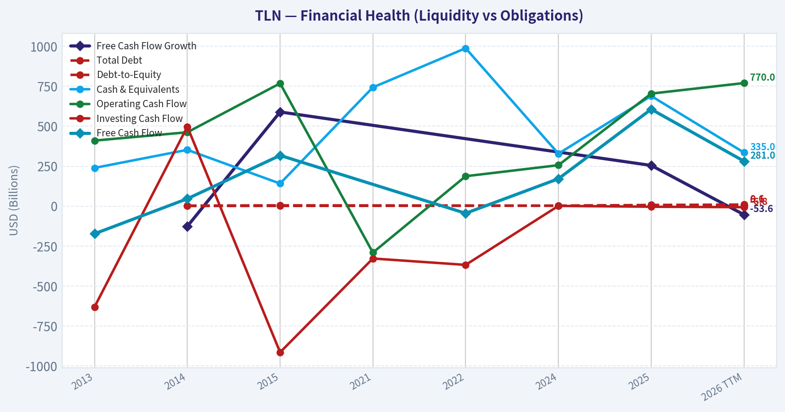

This comparison chart from *Profitability and Earnings Quality* stacks current figures against historical benchmarks for **TLN**, making it easy to see where the company trades relative to its own averages.

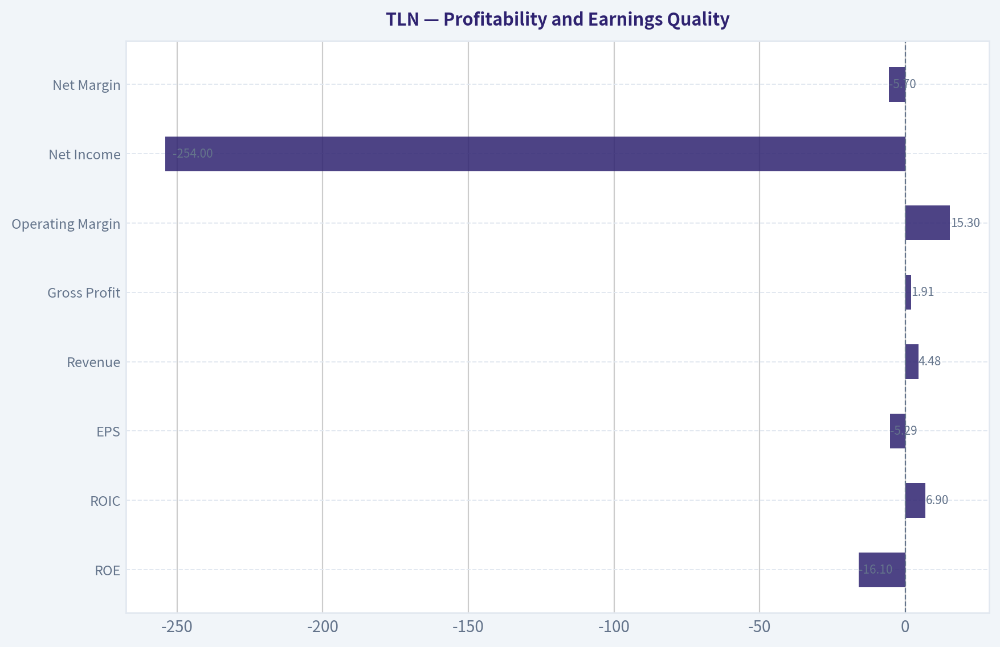

---

### Intrinsic Value Analysis (Buffett)

> *Following Warren Buffett's value investing philosophy: Circle of Competence, Economic Moat, Management Quality, and Margin of Safety.*

#### Intrinsic Value Snapshot

Price is what you pay. Intrinsic value is what the business may be worth based on the cash it can create for owners over time. We show a range, not one magic number.

- Current Price: $352.22
- Value Range (conservative to optimistic across both DCF methods): $-190.00 to $356.29

##### Owner Earnings (Buffett Method)
- Net Income: $-219,000,000.00
- Depreciation & Amortization: $279,000,000.00
- Capital Expenditures: $-98,000,000.00
- Working Capital Changes: $-103,000,000.00
- Owner Earnings: $6,900,000.00

##### Intrinsic Value
###### Buffett Method
Uses owner earnings. Stricter, and usually more conservative.
- Conservative: $-190.00
- Average: $-190.00
- Optimistic: $-182.61
- Discount Rate: 8.3%

###### Cash Flow Method
Uses free cash flow. Better for companies spending heavily today to grow tomorrow.
- Conservative: $18.24
- Average: $18.24
- Optimistic: $356.29
- Discount Rate: 10.0%

ANALYST STANCE: **Bearish**

#### Executive Summary

Talen Energy is a power-generation company benefiting from strong electricity demand, long-term PJM capacity contracts, and potential data-center demand. However, the investment case is heavily dependent on future power prices, contract economics, expansion execution, and substantial leverage.

At $352 per share and a $15.32 billion market capitalization, the valuation implies approximately 34.9% annual growth for ten years under the reverse-DCF analysis. That requirement appears aggressive relative to the company's negative reported ROE, unavailable P/E, approximately $9.5 billion debt load, and cyclical earnings profile. The available DVI estimate is negative at **-$219.14 per share**, indicating that debt and cash-flow assumptions overwhelm estimated equity value under the routed cyclical model.

#### Factor Scorecard

| Factor | Score | Assessment |
|---|---:|---|
| Circle of competence and simplicity | 2.0/5 | The basic model is understandable-own power plants and sell electricity and capacity-but profitability depends on power markets, regulation, fuel economics, contracts, and capital spending. |
| Moat | 2.5/5 | Generation assets, interconnection rights, operating expertise, and contracted capacity create some barriers to entry, but electricity generation remains exposed to market pricing and regulatory conditions. |
| Management and capital allocation | 2.5/5 | Long-term contracts and expansion indicate strategic ambition, but the sizable debt burden increases the consequences of capital-allocation mistakes. |
| Industry structure | 2.5/5 | Electricity infrastructure has high entry barriers, but merchant power is cyclical and capital intensive. Contracted capacity improves visibility without eliminating operating risk. |

**Key Takeaways:** Talen has real infrastructure barriers and improving revenue visibility, but the economics are not as predictable as those of a regulated utility or asset-light compounder. The central weakness is the combination of cyclical cash generation and substantial leverage.

#### Moat Analysis

**Intangible assets and regulatory position:** Talen's operating permits, grid interconnections, power-generation expertise, and access to constrained electricity markets have value. These assets cannot be replicated instantly. However, the company lacks the consumer brand or proprietary intellectual property typically associated with a wide moat.

**Switching costs:** Long-term power and capacity contracts provide contractual visibility, but customers can often source electricity from alternative generators or markets over time. Switching costs are therefore moderate rather than exceptional.

**Cost advantage:** Scale and location may provide cost benefits, particularly in constrained PJM markets. The evidence does not establish a permanent cost advantage across the portfolio.

**Network effects:** The company does not benefit from a classic network effect. Its assets can become more valuable when grid constraints and demand growth increase, but that is an infrastructure scarcity effect rather than a self-reinforcing user network.

**Moat rating: Narrow, 2.5/5.** The moat is based primarily on scarce infrastructure, permits, and grid access. It is meaningful but vulnerable to power-market normalization, regulation, new generation capacity, and execution risk.

#### Financial Summary

| Metric | Latest reported value |
|---|---:|
| Share price | $352 |
| Market capitalization | $15.32 billion |
| Revenue growth, year over year | 22.0% |
| ROE | -20.0% |
| P/E | N/A |
| FCF yield | 4.0% |
| Approximate FCF implied by market capitalization and yield | $613 million |
| Current ratio | 1.28 |
| Reported debt load in coverage | Approximately $9.5 billion |
| DVI estimate | -$219.14 per share |
| Reverse-DCF implied annual growth | Approximately 34.9% for 10 years |

**Key Takeaways:** Revenue growth is strong, but the negative ROE shows that recent growth has not yet translated into attractive accounting returns on equity. A 4% FCF yield implies roughly $613 million of free cash flow against a $15.32 billion equity value, while debt materially increases financial risk.

#### Owner Earnings Calculation

The Buffett-style calculation is:

| Component | Amount |
|---|---:|
| Net income | Not provided in the research summary |
| Depreciation and amortization | Not provided |
| Maintenance capital expenditure | Not separately provided |
| Working-capital investment | Not provided |
| Calculated owner earnings | Not determinable from the available figures |
| FCF-based reference proxy | Approximately $613 million |

**Key Takeaways:** Reported free cash flow provides a useful reference but is not automatically equivalent to owner earnings because power generators require ongoing maintenance and environmental capital spending. The negative owner-earnings valuation output of approximately **-$190 per share** signals that the model views leverage and required reinvestment as overwhelming distributable equity cash flow.

#### Cash Flow and Balance Sheet Assessment

The 4% FCF yield indicates positive cash generation, but the approximately $9.5 billion debt load creates a large claim ahead of equity holders. Interest coverage, net debt, and maintenance-capex detail are not supplied in the current dataset, so the balance sheet cannot be characterized as fortress-strength.

**Balance-sheet strength: 1.5/5.**

The Gate 5 hard floor is **not conclusively tripped**. The available information establishes significant leverage and negative ROE, but it does not establish both a clearly worsening cash-flow trajectory and a solvency red line such as interest coverage below 1.0 times.

#### Management Quality and Capital Allocation

Management appears to be pursuing a high-growth infrastructure strategy:

- Long-term PJM capacity agreements improve revenue visibility.
- More than two gigawatts of contracted capacity reportedly have coverage through multiyear arrangements.
- Expansion toward data-center and other high-demand customers could create substantial reinvestment opportunities.
- The strategy requires significant capital and debt capacity.
- The key question is whether incremental projects generate returns comfortably above the cost of capital after maintenance spending, financing costs, and market normalization.

Management quality assessment: **2.5/5.** The strategy is potentially valuable, but the leverage makes execution and financing discipline especially important. The available information does not demonstrate a long record of per-share value creation through multiple cycles.

#### Three-Scenario DCF Cross-Check

Because a clean owner-earnings figure is unavailable, the following scenarios use the approximately **$613 million FCF proxy**. These are sensitivity calculations, not the headline intrinsic value.

| Scenario | Calculation | Implied enterprise-value-style figure |
|---|---|---:|
| A: No growth | $613 million ÷ 10% | $6.13 billion |
| B: 3% perpetual growth | $613 million x 1.03 ÷ (10% - 3%) | $9.03 billion |
| C: Historical growth | Not calculated because a reliable multiyear FCF growth series is unavailable | N/A |
| Less reported debt, before cash adjustments | Approximately $9.5 billion | Equity residual would be materially pressured |

**Key Takeaways:** Even the 3% growth case produces an asset-value figure below the reported debt load before adding any value for cash or adjusting for the quality of the FCF proxy. This reinforces the conclusion that the equity valuation depends on substantial future growth, asset appreciation, contract expansion, or materially higher cash generation.

#### Intrinsic Value and Margin of Safety

The research pack identifies the DVI estimate-not a DeepValues application value-as **negative $219.14 per share**. The underlying model outputs are:

- Owner Earnings model: approximately **-$190.00 per share**
- FCF model: approximately **$18.24 per share**
- Damodaran FCFF model: approximately **-$219.14 per share**

The reported headline margin of safety of 260.7% is mathematically generated against a negative valuation estimate, but it should not be interpreted as a genuine positive margin of safety. A negative equity-value estimate does not provide a sound basis for concluding that the shares are undervalued.

At $352, the valuation requires approximately 34.9% annual growth for a decade. That is a demanding assumption for a leveraged, cyclical generator, even with strong electricity-demand trends.

#### Final Buffett Scorecard

| Criterion | Weight | Score | Weighted contribution |
|---|---:|---:|---:|
| Moat width and durability | 25% | 2.5 | 0.63 |
| Valuation and margin of safety | 20% | 1.0 | 0.20 |
| Capital returns versus WACC | 15% | 1.5 | 0.23 |
| Business understanding and predictability | 12% | 2.0 | 0.24 |
| Management and capital allocation | 12% | 2.5 | 0.30 |
| Reinvestment runway | 8% | 3.0 | 0.24 |
| Balance-sheet strength | 4% | 1.5 | 0.06 |
| Industry structure | 4% | 2.5 | 0.10 |
| **Total** | **100%** |  | **2.00/5.00** |

**Key Takeaways:** Talen's strongest attribute is its reinvestment runway, supported by electricity-demand growth and contracted capacity opportunities. Its weakest attributes are valuation, leverage, and demonstrated returns on equity. The weighted score falls well below the threshold for a compelling Buffett-style investment.

#### Investment Stance

**Bearish - High conviction.**

Talen may possess valuable generation assets and substantial long-term growth opportunities, but the current valuation appears to require heroic execution and sustained compounding. The combination of a $352 share price, negative ROE, substantial debt, cyclical economics, and negative routed intrinsic-value estimates does not support the market valuation under conservative Buffett-style assumptions.
#### Valuation Bridge

This bridge places the current market price beside each intrinsic value lens so readers can see whether upside depends on one method or shows up across several methods.

| Scenario | Intrinsic Value / Share |
| --- | ---: |
| Buffett Method | $-190.00 |
| Cash Flow Method | $18.24 |
| Damodaran Method | $-219.14 |
| Current Price | $352.22 |

#### Key Takeaways

If one method is far above the others, the upside case depends on a specific modelling assumption. When several methods cluster together, the valuation story is more robust.

#### Valuation Visuals

This comparison chart from *Latest Earnings Snapshot* stacks current figures against historical benchmarks for **TLN**, making it easy to see where the company trades relative to its own averages.

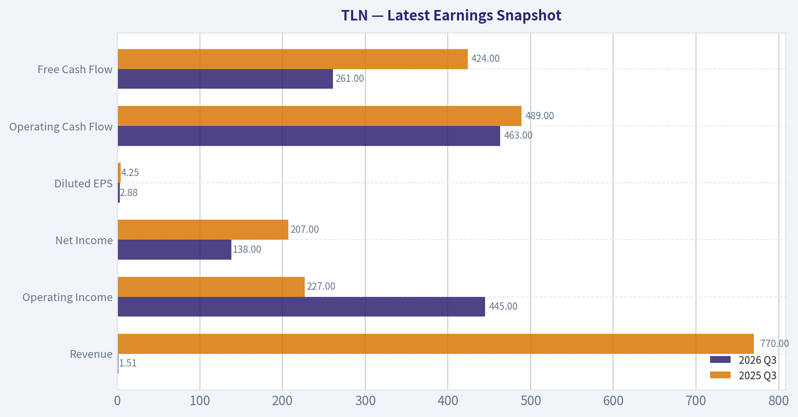

This comparison chart from *Current Metrics Compared With Historical Averages* stacks current figures against historical benchmarks for **TLN**, making it easy to see where the company trades relative to its own averages.

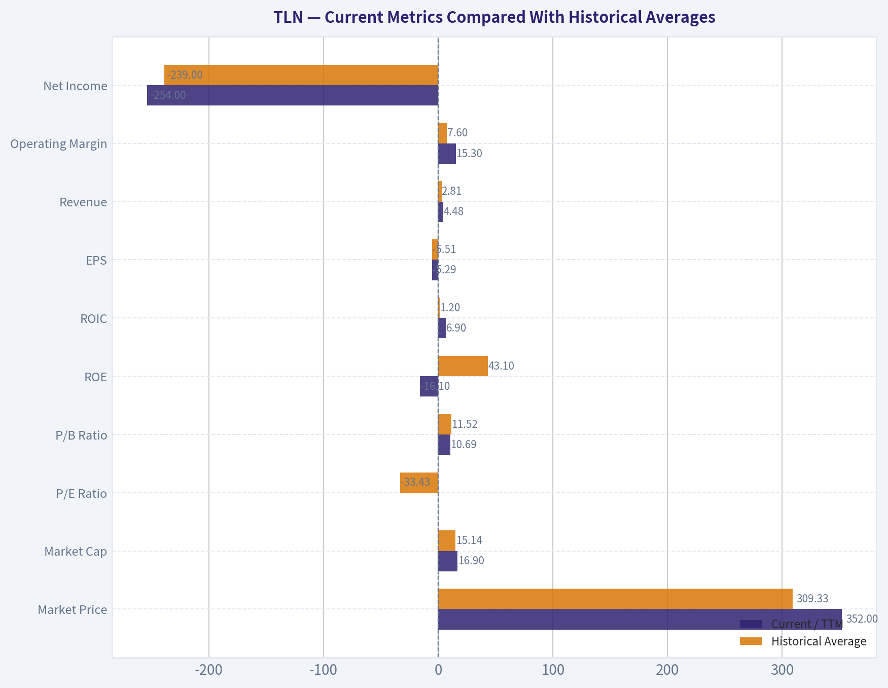

The following chart maps the **TLN** Owner Earnings DCF valuation scenarios (Conservative, Average, Optimistic) to visually represent the margin of safety based on intrinsic value calculations.

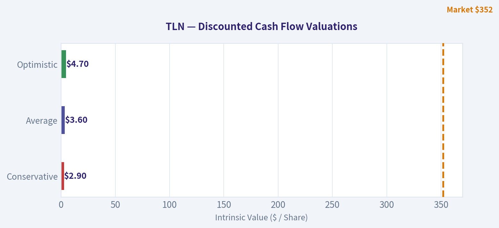

This comparison chart from *Financial Summary* stacks current figures against historical benchmarks for **TLN**, making it easy to see where the company trades relative to its own averages.

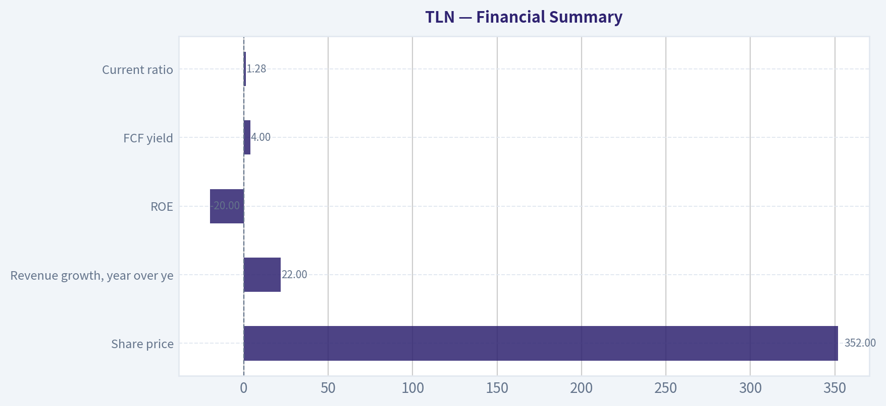

---

### Trend & Growth Analysis (Lynch/Druckenmiller/Fisher)

> *Following Peter Lynch's GARP, Stanley Druckenmiller's macro-aware approach, and Philip Fisher's scuttlebutt methodology.*

ANALYST STANCE: **Neutral**

#### 1. Lynch Classification

**Cyclical / special-situation power generator with fast reported growth.**

Talen Energy is not a clean Lynch "fast grower." Revenue is expanding rapidly, but the business remains exposed to wholesale power prices, PJM capacity markets, debt financing, regulatory conditions, and large capital requirements. The current growth profile is therefore better described as **cyclical growth with an AI-power and capacity-market catalyst**.

#### 2. The Story in Three Bullets

- Talen owns power-generation assets positioned to benefit from rising electricity demand, especially data-center and AI-related load growth.
- Long-term PJM capacity contracts can improve revenue visibility and a more cautious valuation view to purely merchant power pricing.
- The opportunity is offset by approximately **$9.6 billion of debt**, negative trailing earnings, weak returns on equity, and a valuation that already discounts substantial future growth.

#### 3. Fundamental Snapshot

| Metric | Latest reading |
|---|---:|
| Share price | $352 |
| Market capitalization | $15.32 billion |
| TTM revenue | $4.48 billion |
| Reported revenue growth | 22.0% headline; 73.6% in the supplied TTM series |
| Gross margin | 42.7% |
| Operating margin | 15.3% in TTM series |
| Net income | $(254) million |
| Free cash flow | $281 million |
| FCF yield | 4.0% |
| Total debt | $9.57 billion |
| Net debt | $6.12 billion |
| Current ratio | 1.28 |
| Forward P/E | 10.95 |
| Price-to-sales | 3.42x |
| EV/EBITDA | 36.42x |
| P/E and PEG | Not meaningful because trailing earnings are negative |

**Key Takeaways:** Talen has strong reported revenue and operating-cash-flow momentum, but earnings remain negative and leverage is high. The low forward P/E is less informative than the elevated EV/EBITDA and modest 4% FCF yield because debt represents a large portion of enterprise value.

#### 4. TAM Analysis and the 10x Test

The relevant opportunity is not simply the existing independent-power-producer market. It includes:

1. Electricity demand from AI and data centers.
2. PJM capacity and reliability markets.
3. Long-term contracted power supply.
4. Potential expansion, repowering, or co-location of generation assets.

A precise company-specific TAM is not available in the supplied data, so the 10x test must be framed as a capacity and capital-allocation question.

| Test | Assessment |
|---|---|
| Current revenue | $4.48 billion TTM |
| 10x revenue threshold | Approximately $44.8 billion |
| Implied requirement | Major expansion of generation, contracted capacity, or acquired assets |
| Market runway | Potentially large because electricity demand is expanding |
| 10x feasibility | Not demonstrated; constrained by debt, permitting, transmission, and capital intensity |
| TAM quality | Expanding secular market, but monetization is asset- and regulation-dependent |

**Key Takeaways:** The electricity-demand runway is attractive and may be expanding faster than conventional utility demand. However, reaching ten times current revenue would require enormous additional assets and financing; the current balance sheet does not yet prove that Talen can achieve that scale without substantial dilution or leverage.

#### 5. Revenue Growth Trend

| Period or metric | Result | Interpretation |
|---|---:|---|
| 2022 revenue growth | 74.0% | Strong but likely cyclical and comparison-sensitive |
| 2025 revenue | $2.58 billion | Recovery from earlier volatility |
| 2026 TTM revenue | $4.48 billion | Very strong acceleration in the supplied data |
| Headline YoY growth | 22.0% | Strong, but inconsistent with the TTM comparison |
| Three-year revenue CAGR | -5.8% | Indicates that the longer-term trend is not yet consistently compounding |
| TTM FCF growth | -53.6% in one supplied series | Cash conversion is less robust than revenue growth |

**Key Takeaways:** Recent revenue growth is powerful, but the data contains a material discrepancy between the headline 22% growth figure and the supplied TTM growth of 73.6%. The negative three-year revenue CAGR and weaker cash-flow trend suggest that recent growth may reflect power-market normalization, asset changes, or favorable comparisons rather than a fully proven compounding trajectory.

#### 6. Unit Economics and Operating Quality

| Metric | Result | Assessment |
|---|---:|---|
| LTV/CAC | Not applicable | Asset-heavy power generation is not a subscription business |
| NRR | Not applicable | Not a SaaS model |
| Rule of 40 | Not applicable | Revenue growth and FCF margin are not the primary operating framework |
| Gross margin | 42.7% | Strong reported gross economics |
| Operating margin | 15.3% TTM series | Positive operating leverage is evident in the supplied data |
| Net margin | -5.7% | Debt costs, depreciation, and other items remain burdensome |
| Operating cash flow | $770 million | Positive and meaningful |
| Free cash flow | $281 million | Positive, but modest relative to market capitalization |
| Interest coverage | -0.30x supplied metric | Serious concern because reported earnings do not cover interest |

**Key Takeaways:** Talen's operating assets generate substantial cash, but the benefits are not yet translating into positive net income or comfortable interest coverage. The key question is whether contracted cash flows can grow faster than debt service and reinvestment needs.

#### 7. Inflection-Point Assessment

| Potential inflection | Evidence | Status |
|---|---|---|
| Product or asset cycle | Data-center and AI electricity demand | Positive secular catalyst |
| Market-share inflection | More than two gigawatts of PJM capacity agreements reported | Potentially positive |
| Revenue inflection | Strong 2026 TTM revenue growth | Positive, but data consistency is unresolved |
| Margin inflection | Positive operating margin and gross margin | Developing |
| Cash-flow inflection | Positive operating cash flow and FCF | Present, but FCF growth is inconsistent |
| Competitive inflection | Scarcity of reliable, dispatchable power in constrained regions | Potentially favorable |
| Balance-sheet inflection | Debt increased to approximately $9.57 billion | Negative constraint |

**Key Takeaways:** The clearest inflection is the combination of scarce power capacity and long-term contracting. The balance sheet is the principal limiting factor: growth is more valuable if it is contracted and cash-generative, but less valuable if it requires continually increasing leverage.

#### 8. Macro Setup

The macro setup is mixed:

- **Positive:** AI and data-center electricity demand, grid reliability requirements, and constrained PJM capacity markets.
- **Positive:** Long-term contracts can reduce sensitivity to spot power prices.
- **Negative:** High interest rates or credit-spread widening would increase the cost of refinancing approximately $9.6 billion of debt.
- **Negative:** Power markets are cyclical and can normalize after periods of scarcity.
- **Uncertain:** The supplied data does not establish the current rate-cycle phase or the duration of elevated power prices.

Overall, the secular electricity-demand trend is favorable, but Druckenmiller-style macro conviction is limited by financing sensitivity and commodity-like earnings variability.

#### 9. Fisher's 15-Point Assessment

| Fisher criterion | Score / 5 | Evidence |
|---|---:|---|
| Sufficient market potential | 4 | AI and grid demand provide a large runway |
| Management product development | 3 | Contracting and expansion strategy are constructive |
| R&D effectiveness | 2 | Limited evidence; asset ownership is more important than R&D |
| Sales organization | 4 | Multi-gigawatt long-term contracting is a positive signal |
| Worthwhile profit margin | 3 | Gross and operating margins are positive, net margin is negative |
| Improving margins | 3 | Operating margin appears improved, but history is volatile |
| Labor and personnel relations | 3 | Insufficient evidence |
| Executive relations | 3 | Insufficient evidence |
| Management depth | 3 | Insufficient evidence |
| Cost analysis and accounting | 3 | Financial reporting available, but economics are complex |
| Outstanding competitive aspects | 4 | Dispatchable assets, grid access, and contracted capacity |
| Long-range profit outlook | 3 | Attractive demand, but leverage and cyclicality reduce confidence |
| Dilution risk | 3 | No current dilution failure shown; financing needs remain relevant |
| Management candor | 3 | Insufficient evidence |
| Management integrity | 3 | No specific adverse evidence supplied |

**Fisher Score: 47 out of 75 - Average, with substantial evidence gaps.**

**Key Takeaways:** Talen scores well on market potential, contracting capability, and asset-based competitive advantages. It scores poorly on evidence quality around management depth, R&D, personnel, accounting discipline, and long-term profitability, while leverage prevents an outstanding Fisher rating.

#### 10. Valuation Analysis

| Valuation measure | Result | Interpretation |
|---|---:|---|
| Trailing P/E | Not meaningful | Net income is negative |
| Forward P/E | 10.95x | Appears moderate, but depends on forecast earnings materializing |
| PEG | Not available | No reliable positive earnings-growth denominator |
| Price-to-sales | 3.42x | High for a cyclical, capital-intensive power producer |
| EV/EBITDA | 36.42x | Elevated, reflecting substantial debt and/or optimistic operating assumptions |
| FCF yield | 4.0% | Modest given leverage and execution risk |
| Owner earnings estimate | Approximately $7 million | Extremely weak relative to market capitalization |
| FCF-based intrinsic estimate | Approximately $18 per share in supplied model | Highly sensitive to normalization assumptions |
| Reverse DCF | Approximately 34.9% annual owner-earnings growth implied for 10 years | Very demanding |

**Key Takeaways:** Talen's valuation is not obviously expensive on forward P/E, but that metric understates the balance-sheet burden and depends on future earnings. Enterprise-value, cash-flow, and reverse-DCF measures indicate that the current valuation requires sustained growth, successful contracting, and much stronger cash conversion.

#### 11. Valuation Sensitivity

| Scenario | Operating assumption | Valuation implication |
|---|---|---|
| Bear | Power prices normalize, contracts underperform, debt costs remain high | Equity value is vulnerable because cash flow is thin relative to debt |
| Base | Long-term PJM contracts stabilize revenue and operating margins remain positive | Valuation can be supported, but upside requires continued growth and deleveraging |
| Bull | AI-driven power demand accelerates, contracted capacity expands, FCF compounds strongly | Equity value could justify a materially higher multiple, provided leverage does not absorb the gains |
| Key sensitivity | FCF conversion and debt reduction | More important than revenue growth alone |

**Key Takeaways:** The range of outcomes is unusually wide because small changes in power pricing, capacity revenues, interest expense, and capital spending can materially alter equity value. The bull case depends on cash-flow compounding and deleveraging, not merely higher revenue.

#### 12. Growth Investor Scorecard

| Criterion | Weight | Score / 5 | Weighted contribution |
|---|---:|---:|---:|
| Lynch story | 10% | 3.5 | 0.35 |
| TAM and runway | 20% | 4.0 | 0.80 |
| Revenue growth | 20% | 3.5 | 0.70 |
| Unit economics | 15% | 2.5 | 0.38 |
| Competitive position | 10% | 4.0 | 0.40 |
| Management quality | 10% | 3.0 | 0.30 |
| Macro setup | 5% | 3.5 | 0.18 |
| Profitability path | 5% | 2.5 | 0.13 |
| Valuation | 5% | 2.0 | 0.10 |
| **Total** | **100%** |  | **3.34 / 5.00** |

**Key Takeaways:** Talen scores strongest on TAM, strategic assets, and the potential scarcity value of reliable power. It scores weakest on valuation, profitability quality, and unit economics because debt is high and trailing earnings are negative. The aggregate score places the company in the **Neutral** range rather than the high-conviction growth category.

#### 13. Key Catalysts and Risks

| Catalysts | Risks |
|---|---|
| Additional long-term data-center or PJM contracts | Approximately $9.6 billion of debt |
| Sustained AI-driven electricity demand | Refinancing and interest-rate pressure |
| Higher contracted capacity prices | Wholesale power-price normalization |
| Improved FCF conversion | Heavy capital expenditure requirements |
| Deleveraging without dilution | Regulatory, transmission, or permitting delays |
| Operating-margin expansion | Revenue-growth data inconsistency |
| Greater utilization of existing assets | Negative earnings and weak interest coverage |

**Key Takeaways:** The most important catalyst is evidence that new contracts convert into durable free cash flow and balance-sheet improvement. The most important risk is that revenue growth remains cyclical while debt service and capital spending consume most of the economic benefit.

#### Conclusion

Talen has a compelling secular narrative around electricity scarcity, AI demand, and dispatchable generation. However, it currently resembles a **leveraged cyclical growth story**, not a proven compounder. At $352, the evidence supports a **Neutral** stance because the valuation appears to require sustained high growth, stronger free-cash-flow conversion, and successful debt management.

#### Growth & Scorecard Visuals

This comparison chart from *Growth and Cash Generation* stacks current figures against historical benchmarks for **TLN**, making it easy to see where the company trades relative to its own averages.

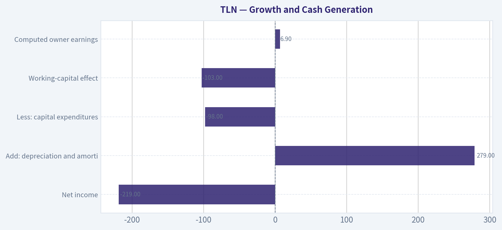

---

### Market Technical Analysis

ANALYST STANCE: **Neutral**

#### TLN technical analysis - Talen Energy Corp.

The data identifies TLN as Talen Energy Corp. on Nasdaq. The latest available trading record is **November 25, 2026**, when TLN closed at **$351.61**. November 26 was a market holiday, and November 27 had no reported trading record in the retrieved dataset, so the analysis does not assume a November 27 closing price.

The selected indicators are the **10 EMA, 50 SMA, 200 SMA, MACD, RSI, Bollinger Upper Band, Bollinger Lower Band, and ATR**. Together, they cover short-, medium-, and long-term trend, momentum, mean-reversion context, and volatility without adding multiple indicators that measure essentially the same feature.

#### Price structure and trend

TLN's price action over the supplied year has been highly volatile and broadly cyclical. The stock began the period near **$394.27**, reached a high of **$449.84** on June 18, and later fell to **$279.77** on September 15. The latest close of **$351.61** is therefore:

- Approximately **10.8% below** the first available close in the period.
- Approximately **21.8% below** the June high.
- Approximately **25.7% above** the September low.

This sequence indicates that the stock has recovered meaningfully from its September trough but has not regained the highs established during the June advance. The recent pattern is better characterized as a volatile recovery and consolidation than as a persistent directional trend.

The medium-term trend has improved. The **50 SMA rose from about $323.49 on October 28 to $342.35 on November 25**, showing that the average price over the intermediate horizon has been moving upward. TLN's latest close is about **$9.26 above** that average, which supports a constructive medium-term interpretation.

The long-term trend is less decisive. The **200 SMA was approximately $349.26** on November 25, placing the latest close only about **$2.35 above** it. This is a narrow margin relative to the stock's volatility. The 200 SMA itself has been almost flat, moving around the high-$348 to low-$349 area, so it is functioning more as a major equilibrium reference than as evidence of a strongly advancing long-term trend.

#### Short-term momentum

The **10 EMA was $354.20** on November 25, slightly above the $351.61 close. This means the latest price was below its short-term average, indicating that the immediate rebound had weakened. The sequence is notable:

- TLN closed above its 10 EMA during the stronger advance from November 5 through November 13.
- The price then moved below the 10 EMA on November 16 and remained below it through November 20.
- The stock recovered above the short-term average on November 23, but the November 24 and 25 closes again sat below it.

This behavior suggests short-term momentum is unstable rather than decisively negative. The price remains above the 50 SMA, but the inability to maintain the investment case above the 10 EMA indicates that recent strength has not yet translated into a clean, sustained acceleration.

#### MACD interpretation

MACD remained positive throughout the most recent period, but its strength deteriorated substantially. It increased from **-0.58 on November 5** to **8.75 on November 13**, confirming strong upside momentum during that rebound. It then declined to:

- **8.15 on November 16**
- **6.04 on November 19**
- **3.57 on November 20**
- **2.67 on November 25**

A positive MACD still indicates that the faster exponential averages remain above the slower ones, but the falling reading shows that the rate of improvement has slowed. This is an important distinction: the indicator has not yet signaled a fully negative trend, but the positive momentum impulse has been fading. The MACD evidence therefore supports a recovery that is losing force rather than a fresh acceleration.

#### RSI and overbought or oversold conditions

The **RSI was 50.08** on November 25, almost exactly neutral. It reached **62.51 on November 12**, reflecting stronger upside momentum, then declined to **44.13 on November 20** before recovering modestly.

This trajectory shows that the recent weakness has not pushed TLN into conventional oversold territory. Conversely, the RSI is also well below the 70 area typically associated with overbought conditions. The indicator therefore provides little evidence for an imminent momentum extreme. Its neutral reading is consistent with the broader picture of consolidation and two-sided price movement.

#### Bollinger Band position and volatility

The latest Bollinger levels were approximately:

- **Upper Band:** $388.27
- **Lower Band:** $317.45
- **Implied middle band:** approximately $352.86
- **Latest close:** $351.61

The close was just below the implied middle band and substantially inside the bands. It was approximately **$36.66 below the upper band** and **$34.16 above the lower band**. This places the stock near the center of its recent trading envelope rather than at an extreme.

The band width was approximately **$70.82**, or about **20% of the middle-band level**, underscoring that TLN remains a high-volatility security. The bands widened during the sharp early-November price swings and remain relatively broad. As a result, small daily movements should not be interpreted in isolation: a move of roughly $15 to $20 can occur within normal recent volatility and does not necessarily establish a new trend.

#### ATR and risk context

ATR increased from **$17.85 on October 28** to **$21.15 on November 25**. At the latest closing price, that represents roughly **6.0% of the share price in average true daily range**.

The volatility expansion is consistent with the large November swings, including the move from **$316.23 on November 5** to **$386.68 on November 12**, followed by a retreat to **$332.92 on November 20**. The elevated ATR makes trend signals less reliable when considered over only a few sessions. It also means that TLN's proximity to its moving averages should be interpreted with tolerance: a close a few dollars above or below an average is not a strong separation for this stock.

#### Overall assessment and valuation implication

The evidence is balanced but finely differentiated:

- **Constructive:** Price remains above the rising 50 SMA and marginally above the 200 SMA.
- **Cautious:** Price is below the 10 EMA, MACD is declining, and the latest close is near the Bollinger middle band rather than demonstrating sustained upper-band strength.
- **Neutral:** RSI is near 50, showing neither oversold stress nor overbought enthusiasm.
- **Material risk factor:** ATR and Bollinger width remain high, indicating substantial uncertainty around short-term valuation.

The technical evidence does not establish a strong directional trend at the latest available price. It supports a stock recovering from a deep September decline while encountering resistance and momentum deterioration during November. From a valuation perspective, the evidence does not independently support a decisive conclusion that the market price near **$351.61** is clearly under- or overvalued; the principal signal is that the valuation remains sensitive to volatility and confirmation from subsequent price behavior.

| Indicator / measure | Latest available reading | Direction or relationship | Interpretation |
|---|---:|---|---|
| Latest close | $351.61 on Nov. 25, 2026 | - | Latest reported price; Nov. 27 data unavailable |
| 10 EMA | $354.20 | Close about $2.59 below | Short-term momentum has weakened and remains unstable |
| 50 SMA | $342.35 | Close about $9.26 above | Medium-term trend has improved |
| 200 SMA | $349.26 | Close about $2.35 above | Long-term trend is near equilibrium, not decisively strong |
| MACD | 2.67 | Down from 8.75 on Nov. 13 | Positive momentum remains, but its rate of improvement is fading |
| RSI | 50.08 | Near neutral | No conventional overbought or oversold condition |
| Bollinger Upper Band | $388.27 | Well above close | No upper-band pressure at the latest reading |
| Bollinger Lower Band | $317.45 | Well below close | No lower-band stress at the latest reading |
| Approximate Bollinger middle band | $352.86 | Close slightly below | Price is near the center of its recent range |
| ATR | $21.15 | Elevated, about 6.0% of price | High volatility reduces the reliability of narrow technical signals |
| One-year range context | $279.77-$449.84 | Close above low, below high | Recovery from September lows, but incomplete recovery from June peak |

**Key Takeaways:** TLN's medium-term structure is improving because the price remains above a rising 50-day average and just above the 200-day average. However, short-term momentum has weakened, MACD has declined from its November peak, and RSI is neutral rather than strongly directional. Wide Bollinger Bands and an ATR near 6% of the share price indicate that volatility remains the dominant uncertainty, supporting a Neutral stance rather than a decisive valuation conclusion.

---

### Options Market Analysis

> *Reading options flow - put/call ratios, IV skew, and unusual activity - to gauge institutional positioning and event-driven risk.*

ANALYST STANCE: **Neutral**

#### TLN Options Flow Report

*Data as of November 27, 2026. The supplied chain contains near-term expirations through December 11, 2026. Trading liquidity appears limited, and no underlying share price or strike-level breakdown was provided.*

#### Put/Call Ratio Analysis

| Expiration | Call OI | Put OI | Put/Call OI | Call Volume | Put Volume |
|---|---:|---:|---:|---:|---:|
| Nov. 27, 2026 | 673 | 1,355 | 2.01 | 731 | 332 |
| Dec. 4, 2026 | 138 | 1,185 | 8.59 | 96 | 38 |
| Dec. 11, 2026 | 46 | 348 | 7.57 | 17 | 50 |
| **Near-term total** | **857** | **2,888** | **3.37** | **844** | **420** |

**Key Takeaways:** The aggregate put/call open-interest ratio of 3.37 is substantially above the approximately 0.7 neutral baseline, indicating substantial downside protection or bearish open interest. However, the volume ratio is only 0.50, meaning call volume exceeded put volume during the measured period. This creates a split signal: bearish-looking existing open interest but relatively more bullish near-term trading activity.

The elevated put open interest is especially pronounced in the December 4 and December 11 expirations. Because open interest does not identify whether contracts were bought or written, the ratio alone cannot distinguish outright bearish speculation from hedging or cash-secured put writing.

#### Implied Volatility Assessment

| Expiration | Call ATM IV | Put ATM IV | Difference: Call minus Put | Interpretation |
|---|---:|---:|---:|---|
| Nov. 27, 2026 | 95.9% | 67.3% | +28.6 pts | Strong call-side premium |
| Dec. 4, 2026 | 69.6% | 57.2% | +12.4 pts | Moderate call skew |
| Dec. 11, 2026 | 69.4% | 56.7% | +12.7 pts | Moderate call skew |

**Key Takeaways:** Implied volatility is elevated, particularly for the November 27 expiration, where call ATM IV approaches 96%. Calls carry materially higher implied volatility than puts across all reported expirations, which is a call-skew pattern and can indicate demand for upside exposure or aggressive short-dated speculation. No confirmed earnings, product, regulatory, or macro catalyst was supplied, so the high IV cannot be attributed to a specific event.

The unusually high same-day call IV may also reflect thin liquidity, wide bid-ask spreads, or isolated contract activity rather than a broad institutional expectation of a large upside move. The data does not provide enough detail to compare IV with TLN's historical percentile.

#### Unusual Options Activity

| Finding | Result |
|---|---|
| Contracts with volume greater than 5 times open interest | None identified |
| Fresh directional activity | No confirmed contracts |
| Smart-money versus retail inference | Not determinable from the supplied data |

**Key Takeaways:** No individual contract met the tool's threshold for unusual activity, so there is no clear evidence of a fresh institutional sweep or concentrated directional bet. The higher call volume may reflect ordinary trading, short-term speculation, or closing activity rather than newly initiated bullish exposure. Confidence in any institutional-flow interpretation is therefore low.

The supplied data also does not include strikes, so individual contracts cannot be classified as in-the-money, at-the-money, or out-of-the-money, and days-to-expiry cannot be assigned contract by contract.

#### Open Interest Concentration and Gamma Levels

| Expiration | Largest Reported OI Category | Call OI | Put OI | Gamma-Wall Assessment |
|---|---|---:|---:|---|
| Nov. 27, 2026 | Puts overall | 673 | 1,355 | Cannot identify strike-specific walls |
| Dec. 4, 2026 | Puts overall | 138 | 1,185 | Cannot identify strike-specific walls |
| Dec. 11, 2026 | Puts overall | 46 | 348 | Cannot identify strike-specific walls |

**Key Takeaways:** Put open interest dominates every reported expiration, with the largest aggregate concentration in the December 4 series. However, strike-level open interest was not provided, so specific gravitational levels, maximum-pain estimates, and gamma walls cannot be calculated. The available data supports an expiration-level conclusion-put-heavy open interest-but not a precise price-level conclusion.

#### Overall Options Sentiment Signal

**Signal: NEUTRAL**

The primary bearish factor is the aggregate put/call open-interest ratio of 3.37, far above the historical neutral reference near 0.7. The primary bullish factor is the 0.50 put/call volume ratio, alongside a consistent call-side IV skew in which calls trade at higher implied volatility than puts.

The most defensible interpretation is **neutral with a short-term upside-speculation bias but substantial downside hedging already embedded in open interest**. The signal has reduced confidence because the chain appears thin, no unusual contracts were detected, and strike-level data is unavailable. The evidence does not establish a strong directional valuation conclusion for TLN.

#### Summary

| Category | Assessment |
|---|---|
| Put/Call Ratio | OI ratio 3.37, materially above neutral; volume ratio 0.50, favoring calls |
| IV Level | Elevated; same-day ATM call IV is 95.9%, with later expirations near 69% |
| Skew Direction | Call skew; call IV exceeds put IV across all reported expirations |
| Unusual Activity | None detected at the volume-greater-than-5-times-OI threshold |
| Overall Signal | **NEUTRAL**, with upside speculation in recent volume offset by heavy put open interest |

**Key Takeaways:** TLN's options market shows a conflict between heavy accumulated put open interest and stronger recent call volume. Call-side IV leadership suggests demand for upside exposure, but the absence of unusual contract activity and the apparent thinness of the chain reduce confidence. Overall, the options data supports a neutral signal rather than a decisive bullish or bearish conclusion.

---

## Research Team Commentary

> *The Research Manager synthesizes the Bull vs Bear debate into action-free commentary. This is a pre-risk view, not the final stance.*

Core takeaway: Talen Energy has potentially valuable, difficult-to-replicate power assets, but the evidence does not yet show that their scarcity value will translate into sufficient free cash flow for common shareholders to support the $352 share price. Rising electricity demand, multiyear PJM capacity coverage, and data-center development provide a credible path to better economics. Against that, negative earnings, a -1.6% ROIC, a -20% ROE, and approximately $9.6 billion of debt make this a leveraged transformation rather than a demonstrated Buffett-style compounder. With no verified intrinsic-value estimate or quantified reverse DCF, valuation support remains unproven.

The strongest bull argument is that existing generation and grid connections may be considerably more valuable than backward-looking accounting returns suggest. New power capacity can take years to permit, finance, connect, and construct. If data-center demand continues to strain regional supply, Talen could obtain higher utilization, more favorable contract terms, and longer revenue visibility. More than two gigawatts of reported multiyear coverage could provide a cash-flow floor, while 22% year-over-year revenue growth indicates that the demand opportunity is not purely hypothetical. If contracts produce attractive returns with limited incremental capital, today's poor reported profitability may materially understate normalized earning power.

The strongest bear argument is that asset scarcity and equity value are not the same thing. Creditors, customers, regulators, maintenance requirements, and expansion spending can absorb much of the economic benefit. Contracts improve predictability, but without prices, escalators, operating obligations, capital requirements, and counterparty details, they do not prove attractive returns. Predictable low-return revenue would not create value. The absolute debt figure is not enough to establish distress without EBITDA, interest coverage, liquidity, and maturity information, but it clearly reduces room for operational or financing errors.

The valuation question is therefore more demanding than whether AI will increase electricity consumption. At $352, investors appear to be underwriting some combination of successful contracting, reliable plant operations, improving margins, positive post-maintenance free cash flow, high-return reinvestment, and eventual deleveraging. The supplied data do not quantify the equity free cash flow needed to justify that price because share count, maintenance capital expenditure, interest expense, debt maturities, and a DeepValues intrinsic-value estimate are missing. That prevents a responsible conclusion that the implied growth hurdle is conservative.

From a Buffett perspective, Talen has elements of a moat, but not yet the demonstrated economics of a wonderful business. Its barriers are physical scarcity, location, and grid access rather than a brand or network effect. Those barriers may endure, but regulatory intervention, new generation, transmission investment, customer concentration, and technological substitution can limit the duration and ownership of scarcity rents. Negative ROIC is particularly important: revenue growth becomes valuable only when incremental returns exceed the cost of capital.

Management's strategic direction appears rational-contract more revenue, serve high-demand customers, and exploit existing interconnection advantages-but the capital-allocation record remains incomplete. The key proof will be whether management can turn favorable industry conditions into rising per-share free cash flow while reducing financial risk. Expansion financed with more leverage, weak contract economics, or substantial dilution could increase enterprise value without creating comparable common-equity value.

This conclusion also reflects lessons from similar thematic infrastructure cases. A favorable industry does not automatically produce a favorable equity outcome; revenue growth should not be confused with value creation; adjusted EBITDA should not substitute for free cash flow after maintenance spending; and asset value must be separated from what remains after debt service. The lack of specific past reflections in the supplied record does not change those recurring analytical safeguards. Recent share-price volatility and call-heavy options activity add no meaningful evidence about intrinsic value.

Over the next one to four quarters, the most important monitoring item is equity-level cash generation. Reported operating cash flow should be reconciled with maintenance capital expenditure, cash interest, taxes, and growth spending. Recurring positive free cash flow would strengthen the thesis; continued reliance on adjusted earnings while cash generation remains weak would undermine it.

Contract disclosures are equally important. The analysis needs capacity covered, duration, pricing or escalation mechanisms, take-or-pay protections, counterparty quality, required capital spending, and expected returns. Additional contracts matter only if they improve risk-adjusted cash economics rather than merely increasing reported revenue.

Debt progress should be measured through net debt, interest coverage, liquidity, maturity timing, refinancing rates, and covenant headroom. Falling leverage funded by internally generated cash would support the view that the transformation is accruing to shareholders. Rising debt, expensive refinancing, or equity issuance to fund expansion would suggest that lenders and new capital providers are capturing much of the opportunity.

Operationally, plant availability, outage frequency, realized power prices, hedging results, and maintenance costs deserve close attention. Data-center announcements should be evaluated against actual energization schedules and contracted economics, not headline megawatts. Finally, ROIC should move decisively toward and eventually above the cost of capital. If revenue and EBITDA rise while ROIC remains negative, the central bull thesis will not have been validated.

Overall, Talen presents a credible scarcity-asset and electricity-demand thesis, but not yet a demonstrated quality compounder or a clearly discounted security. The evidence is insufficient for Bullish because intrinsic-value support and cash returns remain unverified. It is also insufficient for Bearish because the assets, contracts, and demand backdrop could produce a genuine earnings inflection, while current information does not establish distress or unequivocal overvaluation.

Stance: Neutral

---

## Value Investing Team Commentary

> *The Investor translates the research view into an investment thesis before risk review. This is still not the final stance.*

### TLN: Fundamental and Contrarian Commentary

Talen Energy presents an interesting but incomplete equity story. Its generation assets, grid access, and exposure to rising electricity demand may possess scarcity value that is not fully reflected in backward-looking accounting measures. New power capacity can require years of permitting, interconnection work, financing, and construction. In that context, existing assets capable of serving data centers or other high-load customers could become more valuable than their historical returns suggest.

That is the strongest contrarian point. A negative ROIC of -1.6% and negative earnings may partly reflect leverage, interest expense, depreciation, outages, or a business still transitioning toward more favorable contracts. If multiyear arrangements covering more than two gigawatts produce attractive pricing and require limited incremental capital, normalized cash earnings could be materially higher than trailing results imply. The 22% revenue growth indicates that demand is already affecting the business rather than existing solely as an AI-related narrative.

However, the opposing contrarian observation is equally important: markets may be overcapitalizing the scarcity of electricity without adequately distinguishing enterprise value from common-equity value. A power asset can be strategically important while still generating mediocre returns after fuel, maintenance, interest, taxes, required upgrades, and regulatory obligations. Approximately $9.6 billion of debt creates a substantial claim ahead of equity holders. The central question is not whether electricity demand will rise, but how much of the resulting economic surplus will remain after those claims are satisfied.

The long-term contracts improve visibility, but visibility is not the same as value creation. The analysis still lacks essential details on pricing, escalation clauses, take-or-pay terms, counterparty strength, contract duration, maintenance obligations, and incremental capital requirements. A predictable contract with inadequate pricing would reduce volatility without producing acceptable returns. Conversely, high-quality contracts with limited capital intensity could create a meaningful improvement in equity cash flow.

The valuation case remains difficult to verify at $352. No DeepValues intrinsic-value estimate, share-count detail, maintenance-capital figure, debt maturity schedule, or normalized free-cash-flow forecast has been provided. Consequently, a reverse-DCF assessment cannot determine whether the market price assumes reasonable execution or an exceptionally successful combination of contract wins, plant availability, margin expansion, deleveraging, and data-center growth. The 21.8% decline from the June high does not establish undervaluation, just as the 25.7% recovery from the September low does not establish renewed momentum. Options flow is even less relevant to intrinsic value; a 0.50 volume ratio describes short-term positioning rather than business economics.

From a Buffett-style perspective, Talen currently has potentially durable physical barriers but not yet demonstrated economics. Its moat may consist of location, grid interconnection, operating assets, and scarcity of available generation rather than a brand, ecosystem, or network effect. Those advantages could be substantial, but they remain exposed to regulation, transmission expansion, new generation, customer concentration, outages, and contract renegotiation. Negative returns on invested capital are especially significant because revenue growth only creates shareholder value when incremental returns exceed the cost of capital.

The most important evidence would be a sustained reconciliation from operating cash flow to equity free cash flow after maintenance capital spending, cash interest, taxes, and growth investment. The thesis would strengthen if leverage declined through internally generated cash while ROIC moved decisively above the cost of capital. It would weaken if reported EBITDA expanded but cash conversion remained poor, debt continued to rise, refinancing became more expensive, or expansion required meaningful dilution.

Management's strategic direction appears rational: monetize scarce generation, secure longer-duration revenue, serve high-demand customers, and use existing infrastructure more intensively. The unresolved issue is capital allocation. Expansion can increase enterprise value without creating comparable per-share value if creditors, new capital providers, or counterparties capture most of the economics.

### ANALYST STANCE: **Neutral**

Talen has a credible scarcity-asset and electricity-demand thesis, and the market may be underestimating the value of existing grid-connected capacity. However, the evidence does not yet demonstrate that this scarcity will produce sufficient post-debt free cash flow or returns on capital to support the $352 valuation. The current data justify continued analytical scrutiny, but intrinsic-value support remains unverified.

---

## Deep Values Commentary

> *The Risk Management Team debates and the Risk Judge provides the final action-free verdict. This section determines the final Bullish / Neutral / Bearish stance.*

#### Final Stance Scorecard

This scorecard converts the final research view into a weighted decision frame. It does not replace the narrative judgement, but it makes the main drivers of the verdict easier to scan.

| Criterion | Score | Weight | Commentary |
| --- | ---: | ---: | --- |
| Business Quality | 2.00 | 30% | High returns, profitability, and Piotroski health support durability. |
| Valuation Support | 2.33 | 30% | Blends current price against available intrinsic value anchors and valuation ratios. |
| Financial Strength | 2.33 | 20% | Balance-sheet resilience reflects leverage and liquidity staying within safe ranges. |
| Growth Durability | 3.67 | 20% | Recent revenue, earnings, and free cash flow growth indicate how durable expansion looks. |
| TOTAL / FINAL STANCE | 2.50 | 100% | Neutral |

#### Key Takeaways

The weighted score lands at **2.50 / 5.0**, while the final stance remains **Neutral**. This is useful as a quick calibration aid rather than a mechanical signal.

#### Risk Summary

Higher scores indicate more risk pressure. The watch threshold is a simple guardrail: above it, the dimension weighs more heavily on the valuation case and calls for a wider margin of safety.

| Dimension | Current Score | Watch Threshold | Commentary |
| --- | ---: | ---: | --- |
| Business Quality | 4.00 | 3.00 | High returns, profitability, and Piotroski health support durability. |
| Valuation Support | 3.67 | 3.00 | Blends current price against available intrinsic value anchors and valuation ratios. |
| Financial Strength | 3.67 | 3.00 | Balance-sheet resilience reflects leverage and liquidity staying within safe ranges. |
| Growth Durability | 2.33 | 3.00 | Recent revenue, earnings, and free cash flow growth indicate how durable expansion looks. |

#### Key Takeaways

This view helps readers separate *where* the risk sits: valuation, business quality, balance sheet, or growth durability. It is especially useful when the final stance is close to the line between Neutral and Bearish.
