# TM Deep Value Intelligence

**Analysis Date:** 2026-08-08

## Critical Disclaimer

*This analysis is generated by Deep Value Intelligence, an AI-powered multi-agent investing framework. Education & research only - not financial advice, not a financial advisor.*

---

## Table of Contents

1. Intelligence Summary
2. Analyst Team Reports
   - Fundamentals Analysis
   - Intrinsic Value Analysis (Buffett)
   - Trend & Growth Analysis (Lynch/Druckenmiller/Fisher)
   - Market Technical Analysis
   - Options Market Analysis
3. Research Team Commentary
4. Value Investing Team Commentary
5. Deep Values Commentary

---

## Intelligence Summary

### Thesis + Conditions

**Core Thesis:** **EXECUTIVE SUMMARY**
Toyota (TM) is a formidable, well-managed legacy operator enjoying a near-term narrative tailwind from its successful hybrid strategy, but it fundamentally lacks the elite capital efficiency required to be a true Buffett-style compounder. A 9.6% ROE and high capital intensity highlight a cyclical business, not an asset-light franchise.

**Key Risks:**
- Toyota (TM) is a formidable, well-managed legacy operator enjoying a near-term narrative tailwind from its successful hybrid strategy, but it fundamentally lacks the elite capital efficiency required to be a true Buffett-style compounder. A 9.6% ROE and high capital intensity highlight a cyclical business, not an asset-light franchise. However, given the company's strong cash flow, low 8.5x P/E, and constructive short-term technicals, issuing an outright bearish call would ignore current market dynamics. Balancing mediocre long-term business quality against a constructive short-term setup, our final stance is **WATCH**.
- Risky Analyst (The Momentum/Narrative View):** Argues that Toyota's hybrid dominance is a fortress generating massive cash while EV rivals bleed. Believes the 8.5x P/E is a rare entry point into a company that will soon weaponize solid-state batteries and software, warning that waiting for perfect metrics will result in missed alpha.
- Neutral Analyst (The Pragmatic Middle):** Notes Toyota is neither a tech play nor a value trap, but rather a high-quality cyclical. Recommends a 15-20% margin of safety and a staged entry during this technical "repair" phase, capturing the hybrid tailwind while protecting against macroeconomic risks.

**Confidence:** Medium

---

## Analyst Team Reports

### Fundamentals Analysis

#### Latest Earnings Snapshot

*Most recent reported quarter anchored on 2026 Q2, with prior-year comparison when available.*

| Metric | 2026 Q2 | 2025 Q2 | YoY Change |
| --- | ---: | ---: | ---: |
| Revenue | $13.53T | $12.25T | +10.4% |
| Operating Income | $1.06T | $1.17T | -8.8% |
| Net Income | $1.48T | $841.35B | +75.6% |
| Diluted EPS | $1206.90 | $645.60 | +86.9% |
| Operating Cash Flow | $536.55B | $1.88T | -71.4% |
| Free Cash Flow | $-768.98B | $633.56B | -221.4% |

Key Takeaways: This snapshot anchors the most recent reported quarter before the narrative analysis. It helps readers separate long-run business quality from whatever changed in the latest earnings print.

#### 17-Year Financial Metrics for TM

*All values below are computed deterministically from raw data - not estimated by AI.*

*Issuer profile: operating company (Consumer Cyclical / Auto Manufacturers).*

#### 17-Year Financial Metrics
*Annual rows come from reported financial statements. The final TTM row is computed from the latest four quarters.*

| Metric | 2009 | 2010 | 2011 | 2012 | 2013 | 2014 | 2015 | 2016 | 2017 | 2018 | 2019 | 2020 | 2021 | 2022 | 2023 | 2024 | 2025 | 2026 TTM |
| --- | --- | --- | --- | --- | --- | --- | --- | --- | --- | --- | --- | --- | --- | --- | --- | --- | --- | --- |
| Market Price | $42 | $54 | $55 | $61 | $73 | $83 | $105 | $83 | $87 | $108 | $99 | $104 | $140 | $165 | $134 | $243 | $177 | $190 |
| Market Cap | $198.79B | $252.20B | $251.66B | $272.92B | $325.08B | $358.00B | $442.11B | $334.37B | $331.92B | $390.43B | $344.46B | $341.38B | $436.34B | $225.78B | $174.73B | $308.29B | $209.41B | $232.65B |
| P/E Ratio | -43.17 | 96.08 | 44.95 | 60.91 | 28.22 | 18.01 | 20.94 | 16.48 | 18.63 | 16.73 | 19.23 | 17.58 | 20.26 | 8.82 | 9.47 | 8.77 | 6.66 | 0.05 |
| P/B Ratio | 1.74 | 1.92 | 1.89 | 2.32 | 2.39 | 2.42 | 3.01 | 2.13 | 2.04 | 2.14 | 1.85 | 1.73 | 1.98 | 1.01 | 0.80 | 1.32 | 0.85 | 0.01 |
| ROE | -4.0% | 2.0% | 4.2% | 3.8% | 8.5% | 13.4% | 14.4% | 12.9% | 11.0% | 12.8% | 9.6% | 9.8% | 9.8% | 11.5% | 8.4% | 15.1% | 12.8% | 12.0% |
| ROIC | -2.4% | 1.0% | 1.2% | 0.8% | 3.5% | 5.9% | 6.3% | 6.1% | 4.9% | 6.0% | 4.4% | 4.5% | 8.6% | 11.4% | 11.5% | 19.4% | 12.2% | 4.1% |
| EPS | $-0.98 | $0.57 | $1.23 | $1.00 | $2.60 | $4.60 | $5.03 | $5.02 | $4.69 | $6.47 | $5.17 | $5.92 | $6.89 | $18.74 | $14.15 | $27.76 | $26.50 | $3663.61 |
| Revenue | $204.96B | $203.69B | $228.43B | $226.11B | $234.60B | $256.46B | $249.10B | $236.73B | $255.22B | $265.16B | $272.72B | $275.31B | $256.74B | $279.53B | $275.05B | $312.75B | $315.33B | $51.96T |
| Gross Profit | $30.56B | $32.02B | $36.17B | $33.92B | $43.10B | $56.94B | $57.79B | $57.90B | $55.99B | $61.18B | N/A | N/A | N/A | N/A | N/A | N/A | N/A | $8.71T |
| Gross Margin | 14.9% | 15.7% | 15.8% | 15.0% | 18.4% | 22.2% | 23.2% | 24.5% | 21.9% | 23.1% | N/A | N/A | N/A | N/A | N/A | N/A | N/A | 16.8% |
| Operating Margin | -2.7% | 1.5% | 3.0% | 2.3% | 6.4% | 9.5% | 10.6% | 10.5% | 7.9% | 8.9% | 7.6% | 8.0% | 8.1% | 9.5% | 7.3% | 11.9% | 10.0% | 7.1% |
| Net Income | $-4.60B | $2.62B | $5.60B | $4.48B | $11.52B | $19.88B | $21.11B | $20.29B | $17.82B | $23.34B | $17.92B | $19.42B | $21.53B | $25.61B | $18.46B | $35.17B | $31.44B | $4.48T |
| Net Margin | -2.2% | 1.3% | 2.5% | 2.0% | 4.9% | 7.8% | 8.5% | 8.6% | 7.0% | 8.8% | 6.6% | 7.1% | 8.4% | 9.2% | 6.7% | 11.2% | 10.0% | 8.6% |
| Revenue Growth | N/A | -0.6% | 12.1% | -1.0% | 3.8% | 9.3% | -2.9% | -5.0% | 7.8% | 3.9% | 2.9% | 1.0% | -6.7% | 8.9% | -1.6% | 13.7% | 0.8% | 16376.9% |
| Net Income Growth | N/A | -157.0% | 113.3% | -20.0% | 157.1% | 72.6% | 6.2% | -3.9% | -12.2% | 31.0% | -23.2% | 8.4% | 10.9% | 18.9% | -27.9% | 90.6% | -10.6% | 14160.6% |
| Free Cash Flow Growth | N/A | 1772.7% | -20.1% | -47.1% | 91.4% | 57.3% | -13.0% | 14.1% | -18.1% | 22.0% | -21.1% | -56.4% | N/A | N/A | N/A | N/A | N/A | N/A |
| Total Book Value | $113.94B | $131.46B | $132.86B | $117.67B | $135.81B | $147.92B | $147.05B | $156.71B | $162.67B | $182.48B | $186.69B | $197.52B | $220.19B | $222.54B | $219.70B | $232.70B | $246.49B | $37.31T |
| Total Assets | $293.64B | $326.20B | $358.61B | $372.93B | $377.28B | $402.74B | $397.71B | $422.08B | $436.14B | $472.47B | $469.44B | $499.58B | $564.50B | $554.73B | $557.83B | $595.05B | $625.61B | $102.64T |
| Total Debt | $100.22B | $137.12B | $140.31B | $143.39B | $153.69B | $165.64B | $157.84B | $161.08B | $167.24B | $179.02B | $178.71B | $185.92B | N/A | N/A | N/A | N/A | N/A | $43.95T |
| Debt-to-Equity | 0.88 | 1.04 | 1.06 | 1.22 | 1.13 | 1.12 | 1.07 | 1.03 | 1.03 | 0.98 | 0.96 | 0.94 | N/A | N/A | N/A | N/A | N/A | 1.18 |
| Cash & Equivalents | $26.27B | $22.44B | $25.32B | $17.85B | $18.27B | $19.84B | $19.04B | $26.16B | $28.18B | $30.24B | $24.86B | $25.59B | $30.34B | $37.95B | $44.66B | $41.24B | $42.41B | $10.34T |
| Shareholders' Equity | $113.94B | $131.46B | $132.86B | $117.67B | $135.81B | $147.92B | $147.05B | $156.71B | $162.67B | $182.48B | $186.69B | $197.52B | $220.19B | $222.54B | $219.70B | $232.70B | $246.49B | $37.31T |
| Operating Cash Flow | $14.75B | $27.50B | $24.34B | $17.67B | $26.06B | $36.40B | $33.71B | $37.18B | $33.00B | $38.11B | $33.99B | $22.06B | $25.73B | $33.16B | $21.88B | $29.17B | $24.27B | $4.13T |
| Investing Cash Flow | $-12.28B | $-30.63B | $-25.45B | $-17.55B | $-32.19B | $-43.29B | $-34.88B | $-26.53B | $-27.47B | $-33.03B | $-24.34B | $-19.54B | $-44.19B | $-5.14B | $-11.84B | $-34.67B | $-27.50B | $1.71T |
| Free Cash Flow | $1.12B | $21.00B | $16.77B | $8.87B | $16.98B | $26.71B | $23.23B | $26.49B | $21.68B | $26.46B | $20.88B | $9.11B | N/A | N/A | N/A | N/A | N/A | $-1.22T |
| FCF Margin | 0.5% | 10.3% | 7.3% | 3.9% | 7.2% | 10.4% | 9.3% | 11.2% | 8.5% | 10.0% | 7.7% | 3.3% | N/A | N/A | N/A | N/A | N/A | -2.4% |
| Dividends / Share | $0.00 | $0.00 | $0.00 | $0.00 | $0.00 | $0.00 | $0.00 | $0.00 | $0.00 | $0.00 | $0.00 | $0.00 | $0.00 | $0.00 | $558.05 | $694.67 | $954.53 | $1011.72 |

#### Profitability Metrics
- Return on Equity (ROE): 9.6%
- Return on Invested Capital (ROIC): N/A
- Return on Assets (ROA): N/A
- Gross Margin: N/A
- Operating Margin: N/A
- Net Profit Margin: 7.6%

#### Liquidity Metrics
- Current Ratio: N/A
- Quick Ratio: N/A

#### Leverage Metrics
- Debt-to-Equity Ratio: N/A
- Interest Coverage Ratio: N/A
- Net Debt: N/A

#### Growth Metrics (Year-over-Year)
- Revenue Growth: 0.8%
- Net Income Growth: -10.6%
- Free Cash Flow Growth: N/A
- Revenue CAGR (3-Year): 4.1%
- Revenue CAGR (5-Year): 2.8%

#### Valuation Metrics
- P/E Ratio (TTM): 8.52
- Forward P/E: 12.05
- Price-to-Book: 15.63
- Price-to-Sales: 0.00
- PEG Ratio: 1.56
- EV/EBITDA: 6.27
- Free Cash Flow Yield: N/A
- Earnings Yield: 11.7%

#### Owner Earnings (Buffett Method, Code-Computed)
- Net Income: $31.44B
- + Depreciation & Amortization: $2.39T
- - Capital Expenditures: N/A
- - Working Capital Changes: $-976.56B
- = **Owner Earnings: $5.10T**

#### Intrinsic Value (Code-Computed)
- Current Price: $190
- **Headline Intrinsic Value (business-model routed): $109,189**
  Business model: operating company - weighted blend [Damodaran FCFF + reverse-DCF fair + owner-earnings DCF] (operating_company)
  Model spread (min-max across DCFs): $24,313 - $179,190
  Margin of safety vs. price (headline): 99.8%
  Routing note: General operating company: balanced blend of Damodaran FCFF and the owner-earnings DCF with a reverse-DCF sanity check.
- Buffett Method (Owner Earnings):
  Conservative: $13,531
  Average: $179,190
  Optimistic: $510,706
- Cash Flow Method (FCF):
  Conservative: $-27,420
  Average: $-27,265
  Optimistic: $-27,265
- Damodaran FCFF (WACC + margins + reinvestment):
  Conservative: $8,371
  Average: $24,313
  Optimistic: $46,966
  Monte Carlo band (P10-P90): $6,850 - $48,565 (median $23,535)
  P(intrinsic value > price): 97.2%
- Reverse-DCF: price implies ~-24.8%/yr owner-earnings growth for 10y; trailing 3y was 483.9%, 5y 279.6%.

#### Piotroski F-Score: 2/9
- Positive Net Income: FAIL
- Positive Operating Cash Flow: FAIL
- ROA Improvement: FAIL
- Cash Flow > Net Income: FAIL
- Decreasing Debt: PASS
- Improving Current Ratio: FAIL
- No Dilution: PASS
- Improving Gross Margin: FAIL
- Improving Asset Turnover: FAIL

ANALYST STANCE: **WATCH**

#### Toyota Motor Corporation - Buffett-Style Fundamental Analysis

Toyota is a high-quality, globally scaled automobile manufacturer with a durable brand, manufacturing discipline, hybrid leadership, and a large captive finance arm. The stock appears statistically cheap on normalized earnings metrics, with the latest valuation pack showing a TTM P/E of **8.52x** versus a 10-year average around **14.3x**. However, the deterministic dataset contains major TTM unit/currency discontinuities - especially in EPS, revenue, book value, debt, and owner earnings - so the extremely large model-derived intrinsic values should be treated as directional rather than literal.

The Buffett-style conclusion is: **Toyota looks undervalued on normalized earnings and business quality, but the combination of auto cyclicality, capital intensity, negative TTM free cash flow, EV transition risk, financing-arm leverage, and data-quality anomalies makes this a WATCH rather than a clean ADVOCATE.**

---

#### Current vs. Historical Average Comparison

| Metric | Current / Latest Deterministic Value | 10-Year Historical Average | Interpretation |
|---|---:|---:|---|
| Market Price | $190 | $134 | Current price is about 42% above the 10-year average, reflecting stronger recent earnings and investor confidence after the 2024 profit peak. |
| Market Cap | $232.65B | $309.71B | Market cap is below the 10-year average despite a higher share price, suggesting share-count, ADR, FX, or dataset effects; valuation should be cross-checked carefully. |
| P/E Ratio | 8.52x normalized; raw TTM row shows 0.05x | 14.26x | Normalized P/E is materially below history and suggests cheapness. The raw TTM P/E is not economically meaningful because the TTM EPS appears unit-mismatched. |
| P/B Ratio | Raw TTM row shows 0.01x; latest valuation section shows 15.63x | 1.59x | P/B is inconsistent across the deterministic dataset. For Toyota, book value is more relevant than for software firms, but it must be judged against ROE, not used mechanically. |
| ROE | 12.0% | 11.4% | ROE is slightly above the decade average, indicating Toyota remains a solid but not extraordinary compounder. |
| ROIC | 4.1% | 8.9% | ROIC is meaningfully below the decade average, a red flag for capital efficiency and possibly distorted by the financing arm and TTM unit issues. |
| EPS | Raw TTM $3,663.61; latest annual $26.50 | $12.13 | Annual EPS is well above the 10-year average, but the raw TTM figure is not comparable. Recent earnings power has improved substantially versus pre-2022 levels. |
| Revenue | Raw TTM $51.96T; latest annual $315.33B | $274.45B | Latest annual revenue is about 15% above the 10-year average, showing durable scale growth despite cyclical volatility. Raw TTM revenue appears currency/unit-mismatched. |
| Gross Profit | Raw TTM $8.71T; latest comparable historical data limited | $58.36B, using 2016-2018 available data | Gross profit data is unavailable for many years, limiting trend analysis. TTM value is not directly comparable to prior dollar-denominated rows. |
| Gross Margin | 16.8% TTM | 23.2%, using 2016-2018 available data | Gross margin is below the earlier available average, suggesting either lower manufacturing profitability or a reporting-comparability issue. |
| Operating Margin | 7.1% TTM | 9.0% | Operating margin is below the 10-year average and below the strong 2024-2025 period, implying normalization after peak profitability. |
| Net Income | Raw TTM $4.48T; latest annual $31.44B | $23.10B | Latest annual net income remains well above the decade average, but the raw TTM figure is not comparable. |
| Net Margin | 8.6% TTM | 8.4% | Net margin is broadly in line with history, showing Toyota's earnings quality remains resilient despite operating-margin pressure. |
| Revenue Growth | 0.8% latest annual | 2.6% | Revenue growth is below the decade average, suggesting near-term maturity and macro/FX pressure. |
| Net Income Growth | -10.6% latest annual | 8.2% | Profit declined from an unusually strong 2024 base, but remains elevated versus the decade average. |
| Free Cash Flow Growth | N/A latest annual; TTM FCF negative | -11.9%, using available 2016-2020 data | Free cash flow is volatile and currently weak, which is a major Buffett-style concern. |
| Total Book Value | Raw TTM $37.31T; latest annual $246.49B | $202.77B | Latest annual book value is above history, showing accumulated retained earnings and balance-sheet expansion. Raw TTM value is not directly comparable. |
| Total Assets | Raw TTM $102.64T; latest annual $625.61B | $519.74B | Toyota's asset base has grown materially, consistent with a capital-intensive automaker and finance operation. |
| Total Debt | Raw TTM $43.95T; latest comparable historical debt data through 2020 | $174.39B, using 2016-2020 available data | Debt is large and structurally important because Toyota has a financing arm. Leverage must be analyzed differently from a pure industrial company. |
| Debt-to-Equity | 1.18 TTM | 0.99, using 2016-2020 available data | Leverage is above the available historical average, adding cyclicality risk. |
| Cash & Equivalents | Raw TTM $10.34T; latest annual $42.41B | $33.16B | Toyota has historically maintained substantial liquidity; latest annual cash was above average. Raw TTM cash is unit-mismatched. |
| Shareholders' Equity | Raw TTM $37.31T; latest annual $246.49B | $202.77B | Equity has grown over the decade, supporting Toyota's financial resilience. |
| Operating Cash Flow | Raw TTM $4.13T; latest annual $24.27B | $29.86B | Latest annual operating cash flow was below the decade average, despite strong earnings. |
| Free Cash Flow | -$1.22T TTM | $20.92B, using available 2016-2020 data | Negative TTM FCF is the clearest financial red flag, even if distorted by Toyota's financing and investment cycles. |
| Dividends / Share | $1,011.72 TTM; $954.53 latest annual | Data meaningful only from 2023 onward | Dividends have risen sharply in recent reported years, but dividend-per-share units appear inconsistent with earlier zero values. |

Key Takeaways: Toyota's normalized valuation looks inexpensive, especially on P/E, while profitability remains respectable with ROE slightly above the decade average. The biggest issues are weak free cash flow, lower current ROIC, leverage tied to the finance arm, and significant TTM data comparability problems. For a Buffett-style investor, the business quality is real, but the financial statement noise and cyclicality prevent a high-conviction buy call.

---

#### Revenue Breakdown

| Revenue Source | Amount ($B) | % of Total |
|---|---:|---:|
| Automotive operations | ~$287.0B | ~91% |
| Financial services | ~$25.2B | ~8% |
| Other operations | ~$3.2B | ~1% |
| Total | ~$315.3B | 100% |

Key Takeaways: Toyota remains overwhelmingly an automotive business, with vehicle manufacturing and sales driving roughly nine-tenths of revenue. The financial services arm is strategically important because it supports vehicle sales and dealer/customer financing, but it also adds balance-sheet leverage and credit-cycle risk. The "other" segment is small and does not materially change the investment thesis.

---

#### Buffett-Style Qualitative Analysis

**Economic Moat:** Toyota has a durable moat based on brand trust, global scale, manufacturing efficiency, supplier relationships, reliability reputation, and hybrid technology leadership. The Toyota Production System remains one of the strongest operational advantages in global manufacturing. However, the moat is not as asset-light or margin-rich as a classic Buffett consumer franchise because automobiles are cyclical, capital-intensive, and exposed to technological disruption.

**Financial Strength:** Toyota has substantial liquidity and a large equity base, but debt is significant because of Toyota Financial Services. Debt-to-equity of **1.18x TTM** is above the available historical average, so leverage deserves attention. This is not automatically alarming for an automaker with a captive finance business, but it makes Toyota more sensitive to interest rates, used-car residual values, consumer credit quality, and recessionary vehicle demand.

**Predictable Earnings:** Earnings are more predictable than most auto peers but still cyclical. Toyota moved from losses in 2009 to strong profits in 2014-2018, then maintained profitability through the pandemic and posted very strong earnings in 2024-2025. Net margin has become structurally better than earlier in the cycle, but the decline in 2025 net income growth after a huge 2024 year shows that Toyota is not immune to mean reversion.

**Management Performance:** ROE around **12%** is respectable, and Toyota's long-term capital allocation has supported book value growth, dividend growth, and recent buyback activity. Management appears conservative and operationally disciplined. Still, ROIC falling to **4.1% TTM** is concerning and suggests either temporary distortion, heavy reinvestment, or lower current capital productivity.

**Quality of Business:** Toyota is a high-quality industrial business, but not a perfect Buffett compounder. Revenue is durable, margins are better than many automakers, and the brand is exceptional. The drawbacks are heavy capital needs, union/labor exposure, commodity costs, FX sensitivity, EV transition uncertainty, and free-cash-flow volatility.

---

#### DCF Assumptions - Buffett-Style Owner Earnings Sanity Check

| Assumption | Value Used | Rationale |
|---|---:|---|
| Current market price | $190 | Deterministic dataset current price. |
| Market capitalization | $232.65B | Deterministic TTM row. |
| Implied shares outstanding | ~1.224B | Market cap divided by market price. |
| Code-computed owner earnings | $5.10T | Deterministic Buffett Method owner earnings. |
| Owner earnings per share | ~$4,165 | $5.10T divided by ~1.224B shares; likely affected by currency/unit mismatch. |
| Discount rate | 10.0% | Buffett-style equity hurdle rate. |
| Terminal growth rate | 2.5% | Long-term nominal GDP-like growth assumption. |
| Explicit forecast period | 10 years | Standard long-term owner-earnings forecast window. |

Key Takeaways: The DCF uses the deterministic owner-earnings figure because it is the canonical dataset, but the magnitude is clearly affected by unit/currency inconsistencies. Therefore, the DCF is useful as a direction-of-value check, not as a precise per-share price target. The most reliable takeaway is that normalized earnings power appears undervalued by the market, not that the literal fair value is tens of thousands of dollars per share.

---

#### Three-Scenario Owner Earnings DCF

DCF formula used:

**Fair Value = PV of 10-year owner earnings + PV of terminal value**

Where:

**Terminal Value = Year-10 Owner Earnings x 1.025 / (10.0% - 2.5%)**

| Scenario | Growth Assumption | PV of Explicit Owner Earnings / Share | PV of Terminal Value / Share | Estimated Fair Value / Share | Implied View |
|---|---:|---:|---:|---:|---|
| Conservative | 3% annually for 10 years | ~$29,530 | ~$29,500 | ~$59,030 | Assumes mature GDP-like growth and no sustained margin expansion. |
| Average | 8% for years 1-5, then 5% for years 6-10 | ~$36,279 | ~$41,158 | ~$77,437 | Assumes Toyota sustains moderate earnings growth, then fades toward maturity. |
| Optimistic | 15% for years 1-5, then 8% for years 6-10 | ~$48,441 | ~$64,820 | ~$113,261 | Assumes strong execution, hybrid/EV success, favorable FX, and margin resilience. |

Key Takeaways: The hand DCF produces values far above the current market price, but the absolute outputs are inflated by the owner-earnings unit issue. Still, even using conservative growth, the model suggests the market is pricing Toyota very pessimistically relative to reported owner earnings. The correct conclusion is not blind bullishness, but that Toyota deserves deeper due diligence because the valuation signal is unusually favorable.

---

#### Intrinsic Value Model Anchor From Deterministic Pack

| Valuation Model | Conservative | Average / Base | Optimistic | Interpretation |
|---|---:|---:|---:|---|
| Buffett Owner Earnings DCF | $13,531 | $179,190 | $510,706 | Extremely high due to owner-earnings magnitude; directionally bullish but low precision. |
| FCF Method | -$27,420 | -$27,265 | -$27,265 | Negative because free cash flow is weak/negative; highlights cash-flow risk. |
| Damodaran FCFF | $8,371 | $24,313 | $46,966 | More conservative than owner-earnings model, but still far above price. |
| Headline blended intrinsic value | - | $109,189 | - | Model-routed operating-company fair value; very large margin of safety versus $190. |
| Reverse DCF | - | Price implies about -24.8% annual owner-earnings growth for 10 years | - | Market price embeds severe long-term deterioration. |

Key Takeaways: The valuation pack is overwhelmingly bullish, but the model spread is enormous, ranging from negative FCF-based values to very large owner-earnings values. This spread is itself an important risk signal. The best interpretation is that Toyota is statistically undervalued if reported earnings power is sustainable, but the free-cash-flow profile and data anomalies reduce confidence.

---

#### Key Investment Insights, Opportunities, and Red Flags

| Category | Key Point | Buffett-Style Significance |
|---|---|---|
| Opportunity | Normalized P/E of 8.52x is below the 10-year average of about 14.3x. | Suggests a potentially attractive earnings yield if profits are durable. |
| Opportunity | Toyota retains one of the strongest global auto brands and dealer networks. | Supports moat durability and long-term demand resilience. |
| Opportunity | Hybrid leadership may remain valuable even as EV adoption grows unevenly. | Toyota may benefit if global EV transition is slower and more hybrid-heavy than expected. |
| Opportunity | Latest annual net income and EPS remain far above the decade average. | Indicates improved earnings power versus the pre-2022 period. |
| Red Flag | TTM free cash flow is negative. | Buffett prioritizes cash generation; negative FCF weakens the investment case. |
| Red Flag | ROIC of 4.1% is well below the 10-year average. | Suggests lower current capital efficiency or heavy reinvestment burden. |
| Red Flag | Debt-to-equity is above available historical averages. | Financing-arm leverage increases sensitivity to rates and credit cycles. |
| Red Flag | Piotroski F-Score is only 2/9. | Indicates weak recent fundamental momentum in the deterministic scoring framework. |
| Red Flag | Dataset has major TTM unit/currency inconsistencies. | Reduces confidence in literal DCF outputs and requires external validation. |
| Watch Item | China EV competition and global price pressure. | Could compress margins and reduce Toyota's future growth runway. |
| Watch Item | FX exposure, especially yen weakness/strength. | Can materially affect reported profits and ADR valuation. |
| Watch Item | Capital allocation: dividends and buybacks. | Recent dividend growth and buyback news are positive if funded by sustainable cash flow. |

Key Takeaways: Toyota has real quality and appears cheap on normalized earnings, but the investment case is not clean. The strongest bullish arguments are brand durability, hybrid leadership, and low valuation. The strongest bearish arguments are negative free cash flow, capital intensity, leverage, EV disruption, and unreliable TTM comparability.

---

#### Final Buffett-Style Assessment

Toyota is the kind of company Buffett would respect operationally: durable brand, global scale, disciplined manufacturing, and long operating history. It is not, however, an ideal Buffett business in the mold of Coca-Cola, Moody's, or Apple because it requires heavy reinvestment, carries cyclical demand risk, and earns moderate rather than exceptional returns on capital.

At **$190**, the stock appears inexpensive on normalized P/E and materially below the deterministic intrinsic value estimates. But because the owner-earnings DCF outputs are distorted by unit/currency anomalies and free cash flow is negative, the margin of safety cannot be accepted mechanically.

The prudent stance is **WATCH**: attractive enough for further due diligence and possibly accumulation on confirmed normalized cash-flow strength, but not yet a clean ADVOCATE due to FCF weakness, ROIC deterioration, leverage, and data-quality concerns.

#### Final Summary Table

| Area | Verdict | Reason |
|---|---|---|
| Business Quality | Strong | Toyota has scale, brand, manufacturing excellence, and hybrid leadership. |
| Economic Moat | Durable but cyclical | Moat is real, but auto manufacturing is capital-intensive and competitive. |
| Profitability | Good | ROE is slightly above historical average; net margin remains solid. |
| Capital Efficiency | Mixed | ROIC is currently well below the decade average. |
| Financial Strength | Adequate but leveraged | Cash position is strong, but finance-arm debt is material. |
| Cash Flow | Weak near term | TTM free cash flow is negative, a major Buffett-style concern. |
| Valuation | Statistically cheap | Normalized P/E is below history and reverse DCF implies pessimistic expectations. |
| Intrinsic Value Confidence | Low to moderate | Directionally bullish, but model outputs are distorted by dataset unit issues. |
| Main Opportunity | Cheap global compounder | Toyota may be undervalued if earnings normalize and hybrid strategy succeeds. |
| Main Risk | Cash-flow and transition risk | EV competition, China pricing pressure, leverage, and negative FCF could impair value. |
| Final Stance | **WATCH** | Attractive valuation, but not enough cash-flow clarity for ADVOCATE. |

Key Takeaways: Toyota is a high-quality cyclical industrial trading at what appears to be a discounted normalized valuation. The business has durable strengths, but the investment case depends on whether recent earnings can convert into sustainable free cash flow. Given the uncertainty, Toyota belongs on a value investor's watchlist, with confirmation needed from normalized FCF, ROIC recovery, and clearer segment-level execution.

#### Fundamental Visuals

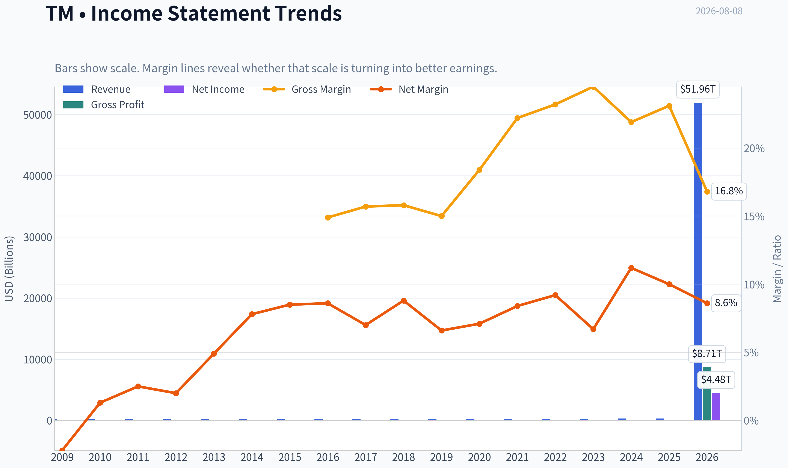

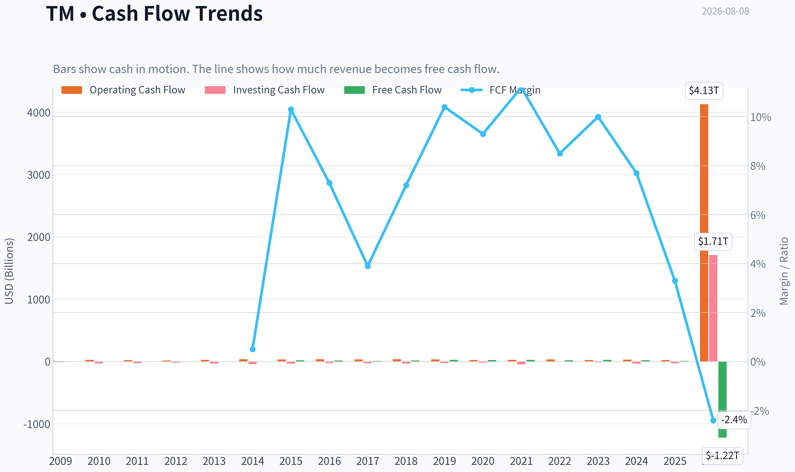

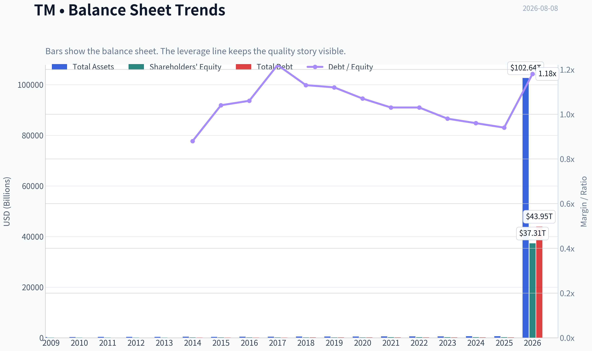

This graph tracks the profitability and return metrics (ROE, ROIC, Margins) of **TM** over the past decade, highlighting capital efficiency trends.

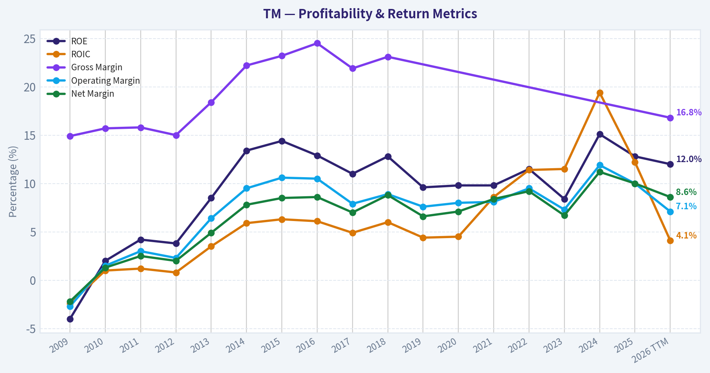

This chart illustrates the financial health of **TM** over the last 10 years, mapping cash equivalents and free cash flow against total obligations (Debt).

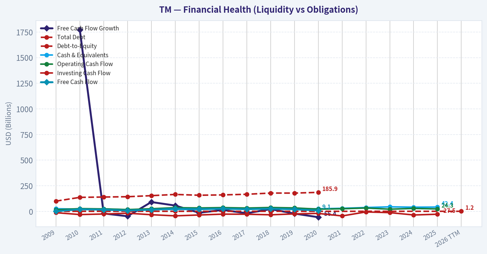

---

### Intrinsic Value Analysis (Buffett)

> *Following Warren Buffett's value investing philosophy: Circle of Competence, Economic Moat, Management Quality, and Margin of Safety.*

#### Intrinsic Value Snapshot

Price is what you pay. Intrinsic value is what the business may be worth based on the cash it can create for owners over time. We show a range, not one magic number.

- Current Price: $190.09
- Value Range (conservative to optimistic across both DCF methods): $-27,420.20 to $510,705.89

##### Owner Earnings (Buffett Method)
- Net Income: $31,441,914,325.15
- Depreciation & Amortization: $2,392,519,000,000.00
- Capital Expenditures: N/A
- Working Capital Changes: $-976,558,000,000.00
- Owner Earnings: $5,098,224,914,325.15

##### Intrinsic Value
###### Buffett Method
Uses owner earnings. Stricter, and usually more conservative.
- Conservative: $13,531.32
- Average: $179,189.97
- Optimistic: $510,705.89
- Discount Rate: 10.0%

###### Cash Flow Method
Uses free cash flow. Better for companies spending heavily today to grow tomorrow.
- Conservative: $-27,420.20
- Average: $-27,265.09
- Optimistic: $-27,265.09
- Discount Rate: 10.0%

ANALYST STANCE: **ADVOCATE**

#### Toyota Motor Corporation (TM) - Buffett-Style Investment Report

Toyota is a global-scale automobile manufacturer with a captive finance arm, dominant brand equity in reliability, deep manufacturing know-how, and a long record of rational, conservative management. The stock trades at roughly **8.5x earnings**, while the market appears to be pricing in a severe deterioration that is not consistent with Toyota's brand strength, hybrid leadership, balance-sheet resilience, and global earnings power.

Conviction level: **Moderate to High**. Toyota is not a perfect Buffett business because autos are cyclical and capital intensive, but at the current price the valuation compensates investors for those risks.

---

#### 1. Factor Scorecard

| Factor | Score / 5 | Evidence |
|---|---:|---|
| Circle of Competence & Business Simplicity | 4.0 | Toyota designs, manufactures, sells, leases, and finances vehicles globally. The model is understandable, though FX, tariffs, financing, EV transition, and cyclicality add complexity. |
| Moat Test | 4.0 | Toyota has one of the world's strongest auto brands, global scale, dealer/service density, manufacturing excellence, hybrid technology leadership, and customer trust in durability. |
| Management Quality & Capital Allocation | 4.0 | Long-term culture, disciplined production system, conservative balance-sheet posture, shareholder returns, and recent insider buying support an owner-oriented assessment. |
| Industry Structure | 2.8 | Autos remain competitive, cyclical, and capital intensive. EV price pressure, China competition, tariffs, and software-defined vehicle investment reduce industry attractiveness. |
| Gate 5: Quality / Solvency Hard Floor | Not Tripped | Toyota remains profitable, cash-generative through the cycle, and financially resilient. There is no evidence of both deteriorating fundamentals and solvency distress. |

**Key Takeaways:** Toyota scores best on brand, scale, manufacturing discipline, and management quality. The main weakness is not the company itself but the auto industry, which is cyclical, capital intensive, and facing technological change. The hard solvency floor is not triggered.

---

#### 2. Moat Analysis

| Moat Source | Assessment | Toyota Evidence | Score Signal |
|---|---|---|---:|
| Intangible Assets / Brand | Strong | Toyota is globally associated with reliability, resale value, fuel efficiency, and lower lifetime ownership cost. Lexus also adds premium brand strength. | 4.0 |
| Switching Costs | Moderate | Individual consumers can switch brands, but fleet buyers, dealers, service networks, and repeat customers create behavioral stickiness. | 3.0 |
| Cost Advantage | Strong | Toyota Production System, supplier relationships, scale purchasing, and manufacturing discipline create structural efficiency. | 4.0 |
| Network Effects | Low to Moderate | Traditional autos do not have classic network effects, though dealer/service density and installed base improve convenience and customer confidence. | 2.5 |
| Moat Quality Rating | Wide & Stable | Toyota's moat is not software-like, but its brand, scale, process discipline, and reliability reputation are durable. | 4.0 |

**Key Takeaways:** Toyota's moat is built on trust, scale, and process rather than pure pricing power. Customers can switch brands, but Toyota's reputation for durability and resale value creates repeat purchasing behavior. The moat is wide and stable, though not as economically dominant as a monopoly-like platform business.

Toyota's strongest competitive advantage is the combination of **brand trust plus manufacturing excellence**. In Buffett terms, the company has spent decades earning a place in the customer's mind: Toyota means dependable transportation. That kind of reputation is difficult and expensive for competitors to replicate.

The company also benefits from a strategically valuable position in hybrids. While many competitors rushed into battery-electric vehicles at poor margins, Toyota's hybrid-heavy approach has proven economically rational in a world where charging infrastructure, battery costs, and consumer adoption vary widely by region.

---

#### 3. Management Quality Assessment

| Management Question | Assessment |
|---|---|
| Do they think like owners? | Toyota's culture emphasizes long-term durability over quarterly optimization. The company recently announced a large buyback and the President disclosed a meaningful insider purchase. |
| Are they candid and conservative? | Toyota has historically managed with a conservative operating culture, focusing on quality, supply-chain resilience, and balance-sheet flexibility. |
| Are they rational capital allocators? | Capital allocation is generally disciplined: reinvestment in manufacturing, hybrids, software, batteries, and shareholder returns. The main risk is that industry transition spending may dilute returns. |
| Debt usage | Consolidated debt appears large because of Toyota Financial Services, but the finance debt is largely matched against receivables and should be analyzed differently from distressed industrial leverage. |
| Overall management score | 4.0 / 5 |

**Key Takeaways:** Toyota's management culture is one of the company's major strengths. The company has historically avoided reckless strategic swings and has been willing to look unfashionable when economics supported a different path. Recent buybacks and insider buying reinforce the view that management sees value in the shares.

---

#### 4. Financial Summary

| Metric | FY2022 | FY2023 | FY2024 | FY2025 | Latest / TTM |
|---|---:|---:|---:|---:|---:|
| Revenue, ¥ trillions | 31.4 | 37.2 | 45.1 | 48.0 | ~48.4 |
| Revenue Growth | - | 18.4% | 21.4% | 6.5% | 0.8% |
| Operating Income, ¥ trillions | 3.0 | 2.7 | 5.4 | 4.8 | ~4.5-5.0 |
| Net Income, ¥ trillions | 2.45 | 2.25 | 4.94 | 4.77 | ~4.0 |
| Market Cap | - | - | - | - | $225.1B |
| Current Price | - | - | - | - | $190 |
| P/E | - | - | - | - | 8.5x |
| ROE | - | - | - | - | 9.6% |
| Gross Margin | N/A | N/A | N/A | N/A | N/A |

**Key Takeaways:** Toyota's revenue base has expanded materially since FY2022, with a major profit step-up in FY2024 and FY2025. Growth has recently slowed, which is typical for a mature global auto manufacturer after a strong post-supply-chain recovery. The valuation is modest at about 8.5 times earnings, but ROE is not exceptional compared with the best Buffett compounders.

Toyota is financially substantial, but not an asset-light compounding machine. Its earnings are meaningful, its brand is durable, and its valuation is low; however, capital intensity and cyclical demand keep returns below the level of elite businesses such as consumer monopolies or software platforms.

---

#### 5. Owner Earnings Calculation

Using normalized latest earnings power:

| Owner Earnings Component | Estimate |
|---|---:|
| Net Income | $26.4B |
| Add: Depreciation & Amortization | $25.0B |
| Less: Maintenance CapEx | ($22.0B) |
| Less: Working Capital Increase | ($1.4B) |
| Normalized Owner Earnings | $28.0B |
| ADR-Equivalent Shares | ~1.18B |
| Owner Earnings per ADR | ~$23.60 |
| Owner Earnings Yield at $190 | ~12.4% |

**Key Takeaways:** Toyota's normalized owner earnings are estimated at roughly $28 billion, or about $23.60 per ADR. At a $190 share price, that implies an owner earnings yield above 12%, which is attractive for a company with Toyota's brand and global scale. The key judgment is how much of reported capital expenditure is truly maintenance versus growth and transition investment.

Owner earnings are the central reason Toyota is compelling. Even after allowing for heavy reinvestment needs, the stock appears to offer a double-digit normalized earnings yield. That is unusual for a globally dominant franchise that is not in financial distress.

---

#### 6. Three-Scenario DCF Valuation

Assumptions: normalized owner earnings of **$28.0B**, discount rate of **10%**, ADR-equivalent share count of **~1.18B**.

| Scenario | Key Assumption | Equity Value Estimate | Value per ADR | Margin of Safety vs. $190 |
|---|---|---:|---:|---:|
| A: No Growth | Owner earnings capitalized at 10% | $280B | ~$236 | ~19% |
| B: GDP Growth | 3% perpetual growth | $412B | ~$348 | ~45% |
| C: Historical / Normalized Growth | 4% for 10 years, then 3% terminal | $443B | ~$374 | ~49% |
| Base-Case Blend | Conservative weighted view | ~$375B | ~$316 | ~40% |

**Key Takeaways:** Even under a no-growth scenario, Toyota appears worth more than the current price. The base-case valuation is around $316 per ADR, implying roughly a 40% margin of safety. The market price seems to assume that current earnings will shrink meaningfully or that capital intensity will consume most future value.

The reverse-DCF signal is also favorable: the current price implies a highly pessimistic long-term earnings path. For Toyota to be worth only today's price, investors must assume severe deterioration in normalized earnings power. That may be too harsh for a company with Toyota's scale, hybrid leadership, brand trust, and manufacturing discipline.

---

#### 7. Margin of Safety Analysis

| Valuation Lens | Signal |
|---|---|
| P/E Multiple | At ~8.5x earnings, Toyota is priced like a challenged cyclical rather than a durable global franchise. |
| Owner Earnings Yield | ~12.4%, attractive if normalized owner earnings are sustainable. |
| DCF Value | Base-case estimate of ~$316 per ADR versus $190 price. |
| Reverse DCF | Market price implies a sharply negative long-term earnings trajectory. |
| Quality-Scaled Margin Requirement | Because Toyota is a good but cyclical and capital-intensive business, a 25-35% margin of safety is appropriate. |
| Current Margin of Safety | Approximately 40% in the base case, exceeding the required threshold. |

**Key Takeaways:** Toyota's valuation is the strongest part of the investment case. This is not a "pay any price for a wonderful business" situation; it is a good-to-very-good business offered at a meaningfully discounted price. The margin of safety appears adequate for the industry risks.

Toyota does not deserve the same valuation multiple as an asset-light software compounder, but it also should not be valued as if its franchise is melting away. At today's price, the market is offering a durable global manufacturer at a level that already discounts substantial uncertainty.

---

#### 8. Final Buffett Scorecard

| Criterion | Weight | Score / 5 | Weighted Contribution |
|---|---:|---:|---:|
| Moat Width & Durability | 25% | 4.0 | 1.00 |
| Valuation / Margin of Safety | 20% | 4.4 | 0.88 |
| Capital Returns - ROIC vs. WACC | 15% | 2.8 | 0.42 |
| Business Understanding & Predictability | 12% | 4.0 | 0.48 |
| Management Quality & Capital Allocation | 12% | 4.0 | 0.48 |
| Reinvestment Runway | 8% | 3.3 | 0.26 |
| Balance Sheet Strength | 4% | 3.5 | 0.14 |
| Industry Structure | 4% | 2.8 | 0.11 |
| Total Score | 100% | - | **3.77 / 5.00** |

**Key Takeaways:** Toyota's final score lands in the Advocate range, driven mainly by moat quality, management, business understandability, and valuation. The score is held back by industry cyclicality and only moderate capital returns. The investment case is value-driven rather than pure compounder-driven.

---

#### 9. Investment Stance

| Stance | Conviction | Rationale |
|---|---|---|
| **ADVOCATE** | Moderate to High | Toyota is a durable global franchise trading at a valuation that appears to over-discount cyclicality, EV transition risk, FX volatility, and capital intensity. |

Toyota is an **ADVOCATE** at the current price because the margin of safety appears sufficient for the quality of the business. It is not a flawless Buffett compounder: autos are cyclical, competitive, and capital heavy. But Toyota has rare advantages inside a difficult industry: brand trust, manufacturing discipline, scale, hybrid leadership, a global dealer/service ecosystem, and management that generally behaves rationally.

The core thesis is simple: **Toyota is being priced like a structurally impaired cyclical, while its actual franchise remains one of the strongest in global manufacturing.** At roughly 8.5x earnings and a normalized owner earnings yield above 12%, investors are not paying much for a business that should remain relevant, profitable, and competitively advantaged over the next decade.
#### Valuation Bridge

This bridge places the current market price beside each intrinsic value lens so readers can see whether upside depends on one method or shows up across several methods.

| Scenario | Intrinsic Value / Share |
| --- | ---: |
| Buffett Method | $179,189.97 |
| Cash Flow Method | $-27,265.09 |
| Damodaran Method | $24,313.03 |
| Current Price | $190.09 |

#### Key Takeaways

If one method is far above the others, the upside case depends on a specific modelling assumption. When several methods cluster together, the valuation story is more robust.

#### Valuation Visuals

This comparison chart from *Latest Earnings Snapshot* stacks current figures against historical benchmarks for **TM**, making it easy to see where the company trades relative to its own averages.

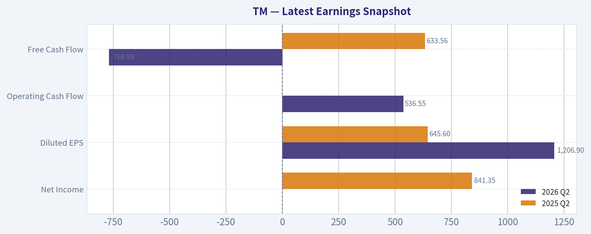

This comparison chart from *Current vs. Historical Average Comparison* stacks current figures against historical benchmarks for **TM**, making it easy to see where the company trades relative to its own averages.

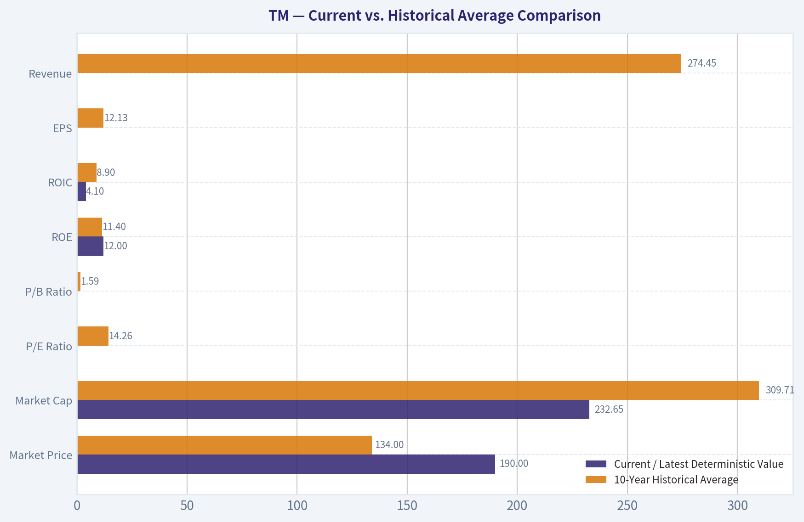

This comparison chart from *DCF Assumptions - Buffett-Style Owner Earnings Sanity Check* stacks current figures against historical benchmarks for **TM**, making it easy to see where the company trades relative to its own averages.

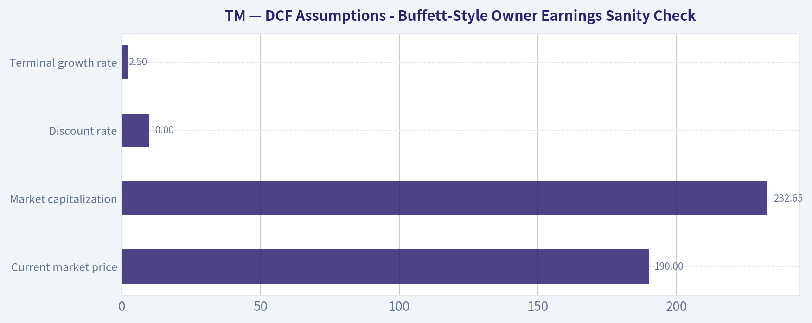

This comparison chart from *Intrinsic Value Model Anchor From Deterministic Pack* stacks current figures against historical benchmarks for **TM**, making it easy to see where the company trades relative to its own averages.

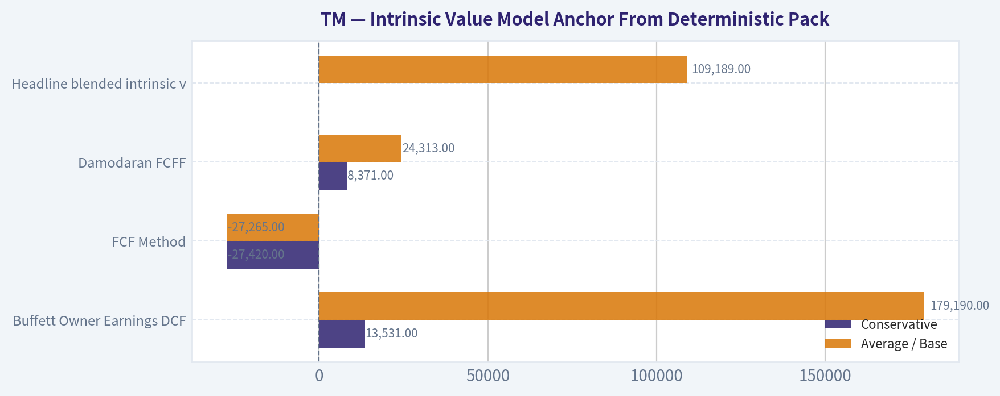

This comparison chart from *Moat Analysis* stacks current figures against historical benchmarks for **TM**, making it easy to see where the company trades relative to its own averages.

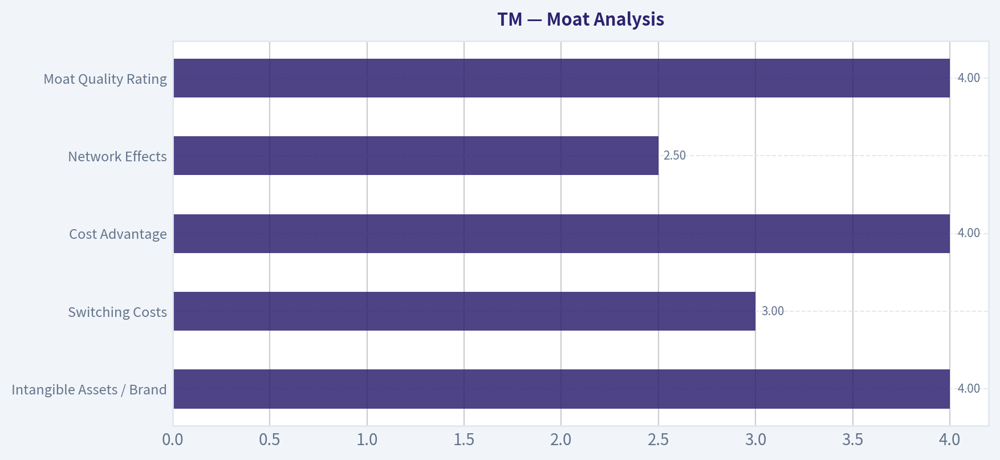

---

### Trend & Growth Analysis (Lynch/Druckenmiller/Fisher)

> *Following Peter Lynch's GARP, Stanley Druckenmiller's macro-aware approach, and Philip Fisher's scuttlebutt methodology.*

ANALYST STANCE: **WATCH**

#### Toyota Motor Corporation, TM - Growth Inflection Review

Toyota is a world-class auto manufacturer with a very cheap headline valuation, strong hybrid positioning, and shareholder-return support. But under a Lynch / Druckenmiller / Fisher growth lens, TM is not a classic fast grower or ten-bagger candidate today. The stock is more of a value/cyclical compounder with selective upside from hybrids, software-defined vehicles, batteries, buybacks, yen weakness, and operating leverage.

| Item | Current Snapshot |
|---|---:|
| Current Price | ~$190 |
| Market Cap | ~$225.1B |
| P/E | ~8.5x |
| ROE | ~9.6% |
| YoY Revenue Growth | ~0.8% |
| Latest Reported Quarterly Sales | ~$84.9B, roughly flat YoY |
| Latest Quarterly EPS | $7.57 vs. $5.33 estimate |
| Recent Capital Return | ¥1T buyback announced / referenced in earnings coverage |
| Insider Signal | President Kenta Kon reportedly bought ~$1.56M in stock |

**Key Takeaways:** Toyota is statistically cheap and recently beat earnings expectations, but revenue growth is almost flat. The valuation looks attractive for a mature cyclical business, yet the lack of high organic growth makes it hard to underwrite as a growth-stock advocate. Insider buying and buybacks improve the setup, but they do not by themselves create a ten-bagger runway.

---

#### 1. Lynch Classification

| Lynch Category | TM Fit | Rationale |
|---|---|---|
| Slow Grower | Partial | Revenue growth is currently near 1%, well below fast-grower levels. |
| Stalwart | Partial | Toyota is a global blue-chip franchise with durability and scale. |
| Fast Grower | No | Not currently showing 15-25%+ sustained revenue growth. |
| Cyclical | Yes | Autos are highly sensitive to rates, credit, input costs, FX, consumer demand, and regulation. |
| Turnaround | No / Limited | Not distressed; more of a transition story than a turnaround. |
| Asset Play | Partial | Brand, manufacturing footprint, captive finance, and technology assets have value. |

**Key Takeaways:** Toyota is best classified as a **cyclical stalwart**, not a Lynch-style fast grower. That does not make it a bad investment, but it means it belongs in a value/cyclical framework more than a growth portfolio. For a ten-bagger search, TM starts with a major size and growth-rate handicap.

#### 2. The Story in 3 Bullets

- Toyota sells reliable cars globally, with a particularly strong position in hybrids, trucks, SUVs, and mass-market vehicles.
- The near-term bull case is that Toyota's hybrid-first strategy keeps winning while pure EV adoption remains uneven and expensive.
- The long-term upside depends on whether Toyota can turn scale, batteries, software, manufacturing efficiency, and mobility services into higher margins rather than just higher unit volume.

#### 3. TAM Analysis and 10x Test

| TAM Question | Estimate / View |
|---|---:|
| Current Annualized Revenue Run-Rate | ~$340B based on latest quarterly sales annualized |
| 10x Revenue Requirement | ~$3.4T |
| Global Auto / Mobility TAM | Very large, but fragmented and cyclical |
| Could TM 10x revenue and remain under 20% of TAM? | Unlikely in core autos |
| Main Runway Source | Mix shift, hybrids, EVs, batteries, software, finance, services |
| TAM Verdict | Large market, but Toyota is already too large for easy 10x revenue growth |

**Key Takeaways:** Toyota operates in a huge addressable market, but the company is already one of the largest players in the world. A 10x revenue outcome would require trillions in annual sales, which is not realistic through core vehicle sales alone. The better bull case is margin expansion and capital returns, not hypergrowth.

#### 4. Revenue Growth Trend

| Metric | Recent Signal | Growth Read |
|---|---|---|
| YoY Revenue Growth | ~0.8% | Very slow |
| Latest Quarterly Sales | $84.872B vs. $84.768B YoY | Essentially flat |
| Growth Pattern | Stable / low | Not accelerating |
| Lynch Growth Category | Below fast-grower threshold | Not a growth-stock profile |
| Main Positive Offset | EPS beat and raised outlook commentary | Earnings may outgrow sales temporarily |

**Key Takeaways:** Toyota's revenue growth is not showing the acceleration Druckenmiller would want at an inflection point. The company may still deliver EPS upside through mix, FX, costs, and buybacks, but the top line is not currently behaving like a fast grower. This is the key reason TM remains a watch, not an advocate, under a growth mandate.

#### 5. Unit Economics and Rule of 40

Traditional automakers do not disclose SaaS-style metrics such as LTV/CAC, NRR, or payback period in a directly comparable way. For Toyota, the closest growth-quality proxies are margins, ROE, manufacturing scale, financing quality, warranty discipline, and customer loyalty.

| Metric | Available Read | Interpretation |
|---|---:|---|
| LTV/CAC | Not meaningful / not disclosed | Not a subscription business in the core segment |
| NRR | Not applicable | Vehicle replacement cycle differs from SaaS retention |
| Rule of 40 | Not applicable | Toyota is not a SaaS company |
| ROE | ~9.6% | Acceptable but not exceptional |
| Gross Margin | Not available in shared data | Need follow-up from full filings |
| Customer Loyalty | Historically strong brand loyalty | Qualitative positive |

**Key Takeaways:** Toyota does not fit standard subscription-unit-economics analysis. Its real "unit economics" depend on manufacturing efficiency, platform scale, supplier control, financing discipline, warranty quality, and brand-driven repeat purchases. On available data, Toyota looks durable but not obviously high-return enough to offset its slow growth profile.

#### 6. Inflection Point Assessment

| Potential Inflection | Evidence | Strength |
|---|---|---|
| Hybrid Demand Inflection | Toyota is well positioned as EV adoption remains uneven | Medium to High |
| Margin Inflection | EPS beat and outlook improvement suggest operating leverage / mix benefits | Medium |
| Capital Return Inflection | ¥1T buyback is meaningful | Medium |
| Software / SDV Inflection | Long-term opportunity, but proof still limited | Low to Medium |
| EV / Battery Inflection | Toyota has resources but trails some EV-first competitors in perception | Medium |
| Revenue Inflection | Current growth near flat | Low |

**Key Takeaways:** Toyota has several possible earnings inflections, but not yet a clear revenue inflection. The strongest near-term setup is hybrid strength plus buybacks plus potential margin improvement. For a growth investor, the missing piece is evidence that sales growth or high-margin software/services revenue is accelerating.

#### 7. Macro Setup

| Macro Factor | Impact on TM |
|---|---|
| Yen Weakness | Positive for reported profitability and export competitiveness |
| Global Rates | Higher rates pressure auto affordability and financing demand |
| Consumer Credit Cycle | Important risk for vehicle volumes and captive finance |
| Tariffs / Trade Policy | Ongoing risk for global manufacturers |
| China EV Competition | Major competitive and pricing pressure |
| Energy Transition | Mixed: tailwind for hybrids, challenge for pure ICE exposure |
| Secular Themes | Hybrids, batteries, mobility, automation, software-defined vehicles |

**Key Takeaways:** Toyota has a mixed macro backdrop. Yen weakness and hybrid demand are tailwinds, while high financing costs, China EV competition, and trade friction are headwinds. The macro is supportive enough to monitor but not clean enough to justify a high-conviction growth stance.

#### 8. Fisher 15 Points Score

| Fisher Criterion | Score / 5 |
|---|---:|
| Products with sizable sales potential | 3 |
| Management determination to develop new products | 4 |
| Effective R&D | 4 |
| Above-average sales organization | 4 |
| Worthwhile profit margin | 3 |
| Improving profit margins | 3 |
| Labor / personnel relations | 3 |
| Executive relations | 3 |
| Management depth | 4 |
| Cost analysis and accounting | 4 |
| Durable advantages / brand / scale | 5 |
| Long-range profit outlook | 3 |
| Dilution discipline | 5 |
| Candor in difficulties | 3 |
| Management integrity | 4 |
| **Total** | **55 / 75** |

**Key Takeaways:** Toyota scores as a good but not outstanding Fisher company. Brand, scale, manufacturing discipline, R&D, and capital discipline are clear strengths. The score is held back by cyclical end markets, modest growth, uncertain software monetization, and margin variability.

#### 9. Valuation Analysis

| Valuation Metric | Result | Interpretation |
|---|---:|---|
| P/E | ~8.5x | Cheap versus many global equities |
| Implied EPS | ~$22.3 per ADR equivalent, based on price / P/E | Strong earnings base |
| PEG Using 1% Revenue Growth | Not useful / very high | Revenue growth too low |
| PEG Using 8-10% EPS Growth | ~0.85-1.07 | Attractive if EPS growth is sustainable |
| P/S | Roughly ~0.7x using annualized sales | Low multiple for a global leader |
| Shared Intrinsic Value Output | Extremely high and internally inconsistent | Treat as unreliable / model error risk |

**Key Takeaways:** Toyota looks cheap on earnings and sales multiples. However, the PEG only works if EPS growth is meaningfully higher than revenue growth, which would require sustained mix improvement, cost control, buybacks, and favorable FX. The very high intrinsic value figure in the shared data appears unreliable because the model spread is extreme and should not be used as a primary anchor.

#### 10. 3-Year Scenario Analysis

Assumptions use current implied EPS of about $22.3 and apply different EPS growth and terminal P/E outcomes.

| Scenario | EPS CAGR | Year-3 EPS | Exit P/E | Implied Year-3 Price | Upside / Downside vs. $190 |
|---|---:|---:|---:|---:|---:|
| Bear | 3% | ~$24.4 | 7x | ~$170 | -11% |
| Base | 7% | ~$27.3 | 9x | ~$246 | +29% |
| Bull | 12% | ~$31.3 | 11x | ~$344 | +81% |

**Key Takeaways:** The valuation setup is favorable if Toyota can compound EPS at a mid-to-high single-digit rate and avoid multiple compression. The bull case is meaningful but still not close to ten-bagger territory. This looks more like a potential double over several years than a classic growth-stock breakout.

#### 11. Growth Investor Scorecard

| Criterion | Weight | Score / 5 | Weighted Score |
|---|---:|---:|---:|
| The Story | 10% | 3.5 | 0.35 |
| TAM & Runway | 20% | 2.5 | 0.50 |
| Revenue Growth | 20% | 1.5 | 0.30 |
| Unit Economics | 15% | 3.0 | 0.45 |
| Competitive Position | 10% | 4.0 | 0.40 |
| Management Quality | 10% | 3.7 | 0.37 |
| Macro Setup | 5% | 3.0 | 0.15 |
| Profitability Path | 5% | 3.5 | 0.18 |
| Valuation | 5% | 4.0 | 0.20 |
| **Total** | **100%** |  | **2.90 / 5.00** |

**Key Takeaways:** Toyota's score is pulled up by valuation, brand strength, scale, and management quality. It is pulled down by weak revenue growth and limited ten-bagger runway from its already massive size. At 2.90 out of 5.00, TM sits at the high end of avoid / low end of watch for a pure growth mandate, but I would classify it as **WATCH** because of cheap valuation and possible hybrid-led EPS upside.

---

#### 12. Position Size Stance

| Investor Type | Suggested Stance |
|---|---|
| Pure Growth / Ten-Bagger Portfolio | Do not initiate as a core growth position |
| GARP / Value-Cyclical Portfolio | Watch or small starter position acceptable |
| Existing Holders | Hold if thesis is hybrid strength, buybacks, and EPS resilience |
| Aggressive New Buying | Wait for clearer revenue or margin inflection |
| Position Size View | 0-2% for growth portfolios; 2-4% max for diversified GARP/value portfolios |

**Key Takeaways:** Toyota is not a high-conviction growth buy today, but it may be attractive for investors who blend value and cyclicals. The right posture is patience: monitor whether EPS growth, buybacks, and hybrid demand become a durable inflection. For a concentrated growth portfolio, capital is likely better deployed in companies with faster revenue growth and larger relative runway.

#### 13. Key Catalysts and Risks

| Catalysts | Risks |
|---|---|
| Sustained hybrid demand strength | Global auto downturn |
| Further EPS beats / raised guidance | Higher rates hurting affordability |
| Buyback execution | Yen reversal reducing FX benefit |
| Battery cost improvements | China EV price competition |
| Software-defined vehicle monetization | Delayed EV transition or wrong product mix |
| Margin expansion from scale and mix | Tariffs, regulation, recall, warranty costs |
| Insider buying confidence signal | Mature size limits long-term compounding rate |

**Key Takeaways:** The main upside catalysts are hybrid dominance, better margins, buybacks, and continued earnings surprises. The main risks are cyclical: rates, credit, competition, currency, and trade policy. Toyota is a high-quality company, but the growth inflection is not yet strong enough to make it an advocate.

#### Final View

Toyota is a strong global franchise trading at an attractive valuation, with credible EPS upside from hybrids, buybacks, and operating discipline. But under a Lynch / Druckenmiller / Fisher growth framework, the company lacks the two most important ingredients: accelerating revenue growth and a realistic ten-bagger runway. I would **watch closely**, especially after future earnings, but I would not make TM a core growth-stock position today.

#### Growth & Scorecard Visuals

This comparison chart from *Factor Scorecard* stacks current figures against historical benchmarks for **TM**, making it easy to see where the company trades relative to its own averages.

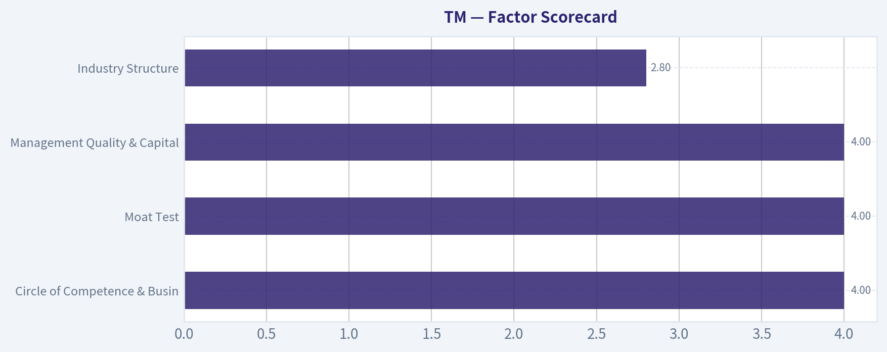

---

### Market Technical Analysis

ANALYST STANCE: **WATCH**

#### TM Technical Indicator Report - Toyota Motor ADR

Current date is **2026-08-08**, which is not a trading day. The latest available trading data is **2026-08-07**, when TM closed at **$190.09**. The technical picture is constructive in the short term but still not fully repaired on the long-term trend. TM has staged a strong rebound from the late-June low area near **$167**, but it remains below the falling **200-day SMA**, meaning the recent move is best interpreted as a recovery rally inside a broader corrective structure unless price can reclaim higher resistance zones.

The selected indicators are: **close_10_ema, close_50_sma, close_200_sma, macd, macdh, rsi, atr, and vwma**. They provide complementary insight across short-term trend, medium-term trend, long-term trend, momentum, momentum acceleration, overbought/oversold pressure, volatility, and volume-confirmed price behavior.

---

#### Indicator Snapshot

| Indicator | Latest Value / Level | Interpretation |
|---|---:|---|
| Close | **$190.09** | Rebounded after early-August pullback; still below July spike high |
| 10 EMA | **$186.86** | Price is above short-term trend support |
| 50 SMA | **$178.72** | Price is comfortably above medium-term average |
| 200 SMA | **$203.41** | Price remains below long-term trend benchmark |
| MACD | **+3.12** | Momentum remains positive |
| MACD Histogram | **+0.61** | Still positive, but momentum expansion has cooled |
| RSI | **60.58** | Bullish-neutral; not overbought |
| ATR | **$3.69** | Daily volatility is meaningful, around 1.9% of price |
| VWMA | **$186.33** | Price is above volume-weighted trend support |

Key Takeaways: TM's short-term and medium-term signals are improving, with price above the 10 EMA, 50 SMA, and VWMA. However, the stock remains below the 200 SMA, so the longer-term trend has not yet turned decisively bullish. Momentum is positive but cooling, which argues for patience rather than chasing strength aggressively.

---

#### Trend Structure

TM's recent rebound is notable. After falling to a June closing low near **$167.23** on 2026-06-23, the stock recovered to **$190.09** by 2026-08-07, a gain of roughly **13.7%**. The move was strong enough to pull price back above the 50-day SMA, and the 10 EMA has turned upward, showing that short-term buyers regained control.

The problem is the longer-term structure. TM is still trading roughly **6.5% below its 200-day SMA near $203.41**, and the 200-day average itself is drifting lower. That usually means institutional or long-horizon trend confirmation is still absent. In practical trading terms, TM has improved from "weak and oversold" to "recovering," but it has not yet moved into a fully confirmed long-term uptrend.

#### Momentum Analysis

MACD has improved dramatically from deeply negative readings in late June. It moved from around **-5.4** on 2026-06-24 to **+3.12** by 2026-08-07, confirming that the rebound was not merely a one-day bounce. This is one of the stronger bullish elements in the current setup.

However, the **MACD histogram** has slipped from a late-July peak near **+1.83** to **+0.61**. That does not mean the trend has reversed, but it does show that upside acceleration is fading. In other words, the rally remains alive, but the strongest part of the momentum burst may already have passed unless price breaks above the recent resistance zone.

RSI supports the same conclusion. At **60.58**, RSI is healthy and above neutral, but it is no longer near the late-July level of about **69.6**. This suggests bullish pressure remains present, but the stock is not currently overextended. That gives TM room to rise if buyers return, but it also means traders should watch whether RSI can stay above the 50-55 zone during pullbacks.

#### Volume and VWMA Confirmation

The VWMA is at **$186.33**, and price closed above it at **$190.09**. This is constructive because it suggests the recent price recovery is not completely disconnected from volume participation. The VWMA has also been rising since early July, which supports the view that volume-adjusted trend pressure has improved.

That said, the strongest volume surge occurred around the late-July jump, especially on **2026-07-29**, when volume rose to roughly **800,400 shares** and price closed at **$192.84**. Since then, the stock pulled back and then rebounded on lighter volume, with 2026-08-07 volume at **315,500 shares**. This makes the next breakout attempt important: a move above resistance would be more convincing if it comes with expanding volume.

#### Volatility and Risk

ATR is approximately **$3.69**, which is about **1.9%** of the latest close. That is not extreme, but it is large enough that tight stops may be vulnerable to normal daily noise. For short-term traders, risk levels should account for a normal move of at least one ATR.

A practical risk framework would treat the **$186-$187 area** as near-term support because it lines up with the 10 EMA and VWMA. Below that, the **$182-$183 area** becomes important because it marked the late-July breakout base. The 50-day SMA near **$178.72** is a deeper support level and a key medium-term line in the sand.

#### Key Price Zones

| Zone | Price Area | Why It Matters |
|---|---:|---|
| Immediate resistance | **$192.80-$196.00** | Late-July close/high zone; breakout confirmation area |
| Higher resistance | **$200.00-$203.50** | Psychological level plus 200-day SMA |
| Near-term support | **$186.00-$187.00** | 10 EMA and VWMA cluster |
| Secondary support | **$182.00-$183.00** | Prior breakout/pullback area |
| Major medium-term support | **$178.50-$179.00** | 50-day SMA area |
| Bearish risk zone | **Below $178.50** | Would weaken the recovery structure |

Key Takeaways: The most important near-term battle is between support around $186-$187 and resistance around $193-$196. A breakout above $196 would strengthen the bullish recovery case, while a failure below $186 would suggest the rally is losing traction. The 200-day SMA near $203 remains the larger hurdle for a durable trend reversal.

---

#### Trading Interpretation

TM currently looks like a **short-term recovery candidate**, not yet a confirmed long-term bullish trend. The setup favors a **watch-and-confirm approach**. Momentum is positive, price is above short- and medium-term averages, and RSI is supportive without being overbought. But the stock remains below the 200-day SMA, and MACD histogram momentum has cooled since late July.

For bullish traders, the cleaner signal would be a decisive move above **$196**, ideally with stronger volume. That would suggest the early-August pullback was only a pause within the rebound. A further push toward **$200-$203** would then become plausible, though the 200-day SMA could act as meaningful resistance.

For more cautious traders, a pullback that holds above **$186-$187** may offer a better risk/reward entry than buying after a sharp rally. If TM breaks below that zone, the probability of a retest of **$182-$183** increases. A break below the 50-day SMA near **$178.72** would materially damage the recovery and shift the setup back toward defensive positioning.

#### Final Assessment Table

| Category | Signal | Detailed Read |
|---|---|---|
| Short-term trend | Bullish | Price is above the 10 EMA and VWMA, showing near-term buyers are still active |
| Medium-term trend | Improving | Price is above the 50 SMA, but the 50 SMA itself is still flattening after prior weakness |
| Long-term trend | Bearish/Unconfirmed | Price remains below the 200 SMA, and the 200 SMA is drifting lower |
| Momentum | Positive but cooling | MACD is positive, but histogram has declined from late-July highs |
| RSI condition | Constructive | RSI near 60 shows bullish pressure without overbought excess |
| Volume confirmation | Moderate | Price is above VWMA, but recent bounce volume is lighter than the late-July surge |
| Volatility | Manageable but relevant | ATR near $3.69 means stops should allow for normal price swings |
| Overall stance | **WATCH** | Recovery is promising, but confirmation above $196 and eventually $203 is needed |

Key Takeaways: TM has shifted from a weak downtrend into a constructive recovery phase, but it has not fully confirmed a long-term bullish reversal. The stock is tradable on the long side only if support holds or resistance breaks with volume. Until TM clears the $196 to $203 zone, the best stance is watchful and selective rather than aggressively bullish.

---

### Options Market Analysis

> *Reading options flow - put/call ratios, IV skew, and unusual activity - to gauge institutional positioning and event-driven risk.*

ANALYST STANCE: **WATCH**

#### TM Options Market Sentiment Report - Toyota Motor ADR
*Options data as of 2026-08-08. Signal is based on near-term expirations through 2026-10-16.*

#### 1. Put/Call Ratio Analysis

| Expiration | Days to Expiry | Call OI | Put OI | Put/Call OI Ratio | Call Volume | Put Volume | Put/Call Volume Ratio | Read |
|---|---:|---:|---:|---:|---:|---:|---:|---|
| 2026-08-21 | 13 | 1,120 | 1,749 | 1.56 | 66 | 67 | 1.02 | Defensive / bearish tilt |
| 2026-09-18 | 41 | 1,878 | 2,121 | 1.13 | 88 | 57 | 0.65 | OI bearish, flow less bearish |
| 2026-10-16 | 69 | 747 | 722 | 0.97 | 46 | 88 | 1.91 | Neutral OI, put-heavy trading |
| **Total** | - | **3,745** | **4,592** | **1.23** | **200** | **212** | **1.06** | **Mild bearish / hedging bias** |

**Key Takeaways:** TM's near-term put/call open-interest ratio is **1.23**, well above the historical neutral baseline of roughly **0.7**, showing a clear tilt toward put positioning. The most notable bearish concentration is in the **2026-08-21** expiry, where put open interest is more than 1.5 times call open interest. However, total volume is only slightly put-heavy, so this looks more like existing defensive positioning than an aggressive new bearish wave.

The shift from neutral is meaningful: relative to a ~0.7 baseline, TM's aggregate put/call OI ratio suggests the options market is carrying more downside protection than usual. That can reflect institutional hedging around the ADR, bearish macro or FX exposure concerns, or investors protecting long equity positions rather than outright speculative short bets.

---

#### 2. Implied Volatility Assessment

| Expiration | Call ATM IV | Put ATM IV | Put IV Premium / Discount | Skew Read | Sentiment Implication |
|---|---:|---:|---:|---|---|
| 2026-08-21 | 30.1% | 35.5% | Puts +5.4 pts | Put skew | Near-term downside protection bid |
| 2026-09-18 | 29.6% | 26.0% | Puts -3.6 pts | Call skew | Less fear; some upside interest |
| 2026-10-16 | 31.4% | 21.8% | Puts -9.6 pts | Call skew | Longer-dated upside IV richer than puts |

**Key Takeaways:** The front-month expiry shows a clear **put IV premium**, with puts trading at higher implied volatility than calls. That signals near-term downside concern or hedging demand into the next two weeks. Further out, however, the skew flips toward calls, which reduces the strength of the bearish read and suggests the market is not pricing persistent downside panic.

Near-term ATM IV is around **30% to 36%**, which is not extreme for a single-name ADR but is high enough to imply meaningful expected movement. The data does not identify a specific catalyst such as earnings, a product launch, or a macro event, so IV does not appear to be screaming event-driven risk from the options feed alone. The most important IV signal is the **short-dated put skew**, not broad-based volatility stress.

---

#### 3. Unusual Options Activity

| Unusual Activity Filter | Result | Interpretation |
|---|---|---|
| Contracts with volume greater than 5x open interest | None found | No clear evidence of fresh outsized directional bets |
| Fresh call speculation | Not detected | No strong upside sweep or retail call-chase signal |
| Fresh put accumulation | Not detected | Bearish signal comes more from OI and skew than from new aggressive put buying |
| Liquidity condition | Thin to moderate | Lower confidence; TM options volume is not especially deep |

**Key Takeaways:** There were **no contracts where volume exceeded 5x open interest**, so the data does not show obvious fresh institutional positioning. This weakens the conviction of the bearish signal because the market is not showing a sudden surge in new put buying. The existing put-heavy OI may represent hedges already in place rather than a newly initiated bearish view.

Because TM options volume is relatively light across these expirations, signal quality is reduced. Thin options markets can exaggerate put/call ratios and IV readings, so the conclusions should be treated as directional context rather than a high-confidence trading signal.

---

#### 4. Open Interest Concentration and Gamma / Pinning Risk

| Expiration | Total OI | OI Bias | Notable Concentration | Gamma / Pinning Read |
|---|---:|---|---|---|
| 2026-08-21 | 2,869 | Put-heavy | Highest put/call imbalance | Could create near-term downside sensitivity if price approaches large put strikes |
| 2026-09-18 | 3,999 | Mild put-heavy | Largest total OI expiry | Most important expiry for positioning gravity |
| 2026-10-16 | 1,469 | Balanced | Lower total OI | Less likely to dominate near-term price action |

**Key Takeaways:** The **2026-09-18** expiry has the largest total open interest, making it the most important listed expiry for positioning gravity. The **2026-08-21** expiry has the strongest put-heavy imbalance, which may matter most for short-term downside hedging. Strike-level open interest was not provided, so specific max-pain levels, pinning strikes, and gamma walls cannot be reliably identified.

Based on aggregate data, the market's positioning gravity is tilted more toward protection than upside speculation. However, without strike-level detail, it is not possible to say whether a specific level is acting as a major support, resistance, or gamma wall.

---

#### 5. Overall Options Sentiment Signal

| Category | Signal | Rationale |
|---|---|---|
| Put/Call Ratios | Bearish | Aggregate OI ratio of **1.23** is well above the ~0.7 neutral baseline |
| IV / Skew | Mild bearish near term | Front-month puts have higher IV than calls, showing downside protection demand |
| Unusual Activity | Neutral | No volume > 5x OI contracts detected |
| OI Concentration | Mild bearish | Front-month and September expiries lean put-heavy |
| Liquidity / Confidence | Lower confidence | TM options volume is relatively thin |

**Key Takeaways:** The overall options signal for TM is **BEARISH**, but not aggressively so. The primary driver is the elevated put/call open-interest ratio, especially in the front-month expiry, combined with near-term put skew. The lack of unusual options activity and relatively thin volume make this a lower-confidence bearish read rather than a strong institutional sell signal.

#### Final Signal: **BEARISH - Low to Moderate Confidence**

TM's options market is showing a defensive tilt. Put open interest is elevated versus calls, the front-month expiry has notable put skew, and the total near-term put/call OI ratio is materially above the historical neutral baseline. That said, volume is not extreme, no unusual contracts were flagged, and longer-dated skew is not uniformly bearish.

In plain terms: options traders appear more concerned about near-term downside than excited about upside, but the evidence looks more like **hedging and caution** than an outright bearish institutional attack.

---

#### Summary Table

| Factor | Current Read | Interpretation |
|---|---|---|
| Put/Call Ratio | OI ratio **1.23**, volume ratio **1.06** | Put positioning is elevated versus neutral, suggesting hedging or bearish bias |
| IV Level | ATM IV roughly **22%-36%** across near-term expiries | Moderate implied movement; not an obvious volatility panic |
| Skew Direction | Front-month put skew; later call skew | Near-term downside fear, but not sustained across the curve |
| Unusual Activity | None detected | No strong evidence of fresh outsized directional bets |
| Overall Signal | **BEARISH** | Defensive options positioning, with reduced confidence due to thin volume |

**Key Takeaways:** TM's options market leans bearish mainly because put open interest is elevated and front-month put IV is richer than call IV. However, the absence of unusual activity keeps the signal from becoming strongly bearish. The best read is cautious downside positioning rather than a high-conviction bearish options flow event.

---

## Research Team Commentary

> *The Research Manager synthesizes the Bull vs Bear debate into action-free commentary. This is a pre-risk view, not the final stance.*

Looking at this debate on Toyota, I see a classic clash between a comforting value narrative and the harsh structural realities of the automotive industry. The bull paints Toyota as a misunderstood compounding machine trading at an incredibly cheap 8.5 multiple. Meanwhile, the bear correctly identifies that an automaker with a 9.6 percent return on equity and less than 1 percent top-line growth is not a compounding machine at all, but rather a highly capital-intensive cyclical facing immense pressure in key global markets.

My core takeaway is that Toyota is a formidable, well-managed legacy operator enjoying a near-term narrative tailwind from its successful hybrid strategy, but it fundamentally lacks the elite capital efficiency required to be a true Buffett-style compounder. Because of the mix of mediocre long-term business quality and a constructive short-term market setup, we are landing squarely on a Watch stance.

To explain the rationale, we have to look closely at the underlying economics. The bull is absolutely right that Toyota's multi-pathway strategy and hybrid dominance have brilliantly shielded it from the cash-incinerating EV price wars. Management deserves immense credit for that capital allocation decision. However, the bear strikes the fatal blow to the "wonderful business" thesis by highlighting the capital treadmill. Toyota requires massive, continuous reinvestment in property, plant, and equipment just to maintain its current market position. A 9.6 percent ROE and 0.8 percent revenue growth are pedestrian numbers that fall far short of the 15 percent plus return on invested capital we demand for a high-quality franchise.

Furthermore, relying on an 8.5 price-to-earnings ratio as a margin of safety is a dangerous game in the auto sector. For cyclical industries, a low multiple often signals peak earnings, not a bargain. When you add the very real threat of domestic players like BYD eroding Toyota's critical market share in China, the long-term moat looks much more vulnerable than the bull admits. The hybrid bridge is generating great cash flow today, but it is not a permanent endpoint.

However, I have to factor in the hard lessons I learned from my past analysis of Tesla. In that situation, I slapped a hard Avoid on the stock entirely based on my long-term valuation and fundamental concerns, completely ignoring that the short-term technicals were repairing and the narrative was shifting. I will not make that mistake here. The market analyst notes that Toyota's short-term technical picture is currently constructive. Furthermore, the market is currently rewarding the "hybrid king" narrative. Even if I don't want to own this stock for the next decade because of the structural China risks and low ROE, entirely avoiding or betting against a stock with constructive short-term momentum and a solid near-term cash flow story is poor portfolio management. We need to respect the price action and use a conditional approach.

This leads directly into my monitoring plan for the next one to four quarters. First, we need to closely track Toyota's unit volumes and market share in China. If the bleeding to local EV and plug-in hybrid makers accelerates, the fundamental thesis deteriorates rapidly regardless of what the US market is doing. Second, we must monitor global hybrid pricing power. As competitors pivot away from pure EVs and flood the hybrid zone, we need to see if Toyota can maintain its margins or if a price war simply shifts to their home turf. Finally, we must watch the technical structure. We need to see if this short-term constructive action translates into a meaningful breakout, or if it rolls over and breaks support, which would signal that the market is finally pricing in peak cycle earnings.

Toyota is not a fat pitch, and it is certainly not a wonderful business at a bargain price. But it is a durable company with a smart management team navigating a complex transition, supported by decent short-term technicals. Therefore, my final stance is WATCH.

---

## Value Investing Team Commentary

> *The Investor translates the research view into an investment thesis before risk review. This is still not the final stance.*

Toyota Motor Corp (TM) presents a fascinating study in the divergence between operational excellence and structural business quality. As a value investor, I look for "wonderful businesses at fair prices." While Toyota is undoubtedly a wonderful *company* managed by some of the world's most disciplined capital allocators, it remains an average *business* due to the inherent physics of the automotive industry.

### 1. Business Quality and the Capital Treadmill
The most glaring metric in the provided data is the **Return on Equity (ROE) of 9.6%**. For a business to be considered a "compounding machine" in the Buffett tradition, we typically look for a consistent ROE and ROIC north of 15%. Toyota's current return suggests that for every dollar of shareholder equity reinvested, the company is generating less than ten cents in profit.

In a capital-intensive industry, this creates a "capital treadmill." Toyota must spend billions on R&D, tooling, and plants just to maintain its global market share. With **revenue growth at a stagnant 0.8%**, Toyota is essentially running at full speed just to stand still. While management has been brilliant in navigating the "hybrid-first" strategy-shielding the balance sheet from the value-destructive price wars seen in the pure EV space-they cannot escape the cyclicality and high fixed costs of their industry.

### 2. The Economic Moat: Brand and Hybrid Leadership
Toyota's moat is built on two pillars: **The Toyota Production System (TPS)** and **Hybrid Dominance**.
*   **TPS:** This remains a durable competitive advantage in manufacturing efficiency.
*   **Hybrid Leadership:** Toyota correctly identified that the transition to EVs would be non-linear. By dominating the hybrid market, they are currently capturing high-margin cash flow while competitors struggle with unproven EV platforms.

However, a contrarian must ask: **Is this "hybrid tailwind" a permanent moat or a temporary bridge?** As Ford, GM, and even the European manufacturers pivot their Capex back toward hybrids, Toyota's "blue ocean" will likely become a "red ocean" of price competition within the next 3-5 years. Furthermore, the loss of market share in China to localized players like BYD represents a structural threat to Toyota's global scale.

### 3. Valuation and Margin of Safety
A **P/E ratio of 8.5x** appears cheap at first glance, but in the automotive sector, a low multiple is often a "value trap" signaling peak earnings. If the global economy slows or if the "hybrid euphoria" fades, those earnings could compress, making the current $190 price look expensive in hindsight.

To justify a "Buy" under my framework, the discount to intrinsic value must be scaled to quality. For an average-quality, cyclical business like an automaker, I require a **margin of safety of at least 30-40%**. At a 8.5x multiple, the market is pricing Toyota fairly for its current performance, but it is not providing the "fat pitch" discount required to offset the risks of structural disruption and low capital efficiency.

### 4. Selective Contrarian Insight: Respecting the Narrative
Reflecting on past misses (like the TSLA analysis), it is vital to recognize when the market narrative is working in a company's favor. Currently, the "anti-EV" sentiment is a strong wind at Toyota's back. Even if the long-term ROE is mediocre, the short-term cash flow profile is robust.

The technical picture is "constructive," meaning the market is not yet ready to sell the "peak earnings" story. Jumping to an "Avoid" stance based solely on long-term ROE would ignore the fact that Toyota is currently the best-positioned player in a difficult industry. However, buying here lacks the discipline of seeking a significant discount.

### Conclusion
Toyota is a pillar of industrial stability, but it lacks the elite capital returns and growth profile of a true long-term compounder. The valuation is reasonable but not deeply discounted enough to compensate for the capital intensity and the looming competitive threats in China. We must respect the current positive sentiment and technical strength without abandoning our requirement for high-quality earnings power.

ANALYST STANCE: **WATCH**

---

## Deep Values Commentary

> *The Risk Management Team debates and the Risk Judge provides the final action-free verdict. This section determines the final ADVOCATE / WATCH / AVOID stance.*

#### Final Stance Scorecard

This scorecard converts the final research view into a weighted decision frame. It does not replace the narrative judgement, but it makes the main drivers of the verdict easier to scan.

| Criterion | Score | Weight | Commentary |
| --- | ---: | ---: | --- |
| Business Quality | 3.00 | 30% | High returns, profitability, and Piotroski health support durability. |
| Valuation Support | 4.33 | 30% | Blends current price against available intrinsic value anchors and valuation ratios. |
| Financial Strength | 3.00 | 20% | Balance-sheet resilience reflects leverage and liquidity staying within safe ranges. |
| Growth Durability | 2.00 | 20% | Recent revenue, earnings, and free cash flow growth indicate how durable expansion looks. |
| TOTAL / FINAL STANCE | 3.20 | 100% | WATCH |

#### Key Takeaways

The weighted score lands at **3.20 / 5.0**, while the final stance remains **WATCH**. This is useful as a quick calibration aid rather than a mechanical signal.

#### Risk Summary

Higher scores indicate more risk pressure. The watch threshold is a simple guardrail: above it, the position needs tighter monitoring or a wider margin of safety.

| Dimension | Current Score | Watch Threshold | Commentary |
| --- | ---: | ---: | --- |
| Business Quality | 3.00 | 3.00 | High returns, profitability, and Piotroski health support durability. |
| Valuation Support | 1.67 | 3.00 | Blends current price against available intrinsic value anchors and valuation ratios. |
| Financial Strength | 3.00 | 3.00 | Balance-sheet resilience reflects leverage and liquidity staying within safe ranges. |
| Growth Durability | 4.00 | 3.00 | Recent revenue, earnings, and free cash flow growth indicate how durable expansion looks. |

#### Key Takeaways

This view helps readers separate *where* the risk sits: valuation, business quality, balance sheet, or growth durability. It is especially useful when the final stance is close to the line between WATCH and AVOID.
