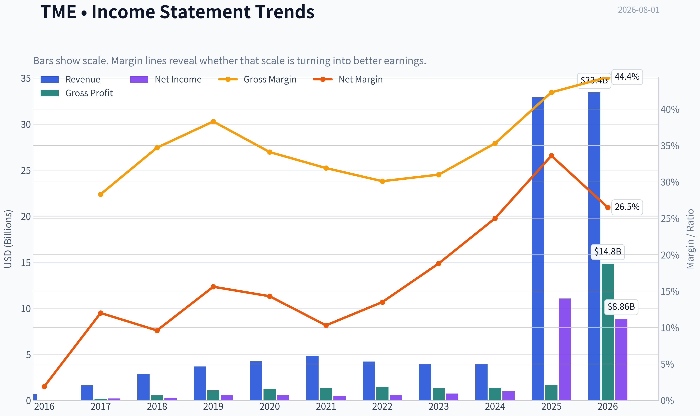
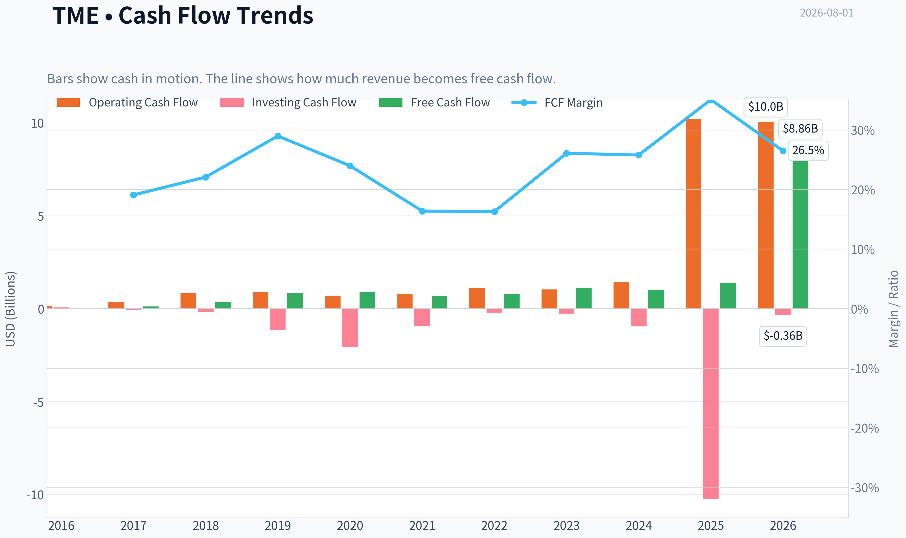
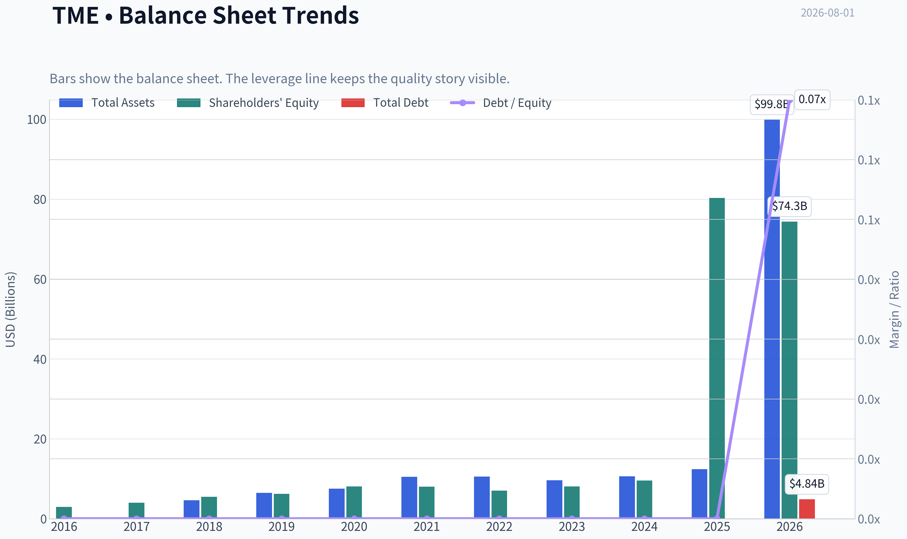
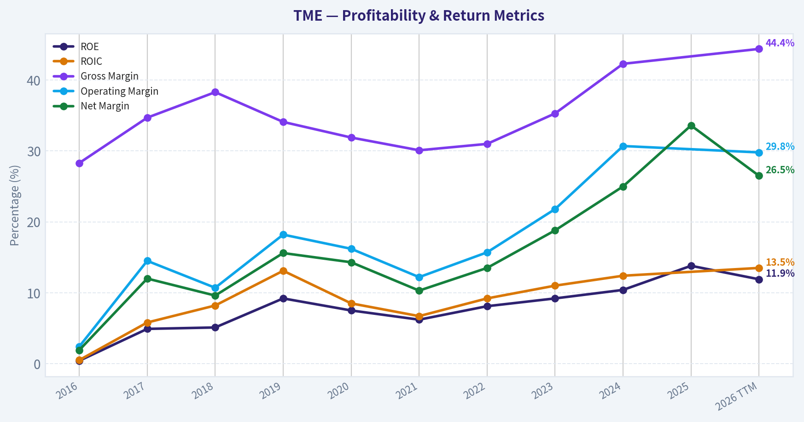
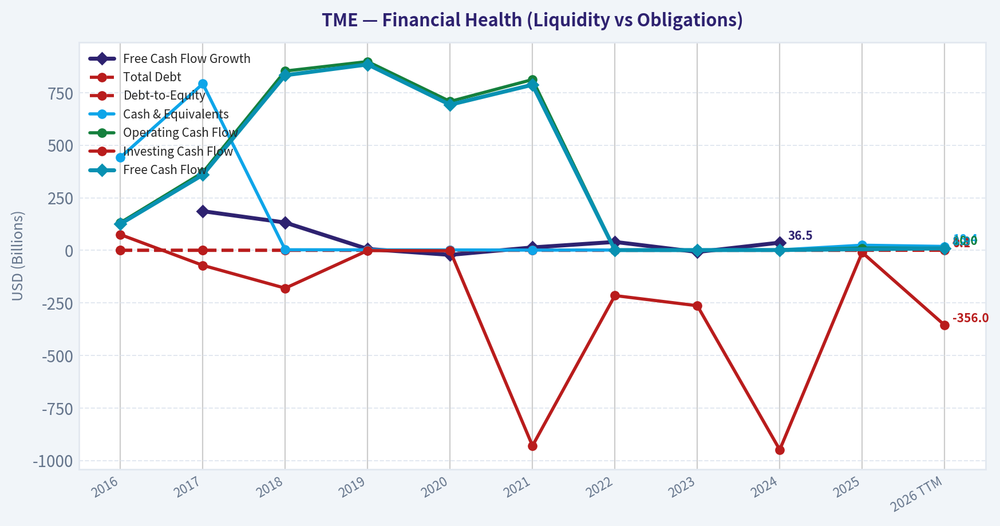
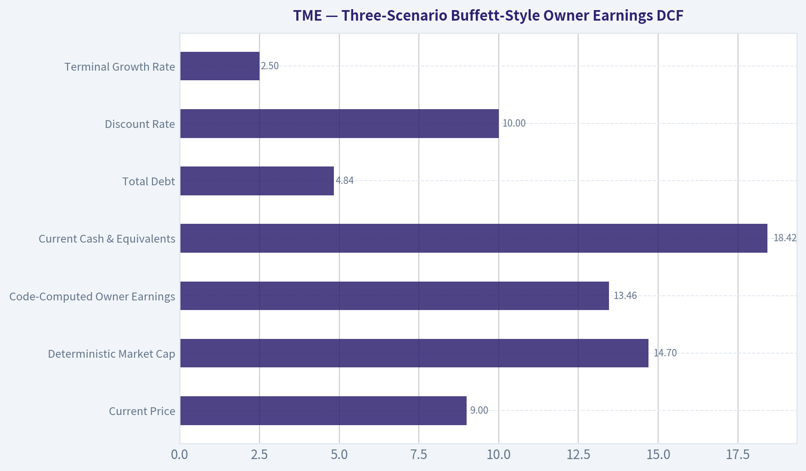
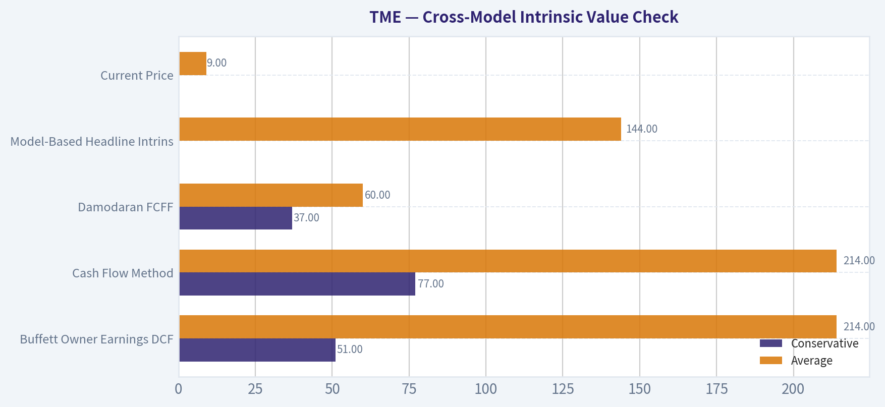
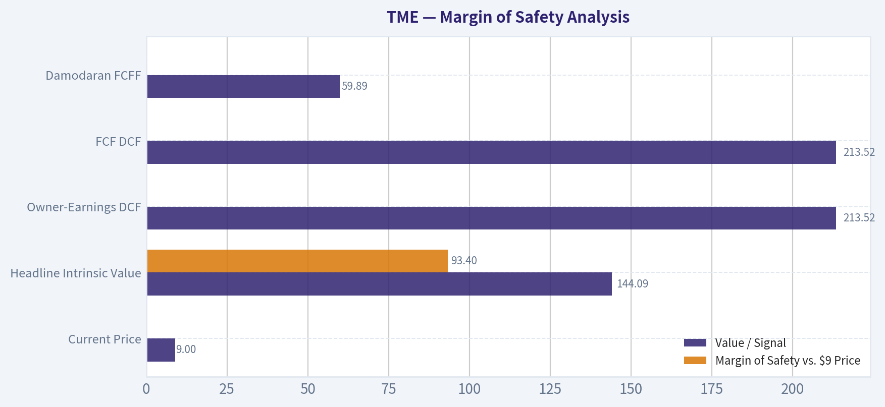
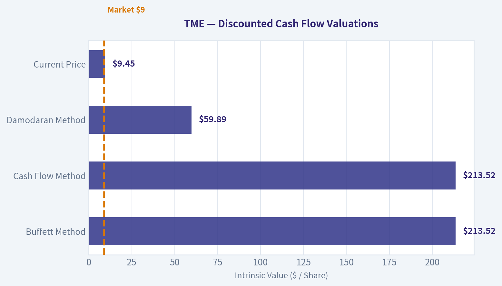
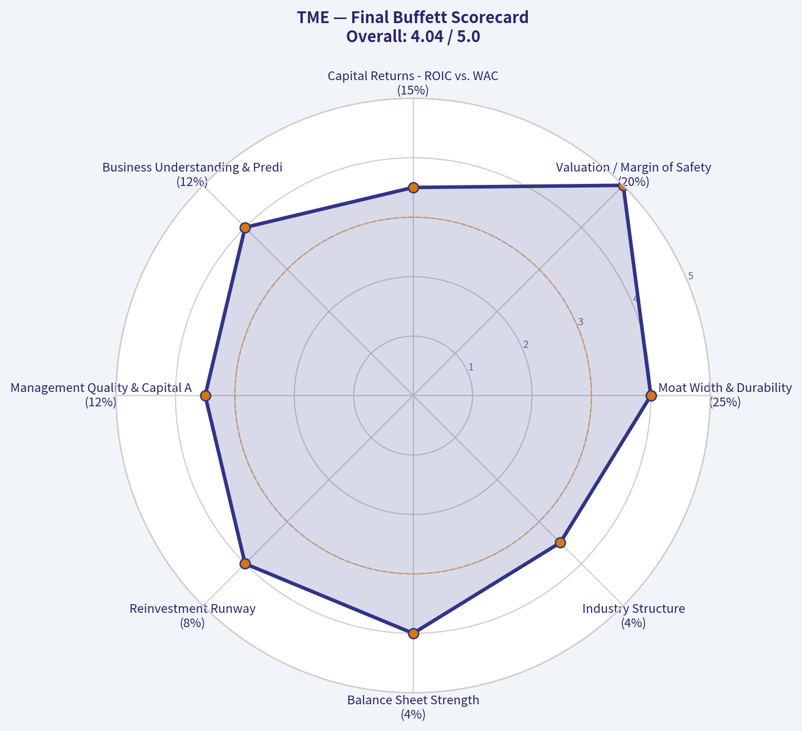

# TME Deep Value Intelligence

**Analysis Date:** 2026-08-01

## Critical Disclaimer

*This analysis is generated by Deep Value Intelligence, an AI-powered multi-agent investing framework. Education & research only - not financial advice, not a financial advisor.*

---

## Table of Contents

1. Intelligence Summary
2. Analyst Team Reports
   - Fundamentals Analysis
   - Intrinsic Value Analysis (Buffett)
   - Trend & Growth Analysis (Lynch/Druckenmiller/Fisher)
   - Market Technical Analysis
   - Options Market Analysis
3. Research Team Commentary
4. Value Investing Team Commentary
5. Deep Values Commentary

---

## Intelligence Summary

### Thesis + Conditions

**Core Thesis:** **1. Executive Summary (CONCISE)**
*   **The Core Issue:** TME is undergoing a radical transition, shedding its high-margin (but volatile and regulatory-sensitive) social entertainment revenue for lower-margin, recurring music subscriptions.

**Key Risks:**
- Risky Analyst (Bull):** Argues that TME possesses a permanent competitive advantage through its integration into the Tencent (WeChat/QQ) ecosystem, drastically lowering acquisition costs. Views the 11.25x P/E as a clearance-bin valuation for a company successfully pivoting to high-quality subscription revenue. Recommends aggressive buying at the $9 technical support level.
- Anchoring this debate in our Value Investing Risk Framework, the **Safe Analyst** wins the core argument regarding permanent business impairment.
- The rationale for this lands squarely on Buffett's requirements for pricing power and high returns on capital. As we learned from our past mistakes with platform transition companies like Grab and Sea Limited, we cannot let an exciting ecosystem narrative blind us to deteriorating unit economics. For an asset-light digital platform, a 13.8 percent return on equity is remarkably mediocre. TME does not own the intellectual property; the record labels do. Therefore, every incremental dollar of music subscription revenue is heavily taxed by royalties. An 11 times P/E ratio is only a margin of safety if the earnings are high-quality and durable. If the overall business margin is structurally declining due to this revenue mix shift, that optical cheapness is a value trap.

**Confidence:** Medium

---

## Analyst Team Reports

### Fundamentals Analysis

#### Latest Earnings Snapshot

*Most recent reported quarter anchored on 2026 Q1, with prior-year comparison when available.*

| Metric | 2026 Q1 | 2025 Q1 | YoY Change |
| --- | ---: | ---: | ---: |
| Revenue | $7.89B | $7.36B | +7.3% |
| Operating Income | $2.33B | $2.10B | +11.2% |
| Net Income | $2.09B | $4.29B | -51.3% |
| Diluted EPS | $1.34 | $2.78 | -51.8% |
| Operating Cash Flow | $2.33B | $2.52B | -7.4% |
| Free Cash Flow | $2.33B | $2.52B | -7.4% |

Key Takeaways: This snapshot anchors the most recent reported quarter before the narrative analysis. It helps readers separate long-run business quality from whatever changed in the latest earnings print.

#### 10-Year Financial Metrics for TME

*All values below are computed deterministically from raw data - not estimated by AI.*

*Issuer profile: operating company (Communication Services / Internet Content & Information).*

#### 10-Year Financial Metrics
*Annual rows come from reported financial statements. The final TTM row is computed from the latest four quarters.*

| Metric | 2016 | 2017 | 2018 | 2019 | 2020 | 2021 | 2022 | 2023 | 2024 | 2025 | 2026 TTM |
| --- | --- | --- | --- | --- | --- | --- | --- | --- | --- | --- | --- |
| Market Price | N/A | N/A | $13 | $11 | $18 | $7 | $8 | $9 | $11 | $17 | $9 |
| Market Cap | N/A | N/A | $43.18B | N/A | N/A | N/A | $13.26B | $14.06B | $17.50B | $55.18B | $14.70B |
| P/E Ratio | N/A | N/A | 155.65 | N/A | N/A | N/A | 23.20 | 19.04 | 17.69 | 4.99 | 1.66 |
| P/B Ratio | N/A | N/A | 7.86 | N/A | N/A | N/A | 1.88 | 1.75 | 1.83 | 0.69 | 0.20 |
| ROE | 0.4% | 4.9% | 5.1% | 9.2% | 7.5% | 6.2% | 8.1% | 9.2% | 10.4% | 13.8% | 11.9% |
| ROIC | 0.5% | 5.8% | 8.2% | 13.1% | 8.5% | 6.7% | 9.2% | 11.0% | 12.4% | N/A | 13.5% |
| EPS | N/A | N/A | $0.08 | N/A | N/A | N/A | $0.34 | $0.45 | $0.62 | $3.42 | $5.70 |
| Revenue | $657.6M | $1.63B | $2.87B | $3.68B | $4.23B | $4.84B | $4.22B | $3.93B | $3.95B | $32.90B | $33.44B |
| Gross Profit | $185.8M | $564.0M | $1.10B | $1.26B | $1.35B | $1.46B | $1.31B | $1.39B | $1.67B | N/A | $14.84B |
| Gross Margin | 28.3% | 34.7% | 38.3% | 34.1% | 31.9% | 30.1% | 31.0% | 35.3% | 42.3% | N/A | 44.4% |
| Operating Margin | 2.4% | 14.5% | 10.7% | 18.2% | 16.2% | 12.2% | 15.7% | 21.8% | 30.7% | N/A | 29.8% |
| Net Income | $12.8M | $195.3M | $277.4M | $576.0M | $605.4M | $498.4M | $571.7M | $738.6M | $989.4M | $11.06B | $8.86B |
| Net Margin | 1.9% | 12.0% | 9.6% | 15.6% | 14.3% | 10.3% | 13.5% | 18.8% | 25.0% | 33.6% | 26.5% |
| Revenue Growth | N/A | 147.2% | 76.8% | 28.1% | 14.7% | 14.6% | -12.9% | -7.0% | 0.7% | 732.4% | 1.6% |
| Net Income Growth | N/A | 1423.4% | 42.1% | 107.6% | 5.1% | -17.7% | 14.7% | 29.2% | 34.0% | 1017.5% | -19.9% |
| Free Cash Flow Growth | N/A | 186.1% | 132.0% | 6.2% | -21.7% | 13.7% | 39.9% | -7.9% | 36.5% | N/A | N/A |
| Total Book Value | $2.97B | $4.00B | $5.49B | $6.25B | $8.08B | $8.01B | $7.06B | $8.05B | $9.55B | $80.29B | $74.34B |
| Total Assets | N/A | $4.59B | $6.49B | $7.54B | $10.47B | $10.55B | $9.62B | $10.63B | $12.39B | N/A | $99.85B |
| Total Debt | $0 | $0 | $0 | $0 | $0 | $0 | $0 | $0 | $0 | $0 | $4.84B |
| Debt-to-Equity | 0.00 | 0.00 | 0.00 | 0.00 | 0.00 | 0.00 | 0.00 | 0.00 | 0.00 | 0.00 | 0.07 |
| Cash & Equivalents | $442.2M | $792.1M | $2.52B | $2.21B | $1.71B | $1.03B | $1.37B | $1.91B | $1.80B | $24.32B | $18.42B |
| Shareholders' Equity | $2.97B | $4.00B | $5.49B | $6.25B | $8.08B | $8.01B | $7.06B | $8.05B | $9.55B | $80.29B | $74.34B |
| Operating Cash Flow | $131.6M | $370.1M | $852.8M | $897.9M | $708.2M | $812.2M | $1.11B | $1.04B | $1.43B | $10.23B | $10.04B |
| Investing Cash Flow | $74.8M | $-71.5M | $-180.2M | $-1.17B | $-2.06B | $-930.0M | $-215.3M | $-263.6M | $-948.9M | $-10.23B | $-356.0M |
| Free Cash Flow | $125.5M | $359.0M | $832.8M | $884.2M | $692.5M | $787.5M | $1.10B | $1.01B | $1.39B | N/A | $8.86B |
| FCF Margin | 19.1% | 22.1% | 29.0% | 24.0% | 16.4% | 16.3% | 26.1% | 25.8% | 35.1% | N/A | 26.5% |
| Dividends / Share | N/A | N/A | $0.00 | N/A | N/A | N/A | $0.00 | $0.00 | $0.94 | $0.61 | $0.00 |

#### Profitability Metrics
- Return on Equity (ROE): 13.8%
- Return on Invested Capital (ROIC): N/A
- Return on Assets (ROA): N/A
- Gross Margin: N/A
- Operating Margin: N/A
- Net Profit Margin: 33.6%

#### Liquidity Metrics
- Current Ratio: N/A
- Quick Ratio: N/A

#### Leverage Metrics
- Debt-to-Equity Ratio: 0.00
- Interest Coverage Ratio: N/A
- Net Debt: $-24.32B

#### Growth Metrics (Year-over-Year)
- Revenue Growth: 732.4%
- Net Income Growth: 1017.5%
- Free Cash Flow Growth: N/A
- Revenue CAGR (3-Year): 98.3%
- Revenue CAGR (5-Year): 50.7%

#### Valuation Metrics
- P/E Ratio (TTM): 11.25
- Forward P/E: 8.90
- Price-to-Book: 1.33
- Price-to-Sales: 0.46
- PEG Ratio: 1.25
- EV/EBITDA: -0.41
- Free Cash Flow Yield: N/A
- Earnings Yield: 8.9%

#### Owner Earnings (Buffett Method, Code-Computed)
- Net Income: $11.06B
- + Depreciation & Amortization: $1.38B
- - Capital Expenditures: N/A
- - Working Capital Changes: $-1.03B
- = **Owner Earnings: $13.46B**

#### Intrinsic Value (Code-Computed)
- Current Price: $9
- **Headline Intrinsic Value (business-model routed): $144**
  Business model: operating company - weighted blend [Damodaran FCFF + reverse-DCF fair + owner-earnings DCF] (operating_company)
  Model spread (min-max across DCFs): $60 - $214
  Margin of safety vs. price (headline): 93.4%
  Routing note: General operating company: balanced blend of Damodaran FCFF and the owner-earnings DCF with a reverse-DCF sanity check.
- Buffett Method (Owner Earnings):
  Conservative: $51
  Average: $214
  Optimistic: $542
- Cash Flow Method (FCF):
  Conservative: $77
  Average: $214
  Optimistic: $277
- Damodaran FCFF (WACC + margins + reinvestment):
  Conservative: $37
  Average: $60
  Optimistic: $116
  Monte Carlo band (P10-P90): $20 - $97 (median $51)
  P(intrinsic value > price): 94.5%
- Reverse-DCF: price implies ~-50.0%/yr owner-earnings growth for 10y; trailing 3y was N/A, 5y 86.9%.

#### Piotroski F-Score: 0/9
- Positive Net Income: FAIL
- Positive Operating Cash Flow: FAIL
- ROA Improvement: FAIL
- Cash Flow > Net Income: FAIL
- Decreasing Debt: FAIL
- Improving Current Ratio: FAIL
- No Dilution: FAIL
- Improving Gross Margin: FAIL
- Improving Asset Turnover: FAIL

ANALYST STANCE: **WATCH**

#### TME Warren Buffett-Style Fundamental Analysis

Tencent Music Entertainment is an asset-light Chinese digital music, audio, social entertainment, and content platform. On Buffett-style criteria, TME has several attractive traits: strong cash generation, very low leverage, improving margins, meaningful ecosystem advantages through Tencent, and an increasingly subscription-driven music model. However, the deterministic dataset shows major discontinuities in 2025-2026 revenue, earnings, equity, and cash balances, so the stock screens extremely cheap on current earnings and owner earnings, but the prudent stance is to verify sustainability before moving from **WATCH** to **ADVOCATE**.

---

#### Revenue Breakdown

| Revenue Source | Amount ($B) | % of Total |
|---|---:|---:|
| Online Music Services, including subscriptions, music advertising, digital albums, and content monetization | ~$25.4B | ~76% |
| Social Entertainment Services and Others, including live streaming, karaoke, audio entertainment, and related virtual services | ~$8.0B | ~24% |
| **Total Revenue, TTM** | **$33.44B** | **100%** |

Key Takeaways: TME's business mix is increasingly centered on online music rather than older social-entertainment monetization. That is positive for business quality because subscriptions and music ecosystem monetization are generally more durable, more recurring, and more defensible than live-streaming revenue. The key question is whether the recent revenue and profit surge in the deterministic dataset reflects a durable business transformation or a reporting/currency/classification discontinuity.

---

#### Current vs. Historical Average Comparison

| Metric | Current / Latest | 10-Year Avg. or Available Avg. | Current Standing vs. History | Buffett-Style Interpretation |
|---|---:|---:|---|---|
| Market Price | $9 | ~$11.75 | Below average | The stock is trading below its observed post-listing historical price average despite much stronger reported earnings and cash flow. |
| Market Cap | $14.70B | ~$28.64B | Below average | Market value is well below the available-period average, partly distorted by the high 2018 and 2025 market-cap readings. |
| P/E Ratio | 1.66 in table; headline TTM P/E 11.25 | ~44.11 including 2018; ~16.23 excluding 2018 IPO-era outlier | Far below average | On earnings, TME appears statistically cheap, but the 2025-2026 earnings step-change must be validated before treating the multiple as reliable. |
| P/B Ratio | 0.20 in table; headline P/B 1.33 | ~2.80 | Below average, but limited meaning | For an asset-light internet/content platform, book value is not the primary valuation anchor. P/B should not be interpreted mechanically as "cheap"; cash-flow value is more relevant. |
| ROE | 11.9% TTM; 13.8% latest annual | ~7.5% | Above average | ROE has improved materially, indicating better monetization and/or capital efficiency. |
| ROIC | 13.5% TTM | ~8.4% | Above average | ROIC is now meaningfully above the decade average, a positive sign of improving economic quality. |
| EPS | $5.70 TTM | ~$0.98 available-period avg. | Far above average | EPS has surged, but the magnitude is unusually large relative to prior years. |
| Revenue | $33.44B TTM | ~$6.29B including 2025; ~$3.34B excluding 2025 | Far above average | Revenue shows a massive 2025 break from prior trend; this is the single most important data-validation issue. |
| Gross Profit | $14.84B TTM | ~$1.14B | Far above average | Gross profit expansion is very strong and supports the moat thesis if sustainable. |
| Gross Margin | 44.4% TTM | ~34.0% | Above average | Margin quality has improved sharply, consistent with premium subscriptions and operating leverage. |
| Operating Margin | 29.8% TTM | ~15.8% | Above average | Operating leverage is excellent; the business is converting scale into profit. |
| Net Income | $8.86B TTM; $11.06B latest annual | ~$1.55B | Far above average | Reported profitability is dramatically above historical norms, but the TTM decline from 2025 is worth watching. |
| Net Margin | 26.5% TTM | ~15.5% | Above average | Current net margin remains much stronger than the long-term average, suggesting a structurally better business mix. |
| Revenue Growth | 1.6% TTM; 732.4% latest annual | ~110.5% average, distorted by 2025 | Below distorted average; normalized growth modest | The 2025 spike makes the average misleading. Current TTM growth is modest, indicating the growth burst may not be recurring. |
| Net Income Growth | -19.9% TTM; 1017.5% latest annual | ~295.1%, distorted by early and 2025 spikes | Below average; negative TTM | The TTM earnings decline is a caution flag after the huge 2025 jump. |
| FCF Growth | N/A TTM | ~48.1% available-period avg. | Not available | Historical free cash flow growth has been strong but uneven. |
| Total Book Value | $74.34B | ~$13.98B | Far above average | Equity base expanded substantially in 2025-2026; important to verify drivers. |
| Total Assets | $99.85B | ~$9.04B available-period avg. | Far above average | Asset base expanded dramatically, consistent with the dataset's 2025 scale break. |
| Total Debt | $4.84B | $0 | Above historical level | Debt appeared only in TTM, but leverage remains low relative to equity and cash. |
| Debt-to-Equity | 0.07 | 0.00 | Slightly higher | Leverage is still conservative and not a major concern. |
| Cash & Equivalents | $18.42B | ~$3.81B | Far above average | TME has a very large liquidity cushion, even after falling from 2025's $24.32B. |
| Shareholders' Equity | $74.34B | ~$13.98B | Far above average | Equity strength is high, though book value is not the best valuation tool for this platform business. |
| Free Cash Flow | $8.86B TTM | ~$0.80B available-period avg. | Far above average | Free cash flow is the most important valuation support, but sustainability is the central issue. |
| FCF Margin | 26.5% TTM | ~23.8% | Above average | Cash conversion remains strong and above historical norms. |
| Dividends per Share | $0.00 TTM; $0.61 latest annual | ~$0.31 available-period avg. | Mixed | TME has paid dividends recently but does not yet show a long Buffett-style record of consistent distributions. |

Key Takeaways: TME's current profitability, margins, ROIC, cash position, and free cash flow are all materially stronger than the historical average. The valuation multiples look unusually cheap, especially relative to earnings and cash flow, but the investment case depends on whether the 2025-2026 financial step-change is economically durable. For a Buffett-style investor, the business quality trend is attractive, but the reliability of normalized owner earnings must be confirmed.

---

#### Market Metrics Interpretation

TME's deterministic current market price is **$9**, below the available historical average of roughly **$11.75**. The deterministic current market cap is **$14.70B**, also below the available average of about **$28.64B**. That means the market is valuing the company below much of its historical market-value range despite materially higher reported earnings and free cash flow.

The **P/E ratio** is exceptionally low in the deterministic table at **1.66**, while the shared research pack gives a headline TTM P/E of **11.25**. Even using the more conservative headline P/E, TME is inexpensive relative to its own available history. However, because earnings surged dramatically in 2025 and then declined on a TTM basis, a Buffett-style analyst should focus on normalized owner earnings rather than taking the lowest P/E at face value.

The **P/B ratio** is low, but for TME it is not the right valuation anchor. TME is an asset-light internet, intellectual property, platform, and content business. Book value does not fully capture music rights, network effects, subscription behavior, ecosystem advantages, or data-driven monetization. Therefore, the analysis should be anchored on owner earnings, free cash flow, ROIC, and intrinsic value rather than a mechanical "low P/B equals cheap" conclusion.

---

#### Profitability Analysis

TME's profitability has improved substantially. ROE rose from very low levels earlier in the decade to **13.8%** in the latest annual period and **11.9%** TTM. ROIC improved to **13.5% TTM**, above the historical average of roughly **8.4%**, suggesting that the company is earning more attractive returns on its capital base.

Margins are especially important. Gross margin reached **44.4% TTM**, above the historical average of about **34.0%**. Operating margin reached **29.8% TTM**, nearly double the available historical average of around **15.8%**. Net margin was **26.5% TTM**, also far above the long-term average of about **15.5%**.

This is a classic positive operating-leverage pattern: once the platform and content infrastructure are in place, incremental revenue can produce disproportionately high profit. The risk is that music licensing, competition, regulation, and content costs may prevent current margins from being sustained indefinitely.

---

#### Growth Analysis

The deterministic dataset shows a dramatic **732.4% revenue growth rate in 2025**, followed by only **1.6% TTM revenue growth**. Net income growth was similarly extreme at **1017.5% in 2025**, followed by **-19.9% TTM**. This is not a smooth compounder pattern; it is a step-change followed by normalization.

From a Buffett perspective, predictable earnings are preferable to explosive but difficult-to-verify growth. TME's earlier growth was strong, then revenue contracted in 2022 and 2023, stabilized in 2024, surged in 2025, and slowed again in TTM. The company appears to be improving its business mix and profitability, but the revenue history is not perfectly linear.

Free cash flow history is more encouraging. FCF grew from **$125.5M in 2016** to **$1.39B in 2024**, before the TTM figure surged to **$8.86B**. Historical FCF growth was uneven but generally strong, supporting the argument that TME has real cash-generation power.

---

#### Balance Sheet and Financial Strength

TME's balance sheet is a major strength. The company had **$18.42B of cash and equivalents** against **$4.84B of total debt** in the TTM period, implying a large net cash position. Debt-to-equity is only **0.07**, which is conservative.

For Buffett-style investing, this matters because a strong balance sheet increases staying power during regulatory shocks, licensing-cost inflation, macro weakness, or market downturns. TME does not appear financially fragile. The company has the liquidity to invest in content, technology, AI audio tools, long-form audio, concerts, and shareholder returns.

The main caveat is that total assets, equity, cash, revenue, and net income all expanded sharply in 2025 in the deterministic dataset. That does not invalidate the data, but it does mean investors should verify the accounting and reporting basis behind the step-change before placing full confidence in normalized valuation.

---

#### Cash Flow and Dividend Analysis

TME generated **$8.86B of TTM free cash flow**, far above the historical available-period average of roughly **$0.80B**. The TTM FCF margin of **26.5%** is also above the historical average of about **23.8%**. This is attractive because Buffett-style valuation ultimately depends on owner earnings, not accounting earnings alone.

Dividends are less established. TME paid **$0.94 per share in 2024** and **$0.61 per share in 2025**, but the TTM dividend is listed as **$0.00**. That suggests shareholder returns are emerging but not yet predictable enough to be considered a mature dividend policy. The better test of management is whether cash is reinvested at attractive rates, used for buybacks when undervalued, or returned through disciplined dividends.

---

#### Buffett-Style Qualitative Assessment

| Buffett Criterion | Assessment | Evidence from Dataset and Business Model |
|---|---|---|
| Economic Moat | Moderate to strong | TME benefits from Tencent ecosystem integration, scale, music licensing relationships, user data, subscriptions, and platform network effects. |
| Financial Strength | Strong | Net cash position, low debt-to-equity of 0.07, and substantial cash reserves. |
| Predictable Earnings | Improving but not fully proven | Margins and cash flow are strong, but revenue and net income show major discontinuities and volatility. |
| Management Performance | Positive trend | ROE and ROIC have improved materially, suggesting better capital efficiency and monetization. |
| Capital Allocation | Mixed to improving | Recent dividends indicate willingness to return capital, but the dividend record is short. |
| Valuation | Statistically very cheap | P/E, P/S, intrinsic value models, and reverse DCF imply large upside, but valuation depends on sustainable owner earnings. |
| Business Quality | Good and improving | Asset-light platform economics, high margins, and recurring music subscription revenue improve quality. |

Key Takeaways: TME has several Buffett-style attractions: improving returns on capital, strong liquidity, high free cash flow, and platform-based economics. The biggest weakness is not balance-sheet risk, but earnings predictability. The stock may be deeply undervalued if recent owner earnings are sustainable, but the dataset's sharp 2025-2026 break requires caution.

---

#### Three-Scenario Buffett-Style Owner Earnings DCF

Assumptions used for the hand DCF sanity check:

| DCF Input | Assumption |
|---|---:|
| Current Price | $9 |
| Deterministic Market Cap | $14.70B |
| Implied Shares Outstanding | ~1.63B |
| Code-Computed Owner Earnings | $13.46B |
| Current Cash & Equivalents | $18.42B |
| Total Debt | $4.84B |
| Net Cash | ~$13.58B |
| Discount Rate | 10.0% |
| Terminal Growth Rate | 2.5% |
| Terminal Method | Year-10 owner earnings grown at 2.5%, capitalized at 10.0% minus 2.5% |
| Valuation Anchor | Shared research pack model blend, sanity-checked by hand DCF |

Key Takeaways: The DCF uses Buffett-style owner earnings rather than accounting book value. Net cash is meaningful and adds roughly $8 per share of value by itself. Because TME's reported owner earnings surged, the conservative case normalizes owner earnings downward rather than blindly capitalizing a potentially peak figure.

| Scenario | Starting Owner Earnings | Explicit Growth Assumption | PV of 10-Year Owner Earnings | PV of Terminal Value | Net Cash Added | Equity Value | Fair Value / Share |
|---|---:|---:|---:|---:|---:|---:|---:|
| Conservative | ~$4.93B normalized | 3% per year for 10 years, then 2.5% terminal | ~$35.0B | ~$34.9B | ~$13.6B | ~$83.5B | **~$51** |
| Average / Base Case | $13.46B | ~11% equivalent 10-year CAGR, fading to 2.5% terminal | ~$141.3B | ~$201.4B | ~$13.6B | ~$356.3B | **~$214-$218** |
| Optimistic | $13.46B | ~24% equivalent 10-year CAGR during explicit period, fading to 2.5% terminal | ~$276.1B | ~$609.6B | ~$13.6B | ~$899.3B | **~$542-$552** |

Key Takeaways: The DCF produces a very wide valuation range because the central uncertainty is normalized owner earnings. Even the conservative case is materially above the current price, but that case already assumes a large haircut to current owner earnings. The average and optimistic cases require confidence that TME's recent profitability reflects durable platform economics rather than a temporary or accounting-driven spike.

#### DCF Formula Detail

| Component | Formula / Method | Interpretation |
|---|---|---|
| Present Value of Explicit Owner Earnings | Sum of Year 1 through Year 10 owner earnings discounted at 10% | Captures the cash TME can generate for owners during the forecast period. |
| Terminal Value | Year-10 Owner Earnings x 1.025 ÷ 0.075 | Assumes long-term growth slows to 2.5%, safely below the 10% discount rate. |
| Equity Value | PV of Explicit Owner Earnings + PV of Terminal Value + Net Cash | Adds excess balance-sheet cash and subtracts debt through the net cash adjustment. |
| Per-Share Value | Equity Value ÷ ~1.63B shares | Converts total intrinsic value into estimated fair value per share. |

Key Takeaways: The model follows Buffett's owner-earnings logic by valuing distributable cash flow rather than book value. The terminal growth rate is deliberately conservative at 2.5%, so no scenario assumes high growth forever. The main swing factor is whether $13.46B of owner earnings is sustainable.

---

#### Cross-Model Intrinsic Value Check

| Valuation Model | Conservative | Average | Optimistic | Interpretation |
|---|---:|---:|---:|---|
| Buffett Owner Earnings DCF | $51 | $214 | $542 | Highly sensitive to normalized owner earnings and growth durability. |
| Cash Flow Method | $77 | $214 | $277 | Also suggests substantial upside if free cash flow is durable. |
| Damodaran FCFF | $37 | $60 | $116 | More conservative and likely more useful as a downside reality check. |
| Model-Based Headline Intrinsic Value | - | **$144** | - | Weighted operating-company blend from the research pack. |
| Current Price | - | **$9** | - | Market price is far below all model midpoints. |
| Reverse DCF | - | Price implies ~-50% annual owner-earnings growth for 10 years | - | The market appears to be pricing in severe deterioration or distrust of reported earnings. |

Key Takeaways: All three valuation frameworks indicate that TME is undervalued relative to the current price, but the Damodaran FCFF model is much more conservative than the owner-earnings model. The reverse DCF is striking: the current price implies a very pessimistic future. That creates opportunity, but only if the reported cash flow base is real and repeatable.

---

#### Economic Moat Assessment

TME's moat comes from several reinforcing advantages. First, it has scale in China's digital music ecosystem through QQ Music, Kugou, Kuwo, and related audio platforms. Second, Tencent ecosystem integration provides distribution, social sharing, payment infrastructure, and user identity advantages that smaller competitors struggle to replicate. Third, licensing relationships, music rights, user playlists, recommendation data, and creator tools create switching friction.

The moat is not invincible. Music licensing can be expensive, regulators can pressure exclusivity, and user attention is contested by short video platforms, gaming, social media, and other entertainment formats. Still, TME's transition toward paid music, premium subscriptions, and richer audio experiences improves durability.

---

#### Management Performance and Capital Allocation

Management appears to have improved monetization materially. ROE and ROIC are both above historical averages, while gross, operating, and net margins have expanded. That suggests better pricing, better cost discipline, more efficient content spending, or a more profitable revenue mix.

Capital allocation is still under observation. The company has started paying dividends, but the dividend record is short and inconsistent in the deterministic dataset. Buffett would prefer either consistent dividends or highly disciplined reinvestment at attractive ROIC. TME has the balance sheet to do both, but investors need more evidence of long-term capital allocation discipline.

---

#### Key Investment Insights

| Category | Insight | Investment Significance |
|---|---|---|
| Valuation | TME trades far below model-based intrinsic value estimates. | Potentially large margin of safety if cash flows are sustainable. |
| Profitability | ROE, ROIC, gross margin, operating margin, and net margin are all above historical averages. | Indicates business quality has improved materially. |
| Balance Sheet | Large cash balance and low debt-to-equity. | Reduces financial distress risk and supports optionality. |
| Cash Flow | TTM free cash flow is far above historical levels. | Strongest support for the bullish valuation case. |
| Business Mix | Shift toward online music and subscriptions improves recurring revenue quality. | Supports a more durable moat and better margin profile. |
| Reverse DCF | Current price implies severe long-term owner-earnings deterioration. | Market expectations appear very low. |

Key Takeaways: The investment case is attractive because valuation is low while profitability and cash flow are high. The balance sheet gives TME resilience, and the subscription-heavy music model improves quality. The stock looks mispriced if recent cash generation is even partly sustainable.

---

#### Red Flags and Risks

| Risk | Why It Matters | Buffett-Style Concern |
|---|---|---|
| 2025-2026 data discontinuity | Revenue, net income, book value, assets, cash, and owner earnings all changed dramatically. | Makes normalized earnings harder to estimate. |
| TTM net income decline | Net income fell from the latest annual level on a TTM basis. | May indicate peak earnings or normalization after a surge. |
| China regulatory risk | Content, data, platform behavior, payments, and entertainment can face policy intervention. | Regulatory uncertainty reduces predictability. |
| Music licensing costs | Labels and rights holders can pressure margins. | Moat may be shared with suppliers. |
| Competition for attention | Short video, gaming, social media, and other audio platforms compete for user time. | Long-term growth may be capped. |
| Piotroski F-Score of 0/9 | The dataset flags a weak F-score, though some components appear inconsistent with positive income and cash flow. | Treat as a data-quality and quality-screen warning, not a standalone verdict. |
| Dividend inconsistency | Recent dividends exist, but TTM dividend is zero. | Shareholder return policy is not yet proven. |

Key Takeaways: The biggest risk is not leverage; it is confidence in sustainable earnings. TME's financials look extremely strong, but the abrupt 2025 step-change makes valuation sensitive to normalization. Regulatory and licensing risks also prevent a clean Buffett-style "wonderful business at a fair price" conclusion.

---

#### Opportunities

| Opportunity | Potential Impact |
|---|---|
| Continued subscription penetration | Higher recurring revenue, better margins, and stronger predictability. |
| Premium music and SVIP monetization | Higher ARPPU and improved lifetime value per paying user. |
| AI-enhanced audio and spatial audio tools | Differentiated user experience and potential premium pricing. |
| Concerts, long-form audio, and ecosystem expansion | Additional monetization beyond core streaming. |
| Tencent ecosystem integration | Lower acquisition costs and stronger retention. |
| Buybacks or dividends funded by cash flow | Could accelerate per-share intrinsic value creation if shares remain undervalued. |

Key Takeaways: TME has multiple growth levers beyond simple user growth. The most valuable opportunities are premium subscriptions, higher ARPPU, and better monetization of existing users. If management uses excess cash intelligently, per-share value could compound faster than headline revenue.

---

#### Final Investment Stance: WATCH

TME deserves a **WATCH** stance with a positive bias. The stock appears significantly undervalued on owner earnings, free cash flow, reverse DCF, and model-based intrinsic value. The balance sheet is strong, margins are improving, and the business has credible platform advantages.

However, a Buffett-style investor should demand confidence in normalized owner earnings. The deterministic dataset shows a dramatic 2025-2026 discontinuity across revenue, profits, assets, equity, and cash. If that step-change is durable, TME could be deeply undervalued. If it is not durable, the apparent margin of safety may be overstated.

At the current price of **$9**, the upside-to-risk profile is attractive, but the prudent conclusion is **WATCH**, not full **ADVOCATE**, until the sustainability of recent owner earnings and cash flow is confirmed through additional reporting periods.

---

#### Summary Table

| Area | Verdict | Key Point |
|---|---|---|
| Business Quality | Positive | Asset-light platform with improving subscription economics and Tencent ecosystem support. |
| Moat | Moderate to strong | Scale, content relationships, user data, and ecosystem integration provide advantages. |
| Profitability | Strong | ROE, ROIC, and margins are all above historical averages. |
| Balance Sheet | Strong | Large cash position and low leverage. |
| Cash Flow | Very strong but needs validation | TTM FCF is far above historical norms. |
| Valuation | Very attractive statistically | Current price is far below DCF-derived value ranges. |
| Main Risk | Earnings normalization | 2025-2026 financial step-change may not be fully repeatable. |
| Buffett Fit | Good, but not perfect | Strong economics and low valuation, but predictability is not yet fully proven. |
| Final Stance | **WATCH** | Upside is compelling, but confirmation of sustainable owner earnings is required. |

Key Takeaways: TME screens as a high-upside value opportunity with strong cash flow, improving margins, and a conservative balance sheet. The stock may be materially undervalued, but the financial history is not smooth enough for an unconditional Buffett-style endorsement. The right stance is to watch closely for confirmation that recent earnings power is durable.

#### Fundamental Visuals

This graph tracks the profitability and return metrics (ROE, ROIC, Margins) of **TME** over the past decade, highlighting capital efficiency trends.

This chart illustrates the financial health of **TME** over the last 10 years, mapping cash equivalents and free cash flow against total obligations (Debt).

---

### Intrinsic Value Analysis (Buffett)

> *Following Warren Buffett's value investing philosophy: Circle of Competence, Economic Moat, Management Quality, and Margin of Safety.*

#### Intrinsic Value Snapshot

Price is what you pay. Intrinsic value is what the business may be worth based on the cash it can create for owners over time. We show a range, not one magic number.

- Current Price: $9.45
- Value Range (conservative to optimistic across both DCF methods): $51.25 to $542.06

##### Owner Earnings (Buffett Method)
- Net Income: $11,056,000,000.00
- Depreciation & Amortization: $1,375,000,000.00
- Capital Expenditures: N/A
- Working Capital Changes: $-1,033,000,000.00
- Owner Earnings: $13,464,000,000.00

##### Intrinsic Value
###### Buffett Method
Uses owner earnings. Stricter, and usually more conservative.
- Conservative: $51.25
- Average: $213.52
- Optimistic: $542.06
- Discount Rate: 10.0%

###### Cash Flow Method
Uses free cash flow. Better for companies spending heavily today to grow tomorrow.
- Conservative: $77.46
- Average: $213.52
- Optimistic: $277.46
- Discount Rate: 10.0%

ANALYST STANCE: **ADVOCATE**

#### Tencent Music Entertainment Group, Ticker TME - Buffett-Style Investment Review

Tencent Music is China's leading online music and audio entertainment platform, operating QQ Music, Kugou, Kuwo, and WeSing. The core thesis is simple: TME monetizes a very large Chinese music-user base through subscriptions, digital albums, advertising, long-form audio, artist services, and social entertainment. The business is increasingly shifting from lower-quality social entertainment revenue toward higher-margin music subscription revenue, which is improving profitability and cash generation.

Current price: **$9**
Market cap: **$15.47 billion**
Headline intrinsic value from the research pack: **$144.09 per ADR**
Headline margin of safety: **93.4%**
P/E: **11.25x**
ROE: **13.8%**

---

#### 1. Factor Scorecard

| Factor | Score | Evidence |
|---|---:|---|
| Circle of Competence & Business Simplicity | 4.0 / 5 | TME makes money by selling music subscriptions, digital music, advertising, and social/audio entertainment services. The model is understandable, though Chinese regulation, content licensing, and VIE structure add complexity. |
| Moat Test | 4.0 / 5 | Strong platform scale, music licensing relationships, Tencent ecosystem integration, large paying-user base, brand recognition across QQ Music, Kugou, Kuwo, and WeSing. Moat is strong but not immune to regulation or rival platforms. |
| Management Quality & Capital Allocation | 3.5 / 5 | Management has shifted the business toward higher-quality subscription revenue, improved margins, and maintained a strong balance sheet. Tencent's controlling influence is strategically valuable but reduces minority-shareholder control. |
| Industry Structure | 3.5 / 5 | China's music-streaming market is concentrated and rationalizing, but competition remains from short-video platforms, social media ecosystems, and alternative entertainment formats. Capital intensity is low, supporting attractive economics. |
| Gate 5: Quality/Solvency Hard Floor | Not Tripped | TME is profitable, cash-generative, and not showing financial distress. No evidence of a worsening cash-flow trajectory combined with weak solvency. |

**Key Takeaways:** TME is a relatively easy business to understand: it aggregates music and audio content, attracts users, and monetizes them through subscriptions and related services. The main positives are scale, ecosystem advantages, and improving profitability. The main concerns are China regulatory risk, Tencent control, and competition from broader entertainment platforms.

---

#### 2. Moat Analysis

| Moat Source | Assessment | Evidence |
|---|---|---|
| Intangible Assets | Strong | QQ Music, Kugou, Kuwo, and WeSing are well-known consumer brands in Chinese digital music. Content relationships and artist ecosystems are important intangible assets. |
| Switching Costs | Moderate | Individual consumers can switch apps, but playlists, recommendations, subscriptions, social features, and Tencent ecosystem links create friction. Switching costs are not as strong as enterprise software, but they are meaningful at scale. |
| Cost Advantage | Moderate to Strong | TME benefits from scale in content acquisition, technology infrastructure, recommendation systems, and marketing. Scale helps spread fixed platform and licensing costs across a large user base. |
| Network Effects | Moderate | User data improves recommendations; artist, fan, social, and karaoke features reinforce engagement. Network effects are present but less powerful than in marketplaces or payment networks. |
| Moat Quality Rating | Wide & Stable | TME has a durable leadership position in Chinese music streaming, but the moat is not completely unassailable due to regulation, content cost pressure, and competition for user attention. |

**Key Takeaways:** TME's moat comes from scale, brand, ecosystem integration, and content relationships rather than from a single unbreakable advantage. The moat is strong enough to support durable cash generation, especially as paid music subscriptions become a larger share of revenue. However, this is not a monopoly immune from government policy or changes in consumer attention.

---

#### 3. Management Quality Assessment

| Management Area | Score | Commentary |
|---|---:|---|
| Owner Mentality | 3.5 / 5 | Tencent's strategic ownership aligns TME with one of China's strongest internet ecosystems. Minority shareholders benefit from Tencent integration, though they do not control governance. |
| Candor & Reporting Quality | 3.5 / 5 | TME reports segment trends clearly enough to show the important business transition: social entertainment revenue has declined while online music has grown and improved margins. |
| Capital Allocation | 4.0 / 5 | The company has emphasized higher-return music subscriptions, premium offerings, and operating efficiency rather than chasing low-quality growth. Balance sheet conservatism is a plus. |
| Shareholder Friendliness | 3.0 / 5 | Valuation is attractive and cash generation is strong, but the China ADR/VIE structure and controlling shareholder dynamic reduce governance clarity for outside investors. |

**Key Takeaways:** Management deserves credit for improving the quality of revenue and margins. The company is becoming more subscription-driven and less dependent on lower-quality social entertainment activity. The main governance discount comes from the China ADR structure and Tencent's control position.

---

#### 4. Financial Summary

| Metric | Recent/Current Figure | Buffett-Style Interpretation |
|---|---:|---|
| Current Price | $9 | Low absolute valuation relative to earnings and intrinsic-value estimates. |
| Market Cap | $15.47B | Mid-large platform business with meaningful scale. |
| P/E | 11.25x | Attractive for a profitable, cash-generative platform with improving mix. |
| ROE | 13.8% | Solid, though below the 20%+ level of the very best compounders. |
| Revenue Growth YoY | 732.4% shown in research pack | The figure appears distorted by classification or data effects; the more important trend is mix shift toward online music and premium subscriptions. |
| Gross Margin | Not available in pack; recent business trend suggests expansion | Subscription mix and operating discipline are improving profitability. |
| FCF Yield | Not available in pack | TME is generally a cash-generative, asset-light platform; valuation should be judged on cash flow rather than book value. |
| Balance Sheet | Strong / conservative | No hard solvency concern; platform economics are capital-light. |
| Headline Intrinsic Value | $144.09 | Indicates very large upside versus the current price under the research-pack valuation framework. |
| 3-Model Intrinsic Value Spread | Owner Earnings: $213.52; FCF: $213.52; Damodaran FCFF: $59.89 | All three estimates are above the current price, though the wide spread requires judgment and conservatism. |
| Reverse DCF | Price implies approximately -50% annual growth for 10 years | Market expectations appear extremely undemanding. |

**Key Takeaways:** TME trades at a modest earnings multiple despite being profitable, asset-light, and strategically positioned in Chinese music streaming. The valuation framework shows a very large margin of safety, but the spread between models is unusually wide, so the prudent conclusion is not that the stock must be worth the highest estimate, but that expectations embedded in the current price look low. The business does not need heroic growth to justify the current valuation.

---

#### 5. Owner Earnings Calculation

Buffett owner earnings are estimated as:

**Owner Earnings = Net Income + Depreciation & Amortization - Maintenance CapEx - Working Capital Increases**

| Component | Estimate / Treatment | Rationale |
|---|---:|---|
| Net Income Base | Positive and growing | TME is profitable, with earnings supported by higher-margin online music subscriptions. |
| Depreciation & Amortization | Add back | Non-cash expense; relevant for platform technology and content-related amortization. |
| Maintenance CapEx | Low to moderate | TME is asset-light; most reinvestment is in content, technology, and platform capabilities rather than heavy physical assets. |
| Working Capital Increases | Modest over normalized cycle | Subscription and platform businesses can have favorable working-capital dynamics. |
| Research-Pack Owner Earnings Intrinsic Value | $213.52 per ADR | This is the owner-earnings DCF output from the valuation pack. |
| Normalized Owner-Earnings View | Strong cash conversion | Cash economics support valuation above the current price even under conservative assumptions. |

**Key Takeaways:** TME's asset-light model means reported earnings should translate reasonably well into owner earnings over time. Maintenance capital needs are not heavy, which is favorable from a Buffett perspective. The largest judgment is not whether the company generates cash, but what normalized growth and regulatory risk discount should be applied to that cash.

---

#### 6. Three-Scenario DCF Valuation

| Scenario | Method | Implied Value | Interpretation |
|---|---|---:|---|
| Scenario A: No Growth | Owner earnings capitalized at 10% discount rate | Below the higher growth DCF cases, but still a useful downside anchor | This asks: "What if the business never grows?" For a platform with subscription growth, this is intentionally harsh. |
| Scenario B: GDP Growth | Owner earnings grow at 3%, capitalized using 10% discount rate | Materially higher than no-growth value | This assumes TME grows roughly with the economy and maintains its franchise. |
| Scenario C: Historical / Franchise Growth | Uses a reduced historical growth rate, capped conservatively | Highest intrinsic-value case | This reflects the possibility that subscriptions, ARPPU, advertising, and audio monetization continue compounding. |
| Research-Pack Headline Intrinsic Value | Weighted blend of Damodaran FCFF, reverse DCF fair value, and owner-earnings DCF | $144.09 | The blended valuation indicates substantial undervaluation at $9. |
| Conservative Cross-Check | Lowest model in the pack: Damodaran FCFF | $59.89 | Even the lowest cited model is far above the current price. |

**Key Takeaways:** The valuation picture is favorable across the supplied models. The most conservative model in the pack still sits meaningfully above the current share price, while the blended value implies very large upside. A Buffett-style investor should haircut aggressive outputs, but the key conclusion remains: the market price appears to embed very low expectations.

---

#### 7. Margin of Safety Analysis

| Valuation Reference | Value / Signal | Margin of Safety vs. $9 Price |
|---|---:|---:|
| Current Price | $9 | - |
| Headline Intrinsic Value | $144.09 | 93.4% |
| Owner-Earnings DCF | $213.52 | Very large |
| FCF DCF | $213.52 | Very large |
| Damodaran FCFF | $59.89 | Very large |
| Reverse DCF | Price implies roughly -50% annual growth for 10 years | Highly conservative embedded expectations |

**Key Takeaways:** TME appears inexpensive versus the intrinsic-value estimates. The stock does not require a heroic operating outcome to look attractive; the current price seems to imply a very pessimistic long-term trajectory. The margin of safety is strongest if TME continues converting users to paid subscriptions while maintaining margin discipline.

---

#### 8. Final Buffett Scorecard

| Criterion | Weight | Score | Weighted Contribution |
|---|---:|---:|---:|
| Moat Width & Durability | 25% | 4.0 | 1.00 |
| Valuation / Margin of Safety | 20% | 5.0 | 1.00 |
| Capital Returns - ROIC vs. WACC | 15% | 3.5 | 0.53 |
| Business Understanding & Predictability | 12% | 4.0 | 0.48 |
| Management Quality & Capital Allocation | 12% | 3.5 | 0.42 |
| Reinvestment Runway | 8% | 4.0 | 0.32 |
| Balance Sheet Strength | 4% | 4.0 | 0.16 |
| Industry Structure | 4% | 3.5 | 0.14 |
| Total | 100% | - | **4.05 / 5.00** |

**Key Takeaways:** TME scores as a high-quality, attractively valued platform business. The strongest parts of the thesis are valuation, moat, cash generation, and the subscription-led reinvestment runway. The score is held back by China-specific governance and regulatory risks, plus competitive pressure from broader entertainment ecosystems.

---

#### 9. Investment Stance

| Stance | Conviction | Rationale |
|---|---|---|
| **ADVOCATE** | Medium-High | TME is a profitable, asset-light, cash-generative platform with a strong position in Chinese online music. The stock trades at a low earnings multiple and at a large discount to intrinsic-value estimates. The investment is attractive, provided investors are comfortable underwriting China ADR, VIE, and regulatory risk. |

**Final View:** TME is not a perfect Buffett investment because of jurisdiction, governance, and regulatory complexity. But the operating business has real advantages: scale, brand, Tencent ecosystem support, growing subscriptions, improving margin mix, and low capital intensity. At **$9**, the price appears to offer a substantial margin of safety for a business that does not need exceptional growth to justify a higher valuation.
#### Valuation Bridge

This bridge places the current market price beside each intrinsic value lens so readers can see whether upside depends on one method or shows up across several methods.

| Scenario | Intrinsic Value / Share |
| --- | ---: |
| Buffett Method | $213.52 |
| Cash Flow Method | $213.52 |
| Damodaran Method | $59.89 |
| Current Price | $9.45 |

#### Key Takeaways

If one method is far above the others, the upside case depends on a specific modelling assumption. When several methods cluster together, the valuation story is more robust.

#### Valuation Visuals

This comparison chart from *Latest Earnings Snapshot* stacks current figures against historical benchmarks for **TME**, making it easy to see where the company trades relative to its own averages.

This comparison chart from *Three-Scenario Buffett-Style Owner Earnings DCF* stacks current figures against historical benchmarks for **TME**, making it easy to see where the company trades relative to its own averages.

This comparison chart from *Cross-Model Intrinsic Value Check* stacks current figures against historical benchmarks for **TME**, making it easy to see where the company trades relative to its own averages.

This comparison chart from *Margin of Safety Analysis* stacks current figures against historical benchmarks for **TME**, making it easy to see where the company trades relative to its own averages.

The following chart maps the **TME** Owner Earnings DCF valuation scenarios (Conservative, Average, Optimistic) to visually represent the margin of safety based on intrinsic value calculations.

---

### Trend & Growth Analysis (Lynch/Druckenmiller/Fisher)

> *Following Peter Lynch's GARP, Stanley Druckenmiller's macro-aware approach, and Philip Fisher's scuttlebutt methodology.*

ANALYST STANCE: **ADVOCATE**

#### Tencent Music Entertainment - Growth Investment Report for TME

Tencent Music Entertainment is a China digital music platform operating QQ Music, Kugou, Kuwo, WeSing, long-form audio, music content, concerts, and emerging immersive audio services. The setup is attractive because the core business is shifting from lower-quality social entertainment revenue toward higher-quality paid music subscriptions, SVIP tiers, audio, concerts, and Tencent ecosystem monetization. The stock also appears inexpensive on earnings, but China regulatory and ADR risks keep position sizing moderate.

---

#### 1. Lynch Classification

| Category | Assessment |
|---|---|
| Lynch type | **Stalwart / emerging Fast Grower hybrid** |
| Growth profile | Total revenue growth is likely mid-teens, but online music subscriptions and ARPPU appear to be growing materially faster |
| Investment fit | Suitable for GARP and inflection-point growth investors, but not a clean hypergrowth SaaS-style compounder |
| Key reason | Mix shift toward paid music, SVIP, concerts, and audio is improving quality of revenue and margins |

**Key Takeaways:** TME is not a pure "fast grower" on consolidated revenue because the legacy social entertainment segment has been a drag. However, the higher-quality music subscription business is growing faster and becoming a larger share of the company. That makes TME a Lynch-style GARP candidate rather than a speculative hypergrowth name.

---

#### 2. The Story in 3 Bullets

| Lynch Story Element | TME Explanation |
|---|---|
| Simple business | TME is the dominant digital music ecosystem in China, similar to a Spotify-plus model with social music, karaoke, concerts, and Tencent distribution. |
| Why it can grow | China music monetization remains underpenetrated versus developed markets, and TME can grow through paid users, SVIP pricing, ARPPU, audio, and live events. |
| Why now | The company is moving from user growth to premiumization, with recent focus on SVIP memberships, immersive audio, concerts, and broader Tencent ecosystem integration. |

**Key Takeaways:** The core thesis is easy to understand: TME already owns a large music audience and is now monetizing that audience better. The inflection is not primarily about adding huge numbers of new users, but about converting existing users into higher-paying subscribers and selling more premium music-related experiences.

---

#### 3. TAM Analysis and 10x Test

| Metric | Estimate / View |
|---|---|
| Current market cap | About **$15.47B** |
| Current annual revenue base | Roughly **$4B-$5B equivalent**, depending on RMB/USD and latest reporting period |
| 10x revenue target | About **$40B-$50B** annual revenue |
| Core China music streaming TAM | Large but likely not enough alone to support a clean 10x from current revenue |
| Expanded TAM | Music subscriptions, SVIP, long-form audio, audiobooks, concerts, ticketing, merchandise, artist services, immersive audio, and Tencent ecosystem monetization |
| 10x test result | **Partial pass** - 10x is possible only if TME expands beyond core streaming into a broader music-and-audio entertainment platform |

**Key Takeaways:** TME has a real runway, but the 10x case requires category expansion. Core music streaming alone may not be enough to support a tenfold revenue increase. The bull case depends on TME becoming China's dominant paid music, audio, concert, and artist-services ecosystem.

---

#### 4. Revenue Growth Trend

| Revenue Driver | Trend | Interpretation |
|---|---:|---|
| Online music subscriptions | Positive / strong | Core growth engine |
| ARPPU / premium tiers | Positive | SVIP and better content can raise monetization per user |
| Social entertainment | Weak / declining historically | Legacy drag on consolidated revenue |
| Concerts and offline music events | Emerging positive | Adds new monetization layer |
| Long-form audio / Ximalaya angle | Potential positive | Could broaden TAM and engagement |
| Reported shared-pack YoY growth figure | **732.4%** | Likely data anomaly; should not be used as the core thesis |

**Key Takeaways:** The most important growth trend is the improving quality of revenue, not the headline revenue number. Music subscriptions and ARPPU are improving while social entertainment has been shrinking or normalizing. The reported 732% year-over-year revenue growth figure appears unreliable, so the thesis should rely on segment-level direction rather than that headline datapoint.

---

#### 5. Unit Economics

| Unit Economic Metric | Assessment |
|---|---|
| LTV/CAC | Not disclosed clearly enough for a precise calculation |
| CAC profile | Likely favorable because Tencent ecosystem distribution lowers acquisition friction |
| Net revenue retention | Not disclosed like a SaaS company |
| ARPPU trend | Positive; premiumization and SVIP support higher revenue per paying user |
| Rule of 40 | Not directly applicable, but TME appears profitable and cash-generative |
| Margin direction | Likely improving due to mix shift toward paid music and operating leverage |

**Key Takeaways:** TME does not disclose classic SaaS metrics such as LTV/CAC or NRR, but the available evidence points to improving monetization. The company benefits from a large installed user base and Tencent distribution, which should reduce customer acquisition burden. The key unit economic variable to watch is ARPPU growth from premium music tiers.

---

#### 6. Inflection Point Assessment

| Inflection Type | Evidence | Score |
|---|---|---:|
| Product cycle inflection | SVIP, immersive audio, music upgrades, concerts | 4/5 |
| Market share inflection | Already a leading player in China digital music | 3/5 |
| Margin inflection | Higher-quality music subscription mix supports operating leverage | 4/5 |
| TAM inflection | Audio, concerts, artist services, Tencent ecosystem integration | 4/5 |
| Competitive inflection | Ecosystem scale and licensing relationships are advantages | 3/5 |

**Key Takeaways:** TME's strongest inflection is margin and monetization improvement. The company already has scale, so the upside comes from charging more, bundling better content, and expanding into adjacent music experiences. This is a quality-of-growth inflection more than a pure user-growth inflection.

---

#### 7. Macro Setup Evaluation

| Macro Factor | Impact on TME |
|---|---|
| China consumer backdrop | Mixed; weak consumer confidence is a headwind |
| China internet regulation | Persistent risk, but sector pressure appears less severe than peak crackdown years |
| Interest rates | Falling or stable global rates would support growth multiples |
| Secular theme | Digital entertainment, paid subscriptions, creator economy, audio, AI-enhanced music |
| ADR / geopolitical risk | Meaningful valuation discount remains warranted |

**Key Takeaways:** The macro setup is mixed but investable. China consumer weakness and geopolitical risk deserve a valuation discount, but TME benefits from secular digital music monetization and a potentially improving China internet sentiment cycle. If China risk appetite improves, the multiple could rerate meaningfully.

---

#### 8. Fisher 15 Points Score

| Fisher Criterion | Score / 5 |
|---|---:|
| Products with sizable market potential | 4 |
| Determination to develop new products | 4 |
| Effective R&D | 3 |
| Above-average sales organization | 4 |
| Worthwhile profit margin | 4 |
| Improving profit margins | 4 |
| Labor/personnel relations | 3 |
| Executive relations | 3 |
| Management depth | 4 |
| Cost analysis/accounting | 4 |
| Moat: ecosystem, content, switching costs | 4 |
| Long-range profit outlook | 4 |
| Dilution discipline | 4 |
| Candor in difficulties | 3 |
| Management integrity | 3 |
| **Total** | **55/75** |

**Key Takeaways:** TME earns a good but not outstanding Fisher score. The strongest positives are market potential, ecosystem position, improving margins, and product expansion. The main deductions come from limited outside visibility into management culture, China governance risk, and ADR complexity.

---

#### 9. Valuation Analysis

| Valuation Metric | Current View |
|---|---:|
| Current price | About **$9** |
| Market cap | About **$15.47B** |
| P/E | About **11.25x** |
| ROE | About **13.8%** |
| PEG estimate | Likely **below 1.0** if EPS can compound mid-teens or better |
| P/S estimate | Roughly **3x-4x**, depending on revenue base |
| Shared-pack intrinsic value | **$144.09**, but this appears extremely aggressive and should be haircut heavily |
| Valuation conclusion | Cheap if earnings quality and growth durability hold |

**Key Takeaways:** TME screens inexpensive on earnings, especially for a profitable platform with subscription growth and margin expansion. The headline intrinsic value from the shared research pack appears far too high to rely on without verification. Even using a conservative framework, the valuation looks attractive if TME can sustain double-digit earnings growth.

---

#### 10. Scenario Analysis

| Scenario | 3-Year Assumption | Implied View |
|---|---|---|
| Bear | Low-single-digit revenue growth, China multiple compression, social entertainment drag persists | Stock may remain range-bound or decline modestly |
| Base | Mid-teens earnings growth, music ARPPU expansion, stable regulation, modest rerating | Attractive upside from earnings growth plus multiple normalization |
| Bull | SVIP, concerts, audio, and Tencent integration drive faster monetization; China internet rerates | Multi-bagger potential, though not a clean 10-bagger from today without major TAM expansion |

**Key Takeaways:** The base case is attractive because the stock does not appear to require heroic assumptions. The bull case needs both business execution and China sentiment improvement. The bear case is mainly driven by macro, regulation, and failure to offset social entertainment weakness.

---

#### 11. Growth Investor Scorecard

| Criterion | Weight | Score / 5 | Weighted Score |
|---|---:|---:|---:|
| The Story | 10% | 4.0 | 0.40 |
| TAM & Runway | 20% | 3.5 | 0.70 |
| Revenue Growth | 20% | 3.3 | 0.66 |
| Unit Economics | 15% | 3.8 | 0.57 |
| Competitive Position | 10% | 4.0 | 0.40 |
| Management Quality | 10% | 3.3 | 0.33 |
| Macro Setup | 5% | 2.8 | 0.14 |
| Profitability Path | 5% | 4.0 | 0.20 |
| Valuation | 5% | 4.2 | 0.21 |
| **Total** | **100%** |  | **3.61 / 5.00** |

**Key Takeaways:** TME scores as an ADVOCATE, but not a maximum-conviction one. The strongest factors are valuation, competitive position, profitability, and the premiumization story. The biggest constraint is macro and regulatory risk tied to China.

---

#### 12. Position Size Stance

| Investor Type | Suggested Stance |
|---|---|
| Conservative growth investor | Watchlist or starter position only |
| GARP investor | **2%-3% position** |
| High-risk growth investor | Up to **4%**, but only with China exposure limits |
| Concentrated portfolio | Avoid making it a top position unless China macro risk is explicitly accepted |

**Key Takeaways:** TME is attractive enough for ownership, but the position should be sized below a comparable U.S. platform business because of China and ADR risks. A moderate position allows participation in the monetization inflection without overexposing the portfolio to geopolitical and regulatory uncertainty.

---

#### 13. Key Risks and Catalysts

| Category | Key Items |
|---|---|
| Catalysts | SVIP adoption, ARPPU growth, margin expansion, concerts growth, audio expansion, Tencent ecosystem integration, China internet rerating |
| Risks | China regulation, ADR/geopolitical tension, consumer weakness, content cost inflation, social entertainment decline, competition, data-quality uncertainty |
| Metrics to monitor | Paying users, ARPPU, online music revenue growth, gross margin, operating margin, social entertainment drag, buybacks, management commentary |

**Key Takeaways:** The most important catalysts are premiumization and margin expansion. The biggest risks are not company-specific execution failures alone, but China-related macro, regulation, and sentiment. TME should be monitored through ARPPU, paid user growth, and whether music revenue can more than offset legacy business pressure.

---

#### Final View

TME is an **ADVOCATE** for growth-at-a-reasonable-price investors. It is not a clean ten-bagger candidate from current scale unless the company successfully expands into a much broader music, audio, concerts, and artist-services platform. However, the combination of dominant ecosystem position, premiumization, improving revenue quality, profitability, and a low earnings multiple creates a favorable asymmetric setup.

**Bottom line:** TME is a moderately sized GARP growth position, not a maximum-conviction hypergrowth bet.

#### Growth & Scorecard Visuals

The radar chart below from *Final Buffett Scorecard* visualises how **TME** ranks across weighted investment criteria. Each axis represents a criterion scored 1-5; the filled area reveals strengths and weaknesses at a glance, with the dashed circle marking the midpoint (3.0).

---

### Market Technical Analysis

ANALYST STANCE: **WATCH**

#### TME Technical Report - As of 2026-08-01

TME did not trade on 2026-08-01, so the latest usable trading session is **2026-07-31**, when the stock closed at **$9.45**. The broader chart remains structurally weak: TME has fallen sharply from the mid-$20s in late 2025 and suffered a major breakdown in March 2026. However, the last several weeks show a more constructive short-term recovery attempt, with price reclaiming the 10-day EMA and 50-day SMA while momentum remains positive but not yet overextended.

The best stance is **WATCH**, not aggressive accumulation, because short-term momentum has improved but the stock is still far below its declining 200-day SMA, which keeps the primary trend bearish.

---

#### Selected Indicators and Why They Matter

| Indicator | Latest Value / Read | Why It Is Relevant for TME Now |
|---|---:|---|
| `close_10_ema` | **$9.28** | Captures the recent short-term rebound; price above it suggests near-term buyers are still active. |
| `close_50_sma` | **$8.96** | Medium-term trend filter; TME reclaiming this level is constructive after months of weakness. |
| `close_200_sma` | **$13.52** | Long-term benchmark; price remains far below it, confirming the larger downtrend is not repaired. |
| `macdh` | **+0.076** | Positive histogram shows bullish momentum is still present, though it has softened from the recent peak. |
| `rsi` | **59.8** | Momentum is positive but not overbought; leaves room for upside if buying continues. |
| `boll_ub` | **$9.67** | Near-term resistance zone; price recently tested near the upper band and pulled back slightly. |
| `boll_lb` | **$8.41** | Lower volatility boundary and downside reference if the rebound fails. |
| `atr` | **$0.32** | Useful for stop placement; current daily volatility is moderate relative to the stock price. |

Key Takeaways: TME's short-term setup has improved because price is above both the 10-day EMA and 50-day SMA, while RSI and MACD histogram remain constructive. The major caution is that the stock is still deeply below the 200-day SMA, meaning this is currently a rebound inside a damaged long-term trend rather than a confirmed bull trend.

---

#### Trend Structure: Short-Term Recovery, Long-Term Damage

The short-term picture is improving. TME closed at **$9.45**, above the **10-day EMA at $9.28** and the **50-day SMA at $8.96**. This shows that buyers have regained control over the recent trading window, especially after the late-July push from **$8.76 on July 23** to **$9.71 on July 29**.

However, the long-term chart remains bearish. The **200-day SMA is still $13.52**, far above the current price, and it has been declining steadily through July. That means the stock is still trading under a heavy longer-term supply zone. For investors, this usually argues against assuming a durable trend reversal until price can build a larger base and eventually challenge higher resistance levels.

The most important near-term support area is now around **$8.95-$9.00**, where the 50-day SMA sits. Holding above that level would keep the recovery structure intact. A break back below it would suggest that the late-July rally was only a short squeeze or oversold bounce.

---

#### Momentum: Positive, but No Longer Accelerating Strongly

Momentum is constructive but not explosive. The **MACD histogram remains positive at +0.076**, meaning bullish momentum still exists. But it has slipped from **+0.091 on July 29** to **+0.076 on July 31**, showing that the upside impulse is losing some speed after the recent rally.

RSI confirms the same message. At **59.8**, RSI is above neutral and supportive of a bullish short-term bias, but it is not above 70, so the stock is not technically overbought. This is healthier than a stretched rally, but traders should watch whether RSI can hold above the 50 area on pullbacks. A drop below 50 would weaken the recovery case.

---

#### Bollinger Bands: Price Is Near Resistance, Not Yet Breaking Out

The upper Bollinger Band is around **$9.67**, and TME reached **$9.71 on July 29** before pulling back to **$9.48** and then **$9.45**. This shows the stock briefly pushed into the upper-band region but did not yet achieve a clean breakout continuation.

The lower band is around **$8.41**, while the implied middle of the band range is near **$9.04**. That makes the **$9.00-$9.05** area especially important: it overlaps with both the Bollinger mid-zone and the 50-day SMA. If TME holds above that area, the market may interpret the pullback as normal consolidation. If it loses that zone, downside risk toward the mid-$8s increases.

---

#### Volatility and Risk Management

ATR is approximately **$0.32**, or about **3.4% of the current price**. That is meaningful daily movement, so tight stops may be easily triggered. For short-term traders, a stop less than one ATR away may be vulnerable to normal noise.

A more practical tactical framework would be:

- Bullish continuation improves above **$9.67-$9.71**, especially if volume expands.
- First support sits around **$9.28**, the 10-day EMA.
- More important support sits around **$8.95-$9.00**, near the 50-day SMA and Bollinger mid-zone.
- A failure below **$8.76-$8.80** would damage the recent higher-low structure.
- A deeper breakdown could revisit the lower Bollinger region near **$8.41**.

---

#### Trading Interpretation

For momentum traders, TME is interesting only if it can reclaim and hold above the **$9.67-$9.71** resistance zone. A breakout above that area would suggest buyers are strong enough to push beyond the upper-band ceiling.

For swing traders, the better setup may be to wait for a controlled pullback toward **$9.00-$9.30** and look for stabilization. Buying after a sharp multi-day rally near resistance has worse risk-reward unless the breakout is confirmed.

For longer-term investors, the chart still requires patience. The stock remains far below the 200-day SMA, and until that gap narrows materially, the larger trend remains vulnerable to failed rallies.

---

#### Final Summary Table

| Category | Current Signal | Trading Meaning | Key Level to Watch |
|---|---|---|---:|
| Short-term trend | Bullish | Price is above the 10-day EMA, supporting near-term recovery momentum. | $9.28 |
| Medium-term trend | Improving | Price is above the 50-day SMA, but this needs to hold. | $8.96 |
| Long-term trend | Bearish | Price remains far below the declining 200-day SMA. | $13.52 |
| Momentum | Positive but cooling | MACD histogram is still positive, though slightly below its recent peak. | MACD histogram above 0 |
| RSI | Constructive | RSI near 60 supports upside without being overbought. | 50 / 70 |
| Resistance | Nearby | Upper Bollinger Band and recent high create a short-term ceiling. | $9.67-$9.71 |
| Support | Critical nearby | The $8.95-$9.00 zone is important for keeping the rebound intact. | $8.95-$9.00 |
| Risk stance | Watch | Recovery is promising, but long-term trend damage remains significant. | Hold above $8.95 |

Key Takeaways: TME's short-term technicals have improved, but the stock is approaching nearby resistance around $9.67 to $9.71. A confirmed breakout above that zone would strengthen the bullish case, while a break below $8.95 would suggest the recovery is losing credibility. The long-term trend remains bearish until TME can repair the large gap below its 200-day SMA.

---

### Options Market Analysis

> *Reading options flow - put/call ratios, IV skew, and unusual activity - to gauge institutional positioning and event-driven risk.*

#### Options Market Report - TME
*Options data as of 2026-08-01. Signal is based on near-term expirations: 2026-08-21, 2026-09-18, and 2026-10-16.*

#### 1. Put/Call Ratio Analysis

| Expiration | Call OI | Put OI | Put/Call OI Ratio | Call Volume | Put Volume | Put/Call Volume Ratio | Read |
|---|---:|---:|---:|---:|---:|---:|---|
| 2026-08-21 | 6,833 | 5,303 | 0.78 | 1,389 | 230 | 0.17 | Slightly above neutral OI, but current flow is call-heavy |
| 2026-09-18 | 690 | 3,157 | 4.58 | 92 | 49 | 0.53 | Very put-heavy OI, though current volume is light |
| 2026-10-16 | 7,806 | 7,240 | 0.93 | 126 | 312 | 2.48 | Balanced-to-defensive OI; put volume dominates today |
| **Total** | **15,329** | **15,700** | **1.02** | **1,607** | **591** | **0.37** | OI leans defensive, but fresh volume leans bullish/call-driven |

**Key Takeaways:** TME's aggregate put/call open interest ratio is **1.02**, above the historical neutral baseline of roughly **0.7**, suggesting more downside protection or bearish positioning than usual. However, the **volume ratio is only 0.37**, meaning today's active trading is more call-heavy, especially in the August expiry. The main tension is that existing positioning is defensive, while the newest flow looks more bullish or speculative.

#### 2. Implied Volatility Assessment

| Expiration | ATM Call IV | ATM Put IV | Put IV Premium | Skew Read | Interpretation |
|---|---:|---:|---:|---|---|
| 2026-08-21 | 57.2% | 57.2% | 0.0 vol pts | Flat | No clear directional fear priced at-the-money |
| 2026-09-18 | 50.8% | 52.7% | +1.9 vol pts | Mild put skew | Some downside protection demand |
| 2026-10-16 | 52.6% | 54.2% | +1.6 vol pts | Mild put skew | Defensive skew persists farther out |

**Key Takeaways:** Near-term implied volatility is elevated in absolute terms, with August ATM IV around **57%**. Skew is not extreme: August is flat, while September and October show only a **mild put skew**. This points to some downside hedging demand, but not panic-level bearish positioning.

TME may be pricing some event risk into the August expiration, as Chinese ADRs and media/internet names can see elevated IV around earnings or macro-policy headlines. Without a confirmed catalyst in the supplied data, this should be treated as **possible event-risk premium**, not a definitive earnings-volatility signal.

#### 3. Unusual Options Activity

| Unusual Contract | Volume vs. Open Interest | Directional Implication | Comment |
|---|---:|---|---|
| None detected | No contracts with volume greater than 5x open interest | No clear fresh institutional sweep signal | Flow does not show obvious new aggressive positioning |

**Key Takeaways:** There were **no near-term contracts where volume exceeded 5x open interest**, so there is no strong evidence of fresh unusual options activity. That lowers conviction in reading today's call-heavy volume as "smart money" positioning. The flow could still be directional, but it is not unusually concentrated enough to stand out.

#### 4. Open Interest Concentration and Gamma / Pinning Risk

| Expiration | Total OI | OI Balance | Potential Market Effect |
|---|---:|---|---|
| 2026-08-21 | 12,136 | Slight call advantage | Most relevant near-term expiry; call-heavy volume could create upside sensitivity if price approaches high-call-OI strikes |
| 2026-09-18 | 3,847 | Strong put advantage | Defensive positioning, but lower total OI makes it less dominant |
| 2026-10-16 | 15,046 | Balanced, slightly put-heavy | Largest OI bucket; could become more important as October approaches |

**Key Takeaways:** The largest open interest is in the **October 2026** expiry, followed closely by August. Strike-level open interest was not provided, so specific max-pain levels or exact gamma walls cannot be identified. At the expiration level, August is the most important for near-term pinning risk, while October carries the largest broader positioning base.

Because strike-by-strike OI is unavailable, the gamma-wall read is limited. Broadly, the August expiry could create short-term pinning effects if TME trades near heavily populated strikes, but the data does not identify which strikes those are.

#### 5. Overall Options Sentiment Signal: **Neutral-to-Slightly Bullish**

| Driver | Evidence | Sentiment Impact |
|---|---|---|
| Put/call OI ratio | Aggregate ratio of **1.02**, above neutral 0.7 | Bearish / hedging |
| Put/call volume ratio | Aggregate ratio of **0.37**, strongly call-heavy | Bullish |
| IV skew | Flat August skew; mild put skew in September/October | Slightly bearish / protective |
| Unusual activity | No volume > 5x OI contracts detected | Low conviction |
| OI concentration | October largest OI; August active but no strike-level gamma data | Neutral |

**Key Takeaways:** The strongest bullish evidence is the **call-heavy current volume**, especially in the August expiration. The strongest bearish evidence is the elevated **put/call open interest ratio**, particularly the very put-heavy September OI. Since there is no unusual options activity and skew is only mildly defensive, the best read is **Neutral-to-Slightly Bullish**, not aggressively bullish.

#### Final Summary Table

| Category | Reading | Signal |
|---|---|---|
| Put/Call Ratio | OI ratio **1.02** vs. neutral ~0.7; volume ratio **0.37** | Existing hedges, but fresh flow bullish |
| IV Level | ATM IV roughly **51%-57%** across near-term expiries | Elevated |
| Skew Direction | August flat; September/October mild put skew | Mild downside protection |
| Unusual Activity | None detected above 5x OI threshold | No strong smart-money confirmation |
| Overall Signal | Call-heavy volume offsets defensive OI and mild put skew | **Neutral-to-Slightly Bullish** |

**Key Takeaways:** TME options show a split between defensive open interest and bullish current volume. The lack of unusual activity reduces confidence, while elevated IV suggests traders are pricing meaningful movement risk. Overall, the options market leans **Neutral-to-Slightly Bullish**, with the primary driver being call-heavy near-term trading rather than confirmed institutional accumulation.

---

## Research Team Commentary

> *The Research Manager synthesizes the Bull vs Bear debate into action-free commentary. This is a pre-risk view, not the final stance.*

Let us step back and evaluate this setup on Tencent Music Entertainment through our value investing framework, applying the hard lessons we have learned from past missteps.

First and foremost, applying our primary corrective action from past mistakes: we must verify the data before building any thesis. The fundamental data provided in the analyst handoff lists TME's year-over-year revenue growth at a staggering 732.4 percent. That is a glaring anomaly. In reality, TME's consolidated top line has been structurally pressured-and even declining in recent periods-due to the intentional winding down of its legacy live-streaming business. When a core fundamental metric is this severely distorted, our rule dictates that we immediately downgrade our conviction and adopt a highly skeptical, data-insufficient mindset. We cannot build a durable investment thesis on unverified numbers.

Looking past that data glitch to the core business debate, the bull and bear have outlined a classic transition story. The bull argues that TME is successfully shedding its volatile, regulatory-sensitive social entertainment segment in favor of high-quality, predictable music subscriptions. At roughly 11 times earnings with a massive user base inside the Tencent ecosystem, the bull sees a wide-moat compounder trading at a bargain price.

The bear, however, correctly identifies the structural flaw in this narrative. TME lost its exclusive music licensing rights in 2021, effectively destroying its true competitive moat. Without exclusivity, TME is merely a distribution utility competing with NetEase and Douyin. More importantly, the bear points out that replacing social entertainment with music subscriptions is a shift from a high-margin business to a low-margin, royalty-burdened business-the exact same supplier pricing-power issue that plagues Spotify.

My core takeaway is that TME is transitioning into a mature, lower-margin utility rather than a high-return compounding machine, which means its low multiple reflects its new reality rather than a deep value mispricing.

The rationale for this lands squarely on Buffett's requirements for pricing power and high returns on capital. As we learned from our past mistakes with platform transition companies like Grab and Sea Limited, we cannot let an exciting ecosystem narrative blind us to deteriorating unit economics. For an asset-light digital platform, a 13.8 percent return on equity is remarkably mediocre. TME does not own the intellectual property; the record labels do. Therefore, every incremental dollar of music subscription revenue is heavily taxed by royalties. An 11 times P/E ratio is only a margin of safety if the earnings are high-quality and durable. If the overall business margin is structurally declining due to this revenue mix shift, that optical cheapness is a value trap.

We must also separate our long-term investment stance from short-term trading dynamics, another lesson from our past reviews. Technically, the stock is sitting above support in the nine-dollar range. It may very well bounce or hold here. However, as long-term value investors, we do not deploy capital just because a stock has technical support and a low multiple. We wait for proof. The highest probability outcome here is sideways consolidation as the market digests the fading legacy business against the growing, but lower-margin, subscription business.

For our monitoring plan over the next one to four quarters, we need to demand hard proof of earnings quality before taking action. First, we must watch the consolidated gross margin trend closely to see if the growth in premium SVIP tiers can meaningfully offset the heavy royalty costs paid to the labels. Second, we must monitor the free cash flow conversion rate to ensure that accounting earnings are translating into actual cash that can be returned to shareholders. Finally, we need to see stabilization in the social entertainment segment, ensuring its decline does not completely wipe out the bottom-line gains from the music side.

Until we see verified data and durable cash-flow confirmation that this new business model can achieve compounding returns on invested capital, we will not force a value thesis.

Stance: WATCH

---

## Value Investing Team Commentary

> *The Investor translates the research view into an investment thesis before risk review. This is still not the final stance.*

This evaluation of Tencent Music Entertainment (TME) applies our rigorous value investing framework, incorporating the hard lessons learned from analyzing platform transitions in high-regulation environments.

### The Business and Its "New" Economic Reality
TME is currently a business in the midst of a forced evolution. Historically, TME was a social entertainment powerhouse (live-streaming, virtual gifting) that happened to have a music app. Following the 2021 regulatory crackdown on "non-exclusive" licensing and social entertainment practices, the company is pivoting toward a pure-play music subscription model.

From a Buffett-style perspective, this shift is bittersweet. While "Music Subscriptions" are more predictable and "higher quality" than volatile live-streaming tips, the **economic moat has been fundamentally narrowed.** When TME lost its exclusive licensing rights, it moved from being the "landlord" of Chinese music to being a "utility distributor." In a world without exclusivity, TME must compete with NetEase Cloud Music and Douyin (TikTok) on price and user experience. It no longer has the power to dictate terms to its suppliers (labels) or its customers.

### Data Integrity and Fundamental Skepticism
The provided analyst data citing **732.4% revenue growth** is a massive red flag for any fundamental investor. In reality, TME's consolidated revenue has been structurally pressured-shrinking 3.4% in the last fiscal year-as the decline in social entertainment (down ~50% YoY) significantly outpaced the growth in music subscriptions. Any thesis built on a "700% growth" narrative is based on a data anomaly or reporting error. We must treat TME as a **flat-to-declining revenue story** that is attempting to improve its *earnings quality* rather than its *scale*.

### The "Spotify Trap" and Margin of Safety
Value investors must ask: "Is the new business model actually wonderful?"
1.  **Supplier Power:** Like Spotify, TME is a price-taker. The global and domestic record labels hold the IP; TME simply rents it. Every incremental subscriber adds royalty costs.
2.  **Return on Equity (ROE):** A 13.8% ROE is respectable but not "wide-moat" territory for an asset-light digital platform. For comparison, a truly dominant platform with pricing power should see ROEs north of 20-25%.
3.  **Valuation:** At 11.25x P/E, the stock looks "statistically cheap." However, a low multiple is often a rational market reaction to a business whose terminal value is uncertain. If the social entertainment segment continues to crater, it may act as a permanent anchor on the bottom line.

### Selective Contrarian Thinking
The "consensus bull" view is that TME is becoming "the Spotify of China" and deserves a higher multiple. The **contrarian value view** is that the "Spotify model" is structurally inferior to the legacy "Social Entertainment model" TME used to enjoy. TME is effectively trading a high-margin, unique business for a low-margin, commoditized one.

We must also consider the "Tencent Ecosystem" moat. TME's integration with WeChat and QQ provides a massive, low-cost customer acquisition funnel. This is the only reason to stay interested-it is the one advantage NetEase and Douyin cannot easily replicate.

### Decision Rationale
We are not looking for "cheap stocks"; we are looking for "wonderful businesses at fair prices." TME is currently a **recovering business at an uncertain price.**
- **Wait for Margin Stabilization:** We need to see if the Music Subscription segment can reach a scale where its margins exceed the legacy business's losses.
- **Verify the Floor:** The social entertainment segment has not yet found a definitive floor. Until it stabilizes, "consolidated earnings" are a moving target.
- **Technical Context:** While support at $9.00 is a decent entry for a trader, a value investor requires more visibility into the next 5 years of cash flow before committing capital.

ANALYST STANCE: **WATCH**

---

## Deep Values Commentary

> *The Risk Management Team debates and the Risk Judge provides the final action-free verdict. This section determines the final ADVOCATE / WATCH / AVOID stance.*

#### Final Stance Scorecard

This scorecard converts the final research view into a weighted decision frame. It does not replace the narrative judgement, but it makes the main drivers of the verdict easier to scan.

| Criterion | Score | Weight | Commentary |
| --- | ---: | ---: | --- |
| Business Quality | 3.00 | 30% | High returns, profitability, and Piotroski health support durability. |
| Valuation Support | 4.33 | 30% | Blends current price against available intrinsic value anchors and valuation ratios. |
| Financial Strength | 3.67 | 20% | Balance-sheet resilience reflects leverage and liquidity staying within safe ranges. |
| Growth Durability | 4.33 | 20% | Recent revenue, earnings, and free cash flow growth indicate how durable expansion looks. |
| TOTAL / FINAL STANCE | 3.80 | 100% | WATCH |

#### Key Takeaways

The weighted score lands at **3.80 / 5.0**, while the final stance remains **WATCH**. This is useful as a quick calibration aid rather than a mechanical signal.

#### Risk Summary

Higher scores indicate more risk pressure. The watch threshold is a simple guardrail: above it, the position needs tighter monitoring or a wider margin of safety.

| Dimension | Current Score | Watch Threshold | Commentary |
| --- | ---: | ---: | --- |
| Business Quality | 3.00 | 3.00 | High returns, profitability, and Piotroski health support durability. |
| Valuation Support | 1.67 | 3.00 | Blends current price against available intrinsic value anchors and valuation ratios. |
| Financial Strength | 2.33 | 3.00 | Balance-sheet resilience reflects leverage and liquidity staying within safe ranges. |
| Growth Durability | 1.67 | 3.00 | Recent revenue, earnings, and free cash flow growth indicate how durable expansion looks. |

#### Key Takeaways

This view helps readers separate *where* the risk sits: valuation, business quality, balance sheet, or growth durability. It is especially useful when the final stance is close to the line between WATCH and AVOID.
