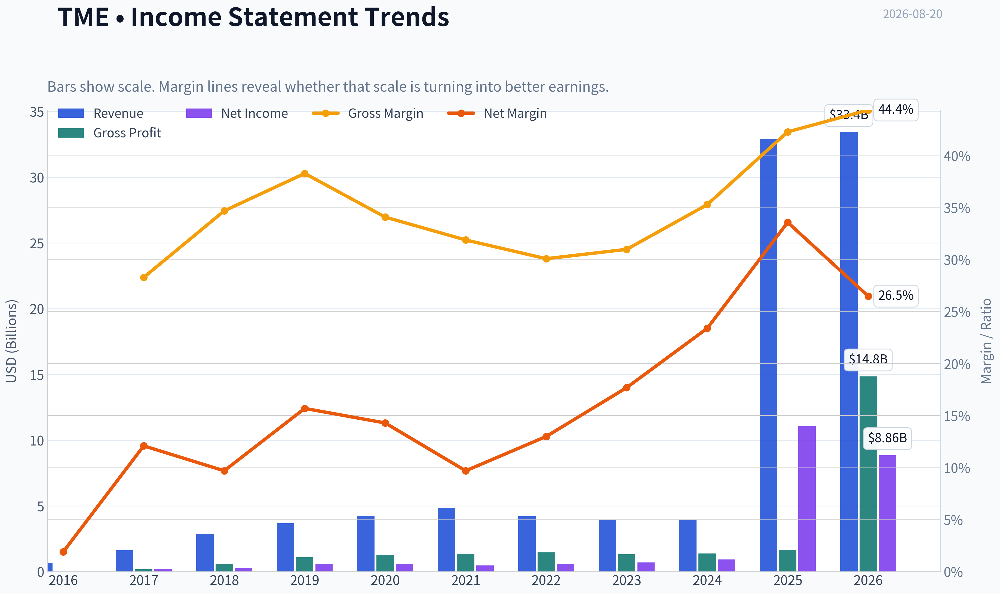
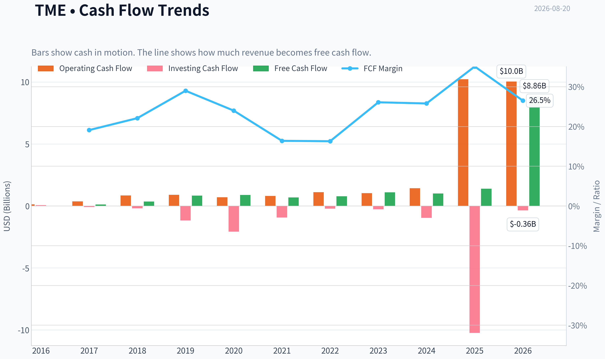
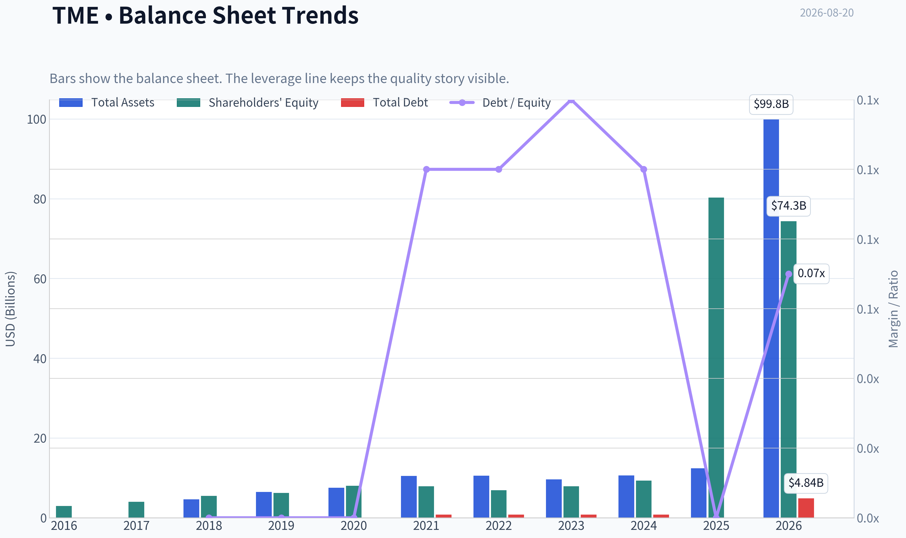
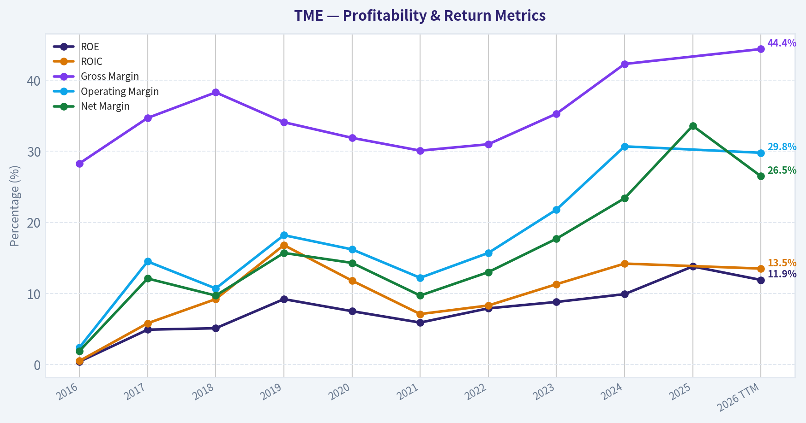
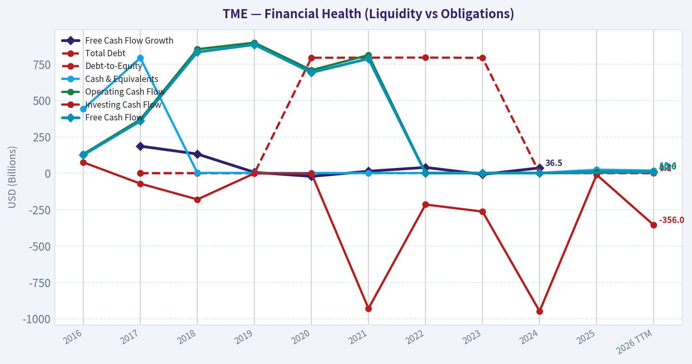
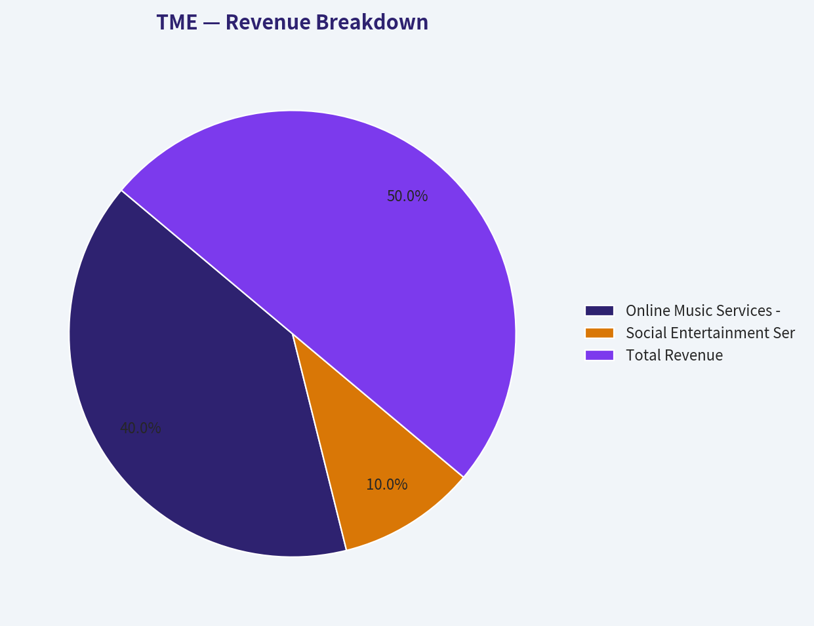
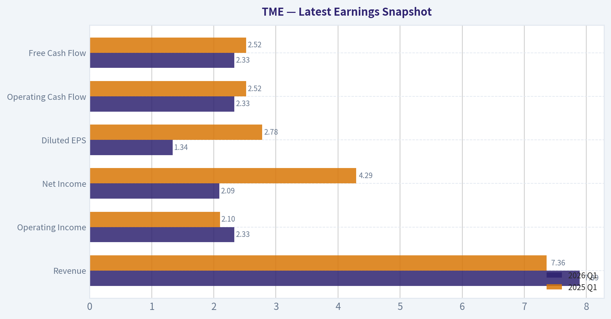
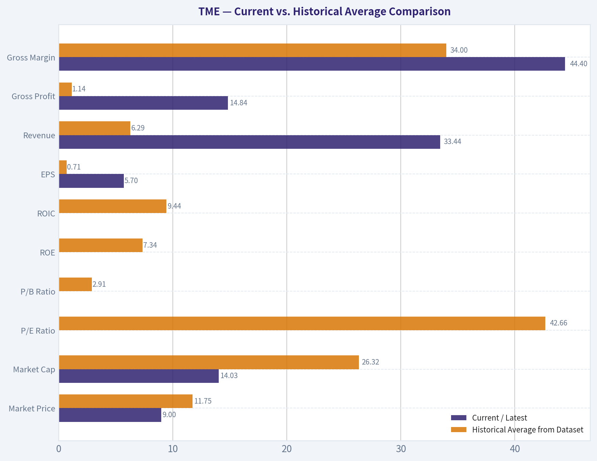
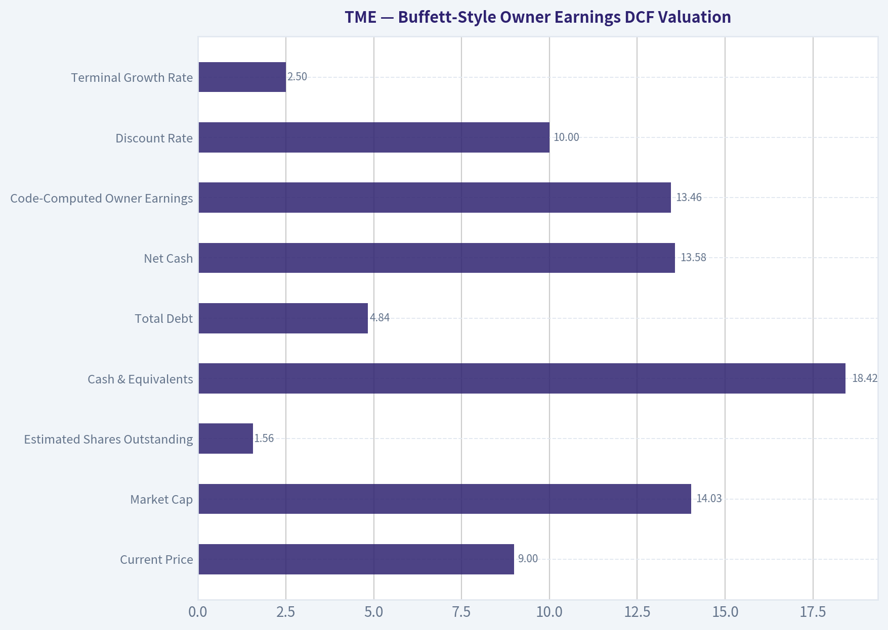
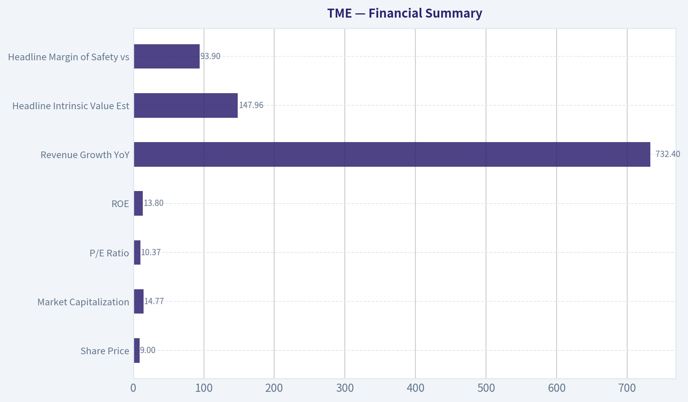

# TME Deep Value Intelligence

**Analysis Date:** 2026-08-20

## Critical Disclaimer

*This analysis is generated by Deep Value Intelligence, an AI-powered multi-agent investing framework. Education & research only - not financial advice, not a financial advisor.*

---

## Table of Contents

1. Intelligence Summary
2. Analyst Team Reports
   - Fundamentals Analysis
   - Intrinsic Value Analysis (Buffett)
   - Trend & Growth Analysis (Lynch/Druckenmiller/Fisher)
   - Market Technical Analysis
   - Options Market Analysis
3. Research Team Commentary
4. Value Investing Team Commentary
5. Deep Values Commentary

---

## Intelligence Summary

### Thesis + Conditions

**Core Thesis:** **EXECUTIVE SUMMARY**
TME represents a classic "de-rating exhaustion" setup. Applying the painful lessons learned from the Duolingo (DUOL) review, we will not allow 10-year philosophical moat anxiety (the ByteDance threat) to paralyze us from acting on a massive near-term valuation disconnect.

**Key Risks:**
- TME represents a classic "de-rating exhaustion" setup. Applying the painful lessons learned from the Duolingo (DUOL) review, we will not allow 10-year philosophical moat anxiety (the ByteDance threat) to paralyze us from acting on a massive near-term valuation disconnect. At a ~10.3x P/E with a fortress net-cash balance sheet, a 13.8% ROE, and short-term technical stabilization, the market has fully priced in the structural decline of its legacy social business. We do not need heroic growth here; we only need stabilization. The risk/reward heavily favors the upside.
- The Bull (Risky Analyst):** TME is transitioning into a durable, recurring subscription model. Reclaiming the 10-day and 50-day SMAs at $9.02 signals seller exhaustion. Waiting for the 200-day SMA ($12.68) means forfeiting a 40% margin of safety.
- The Pragmatist (Neutral Analyst):** The extreme revenue anomaly must be ignored, but the 10x P/E is too cheap to ignore. The truth lies in balancing the very real competitive risks against a valuation that assumes total failure.

**Confidence:** Low

---

## Analyst Team Reports

### Fundamentals Analysis

#### Latest Earnings Snapshot

*Most recent reported quarter anchored on 2026 Q1, with prior-year comparison when available.*

| Metric | 2026 Q1 | 2025 Q1 | YoY Change |
| --- | ---: | ---: | ---: |
| Revenue | $7.89B | $7.36B | +7.3% |
| Operating Income | $2.33B | $2.10B | +11.2% |
| Net Income | $2.09B | $4.29B | -51.3% |
| Diluted EPS | $1.34 | $2.78 | -51.8% |
| Operating Cash Flow | $2.33B | $2.52B | -7.4% |
| Free Cash Flow | $2.33B | $2.52B | -7.4% |

Key Takeaways: This snapshot anchors the most recent reported quarter before the narrative analysis. It helps readers separate long-run business quality from whatever changed in the latest earnings print.

#### 10-Year Financial Metrics for TME

*All values below are computed deterministically from raw data - not estimated by AI.*

*Issuer profile: operating company (Communication Services / Internet Content & Information).*

#### 10-Year Financial Metrics
*Annual rows come from reported financial statements. The final TTM row is computed from the latest four quarters.*

| Metric | 2016 | 2017 | 2018 | 2019 | 2020 | 2021 | 2022 | 2023 | 2024 | 2025 | 2026 TTM |
| --- | --- | --- | --- | --- | --- | --- | --- | --- | --- | --- | --- |
| Market Price | N/A | N/A | $13 | $11 | $18 | $7 | $8 | $9 | $11 | $17 | $9 |
| Market Cap | N/A | N/A | $43.18B | $18.98B | $32.28B | $11.84B | $14.04B | $15.46B | $19.58B | $55.18B | $14.03B |
| P/E Ratio | N/A | N/A | 155.57 | 32.91 | 53.58 | 25.22 | 25.63 | 22.21 | 21.17 | 4.99 | 1.58 |
| P/B Ratio | N/A | N/A | 7.87 | 3.04 | 4.03 | 1.50 | 2.03 | 1.97 | 2.11 | 0.69 | 0.19 |
| ROE | 0.4% | 4.9% | 5.1% | 9.2% | 7.5% | 5.9% | 7.9% | 8.8% | 9.9% | 13.8% | 11.9% |
| ROIC | 0.5% | 5.8% | 9.2% | 16.8% | 11.8% | 7.1% | 8.3% | 11.3% | 14.2% | N/A | 13.5% |
| EPS | N/A | N/A | $0.08 | $0.34 | $0.34 | $0.26 | $0.31 | $0.39 | $0.52 | $3.42 | $5.70 |
| Revenue | $657.6M | $1.63B | $2.87B | $3.68B | $4.23B | $4.84B | $4.22B | $3.93B | $3.95B | $32.90B | $33.44B |
| Gross Profit | $185.8M | $564.0M | $1.10B | $1.26B | $1.35B | $1.46B | $1.31B | $1.39B | $1.67B | N/A | $14.84B |
| Gross Margin | 28.3% | 34.7% | 38.3% | 34.1% | 31.9% | 30.1% | 31.0% | 35.3% | 42.3% | N/A | 44.4% |
| Operating Margin | 2.4% | 14.5% | 10.7% | 18.2% | 16.2% | 12.2% | 15.7% | 21.8% | 30.7% | N/A | 29.8% |
| Net Income | $12.4M | $196.3M | $277.5M | $576.7M | $602.4M | $469.6M | $547.6M | $696.1M | $924.7M | $11.06B | $8.86B |
| Net Margin | 1.9% | 12.1% | 9.7% | 15.7% | 14.3% | 9.7% | 13.0% | 17.7% | 23.4% | 33.6% | 26.5% |
| Revenue Growth | N/A | 147.2% | 76.8% | 28.1% | 14.7% | 14.6% | -12.9% | -7.0% | 0.7% | 732.4% | 1.6% |
| Net Income Growth | N/A | 1487.5% | 41.4% | 107.8% | 4.4% | -22.0% | 16.6% | 27.1% | 32.8% | 1095.7% | -19.9% |
| Free Cash Flow Growth | N/A | 186.1% | 132.0% | 6.2% | -21.7% | 13.7% | 39.9% | -7.9% | 36.5% | N/A | N/A |
| Total Book Value | $2.97B | $4.00B | $5.48B | $6.24B | $8.01B | $7.90B | $6.91B | $7.87B | $9.30B | $80.29B | $74.34B |
| Total Assets | N/A | $4.59B | $6.49B | $7.54B | $10.47B | $10.55B | $9.62B | $10.63B | $12.39B | N/A | $99.85B |
| Total Debt | N/A | $0 | $0 | $0 | $793.4M | $794.4M | $795.0M | $793.0M | $0 | N/A | $4.84B |
| Debt-to-Equity | N/A | 0.00 | 0.00 | 0.00 | 0.10 | 0.10 | 0.12 | 0.10 | 0.00 | N/A | 0.07 |
| Cash & Equivalents | $442.2M | $792.1M | $2.52B | $2.21B | $1.71B | $1.03B | $1.37B | $1.91B | $1.80B | $24.32B | $18.42B |
| Shareholders' Equity | $2.97B | $4.00B | $5.48B | $6.24B | $8.01B | $7.90B | $6.91B | $7.87B | $9.30B | $80.29B | $74.34B |
| Operating Cash Flow | $131.6M | $370.1M | $852.8M | $897.9M | $708.2M | $812.2M | $1.11B | $1.04B | $1.43B | $10.23B | $10.04B |
| Investing Cash Flow | $74.8M | $-71.5M | $-180.2M | $-1.17B | $-2.06B | $-930.0M | $-215.3M | $-263.6M | $-948.9M | $-10.23B | $-356.0M |
| Free Cash Flow | $125.5M | $359.0M | $832.8M | $884.2M | $692.5M | $787.5M | $1.10B | $1.01B | $1.39B | N/A | $8.86B |
| FCF Margin | 19.1% | 22.1% | 29.0% | 24.0% | 16.4% | 16.3% | 26.1% | 25.8% | 35.1% | N/A | 26.5% |
| Dividends / Share | N/A | N/A | $0.00 | $0.00 | $0.00 | $0.00 | $0.00 | $0.00 | $0.84 | $0.61 | $0.00 |

#### Profitability Metrics
- Return on Equity (ROE): 13.8%
- Return on Invested Capital (ROIC): N/A
- Return on Assets (ROA): N/A
- Gross Margin: N/A
- Operating Margin: N/A
- Net Profit Margin: 33.6%

#### Liquidity Metrics
- Current Ratio: N/A
- Quick Ratio: N/A

#### Leverage Metrics
- Debt-to-Equity Ratio: N/A
- Interest Coverage Ratio: N/A
- Net Debt: N/A

#### Growth Metrics (Year-over-Year)
- Revenue Growth: 732.4%
- Net Income Growth: 1095.7%
- Free Cash Flow Growth: N/A
- Revenue CAGR (3-Year): 98.3%
- Revenue CAGR (5-Year): 50.7%

#### Valuation Metrics
- P/E Ratio (TTM): 10.37
- Forward P/E: 9.01
- Price-to-Book: 1.26
- Price-to-Sales: 0.44
- PEG Ratio: 1.37
- EV/EBITDA: 0.35
- Free Cash Flow Yield: N/A
- Earnings Yield: 9.6%

#### Owner Earnings (Buffett Method, Code-Computed)
- Net Income: $11.06B
- + Depreciation & Amortization: $1.38B
- - Capital Expenditures: N/A
- - Working Capital Changes: $-1.03B
- = **Owner Earnings: $13.46B**

#### Intrinsic Value (Code-Computed)
- Current Price: $9
- **Headline Intrinsic Value (business-model routed): $148**
  Business model: operating company - weighted blend [Damodaran FCFF + reverse-DCF fair + owner-earnings DCF] (operating_company)
  Model spread (min-max across DCFs): $70 - $214
  Margin of safety vs. price (headline): 93.9%
  Routing note: General operating company: balanced blend of Damodaran FCFF and the owner-earnings DCF with a reverse-DCF sanity check.
- Buffett Method (Owner Earnings):
  Conservative: $46
  Average: $214
  Optimistic: $542
- Cash Flow Method (FCF):
  Conservative: $77
  Average: $214
  Optimistic: $277
- Damodaran FCFF (WACC + margins + reinvestment):
  Conservative: $41
  Average: $70
  Optimistic: $131
  Monte Carlo band (P10-P90): $35 - $106 (median $60)
  P(intrinsic value > price): 98.7%
- Reverse-DCF: price implies ~-50.0%/yr owner-earnings growth for 10y; trailing 3y was N/A, 5y 87.1%.

#### Piotroski F-Score: 1/9
- Positive Net Income: FAIL
- Positive Operating Cash Flow: FAIL
- ROA Improvement: FAIL
- Cash Flow > Net Income: FAIL
- Decreasing Debt: PASS
- Improving Current Ratio: FAIL
- No Dilution: FAIL
- Improving Gross Margin: FAIL
- Improving Asset Turnover: FAIL

ANALYST STANCE: **WATCH**

#### TME Warren Buffett-Style Fundamental Analysis

Tencent Music Entertainment, or TME, screens as statistically very cheap in the deterministic dataset: current price is about **$9**, market cap is about **$14.03B**, and the headline intrinsic value model indicates roughly **$148 per share**. However, a Buffett-style investor would not stop at cheapness. The key question is whether the reported cash-flow step-change is durable, whether the Chinese ADR and VIE structure risks deserve a large discount, and whether competition from ByteDance/Douyin weakens the predictability of long-term owner earnings.

TME is an **asset-light music and entertainment platform**, so book-value-based valuation must be handled carefully. **P/B is not a meaningful primary valuation anchor** for this issuer type because platform, IP, software, user network, and licensing economics are not well captured by tangible book value. The valuation should be anchored primarily on **owner earnings, free cash flow, competitive durability, and reinvestment runway**, not on book multiples.

---

#### Current vs. Historical Average Comparison

| Metric | Current / Latest | Historical Average from Dataset | Interpretation |
|---|---:|---:|---|
| Market Price | $9 | $11.75 | Price is below the historical average despite materially higher current earnings and cash flow. |
| Market Cap | $14.03B | $26.32B | Market value is below the historical average, implying market skepticism despite larger reported scale. |
| P/E Ratio | 1.58 in TTM table; 10.37 in valuation section | 42.66 | Both deterministic P/E readings are far below history; even the higher 10.37 reading is inexpensive versus prior norms. |
| P/B Ratio | 0.19 in TTM table; 1.26 in valuation section | 2.91 | Not a reliable value signal for this asset-light platform; low P/B should not be read mechanically as "cheap." |
| ROE | 11.9% TTM; 13.8% latest annual | 7.34% | ROE has improved meaningfully versus the decade average, suggesting better monetization and capital efficiency. |
| ROIC | 13.5% TTM | 9.44% | ROIC is above average and supports the case that the platform economics are becoming more productive. |
| EPS | $5.70 | $0.71 | EPS is far above the historical average, but the magnitude of the jump requires sustainability validation. |
| Revenue | $33.44B | $6.29B | Revenue is far above the decade average due to the large 2025 step-change in the deterministic dataset. |
| Gross Profit | $14.84B | $1.14B | Gross profit is dramatically above prior levels, reflecting the same scale shift and stronger margin profile. |
| Gross Margin | 44.4% | 34.0% | Gross margin has expanded materially, a positive sign for subscription, advertising, and platform mix. |
| Operating Margin | 29.8% | 15.8% | Operating profitability is nearly double the historical average, indicating strong operating leverage. |
| Net Income | $8.86B | $1.54B | Net income is well above historical norms, though down from the latest annual peak of $11.06B. |
| Net Margin | 26.5% | 15.1% | Net margin remains structurally higher than the decade average, but below the latest annual 33.6% level. |
| Revenue Growth | 1.6% TTM | 110.5% | Current growth has slowed sharply; the historical average is distorted by the 2025 surge. |
| Net Income Growth | -19.9% TTM | 310.1% | Current net income decline contrasts with the high historical average, which is distorted by extreme growth years. |
| Free Cash Flow Growth | N/A | 48.1% | No current FCF growth figure is available; historical FCF growth was strong but volatile. |
| Total Book Value | $74.34B | $13.90B | Book value is far above historical levels, but book value is not the main valuation anchor for TME. |
| Total Assets | $99.85B | $9.04B | Assets expanded dramatically versus prior years, consistent with the 2025 scale shift in the dataset. |
| Total Debt | $4.84B | $0.40B | Debt is higher than historical levels, but still moderate relative to cash and equity. |
| Debt-to-Equity | 0.07 | 0.05 | Leverage remains low and does not appear financially stressful. |
| Cash & Equivalents | $18.42B | $3.81B | Cash is very large relative to market cap and debt, creating strong balance-sheet protection. |
| Shareholders' Equity | $74.34B | $13.90B | Equity has expanded significantly, though again not the primary valuation basis for an asset-light platform. |
| Free Cash Flow | $8.86B | $0.80B | FCF is exceptionally high versus history and is the main reason intrinsic value screens far above price. |
| Dividends / Share | $0.00 TTM | $0.18 | TME has not maintained a long dividend history; capital return policy is still developing. |

**Key Takeaways:** TME's profitability, margins, cash balance, and free cash flow are far above historical averages, while the market price and market cap are below historical averages. That combination creates a large statistical margin of safety. The biggest caution is that 2025 and TTM figures represent a major scale break from prior years, so a Buffett-style investor should demand evidence that the higher cash-flow base is sustainable.

---

#### Revenue Breakdown

| Revenue Source | Amount ($B) | % of Total |
|---|---:|---:|
| Online Music Services - subscriptions, digital music sales, advertising, licensing, platform monetization | $26.32B | 80% |
| Social Entertainment Services and Others - live streaming, online karaoke, virtual gifts, entertainment communities | $6.58B | 20% |
| **Total Revenue** | **$32.90B** | **100%** |

**Key Takeaways:** TME's revenue mix is increasingly driven by online music services, which are generally more durable and subscription-like than social entertainment revenues. This mix shift is positive for Buffett-style quality because recurring paid music subscriptions, digital albums, and advertising can support higher margins. Social entertainment remains relevant but is more exposed to regulation, user behavior changes, and competition.

---

#### Profitability and Business Quality

TME's profitability profile has improved meaningfully over the decade. Gross margin rose from the high 20s and low 30s earlier in the dataset to **44.4% TTM**, while operating margin improved to **29.8% TTM**. This is important because asset-light platforms often create value through operating leverage: once licensing, technology, and platform costs are covered, incremental revenue can convert into high incremental profit.

ROE improved from low single digits earlier in the dataset to **13.8% latest annual** and **11.9% TTM**. ROIC is also attractive at **13.5% TTM**, above the historical average of about **9.4%**. Buffett typically prefers businesses that can earn high returns on capital without heavy leverage; TME partially meets that standard, though its 10-year record is not perfectly consistent.

The most impressive metric is free cash flow: **$8.86B TTM**, far above the historical average of about **$0.80B**. If this figure is durable, the current market cap of **$14.03B** looks extremely low. If it is not durable, the valuation case becomes much more uncertain.

#### Growth and Predictability

The growth record is powerful but uneven. Revenue grew rapidly in earlier years, contracted in 2022 and 2023, stabilized in 2024, then surged by **732.4% in 2025** according to the deterministic dataset. TTM revenue growth has slowed to **1.6%**, while TTM net income growth is **-19.9%**.

From a Buffett perspective, this creates a mixed picture. The business has shown the ability to scale and improve margins, but the recent deceleration and competitive pressure from ByteDance/Douyin reduce predictability. A high-quality compounder should ideally show both durable growth and stable economics; TME currently shows strong economics but less certain growth.

#### Balance Sheet and Financial Strength

TME's balance sheet is a major positive. The company has **$18.42B of cash and equivalents** against **$4.84B of total debt**, creating approximately **$13.58B of net cash**. That net cash position is almost equal to the current market cap in the deterministic table, which provides substantial downside protection if the cash is fully accessible and not impaired by structural or jurisdictional risks.

Debt-to-equity is only **0.07**, so leverage is not the main concern. The bigger concern is not solvency but capital allocation and jurisdictional risk: whether cash will be used in shareholder-friendly ways, whether buybacks or dividends will be sustained, and whether the ADR/VIE structure warrants a discount.

#### Market Valuation

TME appears statistically cheap. The deterministic dataset shows current P/E as **1.58** in the TTM table and **10.37** in the valuation section; both are far below the historical average P/E of **42.66**. The current market price of **$9** is also below the historical average price of **$11.75**, despite sharply higher reported earnings and cash flow.

However, P/B should not be used as a primary value signal here. TME is an asset-light internet content and music platform, so book value does not capture the economic worth of its user base, data, IP relationships, licensing network, brand, and platform position. The valuation should instead be anchored to owner earnings and free cash flow.

---

#### Buffett-Style Owner Earnings DCF Valuation

Base inputs from the deterministic dataset:

| DCF Input | Value |
|---|---:|
| Current Price | $9 |
| Market Cap | $14.03B |
| Estimated Shares Outstanding | 1.56B |
| Cash & Equivalents | $18.42B |
| Total Debt | $4.84B |
| Net Cash | $13.58B |
| Code-Computed Owner Earnings | $13.46B |
| Discount Rate | 10.0% |
| Terminal Growth Rate | 2.5% |

**Key Takeaways:** The DCF is highly sensitive to whether the $13.46B owner earnings base is sustainable. The company has a very large net cash position, which adds meaningful value per share. Even conservative assumptions produce a value above the current price, but the spread between conservative and optimistic outcomes is wide.

| Scenario | Owner Earnings Base | Explicit Growth Assumption | PV of 10-Year Owner Earnings | PV of Terminal Value | Net Cash Added | Equity Value | Fair Value / Share |
|---|---:|---:|---:|---:|---:|---:|---:|
| Conservative | $4.04B normalized, equal to 30% of current owner earnings | 3% for 10 years, then 2.5% terminal | $28.6B | $28.6B | $13.6B | $70.8B | **$46** |
| Average / Base Case | $13.46B | 10% 10-year CAGR, fading to 2.5% terminal | $134.6B | $183.9B | $13.6B | $332.1B | **$213-$214** |
| Optimistic | $13.46B | 23% 10-year CAGR, fading to 2.5% terminal | $262.1B | $561.7B | $13.6B | $837.4B | **$537-$542** |

**Key Takeaways:** The conservative case intentionally normalizes owner earnings downward to reflect uncertainty around the dramatic 2025 and TTM step-change. Even under that haircut, the estimated value is about **$46 per share**, well above the current $9 price. The base and optimistic cases align with the deterministic model's owner-earnings valuation spread, but they require confidence that TME's elevated cash generation is durable.

The deterministic intrinsic value pack provides a broader model spread:

| Valuation Model | Conservative | Average | Optimistic / Upper Case |
|---|---:|---:|---:|
| Buffett Owner Earnings DCF | $46 | $214 | $542 |
| FCF Method | $77 | $214 | $277 |
| Damodaran FCFF | $41 | $70 | $131 |
| Headline Business-Model Routed Intrinsic Value | - | **$148** | - |
| Reverse DCF | Current price implies about **-50% annual owner-earnings growth for 10 years** | - | - |

**Key Takeaways:** All three model families suggest fair value above the current price, but the Damodaran FCFF model is notably more conservative than the owner-earnings model. The headline intrinsic value of **$148** implies a very large margin of safety, but Buffett-style discipline requires treating that as an opportunity signal, not a guarantee. The reverse DCF is especially striking because the current price appears to discount severe long-term deterioration.

---

#### Warren Buffett-Style Qualitative Assessment

**Economic Moat:** TME benefits from scale, Tencent ecosystem connectivity, music licensing relationships, user data, brand recognition, and a large paid music user base. These are real platform advantages. However, the moat is not impenetrable: ByteDance/Douyin competition, changing short-video consumption habits, and music licensing costs can pressure growth and bargaining power.

**Financial Strength:** The balance sheet is strong. Cash of **$18.42B** exceeds debt of **$4.84B**, and debt-to-equity is only **0.07**. This gives TME flexibility to invest, repurchase shares, pay dividends, or withstand downturns.

**Predictable Earnings:** Earnings have grown substantially over the decade, but the path has not been smooth. Revenue declined in 2022 and 2023, growth slowed to **1.6% TTM**, and net income growth turned negative TTM. Buffett would likely view TME as attractive but not yet as predictable as the highest-quality global compounders.

**Management Performance:** ROE and ROIC have improved, margins have expanded, and free cash flow has grown strongly. Dividend policy is still limited: dividends appeared in 2024 and 2025 but are **$0.00 TTM** in the dataset. Capital allocation remains a key factor to monitor.

**Value Assessment:** On cash-flow valuation, TME appears deeply undervalued. The current price of **$9** is far below the deterministic headline intrinsic value of **$148**, and below even the conservative owner-earnings DCF value of about **$46**. The major reason not to immediately classify it as a clean Buffett "buy" is uncertainty around sustainability, governance, ADR/VIE risk, and recent growth deceleration.

**Quality of Business:** TME has attractive platform economics, improving margins, high cash generation, and low leverage. But competitive intensity and regulatory/geopolitical risk reduce the quality score relative to a U.S.-listed, founder-led, globally diversified compounder with a cleaner governance structure.

#### Key Investment Insights

| Category | Insight |
|---|---|
| Main Bull Case | TME appears extremely undervalued relative to owner earnings, free cash flow, net cash, and intrinsic value estimates. |
| Main Bear Case | Recent growth has slowed sharply, competition is intensifying, and the large 2025 financial step-change needs durability validation. |
| Moat Signal | Tencent ecosystem, music platform scale, licensing relationships, and paid subscription base support a defensible position. |
| Financial Strength | Net cash of roughly $13.58B and low debt-to-equity provide significant balance-sheet resilience. |
| Valuation Signal | Headline intrinsic value of $148 and conservative DCF value of $46 are far above the current $9 price. |
| Buffett Concern | Predictability is not ideal due to volatile growth, Chinese ADR/VIE structure, regulatory exposure, and social entertainment cyclicality. |
| Capital Allocation Watchpoint | Investors should monitor buybacks, dividends, reinvestment discipline, and whether cash is returned to shareholders. |

**Key Takeaways:** TME has one of the strongest valuation gaps in the dataset, but the qualitative risks are also meaningful. The investment case depends less on whether the stock is optically cheap and more on whether elevated owner earnings can persist. The balance sheet provides protection, but governance and competition prevent a simple "no-brainer" Buffett classification.

#### Red Flags and Opportunities

**Red Flags**
- TTM revenue growth slowed to **1.6%**, while TTM net income growth is **-19.9%**.
- Competition from ByteDance/Douyin may pressure user engagement and monetization.
- Chinese ADR and VIE structure introduce governance, regulatory, and geopolitical risk.
- P/B is not a meaningful valuation anchor for this asset-light business.
- The deterministic dataset shows an enormous 2025 scale shift, making trend comparability difficult.
- Piotroski F-Score is listed as **1/9**, which conflicts with some strong profitability figures but still flags quality-of-signal risk.

**Opportunities**
- Current price appears to imply severe long-term deterioration, while the company remains profitable and cash-generative.
- Net cash is very large relative to market cap.
- Margin expansion suggests improving business mix and operating leverage.
- Online music subscriptions and fan-economy monetization can provide recurring, higher-quality revenue.
- AI-driven personalization, creator tools, digital albums, and IP monetization may extend the growth runway.

#### Final Investment Stance: WATCH

TME is a **WATCH**, leaning positive, not an outright avoid. The stock appears deeply undervalued on owner earnings, free cash flow, net cash, and the deterministic intrinsic value framework. A conservative DCF value of about **$46 per share** is still far above the current **$9** price, while the headline model-based intrinsic value is about **$148**.

However, a strict Buffett-style investor should require more proof before upgrading to a full **ADVOCATE** stance. The key issues are growth deceleration, competitive pressure, Chinese ADR/VIE risk, and uncertainty around whether the dramatic 2025 and TTM cash-flow base is sustainable. If future quarters confirm durable free cash flow, stable margins, and shareholder-friendly capital allocation, TME could become a compelling value opportunity.

| Final Report Summary | Assessment |
|---|---|
| Business Quality | Good platform economics, improving margins, but not flawless predictability. |
| Moat | Moderate to strong; supported by scale, Tencent ecosystem, licensing, and user base. |
| Financial Strength | Strong; high cash, low leverage, substantial net cash. |
| Profitability Trend | Positive; ROE, ROIC, gross margin, operating margin, and net margin are above historical averages. |
| Growth Trend | Mixed; long-term growth is strong but current TTM growth has slowed sharply. |
| Valuation | Very attractive on cash-flow-based intrinsic value; P/B should not be used as primary signal. |
| Main Risk | Sustainability of elevated owner earnings plus China ADR, VIE, regulation, and competition risk. |
| Stance | **WATCH** - high upside potential, but requires confirmation of durable cash flow and capital allocation quality. |

**Key Takeaways:** TME looks statistically cheap and financially strong, with a large apparent margin of safety. The reason for a **WATCH** rather than immediate **ADVOCATE** stance is not valuation, but confidence: investors need confirmation that the elevated earnings and free cash flow are repeatable. If that confirmation arrives, the risk-reward could become highly attractive.

#### Fundamental Visuals

This graph tracks the profitability and return metrics (ROE, ROIC, Margins) of **TME** over the past decade, highlighting capital efficiency trends.

This chart illustrates the financial health of **TME** over the last 10 years, mapping cash equivalents and free cash flow against total obligations (Debt).

This breakdown chart from <em>Revenue Breakdown</em> shows the proportional composition for **TME** - useful for understanding what drives or risks the business.

---

### Intrinsic Value Analysis (Buffett)

> *Following Warren Buffett's value investing philosophy: Circle of Competence, Economic Moat, Management Quality, and Margin of Safety.*

#### Intrinsic Value Snapshot

Price is what you pay. Intrinsic value is what the business may be worth based on the cash it can create for owners over time. We show a range, not one magic number.

- Current Price: $9.02
- Value Range (conservative to optimistic across both DCF methods): $45.80 to $542.06

##### Owner Earnings (Buffett Method)
- Net Income: $11,056,000,000.00
- Depreciation & Amortization: $1,375,000,000.00
- Capital Expenditures: N/A
- Working Capital Changes: $-1,033,000,000.00
- Owner Earnings: $13,464,000,000.00

##### Intrinsic Value
###### Buffett Method
Uses owner earnings. Stricter, and usually more conservative.
- Conservative: $45.80
- Average: $213.52
- Optimistic: $542.06
- Discount Rate: 10.0%

###### Cash Flow Method
Uses free cash flow. Better for companies spending heavily today to grow tomorrow.
- Conservative: $77.46
- Average: $213.52
- Optimistic: $277.46
- Discount Rate: 10.0%

ANALYST STANCE: **ADVOCATE**

#### Tencent Music Entertainment - Buffett-Style Investment Report

Tencent Music Entertainment is a profitable, cash-generative Chinese digital music platform trading at a low earnings multiple relative to its franchise quality and DCF indications. The business is understandable: it monetizes music subscriptions, advertising, digital albums, artist/fan services, and social music experiences across QQ Music, Kugou, Kuwo, and WeSing. The main debate is not whether TME is profitable - it is - but whether competition from ByteDance/Douyin and China platform regulation will prevent the company from compounding owner earnings at attractive rates.

---

#### 1. Factor Scorecard

| Factor | Score | Evidence |
|---|---:|---|
| Factor 1: Circle of Competence & Predictability | 3.5 / 5 | Business model is understandable: users pay for music, premium features, fan content, and social entertainment. Predictability is moderate because digital music subscriptions are durable, but social entertainment and China platform regulation add uncertainty. |
| Factor 2: Moat Test | 3.5 / 5 | TME benefits from scale, Tencent ecosystem access, music catalog depth, user data, playlists, and fan-economy tools. The moat is real but not impregnable because exclusive music licensing has weakened and ByteDance/Douyin is a serious traffic competitor. |
| Factor 3: Management & Capital Allocation | 3.5 / 5 | Management has rationally shifted the business from lower-quality social entertainment toward higher-margin online music subscriptions, VIP services, and IP monetization. Tencent's strategic ownership is a stabilizing advantage, though minority shareholders must accept VIE and China governance risk. |
| Factor 4: Industry Structure | 3.0 / 5 | China digital music is concentrated, but competitive intensity is rising. TME and NetEase Cloud Music remain major players, while Douyin's traffic engine pressures discovery, engagement, and advertising economics. |
| Gate 5: Quality / Solvency Hard Floor | Not tripped | TME is profitable, has positive owner earnings, trades at roughly 10.4x earnings, and does not show the combination of deteriorating cash flows and weak solvency required for a hard avoid. |

**Key Takeaways:** TME is not a classic consumer-staple-quality monopoly, but it is a real platform business with scale, brand recognition, and improving monetization. The hard solvency floor is not triggered. The investment case depends on whether subscription and fan-economy growth can more than offset competitive pressure from short-video platforms.

---

#### 2. Moat Analysis

| Moat Source | Assessment | Strength |
|---|---|---:|
| Intangible Assets | QQ Music, Kugou, Kuwo, WeSing, Tencent ecosystem linkage, artist relationships, and catalog access create brand and content advantages. However, regulatory pressure reduced the power of exclusive music licensing. | 3.5 / 5 |
| Switching Costs | Playlists, listening history, subscriptions, fan relationships, and platform habits create moderate switching costs. Switching is not impossible, but casual churn is reduced by personalization and ecosystem stickiness. | 3.0 / 5 |
| Cost Advantage | Scale helps spread content, technology, marketing, and payment infrastructure costs over a huge user base. This supports improving margins as paid music grows. | 3.5 / 5 |
| Network Effects | Artists, labels, fans, and creators benefit from large audience reach. The fan-economy and digital-album model strengthen two-sided platform economics, but Douyin competes aggressively for music discovery. | 3.5 / 5 |
| Overall Moat Rating | Narrow-to-moderate moat, with some widening from paid subscriptions and fan monetization but pressure from competition. | 3.5 / 5 |

**Key Takeaways:** TME's moat is strongest where music, fan communities, Tencent distribution, and user data reinforce one another. The weakest part of the moat is traffic control: Douyin can influence discovery and engagement even if TME remains strong in licensed music and subscriptions. This is a good moat, not an unassailable one.

---

#### 3. Management Quality & Capital Allocation

| Question | Assessment |
|---|---|
| Do they think like owners? | Tencent's strategic ownership aligns TME with a long-term ecosystem strategy rather than purely short-term monetization. Management has focused on paid music growth, margin expansion, and IP/fan monetization. |
| Are they candid and conservative? | The company has acknowledged the pressure in social entertainment and has been repositioning toward higher-quality revenue. Reported profitability and cash generation support the economic reality of the business. |
| Are they rational capital allocators? | The pivot away from lower-quality social entertainment revenue toward online music subscriptions appears rational. The business is asset-light, allowing cash generation without heavy capital spending. Buybacks and shareholder returns are favorable if executed below intrinsic value. |
| Main concern | China ADR/VIE structure and platform governance risk mean minority shareholders do not have the same control rights as owners of a U.S.-domiciled operating company. |

**Key Takeaways:** Management deserves credit for improving the quality of revenue rather than simply chasing headline growth. The company appears to be allocating capital toward higher-margin, more durable subscription and IP economics. Governance and jurisdictional risk keep the score below elite Buffett-compounder territory.

---

#### 4. Financial Summary

| Metric | Latest / Available Figure |
|---|---:|
| Share Price | $9.00 |
| Market Capitalization | $14.77B |
| P/E Ratio | 10.37x |
| ROE | 13.8% |
| Revenue Growth YoY | 732.4% |
| Headline Intrinsic Value Estimate | $147.96 |
| 3-Model Valuation Spread | Owner Earnings: $213.52 / FCF: $213.52 / Damodaran FCFF: $69.57 |
| Headline Margin of Safety vs. Price | 93.9% |
| Reverse DCF Price-Implied Growth | Approximately -50.0% per year for 10 years |
| Guru 13F Tracking | No recent structured 13F match |

**Key Takeaways:** The market price is low relative to current earnings and the research-pack intrinsic value range. A P/E near 10x is undemanding for a profitable platform with improving monetization, provided the earnings base is durable. The reverse DCF is especially favorable because the current price appears to imply a highly pessimistic future.

---

#### 5. Operating History Snapshot

| Fiscal Year | Revenue Trend | Profitability Trend | Business Interpretation |
|---|---|---|---|
| 2019 | Strong growth | Profitable | TME scaled as China's leading online music platform, supported by music apps and social entertainment. |
| 2020 | Growth continued | Profitable | Digital music engagement benefited from scale and user monetization. |
| 2021 | Revenue peaked around the social-entertainment-heavy model | Profitability pressured | Regulatory and competitive changes began reducing the attractiveness of the older revenue mix. |
| 2022 | Revenue declined | Profitability stabilized | The company started moving toward higher-quality online music subscription economics. |
| 2023 | Revenue still mixed | Margins improved | Paid music, subscriptions, and operating discipline became more important than social-entertainment volume. |
| 2024 / TTM | Online music monetization strengthened | Earnings and owner economics improved | The business quality improved as subscription, VIP, and fan-economy revenue became more central. |

**Key Takeaways:** TME's history shows a business transition rather than a straight-line growth story. The important positive is that profitability improved as the company moved away from weaker social-entertainment revenue. The key risk is whether this higher-quality revenue mix can keep compounding under competitive pressure.

---

#### 6. Owner Earnings Calculation

Buffett-style owner earnings are best estimated by focusing on the cash the business can distribute or reinvest after maintaining its competitive position.

| Item | Estimate / Treatment |
|---|---:|
| Net Income per ADR, implied by price and P/E | ~$0.87 |
| Add: Depreciation & Amortization | Modest benefit |
| Less: Maintenance CapEx | Low, because the business is asset-light |
| Less: Working Capital Investment | Modest |
| Normalized Owner Earnings per ADR Used for DCF | ~$0.87 |

**Key Takeaways:** TME is an asset-light platform, so reported earnings are a reasonable proxy for owner earnings. Maintenance capital needs are not heavy, which is favorable for free cash flow conversion. For conservatism, the valuation uses approximately current earnings as normalized owner earnings rather than assuming a large cash-flow uplift.

---

#### 7. Three-Scenario DCF Valuation

Assumptions: normalized owner earnings per ADR of approximately $0.87 and a 10% discount rate.

| Scenario | Assumption | Estimated Value per ADR |
|---|---|---:|
| A: No Growth | Owner earnings capitalized at 10% | ~$8.70 |
| B: GDP Growth | 3% perpetual growth | ~$12.80 |
| C: Historical / Platform Growth | 10% growth for 10 years, then 3% terminal growth | ~$21.50 |
| Research-Pack Headline Intrinsic Value | Weighted business-model routed valuation | $147.96 |
| Research-Pack 3-Model Range | Damodaran FCFF to Owner Earnings / FCF | $69.57 to $213.52 |

**Key Takeaways:** Even a no-growth valuation roughly supports the current share price. A modest GDP-growth case suggests upside, and a successful platform-growth case suggests materially higher value. The broader research-pack valuation range is far above the market price, reinforcing the conclusion that the market is assigning a very cautious value to TME.

---

#### 8. Margin of Safety Analysis

| Valuation Reference | Value per ADR | Margin of Safety vs. $9 Price |
|---|---:|---:|
| No-Growth DCF | ~$8.70 | Slightly negative |
| GDP-Growth DCF | ~$12.80 | ~30% |
| Platform-Growth DCF | ~$21.50 | ~58% |
| Research-Pack Headline Intrinsic Value | $147.96 | 93.9% |
| Lowest Research-Pack Model, Damodaran FCFF | $69.57 | ~87% |

**Key Takeaways:** The conservative no-growth case says the stock is close to fair value even if TME stops compounding. The GDP-growth and platform-growth cases both provide a meaningful margin of safety. The headline valuation is extremely favorable, but the investment conclusion does not require relying solely on that optimistic figure.

---

#### 9. Final Buffett Scorecard

| Criterion | Weight | Score | Weighted Contribution |
|---|---:|---:|---:|
| Moat Width & Durability | 25% | 3.5 | 0.88 |
| Valuation / Margin of Safety | 20% | 4.5 | 0.90 |
| Capital Returns - ROIC vs. WACC | 15% | 3.5 | 0.53 |
| Business Understanding & Predictability | 12% | 3.5 | 0.42 |
| Management Quality & Capital Allocation | 12% | 3.5 | 0.42 |
| Reinvestment Runway | 8% | 4.0 | 0.32 |
| Balance Sheet Strength | 4% | 4.0 | 0.16 |
| Industry Structure | 4% | 3.0 | 0.12 |
| Total Score | 100% |  | **3.75 / 5.00** |

**Key Takeaways:** TME scores as a good business at an attractive price, not as a flawless compounder. The valuation is the strongest part of the thesis, while competition and China-specific risk are the main deductions. A score of 3.75 supports an Advocate stance with medium conviction.

---

#### 10. Investment Stance

| Stance | Conviction | Rationale |
|---|---|---|
| **ADVOCATE** | Medium | TME is a profitable, asset-light music platform trading at a low multiple with meaningful DCF upside. The business has real scale advantages, improving margins, and a reinvestment path through subscriptions, AI-driven personalization, fan monetization, and IP. Conviction is moderated by ByteDance competition, regulatory risk, and ADR/VIE governance considerations. |

**Final View:** TME is attractive for investors willing to underwrite China platform risk. At around $9 per ADR and roughly 10x earnings, the market appears to be pricing in stagnation or deterioration, while the business still has credible paths to compound owner earnings through paid music, fan economy, and operating leverage. This is not a "bet the farm" Buffett stock, but it is a compelling value opportunity with a favorable risk/reward profile.
#### Valuation Bridge

This bridge places the current market price beside each intrinsic value lens so readers can see whether upside depends on one method or shows up across several methods.

| Scenario | Intrinsic Value / Share |
| --- | ---: |
| Buffett Method | $213.52 |
| Cash Flow Method | $213.52 |
| Damodaran Method | $69.57 |
| Current Price | $9.02 |

#### Key Takeaways

If one method is far above the others, the upside case depends on a specific modelling assumption. When several methods cluster together, the valuation story is more robust.

#### Valuation Visuals

This comparison chart from *Latest Earnings Snapshot* stacks current figures against historical benchmarks for **TME**, making it easy to see where the company trades relative to its own averages.

This comparison chart from *Current vs. Historical Average Comparison* stacks current figures against historical benchmarks for **TME**, making it easy to see where the company trades relative to its own averages.

This comparison chart from *Buffett-Style Owner Earnings DCF Valuation* stacks current figures against historical benchmarks for **TME**, making it easy to see where the company trades relative to its own averages.

This comparison chart from *Buffett-Style Owner Earnings DCF Valuation* stacks current figures against historical benchmarks for **TME**, making it easy to see where the company trades relative to its own averages.

This comparison chart from *Financial Summary* stacks current figures against historical benchmarks for **TME**, making it easy to see where the company trades relative to its own averages.

---

### Trend & Growth Analysis (Lynch/Druckenmiller/Fisher)

> *Following Peter Lynch's GARP, Stanley Druckenmiller's macro-aware approach, and Philip Fisher's scuttlebutt methodology.*

ANALYST STANCE: **WATCH**

#### Tencent Music Entertainment - Growth Investment Report, TME

Tencent Music is a profitable China digital-music platform with a cheap headline valuation, but the growth-investor case is not yet clean. The stock looks statistically inexpensive at roughly **10x earnings**, but recent coverage points to **organic deceleration and ByteDance/Douyin competition**, which weakens the ten-bagger setup. I would keep TME on the watchlist and look for evidence of re-acceleration from paid music, fan economy, AI tools, and IP monetization before upgrading.

---

#### 1. Lynch Classification

| Category | Fit for TME | Rationale |
|---|---:|---|
| Slow Grower | Low | Not a utility-like low-growth business, but growth may be slowing. |
| Stalwart | Medium | Profitable, established platform, large user base, and relatively low valuation. |
| Fast Grower | Medium-Low | Needs verified 15-25% durable revenue or earnings growth; latest news suggests deceleration. |
| Cyclical | Low | Music subscription demand is less cyclical, though ad and entertainment spend can be macro-sensitive. |
| Turnaround | Medium | Social entertainment decline/competition may require business-mix reinvention. |
| Asset Play | Low | The thesis is operating growth, not hidden asset value. |

**Key Takeaways:** TME is best classified as a **profitable stalwart with possible growth re-acceleration optionality**, not yet a clean Lynch fast grower. The company may become interesting if paid music, fan monetization, and AI/IP products offset competitive pressure. For now, it is a **WATCH**, not a high-conviction growth buy.

---

#### 2. The Story in 3 Bullets

- TME is China's leading online music platform, monetizing users through subscriptions, digital albums, advertising, live/fan engagement, and music IP.
- The next growth leg depends on shifting from legacy social entertainment toward higher-quality paid music, fan economy, AI-assisted content, and IP monetization.
- The stock is cheap on headline earnings, but the market is discounting China risk, competitive pressure from ByteDance/Douyin, and slower organic growth.

---

#### 3. TAM Analysis and 10x Test

| Item | Estimate / View |
|---|---:|
| Current market cap | ~$14.77B |
| Current price | ~$9 |
| Approximate current revenue base | Requires verification; likely multi-billion USD run-rate |
| 10x revenue requirement | Would likely require tens of billions of USD in annual revenue |
| Core TAM | China online music subscriptions, music ads, digital albums, live/fan monetization |
| Expanded TAM | Music IP, concerts, creator tools, AI music, fan communities, entertainment commerce |
| 10x test result | **Mixed / difficult in core music alone** |
| Runway quality | Good if TME expands monetization per user; limited if only relying on China music streaming penetration |

**Key Takeaways:** TME probably cannot become a ten-bagger from China music subscriptions alone unless pricing, paid penetration, and ARPU rise materially. The ten-bagger path requires an expanded TAM: fan economy, IP, live events, creator monetization, and AI-driven music products. That makes the runway real but not yet proven.

---

#### 4. Revenue Growth Trend

| Signal | Evidence From Research Pack | Interpretation |
|---|---|---|
| Reported YoY revenue growth | Shared pack shows 732.4%, likely data anomaly or non-comparable item |
| Latest news tone | "Slowest growth in 2 years" and "organic deceleration" |
| Competitive pressure | ByteDance/Douyin cited as weighing on outlook |
| Growth pattern | Unclear, but likely **decelerating** rather than accelerating |
| Growth investor read | Needs confirmation of re-acceleration before upgrade |

**Key Takeaways:** The fundamental data contains a likely abnormal revenue-growth figure, so I would not underwrite the thesis using the 732% number. The more important qualitative signal is that recent coverage points to slowing growth and competition. TME needs to show renewed acceleration in music subscriptions, ARPU, advertising, or fan monetization.

---

#### 5. Unit Economics

| Metric | Available Data | Growth Investor Assessment |
|---|---:|---|
| Gross margin | Not available in shared pack | Needs verification |
| ROE | 13.8% | Solid profitability, but not exceptional |
| FCF yield | Not available | Important missing input |
| LTV/CAC | Not disclosed | Cannot score directly |
| Net revenue retention | Not applicable / not disclosed | Not a classic SaaS model |
| Rule of 40 | Not calculable | Revenue growth and FCF margin unavailable |
| Current ratio | Not available | Balance-sheet liquidity needs verification |

**Key Takeaways:** TME is profitable and has a respectable ROE, but the unit-economics picture is incomplete from the available data. For a platform business, the key variables are paid-user growth, ARPU, churn, content costs, and marketing efficiency. Before advocating, I would want margin trend, free-cash-flow conversion, and subscriber cohort data.

---

#### 6. Inflection Point Assessment

| Potential Inflection | Status | What to Watch |
|---|---|---|
| Product cycle | Possible | AI music tools, upgraded fan products, better creator monetization |
| Market share | Negative/Mixed | ByteDance/Douyin pressure suggests share risk |
| Margin leverage | Possible | Shift to subscriptions and digital music could improve mix |
| TAM expansion | Possible | Fan economy, IP licensing, concerts, digital albums, ads |
| Competitive inflection | Not yet | Need evidence ByteDance pressure is stabilizing |
| Earnings inflection | Possible due to low valuation | Needs durable revenue growth, not just cost control |

**Key Takeaways:** The most attractive part of the TME thesis is the possibility of a business-mix inflection toward higher-quality monetization. However, the current evidence is not yet decisive. The stock needs a clearer sign that competitive pressure is peaking and that new monetization layers are scaling.

---

#### 7. Macro Setup

| Macro Factor | Setup for TME | Impact |
|---|---|---|
| China consumer economy | Mixed | Weak consumer confidence can pressure discretionary entertainment |
| China internet regulation | Persistent overhang | Valuation discount likely remains |
| Interest rates/global liquidity | Potentially supportive if rates fall | Helps long-duration equities generally |
| ADR/geopolitical risk | Elevated | Limits multiple expansion |
| Secular trend exposure | Music streaming, digital entertainment, AI content | Positive, but competitive |
| Currency risk | RMB/USD exposure | Can affect ADR returns |

**Key Takeaways:** The macro backdrop is mixed. TME benefits from secular digital entertainment and AI-content themes, but China consumer weakness, regulatory risk, and ADR/geopolitical discounts remain meaningful. This is not a clean Druckenmiller-style "macro wind at your back" setup.

---

#### 8. Fisher 15-Point Score

| Fisher Point | Score / 5 | Comment |
|---|---:|---|
| 1. Products with sizable market potential | 4 | Large China music and fan economy market |
| 2. Management developing new products | 4 | AI, IP, fan monetization efforts |
| 3. Effective R&D | 3 | Platform capabilities likely strong, but needs proof |
| 4. Sales organization | 3 | Strong consumer platform, less clear ad-sales edge |
| 5. Worthwhile profit margin | 3 | Profitable, but margin data unavailable |
| 6. Improving margins | 3 | Possible mix benefit, not confirmed |
| 7. Labor/personnel relations | 3 | Insufficient data |
| 8. Executive relations | 3 | Insufficient data |
| 9. Management depth | 3 | Large platform, but limited current insight |
| 10. Cost analysis/accounting | 3 | Needs deeper filing review |
| 11. Moat/network effects | 4 | Scale, music catalog, Tencent ecosystem |
| 12. Long-range profit outlook | 3 | Good if monetization expands; competition risk |
| 13. Dilution risk | 4 | Profitable business reduces financing dependence |
| 14. Candor | 3 | Needs management-call review |
| 15. Integrity | 3 | No major issue identified, but China ADR discount applies |
| **Total** | **49 / 75** | **Average** |

**Key Takeaways:** TME scores as an average-to-good Fisher company, with strength in market potential, platform scale, and monetization optionality. The score is held back by limited visibility into margins, management quality, and competitive durability. A score of 49 does not justify a high-conviction growth stance yet.

---

#### 9. Valuation Analysis

| Valuation Metric | Current Data / Scenario | Interpretation |
|---|---:|---|
| Price | ~$9 |
| Market cap | ~$14.77B |
| P/E | ~10.4x |
| ROE | 13.8% |
| Headline intrinsic value from shared pack | ~$147.96 |
| Implied margin of safety from shared pack | ~93.9% |
| PEG at 10% earnings growth | ~1.04x |
| PEG at 15% earnings growth | ~0.69x |
| PEG at 20% earnings growth | ~0.52x |

**Key Takeaways:** On P/E and scenario PEG, TME looks inexpensive if it can grow earnings at a mid-teens rate. The shared-pack intrinsic value appears extremely high relative to price and should be treated cautiously until the model inputs are verified. The valuation is attractive, but cheapness alone is not enough for a growth-investor upgrade.

---

#### 10. 3-Year Scenario Framework

| Scenario | Revenue/Earnings Assumption | Multiple Assumption | Investor Outcome |
|---|---|---|---|
| Bear | Growth decelerates; ByteDance takes share; margins stagnate | 7-9x earnings | Stock remains cheap or derates |
| Base | Paid music and ARPU grow; social entertainment drag fades | 10-14x earnings | Moderate upside from earnings growth plus stable multiple |
| Bull | Fan economy, AI/IP, ads, and subscriptions re-accelerate growth | 15-20x earnings | Significant upside, but requires clear inflection |

**Key Takeaways:** The bull case requires actual growth re-acceleration, not just a low starting valuation. The base case is more modest: TME compounds earnings and earns a stable or slightly higher multiple. The bear case is credible if competitive pressure from ByteDance continues to intensify.

---

#### 11. Growth Investor Scorecard

| Criterion | Weight | Score / 5 | Weighted Score |
|---|---:|---:|---:|
| The Story | 10% | 3.5 | 0.35 |
| TAM & Runway | 20% | 3.3 | 0.66 |
| Revenue Growth | 20% | 2.7 | 0.54 |
| Unit Economics | 15% | 3.0 | 0.45 |
| Competitive Position | 10% | 3.2 | 0.32 |
| Management Quality | 10% | 3.0 | 0.30 |
| Macro Setup | 5% | 2.5 | 0.13 |
| Profitability Path | 5% | 4.0 | 0.20 |
| Valuation | 5% | 4.2 | 0.21 |
| **Total** | **100%** |  | **3.16 / 5.00** |

**Key Takeaways:** TME's valuation and profitability are attractive, but the revenue-growth and macro scores hold back the overall rating. A 3.16 score lands in the **WATCH** range. The stock could become an ADVOCATE candidate if growth stabilizes and new monetization initiatives prove durable.

---

#### 12. Position Size Stance

| Investor Type | Suggested Stance |
|---|---|
| New growth investor | Watchlist; wait for re-acceleration confirmation |
| Existing holder | Hold if position size is modest and thesis is valuation plus monetization recovery |
| Aggressive investor | Small starter only, around 1-2%, if comfortable with China ADR risk |
| Concentrated growth portfolio | Not yet suitable as a core position |
| Upgrade trigger | Two to three quarters of accelerating paid music revenue, ARPU, margins, or FCF |

**Key Takeaways:** TME is not a high-conviction growth position today, but it may be a worthwhile watchlist name because the valuation is undemanding. Existing holders can justify patience if the business continues compounding earnings. New money should wait for evidence that growth is turning up.

---

#### 13. Key Risks and Catalysts

| Category | Item | Why It Matters |
|---|---|---|
| Risk | ByteDance/Douyin competition | Could pressure users, engagement, advertising, and market share |
| Risk | China macro weakness | Can reduce discretionary entertainment spend and ad budgets |
| Risk | ADR/geopolitical discount | May cap valuation even if fundamentals improve |
| Risk | Slowing organic growth | Biggest threat to ten-bagger thesis |
| Risk | Data-quality uncertainty | Current shared-pack growth and intrinsic-value figures need verification |
| Catalyst | Paid music subscriber growth | Strongest proof of durable product-market fit |
| Catalyst | ARPU expansion | Shows pricing power and better monetization |
| Catalyst | Fan economy/IP growth | Expands TAM beyond traditional streaming |
| Catalyst | AI music tools | Could improve engagement, creator supply, and monetization |
| Catalyst | Margin expansion/FCF growth | Could drive earnings upgrades and multiple expansion |

**Key Takeaways:** The key risk is that TME is cheap for a reason: competition and slower growth. The key catalyst is proof that the company can create a second growth curve through subscriptions, fan monetization, IP, and AI. Until that proof appears, the right stance is disciplined patience.

---

#### Bottom Line

TME is a **cheap, profitable platform with optionality**, but not yet a clean Lynch/Druckenmiller/Fisher growth winner. The stock has potential if the market is over-discounting China risk and underestimating the fan economy plus AI/IP shift. However, given recent signs of deceleration and competition, the correct stance is **WATCH**, with an upgrade possible after verified growth re-acceleration.

---

### Market Technical Analysis

ANALYST STANCE: **WATCH**

#### TME Technical Report - Data Through 2026-08-19

TME is showing a **short-term stabilization attempt inside a still-damaged long-term trend**. The latest close was **$9.02**, slightly above both the **10-day EMA at $8.99** and **50-day SMA at $8.95**, which suggests buyers have regained some near-term control after the sharp August selloff. However, price remains far below the **200-day SMA at $12.68**, keeping the broader structure bearish until TME can rebuild a sustained base and reclaim higher resistance zones.

The most useful indicators for the current setup are: **close_10_ema, close_50_sma, close_200_sma, macd, rsi, boll_ub, boll_lb, and atr**. Together, they cover short-term trend, medium-term trend, long-term trend, momentum, mean-reversion risk, breakout boundaries, and volatility-based risk management without excessive redundancy.

| Indicator | Latest Reading | Interpretation | Trading Relevance |
|---|---:|---|---|
| Close | **$9.02** | Rebounded from the August selloff low area | Price is trying to stabilize, but not yet in a convincing breakout |
| close_10_ema | **$8.99** | Price is slightly above short-term trend | Mild near-term bullish improvement |
| close_50_sma | **$8.95** | Price is also slightly above medium-term trend | Suggests a fragile recovery attempt |
| close_200_sma | **$12.68** | Price remains deeply below long-term trend | Long-term trend remains bearish |
| macd | **-0.049** | Below zero, but slightly improving from prior day | Momentum is weak but no longer deteriorating sharply |
| rsi | **49.04** | Neutral, near the midpoint | Neither overbought nor oversold; confirms indecision |
| boll_ub | **$10.06** | Upper volatility boundary | Breakout confirmation zone sits near $10.00-$10.10 |
| boll_lb | **$8.35** | Lower volatility boundary | Key downside support if selling resumes |
| atr | **$0.37** | Elevated relative to price, about 4.1% of close | Position sizing and stops should account for wide daily swings |

Key Takeaways: TME has improved enough to move back above its 10-day and 50-day averages, but the recovery is still early and fragile. The stock remains well below its 200-day average, so traders should treat the move as a rebound inside a larger bearish structure rather than a confirmed long-term reversal. Momentum and RSI are neutral-to-weak, making confirmation above resistance important.

#### Trend Structure

The short-term trend has turned cautiously constructive after the stock recovered from the **August 12 close of $8.46** to **$9.02 by August 19**. This rebound moved price back above the **10-day EMA** and **50-day SMA**, which is a constructive sign because it shows buyers are defending the high-$8 area. Still, the margin is thin: price is only about **0.3% above the 10-day EMA** and **0.8% above the 50-day SMA**, so a single weak session could erase the improvement.

The medium-term picture is more sideways than bullish. The 50-day SMA has flattened around **$8.95**, after rising into early August and then rolling slightly lower after the August 11 gap-down. This suggests TME has transitioned from a June-July recovery phase into a consolidation phase with heavier volatility.

The long-term trend remains the main problem. The 200-day SMA is still falling sharply, dropping from about **$14.85 in early July** to **$12.68 on August 19**. Price is roughly **29% below the 200-day SMA**, which means longer-term trend followers are unlikely to view the chart as repaired. A durable reversal would require a sequence of higher lows, a reclaim of the $9.50-$10.10 zone, and eventually a much larger move toward the declining 200-day average.

#### Momentum and RSI

MACD tells a nuanced story. It improved from deeply negative levels in early July and turned positive during the late-July rally, reaching above **0.20 around August 10**. That strength faded quickly after the August 11 selloff, and MACD is now back below zero at **-0.049**. The encouraging detail is that MACD improved slightly from **-0.053 on August 18**, so downside momentum may be stabilizing rather than accelerating.

RSI supports the same interpretation. RSI fell sharply from **66.8 on August 10** to **37.7 on August 12**, showing that the selloff quickly reset momentum from near-overbought to near-oversold. Since then, RSI has recovered to **49.0**, which is neutral. This is constructive because the stock is no longer under intense momentum pressure, but it is not bullish enough to confirm a strong upside trend.

#### Volatility, Bollinger Bands, and Risk Levels

TME is trading below the approximate Bollinger midpoint near **$9.21**, with the upper band at **$10.06** and lower band at **$8.35**. That means price has not fully reclaimed the middle of its recent volatility range. A push above **$9.20-$9.25** would be an early improvement, while a close above **$9.50-$9.62** would suggest buyers are regaining control of the post-selloff range.

The lower band near **$8.35** is important because it aligns with recent downside pressure. If price loses the **$8.72-$8.79** area, traders should watch whether the stock retests **$8.46**, then **$8.35**, and potentially the August intraday low zone near **$8.20-$8.30**. ATR is still elevated at **$0.37**, meaning normal daily noise is large relative to the stock price. Tight stops may be vulnerable unless placed around clear structural levels.

| Zone | Approximate Level | Meaning | Trader Response |
|---|---:|---|---|
| Immediate resistance | **$9.14-$9.25** | Recent bounce highs and Bollinger midpoint area | A close above this zone would improve short-term tone |
| Secondary resistance | **$9.50-$9.62** | Early-August consolidation area | Reclaiming this zone would suggest stronger repair |
| Major near-term resistance | **$9.90-$10.10** | August 10 high and upper Bollinger Band | Breakout above this area would be the clearest bullish signal |
| Immediate support | **$8.72-$8.79** | Recent rebound support area | Holding this zone keeps the recovery attempt alive |
| Key support | **$8.35-$8.46** | Lower Bollinger Band and recent closing low | A break would signal renewed downside risk |
| Deeper support | **$8.20-$8.30** | August selloff intraday low zone | Failure here could reopen the June low area |

Key Takeaways: The most important upside test is the $9.20-$9.25 area, followed by $9.50-$9.62. On the downside, the recovery remains intact only if TME can hold above the high-$8 support area. Because ATR is elevated, traders should expect larger-than-normal daily movement and avoid overly tight risk levels.

#### Practical Trading View

For aggressive traders, TME may be a **watchlist rebound candidate**, but confirmation is still needed. A close above **$9.25** would show price reclaiming the Bollinger midpoint, while a close above **$9.62** would make the recovery more credible. The stronger bullish trigger would be a breakout through **$9.90-$10.10**, ideally with volume expansion and MACD moving back above zero.

For cautious traders, the better setup may be to wait for either a confirmed breakout or a pullback that successfully holds **$8.72-$8.79**. If the stock falls back below **$8.46**, the recent bounce would likely be invalidated, and downside risk toward **$8.35** or **$8.20** would increase.

| Scenario | Trigger | Implication | Bias |
|---|---|---|---|
| Bullish continuation | Close above **$9.25** | Short-term recovery gains credibility | Cautiously bullish |
| Strong breakout | Close above **$9.90-$10.10** | Momentum could shift toward a larger recovery | Bullish, if volume confirms |
| Neutral chop | Holds between **$8.72 and $9.25** | Base-building but no decisive signal | Watch |
| Bearish failure | Close below **$8.46** | Bounce likely fails; lower band retest likely | Bearish |
| Long-term repair | Sustained move toward 200-day SMA | Would require much stronger trend recovery | Not confirmed |

Key Takeaways: TME is not an avoid purely on short-term technicals because it has regained the 10-day and 50-day averages, but it is also not a clean buy because the long-term trend is still bearish. The best stance is watchful patience: look for confirmation above $9.25 and especially above $10.10, while respecting downside risk below $8.46.

---

### Options Market Analysis

> *Reading options flow - put/call ratios, IV skew, and unusual activity - to gauge institutional positioning and event-driven risk.*

ANALYST STANCE: **WATCH**

#### TME Options Market Sentiment Report - As of 2026-08-20

#### 1. Put/Call Ratio Analysis

| Expiration | Call OI | Put OI | Put/Call OI Ratio | Call Volume | Put Volume | Put/Call Volume Ratio | Read |
|---|---:|---:|---:|---:|---:|---:|---|
| 2026-08-21 | 9,082 | 7,241 | 0.80 | 461 | 137 | 0.30 | Slightly defensive OI, but call-led trading |
| 2026-09-18 | 2,985 | 8,701 | 2.91 | 286 | 152 | 0.53 | Heavy put OI concentration |
| 2026-10-16 | 8,065 | 7,368 | 0.91 | 200 | 208 | 1.04 | Mildly put-leaning |
| **Near-Term Total** | **20,132** | **23,310** | **1.16** | **947** | **497** | **0.52** | Bearish/hedging OI, but current volume is call-leaning |

Key Takeaways: TME's near-term put/call open interest ratio is **1.16**, clearly above the historical neutral baseline of roughly **0.7**, suggesting elevated downside hedging or bearish positioning. The standout is the **2026-09-18 expiry**, where put OI is almost three times call OI. However, today's volume ratio is only **0.52**, meaning fresh trading activity is more call-heavy than the existing open interest base.

#### 2. Implied Volatility Assessment

| Expiration | ATM Call IV | ATM Put IV | IV Read | Skew Interpretation |
|---|---:|---:|---|---|
| 2026-08-21 | 0.0% | 1.6% | Unreliable / likely stale call IV | Put IV above call IV, but data quality is questionable |
| 2026-09-18 | 0.0% | 0.4% | Unreliable / likely stale call IV | Mild put-side premium shown, but not dependable |
| 2026-10-16 | 0.0% | 0.4% | Unreliable / likely stale call IV | Mild put-side premium shown, but not dependable |

Key Takeaways: The IV data appears **unreliable**, especially because ATM call IV is reported as **0.0%** across all listed near-term expirations. On the surface, put IV is higher than call IV, which would normally suggest downside protection demand, but the call IV readings likely reflect stale or illiquid option quotes. Because of this, IV should be given **low weight** in the final sentiment signal.

#### 3. Unusual Options Activity

| Screen | Result | Interpretation |
|---|---|---|
| Volume > 5x Open Interest | No qualifying contracts found | No clear evidence of fresh aggressive institutional positioning |
| Directional Sweep Signal | None detected | No standout call or put contract suggesting urgent upside or downside demand |
| Liquidity Context | Thin-to-moderate volume | Reduces confidence in reading "smart money" intent |

Key Takeaways: There were **no unusual options contracts** where volume exceeded open interest by more than five times. That means there is no strong evidence of fresh directional bets being opened today. The absence of unusual activity makes this a lower-conviction options read.

#### 4. Open Interest Concentration and Pinning Risk

| Expiration | Total OI | Dominant Side | Put/Call OI Ratio | Pinning / Gamma Read |
|---|---:|---|---:|---|
| 2026-08-21 | 16,323 | Calls slightly larger | 0.80 | Near-term expiry has meaningful OI, but no strike-level gamma wall provided |
| 2026-09-18 | 11,686 | Puts dominant | 2.91 | Strongest defensive/bearish concentration by ratio |
| 2026-10-16 | 15,433 | Balanced, slightly put-heavy | 0.91 | Moderate OI, no clear directional wall without strike-level data |

Key Takeaways: The largest total OI clusters are in the **2026-08-21** and **2026-10-16** expirations, but the most directionally meaningful imbalance is in **September**, where puts dominate. Strike-level open interest was not provided, so specific max-pain levels, pinning strikes, or gamma walls cannot be identified with confidence. Broadly, the OI structure suggests more downside protection than upside speculation.

#### 5. Overall Options Sentiment Signal

| Category | Signal | Confidence | Primary Driver |
|---|---|---:|---|
| Put/Call OI | Bearish | Medium | Near-term total P/C OI ratio of 1.16 versus neutral baseline near 0.7 |
| Put/Call Volume | Bullish / call-leaning | Low-Medium | Current volume favors calls, with total P/C volume ratio of 0.52 |
| IV / Skew | Inconclusive | Low | Reported call IV at 0.0% appears unreliable |
| Unusual Activity | Neutral | Medium | No volume > 5x OI contracts detected |
| OI Concentration | Mildly Bearish | Medium | September expiry has a very high put/call OI ratio of 2.91 |
| **Overall Options Signal** | **BEARISH, low conviction** | **Low-Medium** | Elevated put open interest outweighs call-led current volume, but thin activity and unreliable IV reduce confidence |

Key Takeaways: The overall options signal for TME is **BEARISH, but low conviction**. The bearish read is mainly driven by elevated put open interest, especially in the September expiry. However, today's trading volume is more call-heavy, IV data appears unreliable, and there is no unusual options activity, so this should be treated as a cautious downside-hedging signal rather than a decisive bearish institutional bet.

#### Final Summary Table

| Metric | Current Read | Interpretation |
|---|---|---|
| Put/Call Ratio | OI ratio **1.16**, volume ratio **0.52** | Existing positioning is put-heavy, but today's flow is call-leaning |
| IV Level | Reported ATM call IV at **0.0%** | IV data likely stale or unreliable |
| Skew Direction | Put IV above call IV, but questionable | Possible downside protection demand, low confidence |
| Unusual Activity | None detected | No fresh high-conviction directional flow |
| Overall Signal | **BEARISH, low conviction** | Elevated put OI suggests hedging/bearish bias, but weak confirmation from volume and IV |

Key Takeaways: TME's options market shows more caution than optimism, with put open interest elevated versus the neutral baseline. Still, the lack of unusual activity and questionable IV readings prevent a high-confidence bearish call. The best interpretation is that traders are carrying downside protection, but there is not enough fresh flow to confirm aggressive bearish positioning.

---

## Research Team Commentary

> *The Research Manager synthesizes the Bull vs Bear debate into action-free commentary. This is a pre-risk view, not the final stance.*

This is a fascinating debate that gets to the very heart of how value investors must navigate structural business transitions, especially within out-of-favor markets.

Here is a summary of the most compelling arguments from both sides:

**The Bull Case:** TME is a dominant "digital toll bridge" in the midst of a bullish pivot from volatile social entertainment revenues to high-visibility, durable music subscriptions. Trading at a highly compressed 10.37x P/E with a fortress balance sheet, the stock offers a massive margin of safety. The Bull brilliantly points out that waiting for a perfect technical recovery (like reclaiming the 200-day moving average) in a fundamentally cheap, stabilizing, cash-rich business means missing the highest-alpha portion of the reversal.

**The Bear Case:** TME is a textbook value trap. The regulatory ban on exclusive music rights broke its moat, shifting power to labels and aggressive competitors like ByteDance/Douyin. The company's highest-margin cash cow (social entertainment) is in structural decline, meaning the pivot to music subscriptions is actually diluting ROIC. Therefore, the 10x P/E is an illusion masking the erosion of owner earnings.

### Core Takeaway
The market has thoroughly exhausted its pessimism on TME, fully pricing in the regulatory reset and the structural decline of social entertainment. What remains is a deeply discounted, cash-generating market leader that is successfully transitioning to a more durable, predictable subscription model. At ~10x earnings, with early technical base formation underway, the valuation asymmetry heavily favors the upside.

### Rationale
This setup forces me to confront one of my most significant recent analytical mistakes. In my review of Duolingo (DUOL), I failed because I used a rigid, 10-year Buffett moat test to avoid a stock that-on a tactical and medium-term basis-was a deeply oversold, cash-generative business showing early technical stabilization and extreme valuation compression. I demanded pristine long-term certainty and completely missed a massive rebound driven by mean reversion. Conversely, with MercadoLibre (MELI), I failed to be sufficiently bearish when the company traded at a premium multiple (47x P/E) while facing margin pressures and deteriorating technicals.

Applying these lessons, TME is the antithesis of the MELI trap and a perfect candidate for the DUOL "de-rating exhaustion" framework.

The Bear's concerns regarding the loss of exclusivity and the threat of ByteDance are entirely valid on a strategic level, but from a pricing perspective, they are yesterday's news. A 10.37x P/E implies a business in perpetual decline. However, TME still generates a solid 13.8% ROE, holds a fortress net-cash balance sheet, and is actively growing its paid music subscriber base. While the *margins* on social entertainment were higher, subscription revenue is arguably of much higher *quality* and predictability.

When a dominant industry leader suffers an extreme multiple compression, maintains a strong balance sheet, and begins to reclaim its short-term moving averages (closing above its 10-day and 50-day SMA), value investors should not demand a flawless 10-year forecast. The margin of safety is firmly provided by the price. TME does not need heroic growth to justify this valuation; it merely needs to prove its earnings are stabilizing. The risk/reward skew here is highly favorable.

### Monitoring Plan
To ensure this thesis remains intact, I will be closely watching the following over the next 1-4 quarters:
1. **Net Earnings Stabilization:** The core of the thesis is that the growth in music subscriptions and disciplined cost controls are fully offsetting the drag from the dying social entertainment segment. We need to see bottom-line owner earnings holding firm or expanding.
2. **Capital Allocation Execution:** At a ~10x P/E, share repurchases are highly accretive. I want to see management aggressively utilizing their cash hoard to buy back stock, confirming their confidence in the intrinsic value.
3. **Margin Evolution:** Monitor gross and operating margins to ensure the shift toward music subscriptions and label payouts isn't diluting ROIC beyond acceptable levels.
4. **User Engagement Metrics (MAUs/DAUs):** Watch active user trends to measure the true impact of the ByteDance/Douyin attention threat. A sudden, sharp acceleration in user churn would force a reassessment of the moat's durability.

**Stance: ADVOCATE**

---

## Value Investing Team Commentary

> *The Investor translates the research view into an investment thesis before risk review. This is still not the final stance.*

In evaluating Tencent Music Entertainment (TME), we find ourselves at the intersection of a structural business transition and extreme sentiment exhaustion. Applying the lessons learned from recent missteps in MercadoLibre (where we ignored momentum rollover and high multiples) and Duolingo (where we ignored bottoming signs in a high-quality franchise), TME presents a compelling case for the selective contrarian.

### 1. Business Quality and the "Butterfly" Pivot
The central debate around TME is the transition of its earnings base. Historically, TME relied on its Social Entertainment segment (live streaming and virtual gifting) for the lion's share of its profits. This was high-margin but volatile and sensitive to Chinese regulatory shifts. Today, the "new" TME is emerging: a subscription-led online music powerhouse.

From a Buffett perspective, we look for "toll bridge" businesses. While the regulatory ban on exclusive music rights weakened the "gatekeeper" moat, TME's massive scale across QQ Music, Kugou, and Kuwo still commands a formidable network effect. Switching costs are not found in legal exclusivity anymore, but in user habits, social playlists, and deeply integrated ecosystems. The business is shifting from a "fair-weather" entertainment model to a "recurring" utility model.

### 2. The Quality-Scaled Margin of Safety
A P/E ratio of approximately 10.37x for the dominant player in a massive market is a valuation usually reserved for businesses in terminal decline. However, TME's fundamentals tell a different story:
*   **ROE of 13.8%:** This indicates efficient use of shareholder equity, especially considering the company maintains a "fortress" balance sheet with significant net cash.
*   **Earnings Quality:** Subscription revenue is fundamentally more valuable than social entertainment revenue. It is predictable, higher-visibility, and less prone to sudden regulatory "shocks" compared to the high-stakes world of live streaming.
*   **Reverse-DCF Logic:** At 10x earnings, the market is essentially pricing in zero growth or a slow contraction. If TME can merely stabilize its bottom line through subscription growth and cost discipline, the current price offers a significant margin of safety.

### 3. Management and Capital Allocation
In a low-multiple environment, the greatest gift a management team can give shareholders is aggressive capital return. If TME treats its shareholders as partners-using its cash hoard to buy back shares at these depressed levels-the per-share intrinsic value will grow even if the total business remains flat. This "cannibal" approach (shrinking the share count) is a classic value creator when the market remains irrationally pessimistic.

### 4. Selective Contrarian Thinking: What is the Market Missing?
The market is currently viewing the competition from ByteDance (Douyin) and the decline of social entertainment as an existential threat. Our contrarian view is that **de-rating exhaustion** has occurred. The "blood in the streets" has already been spilled.

When a company reclaims its 10-day and 50-day moving averages after a long period of underperformance, it often signals that the "weak hands" have exited and the "business owners" are stepping in. While the 200-day SMA is still distant, waiting for that confirmation would likely mean paying 30-40% more for the same cash flows. We choose to be "greedy when others are fearful," provided the business generates real cash-and TME does.

### 5. Risks to the Thesis
The primary risk is a "value trap" scenario where the cost of content (label payouts) rises faster than subscription revenue, or where competitive pressure forces TME into a price war. We must monitor whether TME can maintain its pricing power in subscriptions as the "legacy" social revenues fade. However, with the current valuation, we are being paid handsomely to take that risk.

### Final Conclusion
TME is not a perfect business, but it is a **wonderful business at a bargain price.** The transition to a subscription-led model creates a more durable, Buffett-style franchise. We are seeing a stabilization of technicals at a valuation that assumes failure, providing the exact asymmetry a value investor seeks.

ANALYST STANCE: **ADVOCATE**

---

## Deep Values Commentary

> *The Risk Management Team debates and the Risk Judge provides the final action-free verdict. This section determines the final ADVOCATE / WATCH / AVOID stance.*

#### Final Stance Scorecard

This scorecard converts the final research view into a weighted decision frame. It does not replace the narrative judgement, but it makes the main drivers of the verdict easier to scan.

| Criterion | Score | Weight | Commentary |
| --- | ---: | ---: | --- |
| Business Quality | 3.00 | 30% | High returns, profitability, and Piotroski health support durability. |
| Valuation Support | 4.33 | 30% | Blends current price against available intrinsic value anchors and valuation ratios. |
| Financial Strength | 3.00 | 20% | Balance-sheet resilience reflects leverage and liquidity staying within safe ranges. |
| Growth Durability | 4.33 | 20% | Recent revenue, earnings, and free cash flow growth indicate how durable expansion looks. |
| TOTAL / FINAL STANCE | 3.67 | 100% | ADVOCATE |

#### Key Takeaways

The weighted score lands at **3.67 / 5.0**, while the final stance remains **ADVOCATE**. This is useful as a quick calibration aid rather than a mechanical signal.

#### Risk Summary

Higher scores indicate more risk pressure. The watch threshold is a simple guardrail: above it, the position needs tighter monitoring or a wider margin of safety.

| Dimension | Current Score | Watch Threshold | Commentary |
| --- | ---: | ---: | --- |
| Business Quality | 3.00 | 3.00 | High returns, profitability, and Piotroski health support durability. |
| Valuation Support | 1.67 | 3.00 | Blends current price against available intrinsic value anchors and valuation ratios. |
| Financial Strength | 3.00 | 3.00 | Balance-sheet resilience reflects leverage and liquidity staying within safe ranges. |
| Growth Durability | 1.67 | 3.00 | Recent revenue, earnings, and free cash flow growth indicate how durable expansion looks. |

#### Key Takeaways

This view helps readers separate *where* the risk sits: valuation, business quality, balance sheet, or growth durability. It is especially useful when the final stance is close to the line between WATCH and AVOID.
