# TMUS Deep Value Intelligence

**Analysis Date:** 2026-10-11

## Critical Disclaimer

*This analysis is generated by Deep Value Intelligence, an AI-powered multi-agent investing framework. Education & research only - not financial advice, not a financial advisor.*

---

## Table of Contents

1. Intelligence Summary
2. Analyst Team Reports
   - Fundamentals Analysis
   - Intrinsic Value Analysis (Buffett)
   - Trend & Growth Analysis (Lynch/Druckenmiller/Fisher)
   - Market Technical Analysis
   - Options Market Analysis
3. Research Team Commentary
4. Value Investing Team Commentary
5. Deep Values Commentary

---

## Intelligence Summary

### Thesis + Conditions

**Core Thesis:** # Executive Briefing

**Key Risks:**
- Maintain **WATCH**. A very small starter position is defensible for investors willing to tolerate uncertainty, but most capital should await verified owner earnings near $13-17 per share or an intact-business price around $120-135.
- ## Risky Analyst: Why Buy Now
- If FCF is genuinely $16.84 per share, the stock offers an unusually attractive **11.3% cash-flow yield**.

**Confidence:** Low

---

## Analyst Team Reports

### Fundamentals Analysis

#### Latest Earnings Snapshot

*Most recent reported quarter anchored on 2026 Q2, with prior-year comparison when available.*

| Metric | 2026 Q2 | 2025 Q2 | YoY Change |
| --- | ---: | ---: | ---: |
| Revenue | $22.79B | $21.13B | +7.9% |
| Operating Income | $5.49B | $5.21B | +5.3% |
| Net Income | $3.24B | $3.22B | +0.5% |
| Diluted EPS | $2.99 | $2.84 | +5.3% |
| Operating Cash Flow | $7.50B | $6.99B | +7.3% |
| Free Cash Flow | $4.31B | $3.75B | +14.9% |

Key Takeaways: This snapshot anchors the most recent reported quarter before the narrative analysis. It helps readers separate long-run business quality from whatever changed in the latest earnings print.

#### 17-Year Financial Metrics for TMUS

*All values below are computed deterministically from raw data - not estimated by AI.*

*Issuer profile: operating company (Communication Services / Telecom Services).*

#### 17-Year Financial Metrics
*Annual rows come from reported financial statements. The final TTM row is computed from the latest four quarters.*

| Metric | 2009 | 2010 | 2011 | 2012 | 2013 | 2014 | 2015 | 2016 | 2017 | 2018 | 2019 | 2020 | 2021 | 2022 | 2023 | 2024 | 2025 | 2026 TTM |
| --- | --- | --- | --- | --- | --- | --- | --- | --- | --- | --- | --- | --- | --- | --- | --- | --- | --- | --- |
| Market Price | $12 | $20 | $14 | $16 | $32 | $26 | $37 | $55 | $60 | $60 | $75 | $128 | $110 | $133 | $153 | $214 | $200 | $149 |
| Market Cap | $5.43B | $9.00B | $9.29B | $10.64B | $22.77B | $21.98B | $32.18B | $47.91B | $55.37B | $54.60B | $67.71B | $155.72B | $145.53B | $175.75B | $192.44B | $258.96B | $229.65B | $160.82B |
| P/E Ratio | 31.14 | 46.78 | -1.97 | -1.45 | 672.80 | 89.80 | 47.71 | 34.03 | 12.21 | 18.93 | 19.51 | 50.89 | 48.12 | 67.96 | 23.14 | 22.85 | 20.89 | 15.56 |
| P/B Ratio | 2.37 | 0.44 | 0.59 | 1.74 | 1.60 | 1.40 | 1.94 | 2.63 | 2.45 | 2.21 | 2.35 | 2.38 | 2.11 | 2.52 | 2.97 | 4.19 | 3.88 | 2.86 |
| ROE | 7.7% | 0.9% | -29.9% | -120.0% | 0.2% | 1.6% | 4.4% | 8.0% | 20.1% | 11.7% | 12.0% | 4.7% | 4.4% | 3.7% | 12.9% | 18.4% | 18.6% | 18.8% |
| ROIC | 8.5% | 4.1% | -18.4% | -52.7% | 6.8% | 6.5% | 7.5% | 9.4% | 17.9% | 12.2% | 12.5% | 7.1% | 5.0% | 4.3% | 8.4% | 10.9% | 10.9% | 8.2% |
| EPS | $0.39 | $0.43 | $-6.94 | $-10.79 | $0.05 | $0.29 | $0.78 | $1.61 | $4.94 | $3.19 | $3.82 | $2.52 | $2.29 | $1.96 | $6.62 | $9.36 | $9.72 | $9.55 |
| Revenue | $3.48B | $4.07B | $20.62B | $19.72B | $24.42B | $29.56B | $32.47B | $37.49B | $40.60B | $43.31B | $45.00B | $68.40B | $80.12B | $79.57B | $78.56B | $81.40B | $88.31B | $92.19B |
| Gross Profit | $1.48B | $1.75B | $17.70B | $16.79B | $17.44B | $19.94B | $23.12B | $26.67B | $29.00B | N/A | N/A | N/A | N/A | N/A | N/A | N/A | N/A | $57.33B |
| Gross Margin | 42.4% | 43.0% | 85.9% | 85.1% | 71.4% | 67.5% | 71.2% | 71.1% | 71.4% | N/A | N/A | N/A | N/A | N/A | N/A | N/A | N/A | 62.2% |
| Operating Margin | 15.4% | 17.7% | -20.8% | -32.4% | 4.1% | 6.0% | 7.6% | 10.8% | 12.0% | 12.3% | 12.7% | 9.7% | 8.6% | 8.2% | 18.2% | 22.1% | 20.7% | 20.1% |
| Net Income | $176.8M | $193.4M | $-4.72B | $-7.34B | $35.0M | $247.0M | $733.0M | $1.46B | $4.54B | $2.89B | $3.47B | $3.06B | $3.02B | $2.59B | $8.32B | $11.34B | $10.99B | $10.56B |
| Net Margin | 5.1% | 4.8% | -22.9% | -37.2% | 0.1% | 0.8% | 2.3% | 3.9% | 11.2% | 6.7% | 7.7% | 4.5% | 3.8% | 3.3% | 10.6% | 13.9% | 12.4% | 11.5% |
| Revenue Growth | N/A | 16.9% | 406.7% | -4.4% | 23.8% | 21.1% | 9.8% | 15.5% | 8.3% | 6.7% | 3.9% | 52.0% | 17.1% | -0.7% | -1.3% | 3.6% | 8.5% | 4.4% |
| Net Income Growth | N/A | 9.4% | -2539.3% | 55.5% | -100.5% | 605.7% | 196.8% | 99.2% | 210.7% | -36.3% | 20.1% | -11.6% | -1.3% | -14.4% | 221.1% | 36.3% | -3.1% | -3.9% |
| Free Cash Flow Growth | N/A | 201.6% | 1002.8% | -57.3% | -149.9% | -64.4% | 1564.9% | -32.5% | -26.9% | 16.8% | -126.4% | -652.9% | -166.5% | 76.7% | 211.6% | 53.6% | 33.8% | -9.8% |
| Total Book Value | $2.29B | $20.49B | $15.79B | $6.12B | $14.24B | $15.66B | $16.56B | $18.24B | $22.56B | $24.72B | $28.79B | $65.34B | $69.10B | $69.66B | $64.72B | $61.74B | $59.20B | $56.27B |
| Total Assets | $7.39B | $7.92B | $9.48B | $33.62B | $49.95B | $56.65B | $62.41B | $65.89B | $70.56B | $72.47B | $86.92B | $200.16B | $206.56B | $211.34B | $207.68B | $208.03B | $219.24B | $213.55B |
| Total Debt | $3.65B | $3.80B | $4.51B | $0 | $14.59B | $16.36B | $20.64B | $22.19B | $13.73B | $11.79B | $11.01B | $70.99B | $73.83B | $77.12B | $75.02B | $78.27B | $86.28B | $119.44B |
| Debt-to-Equity | 1.59 | 0.19 | 0.29 | 0.00 | 1.02 | 1.04 | 1.25 | 1.22 | 0.61 | 0.48 | 0.38 | 1.09 | 1.07 | 1.11 | 1.16 | 1.27 | 1.46 | 2.12 |
| Cash & Equivalents | $929.4M | $109.0M | $390.0M | $394.0M | $5.89B | $5.32B | $4.58B | $5.50B | $1.22B | $1.20B | $1.53B | $10.38B | $6.63B | $4.51B | $5.13B | $5.41B | $5.60B | $2.83B |
| Shareholders' Equity | $2.29B | $20.49B | $15.79B | $6.12B | $14.24B | $15.66B | $16.56B | $18.24B | $22.56B | $24.72B | $28.79B | $65.34B | $69.10B | $69.66B | $64.72B | $61.74B | $59.20B | $56.27B |
| Operating Cash Flow | $899.3M | $994.5M | $4.98B | $3.86B | $3.54B | $4.15B | $1.88B | $2.78B | $3.83B | $3.90B | $6.82B | $8.64B | $13.92B | $16.78B | $18.56B | $22.29B | $27.95B | $28.83B |
| Investing Cash Flow | $-1.12B | $-950.4M | $-4.70B | $-3.92B | $-2.09B | $-7.25B | $-6.02B | $-2.32B | $-6.75B | $-579.0M | $-4.12B | $-12.71B | $-19.39B | $-12.36B | $-5.83B | $-9.07B | $-17.61B | $-18.54B |
| Free Cash Flow | $67.7M | $204.1M | $2.25B | $961.0M | $-480.0M | $-171.0M | $-2.85B | $-1.92B | $-1.41B | $-1.64B | $433.0M | $-2.39B | $1.59B | $2.81B | $8.76B | $13.45B | $18.00B | $16.24B |
| FCF Margin | 1.9% | 5.0% | 10.9% | 4.9% | -2.0% | -0.6% | -8.8% | -5.1% | -3.5% | -3.8% | 1.0% | -3.5% | 2.0% | 3.5% | 11.1% | 16.5% | 20.4% | 17.6% |
| Dividends / Share | $0.00 | $0.00 | $0.00 | $0.00 | $0.00 | $0.00 | $0.00 | $0.00 | $0.00 | $0.00 | $0.00 | $0.00 | $0.00 | $0.00 | $0.59 | $2.73 | $3.64 | $4.01 |

#### Profitability Metrics
- Return on Equity (ROE): 18.6%
- Return on Invested Capital (ROIC): 10.1%
- Return on Assets (ROA): 5.0%
- Gross Margin: N/A
- Operating Margin: 20.7%
- Net Profit Margin: 12.4%

#### Liquidity Metrics
- Current Ratio: 1.00
- Quick Ratio: 0.43

#### Leverage Metrics
- Debt-to-Equity Ratio: 1.46
- Interest Coverage Ratio: 4.84
- Net Debt: $80.68B

#### Growth Metrics (Year-over-Year)
- Revenue Growth: 8.5%
- Net Income Growth: -3.1%
- Free Cash Flow Growth: 33.8%
- Revenue CAGR (3-Year): 3.5%
- Revenue CAGR (5-Year): 5.2%

#### Valuation Metrics
- P/E Ratio (TTM): 15.53
- Forward P/E: 10.29
- Price-to-Book: 2.84
- Price-to-Sales: 1.73
- PEG Ratio: 0.59
- EV/EBITDA: 8.65
- Free Cash Flow Yield: 11.3%
- Earnings Yield: 6.4%

#### Owner Earnings (Buffett Method, Code-Computed)
- Net Income: $10.99B
- + Depreciation & Amortization: $13.51B
- - Capital Expenditures: $-9.96B
- - Working Capital Changes: $-2.39B
- = **Owner Earnings: $16.94B**

#### Intrinsic Value (Code-Computed)
- Current Price: $149
- **Headline Intrinsic Value (business-model routed): $545**
  Business model: cyclical - weighted blend [Damodaran FCFF + reverse-DCF fair + owner-earnings DCF] (cyclical)
  Model spread (min-max across DCFs): $261 - $805
  Margin of safety vs. price (headline): 72.7%
  Routing note: Cyclical: margins/FCF are volatile - headline blends FCFF, reverse-DCF and owner-earnings roughly evenly; treat the range as the honest read.
- Buffett Method (Owner Earnings):
  Conservative: $194
  Average: $805
  Optimistic: $2,269
- Cash Flow Method (FCF):
  Conservative: $432
  Average: $432
  Optimistic: $1,298
- Damodaran FCFF (WACC + margins + reinvestment):
  Conservative: $6
  Average: $261
  Optimistic: $573
  Monte Carlo band (P10-P90): $37 - $394 (median $173)
  P(intrinsic value > price): 56.4%
- Reverse-DCF: price implies ~-5.6%/yr owner-earnings growth for 10y; trailing 3y was 44.2%, 5y N/A.

#### Piotroski F-Score: 5/9
- Positive Net Income: PASS
- Positive Operating Cash Flow: PASS
- ROA Improvement: FAIL
- Cash Flow > Net Income: PASS
- Decreasing Debt: FAIL
- Improving Current Ratio: PASS
- No Dilution: FAIL
- Improving Gross Margin: FAIL
- Improving Asset Turnover: PASS

ANALYST STANCE: **WATCH**

#### Executive Summary

T-Mobile US, Inc. presents a stronger operating business than its recent market price suggests, but the investment case is complicated by substantial leverage, unusually wide valuation-model dispersion, and the capital intensity of wireless telecommunications.

At $149 per share and approximately $160.8 billion of market capitalization in the deterministic dataset, TMUS trades at 15.6 times trailing earnings and produces an 11.3% free-cash-flow yield. Operating performance is currently strong: revenue is $92.19 billion, operating margin is 20.1%, net margin is 11.5%, ROE is 18.8%, and owner earnings are approximately $16.94 billion.

The principal concern is financial risk. Total debt has risen to $119.44 billion, debt-to-equity is 2.12, cash is only $2.83 billion, and net debt is $80.68 billion. The intrinsic-value models are highly dispersed, ranging from $261 to $805 per share before considering the more conservative Damodaran Monte Carlo band of $37 to $394. That dispersion makes TMUS attractive on cash flow, but not sufficiently predictable for an unequivocal Buffett-style "buy" designation.

#### Market Metrics and Valuation

| Metric | Current / TTM | Approximate 2016-2025 Average | Interpretation |
|---|---:|---:|---|
| Market Price | $149 | $118.80 | 25% above the decade average, but below the 2024-2025 levels of $214 and $200 |
| Market Capitalization | $160.82B | $138.36B | Above the historical average, reflecting the post-Sprint scale of the company |
| P/E Ratio | 15.56 | 31.85 | Substantially below the historical average, although the average is distorted by loss years and unusually high multiples |
| P/B Ratio | 2.86 | Approximately 2.20 | Above the decade norm; less compelling than the P/E and FCF valuation |
| Price-to-Sales | 1.73 | Not provided | Reasonable for a mature telecom operator with strong margins |
| EV/EBITDA | 8.65 | Not provided | Moderate for a scaled wireless carrier |
| Free-Cash-Flow Yield | 11.3% | Not provided | One of the strongest elements of the current valuation |
| Earnings Yield | 6.4% | Not provided | Indicates a moderate earnings return before considering growth |

**Key Takeaways:** TMUS is currently much cheaper on earnings than its long-term average, while its price-to-book ratio is somewhat elevated. Because telecom is an asset-heavy operating business, P/B is not inherently meaningless, but it should not override cash-flow analysis. The 11.3% FCF yield and 15.6 P/E are more persuasive valuation indicators than the 2.86 P/B ratio.

The deterministic dataset reports a current market cap of $160.82 billion, while the shared research summary cites approximately $159.38 billion. This small difference is likely attributable to timing or share-count conventions and does not materially change the conclusion.

#### Profitability and Operating Performance

| Metric | Current / TTM | Approximate 2016-2025 Average | Interpretation |
|---|---:|---:|---|
| ROE | 18.8% | 11.5% | Meaningfully above the decade average |
| ROIC | 8.2% in the historical table; 10.1% in the profitability summary | 9.9% | Current ROIC is around average depending on the dataset definition |
| EPS | $9.55 | Approximately $4.65 | More than double the decade average |
| Revenue | $92.19B | $64.28B | Scale is approximately 43% above the decade average |
| Gross Profit | $57.33B | Historical comparison incomplete | Current gross margin is 62.2%; later historical gross-profit data is unavailable |
| Operating Margin | 20.1% | 13.5% | Substantially stronger than the decade average |
| Net Income | $10.56B | $4.97B | More than twice the decade average |
| Net Margin | 11.5% | Approximately 6.5% using available historical figures | Profit conversion has materially improved |
| Operating Cash Flow | $28.83B | Not calculated from the attached table | Strong and sufficient to fund significant capital investment |
| FCF Margin | 17.6% | Approximately 3.2% | Major improvement from historically weak or negative FCF margins |

**Key Takeaways:** TMUS is operating at a much higher level of profitability than it did during most of the decade. Operating margin, ROE, EPS, net income, and FCF margin have all improved substantially, showing that the Sprint integration and network scale have created meaningful operating leverage. ROIC is less impressive than ROE because the business requires a large capital base and carries substantial debt.

The historical series is unusually distorted by the 2011-2012 losses and the 2013-2016 integration period. Nevertheless, the recent improvement is not merely a statistical rebound: operating margin reached 18.2% in 2023, 22.1% in 2024, and 20.7% in 2025 before settling at 20.1% on a TTM basis. This suggests durable efficiency, although some margin normalization is possible.

#### Growth Analysis

| Growth Metric | Current / TTM | Historical Context | Assessment |
|---|---:|---|---|
| Revenue Growth | 4.4% TTM in the deterministic table; 8.5% in the current summary | 3-year revenue CAGR: 3.5%; 5-year CAGR: 5.2% | Mature but still growing; current source definitions differ |
| Net Income Growth | -3.9% TTM in the deterministic table; -3.1% in the current summary | Highly volatile over the decade | Recent earnings growth has paused |
| FCF Growth | -9.8% TTM in the deterministic table; 33.8% in the current summary | Strong positive growth in 2023-2025, but historically volatile | Cash flow remains high despite recent moderation |
| Revenue Trend | $40.60B in 2017 to $92.19B TTM | Long-term scale expansion | Strong cumulative growth, partially driven by acquisitions and consolidation |
| EPS Trend | $4.94 in 2017 to $9.55 TTM | More than doubled | Indicates improved economics and capital efficiency |

**Key Takeaways:** Revenue growth has slowed to a mature-carrier rate, while net income and FCF growth are currently negative under the deterministic TTM calculations. The long-term growth story remains credible, but it now depends more on customer additions, pricing, cost discipline, and share repurchases than on rapid industry expansion.

The headline research summary reports 8.5% revenue growth and 33.8% FCF growth, whereas the deterministic annual/TTM table reports 4.4% and negative 9.8%, respectively. The deterministic dataset is the canonical source for the historical interpretation; the differing summary figures reinforce the need to avoid treating one quarter or one calculation convention as a permanent trend.

#### Balance Sheet and Financial Strength

| Balance-Sheet Metric | Current / TTM | Approximate 2016-2025 Average | Interpretation |
|---|---:|---:|---|
| Total Book Value | $56.27B | $49.68B | Above the decade average, but declining since 2021 |
| Total Assets | $213.55B | $145.68B | Much larger following network investment and Sprint consolidation |
| Total Debt | $119.44B | Approximately $52.67B | More than double the decade average |
| Debt-to-Equity | 2.12 | Approximately 0.99 | Materially above historical norms |
| Cash and Equivalents | $2.83B | Approximately $5.24B | Below average and a thin liquidity cushion relative to debt |
| Shareholders' Equity | $56.27B | $49.68B | Above average, but down from the 2022 peak of $69.66B |
| Current Ratio | 1.00 | Not provided | Adequate but not strong |
| Quick Ratio | 0.43 | Not provided | Indicates reliance on operating cash flow and refinancing access |
| Interest Coverage | 4.84 | Not provided | Acceptable, but not exceptionally conservative |
| Net Debt | $80.68B | Not provided | Central risk factor in the valuation |

**Key Takeaways:** TMUS has a large and productive asset base, but leverage has become materially higher than its historical norm. Debt-to-equity of 2.12 and cash of only $2.83 billion leave less room for operating surprises, refinancing stress, or an aggressive competitive response. The company's strong operating cash flow mitigates this risk, but does not eliminate it.

The Piotroski F-score of 5 out of 9 supports a balanced view. TMUS passes tests for positive earnings, positive operating cash flow, cash flow exceeding net income, improving current ratio, and improving asset turnover. It fails tests related to rising debt, dilution, gross-margin improvement, and ROA improvement.

#### Cash Flow and Capital Allocation

| Cash-Flow Metric | Current / TTM | Historical Interpretation |
|---|---:|---|
| Operating Cash Flow | $28.83B | Strongest level in the reported history |
| Free Cash Flow | $16.24B | Second-highest reported level, below 2025's $18.00B |
| Owner Earnings | $16.94B | Approximately $15.75 per implied share |
| Capital Expenditures | Approximately $9.96B | Significant but manageable relative to operating cash flow |
| Dividends per Share | $4.01 | Up from $0.59 in 2023 and $2.73 in 2024 |
| FCF Yield | 11.3% | Attractive relative to a mature telecom profile |
| FCF Conversion | FCF is approximately 56% of operating cash flow | Reasonable after substantial network investment |

**Key Takeaways:** TMUS has transitioned from a historically inconsistent FCF producer into a powerful cash-generating business. The latest $16.24 billion of FCF and $16.94 billion of owner earnings provide room for dividends, debt reduction, buybacks, and network investment. However, the recent decline in FCF and high debt load make debt reduction an important test of management quality.

Dividend payments have only recently become meaningful. The increase to $4.01 per share demonstrates confidence in recurring cash generation, but it also competes with deleveraging and repurchases for capital. A Buffett-oriented investor should prefer sustained debt reduction over maximizing near-term distributions.

#### Revenue Breakdown

The deterministic dataset does not provide a segment-level revenue table. The following is an approximate operating mix based on T-Mobile's publicly reported business structure and the latest total revenue of $92.19 billion. Exact amounts should therefore be treated as directional rather than canonical historical figures.

| Revenue Source | Amount ($B, approximate) | % of Total |
|---|---:|---:|
| Service revenue - postpaid, prepaid, and other wireless services | $70.7B | 76.7% |
| Equipment revenue - handset and device sales | $20.7B | 22.5% |
| Other revenue and eliminations | $0.8B | 0.8% |
| **Total revenue** | **$92.2B** | **100.0%** |

**Key Takeaways:** TMUS is primarily a recurring service-revenue business, which is favorable for predictability and valuation. Equipment revenue is much lower quality because it is tied to handset upgrades and often carries limited margins. The company's economic value therefore depends mainly on subscriber retention, pricing, network quality, and service-revenue growth rather than device sales.

#### Buffett-Style Qualitative Analysis

**Economic moat.** TMUS benefits from national network scale, spectrum holdings, brand recognition, distribution infrastructure, and high customer switching friction. Wireless customers do not change providers casually when switching involves device financing, family plans, service disruption, and number portability. The company's 5G network and spectrum position are important competitive assets.

The moat is meaningful but not impregnable. AT&T and Verizon remain powerful competitors, and the industry is mature. Price competition, promotional handset subsidies, and emerging satellite-to-mobile services could pressure average revenue per user or increase customer-acquisition costs.

**Predictable earnings.** The recent earnings profile is much more predictable than the early historical record. Revenue has grown from $40.6 billion in 2017 to $92.2 billion TTM, while operating margins have remained near or above 20% since 2023. However, the full 17-year history includes major losses, integration effects, acquisitions, and volatile FCF. A Buffett-style investor should give more weight to the post-Sprint operating period than to the entire historical average.

**Management performance.** Management deserves credit for converting the Sprint transaction and network investments into higher margins, rising EPS, and strong cash flow. ROE has risen to 18.8% from low single-digit levels in 2020-2022, and operating margin has improved dramatically.

The counterpoint is capital allocation. Debt has increased to $119.44 billion, shareholders' equity has declined from its 2022 peak, and the Piotroski analysis flags dilution and rising debt. Management must demonstrate that current cash generation is sufficient to reduce leverage while still funding network leadership and shareholder returns.

**Quality of business.** TMUS has recurring service revenue, substantial scale, and a relatively concentrated competitive market. Those characteristics support business durability. However, telecom remains capital intensive, regulation-sensitive, and dependent on continual network investment. It is a good operating business, but not as intrinsically simple or balance-sheet-light as a consumer-brand or software compounder.

#### Three-Scenario Buffett Owner-Earnings DCF

The model starts with owner earnings of $16.94 billion, calculated as:

- Net income: $10.99 billion
- Plus depreciation and amortization: $13.51 billion
- Less capital expenditures: $9.96 billion
- Less working-capital investment: $2.39 billion
- **Owner earnings: $16.94 billion**

The implied share count is approximately:

\[
\$160.82B \div \$149 \approx 1.079B\text{ shares}
\]

Current owner earnings per share are therefore approximately:

\[
\$16.94B \div 1.079B \approx \$15.70
\]

For a hand-check DCF, the discount rate is 10% and terminal growth is 2.5%. Growth is faded toward the terminal rate rather than held permanently at a high near-term rate.

| Scenario | Near-Term Owner-Earnings Assumption | Model-Based Fair Value | Hand-Check Interpretation |
|---|---|---:|---|
| Conservative | Approximately 3% growth, consistent with mature-industry economics | $194/share | Approximately $220/share using a simple 10-year growing-annuity DCF |
| Average | Higher growth supported by scale, margin durability, and network economics | $805/share | A lower hand-check result is possible at a strict 10% discount rate; the model value is highly sensitive to reinvestment and margin assumptions |
| Optimistic | High but fading growth reflecting further share gains and operating leverage | $2,269/share | Not a realistic permanent-growth outcome; represents an aggressive upside case |
| **Blended headline** | Weighted blend of owner earnings, FCF, FCFF, and reverse DCF | **$545/share** | More useful as a broad range indicator than as a precise target |

**Key Takeaways:** The owner-earnings model indicates substantial upside, but the spread from $194 to $2,269 is too wide to treat the average case as a reliable point estimate. The headline intrinsic value of $545 is supported by a blended methodology, while the broader model range of $261 to $805 is more credible for decision-making. At $149, the stock has a favorable margin of safety under several scenarios, but leverage and model uncertainty justify a WATCH rather than an unconditional buy.

A simplified conservative calculation illustrates the mechanics:

\[
PV_{10\text{-year owner earnings}} \approx \$16.94B \times 7.03 = \$119B
\]

With 3% growth, year-10 owner earnings are approximately:

\[
\$16.94B \times 1.03^{10} \approx \$22.8B
\]

Terminal value is approximately:

\[
\$22.8B \times 1.025 \div (10\%-2.5\%) \approx \$311B
\]

Discounting that terminal value for ten years produces approximately $120 billion. Adding the forecast-period value gives approximately $239 billion of equity value, or roughly $220 per share before applying additional prudence for debt, cyclicality, and model risk.

The research pack's other valuation methods provide an important cross-check:

| Valuation Method | Conservative | Average / Headline | Optimistic or Range |
|---|---:|---:|---:|
| Owner Earnings DCF | $194 | $805 | $2,269 |
| FCF Method | $432 | $432 | $1,298 |
| Damodaran FCFF | $6 | $261 | $573 |
| Damodaran Monte Carlo | - | Median $173 | P10-P90: $37-$394 |
| Reverse DCF | - | Current price implies approximately -5.6% annual owner-earnings growth for 10 years | Trailing 3-year owner-earnings growth was 44.2% |

**Key Takeaways:** Every method except the most conservative FCFF outcomes suggests that the market price already discounts a weak future. The reverse DCF is particularly favorable because it implies approximately negative 5.6% annual owner-earnings growth for a decade, despite strong recent cash-flow expansion. However, the FCFF and Monte Carlo results show that a value below the headline estimate remains possible if leverage, reinvestment, or competitive pressure become more severe.

#### Key Investment Insights, Red Flags, and Opportunities

| Category | Insight | Investor Significance |
|---|---|---|
| Opportunity | 15.6 P/E and 11.3% FCF yield | Attractive entry valuation if cash flows remain durable |
| Opportunity | ROE of 18.8% and operating margin of 20.1% | Evidence of improved scale economics and execution |
| Opportunity | Recurring wireless service revenue | Supports business durability and forecasting |
| Opportunity | Reverse DCF implies negative long-term growth | Market expectations appear cautious or pessimistic |
| Red flag | Debt of $119.44B and D/E of 2.12 | Reduces financial flexibility and increases refinancing sensitivity |
| Red flag | Cash of only $2.83B | Thin liquidity cushion relative to debt obligations |
| Red flag | Net income and FCF growth recently negative under the deterministic TTM table | Current momentum is weaker than the multi-year trend |
| Red flag | Valuation-model spread from $261 to $805, with a $37-$394 FCFF Monte Carlo band | Intrinsic value is highly assumption-sensitive |
| Red flag | Mature industry and aggressive competition | Limits the probability of sustained double-digit growth |
| Watch item | Satellite-to-mobile competition | Could alter the competitive structure over time |
| Watch item | Debt reduction versus dividends and buybacks | Critical test of capital allocation discipline |
| Watch item | Post-Sprint margin sustainability | Recent margins may normalize from unusually favorable levels |

**Key Takeaways:** The strongest opportunity is the combination of recurring revenue, improved margins, powerful FCF generation, and a valuation that assumes little or no long-term growth. The biggest risk is not the operating model itself; it is the balance sheet and the possibility that high debt limits shareholder returns during a competitive or macroeconomic downturn.

#### Final Investment Stance

**WATCH**

TMUS is potentially undervalued and could merit an **ADVOCATE** rating for investors comfortable with telecom leverage and valuation uncertainty. The operating business has a credible moat, stronger profitability than its historical average, recurring service revenue, and attractive cash-flow economics.

However, a Buffett-style investor should demand greater evidence of balance-sheet repair before assigning a stronger stance. Debt-to-equity has reached 2.12, cash is below historical levels, interest coverage is only 4.84 times, and the intrinsic-value models are unusually inconsistent. The stock is therefore best viewed as a high-quality operating franchise with a leveraged capital structure rather than a low-risk compounder.

A more favorable stance would be supported by:

1. Sustained FCF above approximately $16 billion.
2. Consistent debt reduction.
3. Stable operating margins near 20%.
4. Continued revenue growth without excessive promotional spending.
5. Dividend growth funded by recurring cash generation rather than additional borrowing.

At $149, TMUS appears attractive on normalized cash flow, but the appropriate margin of safety should be based on the conservative-to-middle portion of the valuation range rather than the $545 headline intrinsic value or the $805 average owner-earnings output.

#### Report Summary

| Key Point | Current Assessment | Buffett-Style Conclusion |
|---|---|---|
| Business quality | Scaled wireless carrier with recurring service revenue and network assets | Durable, but capital intensive |
| Valuation | 15.6 P/E, 1.73 price-to-sales, 11.3% FCF yield | Appears favorable if cash flows persist |
| Profitability | 18.8% ROE, approximately 20% operating margin | Strong improvement versus historical norms |
| Growth | Mature revenue growth; recent net income and FCF growth have moderated | Positive long-term economics, limited near-term certainty |
| Balance sheet | $119.44B debt, 2.12 D/E, $80.68B net debt | Principal investment risk |
| Cash generation | $16.24B FCF and $16.94B owner earnings | Strong support for intrinsic value |
| Intrinsic value | Blended headline $545; more conservative model range $261-$394 | Significant upside, but highly assumption-sensitive |
| Main catalyst | Debt reduction combined with sustained margins | Could narrow the valuation discount |
| Main risk | Competition, leverage, and capital intensity | Could reduce equity value despite strong operations |
| Final stance | **WATCH** | Attractive candidate, but require financial-strength confirmation before advocating aggressively |

#### Fundamental Visuals

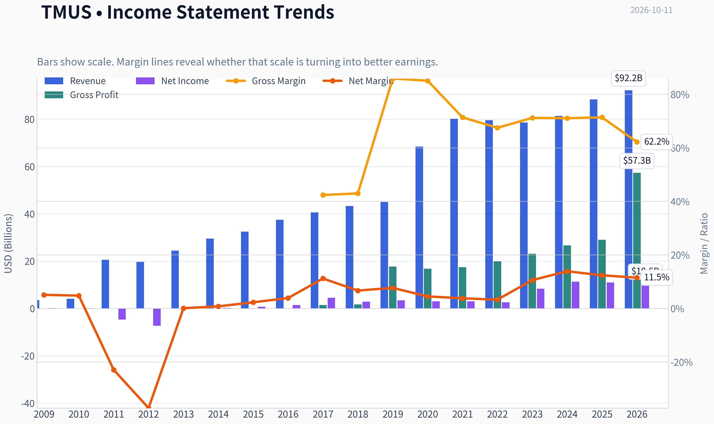

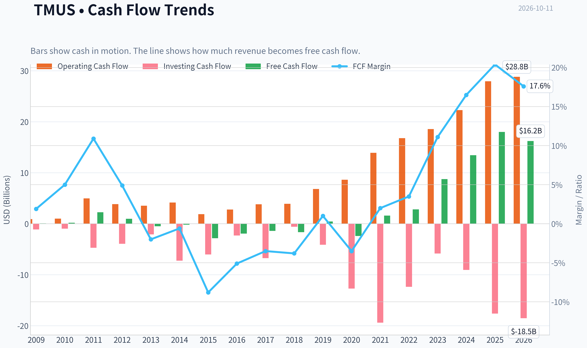

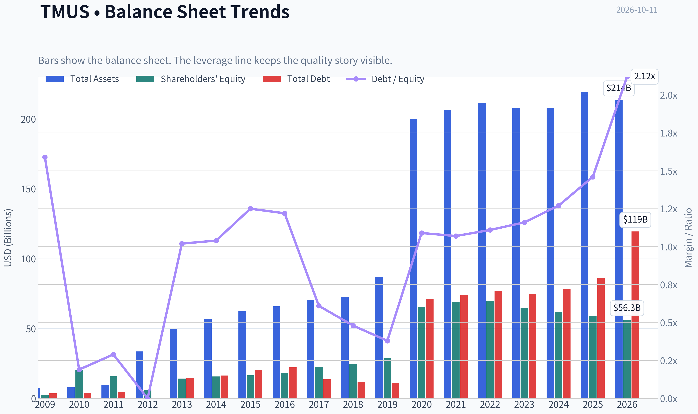

This graph tracks the profitability and return metrics (ROE, ROIC, Margins) of **TMUS** over the past decade, highlighting capital efficiency trends.

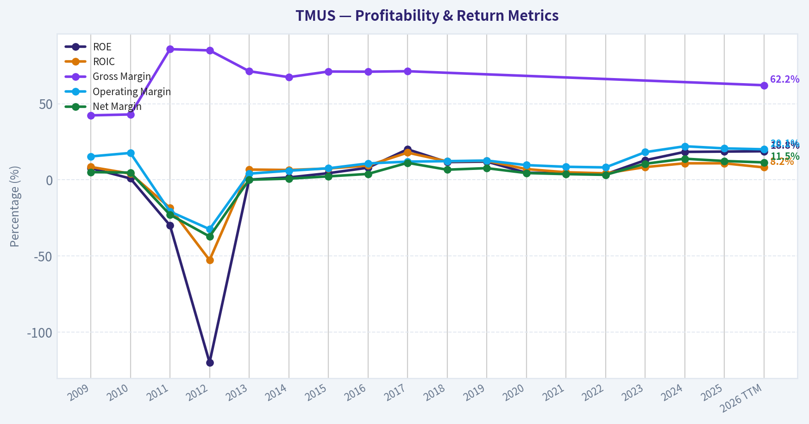

This chart illustrates the financial health of **TMUS** over the last 10 years, mapping cash equivalents and free cash flow against total obligations (Debt).

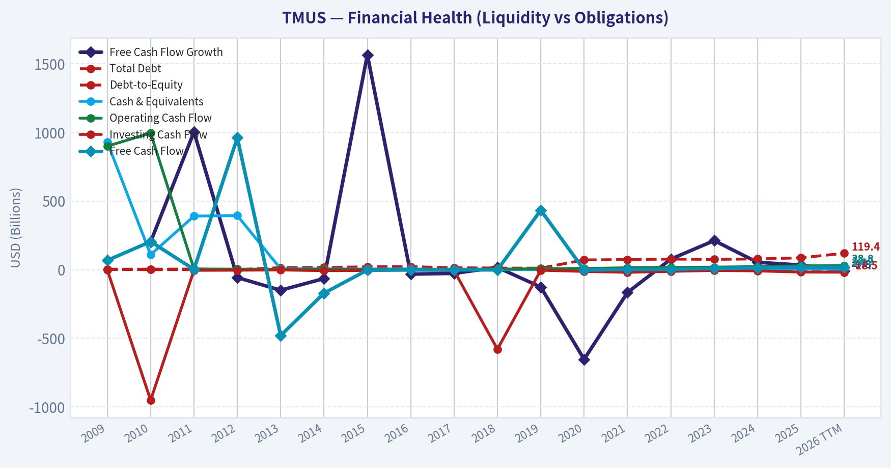

This comparison chart from *Profitability and Operating Performance* stacks current figures against historical benchmarks for **TMUS**, making it easy to see where the company trades relative to its own averages.

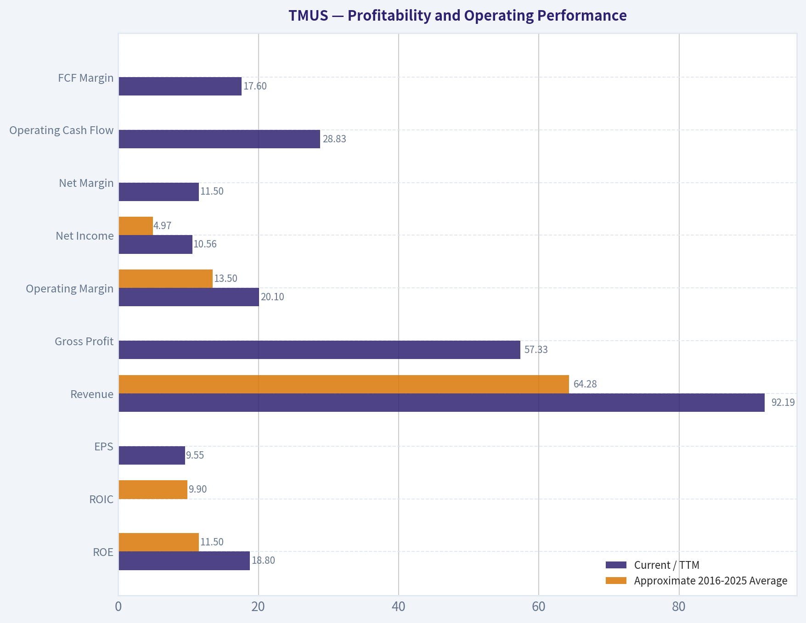

This breakdown chart from <em>Revenue Breakdown</em> shows the proportional composition for **TMUS** - useful for understanding what drives or risks the business.

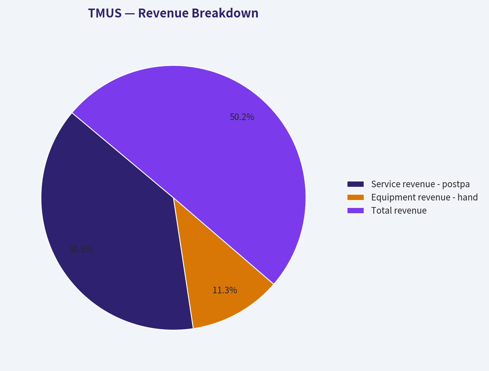

---

### Intrinsic Value Analysis (Buffett)

> *Following Warren Buffett's value investing philosophy: Circle of Competence, Economic Moat, Management Quality, and Margin of Safety.*

#### Intrinsic Value Snapshot

Price is what you pay. Intrinsic value is what the business may be worth based on the cash it can create for owners over time. We show a range, not one magic number.

- Current Price: $148.58
- Value Range (conservative to optimistic across both DCF methods): $193.85 to $2,268.88

##### Owner Earnings (Buffett Method)
- Net Income: $10,992,000,000.00
- Depreciation & Amortization: $13,508,000,000.00
- Capital Expenditures: $-9,955,000,000.00
- Working Capital Changes: $-2,394,000,000.00
- Owner Earnings: $16,939,000,000.00

##### Intrinsic Value
###### Buffett Method
Uses owner earnings. Stricter, and usually more conservative.
- Conservative: $193.85
- Average: $804.86
- Optimistic: $2,268.88
- Discount Rate: 10.0%

###### Cash Flow Method
Uses free cash flow. Better for companies spending heavily today to grow tomorrow.
- Conservative: $431.89
- Average: $431.89
- Optimistic: $1,297.56
- Discount Rate: 10.0%

ANALYST STANCE: **ADVOCATE**

#### Executive Judgment

T-Mobile US is a high-quality wireless compounder operating in a rational U.S. oligopoly. Its advantages include nationwide spectrum, scale, customer switching friction, improving network quality, and strong free-cash-flow generation. The principal risks are substantial absolute debt, aggressive competition from AT&T and Verizon, and emerging satellite-to-phone services such as Starlink.

At $149 per share, the valuation appears reasonable to attractive. The headline intrinsic value is $544.58, although that figure is materially above the more conservative owner-earnings and FCFF estimates. Even using conservative assumptions, the shares offer a satisfactory margin of safety for a business with strong cash generation and a durable competitive position.

#### Factor Scorecard

| Factor | Score | Assessment |
|---|---:|---|
| 1. Circle of Competence and Simplicity | 4/5 | Simple core model: sell wireless connectivity through monthly subscriptions. Long-term demand is predictable, although technology and satellite competition require monitoring. |
| 2. Durable Competitive Advantage | 4/5 | Wide and stable moat from spectrum ownership, network scale, brand improvement, customer relationships, and switching friction. |
| 3. Management and Capital Allocation | 4/5 | Management has executed the Sprint integration well, expanded margins, reduced customer churn, and increasingly returned capital to shareholders. |
| 4. Industry Structure | 4/5 | The U.S. market is a rational three-carrier oligopoly with high infrastructure barriers, though pricing competition remains meaningful. |
| Gate 5: Quality and Solvency Floor | **Not tripped** | Cash generation is strong and the business is not showing the combination of deteriorating fundamentals and solvency distress required for a hard avoid. |

**Key Takeaways:** T-Mobile scores well because it combines a straightforward subscription model with scale-based competitive advantages. Debt is a genuine consideration, but strong cash generation and improving operating performance keep the company well away from financial-distress territory.

#### Financial Summary

| Metric | Latest figure |
|---|---:|
| Share price | $149 |
| Market capitalization | $159.38 billion |
| P/E ratio | 15.5x |
| Revenue growth, year over year | 8.5% |
| Return on equity | 18.6% |
| Free-cash-flow yield | 11.3% |
| Implied free cash flow | Approximately $18.0 billion |
| Current ratio | 1.0x |
| Headline intrinsic value | $544.58 per share |
| Reverse-DCF implied annual growth | Approximately negative 5.6% for 10 years |

**Key Takeaways:** T-Mobile is producing an implied free-cash-flow yield of approximately 11.3%, which is compelling for a large, growing wireless franchise. Revenue is still growing at 8.5%, while the 15.5 times earnings multiple is modest relative to the company's growth and cash-generation profile. The current ratio is not especially informative for a subscription carrier because working-capital structure and deferred customer payments affect the metric.

#### Moat Analysis

**Spectrum and infrastructure.** Wireless networks require enormous investments in spectrum licenses, cell sites, backhaul, engineering, and distribution. These barriers make nationwide competition difficult for new entrants.

**Scale economics.** T-Mobile can spread network and spectrum costs across a large subscriber base. As network utilization rises, incremental customer economics are attractive because the company does not need to build an entirely new network for each additional subscriber.

**Network improvement and brand momentum.** T-Mobile's network expansion and 5G leadership helped transform its historical value-carrier image. Better network quality supports pricing, customer retention, and premium-plan adoption.

**Customer switching costs.** Wireless customers can technically change carriers, but switching involves device financing, number transfers, family-plan changes, promotional credits, and service disruption. These frictions create meaningful, though not absolute, customer captivity.

**Industry rationality.** The U.S. market has consolidated into three major national carriers. That structure is more favorable than a fragmented commodity market, although promotions and handset subsidies can still temporarily pressure margins.

**Moat rating: Wide and stable, 4/5.** The moat is real and substantial, but it is not invulnerable. Verizon and AT&T remain formidable, while satellite-to-phone connectivity could eventually reduce the value of terrestrial coverage in some use cases.

#### Management Quality and Capital Allocation

T-Mobile's management has demonstrated strong operating execution, particularly through the integration of Sprint assets and customers. The company has used its expanded spectrum position and network capacity to gain subscribers while improving profitability.

Positive capital-allocation signals include:

- Reinvestment in network quality and spectrum.
- Share repurchases after the business began producing substantial free cash flow.
- A growing willingness to return excess capital to shareholders.
- Continued focus on customer growth, churn, and per-share economics rather than revenue growth alone.

The main reservation is leverage. Wireless carriers commonly carry debt because spectrum and network investments are expensive, but management must avoid using buybacks or shareholder distributions to weaken the balance sheet. Overall management quality merits **4/5**.

#### Owner Earnings Calculation

Exact maintenance-capital-expenditure disclosure is difficult because wireless network investment includes both maintenance and growth spending. A practical Buffett-style estimate therefore begins with free cash flow as a reasonable proxy for owner earnings.

| Owner-earnings component | Estimate |
|---|---:|
| Net income and noncash charges | Not separately used |
| Less: maintenance capital expenditures | Reflected through free cash flow |
| Less: working-capital investment | Reflected through free cash flow |
| Estimated owner earnings proxy | Approximately $18.0 billion |
| Owner earnings per share | Approximately $16.85 |
| Owner-earnings yield at $149 | Approximately 11.3% |

**Key Takeaways:** T-Mobile's approximately $18 billion of free cash flow provides a useful owner-earnings proxy. At the current price, investors are paying roughly 8.9 times owner earnings, implying an owner-earnings yield above 11%. This is an attractive starting valuation if cash flows remain durable.

#### Three-Scenario DCF Valuation

The valuation uses approximately $18.0 billion of current owner earnings, approximately 1.07 billion shares, and a 10% discount rate.

| Scenario | Key assumptions | Estimated value per share |
|---|---|---:|
| A. No growth | Owner earnings remain flat indefinitely | $169 |
| B. GDP growth | 3% perpetual growth | $248 |
| C. Historical-growth framework | Approximately 6.4% growth for 10 years, then 3% terminal growth | $311 |
| Research-pack blended valuation | FCFF, reverse-DCF, and owner-earnings models | $545 |

**Key Takeaways:** The no-growth valuation is already above the current $149 price, while the GDP-growth case indicates substantial upside. The historical-growth case produces a value near $311 per share, but the blended $545 figure should be treated cautiously because it is heavily influenced by the more optimistic owner-earnings model and the unusually pessimistic reverse-DCF growth implication.

#### Margin of Safety Analysis

| Valuation reference | Value per share | Margin of safety versus $149 |
|---|---:|---:|
| No-growth owner earnings | $169 | 12% |
| GDP-growth DCF | $248 | 40% |
| Historical-growth DCF | $311 | 52% |
| Blended headline intrinsic value | $545 | 73% |

For a mediocre or cyclical business, a 12% margin of safety would be inadequate. T-Mobile, however, has strong recurring revenue, an oligopolistic market structure, improving profitability, and high cash generation. For this quality level, the GDP-growth valuation provides a satisfactory margin of safety, while the no-growth case limits downside under conservative assumptions.

The reverse-DCF is particularly favorable: the current price implies approximately negative 5.6% annual growth over the next decade. That expectation is substantially below T-Mobile's current 8.5% revenue growth and appears pessimistic unless competitive or technological disruption becomes severe.

#### Risk Assessment

| Risk | Significance | Investment implication |
|---|---|---|
| Leverage | Moderate to high | Limits financial flexibility if cash flow weakens or rates remain elevated. |
| Price competition | Moderate | Promotions can pressure margins and reduce the benefit of industry consolidation. |
| Starlink and satellite connectivity | Emerging | Could challenge terrestrial coverage in rural or remote markets, but near-term capacity and economics remain uncertain. |
| Capital intensity | Moderate | Network and spectrum spending is unavoidable, although returns appear attractive at current scale. |
| Integration and execution | Lower than previously | Sprint integration has largely progressed, reducing a major historical risk. |

#### Final Buffett Scorecard

| Criterion | Weight | Score | Weighted contribution |
|---|---:|---:|---:|
| Moat width and durability | 25% | 4.0 | 1.00 |
| Valuation and margin of safety | 20% | 4.0 | 0.80 |
| Capital returns versus WACC | 15% | 4.0 | 0.60 |
| Business understanding and predictability | 12% | 4.0 | 0.48 |
| Management quality and capital allocation | 12% | 4.0 | 0.48 |
| Reinvestment runway | 8% | 4.0 | 0.32 |
| Balance-sheet strength | 4% | 3.0 | 0.12 |
| Industry structure | 4% | 4.0 | 0.16 |
| **Total** | **100%** |  | **3.96/5.00** |

**Key Takeaways:** T-Mobile's strongest attributes are its moat, recurring cash flows, attractive valuation, and favorable industry structure. The principal deduction is balance-sheet leverage, not business quality. The aggregate score places T-Mobile near the top of the "good business at an adequate price" range.

#### Investment Stance

**ADVOCATE - Medium-to-high conviction.**

T-Mobile offers an attractive combination of recurring revenue, scale advantages, improving operating economics, and a reasonable valuation. At $149, the stock does not require heroic growth: the reverse-DCF implies a sharply negative long-term growth rate, while even the no-growth owner-earnings estimate is modestly above the market price.

The investment case is strongest for a long-term owner who is comfortable with carrier leverage and willing to monitor satellite competition. The preferred action is to build or maintain a position gradually, with particular interest on material market weakness.
#### Valuation Bridge

This bridge places the current market price beside each intrinsic value lens so readers can see whether upside depends on one method or shows up across several methods.

| Scenario | Intrinsic Value / Share |
| --- | ---: |
| Buffett Method | $804.86 |
| Cash Flow Method | $431.89 |
| Damodaran Method | $260.80 |
| Current Price | $148.58 |

#### Key Takeaways

If one method is far above the others, the upside case depends on a specific modelling assumption. When several methods cluster together, the valuation story is more robust.

#### Valuation Visuals

This comparison chart from *Latest Earnings Snapshot* stacks current figures against historical benchmarks for **TMUS**, making it easy to see where the company trades relative to its own averages.

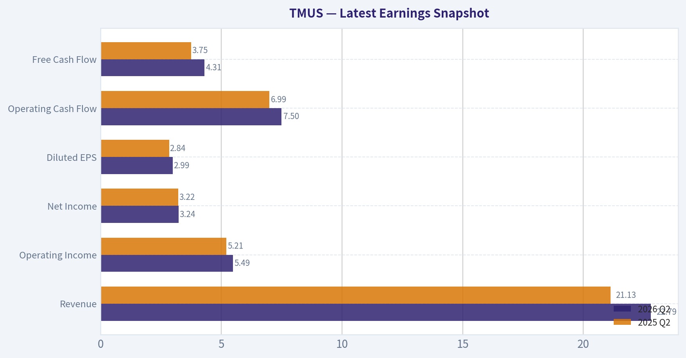

This comparison chart from *Balance Sheet and Financial Strength* stacks current figures against historical benchmarks for **TMUS**, making it easy to see where the company trades relative to its own averages.

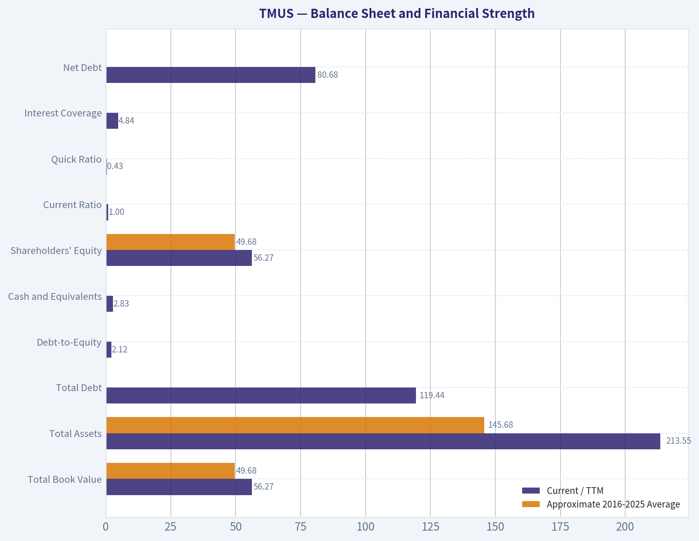

This comparison chart from *Cash Flow and Capital Allocation* stacks current figures against historical benchmarks for **TMUS**, making it easy to see where the company trades relative to its own averages.

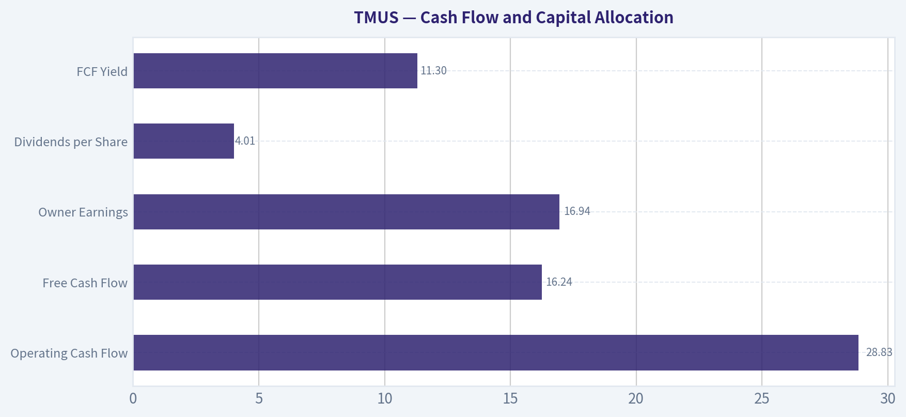

---

### Trend & Growth Analysis (Lynch/Druckenmiller/Fisher)

> *Following Peter Lynch's GARP, Stanley Druckenmiller's macro-aware approach, and Philip Fisher's scuttlebutt methodology.*

ANALYST STANCE: **WATCH**

#### 1. Lynch Classification

**TMUS is a stalwart, not a fast grower.** Revenue is growing approximately **8.5% year over year**, below Lynch's 15-25% fast-grower threshold. The company may still deliver attractive shareholder returns through free cash flow, buybacks, and market-share gains, but the current setup does not resemble a classic ten-bagger opportunity.

#### 2. The Story in Three Bullets

- **T-Mobile has become a scaled U.S. wireless leader**, with a strong network, improving customer perception, and meaningful operating leverage.
- **Cash generation is the investment case:** an 11.3% FCF yield and 15.5x P/E suggest the market is pricing TMUS more like a mature telecom than a superior operator.
- **The key question is growth durability:** market-share gains and broadband expansion may offset the mature wireless market, but SpaceX/Starlink and aggressive competition create new risks.

#### 3. Core Financial Snapshot

| Metric | TMUS |
|---|---:|
| Current price | $149 |
| Market capitalization | $159.4 billion |
| Revenue growth, year over year | 8.5% |
| P/E ratio | 15.5x |
| FCF yield | 11.3% |
| ROE | 18.6% |
| Current ratio | 1.0x |
| Headline intrinsic value | $544.58 |
| Reverse-DCF implied 10-year growth | Approximately -5.6% annually |

**Key Takeaways:** TMUS combines moderate growth with strong cash flow and a relatively low earnings multiple. The reverse-DCF suggests investors are pricing in very little long-term growth, which creates valuation support. However, the headline intrinsic value is unusually high and should not be treated as precise because the underlying valuation models have a very wide range.

#### 4. TAM and the 10x Test

| Area | Runway Assessment | Growth Implication |
|---|---|---|
| Core U.S. wireless service | Mature, established market | Limited industry growth |
| Market-share gains | Still possible, but increasingly incremental | Positive for TMUS |
| Fixed wireless broadband | Expands the addressable market | Meaningful adjacency |
| Enterprise and public-sector connectivity | Large but competitive | Moderate opportunity |
| Direct-to-device satellite connectivity | Emerging and uncertain | Potential disruption and opportunity |
| 10x revenue test | Unlikely in the core domestic wireless business | Fails classic ten-bagger test |

**Key Takeaways:** TMUS has additional avenues for growth, particularly fixed wireless and adjacent connectivity services. Nevertheless, a tenfold increase from its current scale would require either substantial international expansion or the creation of major new businesses. The core U.S. wireless market alone is not large enough to support a straightforward ten-bagger thesis.

#### 5. Revenue Growth Trend

| Indicator | Current Evidence | Interpretation |
|---|---:|---|
| Revenue growth | 8.5% year over year | Stalwart-level growth |
| Acceleration | Not established by available data | No confirmed inflection |
| Organic growth quality | Likely supported by customers, pricing, and services | Reasonably durable |
| Margin trend | Detailed recent trend unavailable | Needs monitoring |
| Growth classification | 5-12% range | Stalwart |

**Key Takeaways:** TMUS is growing, but the available evidence does not show acceleration into fast-grower territory. The investment thesis depends more on sustained execution and capital returns than on explosive revenue expansion.

#### 6. Unit Economics and Profitability

| Metric | Assessment |
|---|---|
| LTV/CAC | Not disclosed in the research pack |
| Net revenue retention | Not applicable in the traditional SaaS sense |
| Rule of 40 | Not applicable |
| FCF yield | 11.3%, strong |
| ROE | 18.6%, healthy |
| Current ratio | Approximately 1.0x, adequate but not spacious |

**Key Takeaways:** Traditional SaaS metrics such as NRR and Rule of 40 are not useful for a wireless carrier. The better indicators are churn, postpaid net additions, service revenue, average revenue per user, network investment, and free cash flow. TMUS's current FCF yield is a significant strength, although the near-1.0 current ratio means liquidity should be monitored.

#### 7. Inflection Point Assessment

| Potential Inflection | Evidence | Status |
|---|---|---|
| Market-share gains | T-Mobile remains a strong competitive operator | Positive, but likely moderating |
| Fixed wireless broadband | Expands beyond traditional mobile | Potentially positive |
| Operating leverage | Scale and network integration can support margins | Positive |
| Capital returns | High FCF yield creates buyback potential | Positive |
| Competitive disruption | Starlink is moving toward direct mobile connectivity | Negative risk |
| Revenue acceleration | No confirmed acceleration in supplied data | Unproven |

**Key Takeaways:** TMUS has several incremental growth drivers, but no clearly demonstrated acceleration inflection. The most important upside surprise would be sustained market-share gains combined with fixed-wireless expansion and stronger-than-expected free cash flow. The largest competitive uncertainty is whether satellite connectivity becomes a credible substitute for portions of traditional wireless service.

#### 8. Macro Setup

Wireless service is relatively defensive, which helps TMUS during economic weakness. However, the stock remains sensitive to interest rates because telecom companies carry substantial capital requirements and debt. Falling rates would generally support valuation and refinancing economics; rising rates would be a headwind.

From a Druckenmiller perspective, TMUS is more of a **cash-flow and valuation opportunity** than a high-beta secular-growth position. The macro setup is neutral to moderately favorable, but it does not provide a powerful growth-stock tailwind.

#### 9. Fisher's 15-Point Score

Scoring is based on available public information rather than direct management or supplier scuttlebutt.

| Fisher Criterion | Score / 5 | Assessment |
|---|---:|---|
| Market potential | 3 | Large market, but mature |
| New-product determination | 4 | Broadband and connectivity expansion |
| R&D effectiveness | 4 | Network investment is strategically important |
| Sales organization | 4 | Strong consumer and business distribution |
| Profit margins | 4 | Attractive cash-generation profile |
| Margin improvement | 4 | Scale offers operating leverage |
| Labor relations | 3 | No clear differentiator available |
| Executive relations | 4 | Generally credible execution |
| Management depth | 4 | Large-company capabilities |
| Cost analysis/accounting | 4 | Adequate public reporting |
| Outstanding moat | 4 | Network scale, spectrum, brand, switching friction |
| Long-term profit outlook | 4 | Solid, though not hyper-growth |
| Dilution risk | 4 | No major dilution concern identified |
| Management candor | 3 | Insufficient direct evidence |
| Management integrity | 4 | No major issue identified |
| **Total** | **57 / 75** | **Good** |

**Key Takeaways:** TMUS scores well on execution, network scale, cash generation, and competitive positioning. It loses points because the underlying market is mature and because there is not enough evidence of a major new product cycle. A score of 57 indicates a good business, but not an obvious Fisher-style exceptional growth company.

#### 10. Valuation Analysis

| Valuation Measure | Result | Interpretation |
|---|---:|---|
| P/E | 15.5x | Modest for a quality operator |
| FCF yield | 11.3% | Attractive if cash flow is durable |
| PEG | Not calculable from supplied data | Earnings-growth estimate unavailable |
| Headline intrinsic value | $544.58 | Very bullish model output |
| Owner-earnings valuation | $804.86 | Highly optimistic |
| FCF valuation | $431.89 | Bullish |
| Damodaran FCFF valuation | $260.80 | More conservative |
| Reverse-DCF | Implies -5.6% annual growth | Very low expectations embedded |

**Key Takeaways:** TMUS appears inexpensive on conventional cash-flow measures, with an 11.3% FCF yield and 15.5x earnings multiple. The valuation models all indicate upside, but their wide dispersion-from $260.80 to $804.86-shows that assumptions about growth, reinvestment, and terminal value dominate the result. The stock is attractive on downside support, but valuation alone does not create a ten-bagger.

#### 11. Growth Investor Scorecard

| Criterion | Weight | Score / 5 | Weighted Contribution |
|---|---:|---:|---:|
| Lynch story | 10% | 3.5 | 0.35 |
| TAM and runway | 20% | 2.8 | 0.56 |
| Revenue growth | 20% | 3.0 | 0.60 |
| Unit economics | 15% | 3.5 | 0.53 |
| Competitive position | 10% | 4.0 | 0.40 |
| Management quality | 10% | 4.0 | 0.40 |
| Macro setup | 5% | 3.5 | 0.18 |
| Profitability path | 5% | 4.0 | 0.20 |
| Valuation | 5% | 4.5 | 0.23 |
| **Total** | **100%** |  | **3.45 / 5.00** |

**Key Takeaways:** TMUS scores above average because its valuation, cash generation, and competitive position are strong. The score is held back by mature-market economics and the absence of clear revenue acceleration. At 3.45, the stock belongs in **WATCH**, near the threshold for a value-oriented purchase but below the conviction level normally required for a concentrated growth position.

#### 12. Position Size Stance

**Position stance: Small or moderate, not concentrated.**

- Existing holders: **Hold and monitor.**
- New investors: Consider a **2-4% starter position** only if seeking a cash-generative, reasonably valued telecom.
- Growth-focused portfolios: Keep the position below a typical fast-grower allocation until revenue growth accelerates or new businesses materially expand the TAM.

#### 13. Catalysts and Risks

| Catalysts | Risks |
|---|---|
| Sustained market-share gains | Starlink/direct-to-device competition |
| Faster fixed-wireless adoption | Mature U.S. wireless market |
| Higher-than-expected free cash flow | Heavy capital expenditure requirements |
| Accelerating buybacks or debt reduction | Rising interest rates |
| Margin expansion from scale | Pricing pressure from AT&T and Verizon |
| New enterprise connectivity products | Execution risk in adjacent markets |

**Key Takeaways:** The most credible catalysts are continued share gains, fixed-wireless growth, operating leverage, and capital returns. The principal risk is that TMUS's growth slows toward the industry rate while satellite connectivity increases competitive pressure. The thesis improves materially if revenue growth reaccelerates above 12-15%; otherwise, TMUS is best viewed as a high-quality, attractively valued stalwart rather than a ten-bagger candidate.

---

### Market Technical Analysis

ANALYST STANCE: **AVOID**

#### TMUS Technical Market Report

**As of October 9, 2026**, TMUS closed at **$148.58**, following an exceptionally severe one-day decline from the prior close of $171.31. The October 9 session traded between $147.90 and $156.89, with volume of approximately **18.98 million shares**-far above the recent multi-million-share baseline. October 11 is a weekend, so October 9 is the latest available trading session.

The technical picture has shifted from an already deteriorating downtrend to a high-volatility breakdown. Although the RSI is now oversold, the oversold reading is occurring alongside a major price gap, expanding volatility, negative MACD momentum, and a decisive break below all major moving averages. This combination argues against treating the decline as a routine dip-buying opportunity.

#### Selected Indicators

The selected indicators are designed to cover trend, short-term momentum, reversal risk, volatility, and price extremes without relying on multiple versions of the same signal.

| Indicator | Latest reading | Technical interpretation |
|---|---:|---|
| 10 EMA | $163.49 | Price is roughly $14.91 below the short-term average, confirming an abrupt loss of near-term momentum. |
| 50 SMA | $174.43 | The medium-term trend is bearish; price is approximately 14.8% below this average. |
| 200 SMA | $188.65 | The long-term structure is also bearish, with price about 21.2% below the benchmark. |
| MACD | -4.18 | Momentum is decisively negative and deteriorated sharply from -2.93 on October 8. |
| RSI | 29.22 | Oversold territory, but not by itself a reliable buy signal after a high-volume breakdown. |
| Bollinger Upper Band | $181.13 | Price is far below the upper band, reflecting a substantial downside displacement rather than strength. |
| Bollinger Lower Band | $152.30 | The close is about $3.72 below the lower band, an extreme downside excursion. |
| ATR | $5.54 | Volatility expanded sharply from $4.17 on October 8, indicating elevated gap and stop-loss risk. |

**Key Takeaways:** The indicators are aligned around a bearish trend, with price below the 10 EMA, 50 SMA, and 200 SMA. RSI and the Bollinger Bands show that the stock is stretched to the downside, but ATR and volume indicate that the move is disorderly rather than a low-risk oversold reversal. The combination favors capital preservation and confirmation over immediate entry.

---

#### Trend Structure

The medium- and long-term moving averages had already been weakening before the latest collapse. The 50 SMA declined from approximately **$181.13 on September 14** to **$174.43 on October 9**, while the 200 SMA fell from approximately **$191.80** to **$188.65** over the same period. These are not merely flat averages being challenged by a single bad session; both are trending lower.

The price relationship is particularly unfavorable:

- TMUS was below the 50 SMA before the October 9 selloff.
- The stock was already below the 200 SMA during the entire recent indicator window.
- The 10 EMA dropped from **$181.33 on September 14** to **$163.49 on October 9**, demonstrating accelerating short-term weakness.
- The October 9 close was approximately **$14.91 below the 10 EMA**, **$25.85 below the 50 SMA**, and **$40.07 below the 200 SMA**.

This configuration indicates bearish alignment across multiple time horizons. A short-term rebound could occur because the distance from the moving averages is now unusually large, but such a rebound would initially be interpreted as mean reversion within a damaged trend-not as evidence that the larger decline has ended.

#### Momentum and Breakdown Characteristics

MACD momentum deteriorated materially during the latest decline. MACD was positive in early-to-mid September, reaching approximately **+0.36 on September 14**, but then crossed into negative territory and fell to **-4.18 by October 9**. The progression from roughly **-1.25 on September 17**, to **-2.73 on September 21**, and then below **-4.00 in early October** shows persistent momentum erosion rather than a single isolated reversal.

The October 9 reading is especially concerning because the MACD decline coincided with a high-volume price gap. This suggests that selling pressure was broad and forceful. Until MACD begins to flatten and the signal relationship turns upward, attempts to buy solely because the stock appears statistically cheap carry substantial risk.

#### RSI and Oversold Risk

RSI fell to **29.22**, just below the conventional oversold threshold of 30. This indicates that the decline may be tactically overextended. However, RSI oversold conditions can persist during strong downtrends, particularly after a gap lower accompanied by unusually heavy volume.

The key distinction is between:

1. **An oversold pullback within an established uptrend**, where RSI below 30 may offer a favorable risk-reward setup; and
2. **An oversold breakdown beneath major trend benchmarks**, where the stock may continue lower or remain volatile before establishing a durable base.

TMUS currently resembles the second case. A more constructive RSI signal would be a recovery back above 30, followed by a higher low and improving price structure. A single oversold print is insufficient confirmation.

#### Bollinger Bands and Price Extremes

The October 9 close of **$148.58** was below the calculated lower Bollinger Band of **$152.30**. This is a substantial downside excursion, indicating unusually high selling pressure and a possible short-term snapback. However, prices can remain outside the lower band during a volatility expansion or trend acceleration.

The Bollinger range itself widened sharply. On October 8, the upper and lower bands were approximately **$181.74** and **$155.07**; by October 9, they were approximately **$181.13** and **$152.30**. The lower band moved downward while the stock broke beneath it, showing that the market is not simply oscillating around a stable mean. Instead, the distribution of recent prices is being repriced lower.

A recovery above $152.30 would be an initial stabilization signal, but stronger confirmation would require reclaiming the $163-$165 region near the 10 EMA and recent short-term trading range. Until then, the lower-band breach should be viewed as evidence of downside stress rather than an automatic buy signal.

#### Volatility, Volume, and Risk Management

ATR increased to **$5.54**, compared with approximately **$4.17 on October 8** and **$4.42 on October 2**. The increase reflects both the large intraday range and the sharp gap in price. At the latest close, ATR represented approximately **3.7% of the share price**, which is high enough to make conventional tight stops vulnerable to ordinary daily noise.

Volume was approximately **18.98 million shares**, more than four times the recent volume on several normal sessions and materially above the roughly 3-8 million-share range seen through much of the prior period. High volume during a large decline can sometimes mark capitulation, but capitulation cannot be confirmed from one session alone. Follow-through is essential:

- A further close below $148 or a break of the October 9 intraday low near $147.90 would suggest that sellers remain in control.
- A rebound that occurs on weak volume and fails near $152-$156 would be technically fragile.
- A more credible stabilization would require several sessions holding above the October 9 low, declining ATR, improving RSI, and a close back above the lower Bollinger Band.

Position sizing should be substantially reduced if trading is attempted. Using the latest ATR as a rough volatility guide, a one-ATR move represents approximately **$5.54 per share**, while a two-ATR move represents roughly **$11.08**. These are not recommended stop levels by themselves, but they illustrate why normal position sizes and tight stops may be inappropriate.

#### Trading Implications

For conservative or trend-following investors, the current setup is unfavorable. The stock is below all three selected moving averages, MACD is strongly negative, and the latest decline occurred on exceptional volume. The oversold RSI and lower-band breach create the possibility of a sharp countertrend bounce, but they do not yet establish a reliable bottom.

For aggressive short-term traders, a relief rally may develop because the stock is substantially extended below its moving averages. Such a trade would be a tactical rebound strategy rather than a bullish trend investment. Confirmation would be preferable through a reclaim of approximately $152-$156, followed by stabilization above the $163 area near the 10 EMA. Failure to hold those levels would maintain the risk of another leg lower.

For existing holders, the primary issue is risk control rather than predicting the exact low. The gap-down session materially changes the risk profile, and any decision to hold should account for the possibility of additional wide intraday ranges. A recovery back above the 10 EMA would improve the short-term picture, while a sustained move back above the 50 SMA would be needed to repair the medium-term structure.

#### Key Levels and Decision Framework

| Level or condition | Importance | What traders should watch |
|---|---|---|
| $147.90-$148.58 | Immediate breakdown zone | Holding this area could support a short-term stabilization; a decisive break would reinforce downside continuation risk. |
| $152.30 | October 9 lower Bollinger Band | Reclaiming this level would reduce the severity of the band breakdown but would not yet reverse the trend. |
| Approximately $155-$156 | Near-term rebound resistance | Failure here would suggest that sellers remain active after the gap. |
| $163.49 | 10 EMA | A meaningful short-term recovery would likely need to reclaim this level. |
| $174.43 | 50 SMA | Major medium-term resistance and trend-repair threshold. |
| $188.65 | 200 SMA | Long-term trend benchmark; currently far above price and declining. |
| RSI above 30 with a higher low | Momentum confirmation | More constructive than the current oversold reading alone. |
| Declining ATR and normalized volume | Stabilization confirmation | Would indicate that forced selling and gap risk are easing. |

**Key Takeaways:** The immediate technical objective is not to predict a precise bottom but to determine whether TMUS can hold the $148 area and reclaim the $152-$156 zone. A stronger recovery would need to progress toward the $163.49 10 EMA, while the $174.43 50 SMA remains the more important medium-term repair level. Until price stabilizes, volatility contracts, and momentum improves, the risk-reward profile remains unfavorable.

#### Overall Assessment

TMUS is technically oversold but structurally weak. The close beneath the lower Bollinger Band and the RSI below 30 suggest that a short-term rebound is possible, yet the declining moving averages, deeply negative MACD, expanding ATR, and extreme volume make immediate bottom-fishing speculative.

The preferred stance is to **avoid new long exposure for now** and wait for evidence of stabilization. A potential bullish setup would require a hold above the recent low, recovery inside the Bollinger Bands, improving RSI and MACD, and eventually a reclaim of the 10 EMA. Without those developments, any bounce should be treated as a countertrend rally rather than confirmation of a durable reversal.

#### Market Visuals

This comparison chart from *Market Metrics and Valuation* stacks current figures against historical benchmarks for **TMUS**, making it easy to see where the company trades relative to its own averages.

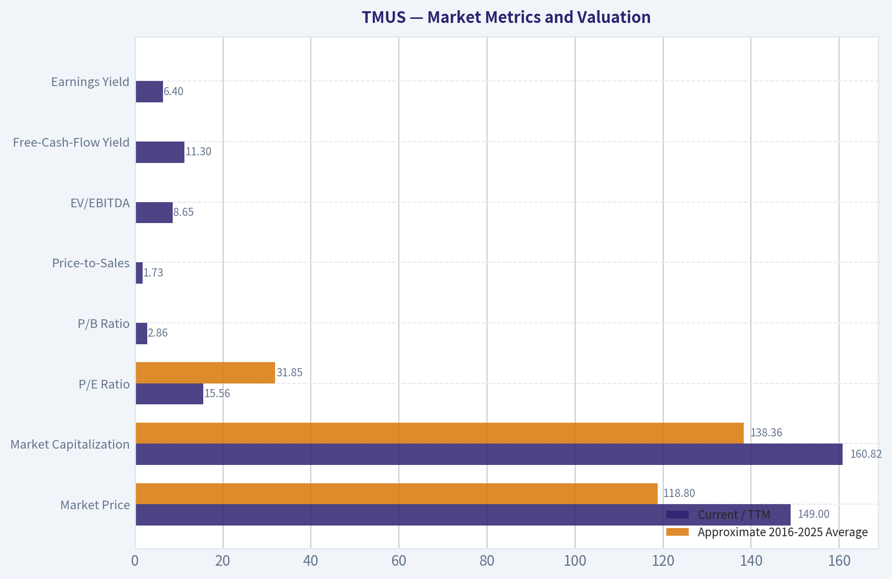

---

### Options Market Analysis

> *Reading options flow - put/call ratios, IV skew, and unusual activity - to gauge institutional positioning and event-driven risk.*

#### TMUS Options Market Report

*Data as of October 11, 2026. The options feed does not provide an exact current share price; moneyness classifications below use approximately $150 as an ATM reference inferred from the chain.*

#### 1. Put/Call Ratio Analysis

| Expiration | Days to Expiry | Call OI | Put OI | Put/Call OI | Call Volume | Put Volume | Put/Call Volume |
|---|---:|---:|---:|---:|---:|---:|---:|
| Oct. 16, 2026 | 5 | 20,312 | 6,106 | 0.30 | 10,699 | 9,845 | 0.92 |
| Oct. 23, 2026 | 12 | 1,845 | 2,408 | 1.31 | 1,990 | 994 | 0.50 |
| Oct. 30, 2026 | 19 | 2,414 | 924 | 0.38 | 1,394 | 1,011 | 0.73 |
| **Total near-term** | - | **24,571** | **9,438** | **0.38** | **14,083** | **11,850** | **0.84** |

**Key Takeaways:** TMUS has a very low aggregate put/call open-interest ratio of 0.38 versus the approximate neutral level of 0.70, indicating a strong call-side positioning bias. Near-term volume is less one-sided, with a 0.84 put/call volume ratio, suggesting meaningful put demand despite the call-heavy existing positioning. The October 23 expiration is the exception, with a 1.31 put/call OI ratio and comparatively heavier put positioning.

#### 2. Implied Volatility Assessment

| Expiration | Call ATM IV | Put ATM IV | IV Difference: Put Minus Call | Interpretation |
|---|---:|---:|---:|---|
| Oct. 16 | 45.2% | 29.7% | -15.5 pts | Call premium; upside speculation or call demand |
| Oct. 23 | 42.9% | 40.3% | -2.6 pts | Relatively balanced |
| Oct. 30 | 49.4% | 51.6% | +2.2 pts | Mild downside protection premium |

The October 30 expiration has the highest near-term ATM volatility, around 49% to 52%. That is elevated enough to indicate meaningful event or price-move risk, although no specific catalyst is identified in the supplied data. The October 16 expiration also shows unusual asymmetry: call IV is substantially higher than put IV, which is more consistent with upside demand than broad downside fear.

Available wing data shows a modest put-skew tendency at lower strikes: the $135 put has 54.1% IV, the $140 put has 50.4%, while the $160 call has 45.9%. This suggests investors are still paying up for far-downside protection, even though ATM call demand is stronger in the closest expiration.

**Key Takeaways:** ATM volatility is elevated, particularly for the October 30 expiry, so the market is pricing substantial near-term movement. The closest expiry favors calls on an IV basis, while lower-strike puts retain a downside-volatility premium. Overall, the skew is mixed but leans cautiously toward upside speculation with tail-risk hedging still present.

#### 3. Unusual Options Activity

| Expiry | Contract | Approx. Moneyness* | Volume | OI | Volume/OI | IV | Positioning Implication |
|---|---|---|---:|---:|---:|---:|---|
| Oct. 16 | $155 call | OTM | 2,974 | 10 | 297.4x | 44.5% | Fresh upside speculation |
| Oct. 16 | $150 call | Approximately ATM | 2,373 | 6 | 395.5x | 46.0% | Strong near-term upside positioning |
| Oct. 16 | $160 call | OTM | 1,918 | 44 | 43.6x | 45.9% | Aggressive upside lottery-style exposure |
| Oct. 16 | $157.50 call | OTM | 921 | 1 | 921.0x | 45.6% | Very fresh, highly speculative upside trade |
| Oct. 16 | $140 put | OTM | 3,142 | 99 | 31.7x | 50.4% | Downside hedge or bearish short-term bet |
| Oct. 16 | $145 put | OTM | 1,830 | 251 | 7.3x | 41.6% | Fresh downside protection |
| Oct. 16 | $152.50 put | Slightly ITM if spot is near $150 | 873 | 61 | 14.3x | 48.3% | More direct downside hedge or bearish exposure |
| Oct. 16 | $135 put | OTM | 661 | 33 | 20.0x | 54.1% | Tail-risk protection |

\*The feed did not include the exact TMUS share price, so moneyness is approximate using a roughly $150 reference. Volume far exceeding open interest suggests these trades are likely new positions, although the data does not reveal whether they were bought or sold.

The unusual activity is concentrated almost entirely in the five-day October 16 expiration. The $150, $155, $157.50, and $160 calls show exceptionally high volume relative to open interest, pointing to fresh upside speculation. At the same time, the $140 and $145 puts are also unusually active, indicating that some traders are buying protection or expressing a bearish downside view.

The large volume and extremely low existing OI in the calls can be associated with speculative or event-driven trading; without trade-level execution data, it is not possible to reliably distinguish institutional buying from retail speculation. The sizable $140 put activity is more consistent with meaningful hedging demand because it carries a higher IV than the comparable upside strikes.

**Key Takeaways:** The dominant unusual flow is bullish call activity in the nearest expiry, but it is paired with substantial downside-put activity. This looks less like a clean one-way bullish bet and more like upside speculation alongside protection against a sharp move. The unusually short five-day horizon raises the probability that these are event-driven or tactical trades rather than long-term institutional positioning.

#### 4. Open Interest Concentration and Gamma Levels

| Expiration | Largest OI Concentration | Call/Put Detail | Market Role |
|---|---|---|---|
| Oct. 16 | Calls collectively dominate | 20,312 call OI vs. 6,106 put OI | Strong call-side gravitational influence |
| Oct. 23 | Puts slightly dominate | 2,408 put OI vs. 1,845 call OI | Potential downside hedging zone |
| Oct. 30 | Calls dominate | 2,414 call OI vs. 924 put OI | Upside-oriented positioning |
| Near-term total | Calls dominate overall | 24,571 call OI vs. 9,438 put OI | Broad bullish OI imbalance |

Strike-level OI was not supplied, so a precise max-pain calculation or identification of a single gamma wall is not possible. Based on the unusual-flow strikes, the $150 to $160 call area is the important upside positioning band, while the $140 to $145 put area represents the most visible downside protection zone.

If TMUS remains near the presumed $150 reference, concentrated short-dated call activity could dampen movement around heavily traded strikes if those calls were sold, or amplify an upside move if they were bought and dealers must hedge by purchasing shares. The lack of trade direction prevents a definitive gamma interpretation.

**Key Takeaways:** Aggregate open interest is clearly call-heavy, especially in the October 16 and October 30 expirations. The likely important trading zone is approximately $150 to $160 on the upside and $140 to $145 on the downside. Exact gamma walls cannot be confirmed without strike-by-strike OI and dealer-positioning data.

#### 5. Overall Options Sentiment

**Overall signal: BULLISH, with elevated short-term event risk.**

The primary bullish drivers are:

- Aggregate put/call OI of 0.38, materially below the 0.70 neutral baseline.
- Call volume exceeding put volume across the near-term expirations.
- Very large volume/OI ratios in the $150 to $160 calls expiring October 16.
- Higher near-term call IV than put IV in the closest expiry.

The main caveats are the heavy activity in October 16 puts, particularly the $140 put, and the elevated IV in the October 30 expiry. Those trades imply that some market participants are actively hedging downside risk. Therefore, the signal is bullish rather than strongly bullish: the positioning favors upside, but traders are paying for protection against a potentially sharp short-term move.

The data is not obviously illiquid-near-term volume is substantial-but most unusual activity is concentrated in one expiration only five days away. Confidence is therefore moderate, and the options signal should not be treated as a valuation or fundamental forecast.

#### Summary

| Category | Assessment |
|---|---|
| Put/Call Ratio | Bullish: 0.38 OI ratio and 0.84 volume ratio |
| IV Level | Elevated, especially October 30 at roughly 49%-52% ATM |
| Skew Direction | Mild downside put skew in the wings, but closest-expiry ATM IV favors calls |
| Unusual Activity | Heavy fresh-looking October 16 call activity, offset by significant downside-put hedging |
| Overall Signal | **BULLISH**, with meaningful short-term volatility and downside-hedge risk |

**Key Takeaways:** TMUS options positioning is directionally bullish because calls dominate open interest and the most extreme volume/OI activity is in near-term calls. However, unusually active puts and elevated implied volatility indicate that traders expect a potentially large move rather than a low-risk grind higher. The best characterization is bullish with moderate conviction and substantial event-driven risk.

---

## Research Team Commentary

> *The Research Manager synthesizes the Bull vs Bear debate into action-free commentary. This is a pre-risk view, not the final stance.*

Core takeaway: T-Mobile appears to be a good, competitively advantaged operator at a potentially attractive price, but the evidence does not yet support calling it a sufficiently certain bargain. The bull case depends heavily on an indicated 11.3% free-cash-flow yield that has not been reconciled with recurring capital expenditure, spectrum payments, leases, interest costs, and working-capital effects. At $149, the appropriate stance is WATCH rather than ADVOCATE or AVOID.

The strongest bull argument is that T-Mobile owns assets that are extraordinarily difficult to replicate. Spectrum scarcity, nationwide network scale, regulatory barriers, recurring customer relationships, and the rational three-player market structure create a genuine moat. T-Mobile has also improved its network reputation and appears capable of taking share, extracting further Sprint-related efficiencies, expanding fixed wireless, and using repurchases to compound free cash flow per share. Management's capital-allocation sequence-network investment and integration first, shareholder distributions later-has been sensible.

The valuation is also reasonable on its face. A 15.5 times earnings multiple is not demanding for an operator reporting 8.5% revenue growth, and the reverse-DCF framing is more persuasive than a simple telecom multiple comparison. If normalized free cash flow is genuinely around $13-14 per share, the current price assumes approximately flat long-term cash flow. T-Mobile could beat that modest expectation through operating leverage, share gains, and repurchases without requiring heroic industry growth.

The strongest bear argument is not that T-Mobile lacks a moat or faces financial distress. It is that the moat protects its place in the industry more clearly than it guarantees exceptional returns. AT&T and Verizon already operate behind the same barriers, customer switching costs are moderate, and market-share gains can become expensive through device subsidies, promotional credits, and higher acquisition spending. Fixed wireless can monetize spare capacity, but continued expansion may eventually require more spectrum, network density, and backhaul investment.

The current profitability metrics also argue against treating T-Mobile as an elite, low-risk compounder. A 10.1% ROIC is respectable but not exceptional, and the 18.6% ROE is partly influenced by leverage. This remains a capital-intensive business with unavoidable reinvestment and refinancing requirements. It therefore deserves a larger margin of safety than an asset-light company with very high incremental returns and minimal debt.

That distinction matters to the valuation. The bull's normalized base value of approximately $178 provides only about 19% upside, or a 16% discount to estimated intrinsic value. That would be acceptable for a highly predictable, wide-moat, high-ROIC compounder, but T-Mobile is better characterized as a good business with meaningful capital intensity and moderate competitive uncertainty. Such a business ordinarily warrants closer to a 25-35% discount. Against a $178 estimate, that would imply a more attractive entry zone around $116-133.

Conversely, the bull's $222 quality-case value would make $149 compelling, but that outcome capitalizes the full $16.84 of indicated free cash flow per share without first proving it is recurring owner earnings. The large gap between approximately $9.59 of implied EPS and $16.84 of implied FCF per share is not necessarily problematic, but it needs explanation. A generic 20% haircut is not a substitute for reconciling cash flow to maintenance capital spending, spectrum obligations, leases, interest, restructuring costs, and device-financing movements.

This is why I would not issue an AVOID. The shares do not appear to embed heroic growth, the business is not distressed, and the franchise likely has better prospects than a stagnant telecom label suggests. If recurring owner earnings are verified near the bull's estimate, the stock could already offer an adequate margin of safety. The downside cases near $100-130 are sensitivities, not established forecasts.

I also would not upgrade to ADVOCATE yet. The chart is decisively weak: the stock was already below its 50- and 200-day averages, and the 10-day EMA was falling rapidly before the latest selloff. Weak price action does not determine intrinsic value, but it argues against urgency when the valuation itself depends on an unverified cash-flow input. The bullish options positioning and heavy $150-160 call activity could contribute to a short-term rebound, but it may be speculative and should not be mistaken for informed evidence about long-term value.

The lesson from prior mistakes is to separate business quality, valuation reliability, and entry timing. With TME, apparent cheapness and weak stabilization were treated as proof that the bottom was in, while inconsistent financial inputs were not sufficiently audited. With Tesla, valuation concerns were incorrectly used as a hard near-term directional signal despite improving technicals and catalysts. Here, the disciplined response is neither to buy automatically because TMUS looks cheap nor to avoid it simply because the chart is damaged. The business merits continued work, but the valuation data need verification and the entry can wait for either a wider discount or stronger operating confirmation.

Over the next one to four quarters, I would first reconcile reported free cash flow with cash from operations, recurring network capital expenditure, cash interest, leases, taxes, spectrum payments, restructuring items, and working-capital movements. Sustainable owner earnings near $13-17 per share would materially strengthen the thesis; normalization toward roughly $10-11 would weaken it and make $149 much less attractive.

I would also track postpaid phone net additions, churn, service-revenue growth, ARPU, promotional intensity, and customer-acquisition economics. Share gains are bullish only if they are achieved without sacrificing lifetime customer value. Fixed-wireless additions should be assessed alongside capacity utilization, incremental capital spending, and margins rather than celebrated solely as subscriber growth.

Balance-sheet monitoring should include net debt, interest coverage, refinancing rates, maturity schedules, and whether repurchases are funded from genuine excess cash. Buybacks would be encouraging if leverage is stable or falling; debt-funded repurchases while ROIC deteriorates would be a significant warning.

Finally, I would watch ROIC and the technical trend. Stable or rising ROIC above the cost of capital would demonstrate that network investment and customer growth are creating value. From an entry perspective, a higher low followed by a sustained recovery above the short-term average and eventually the 50-day average would reduce the risk of buying into an unresolved de-rating. Alternatively, a decline toward roughly $120-130 without corresponding deterioration in normalized cash flow could create the wider margin of safety currently missing.

T-Mobile is a credible candidate, not yet a confirmed bargain. The business quality prevents an AVOID, but cash-flow uncertainty, only moderate returns on capital, leverage, and a narrow base-case discount prevent an ADVOCATE.

Stance: WATCH

---

## Value Investing Team Commentary

> *The Investor translates the research view into an investment thesis before risk review. This is still not the final stance.*

### Investment Commentary

T-Mobile is a good business operating behind substantial barriers to entry, but the present evidence does not establish that the shares offer a sufficient margin of safety at $149.

### Business quality and moat

The strongest part of the thesis is the franchise itself. Nationwide spectrum, network scale, regulatory approvals, brand recognition, and recurring subscriber relationships would be extraordinarily difficult and expensive to replicate. The rationalized three-player U.S. wireless market also gives T-Mobile more favorable economics than existed during the industry's earlier price-war periods.

T-Mobile has used these assets effectively. Its improved network reputation, market-share gains, Sprint integration benefits, and fixed-wireless expansion suggest that it is more than a stagnant incumbent. Management's capital-allocation sequence-investing in the network and integration before increasing shareholder distributions-has also been sensible.

The moat, however, should not be overstated. AT&T and Verizon possess similar structural protections, and customer switching costs are meaningful but not prohibitive. Subscriber growth can be purchased through device subsidies, promotional credits, and aggressive pricing. The relevant question is therefore not simply whether T-Mobile gains customers, but whether those customers generate attractive lifetime returns after acquisition costs and network investment.

### Earnings quality requires verification

At $149 and 15.53 times earnings, implied earnings are approximately $9.59 per share. The indicated 11.3% free-cash-flow yield implies roughly $16.84 of free cash flow per share. That unusually large gap may be legitimate, but it is the central unresolved issue in the valuation.

Before treating $16.84 as recurring owner earnings, investors should reconcile:

- Cash from operations and working-capital movements.
- Recurring network maintenance and capacity spending.
- Spectrum purchases and the normalized annual economic cost of spectrum.
- Lease obligations and their accounting classification.
- Cash interest and refinancing requirements.
- Integration and restructuring payments.
- Device-financing movements and other timing benefits.
- Stock-based compensation and changes in diluted share count.

Care is also needed to avoid double-counting. If the quoted free cash flow is already levered and derived from operating cash flow after cash interest, interest should not be deducted a second time. Episodic spectrum purchases should likewise be normalized economically rather than treating every auction payment as either fully recurring or entirely irrelevant.

If sustainable owner earnings are genuinely $13-17 per share, $149 is reasonable and potentially attractive. If normalized owner earnings are closer to $10-11, the valuation is much less compelling for a leveraged, capital-intensive telecom business.

### Returns on capital and capital allocation

ROIC of 10.1% is respectable, but it does not yet qualify T-Mobile as an elite compounder. ROE of 18.6% is less informative because leverage amplifies it. What matters is whether incremental network spending, fixed-wireless expansion, and customer acquisition consistently earn returns above the company's cost of capital.

Repurchases can create substantial value if three conditions hold:

1. Normalized free cash flow is durable.
2. Shares are bought below conservatively estimated intrinsic value.
3. Leverage remains stable or declines after distributions.

Debt-funded repurchases accompanied by weakening ROIC would amount to financial engineering rather than durable per-share compounding. Management should preserve balance-sheet flexibility given refinancing, spectrum, and network-capacity requirements.

### Valuation and margin of safety

The supplied base intrinsic-value estimate of $178 gives approximately 19% upside from $149, equivalent to a 16% discount to estimated value. That is not insignificant, but it is narrower than appropriate for a capital-intensive operator with moderate returns on capital and unresolved cash-flow normalization.

A 25-35% discount to the $178 base estimate produces an entry range of approximately:

- **25% discount:** $133.50
- **30% discount:** $124.60
- **35% discount:** $115.70

That supports a more attractive accumulation zone around **$116-133**, assuming business fundamentals remain intact. A decline toward $120-130 caused by indiscriminate sentiment rather than deteriorating owner earnings would be a genuine contrarian opportunity.

The $222 quality-case valuation would make the current price compelling, but that case depends heavily on treating the elevated free-cash-flow figure as sustainable. It should not anchor the decision until the cash-flow reconciliation is complete.

### Selective contrarian view on sentiment

The weak chart may be creating opportunity, but it is not sufficient evidence that the stock is cheap. TMUS was already below its 50- and 200-day averages, while the rapidly falling 10-day EMA points to an unresolved de-rating rather than ordinary volatility.

At the same time, the options market is unusually optimistic. A 0.38 put/call open-interest ratio and concentrated activity in $150-160 calls could support a short-term rebound through dealer hedging or speculative momentum. It could also indicate that bullish expectations are already crowded. Call activity cannot establish long-term value and may reflect hedges, short-duration speculation, or event positioning rather than informed business conviction.

The proper contrarian conclusion is therefore two-sided:

- **Potential opportunity:** The market may be treating T-Mobile as a no-growth legacy telecom despite its stronger network, share gains, operating leverage, and repurchase potential.
- **Potential risk:** Investors may be capitalizing temporarily elevated cash flow while underestimating future spectrum, capacity, lease, and financing demands.

Starlink and similar satellite services deserve monitoring, but they should not automatically be viewed as replacements for terrestrial wireless networks. Satellite capacity is more likely to complement dense terrestrial coverage in many use cases than displace it. The larger long-term risk is that satellite competition weakens the value of coverage differentiation or increases pricing pressure at the edges of T-Mobile's broadband and connectivity offerings.

### What would justify an upgrade?

An **ADVOCATE** stance would become appropriate if one or more of the following occurred:

- Normalized owner earnings are verified near $13-17 per share.
- ROIC remains stable or improves while subscriber growth continues.
- Postpaid churn remains controlled without escalating promotional costs.
- Fixed-wireless growth produces attractive incremental margins without disproportionate capacity investment.
- Net leverage declines while repurchases continue.
- The share price falls toward $120-130 without corresponding fundamental deterioration.

Technical stabilization-a higher low and sustained recovery through the short-term and 50-day averages-would improve entry timing, but it is not required if the valuation becomes sufficiently compelling. Conversely, a technical rebound driven by call speculation would not resolve the owner-earnings uncertainty.

Existing long-term shareholders need not sell solely because the chart is weak. Prospective buyers should resist both fear-driven avoidance and the temptation to treat an unreconciled free-cash-flow yield as conclusive proof of undervaluation.

**ANALYST STANCE: WATCH** - T-Mobile has a durable franchise, sensible strategic positioning, and plausible per-share compounding potential. Nevertheless, the current 16% discount to the $178 base value is too narrow for a capital-intensive, leveraged business until recurring owner earnings are verified. Monitor the cash-flow reconciliation, ROIC, promotional economics, and leverage; consider buying at a wider discount or after stronger operating confirmation.

---

## Deep Values Commentary

> *The Risk Management Team debates and the Risk Judge provides the final action-free verdict. This section determines the final ADVOCATE / WATCH / AVOID stance.*

#### Final Stance Scorecard

This scorecard converts the final research view into a weighted decision frame. It does not replace the narrative judgement, but it makes the main drivers of the verdict easier to scan.

| Criterion | Score | Weight | Commentary |
| --- | ---: | ---: | --- |
| Business Quality | 3.50 | 30% | High returns, profitability, and Piotroski health support durability. |
| Valuation Support | 4.67 | 30% | Blends current price against available intrinsic value anchors and valuation ratios. |
| Financial Strength | 1.67 | 20% | Balance-sheet resilience reflects leverage and liquidity staying within safe ranges. |
| Growth Durability | 3.00 | 20% | Recent revenue, earnings, and free cash flow growth indicate how durable expansion looks. |
| TOTAL / FINAL STANCE | 3.38 | 100% | WATCH |

#### Key Takeaways

The weighted score lands at **3.38 / 5.0**, while the final stance remains **WATCH**. This is useful as a quick calibration aid rather than a mechanical signal.

#### Risk Summary

Higher scores indicate more risk pressure. The watch threshold is a simple guardrail: above it, the position needs tighter monitoring or a wider margin of safety.

| Dimension | Current Score | Watch Threshold | Commentary |
| --- | ---: | ---: | --- |
| Business Quality | 2.50 | 3.00 | High returns, profitability, and Piotroski health support durability. |
| Valuation Support | 1.33 | 3.00 | Blends current price against available intrinsic value anchors and valuation ratios. |
| Financial Strength | 4.33 | 3.00 | Balance-sheet resilience reflects leverage and liquidity staying within safe ranges. |
| Growth Durability | 3.00 | 3.00 | Recent revenue, earnings, and free cash flow growth indicate how durable expansion looks. |

#### Key Takeaways

This view helps readers separate *where* the risk sits: valuation, business quality, balance sheet, or growth durability. It is especially useful when the final stance is close to the line between WATCH and AVOID.
