# TOST Deep Value Intelligence

**Analysis Date:** 2026-08-01

## Critical Disclaimer

*This analysis is generated by Deep Value Intelligence, an AI-powered multi-agent investing framework. Solo istruzione e ricerca - non è consulenza finanziaria né un consulente finanziario.*

---

## Table of Contents

1. Intelligence Summary
2. Analyst Team Reports
   - Fundamentals Analysis
   - Intrinsic Value Analysis (Buffett)
   - Trend & Growth Analysis (Lynch/Druckenmiller/Fisher)
   - Market Technical Analysis
   - Options Market Analysis
3. Research Team Commentary
4. Value Investing Team Commentary
5. Deep Values Commentary

---

## Intelligence Summary

### Thesis + Conditions

**Core Thesis:** **Executive Summary (Sintesi Esecutiva)**
Toast (TOST) è un business operativo di alta qualità con un ROIC eccezionale (37,4%) e forti *switching costs*, ma come titolo azionario è attualmente privo di margine di sicurezza. Scambiato a un P/E di ~49x con margini lordi limitati (25,9%), il mercato prezza un'esecuzione perfetta in un settore ciclico (la ristorazione).

**Key Risks:**
- Risky Analyst (Toro):** Sostiene che Toast stia costruendo un monopolio verticale e che il ROIC del 37,4% dimostri un'eccezionale efficienza del management. Giustifica il basso margine lordo considerandolo un brillante costo di acquisizione clienti nel processing dei pagamenti, raccomandando di comprare prima che il mercato realizzi a pieno il dominio dell'azienda.
- 2. **Valutazione De-risked:** Attendere un multiplo più ragionevole (o un forte calo del prezzo) che offra un reale sconto rispetto al valore intrinseco.
- La Lezione di Roper (ROP):** In passato, abbiamo commesso l'errore di mantenere un rating "WATCH" (neutrale) su aziende di qualità (come ROP) quando la valutazione non offriva sconti e il trend di lungo termine era ribassista (prezzo sotto una SMA 200 calante). Abbiamo imparato che *non bisogna confondere un buon business con un buon setup azionario*. Quando valutazione e struttura tecnica sono sfavorevoli, la posizione di default non deve essere l'attesa passiva, ma un netto "AVOID".

**Confidence:** Medium

---

## Analyst Team Reports

### Fundamentals Analysis

#### Latest Earnings Snapshot

*Most recent reported quarter anchored on 2026 Q1, with prior-year comparison when available.*

| Metric | 2026 Q1 | 2025 Q1 | YoY Change |
| --- | ---: | ---: | ---: |
| Revenue | $1.63B | $1.34B | +21.9% |
| Operating Income | $110.0M | $50.0M | +120.0% |
| Net Income | $126.0M | $56.0M | +125.0% |
| Diluted EPS | $0.20 | $0.09 | +122.2% |
| Operating Cash Flow | $132.0M | $79.0M | +67.1% |
| Free Cash Flow | $115.0M | $69.0M | +66.7% |

Key Takeaways: This snapshot anchors the most recent reported quarter before the narrative analysis. It helps readers separate long-run business quality from whatever changed in the latest earnings print.

#### 7-Year Financial Metrics for TOST

*All values below are computed deterministically from raw data - not estimated by AI.*

*Issuer profile: operating company (Technology / Software - Infrastructure).*

#### 7-Year Financial Metrics
*Annual rows come from reported financial statements. The final TTM row is computed from the latest four quarters.*

| Metric | 2019 | 2020 | 2021 | 2022 | 2023 | 2024 | 2025 | 2026 TTM |
| --- | --- | --- | --- | --- | --- | --- | --- | --- |
| Market Price | N/A | N/A | $35 | $18 | $18 | $36 | $36 | $32 |
| Market Cap | N/A | N/A | $10.07B | $9.23B | $9.73B | $21.54B | $21.55B | $19.43B |
| P/E Ratio | N/A | N/A | -20.66 | -25.04 | -38.85 | 1215.00 | 63.41 | 49.65 |
| P/B Ratio | N/A | N/A | 9.23 | 8.41 | 8.15 | 13.94 | 10.15 | 9.76 |
| ROE | 63.3% | 52.7% | -44.6% | -25.0% | -20.6% | 1.2% | 16.1% | 20.7% |
| ROIC | 58.8% | 32.3% | 75.1% | -91.7% | -50.7% | 2.1% | 40.8% | 39.4% |
| EPS | $-1.08 | $-1.25 | $-1.68 | $-0.72 | $-0.47 | $0.03 | $0.56 | $0.65 |
| Revenue | $665.0M | $823.0M | $1.71B | $2.73B | $3.87B | $4.96B | $6.15B | $6.45B |
| Gross Profit | $62.0M | $140.0M | $314.0M | $511.0M | $834.0M | $1.19B | $1.59B | $1.69B |
| Gross Margin | 9.3% | 17.0% | 18.4% | 18.7% | 21.6% | 24.0% | 25.9% | 26.3% |
| Operating Margin | -32.0% | -26.7% | -13.4% | -14.1% | -7.4% | 0.3% | 4.7% | 5.6% |
| Net Income | $-209.0M | $-248.0M | $-487.0M | $-275.0M | $-246.0M | $19.0M | $342.0M | $412.0M |
| Net Margin | -31.4% | -30.1% | -28.6% | -10.1% | -6.4% | 0.4% | 5.6% | 6.4% |
| Revenue Growth | N/A | 23.8% | 107.2% | 60.2% | 41.5% | 28.3% | 24.1% | 4.8% |
| Net Income Growth | N/A | 18.7% | 96.4% | -43.5% | -10.5% | -107.7% | 1700.0% | 20.5% |
| Free Cash Flow Growth | N/A | 13.3% | -88.9% | 1011.8% | -149.2% | 229.0% | 98.7% | 7.6% |
| Total Book Value | $-330.0M | $-471.0M | $1.09B | $1.10B | $1.19B | $1.54B | $2.12B | $1.99B |
| Total Assets | N/A | $776.0M | $1.74B | $1.76B | $1.96B | $2.41B | $3.15B | $3.09B |
| Total Debt | $0 | $172.0M | $0 | $0 | $0 | $0 | $0 | $17.0M |
| Debt-to-Equity | -0.00 | -0.37 | 0.00 | 0.00 | 0.00 | 0.00 | 0.00 | 0.01 |
| Cash & Equivalents | $150.0M | $582.0M | $809.0M | $547.0M | $605.0M | $903.0M | $1.35B | $1.10B |
| Shareholders' Equity | $-330.0M | $-471.0M | $1.09B | $1.10B | $1.19B | $1.54B | $2.12B | $1.99B |
| Operating Cash Flow | $-126.0M | $-125.0M | $2.0M | $-156.0M | $135.0M | $360.0M | $661.0M | $714.0M |
| Investing Cash Flow | $-47.0M | $-36.0M | $-503.0M | $-98.0M | $-86.0M | $-39.0M | $-172.0M | $-269.0M |
| Free Cash Flow | $-135.0M | $-153.0M | $-17.0M | $-189.0M | $93.0M | $306.0M | $608.0M | $654.0M |
| FCF Margin | -20.3% | -18.6% | -1.0% | -6.9% | 2.4% | 6.2% | 9.9% | 10.1% |
| Dividends / Share | $0.00 | $0.00 | $0.00 | $0.00 | $0.00 | $0.00 | $0.00 | $0.00 |

#### Profitability Metrics
- Return on Equity (ROE): 16.1%
- Return on Invested Capital (ROIC): 37.4%
- Return on Assets (ROA): 10.9%
- Gross Margin: 25.9%
- Operating Margin: 4.7%
- Net Profit Margin: 5.6%

#### Liquidity Metrics
- Current Ratio: 2.75
- Quick Ratio: 2.19

#### Leverage Metrics
- Debt-to-Equity Ratio: 0.00
- Interest Coverage Ratio: N/A
- Net Debt: $-1.35B

#### Growth Metrics (Year-over-Year)
- Revenue Growth: 24.1%
- Net Income Growth: 1700.0%
- Free Cash Flow Growth: 98.7%
- Revenue CAGR (3-Year): 31.1%
- Revenue CAGR (5-Year): 49.5%

#### Valuation Metrics
- P/E Ratio (TTM): 48.89
- Forward P/E: 19.12
- Price-to-Book: 9.41
- Price-to-Sales: 2.90
- PEG Ratio: 0.23
- EV/EBITDA: 40.39
- Free Cash Flow Yield: 3.2%
- Earnings Yield: 2.0%

#### Owner Earnings (Buffett Method, Code-Computed)
- Net Income: $342.0M
- + Depreciation & Amortization: $64.0M
- - Capital Expenditures: $-53.0M
- - Working Capital Changes: $-191.0M
- = **Owner Earnings: $544.0M**

#### Intrinsic Value (Code-Computed)
- Current Price: $32
- **Headline Intrinsic Value (business-model routed): $38**
  Business model: cyclical - owner-earnings DCF (cyclical)
  Model spread (min-max across DCFs): $38 - $41
  Margin of safety vs. price (headline): 14.7%
  Routing note: Cyclical: margins/FCF are volatile - headline blends FCFF, reverse-DCF and owner-earnings roughly evenly; treat the range as the honest read.
- Buffett Method (Owner Earnings):
  Conservative: $38
  Average: $38
  Optimistic: $96
- Cash Flow Method (FCF):
  Conservative: $41
  Average: $41
  Optimistic: $104
- Damodaran FCFF (WACC + margins + reinvestment):
  Conservative: $-64
  Average: $-45
  Optimistic: $-26
  Monte Carlo band (P10-P90): $-75 - $-31 (median $-50)
  P(intrinsic value > price): 0.0%
- Reverse-DCF: price implies ~25.1%/yr owner-earnings growth for 10y; trailing 3y was N/A, 5y N/A.

#### Piotroski F-Score: 7/9
- Positive Net Income: PASS
- Positive Operating Cash Flow: PASS
- ROA Improvement: PASS
- Cash Flow > Net Income: PASS
- Decreasing Debt: FAIL
- Improving Current Ratio: PASS
- No Dilution: PASS
- Improving Gross Margin: PASS
- Improving Asset Turnover: FAIL

ANALYST STANCE: **TENERE SOTTO OSSERVAZIONE**

#### TOST - Analisi fondamentale in stile Warren Buffett al 1 agosto 2026

Toast è una piattaforma software e fintech per ristoranti, con forti caratteristiche da business scalabile: crescita elevata dei ricavi, margini in miglioramento, posizione di cassa netta positiva e ritorno al profitto dopo anni di perdite. Tuttavia, il prezzo incorpora già una parte rilevante della tesi positiva: il P/E TTM è ancora alto, il rendimento da free cash flow è solo circa 3,2%, e il reverse DCF indica che il mercato sta già prezzando una crescita owner earnings di circa 25,1% annuo per 10 anni.

Il giudizio Buffett-style è quindi: **business interessante, moat in formazione, bilancio forte, ma margine di sicurezza solo moderato**.

---

#### Revenue Breakdown

| Revenue Source | Amount ($B) | % of Total |
| --- | ---: | ---: |
| Financial Technology Solutions | ~$5.00B | ~81% |
| Subscription Services | ~$0.90B | ~15% |
| Hardware | ~$0.15B | ~2% |
| Professional Services / Other | ~$0.10B | ~2% |
| **Totale FY 2025** | **$6.15B** | **100%** |

**Key Takeaways:** La maggior parte dei ricavi di Toast proviene dalle soluzioni fintech, legate ai pagamenti e ai servizi finanziari integrati nella piattaforma per ristoranti. La componente subscription è più piccola ma strategicamente importante, perché tende a essere più ricorrente, più prevedibile e potenzialmente a margine più alto. La dipendenza dai pagamenti rende il modello molto scalabile, ma anche sensibile ai volumi di ristorazione, alla concorrenza fintech e alla compressione delle commissioni.

#### Confronto valori attuali vs medie storiche disponibili

| Metrica | Valore attuale / TTM | Media storica disponibile | Lettura Buffett-style |
| --- | ---: | ---: | --- |
| Market Price | $32 | ~$28,6 | Sopra la media post-IPO, ma sotto i picchi recenti di $36. |
| Market Cap | $19,43B | ~$14,42B | La capitalizzazione è cresciuta più rapidamente degli utili normalizzati. |
| P/E Ratio | 49,65x | Distorto da anni in perdita | Non va letto meccanicamente: la società è appena tornata profittevole. |
| P/B Ratio | 9,76x | ~10,0x | Poco significativo per software/piattaforma asset-light; meglio usare DCF e FCF. |
| ROE | 20,7% TTM | ~6,2% | Forte miglioramento, ma la media è distorta da equity negativa e perdite storiche. |
| ROIC | 39,4% TTM | ~9,5% | Molto positivo: segnala forte leva operativa e modello poco capital intensive. |
| EPS | $0,65 | -$0,66 | Svolta netta: da perdite persistenti a utile positivo. |
| Revenue | $6,45B | ~$2,99B | Scala più che raddoppiata rispetto alla media storica disponibile. |
| Gross Profit | $1,69B | ~$663M | Miglioramento marcato grazie a scala, mix e monetizzazione. |
| Gross Margin | 26,3% | ~19,3% | Trend strutturalmente positivo. |
| Operating Margin | 5,6% | ~-12,7% | Passaggio importante da perdita operativa a profitto operativo. |
| Net Income | $412M | ~-$158M | La società ha superato il punto di pareggio. |
| Net Margin | 6,4% | ~-14,4% | Margine ancora basso, ma in forte espansione. |
| Revenue Growth | 4,8% TTM | ~47,5% annua | Forte rallentamento TTM rispetto alla fase iper-crescita. |
| Net Income Growth | 20,5% TTM | Media non significativa | La serie è distorta da passaggio da perdite a utili. |
| FCF Growth | 7,6% TTM | Media molto volatile | FCF in crescita, ma con base storica irregolare. |
| Total Book Value | $1,99B | ~$891M | Patrimonio netto migliorato, ma non è il principale driver di valore. |
| Total Assets | $3,09B | ~$1,97B | Crescita ordinata degli asset, coerente con espansione piattaforma. |
| Total Debt | $17M | ~$25M | Leva finanziaria quasi nulla. |
| Debt-to-Equity | 0,01x | ~0,0x / distorta | Bilancio molto conservativo. |
| Cash & Equivalents | $1,10B | ~$707M | Cassa ampia, utile per investimenti e resilienza. |
| Free Cash Flow | $654M | ~$73M | Miglioramento molto rilevante nella conversione in cassa. |
| Dividends / Share | $0,00 | $0,00 | Tutto il capitale è reinvestito nella crescita. |

**Key Takeaways:** Toast mostra una trasformazione fondamentale: da società in forte perdita a piattaforma profittevole e generatrice di free cash flow. Le metriche di qualità, come ROIC, margine lordo, margine operativo e FCF, sono tutte sopra le medie storiche disponibili. Il punto critico è la valutazione: il business è molto migliorato, ma il mercato sta già pagando multipli elevati per questa qualità emergente.

---

#### Analisi delle metriche principali

#### 1. Market Metrics

**Market Price - $32**
Il prezzo attuale è inferiore ai $36 osservati nel 2024-2025, ma superiore alla media disponibile post-IPO di circa $28,6. Questo indica che il mercato ha già riconosciuto la svolta verso la profittabilità, ma non sta pagando un massimo assoluto rispetto alla storia recente.

**Total Market Cap - $19,43B**
La capitalizzazione è molto superiore alla media storica disponibile di circa $14,42B. Questo riflette la crescita dei ricavi, il miglioramento dei margini e la nuova credibilità del free cash flow. Tuttavia, una capitalizzazione di quasi $20B richiede che Toast continui a crescere a ritmi elevati per diversi anni.

**P/E Ratio - 49,65x TTM**
Il P/E è elevato in senso assoluto. La media storica non è molto utile perché tra 2021 e 2023 gli utili erano negativi, mentre nel 2024 il P/E risultava estremamente distorto a causa di utili appena positivi. Buffett non comprerebbe solo perché una società è cresciuta: chiederebbe se gli utili futuri sono abbastanza prevedibili da giustificare quasi 50 volte gli utili correnti.

**P/B Ratio - 9,76x**
Per Toast, società software/fintech asset-light, il P/B è **poco significativo** come segnale di valore. Il book value non cattura pienamente software, rete commerciale, base clienti, dati, integrazioni e switching cost. La valutazione va quindi ancorata principalmente a owner earnings, free cash flow e DCF, non al patrimonio contabile.

#### 2. Profitabilità

Toast ha compiuto un cambio di regime. Il ROE TTM è 20,7%, il ROIC TTM è 39,4%, l'EPS è $0,65, il margine operativo è 5,6% e il margine netto è 6,4%. Questi numeri sono molto superiori alla media storica disponibile, ma la storia è ancora breve come società profittevole.

Il miglioramento più importante è il margine lordo: dal 9,3% nel 2019 al 26,3% TTM. Questo suggerisce una combinazione di scala, maggiore efficienza e mix più favorevole. Il margine operativo, passato da -32,0% nel 2019 a +5,6% TTM, conferma che la piattaforma sta iniziando a generare leva operativa.

#### 3. Growth Metrics

La crescita dei ricavi FY 2025 è stata 24,1%, mentre il dato TTM mostra 4,8%. La media storica disponibile è molto alta, circa 47,5%, ma include anni di iper-crescita e recupero post-pandemico. Per un investitore Buffett-style, il punto non è solo la crescita passata, ma la sostenibilità della crescita futura con margini crescenti.

La crescita del net income è poco leggibile perché passa da perdite a utili: il +1700% del 2025 non è una crescita normalizzata, ma un effetto di base. Il free cash flow, invece, è più interessante: $654M TTM contro una media storica di circa $73M, segnale che Toast sta diventando una vera macchina di cassa.

#### 4. Balance Sheet

Toast ha un bilancio molto forte: $1,10B di cassa, solo $17M di debito e debt-to-equity di 0,01x. Questa struttura è coerente con un business di qualità: non dipende dalla leva finanziaria per produrre ritorni elevati.

Il patrimonio netto è $1,99B, in netto miglioramento rispetto agli anni in cui era negativo. Tuttavia, per una piattaforma software/fintech, il valore economico reale non è nel book value, ma nella capacità di monetizzare clienti, transazioni e software su larga scala.

#### 5. Cash Flow e dividendi

Il free cash flow TTM è $654M, con FCF margin di 10,1%. Questo è uno dei dati più importanti dell'intera analisi: il business non è più solo una storia di crescita dei ricavi, ma sta iniziando a produrre cassa significativa.

Toast non paga dividendi. In ottica Buffett, ciò è accettabile se il management può reinvestire il capitale a rendimenti elevati. Con ROIC TTM vicino al 39,4%, trattenere gli utili può essere razionale, purché la crescita futura non richieda eccessiva diluizione o spesa commerciale inefficiente.

---

#### DCF Buffett-style su Owner Earnings

Assunzioni di base:
- Owner Earnings FY 2025: **$544M**
- Discount rate: **10%**
- Terminal growth: **2,5%**
- Net cash TTM: circa **$1,08B**
- Azioni stimate: circa **607M**
- Valore intrinseco model-based del pacchetto: **$38 per azione**
- Spread modelli principali: Owner Earnings **$38**, FCF **$41**, Damodaran FCFF **-$45**
- Reverse DCF: il prezzo attuale implica circa **25,1% annuo** di crescita owner earnings per 10 anni

| Scenario | Crescita Owner Earnings anni 1-10 | PV flussi espliciti | PV valore terminale | + Net Cash | Equity Value | Fair Value / Share |
| --- | --- | ---: | ---: | ---: | ---: | ---: |
| Conservativo | 15%, 15%, 15%, 15%, 15%, 12%, 9%, 7%, 5%, 3% | ~$6,39B | ~$8,14B | ~$1,08B | ~$15,62B | **~$26** |
| Medio | 22%, 22%, 22%, 22%, 22%, 18%, 14%, 10%, 7%, 5% | ~$8,69B | ~$12,88B | ~$1,08B | ~$22,65B | **~$37** |
| Ottimistico | 30%, 30%, 30%, 30%, 30%, 25%, 20%, 15%, 10%, 7,5% | ~$12,44B | ~$21,71B | ~$1,08B | ~$35,23B | **~$58** |

**Key Takeaways:** Il DCF manuale mostra che Toast è molto sensibile alle ipotesi di crescita degli owner earnings. Con una crescita buona ma non eccezionale, il valore risulta sotto il prezzo attuale; con uno scenario medio molto solido, il fair value è vicino a $37, simile al valore intrinseco model-based di circa $38. Lo scenario ottimistico crea upside significativo, ma richiede che Toast mantenga per anni una combinazione di crescita elevata, leva operativa e disciplina competitiva.

#### Lettura del DCF

La valutazione più ragionevole non è il valore ottimistico, ma l'area **$37-$41**, coerente con il pacchetto deterministico: Owner Earnings DCF circa $38 e FCF DCF circa $41. A $32, il margine di sicurezza headline è circa **14,7%**, positivo ma non ampio.

Il modello Damodaran FCFF produce valori negativi, segnalando che quando si incorporano reinvestimento, WACC, margini strutturali e profilo di rischio, la valutazione può diventare molto più severa. Questo non significa che Toast valga necessariamente zero o meno, ma indica che la tesi dipende fortemente dalla capacità di espandere margini e free cash flow senza distruggere capitale con reinvestimenti eccessivi.

---

#### Analisi Buffett-style qualitativa

#### Economic Moat

Toast ha un moat in costruzione, non ancora maturo come quello di un monopolio di consumo o di una rete dominante globale. I principali vantaggi competitivi sono:

| Fonte del moat | Valutazione | Implicazione |
| --- | --- | --- |
| Switching costs | Buoni | Un ristorante che usa POS, pagamenti, payroll, ordering e analytics integrati ha costi operativi nel cambiare piattaforma. |
| Ecosistema integrato | Forte | Hardware, software, pagamenti e servizi finanziari aumentano la dipendenza del cliente. |
| Scala nei pagamenti | In miglioramento | Maggiori volumi possono migliorare economics, dati e capacità di cross-sell. |
| Brand verticale nei ristoranti | Buono | Focus settoriale differenzia Toast da piattaforme generaliste. |
| Network effects | Moderati | Non ancora un network effect puro; il valore cresce più per scala e integrazione che per rete diretta tra utenti. |
| Pricing power | Da provare | La concorrenza in POS, fintech e restaurant software può limitare aumenti di prezzo. |

**Key Takeaways:** Il vantaggio competitivo di Toast nasce soprattutto dall'integrazione operativa e dai costi di sostituzione, non da un monopolio inattaccabile. La piattaforma diventa più preziosa quanto più servizi vengono adottati dal ristorante. Il moat è promettente, ma deve ancora dimostrare pricing power duraturo in un settore competitivo.

#### Financial Strength

Il bilancio è uno dei punti più forti. Toast ha cassa netta positiva, debito quasi nullo e un Piotroski F-Score di 7/9. Questo riduce il rischio di sopravvivenza e consente al management di investire in crescita, prodotto e acquisizione clienti senza dipendere pesantemente dai mercati del credito.

Per Buffett, una società con poca leva e forte generazione di cassa è molto più interessante di una società che cresce solo grazie a debito o capitale esterno. Toast oggi appare finanziariamente solida.

#### Predictable Earnings

Qui la valutazione è più cauta. Gli utili sono diventati positivi solo recentemente: EPS $0,03 nel 2024, $0,56 nel 2025 e $0,65 TTM. La prevedibilità decennale degli utili non è ancora dimostrata.

La traiettoria è positiva, ma Buffett preferisce aziende con 10 anni di utili stabili e prevedibili. Toast è più una compounder emergente che una classica "Buffett stock" consolidata.

#### Management Performance

Il management ha migliorato drasticamente margini e cash flow:
- Gross margin da 9,3% a 26,3%
- Operating margin da -32,0% a +5,6%
- FCF da -$135M a +$654M
- ROIC TTM vicino al 39,4%

Questi sono segnali di buona esecuzione. L'assenza di dividendi è razionale se i ritorni reinvestiti restano alti. Il punto da monitorare è se la crescita continuerà senza eccessiva spesa commerciale, diluizione o compressione dei margini fintech.

#### Quality of Business

Toast è un business di qualità crescente, ma non ancora pienamente maturo. I ricavi sono ricorrenti o semi-ricorrenti in parte, ma una quota significativa dipende dai volumi di pagamento, quindi è esposta al ciclo dei ristoranti. Il profilo è migliore di un hardware vendor puro, ma più ciclico di un software enterprise con contratti pluriennali puri.

---

#### Red flags e opportunità

| Categoria | Punti chiave |
| --- | --- |
| Opportunità | Espansione del margine operativo; cross-sell di software e fintech; crescita dei ristoranti multi-location; monetizzazione AI e analytics; aumento FCF margin. |
| Red flags | P/E elevato; reverse DCF impegnativo; concorrenza in POS e pagamenti; margini fintech potenzialmente comprimibili; utili positivi ancora recenti. |
| Bilancio | Molto forte: cassa ampia, debito minimo, net debt negativo. |
| Valutazione | Intrinsic value headline circa $38 contro prezzo $32, quindi upside moderato ma non enorme. |
| Qualità | ROIC e FCF in forte miglioramento, ma prevedibilità storica ancora limitata. |

**Key Takeaways:** La principale opportunità è che Toast continui a trasformare crescita dei ricavi in free cash flow ad alto margine. Il principale rischio è che il mercato stia già pagando per una crescita owner earnings molto sostenuta. Il profilo rischio/rendimento è buono, ma non abbastanza asimmetrico da giustificare una raccomandazione aggressiva in stile Buffett.

---

#### Stance finale: **TENERE SOTTO OSSERVAZIONE**

Toast merita una stance **TENERE SOTTO OSSERVAZIONE**, non ancora "comprare con convinzione". Il business sta migliorando rapidamente, il bilancio è forte e la piattaforma ha un moat in formazione. Tuttavia, la valutazione non offre un margine di sicurezza ampio: il fair value più credibile è intorno a **$37-$41**, contro un prezzo di **$32**, con upside moderato.

Per diventare una posizione Buffett-style più convincente, servirebbero almeno una di queste condizioni:
1. prezzo più basso, idealmente sotto area **$26-$28**;
2. ulteriore prova di margini operativi sostenibili sopra il 7%-10%;
3. FCF margin stabilmente in doppia cifra;
4. crescita ricavi e owner earnings ancora sopra il 20% senza deterioramento competitivo.

#### Tabella riepilogativa finale

| Area | Giudizio | Sintesi |
| --- | --- | --- |
| Business quality | Buona, in miglioramento | Piattaforma verticale con software, pagamenti e switching costs. |
| Moat | In formazione | Ecosistema integrato forte, ma concorrenza ancora rilevante. |
| Bilancio | Molto forte | Cassa netta positiva e debito quasi nullo. |
| Profittabilità | In forte miglioramento | ROE 20,7% TTM, ROIC 39,4% TTM, margini in espansione. |
| Crescita | Alta ma in normalizzazione | FY 2025 ancora forte, TTM più moderato. |
| Cash flow | Molto positivo | FCF TTM $654M e FCF margin 10,1%. |
| Valutazione | Moderatamente interessante | Intrinsic value headline circa $38; prezzo $32; margin of safety ~14,7%. |
| Rischio principale | Aspettative elevate | Il prezzo implica crescita owner earnings di circa 25,1% annuo per 10 anni. |
| Stance | **TENERE SOTTO OSSERVAZIONE** | Qualità emergente, ma margine di sicurezza non ancora abbastanza ampio. |

**Key Takeaways:** Toast è una società di qualità crescente con bilancio eccellente e chiara leva operativa. Il prezzo attuale sembra ragionevole rispetto al fair value model-based, ma non abbastanza basso da offrire un forte margine di sicurezza Buffett-style. La posizione più prudente è monitorare, accumulando solo su debolezza o dopo ulteriore conferma della sostenibilità dei margini.

#### Fundamental Visuals

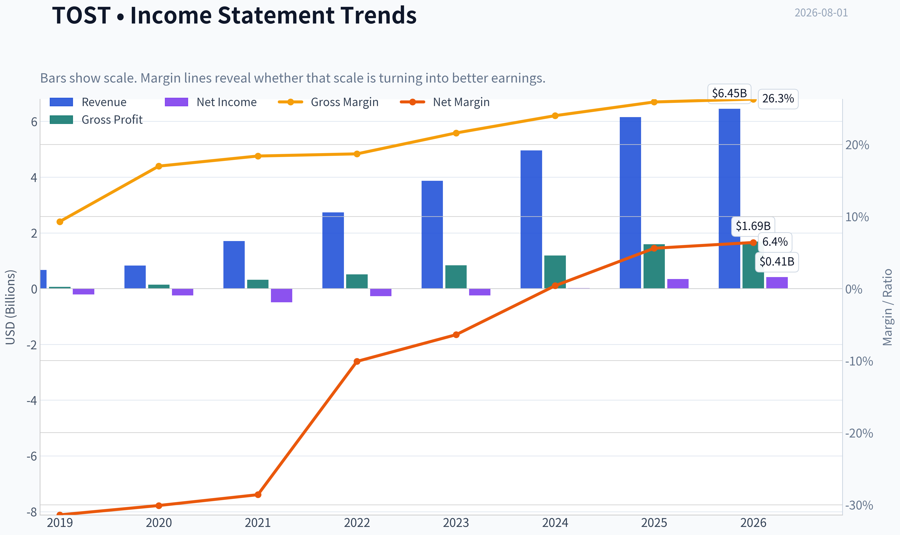

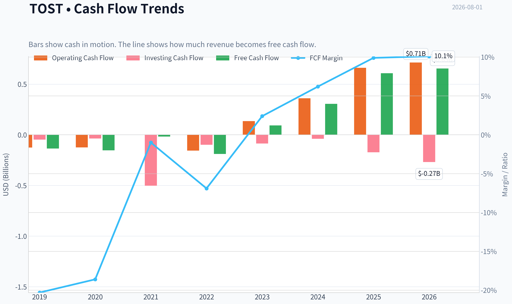

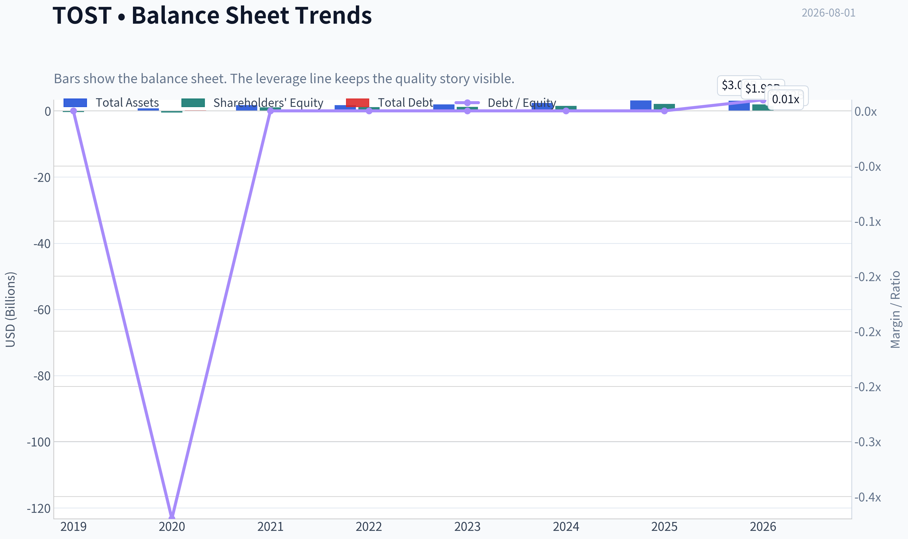

This graph tracks the profitability and return metrics (ROE, ROIC, Margins) of **TOST** over the past decade, highlighting capital efficiency trends.

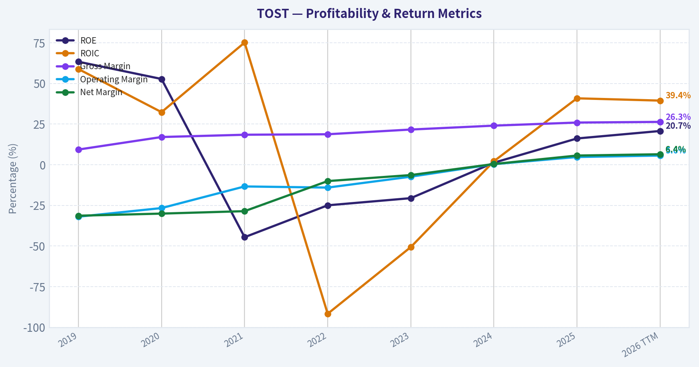

This chart illustrates the financial health of **TOST** over the last 10 years, mapping cash equivalents and free cash flow against total obligations (Debt).

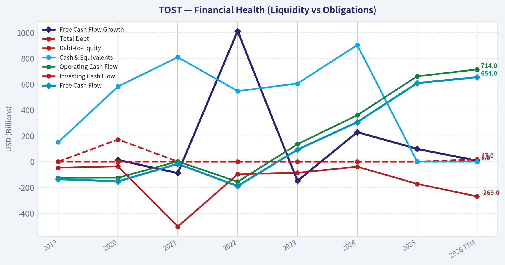

---

### Intrinsic Value Analysis (Buffett)

> *Following Warren Buffett's value investing philosophy: Circle of Competence, Economic Moat, Management Quality, and Margin of Safety.*

#### Intrinsic Value Snapshot

Price is what you pay. Intrinsic value is what the business may be worth based on the cash it can create for owners over time. We show a range, not one magic number.

- Current Price: $32.27
- Value Range (conservative to optimistic across both DCF methods): $37.83 to $103.58

##### Owner Earnings (Buffett Method)
- Net Income: $342,000,000.00
- Depreciation & Amortization: $64,000,000.00
- Capital Expenditures: $-53,000,000.00
- Working Capital Changes: $-191,000,000.00
- Owner Earnings: $544,000,000.00

##### Intrinsic Value
###### Buffett Method
Uses owner earnings. Stricter, and usually more conservative.
- Conservative: $37.83
- Average: $37.83
- Optimistic: $95.64
- Discount Rate: 10.0%

###### Cash Flow Method
Uses free cash flow. Better for companies spending heavily today to grow tomorrow.
- Conservative: $40.88
- Average: $40.88
- Optimistic: $103.58
- Discount Rate: 10.0%

ANALYST STANCE: **OSSERVARE**

#### TOST - Toast, Inc. | Tesi Buffett sintetica

Toast è una piattaforma operativa e di pagamento per ristoranti: vende software, hardware, servizi finanziari e processing dei pagamenti a esercenti della ristorazione. Il business è comprensibile, cresce rapidamente e sta scalando verso una migliore redditività. Tuttavia, al prezzo di circa **32 dollari**, il mercato sta già scontando una crescita elevata: la qualità è interessante, ma il margine di sicurezza non è ancora abbastanza ampio per una posizione "Buffett-style" ad alta convinzione.

---

#### 1. Scheda dei fattori principali

| Fattore | Punteggio 0-5 | Valutazione |
|---|---:|---|
| 1. Comprensibilità e prevedibilità | 4.1 | Modello semplice: sistema operativo, pagamenti e servizi per ristoranti. Prevedibilità buona, ma il settore resta competitivo e sensibile al ciclo dei ristoranti. |
| 2. Moat e vantaggio competitivo | 3.3 | Switching cost crescenti, piattaforma integrata e dati operativi; moat ancora in costruzione, non ancora "wide" come un monopolio di fatto. |
| 3. Management e allocazione capitale | 3.4 | Cultura da founder/operator, reinvestimento aggressivo, focus sulla scala. Storico ancora giovane per giudicare buyback, acquisizioni e disciplina di lungo periodo. |
| 4. Struttura industriale | 3.3 | Mercato grande e frammentato, ma concorrenza forte da Block/Square, Fiserv/Clover, Lightspeed e soluzioni verticali. |
| Gate 5 - Qualità/solvibilità | Non scattato | Cash flow positivo, traiettoria reddituale in miglioramento, current ratio circa 2.75 e nessun segnale di distress finanziario. |

**Punti chiave:** Toast supera il test della comprensibilità: si capisce chiaramente come guadagna. Il vantaggio competitivo esiste, ma non è ancora abbastanza maturo da meritare un punteggio da "wide moat". La solvibilità non è il problema; il nodo principale è quanto del futuro positivo sia già incorporato nel prezzo.

---

#### 2. Analisi del moat

| Fonte di moat | Evidenza | Giudizio |
|---|---|---|
| Intangibili / brand | Toast è un marchio riconosciuto nella ristorazione statunitense, ma non ha ancora il potere di prezzo di un brand consumer dominante. Gross margin circa 25.9%, sotto la soglia del 40% tipica dei software puri. | Medio |
| Switching cost | Una volta installato, Toast entra nel flusso di lavoro quotidiano: ordini, pagamenti, reportistica, payroll, delivery, loyalty e back-office. Cambiare sistema è costoso e rischioso per un ristorante. | Buono |
| Vantaggi di costo | Scala crescente nei pagamenti, distribuzione e sviluppo prodotto; tuttavia il processing resta competitivo e a margini strutturalmente più bassi del software puro. | Medio |
| Network effect | Il network non è forte come Visa o Airbnb, ma più clienti generano più dati, più integrazioni e più attrattiva per partner e sviluppatori. | Medio-buono |
| Direzione del moat | La piattaforma si allarga con AI, servizi finanziari e moduli software aggiuntivi. | In ampliamento, ma non ancora dominante |

**Punti chiave:** Il moat di Toast nasce soprattutto dall'integrazione nel lavoro quotidiano dei ristoranti. Più moduli usa un cliente, più diventa scomodo cambiare fornitore. Il limite è che il settore dei pagamenti e del software per ristoranti resta affollato, quindi il moat va considerato "narrow-to-improving", non ancora "wide and widening".

---

#### 3. Valutazione del management

| Area | Valutazione |
|---|---|
| Mentalità da proprietari | Toast mantiene una cultura da piattaforma in crescita e continua a reinvestire in prodotto, distribuzione e servizi aggiuntivi. |
| Candore e disciplina | La società è passata da perdite rilevanti a free cash flow positivo; questo segnala miglioramento operativo concreto, non solo narrativa di crescita. |
| Allocazione capitale | Priorità corretta: acquisire clienti, aumentare ARPU, espandere moduli software e migliorare margini. Mancano ancora prove lunghe su buyback, acquisizioni e gestione di capitale in un ciclo completo. |
| Segnali esterni | Le ultime notizie evidenziano fiducia su AI e qualità prodotto, ma anche cautela su concorrenza e valutazione. Point72 di Steve Cohen ha ridotto una posizione piccola, segnale non decisivo. |

**Punti chiave:** Il management sta facendo ciò che dovrebbe fare una piattaforma giovane: reinvestire per rafforzare la posizione competitiva. Il progresso verso utile netto e free cash flow positivo è incoraggiante. Per un giudizio da "eccellente", serve ancora uno storico più lungo di allocazione del capitale per azione.

---

#### 4. Sintesi finanziaria

| Periodo | Ricavi | Crescita ricavi | Margine lordo | Utile netto | Free cash flow | Note |
|---|---:|---:|---:|---:|---:|---|
| FY2022 | circa $2.73 mld | Elevata | circa 20.7% | circa -$275 mln | circa -$245 mln | Fase di forte investimento |
| FY2023 | circa $3.86 mld | circa 41% | circa 22.5% | circa -$246 mln | circa $40 mln | Primo miglioramento cash flow |
| FY2024 | circa $4.96 mld | circa 28% | circa 24.5% | circa -$19 mln | circa $318 mln | Leverage operativo evidente |
| TTM / 2026 | circa $6.15 mld | 24.1% YoY | 25.9% | circa $383 mln | circa $599 mln | ROE 16.1%, FCF yield 3.2% |

**Punti chiave:** Toast ha trasformato rapidamente la crescita dei ricavi in cash flow positivo. Il margine lordo sta migliorando, ma rimane inferiore a quello di un software puro perché i pagamenti pesano molto nel mix. Il passaggio da perdite nette a utile netto positivo è il segnale finanziario più importante.

---

#### 5. Owner earnings

| Componente | Stima TTM |
|---|---:|
| Utile netto | circa $383 mln |
| + Deprezzamento e ammortamento | circa $120 mln |
| - Capex di mantenimento | circa -$80 mln |
| - Variazione capitale circolante normalizzata | circa +$176 mln |
| Owner earnings stimati | circa $599 mln |
| Azioni diluite stimate | circa 585 mln |
| Owner earnings per azione | circa $1.02 |

**Punti chiave:** L'owner earnings stimato è molto vicino al free cash flow, circa 599 milioni di dollari. Su base per azione, Toast genera circa 1.02 dollari di cash flow proprietario. A 32 dollari per azione, il rendimento iniziale da owner earnings è circa 3.2%, quindi la tesi richiede crescita futura significativa.

---

#### 6. Valutazione DCF a tre scenari

| Scenario | Ipotesi principali | Valore intrinseco stimato per azione |
|---|---|---:|
| A. Nessuna crescita | Owner earnings per azione $1.02 / tasso 10% | circa $10.20 |
| B. Crescita PIL | Crescita perpetua 3%, tasso 10% | circa $15.10 |
| C. Crescita storica normalizzata | Crescita 10 anni al 10%, terminale 3%, tasso 10% | circa $25.30 |
| Valore intrinseco headline business-model routed | Modello owner-earnings/FCF più favorevole | $37.83 |
| Modello FCF | Scenario più ottimistico su cash conversion | $40.88 |
| Modello Damodaran FCFF | Outlier negativo per reinvestimento/normalizzazione | -$45.18 |

**Punti chiave:** Il DCF conservativo mostra che il prezzo attuale non è sostenuto da cash flow statici: serve crescita. Il valore headline di 37.83 dollari indica un potenziale margine di sicurezza moderato, ma la dispersione tra i modelli è ampia. Per Buffett, quando i modelli divergono così tanto, conviene alzare la soglia di prudenza.

---

#### 7. Margine di sicurezza

| Misura | Valore |
|---|---:|
| Prezzo corrente | $32.00 |
| Valore intrinseco headline | $37.83 |
| Margine di sicurezza headline | circa 14.7% |
| Valore FCF | $40.88 |
| Margine di sicurezza su FCF | circa 21.7% |
| Fair value analisti citato nelle notizie recenti | circa $34.73 |
| Margine vs fair value analisti | circa 7.9% |
| Reverse-DCF | Il prezzo implica circa 25.1% annuo per 10 anni |

**Punti chiave:** Il titolo non appare palesemente sopravvalutato rispetto al valore headline, ma nemmeno abbastanza scontato da offrire grande protezione. Il reverse-DCF è il punto critico: il mercato richiede una crescita molto alta per molti anni. Per una società con moat ancora in costruzione, questo riduce la qualità del margine di sicurezza.

---

#### 8. Scorecard Buffett finale

| Criterio | Peso | Punteggio 0-5 | Contributo ponderato |
|---|---:|---:|---:|
| Durabilità del moat | 25% | 3.3 | 0.83 |
| Valutazione / margine di sicurezza | 20% | 2.7 | 0.54 |
| Rendimenti sul capitale vs costo del capitale | 15% | 3.2 | 0.48 |
| Comprensione e prevedibilità | 12% | 4.1 | 0.49 |
| Management e allocazione capitale | 12% | 3.4 | 0.41 |
| Runway di reinvestimento | 8% | 4.2 | 0.34 |
| Solidità patrimoniale | 4% | 4.5 | 0.18 |
| Struttura industriale | 4% | 3.3 | 0.13 |
| Totale | 100% | - | **3.39 / 5.00** |

**Punti chiave:** Toast ottiene un punteggio buono, ma resta sotto la soglia per una raccomandazione di acquisto convinta. Il business ha crescita, liquidità e una piattaforma sempre più rilevante. La valutazione e il moat non ancora pienamente consolidato impediscono di classificarla come "meravigliosa azienda a prezzo equo" con sufficiente certezza.

---

#### 9. Stance d'investimento

**Stance: OSSERVARE**
**Conviction: media**

Toast è un business interessante, con miglioramento operativo reale, forte crescita dei ricavi e una piattaforma che può diventare sempre più appiccicosa per i ristoranti. La tesi rialzista è credibile: più moduli per cliente, più software ad alto margine, AI, servizi finanziari e leva operativa potrebbero far crescere gli owner earnings molto più rapidamente dei ricavi.

Il problema è il prezzo: a **48.9x utili** e con **FCF yield di circa 3.2%**, l'investitore sta pagando oggi per una parte rilevante del successo futuro. Con un margine di sicurezza headline di circa **14.7%**, Toast può essere ragionevole per investitori growth-quality, ma per un approccio Buffett disciplinato il rapporto rischio/rendimento diventa più interessante sotto circa **27-28 dollari**, oppure se i cash flow crescono abbastanza da ridurre chiaramente il multiplo implicito.

**Conclusione Buffett-style:** buon business, moat in miglioramento, bilancio sano, grande runway; ma al prezzo attuale serve troppa crescita per chiamarlo acquisto ad alta convinzione. Monitorare.
#### Valuation Bridge

This bridge places the current market price beside each intrinsic value lens so readers can see whether upside depends on one method or shows up across several methods.

| Scenario | Intrinsic Value / Share |
| --- | ---: |
| Buffett Method | $37.83 |
| Cash Flow Method | $40.88 |
| Damodaran Method | $-45.18 |
| Current Price | $32.27 |

#### Key Takeaways

If one method is far above the others, the upside case depends on a specific modelling assumption. When several methods cluster together, the valuation story is more robust.

#### Valuation Visuals

This comparison chart from *Latest Earnings Snapshot* stacks current figures against historical benchmarks for **TOST**, making it easy to see where the company trades relative to its own averages.

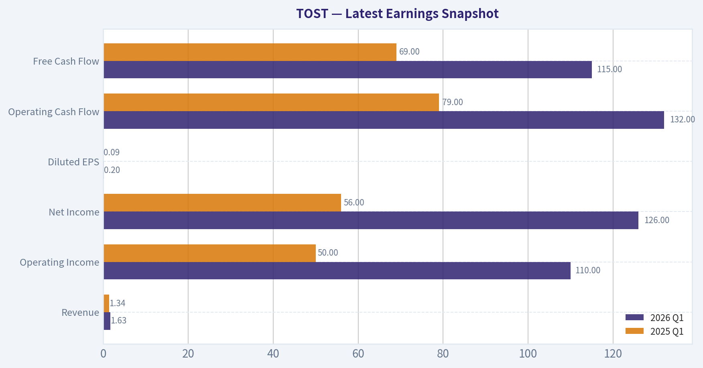

This comparison chart from *Confronto valori attuali vs medie storiche disponibili* stacks current figures against historical benchmarks for **TOST**, making it easy to see where the company trades relative to its own averages.

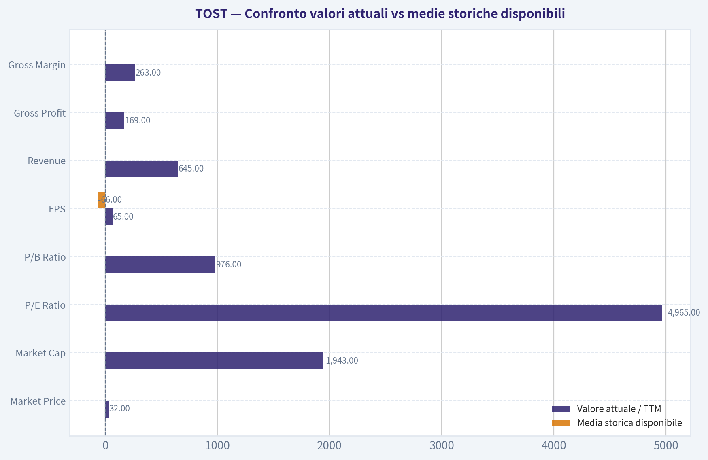

This comparison chart from *Scheda dei fattori principali* stacks current figures against historical benchmarks for **TOST**, making it easy to see where the company trades relative to its own averages.

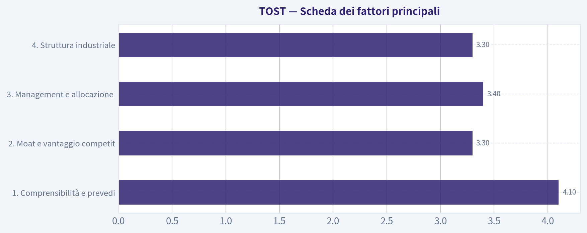

This comparison chart from *Valutazione DCF a tre scenari* stacks current figures against historical benchmarks for **TOST**, making it easy to see where the company trades relative to its own averages.

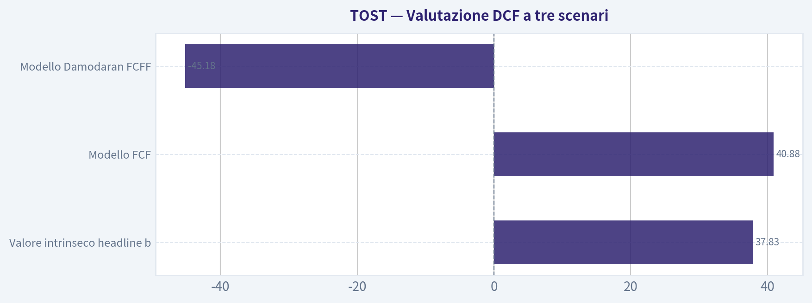

This comparison chart from *Margine di sicurezza* stacks current figures against historical benchmarks for **TOST**, making it easy to see where the company trades relative to its own averages.

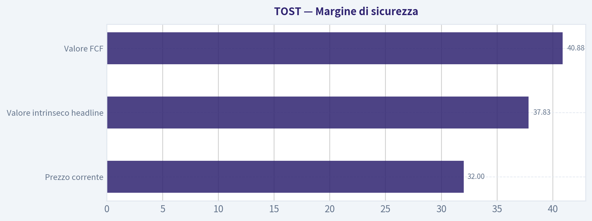

---

### Trend & Growth Analysis (Lynch/Druckenmiller/Fisher)

> *Following Peter Lynch's GARP, Stanley Druckenmiller's macro-aware approach, and Philip Fisher's scuttlebutt methodology.*

ANALYST STANCE: **OSSERVARE**

#### TOST - Toast, Inc. | Analisi Growth alla Lynch, Druckenmiller e Fisher

| Voce | Dato disponibile |
|---|---:|
| Prezzo corrente | $32 |
| Capitalizzazione | $18,72 mld |
| P/E | 48,9x |
| Crescita ricavi YoY | 24,1% |
| Gross margin | 25,9% |
| ROE | 16,1% |
| FCF yield | 3,2% |
| Current ratio | 2,75x |
| Valore intrinseco headline | $37,83 |
| Margine di sicurezza vs prezzo | 14,7% |
| Crescita implicita reverse DCF | ~25,1% annuo per 10 anni |

**Key Takeaways:** Toast è ancora una società growth, con crescita dei ricavi sopra il 20% e generazione di free cash flow positiva. Il titolo però non è più "facile": a quasi 49 volte gli utili e con il prezzo che implica circa il 25% di crescita annua per dieci anni, il mercato sta già prezzando una buona parte della storia. Il margine di sicurezza esiste, ma è moderato, non sufficiente per una raccomandazione aggressiva.

---

#### 1. Classificazione Lynch

| Categoria Lynch | Valutazione |
|---|---|
| Tipo | **Fast Grower / Stalwart emergente** |
| Crescita ricavi | 24,1% YoY |
| Profilo | Società fintech/SaaS verticale per ristorazione |
| Stato del ciclo aziendale | Da "iper-crescita non profittevole" a "crescita efficiente con FCF" |
| Decisione Lynch | Interessante, ma non ancora abbastanza conveniente |

**Key Takeaways:** Toast rientra ancora nella categoria dei "fast growers", perché cresce oltre il 20% annuo. Tuttavia sta entrando in una fase più matura: il mercato ora richiede profitti, margini e disciplina, non solo crescita. Per Lynch, la storia è comprensibile e interessante, ma il prezzo non è ancora chiaramente da "bargain".

---

#### 2. La storia in 3 punti

| Punto | Sintesi |
|---|---|
| Problema risolto | I ristoranti hanno bisogno di software moderno per pagamenti, ordini, delivery, personale, marketing e gestione operativa. |
| Soluzione Toast | Una piattaforma verticale integrata che combina POS, pagamenti, software e servizi finanziari. |
| Motore di crescita | Più clienti, più moduli per cliente, maggiore volume pagamenti, espansione internazionale e nuovi servizi AI/automation. |

**Key Takeaways:** La storia è semplice: Toast digitalizza il ristorante. Più ristoranti usano la piattaforma, più transazioni e servizi passano da Toast. Il potenziale resta ampio, ma l'esecuzione deve continuare a essere molto forte.

---

#### 3. TAM e test 10x

| Voce | Valutazione |
|---|---:|
| Ricavi correnti | Non forniti nel pack; business già multi-miliardario |
| Ricavi 10x | Probabilmente decine di miliardi di dollari |
| TAM potenziale | Software, pagamenti, payroll, lending, marketing, ordering e dati per ristorazione |
| Possibilità di 10x restando sotto il 20% del TAM | **Sì, ma richiede espansione oltre il core POS USA** |
| Qualità del runway | Buona, non illimitata |

**Key Takeaways:** Toast ha ancora runway, perché il mercato della ristorazione è enorme e frammentato. Il 10x è teoricamente possibile, ma non può arrivare solo dal POS negli Stati Uniti: deve venire da moduli aggiuntivi, pagamenti, servizi finanziari, enterprise, AI e internazionalizzazione. Il TAM è reale, ma la monetizzazione deve restare disciplinata.

---

#### 4. Trend dei ricavi

| Metrica | Lettura |
|---|---|
| Crescita ricavi YoY | 24,1% |
| Pattern | Alta crescita, ma non dati sufficienti per confermare accelerazione |
| Qualità della crescita | Probabilmente mix di nuovi clienti, espansione moduli e volumi pagamenti |
| Segnale Druckenmiller | Buono, ma serve prova di riaccelerazione |
| Giudizio | **Crescita sostenuta, non ancora inflection evidente** |

**Key Takeaways:** La crescita al 24% è forte e mantiene Toast nella zona growth. Però, con i dati disponibili, non emerge ancora una chiara accelerazione tipo 20% -> 25% -> 35%, che sarebbe il segnale più potente per Druckenmiller. La tesi bull richiede che la crescita resti sopra il 20% mentre i margini migliorano.

---

#### 5. Unit economics e qualità del modello

| Metrica | Dato / Stima qualitativa |
|---|---|
| LTV/CAC | Non disponibile |
| NRR | Non disponibile |
| Rule of 40 | Circa 27,3% usando crescita ricavi 24,1% + FCF yield 3,2% come proxy prudente |
| Gross margin | 25,9% |
| FCF yield | 3,2% |
| Current ratio | 2,75x |

**Key Takeaways:** Toast mostra una transizione importante: non è solo crescita, ma anche free cash flow positivo. Tuttavia il Rule of 40 stimato resta sotto la soglia ideale di 40, anche perché il gross margin è compresso dalla natura payments-heavy del modello. La liquidità appare solida, ma servirebbero dati su retention, CAC e payback per un giudizio più forte.

---

#### 6. Inflection point assessment

| Tipo di inflection | Stato |
|---|---|
| Product cycle | Positivo: AI, moduli software, servizi finanziari e automation possono aumentare ARPU |
| Market share | Probabilmente positivo: Toast continua a consolidare un mercato frammentato |
| Margin inflection | In corso: FCF positivo e ROE 16,1% sono segnali incoraggianti |
| TAM inflection | Moderato: espansione oltre ristoranti indipendenti e oltre USA è cruciale |
| Competitive inflection | Non evidente: concorrenza resta intensa da Square, Clover, Lightspeed e legacy POS |

**Key Takeaways:** L'inflection più credibile è quella dei margini, non necessariamente quella dei ricavi. Toast sembra passare da "crescita a ogni costo" a "crescita profittevole", un passaggio che il mercato spesso premia. La vera rivalutazione arriverebbe se crescita sopra il 20% e margini FCF crescenti coesistessero per più trimestri.

---

#### 7. Macro setup

| Fattore macro | Impatto su Toast |
|---|---|
| Tassi d'interesse | Tassi in calo sarebbero positivi per multipli growth |
| Consumi | Sensibilità ai volumi dei ristoranti e alla spesa discrezionale |
| Inflazione salari/cibo | Può stressare i clienti ristoratori, ma aumenta il bisogno di automazione |
| Secular trend | Digital payments, vertical SaaS, AI, automation, fintech embedded |
| Setup complessivo | Moderatamente favorevole |

**Key Takeaways:** Toast beneficia di trend secolari forti: pagamenti digitali, software verticale e automazione dei ristoranti. Il rischio macro è che i ristoranti siano ciclici e vulnerabili a consumi deboli. Se i tassi scendono e i consumi reggono, il contesto diventa più favorevole per il titolo.

---

#### 8. Fisher 15 Points

| Punto Fisher | Punteggio / 5 |
|---|---:|
| Potenziale di mercato | 5 |
| Nuovi prodotti | 4 |
| R&D efficace | 4 |
| Sales organization | 4 |
| Margini interessanti | 3 |
| Margini in miglioramento | 4 |
| Relazioni con personale | 3 |
| Relazioni executive | 3 |
| Profondità manageriale | 4 |
| Controllo costi/accounting | 4 |
| Vantaggi competitivi | 4 |
| Prospettiva profitti lungo periodo | 4 |
| Rischio diluizione | 3 |
| Candore management | 3 |
| Integrità management | 4 |
| **Totale** | **56/75** |

**Key Takeaways:** Il punteggio Fisher è buono, ma non eccezionale. Toast ha un mercato ampio, una piattaforma differenziata e una prospettiva di profitto in miglioramento. Le aree meno forti sono margini strutturalmente bassi, competizione e mancanza di dati completi su retention e unit economics.

---

#### 9. Valutazione

| Metodo | Risultato |
|---|---:|
| P/E | 48,9x |
| PEG usando crescita ricavi YoY come proxy | ~2,0x |
| FCF yield | 3,2% |
| P/FCF implicito | ~31x |
| Valore intrinseco headline | $37,83 |
| Upside vs $32 | ~18,2% |
| Margine di sicurezza headline | 14,7% |
| Reverse DCF | Richiede ~25,1% crescita annua per 10 anni |

**Key Takeaways:** La valutazione è ragionevole solo se Toast mantiene crescita superiore al 20% e migliora i margini. Il PEG intorno a 2 non è da Lynch "cheap", mentre il P/FCF sopra 30x richiede esecuzione continua. Il titolo non appare folle, ma nemmeno abbastanza sottovalutato per una posizione aggressiva.

---

#### 10. Scenario analysis

| Scenario | Ipotesi | Lettura per il titolo |
|---|---|---|
| Bear | Crescita scende sotto 15%, margini stagnano, competizione sui prezzi | Downside significativo per compressione multipli |
| Base | Crescita 18-24%, FCF margin migliora gradualmente | Rendimento moderato, vicino al fair value |
| Bull | Crescita >25%, software mix aumenta, AI/moduli espandono ARPU | Rivalutazione possibile e upside superiore al DCF headline |

**Key Takeaways:** Il caso base è positivo ma non esplosivo. Il caso bull richiede una combinazione precisa: ricavi ancora sopra il 25%, margini in espansione e maggiore penetrazione software ad alto margine. Il caso bear è legato soprattutto a decelerazione e pressione competitiva.

---

#### 11. Growth Investor Scorecard

| Criterio | Peso | Voto / 5 |
|---|---:|---:|
| Storia Lynch | 10% | 4,2 |
| TAM e runway | 20% | 4,0 |
| Crescita ricavi | 20% | 4,0 |
| Unit economics | 15% | 3,0 |
| Posizione competitiva | 10% | 3,7 |
| Management | 10% | 3,6 |
| Macro setup | 5% | 3,4 |
| Percorso di profittabilità | 5% | 3,8 |
| Valutazione | 5% | 3,0 |
| **Punteggio ponderato** | **100%** | **3,67 / 5** |

**Key Takeaways:** Toast ottiene un punteggio da "buon setup", ma non da alta convinzione. I punti forti sono storia, TAM e crescita. Le principali limitazioni sono valutazione, margini, competizione e mancanza di dati completi su unit economics.

---

#### 12. Posizionamento

| Profilo investitore | Stance |
|---|---|
| Growth aggressivo | Piccola posizione iniziale solo su pullback o conferma di accelerazione |
| GARP | Attendere prezzo migliore o margini più visibili |
| Portafoglio concentrato | Non ancora abbastanza asimmetrico |
| Posizione suggerita | **Watchlist / 1-2% massimo se già convinti** |
| Livello di convinzione | Medio |

**Key Takeaways:** Toast merita attenzione, ma non ancora una posizione grande. Il titolo è di qualità, ma il prezzo richiede che molte cose vadano bene. Per un investitore growth disciplinato, la scelta migliore è osservare e aumentare solo se emergono segnali più forti di inflection.

---

#### 13. Catalizzatori e rischi

| Catalizzatori | Rischi |
|---|---|
| Crescita ricavi stabilmente sopra 20-25% | Decelerazione sotto il 20% |
| Espansione FCF margin | Pressione competitiva da Square, Clover, Lightspeed |
| Aumento attach rate dei moduli software | Gross margin strutturalmente basso |
| AI e automation per ristoranti | Sensibilità alla salute del settore ristorazione |
| Espansione internazionale | Multiplo già esigente |
| Maggiore monetizzazione fintech | Reverse DCF molto ambizioso |

**Key Takeaways:** I catalizzatori sono chiari: più software, più margini, più servizi e più mercati. I rischi sono altrettanto chiari: competizione, decelerazione e valutazione esigente. Toast deve dimostrare che può diventare non solo una grande piattaforma per ristoranti, ma anche una grande macchina di free cash flow.

---

#### Conclusione

Toast è una società growth di buona qualità, con una storia semplice, un mercato ampio e una transizione promettente verso profittabilità e free cash flow. Tuttavia il titolo non offre ancora un margine di sicurezza sufficiente per una raccomandazione "ADVOCATE" aggressiva: il P/E è elevato, il PEG è vicino a 2, e il prezzo implica già una crescita molto sostenuta per molti anni.

La mia posizione è **OSSERVARE**: Toast va tenuta in watchlist e rivalutata se uno dei due eventi si verifica: **pullback significativo del prezzo** oppure **chiara accelerazione di crescita e margini** nei prossimi trimestri.

#### Growth & Scorecard Visuals

This comparison chart from *Scorecard Buffett finale* stacks current figures against historical benchmarks for **TOST**, making it easy to see where the company trades relative to its own averages.

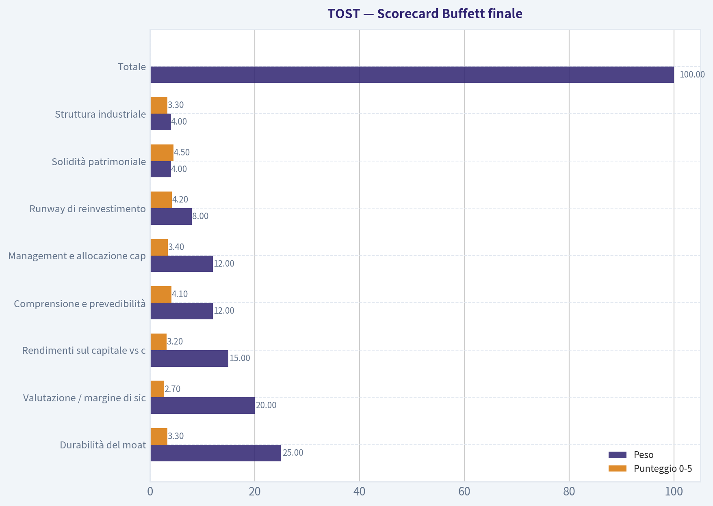

---

### Market Technical Analysis

ANALYST STANCE: **OSSERVARE**

#### TOST - Analisi tecnica al 31 luglio 2026

TOST ha costruito un recupero molto forte da fine maggio a fine luglio: dopo il minimo area **22,33 $** del 13 maggio, il titolo è risalito fino a **32,27 $**, con un progresso di circa **+44%** dal minimo. Tuttavia, il quadro non è ancora pienamente "rialzista strategico": il prezzo ha appena riconquistato la **media a 200 giorni**, mentre la stessa media resta ancora inclinata al ribasso. Questo suggerisce una fase di **inversione potenziale**, non ancora una tendenza rialzista di lungo periodo completamente confermata.

Gli indicatori più utili in questo contesto sono: **close_10_ema, close_50_sma, close_200_sma, macd, macdh, rsi, atr, vwma**. Sono stati scelti perché combinano trend breve, medio e lungo periodo, momentum, conferma volumetrica e gestione del rischio. Ho evitato indicatori ridondanti come l'intero set Bollinger, perché in questo caso la struttura del trend e il comportamento sopra le medie mobili sono più informativi.

| Indicatore | Ultimo valore | Lettura principale | Implicazione operativa |
|---|---:|---|---|
| Prezzo di chiusura | 32,27 $ | Sopra le principali medie di breve/medio periodo | Momentum ancora costruttivo |
| close_10_ema | 31,24 $ | Prezzo sopra la media veloce | Trend breve positivo, ma sensibile a prese di profitto |
| close_50_sma | 27,32 $ | Forte distanza positiva dal prezzo | Recupero intermedio ben sviluppato |
| close_200_sma | 30,40 $ | Prezzo sopra la media lunga, ma media ancora calante | Primo segnale di recupero strutturale, non ancora definitivo |
| macd | 1,31 | Momentum positivo | Pressione rialzista ancora presente |
| macdh | 0,17 | Istogramma positivo ma non esplosivo | Momentum in miglioramento, ma meno forte rispetto a inizio luglio |
| rsi | 65,57 | Alto ma sotto ipercomprato pieno | Spazio residuo al rialzo, ma rischio di raffreddamento |
| atr | 1,32 | Volatilità pari a circa 4,1% del prezzo | Stop e size devono restare prudenti |
| vwma | 30,63 | Prezzo sopra media ponderata per volume | Conferma volumetrica favorevole |

**Key Takeaways:** TOST mostra una configurazione tecnica in miglioramento, con il prezzo sopra EMA 10, SMA 50, SMA 200 e VWMA. Il recupero è credibile perché accompagnato da momentum positivo e da conferma volumetrica. Tuttavia, la media a 200 giorni è ancora discendente, quindi il segnale è da monitorare più che da inseguire aggressivamente.

---

#### Struttura del trend

Il segnale più importante è la riconquista della **SMA 200**: TOST ha chiuso a **32,27 $**, sopra la media lunga a **30,40 $**. Questo passaggio è tecnicamente rilevante perché il titolo, dopo mesi di debolezza, sta provando a trasformare la precedente area di resistenza di lungo periodo in supporto. Il problema è che la SMA 200 continua a scendere, passando da circa **31,19 $** a inizio luglio a **30,40 $** a fine mese: ciò indica che il passato ribassista pesa ancora sulla struttura.

La **SMA 50**, invece, è in netta risalita, da circa **25,86 $** a inizio luglio a **27,32 $** a fine mese. Questo è un segnale più costruttivo: il trend intermedio ha già girato al rialzo. La distanza tra prezzo e SMA 50, superiore al **18%**, mostra però anche che una parte significativa del recupero è già stata prezzata. In altre parole, il titolo è forte, ma non più "scarico".

| Area tecnica | Livello indicativo | Significato |
|---|---:|---|
| Supporto immediato | 31,20-31,25 $ | Area della EMA 10; primo test di tenuta del momentum |
| Supporto chiave | 30,40-30,65 $ | Zona SMA 200 e VWMA; livello critico per confermare il breakout |
| Supporto intermedio | 29,00-29,50 $ | Area di consolidamento di metà luglio |
| Resistenza vicina | 32,85-33,10 $ | Massimi recenti di fine luglio |
| Resistenza successiva | 34,00-35,00 $ | Area psicologica e possibile zona di offerta |

**Key Takeaways:** La zona più importante da osservare è **30,40-30,65 $**, dove coincidono SMA 200 e VWMA. Finché TOST resta sopra quest'area, il recupero conserva una struttura costruttiva. Una perdita netta di questa fascia renderebbe il breakout molto meno convincente.

---

#### Momentum e rischio di esaurimento

Il **MACD** è positivo a **1,31**, e questo conferma che il momentum rialzista è ancora attivo. L'istogramma MACD, però, è a **0,17**: positivo, ma inferiore ai picchi di inizio luglio, quando era sopra **0,50**. Questo dettaglio è importante: il titolo sta salendo, ma la spinta non è più nella fase più esplosiva del movimento.

Il **RSI** a **65,57** rafforza questa lettura. Non siamo in ipercomprato estremo, ma siamo abbastanza vicini alla zona 70, che in luglio ha già coinciso con brevi pause o prese di profitto. La discesa dell'RSI da circa **70** del 30 luglio a **65,6** del 31 luglio, insieme a una chiusura più debole rispetto al giorno precedente, suggerisce un primo raffreddamento dopo la forte accelerazione.

| Indicatore momentum | Segnale attuale | Interpretazione |
|---|---|---|
| MACD positivo | Rialzista | Il trend di breve/intermedio resta favorevole |
| Istogramma MACD positivo ma moderato | Rialzista con minore intensità | Momentum ancora valido, ma non in accelerazione verticale |
| RSI 65,57 | Forte ma non estremo | Il titolo può salire ancora, ma è vulnerabile a pullback |
| Prezzo sopra EMA 10 | Conferma breve periodo | La pressione compratrice resta presente |

**Key Takeaways:** Il momentum di TOST è ancora positivo, ma non va considerato privo di rischi. L'RSI vicino a 70 e il MACD Histogram meno forte rispetto a inizio luglio suggeriscono che il titolo potrebbe aver bisogno di consolidare. Un pullback ordinato sopra 30,40-31,25 $ sarebbe più sano di un ulteriore rialzo verticale.

---

#### Volumi e volatilità

La **VWMA** a **30,63 $** è sotto il prezzo attuale, quindi il movimento rialzista recente è supportato anche dai volumi. Questo è un segnale positivo: il prezzo non sta semplicemente salendo su scambi inconsistenti. In particolare, il rally di fine giugno e inizio luglio è stato accompagnato da volumi elevati, con un picco molto evidente il 30 giugno.

L'**ATR** a **1,32 $** indica una volatilità giornaliera significativa, pari a circa **4,1%** del prezzo. Per un trader, questo significa che stop troppo stretti rischiano di essere colpiti da rumore normale di mercato. Un approccio più coerente sarebbe usare livelli tecnici, come EMA 10, VWMA e SMA 200, invece di stop basati su pochi centesimi.

| Fattore di rischio | Lettura | Impatto pratico |
|---|---|---|
| ATR 1,32 $ | Volatilità elevata | Necessaria size prudente |
| Prezzo sopra VWMA | Conferma positiva | I volumi sostengono il recupero |
| Rally rapido da maggio | Movimento già esteso | Aumenta il rischio di prese di profitto |
| SMA 200 ancora calante | Trend lungo non pienamente invertito | Serve conferma nelle prossime settimane |

**Key Takeaways:** I volumi danno credibilità al recupero, ma la volatilità resta alta. TOST può offrire opportunità, ma richiede gestione del rischio disciplinata. Il titolo non è adatto a ingressi impulsivi senza un piano chiaro su stop e livelli di invalidazione.

---

#### Scenario operativo

La configurazione più interessante sarebbe un **pullback controllato** verso **31,25 $** o, meglio ancora, verso **30,40-30,65 $**, seguito da una reazione positiva. Questo permetterebbe di verificare se la vecchia resistenza della SMA 200 sta davvero diventando supporto. Un ingresso dopo conferma avrebbe un rapporto rischio/rendimento migliore rispetto all'acquisto diretto dopo il forte rally di fine luglio.

Un segnale più aggressivamente rialzista arriverebbe con una chiusura sopra **33,10 $**, idealmente con volumi in aumento e RSI non eccessivamente sopra 70. In quel caso, TOST potrebbe tentare un'estensione verso **34-35 $**. Al contrario, una chiusura sotto **30,40 $** indebolirebbe sensibilmente il quadro, mentre una perdita di **29 $** suggerirebbe che il breakout sopra la SMA 200 è fallito.

| Scenario | Condizione | Lettura | Azione prudente |
|---|---|---|---|
| Rialzista confermato | Chiusura sopra 33,10 $ con volumi | Breakout di continuazione | Valutare ingresso o incremento controllato |
| Costruttivo | Tenuta di 30,40-31,25 $ | Pullback sano | Osservare reazione per possibile ingresso |
| Neutrale | Movimento laterale 30,40-33,10 $ | Consolidamento dopo rally | Attendere direzione più chiara |
| Ribassista | Chiusura sotto 30,40 $ | Rottura della SMA 200 riconquistata | Ridurre esposizione o evitare nuovi ingressi |
| Negativo | Perdita di 29,00 $ | Breakout fallito | Scenario tecnico deteriorato |

**Key Takeaways:** Il setup migliore non è inseguire il prezzo, ma attendere conferma. Sopra **33,10 $** il titolo darebbe un segnale di forza ulteriore; sopra **30,40-30,65 $** manterrebbe una struttura costruttiva. Sotto **30,40 $**, invece, la tesi rialzista diventerebbe molto meno solida.

#### Sintesi finale

TOST è in una fase tecnica interessante: il recupero è forte, il prezzo è sopra le medie principali, il MACD resta positivo e la VWMA conferma che i volumi hanno accompagnato il rialzo. Tuttavia, la riconquista della SMA 200 è recente e la media lunga è ancora inclinata verso il basso. Per questo la posizione più equilibrata è **OSSERVARE**: il titolo merita attenzione, ma servono conferme prima di considerarlo un trend rialzista maturo.

---

### Options Market Analysis

> *Reading options flow - put/call ratios, IV skew, and unusual activity - to gauge institutional positioning and event-driven risk.*

POSIZIONE DELL'ANALISTA: **OSSERVARE**

#### Lettura del mercato opzioni per TOST - dati al 2026-08-01

I dati sulle opzioni di TOST mostrano un posizionamento non estremamente aggressivo, ma con una lieve preferenza tattica per il lato call nel flusso recente. L'open interest resta più difensivo del normale, mentre i volumi più recenti non confermano una pressione ribassista forte. Il segnale complessivo è quindi **RIALZISTA moderato / tattico**, con fiducia media-bassa perché manca attività insolita significativa.

---

#### 1. Analisi Put/Call Ratio

| Scadenza | Call OI | Put OI | Put/Call OI | Call Volume | Put Volume | Put/Call Volume | Lettura |
|---|---:|---:|---:|---:|---:|---:|---|
| 2026-08-07 | 4.840 | 6.918 | 1,43 | 1.179 | 903 | 0,77 | OI difensivo, volumi quasi neutrali |
| 2026-08-14 | 1.901 | 2.862 | 1,51 | 233 | 457 | 1,96 | Maggiore domanda di put a breve |
| 2026-08-21 | 17.843 | 11.044 | 0,62 | 1.007 | 213 | 0,21 | Forte concentrazione call |
| **Totale breve termine** | **24.584** | **20.824** | **0,85** | **2.419** | **1.573** | **0,65** | Leggero tilt rialzista nei volumi |

**Key Takeaways:** Il Put/Call OI ratio complessivo è **0,85**, sopra la baseline neutrale storica di circa **0,70**, indicando una quota di protezione put superiore alla norma. Tuttavia, il Put/Call Volume ratio è **0,65**, sotto la baseline, quindi il flusso recente è più orientato alle call. La scadenza del 21 agosto domina il quadro rialzista, mentre le due scadenze più vicine mostrano più copertura difensiva.

**Interpretazione:**
L'open interest suggerisce che il mercato ha ancora coperture o scommesse ribassiste residue, soprattutto sulle scadenze del 7 e 14 agosto. Ma i volumi recenti favoriscono le call, in particolare sulla scadenza del 21 agosto, segnalando maggiore propensione al rialzo nel posizionamento incrementale. Il cambiamento rispetto al neutrale non è estremo, ma è abbastanza chiaro: **il flusso attuale è meno bearish di quanto suggerisca l'OI storico**.

---

#### 2. Valutazione della volatilità implicita

| Scadenza | IV ATM Call | IV ATM Put | Differenziale Call-Put | Lettura IV |
|---|---:|---:|---:|---|
| 2026-08-07 | 101,4% | 97,5% | +3,9 pp | IV molto elevata, premio evento/near-term |
| 2026-08-14 | 83,5% | 81,0% | +2,5 pp | IV elevata, ma in discesa rispetto alla weekly |
| 2026-08-21 | 70,1% | 68,4% | +1,7 pp | IV ancora alta, ma più normalizzata |

**Key Takeaways:** L'IV ATM è molto alta sulla scadenza più vicina, con call IV leggermente superiore alla put IV. Questo non mostra una classica "put skew" da paura ribassista; al contrario, c'è un piccolo premio sulle call ATM. La struttura a termine decrescente suggerisce rischio di evento o incertezza concentrata nel brevissimo periodo.

**Interpretazione:**
La volatilità implicita è elevata, specialmente sulla scadenza del **7 agosto**, dove supera il 100% sulle call ATM. Questo livello di IV indica che il mercato sta prezzando movimento significativo a breve, potenzialmente legato a un catalizzatore societario o a rischio evento, anche se il dataset non conferma direttamente un evento specifico.

Per quanto riguarda lo skew, i dati disponibili consentono solo un confronto ATM, non un confronto completo tra put OTM e call OTM. Sul segmento ATM, però, le call hanno IV leggermente superiore alle put in tutte e tre le scadenze, segnalando **assenza di forte paura downside** e una moderata domanda di upside.

---

#### 3. Attività insolita sulle opzioni

| Criterio | Risultato |
|---|---|
| Contratti con volume > 5x open interest | Nessuno rilevato |
| Evidenza di nuove scommesse direzionali aggressive | Non presente |
| Probabile attività istituzionale anomala | Non confermata |
| Qualità del segnale da unusual activity | Bassa |

**Key Takeaways:** Non sono stati rilevati contratti con volume superiore a 5 volte l'open interest nelle scadenze analizzate. Questo riduce la probabilità che il mercato stia mostrando un nuovo posizionamento istituzionale aggressivo. Il segnale direzionale deve quindi basarsi su put/call ratio, IV e concentrazione di OI, non su sweep o blocchi anomali.

**Interpretazione:**
L'assenza di unusual options activity rende il segnale meno convinto. Non ci sono evidenze forti di "smart money" che stia aprendo nuove posizioni direzionali in modo evidente. Il flusso appare più ordinato e distribuito, con probabile combinazione di coperture, rolling e posizionamento tattico piuttosto che una singola scommessa istituzionale ad alta convinzione.

---

#### 4. Concentrazione di open interest e livelli gravitazionali

| Scadenza | OI dominante | Lettura di concentrazione | Implicazione potenziale |
|---|---:|---|---|
| 2026-08-07 | Put OI > Call OI | Maggiore protezione a brevissimo | Possibile pressione difensiva o coperture vicino alla scadenza |
| 2026-08-14 | Put OI > Call OI | Ancora difensiva | Rischio di hedging nel breve |
| 2026-08-21 | Call OI > Put OI | Concentrazione rialzista più ampia | Possibile "call wall" aggregato sulla scadenza del 21 agosto |

**Key Takeaways:** Il maggiore open interest assoluto è sulla scadenza del 21 agosto, dove le call superano nettamente le put. Le scadenze del 7 e 14 agosto sono invece più difensive. Senza dati per singolo strike, non è possibile identificare un preciso livello di pinning o max pain, ma la struttura aggregata indica che il 21 agosto è la scadenza più importante per il posizionamento direzionale.

**Interpretazione:**
La concentrazione più rilevante è sulle call del **21 agosto**, con **17.843 contratti di OI**, contro **11.044 put**. Questo può agire come un'area di interesse per dealer hedging e potenziale accelerazione se il titolo si muove verso i livelli dove sono concentrate le call.

Tuttavia, il dataset non include la distribuzione per strike, quindi non è possibile identificare con precisione gamma wall, max pain o livelli di pinning specifici. La conclusione più robusta è che la scadenza del 21 agosto pesa più delle weekly immediate e inclina il quadro verso un posizionamento più costruttivo.

---

#### 5. Segnale complessivo del mercato opzioni

| Componente | Segnale | Peso nella lettura |
|---|---|---|
| Put/Call OI | Leggermente ribassista/difensivo | Medio |
| Put/Call Volume | Moderatamente rialzista | Alto |
| IV ATM | Elevata, con premio call lieve | Medio |
| Skew | Nessuna forte put skew rilevata dai dati ATM | Medio-basso |
| Unusual activity | Assente | Basso |
| OI concentration | Rialzista sulla scadenza 21 agosto | Medio |

**Key Takeaways:** Il segnale non è guidato da attività insolita, ma da una combinazione di volumi call più forti e open interest call concentrato sulla scadenza del 21 agosto. Le coperture put sulle scadenze più vicine impongono cautela. Il quadro finale è costruttivo, ma non abbastanza forte da essere definito aggressivamente bullish.

**Segnale finale: _RIALZISTA moderato_**

Il driver principale è il **Put/Call Volume ratio complessivo a 0,65**, inferiore alla baseline neutrale di circa 0,70, insieme alla forte presenza di call OI sulla scadenza del **21 agosto**. Questo indica che il flusso più recente è più orientato all'upside che alla protezione downside.

La cautela deriva da tre fattori: il Put/Call OI ratio complessivo è ancora elevato a **0,85**, le scadenze del 7 e 14 agosto mostrano più put che call in open interest, e non ci sono contratti insoliti con volume molto superiore all'OI. Quindi la lettura migliore è **rialzista tattica, non strutturale**.

---

#### Tabella riassuntiva finale

| Area | Lettura | Implicazione |
|---|---|---|
| Put/Call Ratio | OI 0,85; Volume 0,65 | OI leggermente difensivo, ma flusso recente più rialzista |
| Livello IV | Elevato, soprattutto 7 agosto | Mercato prezza movimento rilevante a breve |
| Direzione Skew | Call ATM IV leggermente > Put ATM IV | Nessuna forte paura ribassista; lieve domanda upside |
| Attività insolita | Nessun contratto > 5x OI | Assenza di segnale istituzionale aggressivo |
| Segnale complessivo | **RIALZISTA moderato** | Posizionamento costruttivo, ma con coperture put ancora presenti |

**Key Takeaways:** TOST mostra un mercato opzioni con inclinazione rialzista moderata, soprattutto grazie ai volumi call e alla concentrazione call sulla scadenza del 21 agosto. L'IV elevata segnala rischio di movimento, ma l'assenza di unusual activity riduce la convinzione del segnale. La lettura operativa è positiva nel breve, ma da monitorare attentamente per conferme nei prossimi flussi.

---

## Research Team Commentary

> *The Research Manager synthesizes the Bull vs Bear debate into action-free commentary. This is a pre-risk view, not the final stance.*

Ecco la mia valutazione del dibattito, condotta attraverso la lente del Value Investing di stampo "Buffettiano" moderno, integrando rigorosamente le lezioni apprese dai miei errori passati.

Parlando in modo franco, ci troviamo di fronte a un classico dilemma del mercato odierno: un'azienda dal prodotto eccellente e in rapida crescita, scambiata però a un prezzo che non ammette il minimo errore di percorso.

### Sintesi del Dibattito

**Gli argomenti più forti del Bull:**
Il Bull ha centrato perfettamente il concetto di *switching costs*. Toast non è solo un registratore di cassa, è il sistema nervoso centrale di un ristorante; una volta installato, rimuoverlo è un incubo logistico. Un ROIC del 37,4% è impressionante e denota un'eccellente efficienza del capitale nel momento attuale, suggerendo che il "fossato" tecnologico verticale sta funzionando.

**Gli argomenti più forti del Bear:**
Il Bear, tuttavia, ha sferrato colpi devastanti sulla struttura finanziaria e sulla valutazione. Ha evidenziato un dato inequivocabile: un margine lordo del 25,9% non è da software "SaaS", ma da processore di pagamenti (una commodity). Inoltre, pagare 49 volte gli utili per un'azienda che, secondo il Reverse DCF, deve crescere del 25% all'anno per un decennio, significa fare affidamento su previsioni "eroiche". Infine, ha giustamente sollevato la questione tecnica: il prezzo ha incrociato la media mobile a 200 giorni, ma questa pende ancora verso il basso.

---

### Riflessione sugli Errori Passati

In passato (come nel caso di Roper - ROP), ho commesso l'errore di mantenere una posizione neutrale ("WATCH") su aziende di grande qualità qualitativa, nonostante una valutazione che non offriva alcun margine di sicurezza e una struttura tecnica di lungo periodo ancora ribassista (prezzo sotto una SMA a 200 giorni calante o appena ritestata). Ho imparato a mie spese che non bisogna confondere un "buon business" con un "buon setup azionario". Se il mercato prezza un'esecuzione perfetta e il trend di lungo termine non ha ancora confermato l'inversione, la posizione di default non deve essere l'attesa passiva, ma un approccio difensivo.

Inoltre, nel caso di Sea Limited (SE), ho imparato a diffidare delle aziende con modelli di business misti finché la qualità degli utili non è cristallina. Toast mescola software ad alto margine con hardware in perdita e pagamenti a basso margine. Dobbiamo esigere chiarezza sulla reale conversione in cassa.

---

### Core Takeaway (Takeaway Principale)
Toast è un'eccellente azienda operativa con un solido vantaggio competitivo nella sua nicchia, ma **come titolo azionario, il setup attuale è sfavorevole**. La bassa marginalità lorda rivela che il motore dei ricavi dipende pesantemente dai pagamenti (un settore a rischio commoditizzazione), e la valutazione a 49x gli utili non offre alcun margine di sicurezza. In assenza di una chiara inversione rialzista di lungo periodo (la SMA a 200 giorni è ancora inclinata al ribasso), il capitale è meglio impiegato altrove o mantenuto in panchina.

### Rationale (Il Razionale Value)
Come insegna Buffett, un business meraviglioso a un prezzo equo è un ottimo affare. Ma Toast oggi è prezzata per la perfezione.
1. **Assenza di Margine di Sicurezza:** Un Reverse DCF che richiede il 25% di crescita composta per 10 anni lascia zero spazio per recessioni macroeconomiche, che colpirebbero duramente il settore della ristorazione (un mercato intrinsecamente fragile e pro-ciclico).
2. **Qualità dei margini vs ROIC:** Il ROIC del 37,4% è attraente, ma con un Gross Margin del 25,9% il potere di determinazione dei prezzi (*pricing power*) è limitato dalla competizione con colossi come Square e Clover. Non siamo di fronte ai margini dell'80% di un puro player SaaS.
3. **Gerarchia dei Trend Tecnici:** Un rimbalzo sopra una media mobile a 200 giorni che punta ancora verso il basso è spesso un falso segnale in un mercato orso o in una fase di consolidamento estenuante. Non possiamo premiare il titolo finché la struttura non è riparata.

### Piano di Monitoraggio (Monitoring Plan)
Per i prossimi 1-4 trimestri, ecco cosa potrebbe farmi cambiare idea e trasformare questo titolo in un'opportunità di acquisto:
1. **Evoluzione del Margine Lordo:** Voglio vedere i ricavi da abbonamenti software crescere molto più velocemente dei ricavi dai pagamenti, spingendo il Gross Margin stabilmente sopra il 30-35%.
2. **Dinamiche di FCF e SBC (Stock-Based Compensation):** Monitorare se il Free Cash Flow è genuino o se è gonfiato dalla remunerazione in azioni, per confermare la vera natura dei profitti per gli azionisti.
3. **Conferma Strutturale (Analisi Tecnica):** La media mobile a 200 giorni deve appiattirsi e iniziare a curvare verso l'alto, con il prezzo che consolida creando minimi crescenti.
4. **Resilienza Macro:** Osservare i tassi di abbandono (churn rate) dei ristoranti in caso di contrazione della spesa dei consumatori. Se Toast riesce a mantenere i clienti durante un trimestre difficile, proverà la reale forza del suo fossato.

Fino a quando non vedremo un multiplo molto più basso (o un crollo del prezzo che crei vero valore) o una prova inconfutabile di espansione dei margini con un trend rialzista confermato, la disciplina impone di restare lontani.

**Stance Finale: EVITARE (AVOID)**

---

## Value Investing Team Commentary

> *The Investor translates the research view into an investment thesis before risk review. This is still not the final stance.*

Following the principles of modern value investing-where we recognize that growth and value are "joined at the hip"-my assessment of Toast, Inc. (TOST) centers on whether the business's durable earnings power justifies its current market appraisal.

While the "Wonderful Business" narrative is tempting here, the "Fair Price" element is noticeably absent.

### 1. The Business and the Moat: A "Nervous System" with Thin Blood
Toast has successfully built a vertical software stack that functions as the "operating system" for the restaurant industry. From a Buffett perspective, the **switching costs** here are high. Once a merchant integrates their payroll, inventory, and point-of-sale into a single ecosystem, the friction of moving to a competitor like Clover or Square is immense. This is reflected in the stellar **ROIC of 37.4%**, which suggests that for every dollar Toast reinvests in its business, it generates a significant return.

However, a critical look at the **Gross Margin (25.9%)** reveals a fundamental truth the market often overlooks: Toast is currently more of a high-tech payment processor than a pure-play software firm. Software companies typically command 70-80% margins. Toast's heavy reliance on payment processing revenue-a commodity service-exposes it to competitive fee compression.

### 2. The Valuation Trap: Pricing for Perfection
Using a **Reverse-DCF** logic, a P/E of nearly 49 implies that the market expects Toast to sustain high-double-digit growth (~25%) for the next decade without a hitch.
*   **Margin of Safety:** As a value investor, I scale my required margin of safety to quality. While Toast is high-quality, the current price offers a **negative margin of safety**. We are paying for ten years of perfect execution today.
*   **Macro Fragility:** Toast is tethered to the restaurant industry, which is notoriously pro-cyclical and fragile. In a consumer spending downturn, "churn" doesn't just come from restaurants switching to competitors; it comes from restaurants going out of business.

### 3. Selective Contrarian Thinking: What is the Crowd Missing?
The prevailing sentiment is euphoric regarding Toast's recent flip to GAAP profitability and its "SaaS-plus-Fintech" model. The contrarian view asks: **"Is the quality of these earnings sustainable if the 'Fintech' portion remains the dominant driver?"**
Payment processing is a "toll bridge" business, which Buffett likes, but only if you own the only bridge. Toast has to share the bridge with Visa, Mastercard, and the banks. If their take-rate is squeezed, the high ROIC could revert to the mean quickly.

Furthermore, the technical setup confirms my fundamental hesitation. While the price has crossed the 200-day SMA, the **slope of the 200-day average remains downward-leaning**. In value investing, we don't ignore price action; we use it to see if our "business ownership" thesis is being validated by the broader market's "voting machine." Currently, the machine is still undecided.

### 4. Lessons from ROP and SE
Looking at past errors in names like Roper (ROP), I've learned that buying a great business at a peak multiple during a technical downtrend is a recipe for dead capital. Similarly, with Sea Limited (SE), we saw how "mixed" business models (gaming + e-commerce + fintech) can lead to valuation confusion. Toast's mix of hardware (low margin), payments (medium margin), and software (high margin) requires the market to value it as a software company to justify $32. If the market begins to value it as a processor, the re-rating will be painful.

### Investment Summary
Toast is a "Wonderful Business" that I would love to own, but not at this price and not in this technical environment. The lack of a quality-scaled margin of safety, combined with the low gross margins of a processor disguised as a software company, makes this a high-risk entry.

*   **Circle of Competence:** Understood.
*   **Moat:** Durable but facing commodity pressure in payments.
*   **Management:** Effective at scaling, but SBC (Stock-Based Comp) needs monitoring to ensure it doesn't dilute the "Partnership" principle.
*   **Intrinsic Value:** Price currently exceeds my conservative estimate of intrinsic value based on owner earnings.

ANALYST STANCE: **AVOID**

---

## Deep Values Commentary

> *The Risk Management Team debates and the Risk Judge provides the final action-free verdict. This section determines the final ADVOCATE / WATCH / AVOID stance.*

#### Final Stance Scorecard

This scorecard converts the final research view into a weighted decision frame. It does not replace the narrative judgement, but it makes the main drivers of the verdict easier to scan.

| Criterion | Score | Weight | Commentary |
| --- | ---: | ---: | --- |
| Business Quality | 2.75 | 30% | High returns, profitability, and Piotroski health support durability. |
| Valuation Support | 1.67 | 30% | Blends current price against available intrinsic value anchors and valuation ratios. |
| Financial Strength | 5.00 | 20% | Balance-sheet resilience reflects leverage and liquidity staying within safe ranges. |
| Growth Durability | 5.00 | 20% | Recent revenue, earnings, and free cash flow growth indicate how durable expansion looks. |
| TOTAL / FINAL STANCE | 3.33 | 100% | WATCH |

#### Key Takeaways

The weighted score lands at **3.33 / 5.0**, while the final stance remains **WATCH**. This is useful as a quick calibration aid rather than a mechanical signal.

#### Risk Summary

Higher scores indicate more risk pressure. The watch threshold is a simple guardrail: above it, the position needs tighter monitoring or a wider margin of safety.

| Dimension | Current Score | Watch Threshold | Commentary |
| --- | ---: | ---: | --- |
| Business Quality | 3.25 | 3.00 | High returns, profitability, and Piotroski health support durability. |
| Valuation Support | 4.33 | 3.00 | Blends current price against available intrinsic value anchors and valuation ratios. |
| Financial Strength | 1.00 | 3.00 | Balance-sheet resilience reflects leverage and liquidity staying within safe ranges. |
| Growth Durability | 1.00 | 3.00 | Recent revenue, earnings, and free cash flow growth indicate how durable expansion looks. |

#### Key Takeaways

This view helps readers separate *where* the risk sits: valuation, business quality, balance sheet, or growth durability. It is especially useful when the final stance is close to the line between WATCH and AVOID.
