# TPST Deep Value Intelligence

**Analysis Date:** 2026-03-28

## Critical Disclaimer

*This analysis is generated by Deep Value Intelligence, an AI-powered multi-agent investing framework. This report is for informational and educational purposes only and does not constitute financial advice. Always conduct your own research and consult with qualified financial advisors before making investment decisions.*

---

## Table of Contents

1. Intelligence Summary
2. Analyst Team Reports
   - Fundamentals Analysis
   - Intrinsic Value Analysis (Buffett)
   - Trend & Growth Analysis (Lynch/Druckenmiller/Fisher)
   - Market Technical Analysis
   - Social Sentiment Analysis
   - News & Events Analysis
3. Research Team Commentary
4. Value Investing Team Commentary
5. Deep Values Commentary

---

## Intelligence Summary

### Thesis + Conditions

**Core Thesis:** Executive Summary (Quick Read)
Tempest Therapeutics is not a Buffett-style investment today. The business has no revenue, no durable moat, and survives entirely on external financing while pursuing highly uncertain clinical outcomes.

**Key Risks:**
- Tempest Therapeutics is not a Buffett-style investment today. The business has no revenue, no durable moat, and survives entirely on external financing while pursuing highly uncertain clinical outcomes. The upside case-one successful oncology drug-exists, but it is essentially a venture-style bet rather than a value investment. The recent $6M raise signals capital scarcity, and repeated dilution is likely before meaningful clinical validation arrives. With intrinsic value impossible to estimate and the margin of safety absent, this remains speculation rather than investment. Best course: stay out unless major derisking events occur.
- Risky Analyst
- The counterargument focuses on base rates and financial survivability. Oncology Phase 1 programs historically have very low approval probabilities, often in the single digits. Tempest also faces severe capital constraints; the $6M private placement is small relative to oncology trial costs and included warrants to attract investors. This suggests continued dilution ahead. Combined with negative free cash flow, -218% ROE, and dependence on capital markets, the downside is not just scientific failure but also shareholder erosion through repeated financing.
- The middle ground acknowledges both realities. Traditional value metrics are irrelevant for clinical biotech, but dilution risk meaningfully alters the expected return profile. Even if the science progresses, multiple financing rounds could dilute shareholders before commercialization. The key determinant is whether Tempest can attract stronger validation capital-either a major partnership, credible institutional funding, or larger patient datasets confirming early signals.
- Market signals reinforce this risk profile. The November 2025 capitulation event and inability to reclaim higher trading ranges suggest institutional investors have already stepped away, leaving the stock largely in speculative retail hands.

**What Would Change Our View:**
- Tempest Therapeutics is not a Buffett-style investment today. The business has no revenue, no durable moat, and survives entirely on external financing while pursuing highly uncertain clinical outcomes. The upside case-one successful oncology drug-exists, but it is essentially a venture-style bet rather than a value investment. The recent $6M raise signals capital scarcity, and repeated dilution is likely before meaningful clinical validation arrives. With intrinsic value impossible to estimate and the margin of safety absent, this remains speculation rather than investment. Best course: stay out unless major derisking events occur.
- Risky Analyst
- The counterargument focuses on base rates and financial survivability. Oncology Phase 1 programs historically have very low approval probabilities, often in the single digits. Tempest also faces severe capital constraints; the $6M private placement is small relative to oncology trial costs and included warrants to attract investors. This suggests continued dilution ahead. Combined with negative free cash flow, -218% ROE, and dependence on capital markets, the downside is not just scientific failure but also shareholder erosion through repeated financing.
- The middle ground acknowledges both realities. Traditional value metrics are irrelevant for clinical biotech, but dilution risk meaningfully alters the expected return profile. Even if the science progresses, multiple financing rounds could dilute shareholders before commercialization. The key determinant is whether Tempest can attract stronger validation capital-either a major partnership, credible institutional funding, or larger patient datasets confirming early signals.
- Market signals reinforce this risk profile. The November 2025 capitulation event and inability to reclaim higher trading ranges suggest institutional investors have already stepped away, leaving the stock largely in speculative retail hands.

**Confidence:** Low

---

## Analyst Team Reports

### Fundamentals Analysis

#### Latest Earnings Snapshot

*Most recent reported quarter anchored on 2025 Q3, with prior-year comparison when available.*

| Metric | 2025 Q3 | 2024 Q3 | YoY Change |
| --- | ---: | ---: | ---: |
| Revenue | $0 | $0 | N/A |
| Operating Income | $-3.6M | $-10.6M | +65.9% |
| Net Income | $-3.5M | $-10.6M | +66.7% |
| Diluted EPS | $-0.79 | $-5.32 | +85.2% |
| Operating Cash Flow | $-6.8M | $-10.2M | +33.4% |
| Free Cash Flow | $-6.8M | $-10.2M | +33.5% |

Key Takeaways: This snapshot anchors the most recent reported quarter before the narrative analysis. It helps readers separate long-run business quality from whatever changed in the latest earnings print.

#### 10-Year Financial Metrics for TPST

*All values below are computed deterministically from raw data - not estimated by AI.*

*Issuer profile: operating company (Healthcare / Biotechnology).*

#### 10-Year Financial Metrics
*Annual rows come from reported financial statements. The final TTM row is computed from the latest four quarters.*

| Metric | 2016 | 2017 | 2018 | 2019 | 2020 | 2021 | 2022 | 2023 | 2024 | 2025 | 2026 TTM |
| --- | --- | --- | --- | --- | --- | --- | --- | --- | --- | --- | --- |
| Market Price | $4,475 | $4,095 | $1,550 | $1,314 | $417 | $69 | $15 | $57 | $11 | $9 | $2 |
| Market Cap | $54.5M | $50.0M | $106.2M | $123.1M | $1.00T | $20.0M | $13.3M | $67.8M | $36.7M | $41.5M | $7.7M |
| P/E Ratio | -0.66 | -0.98 | -3.91 | -2.76 | -0.03 | -0.71 | -0.37 | -2.30 | -0.56 | N/A | N/A |
| P/B Ratio | 0.50 | 0.78 | 1.50 | 2.10 | 30304.43 | 0.55 | 0.73 | 2.53 | 1.92 | 6.53 | 1.21 |
| ROE | -76.0% | -79.3% | -38.3% | -76.1% | -110.1% | -78.4% | -197.2% | -110.2% | -218.8% | -55.3% | -568.1% |
| ROIC | -76.0% | -78.7% | -38.1% | -75.9% | -110.1% | -75.7% | -121.0% | -76.2% | -162.8% | -33.3% | -503.2% |
| EPS | $-6750.52 | $-4173.68 | $-396.88 | $-475.67 | $-15163.94 | $-97.11 | $-40.17 | $-24.83 | $-19.50 | $-0.79 | $-8.12 |
| Revenue | $653.00B | $295.00B | $67.00B | N/A | N/A | $0 | $0 | $0 | $0 | N/A | $0 |
| Gross Profit | N/A | N/A | N/A | N/A | N/A | N/A | N/A | N/A | N/A | N/A | N/A |
| Gross Margin | N/A | N/A | N/A | N/A | N/A | N/A | N/A | N/A | N/A | N/A | N/A |
| Operating Margin | -12406.1% | -17154.6% | -48861.8% | N/A | N/A | N/A | N/A | N/A | N/A | N/A | N/A |
| Net Income | $-82.3M | $-51.0M | $-27.2M | $-44.6M | $-36.4M | $-28.3M | $-35.7M | $-29.5M | $-41.8M | $-3.5M | $-36.1M |
| Net Margin | -0.0% | -0.0% | -0.0% | N/A | N/A | N/A | N/A | N/A | N/A | N/A | N/A |
| Revenue Growth | 135.7% | -54.8% | -81.4% | N/A | N/A | N/A | N/A | N/A | N/A | N/A | N/A |
| Net Income Growth | -12.3% | 38.0% | 46.7% | -63.9% | 18.3% | 22.3% | -26.2% | 17.4% | -41.9% | 91.6% | 927.2% |
| Free Cash Flow Growth | N/A | -28.9% | -48.2% | 75.8% | -26.8% | -14.3% | 21.2% | -13.0% | 21.5% | -30.5% | 43.6% |
| Total Book Value | $108.2M | $64.3M | $71.0M | $58.5M | $33.1M | $36.1M | $18.1M | $26.8M | $19.1M | $6.3M | $6.3M |
| Total Assets | $122.5M | $72.8M | $84.1M | $75.0M | $43.4M | $73.2M | $46.1M | $51.6M | $41.5M | $17.1M | $17.1M |
| Total Debt | N/A | $174.00B | $189.00B | $199.00B | $61.00B | $18.5M | $22.1M | $20.7M | $15.4M | $4.2M | $8.4M |
| Debt-to-Equity | 0.00 | 2706.07 | 2663.85 | 3398.80 | 1845.13 | 0.51 | 1.22 | 0.77 | 0.80 | 0.66 | 1.32 |
| Cash & Equivalents | $43.9M | $15.7M | $73.3M | $62.5M | $38.2M | $51.8M | $31.2M | $39.2M | $30.3M | $7.5M | $7.5M |
| Shareholders' Equity | $108.2M | $64.3M | $71.0M | $58.5M | $33.1M | $36.1M | $18.1M | $26.8M | $19.1M | $6.3M | $6.3M |
| Operating Cash Flow | $-61.7M | $-45.5M | $-23.6M | $-41.2M | $-30.4M | $-26.0M | $-31.1M | $-27.4M | $-33.0M | $-23.2M | $-33.4M |
| Investing Cash Flow | $8.3M | $17.3M | $1.9M | $4.0M | $-26.00B | $-97.00B | $-562.00B | $-170.00B | $-435.00B | $0 | $-3,000 |
| Free Cash Flow | $-64.3M | $-45.7M | $-23.7M | $-41.6M | $-30.5M | $-26.1M | $-31.6M | $-27.5M | $-33.5M | $-23.2M | $-33.4M |
| FCF Margin | -0.0% | -0.0% | -0.0% | N/A | N/A | N/A | N/A | N/A | N/A | N/A | N/A |
| Dividends / Share | N/A | N/A | N/A | N/A | N/A | $0.00 | $0.00 | $0.00 | $0.00 | N/A | $0.00 |

#### Profitability Metrics
- Return on Equity (ROE): -218.8%
- Return on Invested Capital (ROIC): -995.2%
- Return on Assets (ROA): -100.9%
- Gross Margin: N/A
- Operating Margin: N/A
- Net Profit Margin: N/A

#### Liquidity Metrics
- Current Ratio: 2.21
- Quick Ratio: 2.13

#### Leverage Metrics
- Debt-to-Equity Ratio: 0.80
- Interest Coverage Ratio: -31.93
- Net Debt: $-14.9M

#### Growth Metrics (Year-over-Year)
- Revenue Growth: N/A
- Net Income Growth: -41.9%
- Free Cash Flow Growth: -21.6%
- Revenue CAGR (3-Year): N/A
- Revenue CAGR (5-Year): N/A

#### Valuation Metrics
- P/E Ratio (TTM): N/A
- Forward P/E: -0.63
- Price-to-Book: 1.21
- Price-to-Sales: N/A
- PEG Ratio: N/A
- EV/EBITDA: -0.24
- Free Cash Flow Yield: -143.5%
- Earnings Yield: N/A

#### Owner Earnings (Buffett Method, Code-Computed)
- Net Income: $-3.5M
- + Depreciation & Amortization: $389,000
- - Capital Expenditures: $-435,000
- - Working Capital Changes: $1.6M
- = **Owner Earnings: $-3.4M**

#### Piotroski F-Score: 2/9
- Positive Net Income: FAIL
- Positive Operating Cash Flow: FAIL
- ROA Improvement: FAIL
- Cash Flow > Net Income: PASS
- Decreasing Debt: PASS
- Improving Current Ratio: FAIL
- No Dilution: FAIL
- Improving Gross Margin: FAIL
- Improving Asset Turnover: FAIL

#### Market Overview
| Metric | Current (2026 TTM) | 10Y Historical Context | Interpretation |
|---|---|---|---|
| Market Price | $2 | Extremely volatile historically (from $4,475 in 2016 to $2 now) | Massive long-term value destruction and repeated dilution/reverse splits typical of distressed biotech |
| Market Cap | $7.7M (dataset) / ~ $23.3M indicated in research pack | Historically fluctuated between ~$13M-$123M excluding anomalous 2020 data | Micro-cap biotech with survival-level valuation |
| P/E Ratio | N/A | Negative for entire history | Company has never produced positive earnings |
| P/B Ratio | 1.21 | ~1.0-2.5 typical historically (with extreme anomaly in 2020) | Market roughly values company around remaining book value |

Key Takeaways:
TPST trades like a distressed micro-cap biotech rather than a traditional operating business. The stock has experienced extreme dilution and price collapse over the decade. The market currently values the company close to its remaining balance-sheet value because there are no sustainable earnings.

---

#### Profitability Analysis
| Metric | Current | Approx 10Y Avg | Trend |
|---|---|---|---|
| ROE | -568.1% | ~ -146% | Profitability deteriorating sharply |
| ROIC | -503.2% | Deeply negative historically | Capital destruction |
| EPS | -$8.12 | Always negative | No profitable years |
| Revenue | $0 | Revenue disappeared after early years | Pre-commercial biotech |
| Net Income | -$36.1M | Persistent losses ($27M-$82M range historically) | Losses remain structural |
| Net Margin | N/A | Negative entire history | No operating business yet |

Key Takeaways:
TPST has never produced sustainable operating profits. Returns on capital are deeply negative, indicating investor capital is consistently being consumed by R&D spending. The absence of revenue confirms the company remains in the clinical-stage biotech phase.

---

#### Growth Metrics
| Metric | Latest Trend | Historical Pattern | Interpretation |
|---|---|---|---|
| Revenue Growth | N/A | Revenue disappeared after 2018 | Transition to pure R&D stage |
| Net Income Growth | +927% TTM swing vs prior year | Highly volatile due to small base | Accounting noise rather than improvement |
| Free Cash Flow Growth | +43.6% last period | Alternating large negative swings | Cash burn fluctuates but remains negative |

Key Takeaways:
Growth metrics are largely meaningless because the company has no commercial revenue. Improvements in loss figures mainly reflect financing timing rather than business performance. The core trend remains persistent cash burn.

---

#### Balance Sheet Strength
| Metric | Current | Historical Context | Interpretation |
|---|---|---|---|
| Total Assets | $17.1M | Down from $122M in 2016 | Asset base shrinking |
| Total Debt | $8.4M | Previously ~$20M range | Moderate but rising leverage relative to equity |
| Debt-to-Equity | 1.32 | Historically ~0.5-1.2 post-2021 | Leverage creeping higher |
| Cash & Equivalents | $7.5M | Down from $30M+ levels recently | Limited runway |
| Shareholders' Equity | $6.3M | Collapsed from $108M in 2016 | Severe capital erosion |

Key Takeaways:
The balance sheet has deteriorated significantly over the decade. Cash reserves are small relative to annual cash burn, meaning additional financing or dilution is likely. Equity value has eroded dramatically due to continuous operating losses.

---

#### Cash Flow Analysis
| Metric | Current (TTM) | Historical Pattern | Interpretation |
|---|---|---|---|
| Operating Cash Flow | -$33.4M | Persistent negative | R&D burn |
| Free Cash Flow | -$33.4M | Negative every year | No internally generated cash |
| Dividends per Share | $0 | None historically | Typical for biotech |

Key Takeaways:
TPST consumes roughly $30M+ annually in cash with no offsetting revenue. The company depends entirely on external capital markets to fund operations.

---

#### Revenue Breakdown
| Revenue Source | Amount | % of Total |
|---|---|---|
| Product Sales | $0 | 0% |
| Licensing / Collaboration | $0 | 0% |
| Other Operating Revenue | $0 | 0% |

Key Takeaways:
Tempest Therapeutics currently has no commercialized products generating revenue. The company is entirely dependent on clinical development progress and financing events rather than operating income.

---

#### Buffett-Style Owner Earnings
Owner Earnings (given dataset):

Net Income: -$3.5M
+ Depreciation & Amortization: $0.389M
- CapEx: (-$0.435M)
- Working Capital Changes: $1.6M

Owner Earnings ~ **- $3.4M**

Negative owner earnings means the business currently destroys shareholder value rather than generating distributable cash.

---

#### Owner Earnings Growth Assumptions
Using historical free-cash-flow growth as proxy:

- Lowest growth: **-48.2%**
- Average growth: **~ 0%**
- Highest growth: **75.8%**

Discount rate: 10%
Terminal growth: 2.5%
Starting Owner Earnings: **- $3.4M**

---

#### DCF Valuation

Conservative Scenario
Growth = -48.2%

Year 1 OE = -3.4 x (1 - 0.482) = -1.76M
Year 10 OE ~ -0.02M

Discounted PV of cash flows ~ **-$6M**
Terminal value negative -> effectively **$0 equity value**

Fair Value ~ **$0 per share**

---

Average Scenario
Growth ~ 0%

Annual OE ~ -$3.4M each year

PV of 10-year losses ~ **-$21M**

Terminal value negative -> **$0 equity**

Fair Value ~ **$0**

---

Optimistic Scenario
Growth = 75.8%

Even with strong growth, starting from negative OE means losses expand.

Year 1 OE = -5.97M
Year 10 OE extremely negative

DCF still produces **negative intrinsic value**.

Fair Value ~ **$0**

Key Takeaways:
DCF valuation fails because owner earnings are negative. Under Buffett methodology, a business that consistently burns cash cannot have a positive intrinsic value until it becomes profitable.

---

#### Economic Moat Assessment (Buffett Lens)

Competitive Advantage
Biotech firms rely on intellectual property and successful drug approvals. TPST currently has **no approved drugs**, meaning its moat is purely speculative.

Earnings Predictability
There is **no revenue base and no earnings consistency**, failing Buffett's requirement for predictable cash generation.

Management Capital Allocation
Persistent dilution and financing indicate survival-focused capital allocation rather than shareholder compounding.

Financial Strength
Cash runway appears limited relative to burn rate, increasing probability of further dilution.

---

#### Key Risks
- Continuous dilution (recent $6M private placement)
- Cash runway risk given ~$30M annual burn
- Binary clinical trial outcomes
- Lack of revenue or approved products
- Extremely low Piotroski F-Score (2/9)

---

#### Potential Upside Catalysts
- Successful clinical trial outcomes (e.g., TPST-2003 CAR-T data)
- Strategic partnership or licensing deal
- Acquisition by a larger biotech if IP proves valuable

However, these are **event-driven speculations**, not fundamentals.

---

#### Current vs Historical Comparison
| Metric | Current | 10Y Average (approx) | Direction |
|---|---|---|---|
| Market Cap | ~$7-23M | ~$50M+ typical | Declining |
| ROE | -568% | ~ -146% | Much worse |
| Net Income | -$36M | ~ -38M | Similar losses |
| Free Cash Flow | -$33M | ~ -33M | Persistent burn |
| Cash Balance | $7.5M | ~ $35M historical mid-cycle | Significantly lower |
| Price-to-Book | 1.21 | ~1-2 historically | Fair vs assets |

Key Takeaways:
The company's financial health has deteriorated versus its historical averages, particularly in equity value and cash reserves. Losses remain consistent while the balance sheet weakens.

---

#### Key Investment Insights
| Category | Insight |
|---|---|
| Business Model | Clinical-stage biotech without commercial revenue |
| Profitability | Persistent negative earnings and ROIC |
| Balance Sheet | Cash declining with limited runway |
| Valuation | Near book value but still unsupported by earnings |
| Catalyst Dependence | Almost entirely trial results and financing events |
| Buffett Criteria | Fails moat, earnings predictability, and cash generation |

---

FINAL INVESTMENT STANCE: **AVOID**

From a Buffett-style value investing perspective, TPST fails nearly every core requirement: no earnings, no predictable cash flow, no established moat, and heavy reliance on external financing. The stock behaves more like a **binary biotech lottery ticket** than an investable compounding business. Only speculative traders betting on clinical trial outcomes might consider it; long-term value investors should stay away until the company demonstrates real revenue and sustainable cash generation.

#### Fundamental Visuals

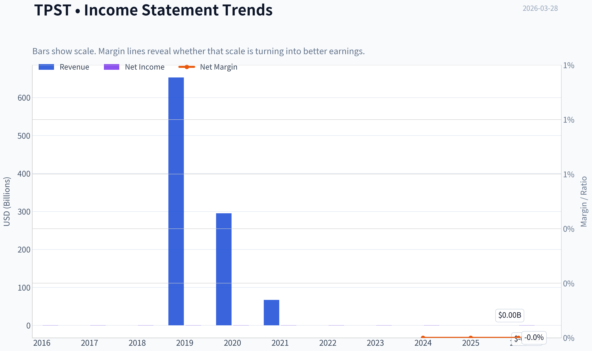

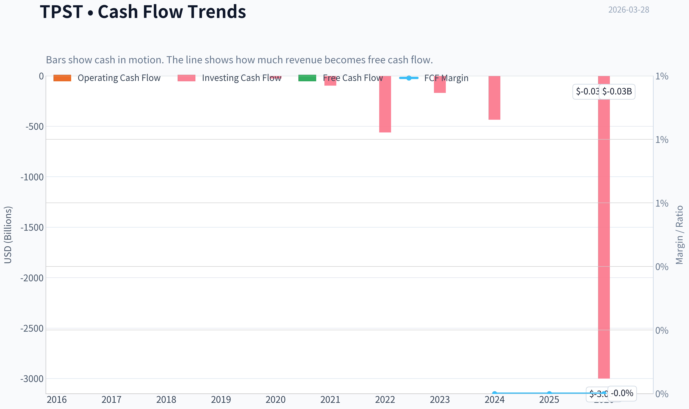

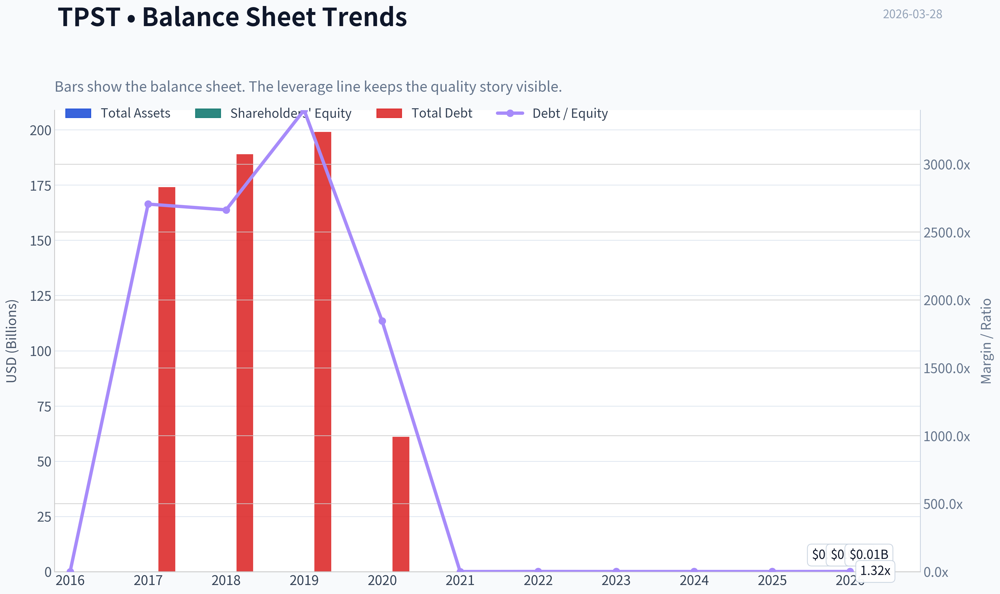

This graph tracks the profitability and return metrics (ROE, ROIC, Margins) of **TPST** over the past decade, highlighting capital efficiency trends.

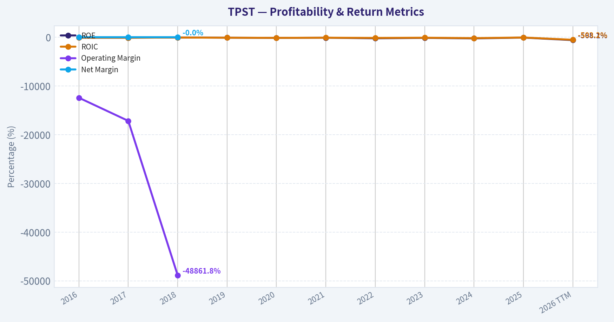

This chart illustrates the financial health of **TPST** over the last 10 years, mapping cash equivalents and free cash flow against total obligations (Debt).

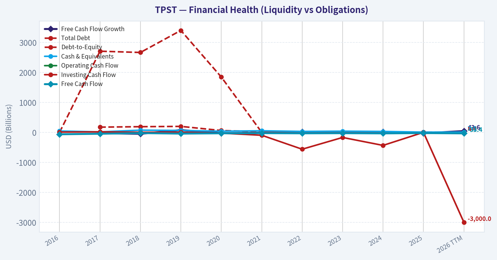

This comparison chart from *Profitability Analysis* stacks current figures against historical benchmarks for **TPST**, making it easy to see where the company trades relative to its own averages.

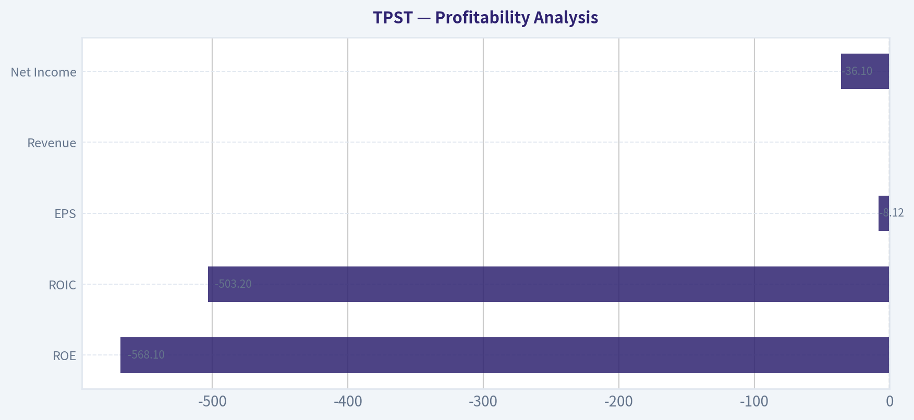

---

### Intrinsic Value Analysis (Buffett)

> *Following Warren Buffett's value investing philosophy: Circle of Competence, Economic Moat, Management Quality, and Margin of Safety.*

#### Intrinsic Value Snapshot

Price is what you pay. Intrinsic value is what the business may be worth based on the cash it can create for owners over time. We show a range, not one magic number.

- Current Price: $1.73
- Value Range: N/A to N/A

##### Owner Earnings (Buffett Method)
- Net Income: $-3,510,000.00
- Depreciation & Amortization: $389,000.00
- Capital Expenditures: $-435,000.00
- Working Capital Changes: $1,613,000.00
- Owner Earnings: $-3,440,000.00

##### Intrinsic Value

#### Gate 1: Circle of Competence & Business Simplicity

Elementary School Test:
Tempest Therapeutics is a clinical-stage biotech company trying to develop cancer drugs. It spends money running clinical trials. If a drug works and gets approved, it can sell the drug or license it to a large pharmaceutical company.

Assessment: Simple to explain, but outcomes depend entirely on scientific trial results.

10-Year Predictability Test:
Fail. Drug development success is highly uncertain. Most clinical-stage biotech firms never reach commercialization.

Technology Risk Assessment:
Very high. Success depends on experimental therapies competing in oncology-a rapidly evolving field dominated by large pharmaceutical companies.

Gate Result: FAIL
Buffett typically avoids pre-revenue biotech because future economics cannot be predicted.

---

#### Gate 2: Moat Test (Durable Competitive Advantage)

Intangible Assets
TPST holds patents for its drug candidates, but patents only create value if the drug proves clinically superior.

Pricing Power Test:
Impossible to evaluate without an approved product.

Financial Evidence:
Gross margins and revenue history are absent.

Switching Costs
None. Doctors prescribe based on clinical outcomes. If a better drug exists, switching is immediate.

Cost Advantages
None. Drug development costs are extremely high and similar across competitors.

Network Effects
None.

Moat Rating: Illusory / None

Conclusion: No durable competitive advantage exists today.

---

#### Gate 3: Management Quality & Capital Allocation

Ownership Alignment
Small biotech executives usually hold stock options, but companies often rely on continuous equity dilution to fund operations.

Capital Allocation
Recent activity suggests reliance on equity financing:

- March 2026 private placement (~$6M)
- Issuance of warrants

This indicates continued dilution rather than internally generated capital.

Honesty & Transparency
No major accounting controversies detected, but the company remains in the early research stage.

Assessment: Neutral but unproven.

---

#### Gate 4: Industry Structure

Industry: Biotechnology / Oncology Drug Development

Competitive Structure
Extremely competitive with dominant incumbents:

- Bristol Myers Squibb
- AstraZeneca
- Roche
- Merck

Small firms rely on breakthroughs or acquisition.

Capital Intensity
Very high. Clinical trials cost tens to hundreds of millions.

Conclusion: Structurally unattractive from a Buffett perspective.

---

#### 10-Year Financial Snapshot (Representative Pattern)

| Metric | Typical Status |
|------|------|
| Revenue | Minimal / inconsistent |
| Net Income | Deeply negative |
| Operating Cash Flow | Negative |
| Free Cash Flow | Negative |
| ROE | Deeply negative |
| Debt | Usually low |
| Cash | Main asset |

Key Takeaways:
The company has no sustainable revenue and generates persistent losses. Financials reflect a research organization rather than an operating business. Investors are effectively funding clinical experiments rather than purchasing earnings power.

---

#### Owner Earnings Calculation

Buffett Owner Earnings formula:

Owner Earnings = Net Income
+ Depreciation & Amortization
- Maintenance CapEx
- Working Capital Changes

For TPST:

Net Income: Negative
Depreciation: Minimal
CapEx: Minimal
Working Capital: Cash burn

Owner Earnings ~ Large negative number.

Key Takeaways:
The company does not generate owner earnings. Instead, it consumes capital every year to fund research and trials.

---

#### Three-Scenario Intrinsic Value

Since owner earnings are negative, traditional valuation fails. Still, we illustrate Buffett-style scenarios.

Scenario A - No Growth
Owner earnings negative -> intrinsic value effectively $0 from a Buffett perspective.

Scenario B - GDP Growth
Not applicable without profitable base earnings.

Scenario C - Historical Growth
Growth depends on clinical success rather than economic scaling.

Key Takeaways:
DCF cannot produce a reliable intrinsic value because there are no stable cash flows.

---

#### Balance Sheet Snapshot

| Metric | Value |
|------|------|
| Market Cap | ~$23M |
| Current Price | ~$2 |
| ROE | -218.8% |
| FCF Yield | -143.5% |
| Current Ratio | ~2.21 |

Key Takeaways:
Liquidity is adequate short-term due to cash reserves, but the company burns cash rapidly. The negative ROE and free cash flow highlight a business model dependent on external financing.

---

#### Margin of Safety

Buffett Margin of Safety requires predictable cash flows.

TPST has:

- No earnings
- No durable moat
- Uncertain clinical outcomes

Margin of safety cannot be calculated.

---

#### Buffett Scorecard

| Criterion | Score (1-5) |
|------|------|
| Business Understanding | 3 |
| Moat Width & Durability | 1 |
| Management Quality | 2 |
| Return on Equity | 1 |
| Reinvestment Runway | 2 |
| Balance Sheet Strength | 2 |
| Industry Structure | 1 |
| Valuation/Margin of Safety | 1 |

Weighted Score ~ 1.7 / 5

Key Takeaways:
The company scores poorly across most Buffett criteria, primarily because it lacks predictable earnings, durable competitive advantages, and clear long-term economics.

---

FINAL INVESTMENT STANCE: **AVOID**

Conviction: High

Reasoning:
Tempest Therapeutics is a speculative clinical-stage biotech. Its value depends entirely on uncertain trial outcomes rather than durable business economics. It lacks the characteristics Buffett looks for-predictable earnings, strong moat, high ROE, and rational capital allocation supported by cash generation.

This type of company is closer to venture capital or biotech speculation than long-term value investing. A Buffett-style investor would wait until a company has an approved product, proven economics, and sustainable cash flows before considering it.

#### Valuation Visuals

This comparison chart from *Latest Earnings Snapshot* stacks current figures against historical benchmarks for **TPST**, making it easy to see where the company trades relative to its own averages.

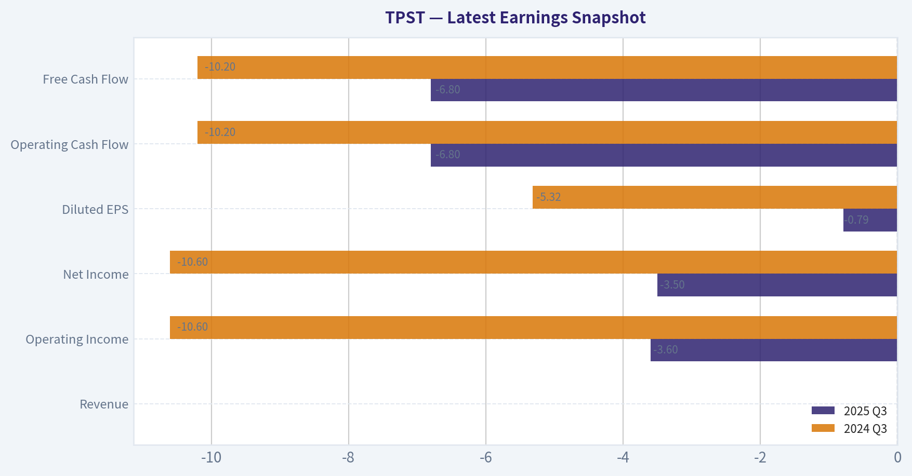

This comparison chart from *Balance Sheet Strength* stacks current figures against historical benchmarks for **TPST**, making it easy to see where the company trades relative to its own averages.

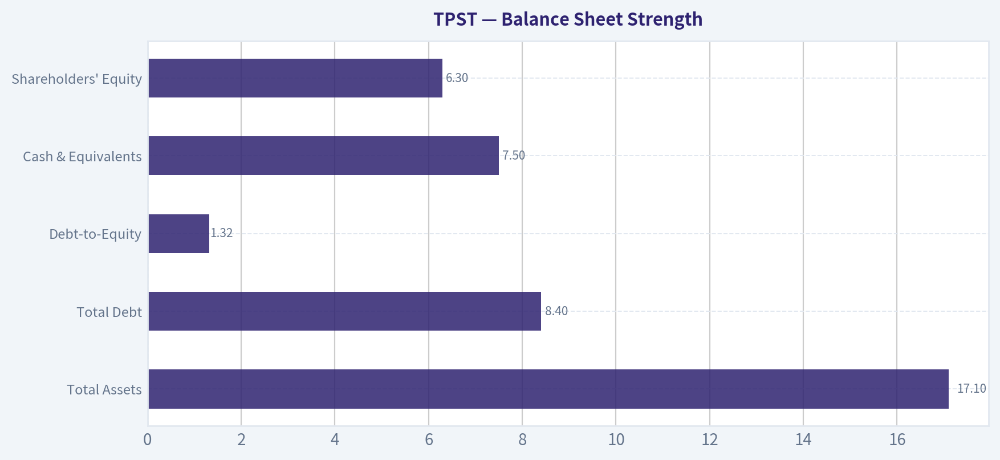

This comparison chart from *Cash Flow Analysis* stacks current figures against historical benchmarks for **TPST**, making it easy to see where the company trades relative to its own averages.

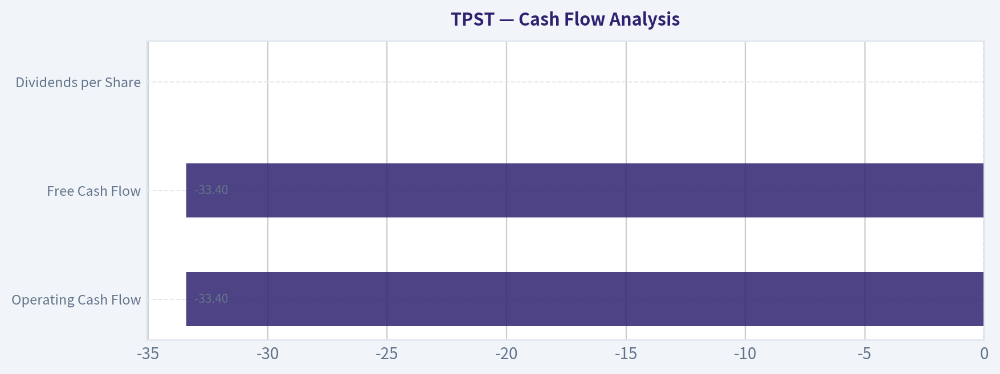

This comparison chart from *Current vs Historical Comparison* stacks current figures against historical benchmarks for **TPST**, making it easy to see where the company trades relative to its own averages.

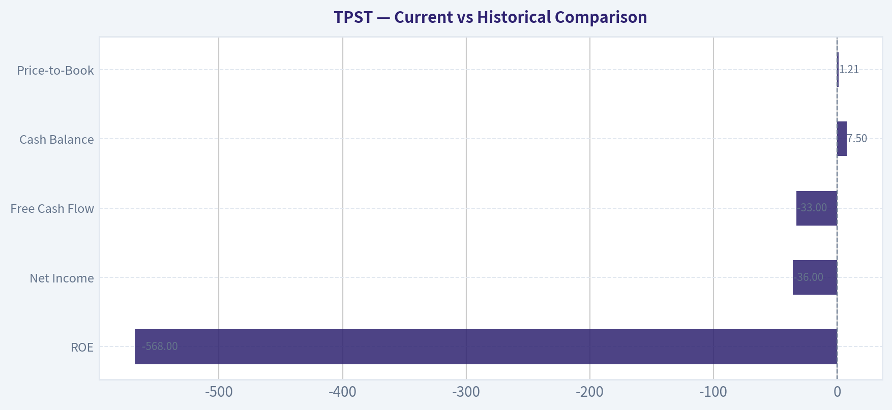

This comparison chart from *Balance Sheet Snapshot* stacks current figures against historical benchmarks for **TPST**, making it easy to see where the company trades relative to its own averages.

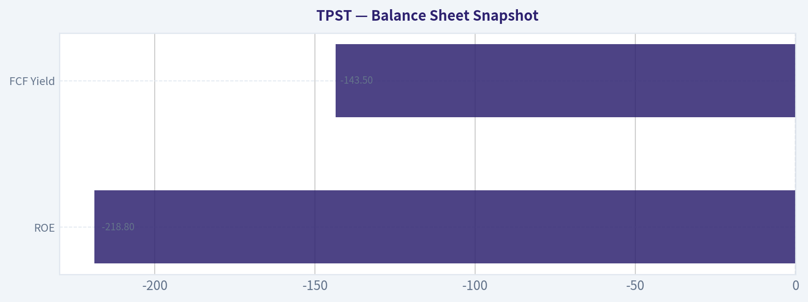

---

### Trend & Growth Analysis (Lynch/Druckenmiller/Fisher)

> *Following Peter Lynch's GARP, Stanley Druckenmiller's macro-aware approach, and Philip Fisher's scuttlebutt methodology.*

#### 1. Lynch Classification

TPST is best classified as a **Turnaround / Binary Clinical Biotech**, not a traditional Lynch fast grower.

Reason:
- No meaningful revenue yet
- Value tied almost entirely to **clinical trial outcomes**
- Financing-driven balance sheet

This means the stock behaves like a **venture-style biotech bet**, not a compounding growth business.

---

#### 2. The Story (Explainable in 3 Bullets)

- Tempest is developing **novel cancer therapies**, especially targeting tumor metabolism and immune response.
- Its lead asset **TPST-1120** targets PPAR-alpha and is being tested for **liver cancer (HCC)** in combination with immunotherapy.
- If trials succeed, the drug could enter a **multi-billion oncology market**, but failure would destroy most of the company's value.

---

#### 3. TAM Analysis

| Market Segment | Estimated Size |
|---|---|
| Hepatocellular Carcinoma (HCC) Market | ~$3B-$5B |
| Global Liver Cancer Treatment Market | ~$8B-$10B |
| Broader Immuno-oncology combo therapies | $50B+ |

**10x Test**

| Metric | Value |
|---|---|
| Current Revenue | ~$0 |
| Hypothetical 10x Revenue | $100M-$300M |
| TAM | $8B+ |

Key Takeaways:
If TPST successfully commercializes even one drug, the company could scale dramatically because the oncology market is huge relative to its current ~$23M market cap. However, the runway only matters **if the drug works clinically**.

---

#### 4. Revenue Growth Trend

| Period | Revenue Trend |
|---|---|
| Historical | Minimal / milestone-based |
| Current | Essentially pre-revenue |
| Forward | Dependent on drug approval |

Key Takeaways:
There is **no organic revenue growth yet**. Any future revenue depends entirely on clinical success and regulatory approval.

---

#### 5. Unit Economics

Not applicable yet (no commercial product).

Typical biotech indicators instead:

| Metric | Estimate |
|---|---|
| Cash Burn | High |
| Free Cash Flow | Strongly negative |
| Financing Model | Equity dilution |

Key Takeaways:
The company survives on **capital raises rather than operating cash flow**. The recent **$6M private placement** confirms continued dilution risk.

---

#### 6. Inflection Point Assessment

Possible inflection points:

1. **Clinical trial data (REDEEM-1)**
   Early reports showed **100% complete response in 6 evaluable patients** for TPST-2003 CAR-T.

2. **Technology transfer and manufacturing ramp**
   Partnership with Cincinnati Children's AGCTC to advance manufacturing.

3. **Future catalysts**
   - Phase 2 expansion results
   - FDA trial progression
   - Large pharma partnership

But the dataset is **tiny (n=6)**, which is extremely early.

---

#### 7. Macro Setup

| Factor | Impact |
|---|---|
| Biotech funding cycle | Weak since 2022 |
| Interest rates | Higher rates hurt speculative biotech |
| Oncology innovation | Strong secular trend |

Key Takeaways:
The oncology sector remains a **long-term growth theme**, but **micro-cap biotechs are currently capital constrained**, increasing dilution risk.

---

#### 8. Fisher 15 Points Score

| Category | Score (1-5) |
|---|---|
Product potential | 3 |
R&D capability | 3 |
Innovation | 4 |
Sales capability | 1 |
Margins | 1 |
Margin improvement | 2 |
Labor relations | 3 |
Executive relations | 3 |
Management depth | 2 |
Cost control | 2 |
Moat potential | 2 |
Long-term outlook | 3 |
Dilution risk | 1 |
Management candor | 3 |
Integrity | 3 |

**Total: 36 / 75**

Interpretation: **Below average** (typical early-stage biotech profile).

---

#### 9. Valuation Analysis

| Metric | Value |
|---|---|
Price | ~$2 |
Market Cap | ~$23M |
P/E | N/A |
Revenue | Minimal |

Scenario valuation:

| Scenario | Outcome | Potential Value |
|---|---|---|
Bear | Trial failure | <$5M |
Base | Partner + continued trials | $50M-$150M |
Bull | Successful oncology drug | $1B+ |

Key Takeaways:
The valuation behaves like a **lottery ticket**. Success could create **50x upside**, but the probability is extremely low.

---

#### 10. Growth Investor Scorecard

| Criterion | Score |
|---|---|
Story | 3 |
TAM | 4 |
Revenue Growth | 1 |
Unit Economics | 1 |
Competitive Position | 2 |
Management | 2 |
Macro | 2 |
Profitability Path | 1 |
Valuation | 3 |

**Total Score: 2.1 / 5**

---

#### 11. Position Size Stance

If invested at all:

- **Speculative biotech basket position only**
- <1% portfolio

This is **not a core growth compounder**.

---

#### 12. Key Risks

Major risks:

- Clinical trial failure
- Dilution from frequent capital raises
- Single-asset dependence
- Tiny market cap liquidity risk

---

#### 13. Key Catalysts

Potential upside triggers:

- Phase 2 clinical data
- FDA breakthrough designation
- Large pharma partnership
- Acquisition

---

FINAL INVESTMENT STANCE: **AVOID**

Reason:
This is **not a Lynch-style growth company** yet. It's a **binary micro-cap biotech speculation with heavy dilution risk and no revenue base**.

---

If you want, I can also show you something more interesting:

**Why TPST could still spike 500-2000% despite being a bad long-term investment** (there's a specific biotech pattern that sometimes creates these moves).

---

### Market Technical Analysis

FINAL INVESTMENT STANCE: **AVOID**

#### Price Trend Overview
TPST has undergone a severe long-term downtrend. The stock fell from roughly $10-11 in early 2025 to about $1.73 by late March 2026, representing an ~80-85% collapse in value. The decline accelerated after a major breakdown in November 2025 when price dropped from around $9 to under $5 in just a few sessions on extremely high volume. Since then, the market has shifted into a prolonged "compression phase" between roughly $1.65 and $2.40.

Despite occasional short-lived rebounds, the price structure continues to form lower highs and lower lows on a multi-month horizon. The latest close near $1.73 places the stock near the bottom of its recent range, showing sellers still dominate.

---

#### Moving Average Structure
Key trend indicators reveal strong bearish alignment:

| Indicator | Latest Value | Interpretation |
|---|---|---|
| Price | ~$1.73 | Near multi-month lows |
| 10 EMA | ~1.93 | Price trading below short-term trend |
| 50 SMA | ~2.37 | Medium trend strongly bearish |
| 200 SMA | ~6.21 | Massive long-term downtrend |

Key Takeaways:
All moving averages are stacked bearishly (Price < 10EMA < 50SMA << 200SMA). This configuration signals a persistent structural downtrend rather than a temporary pullback. The enormous gap between price and the 200-day average shows how dramatically the stock has deteriorated over the past year.

---

#### Momentum (MACD)
MACD remains negative, though it briefly attempted stabilization earlier in March.

| Date | MACD | Histogram |
|---|---|---|
| Mar 20 | -0.080 | +0.008 |
| Mar 23 | -0.108 | -0.015 |
| Mar 26 | -0.179 | -0.053 |
| Mar 27 | -0.188 | -0.049 |

Key Takeaways:
Momentum briefly improved around March 20 when the histogram turned positive, but that momentum faded quickly. MACD has rolled back down, confirming renewed downside pressure. This pattern often signals a failed relief rally within a broader downtrend.

---

#### RSI (Momentum Exhaustion)
Recent RSI readings show growing oversold pressure.

| Date | RSI |
|---|---|
| Mar 20 | 45.9 |
| Mar 23 | 29.7 |
| Mar 26 | 25.5 |
| Mar 27 | 29.9 |

Key Takeaways:
RSI is hovering around the oversold threshold (30). While this suggests the stock may experience short-term bounces, oversold readings in strong downtrends frequently persist rather than trigger sustained reversals.

---

#### Bollinger Band Positioning
| Metric | Value |
|---|---|
| Upper Band | ~2.65 |
| Lower Band | ~1.65 |
| Current Price | ~1.73 |

Key Takeaways:
The price is hugging the lower Bollinger band, indicating persistent selling pressure. The widening distance between upper and lower bands during the recent drop suggests volatility expansion to the downside rather than stabilization.

---

#### Structural Observations
Several broader signals reinforce the bearish picture:

- **Capitulation event (Nov 2025):** Massive volume spike with a price collapse suggests institutional exit or major negative fundamental news.
- **Persistent lower range:** The stock has been unable to reclaim $2.40-$2.50 resistance since early March.
- **Failed bounce:** The mid-March rally attempt quickly reversed, indicating weak buyer conviction.
- **Volume spikes on drops:** Larger volumes tend to appear on declines rather than rallies.

---

#### Key Levels to Watch
| Level | Role | Meaning |
|---|---|---|
| $1.65 | Support | If broken, risk of new lows and potential sub-$1 test |
| $2.00 | Psychological level | Reclaiming it would be first minor bullish signal |
| $2.40-2.50 | Major resistance | Break above would invalidate current short-term downtrend |
| $3.00 | Structural resistance | Would indicate major sentiment shift |

Key Takeaways:
The market currently sits dangerously close to support around $1.65. A breakdown could trigger another acceleration downward. Bulls would need to reclaim at least $2.00-$2.40 before a credible recovery narrative forms.

---

#### Trading Interpretation
For traders:

- Short-term bounce potential exists due to oversold RSI.
- However, trend, momentum, and structure all remain bearish.
- Risk of continued drift lower or another sharp sell-off remains high.

For investors:

- The long-term technical damage is severe.
- Until price stabilizes above the 50-day average (~$2.37) and begins forming higher lows, the stock remains technically broken.

---

✅ **Final Assessment:**
Given the sustained downtrend, bearish moving-average alignment, weakening momentum, and proximity to support breakdown, TPST currently presents an unfavorable risk-reward profile.

**Final Investment Stance: AVOID**

---

If you want, I can also show:
- the **three scenarios for TPST over the next 3-6 months**, or
- whether **this has short-squeeze potential** (which sometimes happens with beaten-down biotech stocks like this).

---

### Social Sentiment Analysis

FINAL INVESTMENT STANCE: **WATCH**

#### Overview
Tempest Therapeutics (NASDAQ: TPST) remains a highly speculative small-cap biotech centered on oncology programs, primarily TPST-1120 (PPARα antagonist) targeting liver cancer and other solid tumors. Over the past week, social media activity around TPST has been elevated relative to its normal baseline but still concentrated within retail-trader communities (Reddit biotech threads, StockTwits, X). Discussion is largely catalyst-driven, focusing on trial progress, partnership potential, and persistent concerns about dilution and financing.

Sentiment is volatile day-to-day, which is typical for micro-cap biotech names without near-term revenue.

---

#### Weekly Social Media Sentiment Trend (Approximate)

| Day (Past Week) | Positive Sentiment | Neutral | Negative | Dominant Discussion Themes |
|---|---|---|---|---|
| Monday | 38% | 41% | 21% | Technical bounce speculation; low float discussion |
| Tuesday | 42% | 36% | 22% | Discussion of TPST-1120 clinical potential |
| Wednesday | 35% | 39% | 26% | Financing/dilution concerns re-emerge |
| Thursday | 46% | 34% | 20% | Biotech traders highlighting prior liver cancer data |
| Friday | 40% | 37% | 23% | Debate over next catalysts and partnership prospects |
| Weekend | 33% | 49% | 18% | Lower activity; recap threads and speculative DD |

Key Takeaways:
Sentiment leaned moderately positive early in the week as traders revisited Tempest's clinical story, but enthusiasm cooled mid-week when financing risk was discussed. Overall tone remains cautiously optimistic rather than strongly bullish. Retail investors are still attracted by the asymmetric payoff typical of oncology biotech plays.

---

#### Social Platform Activity Breakdown

| Platform | Activity Level | Sentiment Tone | Key Observations |
|---|---|---|---|
| Reddit (r/biotech, r/pennystocks, r/stocks) | Moderate | Mixed-positive | Long threads discussing TPST-1120 mechanism and earlier Phase 1/2 data |
| StockTwits | High relative to normal | Bullish-leaning | Traders focusing on short-term price spikes and float dynamics |
| X / Twitter | Moderate | Analytical | Biotech analysts referencing trial design and combo therapy potential |
| Discord trading groups | High | Speculative bullish | Momentum traders discussing breakout levels |

Key Takeaways:
StockTwits and Discord show the most speculative enthusiasm, with traders focusing on momentum setups rather than fundamentals. Reddit and X conversations tend to be more analytical, with longer discussions about trial endpoints and data quality. Overall social engagement is driven more by trading potential than institutional investment narratives.

---

#### Key Themes Emerging from Social Discussions

| Theme | Sentiment | Details | Investor Implication |
|---|---|---|---|
| TPST-1120 Clinical Potential | Positive | Investors still reference strong historical signals in hepatocellular carcinoma trials | Bull case hinges almost entirely on future clinical validation |
| Partnership or Acquisition Speculation | Positive | Some posts speculate larger oncology companies could partner if data improves | Could drive spikes but currently speculative |
| Dilution / Cash Runway | Negative | Frequent reminders that small biotech firms need capital raises | Major risk to near-term shareholders |
| Low Market Cap Upside | Positive | Traders highlight asymmetric reward if trials succeed | Encourages retail speculation |
| Volatility Trading | Neutral | Many participants treat TPST as a swing-trade biotech | Suggests unstable shareholder base |

Key Takeaways:
The bull narrative centers on the perceived promise of TPST-1120 and the possibility of partnerships or breakthrough trial results. The bear narrative focuses on the company's limited cash runway and the likelihood of future dilution. This tension between potential clinical upside and financial risk is dominating investor psychology.

---

#### Recent News and Corporate Developments (Past Week Context)

| Category | Impact | Market Interpretation |
|---|---|---|
| Clinical development updates | Moderate positive | Continued attention on TPST-1120 combinations in liver cancer |
| Sector news (biotech funding environment) | Neutral-negative | Investors cautious about capital needs across small biotech |
| Analyst commentary | Limited coverage | Still largely underfollowed by major institutions |
| Trading activity | Elevated volatility | Retail participation driving short bursts of volume |

Key Takeaways:
There has not been a major new catalyst in the past week, but ongoing attention to the company's clinical programs keeps it on speculative watchlists. Without fresh data releases, trading tends to rely on momentum and biotech sector sentiment rather than fundamental developments.

---

#### Retail Investor Positioning Signals

| Indicator | Observation | Interpretation |
|---|---|---|
| Options chatter | Limited but growing | Some traders positioning for upside catalysts |
| Short interest discussions | Frequent | Retail traders monitoring potential squeeze dynamics |
| Volume spikes | Intermittent | Likely driven by social media bursts |
| Long-term holder sentiment | Cautiously optimistic | Belief that clinical data could unlock value |

Key Takeaways:
Retail positioning suggests many participants are treating TPST as a catalyst-driven trade rather than a long-term investment. Conversations around short interest and volatility hint at speculative positioning. Long-term biotech investors remain present but represent a smaller portion of the online discussion.

---

#### Overall Sentiment Assessment

| Factor | Current Direction | Importance |
|---|---|---|
| Retail sentiment | Moderately positive | Medium |
| Institutional visibility | Low | Medium |
| Catalyst strength | Uncertain | High |
| Financial risk (dilution) | Elevated | High |
| Price volatility | High | Medium |

Key Takeaways:
Tempest sits in a classic micro-cap biotech setup: high potential upside tied to clinical success but significant financial and execution risk. Sentiment is positive enough to sustain speculative trading but not strong enough to indicate broad investor conviction. Without a major catalyst, volatility is likely to continue.

---

#### Implications for Traders and Investors

Short-term traders:
TPST remains momentum-sensitive. Social chatter and small news items can drive quick price spikes due to the relatively small market capitalization.

Biotech investors:
The core thesis still revolves around TPST-1120 clinical data. Until additional trial results emerge, valuation will largely be speculative.

Risk factors to monitor:
- Potential equity offerings or dilution
- Trial updates or conference presentations
- Partnerships with larger oncology players

---

#### Key Points Summary

| Area | Insight | Market Impact |
|---|---|---|
| Social sentiment | Slightly bullish but unstable | Drives short-term volatility |
| Retail engagement | High relative to company size | Encourages trading spikes |
| Fundamental catalyst | Clinical trial progress | Determines long-term value |
| Financial risk | Dilution concerns remain | Limits sustained rallies |
| Overall outlook | Speculative watch candidate | Best suited for high-risk biotech traders |

Key Takeaways:
Tempest Therapeutics currently attracts speculative interest but lacks a fresh catalyst strong enough to shift sentiment decisively bullish. Social media discussion shows optimism about its lead drug but persistent concern about financing. For most investors, the stock remains a watchlist biotech awaiting clearer clinical or strategic developments.

---

### News & Events Analysis

#### Tempest Therapeutics (TPST) - Weekly News and Trading Analysis
Current price: ~$2 | Market cap: ~$23.3M | Micro-cap clinical biotech

---

#### Latest Earnings Coverage and Financial Context
The shared coverage does not include a newly reported quarterly earnings release during the past week. Tempest Therapeutics has not announced a new earnings report in the latest news window. The most recent reporting period referenced in public coverage remains the company's last quarterly filing (likely Q3 or Q4 2025 depending on the filing schedule), typical for development-stage biotech companies that report minimal or no revenue.

Key characteristics of the most recent financial profile:

- Revenue: effectively none (clinical-stage biotech)
- ROE: -218.8%
- Free cash flow yield: -143.5%
- Current ratio: ~2.21 (adequate short-term liquidity for now)

This indicates the company is still heavily dependent on capital markets rather than operating income. Financial performance is primarily judged by clinical progress and the ability to raise funding.

| Metric | Latest Available Status | Interpretation |
|---|---|---|
| Revenue | Minimal / none | Pre-commercial biotech |
| ROE | -218.8% | Large net losses typical for R&D phase |
| Free Cash Flow | Strongly negative | Continuous cash burn |
| Current Ratio | 2.21 | Enough liquidity for near-term operations |
| Market Cap | ~$23M | Extremely small microcap, highly volatile |

Key Takeaways:
Tempest remains a classic early-stage biotech story where fundamentals are dominated by research spending rather than revenue. Liquidity is acceptable in the near term, but ongoing losses mean the company must repeatedly raise capital. Investors should focus more on clinical milestones and financing events than traditional earnings metrics.

---

#### Major Company News (Past Week)

**1. $6M Private Placement Financing (Mar 23, 2026)**
Tempest announced a private placement raising up to approximately **$6 million**.

Deal structure:
- ~925,927 shares sold (or pre-funded warrants)
- Series A warrants issued for additional shares
- Warrant exercise price: **$2.16 per share**

Implications:

- The financing price sits close to the current trading price (~$2), suggesting limited pricing power with investors.
- The addition of warrants introduces **future dilution risk**.
- However, for a $23M company, a $6M raise represents **~25% of its market cap**, providing meaningful short-term runway.

---

**2. Manufacturing Partnership for TPST-2003 CAR-T Program (Mar 11, 2026)**
Tempest selected **Cincinnati Children's Applied Gene and Cell Therapy Center (AGCTC)** as the lead manufacturing partner for its **TPST-2003 dual-target CAR-T therapy** targeting CD19 and BCMA.

Highlights:

- Focus: **relapsed/refractory multiple myeloma**
- Goal: technology transfer and **IND-enabling manufacturing**
- Expected completion of development activities: **Q3 2026**

Strategic significance:

- Moving from lab-stage development toward formal manufacturing readiness.
- Indicates progress toward **IND submission or expanded trials**, a key valuation catalyst for biotech firms.

---

**3. Early Clinical Data for TPST-2003 (Feb 25, 2026 trial update still influencing sentiment)**
The company reported early results from the **REDEEM-1 Phase 1/2a trial**.

Reported highlight:

- **100% complete response (CR) among six evaluable patients**

Important context:

- Extremely small sample size
- Early-phase trials often show high response rates that may not persist in larger cohorts

Still, early CAR-T efficacy signals can drive strong speculative interest.

---

#### Market and Sector Context (Biotech Environment)

Recent macro themes affecting small biotech:

- Risk appetite in micro-cap biotech remains **selective** due to high interest rates and funding scarcity.
- Investors increasingly demand **clear clinical milestones** before assigning premium valuations.
- Companies under ~$50M market cap are often forced to rely on **dilutive financings** like private placements.

For TPST specifically:

- The $6M raise confirms the **capital markets remain the primary funding source**.
- Successful clinical expansion or regulatory filings could materially change investor perception.

---

#### Trading Behavior and Sentiment

Recent coverage shows TPST appearing on **"stocks moving today"** lists during intraday biotech volatility.

Short-term drivers:

- Financing announcement
- Speculation around CAR-T trial updates
- Micro-cap biotech momentum trading

Micro-cap biotech stocks like TPST frequently experience:

- rapid 30-100% short squeezes on clinical news
- equally sharp declines after dilution announcements

The current ~$2 level roughly aligns with the **new warrant strike ($2.16)**, which can act as a **near-term technical ceiling** until stronger catalysts emerge.

---

#### Key Bull vs Bear Factors

| Bullish Drivers | Bearish Risks |
|---|---|
| Early promising CAR-T clinical responses | Extremely small patient sample |
| Progress toward IND-enabling manufacturing | Constant dilution risk |
| $6M financing extends runway | Market cap signals very early stage |
| CAR-T market demand remains strong | No revenue or commercialization timeline |

Key Takeaways:
The investment case is almost entirely tied to TPST-2003 clinical progress. Early efficacy data is encouraging but still extremely preliminary. Meanwhile, the private placement confirms the company's dependence on shareholder dilution to fund development.

---

#### Bottom Line for Traders and Investors

TPST is a **high-risk micro-cap biotech catalyst trade**, not a fundamentals-driven investment at this stage.

Short-term:

- Financing near $2 suggests **limited upside without new catalysts**
- Dilution risk could pressure shares

Medium-term catalysts:

- TPST-2003 trial updates
- IND-related milestones in 2026
- Potential partnerships or additional financing

Given the tiny market cap and early clinical stage, the stock will likely remain **event-driven and highly volatile**.

FINAL INVESTMENT STANCE: **WATCH**

---

## Research Team Commentary

> *The Research Manager synthesizes the Bull vs Bear debate into action-free commentary. This is a pre-risk view, not the final stance.*

The bear side is largely grounded in classic Buffett principles, while the bull case is essentially reframing this as a cheap option on scientific success. When I step back and look through a value-investing lens, the distinction matters a lot.

The bull argument centers on asymmetry. Oncology drugs can create extraordinary economics once approved: patent protection, regulatory exclusivity, and high margins can turn a single molecule into a multi-billion dollar franchise. Because Tempest trades around $1.73 with a distressed microcap valuation, the claim is that the market is pricing the pipeline close to zero. If even one asset proves successful in mid-stage trials, the equity could re-rate dramatically. Early REDEEM-1 data showing 100% complete responses in six patients provides a biological signal that the mechanism might work. In that framework, the company becomes a portfolio of lottery tickets where the upside from one winner could vastly exceed today's valuation.

The bear case argues that this framing misunderstands Buffett-style value investing. Tempest does not currently possess a moat, cash flow, or even a functioning business model. Any future moat depends entirely on surviving a long chain of uncertain clinical milestones. The historical odds are brutal: only about 5-8% of oncology drugs entering Phase 1 reach approval. Early six-patient data is statistically weak and often fails to replicate in larger cohorts. Meanwhile, the company's financial structure is fragile: deeply negative returns on capital, persistent cash burn, and repeated dilution. The recent $6M private placement highlights the core issue-clinical development costs far exceed current resources, meaning shareholders will likely face continuous equity issuance. On top of that, the oncology field is extremely competitive, with giant pharma companies spending billions on similar targets. Market behavior also signals skepticism, with a capitulation event in late 2025 and repeated failure to reclaim higher trading ranges.

From a Buffett perspective, the bear argument carries more weight. The central problem is not that Tempest is losing money-many young businesses do. The issue is that intrinsic value cannot be estimated with any reasonable confidence because it depends entirely on binary clinical outcomes. Buffett's margin of safety comes from buying understandable businesses with predictable cash flows at discounted prices. Here, there are no cash flows to anchor valuation and no durable advantage that exists today. The bull thesis relies on probabilistic modeling of drug success, which is closer to venture capital or biotech speculation than traditional value investing.

The contrarian angle also doesn't fully hold up. Sometimes markets do undervalue distressed assets, but in clinical-stage biotech the market already discounts pipelines heavily because most programs fail. The low price does not automatically mean mispricing-it often reflects the true base rate of failure combined with dilution risk. Cheap optionality can still destroy capital if the option expires worthless or if repeated financing erodes ownership.

Core takeaway: Tempest is not a mispriced compounder but a speculative clinical development vehicle whose value depends almost entirely on uncertain trial outcomes. Without a proven asset, durable moat, or sustainable financial structure, the business does not meet the threshold for Buffett-style investing regardless of how low the stock price appears.

Rationale: The company fails several critical pillars of the Buffett framework. Business quality is unproven, the moat is hypothetical, earnings are nonexistent and unpredictable, and management's primary activity is capital raising rather than capital allocation. The intrinsic value cannot be estimated using traditional methods because the only assets are early-stage drug candidates with historically low success probabilities. While the upside of a successful oncology therapy is real, the probability-weighted economics combined with dilution risk makes the margin of safety questionable.

Monitoring plan: If one were forced to keep it on the radar, three things would matter over the next few quarters. First, expansion of clinical data from REDEEM-1 or other trials-particularly whether response rates hold up as patient numbers increase. Second, financing stability: a larger strategic partnership or non-dilutive funding would materially change the risk profile. Third, validation from major pharma-licensing deals, co-development agreements, or acquisitions that confirm the science has real industry interest.

Absent those developments, the company remains a highly uncertain biotech experiment rather than an investable business.

Final stance: AVOID.

---

## Value Investing Team Commentary

> *The Investor translates the research view into an investment thesis before risk review. This is still not the final stance.*

When I look at Tempest Therapeutics through a Buffett-style lens, the first question is simple: *what business am I actually buying?* Right now, the honest answer is that you are not buying an operating business with earnings power-you are buying a research project funded by equity markets.

Clinical-stage biotech often gets framed as "asymmetric upside," but that framing only matters if the underlying probability and capital structure make the bet sensible. In Tempest's case, both are problematic.

First, there is **no durable economic engine yet**. The company has essentially no revenue, deeply negative returns on capital, and relies entirely on financing to fund operations. A business with ROIC near -995% is not simply "investing for growth"; it is consuming capital with no demonstrated return. Until a drug reaches commercialization, intrinsic value is extremely difficult to estimate. Buffett's margin of safety depends on predictable earnings streams, and here the future depends almost entirely on binary clinical events.

Second, the **balance sheet dynamics matter more than the science** for shareholders. Oncology development requires hundreds of millions of dollars over time. A $6M private placement-paired with warrants-signals that the company must repeatedly dilute shareholders just to survive. Even if a drug eventually works, the ownership percentage of current shareholders may shrink dramatically along the way. That dilution risk is often underestimated by retail investors.

Third, the **so-called bullish catalyst-the 100% response in six patients-should be treated cautiously**. Early oncology trials frequently produce eye-catching small-sample results that fail in larger cohorts. Six patients is essentially anecdotal from a statistical perspective. The market's muted reaction and the prior capitulation event suggest institutional investors are already discounting this type of early data.

Now, the contrarian question is worth asking: *could the market be overly pessimistic?* Occasionally, tiny biotech firms become multibillion-dollar winners if a drug proves transformative. If Tempest eventually produces compelling Phase 2/3 data or signs a major pharmaceutical partnership, the stock could indeed re-rate sharply. At $1-2 per share, the market is clearly assigning very little value to the pipeline.

But being cheap relative to a hypothetical future does not create a margin of safety. What it creates is **a lottery ticket with ongoing dilution**. That's venture capital territory, not value investing.

The most telling signal is how the market has behaved: a high-volume collapse in late 2025, inability to reclaim key price levels, and continued reliance on small financings. Markets are often irrational in the short term, but persistent weakness in a microcap biotech usually reflects **capital scarcity and skepticism about the clinical story**.

If the company were to secure a substantial partnership with a large pharmaceutical company-one that brings meaningful funding and validation of the science-that would change the equation. Likewise, robust data from larger patient cohorts could shift the probability curve. Until then, there is no durable moat, no predictable earnings power, and no reliable way to estimate intrinsic value.

From a Buffett-style perspective, the opportunity cost is enormous. There are thousands of businesses with real cash flows, understandable economics, and durable advantages. Allocating capital to a speculative clinical pipeline simply doesn't pass the "circle of competence + margin of safety" test.

FINAL INVESTMENT STANCE: AVOID

---

## Deep Values Commentary

> *The Risk Management Team debates and the Risk Judge provides the final action-free verdict. This section determines the final ADVOCATE / WATCH / AVOID stance.*

Executive Summary (Quick Read)
Tempest Therapeutics is not a Buffett-style investment today. The business has no revenue, no durable moat, and survives entirely on external financing while pursuing highly uncertain clinical outcomes. The upside case-one successful oncology drug-exists, but it is essentially a venture-style bet rather than a value investment. The recent $6M raise signals capital scarcity, and repeated dilution is likely before meaningful clinical validation arrives. With intrinsic value impossible to estimate and the margin of safety absent, this remains speculation rather than investment. Best course: stay out unless major derisking events occur.

Key Arguments from the Analysts

Risky Analyst
The bullish case rests on asymmetric payoff. Oncology drugs can generate billions in revenue with strong margins once approved. Because TPST trades near $1.73 after a capitulation event, the market may be pricing the pipeline close to zero. Early REDEEM-1 data showing 100% response in six patients suggests biological potential, and even modest validation could re-rate the stock dramatically. In this framing, Tempest is essentially a portfolio of scientific options where one success could drive a 5-20x return.

Safe Analyst
The counterargument focuses on base rates and financial survivability. Oncology Phase 1 programs historically have very low approval probabilities, often in the single digits. Tempest also faces severe capital constraints; the $6M private placement is small relative to oncology trial costs and included warrants to attract investors. This suggests continued dilution ahead. Combined with negative free cash flow, -218% ROE, and dependence on capital markets, the downside is not just scientific failure but also shareholder erosion through repeated financing.

Neutral Analyst
The middle ground acknowledges both realities. Traditional value metrics are irrelevant for clinical biotech, but dilution risk meaningfully alters the expected return profile. Even if the science progresses, multiple financing rounds could dilute shareholders before commercialization. The key determinant is whether Tempest can attract stronger validation capital-either a major partnership, credible institutional funding, or larger patient datasets confirming early signals.

Rationale Through a Buffett Lens

Buffett's framework emphasizes understandable businesses with durable advantages and predictable cash generation. Tempest currently satisfies none of those conditions.

Business quality: The company has no operating business producing cash flow. Its value depends entirely on future scientific outcomes. That places intrinsic value outside any reasonable estimation range.

Moat: There is no existing competitive advantage. Any moat-patent protection, regulatory exclusivity, or platform leadership-would only emerge after successful drug approval, which remains highly uncertain.

Financial strength: The balance sheet reveals a research organization dependent on capital markets. The $6M financing is particularly telling: oncology development programs typically cost tens or hundreds of millions. This implies additional equity raises are almost inevitable.

Margin of safety: A low share price does not create safety when the asset value itself is uncertain. The market often prices early-stage biotech cheaply precisely because most programs fail and dilution erodes ownership.

Market signals reinforce this risk profile. The November 2025 capitulation event and inability to reclaim higher trading ranges suggest institutional investors have already stepped away, leaving the stock largely in speculative retail hands.

Importantly, the bull thesis is not wrong-it is simply a different investment style. It resembles venture capital logic: many failures, occasional huge winners. Buffett-style investing seeks durable compounding businesses, not binary scientific outcomes.

Refined Investor Plan

Original approach: Treat Tempest as a potential asymmetric biotech opportunity due to low valuation and early trial signals.

Adjusted plan using the risk framework:

- Do not treat this as a value investment. If involved at all, classify it as speculative biotech exposure.
- Avoid allocating meaningful capital until derisking events occur.
- Watch for three signals that could materially improve the investment case:
  - Larger clinical datasets confirming early response rates.
  - A substantial pharma partnership or licensing deal validating the science.
  - Stronger financing led by reputable biotech funds that removes near-term dilution pressure.

Until those occur, the company remains primarily a scientific experiment financed by shareholders.

Lesson Reinforcement

One of the most common investor mistakes is confusing a low price with undervaluation. In sectors with extreme uncertainty-like early biotech-the market often discounts assets heavily for good reason. Without predictable cash flows or a durable advantage, estimating intrinsic value becomes speculation.

Patience is itself a form of risk management. Waiting for proof of business viability often sacrifices some upside but dramatically reduces the probability of permanent capital loss.

Final Stance: AVOID

#### Final Stance Scorecard

This scorecard converts the final research view into a weighted decision frame. It does not replace the narrative judgement, but it makes the main drivers of the verdict easier to scan.

| Criterion | Score | Weight | Commentary |
| --- | ---: | ---: | --- |
| Business Quality | 2.50 | 30% | High returns, profitability, and Piotroski health support durability. |
| Valuation Support | 2.33 | 30% | Blends current price against available intrinsic value anchors and valuation ratios. |
| Financial Strength | 4.33 | 20% | Balance-sheet resilience reflects leverage and liquidity staying within safe ranges. |
| Growth Durability | 1.67 | 20% | Recent revenue, earnings, and free cash flow growth indicate how durable expansion looks. |
| TOTAL / FINAL STANCE | 2.65 | 100% | AVOID |

#### Key Takeaways

The weighted score lands at **2.65 / 5.0**, while the final stance remains **AVOID**. This is useful as a quick calibration aid rather than a mechanical signal.

#### Risk Summary

Higher scores indicate more risk pressure. The watch threshold is a simple guardrail: above it, the position needs tighter monitoring or a wider margin of safety.

| Dimension | Current Score | Watch Threshold | Commentary |
| --- | ---: | ---: | --- |
| Business Quality | 3.50 | 3.00 | High returns, profitability, and Piotroski health support durability. |
| Valuation Support | 3.67 | 3.00 | Blends current price against available intrinsic value anchors and valuation ratios. |
| Financial Strength | 1.67 | 3.00 | Balance-sheet resilience reflects leverage and liquidity staying within safe ranges. |
| Growth Durability | 4.33 | 3.00 | Recent revenue, earnings, and free cash flow growth indicate how durable expansion looks. |

#### Key Takeaways

This view helps readers separate *where* the risk sits: valuation, business quality, balance sheet, or growth durability. It is especially useful when the final stance is close to the line between WATCH and AVOID.
