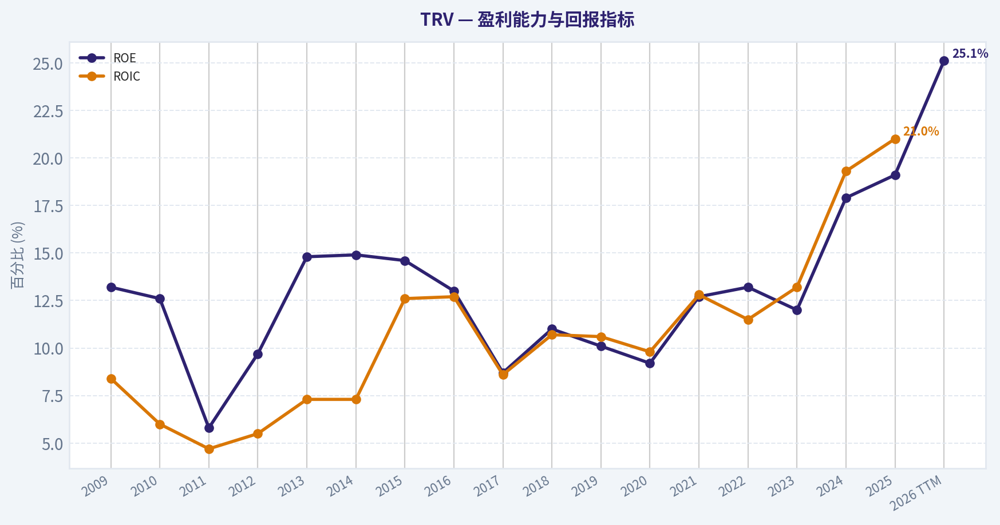
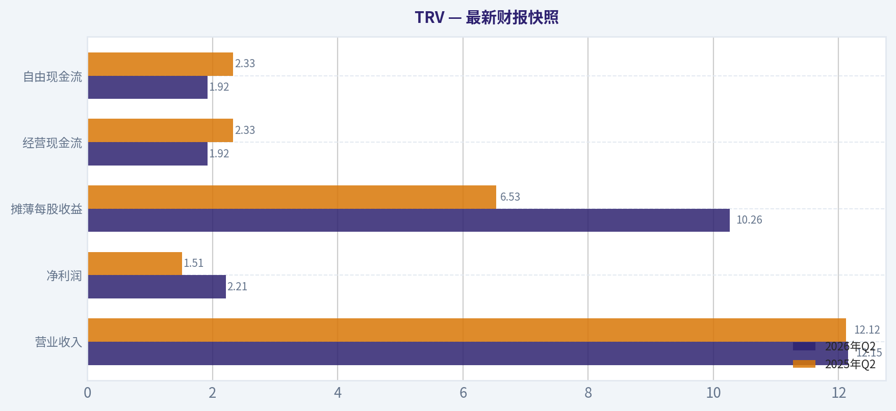
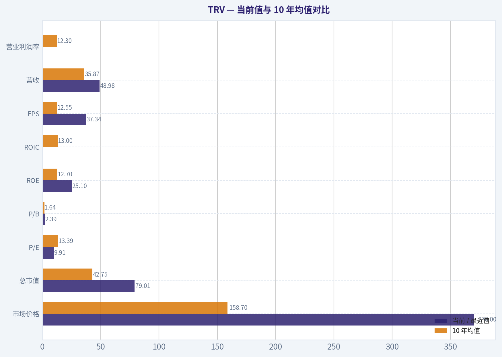
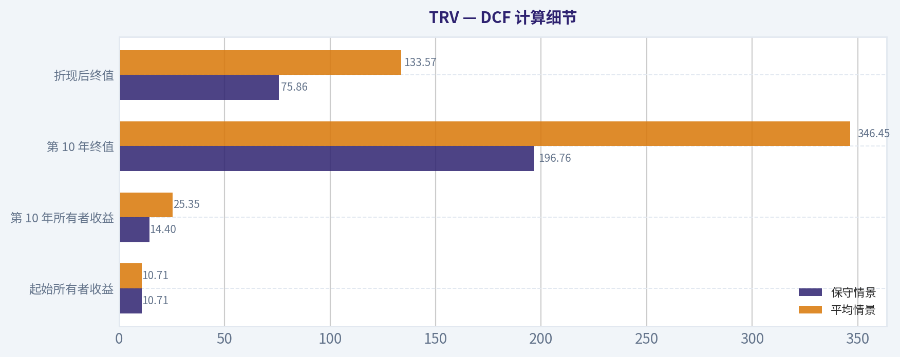
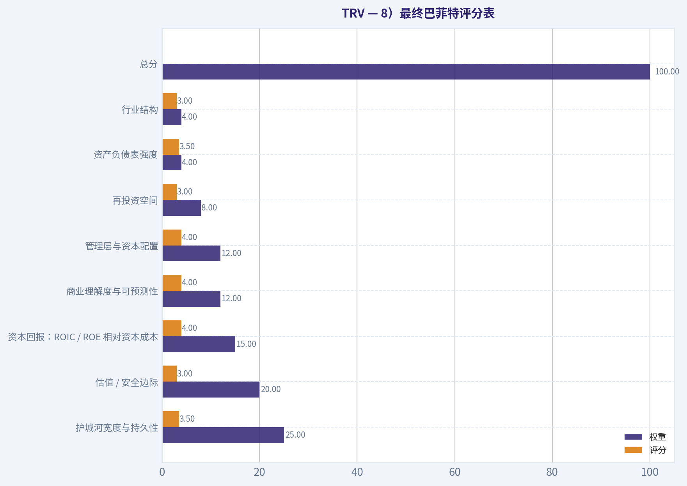
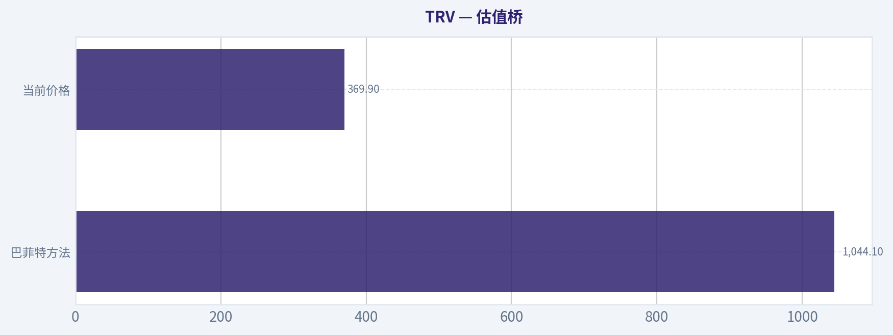
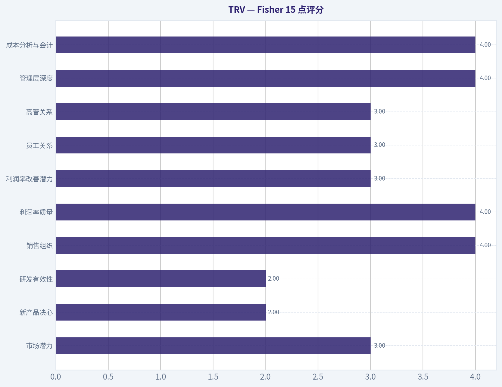
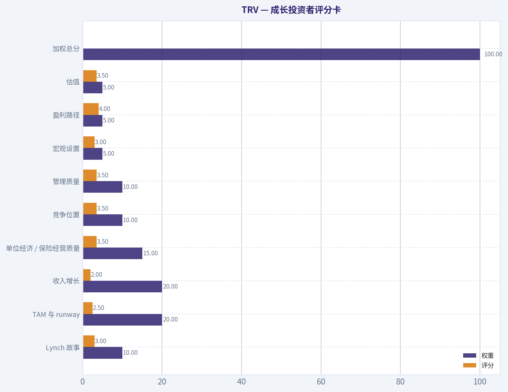

# TRV 深度价值情报

**调研日期:** 2026-08-29

## 关键免责声明

*本报告由 Deep Value Intelligence（一个基于 AI 的多智能体投资分析框架）自动生成。 仅供教育和研究用途 - 非财务建议，非财务顾问。*

---

## 目录

1. 情报摘要
2. 分析师团队报告
   - 基本面分析
   - 价值分析 (巴菲特)
   - 成长性分析 (林奇/德鲁肯米勒/费雪)
   - 市场分析
   - 期权市场分析
3. 研究团队评论
4. 投资团队评论
5. Deep Values 团队洞察

---

## 情报摘要

### 核心观点与前提条件

**核心论点:** 作为一名遵循巴菲特现代理念的价值投资组合经理，结合我们近期在 Visa (V) 和 伯克希尔-哈撒韦 (BRK-B) 上的复盘教训（**"高质量≠当前价位下的高赔率"、"区分长期配置与短线修复"**），我已对多空双方关于 Travelers Companies (TRV) 的辩论进行深度评估。

**主要风险:**
- 最终立场：观望 (WATCH)**

**置信度:** 中

---

## 分析师团队报告

### 基本面分析

#### 最新财报快照

*以下数据基于最近一期已披露财报（2026年Q2），并尽量与上一年同期对比。*

| 指标 | 2026年Q2 | 2025年Q2 | 同比变化 |
| --- | ---: | ---: | ---: |
| 营业收入 | $12.15B | $12.12B | +0.3% |
| 营业利润 | N/A | N/A | N/A |
| 净利润 | $2.21B | $1.51B | +46.3% |
| 摊薄每股收益 | $10.26 | $6.53 | +57.1% |
| 经营现金流 | $1.92B | $2.33B | -17.9% |
| 自由现金流 | $1.92B | $2.33B | -17.9% |

关键结论：这张快照先把最新一期财报放在桌面上，再去看长周期分析。这样读者能更清楚地区分"公司长期质量"和"这次财报发生了什么"。

#### TRV 17年财务指标

*以下数值均由原始数据确定性计算得出，并非 AI 估算。*

*发行人类型：insurer（Financial Services / Insurance - Property & Casualty）。*

#### 17年财务指标
*年度行来自已披露财务报表，最后一行 TTM 由最近四个季度滚动计算得出。*

| 指标 | 2009 | 2010 | 2011 | 2012 | 2013 | 2014 | 2015 | 2016 | 2017 | 2018 | 2019 | 2020 | 2021 | 2022 | 2023 | 2024 | 2025 | 2026 TTM |
| --- | --- | --- | --- | --- | --- | --- | --- | --- | --- | --- | --- | --- | --- | --- | --- | --- | --- | --- |
| 市场价格 | $34 | $39 | $43 | $53 | $69 | $82 | $90 | $100 | $113 | $102 | $120 | $126 | $144 | $176 | $183 | $235 | $288 | $370 |
| 总市值 | $28.35B | $26.88B | $24.88B | $28.00B | $33.89B | $36.25B | $35.43B | $35.62B | $37.79B | $32.31B | $35.92B | $35.74B | $39.23B | $44.94B | $44.23B | $55.67B | $66.02B | $79.01B |
| 市盈率 | 7.88 | 8.42 | 17.61 | 11.40 | 9.30 | 9.89 | 10.37 | 11.91 | 18.50 | 12.90 | 13.81 | 13.34 | 10.80 | 15.93 | 14.89 | 11.22 | 10.57 | 9.91 |
| 市净率 | 1.03 | 1.06 | 1.02 | 1.10 | 1.37 | 1.46 | 1.50 | 1.53 | 1.59 | 1.41 | 1.38 | 1.22 | 1.36 | 2.08 | 1.77 | 2.00 | 2.01 | 2.39 |
| ROE | 13.2% | 12.6% | 5.8% | 9.7% | 14.8% | 14.9% | 14.6% | 13.0% | 8.7% | 11.0% | 10.1% | 9.2% | 12.7% | 13.2% | 12.0% | 17.9% | 19.1% | 25.1% |
| ROIC | 8.4% | 6.0% | 4.7% | 5.5% | 7.3% | 7.3% | 12.6% | 12.7% | 8.6% | 10.7% | 10.6% | 9.8% | 12.8% | 11.5% | 13.2% | 19.3% | 21.0% | N/A |
| 每股收益 | $4.33 | $4.65 | $2.43 | $4.68 | $7.42 | $8.33 | $8.67 | $8.38 | $6.11 | $7.92 | $8.66 | $9.44 | $13.30 | $11.03 | $12.26 | $20.96 | $27.43 | $37.34 |
| 营收 | $24.68B | $25.11B | $25.45B | $25.74B | $26.19B | $27.17B | $26.82B | $27.62B | $28.90B | $30.28B | $31.58B | $31.98B | $34.82B | $36.88B | $41.36B | $46.42B | $48.83B | $48.98B |
| 毛利润 | N/A | N/A | N/A | N/A | N/A | N/A | N/A | N/A | N/A | N/A | N/A | N/A | N/A | N/A | N/A | N/A | N/A | N/A |
| 毛利率 | N/A | N/A | N/A | N/A | N/A | N/A | N/A | N/A | N/A | N/A | N/A | N/A | N/A | N/A | N/A | N/A | N/A | N/A |
| 营业利润率 | 14.6% | 12.1% | 5.5% | 9.5% | 13.6% | 13.4% | 17.7% | 14.7% | 9.4% | 9.8% | 9.9% | 10.1% | 12.8% | 9.1% | 8.1% | 13.3% | 16.0% | N/A |
| 净利润 | $3.62B | $3.22B | $1.43B | $2.47B | $3.67B | $3.69B | $3.44B | $3.01B | $2.06B | $2.52B | $2.62B | $2.70B | $3.66B | $2.84B | $2.99B | $5.00B | $6.29B | $8.30B |
| 净利率 | 14.7% | 12.8% | 5.6% | 9.6% | 14.0% | 13.6% | 12.8% | 10.9% | 7.1% | 8.3% | 8.3% | 8.4% | 10.5% | 7.7% | 7.2% | 10.8% | 12.9% | 17.0% |
| 营收增长 | N/A | 1.8% | 1.3% | 1.2% | 1.8% | 3.8% | -1.3% | 3.0% | 4.6% | 4.8% | 4.3% | 1.3% | 8.9% | 5.9% | 12.1% | 12.2% | 5.2% | 0.3% |
| 净利润增长 | N/A | -11.2% | -55.7% | 73.4% | 48.5% | 0.5% | -6.9% | -12.4% | -31.8% | 22.7% | 3.9% | 2.9% | 35.8% | -22.4% | 5.2% | 67.1% | 25.8% | 32.0% |
| 自由现金流增长 | N/A | N/A | N/A | N/A | N/A | N/A | N/A | N/A | N/A | N/A | N/A | N/A | N/A | N/A | N/A | N/A | N/A | N/A |
| 总账面价值 | $27.41B | $25.48B | $24.48B | $25.41B | $24.80B | $24.84B | $23.60B | $23.22B | $23.73B | $22.89B | $25.94B | $29.20B | $28.89B | $21.56B | $24.92B | $27.86B | $32.89B | $33.12B |
| 总资产 | $109.56B | $105.66B | $104.58B | $104.94B | $103.81B | $103.08B | $100.18B | $100.25B | $103.48B | $104.23B | $110.12B | $116.76B | $120.47B | $115.72B | $125.98B | $133.19B | $143.71B | $143.58B |
| 总债务 | $6.54B | $6.63B | $6.62B | $7.06B | $6.46B | $6.46B | $600.0M | $650.0M | $700.0M | $700.0M | $700.0M | $200.0M | $200.0M | $200.0M | $200.0M | $200.0M | $400.0M | $9.07B |
| 债务股权比 | 0.24 | 0.26 | 0.27 | 0.28 | 0.26 | 0.26 | 0.03 | 0.03 | 0.03 | 0.03 | 0.03 | 0.01 | 0.01 | 0.01 | 0.01 | 0.01 | 0.01 | 0.27 |
| 现金及等价物 | $255.0M | $200.0M | $214.0M | $330.0M | $294.0M | $374.0M | $380.0M | $307.0M | $344.0M | $373.0M | $494.0M | $721.0M | $761.0M | $799.0M | $650.0M | $699.0M | $842.0M | $482.0M |
| 股东权益 | $27.41B | $25.48B | $24.48B | $25.41B | $24.80B | $24.84B | $23.60B | $23.22B | $23.73B | $22.89B | $25.94B | $29.20B | $28.89B | $21.56B | $24.92B | $27.86B | $32.89B | $33.12B |
| 经营现金流 | $4.23B | $3.05B | $2.17B | $3.23B | $3.82B | $3.69B | $3.43B | $4.47B | $4.15B | $4.38B | $5.21B | $6.52B | $7.27B | $6.46B | $7.71B | $9.07B | $10.61B | $11.03B |
| 投资现金流 | $-899.0M | $2.11B | $1.15B | $-972.0M | $-910.0M | $206.0M | $317.0M | $-1.73B | $-2.20B | $-2.33B | $-2.90B | $-4.89B | $-5.20B | $-3.73B | $-6.82B | $-7.26B | $-7.65B | $-5.63B |
| 自由现金流 | N/A | N/A | N/A | N/A | N/A | N/A | N/A | N/A | N/A | N/A | N/A | N/A | N/A | N/A | N/A | N/A | N/A | $11.03B |
| 自由现金流利润率 | N/A | N/A | N/A | N/A | N/A | N/A | N/A | N/A | N/A | N/A | N/A | N/A | N/A | N/A | N/A | N/A | N/A | 22.5% |
| 每股分红 | $0.00 | $0.00 | $0.00 | $0.00 | $0.00 | $0.00 | $0.00 | $0.00 | $0.00 | $0.00 | $0.00 | $0.00 | $0.00 | $3.42 | $3.75 | $4.02 | $4.30 | $0.00 |

#### 盈利能力指标
- 净资产收益率 (ROE): 19.1%
- 投入资本回报率 (ROIC): 19.4%
- 总资产收益率 (ROA): 4.4%
- 毛利率: 不适用
- 营业利润率: 16.0%
- 净利率: 12.9%

#### 流动性指标
- 流动比率: 不适用
- 速动比率: 不适用

#### 杠杆指标
- 债务股权比: 0.01
- 利息覆盖倍数: 18.34
- 净负债: $-442.0M

#### 增长指标（同比）
- 营收增长: 5.2%
- 净利润增长: 25.8%
- 自由现金流增长: N/A
- 营收复合增长率（3年）: 9.8%
- 营收复合增长率（5年）: 8.8%

#### 估值指标
- 市盈率 (TTM): 9.92
- 预期市盈率: 12.24
- 市净率: 2.33
- 市销率: 1.58
- PEG 比率: 2.36
- 企业价值/EBITDA: 7.07
- 自由现金流收益率: N/A
- 盈利收益率: 10.1%

#### 所有者收益（巴菲特方法，代码计算）
- 净利润: $6.29B
- + 折旧与摊销: $680.0M
- - 资本开支: N/A
- - 营运资本变动: $-3.74B
- = **所有者收益: $10.71B**

#### 内在价值（代码计算）
- 当前价格: $370
- 头条内在价值: 不适用（金融类发行人 - DCF/FCFF 并非合适的主要框架；请使用行业特定的账面/盈利指标）
- 巴菲特方法（所有者收益）:
  保守: $582
  平均: $1,044
  乐观: $3,216
- 反向 DCF：当前价格隐含约 -18.8%/年 的所有者收益增长（10年）；过去 3 年为 20.5%，5 年为 31.8%。

#### Piotroski F分数: 4/9
- 净利润为正: 通过
- 经营现金流为正: 通过
- 资产回报率改善: 通过
- 现金流大于净利润: 通过
- 债务下降: 未通过
- 流动比率改善: 未通过
- 未稀释股本: 未通过
- 毛利率改善: 未通过
- 资产周转率改善: 未通过

ANALYST STANCE: **建议配置**

#### TRV 巴菲特式基本面分析结论

TRV 是美国大型财产与意外险公司，发行人类型为 **保险公司**。因此，本报告不会机械地把市净率低看作便宜、把市净率高看作昂贵；对保险公司而言，P/B 必须与 ROE、承保周期、投资收益率、准备金质量和资本充足性一起判断。当前 TRV 的核心特征是：**估值仍低、盈利能力显著高于历史均值、现金流强劲，但承保周期和 TTM 债务口径跳升需要持续跟踪**。

---

#### 当前值与 10 年均值对比

| 指标 | 当前 / 最近值 | 10 年均值 | 当前相对历史 | 解读 |
| --- | ---: | ---: | --- | --- |
| 市场价格 | $370 | $158.7 | 显著高于均值 | 股价已大幅重估，反映盈利能力改善和保险定价周期上行。 |
| 总市值 | $79.01B | $42.75B | 显著高于均值 | 市值扩张主要来自利润上行、ROE 抬升和市场给予更高账面溢价。 |
| P/E | 9.91 | 13.39 | 低于均值 | 盈利增长快于股价上涨，当前盈利收益率约 10.1%，估值不贵。 |
| P/B | 2.39 | 1.64 | 高于均值 | 对保险公司有参考意义，但必须结合 ROE；TTM ROE 25.1% 支撑较高 P/B。 |
| ROE | 25.1% | 12.7% | 大幅高于均值 | 股东资本回报率进入高位区间，是当前估值重估的核心理由。 |
| ROIC | 最新计算约 19.4%；2025 为 21.0% | 13.0% | 明显高于均值 | 资本使用效率近两年显著改善，但 TTM 表格未列 ROIC。 |
| EPS | $37.34 | $12.55 | 大幅高于均值 | 每股盈利处于 17 年高位，既受净利润上升影响，也受回购缩股影响。 |
| 营收 | $48.98B | $35.87B | 高于均值 | 收入规模稳步抬升，2021 以后增速明显加快。 |
| 毛利润 / 毛利率 | N/A | N/A | 不适用 | 财险公司不适合用工业企业式毛利率分析，应关注承保利润率和净利率。 |
| 营业利润率 | 2025 为 16.0% | 12.3% | 高于均值 | 承保环境、投资收益和费用效率改善推高经营利润率。 |
| 净利润 | $8.30B TTM | $3.37B | 大幅高于均值 | TTM 净利润已超过过去 10 年均值两倍以上。 |
| 净利率 | 17.0% TTM | 9.2% | 大幅高于均值 | 盈利质量显著改善，但保险利润率存在周期性。 |
| 营收增长率 | 0.3% TTM；2025 为 5.2% | 6.2% | TTM 低于均值 | TTM 收入增速放缓，但 3 年和 5 年营收 CAGR 仍分别为 9.8% 和 8.8%。 |
| 净利润增长率 | 32.0% TTM；2025 为 25.8% | 9.7% | 明显高于均值 | 利润扩张远强于收入，说明费率、赔付率或投资收益杠杆改善。 |
| 自由现金流增长率 | N/A | N/A | 不适用 | 数据集中未披露历史 FCF 增长，不能外推。 |
| 总账面价值 | $33.12B | $26.11B | 高于均值 | 资本基础恢复并创新高附近。 |
| 总资产 | $143.58B | $117.39B | 高于均值 | 投资资产和保险业务规模扩大。 |
| 总债务 | $9.07B TTM | $0.42B | 显著高于均值 | TTM 债务口径出现异常跳升，是最重要的资产负债表观察点。 |
| 债务股权比 | 0.27 TTM | 0.018 | 高于均值 | 仍非极端杠杆，但相较过去十年显著上升。 |
| 现金及等价物 | $482M | $599M | 低于均值 | 现金余额不高，但保险公司更应看投资组合流动性和准备金匹配。 |
| 股东权益 | $33.12B | $26.11B | 高于均值 | 权益基础增强，但 P/B 也同步抬升。 |
| 经营现金流 | $11.03B TTM | $6.59B | 明显高于均值 | 现金生成能力强，是估值安全边际的重要来源。 |
| 自由现金流 | $11.03B TTM | N/A | 无法比较 | 数据仅给出 TTM FCF，历史序列不可比。 |
| 每股分红 | 2025 为 $4.30；TTM 行为 $0.00 | 披露期均值约 $1.55 | 高于披露均值 | 2022 以后分红持续上升；TTM $0.00 更可能是滚动口径未完整反映。 |

关键结论：TRV 当前最突出的变化是盈利能力显著高于过去十年，P/E 反而低于历史均值，说明股价上涨并未完全透支盈利改善。P/B 高于历史均值，但对保险公司不能孤立判断；当 ROE 达到 20% 以上时，较高 P/B 具备基本面支撑。最大需要核查的是 TTM 债务从过去低位跳升至 $9.07B，这会影响资本充足性和估值折现率。

---

#### 收入来源分布

| 收入来源 | 金额（百万/十亿美元） | 占比 |
| --- | ---: | ---: |
| 商业保险 | 约 $23.9B | 约 49% |
| 个人保险 | 约 $20.5B | 约 42% |
| 保证与专项保险 | 约 $4.4B | 约 9% |
| 合计 | 约 $48.8B | 约 100% |

关键结论：TRV 的收入主要来自商业保险和个人保险，两者合计约九成收入，说明公司并非单一险种驱动。商业保险提供更稳定的大客户和专业承保能力，个人保险则更受汽车、房屋赔付通胀和灾害损失影响。保证与专项保险占比较小，但通常具备较强专业定价能力和较高进入壁垒。

#### 巴菲特式定性分析

| 维度 | 评价 | 具体判断 |
| --- | --- | --- |
| 经济护城河 | 较强 | TRV 拥有长期品牌、代理渠道、承保数据、理赔能力和资本实力；财险行业竞争激烈，但规模、数据和纪律性承保构成护城河。 |
| 盈利可预测性 | 中等偏强 | 17 年中收入较稳定，但净利润受灾害损失、赔付率、准备金和投资收益影响，周期性明显。 |
| 财务强度 | 整体稳健，但需观察 | 资产规模 $143.58B、股东权益 $33.12B；但 TTM 债务 $9.07B 和 D/E 0.27 明显高于过去十年。 |
| 管理层资本配置 | 良好 | EPS 增长明显快于收入，说明回购、承保纪律和资本配置有效；分红自 2022 后持续上升。 |
| 估值吸引力 | 偏高吸引力 | P/E 9.91 低于 10 年均值 13.39；P/B 2.39 虽高，但 ROE 25.1% 提供支撑。 |
| 业务质量 | 高于平均 | 财险是非完美但可长期复利的行业，核心在于承保纪律、定价能力和投资浮存金收益。 |

关键结论：TRV 不是典型的轻资产高增长企业，而是依靠承保纪律、浮存金和资本配置产生复利的保险公司。巴菲特式视角下，最重要的是公司能否在完整保险周期中持续取得高于资本成本的 ROE。当前盈利能力非常强，但投资者必须警惕保险周期回落和巨灾损失带来的均值回归。

#### 三情景所有者收益 DCF 估值

基础假设：
- 所有者收益：$10.71B
- 当前股价：$370
- 当前市值：$79.01B
- 隐含股数：约 2.135 亿股
- 折现率：10%
- 永续增长率：2.5%
- 说明：TRV 是保险公司，DCF 不是唯一主估值框架；P/B 必须结合 ROE，DCF 主要用于检验当前价格是否隐含过度悲观假设。

| 情景 | 增长假设 | 显性期现值 | 终值现值 | 手工 DCF 股权价值 | 手工每股价值 | 研究包模型每股锚点 |
| --- | --- | ---: | ---: | ---: | ---: | ---: |
| 保守 | 所有者收益 10 年每年增长 3% | $75.96B | $75.86B | $151.82B | 约 $711 | $582 |
| 平均 | 所有者收益 10 年每年增长 9%，之后降至 2.5% | $101.79B | $133.57B | $235.36B | 约 $1,102 | $1,044 |
| 乐观 | 前 5 年 14%，后 5 年 10%，之后降至 2.5% | $123.70B | $175.00B | $298.70B | 约 $1,399 | $3,216 |

关键结论：即使使用保守的 3% 所有者收益增长，手工 DCF 得出的每股价值也明显高于当前 $370。研究包模型的保守值 $582 与手工值 $711 方向一致，说明当前股价隐含的增长假设偏低。乐观模型上限 $3,216 更像是高增长延续的机械结果，不应作为主决策锚点；更合理的可执行估值区间应聚焦在 $580 至 $1,100 附近。

#### DCF 计算细节

| 项目 | 保守情景 | 平均情景 | 乐观情景 |
| --- | ---: | ---: | ---: |
| 起始所有者收益 | $10.71B | $10.71B | $10.71B |
| 第 10 年所有者收益 | $14.40B | $25.35B | $33.21B |
| 终值公式 | 第 10 年收益 x 1.025 ÷ 7.5% | 第 10 年收益 x 1.025 ÷ 7.5% | 第 10 年收益 x 1.025 ÷ 7.5% |
| 第 10 年终值 | $196.76B | $346.45B | $453.90B |
| 折现因子 | 1 ÷ 1.10¹⁰ | 1 ÷ 1.10¹⁰ | 1 ÷ 1.10¹⁰ |
| 折现后终值 | $75.86B | $133.57B | $175.00B |
| 每股估值相对现价 | 约 +92% | 约 +198% | 约 +278% |

关键结论：DCF 的敏感点主要在所有者收益是否可持续，而不是折现公式本身。保险公司的经营现金流会受到保费增长、赔付节奏和浮存金变化影响，因此不能把单一年份现金流简单视为永久常态。不过，当前价格所隐含的安全边际仍然较大，尤其是在 P/E 仅约 10 倍的背景下。

---

#### 关键投资洞察

| 类别 | 要点 | 投资含义 |
| --- | --- | --- |
| 估值 | P/E 9.91，低于 10 年均值 13.39 | 盈利收益率约 10.1%，相对当前盈利能力不贵。 |
| ROE | TTM ROE 25.1%，远高于 10 年均值 12.7% | 高 ROE 是 P/B 提升的合理解释。 |
| P/B | 当前 2.39，高于 10 年均值 1.64 | 对保险公司不能简单判定昂贵；若 ROE 可维持，估值仍合理。 |
| 成长 | 3 年营收 CAGR 9.8%，5 年 CAGR 8.8% | 收入增速较历史早期明显改善。 |
| 利润 | TTM 净利润 $8.30B，10 年均值 $3.37B | 利润处于周期高位，需警惕均值回归。 |
| 现金流 | TTM 经营现金流 $11.03B | 现金创造能力强，支持回购、分红和资本缓冲。 |
| 债务 | TTM 总债务 $9.07B，显著高于历史 | 这是最重要的红旗，需要确认债务性质和持续性。 |
| 分红 | 2022 至 2025 每股分红从 $3.42 升至 $4.30 | 股东回报稳定，但主要价值仍来自盈利和回购。 |
| 大佬持仓 | Steve Cohen 小幅加仓，仓位很小 | 可作为边际情绪参考，但不是核心投资依据。 |

关键结论：TRV 当前的投资吸引力来自"低 P/E + 高 ROE + 强现金流"的组合。最大的风险不是估值过高，而是当前超高利润率是否处于保险周期高点，以及债务口径跳升是否反映资本结构变化。若 ROE 能维持在 15% 以上，当前估值仍有明显吸引力。

#### 红旗与机会

| 项目 | 红旗 / 机会 | 说明 |
| --- | --- | --- |
| 红旗 1 | TTM 债务显著上升 | 总债务从 2025 的 $400M 跳至 TTM $9.07B，D/E 从 0.01 升至 0.27，需要重点核查。 |
| 红旗 2 | 保险利润周期性 | 巨灾损失、赔付通胀、准备金不足都可能压低未来 ROE。 |
| 红旗 3 | TTM 营收增长仅 0.3% | 收入端短期放缓，利润增长更多依赖利润率改善。 |
| 红旗 4 | Piotroski F 分数 4/9 | 质量评分一般，主要受债务、流动性、稀释和毛利率项影响。 |
| 机会 1 | P/E 明显低于历史均值 | 若盈利维持，估值有再评级空间。 |
| 机会 2 | ROE 创高位 | 高 ROE 可支撑高于历史的 P/B。 |
| 机会 3 | 现金流强劲 | TTM 所有者收益 $10.71B，为回购、分红和资本缓冲提供弹药。 |
| 机会 4 | 定价周期可能延续 | 财险费率若继续维持强势，利润率有望保持高位。 |

关键结论：TRV 的机会与风险都集中在保险周期。若承保纪律维持、赔付通胀可控，公司可能继续以高 ROE 复利；若灾害损失或准备金恶化，当前利润率可能回落。投资者应重点跟踪合并成本率、准备金发展、债务口径和投资组合收益率。

#### 最终投资立场：建议配置

TRV 符合巴菲特偏好的若干条件：行业可理解、长期经营记录充足、资本回报率高、估值以盈利口径看仍有吸引力，并且保险浮存金模式具备长期复利潜力。当前 $370 的股价对应约 9.9 倍 TTM 市盈率，而 ROE 达到 25.1%，这使得 2.39 倍 P/B 并不构成单独的回避理由。

但建议配置不等于无脑追高。仓位应受两个条件约束：第一，确认 TTM 债务跳升是否为结构性变化；第二，跟踪利润率是否从周期高点回落。若未来 ROE 稳定在 15% 以上，TRV 当前估值仍具备安全边际；若 ROE 回落至 10% 附近，则 P/B 2 倍以上的估值会变得缺乏吸引力。

#### 报告要点总表

| 维度 | 当前判断 | 结论 |
| --- | --- | --- |
| 商业质量 | 高 | 大型财险公司，品牌、渠道、数据和资本构成护城河。 |
| 盈利能力 | 很强 | ROE、EPS、净利率和净利润均显著高于 10 年均值。 |
| 估值 | 有吸引力 | P/E 低于历史均值，DCF 和反向 DCF 均显示市场假设偏保守。 |
| 资产负债表 | 稳健但需核查 | 权益和资产增长良好，但 TTM 债务跳升是核心风险点。 |
| 股东回报 | 良好 | 分红增长，现金流充足，EPS 受资本配置支持。 |
| 最大风险 | 周期回落 | 承保周期、巨灾损失、准备金和债务口径可能压低未来回报。 |
| 适合投资者 | 价值型、长期型 | 适合能接受保险周期波动、关注 ROE 与账面价值复利的投资者。 |
| 最终立场 | 建议配置 | 低 P/E、高 ROE、强现金流提供安全边际，但需持续监控债务和承保周期。 |

关键结论：TRV 当前不是"低市净率便宜"的传统账面价值投资，而是"高 ROE 支撑较高 P/B、低 P/E 提供安全边际"的保险复利投资。以巴菲特框架看，当前价格仍低于合理内在价值区间，适合建议配置，但应保留对保险周期和债务变化的风险预算。

#### 基本面关键图表

本图追踪 **TRV** 过去十年的盈利能力与回报指标（ROE、ROIC、利润率），突出呈现资本效率的变化趋势。

---

### 价值分析 (巴菲特)

> *基于沃伦·巴菲特的价值投资哲学：能力圈、经济护城河、管理层质量与安全边际。*

#### 内在价值快照

价格是你付的钱，内在价值是企业未来可能为股东创造的现金价值。我们给出一个区间，而不是假装只有一个神奇数字。

- 当前价格: $369.90
- 估值区间（两种 DCF 方法、保守到乐观）: $582.16 至 $3,215.95

##### 所有者收益（巴菲特方法）
- 净利润: $6,288,000,000.00
- 折旧与摊销: $680,000,000.00
- 资本支出: N/A
- 营运资金变化: $-3,741,000,000.00
- 所有者收益: $10,709,000,000.00

##### 内在价值
###### 所有者收益法
使用所有者收益，更严格，通常更保守。
- 保守: $582.16
- 平均: $1,044.10
- 乐观: $3,215.95
- 折现率: 10.0%

ANALYST STANCE: **观望**

#### TRV 投资结论概览

TRV 是一家高质量、经营纪律较强的财产险与责任险公司，核心优势来自品牌信誉、承保数据、代理渠道、规模化投资组合和长期理赔能力。当前股价约 **370 美元**，市值约 **771.5 亿美元**，PE 约 **9.9 倍**，表面估值不贵；但保险公司的盈利高度受承保周期、巨灾损失和投资收益率影响，近期高 ROE 与高 EPS 需要按周期中值打折看待。

我的结论是：**公司质量好，但当前价格更接近合理价值而非明显便宜；适合列入长期观察名单，等待更高安全边际。**

---

#### 1）四大因素评分与硬性质量底线

| 因素 | 评分 | 判断 | 主要证据 |
|---|---:|---|---|
| 能力圈与商业可理解性 | 4.0 / 5 | 清晰可理解 | TRV 通过财产险、商业险、个人险收取保费，承担赔付风险，并用保险浮存金投资获利；商业模式简单，但巨灾、准备金和利率周期会降低预测精度。 |
| 护城河 | 3.5 / 5 | 中等偏强 | 品牌、代理渠道、承保数据、规模化理赔网络构成优势；但财险行业价格周期明显，产品差异化不如消费品牌或软件平台。 |
| 管理层与资本配置 | 4.0 / 5 | 稳健 | 长期承保纪律较强，倾向于通过股息和回购返还资本；ROE 约 19.1%，显示资本使用效率较好。 |
| 行业结构 | 3.0 / 5 | 理性但周期性强 | 财产险行业有理性定价阶段，但竞争者众多，巨灾通胀、社会通胀和再保险价格会影响利润。 |
| 硬性质量 / 偿付底线 | 未触发 | 不构成硬性回避 | 未看到"盈利现金流恶化叠加偿付能力红线"的组合；金融类公司不应机械使用流动比率、速动比率或传统工业企业债务指标。 |

关键结论：TRV 不是复杂到无法理解的金融机构，它的核心就是承保、赔付、投资浮存金。真正的风险不在商业模式本身，而在周期性：承保利润、巨灾损失和投资收益率会让年度利润波动很大。因此它可以进入巴菲特式能力圈，但估值必须留出保险周期的安全垫。

---

#### 2）护城河分析

| 护城河来源 | 强度 | 具体体现 | 巴菲特式解读 |
|---|---:|---|---|
| 品牌与信誉 | 中高 | TRV 是美国历史悠久的大型财险公司，商业客户和代理渠道重视赔付能力与稳定性。 | 保险本质上卖的是承诺，信誉本身就是资产。 |
| 承保数据与规模 | 中高 | 长期积累的损失数据、行业分类、定价模型和理赔经验，有助于风险选择。 | 数据优势能降低误定价概率，但不能完全消除巨灾风险。 |
| 渠道关系 | 中高 | 独立代理和商业客户关系具有一定粘性。 | 渠道不是不可替代，但转换成本和信任成本真实存在。 |
| 成本优势 | 中等 | 规模带来理赔、技术、投资管理和再保险采购优势。 | 优势存在，但行业同业也具备规模。 |
| 网络效应 | 较弱 | 保险产品本身没有典型平台网络效应。 | 这不是网络效应型复利机器。 |

关键结论：TRV 的护城河不是"垄断型"，而是"信誉、数据、渠道、规模"叠加形成的稳健优势。它能帮助公司在周期中保持较好 ROE，但不能让公司完全摆脱保险行业的价格竞争和巨灾波动。护城河评级为 **中等偏强，而非宽且持续扩张**。

---

#### 3）管理层质量与资本配置

| 维度 | 评价 | 证据与含义 |
|---|---|---|
| 股东导向 | 较强 | 公司长期通过股息和回购返还资本，符合成熟保险公司的资本配置逻辑。 |
| 承保纪律 | 较强 | ROE 约 19.1%，显示近期承保与投资组合表现较好。 |
| 资本配置 | 稳健 | 保险公司最重要的资本配置不是并购，而是是否愿意在价格不足时少写保单、在价格改善时扩大承保。 |
| 财务透明度 | 中上 | 保险准备金、巨灾损失和投资组合需要持续跟踪，但 TRV 作为大型成熟保险公司披露体系较完整。 |
| 激进风险 | 中低 | 未见明显依赖高杠杆或激进金融工程的迹象。 |

关键结论：TRV 的管理层更像传统保险业的稳健经营者，而不是追逐短期增长的激进资本配置者。对保险公司而言，少犯大错比追求高速增长更重要。TRV 在这方面的历史表现相对令人放心。

---

#### 4）财务摘要

| 指标 | 当前 / 近况 | 巴菲特式解读 |
|---|---:|---|
| 股价 | 约 370 美元 | 评估时必须与每股正常化盈利比较，而不是只看账面价值。 |
| 市值 | 约 771.5 亿美元 | 已是大型成熟保险公司，未来更依赖稳健复利而非爆发式增长。 |
| PE | 约 9.9 倍 | 表面便宜，但保险公司盈利有周期性，需要看正常化利润。 |
| ROE | 约 19.1% | 很优秀；若能长期维持，当前估值可被部分合理化。 |
| 营收同比增长 | 约 5.2% | 符合成熟财险公司中个位数增长特征。 |
| 毛利率 | 不适用 | 保险公司不应按工业或软件企业毛利率分析。 |
| 流动比率 | 不适用 | 金融类发行人该指标意义有限。 |
| 自由现金流收益率 | 不适用 | 保险公司应重点看承保利润、投资收益、准备金充足性和每股内在价值增长。 |

关键结论：TRV 当前最吸引人的地方是 **约 10 倍 PE 与接近 20% 的 ROE**。但保险公司的"E"不是消费品公司或软件公司的"E"，它会受巨灾、准备金和利率影响大幅波动。因此，不能简单因为 PE 低就得出"显著低估"的结论。

---

#### 5）Owner Earnings 估算

保险公司的 Owner Earnings 不能机械套用制造业公式，因为浮存金、投资资产和准备金变化会扭曲传统自由现金流。对 TRV，更合理的近似是使用 **正常化净利润 / 正常化 EPS**，并对周期高点利润打折。

| 项目 | 每股估算 | 说明 |
|---|---:|---|
| 当前 PE 隐含 EPS | 约 37.3 美元 | 370 美元股价 / 9.9 倍 PE。 |
| 周期中值正常化 EPS | 约 26-30 美元 | 对保险周期、巨灾损失和投资收益波动进行折中处理。 |
| 本次估值使用 Owner Earnings | 约 28 美元 / 股 | 采用中性正常化口径，而非直接使用周期高点盈利。 |
| 无增长资本化价值 | 约 280 美元 / 股 | 28 美元 / 10% 折现率。 |

关键结论：如果用当前隐含 EPS，TRV 看起来几乎不贵；但如果用更保守的正常化 EPS，估值吸引力明显下降。对保险股而言，巴菲特式做法应避免把好年景的利润永久化。本次采用 **28 美元每股 Owner Earnings** 作为基础，更符合安全边际原则。

---

#### 6）三情景 DCF 估值

| 情景 | 核心假设 | 每股内在价值估算 | 与 370 美元股价比较 |
|---|---|---:|---:|
| A：零增长 | Owner Earnings 28 美元，折现率 10%，不增长 | 280 美元 | 约高估 32% |
| B：GDP 增长 | 长期增长 3%，折现率 10% | 412 美元 | 约低估 10% |
| C：历史折中增长 | 10 年增长 5%，终值增长 3%，折现率 10% | 440-460 美元 | 约低估 16%-20% |
| 概率加权估值 | 对周期性打折，重视中性情景 | 390-410 美元 | 接近合理价值 |

关键结论：TRV 的估值区间较宽，因为保险公司的长期价值对正常化盈利假设很敏感。保守情景下股价偏贵，温和增长情景下略有折价，综合看更像是 **合理偏公允**，而不是显著便宜。当前价格没有给出足够厚的保险周期安全垫。

---

#### 7）安全边际分析

| 项目 | 判断 |
|---|---|
| 当前价格 | 约 370 美元 |
| 概率加权内在价值 | 约 390-410 美元 |
| 表观安全边际 | 约 5%-10% |
| 对 TRV 所需安全边际 | 约 25%-30% |
| 原因 | 保险公司盈利周期性、巨灾风险、准备金不确定性和利率敏感性要求更高折扣。 |
| 理想买入区间 | 约 300-320 美元以下更有吸引力；若 ROE 可长期维持 17% 以上，可适度上调。 |

关键结论：TRV 是好公司，但不是那种可以在几乎没有折扣时无脑买入的宽护城河复利机器。以目前价格看，安全边际偏薄。若市场因巨灾损失或保险周期担忧给出更低价格，反而可能创造更好的长期机会。

---

#### 8）最终巴菲特评分表

| 评分项 | 权重 | 评分 | 加权分 |
|---|---:|---:|---:|
| 护城河宽度与持久性 | 25% | 3.5 | 0.88 |
| 估值 / 安全边际 | 20% | 3.0 | 0.60 |
| 资本回报：ROIC / ROE 相对资本成本 | 15% | 4.0 | 0.60 |
| 商业理解度与可预测性 | 12% | 4.0 | 0.48 |
| 管理层与资本配置 | 12% | 4.0 | 0.48 |
| 再投资空间 | 8% | 3.0 | 0.24 |
| 资产负债表强度 | 4% | 3.5 | 0.14 |
| 行业结构 | 4% | 3.0 | 0.12 |
| 总分 | 100% | - | **3.54 / 5** |

关键结论：TRV 的总分达到 **3.54 分**，质量上接近"可配置"区间，但估值和行业周期性拉低了最终结论。它不是应当回避的公司，而是需要更好买入价格的稳健保险股。若未来价格下跌、而承保纪律和 ROE 未恶化，投资吸引力会明显提升。

---

#### 9）投资立场与跟踪要点

| 项目 | 结论 |
|---|---|
| 投资立场 | **观望** |
| 信心等级 | 中等偏高 |
| 核心理由 | 公司质量较好、ROE 强、估值不高；但安全边际不足以补偿保险周期和巨灾风险。 |
| 触发买入的条件 | 股价跌至约 300-320 美元，或公司证明高 ROE 可持续且每股内在价值继续稳定增长。 |
| 需要警惕的风险 | 巨灾损失、社会通胀、准备金不足、价格周期转弱、投资组合收益率回落。 |
| 持续跟踪指标 | 综合成本率、净保费增长、准备金发展、每股账面价值增长、回购价格、ROE 是否稳定在 15% 以上。 |

关键结论：TRV 符合"好生意、好管理、价格尚可"的框架，但还没有达到"好价格"的程度。当前最理性的动作不是追买，而是耐心等待保险周期或市场波动带来的折扣。以巴菲特标准看，TRV 是值得关注的候选股，而不是此刻必须买入的显著低估机会。
#### 估值桥

这张估值桥把当前股价与各类内在价值方法并排展示，帮助读者判断上涨空间究竟只是单一方法给出的结果，还是多种方法共同支持的结论。

| 项目 | 每股内在价值 |
| --- | ---: |
| 巴菲特方法 | $1,044.10 |
| 当前价格 | $369.90 |

#### 关键结论

如果只有一种方法显著高于其他方法，说明上行空间更依赖特定建模假设。若多种方法的估值接近，则说明估值逻辑更加稳健。

#### 估值图表

本对比图（来自「最新财报快照」）将 **TRV** 的当前数据与历史基准并排呈现，直观反映公司相对自身历史均值的估值水平。

本对比图（来自「当前值与 10 年均值对比」）将 **TRV** 的当前数据与历史基准并排呈现，直观反映公司相对自身历史均值的估值水平。

本对比图（来自「DCF 计算细节」）将 **TRV** 的当前数据与历史基准并排呈现，直观反映公司相对自身历史均值的估值水平。

本对比图（来自「8）最终巴菲特评分表」）将 **TRV** 的当前数据与历史基准并排呈现，直观反映公司相对自身历史均值的估值水平。

本对比图（来自「估值桥」）将 **TRV** 的当前数据与历史基准并排呈现，直观反映公司相对自身历史均值的估值水平。

本对比图（来自「Fisher 15 点评分」）将 **TRV** 的当前数据与历史基准并排呈现，直观反映公司相对自身历史均值的估值水平。

---

### 成长性分析 (林奇/德鲁肯米勒/费雪)

> *基于彼得·林奇的GARP成长投资法、斯坦利·德鲁肯米勒的宏观拐点分析法，以及菲利普·费雪的深度调研法。*

分析师立场：**观望**

#### TRV 成长股框架结论

TRV 是一家高质量财产与意外险公司，ROE 约 19.1%、PE 约 9.9 倍，估值不贵，资本回报也强；但从 Lynch、Druckenmiller、Fisher 的成长股框架看，它更像"稳健金融类复利股"，而不是"高速成长十倍股"。营收同比约 5.2%，缺乏 20% 以上持续增长和明确的产品型拐点，因此不适合作为成长组合的核心新增标的。若已有持仓，可继续观察承保周期、综合成本率、投资收益率和巨灾损失趋势。

---

#### 1. Lynch 分类

| 项目 | 判断 |
|---|---:|
| 公司 | Travelers Companies，财产与意外险公司 |
| 当前股价 | 约 370 美元 |
| 总市值 | 约 771.5 亿美元 |
| PE | 约 9.9 倍 |
| ROE | 约 19.1% |
| 营收同比增长 | 约 5.2% |
| Lynch 分类 | 稳健型公司 / 金融周期型混合 |
| 成长股适配度 | 偏低 |
| 初步立场 | 观望 |

关键结论：TRV 的盈利能力和估值都不错，但营收增长只有中个位数，更符合稳健型保险公司的特征。它不是 Lynch 框架下最理想的"快速成长股"，也不具备明显十倍股早期画像。对成长投资者而言，TRV 更适合被当作质量金融股观察，而不是高增长进攻型标的。

---

#### 2. 三句话讲清楚投资故事

- TRV 通过承保企业、个人和专业责任相关保险，赚取保费、承保利润和投资收益。
- 在高利率环境下，保险浮存金可产生更高投资收益，若承保纪律保持良好，ROE 可以维持在较高水平。
- 但保险行业增长通常跟随保费价格、经济活动和承保周期，缺少软件、平台或消费品牌那种高复利扩张属性。

---

#### 3. TAM 与 10 倍测试

| 项目 | 粗略判断 |
|---|---:|
| 当前收入基数 | 约数百亿美元级别，需以后续财报精确更新 |
| 10 倍收入情景 | 可能达到数千亿美元级别 |
| 行业 TAM | 全球财产与意外险市场巨大，但成熟、竞争充分、受资本约束 |
| 10 倍后市场份额压力 | 很高 |
| 是否通过 10 倍测试 | 不通过 |
| 核心原因 | 基数已大，行业成熟，保险增长受资本、监管、定价周期和巨灾风险约束 |

关键结论：TRV 所在市场很大，但公司本身也已经很大。若收入增长 10 倍，它将需要在成熟且高度竞争的全球保险市场中获得极高份额，这并不现实。它有长期复利空间，但不是典型"小基数、大 TAM、高渗透率提升"的十倍股结构。

---

#### 4. 收入增长趋势

| 指标 | 当前观察 |
|---|---:|
| 最新营收同比增长 | 约 5.2% |
| 增长类型 | 中低速稳健增长 |
| 是否加速 | 暂无明显加速证据 |
| 是否达到快速成长股门槛 | 否 |
| Lynch 快速成长门槛 | 通常 15% 至 25% 以上 |
| 判断 | 增长稳定，但缺乏拐点 |

关键结论：TRV 当前增长更像成熟金融公司的稳健扩张，而不是高成长企业的加速阶段。5%左右的收入增长可以支撑稳健复利，但很难驱动成长股估值重估。除非未来出现持续承保利润改善、投资收益跃升或重大市场份额提升，否则增长画像仍偏防守。

---

#### 5. 单位经济与保险业核心指标

| 指标 | 适用性 | 观察重点 |
|---|---|---|
| LTV/CAC | 不适用 | 不是典型订阅或互联网获客模型 |
| NRR | 不适用 | 不是 SaaS 模型 |
| Rule of 40 | 不适用 | 保险公司应看承保和资本回报 |
| 综合成本率 | 高度重要 | 低于 100% 表示承保盈利 |
| ROE | 高度重要 | 当前约 19.1%，较强 |
| 投资收益率 | 高度重要 | 高利率环境下有支撑 |
| 巨灾损失率 | 高度重要 | 会显著影响短期利润波动 |

关键结论：TRV 不能用 SaaS 的 LTV/CAC 或 Rule of 40 来评价，核心应看综合成本率、ROE、准备金质量和投资收益。当前 ROE 约 19.1%，说明资本使用效率较强。真正需要跟踪的是这种高 ROE 是否来自可持续承保纪律，而不是短期利率或赔付波动。

---

#### 6. 拐点评估

| 拐点类型 | 当前判断 | 说明 |
|---|---|---|
| 产品周期拐点 | 弱 | 保险产品创新不是主要驱动 |
| 市占率拐点 | 不明确 | 未见明显加速夺取份额证据 |
| 利润率拐点 | 中等 | 若综合成本率改善，利润弹性存在 |
| TAM 拐点 | 弱 | 财产险市场成熟，非新兴高渗透率赛道 |
| 竞争格局拐点 | 不明确 | 行业竞争长期存在，价格周期影响大 |
| 投资收益拐点 | 中等偏强 | 高利率可继续支撑浮存金收益 |

关键结论：TRV 最可能的正向拐点不是收入爆发，而是利润率和投资收益改善。如果承保纪律保持强、赔付通胀缓和、巨灾损失正常化，盈利可能继续超预期。但这属于盈利周期改善，不是典型成长股的产品或 TAM 爆发式拐点。

---

#### 7. 宏观环境

| 宏观因素 | 对 TRV 的影响 |
|---|---|
| 高利率 | 利好投资收益，但债券市值和再投资节奏需观察 |
| 降息 | 可能改善债券账面价值，但未来再投资收益率可能下降 |
| 通胀 | 赔付成本、维修成本、医疗和诉讼成本上升形成压力 |
| 巨灾风险 | 飓风、野火、洪水等会造成盈利波动 |
| 经济周期 | 商业保险需求与经济活动相关 |
| 金融监管 | 资本要求和准备金审慎性影响可分配资本 |

关键结论：TRV 的宏观环境是"双刃剑"。高利率增强投资收益，但通胀和巨灾风险会抬高赔付成本。对这类保险公司，宏观顺风不是简单的"降息利好成长股"，而是利率、赔付通胀和承保周期共同作用。

---

#### 8. Fisher 15 点评分

| Fisher 项目 | 分数 |
|---|---:|
| 市场潜力 | 3 |
| 新产品决心 | 2 |
| 研发有效性 | 2 |
| 销售组织 | 4 |
| 利润率质量 | 4 |
| 利润率改善潜力 | 3 |
| 员工关系 | 3 |
| 高管关系 | 3 |
| 管理层深度 | 4 |
| 成本分析与会计 | 4 |
| 独特优势 | 3 |
| 长期利润前景 | 4 |
| 稀释风险 | 4 |
| 困难时期坦诚度 | 3 |
| 管理层诚信 | 4 |
| 合计 | 50 / 75 |

关键结论：TRV 的 Fisher 得分约 50 分，属于中等偏稳健。公司在管理深度、资本回报和保险经营纪律上有优势，但在创新、产品扩张和高增长潜力方面不突出。它更像一家成熟优质金融企业，而不是 Fisher 意义上的长期创新型成长公司。

---

#### 9. 估值分析

| 估值项目 | 当前水平 | 解读 |
|---|---:|---|
| 股价 | 约 370 美元 | 已反映较强盈利能力 |
| 市值 | 约 771.5 亿美元 | 大型成熟保险公司 |
| PE | 约 9.9 倍 | 绝对估值不高 |
| ROE | 约 19.1% | 资本回报较强 |
| PEG | 约 1.9 | 以 5.2% 增长测算，估值不算便宜 |
| P/B | 未提供 | 金融公司需重点补充 |
| 估值结论 | 合理偏有吸引力，但非高成长低估 |

关键结论：从 PE 看，TRV 不贵；但从 PEG 看，由于增长只有约 5.2%，估值吸引力没有 PE 显示得那么强。对保险公司还应补充 P/B、每股账面价值增长、综合成本率和准备金质量。当前估值更支持"稳健持有"，不支持"高成长重仓买入"。

---

#### 10. 三情景估值框架

| 情景 | 核心假设 | 可能结果 |
|---|---|---|
| 熊市情景 | 巨灾损失高、赔付通胀持续、综合成本率恶化 | PE 压缩，盈利下修，股价承压 |
| 基准情景 | 保费稳健增长、投资收益维持、承保纪律良好 | 股价跟随 EPS 和回购稳健复利 |
| 牛市情景 | 巨灾损失正常化、承保利润改善、投资收益超预期 | 盈利上修，估值小幅重估 |
| 十倍股情景 | 需要长期高增长和估值大扩张 | 概率很低 |

关键结论：TRV 的上行更可能来自盈利质量改善和资本回报，而不是收入高速扩张。它的牛市情景可能带来不错的中期收益，但十倍股情景需要极端有利的行业和资本回报组合。对成长组合而言，机会成本较高。

---

#### 11. 成长投资者评分卡

| 维度 | 权重 | 评分 |
|---|---:|---:|
| Lynch 故事 | 10% | 3.0 |
| TAM 与 runway | 20% | 2.5 |
| 收入增长 | 20% | 2.0 |
| 单位经济 / 保险经营质量 | 15% | 3.5 |
| 竞争位置 | 10% | 3.5 |
| 管理质量 | 10% | 3.5 |
| 宏观设置 | 5% | 3.0 |
| 盈利路径 | 5% | 4.0 |
| 估值 | 5% | 3.5 |
| 加权总分 | 100% | 2.95 / 5 |

关键结论：TRV 的综合成长股得分约 2.95 分，落在"观望"和"回避"边界附近。盈利质量、ROE 和估值不错，但收入增长与 TAM 扩张不足拖累整体评分。若任务是寻找十倍股或高增长拐点股，TRV 排名不应靠前。

---

#### 12. 仓位立场

| 投资者类型 | 建议 |
|---|---|
| 高增长组合 | 不建议新增核心仓位 |
| 稳健价值组合 | 可继续研究 |
| 已持有投资者 | 可持有并跟踪承保周期 |
| 新资金 | 等待更好价格或更清晰盈利拐点 |
| 建议仓位 | 成长组合 0% 至 2%；价值组合可另行评估 |

关键结论：TRV 不是需要立即回避的差公司，而是不符合高成长策略的好公司。若组合目标是寻找 3 到 5 年高速成长股，它的机会成本偏高。若目标是稳健金融复利和股东回报，则可以继续跟踪。

---

#### 13. 关键催化剂与风险

| 类别 | 事项 |
|---|---|
| 正向催化剂 | 综合成本率改善 |
| 正向催化剂 | 巨灾损失低于预期 |
| 正向催化剂 | 投资收益继续提升 |
| 正向催化剂 | 回购增强 EPS 增长 |
| 正向催化剂 | 商业保险定价继续强劲 |
| 主要风险 | 飓风、野火等巨灾损失 |
| 主要风险 | 赔付通胀和诉讼成本上升 |
| 主要风险 | 准备金不足导致后续补提 |
| 主要风险 | 利率下行削弱未来投资收益 |
| 主要风险 | 行业价格周期转弱 |

关键结论：TRV 的核心变量是承保利润、巨灾损失和投资收益。只要这三项保持有利，公司可以继续创造不错的股东回报。但如果赔付通胀或巨灾损失恶化，低 PE 可能只是周期性盈利高点的假象。

---

#### 最终判断

TRV 是一家质量不错、估值不贵、ROE 较强的成熟保险公司，但不是 Lynch 或 Fisher 框架下的高增长十倍股候选。当前更合理的结论是：**观望**。成长投资者应把研究重点放在是否存在持续利润率拐点，而不是期待收入高增长。

#### 成长与评分图表

本对比图（来自「成长投资者评分卡」）将 **TRV** 的当前数据与历史基准并排呈现，直观反映公司相对自身历史均值的估值水平。

---

### 市场分析

ANALYST STANCE: **观望**

#### TRV 技术面结论：长期趋势仍强，短线进入高位消化区

截至 2026-08-28，TRV 收盘价为 **369.90**。股价仍明显高于 50 日与 200 日均线，说明中长期上升结构尚未破坏；但自 7 月下旬高点附近回落后，短线动能明显降温，价格目前围绕 10 日 EMA 与布林中轨附近震荡，显示市场正在从"强趋势推进"切换到"高位整理与方向再选择"。

| 指标 | 最新读数 | 与价格关系 | 交易含义 |
|---|---:|---:|---|
| 收盘价 | 369.90 | - | 当前处于高位回调后的整理区 |
| close_10_ema | 369.35 | 股价高于约 0.15% | 短线刚重新站回快速均线，但优势很薄 |
| close_50_sma | 357.84 | 股价高于约 3.37% | 中期趋势仍偏多，50 日线是重要支撑带 |
| close_200_sma | 308.97 | 股价高于约 19.72% | 长期多头格局明确 |
| macd | 2.05 | 仍为正值 | 动能未转空，但较前期显著衰减 |
| rsi | 53.13 | 中性偏强 | 过热状态解除，尚未进入超卖 |
| boll_ub | 385.22 | 上方约 4.14% | 上方压力区，突破才代表新一轮上攻 |
| boll_lb | 358.66 | 下方约 3.04% | 与 50 日线接近，构成关键防守区 |
| atr | 7.12 | 约为股价 1.93% | 波动率较前期降温，但日内波动仍不可忽视 |

关键结论：TRV 的中长期趋势仍然健康，因为股价明显站在 50 日和 200 日均线上方。但短线价格只略高于 10 日 EMA，说明多头重新取得的主动权并不牢固。若后续不能有效突破 372 至 385 区间，股价更可能继续横盘整理，而不是立即恢复快速上涨。

---

#### 为什么选择这些指标

本次选择 **8 个互补指标**：10 日 EMA、50 日 SMA、200 日 SMA、MACD、RSI、布林上轨、布林下轨、ATR。它们分别覆盖短线趋势、中期趋势、长期趋势、动能、超买超卖、价格区间与风险管理，避免过度依赖单一信号。

| 指标类别 | 选用指标 | 作用 | 当前适用性 |
|---|---|---|---|
| 短线趋势 | close_10_ema | 判断短线买盘是否恢复 | 价格刚站上，适合观察反弹持续性 |
| 中期趋势 | close_50_sma | 判断主趋势支撑 | 当前是关键防守线附近的上方支撑 |
| 长期趋势 | close_200_sma | 确认战略趋势方向 | 长期多头结构依然明确 |
| 动能 | macd | 衡量趋势推进力度 | 正值但快速回落，提示上涨动能衰减 |
| 强弱 | rsi | 判断过热或过冷 | 从超买回到中性，回调压力已释放一部分 |
| 波动区间 | boll_ub | 判断上方压力与突破位 | 385 附近是短线重要压力 |
| 波动区间 | boll_lb | 判断下方支撑与风险区 | 359 附近与 50 日线重合度高 |
| 风险控制 | atr | 估算止损与仓位波动 | 适合设置 1 至 2 倍 ATR 的风控区间 |

关键结论：这些指标共同显示，TRV 不是弱势票，而是强趋势后的高位整理票。均线结构偏多，但 MACD 和 RSI 暗示短线追涨性价比下降。ATR 与布林带显示，目前更适合等待突破或回踩确认，而不是在区间中部盲目加仓。

#### 趋势结构分析

TRV 在 2026 年 6 月下旬至 7 月下旬出现显著加速上涨，股价从 310 附近快速推进至 397 附近。7 月 17 日附近的大幅跳升改变了股价结构，之后继续冲高至 7 月 28 日收盘高点 397.22，显示当时资金对业绩、保险周期或基本面预期有较强重新定价。

但进入 8 月后，价格从高位回落，8 月 19 日最低收至 362.22 附近，随后反弹至 370 附近。当前收盘 369.90，已经不再处于 7 月末的极强动能阶段，而是在 **362 至 385** 的宽幅整理区间内重新寻找方向。

从均线角度看，10 日 EMA 已从 8 月初的下行状态逐渐走平，最新为 369.35，股价略高于该线。这是短线企稳迹象，但幅度太小，尚不足以确认新一轮上攻。50 日 SMA 持续上升至 357.84，200 日 SMA 升至 308.97，说明中长期资金成本仍在抬升，趋势底盘没有被破坏。

#### 动能与强弱分析

MACD 最新为 **2.05**，仍处于正值，说明中期动能并未完全转空。不过，它从 7 月底接近 19 的高位连续下降至当前水平，动能降幅非常明显。这种情况通常代表上涨趋势进入后半段整理，或者市场需要更多时间修复过热状态。

RSI 最新为 **53.13**，已经从 7 月 28 日的 83.33 明显回落。这个变化非常重要：7 月底 RSI 极度超买，追涨风险较高；现在 RSI 回到中性略偏强区域，说明短线过热已大幅缓解，但还没有出现恐慌性超卖。因此，当前不是典型"超跌反弹"位置，而更像是高位横盘后的中性等待区。

#### 波动率、支撑与压力

布林带当前上轨约 **385.22**，下轨约 **358.66**，中轨约 **371.94**。收盘价 369.90 略低于布林中轨，说明价格尚未重新回到强势区间上半部。若后续能持续站上 372，并向 385 靠近，则短线多头结构会改善；若再次跌破 364 至 362 区域，则说明反弹失败，价格可能回测 359 至 358 的关键支撑带。

ATR 为 **7.12**，较 7 月底约 9.69 明显回落，说明剧烈波动正在收敛。不过，7 美元以上的日均真实波幅仍不低，因此仓位不宜过重。以当前价格估算，1 倍 ATR 防守位约在 **362.8**，1.5 倍 ATR 约在 **359.2**，2 倍 ATR 约在 **355.7**。其中 359 附近与布林下轨、50 日线高度接近，是短线技术面最重要的多空分界区。

| 区域 | 价格附近 | 技术意义 | 观察重点 |
|---|---:|---|---|
| 第一压力 | 372 至 374 | 近期反弹高点与布林中轨附近 | 能否放量站稳 |
| 第二压力 | 385 附近 | 布林上轨 | 突破则修复短线趋势 |
| 强压力 | 397 至 399 | 7 月末高点区 | 需要强动能配合 |
| 第一支撑 | 364 至 362 | 8 月中旬低点区 | 跌破则反弹失败概率上升 |
| 关键支撑 | 359 至 358 | 布林下轨与 50 日线附近 | 多头趋势的重要防线 |
| 深层支撑 | 356 附近 | 约 2 倍 ATR 防守区 | 跌破后中期结构转弱 |

关键结论：TRV 当前的关键不是是否仍处于长期上升趋势，而是能否重新站稳 372 至 374 区域。若能突破并维持在该区域上方，股价有机会重新测试 385；若跌破 362，则短线修复失败，359 至 358 会成为下一道核心防线。

---

#### 交易策略倾向

当前更适合 **观望或轻仓持有**，不适合在区间中部激进追涨。对于已有仓位的投资者，只要股价守住 358 至 359 区域，中期多头结构仍可保留；但若跌破该区域并且 MACD 继续下滑，则应降低仓位或等待重新站回 50 日线后再评估。

对于想新开仓的交易者，较优的入场条件有两个：第一，股价放量站上 372 至 374，并进一步挑战 385，代表短线趋势重新转强；第二，股价回踩 359 至 358 附近后企稳，形成低风险回补点。当前 369 至 370 附近处在支撑与压力之间，风险收益比并不突出。

| 交易情境 | 触发条件 | 倾向动作 | 风险提示 |
|---|---|---|---|
| 强势突破 | 收盘站稳 374 上方 | 可小幅试多，目标观察 385 | 若突破无量，容易假突破 |
| 趋势恢复 | 有效突破 385 | 增强看多，观察 397 至 399 | 需 RSI 与 MACD 同步改善 |
| 回踩企稳 | 358 至 359 附近止跌 | 可关注低吸机会 | 跌破后应严格止损 |
| 弱势恶化 | 跌破 362 且无法收回 | 降低短线仓位 | 可能测试 50 日线与布林下轨 |
| 趋势转弱 | 跌破 356 并延续 | 回避短线多单 | 中期结构可能从整理转为下修 |

关键结论：TRV 目前最合理的策略是等待确认，而不是提前押注方向。向上需要突破 374，向下需要守住 358 至 359。只要价格仍在这个区间中部运行，交易信号就偏中性，仓位应保持克制。

---

### 期权市场分析

> *解读期权流向--认沽/认购比、隐含波动率偏斜与异常活跃合约--以判断机构定位与事件驱动风险。*

ANALYST STANCE: **观望**

#### TRV 期权市场定位报告
数据日期：2026-08-29
整体解读：TRV 近期期权未出现显著异常大单，未见成交量超过未平仓量 5 倍的合约。总未平仓量偏向看涨，但最新成交量偏向看跌保护，说明市场更像是在做短线防御，而不是明确押注单边下跌。

---

#### 1. Put/Call 比率分析

| 到期日 | Call 未平仓量 | Put 未平仓量 | Put/Call 未平仓量比率 | Call 成交量 | Put 成交量 | Put/Call 成交量比率 | 解读 |
|---|---:|---:|---:|---:|---:|---:|---|
| 2026-09-18 | 1,561 | 1,379 | 0.88 | 74 | 90 | 1.22 | 短期期权防御需求高于中性水平 |
| 2026-10-16 | 2,651 | 1,131 | 0.43 | 88 | 182 | 2.07 | 存量偏看涨，但当日成交明显偏 Put |
| 2027-01-15 | 3,387 | 2,012 | 0.59 | 192 | 211 | 1.10 | 中期仓位略偏 Call，但成交小幅偏 Put |
| 近端合计 | 7,599 | 4,522 | 0.60 | 354 | 483 | 1.36 | 存量偏乐观，新增交易偏防御 |

关键结论：TRV 的总 Put/Call 未平仓量比率为 0.60，低于历史中性基准约 0.70，说明存量仓位并不悲观，甚至略偏看涨。但 Put/Call 成交量比率达到 1.36，显示近期交易更偏向买入保护或短线看跌押注。最值得注意的是 2026-10-16 到期的成交量比率高达 2.07，短线防御意味较强。

#### 2. IV 与偏斜评估

| 到期日 | ATM Call IV | ATM Put IV | Put 相对 Call IV 差值 | IV 偏斜解读 |
|---|---:|---:|---:|---|
| 2026-09-18 | 23.1% | 25.2% | +2.1 个百分点 | 近月 Put IV 高于 Call，存在一定下行保护需求 |
| 2026-10-16 | 26.2% | 24.5% | -1.7 个百分点 | Call IV 略高，可能反映上行追逐或卖 Put 需求 |
| 2027-01-15 | 25.9% | 22.8% | -3.1 个百分点 | 中期 Call IV 明显高于 Put，偏向上行定价 |
| 综合判断 | 约 23%-26% | 约 23%-25% | 混合 | IV 水平温和，未见极端恐慌定价 |

关键结论：TRV 近端 ATM IV 大致处于 23%-26% 区间，属于温和偏正常的保险股波动定价，而非明显恐慌状态。9 月到期 Put IV 高于 Call，说明近月有一定下行保护需求；但 10 月和 2027 年 1 月 Call IV 反而更高，显示市场并未形成一致的深度看跌偏斜。当前数据未显示明显由已知催化事件引发的 IV 异常抬升。

#### 3. 异常期权活动

| 项目 | 观察结果 | 含义 |
|---|---|---|
| 成交量超过未平仓量 5 倍的合约 | 未发现 | 暂无明确新开大额方向性押注 |
| 鲜明 Call 追涨行为 | 未发现 | 散户式短线追涨迹象不强 |
| 鲜明 Put 扫单或保护性买入 | 未发现 | 未见强烈机构避险信号 |
| 流动性质量 | 成交量不高 | 信号可信度需打折 |

关键结论：近端到期链中没有发现成交量显著大于未平仓量的异常合约，因此不能确认有机构资金正在大规模新开方向仓。当前 Put 成交占优更像是分散式保护需求，而非单一强烈的聪明钱信号。由于整体成交量偏低，期权流对方向判断的信心有限。

#### 4. 未平仓量集中与潜在钉住效应

| 到期日 | Call 未平仓量 | Put 未平仓量 | 总未平仓量 | 占近端总未平仓量比例 | 潜在影响 |
|---|---:|---:|---:|---:|---|
| 2026-09-18 | 1,561 | 1,379 | 2,940 | 24.3% | 近月仓位均衡，短期可能存在温和钉住效应 |
| 2026-10-16 | 2,651 | 1,131 | 3,782 | 31.2% | Call 仓位较集中，若股价上行可能形成阻力或牵引 |
| 2027-01-15 | 3,387 | 2,012 | 5,399 | 44.5% | 最大仓位集中在中期，到期前影响更偏慢变量 |
| 合计 | 7,599 | 4,522 | 12,121 | 100.0% | 整体未平仓量偏 Call |

关键结论：TRV 近端与中期未平仓量主要集中在 2027-01-15，其次是 2026-10-16。由于数据未提供逐执行价分布，无法精确识别最大痛点、Gamma 墙或具体钉住价位。仅从到期分布看，10 月与 2027 年 1 月的 Call 未平仓量较高，说明上方仓位结构比下方保护仓位更重。

---

#### 5. 整体期权情绪信号

| 维度 | 信号 | 解释 |
|---|---|---|
| 未平仓量结构 | 偏多 | 总 Put/Call 未平仓量比率 0.60，低于中性基准 0.70 |
| 最新成交结构 | 偏空 | 总 Put/Call 成交量比率 1.36，Put 成交更活跃 |
| IV 水平 | 中性 | ATM IV 在 23%-26% 左右，未见极端风险溢价 |
| IV 偏斜 | 略偏防御 | 近月 Put IV 高于 Call，但更长期限并不一致 |
| 异常活动 | 中性 | 没有成交量超过未平仓量 5 倍的异常合约 |
| 流动性信心 | 偏低 | 期权成交量较薄，信号不宜过度解读 |
| 综合方向 | **轻度偏空** | 最新成交偏 Put，显示短线保护需求上升 |

关键结论：TRV 的期权市场给出的方向读数是 **轻度偏空**，但不是强烈看跌。主要原因是存量仓位仍偏 Call，而最新成交明显偏 Put，说明投资者更可能在近期增加保护或短线防御。由于没有异常大单和逐执行价 Gamma 数据，整体更适合解读为"短线防御升温"，而非趋势性做空信号。

#### 汇总表

| 项目 | 当前读数 | 判断 |
|---|---|---|
| Put/Call 比率 | 未平仓量 0.60；成交量 1.36 | 存量偏多，新增交易偏防御 |
| IV 水平 | ATM IV 约 23%-26% | 温和，不属于恐慌定价 |
| 偏斜方向 | 近月 Put 偏斜，中期 Call 偏斜 | 整体不一致，近月略偏防御 |
| 异常活动 | 未发现成交量超过未平仓量 5 倍的合约 | 无明确机构大额方向信号 |
| 整体信号 | **轻度偏空 / 观望** | 短线保护需求上升，但证据强度有限 |

关键结论：TRV 期权数据并不支持激进看多，也没有显示强烈看空。更合理的读法是：市场存量仓位仍有上行暴露，但近期交易者开始增加 Put 保护。综合信号为轻度偏空，操作立场以观望为主。

---

## 研究团队评论

> *研究经理将多空辩论综合为中性评论。此为风险评审前的初步观点，并非最终立场。*

作为一名遵循巴菲特现代理念的价值投资组合经理，在仔细评估了多空双方的辩论以及各位分析师的数据后，我将为你梳理本次投资逻辑的核心碰撞，并给出最终的决策。

结合我们近期在 Visa (V) 和伯克希尔-哈撒韦 (BRK-B) 上的深刻复盘，这次对于 Travelers Companies (TRV) 的分析，我们绝不能重蹈"因公司优质就盲目追高"或"滥用 DCF 估值"的覆辙。

以下是我的深度评估与投资备忘录。

### 多空核心逻辑提炼与价值评估

**多头（Bull）最强逻辑：高质量复利机器与表面估值错位**
多头最吸引人的论点在于 TRV 强大的基本面：19.1% 的 ROE、近 10% 的营收复合增长率，以及庞大且在加息周期中加速生息的浮存金。多头认为，对于拥有数据优势和深厚渠道护城河的龙头险企，9.92x 的 P/E 存在严重的定价错位，反向 DCF 显示市场对它的增长预期极低，这本身构成了巨大的安全边际。

**空头（Bear）最强逻辑：周期性顶部的"盈利幻觉"与均值回归**
空头极其敏锐地指出了保险业估值的核心陷阱：**"过热盈利（Overearning）"**。19.1% 的 ROE 远高于 TRV 历史 12%-14% 的中枢，这是承保周期"硬市场（Hard Market）"和高利率环境共同造就的短期峰值。在周期高点，低 P/E 往往是一个"价值陷阱"，因为分母（盈利）随时可能因为激烈的价格战、社会通胀（理赔成本急升）或不可测的巨灾损失（CAT losses）而萎缩。

---

### 核心结论 (Core Takeaway)

**最终立场：观望 (WATCH)**

**核心判定**：TRV 是一家极其优秀的财产与责任险（P&C）巨头，具备强大的纪律和复利能力。然而，在当前的 P&C 承保周期顶点，9.9x 的 P/E 并非真实的深度折扣，而是市场对"周期性盈利见顶"的合理定价。正如我们在 BRK-B 复盘中得出的结论：**"高质量 ≠ 当前价位下的高赔率"**。目前 $370 的价格更像是在为周期顶部的确定性支付全价，而不是一个具备显著安全边际的长期击球区。

---

### 投资逻辑与复盘反思 (Rationale)

结合我们过去的失误与经验，我将从以下三个维度解释为什么选择"观望"：

**1. 估值框架的修正：警惕金融股的"低市盈率陷阱"与 DCF 的局限**
在 BRK-B 的复盘中我们学到，对于金融控股和保险公司，传统的 FCF DCF 极易失真。多头试图用反向 DCF 证明 TRV 只计入了 2-3% 的增长预期，这是危险的。因为反向 DCF 假设当前的"盈利基数"是稳态的。但保险业的法则是：**在 ROE 处于 19% 的历史高位时，低 PE 往往意味着市场预期盈利将均值回归。** 真正的安全边际，应该是在承保周期进入"软市场（Soft Market）"、ROE 跌至 10-12%、且市盈率因为盈利下滑而看起来"很高"的时候买入，而不是在盈利丰厚、股价处于高位消化期时追入。

**2. 护城河的质量分级：优秀但不具备"无限提价权"**
多头强调 TRV 的数据和渠道护城河，这无可厚非。但我们需要清醒认识到，财险并不是苹果或 Visa 这种拥有几乎无限提价权、低资本消耗的资产轻量化商业模式（我们在 Visa 复盘中强调过"好生意不代表好价格"，对 TRV 更应如此）。TRV 面临气候变化带来的巨灾模型失效风险，以及医疗/社会通胀带来的理赔成本失控风险。它的护城河足以保证它在周期底部活下来并抢占份额，但不足以让它无视周期规律永远维持 19% 的 ROE。

**3. 短中长期的赔率分离（落实 Visa 复盘教训）**
我们在 Visa 案例中反思过，必须把时间框架切分：
*   **长期视角（3-5年）**：TRV 依然是保险业的优质底仓资产，管理层的股东回报导向（回购/分红）值得信任。
*   **中短期视角（1-3个季度）**：宏观降息预期可能压制浮存金的新增投资收益率，同时承保端的"硬市场"红利正在见顶。技术面上，股价虽然在 200 日均线上方，但动能明显降温（RSI 中性偏弱，MACD 疲软），处于我们在 BRK-B 案例中见过的典型的"弱势修复、未确认转强"阶段。此时的新资金介入赔率极差。

---

### 量化监控与执行计划 (Monitoring Plan)

为了避免"观望"变成无作为的被动等待，结合我们对执行力的要求，未来 1-4 个季度需密切监控以下条件，以此作为我们修改评级的触发器：

**1. 升级为"建议配置 (ADVOCATE)"的触发条件（满足其一即可）：**
*   **估值与周期回归低吸买点**：若承保周期转弱或发生单次大型超预期巨灾导致季度盈利暴跌，股价回撤至 **$315 - $330 区间**（接近其 200 日均线深度回调位及历史长期 P/B 合理中枢），且 ROE 预期回落至 13% 左右的常态。此时低估值陷阱解除，安全边际显现。
*   **基本面超预期突破**：如果未来两个季度的财报显示，在通胀环境下，TRV 的**综合成本率（Combined Ratio）能够持续压低在 90% 以下**，且保费增速依然跑赢理赔成本增速。同时技术面上放量站稳 $385 以上，这证明它的护城河确实抵御了周期，我们可以接受"偏贵但趋势确立"的右侧买入。

**2. 维持观望或警惕的恶化指标：**
*   **内部人资本配置纪律**：密切观察管理层在当前 $370 历史高位附近的回购行为。如果在 ROE 见顶且股价高企时依然进行激进的、非增厚内含价值的"市值管理式回购"，这将是管理层资本配置能力下降的红旗（Red Flag）。
*   **理赔成本增速（Loss Cost Inflation）**：关注季报中个人车险和商业险的理赔频率与严重程度。如果该指标增速连续两个季度超过保费（Premium）增速，说明"过热盈利"正式结束，下行周期开启。

**总结一句话**：TRV 是一家正在享受周期红利的优质险企，但当前价格已充分甚至透支定价了其短期的极高 ROE；价值投资者应保持纪律，将公司质量与入场赔率严格区分，耐心等待承保周期均值回归带来的真正"便宜"的击球区。

---

## 投资团队评论

> *投资经理将研究观点转化为投资论点，等待风险评审。此仍非最终立场。*

基于对 Travelers Companies (TRV) 的深度基本面剖析、周期性评估以及近期市场行为的观察，结合我们从 Visa 和伯克希尔-哈撒韦复盘中汲取的教训，我为投资委员会整理了如下备忘录：

### 核心逻辑：周期顶部的"高质量陷阱"

**1. 盈利质量与均值回归 (Mean Reversion) 的博弈**
TRV 目前展现出的财务指标极其亮眼：ROE 高达 19.1%，ROIC 接近 20%。但在财产险与责任险 (P&C Insurance) 行业，这通常被视为"硬市场 (Hard Market)"周期顶部的特征。历史经验告诉我们，19% 的 ROE 对于 TRV 而言是超常发挥（其长期历史中枢约在 12%-14%）。

目前的 9.92x PE 并非市场给出的折扣，而是对**"盈利即将见顶回落"**的理性定价。作为价值投资者，我们必须区分"结构性增长"与"周期性繁荣"。TRV 的增长很大程度上受益于保费价格上涨和高利率环境带来的浮存金收益增加。一旦承保周期转入"软市场"，或者利率进入下行通道，当前的盈利基数将面临显著压力。

**2. 护城河的真实宽度与现代风险**
TRV 拥有卓越的承保纪律和代理人网络，这是其核心护城河。然而，保险业务本质上仍具有一定的同质化特征。与苹果或 Visa 这种拥有极强定价权的平台型业务不同，保险公司的利润空间不断受到社会通胀（理赔成本增加）和气候变化（巨灾损失不确定性）的侵蚀。

从逆向思考的角度看：当市场所有人都在谈论保险股受益于高利率和保费上涨时，我们需要警惕的是，这些利好是否已经完全反映在 $370 的股价中？如果未来巨灾损失 (CAT losses) 超出预期，或者投资组合的再投资收益率随着降息预期下降，目前的估值溢价将迅速收缩。

**3. 质量缩放的安全边际 (Quality-Scaled Margin of Safety)**
按照我们的框架，TRV 属于"高 ROIC 的优秀企业"，而非"具备无限扩张潜力的伟大企业"。对于此类周期性明显的金融资产，我们要求的安全边际应当在 15-20% 左右。

*   **当前价位 ($370)**：隐含的预期是当前的超高 ROE 能无限持续，这缺乏现实基础。
*   **理想买入区间 ($315 - $330)**：该区间对应 200 日均线支撑及更合理的周期中值估值，能为我们提供真正的安全边际。

### 逆向思维与市场情绪分析

目前市场情绪对 TRV 较为乐观，主要源于其稳健的 EPS 增长。但技术面揭示了不同的故事：股价在高位震荡，动能 (MACD/RSI) 明显走弱。这种"价格高企但动能衰减"的背离，通常意味着机构资金的推升意愿正在减弱。

我们需要防范的是：在周期顶点，以"看似便宜的 PE"买入一家"表现卓越的公司"，最终却在周期下行时遭遇业绩与估值的双杀。

### 决策执行建议

*   **长期视角**：TRV 依然是值得放入 Circle of Competence 的核心资产，其资本分配纪律（回购与分红）堪称典范。
*   **短期行动**：由于当前价格处于周期盈利幻觉的高位，且技术面未确认突破，此时介入的赔率极低。

我们应保持克制，不应因为害怕错过 (FOMO) 而在周期高位支付全价。我们等待的是一个"由于短期巨灾损失导致业绩暴雷"或者"市场担忧降息导致保险股集体回撤"的恐慌性机会，而非在当前一致性预期的繁荣中加入派对。

ANALYST STANCE: **WATCH (观望)**

---

## Deep Values 团队洞察

> *风险管理团队进行辩论，由风险裁判给出最终中性裁定。本章节决定最终的「建议配置 / 观望 / 回避」立场。*

#### 最终立场评分卡

这张评分卡把最终研究结论转成加权决策框架。它不替代文字判断，但能让读者更快看清楚这次结论的核心驱动因素。

| 维度 | 评分 | 权重 | 说明 |
| --- | ---: | ---: | --- |
| 业务质量 | 3.25 | 30% | 高回报率、盈利能力与 Piotroski 评分共同支撑业务韧性。 |
| 估值支撑 | 4.33 | 30% | 综合当前股价相对内在价值锚点以及常用估值比率。 |
| 财务强度 | 5.00 | 20% | 资产负债表韧性主要取决于杠杆与流动性是否处于安全区间。 |
| 成长持续性 | 3.67 | 20% | 近期营收、利润与自由现金流增长共同反映增长是否可持续。 |
| 总分 / 最终立场 | 4.01 | 100% | WATCH (观望) |

#### 关键结论

加权总分为 **4.01 / 5.0**，最终立场为 **WATCH (观望)**。它更适合作为快速校准工具，而不是机械买卖信号。

#### 风险摘要

分数越高代表风险压力越大。观察阈值是一个简单的护栏：一旦高于该阈值，就意味着需要更严格跟踪，或者需要更大的安全边际。

| 维度 | 当前分数 | 观察阈值 | 说明 |
| --- | ---: | ---: | --- |
| 业务质量 | 2.75 | 3.00 | 高回报率、盈利能力与 Piotroski 评分共同支撑业务韧性。 |
| 估值支撑 | 1.67 | 3.00 | 综合当前股价相对内在价值锚点以及常用估值比率。 |
| 财务强度 | 1.00 | 3.00 | 资产负债表韧性主要取决于杠杆与流动性是否处于安全区间。 |
| 成长持续性 | 2.33 | 3.00 | 近期营收、利润与自由现金流增长共同反映增长是否可持续。 |

#### 关键结论

这张图帮助读者区分风险究竟来自哪里：估值、业务质量、资产负债表，还是增长持续性。尤其当最终结论处在「观望」与「回避」边缘时，这种拆解非常有帮助。
