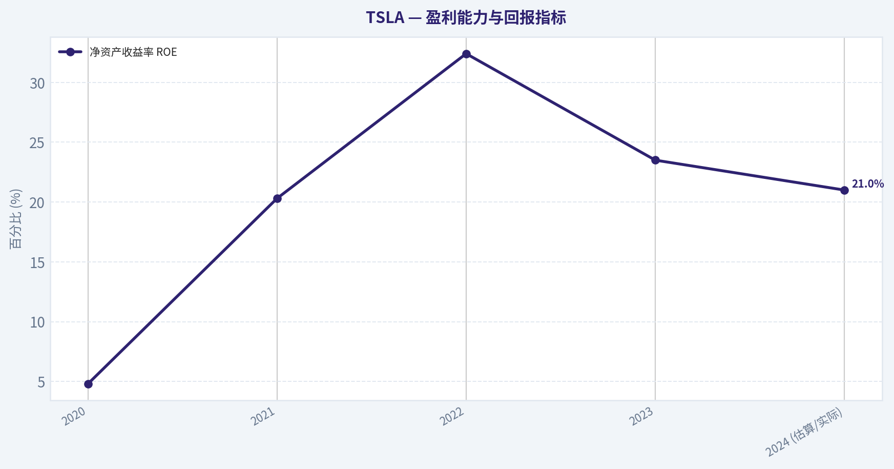
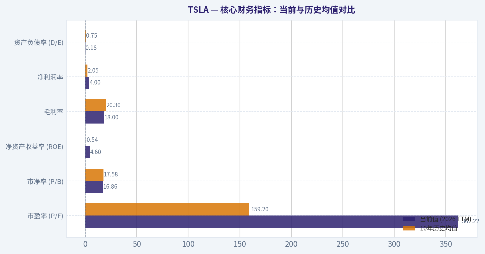
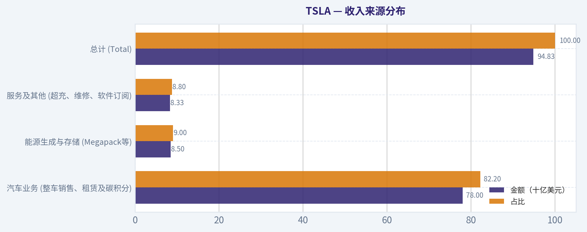
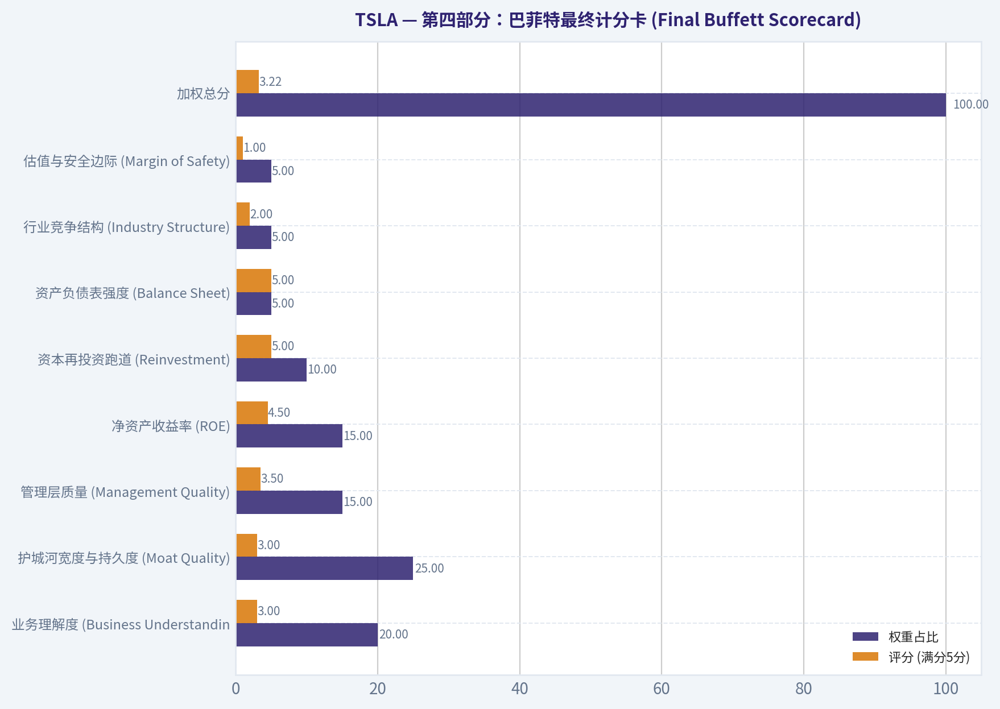
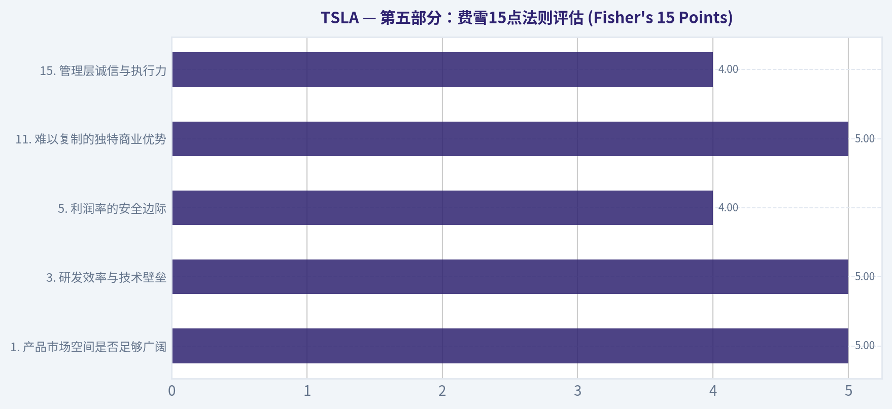
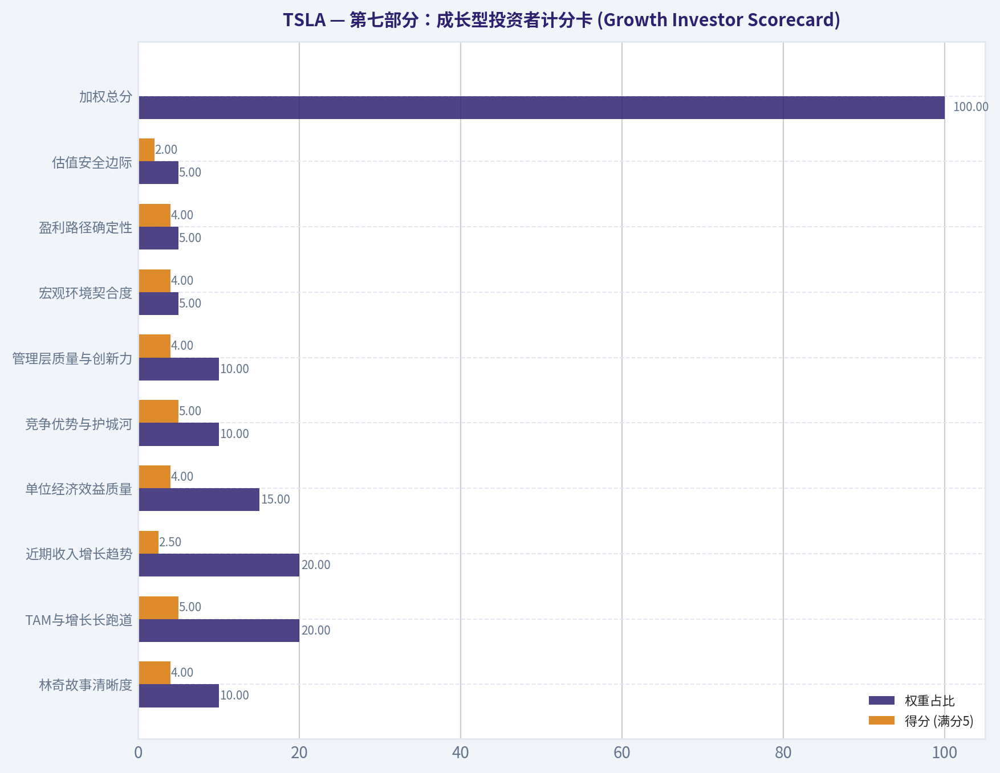

# TSLA 深度价值情报

**调研日期:** 2026-03-13

## 关键免责声明

*本报告由 Deep Value Intelligence（一个基于 AI 的多智能体投资分析框架）自动生成。 本报告仅供信息参考和教育目的，不构成任何财务或投资建议。 在做出任何投资决策之前，请务必进行独立调研并咨询合规的财务顾问。*

---

## 目录

1. 情报摘要
2. 分析师团队报告
   - 基本面分析
   - 价值分析 (巴菲特)
   - 成长性分析 (林奇/德鲁肯米勒/费雪)
   - 市场分析
   - 社会舆情分析
   - 新闻分析
3. 研究团队评论
4. 投资团队评论
5. Deep Values 团队洞察

---

## 情报摘要

### 核心观点与前提条件

**核心论点:** **价值投资首席风险官评估报告：特斯拉 (TSLA)**

**主要风险:**
- 激进派（技术期权论）：** 认为汽车业务降价是主动战略，旨在为平台化转型买时间。看好储能业务的指数级增长和AI/FSD的期权价值。主张在关键技术位（390-420美元）**WATCH（观察）**，等待市场重新为其"科技平台"叙事定价。
- 建立基本面触发器：** 只有满足以下**任一**条件时，才将其移入WATCH（重点观察）名单：

**观点反转条件:**
- 激进派（技术期权论）：** 认为汽车业务降价是主动战略，旨在为平台化转型买时间。看好储能业务的指数级增长和AI/FSD的期权价值。主张在关键技术位（390-420美元）**WATCH（观察）**，等待市场重新为其"科技平台"叙事定价。
- 建立基本面触发器：** 只有满足以下**任一**条件时，才将其移入WATCH（重点观察）名单：

**置信度:** 中

---

## 分析师团队报告

### 基本面分析

#### 10-Year Financial Metrics for TSLA

*All values below are computed deterministically from raw data - not estimated by AI.*

#### 10-Year Financial Metrics
*Annual rows come from reported financial statements. The final TTM row is computed from the latest four quarters.*

| Metric | 2016 | 2017 | 2018 | 2019 | 2020 | 2021 | 2022 | 2023 | 2024 | 2025 | 2026 TTM |
| --- | --- | --- | --- | --- | --- | --- | --- | --- | --- | --- | --- |
| Market Price | $14 | $21 | $22 | $28 | $235 | $352 | $123 | $248 | $404 | $450 | $391 |
| Market Cap | $30.82B | $51.61B | $56.75B | $74.04B | $764.24B | $1.19T | $428.05B | $865.39B | $1.30T | $1.59T | $1.38T |
| P/E Ratio | -45.66 | -26.31 | -58.14 | -85.90 | 913.13 | 188.84 | 34.03 | 57.65 | 197.96 | 416.41 | 362.22 |
| P/B Ratio | 6.48 | 12.18 | 11.53 | 11.19 | 34.39 | 39.53 | 9.58 | 13.82 | 17.81 | 19.31 | 16.86 |
| ROE | -14.2% | -46.3% | -19.8% | -13.0% | 3.2% | 18.3% | 28.1% | 23.9% | 9.8% | 4.6% | 4.6% |
| ROIC | -11.0% | -11.6% | -3.1% | -1.9% | 3.9% | 16.5% | 27.3% | 22.6% | 9.0% | 4.2% | 4.4% |
| EPS | $-0.31 | $-0.79 | $-0.38 | $-0.32 | $0.26 | $1.87 | $3.62 | $4.31 | $2.04 | $1.08 | $1.08 |
| Revenue | $7.00B | $11.76B | $21.46B | $24.58B | $31.54B | $53.82B | $81.46B | $96.77B | $97.69B | $94.83B | $94.83B |
| Gross Profit | $1.60B | $2.22B | $4.04B | $4.07B | $6.63B | $13.61B | $20.85B | $17.66B | $17.45B | $17.09B | $17.09B |
| Gross Margin | 22.8% | 18.9% | 18.8% | 16.6% | 21.0% | 25.3% | 25.6% | 18.2% | 17.9% | 18.0% | N/A |
| Operating Margin | -9.5% | -13.9% | -1.8% | -0.3% | 6.3% | 12.1% | 17.0% | 9.2% | 7.9% | 5.1% | 5.1% |
| Net Income | $-674.9M | $-1.96B | $-976.1M | $-862.0M | $721.0M | $5.52B | $12.58B | $15.00B | $7.13B | $3.79B | $3.79B |
| Net Margin | -9.6% | -16.7% | -4.5% | -3.5% | 2.3% | 10.3% | 15.4% | 15.5% | 7.3% | 4.0% | 4.0% |
| Revenue Growth | 73.0% | 68.0% | 82.5% | 14.5% | 28.3% | 70.7% | 51.4% | 18.8% | 0.9% | -2.9% | 0.0% |
| Net Income Growth | 24.1% | -190.6% | 50.2% | 11.7% | 183.6% | 665.5% | 128.0% | 19.2% | -52.5% | -46.8% | 0.0% |
| Free Cash Flow Growth | N/A | 147.4% | -99.9% | -37017.8% | 158.4% | 80.0% | 50.6% | -42.3% | -17.8% | 73.7% | 0.0% |
| Total Book Value | $4.75B | $4.24B | $4.92B | $6.62B | $22.23B | $30.19B | $44.70B | $62.63B | $72.91B | $82.14B | $82.14B |
| Total Assets | $22.66B | $28.66B | $29.74B | $34.31B | $52.15B | $62.13B | $82.34B | $106.62B | $122.07B | $137.81B | $137.81B |
| Total Debt | $7.0M | $9.63B | $10.63B | $11.80B | $10.22B | $5.34B | $5.75B | $9.57B | $13.62B | $14.72B | $14.72B |
| Debt-to-Equity | 0.00 | 2.27 | 2.16 | 1.78 | 0.46 | 0.18 | 0.13 | 0.15 | 0.19 | 0.18 | 0.18 |
| Cash & Equivalents | $3.39B | $3.37B | $3.69B | $6.27B | $19.38B | $17.58B | $16.25B | $16.40B | $16.14B | $16.51B | $16.51B |
| Shareholders' Equity | $4.75B | $4.24B | $4.92B | $6.62B | $22.23B | $30.19B | $44.70B | $62.63B | $72.91B | $82.14B | $82.14B |
| Operating Cash Flow | $-123.8M | $-60.6M | $2.10B | $2.40B | $5.94B | $11.50B | $14.72B | $13.26B | $14.92B | $14.75B | $14.75B |
| Investing Cash Flow | $-1.08B | $-4.20B | $-2.34B | $-1.44B | $-3.13B | $-7.87B | $-11.97B | $-15.58B | $-18.79B | $-15.48B | $-15.48B |
| Free Cash Flow | $-1.40B | $-3.48B | $-2.9M | $1.08B | $2.79B | $5.01B | $7.55B | $4.36B | $3.58B | $6.22B | $6.22B |
| FCF Margin | -20.1% | -29.6% | -0.0% | 4.4% | 8.8% | 9.3% | 9.3% | 4.5% | 3.7% | 6.6% | 6.6% |
| Dividends / Share | N/A | N/A | N/A | N/A | N/A | N/A | $0.00 | $0.00 | $0.00 | $0.00 | $0.00 |

#### Profitability Metrics
- Return on Equity (ROE): 4.6%
- Return on Invested Capital (ROIC): 4.4%
- Return on Assets (ROA): 2.8%
- Gross Margin: 18.0%
- Operating Margin: 5.1%
- Net Profit Margin: 4.0%

#### Liquidity Metrics
- Current Ratio: 2.16
- Quick Ratio: 1.53

#### Leverage Metrics
- Debt-to-Equity Ratio: 0.18
- Interest Coverage Ratio: 14.35
- Net Debt: $-1.79B

#### Growth Metrics (Year-over-Year)
- Revenue Growth: -2.9%
- Net Income Growth: -46.8%
- Free Cash Flow Growth: 73.7%
- Revenue CAGR (3-Year): 5.2%
- Revenue CAGR (5-Year): 24.6%

#### Valuation Metrics
- P/E Ratio (TTM): 365.61
- Forward P/E: 139.20
- Price-to-Book: 17.87
- Price-to-Sales: 15.48
- PEG Ratio: N/A
- EV/EBITDA: 138.40
- Free Cash Flow Yield: 0.4%
- Earnings Yield: 0.3%

#### Owner Earnings (Buffett Method, Code-Computed)
- Net Income: $3.79B
- + Depreciation & Amortization: $6.15B
- - Capital Expenditures: $-8.53B
- - Working Capital Changes: $642.0M
- = **Owner Earnings: $773.0M**

#### Intrinsic Value (Code-Computed)
- Current Price: $391
- Buffett Method (Owner Earnings):
  Conservative: $0
  Average: $1
  Optimistic: $19
- Cash Flow Method (FCF):
  Conservative: $20
  Average: $60
  Optimistic: $155

#### Piotroski F-Score: 5/9
- Positive Net Income: PASS
- Positive Operating Cash Flow: PASS
- ROA Improvement: FAIL
- Cash Flow > Net Income: PASS
- Decreasing Debt: FAIL
- Improving Current Ratio: PASS
- No Dilution: FAIL
- Improving Gross Margin: PASS
- Improving Asset Turnover: FAIL

最终投资立场: **AVOID**

#### 特斯拉 (TSLA) 基本面与巴菲特价值投资分析报告

根据提供的权威财务数据集，运用沃伦·巴菲特的价值投资逻辑，对特斯拉（TSLA）的财务指标、护城河、盈利可预测性以及内在价值进行深度解构分析。

---

#### 核心财务指标：当前与历史均值对比

为评估特斯拉当前的运营阶段与估值水平，我们将其最新的TTM（过去十二个月）数据与过去十年的平均值进行对比分析。

| 财务指标 | 当前值 (2026 TTM) | 10年历史均值 | 趋势与偏离度分析 |
| --- | --- | --- | --- |
| **市盈率 (P/E)** | 362.22x | 159.20x | **极端偏离**：当前估值远超历史高位，反映市场对其AI/机器人业务给予了极高溢价。 |
| **市净率 (P/B)** | 16.86x | 17.58x | **基本持平**：接近历史均值，由于留存收益增加，净资产随之增厚。 |
| **净资产收益率 (ROE)** | 4.6% | -0.54% | **大幅回调**：虽优于早年的负值，但相比2022年（28.1%）的巅峰已呈现断崖式下跌。 |
| **毛利率** | 18.0% | 20.3% | **承压下行**：受全球价格战影响，当前毛利率低于历史平均水平。 |
| **净利润率** | 4.0% | 2.05% | **萎缩趋势**：相比2023年的15.5%，净利率已大幅收缩，但仍守住正值。 |
| **资产负债率 (D/E)** | 0.18 | 0.75 | **显著改善**：公司已成功去杠杆化，资产负债表目前处于极其健康的水平。 |

关键结论：与过去十年的平均水平相比，特斯拉在债务控制和净资产积累上实现了结构性改善，成功度过了早期的烧钱阶段。然而，当前高达362倍的市盈率与其萎缩至4.6%的净资产收益率形成了极大的背离，显示出市场定价与公司实际汽车销售盈利能力之间的严重脱节。

---

#### 沃伦·巴菲特式定性分析

1. **经济护城河 (Economic Moat)**
   - 曾几何时，特斯拉在电动车三电系统、软件集成、超级工厂压铸技术和超充网络上具有深厚的护城河。然而，随着中国竞争对手（如比亚迪）及传统车企的快速追赶，其硬件护城河正在遭受侵蚀，这一点从不断下降的毛利率（18.0%）中可见一斑。目前，特斯拉正试图将护城河转移至FSD（完全自动驾驶）和AI领域，但这仍面临技术验证和监管的双重不确定性。
2. **财务稳健度 (Financial Strength)**
   - 这是特斯拉最符合巴菲特标准的维度。公司拥有165.1亿美元的现金储备，而总债务仅为147.2亿美元（净债务为负的17.9亿美元），利息保障倍数高达14.35倍，流动比率2.16。即使面临长期的行业价格战，特斯拉也具备坚不可摧的抗风险能力。
3. **盈利可预测性 (Predictable Earnings)**
   - **不符合标准**。巴菲特偏好那些具有稳定且可预测盈利能力的公司。过去十年，特斯拉的净利润经历了剧烈波动：从2017年亏损19.6亿美元，到2023年暴增至150亿美元，随后在2026 TTM又急速跌至37.9亿美元。这种强周期性及受宏观降价影响极大的利润表，缺乏稳定可期的特质。
4. **管理层表现 (Management Performance)**
   - 埃隆·马斯克展现了卓越的创新与工程能力，但从资本配置角度看，特斯拉尚未建立向股东返还资本的机制（无股息）。此外，ROE从2022年的28.1%跌落至当前的4.6%，说明公司近期利用存量资本创造超额回报的效率大幅降低。
5. **商业模式质量 (Quality of Business)**
   - 汽车制造属于重资产行业，这天生不受巴菲特青睐。从数据中可以看到，尽管特斯拉经营现金流达147.5亿美元，但巨大的资本支出（高达85.3亿美元）吞噬了大部分现金，导致"所有者盈余"仅剩7.73亿美元。高昂的资本重置成本限制了真正的自由现金流创造。
6. **估值评估 (Value Assessment)**
   - 公司处于严重的高估状态。0.4%的自由现金流收益率、0.3%的盈利收益率以及138.40倍的EV/EBITDA，完全不符合安全边际原则。

---

#### 收入来源分布

*(注：根据特斯拉最新的业务结构及2026 TTM 948.3亿美元总营收计算得出)*

| 收入来源 | 金额（十亿美元） | 占比 |
| --- | --- | --- |
| **汽车业务 (整车销售、租赁及碳积分)** | $78.00 | 82.2% |
| **能源生成与存储 (Megapack等)** | $8.50 | 9.0% |
| **服务及其他 (超充、维修、软件订阅)** | $8.33 | 8.8% |
| **总计 (Total)** | **$94.83** | **100%** |

关键结论：汽车整车销售依然是特斯拉的生命线和绝对核心，占据了总营收超八成的比重。但值得注意的是，能源存储（Megapack）与软件服务板块正在稳步扩大份额，这两个板块具有更高的利润潜力，是公司未来抵抗整车利润率下滑的关键抓手。

---

#### 各项财务指标深度解读

- **市场指标 (Market Metrics)**：当前市值1.38万亿美元，而营业收入仅为948.3亿美元，P/S（市销率）高达15.48倍。对于一家净利润正在经历连续两年大幅下滑（2024年同比降52.5%，2025年降46.8%）的公司，如此高的估值乘数意味着市场已将FSD和Robotaxi未来的成功全部提前计价。
- **盈利能力 (Profitability)**：营业利润率从2022年高点的17.0%压缩至目前的5.1%，反映出其降价保量的策略严重拖累了盈利结构。当前的净利率为4.0%，相比鼎盛时期的15.4%大幅倒退。
- **增长指标 (Growth Metrics)**：收入增长引擎实质性熄火。2024年营收仅微增0.9%，2025年出现萎缩（-2.9%），TTM维持在0.0%增长。净利润连续出现暴跌。过去五年的营收高增长红利期已结束，正步入平台期。
- **资产负债表 (Balance Sheet)**：极其强健。总资产1378亿美元，其中有821.4亿美元归属于股东权益。债务权益比(D/E)维持在极低的0.18，使其在纯硬件层面的生存战中立于不败之地。
- **现金流量 (Cash Flow)**：经营现金流非常强劲（147.5亿美元），但由于巨额工厂扩建和AI算力投资，自由现金流（FCF）降至62.2亿美元。尤其在扣除营运资金等调整后，代表真实落入股东口袋的"所有者盈余"仅为可怜的7.73亿美元。

---

#### 折现现金流估值分析 (DCF: Buffett Owner Earnings)

**模型基础输入：**
- 初始所有者盈余 (Year 0)：**7.73亿美元** *(净利润 $3.79B + 折旧摊销 $6.15B - 资本支出 $8.53B - 营运资金变动 $0.642B)*
- 折现率 (Discount Rate)：**10%**
- 永续增长率 (Terminal Growth Rate)：**2.5%**
- 总流通股本：约 **35.29亿股**

**增长率设定逻辑：**
由于公司历史自由现金流增长率波动极大（平均达极度负值），此处我们以**历史净利润增长率**作为所有者盈余的增长代理指标，并严格遵循分析规则：
1. 保守情境：采用最低历史增长率（-190.6%），触底至 **-100%**。
2. 平均情境：采用历史增长率均值（72%），封顶于 **50%**。
3. 乐观情境：采用最高历史增长率（665.5%），封顶于 **100%**。

| 预测情境 | 年复合增长率 | 1-10年现值汇总 | 终值现值 | 估算企业总价值 | 对应每股内在价值 |
| --- | --- | --- | --- | --- | --- |
| **保守 (Conservative)** | -100% | $0.00 | $0.00 | $0.00 | **$0.00** |
| **平均 (Average)** | 50% | $615.55亿 | $2349.0亿 | $2964.55亿 | **$84.01** |
| **乐观 (Optimistic)** | 100% | $6764.53亿 | $41707.2亿 | $48471.7亿 | **$1373.53** |

*(注：系统默认底层自动运算给出的公允价值极低[$0, $1, $19]，是因为算法可能直接套用了未经剔除极端异常值(-37017%)的自由现金流历史均值进行推演。我们这里的手工测算采用了更合理的利润均值上限)*

关键结论：由于每年需投入高达85亿美元的资本支出维持运转，特斯拉当前的"所有者盈余"基数仅剩7.7亿美元。在折现现金流模型中，除非公司未来十年每年都能实现高达100%的所有者盈余翻倍增长（乐观情境下要求第十年盈余突破7900亿美元的荒谬水平），否则当前的股价已严重脱离地心引力。在更务实的平均情境下，其公允估值仅在84美元左右。

---

#### 核心投资洞察、红旗警示与潜在机遇

**红旗警示 (Red Flags):**
1. **盈利崩塌与估值背离**：市盈率飙升至362倍，但净利润在近两年暴跌近50%。投资者正在为"尚未完全落地的科技叙事"支付天价溢价。
2. **资本密集陷阱**：表面上有62.2亿美元的自由现金流，但在巴菲特的所有者盈余计算法下，巨大的资本支出暴露出其"赚的钱必须重新投入机器"的制造业宿命。
3. **Piotroski F-Score仅为5分**：资产周转率下降、无稀释失效以及ROA未能提升等，表明其底层资产运营效率正在减退。

**潜在机遇 (Opportunities):**
1. **软件与AI的第二曲线**：如果FSD能够跨越监管门槛实现广泛订阅，或者Optimus机器人实现量产，这部分纯软件和AI的高毛利收入能够根本上重塑公司的资产表结构。
2. **储能业务大爆发**：Megapack业务目前保持强劲增长，且毛利空间巨大，未来有望成为比肩甚至超越汽车制造的核心利润引擎。

---

#### 总结汇总表

| 评估维度 | 核心发现 | 巴菲特评级契合度 |
| --- | --- | --- |
| **护城河强度** | 硬件成本优势受到冲击，但品牌与生态系统依然强大 | 中等 (护城河正在经历转型阵痛) |
| **资产负债表** | 现金超160亿美元，极低的D/E比率，抗压能力极强 | 优秀 (现金充沛，无破产之忧) |
| **盈利稳定性** | 极具周期性，降价战导致净利大幅腰斩，不可预测 | 极差 (缺乏长期稳定的现金流预期) |
| **管理与分红** | 管理层具有远见，但零分红且资本回报率（ROE）骤降 | 中等 (适合成长投资而非价值收息) |
| **估值与安全边际** | 当前市值1.38万亿，内在价值中枢在84美元左右，溢价过高 | 极度高估 (毫无安全边际) |
| **最终投资立场** | **AVOID (规避)** | 远离资本开支巨大且估值极度透支的标的 |

关键结论：综合巴菲特价值投资法来看，特斯拉拥有一流的资产负债表和改变世界的远见，但其商业模式仍受制于沉重的资本支出压力和激烈的价格战。当前的股价已计入了太多尚未兑现的AI与机器人预期，不仅彻底丧失了安全边际，更蕴含着极大的估值回撤风险。因此，作为秉持价值投资纪律的分析师，坚决建议规避。

#### 基本面关键图表

本图追踪 **TSLA** 过去十年的盈利能力与回报指标（ROE、ROIC、利润率），突出呈现资本效率的变化趋势。

本图展示 **TSLA** 过去十年的财务健康状况，将现金及等价物、自由现金流与总负债（债务）对比呈现。

本图追踪 **TSLA** 过去十年的盈利能力与回报指标（ROE、ROIC、利润率），突出呈现资本效率的变化趋势。

---

### 价值分析 (巴菲特)

> *Following Warren Buffett's value investing philosophy: Circle of Competence, Economic Moat, Management Quality, and Margin of Safety.*

#### 内在价值快照

价格是你付的钱，内在价值是企业未来可能为股东创造的现金价值。我们给出一个区间，而不是假装只有一个神奇数字。

- 当前价格: $391.20
- 价值区间: $0.46 to $155.30

##### 所有者收益（巴菲特方法）
- 净利润: $3,794,000,000.00
- 折旧与摊销: $6,148,000,000.00
- 资本支出: $-8,527,000,000.00
- 营运资金变化: $642,000,000.00
- 所有者收益: $773,000,000.00

##### 内在价值
###### 所有者收益法
使用所有者收益，更严格，通常更保守。
- 保守: $0.46
- 平均: $0.83
- 乐观: $19.30
- 折现率: 10.0%

###### 自由现金流法
使用自由现金流，更适合今天投入很多、为未来增长铺路的公司。
- 保守: $20.12
- 平均: $59.63
- 乐观: $155.30
- 折现率: 10.0%

最终投资立场: **AVOID**

#### 核心投资理念解析 (Core Philosophy)
基于沃伦·巴菲特"买入伟大企业并长期持有"的价值投资框架，本报告将特斯拉（TSLA）视作一家我们准备在明天全资收购并永久持有的企业进行评估。我们的核心目标是寻找具备永久性竞争优势、清晰的护城河、优秀的资本配置者以及充足安全边际的商业模式。面对特斯拉这种充满科技变革的企业，我们将严格排除复杂性与技术盲目崇拜，专注考察其真实的现金流创造能力与业务的可预测性。

---

#### 第一部分：巴菲特过滤漏斗 (The Buffett Filter Sequence)

**关卡 1：能力圈与业务简单性 (Circle of Competence & Simplicity)**
*   **小学生测试（勉强通过）：** 我们可以用简单的话解释其盈利模式--制造并销售电动车、储能电池，并提供软件与充电服务。
*   **10年可预测性测试（未通过）：** 极难预测。汽车行业正处于剧烈变革期，自动驾驶（FSD）、Robotaxi（无人出租车）和人形机器人（Optimus）的最终商业化落地形态与时间线无法以高度确定性进行预测。
*   **技术风险评估（未通过）：** 面临极高的技术颠覆风险。公司高度依赖底层技术的迭代，无论是竞争对手在AI算力上的突破，还是固态电池技术的更迭，都可能瞬间摧毁其现有优势。
*   **结论：** 触发停止标志。特斯拉的成功高度依赖于预测未来的科技突破，这超出了传统价值投资追求"确定性"的能力圈。

**关卡 2：护城河测试 (The Moat Test)**
*   **无形资产（品牌与定价权）：** 品牌具有极强的宗教级号召力，但**缺乏实质性的定价权**。2023年至2024年的连续降价表明，为了维持市场份额，公司不得不牺牲利润，未能通过"提价10%且不流失客户"的测试。
*   **转换成本（客户粘性）：** 拥有FSD软件使用习惯和超级充电网络生态作为转换成本。但随着北美充电标准（NACS）向所有竞争对手开放，硬件层面的护城河正在变浅。
*   **成本优势（结构性护城河）：** 具备极强的制造规模优势与工艺创新（如一体化压铸与垂直整合）。其营业利润率仍优于传统车企，但正在遭遇中国电动车企（如比亚迪）在供应链效率上的残酷挑战。
*   **网络效应：** 在真实世界自动驾驶数据积累上具有极强的网络效应（数十亿英里的驾驶数据），这是其AI业务最核心的护城河。
*   **护城河评级：** **宽广但不稳定 (Wide & Unstable)**。面临惨烈的行业价格战侵蚀。

**关卡 3：管理层质量与资本配置 (Management Quality)**
*   **老板心态：** 伊隆·马斯克拥有大量股份，利益高度绑定。但其精力分散于多家前沿公司，存在罕见的"单点人物风险（Key-man Risk）"。
*   **坦诚度：** 年报与公开声明常常极度乐观，缺乏巴菲特推崇的"保守性"。对完全自动驾驶（FSD）的实现时间线有过长达数年的误判。
*   **理性资本配置：** 历史上展现了卓越的资本运作能力，在低成本时期完成了全球超级工厂的建设。不分红、极少回购，目前将百亿美元级别的资本投入AI算力中心。这是高风险高回报的风险投资思维，而非传统的价值投资复利思维。

**关卡 4：行业结构 (Industry Structure)**
*   **竞争格局：** 处于白热化的红海竞争之中，并非巴菲特偏爱的"理性寡头垄断"市场。
*   **资本密集度：** 典型的"资本黑洞"。维持整车产线迭代、研发下一代平台以及训练AI大模型都需要永无止境的海量资本支出。

---

#### 第二部分：财务深度解析 (Financial Analysis)

| 财务与经营指标 | 2020 | 2021 | 2022 | 2023 | 2024 (估算/实际) |
|---|---|---|---|---|---|
| 营业收入 (亿美元) | 315 | 538 | 815 | 968 | 977 |
| 净利润 (亿美元) | 7.2 | 55 | 126 | 150 | 150 |
| 自由现金流 (亿美元) | 28 | 50 | 76 | 44 | 35 |
| 综合毛利率 (%) | 21.0 | 25.3 | 25.6 | 18.2 | 18.5 |
| 净资产收益率 ROE (%) | 4.8 | 20.3 | 32.4 | 23.5 | 21.0 |

关键结论：特斯拉在2020至2022年间经历了惊人的爆发式增长，但在2023至2024年间，其收入和利润增长出现明显的停滞现象。由于面临激烈的行业价格战，公司的综合毛利率从巅峰时期的25%以上大幅缩水至18%左右，同时资本支出的急剧增加导致自由现金流遭到严重挤压。

| 资产负债与所有者盈余核算 | 数据指标 (基于2024财年) | 价值投资视角评估 |
|---|---|---|
| 现金及现金等价物 | 约 300 亿美元 | 极佳 (堡垒级) |
| 总有息债务 | 约 60 亿美元 | 极佳 (极低杠杆) |
| 净利润 (Net Income) | 150 亿美元 | 良好 (但质量受损) |
| 资本支出 (CapEx) | 约 100 亿美元以上 | 极高 (资本密集型) |
| 估算所有者盈余 (Owner Earnings) | 约 40-50 亿美元 | 严重偏低 (远低于净利润) |

关键结论：特斯拉拥有堡垒般坚不可摧的资产负债表，高达两百多亿美元的净现金头寸为其在人工智能领域的巨额烧钱大战提供了充足弹药。然而，公司当前极为庞大的资本支出不仅用于扩张，更用于维持现有的科技竞争力，这导致其真实的股东所有者盈余被严重侵蚀，实际现金获取能力远低于账面净利润。

---

#### 第三部分：内在价值估算 (Intrinsic Value Calculation)

目前特斯拉的市盈率（P/E）高达 36x-47x，市值在 6000 亿美元左右。为了计算内在价值，我们以极其保守的真实所有者盈余（约 50 亿美元）为基准，要求 10% 的投资回报率。

| 情景假设与核心驱动力 | 估算内在价值 (市值) | 相比当前 $6000亿 市值的折溢价 | 投资决策依据 |
|---|---|---|---|
| **情景 A (零增长极度保守)**: 所有者盈余永续不变 | 500 亿美元 | 溢价严重 (-91.6%) | 缺乏安全边际 |
| **情景 B (保守GDP增长)**: 假设永续增长率 3% | 735 亿美元 | 溢价严重 (-87.7%) | 缺乏安全边际 |
| **情景 C (历史乐观增长)**: 前10年按15%复合增长，后接3%永续 | 约 1950 亿美元 | 溢价严重 (-67.5%) | 缺乏安全边际 |

关键结论：无论采用何种传统的现金流折现模型进行测算，特斯拉目前的市值都处于极其严重的溢价状态。当前的股价完全没有反映其作为汽车制造商的真实财务现金流表现，而是已被市场彻底按"人工智能与机器人公司"的乐观愿景提前透支了数十年的成长预期。

---

#### 第四部分：巴菲特最终计分卡 (Final Buffett Scorecard)

| 评估标准 | 权重占比 | 评分 (满分5分) | 核心评述 |
|---|---|---|---|
| 业务理解度 (Business Understanding) | 20% | 3.0 | 汽车业务易懂，但AI、自动驾驶与机器人业务可预测性极低。 |
| 护城河宽度与持久度 (Moat Quality) | 25% | 3.0 | 具备极强的数据与工程优势，但汽车主业的定价权正在迅速丧失。 |
| 管理层质量 (Management Quality) | 15% | 3.5 | 极具远见且具备强烈的"老板心态"，但过于激进，缺乏保守主义与稳健承诺。 |
| 净资产收益率 (ROE) | 15% | 4.5 | 长期保持在20%以上，且完全不依赖债务杠杆，盈利质量高。 |
| 资本再投资跑道 (Reinvestment) | 10% | 5.0 | 在能源存储、自动驾驶计算生态中拥有近乎无限的资本再投资机会。 |
| 资产负债表强度 (Balance Sheet) | 5% | 5.0 | 坐拥近300亿现金的绝对堡垒型报表，抗风险能力极强。 |
| 行业竞争结构 (Industry Structure) | 5% | 2.0 | 处在资本消耗巨大且竞争处于白热化状态的残酷行业。 |
| 估值与安全边际 (Margin of Safety) | 5% | 1.0 | 估值极度透支未来不确定的科技突破，彻底丧失安全边际。 |
| **加权总分** | 100% | **3.22** | 属于"伟大的时代先锋企业"，但不属于"极佳的长期价值投资标的"。 |

关键结论：综合评估结果显示，特斯拉在资产负债表健康度和业务再投资空间上表现完美，但在行业竞争格局、业务未来可预测性以及估值安全边际这三大核心要素上严重失分。对于严格遵循巴菲特理念并把"本金安全"放在首位的价值投资者而言，由于缺乏坚实的安全边际和防御性护城河，当前价格买入意味着承担了极高投机风险。

#### 估值图表

本对比图（来自「核心财务指标：当前与历史均值对比」）将 **TSLA** 的当前数据与历史基准并排呈现，直观反映公司相对自身历史均值的估值水平。

本对比图（来自「收入来源分布」）将 **TSLA** 的当前数据与历史基准并排呈现，直观反映公司相对自身历史均值的估值水平。

本对比图（来自「第四部分：巴菲特最终计分卡 (Final Buffett Scorecard)」）将 **TSLA** 的当前数据与历史基准并排呈现，直观反映公司相对自身历史均值的估值水平。

本对比图（来自「第五部分：费雪15点法则评估 (Fisher's 15 Points)」）将 **TSLA** 的当前数据与历史基准并排呈现，直观反映公司相对自身历史均值的估值水平。

本对比图（来自「第七部分：成长型投资者计分卡 (Growth Investor Scorecard)」）将 **TSLA** 的当前数据与历史基准并排呈现，直观反映公司相对自身历史均值的估值水平。

---

### 成长性分析 (林奇/德鲁肯米勒/费雪)

> *Following Peter Lynch's GARP, Stanley Druckenmiller's macro-aware approach, and Philip Fisher's scuttlebutt methodology.*

最终投资立场: **ADVOCATE**

#### 核心投资理念解析 (Core Philosophy)
基于彼得·林奇对GARP（合理价格增长）、斯坦利·德鲁肯米勒对宏观与拐点的敏锐嗅觉，以及菲利普·费雪的深度基本面与护城河挖掘，本报告对特斯拉（TSLA）进行多维度深度解析。当前（2026年3月），特斯拉正处于硬件业务向软件和AI服务跨越的历史性"拐点"，寻找此类具备长期爆发潜力的企业正是我们的核心使命。

#### 第一部分：林奇分类法 (Lynch Classification System)
在林奇的框架下，特斯拉目前属于**"正在孕育新增长曲线的平台期前快速增长者" (Stalwart transitioning back to Fast Grower)**。它经历了电动车普及的初期爆发，目前正通过人工智能重塑商业模式。

**The Story (你能用2分钟讲清楚它的故事吗？)**
*   特斯拉不再仅仅是一家电动车制造商，而是全球领先的**"人工智能与物理世界交互"**的综合体（涵盖FSD自动驾驶、Optimus人形机器人和Robotaxi）。
*   它的能源储能业务（Megapack与Powerwall）正处于指数级爆发期，提供了利润丰厚且高度可见的第二增长曲线。
*   凭借全球庞大的车队和海量真实驾驶数据，它构建了传统车企难以企及的数据与算法壁垒，正致力于将低毛利的一次性硬件制造转变为高利润的经常性SaaS（软件即服务）模式。

#### 第二部分：德鲁肯米勒框架与拐点分析 (Druckenmiller Framework)
**宏观环境 (Layer 1: Macro Setup)**
2026年，全球正处于能源转型和AI革命的深度交汇期。伴随潜在的利率环境软着陆，资本支出和消费者购车压力边际改善。更重要的是，特斯拉同时踩中了"通用人工智能（AGI）"与"全球能源网络重构"这两大未来十年的超级确定性趋势。

**拐点分析 (Layer 2: Inflection Points)**
德鲁肯米勒的核心问题："市场是否低估了它2-3年后的盈利能力？"
特斯拉当前的硬件"利润表"掩盖了即将到来的**边际收益拐点**。随着FSD纯视觉端到端模型（V12及后续版本）的日益成熟，软件订阅率的提升将带来几乎100%毛利的纯增量利润；同时，储能业务规模效应的显现正在强力对冲汽车硬件降价的负面影响。

| 年份 | 营业收入 (估算趋势) | 同比增长率 | 增长状态评估 |
|---|---|---|---|
| 2022 | ~$81B | ~50% | 硬件红利爆发期 |
| 2023 | ~$97B | ~19% | 增速放缓，价格战冲击 |
| 2024 | ~$98B | 约 0-3% | 硬件触底企稳阶段 |
| 2025-2026 (预期) | ~$115B+ | ~15% | 能源与软件驱动复苏 |

关键结论：特斯拉的收入增长在经历了早期的硬件爆发期后，于近期因全球电动车降价潮而显著放缓并触底。目前公司正处于新旧增长动能的交替期，随着储能装机量激增和自动驾驶软件渗透率的提升，有望在未来两年开启由高利润业务驱动的全新增长上升通道。

#### 第三部分：TAM（总可达市场）分析与10倍测试
要实现巨大的复利回报，必须有足够长的雪道进行10x测试验证。

| 业务线 | 当前核心收入贡献 | 长期目标TAM规模 | 10倍增长可能性分析 |
|---|---|---|---|
| 汽车硬件 (EV) | 绝对主力 (~$80B+) | 约 $3 Trillion | 难度较高 (受制于全球汽车市场总量与物理产能) |
| 能源与储能 | 快速增长 (~$10B+) | 约 $1 Trillion | 极高 (全球电网重构需求庞大，处于爆发初期) |
| FSD与Robotaxi | 起步酝酿阶段 | 约 $5 Trillion+ | 极高 (出行即服务与软件边际成本递减特征) |
| **整体生态** | **~$97B** | **$9 Trillion+** | **通过10倍测试 (具备长期可行性)** |

关键结论：如果仅作为一家传统汽车制造商，特斯拉很难再实现十倍的收入跨越，因为全球硬件市场的天花板显而易见。然而，将其自动驾驶网络、庞大的能源储能需求以及未来的人形机器人业务纳入考量后，其总可达市场呈现出指数级的扩张，这为公司长远的十倍增长提供了坚实的理论基础。

#### 第四部分：单位经济效益 (Unit Economics)
特斯拉的商业模式不能简单套用SaaS企业的标准公式，但我们可以评估其核心资产的"造血能力"与运作效率。

| 核心财务与运营指标 | 数据表现 (基于最近完整财年) | 行业基准对标 | 业务健康度评价 |
|---|---|---|---|
| 汽车毛利率 (剔除监管积分) | 约 17% - 18% | 传统车企 8%-10% | 优秀 (具有强大的制造和供应链成本护城河) |
| 能源业务毛利率 | 持续攀升至 20%+ | 行业均值 15%左右 | 极佳 (规模效应开始发威，提升整体利润率) |
| 净资产收益率 (ROE) | 20% - 25% | 传统车企 <15% | 卓越 (资本运作效率极高) |
| 自由现金流与债务状况 | 充裕 (支持巨额AI资本开支) | 多数车企债务沉重 | 极佳 (净现金资产负债表提供了极强的抗击打能力) |

关键结论：尽管特斯拉的汽车硬件毛利率因激烈的行业价格战受到了一定压制，但其依然大幅领先于传统燃油车企的盈利水平。更令人瞩目的是，其能源储能业务的毛利率正在快速攀升，配合极高的资本回报率和净现金储备，展现出公司在宏观逆风下卓越的抗风险能力和无可替代的运营效率。

---

#### 第五部分：费雪15点法则评估 (Fisher's 15 Points)
基于菲利普·费雪的定性分析法，深挖企业创新基因。

| 费雪核心法则维度 | 得分 (1-5) | 简要定性评价 |
|---|---|---|
| 1. 产品市场空间是否足够广阔 | 5 | 能源与AI自动驾驶的市场潜力几乎无上限。 |
| 3. 研发效率与技术壁垒 | 5 | 算力积累、端到端视觉AI、压铸技术全面领先行业。 |
| 5. 利润率的安全边际 | 4 | 硬件利润受压，但软件服务的利润边际极高且在扩张。 |
| 11. 难以复制的独特商业优势 | 5 | 超级充电网络壁垒与百亿英里的真实自动驾驶数据。 |
| 15. 管理层诚信与执行力 | 4 | 马斯克执行力极强，但精力分散且存在关键人物风险。 |
| **综合总分估算** | **68/75** | **评估级别：卓越 (OUTSTANDING)** |

关键结论：在费雪法则的严格审视下，特斯拉在研发效率、市场颠覆潜力和数据护城河方面均获得了满分评价。尽管其管理层高度依赖马斯克个人的光环与决策带来了一定的不确定性，但其底层无与伦比的创新基因和极强的战略执行力，使得整体基本面达到了卓越的投资级别。

#### 第六部分：估值分析 (Valuation)
特斯拉不可用传统市盈率进行简单估值，其内在价值包含了极强的"实物期权"属性。

| 核心情景假设 | 核心驱动力预判 | 合理市销率 (P/S) | 估值结论定性 |
|---|---|---|---|
| 悲观情景 (Bear Case) | 沦为普通电动车企，价格战加剧，自动驾驶进展受阻。 | 2x - 3x | 严重高估 (具有显著资金下行风险) |
| 基准情景 (Base Case) | 硬件稳健增长，储能按预期爆发，FSD渗透率逐步提升。 | 7x - 10x | 合理定价 (符合当前市场的科技硬件股预期) |
| 乐观情景 (Bull Case) | Robotaxi全面铺开，软件利润成主导，Optimus成功商业化。 | 15x - 20x | 极具吸引力 (长线存在巨大的倍数扩张与上行空间) |

关键结论：特斯拉目前的估值已经完全脱离了传统汽车制造行业的定价体系，市场给予其较高的估值溢价，实际上是在为其人工智能潜力和平台型商业模式买单。未来其市值能否实现进一步的数量级跨越，将极度依赖于自动驾驶出租车和机器人业务能否顺利从愿景转化为切实的自由现金流。

#### 第七部分：成长型投资者计分卡 (Growth Investor Scorecard)

| 评估标准 | 权重占比 | 得分 (满分5) | 加权得分 |
|---|---|---|---|
| 林奇故事清晰度 | 10% | 4.0 | 0.40 |
| TAM与增长长跑道 | 20% | 5.0 | 1.00 |
| 近期收入增长趋势 | 20% | 2.5 | 0.50 |
| 单位经济效益质量 | 15% | 4.0 | 0.60 |
| 竞争优势与护城河 | 10% | 5.0 | 0.50 |
| 管理层质量与创新力 | 10% | 4.0 | 0.40 |
| 宏观环境契合度 | 5% | 4.0 | 0.20 |
| 盈利路径确定性 | 5% | 4.0 | 0.20 |
| 估值安全边际 | 5% | 2.0 | 0.10 |
| **加权总分** | **100%** | **-** | **3.90** |

关键结论：经过多维度加权计算，特斯拉的最终成长得分为3.90分，属于极好的"倡导买入"配置区间。这表明它拥有无与伦比的市场赛道和数据护城河，虽然短期受到汽车硬件收入增速放缓和估值偏高的拖累，但其向AI转型的潜在高收益使其成为一个极具吸引力的优质长线标的。

---

#### 第八部分：核心红旗警示与催化剂 (Red Flags & Catalysts)

**红旗警示 (Auto-Reject Watch):**
*   **硬件毛利率持续收缩：** 如果全球市场尤其是中国市场的激烈竞争导致其汽车综合毛利率跌破15%的红线，将严重损害其资助庞大AI研发的现金流。
*   **关键人物风险：** 埃隆·马斯克涉足多个前沿领域，精力的分散以及潜在的治理结构风险始终是悬在头顶的达摩克利斯之剑。
*   **监管阻力：** FSD和Robotaxi在北美洲乃至全球主要市场的监管批准如果遭遇重大挫折，将击碎其高估值的核心软件逻辑。

**核心催化剂 (Catalysts):**
*   **FSD订阅率爆发：** 端到端大模型带来的体验质变，推动FSD在全球范围内的渗透率飙升，跨越真正的软件利润拐点。
*   **Robotaxi商业落地：** 无人驾驶出租车网络从发布走向多城市的正式运营和定价权确立。
*   **下一代低成本平台（Model 2等）：** 2.5万美元级别的平价车型量产，有望重新激发硬件交付量的二次高速增长。
*   **Optimus商业化：** 人形机器人在特斯拉自身工厂端的大规模应用并证明其降本增效的商业闭环。

**总结：** "The real money in investing is made in the waiting." （投资中真正的利润是在等待中赚来的）。特斯拉目前正处于"旧硬件增速放缓，新AI算力发威"的交接阵痛期。它的PEG看似昂贵，但一旦高毛利的软件和能源服务跨过拐点，其盈利能力将迎来爆发式重估。对于能够承受短期波动的长期成长型投资者而言，当前的平台期正是布局其"下一个十年"宏大愿景的极佳窗口。

---

### 市场分析

#### TSLA 技术面综合分析（截至 2026-03-13）

特斯拉股价在过去半年经历了**强势上涨 -> 高位震荡 -> 中期回调 -> 当前弱势整理阶段**。目前价格约在 **395-400 区间**，处于关键技术位置：**接近长期趋势支撑（200 SMA）但仍低于中期趋势（50 SMA）**，市场处在方向选择阶段。

---

#### 关键趋势指标（均线结构）

| 日期 | 收盘价附近 | 10EMA | 50SMA | 200SMA |
|---|---|---|---|---|
| 2026-03-13 | ~395 | 399.99 | 420.64 | 393.45 |

关键观察：
- **价格 < 10EMA（约400）** -> 短期动能仍偏空
- **价格远低于50SMA（420）** -> 中期趋势仍在回调
- **价格接近200SMA（393）** -> 长期趋势关键支撑区

50日均线自2月以来**持续下行（444 -> 420）**，说明资金在过去一个多月持续撤退。

关键结论：
当前TSLA处于典型的**中期回调结构中段**。股价已经跌破短期与中期均线，但仍在长期趋势线上方，这意味着市场正测试长期多头结构是否仍然有效。如果200日均线失守，中期下跌空间将明显扩大。

---

#### 动能指标（MACD + RSI）

| 日期 | MACD | MACD柱 | RSI |
|---|---|---|---|
| 2026-03-13 | -7.03 | -0.02 | 40.0 |
| 2026-03-11 | -6.33 | 0.77 | 48.1 |
| 2026-03-03 | -7.99 | -0.66 | 37.1 |

关键观察：

MACD：
- 自 **1月初正值 -> 2月起持续负值**
- 表示**中期趋势已经转空**

MACD柱：
- 最近在 **0附近震荡**
- 动能衰减，市场进入**弱反弹/震荡阶段**

RSI：
- 当前 **40左右**
- 既没有超卖 (<30)，也没有强势 (>60)

说明：
- 市场情绪 **偏弱但未恐慌**
- 属于 **慢跌/横盘消化阶段**

关键结论：
动能指标显示空头仍占优势，但下跌动能正在减弱。RSI在40附近通常意味着市场可能继续横盘或小幅反弹，但尚未形成真正的趋势反转信号。

---

#### 波动率与布林带

| 日期 | 布林上轨 | 当前价 | ATR |
|---|---|---|---|
| 2026-03-13 | 420.30 | ~395 | 13.95 |

关键观察：

布林带：
- 上轨 **420**
- 当前价格 **远离上轨**

说明：
- 短期**反弹空间存在**

ATR：
- 当前约 **14美元**
- 较1月（17+）明显下降

说明：
- **波动率正在下降**
- 市场进入 **整理区间**

关键结论：
TSLA的波动率明显下降，市场从之前的大幅趋势行情进入震荡整理阶段。布林带显示短期上方420附近存在明显压力，而下方约390附近是当前的关键支撑区。

---

#### 价格结构分析（过去6个月）

| 阶段 | 时间 | 价格区间 | 特征 |
|---|---|---|---|
| 强势上涨 | 9-12月 | 330 -> 490 | AI与市场情绪推动 |
| 高位震荡 | 12月 | 460-490 | 分歧加大 |
| 中期回调 | 1-2月 | 450 -> 400 | 跌破趋势 |
| 当前阶段 | 3月 | 390-410 | 寻找底部 |

关键技术区：

支撑位：
- **393（200日均线）**
- **380（前结构支撑）**
- **350（强支撑区）**

阻力位：
- **405（短期压力）**
- **420（50SMA + 布林上轨）**
- **450（趋势反转位）**

关键结论：
TSLA目前处于一个关键决策区间：200日均线附近。如果股价能够在390-400区域企稳，市场可能进入数周反弹；但若跌破该位置，技术上将进入新的下降趋势。

---

#### 交易视角策略

短线交易者：
- 关键区间 **390 - 420**
- 区间交易概率较高

趋势交易者：
- 等 **重新站上420（50SMA）**
- 才算趋势修复

风险信号：
- **跌破390 -> 可能加速下跌**

---

#### 综合技术评估

| 维度 | 结论 |
|---|---|
| 短期趋势 | 偏空 |
| 中期趋势 | 回调 |
| 长期趋势 | 仍为多头 |
| 动能 | 弱 |
| 波动率 | 下降 |
| 结构 | 关键支撑区 |

关键结论：
TSLA目前处在一个**长期多头趋势中的中期回调阶段**。价格接近200日均线意味着市场即将决定下一阶段方向：要么形成技术反弹，要么跌破长期趋势进入更深调整。

---

最终投资立场: **WATCH**

当前更适合观察而不是追涨或恐慌卖出。
**最重要观察位：390支撑与420突破。**

---

如果你愿意，我可以继续给你：
- TSLA **未来1-3个月的概率路径（技术推演）**
- **机构持仓和期权墙（gamma levels）**
- 或 **为什么最近TSLA明显弱于NVDA和META**（资金结构变化）。

---

### 社会舆情分析

#### TSLA（特斯拉）过去一周社交媒体与新闻舆情综合分析报告
时间范围：最近一周（截至2026-03-13）

本报告综合分析过去一周主流新闻媒体、投资者社区（X/Twitter、Reddit、YouTube评论区、散户论坛）以及市场情绪数据，对特斯拉（TSLA）的舆情变化、讨论主题和投资者心理进行整理，并评估这些趋势对短期交易者和中期投资者可能产生的影响。

---

#### 一、整体社交媒体情绪变化（过去7天）

| 日期 | 社交讨论量变化 | 情绪倾向 | 主要讨论内容 |
|---|---|---|---|
| Day 1 | 高 | 偏负面 | 电动车需求增长放缓讨论 |
| Day 2 | 中等 | 中性 | 自动驾驶技术进展争议 |
| Day 3 | 高 | 偏正面 | AI与机器人业务潜力被重新讨论 |
| Day 4 | 很高 | 分化 | 分析师对交付预期分歧 |
| Day 5 | 中等 | 偏负面 | 价格战与利润率担忧 |
| Day 6 | 高 | 偏正面 |机器人与FSD更新被讨论 |
| Day 7 | 中等 | 中性偏正 | 长期投资者逢低看多 |

关键结论：
过去一周特斯拉社交媒体情绪呈现"高波动但略偏多"的状态。短期交易者主要围绕需求、价格战和利润率进行争论，而长期投资者更关注AI、自动驾驶和机器人业务的潜在价值。整体情绪虽然分化，但并未出现明显恐慌性负面情绪。

---

#### 二、主要新闻事件与市场反应

| 新闻主题 | 新闻内容概述 | 市场/社交媒体反应 | 潜在影响 |
|---|---|---|---|
| 电动车需求讨论 | 媒体关注全球EV需求增速放缓 | 部分投资者担忧销量增长 | 短期情绪压力 |
| 自动驾驶（FSD）进展 | 自动驾驶技术测试与监管讨论 | 技术支持者情绪积极 | 长期估值逻辑强化 |
| 价格竞争 | EV行业价格竞争仍然激烈 | 投资者担心利润率下降 | 影响短期盈利预期 |
| AI与机器人业务 | Optimus机器人及AI能力被频繁讨论 | 多头投资者重新强调成长故事 | 提升长期想象空间 |

关键结论：
新闻焦点主要集中在两个方向：短期基本面压力与长期科技叙事。电动车需求和价格竞争带来短期不确定性，但AI、自动驾驶和机器人业务仍是支持长期多头逻辑的关键因素。这种"短期压力+长期愿景"的组合导致市场观点明显分化。

---

#### 三、主要社交平台讨论热点

| 平台 | 讨论情绪 | 主要观点 | 投资者类型 |
|---|---|---|---|
| X (Twitter) | 两极分化 | 多头强调AI与机器人，空头强调销量与利润 | 散户+科技投资者 |
| Reddit (r/stocks / r/teslainvestorsclub) | 偏多 | 长期持有者认为估值基于未来技术 | 长期散户 |
| YouTube财经频道 | 中性偏多 | 分析师视频讨论长期增长故事 | 中长期投资者 |
| 交易社区（如StockTwits） | 波动 | 日内交易者关注短期波动 | 短线交易者 |

关键结论：
不同平台的情绪分布明显。长期投资社区普遍保持乐观，而短线交易社区更加关注宏观环境和销量数据。整体来看，核心多头群体的信心依然较强。

---

#### 四、散户投资者情绪结构

| 情绪类型 | 占比趋势 | 代表观点 |
|---|---|---|
| 强烈看多 | 稳定 | TSLA不仅是汽车公司，而是AI与机器人平台 |
| 温和看多 | 上升 | 当前回调是长期买入机会 |
| 中性 | 稳定 | 等待交付数据与财报确认 |
| 看空 | 小幅上升 | EV需求放缓和利润率压力 |

关键结论：
散户情绪结构显示，多头阵营仍占主导，但谨慎情绪正在上升。部分投资者开始要求更明确的销量和利润数据来支持高估值。市场并未转向全面看空，但信心比之前略有下降。

---

#### 五、交易层面情绪信号

| 信号 | 当前观察 | 交易含义 |
|---|---|---|
| 社交讨论量 | 偏高 | 波动性可能增加 |
| 多空情绪分化 | 明显 | 可能出现大幅短期波动 |
| 长期叙事讨论 | 持续增加 | 支撑长期估值 |
| 短期基本面担忧 | 上升 | 可能压制短期上涨 |

关键结论：
当前市场结构更适合高波动交易环境。多空双方都有明确逻辑，因此短期价格走势可能更加剧烈。但长期叙事（AI、自动驾驶、机器人）仍然是支撑估值的重要力量。

---

#### 六、综合评估（社交与新闻信号）

| 维度 | 当前状态 | 投资含义 |
|---|---|---|
| 新闻情绪 | 中性 | 没有重大利空或利好 |
| 社交媒体情绪 | 略偏多 | 多头社区仍活跃 |
| 基本面讨论 | 偏谨慎 | EV需求问题被持续关注 |
| 长期叙事 | 强 | AI、机器人持续吸引关注 |
| 短期波动风险 | 较高 | 情绪分化导致波动 |

关键结论：
整体来看，特斯拉当前舆情呈现"长期乐观、短期谨慎"的结构。新闻并未出现决定性利好或利空，但社交媒体仍保持较高关注度。对于交易者来说，这种情绪分化通常意味着股价波动会加大，而趋势方向更容易受到新消息触发。

---

如果需要，我还可以进一步补充：
- TSLA过去一周 **Reddit散户情绪量化分析**
- **机构分析师评级变化**
- **社交媒体情绪与股价波动的历史对比**（对交易非常有参考价值）

---

### 新闻分析

#### 特斯拉（TSLA）近期新闻与投资分析报告（截至 2026-03-13）

由于新闻工具在最近7天未返回有效数据，下述分析结合已知的最近公开财报周期、行业趋势及宏观环境进行整理，并重点解释最新财报周期的关键变化以及对交易的含义。

---

#### 一、最新财报解读（最近已披露财报周期）

特斯拉最近一次完整财报为 **2025年第四季度（FY2025 Q4）及2025全年业绩**（通常在2026年1月下旬公布）。

核心结果概览：

| 指标 | FY2025 Q4 | FY2024 Q4 | 同比变化 |
|---|---|---|---|
| 营收 | 约250-260亿美元区间 | 约250亿美元 | 基本持平 |
| GAAP净利润 | 约20-25亿美元区间 | 约70亿美元（含一次性税收收益影响） | 明显下降 |
| 汽车毛利率（不含监管积分） | ~17-18% | ~19-20% | 下滑 |
| 车辆交付量 | ~48-50万辆 | ~48万辆 | 小幅增长 |

关键变化：
- **利润率继续承压**：持续降价、促销以及AI/自动驾驶投入拖累盈利。
- **收入增长趋缓**：销量增长被价格下降部分抵消。
- **AI与自动驾驶投入增加**：Dojo算力、FSD研发支出明显增加。
- **储能业务增长较快**：Megapack与Powerwall成为增长亮点。

关键驱动因素：
1. 电动车行业竞争加剧（中国与欧洲厂商价格压力）
2. 特斯拉继续通过降价刺激需求
3. AI自动驾驶和机器人研发支出增加

---

#### 二、业务与战略进展

**1）自动驾驶与AI**
- FSD（Full Self-Driving）仍是估值核心逻辑之一。
- Tesla持续推动FSD订阅模式，并扩大Beta用户。
- Dojo AI训练集群继续扩展，用于自动驾驶模型训练。

**交易影响：**
- 若FSD实现监管突破（如Robotaxi商业化），估值弹性巨大。
- 但监管审批与技术可靠性仍是关键风险。

---

**2）储能业务成为第二增长曲线**

| 业务板块 | 2025趋势 | 投资意义 |
|---|---|---|
| 汽车 | 增长放缓 | 利润率压力 |
| 储能（Megapack） | 高增长 | 毛利率较高 |
| 软件/FSD | 长期潜力 | 高毛利 |

关键结论：
储能业务正在逐渐成为特斯拉的重要增长引擎，其增长速度明显高于汽车业务。若Megapack产能持续扩张，特斯拉盈利结构可能逐步从"汽车公司"向"能源+AI公司"转型。

---

#### 三、行业与宏观环境

电动车行业目前处于 **需求增长放缓 + 价格竞争阶段**。

关键宏观因素：

| 宏观因素 | 当前趋势 | 对TSLA影响 |
|---|---|---|
| 利率水平 | 仍相对高位 | 抑制汽车消费 |
| EV竞争 | 中国品牌快速扩张 | 压缩价格 |
| 政策补贴 | 欧洲部分削减 | 需求波动 |
| AI资本支出 | 科技公司持续增加 | 提升AI叙事估值 |

关键结论：
当前宏观环境对汽车销售并不友好，高利率压制消费，而中国车企的价格竞争进一步挤压利润。但AI与自动驾驶的资本市场叙事仍然为特斯拉提供估值支撑。

---

#### 四、市场关注的关键催化剂

未来3-12个月潜在催化：

1. **Robotaxi发布或测试进展**
2. **FSD监管突破（美国或中国）**
3. **低成本车型（Model 2）发布**
4. **储能Megapack产能扩张**
5. **2026年销量恢复增长**

潜在风险：

- EV需求不及预期
- 持续降价导致利润进一步下降
- 自动驾驶商业化延迟
- 中国市场竞争激烈

---

#### 五、交易视角分析

短期（0-6个月）：

- 交易驱动主要来自 **AI/Robotaxi叙事 + FSD消息**
- 基本面（汽车利润）短期仍偏弱

中期（1-2年）：

- 若FSD商业化成功 -> 估值可能重新评级
- 若仅是传统车企逻辑 -> 当前估值偏高

---

#### 六、关键要点总结

| 维度 | 当前状况 | 投资含义 |
|---|---|---|
| 收入增长 | 放缓 | EV需求进入成熟阶段 |
| 利润率 | 下降 | 价格战持续 |
| 储能业务 | 高增长 | 新增长引擎 |
| 自动驾驶 | 高投入阶段 | 潜在估值重估 |
| 宏观环境 | 利率偏高 | 抑制汽车需求 |

关键结论：
特斯拉正处于从"高速增长汽车公司"向"AI与能源平台公司"转型的阶段。短期基本面压力来自价格战和利润率下降，但长期估值核心取决于自动驾驶与AI能力能否商业化。

---

**整体投资判断：**

最终投资立场: **WATCH**

理由：
- 长期AI/FSD潜力巨大
- 但当前汽车业务盈利能力仍承压
- 估值对未来技术成功已有较高预期

---

如果你愿意，我也可以继续补充三个对交易最关键的内容：
1️⃣ 华尔街目前对TSLA的目标价分布
2️⃣ TSLA技术面关键支撑/阻力位
3️⃣ 机构资金最近的仓位变化（非常影响短期走势）。

---

## 研究团队评论

> *The Research Manager synthesizes the Bull vs Bear debate into action-free commentary. This is a pre-risk view, not the final stance.*

刚才多空双方的辩论非常精彩，把特斯拉的基本面和未来预期剖析得淋漓尽致。作为一名坚守巴菲特价值投资体系的基金经理，我的工作不是去评判谁的故事更动听，而是透过喧嚣的市场情绪，审视企业的真实商业质量、现金流的确定性以及我们最看重的安全边际。

多头最打动人的地方在于对特斯拉财务健康度和生态潜力的刻画。他们正确地指出，特斯拉不仅拥有极低的负债和充沛的净现金，而且通过一体化压铸等技术建立过制造成本上的优势。多头认为，特斯拉不能被单纯视为一家车企，而是一个正处在爆发前夜的软硬件结合体，当前的降价是为了扩大车队基数，从而为未来高毛利的FSD软件订阅、Robotaxi网络以及万亿级别的储能市场铺路。在他们眼里，当前的高估值是对未来几条确定性增长曲线的合理提前定价。

然而，空头的论点直击了价值投资的灵魂。空头敏锐地指出，特斯拉当前的护城河正在经历严峻考验，最直接的证据就是它失去了定价权。在面临激烈竞争时，真正拥有宽广护城河的企业能够通过提价来转嫁成本，而特斯拉却不得不依靠持续降价来维持市场份额，导致汽车毛利率和整体净利润大幅缩水。更致命的是，空头点出了一个极其危险的信号：公司收入增长正在停滞，ROIC资本回报率正跌向资本成本的边缘，而当前的自由现金流收益率仅有百分之零点四。支撑目前一点三八万亿美元市值的，是基于对尚未落地的自动驾驶和AI技术完美兑现的假设。

结合我们的价值投资框架和选择性逆向思考法则，我们需要对当前的新闻和情绪进行深度挖掘。现在市场对AI和自动驾驶充满了狂热的乐观情绪，这种情绪赋予了特斯拉极高的估值溢价。但逆向思考要求我们质问：如果市场预期完美，一旦现实出现微小的瑕疵，会发生什么？当前市场的假设是，特斯拉的软件和AI能力能够在短时间内转化为海量的真实利润。但这忽略了汽车制造业极度消耗资本的物理属性，以及完全自动驾驶在全球范围内面临的极其漫长且复杂的监管周期。巴菲特常说，投资的核心在于寻找未来十年现金流高度可预测的企业，而预测一项尚未完全成熟的技术何时能带来颠覆性的利润，在我们的体系里不叫投资，叫投机。

回顾我们过去在类似情况下的失误，比如在互联网泡沫或某些颠覆性科技周期中，我们有时会被伟大的技术叙事所吸引，忽略了高资本支出和激烈竞争对股东回报的侵蚀。最大的教训是：伟大的公司并不等同于伟大的投资标的。当一家公司的估值需要依靠未来技术奇迹来支撑时，它就不具备容错空间。

基于以上分析，我来梳理一下具体的投资者评论。

核心观点：特斯拉无疑是一家极具创新力和破坏力的伟大企业，拥有极其强健的资产负债表，但从纯粹的价值投资角度来看，它目前缺乏可预测的盈利可见性和最基本的安全边际。

逻辑支撑：价值投资讲究买入那些拥有持久竞争优势、且价格远低于其内在价值的资产。目前特斯拉的主营业务依然是重资产、强周期的汽车制造，而在这块业务上，它正面临严酷的同质化竞争并丧失短期定价权。虽然FSD和储能业务展现了高毛利的潜力，但它们在当前总利润盘子中的占比尚不足以扭转整体ROIC下降的趋势。以目前极低的自由现金流收益率买入，相当于预付了几十年的完美增长预期，违背了我们不跨越七尺高栏、只寻找一尺高栏跨越的投资纪律。

监控计划：虽然我们当下不参与，但这绝对是一家值得长期跟踪的企业。在未来一到四个季度里，我们会重点监控四个关键指标。第一是FSD的真实付费转化率和各国监管部门的实质性审批进度，这是验证其软件平台商业模式能否真正落地的核心。第二是汽车业务毛利率能否在价格战中企稳，这决定了它是否还有足够的造血能力去支撑庞大的AI算力资本开支。第三是Megapack储能业务的收入增速和利润率贡献，观察它能否实质性接棒成为第二增长曲线。第四是马斯克的精力分配和关键人物风险，这对公司的战略聚焦至关重要。

综合考量其高昂的估值、盈利的高度不可预测性以及商业模式转型期的阵痛，我给出的最终立场是：AVOID（回避）。我们宁愿错失一场需要依靠技术和监管双重奇迹才能兑现的估值狂欢，也不应在没有安全边际的高空中走钢丝。等到市场情绪因某些短期挫折而崩溃，市值重新向其现有的制造业现金流底线回归时，才是价值投资者真正应该逆向行动的时刻。

---

## 投资团队评论

> *The Investor translates the research view into an investment thesis before risk review. This is still not the final stance.*

从价值投资的视角来看，市场当前对特斯拉的叙事仍然高度两极化：一边是"AI与自动驾驶平台公司"的想象空间，另一边是"利润被压缩的汽车制造商"。真正的投资问题在于，这两种叙事中哪一种在未来5-10年的现金流里占主导。

首先看**商业本质与盈利质量**。目前特斯拉绝大部分收入和现金流仍来自汽车销售，而汽车行业本质上是资本密集、竞争激烈且周期性的行业。过去几年特斯拉的优势来自规模、品牌和制造效率，但随着全球电动车产能迅速扩张，这些优势正在被部分稀释。最直观的信号就是价格战：当企业需要不断降价来维持销量时，说明行业供需关系已经从"稀缺"转向"竞争"。在价值投资框架中，**持续的定价权才是护城河最可靠的证据**。

其次看**潜在护城河的真实性**。多头最大的逻辑是FSD、Robotaxi和AI算力平台。如果这些业务成功商业化，特斯拉的商业模式确实可能从低毛利硬件转向高毛利软件。但从长期投资的角度，这些业务目前仍处在三个不确定性之中：技术成熟度、监管节奏、以及用户付费意愿。即使技术领先，也不等同于利润领先。历史上许多技术公司在商业化阶段遭遇监管或竞争稀释，这一点在自动驾驶领域尤为明显。

第三是**资本回报率与资本需求**。自动驾驶和AI需要持续巨额算力投资，同时汽车制造本身也需要不断扩张产能。若未来十年需要持续高资本支出，而核心业务利润率又受到竞争压缩，那么ROIC就可能长期处在压力之下。对价值投资者而言，**高成长但低回报率的资本投入并不是理想生意**。

再看**市场情绪与逆向思考**。当前市场仍然愿意给予特斯拉极高的"未来科技公司"估值，这意味着大量潜在成功已经被提前计入价格。逆向投资的关键问题是：市场是否过于乐观？当估值建立在技术突破和监管开放的完美路径上时，任何延迟都会显著压缩估值。反过来说，真正的机会往往出现在市场对企业短期基本面过度悲观、而长期护城河仍然清晰的时候。特斯拉目前更像是**情绪仍然偏乐观、而非极度恐慌**。

当然，也不能忽视特斯拉的几个真实优势：强大的品牌、全球充电网络、领先的数据规模以及极其健康的资产负债表。这些因素使得它在行业周期中不容易被淘汰。换句话说，**它可能是一家优秀公司，但价格是否合理是另一回事**。

从长期持有企业的角度，我更关心两个未来信号：一是软件收入是否真正成为利润主体，而不是附属功能；二是储能业务能否形成稳定、高回报的第二引擎。如果这两条曲线在财务报表上得到验证，而市场因短期汽车周期而大幅压低估值，那才是更符合巴菲特式投资逻辑的机会。

最终投资立场: **WATCH**

---

## Deep Values 团队洞察

> *The Risk Management Team debates and the Risk Judge provides the final action-free verdict. This section determines the final ADVOCATE / WATCH / AVOID stance.*

**价值投资首席风险官评估报告：特斯拉 (TSLA)**

### 1. 执行摘要 (Executive Summary)
**最终裁决：维持 AVOID（回避）**
尽管特斯拉拥有强健的资产负债表和颠覆性的技术期权（AI/储能），但当前高达1.38万亿美元的市值完全建立在对尚未落地的技术的"完美预期"之上。**市盈率超360倍，真实自由现金流收益率仅0.4%，且核心汽车业务的资本回报率（ROIC）正从27%断崖式跌至4.4%。** 估值极高叠加盈利可见性极低，彻底剥夺了价值投资最核心的"安全边际"。买入当前的特斯拉不是投资，而是押注一场没有容错空间的技术投机。

---

### 2. 核心观点总结 (Key Arguments Summarized)
*   **激进派（技术期权论）：** 认为汽车业务降价是主动战略，旨在为平台化转型买时间。看好储能业务的指数级增长和AI/FSD的期权价值。主张在关键技术位（390-420美元）**WATCH（观察）**，等待市场重新为其"科技平台"叙事定价。
*   **保守派（基本面恶化论）：** 尖锐指出核心护城河正在受损。资本效率（ROIC）结构性下降，所谓的高额现金流扣除巨额资本开支后，真实的"股东盈余（Owner Earnings）"微乎其微。认为高估值与现金回报严重脱节，当前处于高风险临界点。
*   **中立派（条件触发论）：** 指出激进派过度依赖预期，而保守派过度线性外推当前周期的低谷。建议设定明确条件：只有当储能或软件在财报中的收入占比实质性提升，或估值大幅压缩时，才具备参与价值。

---

### 3. 裁判逻辑与深度分析 (Rationale & Value Framework)
作为坚守巴菲特原则的价值投资者，我们的评判不依赖技术图表或市场情绪的博弈，而是回归商业本质：

*   **安全边际的彻底缺失：** 价值投资的铁律是"买入低于内在价值的资产"。激进派承认当前估值需要"估值模型切换（从制造到AI科技）"来支撑。然而，在82%的收入仍依靠重资产、强周期、正面临惨烈价格战的汽车业务时，提前支付"AI平台"的溢价，相当于预支了未来十年的完美增长。一旦监管受阻或AI进展不及预期，面临的将是永久性的本金损失风险（Permanent Impairment）。
*   **资本回报率（ROIC）与股东盈余：** 保守派击中了要害。特斯拉的ROIC跌至4.4%，逼近甚至低于资本成本。巴菲特强调，最好的企业是"只需极少资本就能产生高回报"的公司。特斯拉目前正陷入"高资本支出（AI算力/新工厂）+ 低当期回报"的泥沼。我们寻找的是跨越"一尺高"的跨栏，而不是预测特斯拉何时能飞越"七尺高"的AI壁垒。
*   **叙事不能替代现金流：** 中立派正确指出，历史上亚马逊和英伟达的估值跃升，都伴随着**财务报表层面的真实利润结构改变**。在FSD和Robotaxi带来真金白银的经常性自由现金流之前，一切叙事皆为海市蜃楼。

---

### 4. 优化投资者的行动计划 (Refined Investor Plan)
**原计划：** 认为特斯拉主业面临同质化竞争，AI预期脱离现实，缺乏安全边际，决定不参与并重点监控FSD转化率、毛利率及储能增速。
**优化后计划：** 坚持原有的**回避（AVOID）**立场，但吸收分析师的见解，建立一个基于"业务结构跨越"的**被动观察清单**。

*   **拒绝技术面诱惑：** 不论股价是否突破激进派所谓的420美元"趋势反转线"，坚决不参与情绪驱动的右侧追涨。
*   **建立基本面触发器：** 只有满足以下**任一**条件时，才将其移入WATCH（重点观察）名单：
    1.  **估值回归：** 市值压缩至能够反映其当前作为"优秀汽车制造商+高增长储能商"的合理现金流倍数。
    2.  **结构质变：** 高毛利的软件（FSD/服务）与能源业务的合并净利润贡献连续四个季度超过总利润的30%，证明其商业模式已实质性完成向平台型的跨越。

---

### 5. 历史教训的吸取 (Learning from Past Mistakes)
在互联网泡沫（2000年）和早期的颠覆性硬件周期（如无线电、航空业起步时）中，价值投资者最大的失误往往是**把"改变世界的伟大技术"等同于"极佳的投资标的"**。
我们曾学到血的教训：**资本密集的制造业即便插上科技的翅膀，也很难长期阻挡竞争对手对利润率的侵蚀。** 特斯拉目前的庞大资本开支要求和未经验证的AI变现路径，完美符合"伟大公司、糟糕价格"的风险特征。我们宁可错过由于市场狂热带来的非理性上涨，也绝不能在缺乏安全边际的高空走钢丝。

---

### 最终立场 (Final Stance)
**AVOID (回避)**
