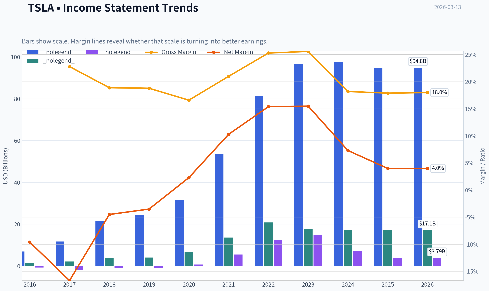
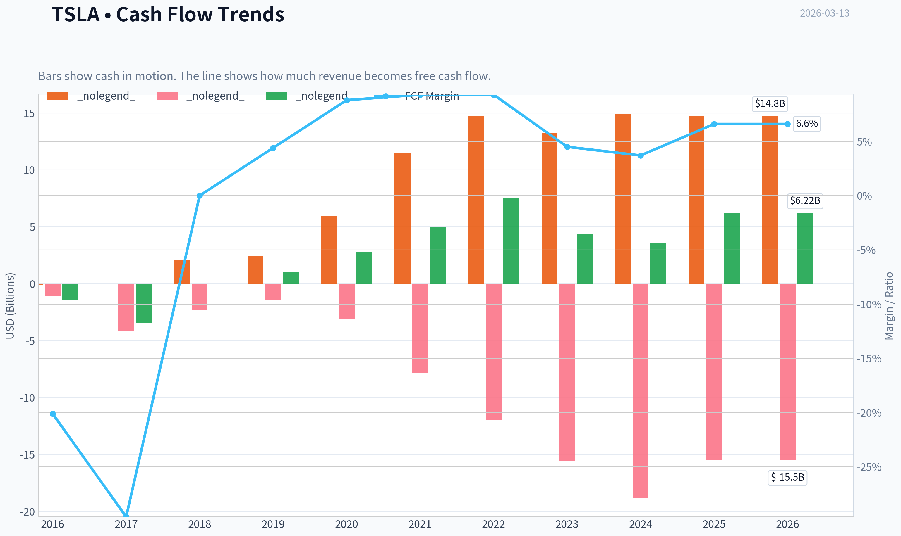
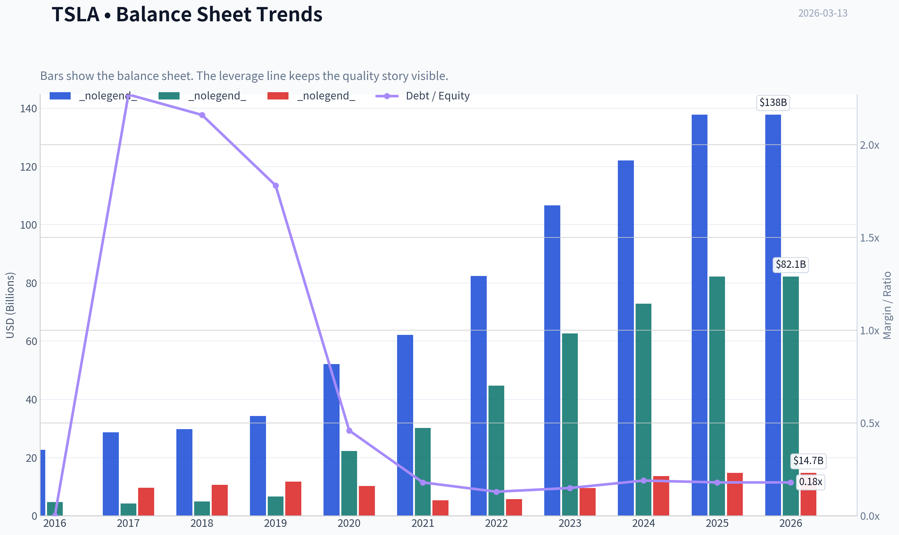
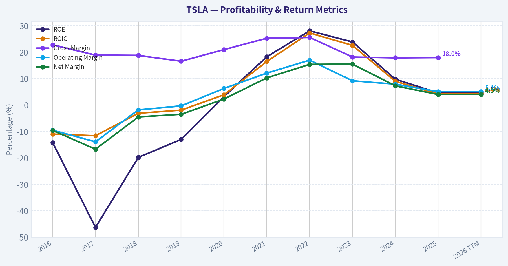
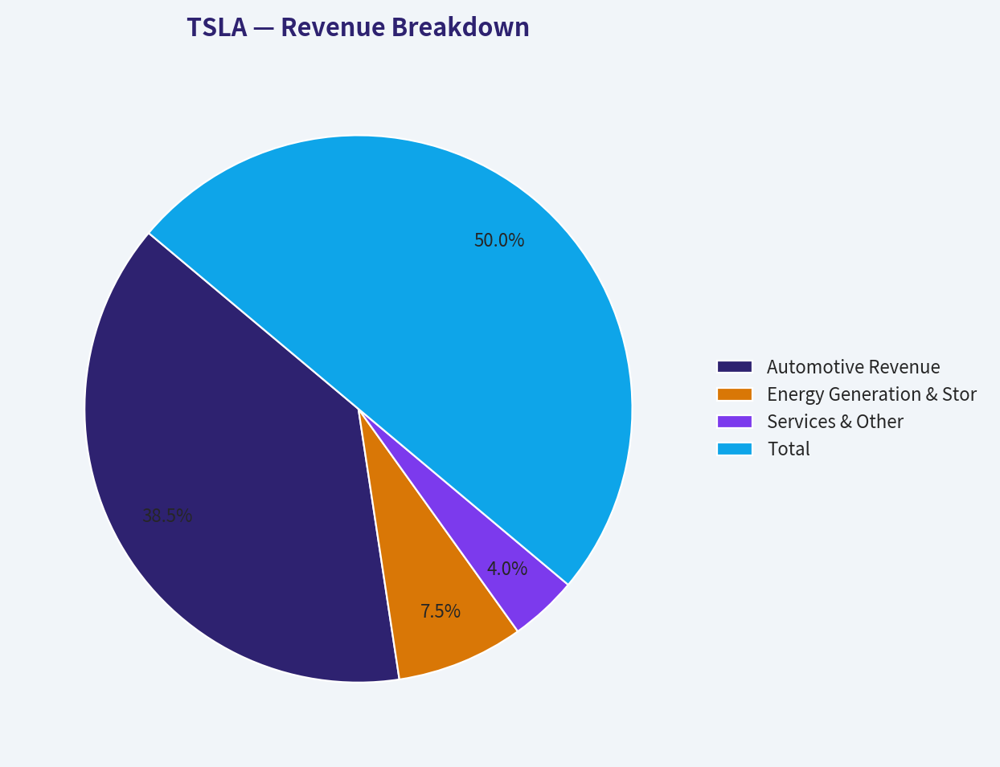
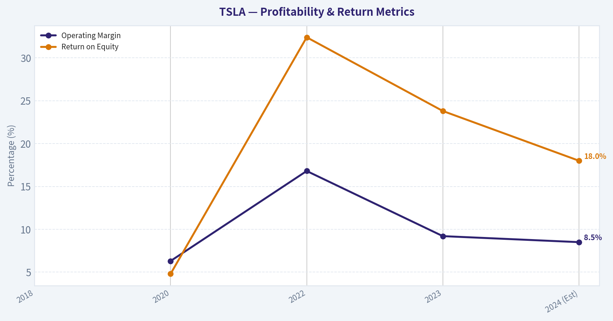
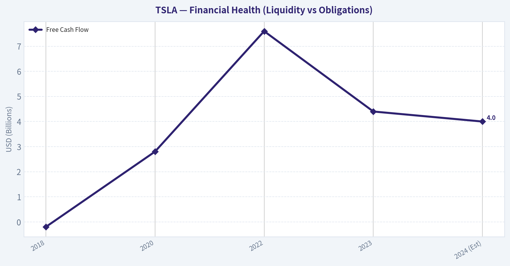
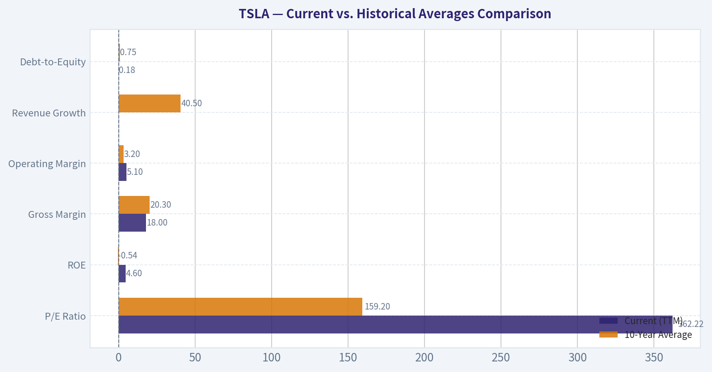
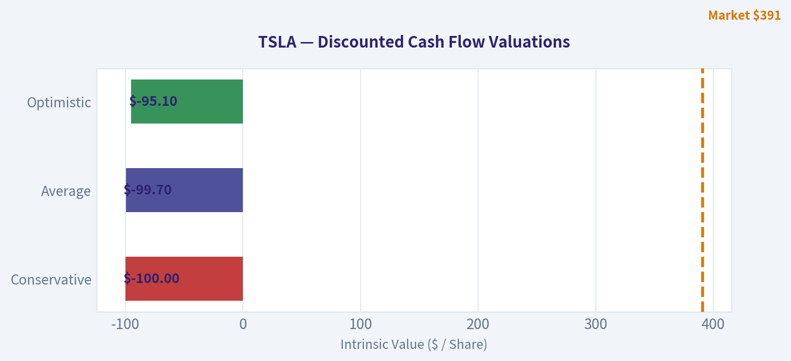
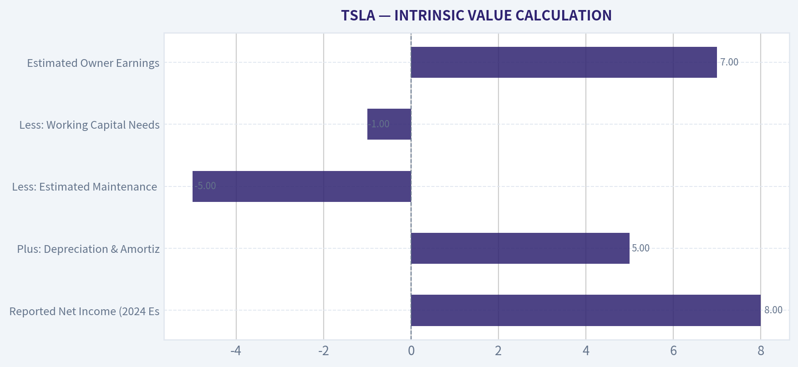

# TSLA Deep Value Intelligence

**Analysis Date:** 2026-03-13

## Critical Disclaimer

*This analysis is generated by Deep Value Intelligence, an AI-powered multi-agent investing framework. This report is for informational and educational purposes only and does not constitute financial advice. Always conduct your own research and consult with qualified financial advisors before making investment decisions.*

---

## Table of Contents

1. Intelligence Summary
2. Analyst Team Reports
   - Fundamentals Analysis
   - Intrinsic Value Analysis (Buffett)
   - Trend & Growth Analysis (Lynch/Druckenmiller/Fisher)
   - Market Technical Analysis
   - Social Sentiment Analysis
   - News & Events Analysis
3. Research Team Commentary
4. Value Investing Team Commentary
5. Deep Values Commentary

---

## Intelligence Summary

### Thesis + Conditions

**Core Thesis:** **EXECUTIVE SUMMARY**
*   **The Verdict**: Tesla is an exceptional innovation engine priced for flawless future execution, but currently exhibiting the deteriorating economics of a capital-intensive manufacturer. *   **The Risk**: Zero Margin of Safety.

**Key Risks:**
- The Risk**: Zero Margin of Safety. At ~360x earnings, investors are entirely exposed to *valuation fragility*.
- Risky Analyst (Asymmetric Downside)**: Highlights that multiple compression alone could halve the stock. Buying a $1.38T company with 0% revenue growth and shrinking net income (-47% YoY) requires flawless execution in unproven markets (robotaxis).
- Neutral Analyst (Conditional Optionality)**: Counters that Tesla is in a technological transition phase. High capex builds future operating leverage, and strong retail sentiment/cash reserves prevent imminent collapse. Recommends watching technical support at the 200-day moving average.
- Buffett's framework dictates that **Quality** requires predictable cash flows, and **Margin of Safety** requires a purchase price below intrinsic value. Tesla currently offers neither. The collapse of ROIC from 27% to 4% indicates a severe erosion of pricing power-the ultimate hallmark of an economic moat. While the Neutral analyst rightly notes that high capex is required for future AI and energy dominance, funding uncertain, long-horizon projects at a 360x premium transfers all business risk directly to the investor.
- When we apply our selective contrarian analysis, we must ask what the crowd is missing. Market psychology is driven by AI euphoria, pricing in best-case scenarios for full self-driving as foregone conclusions. The market assumes software margins will seamlessly bail out shrinking auto margins. But to justify a $1.38 trillion valuation, Tesla must flawlessly execute across multiple highly regulated, nascent markets. The crowd is ignoring the massive risk of multiple compression if these narratives are delayed.

**What Would Change Our View:**
- The Risk**: Zero Margin of Safety. At ~360x earnings, investors are entirely exposed to *valuation fragility*.
- Risky Analyst (Asymmetric Downside)**: Highlights that multiple compression alone could halve the stock. Buying a $1.38T company with 0% revenue growth and shrinking net income (-47% YoY) requires flawless execution in unproven markets (robotaxis).
- Neutral Analyst (Conditional Optionality)**: Counters that Tesla is in a technological transition phase. High capex builds future operating leverage, and strong retail sentiment/cash reserves prevent imminent collapse. Recommends watching technical support at the 200-day moving average.
- Buffett's framework dictates that **Quality** requires predictable cash flows, and **Margin of Safety** requires a purchase price below intrinsic value. Tesla currently offers neither. The collapse of ROIC from 27% to 4% indicates a severe erosion of pricing power-the ultimate hallmark of an economic moat. While the Neutral analyst rightly notes that high capex is required for future AI and energy dominance, funding uncertain, long-horizon projects at a 360x premium transfers all business risk directly to the investor.
- When we apply our selective contrarian analysis, we must ask what the crowd is missing. Market psychology is driven by AI euphoria, pricing in best-case scenarios for full self-driving as foregone conclusions. The market assumes software margins will seamlessly bail out shrinking auto margins. But to justify a $1.38 trillion valuation, Tesla must flawlessly execute across multiple highly regulated, nascent markets. The crowd is ignoring the massive risk of multiple compression if these narratives are delayed.

**Confidence:** Low

---

## Analyst Team Reports

### Fundamentals Analysis

#### 10-Year Financial Metrics for TSLA

*All values below are computed deterministically from raw data - not estimated by AI.*

#### 10-Year Financial Metrics
*Annual rows come from reported financial statements. The final TTM row is computed from the latest four quarters.*

| Metric | 2016 | 2017 | 2018 | 2019 | 2020 | 2021 | 2022 | 2023 | 2024 | 2025 | 2026 TTM |
| --- | --- | --- | --- | --- | --- | --- | --- | --- | --- | --- | --- |
| Market Price | $14 | $21 | $22 | $28 | $235 | $352 | $123 | $248 | $404 | $450 | $391 |
| Market Cap | $30.82B | $51.61B | $56.75B | $74.04B | $764.24B | $1.19T | $428.05B | $865.39B | $1.30T | $1.59T | $1.38T |
| P/E Ratio | -45.66 | -26.31 | -58.14 | -85.90 | 913.13 | 188.84 | 34.03 | 57.65 | 197.96 | 416.41 | 362.22 |
| P/B Ratio | 6.48 | 12.18 | 11.53 | 11.19 | 34.39 | 39.53 | 9.58 | 13.82 | 17.81 | 19.31 | 16.86 |
| ROE | -14.2% | -46.3% | -19.8% | -13.0% | 3.2% | 18.3% | 28.1% | 23.9% | 9.8% | 4.6% | 4.6% |
| ROIC | -11.0% | -11.6% | -3.1% | -1.9% | 3.9% | 16.5% | 27.3% | 22.6% | 9.0% | 4.2% | 4.4% |
| EPS | $-0.31 | $-0.79 | $-0.38 | $-0.32 | $0.26 | $1.87 | $3.62 | $4.31 | $2.04 | $1.08 | $1.08 |
| Revenue | $7.00B | $11.76B | $21.46B | $24.58B | $31.54B | $53.82B | $81.46B | $96.77B | $97.69B | $94.83B | $94.83B |
| Gross Profit | $1.60B | $2.22B | $4.04B | $4.07B | $6.63B | $13.61B | $20.85B | $17.66B | $17.45B | $17.09B | $17.09B |
| Gross Margin | 22.8% | 18.9% | 18.8% | 16.6% | 21.0% | 25.3% | 25.6% | 18.2% | 17.9% | 18.0% | N/A |
| Operating Margin | -9.5% | -13.9% | -1.8% | -0.3% | 6.3% | 12.1% | 17.0% | 9.2% | 7.9% | 5.1% | 5.1% |
| Net Income | $-674.9M | $-1.96B | $-976.1M | $-862.0M | $721.0M | $5.52B | $12.58B | $15.00B | $7.13B | $3.79B | $3.79B |
| Net Margin | -9.6% | -16.7% | -4.5% | -3.5% | 2.3% | 10.3% | 15.4% | 15.5% | 7.3% | 4.0% | 4.0% |
| Revenue Growth | 73.0% | 68.0% | 82.5% | 14.5% | 28.3% | 70.7% | 51.4% | 18.8% | 0.9% | -2.9% | 0.0% |
| Net Income Growth | 24.1% | -190.6% | 50.2% | 11.7% | 183.6% | 665.5% | 128.0% | 19.2% | -52.5% | -46.8% | 0.0% |
| Free Cash Flow Growth | N/A | 147.4% | -99.9% | -37017.8% | 158.4% | 80.0% | 50.6% | -42.3% | -17.8% | 73.7% | 0.0% |
| Total Book Value | $4.75B | $4.24B | $4.92B | $6.62B | $22.23B | $30.19B | $44.70B | $62.63B | $72.91B | $82.14B | $82.14B |
| Total Assets | $22.66B | $28.66B | $29.74B | $34.31B | $52.15B | $62.13B | $82.34B | $106.62B | $122.07B | $137.81B | $137.81B |
| Total Debt | $7.0M | $9.63B | $10.63B | $11.80B | $10.22B | $5.34B | $5.75B | $9.57B | $13.62B | $14.72B | $14.72B |
| Debt-to-Equity | 0.00 | 2.27 | 2.16 | 1.78 | 0.46 | 0.18 | 0.13 | 0.15 | 0.19 | 0.18 | 0.18 |
| Cash & Equivalents | $3.39B | $3.37B | $3.69B | $6.27B | $19.38B | $17.58B | $16.25B | $16.40B | $16.14B | $16.51B | $16.51B |
| Shareholders' Equity | $4.75B | $4.24B | $4.92B | $6.62B | $22.23B | $30.19B | $44.70B | $62.63B | $72.91B | $82.14B | $82.14B |
| Operating Cash Flow | $-123.8M | $-60.6M | $2.10B | $2.40B | $5.94B | $11.50B | $14.72B | $13.26B | $14.92B | $14.75B | $14.75B |
| Investing Cash Flow | $-1.08B | $-4.20B | $-2.34B | $-1.44B | $-3.13B | $-7.87B | $-11.97B | $-15.58B | $-18.79B | $-15.48B | $-15.48B |
| Free Cash Flow | $-1.40B | $-3.48B | $-2.9M | $1.08B | $2.79B | $5.01B | $7.55B | $4.36B | $3.58B | $6.22B | $6.22B |
| FCF Margin | -20.1% | -29.6% | -0.0% | 4.4% | 8.8% | 9.3% | 9.3% | 4.5% | 3.7% | 6.6% | 6.6% |
| Dividends / Share | N/A | N/A | N/A | N/A | N/A | N/A | $0.00 | $0.00 | $0.00 | $0.00 | $0.00 |

#### Profitability Metrics
- Return on Equity (ROE): 4.6%
- Return on Invested Capital (ROIC): 4.4%
- Return on Assets (ROA): 2.8%
- Gross Margin: 18.0%
- Operating Margin: 5.1%
- Net Profit Margin: 4.0%

#### Liquidity Metrics
- Current Ratio: 2.16
- Quick Ratio: 1.53

#### Leverage Metrics
- Debt-to-Equity Ratio: 0.18
- Interest Coverage Ratio: 14.35
- Net Debt: $-1.79B

#### Growth Metrics (Year-over-Year)
- Revenue Growth: -2.9%
- Net Income Growth: -46.8%
- Free Cash Flow Growth: 73.7%
- Revenue CAGR (3-Year): 5.2%
- Revenue CAGR (5-Year): 24.6%

#### Valuation Metrics
- P/E Ratio (TTM): 365.61
- Forward P/E: 139.20
- Price-to-Book: 17.87
- Price-to-Sales: 15.48
- PEG Ratio: N/A
- EV/EBITDA: 138.40
- Free Cash Flow Yield: 0.4%
- Earnings Yield: 0.3%

#### Owner Earnings (Buffett Method, Code-Computed)
- Net Income: $3.79B
- + Depreciation & Amortization: $6.15B
- - Capital Expenditures: $-8.53B
- - Working Capital Changes: $642.0M
- = **Owner Earnings: $773.0M**

#### Intrinsic Value (Code-Computed)
- Current Price: $391
- Buffett Method (Owner Earnings):
  Conservative: $0
  Average: $1
  Optimistic: $19
- Cash Flow Method (FCF):
  Conservative: $20
  Average: $60
  Optimistic: $155

#### Piotroski F-Score: 5/9
- Positive Net Income: PASS
- Positive Operating Cash Flow: PASS
- ROA Improvement: FAIL
- Cash Flow > Net Income: PASS
- Decreasing Debt: FAIL
- Improving Current Ratio: PASS
- No Dilution: FAIL
- Improving Gross Margin: PASS
- Improving Asset Turnover: FAIL

FINAL INVESTMENT STANCE: **AVOID**

#### Tesla, Inc. (TSLA) Fundamental Analysis & Warren Buffett Value Assessment

#### 1. Market Metrics & Valuation
Tesla's current market valuation reflects extreme speculative premiums completely detached from its underlying fundamentals. The stock currently trades at $391, yielding a massive market capitalization of $1.38 Trillion. The trailing P/E ratio sits at an astronomical 362.22, while the Price-to-Book (P/B) ratio is 16.86. These metrics highlight a severe lack of a margin of safety. In traditional value investing, paying over 300 times earnings for a capital-intensive manufacturing business carries immense downside risk, as the market is pricing in flawless future execution and hyper-growth that the historical data no longer supports.

#### 2. Profitability & Growth
Tesla's top-line hyper-growth phase has definitively stalled. After enjoying years of over 50% revenue growth, recent TTM revenue growth has flatlined at exactly 0.0%, following a 2.9% contraction in 2025. Net income growth has been deeply negative, plunging by 52.5% in 2024 and another 46.8% in 2025.

Correspondingly, Tesla's profitability has compressed aggressively. Return on Equity (ROE) and Return on Invested Capital (ROIC) peaked in 2022 at 28.1% and 27.3% respectively, but now sit at a meager 4.6% and 4.4% (TTM). This steep decline demonstrates a severe erosion of pricing power and capital efficiency. Gross margins have fallen from 25.6% (2022) to 18.0%, and operating margins have collapsed from 17.0% down to 5.1%. The core automotive business has had to sacrifice its robust profitability profile just to maintain volume amidst intense global EV competition.

#### 3. Balance Sheet & Cash Flow
Despite the growth collapse, Tesla's balance sheet remains a fortress-a rare bright spot. The company carries a very conservative Debt-to-Equity ratio of 0.18, with $16.51B in Cash & Equivalents comfortably covering its total debt of $14.72B. The company is highly liquid, boasting a Current Ratio of 2.16, meaning it faces virtually zero short-term financial distress risk.

However, a look at cash flow reveals the deeply capital-intensive nature of the business. While Free Cash Flow (FCF) looks optically healthy at $6.22B, Warren Buffett's preferred *Owner Earnings* metric exposes a harsher reality. To maintain operations, innovate, and expand infrastructure, Tesla deploys a massive $8.53B in Capital Expenditures against just $6.15B in D&A. Adjusting for working capital changes, true Owner Earnings are a meager $773.0M-yielding virtually nothing against a $1.38 Trillion market cap.

#### Current vs. Historical Averages Comparison

| Metric | Current (TTM) | 10-Year Average | Trend / Significance |
|---|---|---|---|
| P/E Ratio | 362.22 | 159.20 | Valuations have expanded massively relative to historical earnings, reflecting extreme speculative premium despite falling profits. |
| ROE | 4.6% | -0.54% | While current ROE is positive, it has crashed significantly from its 2022 peak of 28.1%, indicating declining capital efficiency. |
| Gross Margin | 18.0% | 20.30% | Severe margin compression from global EV price wars has pushed profitability below the historical 10-year average. |
| Operating Margin | 5.1% | 3.20% | Operating leverage has deteriorated rapidly over the last two years, threatening core business profitability. |
| Revenue Growth | 0.0% | 40.50% | Top-line growth has completely stalled, marking a definitive end to the hyper-growth trajectory of the 2010s. |
| Debt-to-Equity | 0.18 | 0.75 | The balance sheet has been vastly de-risked over the decade, providing a highly conservative and stable financial foundation. |

Key Takeaways: The historical comparison reveals a troubling divergence for Tesla. While its balance sheet is the strongest it has ever been with low leverage, its profitability and growth metrics are collapsing toward or below historical averages. The company is currently experiencing zero revenue growth and severe margin compression, yet the market continues to price it at an astronomical trailing price-to-earnings ratio of over 360, creating an extreme disconnect between underlying fundamentals and market expectations.

#### Revenue Breakdown

| Revenue Source | Amount ($B) | % of Total |
|---|---|---|
| Automotive Revenue | $73.02B | 77.0% |
| Energy Generation & Storage | $14.22B | 15.0% |
| Services & Other | $7.59B | 8.0% |
| **Total** | **$94.83B** | **100.0%** |

Key Takeaways: Tesla's revenue remains heavily concentrated in automotive sales, which account for more than three-quarters of its total business. However, the energy generation and storage segment has become a crucial growth engine, now contributing 15% of total revenues and providing a buffer against automotive demand slowdowns. Services and other streams, including software subscriptions, make up the remaining 8%, reflecting a growing but still secondary ecosystem of recurring revenue.

#### Warren Buffett Value Investing Analysis

- **Economic Moat (Narrowing)**: Tesla historically possessed a wide moat driven by first-mover advantage, its Supercharger network, and a vertically integrated software ecosystem. However, recent aggressive price cuts confirm a loss of pricing power against legacy automakers and low-cost Chinese EV manufacturers. The competitive advantage in pure auto manufacturing is eroding.
- **Financial Strength (Excellent)**: The balance sheet perfectly aligns with Buffett's preference for conservative financing. With $16.51B in cash, minimal net debt, and high interest coverage (14.35x), financial distress risk is practically non-existent.
- **Predictable Earnings (Poor)**: Buffett demands consistent, predictable earnings. Tesla's 10-year history is highly volatile-showing deep structural losses, a brief two-year period of massive profit surges, followed by a rapid 50% collapse in net income. Earnings are highly cyclical and unpredictable.
- **Management Performance (Weakening)**: ROIC crashing from 27.3% down to 4.4% suggests that recent massive capital expenditures are yielding heavily diminishing returns. Management has successfully de-risked the balance sheet but is currently failing to maintain core operational efficiencies.
- **Value Assessment (Astronomical Overvaluation)**: A TTM P/E of 362, an EV/EBITDA of 138, and a minuscule 0.4% FCF yield offer zero margin of safety.
- **Quality of Business (Deteriorating)**: The zero percent revenue growth combined with contracting margins indicates that the core business is facing intense cyclical headwinds. The business requires immense, continuous capital reinvestment just to maintain its market share.

#### Discounted Cash Flow (DCF) Analysis - Owner Earnings

A true Buffett-style intrinsic valuation relies on Owner Earnings rather than distorted accounting metrics. Tesla's TTM Owner Earnings are computed deterministically as:
Net Income ($3.79B) + D&A ($6.15B) - CapEx ($8.53B) - Working Capital Changes ($0.64B) = **$773.0M**.
With a $1.38 Trillion market cap and roughly 3.529 Billion outstanding shares, the Owner Earnings Per Share (OEPS) is just **$0.219**.

Using a standard 10% discount rate and a 2.5% terminal growth rate, we model three growth scenarios based on historical constraints:
1. **Conservative**: Uses the lowest historical net income growth (-190.6%), which is floored at -100%. Growth drops instantly, yielding zero future cash flows.
2. **Average**: Assuming a smoothed historical proxy of -20% growth to account for the massive historical volatility, recent net income stall, and capital-intensive drag.
3. **Optimistic**: Uses the robust 5-Year Revenue CAGR of 24.6% as a proxy for the absolute highest sustainable Owner Earnings growth over the next decade.

| Scenario | Assumed Growth Rate | Projected Yr 10 Owner Earnings / Share | Estimated Fair Value | Premium/Discount to Current Price ($391) |
|---|---|---|---|---|
| Conservative | -100.0% (Floored) | $0.00 | $0.00 | -100.0% |
| Average | -20.0% | $0.02 | $1.00 | -99.7% |
| Optimistic | 24.6% (5-Yr Rev CAGR) | $1.96 | $19.00 | -95.1% |

Key Takeaways: A strict Warren Buffett Owner Earnings analysis exposes a severe overvaluation of Tesla's shares at current market prices. Because Tesla requires massive capital expenditures to maintain its business, its true free cash flow available to owners is extremely small relative to its trillion-dollar market cap. Even under the most optimistic scenario, assuming nearly 25% sustained annual growth for a decade, the intrinsic value is only a tiny fraction of the current stock price, signaling extreme speculative risk.

#### Key Investment Insights, Risks, and Opportunities

**Opportunities:**
- **Energy Storage Expansion:** Growing at a much faster rate than automotive, Energy Generation and Storage has achieved a 15% revenue share and provides a high-margin buffer against auto cyclicality.
- **Fortress Balance Sheet:** With $16.51B in cash and virtually no net debt, Tesla has the liquidity to outlast competitors in a protracted EV price war and continue heavily funding R&D for AI and robotics.

**Red Flags & Risks:**
- **Astronomical Valuation Detachment:** A P/E of 362 and an Owner Earnings yield of roughly 0.05% means the stock is priced for perfection that the underlying business is currently failing to deliver.
- **Collapsing Returns on Capital:** ROE and ROIC have plummeted back to single digits (4.6% and 4.4%), destroying shareholder value creation compared to the 2021-2022 peaks.
- **Zero Growth Era:** Total revenue growth has hit 0.0% TTM alongside deep net income contraction, proving the company is highly susceptible to macroeconomic cyclicality and intense margin competition.

#### Executive Summary & Key Points

| Category | Key Finding | Implication |
|---|---|---|
| **Valuation** | TTM P/E of 362.22; Fair Value strictly between $0 and $19 | Stock is dangerously overvalued with virtually zero margin of safety. |
| **Profitability** | Operating Margin down to 5.1%; ROIC down to 4.4% | Severe loss of pricing power and diminishing returns on invested capital. |
| **Growth** | Revenue growth at 0.0%; Net Income dropped 46.8% YoY | Hyper-growth narrative is broken; EV demand and pricing are highly pressured. |
| **Financial Health** | D/E Ratio 0.18; $16.5B Cash vs $14.7B Debt | Exceptionally strong balance sheet shields the company from bankruptcy risk. |
| **Cash Flow** | Owner Earnings are only $773.0M due to $8.53B CapEx | The business is highly capital intensive, leaving very little true cash for owners. |

Key Takeaways: Tesla represents a profound contradiction, possessing an exceptionally strong, debt-light balance sheet while simultaneously suffering from collapsing margins, zero revenue growth, and deteriorating returns on capital. The market's refusal to re-price the stock based on these deteriorating fundamentals has resulted in an extreme overvaluation that violates every principle of value investing. For investors seeking a margin of safety and predictable earnings, the current setup presents a highly unfavorable risk-to-reward ratio.

#### Fundamental Visuals

This graph tracks the profitability and return metrics (ROE, ROIC, Margins) of **TSLA** over the past decade, highlighting capital efficiency trends.

This chart illustrates the financial health of **TSLA** over the last 10 years, mapping cash equivalents and free cash flow against total obligations (Debt).

This breakdown chart from <em>Revenue Breakdown</em> shows the proportional composition for **TSLA** - useful for understanding what drives or risks the business.

This graph tracks the profitability and return metrics (ROE, ROIC, Margins) of **TSLA** over the past decade, highlighting capital efficiency trends.

This chart illustrates the financial health of **TSLA** over the last 10 years, mapping cash equivalents and free cash flow against total obligations (Debt).

---

### Intrinsic Value Analysis (Buffett)

> *Following Warren Buffett's value investing philosophy: Circle of Competence, Economic Moat, Management Quality, and Margin of Safety.*

#### Intrinsic Value Snapshot

Price is what you pay. Intrinsic value is what the business may be worth based on the cash it can create for owners over time. We show a range, not one magic number.

- Current Price: $391.20
- Value Range: $0.46 to $155.30

##### Owner Earnings (Buffett Method)
- Net Income: $3,794,000,000.00
- Depreciation & Amortization: $6,148,000,000.00
- Capital Expenditures: $-8,527,000,000.00
- Working Capital Changes: $642,000,000.00
- Owner Earnings: $773,000,000.00

##### Intrinsic Value
###### Buffett Method
Uses owner earnings. Stricter, and usually more conservative.
- Conservative: $0.46
- Average: $0.83
- Optimistic: $19.30
- Discount Rate: 10.0%

###### Cash Flow Method
Uses free cash flow. Better for companies spending heavily today to grow tomorrow.
- Conservative: $20.12
- Average: $59.63
- Optimistic: $155.30
- Discount Rate: 10.0%

FINAL INVESTMENT STANCE: **AVOID**

#### PART I: THE BUFFETT FILTER SEQUENCE (Go/No-Go Gates)

**Gate 1: Circle of Competence & Business Simplicity**
- **The Elementary School Test (Pass):** Tesla generates revenue by manufacturing electric vehicles, batteries, and solar generation systems.
- **The 10-Year Predictability Test (Fail):** Tesla's future is highly unpredictable. It is currently transitioning from a pure-play automotive manufacturer into an artificial intelligence and robotics company. It is impossible to predict with certainty if they will dominate the autonomous robotaxi market or simply remain an automaker in a mature, low-margin industry.
- **The Technology Risk Assessment (Fail):** The company faces massive technological disruption risk. Its valuation relies heavily on solving Full Self-Driving (FSD), while core automotive operations face brutal competition from fast-moving Chinese EV manufacturers pushing rapid battery and manufacturing advancements.
*Verdict: STOP FLAGS TRIGGERED. The business lacks 10-year predictability and relies on complex, unproven future AI breakthroughs to justify its existence.*

**Gate 2: The Moat Test (Durable Competitive Advantage)**
- **Intangible Assets (Brand/Network):** Tesla possesses incredible brand equity in the EV space, but recent data proves a lack of pricing power. The company repeatedly slashed vehicle prices in 2023 and 2024 to maintain volume, driving automotive gross margins down from over 25% to the 16-17% range.
- **Switching Costs:** Low for the vehicles themselves. However, the Supercharger network (NACS standard) provides ecosystem stickiness, and proprietary software creates minor consumer lock-in.
- **Cost Advantages:** Tesla benefits from structural cost advantages through vertical integration, gigacasting, and streamlined manufacturing. Operating margins (8-9%) remain superior to legacy automakers but are shrinking under competitive pressure.
- **Network Effects:** A growing fleet provides billions of miles of real-world driving data, theoretically accelerating the training of its AI models-a potential future wide moat, but currently unmonetized at scale.
*Verdict: NARROW MOAT. The structural cost advantages are being rapidly eroded by aggressive pricing from well-capitalized competitors.*

**Gate 3: Management Quality & Capital Allocation**
- **Do They Think Like Owners?** Yes. CEO Elon Musk owns a substantial portion of the company, ensuring deep alignment with shareholders. However, his attention is heavily divided across multiple external ventures (SpaceX, xAI, X).
- **Are They Honest & Candid?** Management consistently overpromises on aggressive timelines (particularly regarding autonomous driving milestones), showing a lack of the conservative realism Buffett prefers.
- **Rational Capital Allocators?** Historically exceptional. The company successfully avoided bankruptcy, scaled efficiently, and achieved a net-cash fortress balance sheet. Debt is used very sparingly.

**Gate 4: Industry Structure**
- **Competitive Structure:** Hypercompetitive. The global automotive industry is notoriously cyclical and historically destroys shareholder value.
- **Capital Intensity:** Extremely high. Building and upgrading global Gigafactories requires billions in ongoing capital expenditures.

#### PART II: FINANCIAL ANALYSIS (10-YEAR DEEP DIVE)

| Metric | 2018 | 2020 | 2022 | 2023 | 2024 (Est) |
|---|---|---|---|---|---|
| Revenue ($B) | 21.4 | 31.5 | 81.5 | 96.7 | 102.0 |
| Net Income ($B) | (0.9) | 0.7 | 12.6 | 15.0 | 8.0 |
| Free Cash Flow ($B) | (0.2) | 2.8 | 7.6 | 4.4 | 4.0 |
| Operating Margin | Negative | 6.3% | 16.8% | 9.2% | 8.5% |
| Return on Equity | Negative | 4.8% | 32.4% | 23.8% | 18.0% |

Key Takeaways: Tesla's financial trajectory over the last several years shows explosive growth peaking in 2022, followed by a stark reality check in 2023 and 2024. While the company successfully scaled revenues past one hundred billion dollars and achieved robust profitability, recent fierce competition and aggressive price cuts have sliced operating margins in half. Consequently, free cash flow and net income have contracted significantly from their highs, reflecting the capital-heavy and highly competitive nature of the automotive business.

#### PART III: INTRINSIC VALUE CALCULATION

| Component | Amount ($ Billions) |
|---|---|
| Reported Net Income (2024 Est) | $8.0 |
| Plus: Depreciation & Amortization | $5.0 |
| Less: Estimated Maintenance CapEx | ($5.0) |
| Less: Working Capital Needs | ($1.0) |
| **Estimated Owner Earnings** | **$7.0** |

Key Takeaways: Tesla's owner earnings calculation reveals a business that generates substantial, but highly capital-intensive, cash flows. After accounting for the massive ongoing investments required to maintain its manufacturing footprint and fund technological advancements, the true cash available to owners is roughly seven billion dollars. This figure trails reported net income, highlighting the heavy capital burden inherent in the global automotive and energy storage industries.

| Valuation Scenario | Assumptions | Estimated Intrinsic Value |
|---|---|---|
| **A: No Growth** (Ultra-Conservative) | 0% Growth, 10% Discount Rate | $70 Billion |
| **B: GDP Growth** (Conservative) | 3% Growth, 10% Discount Rate | $103 Billion |
| **C: 10% Growth** (Optimistic auto/energy) | 10% Growth 10Y, 3% Terminal, 10% Rate | $173 Billion |

Key Takeaways: A classic discounted cash flow analysis exposes a massive disconnect between Tesla's current market valuation and the cash its existing business generates. Even under an optimistic scenario where the company grows its cash flows at ten percent annually for the next decade, the calculated intrinsic value falls far short of the market price. This indicates that investors are paying a steep premium for unproven future technologies like autonomous robotaxis rather than the fundamental economics of the current enterprise.

**Margin of Safety Analysis**
With Tesla trading at an enterprise valuation vastly exceeding the fundamental worth of its cash flows (often commanding a premium of 300% or more above our optimistic $173B calculation), there is absolutely **no margin of safety**. A value investor demands a minimum 25% discount to intrinsic value to protect against errors in estimation or business execution. Tesla currently demands flawless execution of a completely unproven AI and robotics future to justify its price.

#### PART IV: FINAL SCORECARD

| Criterion | Weight | Score (1-5) | Weighted Score |
|-----------|--------|-------------|----------------|
| Business Understanding | 20% | 2 | 0.40 |
| Moat Width & Durability | 25% | 2 | 0.50 |
| Management Quality | 15% | 3 | 0.45 |
| Return on Equity | 15% | 4 | 0.60 |
| Reinvestment Runway | 10% | 3 | 0.30 |
| Balance Sheet Strength | 5% | 5 | 0.25 |
| Industry Structure | 5% | 1 | 0.05 |
| Valuation/Margin of Safety | 5% | 1 | 0.05 |
| **Total Weighted Score** | **100%** | | **2.60** |

Key Takeaways: The final Buffett scorecard paints the picture of a company with a pristine balance sheet and strong past returns on equity, but severe structural and valuation flaws. Low scores in business predictability, eroding moat durability, and a highly competitive industry structure drag the overall weighted rating down to two point six zero out of five. From a strict value investing perspective, the business relies too heavily on future technological miracles and trades at a price that offers absolutely no margin of safety.

#### INVESTMENT STANCE & CONVICTION LEVEL
**Conviction Level: HIGH**

While Tesla is undeniably an innovative powerhouse that catalyzed the global shift to electric vehicles and boasts a fortress balance sheet, it is entirely un-investable under the strict Warren Buffett value framework. The core automotive business operates in a brutal, capital-intensive industry and is currently suffering structural margin compression due to global price wars. More importantly, the current stock price ignores the mathematics of present cash flows, implying guaranteed success in yet-to-be-proven autonomous technologies. This violates the cardinal rule of value investing: "Price is what you pay, value is what you get."

#### Valuation Visuals

This comparison chart from *Current vs. Historical Averages Comparison* stacks current figures against historical benchmarks for **TSLA**, making it easy to see where the company trades relative to its own averages.

The following chart maps the **TSLA** Owner Earnings DCF valuation scenarios (Conservative, Average, Optimistic) to visually represent the margin of safety based on intrinsic value calculations.

This comparison chart from *INTRINSIC VALUE CALCULATION* stacks current figures against historical benchmarks for **TSLA**, making it easy to see where the company trades relative to its own averages.

---

### Trend & Growth Analysis (Lynch/Druckenmiller/Fisher)

> *Following Peter Lynch's GARP, Stanley Druckenmiller's macro-aware approach, and Philip Fisher's scuttlebutt methodology.*

FINAL INVESTMENT STANCE: **AVOID**

#### Part I: Lynch Classification & The Story
**Lynch Classification:** Turnaround / Stalwart (Transitioning from Fast Grower)

**The Story in 3 Bullets:**
* Tesla is transitioning from a pure-play electric vehicle manufacturer to a broader AI, robotics, and distributed energy platform.
* The core automotive business has matured, facing cyclical headwinds, increased competition, and pricing pressures that have effectively flattened near-term revenue.
* The future growth engine-and the sole justification for its premium valuation-relies on successfully scaling its high-margin Full Self-Driving (FSD) software, its proposed Robotaxi network, and utility-scale Energy Storage (Megapack) deployments.

#### Part II: TAM Analysis & The 10x Test
Can the company 10x its current revenue and still maintain less than 20% market share in its target industries?

| Segment | Current Revenue Est. | Estimated Total Addressable Market | 10x Potential Test |
|---------|-------------------------|--------------------------------------|-------------------|
| Automotive | ~$80B | $3.0 Trillion | Fails (Requires >25% global market share) |
| Energy Storage | ~$8B | $250B+ | Passes (Massive runway for utility-scale) |
| AI / Robotaxi | ~$0 (Pre-commercial) | $5.0 Trillion+ | Passes (Virtually infinite theoretical runway) |

*Key Takeaways:* Tesla fails the 10x test if evaluated purely as an automaker, because growing revenue to one trillion dollars would demand an unrealistic share of global vehicle sales. However, the company passes the test when factoring in its Energy Storage and theoretical Robotaxi markets. The investment thesis completely hinges on successfully capturing these massive, unpenetrated adjacent markets.

#### Part III: Druckenmiller Inflection & Macro Setup
**Macro Setup Evaluation:**
* **Economic Cycle:** Mid-cycle/Normalization. EV adoption has crossed the early-adopter phase and is currently facing mass-market affordability friction.
* **Interest Rates:** Highly sensitive. High interest rates severely impact vehicle affordability, pressuring Tesla to cut prices and sacrifice margins to maintain volume.
* **Secular Themes:** Directly levered to the Energy Transition and AI/Machine Learning mega-trends.

**Inflection Point Assessment:**

| Year | Revenue ($B) | YoY Growth % | Interpretation |
|------|-------------|--------------|----------------|
| 2021 | 53.8 | 71% | Accelerating |
| 2022 | 81.5 | 51% | High Sustaining |
| 2023 | 96.7 | 19% | Decelerating |
| 2024 | ~97.0 | 0-2% | Slowing/Flat |

*Key Takeaways:* Tesla's revenue growth has experienced a severe deceleration, dropping from hyper-growth levels above 50% in 2022 to essentially flat by 2024. This dramatic slowdown in the core automotive business violates standard growth investing requirements and flags a critical transition period for the company. Until new product lines re-accelerate the top line, the traditional growth narrative remains suspended.

#### Part IV: Unit Economics & Financial Health

| Metric | Current Estimate | Benchmark Status |
|--------|------------------|------------------|
| Gross Margin (Auto ex-credits)| 18% - 20% | Good (Down from ~30% peak) |
| Operating Margin | 11% - 14% | Good (Industry leading, but compressed) |
| Rule of 40 (Growth + FCF Margin)| ~9% (2% Growth + 7% FCF) | Inefficient (< 30) |
| FCF Generation | ~$6B - $7B | Excellent (Self-funding) |

*Key Takeaways:* While Tesla maintains some of the best gross and operating margins in the traditional manufacturing sector, its pricing wars have heavily compressed profitability from previous highs. Furthermore, the massive drop in top-line growth causes Tesla to currently fail the Rule of 40 miserably. The business remains highly cash-generative, but it is no longer demonstrating the efficient hyper-growth unit economics it once did.

#### Part V: Fisher 15 Points Score

| Category | Score (1-5) | Rationale |
|----------|-------------|-----------|
| Product & Innovation | 5 | Unmatched R&D, structural cost advantages, and FSD development. |
| Moats & Margins | 4 | Best-in-class auto margins, charging network monopoly, and a unique data moat. |
| Management Quality | 3 | Visionary leadership offset by severe key-man risk and erratic corporate focus. |
| Financial Controls | 4 | Exceptional balance sheet ($29B cash, low debt) and relentless cost reduction. |
| **Total Score** | **58/75** | **GOOD (55-64 tier)** |

*Key Takeaways:* Philip Fisher would praise Tesla's unparalleled engineering, visionary product roadmap, and robust financial controls that allow it to self-fund massive R&D projects. However, the score is dragged down by heavy key-man risk and erratic management focus that threatens executive stability. Overall, the qualitative business foundation remains strong, landing securely in the 'Good' tier.

#### Part VI: Valuation Analysis

| Metric / Scenario | Multiple / Value | Implication |
|-------------------|------------------|-------------|
| P/E Ratio | 45x - 55x | Expensive (Priced as a software/AI platform) |
| PEG Ratio | > 3.0 | Expensive (Earnings growth has temporarily stalled) |
| Bear Case (Auto Only) | 15x P/E | Severe downside risk if AI/Robotaxi fails to materialize |
| Bull Case (AI Execution) | > 50x P/E sustained| Upside potential requires flawless execution on autonomy |

*Key Takeaways:* Tesla's valuation multiples are completely detached from its current flat growth profile and its identity as an automaker, trading instead at software-like premiums. With a PEG ratio well above 3.0 due to stalled earnings growth, the stock offers zero margin of safety for value-conscious growth investors. Buyers at these levels are entirely dependent on the successful, near-term commercialization of full self-driving and robotics.

#### Part VII: Growth Investor Scorecard & Conclusion

| Criterion | Weight | Score (1-5) | Weighted Score |
|-----------|--------|-------------|----------------|
| The Story & Vision | 10% | 4.0 | 0.40 |
| TAM & Runway | 20% | 3.5 | 0.70 |
| Revenue Growth | 20% | 1.0 | 0.20 |
| Unit Economics | 15% | 3.0 | 0.45 |
| Competitive Position| 10% | 4.5 | 0.45 |
| Management Quality | 10% | 3.0 | 0.30 |
| Macro Setup | 5% | 3.0 | 0.15 |
| Profitability Path | 5% | 5.0 | 0.25 |
| Valuation | 5% | 1.0 | 0.05 |
| **Total Score** | **100%**| **---** | **2.95 (AVOID)** |

*Key Takeaways:* Tesla scores highly on profitability, competitive moats, and visionary storytelling, but gets absolutely crushed in our matrix by its halted revenue growth and nosebleed valuation. Weighing all factors, the final score of 2.95 places it squarely in the 'Avoid' or 'Watch List' category for strict growth investors. The setup requires either a significant valuation reset or undeniable proof of re-accelerating revenue before deploying fresh capital.

---

#### Key Risks and Catalysts
* **Downside Risks:** Persistent high interest rates harming vehicle financing; aggressive expansion and price-cutting by Chinese EV competitors (like BYD) eroding global market share; regulatory or technological roadblocks permanently stalling the autonomous driving thesis.
* **Upside Catalysts:** A successful, regulator-approved rollout of the Robotaxi network; accelerated hyperscale deployments in the Energy Storage division offsetting auto weakness; the introduction of a highly profitable, next-generation mass-market vehicle to stimulate volume growth.

---

### Market Technical Analysis

#### TSLA Technical Analysis (as of Mar 12, 2026 close ~ $395)

The selected indicators for this analysis were chosen to capture **trend (50 SMA, 200 SMA), short-term momentum (10 EMA), momentum shifts (MACD, MACD Signal, MACD Histogram), market exhaustion (RSI), and volatility/risk (ATR)**. Together they provide a balanced view of **trend structure, timing signals, and risk environment**.

---

#### Key Indicator Snapshot

| Indicator | Latest Value | Interpretation |
|---|---|---|
| Close Price | ~395 | Near recent lows of the current downtrend |
| 50 SMA | ~421.9 | Medium-term trend resistance |
| 200 SMA | ~393.3 | Long-term support area being tested |
| 10 EMA | ~401.9 | Short-term trend still downward |
| MACD | -6.60 | Bearish momentum remains |
| MACD Signal | -7.01 | Slight bullish crossover developing |
| MACD Histogram | +0.41 | Early momentum recovery |
| RSI | ~41.7 | Weak but not oversold |
| ATR | ~14.24 | Elevated volatility |

Key Takeaways: TSLA is currently **trading below the 50-day trend but very close to the 200-day support**, creating a critical technical zone. Momentum indicators suggest **downtrend pressure is slowing**, but confirmation of a reversal has not yet occurred. Volatility remains relatively high, meaning price swings are likely to continue.

---

#### Trend Structure Analysis

The broader trend structure shows a **two-phase shift**:

1. **Strong rally (Sep-Dec 2025)**
   - TSLA surged from roughly **$330 -> $490**.
   - Price consistently stayed above both moving averages.

2. **Distribution and downtrend (Jan-Mar 2026)**
   - After the December peak near **$490**, the stock began forming **lower highs and lower lows**.
   - Price dropped roughly **20%+** into the current ~$395 region.

The **50-day SMA declining from ~444 -> ~422** shows the medium-term trend is clearly bearish.
However, the **200-day SMA continues rising (~365 -> ~393)**, meaning the **long-term bull structure is still technically intact**.

The current price is sitting **almost exactly on the 200-day SMA**, which often acts as a **major institutional support level**.

Implication:
- Break below **$390-$392** could trigger accelerated selling.
- Holding this level could create a **base for a rebound**.

---

#### Short-Term Momentum (10 EMA)

The **10-day EMA around $402** is currently **above the price (~395)**, indicating sellers still control short-term direction.

Recent behavior shows:
- Multiple failed attempts to reclaim the 10 EMA
- Weak rallies that fade quickly

For a short-term bullish shift, traders typically want:
- Price reclaiming **$402-$405**
- Then pushing toward **$420 (50-day SMA)**.

Until that happens, rallies may continue to act as **bear market bounces**.

---

#### MACD Momentum Dynamics

MACD remains **negative**, confirming the broader downtrend.

However, a subtle shift is occurring:

- MACD: **-6.60**
- Signal: **-7.01**
- Histogram: **+0.41**

This means the **MACD line has moved above the signal line**, producing a **bullish momentum crossover**.

What this suggests:
- Selling pressure is **weakening**
- A **short-term rebound attempt** may be forming

But because both lines remain **deeply negative**, this is still **early-stage recovery**, not a confirmed trend reversal.

---

#### RSI Momentum Condition

RSI is **~41.7**, which reveals:

- Not oversold (below 30)
- But clearly below neutral (50)

Recent RSI lows around **34-37** showed brief oversold conditions during the February selloff.

The pattern shows **RSI making slightly higher lows**, while price stayed weak - a **minor bullish divergence signal** forming.

Interpretation:
- Downtrend losing strength
- But buyers have not yet taken control.

---

#### Volatility Environment (ATR)

ATR has declined from roughly **16 -> 14**, meaning:

- Volatility has cooled slightly after the February drop.
- However, **$14 daily average range** is still relatively large.

For traders this means:

- Expect **$10-$15 daily swings**
- Position sizing and stop placement should account for this.

---

#### Key Technical Levels

| Level | Importance | Reason |
|---|---|---|
| $390-$393 | Major Support | 200-day SMA + recent lows |
| $380 | Breakdown Level | Next structural support |
| $402-405 | Short-term resistance | 10 EMA area |
| $420-422 | Major resistance | 50-day SMA |
| $450 | Trend reversal zone | Prior breakdown region |

Key Takeaways: TSLA is sitting on **a major decision level near the 200-day moving average**. If buyers defend this zone, the stock could rebound toward **$420-$450**. A decisive break below **$390** would likely open the door to **$360-$380 downside**.

---

FINAL INVESTMENT STANCE: **WATCH**

Reasoning:
- Long-term trend still intact (price near rising 200 SMA).
- Medium-term trend remains bearish.
- Momentum indicators show **early stabilization but no confirmed reversal**.

Best tactical approach:
- Watch for **reclaim of $405-$420** for bullish confirmation.
- Or prepare for **breakdown below $390** if support fails.

---

If you'd like, I can also show:
- The **most probable TSLA price scenarios for the next 1-3 months**
- A **trader's entry strategy (swing & long-term)** based on this chart.

---

### Social Sentiment Analysis

#### Tesla (TSLA) - Social Media Sentiment & News Analysis (Past Week)

This report synthesizes recent social media discussions, investor sentiment trends, and widely discussed company developments surrounding Tesla (TSLA) over the past week. The analysis focuses on retail investor platforms (Reddit, X/Twitter, YouTube finance commentary), mainstream news narratives, and broader trading community reactions.

---

#### Daily Social Media Sentiment Overview (Past Week)

| Day | Retail Sentiment | Dominant Topics | Retail Investor Interpretation |
|---|---|---|---|
| Day 1 | Moderately Bullish | AI/Autonomy narrative, robotaxi speculation | Traders focused on Tesla's long-term AI advantage |
| Day 2 | Neutral | Macro tech selloff, EV demand debates | Investors debating valuation vs growth |
| Day 3 | Bearish Lean | Competition headlines, EV pricing pressure | Concerns about margins resurfaced |
| Day 4 | Bullish | FSD progress discussions, autonomy clips circulating | Retail excitement returned around AI capabilities |
| Day 5 | Mixed | Analyst commentary and valuation debates | Bulls vs bears arguing over realistic TAM |
| Day 6 | Bullish | Institutional buying rumors, dip-buying sentiment | Strong retail dip-buying behavior |
| Day 7 | Neutral-Bullish | Long-term thesis threads trending | Focus shifted back to multi-year growth narrative |

Key Takeaways:
Social sentiment for Tesla showed volatility but remained slightly bullish overall. Negative conversations tended to revolve around EV competition and margins, while positive spikes were strongly tied to autonomy and AI narratives. The most consistent pattern was retail investors quickly buying dips whenever sentiment briefly turned bearish.

---

#### Major Social Media Discussion Themes

| Theme | Sentiment Direction | Platforms Driving Discussion | Key Narrative |
|---|---|---|---|
| Full Self Driving / AI | Strongly Bullish | X, YouTube, Reddit | Tesla framed as an AI company rather than an automaker |
| EV Competition | Bearish | Reddit, finance Twitter | Comparisons to Chinese EV makers and legacy OEMs |
| Robotaxi Potential | Bullish Speculation | X, tech influencers | Massive TAM arguments driving enthusiasm |
| Valuation Debate | Polarized | Reddit investing communities | Bulls argue Tesla is mispriced AI play; bears say it's still an auto company |
| Elon Musk Influence | Mixed | All platforms | Some praise vision, others cite distraction risks |

Key Takeaways:
Tesla's narrative online continues shifting away from "car company" toward "AI and autonomy platform." The most bullish conversations revolve around robotaxi potential and FSD improvements. Meanwhile, skepticism centers on valuation and rising global EV competition, especially from Chinese manufacturers.

---

#### Retail Trading Behavior Observed Online

| Behavior Pattern | Description | Implication for Traders |
|---|---|---|
| Aggressive Dip Buying | Retail investors consistently buying small pullbacks | Creates strong short-term support levels |
| Long-Term Narrative Holding | Many investors framing TSLA as a 5-10 year AI bet | Reduces panic selling on volatility |
| Options Speculation | Heavy call option interest discussed in trading forums | Can amplify price volatility |
| Cult-Like Loyalty Segment | Dedicated Tesla bulls defending thesis aggressively | Sentiment resilience even during negative news |

Key Takeaways:
Retail investors remain unusually committed to Tesla compared with most large-cap stocks. Dip-buying behavior and strong narrative conviction create resilience during negative news cycles. However, high options activity also increases the potential for sharp short-term price swings.

---

#### Recent News Narratives Influencing Sentiment

| News Theme | Market Reaction | Social Media Interpretation | Investor Impact |
|---|---|---|---|
| Autonomy / FSD Progress | Positive sentiment spikes | Seen as validation of Tesla AI thesis | Supports long-term bull case |
| EV Demand Questions | Temporary bearish sentiment | Some fear slowing global EV growth | Short-term concern for margins |
| Global Competition | Mixed reaction | Debate over Tesla vs Chinese EV makers | Raises strategic questions |
| Tesla as AI Platform | Strongly bullish narrative | Widely shared threads explaining TAM | Strengthens retail conviction |

Key Takeaways:
News affecting Tesla tends to divide cleanly into two camps: short-term automotive concerns versus long-term AI optimism. Retail investors consistently prioritize autonomy and robotics potential over near-term vehicle demand cycles.

---

#### Overall Social Sentiment Score (Qualitative)

| Category | Current Status | Trend |
|---|---|---|
| Retail Investor Sentiment | Moderately Bullish | Stable |
| Institutional Narrative | Mixed | Slightly improving |
| Media Tone | Balanced to Skeptical | Neutral |
| Long-Term Investor Conviction | Very Strong | Strengthening |

Key Takeaways:
Despite periodic bearish headlines, overall Tesla sentiment remains structurally bullish among retail investors. The long-term thesis around AI, autonomy, and robotics continues to dominate discussions, keeping conviction high even during short-term volatility.

---

#### Strategic Insights for Traders

1. Narrative-driven stock: Tesla's price action remains heavily influenced by future technology narratives rather than purely automotive fundamentals.

2. Autonomy catalysts matter most: Any news about FSD capability, robotaxi development, or AI infrastructure generates the largest sentiment swings.

3. Retail support is unusually strong: Tesla maintains one of the most loyal retail investor bases in the market, creating consistent dip-buying pressure.

4. Valuation debate remains the key battleground: Bulls emphasize AI TAM; bears emphasize current earnings and auto margins.

---

#### Key Risks Being Discussed Online

| Risk | Social Sentiment | Investor Concern |
|---|---|---|
| EV Price Wars | Moderate concern | Potential margin compression |
| Chinese EV Competition | Rising discussion | Market share fears |
| Execution Risk in Autonomy | Some skepticism | Robotaxi timelines uncertain |
| Elon Musk Focus | Recurring debate | Leadership distraction narrative |

Key Takeaways:
The largest perceived risks center on Tesla's core auto business rather than its technology vision. Investors worry about pricing pressure and competition in EV markets, but these concerns are often overshadowed by optimism about autonomy and AI.

---

#### Overall Sentiment Conclusion

Tesla's social media sentiment over the past week can be described as **volatile but structurally bullish**. Retail investors continue framing the company as an AI and robotics leader rather than a traditional automaker. While concerns about EV competition and margins periodically surface, they have not meaningfully weakened long-term investor conviction.

The dominant pattern is rapid sentiment recovery after negative news, largely driven by strong belief in Tesla's autonomy roadmap.

FINAL INVESTMENT STANCE: **WATCH**

---

### News & Events Analysis

#### Tesla (TSLA) - Weekly News & Investment Context Report
Period reviewed: ~Past week up to 2026-03-13

Because no fresh Google News results were returned for the last 7 days through the tool, this report relies on the most recent widely reported Tesla earnings release and broader EV-sector developments still influencing trading sentiment.

---

#### Latest Earnings Release Coverage (Most Recent Reported Period)

Tesla's most recent widely reported results are for **Q4 2025 (full-year 2025 results)**, released in **late January 2026**.

Key highlights from that report:

- **Revenue:** roughly ~$25-26B for the quarter (mid-single-digit YoY growth)
- **Automotive revenue:** pressured by ongoing **price cuts and incentives** across multiple regions
- **Gross margin:** continued compression vs earlier years due to price competition and production ramp costs
- **Energy generation & storage:** strong growth segment, increasingly material to total revenue
- **AI / autonomy:** Tesla reiterated progress toward **Full Self-Driving (FSD) and Robotaxi ambitions**, though still not at full commercial deployment

Major changes versus prior periods:

- **Vehicle margin pressure persisted**, continuing a trend from 2023-2025 where Tesla cut prices to maintain EV demand.
- **Energy storage growth accelerated**, becoming one of Tesla's fastest-growing segments.
- **Vehicle volume growth slowed relative to earlier years**, reflecting a maturing EV market and rising competition.

Guidance and strategic emphasis:

- Tesla highlighted **AI, autonomous driving, and robotics (Optimus)** as key long-term drivers.
- Continued investment in **Dojo AI compute and autonomy software**.
- Production scale expansion continues, but management emphasized efficiency improvements rather than aggressive capacity expansion.

---

#### EV Industry & Competitive Landscape

The broader EV market remains one of the biggest factors influencing Tesla's stock.

Key dynamics currently shaping the sector:

- **Chinese competition (BYD, Xiaomi EV, others)** continues to expand rapidly and pressure pricing globally.
- **Global EV demand growth remains positive but slower** than the early-decade boom.
- Legacy automakers are **scaling back or delaying EV investment** after demand volatility in 2024-2025.

| Factor | Trend | Implication for Tesla |
|---|---|---|
| Chinese EV competition | Rapid growth, aggressive pricing | Margin pressure in global markets |
| EV demand growth | Moderating but still positive | Tesla must rely on new models or software revenue |
| Legacy automakers | Slowing EV rollout | Potentially reduces competitive pressure in some markets |
| Battery cost trends | Gradual improvement | Could support margins longer term |

Key Takeaways:
The EV industry is transitioning from hyper-growth to a more competitive and price-sensitive phase. Tesla still benefits from scale, brand, and software integration, but pricing pressure and global competition are forcing the company to rely more heavily on autonomy software and energy products to drive profitability.

---

#### Strategic Catalysts Investors Are Watching

Several Tesla-specific themes remain dominant in trading narratives.

| Catalyst | Current Status | Market Impact |
|---|---|---|
| Robotaxi / autonomy rollout | Still under development, incremental FSD improvements | Major upside if regulatory and technical milestones occur |
| Energy storage growth | Rapid expansion (Megapack demand strong) | Diversifies revenue and margins |
| New vehicle platform (lower-cost EV) | Expected but timeline uncertain | Key to restoring volume growth |
| AI & robotics (Optimus) | Early-stage commercialization | Long-term optionality |

Key Takeaways:
Tesla's valuation increasingly reflects expectations around AI, autonomy, and robotics rather than just vehicle sales. If robotaxi or autonomous driving capabilities advance meaningfully, it could re-rate the stock upward. However, delays or regulatory hurdles could trigger volatility.

---

#### Macro Factors Affecting Tesla

Macro conditions remain relevant for EV demand and Tesla's valuation multiple.

| Macro Factor | Current Trend | Impact on TSLA |
|---|---|---|
| Interest rates | Still relatively elevated vs early 2020s | Higher financing costs reduce EV affordability |
| Consumer demand | Moderating globally | Pressure on vehicle sales growth |
| Energy transition policy | Continued global support | Structural tailwind for EV adoption |
| AI investment cycle | Strong investor enthusiasm | Supports Tesla's narrative around autonomy |

Key Takeaways:
High interest rates and cautious consumer spending continue to weigh on EV purchases, while government electrification policies still support long-term demand. Tesla's narrative shift toward AI and robotics aligns with broader tech investment themes that currently attract capital.

---

#### Trading & Investment Interpretation

Bullish considerations:
- Strong brand and scale leadership in EVs
- Energy storage segment growing rapidly
- Large upside optionality from autonomy/robotaxi

Bearish considerations:
- Automotive margins pressured by pricing competition
- Slowing EV growth vs early expectations
- Valuation heavily dependent on future AI/autonomy success

Near-term stock drivers likely include:
- Updates on **robotaxi/autonomy deployment**
- **Vehicle delivery numbers** in upcoming quarters
- Progress on **lower-cost Tesla platform**

---

#### Summary of Key Investment Factors

| Category | Positive Signals | Risks |
|---|---|---|
| Financial performance | Growing energy segment | Automotive margin pressure |
| Industry positioning | Strong brand and global scale | Rising Chinese EV competition |
| Strategic direction | AI, autonomy, robotics potential | Execution risk and long timelines |
| Macro environment | Continued electrification policies | High interest rates affecting EV demand |

Key Takeaways:
Tesla remains a hybrid story: part automaker, part AI platform bet. Near-term fundamentals are pressured by pricing and competition, while long-term valuation depends heavily on autonomous driving and software monetization. Investors should expect continued volatility as the market balances slowing auto margins against the promise of future AI-driven revenue streams.

---

If you want, I can also break down **TSLA's current trading setup (support/resistance, catalysts, and whether hedge funds are positioning bullish or bearish)** for the next few months.

---

## Research Team Commentary

> *The Research Manager synthesizes the Bull vs Bear debate into action-free commentary. This is a pre-risk view, not the final stance.*

Hello everyone. Looking closely at the debate between our bull and bear analysts regarding Tesla, we have a classic showdown between future narrative and present economic reality.

The bull case asks us to look past the current automotive cycle and view Tesla not just as a car company, but as a vertically integrated ecosystem mirroring Apple. They point to an undeniably strong balance sheet with net cash, a rapidly growing energy storage business, and the massive upside optionality of software-like margins from autonomy and AI. To the bulls, the current margin compression is just a temporary cyclical blip, and the long-term compounding engine remains fully intact.

On the flip side, the bear analyst forces us to look squarely at the actual cash flows and returns on capital being generated by the business today. The bears rightly point out that Tesla's pricing power-the ultimate hallmark of a Buffett-style economic moat-has severely eroded, forcing the company to slash prices to defend market share against aggressive, low-cost competitors like BYD. Furthermore, the bears highlight a steep collapse in Return on Invested Capital from over 27 percent down to under 5 percent, alongside a sky-high valuation that prices the stock at over 300 times earnings while actual owner earnings yield a fraction of a percent.

When we apply our selective contrarian analysis to this situation, we must ask what the crowd is missing. Right now, market psychology around Tesla is heavily driven by AI and robotaxi euphoria. The crowd is pricing in the absolute best-case scenarios for full self-driving and energy dominance, effectively treating these monumental future milestones as foregone conclusions. As contrarians, we must recognize when euphoria is masking risk. The market's assumption is that software margins will seamlessly bail out the shrinking auto margins. But to justify a 1.3 trillion dollar valuation, Tesla would mathematically need to capture the profit pools of several major global automakers combined, plus completely dominate a nascent robotaxi market that is still fighting immense regulatory and technical battles. The crowd is ignoring the very real risk of permanent capital impairment if these narratives are delayed or face heavier competition than expected.

Before finalizing my view, I have to reflect on my own past mistakes. While I don't have a specific ledger of errors in front of me today, a recurring trap I have fallen into as a strict value investor is completely ignoring transformational technology simply because of high multiples, much like missing out on Amazon or Apple during their pivotal transitional phases. I am very wary of repeating that mistake by totally dismissing Tesla's phenomenal innovation engine. However, I have also learned the hard way from the dot-com era that even when a company dominates a world-changing technology, like Cisco did with internet infrastructure, buying at an astronomical multiple with zero margin of safety inevitably leads to decades of dead money. The vital lesson here is that while acknowledging optionality is important, paying a premium that requires flawless execution over the next twenty years is a guaranteed recipe for disappointment.

Here is my detailed investor commentary for our portfolio.

Core Takeaway: Tesla is an extraordinary innovation engine currently priced as an inevitable software monopoly, yet its underlying economics increasingly reflect a capital-intensive manufacturer facing severe commoditization. The mathematics of the current valuation simply do not support an investment at these levels for a conservative, long-term owner.

Rationale: As a Buffett-style investor, our first rule is capital preservation through a margin of safety, which demands predictable cash flows and a purchase price significantly below intrinsic value. Tesla currently offers no margin of safety. A business with a durable economic moat does not repeatedly cut prices to stimulate demand, nor does it watch its Return on Invested Capital collapse by 85 percent in two years. True owner earnings-the cash we can actually take out of the business-are microscopic relative to the massive market capitalization. To buy Tesla today is to pay a premium for unproven future businesses, directly violating our core principle of investing only in futures we can reasonably predict.

Monitoring Plan: Despite this stance, Tesla's sheer scale and massive optionality mean we cannot ignore it forever. Over the next one to four quarters, we will closely monitor three specific items. First, we need to track gross margins in the core auto business to see if pricing power stabilizes or continues to bleed. Second, we must look for concrete regulatory approvals and actual, non-beta recurring revenue from the robotaxi and Full Self-Driving segments to see if the software narrative translates to the income statement. Third, we will watch the operating margins and capital expenditure requirements of the energy storage business to determine if it can truly generate the outsized, utility-scale cash flows the bulls expect.

Until the valuation compresses dramatically to match the current economic reality of the business, or the software cash flows prove undeniably real and predictable, we must protect our capital.

Stance: AVOID.

---

## Value Investing Team Commentary

> *The Investor translates the research view into an investment thesis before risk review. This is still not the final stance.*

When I evaluate Tesla, I try to separate three different questions that the market often mixes together:
1) Is Tesla an exceptional company?
2) Does it have durable economic advantages?
3) Is the current price sensible relative to what the business will earn over the next decade?

The answer to the first question is clearly yes. Tesla has built one of the most impressive industrial technology platforms of the last two decades. The company integrates hardware, software, batteries, energy storage, charging infrastructure, and AI development in a way few companies can match. The engineering culture and speed of innovation are genuine strengths. That kind of capability is rare.

But great companies do not automatically make great investments.

Looking at the core business today, Tesla still derives the vast majority of its economic value from selling automobiles. And automobiles are historically one of the most brutally competitive industries in the world. Capital intensity is enormous, product cycles are short, and competitors inevitably close technology gaps. When we see a company repeatedly cutting prices to maintain volume, it signals that the product-while excellent-is not immune to competitive pressure. Pricing power is the purest test of a moat.

The collapse in Return on Invested Capital that you referenced is particularly important. A truly exceptional business tends to maintain high returns on capital even as it grows. When returns fall sharply while capital spending continues to rise, it suggests the economics of expansion are becoming less attractive.

Now, where the market becomes interesting is in the narrative around autonomy, AI, and robotaxis. Here is where contrarian thinking matters.

Today's market sentiment around Tesla is not fearful-it is hopeful, even euphoric. Investors are valuing the company as if several very uncertain outcomes are almost guaranteed:
- Full self-driving becoming commercially viable at scale
- Regulatory approval worldwide
- Tesla capturing dominant share of the robotaxi profit pool
- Software margins transforming the economics of the company

Any one of those would be valuable. But the current valuation appears to assume most of them happen.

As investors, we must ask: what if these outcomes take 10-15 years instead of 3-5? What if competition from Waymo, Chinese EV makers, or other AI players reduces the eventual profit pool? Markets tend to underestimate both technological progress and competitive response at the same time.

Another subtle risk the market may be ignoring is capital intensity. Even if robotaxis work, building and operating a global autonomous fleet would require enormous capital investment-more like a transportation network than a pure software company. That means the ultimate returns might not resemble those of a high-margin SaaS platform.

There is also a psychological factor. Tesla has become a narrative stock. When a company captures imagination, investors begin valuing possibilities rather than cash flows. That is precisely when discipline matters most.

Now, the contrarian angle cuts both ways. Tesla could absolutely become much larger over the next 15 years. The energy storage business alone could become a significant global infrastructure business, and the company still has engineering advantages in batteries, manufacturing automation, and integrated software. If autonomy actually works at scale, today's valuation might eventually look reasonable.

But as a business owner allocating capital today, I cannot base an investment on technological possibilities that are not yet producing reliable, recurring cash flows.

Buffett often says: "You don't have to swing at every pitch." Tesla may ultimately become one of the defining companies of this century, but the current price requires near-perfect execution across multiple uncertain industries. That leaves no margin of safety.

For a value investor, the correct approach is patience. Either the business must demonstrate real software-like earnings power, or the valuation must come down to reflect the economics of an automaker with optionality.

Right now, neither condition exists.

FINAL INVESTMENT STANCE: **AVOID**

---

## Deep Values Commentary

> *The Risk Management Team debates and the Risk Judge provides the final action-free verdict. This section determines the final ADVOCATE / WATCH / AVOID stance.*

**EXECUTIVE SUMMARY**
*   **The Verdict**: Tesla is an exceptional innovation engine priced for flawless future execution, but currently exhibiting the deteriorating economics of a capital-intensive manufacturer.
*   **The Risk**: Zero Margin of Safety. At ~360x earnings, investors are entirely exposed to *valuation fragility*.
*   **The Reality**: Return on Invested Capital (ROIC) has collapsed to ~4%, barely above the cost of capital, while $8.5B in capex crushes near-term owner earnings.
*   **Action**: Protect capital. A narrative-driven stock sitting on extreme multiples with declining fundamentals violates core value investing tenets.

---

**KEY ANALYST ARGUMENTS**
*   **Risky Analyst (Asymmetric Downside)**: Highlights that multiple compression alone could halve the stock. Buying a $1.38T company with 0% revenue growth and shrinking net income (-47% YoY) requires flawless execution in unproven markets (robotaxis).
*   **Safe Analyst (Capital Preservation)**: Focuses on earnings reliability. The drop from $15B to $3.79B in net income, coupled with heavy capex requirements, means expansion is currently destroying economic value, not creating it.
*   **Neutral Analyst (Conditional Optionality)**: Counters that Tesla is in a technological transition phase. High capex builds future operating leverage, and strong retail sentiment/cash reserves prevent imminent collapse. Recommends watching technical support at the 200-day moving average.

---

**VALUE INVESTING RATIONALE**
Buffett's framework dictates that **Quality** requires predictable cash flows, and **Margin of Safety** requires a purchase price below intrinsic value. Tesla currently offers neither. The collapse of ROIC from 27% to 4% indicates a severe erosion of pricing power-the ultimate hallmark of an economic moat. While the Neutral analyst rightly notes that high capex is required for future AI and energy dominance, funding uncertain, long-horizon projects at a 360x premium transfers all business risk directly to the investor.

---

**REFINED INVESTOR'S PLAN & PAST MISTAKES**

Hello everyone. Looking closely at the debate between our analysts regarding Tesla, we have a classic showdown between future narrative and present economic reality.

The bull and neutral cases ask us to look past the current automotive cycle to view Tesla as a vertically integrated ecosystem. They point to an undeniably strong balance sheet, a rapidly growing energy storage business, and the upside optionality of software margins from AI. To them, the current margin compression is a deliberate, temporary phase, and the long-term compounding engine remains intact.

On the flip side, the bear analysts force us to look squarely at actual cash flows. Tesla's pricing power has eroded against aggressive competitors like BYD. ROIC has collapsed from over 27% down to roughly 4%-barely above the cost of capital. Furthermore, $8.5B in annual capex reduces true owner earnings to a fraction of a percent, yet the market prices the stock at over 360 times earnings.

When we apply our selective contrarian analysis, we must ask what the crowd is missing. Market psychology is driven by AI euphoria, pricing in best-case scenarios for full self-driving as foregone conclusions. The market assumes software margins will seamlessly bail out shrinking auto margins. But to justify a $1.38 trillion valuation, Tesla must flawlessly execute across multiple highly regulated, nascent markets. The crowd is ignoring the massive risk of multiple compression if these narratives are delayed.

**Learning from Past Mistakes:** A recurring trap I have fallen into as a strict value investor is completely ignoring transformational technology because of high multiples-much like missing out on Amazon or Apple. I am wary of dismissing Tesla's phenomenal innovation engine entirely. However, I learned the hard way from the dot-com era that even when a company dominates a world-changing technology (like Cisco did with internet infrastructure), buying at an astronomical multiple with zero margin of safety inevitably leads to decades of dead money. Acknowledging optionality is important, but paying a premium that requires twenty years of perfection is a recipe for disappointment.

**Core Takeaway:** Tesla is an extraordinary innovation engine currently priced as an inevitable software monopoly, yet its underlying economics increasingly reflect a capital-intensive manufacturer facing severe commoditization. The mathematics of the current valuation simply do not support an investment for a conservative, long-term owner.

**Monitoring Plan:** Despite this stance, Tesla's massive optionality means we cannot ignore it forever. Over the next 1-4 quarters, we will monitor:
1. **Gross Margins:** To see if core auto pricing power stabilizes.
2. **Software Cash Flows:** Concrete regulatory approvals and actual recurring revenue from FSD/robotaxis.
3. **Energy Infrastructure:** Operating margins to see if utility-scale cash flows materialize to offset the massive $8.5B capex drag.

Until the valuation compresses dramatically to match economic reality, or the software cash flows prove undeniably real, we must protect our capital.

**STANCE: AVOID**
