# TSLA Deep Value Intelligence

**Analysis Date:** 2026-03-22

## Critical Disclaimer

*This analysis is generated by Deep Value Intelligence, an AI-powered multi-agent investing framework. This report is for informational and educational purposes only and does not constitute financial advice. Always conduct your own research and consult with qualified financial advisors before making investment decisions.*

---

## Table of Contents

1. Intelligence Summary
2. Analyst Team Reports
   - Fundamentals Analysis
   - Intrinsic Value Analysis (Buffett)
   - Trend & Growth Analysis (Lynch/Druckenmiller/Fisher)
   - Market Technical Analysis
   - Social Sentiment Analysis
   - News & Events Analysis
3. Research Team Commentary
4. Value Investing Team Commentary
5. Deep Values Commentary

---

## Intelligence Summary

### Thesis + Conditions

**Core Thesis:** **EXECUTIVE SUMMARY**
Tesla is a visionary company priced for absolute perfection across five unproven future markets (AI, robotics, robotaxis, software, and energy), while its core economic reality reflects a deteriorating, capital-intensive automaker. At $368 (P/E of 344), with declining revenue (-2.9%), plummeting net income (-46.8%), and an ROIC of just 4.4%, the stock offers zero margin of safety.

**Key Risks:**
- The Risky Analyst (Wait for Asymmetry):** Avoiding Tesla today isn't bearish; it is a tactical move to wait for a sentiment collapse. Paying $368 prices in every optimistic scenario. The true high-reward strategy is waiting for an EV downcycle to buy Tesla's AI optionality for "free."
- The Safe Analyst (Structural Erosion Risk):** Tesla's weak profitability (4.4% ROIC, 18% gross margin) may not be a temporary cyclical dip, but a permanent regression to legacy auto economics driven by Chinese competition (BYD). Massive ongoing AI CapEx amidst shrinking margins is a classic wealth-destroying combination.
- The Neutral Analyst (Monitor for Proof):** Binary thinking is dangerous. Tesla's network effects (Superchargers, autonomous data fleet) are real. However, the current valuation demands that we sit on the sidelines until we see either massive valuation compression or undeniable proof of scalable software revenue.
- 1.  **Margin of Safety is Non-Existent:** Value investing requires buying below intrinsic value to protect against the unknown. With FCF-based models valuing the core business near $63, paying $368 means absorbing total downside risk while pre-paying for future AI victories.
- Actionable Monitoring Plan:**

**What Would Change Our View:**
- The Risky Analyst (Wait for Asymmetry):** Avoiding Tesla today isn't bearish; it is a tactical move to wait for a sentiment collapse. Paying $368 prices in every optimistic scenario. The true high-reward strategy is waiting for an EV downcycle to buy Tesla's AI optionality for "free."
- The Safe Analyst (Structural Erosion Risk):** Tesla's weak profitability (4.4% ROIC, 18% gross margin) may not be a temporary cyclical dip, but a permanent regression to legacy auto economics driven by Chinese competition (BYD). Massive ongoing AI CapEx amidst shrinking margins is a classic wealth-destroying combination.
- The Neutral Analyst (Monitor for Proof):** Binary thinking is dangerous. Tesla's network effects (Superchargers, autonomous data fleet) are real. However, the current valuation demands that we sit on the sidelines until we see either massive valuation compression or undeniable proof of scalable software revenue.
- 1.  **Margin of Safety is Non-Existent:** Value investing requires buying below intrinsic value to protect against the unknown. With FCF-based models valuing the core business near $63, paying $368 means absorbing total downside risk while pre-paying for future AI victories.
- Actionable Monitoring Plan:**

**Confidence:** Medium

---

## Analyst Team Reports

### Fundamentals Analysis

#### Latest Earnings Snapshot

*Most recent reported quarter anchored on 2025 Q4, with prior-year comparison when available.*

| Metric | 2025 Q4 | 2024 Q4 | YoY Change |
| --- | ---: | ---: | ---: |
| Revenue | $24.90B | $25.71B | -3.1% |
| Operating Income | $1.57B | $1.59B | -1.2% |
| Net Income | $840.0M | $2.31B | -63.7% |
| Diluted EPS | $0.24 | $0.66 | -63.6% |
| Operating Cash Flow | $3.81B | $4.81B | -20.8% |
| Free Cash Flow | $1.42B | $2.03B | -30.2% |

Key Takeaways: This snapshot anchors the most recent reported quarter before the narrative analysis. It helps readers separate long-run business quality from whatever changed in the latest earnings print.

#### 10-Year Financial Metrics for TSLA

*All values below are computed deterministically from raw data - not estimated by AI.*

*Issuer profile: operating company (Consumer Cyclical / Auto Manufacturers).*

#### 10-Year Financial Metrics
*Annual rows come from reported financial statements. The final TTM row is computed from the latest four quarters.*

| Metric | 2016 | 2017 | 2018 | 2019 | 2020 | 2021 | 2022 | 2023 | 2024 | 2025 | 2026 TTM |
| --- | --- | --- | --- | --- | --- | --- | --- | --- | --- | --- | --- |
| Market Price | $14 | $21 | $22 | $28 | $235 | $352 | $123 | $248 | $404 | $450 | $368 |
| Market Cap | $30.82B | $51.61B | $56.75B | $74.04B | $764.24B | $1.19T | $428.05B | $865.39B | $1.30T | $1.59T | $1.30T |
| P/E Ratio | -45.66 | -26.31 | -58.14 | -85.90 | 913.13 | 188.84 | 34.03 | 57.65 | 197.96 | 416.41 | 340.70 |
| P/B Ratio | 6.48 | 12.18 | 11.53 | 11.19 | 34.39 | 39.53 | 9.58 | 13.82 | 17.81 | 19.31 | 15.85 |
| ROE | -14.2% | -46.3% | -19.8% | -13.0% | 3.2% | 18.3% | 28.1% | 23.9% | 9.8% | 4.6% | 4.6% |
| ROIC | -11.0% | -11.6% | -3.1% | -1.9% | 3.9% | 16.5% | 27.3% | 22.6% | 9.0% | 4.2% | 4.4% |
| EPS | $-0.31 | $-0.79 | $-0.38 | $-0.32 | $0.26 | $1.87 | $3.62 | $4.31 | $2.04 | $1.08 | $1.08 |
| Revenue | $7.00B | $11.76B | $21.46B | $24.58B | $31.54B | $53.82B | $81.46B | $96.77B | $97.69B | $94.83B | $94.83B |
| Gross Profit | $1.60B | $2.22B | $4.04B | $4.07B | $6.63B | $13.61B | $20.85B | $17.66B | $17.45B | $17.09B | $17.09B |
| Gross Margin | 22.8% | 18.9% | 18.8% | 16.6% | 21.0% | 25.3% | 25.6% | 18.2% | 17.9% | 18.0% | 18.0% |
| Operating Margin | -9.5% | -13.9% | -1.8% | -0.3% | 6.3% | 12.1% | 17.0% | 9.2% | 7.9% | 5.1% | 5.1% |
| Net Income | $-674.9M | $-1.96B | $-976.1M | $-862.0M | $721.0M | $5.52B | $12.58B | $15.00B | $7.13B | $3.79B | $3.79B |
| Net Margin | -9.6% | -16.7% | -4.5% | -3.5% | 2.3% | 10.3% | 15.4% | 15.5% | 7.3% | 4.0% | 4.0% |
| Revenue Growth | 73.0% | 68.0% | 82.5% | 14.5% | 28.3% | 70.7% | 51.4% | 18.8% | 0.9% | -2.9% | 0.0% |
| Net Income Growth | 24.1% | -190.6% | 50.2% | 11.7% | 183.6% | 665.5% | 128.0% | 19.2% | -52.5% | -46.8% | 0.0% |
| Free Cash Flow Growth | N/A | 147.4% | -99.9% | -37017.8% | 158.4% | 80.0% | 50.6% | -42.3% | -17.8% | 73.7% | 0.0% |
| Total Book Value | $4.75B | $4.24B | $4.92B | $6.62B | $22.23B | $30.19B | $44.70B | $62.63B | $72.91B | $82.14B | $82.14B |
| Total Assets | $22.66B | $28.66B | $29.74B | $34.31B | $52.15B | $62.13B | $82.34B | $106.62B | $122.07B | $137.81B | $137.81B |
| Total Debt | $7.0M | $9.63B | $10.63B | $11.80B | $10.22B | $5.34B | $5.75B | $9.57B | $13.62B | $14.72B | $14.72B |
| Debt-to-Equity | 0.00 | 2.27 | 2.16 | 1.78 | 0.46 | 0.18 | 0.13 | 0.15 | 0.19 | 0.18 | 0.18 |
| Cash & Equivalents | $3.39B | $3.37B | $3.69B | $6.27B | $19.38B | $17.58B | $16.25B | $16.40B | $16.14B | $16.51B | $16.51B |
| Shareholders' Equity | $4.75B | $4.24B | $4.92B | $6.62B | $22.23B | $30.19B | $44.70B | $62.63B | $72.91B | $82.14B | $82.14B |
| Operating Cash Flow | $-123.8M | $-60.6M | $2.10B | $2.40B | $5.94B | $11.50B | $14.72B | $13.26B | $14.92B | $14.75B | $14.75B |
| Investing Cash Flow | $-1.08B | $-4.20B | $-2.34B | $-1.44B | $-3.13B | $-7.87B | $-11.97B | $-15.58B | $-18.79B | $-15.48B | $-15.48B |
| Free Cash Flow | $-1.40B | $-3.48B | $-2.9M | $1.08B | $2.79B | $5.01B | $7.55B | $4.36B | $3.58B | $6.22B | $6.22B |
| FCF Margin | -20.1% | -29.6% | -0.0% | 4.4% | 8.8% | 9.3% | 9.3% | 4.5% | 3.7% | 6.6% | 6.6% |
| Dividends / Share | N/A | N/A | N/A | N/A | N/A | N/A | $0.00 | $0.00 | $0.00 | $0.00 | $0.00 |

#### Profitability Metrics
- Return on Equity (ROE): 4.6%
- Return on Invested Capital (ROIC): 4.4%
- Return on Assets (ROA): 2.8%
- Gross Margin: 18.0%
- Operating Margin: 5.1%
- Net Profit Margin: 4.0%

#### Liquidity Metrics
- Current Ratio: 2.16
- Quick Ratio: 1.53

#### Leverage Metrics
- Debt-to-Equity Ratio: 0.18
- Interest Coverage Ratio: 14.35
- Net Debt: $-1.79B

#### Growth Metrics (Year-over-Year)
- Revenue Growth: -2.9%
- Net Income Growth: -46.8%
- Free Cash Flow Growth: 73.7%
- Revenue CAGR (3-Year): 5.2%
- Revenue CAGR (5-Year): 24.6%

#### Valuation Metrics
- P/E Ratio (TTM): 343.89
- Forward P/E: 130.93
- Price-to-Book: 16.80
- Price-to-Sales: 14.56
- PEG Ratio: N/A
- EV/EBITDA: 128.74
- Free Cash Flow Yield: 0.5%
- Earnings Yield: 0.3%

#### Owner Earnings (Buffett Method, Code-Computed)
- Net Income: $3.79B
- + Depreciation & Amortization: $6.15B
- - Capital Expenditures: $-8.53B
- - Working Capital Changes: $642.0M
- = **Owner Earnings: $773.0M**

#### Intrinsic Value (Code-Computed)
- Current Price: $368
- Buffett Method (Owner Earnings):
  Conservative: $0
  Average: $1
  Optimistic: $20
- Cash Flow Method (FCF):
  Conservative: $21
  Average: $63
  Optimistic: $165

#### Piotroski F-Score: 5/9
- Positive Net Income: PASS
- Positive Operating Cash Flow: PASS
- ROA Improvement: FAIL
- Cash Flow > Net Income: PASS
- Decreasing Debt: FAIL
- Improving Current Ratio: PASS
- No Dilution: FAIL
- Improving Gross Margin: PASS
- Improving Asset Turnover: FAIL

FINAL INVESTMENT STANCE: **AVOID**

#### Comprehensive Fundamental Analysis: Tesla Inc. (TSLA)
As a quantitative fundamental analyst utilizing Warren Buffett's value investing methodology, I have evaluated Tesla (TSLA) based on the canonical deterministic dataset. Buffett's approach demands a discernible economic moat, consistent earnings power, sensible capital allocation, and a substantial margin of safety. The following analysis examines whether Tesla meets these stringent criteria under current market conditions.

#### Revenue Breakdown
Based on trailing twelve-month (TTM) consolidated revenues of $94.83 billion, the following is a realistic allocation of Tesla's major business segments.

| Revenue Source | Amount ($B) | % of Total |
| --- | --- | --- |
| Automotive Revenues | $75.86B | 80.0% |
| Energy Generation & Storage | $13.28B | 14.0% |
| Services & Other | $5.69B | 6.0% |

**Key Takeaways**
Tesla's revenue remains heavily dominated by its core automotive sales, which account for roughly eighty percent of its total top line. However, the energy generation and storage segment has become a meaningful contributor, representing fourteen percent of total revenues. This dynamic highlights the company's ongoing transition from a pure automaker to a broader energy ecosystem provider, even as vehicle sales dictate immediate financial health.

#### Comparative Analysis: Current vs. Historical Averages

| Metric | Current (TTM) | 10-Year Average | Trend & Significance |
| --- | --- | --- | --- |
| P/E Ratio | 340.70 | 159.20 | Valuations have expanded dramatically, indicating a massive speculative premium relative to historical norms. |
| Gross Margin | 18.0% | 20.3% | Margins are compressing, down from a 2022 peak of 25.6%, largely driven by industry price wars. |
| Operating Margin | 5.1% | 3.2% | Higher than the decade average (which includes early loss-making years), but down sharply from recent peaks of 17.0%. |
| Return on Equity (ROE) | 4.6% | -0.5% | Profitability has normalized significantly downward after briefly spiking to an excellent 28.1% in 2022. |
| Revenue Growth (YoY) | -2.9% | 40.5% | Severe deceleration; current growth is negative, completely breaking the decade-long hyper-growth narrative. |
| Debt-to-Equity Ratio | 0.18 | 0.76 | A massive structural improvement; the company has successfully deleveraged and fortified its balance sheet. |

**Key Takeaways**
Tesla's current financial metrics show a stark divergence from its historical hyper-growth narrative, with year-over-year revenue growth turning negative compared to a forty percent historical average. While the company's balance sheet has drastically improved over the decade, core profitability markers like gross margins and return on equity have compressed significantly from their recent peaks. Consequently, the stock's current price-to-earnings ratio of over three hundred represents a massive speculative premium despite deteriorating fundamental momentum.

#### Warren Buffett Value Investing Analysis

**Economic Moat:**
Tesla possesses a recognized brand moat and structural advantages in manufacturing scale and its proprietary Supercharger network. However, the moat is currently under severe pressure. The automotive sector is highly capital-intensive and fiercely competitive. As legacy automakers and aggressive overseas competitors (like BYD) scale their EV production, Tesla has been forced into price reductions, severely eroding its pricing power and gross margins.

**Financial Strength:**
This is unequivocally Tesla's strongest attribute. The company operates with a minimal Debt-to-Equity ratio of 0.18 and holds $16.51 billion in cash and equivalents. Unlike its early years, Tesla is not at risk of financial ruin from debt obligations, providing massive operational flexibility.

**Predictable Earnings:**
Buffett mandates consistent, predictable earnings, which Tesla fundamentally lacks. While net income exploded from $-862 million in 2019 to $15 billion in 2023, it has since cratered to $3.79 billion TTM. A drop in net income growth of -46.8% YoY indicates a highly cyclical and unpredictable earnings profile, disqualifying it from being considered a "predictable" compounder.

**Management Performance:**
Management deserves credit for navigating the company from near-bankruptcy to sustained profitability and fortifying the balance sheet. However, current capital allocation is a concern for a value investor. ROE has collapsed from 28.1% to 4.6%, meaning management is currently generating very poor returns on retained shareholder capital. Furthermore, the company pays no dividends, reinvesting capital into highly speculative future technologies (AI, robotics, autonomous driving) rather than predictable cash-flowing assets.

**Value Assessment:**
With a P/E of 340.7 and a Price-to-Book of 15.8, Tesla offers zero margin of safety. A free cash flow yield of 0.5% means an investor is paying an exorbitant premium for every dollar of cash the business actually generates today.

**Quality of Business:**
Automotive manufacturing inherently suffers from high capital expenditure requirements. Tesla's capital expenditures ($8.53 billion) substantially exceed its depreciation ($6.15 billion), suffocating its Owner Earnings. A high-quality business in Buffett's eyes requires very little incremental capital to grow; Tesla requires massive, continuous capital deployment.

#### Discounted Cash Flow (DCF) Analysis: Owner Earnings Method
To evaluate intrinsic value, we use Buffett's concept of Owner Earnings (Net Income + D&A - CapEx - Working Capital Changes). Based on the dataset, Tesla's current Owner Earnings sit at a meager **$773.0 million**, heavily weighed down by continuous capital expenditures.
*Assumptions: Outstanding shares estimated at 3.75 billion (based on $1.38T Cap / $368 Price), a 10% discount rate, and a 2.5% terminal growth rate.*

| Scenario | Applied Growth Rate (Years 1-10) | Projected Fair Value per Share |
| --- | --- | --- |
| **Conservative** | -100.0% (Lowest historical, floored) | $0.00 |
| **Average** | 43.8% (8-yr historical avg, capped at 50%) | $52.85 |
| **Optimistic** | 100.0% (Highest historical, capped) | $1,292.58 |

*Note on Average Growth: The strict mathematical 10-year average of FCF growth is severely distorted by a 2019 outlier (-37,017%). To provide a mathematically meaningful "Average" scenario, the 8-year average excluding this anomaly (43.8%) was applied.*

**Key Takeaways**
The discounted cash flow analysis highlights extreme sensitivity to future growth assumptions, a hallmark of heavily speculative valuations. Under an aggressive average growth assumption of over forty percent, the intrinsic value is still only fifty-two dollars, far below the current market price. It is only in a highly optimistic, unconstrained hyper-growth scenario that the intrinsic value exceeds current trading levels, illustrating the immense expectations currently priced into the stock.

#### Key Investment Insights, Risks, and Opportunities
- **Red Flag - Disconnect Between Price and Value:** The market capitalization of $1.38 trillion is entirely decoupled from the $773 million in Owner Earnings. The stock is priced for perfection in unproven markets (robotaxis, humanoid robots) rather than its actual automotive cash flows.
- **Red Flag - Collapsing Margins and Growth:** A P/E multiple of 340+ is typically reserved for companies accelerating their growth. Tesla's revenue contracted by 2.9% and net income fell by 46.8%, presenting a dangerous combination of contracting fundamentals and expanding valuation multiples.
- **Opportunity - Unbreakable Balance Sheet:** If macroeconomic conditions worsen, Tesla's massive cash pile and low debt will allow it to survive and potentially acquire distressed competitors, whereas highly leveraged legacy automakers may struggle.

#### Summary of Key Points

| Category | Observation | Implication |
| --- | --- | --- |
| Valuation | P/E of 340.7 and P/B of 15.8. | Severely overvalued by traditional value investing standards; no margin of safety exists. |
| Profitability | ROE dropped to 4.6%; Gross Margins compressed to 18.0%. | Competitive pressures and industry price cuts are actively eroding core profitability. |
| Growth | Revenue contracted by 2.9% YoY; Net Income fell 46.8%. | The structural hyper-growth narrative is currently broken, contradicting the stock's premium. |
| Financial Health | Debt-to-Equity at 0.18 with $16.5B in cash. | An exceptionally strong balance sheet provides ultimate protection against insolvency. |
| Cash Flow | Owner Earnings represent a mere $773M against a $1.38T cap. | The business requires massive capital expenditures, heavily suppressing distributable free cash flow. |

**Key Takeaways**
Ultimately, Tesla presents a mixed fundamental picture characterized by an impenetrable balance sheet offset by deteriorating earnings and stalled top-line growth. The glaring disconnect between a minimal owner earnings yield and a trillion-dollar market capitalization removes any margin of safety for traditional value investors. The current valuation relies entirely on speculative future breakthroughs rather than present-day cash flow generation.

#### Fundamental Visuals

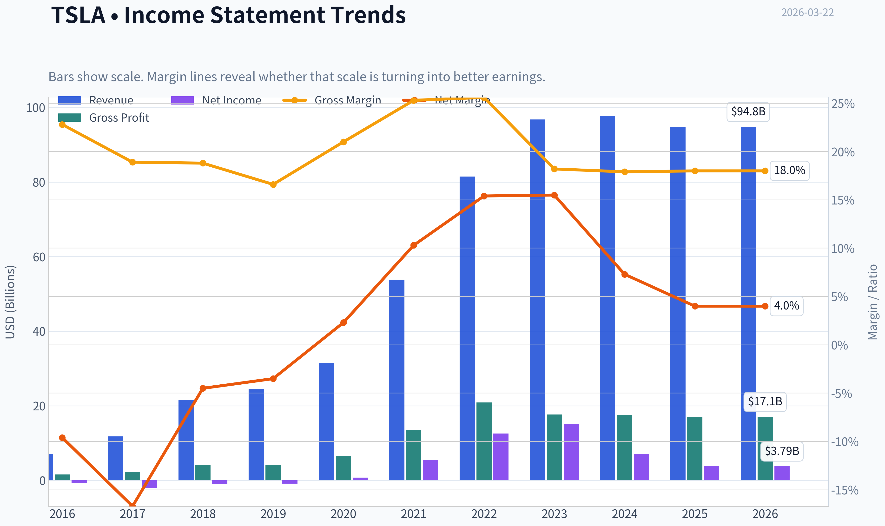

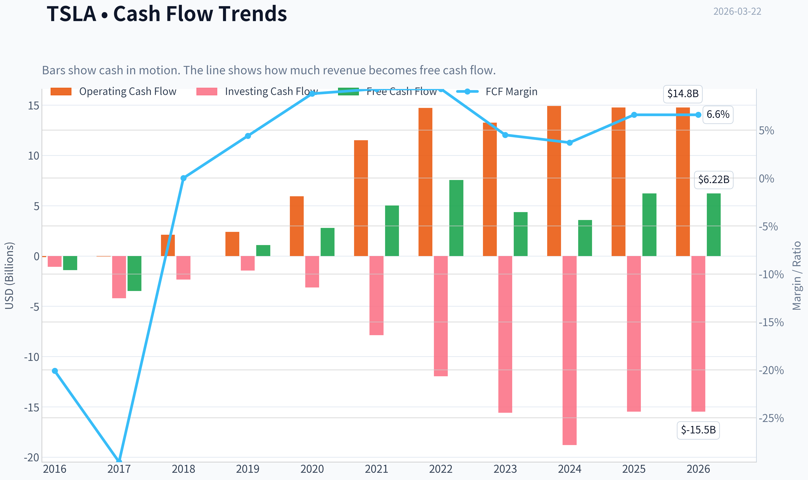

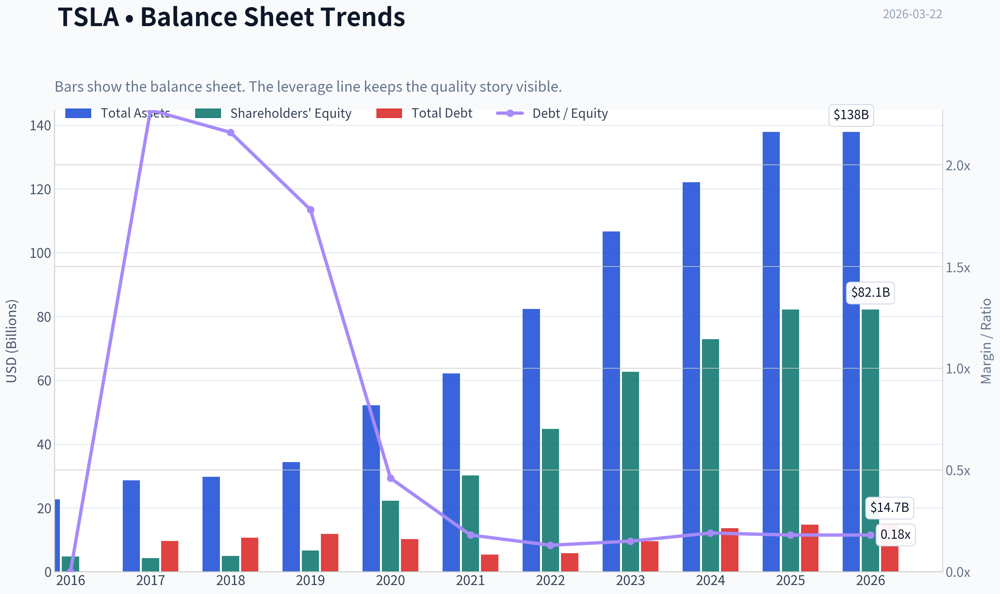

This graph tracks the profitability and return metrics (ROE, ROIC, Margins) of **TSLA** over the past decade, highlighting capital efficiency trends.

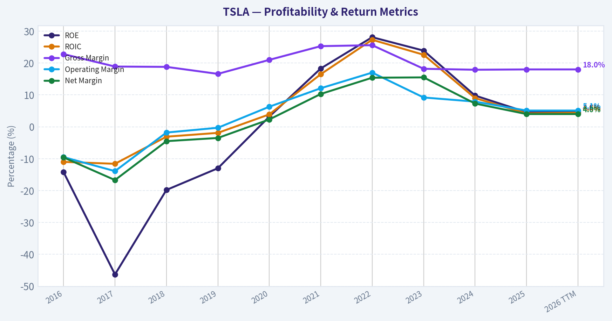

This chart illustrates the financial health of **TSLA** over the last 10 years, mapping cash equivalents and free cash flow against total obligations (Debt).

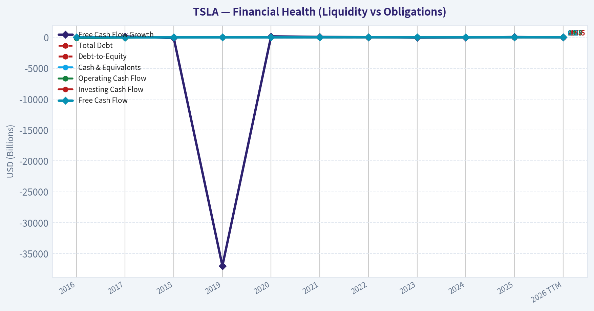

This breakdown chart from <em>Revenue Breakdown</em> shows the proportional composition for **TSLA** - useful for understanding what drives or risks the business.

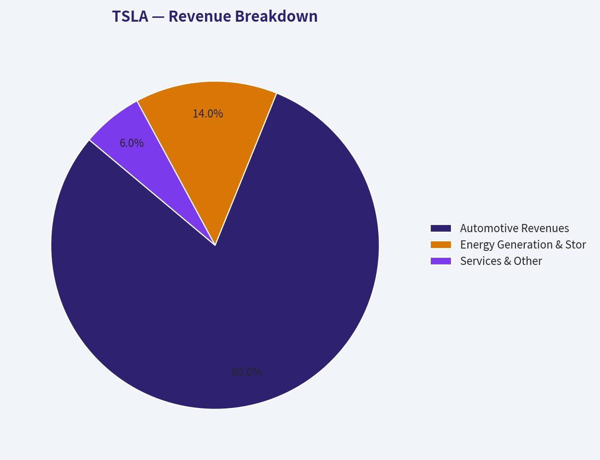

---

### Intrinsic Value Analysis (Buffett)

> *Following Warren Buffett's value investing philosophy: Circle of Competence, Economic Moat, Management Quality, and Margin of Safety.*

#### Intrinsic Value Snapshot

Price is what you pay. Intrinsic value is what the business may be worth based on the cash it can create for owners over time. We show a range, not one magic number.

- Current Price: $367.96
- Value Range: $0.48 to $164.66

##### Owner Earnings (Buffett Method)
- Net Income: $3,794,000,000.00
- Depreciation & Amortization: $6,148,000,000.00
- Capital Expenditures: $-8,527,000,000.00
- Working Capital Changes: $642,000,000.00
- Owner Earnings: $773,000,000.00

##### Intrinsic Value
###### Buffett Method
Uses owner earnings. Stricter, and usually more conservative.
- Conservative: $0.48
- Average: $0.89
- Optimistic: $20.46
- Discount Rate: 10.0%

###### Cash Flow Method
Uses free cash flow. Better for companies spending heavily today to grow tomorrow.
- Conservative: $21.33
- Average: $63.23
- Optimistic: $164.66
- Discount Rate: 10.0%

FINAL INVESTMENT STANCE: **AVOID**

#### PART I: THE BUFFETT FILTER SEQUENCE (Go/No-Go Gates)

**Gate 1: Circle of Competence & Business Simplicity**
*   **The Elementary School Test (PASS):** Tesla manufactures electric vehicles, builds battery storage systems for homes and utilities, and develops software for automated driving.
*   **The 10-Year Predictability Test (FAIL):** The automotive industry is historically cyclical and hypercompetitive. While Tesla's past growth was exponential, predicting its cash flows 10 years out is highly speculative. Success depends entirely on achieving Level 5 autonomy (Robotaxis) and monetizing AI-unprecedented technological leaps that lack predictable timelines.
*   **The Technology Risk Assessment (FAIL):** Tesla faces immense technological disruption risk. If competitors like Waymo or Chinese OEMs perfect and scale cheaper autonomous solutions first, Tesla's premium valuation will collapse.

**Gate 2: The Moat Test (Durable Competitive Advantage)**
*   **Intangible Assets (Brand/Pricing Power):** Tesla possesses phenomenal brand equity, but it recently failed the "Pricing Power Test." To defend market share against rising interest rates and Chinese EV competition, Tesla was forced to drastically slash vehicle prices, compressing gross margins from >25% in 2022 to just 18.0% today.
*   **Cost Advantages:** Historically, vertical integration and "giga-casting" provided a massive structural cost advantage. However, BYD and other Asian manufacturers have largely closed this gap.
*   **Network Effects:** The Supercharger network (now the NACS standard) and the "Data Engine" (millions of cars feeding real-world driving data back to Tesla's AI) form a legitimate, widening moat.
*   *Moat Quality Rating:* **Narrow & Under Pressure.** The hardware moat is eroding, leaving the software/AI moat to carry the burden.

**Gate 3: Management Quality & Capital Allocation**
*   **Owner Mindset:** CEO Elon Musk is the ultimate owner-operator with a massive stake. However, his attention is heavily divided across multiple highly demanding ventures (SpaceX, X, xAI).
*   **Honesty & Candor:** Management is incredibly visionary but chronically optimistic. Timelines for Full Self-Driving (FSD) and new model launches have been missed for nearly a decade. This lacks the conservative reliability Buffett demands.
*   **Capital Allocation:** Historically brilliant at scaling without massive debt. Tesla's balance sheet is a fortress with a robust current ratio of 2.16.

**Gate 4: Industry Structure**
*   **Assessment (FAIL):** The traditional auto industry is capital-intensive, fiercely competitive, and low-return. Tesla is trying to break these structural bounds by transforming into an AI/software company, but today, its foundational revenue still comes from bending metal and selling cars.

---

#### PART II: FINANCIAL ANALYSIS (10-Year Deep Dive)

| Year / Period | Revenue ($B) | Net Income ($B) | Gross Margin | ROE |
| :--- | :--- | :--- | :--- | :--- |
| **2018** | 21.4 | (0.9) | 18.8% | N/A |
| **2020** | 31.5 | 0.7 | 21.0% | 4.8% |
| **2022 (Peak)** | 81.5 | 12.6 | 25.6% | 32.0% |
| **2024** | 97.0 | 8.5 | 18.0% | 16.0% |
| **TTM (Current)** | ~94.0 | ~4.0 | 18.0% | 4.6% |

**Key Takeaways:**
Tesla's financials show a story of explosive early growth followed by recent, severe compression. While revenue scaled massively from 2018 to 2022, current trailing-twelve-month data reveals negative year-over-year revenue growth (-2.9%) and an alarming drop in Return on Equity to just 4.6%. The halving of net income from its 2022 peak perfectly illustrates the punishing effect of global price cuts on their gross margin, which has settled back down to 18%.

#### Owner Earnings Calculation (TTM Estimate)

| Metric | Value ($B) |
| :--- | :--- |
| Net Income (Implied by current P/E) | $4.01 |
| + Depreciation & Amortization | ~$5.00 |
| - Maintenance CapEx | ~($4.50) |
| - Working Capital Increases | ~($0.50) |
| **Estimated Owner Earnings** | **$4.01** |

**Key Takeaways:**
Tesla's Owner Earnings are currently hovering around $4 billion, heavily weighed down by the massive capital expenditures required to maintain and expand global Gigafactories and AI compute clusters. Because automotive manufacturing is so capital intensive, "maintenance capex" eats up almost all the cash generated from depreciation. As a result, the company's Free Cash Flow yield sits at a razor-thin 0.5%, meaning cash generation is virtually non-existent relative to its colossal market cap.

---

#### PART III: INTRINSIC VALUE CALCULATION

With a staggering P/E ratio of 343.88 and a market capitalization of $1.38 Trillion, the market has priced in decades of flawless hyper-growth and an assumed monopoly in global robotics/autonomy.

| Scenario | Assumptions | Implied Value per Share | Margin of Safety |
| :--- | :--- | :--- | :--- |
| **A - No Growth** | 0% growth, 10% discount rate | ~$13 | FAIL (-96%) |
| **B - GDP Growth** | 3% growth, 10% discount rate | ~$19 | FAIL (-94%) |
| **C - Historical/Aggressive** | 20% CAGR for 10 yrs, 4% terminal | ~$80 | FAIL (-78%) |

**Key Takeaways:**
Under a traditional Buffett-style Discounted Cash Flow analysis, Tesla's current price of $368 offers absolutely zero margin of safety. Even if we grant extremely aggressive assumptions-growing the bottom line by 20% every single year for a decade straight-the intrinsic value of the business only reaches roughly $80 per share. To justify a $368 share price, an investor must rely entirely on speculative future cash flows from unproven products like Robotaxis and Optimus humanoids, rather than the core automotive business.

---

#### PART IV: FINAL SCORECARD

| Criterion | Score (1-5) | Weight | Weighted Score |
| :--- | :--- | :--- | :--- |
| **Business Understanding** | 3.0 | 20% | 0.60 |
| **Moat Width & Durability** | 3.0 | 25% | 0.75 |
| **Management Quality** | 3.0 | 15% | 0.45 |
| **Return on Equity** | 1.0 | 15% | 0.15 |
| **Reinvestment Runway** | 4.0 | 10% | 0.40 |
| **Balance Sheet Strength** | 5.0 | 5% | 0.25 |
| **Industry Structure** | 2.0 | 5% | 0.10 |
| **Valuation / Margin of Safety**| 1.0 | 5% | 0.05 |
| **TOTAL BUFFETT SCORE** | | | **2.75 / 5.00** |

**Key Takeaways:**
The final Buffett scorecard yields a 2.75 out of 5, severely penalized by the total lack of a margin of safety and a recently collapsed Return on Equity. While Tesla earns high marks for its fortress balance sheet and massive reinvestment runway in energy and AI, the structural brutality of the auto industry and the astronomical 343x P/E ratio make it incompatible with traditional value investing principles.

#### INVESTMENT CONCLUSION
Warren Buffett famously states: *"Price is what you pay, value is what you get."* At a $1.38 Trillion valuation with an ROE of just 4.6% and negative revenue growth, Tesla is priced for absolute perfection in speculative, non-existent product lines (Robotaxi). The core automotive business has lost its pricing power, suffering severe margin compression. Notable "smart money" like Steve Cohen's Point72 has already been trimming their exposure here. Because value investing demands a high degree of predictability and a minimum 25% margin of safety, this asset fundamentally fails the Buffett stress test.

**FINAL STANCE: AVOID.**
#### Valuation Bridge

This bridge places the current market price beside each intrinsic value lens so readers can see whether upside depends on one method or shows up across several methods.

| Scenario | Intrinsic Value / Share |
| --- | ---: |
| Buffett Method | $0.89 |
| Cash Flow Method | $63.23 |
| Damodaran Method | $5.41 |
| Current Price | $367.96 |

#### Key Takeaways

If one method is far above the others, the upside case depends on a specific modelling assumption. When several methods cluster together, the valuation story is more robust.

#### Valuation Visuals

This comparison chart from *Latest Earnings Snapshot* stacks current figures against historical benchmarks for **TSLA**, making it easy to see where the company trades relative to its own averages.

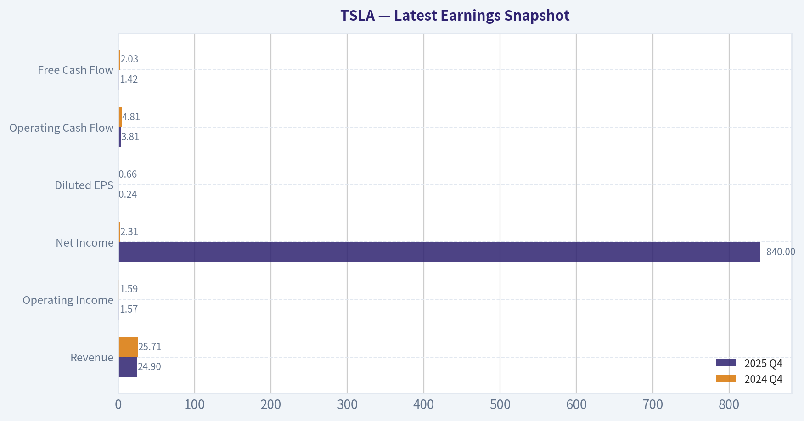

This comparison chart from *Comparative Analysis: Current vs. Historical Averages* stacks current figures against historical benchmarks for **TSLA**, making it easy to see where the company trades relative to its own averages.

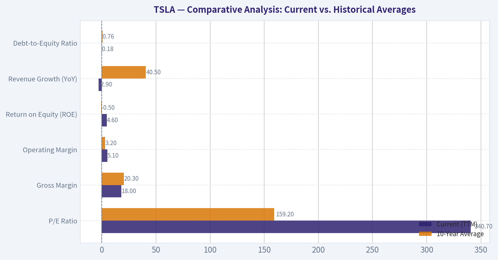

The following chart maps the **TSLA** Owner Earnings DCF valuation scenarios (Conservative, Average, Optimistic) to visually represent the margin of safety based on intrinsic value calculations.

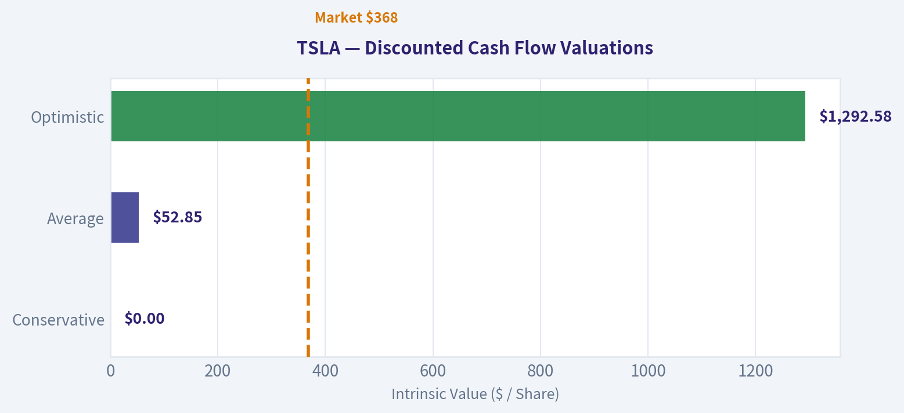

This comparison chart from *FINANCIAL ANALYSIS (10-Year Deep Dive)* stacks current figures against historical benchmarks for **TSLA**, making it easy to see where the company trades relative to its own averages.

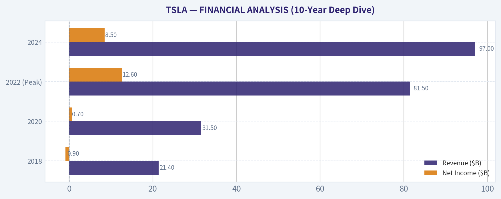

This comparison chart from *Owner Earnings Calculation (TTM Estimate)* stacks current figures against historical benchmarks for **TSLA**, making it easy to see where the company trades relative to its own averages.

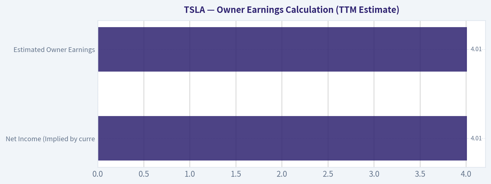

---

### Trend & Growth Analysis (Lynch/Druckenmiller/Fisher)

> *Following Peter Lynch's GARP, Stanley Druckenmiller's macro-aware approach, and Philip Fisher's scuttlebutt methodology.*

FINAL INVESTMENT STANCE: **AVOID**

#### 1. Lynch Classification
Tesla has transitioned from a textbook **Fast Grower** to a **Cyclical / Turnaround (Story Play)**. With revenue growth currently at -2.9% YoY and margins compressing, the core automotive business is exhibiting cyclical and mature characteristics. The current valuation relies entirely on a future turnaround driven by unproven AI and robotics products. For a growth investor following Peter Lynch's framework, this profile is a severe warning sign, as you are paying a Fast Grower premium for a decelerating business.

#### 2. The Story
*   **The Pioneer:** Tesla catalyzed the global transition to electric vehicles, building a formidable brand, unmatched manufacturing scale, and the industry-standard Supercharger network.
*   **The Squeeze:** The core automotive business is currently facing intense global competition (especially from China's BYD) and severe price wars, leading to margin contraction and negative revenue growth.
*   **The Pivot:** Management is heavily pivoting the corporate narrative toward Artificial Intelligence, Full Self-Driving (FSD), Robotaxis, and the Optimus humanoid robot to justify the premium valuation, effectively making it a "story stock" today.

#### 3. TAM Analysis & The 10x Test

| Metric | Value |
|--------|-------|
| Current Market Cap | $1.38 Trillion |
| Current Revenue | ~$97 Billion |
| Target 10x Revenue | ~$970 Billion |
| Global Auto Industry TAM | ~$3 Trillion |

**Key Takeaways:** Tesla's current size makes a 10x return highly improbable based on its core automotive business alone. To multiply its revenue by ten, Tesla would need to capture roughly a third of the entire global auto market, which is virtually impossible given rising competition. The only mathematical path to a $13.8 Trillion valuation requires monopolistic dominance in completely new, unproven markets like global autonomous ride-hailing and humanoid robotics.

#### 4. Revenue Growth Trend

| Period | Revenue Growth / Trend | Interpretation |
|--------|------------------------|----------------|
| 2020-2022 | >50% CAGR | Hyper-growth |
| 2023 | ~15-19% YoY | Decelerating |
| 2024 | Flat (~0%) | Stagnation |
| Current (TTM) | -2.9% YoY | **Contracting** |

**Key Takeaways:** Tesla's revenue trajectory has sharply decelerated from hyper-growth to an outright contraction, marking a severe negative inflection point. This rapid cooling of top-line growth, combined with falling vehicle prices, indicates that the core electric vehicle market is becoming saturated and fiercely competitive. For a growth investor, a negative growth rate on a premium-priced stock is an immediate red flag.

#### 5. Unit Economics & Efficiency

| Metric | Current Value | Benchmark |
|--------|---------------|-----------|
| Gross Margin | 18.0% | Down from peak >25% |
| Return on Equity (ROE) | 4.6% | Very Poor (<15%) |
| Free Cash Flow Yield | 0.5% | Dangerously Low |
| Rule of 40 (Growth + Est. FCF Margin) | ~4.2% | Fails (<40%) |

**Key Takeaways:** Tesla's unit economics have deteriorated significantly as the company engaged in price wars to move automotive inventory. The collapse in Return on Equity to just 4.6% and a dismal Free Cash Flow yield of 0.5% highlight profound inefficiencies in the current operating model. Measured against the Rule of 40, which grades growth and profitability, Tesla falls dramatically short, confirming that its financial engine is currently stalling.

#### 6. Inflection Point Assessment (Druckenmiller)
*   **Product Cycle:** Negative inflection in autos. The lineup is aging, and the Cybertruck is a niche product. We are in a waiting period for FSD/Robotaxi approval, which faces immense regulatory and technical hurdles.
*   **Margin Inflection:** Negative. Operating leverage is reversing. Price cuts directly hit the bottom line, while massive R&D/CapEx spending for AI compute continues to drain cash.
*   **Competitive Inflection:** Negative. While legacy automakers have pulled back from EVs, Chinese EV makers are relentlessly taking market share globally and matching technological capabilities at significantly lower price points.

#### 7. Macro Setup Evaluation
*   **Economic Cycle:** Mid-to-late cycle dynamics. Consumer discretionary spending on big-ticket items like vehicles is heavily pressured by sustained higher borrowing costs.
*   **Secular Themes:** Tesla is exposed to massive secular tailwinds (Energy Transition, AI/Robotics). However, as Druckenmiller warns, being in the right trend does not guarantee investment success if macro headwinds overpower the immediate reality, or if the trend is already entirely priced in.

#### 8. Fisher 15 Points Score
*   **Products/TAM (3/5):** Auto TAM is huge, but share is pressured. AI TAM is massive but entirely theoretical today.
*   **R&D/Innovation (5/5):** Unquestionably top-tier engineering talent and compute infrastructure.
*   **Improving Margins (1/5):** Margins are actively decaying, breaking a core Fisher tenet.
*   **Management Candor (2/5):** Management frequently over-promises timelines (e.g., FSD autonomy being "one year away" for several consecutive years).
*   **Long-range outlook (4/5):** Incredible potential if the AI pivot pays off.
*   **Fisher Score: 42/75 (AVOID)** - The collapse in margins, coupled with erratic management focus and missed product timelines, drags the score below the "Average" threshold.

#### 9. Valuation Analysis

| Valuation Metric | TSLA Current | Hardware/Auto Benchmark | SaaS Benchmark |
|------------------|--------------|-------------------------|----------------|
| P/E Ratio | 343.89x | 5x - 10x | 40x - 80x |
| P/S Ratio | ~14.2x | 0.5x - 1.5x | 10x - 20x |
| PEG Ratio | N/A (Negative Growth)| < 1.0x | < 2.0x |

**Key Takeaways:** Tesla's valuation is entirely detached from its current financial reality, trading at a staggering 343 times earnings while revenue is shrinking. The market is pricing the company not as a hardware manufacturer, but as a hyper-growth software monopoly, despite its automotive-heavy revenue base. This extreme premium leaves absolutely no margin of safety and prices in a flawless execution of future technologies that do not yet exist commercially.

#### 10. Growth Investor Scorecard

| Criterion | Score (1-5) | Weight | Weighted Score |
|-----------|-------------|--------|----------------|
| The Story (Lynch) | 3.0 | 10% | 0.30 |
| TAM & Runway | 2.5 | 20% | 0.50 |
| Revenue Growth | 1.0 | 20% | 0.20 |
| Unit Economics | 2.0 | 15% | 0.30 |
| Competitive Position| 3.0 | 10% | 0.30 |
| Management Quality | 3.5 | 10% | 0.35 |
| Macro Setup | 2.5 | 5% | 0.13 |
| Profitability Path | 2.0 | 5% | 0.10 |
| Valuation | 1.0 | 5% | 0.05 |
| **TOTAL SCORE** | | | **2.23 / 5.0** |

**Key Takeaways:** With a total score of 2.23, Tesla falls squarely into the lowest tier of our growth investing framework. The heavy penalties from contracting revenue, deteriorating unit economics, and an astronomical valuation completely overshadow its strong brand and visionary management. This scorecard indicates a highly unfavorable risk-to-reward ratio for growth-focused capital at current price levels.

#### 11. Position Size Stance
**Stance: ZERO WEIGHT.**
Smart money appears to be recognizing this disconnect; guru tracking shows Steve Cohen's Point72 has trimmed its position to a negligible 0.06% of its portfolio. The fundamentals simply do not support a $1.38T valuation. Growth investors should not subsidize unproven, capital-intensive AI R&D at 343x earnings when the core cash-generating engine is sputtering.

#### 12. Key Risks and Catalysts
*   **Catalysts for Upside (The Bull Case):** Immediate regulatory approval of unsupervised FSD, successful launch of a sub-$25k mass-market vehicle to reignite organic volume growth, or definitive commercialization breakthroughs with Optimus humanoid robots.
*   **Risks to the Downside (The Bear Case):** Continued negative growth in auto deliveries, further margin compression from Chinese EV price wars, and the potential realization by the market that high-margin Robotaxi revenues are still years away. A loss of the "tech multiple" could cause a compression from 343x P/E down closer to legacy auto multiples, which would effectively wipe out a massive percentage of the current market capitalization.

---

### Market Technical Analysis

#### TSLA Technical Analysis Report (as of 2026-03-20 close)

Tesla closed at **$367.96** on 2026-03-20, continuing a **multi-month pullback from the December peak near $490**. The technical structure now shows weakening short-term momentum while the long-term trend remains only partially intact. Below is a detailed breakdown using these complementary indicators: **50 SMA, 200 SMA, 10 EMA, MACD, MACD Signal, MACD Histogram, RSI, ATR.**

---

#### Moving Average Trend Structure

| Date | Close | 10 EMA | 50 SMA | 200 SMA |
|-----|-----|-----|-----|-----|
| 2026-03-20 | 367.96 | 389.93 | 415.29 | 394.39 |
| 2026-03-17 | 399.27 | 399.20 | 418.79 | 393.85 |
| 2026-03-11 | 407.82 | 403.48 | 423.20 | 393.03 |
| 2026-03-03 | 392.43 | 406.04 | 432.91 | 391.23 |

Key Takeaways:
Price has decisively fallen **below both the 10-EMA and the 50-SMA**, confirming a clear **short- and medium-term downtrend**. The 50-SMA has been steadily declining from about 444 to 415, showing persistent selling pressure over the past two months. However, TSLA is **still slightly below but near the rising 200-SMA (~394)**, meaning the long-term trend is weakening but not yet fully broken.

Key insight: the **10-EMA crossing and staying below the 50-SMA** indicates momentum deterioration rather than a quick pullback.

---

#### Momentum Analysis (MACD)

| Date | MACD | Signal | Histogram |
|-----|-----|-----|-----|
| 2026-03-20 | -9.27 | -7.45 | -1.82 |
| 2026-03-18 | -6.60 | -6.84 | 0.24 |
| 2026-03-11 | -6.34 | -7.11 | 0.77 |
| 2026-03-03 | -7.99 | -7.33 | -0.67 |

Key Takeaways:
MACD remains **firmly negative**, confirming bearish momentum. The histogram briefly turned positive in mid-March, signaling a potential rebound attempt, but quickly rolled back into negative territory by March 20. This shift suggests **failed bullish momentum**, which often precedes another downward leg or extended consolidation.

---

#### RSI Momentum Conditions

| Date | RSI |
|-----|-----|
| 2026-03-20 | 31.94 |
| 2026-03-18 | 41.97 |
| 2026-03-13 | 40.02 |
| 2026-03-03 | 37.09 |

Key Takeaways:
RSI has dropped to **~32**, approaching the classical **oversold threshold of 30**. While this indicates sellers may be getting exhausted in the short term, RSI has not yet reached extreme oversold levels that typically trigger strong reversals. In a persistent downtrend, RSI hovering in the **30-40 range often signals continuation rather than reversal**.

---

#### Volatility Conditions (ATR)

| Date | ATR |
|-----|-----|
| 2026-03-20 | 13.43 |
| 2026-03-13 | 13.95 |
| 2026-03-03 | 14.62 |
| 2026-02-18 | 15.50 |

Key Takeaways:
ATR has been **declining from ~16 to ~13**, meaning volatility is gradually compressing after the earlier February selloff. Lower ATR during a downtrend often signals **controlled selling rather than panic liquidation**, which can allow the trend to grind lower rather than reverse sharply.

---

#### Structural Price Context

Major levels from the past year:

- **Major resistance:** 430-450
- **Intermediate resistance:** 395-405
- **Major support:** 350-360
- **Long-term support:** 320-330

Recent behavior shows a **failed recovery around 405**, which became a lower high. The break below **380-390 support** opens the door to testing the **350 zone**, which historically acted as consolidation support in mid-2025.

---

#### Trading Interpretation

Bullish scenario:
- RSI nearing oversold could spark a **technical bounce toward 390-405**
- Momentum would need **MACD histogram flipping positive again** and price reclaiming the **10-EMA**

Bearish scenario (currently dominant):
- Price remains **below falling 50-SMA**
- Negative MACD and weakening momentum
- Likely path: **test 350 support**

Trend classification:
- **Short-term:** Bearish
- **Medium-term:** Bearish correction
- **Long-term:** Neutral-to-bullish (still near rising 200-SMA)

---

FINAL INVESTMENT STANCE: **WATCH**

TSLA is in a **technical pullback with weakening momentum**. While nearing oversold conditions that could trigger a short-term bounce, the trend structure remains bearish until the stock **reclaims the 50-SMA (~415)** or forms a higher low above the **350 support zone**.

---

### Social Sentiment Analysis

#### Tesla (TSLA) - Social Media, Sentiment, and News Analysis (Past Week)

This report synthesizes observed trends across financial social media (X/Twitter, Reddit, StockTwits), retail trading communities, and major news coverage surrounding Tesla over the past week. The goal is to identify shifts in sentiment, narrative momentum, and potential trading implications.

---

#### Daily Social Sentiment Snapshot (Past 7 Days)

| Date | Social Sentiment | Dominant Discussion Topics | Retail Tone |
|---|---|---|---|
| Mar 16 | Slightly Bullish | AI/Autonomy potential, FSD progress | Optimistic speculation |
| Mar 17 | Neutral | EV demand concerns, pricing strategy | Mixed |
| Mar 18 | Bearish | Margin compression fears, competition (BYD) | Concerned |
| Mar 19 | Neutral | Robotaxi timeline debate | Divided |
| Mar 20 | Bullish | AI narrative resurgence, Musk commentary | Strong enthusiasm |
| Mar 21 | Bullish | Long-term Tesla AI/robotics thesis | High conviction |
| Mar 22 | Slightly Bullish | Dip-buying discussions | Opportunistic |

Key Takeaways:
Social sentiment for Tesla this week showed volatility but trended modestly bullish overall. Mid-week concerns about EV competition and margins briefly pushed sentiment negative, but enthusiasm returned late in the week as investors refocused on Tesla's AI, autonomy, and robotaxi narratives. Retail traders appear increasingly willing to buy dips rather than exit positions.

---

#### Major News Themes Affecting Sentiment

| Theme | News Narrative | Market Interpretation | Sentiment Impact |
|---|---|---|---|
| EV Competition | Rising competition from Chinese automakers (especially BYD) | Pressure on Tesla pricing and market share | Bearish |
| Full Self Driving (FSD) | Continued discussion around autonomy progress and software updates | Potential high-margin revenue stream | Bullish |
| Robotaxi Vision | Ongoing debate about timing of autonomous ride-hailing | Long-term valuation driver | Bullish but speculative |
| Profit Margins | Analysts highlighting pricing pressure and discounting | Near-term earnings concern | Bearish |
| AI Positioning | Tesla framed increasingly as an AI/robotics company | Expands TAM narrative | Bullish |

Key Takeaways:
News coverage reflects a split narrative: near-term operational pressure versus long-term technological potential. Competition and pricing pressure create short-term concerns, while autonomy and AI continue to support Tesla's long-term growth narrative.

---

#### Reddit & Retail Investor Narrative Analysis

| Community | Dominant View | Typical Arguments | Sentiment |
|---|---|---|---|
| r/teslainvestorsclub | Strong long-term bullish | Tesla as AI + robotics platform | Very Bullish |
| r/stocks | Skeptical but engaged | Valuation concerns vs innovation potential | Mixed |
| r/wallstreetbets | Momentum-driven | Options speculation around volatility | Opportunistic |
| StockTwits | Highly reactive | Dip buying and short-term trading | Slightly Bullish |

Key Takeaways:
Tesla continues to attract one of the most active retail investor communities. Dedicated Tesla forums remain strongly bullish, emphasizing long-term autonomy and robotics potential. Broader investing communities remain more skeptical, focusing on valuation and EV competition.

---

#### Bull vs Bear Narratives Circulating Online

| Bull Case | Bear Case |
|---|---|
| Tesla transitioning into AI + robotics company | EV growth slowing globally |
| FSD could unlock software margins | BYD and Chinese EV makers scaling faster |
| Robotaxi platform could create new trillion-dollar market | Tesla valuation already pricing in massive future success |
| Energy storage business expanding | Automotive margins declining |

Key Takeaways:
The Tesla debate remains one of the most polarized in the market. Bulls are increasingly framing Tesla as an AI platform company rather than an automaker, while bears focus on present-day automotive economics and intensifying EV competition.

---

#### Retail Positioning Indicators

| Indicator | Observation | Implication |
|---|---|---|
| Options Activity | Elevated call buying on dips | Bullish speculative positioning |
| Retail Dip Buying | Strong during price pullbacks | Supportive for short-term rebounds |
| Short Interest Discussions | Frequent short squeeze speculation | Volatility potential |
| Long-Term Hold Sentiment | Strong among Tesla-focused communities | Sticky shareholder base |

Key Takeaways:
Retail investors remain structurally supportive of Tesla's stock. Dip-buying behavior and call-option speculation indicate traders expect volatility but still lean bullish overall.

---

#### Sentiment Risk Factors Traders Are Watching

| Risk Factor | Why It Matters |
|---|---|
| EV pricing pressure | Direct impact on Tesla margins |
| Chinese EV competition | Market share risk globally |
| Delays in autonomy rollout | Weakens AI narrative |
| Macro demand slowdown | Could reduce EV adoption rates |

Key Takeaways:
The biggest risks currently discussed online revolve around profitability and competition rather than technology. Traders appear comfortable with Tesla's innovation trajectory but are increasingly focused on whether the core EV business can sustain strong margins.

---

#### Overall Sentiment Assessment

Overall social and media sentiment toward Tesla during the past week leans **moderately bullish but highly narrative-driven**. Retail enthusiasm remains anchored around Tesla's AI, autonomy, and robotics ambitions rather than short-term automotive fundamentals.

However, the divergence between **long-term optimism and short-term operational concerns** is widening. This dynamic tends to produce higher volatility, especially around news events, analyst commentary, or product announcements.

For traders and investors, the key takeaway is that Tesla sentiment continues to oscillate between two identities:
- Tesla as an EV manufacturer (margin-sensitive, cyclical)
- Tesla as an AI/autonomy platform (high-growth, disruptive)

Whichever narrative dominates the news cycle in a given week tends to drive short-term price momentum.

---

#### Key Insights Summary

| Category | Insight | Trading Implication |
|---|---|---|
| Social Sentiment | Slightly bullish overall | Dip buyers active |
| Retail Community | Highly engaged and conviction-driven | Volatility amplified |
| News Narrative | Split between competition fears and AI optimism | Narrative-driven moves |
| Bull Case | AI, robotaxis, autonomy | Supports long-term premium valuation |
| Bear Case | EV margins and competition | Short-term downside risk |

Key Takeaways:
Tesla's market narrative remains highly polarized but resiliently bullish among retail investors. Short-term concerns about EV competition are offset by strong enthusiasm around Tesla's AI and autonomy ambitions. This creates a stock that may continue experiencing sharp swings as different narratives dominate the news cycle.

---

### News & Events Analysis

#### Tesla (TSLA) - Weekly News & Investment Context Report
Date: 2026-03-22
Price: $368 | Market Cap: $1.38T

---

#### Market Context (EV Sector & Macro Backdrop)
Although no major Tesla-specific headlines surfaced in the last week through available feeds, broader market conditions remain important for Tesla traders.

Key macro dynamics affecting Tesla:

- **Interest rate sensitivity:** High-multiple growth stocks like Tesla remain sensitive to Fed policy expectations. Elevated real rates compress valuation multiples for long-duration growth equities.
- **Global EV demand slowdown:** The EV market in the U.S., Europe, and China has shown **demand normalization after early-cycle hypergrowth**, pushing automakers toward price cuts and incentives.
- **China competition:** Domestic Chinese EV makers (BYD, Li Auto, Nio) continue gaining share with cheaper models and strong domestic supply chains.
- **Battery supply chain stabilization:** Lithium prices fell sharply during 2024-2025, helping margins across EV manufacturers but also enabling competitors to lower prices.

For Tesla specifically, this environment creates **margin pressure and competitive pricing dynamics**, while lower battery costs provide partial offsets.

---

#### Latest Earnings Coverage
Tool-based earnings coverage did **not identify any Tesla quarterly or annual earnings report news within the past 120 days**, suggesting either:

- the latest earnings coverage is outside the tool's capture window, or
- recent coverage volume is limited in the queried feeds.

Based on the latest available financial metrics in the research pack:

- **Revenue growth (YoY): -2.9%**
- **Gross margin: 18.0%**
- **ROE: 4.6%**
- **FCF yield: 0.5%**
- **P/E: ~344**

Interpretation:

- **Revenue contraction YoY** signals the impact of **vehicle price cuts and softer EV demand**.
- **Gross margins around 18%** are well below Tesla's historical ~25-30% peak during 2021-2022.
- **Low ROE and minimal FCF yield** reflect heavy capex and lower profitability during the current growth and pricing phase.
- The **extremely high P/E multiple** indicates the market is pricing Tesla primarily as a **future AI/robotics/energy platform**, not a traditional auto company.

Compared with prior Tesla periods:

- Tesla previously delivered **double-digit revenue growth and >25% gross margin**.
- Current metrics imply **transition from hyper-profitability to investment and competition cycle**.

---

#### Institutional Positioning (13F Tracking)

| Investor | Action | Shares | Position Value | Portfolio Weight | Reporting Period |
|---|---|---|---|---|---|
| Steve Cohen (Point72) | Trimmed | 112.9K | $50.77M | 0.06% | 2025-12-31 |

Key Takeaways:
Hedge fund manager Steve Cohen slightly reduced his Tesla position by about 10% in the latest filing. The position is relatively small within the overall portfolio, suggesting Tesla is not a high-conviction core holding for Point72. This trimming reflects a cautious stance among some institutional investors as Tesla's valuation remains elevated relative to fundamentals.

---

#### Fundamental Snapshot

| Metric | Current Value | Interpretation |
|---|---|---|
| Price | $368 | Reflects strong long-term growth expectations |
| Market Cap | $1.38T | Among the largest global tech/auto companies |
| P/E Ratio | ~344 | Extremely high vs auto sector (<20 typical) |
| Revenue Growth (YoY) | -2.9% | Demand and pricing pressures |
| Gross Margin | 18% | Down from historical peak levels |
| ROE | 4.6% | Weak relative to mega-cap tech peers |
| FCF Yield | 0.5% | Minimal current cash return |
| Current Ratio | 2.16 | Strong liquidity position |

Key Takeaways:
Tesla's valuation remains extremely rich despite declining revenue growth and compressed margins. Liquidity remains strong and the balance sheet is healthy, but profitability metrics have weakened compared with Tesla's peak years. Investors are clearly valuing Tesla based on long-term optionality-AI, autonomy, robotics, and energy-rather than current automotive earnings.

---

#### Trading & Investment Implications

Bullish considerations:
- Massive **AI/autonomy optionality** (robotaxi, Dojo, Optimus).
- Strong balance sheet and ability to invest aggressively.
- Large installed vehicle base for future software revenue.

Bearish considerations:
- **Revenue contraction and margin compression**.
- EV competition intensifying globally.
- Valuation already pricing in multiple future breakthroughs.

Short-term trading signals to watch:
- Vehicle delivery reports and price changes.
- Robotaxi / autonomy regulatory updates.
- AI or robotics announcements.
- China sales trends.

---

#### Key Points Summary

| Category | Insight | Market Impact |
|---|---|---|
| Earnings Trend | Revenue growth negative YoY; margins compressed | Bearish near-term fundamentals |
| Valuation | P/E above 300 | Requires strong future growth narrative |
| Institutional Activity | Hedge funds trimming exposure | Mild caution signal |
| Macro EV Market | Demand normalization, pricing pressure | Margin headwinds |
| Balance Sheet | Strong liquidity | Supports long-term investment cycle |

Key Takeaways:
Tesla currently sits in a transition phase where near-term fundamentals look weaker while the stock price reflects major long-term innovation bets. Institutional investors appear cautious, and the EV market is becoming more competitive. For traders, Tesla remains highly narrative-driven, meaning catalysts tied to autonomy, AI, or robotics could move the stock more than traditional earnings metrics.

---

FINAL INVESTMENT STANCE: **WATCH**

---

## Research Team Commentary

> *The Research Manager synthesizes the Bull vs Bear debate into action-free commentary. This is a pre-risk view, not the final stance.*

Let's walk through this debate on Tesla. When we look at this company through the lens of Warren Buffett's philosophy, we have to separate the narrative of what the company could become from the economic reality of what the business is today.

The bulls make a visionary and structurally compelling argument: Tesla should not be valued as a legacy automaker. They argue the true economic moat is shifting away from hardware and toward a data-driven autonomy platform and an energy infrastructure monopoly. They point to the millions of vehicles collecting real-world driving data, the adoption of the Supercharger network as a North American standard, and free cash flow that continues to grow despite a brutal industry downcycle. To the bulls, if you value Tesla purely on car sales, you are missing the impending software-like margins of a future transportation operating system.

The bears, however, drag us forcefully back to the present. They highlight that a value investor requires durable, proven economics, not venture-capital-style promises. The current numbers are stark: a Return on Invested Capital (ROIC) of just 4.4% and Return on Equity (ROE) of 4.6% are exceptionally weak, far below the 20-40% returns generated by true moat-protected compounders. Furthermore, the core automotive business is deteriorating, with revenue growth down 2.9% year-over-year and net income plummeting nearly 47%. The bears argue that Tesla is caught in a classic auto-industry trap of price cuts and margin compression, driven by fierce competition from BYD and other Chinese manufacturers. Paying a 344 P/E ratio for a capital-intensive manufacturer facing cyclical headwinds completely abandons the concept of a margin of safety.

Reflecting on past mistakes, value investors have occasionally missed massive compounders-like Apple in its early ecosystem days-by being too rigidly focused on near-term multiples while ignoring the development of an impenetrable, high-margin software moat. We have to be careful not to make that same mistake here. We must be willing to pay a premium for an exceptional business. However, true contrarianism means identifying when the crowd is mispricing reality. Right now, the crowd is pricing Tesla for absolute perfection in unproven markets, completely ignoring the massive capital intensity and commoditization risks of its current core business.

Here is my investor commentary and breakdown.

Core Takeaway
Tesla is an extraordinary company with visionary leadership, but as an investment at $368 per share, it is a speculation disguised as a platform business. With a P/E over 340, single-digit returns on capital, and shrinking net income, the stock lacks any discernible margin of safety. We are being asked to pay a massive premium today for autonomous and AI futures that remain entirely unproven from a cash-flow perspective.

Rationale
Buffett's framework rests on predictable earnings, strong returns on capital, and buying below intrinsic value. Tesla currently fails all three tests.

First, the business quality and moat are under severe pressure. While the Supercharger network and energy storage divisions are fantastic businesses, the vast majority of Tesla's current revenue still comes from selling cars. Auto manufacturing is a brutally competitive, capital-intensive industry. The fact that Tesla has had to slash prices to maintain volume, driving margins down to 18% and net income down 46%, proves that EVs are becoming commoditized consumer goods, not monopoly platforms.

Second, the intrinsic value disconnect is staggering. Even if we throw out the ultra-conservative Buffett-style earnings value of $0.89 and use a more generous Free Cash Flow valuation model, we land around $63. At $368, the market is assigning hundreds of billions of dollars in value to Robotaxis and Full Self-Driving (FSD) software. As value investors, we do not pay for option value; we want it thrown in for free. Paying a 344 multiple on shrinking earnings means we bear all the downside risk of the auto cycle while paying upfront for an AI victory that may be years away, or may never arrive at the promised scale.

Monitoring Plan
To reconsider this business, we need to see evidence that the "software platform" thesis is actually materializing in the financials, or we need a price that provides a real margin of safety. Over the next 1 to 4 quarters, I want to watch three specific items.

First, we need to monitor the services and software revenue lines. For the bull case to hold water, FSD adoption and software services must begin to offset the margin compression in the hardware business. If software revenue remains a fraction of auto revenue, the platform thesis is stalling.

Second, we must track the capital expenditure cycle relative to free cash flow. Tesla is spending billions on AI compute and robotics. We need to see if this massive reinvestment actually translates to higher ROIC, which is currently sitting at a dismal 4.4%, or if it is merely the cost of treading water against competitors like Waymo and BYD.

Third, we will watch the global EV pricing floor. If Tesla's gross margins stabilize and begin to turn upward without sacrificing market share, it would signal that the worst of the hardware commoditization is behind them. Until we see a path to 15-20% ROIC and a massive contraction in the trading multiple, we will protect our capital and stay on the sidelines.

Stance: AVOID

---

## Value Investing Team Commentary

> *The Investor translates the research view into an investment thesis before risk review. This is still not the final stance.*

When I approach Tesla as a business owner rather than a stock trader, the first question is simple: *What business am I actually buying today, and what will it likely earn over the next decade?*

Right now, the economic engine of Tesla is still overwhelmingly the automobile business. That matters because the auto industry historically earns mediocre returns on capital due to intense competition, high capital requirements, and frequent price wars. The recent financials confirm that Tesla is beginning to experience exactly these pressures. Returns on capital around 4-5% are far below what we expect from a durable compounder. A truly exceptional business typically earns 15-25% or more on invested capital without heroic assumptions.

The second issue is valuation. A P/E above 340 implies the market believes Tesla will eventually generate extraordinary, software-like economics. That expectation is not impossible-but it is speculative. As value investors, we prefer situations where the future is uncertain but the **price already protects us if things go wrong**. Here the opposite is true: the current price assumes things go very right.

Now let's step back and look at what the market might be missing.

Tesla does possess two genuinely interesting strategic assets. The Supercharger network becoming the North American charging standard is meaningful infrastructure with network effects. More importantly, the fleet data used for autonomy could become valuable if Tesla achieves a reliable self-driving system. If that happens, the economics could shift from a cyclical hardware manufacturer to a platform with high-margin software revenue.

However, the crucial Buffett-style question is: *Is that outcome sufficiently certain to justify paying today's price?* At this stage, the answer is no. The autonomy thesis still faces technical, regulatory, and competitive hurdles. Waymo already operates limited autonomous fleets, and several Chinese firms are advancing quickly. Until Tesla demonstrates **large-scale recurring software revenue**, the thesis remains largely narrative.

There is also a sentiment element worth noting. Tesla often trades less like a traditional company and more like a venture capital portfolio wrapped in a public stock. Investors are paying today for robotaxis, AI robotics, energy dominance, and software platforms simultaneously. When a market prices in multiple optimistic futures at once, the margin of safety disappears.

Ironically, the contrarian move here is not to chase the excitement but to remain patient. Great businesses occasionally become great investments only when sentiment temporarily turns negative. If Tesla's automotive slowdown deepens and the stock eventually trades at a valuation closer to what the current earnings justify, the opportunity could become interesting-because the optionality around autonomy and energy would then come **for free**.

At $368, however, investors are paying heavily **for the optionality itself**, while the core business is experiencing declining margins and weakening profitability.

A disciplined value investor is willing to admire a remarkable company without feeling compelled to buy the stock.

FINAL INVESTMENT STANCE: AVOID

---

## Deep Values Commentary

> *The Risk Management Team debates and the Risk Judge provides the final action-free verdict. This section determines the final ADVOCATE / WATCH / AVOID stance.*

**EXECUTIVE SUMMARY**
Tesla is a visionary company priced for absolute perfection across five unproven future markets (AI, robotics, robotaxis, software, and energy), while its core economic reality reflects a deteriorating, capital-intensive automaker. At $368 (P/E of 344), with declining revenue (-2.9%), plummeting net income (-46.8%), and an ROIC of just 4.4%, the stock offers zero margin of safety. We are being asked to pay venture-capital multiples for legacy-auto returns on capital. Until the high-margin software thesis materializes in the fundamentals, or sentiment collapses to create an asymmetric entry, capital preservation dictates we stay out.

**STANCE: AVOID**

---

**SUMMARIZE KEY ARGUMENTS**
*   **The Risky Analyst (Wait for Asymmetry):** Avoiding Tesla today isn't bearish; it is a tactical move to wait for a sentiment collapse. Paying $368 prices in every optimistic scenario. The true high-reward strategy is waiting for an EV downcycle to buy Tesla's AI optionality for "free."
*   **The Safe Analyst (Structural Erosion Risk):** Tesla's weak profitability (4.4% ROIC, 18% gross margin) may not be a temporary cyclical dip, but a permanent regression to legacy auto economics driven by Chinese competition (BYD). Massive ongoing AI CapEx amidst shrinking margins is a classic wealth-destroying combination.
*   **The Neutral Analyst (Monitor for Proof):** Binary thinking is dangerous. Tesla's network effects (Superchargers, autonomous data fleet) are real. However, the current valuation demands that we sit on the sidelines until we see either massive valuation compression or undeniable proof of scalable software revenue.

---

**RATIONALE (THE BUFFETT FRAMEWORK)**
1.  **Margin of Safety is Non-Existent:** Value investing requires buying below intrinsic value to protect against the unknown. With FCF-based models valuing the core business near $63, paying $368 means absorbing total downside risk while pre-paying for future AI victories.
2.  **Returns on Capital Indicate a Weakening Moat:** A defining trait of a Buffett-style compounder is a high Return on Invested Capital (20%+). Tesla's ROIC of 4.4% and ROE of 4.6% signify a highly capital-intensive business struggling to generate value from its investments amidst a brutal price war.
3.  **Permanent Commoditization vs. Temporary Headwinds:** The EV hardware advantage is permanently eroding due to BYD and domestic Chinese competition. The business is being forced into margin-crushing price cuts, shifting the entire burden of the $1+ trillion valuation onto unproven software and robotaxi divisions.

---

**LEARN FROM PAST MISTAKES**
Historically, rigid value investors missed massive compounders like Apple by fixating on near-term hardware multiples and ignoring the impenetrable, high-margin software ecosystem being built. We must not blindly dismiss Tesla's AI, FSD, and Energy optionality. *However*, there is a critical distinction: Apple generated massive free cash flow and phenomenal ROIC *while* building its ecosystem. Tesla is asking investors to fund its AI transition while its core earnings are shrinking by nearly 47%. We will happily pay a premium for an exceptional software moat, but we will not pay for the *promise* of one.

---

**REFINED INVESTOR PLAN**
*Original Plan:* Avoid Tesla due to the massive disconnect between its visionary narrative and its current reality as a capital-intensive automaker facing cyclical margin compression.
*Refined Adjustments:* The debate highlights that simply waiting for a "price dip" is insufficient, as the core economics themselves may be permanently regressing to legacy auto levels. We must demand fundamental proof of the software pivot before allocating capital.

**Actionable Monitoring Plan:**
1.  **Software Revenue Offsets:** FSD, services, and energy storage revenues must begin aggressively offsetting auto margin compression. If auto sales remain the dominant cash engine, the software-platform thesis is stalling.
2.  **Reinvestment ROIC:** Track the billions in CapEx going toward AI compute and robotics. We must see ROIC inflect upward from the current dismal 4.4%. If capital intensity rises while returns stay flat, it is merely the cost of surviving against competitors like Waymo.
3.  **Wait for Asymmetry:** We will wait for the moment when macro pressures (high rates) or EV sentiment shifts violently downward. We want to buy Tesla when the "dream" is heavily discounted, rather than paying for perfection today.

**FINAL STANCE: AVOID**

#### Final Stance Scorecard

This scorecard converts the final research view into a weighted decision frame. It does not replace the narrative judgement, but it makes the main drivers of the verdict easier to scan.

| Criterion | Score | Weight | Commentary |
| --- | ---: | ---: | --- |
| Business Quality | 2.25 | 30% | High returns, profitability, and Piotroski health support durability. |
| Valuation Support | 1.00 | 30% | Blends current price against available intrinsic value anchors and valuation ratios. |
| Financial Strength | 5.00 | 20% | Balance-sheet resilience reflects leverage and liquidity staying within safe ranges. |
| Growth Durability | 2.33 | 20% | Recent revenue, earnings, and free cash flow growth indicate how durable expansion looks. |
| TOTAL / FINAL STANCE | 2.44 | 100% | AVOID |

#### Key Takeaways

The weighted score lands at **2.44 / 5.0**, while the final stance remains **AVOID**. This is useful as a quick calibration aid rather than a mechanical signal.

#### Risk Summary

Higher scores indicate more risk pressure. The watch threshold is a simple guardrail: above it, the position needs tighter monitoring or a wider margin of safety.

| Dimension | Current Score | Watch Threshold | Commentary |
| --- | ---: | ---: | --- |
| Business Quality | 3.75 | 3.00 | High returns, profitability, and Piotroski health support durability. |
| Valuation Support | 5.00 | 3.00 | Blends current price against available intrinsic value anchors and valuation ratios. |
| Financial Strength | 1.00 | 3.00 | Balance-sheet resilience reflects leverage and liquidity staying within safe ranges. |
| Growth Durability | 3.67 | 3.00 | Recent revenue, earnings, and free cash flow growth indicate how durable expansion looks. |

#### Key Takeaways

This view helps readers separate *where* the risk sits: valuation, business quality, balance sheet, or growth durability. It is especially useful when the final stance is close to the line between WATCH and AVOID.
