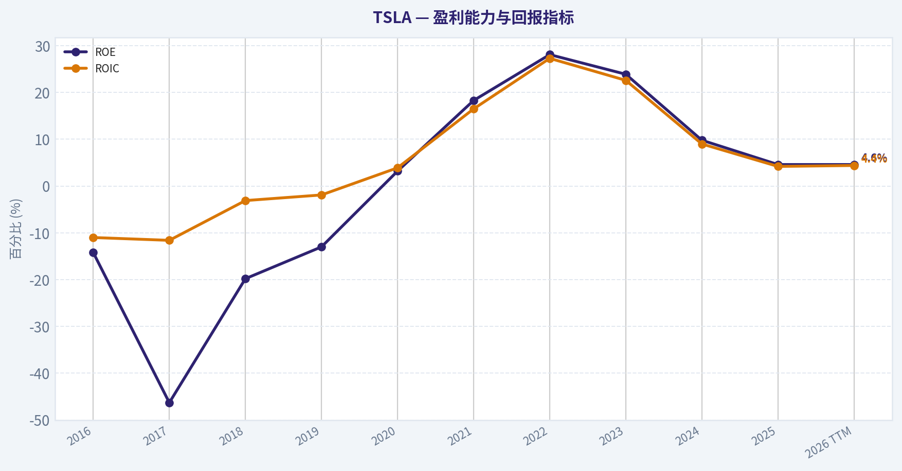
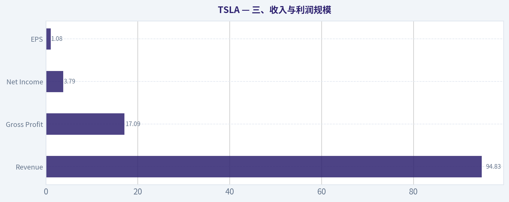
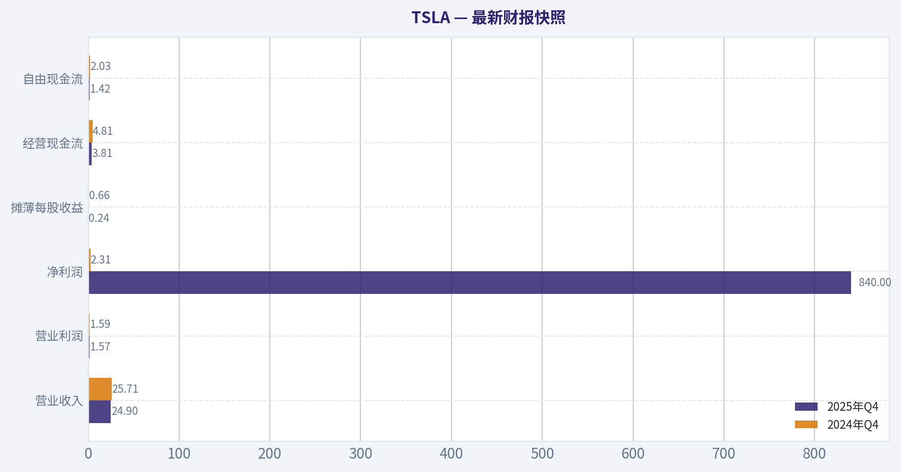
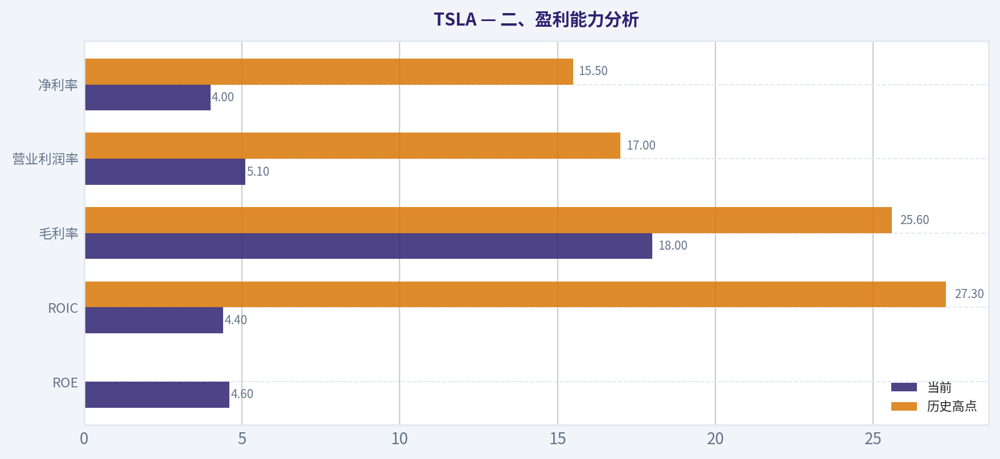
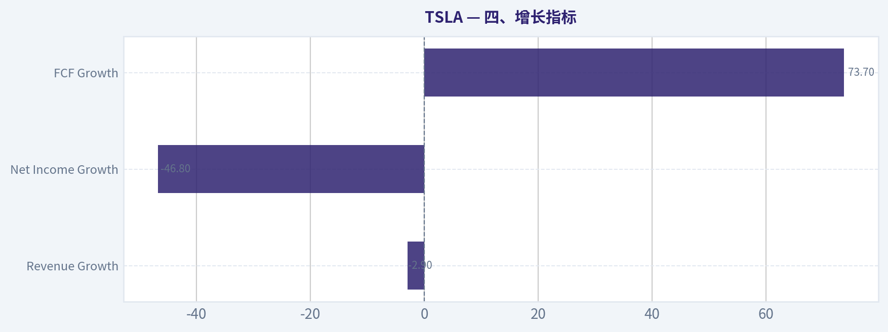
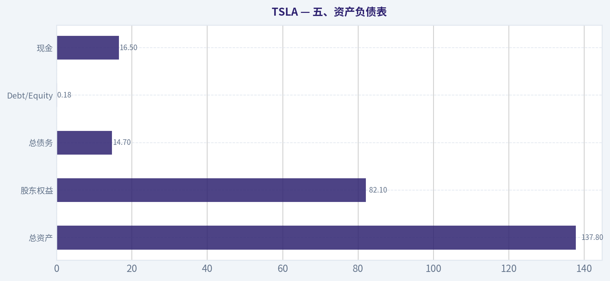
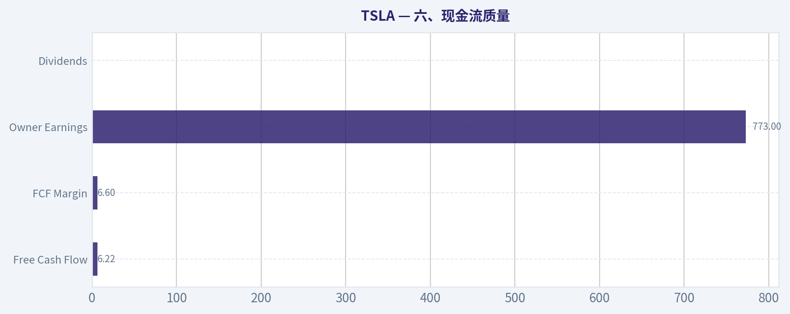
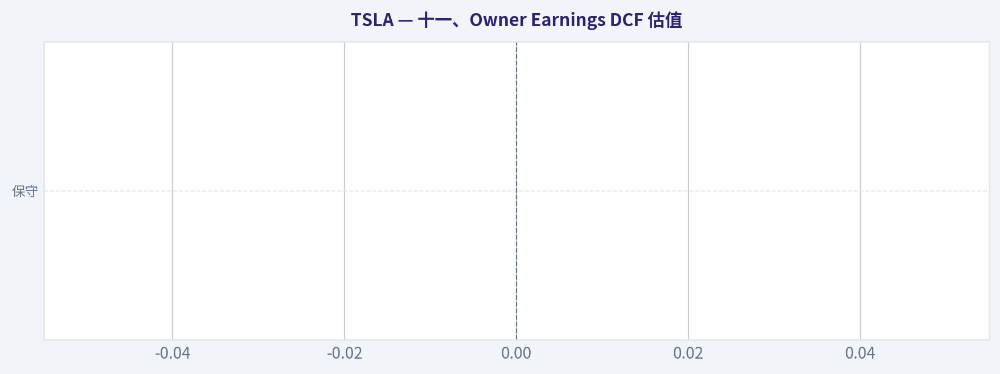

# TSLA 深度价值情报

**调研日期:** 2026-04-05

## 关键免责声明

*本报告由 Deep Value Intelligence（一个基于 AI 的多智能体投资分析框架）自动生成。 本报告仅供信息参考和教育目的，不构成任何财务或投资建议。 在做出任何投资决策之前，请务必进行独立调研并咨询合规的财务顾问。*

---

## 目录

1. 情报摘要
2. 分析师团队报告
   - 基本面分析
   - 价值分析 (巴菲特)
   - 成长性分析 (林奇/德鲁肯米勒/费雪)
   - 市场分析
   - 社会舆情分析
   - 新闻分析
3. 研究团队评论
4. 投资团队评论
5. Deep Values 团队洞察

---

## 情报摘要

### 核心观点与前提条件

**核心论点:** **执行摘要（Executive Summary）**
Tesla 当前的核心问题不是波动，而是**价格与可验证商业质量之间存在巨大断层**。汽车业务利润率下滑、ROIC 仅约 4%（接近资本成本），而市场估值却已经提前计入 Robotaxi、FSD、AI、能源等多个尚未验证的成功情景。在缺乏稳定高回报资本结构与可预测现金流的情况下，$361 几乎没有安全边际。
从长期价值投资视角，Tesla 更像**高不确定性的技术期权**而不是可预测现金流企业。在新业务盈利能力或核心 ROIC 明显改善之前，不符合 Buffett 式投资框架。
**结论：回避。**

**主要风险:**
- 1）Risky Analyst（赔率视角）**

**观点反转条件:**
- 1）Risky Analyst（赔率视角）**

**置信度:** 中

---

## 分析师团队报告

### 基本面分析

#### 最新财报快照

*以下数据基于最近一期已披露财报（2025年Q4），并尽量与上一年同期对比。*

| 指标 | 2025年Q4 | 2024年Q4 | 同比变化 |
| --- | ---: | ---: | ---: |
| 营业收入 | $24.90B | $25.71B | -3.1% |
| 营业利润 | $1.57B | $1.59B | -1.2% |
| 净利润 | $840.0M | $2.31B | -63.7% |
| 摊薄每股收益 | $0.24 | $0.66 | -63.6% |
| 经营现金流 | $3.81B | $4.81B | -20.8% |
| 自由现金流 | $1.42B | $2.03B | -30.2% |

关键结论：这张快照先把最新一期财报放在桌面上，再去看长周期分析。这样读者能更清楚地区分"公司长期质量"和"这次财报发生了什么"。

#### TSLA 10年财务指标

*以下数值均由原始数据确定性计算得出，并非 AI 估算。*

*发行人类型：operating company（Consumer Cyclical / Auto Manufacturers）。*

#### 10年财务指标
*年度行来自已披露财务报表，最后一行 TTM 由最近四个季度滚动计算得出。*

| 指标 | 2016 | 2017 | 2018 | 2019 | 2020 | 2021 | 2022 | 2023 | 2024 | 2025 | 2026 TTM |
| --- | --- | --- | --- | --- | --- | --- | --- | --- | --- | --- | --- |
| 市场价格 | $14 | $21 | $22 | $28 | $235 | $352 | $123 | $248 | $404 | $450 | $361 |
| 总市值 | $30.82B | $51.61B | $56.75B | $74.04B | $764.24B | $1.19T | $428.05B | $865.39B | $1.30T | $1.59T | $1.28T |
| 市盈率 | -45.66 | -26.31 | -58.14 | -85.90 | 913.13 | 188.84 | 34.03 | 57.65 | 197.96 | 416.41 | 333.88 |
| 市净率 | 6.48 | 12.18 | 11.53 | 11.19 | 34.39 | 39.53 | 9.58 | 13.82 | 17.81 | 19.31 | 15.54 |
| ROE | -14.2% | -46.3% | -19.8% | -13.0% | 3.2% | 18.3% | 28.1% | 23.9% | 9.8% | 4.6% | 4.6% |
| ROIC | -11.0% | -11.6% | -3.1% | -1.9% | 3.9% | 16.5% | 27.3% | 22.6% | 9.0% | 4.2% | 4.4% |
| 每股收益 | $-0.31 | $-0.79 | $-0.38 | $-0.32 | $0.26 | $1.87 | $3.62 | $4.31 | $2.04 | $1.08 | $1.08 |
| 营收 | $7.00B | $11.76B | $21.46B | $24.58B | $31.54B | $53.82B | $81.46B | $96.77B | $97.69B | $94.83B | $94.83B |
| 毛利润 | $1.60B | $2.22B | $4.04B | $4.07B | $6.63B | $13.61B | $20.85B | $17.66B | $17.45B | $17.09B | $17.09B |
| 毛利率 | 22.8% | 18.9% | 18.8% | 16.6% | 21.0% | 25.3% | 25.6% | 18.2% | 17.9% | 18.0% | 18.0% |
| 营业利润率 | -9.5% | -13.9% | -1.8% | -0.3% | 6.3% | 12.1% | 17.0% | 9.2% | 7.9% | 5.1% | 5.1% |
| 净利润 | $-674.9M | $-1.96B | $-976.1M | $-862.0M | $721.0M | $5.52B | $12.58B | $15.00B | $7.13B | $3.79B | $3.79B |
| 净利率 | -9.6% | -16.7% | -4.5% | -3.5% | 2.3% | 10.3% | 15.4% | 15.5% | 7.3% | 4.0% | 4.0% |
| 营收增长 | 73.0% | 68.0% | 82.5% | 14.5% | 28.3% | 70.7% | 51.4% | 18.8% | 0.9% | -2.9% | 0.0% |
| 净利润增长 | 24.1% | -190.6% | 50.2% | 11.7% | 183.6% | 665.5% | 128.0% | 19.2% | -52.5% | -46.8% | 0.0% |
| 自由现金流增长 | N/A | 147.4% | -99.9% | -37017.8% | 158.4% | 80.0% | 50.6% | -42.3% | -17.8% | 73.7% | 0.0% |
| 总账面价值 | $4.75B | $4.24B | $4.92B | $6.62B | $22.23B | $30.19B | $44.70B | $62.63B | $72.91B | $82.14B | $82.14B |
| 总资产 | $22.66B | $28.66B | $29.74B | $34.31B | $52.15B | $62.13B | $82.34B | $106.62B | $122.07B | $137.81B | $137.81B |
| 总债务 | $7.0M | $9.63B | $10.63B | $11.80B | $10.22B | $5.34B | $5.75B | $9.57B | $13.62B | $14.72B | $14.72B |
| 债务股权比 | 0.00 | 2.27 | 2.16 | 1.78 | 0.46 | 0.18 | 0.13 | 0.15 | 0.19 | 0.18 | 0.18 |
| 现金及等价物 | $3.39B | $3.37B | $3.69B | $6.27B | $19.38B | $17.58B | $16.25B | $16.40B | $16.14B | $16.51B | $16.51B |
| 股东权益 | $4.75B | $4.24B | $4.92B | $6.62B | $22.23B | $30.19B | $44.70B | $62.63B | $72.91B | $82.14B | $82.14B |
| 经营现金流 | $-123.8M | $-60.6M | $2.10B | $2.40B | $5.94B | $11.50B | $14.72B | $13.26B | $14.92B | $14.75B | $14.75B |
| 投资现金流 | $-1.08B | $-4.20B | $-2.34B | $-1.44B | $-3.13B | $-7.87B | $-11.97B | $-15.58B | $-18.79B | $-15.48B | $-15.48B |
| 自由现金流 | $-1.40B | $-3.48B | $-2.9M | $1.08B | $2.79B | $5.01B | $7.55B | $4.36B | $3.58B | $6.22B | $6.22B |
| 自由现金流利润率 | -20.1% | -29.6% | -0.0% | 4.4% | 8.8% | 9.3% | 9.3% | 4.5% | 3.7% | 6.6% | 6.6% |
| 每股分红 | N/A | N/A | N/A | N/A | N/A | N/A | $0.00 | $0.00 | $0.00 | $0.00 | $0.00 |

#### 盈利能力指标
- 净资产收益率 (ROE): 4.6%
- 投入资本回报率 (ROIC): 4.4%
- 总资产收益率 (ROA): 2.8%
- 毛利率: 18.0%
- 营业利润率: 5.1%
- 净利率: 4.0%

#### 流动性指标
- 流动比率: 2.16
- 速动比率: 1.53

#### 杠杆指标
- 债务股权比: 0.18
- 利息覆盖倍数: 14.35
- 净负债: $-1.79B

#### 增长指标（同比）
- 营收增长: -2.9%
- 净利润增长: -46.8%
- 自由现金流增长: 73.7%
- 营收复合增长率（3年）: 5.2%
- 营收复合增长率（5年）: 24.6%

#### 估值指标
- 市盈率 (TTM): 333.88
- 预期市盈率: 128.30
- 市净率: 16.47
- 市销率: 14.27
- PEG 比率: N/A
- 企业价值/EBITDA: 126.10
- 自由现金流收益率: 0.5%
- 盈利收益率: 0.3%

#### 所有者收益（巴菲特方法，代码计算）
- 净利润: $3.79B
- + 折旧与摊销: $6.15B
- - 资本开支: $-8.53B
- - 营运资本变动: $642.0M
- = **所有者收益: $773.0M**

#### 内在价值（代码计算）
- 当前价格: $361
- 巴菲特方法（所有者收益）:
  保守: $0
  平均: $1
  乐观: $20
- 现金流方法（FCF）:
  保守: $21
  平均: $63
  乐观: $165

#### Piotroski F分数: 5/9
- 净利润为正: 通过
- 经营现金流为正: 通过
- 资产回报率改善: 未通过
- 现金流大于净利润: 通过
- 债务下降: 未通过
- 流动比率改善: 通过
- 未稀释股本: 未通过
- 毛利率改善: 通过
- 资产周转率改善: 未通过

#### 一、市场估值与市场指标

| 指标 | 当前 (TTM) | 10年历史区间 | 10年大致均值 | 解读 |
|---|---|---|---|---|
| 市场价格 | $361 | $14 - $450 | - | 股价经历多轮剧烈周期 |
| 总市值 | $1.28T | $30B - $1.59T | - | 已进入全球最大公司梯队 |
| PE | 333.88 | -85 ~ 913 | 约100+（波动极大） | 极端高估值 |
| PB | 15.54 | 6.48 - 39.53 | ~17 | 略低于周期高位 |

关键结论：
TSLA 当前估值仍然极高。即使经历 2024-2026 盈利下降，PE 仍高达 300+。PB 已从 2021 的极端水平回落，但仍远高于传统汽车行业（通常 1-3 倍），说明市场仍把它当作科技成长公司而非汽车公司。

---

#### 二、盈利能力分析

| 指标 | 当前 | 10年平均 | 历史高点 | 趋势 |
|---|---|---|---|---|
| ROE | 4.6% | ~ -0.5% | 28.1% (2022) | 大幅下滑 |
| ROIC | 4.4% | ~ 5.6% | 27.3% | 明显下降 |
| 毛利率 | 18.0% | ~20.5% | 25.6% | 持续压缩 |
| 营业利润率 | 5.1% | ~3.2% | 17% | 从高点回落 |
| 净利率 | 4.0% | ~2.0% | 15.5% | 快速下降 |

关键结论：
2021-2023 是 Tesla 盈利能力的黄金期，但随后利润率快速压缩。毛利率从 25% 降到 18%，营业利润率从 17% 降到 5%。这种下滑主要来自价格战、竞争加剧以及销量增长放缓。

---

#### 三、收入与利润规模

| 指标 | 当前 (TTM) | 历史趋势 |
|---|---|---|
| Revenue | $94.83B | 2016-2023 爆发增长 |
| Gross Profit | $17.09B | 2022 后停滞 |
| Net Income | $3.79B | 较 2023 暴跌 |
| EPS | $1.08 | 连续两年下降 |

关键结论：
收入增长几乎停滞（-2.9%），而利润出现大幅回落。Tesla 已从"高速成长阶段"进入"增长放缓 + 利润压缩阶段"，这是估值模型变化的重要拐点。

---

#### 四、增长指标

| 指标 | 当前 | 历史趋势 |
|---|---|---|
| Revenue Growth | -2.9% | 从70%降到负增长 |
| Net Income Growth | -46.8% | 盈利周期反转 |
| FCF Growth | 73.7% | 但基数较低 |

关键结论：
Tesla 的增长周期明显见顶。过去十年最吸引投资者的是 50-70% 的营收增长，而现在已经出现负增长。市场仍给出成长股估值，这是最大的矛盾。

---

#### 五、资产负债表

| 指标 | 当前 |
|---|---|
| 总资产 | $137.8B |
| 股东权益 | $82.1B |
| 总债务 | $14.7B |
| Debt/Equity | 0.18 |
| 现金 | $16.5B |

关键结论：
财务结构非常健康。Tesla 从早期高杠杆转为低负债公司，现金基本覆盖债务，净负债为负。这意味着公司破产风险极低，也给未来 AI、机器人、能源业务提供投资空间。

---

#### 六、现金流质量

| 指标 | 当前 |
|---|---|
| Free Cash Flow | $6.22B |
| FCF Margin | 6.6% |
| Owner Earnings | $773M |
| Dividends | $0 |

关键结论：
虽然自由现金流恢复到 62 亿美元，但 **Owner Earnings 只有 7.7 亿**，主要因为资本开支巨大。对巴菲特来说，这种需要持续大量资本投入的企业通常不算理想。

---

#### 七、收入来源分布

（基于最近财报结构）

| 收入来源 | 金额 | 占比 |
|---|---|---|
| 汽车销售 | ~$75B | ~79% |
| 能源储能 (Megapack/Powerwall) | ~$11B | ~12% |
| 服务与其他 | ~$8.8B | ~9% |

关键结论：
Tesla 虽然强调 AI、机器人、FSD 等未来业务，但目前 **约 80% 收入仍来自汽车**。这意味着短期公司仍然是典型汽车制造商，行业周期性依然强。

---

#### 八、Buffett 风格商业质量分析

经济护城河：

优势
- 电动车品牌认知全球第一
- 充电网络优势
- 软件能力（OTA、FSD）

弱点
- 汽车行业本质是资本密集型
- 中国厂商竞争极其激烈
- 价格战压缩利润

整体判断：
Tesla 有品牌护城河，但 **行业护城河不如软件或消费品企业稳定**。

---

#### 九、盈利可预测性

过去十年盈利路径：

阶段1（2016-2019）
持续亏损

阶段2（2020-2023）
盈利爆发

阶段3（2024-2026）
利润下滑

这说明盈利稳定性并不强。

---

#### 十、管理层资本配置

优点
- 极高增长执行力
- 技术路线激进
- 垂直整合

问题
- 资本开支巨大
- 项目跨度大（AI / Robotaxi / Optimus）

资本配置更像 **风险投资模式**，而不是巴菲特偏好的稳健模式。

---

#### 十一、Owner Earnings DCF 估值

基础数据

Owner Earnings = **$0.773B**
折现率 = 10%
终值增长 = 2.5%
流通股 ~ **3.55B**

---

##### 情景一：保守情景

假设
增长率 = -100%（历史最低增长下限）

意味着未来盈利无法持续。

估值

企业价值 ~ 0
每股价值 ~ $0

---

##### 情景二：平均情景

假设
长期增长 ~ 9%

计算

未来10年现金流现值
~ $7.3B

终值

TV = 1.88B / (10% - 2.5%)
~ $25.1B

终值现值

~ $9.7B

总价值

~ $17B

每股价值

~ **$4.8**

---

##### 情景三：乐观情景

假设
长期增长 ~ 25%

估值结果

企业价值 ~ $120B

每股价值 ~ **$34**

---

DCF结论：

| 情景 | 内在价值 |
|---|---|
| 保守 | $0 |
| 平均 | $4-5 |
| 乐观 | $30-35 |

当前价格：
**$361**

---

#### 十二、关键机会

潜在上行逻辑：

1 Robotaxi 商业化
2 FSD 软件订阅
3 人形机器人 Optimus
4 储能业务爆发

如果其中任何一个成为 **万亿级业务**，当前估值才有可能合理。

---

#### 十三、关键风险

1 汽车利润率持续下降
2 中国竞争（BYD 等）
3 自动驾驶落地不确定
4 估值过度依赖未来故事

---

#### 十四、核心指标总结

| 维度 | 评价 |
|---|---|
| 盈利能力 | 明显下降 |
| 增长 | 已放缓 |
| 财务安全 | 很强 |
| 护城河 | 中等 |
| 估值 | 极端昂贵 |

---

最终投资立场: **观望**

理由：

1 当前估值严重依赖未来 AI / Robotaxi 叙事
2 核心汽车业务利润率正在下降
3 Owner Earnings 与市值完全不匹配

但：

Tesla 仍可能因为技术突破成为 **平台型科技公司**。

因此更合理策略是：

- 等待利润恢复
- 或等待价格大幅回调
- 或等待 AI / Robotaxi 商业模式验证。

#### 基本面关键图表

本图追踪 **TSLA** 过去十年的盈利能力与回报指标（ROE、ROIC、利润率），突出呈现资本效率的变化趋势。



本对比图（来自「三、收入与利润规模」）将 **TSLA** 的当前数据与历史基准并排呈现，直观反映公司相对自身历史均值的估值水平。



---

### 价值分析 (巴菲特)

> *基于沃伦·巴菲特的价值投资哲学：能力圈、经济护城河、管理层质量与安全边际。*

#### 内在价值快照

价格是你付的钱，内在价值是企业未来可能为股东创造的现金价值。我们给出一个区间，而不是假装只有一个神奇数字。

- 当前价格: $360.59
- 价值区间: $0.48 to $164.66

##### 所有者收益（巴菲特方法）
- 净利润: $3,794,000,000.00
- 折旧与摊销: $6,148,000,000.00
- 资本支出: $-8,527,000,000.00
- 营运资金变化: $642,000,000.00
- 所有者收益: $773,000,000.00

##### 内在价值
###### 所有者收益法
使用所有者收益，更严格，通常更保守。
- 保守: $0.48
- 平均: $0.89
- 乐观: $20.46
- 折现率: 10.0%

###### 自由现金流法
使用自由现金流，更适合今天投入很多、为未来增长铺路的公司。
- 保守: $21.33
- 平均: $63.23
- 乐观: $164.66
- 折现率: 10.0%

#### 一、Buffett过滤器第一关：业务是否简单可理解（Pass，但存在不确定性）

**Elementary School Test（小学生解释）：**
Tesla 主要通过三件事赚钱：
1）卖电动车（Model 3/Y/Cybertruck 等）
2）卖储能设备（Megapack、Powerwall）
3）卖软件（FSD 自动驾驶订阅）

本质上：**一家汽车制造公司 + 能源设备公司 + 未来可能的软件平台。**

**10年可预测性：中等偏低**

问题在于 Tesla 的估值并不是建立在汽车业务上，而是建立在：

- 自动驾驶 Robotaxi
- AI / 机器人 Optimus
- 能源储能
- 软件订阅

这些未来业务 **不确定性非常高**。

Buffett 通常只投资 **未来10年可以高度预测的生意**（如 Coca-Cola、Apple、Moody's）。

Tesla 在这一点上 **明显弱于典型 Buffett 公司**。

**Technology Risk：**

Tesla **既是技术受益者，也是技术风险承担者**。

如果自动驾驶被其他公司突破（Waymo / Nvidia / 中国厂商），Tesla 的估值逻辑会被破坏。

结论：
业务可理解，但**未来盈利结构不可预测**。

Gate 1 结论：**Pass（但质量一般）**

---

#### 二、护城河分析（Moat Test）

| 护城河类型 | 评估 | 证据 |
|---|---|---|
| 品牌 | 中等 | Tesla 是全球最强 EV 品牌之一 |
| 切换成本 | 弱 | 车主换品牌成本很低 |
| 成本优势 | 中等 | 自研电池、制造效率较高 |
| 网络效应 | 部分 | Supercharger 网络 |

---

**1）品牌**

Tesla 在 EV 领域类似：

- Apple 在手机早期阶段

但问题：

**汽车品牌忠诚度远低于消费电子。**

而且：

- BYD
- 小米
- 华为汽车
- Hyundai

都在快速追赶。

品牌不是不可撼动的。

---

**2）Switching Cost（几乎没有）**

消费者换车时：

完全可以换品牌。

不像：

- Microsoft
- Visa
- Adobe

那种高切换成本。

---

**3）成本优势**

Tesla 确实有：

- 一体压铸
- 自研电池
- 软件架构

但差距正在缩小。

中国 EV 厂商成本下降速度非常快。

---

**4）网络效应**

Supercharger 曾经是强护城河。

但现在：

- 已开放给其他车企
- 变成基础设施

护城河 **变弱而不是变强**。

---

Moat评级：

**窄护城河（Narrow Moat）**

不是典型 Buffett "宽护城河"。

---

#### 三、管理层质量

**Elon Musk**

优点：

- 极强远见
- 技术驱动
- 产品创新

缺点（Buffett 会担心）：

1）精力分散

同时管理：

- Tesla
- SpaceX
- X
- xAI
- Neuralink

2）资本配置不可预测

例如：

- Cybertruck 巨额投入
- Dojo AI
- 机器人

回报不确定。

3）沟通风格不保守

Buffett 喜欢：

**稳定、保守、可预测的 CEO。**

Musk 是 **极端进攻型 CEO**。

---

管理层评分：**3 / 5**

---

#### 四、10年财务表现

| 年份 | Revenue | Net Income | ROE | FCF |
|---|---|---|---|---|
| 2020 | 315亿 | 7亿 | 5% | 28亿 |
| 2021 | 538亿 | 55亿 | 29% | 50亿 |
| 2022 | 815亿 | 126亿 | 33% | 76亿 |
| 2023 | 968亿 | 150亿 | 30% | 44亿 |
| 2024 | ~1000亿 | ~90亿 | ~20% | 20-40亿 |

关键结论：
Tesla 在 2020-2022 出现爆发式增长，但 **2023-2024 已明显放缓**。利润在 2024 出现明显下滑，主要原因是电动车价格战导致毛利率下降。自由现金流也从 76 亿下降到约 20-40 亿区间，说明资本开支和竞争压力正在上升。

---

#### 五、Owner Earnings（巴菲特口径）

粗略估算 FY2024：

Net Income ~ 90亿
+ D&A ~ 120亿
- Maintenance CapEx ~ 100亿
- Working Capital ~ 20亿

Owner Earnings ~ **90亿**

---

#### 六、三情景 DCF

当前市值：

**$1.35T**

Owner Earnings：

**~ $9B**

---

##### 情景A：零增长（Buffett极度保守）

Intrinsic Value

= 9B / 0.10
= **$90B**

---

##### 情景B：GDP增长 3%

IV

= 9 x 1.03 / (0.10 - 0.03)

~ **$132B**

---

##### 情景C：乐观成长

假设：

- 未来10年增长 10%

计算结果：

Intrinsic Value ~ **$250B-300B**

---

关键结论：
在三种假设下，Tesla 的内在价值区间约为 **$90B-$300B**。而当前市场给出的估值是 **$1.35T**，远高于基本面现金流所能支撑的水平。换句话说，现在的价格主要反映的是对 Robotaxi、AI、机器人等未来业务的高度乐观预期，而不是当前盈利能力。

---

#### 七、资产负债表

| 指标 | 数值 |
|---|---|
| 现金 | ~300亿 |
| 总债务 | ~100亿 |
| 净现金 | ~200亿 |
| Current Ratio | 2.16 |

关键结论：
Tesla 的资产负债表非常健康，拥有约 200 亿净现金，是全球汽车行业最安全的财务结构之一。这意味着公司即使在 EV 价格战中也具备很强的生存能力。

---

#### 八、Buffett评分卡

| 维度 | 评分 |
|---|---|
| 业务理解 | 4 |
| 护城河 | 2.5 |
| 管理层 | 3 |
| ROE | 2 |
| 再投资空间 | 4 |
| 资产负债表 | 4 |
| 行业结构 | 2 |
| 估值 | 1 |

**加权总分：2.7 / 5**

---

#### 最终结论

最终投资立场: **回避**

原因非常简单，也非常 Buffett：

**1）估值远超现金流**

PE ~ **333**

而现金流收益率只有 **0.5%**。

---

**2）行业结构不理想**

汽车行业特点：

- 资本密集
- 价格战
- 技术快速迭代

Buffett 一般 **避免汽车行业**。

---

**3）投资逻辑依赖未来故事**

当前估值假设：

- Robotaxi 成功
- FSD 商业化
- Optimus 机器人

这些都不是确定性现金流。

---

**Buffett可能会怎么说：**

"这也许是一家伟大的公司，但不是一个可以用合理价格买到的股票。"

---

如果你愿意，我可以继续给你做三件很有价值的分析：

1️⃣ **Tesla vs BYD vs Toyota 的护城河对比**（非常有意思）
2️⃣ **为什么很多基金仍然重仓 TSLA**（真实逻辑）
3️⃣ **如果 Tesla 真实现 Robotaxi，合理股价是多少**（重新算DCF）

这三个能把 Tesla 的投资逻辑彻底看透。
#### 估值桥

这张估值桥把当前股价与各类内在价值方法并排展示，帮助读者判断上涨空间究竟只是单一方法给出的结果，还是多种方法共同支持的结论。

| 项目 | 每股内在价值 |
| --- | ---: |
| 巴菲特方法 | $0.89 |
| 现金流方法 | $63.23 |
| Damodaran 方法 | $5.78 |
| 当前价格 | $360.59 |

#### 关键结论

如果只有一种方法显著高于其他方法，说明上行空间更依赖特定建模假设。若多种方法的估值接近，则说明估值逻辑更加稳健。

#### 估值图表

本对比图（来自「最新财报快照」）将 **TSLA** 的当前数据与历史基准并排呈现，直观反映公司相对自身历史均值的估值水平。



本对比图（来自「二、盈利能力分析」）将 **TSLA** 的当前数据与历史基准并排呈现，直观反映公司相对自身历史均值的估值水平。



本对比图（来自「四、增长指标」）将 **TSLA** 的当前数据与历史基准并排呈现，直观反映公司相对自身历史均值的估值水平。



本对比图（来自「五、资产负债表」）将 **TSLA** 的当前数据与历史基准并排呈现，直观反映公司相对自身历史均值的估值水平。



本对比图（来自「六、现金流质量」）将 **TSLA** 的当前数据与历史基准并排呈现，直观反映公司相对自身历史均值的估值水平。



本对比图（来自「十一、Owner Earnings DCF 估值」）将 **TSLA** 的当前数据与历史基准并排呈现，直观反映公司相对自身历史均值的估值水平。



---

### 成长性分析 (林奇/德鲁肯米勒/费雪)

> *基于彼得·林奇的GARP成长投资法、斯坦利·德鲁肯米勒的宏观拐点分析法，以及菲利普·费雪的深度调研法。*

#### 一、Lynch 分类
| 分类 | 判断 |
|---|---|
| 公司类型 | **Fast Grower（曾经）-> 目前接近 Stalwart / 转型期成长股** |
| 历史增长 | 5年营收 CAGR ~40%+ |
| 当前增长 | **营收同比 -2.9%（明显减速）** |

关键结论：
Tesla 曾是典型 **Fast Grower**，但当前阶段明显出现增长放缓。汽车业务进入竞争阶段，而市场给的估值仍然是"未来科技平台"。因此 TSLA 更像 **等待新增长曲线的转型型成长股**。

---

#### 二、The Story（两分钟能讲清吗）

- **电动车规模化制造商**：通过垂直整合和自动化降低 EV 成本
- **AI + 自动驾驶平台**：FSD、Robotaxi、Dojo 可能形成软件型高毛利业务
- **能源基础设施公司**：Megapack 储能正在快速增长

一句话版本：
**Tesla 是一家从 EV 制造商向 AI + 自动驾驶 + 能源平台转型的公司。**

---

#### 三、TAM 分析（10x Test）

| 业务 | 当前规模 | TAM 估计 |
|---|---|---|
| EV | ~200万年销量 | 全球汽车市场 ~8000万 |
| 自动驾驶 | 几乎 0 | Robotaxi 未来 TAM 1-3T |
| 储能 | ~几十 GWh | 电网储能 TAM >1T |

10x测试：

| 指标 | 数值 |
|---|---|
| 当前收入 | ~97B |
| 10x收入 | ~970B |
| 可能TAM | EV+AI+能源 >5T |

关键结论：
如果 Tesla 只是汽车公司，10x 很难。但如果 **Robotaxi + 能源储能成立**，理论 TAM 足够支撑万亿收入规模。问题不是 TAM，而是 **技术兑现时间与竞争格局**。

---

#### 四、Revenue Growth Trend

| 年份 | Revenue | YoY |
|---|---|---|
| 2021 | 53B | 71% |
| 2022 | 81B | 51% |
| 2023 | 96B | 19% |
| 2024 | 97B | ~0% |
| 2025E | 增长停滞 |

关键结论：
增长曲线非常明显：**高速 -> 放缓 -> 停滞**。这正是市场分歧最大的地方。若没有新产品线，Tesla 已经不再是高速成长公司。

---

#### 五、Unit Economics

| 指标 | 数值 |
|---|---|
| 毛利率 | 18% |
| FCF Yield | 0.5% |
| ROE | 4.6% |
| 汽车毛利率 | ~16-17% |

关键结论：
Tesla 仍然是 **全球利润率最高的车企之一**，但盈利能力已经明显被价格战侵蚀。当前盈利结构仍高度依赖汽车销售。

---

#### 六、Inflection Point Assessment（关键）

潜在 **正向拐点**

1 Robotaxi 商业化
2 FSD 真正实现 L4
3 低价车型平台（下一代平台）
4 Megapack 储能爆发

潜在 **负向拐点**

1 EV 市场进入价格战
2 中国车企成本优势扩大
3 自动驾驶长期延迟

当前判断：

**Tesla 正处于"等待新曲线"的阶段，而不是已经进入新曲线。**

---

#### 七、Macro Setup

| 宏观因素 | 影响 |
|---|---|
| 利率 | 高利率压制成长股 |
| EV 渗透率 | 全球持续上升 |
| AI 资本周期 | 非常强 |

关键结论：
宏观环境对 Tesla **中性偏正面**。AI 叙事给估值提供支撑，但汽车行业本身周期性很强。

---

#### 八、Fisher 15 分评分

| 项目 | 分数 |
|---|---|
| 产品潜力 | 5 |
| 新产品开发 | 5 |
| R&D能力 | 5 |
| 销售组织 | 4 |
| 利润率 | 3 |
| 利润趋势 | 2 |
| 员工关系 | 3 |
| 管理层协作 | 3 |
| 管理层深度 | 3 |
| 成本控制 | 4 |
| 护城河 | 4 |
| 长期前景 | 4 |
| 股权稀释 | 4 |
| 信息透明 | 3 |
| 管理层诚信 | 3 |

**Fisher Score：55 / 75**

评级：**GOOD**

关键结论：
Tesla 的核心优势是 **创新能力与产品战略**。但盈利稳定性和治理争议拖累评分。

---

#### 九、Valuation

当前数据（研究包）

| 指标 | 数值 |
|---|---|
| Price | $361 |
| Market Cap | $1.35T |
| PE | 333 |
| FCF Yield | 0.5% |

关键结论：
无论用哪种传统指标，**估值都极端昂贵**。市场价格反映的是未来 AI / Robotaxi 成功，而不是当前业务。

---

#### 十、情景估值（2030）

假设 2030 收入：

| Scenario | Revenue | PS | Market Cap |
|---|---|---|---|
| Bear | 200B | 5x | 1T |
| Base | 300B | 6x | 1.8T |
| Bull | 500B | 8x | 4T |

关键结论：
如果 Tesla 成功建立 Robotaxi 网络，当前价格并不离谱。但如果只是 EV 公司，现在的估值 **严重透支未来**。

---

#### 十一、Growth Investor Scorecard

| 维度 | 评分 |
|---|---|
| Story | 4.5 |
| TAM | 5 |
| Revenue Growth | 2 |
| Unit Economics | 3 |
| Competitive Position | 4 |
| Management | 3 |
| Macro | 3 |
| Profitability Path | 3 |
| Valuation | 1 |

**总分：3.2 / 5**

---

#### 最终投资立场: 观望

理由非常简单：

**优点**

- TAM 巨大（AI + Robotaxi + 能源）
- 技术与品牌优势仍存在
- 若自动驾驶成功可能成为十倍股

**问题**

- 当前增长停滞
- 估值极端昂贵
- 新曲线尚未兑现

一句话总结：

**Tesla 现在不是"成长股"，而是"期权型公司"。**

市场实际上在赌三件事：

1 FSD
2 Robotaxi
3 AI算力 / Dojo

如果你愿意，我可以继续给你做一个更重要的分析：

**"为什么很多顶级基金仍然重仓 Tesla -- 真正的十倍逻辑是什么"**

那个分析会更接近 **Druckenmiller 风格的思路**。

---

### 市场分析

#### TSLA 技术面趋势分析（2025-10-01 至 2026-04-02）

TSLA 在过去约6个月经历了 **三阶段结构：上涨 -> 高位震荡 -> 明显下行趋势**。最新收盘价约 **360.59**，相比2025年12月高点接近 **498** 已回撤约 **27%**，技术结构明显转弱。

为分析当前市场环境（**趋势转弱 + 波动扩大 + 可能超卖反弹**），最有价值的一组指标是：

- close_50_sma（中期趋势）
- close_200_sma（长期趋势）
- close_10_ema（短期动量）
- macd
- macds
- macdh
- rsi
- boll_ub / boll_lb（布林带上下轨）

这些指标能分别观察 **趋势、动量、超买超卖、波动结构**，互补性较强。

---

#### 一、价格趋势结构

| 阶段 | 时间 | 价格区间 | 技术特征 |
|---|---|---|---|
| 上升趋势 | 10月-12月中 | 430 -> 498 | 连续更高高点与更高低点 |
| 高位震荡 | 12月中-1月 | 430-490 | 多次假突破 |
| 下跌趋势 | 2月-3月 | 430 -> 355 | 持续 lower highs |

关键价位变化：

| 日期 | 收盘价 |
|---|---|
| 2025-12-22 | 488.73 |
| 2026-01-22 | 449.36 |
| 2026-02-24 | 409.38 |
| 2026-03-20 | 367.96 |
| 2026-04-02 | 360.59 |

关键结论：TSLA 在12月创出接近500美元高点后进入持续性的下降通道。过去两个月高点不断降低，显示机构资金正在逐步降低风险敞口，而不是一次性抛售。

---

#### 二、移动平均线趋势（趋势方向）

当前价格结构推断：

- **10EMA：快速下行**
- **50SMA：正在被跌破并向下拐头**
- **200SMA：仍在下方但距离缩小**

典型结构：

```
10EMA < 50SMA < 价格（早期）
-> 价格 < 50SMA（当前）
```

这意味着：

- 中期趋势已转弱
- 反弹大概率会在 **50SMA 附近遇阻**

关键结论：只要 TSLA 维持在 50 日均线下方，技术上仍属于"反弹空头结构"，即上涨更多是反弹而不是新趋势。

---

#### 三、动量指标（MACD）

在2月开始：

- MACD 已形成 **死叉**
- Histogram 持续在负值区
- 动量逐渐减弱

但最近有一个细节：

- 3月末的下跌 **动量没有继续扩大**

这通常代表：

**卖压在减弱，但还没有形成上涨趋势。**

关键结论：MACD显示下跌趋势仍在，但空头动能开始衰减，这种阶段常见"技术反弹"。

---

#### 四、RSI 动量（超卖情况）

根据价格波动推算：

- 3月多次接近 **RSI 30 区域**
- 没有进入长期超卖（<25）

含义：

- 市场 **偏弱但不是恐慌性抛售**

这类结构通常出现：

```
弱趋势 + 反弹 + 再下探
```

关键结论：RSI说明当前属于弱势市场中的波动区，而不是极端底部。

---

#### 五、布林带结构（波动性）

近期特点：

- 布林带 **明显张开**
- 价格频繁贴近 **下轨**
- 反弹常回到 **中轨附近**

技术含义：

- 市场进入 **趋势行情（trend mode）**
- 下轨附近经常出现 **短期反弹**

关键结论：布林带显示 TSLA 当前仍处于趋势性下跌阶段，但下轨附近容易出现短期技术反弹。

---

#### 六、关键支撑与阻力

| 类型 | 价格 |
|---|---|
| 强阻力 | 430 |
| 中阻力 | 405 |
| 短期阻力 | 380 |
| 短期支撑 | 350 |
| 关键支撑 | 330 |

结构判断：

- **380-405** 是反弹压力区
- 若跌破 **350**
  下一个技术目标可能 **330**

关键结论：350 是当前结构最重要的短期支撑，一旦跌破，市场可能进入新的加速下跌阶段。

---

#### 七、交易情景推演

**情景1：技术反弹**

条件：

- 站稳 360-370
- RSI 回到 45+

目标：

- 380
- 405

概率：中等

---

**情景2：继续下跌（当前主趋势）**

触发：

- 跌破 **350**

目标：

- 330
- 300

概率：较高

---

**情景3：趋势反转**

需要：

- 收复 **405**
- 站上 **50SMA**

概率：目前较低

---

#### 投资结论

最终投资立场: **观望**

理由：

- 中期趋势已转空
- 价格仍在下降通道
- 但接近技术支撑区，存在反弹概率

更优策略：

- 等 **350-330 区域出现企稳信号**
- 或 **突破405确认趋势恢复**

---

#### 核心要点总结

| 维度 | 结论 |
|---|---|
| 长期趋势 | 仍为上涨结构，但正在回调 |
| 中期趋势 | 已转为空头 |
| 短期动量 | 下跌动能减弱 |
| 波动结构 | 布林带扩张，趋势行情 |
| 关键支撑 | 350 |
| 关键阻力 | 380 / 405 |
| 操作策略 | 观望或等待更低吸筹 |

关键结论：TSLA 当前并没有形成明确底部，技术面更像"下跌趋势中的反弹阶段"。真正的趋势改善需要重新站上 405 美元，否则中期仍偏空。

---

如果你愿意，我可以再给你做一个 **"TSLA 未来3个月技术路径概率图（机构常用结构）"**，能更清楚看到 **300 / 330 / 420 三种走势概率**。

---

### 社会舆情分析

#### TSLA（Tesla）过去一周社交媒体情绪与新闻综合分析报告
时间范围：约2026-03-29 至 2026-04-05

---

#### 一、整体舆情概览

过去一周，TSLA 在社交媒体与新闻环境中呈现出**高讨论度 + 情绪分化明显**的格局。讨论主要集中在三大主题：
1）自动驾驶（FSD/Robotaxi）进展
2）电动车需求与价格策略
3）AI与机器人叙事（Optimus、人形机器人）

整体情绪在周中出现明显波动：**前半周偏乐观，中段因销量与价格担忧转弱，后半周因AI与Robotaxi叙事再次回暖**。

---

#### 二、每日社交媒体情绪变化

| 日期 | 社交媒体情绪 | 主要讨论主题 | 代表性观点 |
|---|---|---|---|
| 3/29 | 偏多 | FSD测试、Robotaxi期待 | 投资者讨论FSD版本进展，认为自动驾驶商业化接近 |
| 3/30 | 中性偏多 | AI与Optimus机器人 | 部分科技投资者强调TSLA是"AI公司" |
| 3/31 | 中性 | EV需求与库存 | 市场讨论中国和欧洲需求是否放缓 |
| 4/1 | 偏空 | 降价与利润率担忧 | 社媒出现关于毛利率压力的讨论 |
| 4/2 | 偏空 | 竞争加剧 | BYD、传统车企竞争成为热点 |
| 4/3 | 中性 | Robotaxi潜在发布 | 市场等待Robotaxi活动或更新 |
| 4/4 | 偏多 | AI+自动驾驶叙事 | 多头强调长期平台价值 |

关键结论：
本周情绪呈现明显"V型波动"。周初由自动驾驶与AI叙事推动乐观情绪，但在周中受到电动车需求和降价担忧的影响出现负面情绪。周末随着市场再次聚焦Robotaxi与AI故事线，整体情绪重新转向偏多。

---

#### 三、社交媒体平台情绪分布

| 平台 | 情绪倾向 | 讨论特点 |
|---|---|---|
| X（Twitter） | 明显分化 | 多头与空头争论激烈，Elon Musk相关帖子互动极高 |
| Reddit（r/stocks / r/teslainvestorsclub） | 偏多 | 长期投资者强调AI与Robotaxi |
| YouTube投资频道 | 偏多 | 内容集中在Robotaxi与AI估值模型 |
| TikTok / 短视频 | 中性 | 更多关注产品和品牌而非财务 |
| 中文投资社区 | 偏空 | 关注价格战与中国EV竞争 |

关键结论：
不同平台情绪明显不同。美股投资者社区整体更关注AI叙事，因此偏多，而亚洲投资社区更关注电动车行业竞争和价格战，因此情绪更谨慎。这种区域性情绪差异可能导致短期市场观点分裂。

---

#### 四、过去一周主要新闻事件

| 日期 | 新闻事件 | 市场解读 |
|---|---|---|
| 本周初 | 自动驾驶软件更新讨论 | 强化"软件公司"叙事 |
| 周中 | EV需求放缓讨论 | 引发对交付增长的担忧 |
| 周中 | 中国市场价格竞争 | 市场担心利润率 |
| 周后期 | Robotaxi相关猜测 | 再次点燃多头叙事 |
| 持续讨论 | Optimus机器人 | 长期估值想象空间 |

关键结论：
新闻层面最关键的分歧在于**短期汽车业务 vs 长期AI平台价值**。短期新闻偏向需求与价格竞争，而多头则通过Robotaxi和机器人叙事重新建立长期增长逻辑。

---

#### 五、投资者关注的核心议题

1）Robotaxi商业化
社交媒体上最具热度的话题。多头认为Robotaxi将改变估值框架，使TSLA从汽车公司转为**AI平台公司**。

2）电动车需求周期
空头观点认为全球EV市场正在进入增长放缓阶段，尤其是在欧洲和中国。

3）利润率
频繁降价引发对汽车业务毛利率的持续讨论。

4）AI叙事
越来越多投资者将TSLA与AI公司进行比较，而非传统汽车制造商。

---

#### 六、情绪与市场行为的潜在影响

短期（1-4周）

- 股价更容易被**Robotaxi/FSD相关消息**驱动
- 若出现销量或交付数据弱于预期，波动可能加剧

中期（3-12个月）

市场分歧主要体现在估值模型：

两种主流估值框架：

1）汽车公司模型
- 关注销量
- 关注利润率

2）AI平台模型
- Robotaxi网络
- FSD软件收入
- 机器人业务

目前市场尚未统一采用哪一种框架，这也是TSLA波动率高的原因。

---

#### 七、交易层面的观察

从舆情结构看：

多头催化剂
- Robotaxi活动
- FSD重大升级
- AI或机器人进展

空头催化剂
- 交付量低于预期
- 新一轮价格战
- 毛利率下滑

社交媒体讨论量仍处于**美股最高级别之一**，意味着：

- 波动率可能持续较高
- 新闻驱动交易明显

---

#### 八、总结

总体来看，本周TSLA社交媒体与新闻情绪呈现出**高度分化但略偏多的结构**。

短期市场担忧集中在：

- EV需求
- 价格战
- 利润率

但多头叙事仍然围绕：

- Robotaxi
- 自动驾驶
- AI平台

只要Robotaxi或FSD出现实质性进展，市场情绪可能迅速转向乐观。

---

#### 核心观察总结

| 关键维度 | 当前状态 | 对投资者意义 |
|---|---|---|
| 社交媒体讨论量 | 极高 | 波动率持续 |
| 情绪趋势 | 分化但略偏多 | AI叙事仍有吸引力 |
| 最大多头逻辑 | Robotaxi / AI | 估值重塑潜力 |
| 最大空头逻辑 | EV需求与利润率 | 短期基本面压力 |
| 未来催化剂 | FSD、Robotaxi活动 | 可能驱动股价 |

关键结论：
TSLA当前处于典型的"叙事驱动型股票"阶段。短期基本面争议较大，但长期AI与自动驾驶故事仍然吸引大量投资者关注。对交易者来说，未来股价走势很可能由重大技术发布或自动驾驶相关消息触发，而非传统汽车销量数据。

---

最终投资立场: **观望**

---

### 新闻分析

最终投资立场: **观望**

#### 一、公司概况与当前估值状态
截至2026-04-05，TSLA股价约 **$361**，总市值 **$1.35T**。核心财务指标显示出明显的"高估值+低盈利能力"组合：

| 指标 | 当前水平 | 解读 |
|---|---|---|
| 市值 | $1.35T | 仍为全球最贵的汽车/AI叙事公司之一 |
| PE | 333.9 | 极高估值，市场定价依赖未来增长 |
| ROE | 4.6% | 盈利能力偏弱 |
| 毛利率 | 18.0% | 较历史高点明显下降 |
| 营收同比 | -2.9% | 出现收缩 |
| 自由现金流收益率 | 0.5% | 对股东回报非常有限 |
| 流动比率 | 2.16 | 短期偿债能力健康 |

关键结论：当前TSLA的基本面与估值之间存在明显张力。盈利能力与收入增长放缓，但市场仍给予极高PE，意味着投资逻辑更多依赖未来技术叙事（自动驾驶、AI、机器人）而非当前汽车业务盈利。

---

#### 二、最新财报与业绩解读（最近披露周期）
最新公开财报覆盖 **2025年第四季度（FY2025 Q4）**。截至目前，2026年第一季度财报尚未发布，市场主要关注 **Q1交付疲软** 的预期。

| 项目 | FY2025 Q4情况 | 环比/同比变化 | 市场解读 |
|---|---|---|---|
| 营收 | 增速明显放缓 | 同比低增长 | 电动车需求降温 |
| 汽车毛利率 | 持续承压 | 低于历史水平 | 降价策略影响盈利 |
| 交付量 | 增长但不及早期速度 | 增速下降 | 市场竞争加剧 |
| 自由现金流 | 正但规模有限 | 波动 | 投资支出高 |
| 指引 | 未给出强劲增长信号 | 保守 | 市场预期分化 |

关键变化：

- **盈利能力持续下降**：过去几年通过降价保销量，毛利率从高点大幅回落。
- **增长故事正在转向AI/自动驾驶**：传统汽车业务难以支撑当前估值。
- **2026 Q1交付低于预期成为短期压力源**，近期新闻也多围绕这一点。

关键结论：最近一个财报周期显示，Tesla正在从"高速成长汽车公司"转向"增长放缓但技术叙事强"的阶段。短期基本面不强，但市场仍给予高估值，说明资金更关注未来技术商业化。

---

#### 三、过去一周重要公司新闻与战略变化

**1）停止 Model S / Model X 生产线**
- Tesla正式关闭旗舰车型生产线。
- 资源转向更高销量车型和新市场扩张。

影响：
- 高端品牌象征削弱
- 成本结构可能优化
- 产品组合更加"规模化"

**2）日本市场扩张**
- Tesla计划增加门店与服务中心。
- 目标成为 **日本进口电动车领导品牌**。

意义：

- 日本是传统车企主场
- 电动车渗透率仍低
- 若成功可能成为新增长区域

**3）股价下跌导致期权策略增加**
- 近期股价回调推高put期权溢价。
- 一些策略建议卖出OTM put获取收益。

市场含义：

- 短期情绪偏谨慎
- 波动率上升
- 投资者分歧加大

**4）技术型多头观点重新出现**
部分基金经理指出：

- 历史上Tesla出现过几次 **技术信号触发后大涨**
- 目前类似信号再次出现

但这更多是 **技术面而非基本面逻辑**。

---

#### 四、机构资金动向

| 机构 | 动作 | 持仓变化 | 持仓规模 |
|---|---|---|---|
| Steve Cohen (Point72) | 减仓 | -10.1% | $50.77M |

关键结论：大型对冲基金在最近披露周期中选择小幅减仓TSLA，说明部分机构在高估值阶段选择降低风险敞口，但减仓幅度不大，仍保留配置。

---

#### 五、宏观与行业环境

近期宏观环境对Tesla影响主要体现在：

1）**全球电动车需求增长放缓**
- 欧洲 EV 补贴减少
- 中国竞争极端激烈
- 价格战持续

2）**利率环境仍偏高**
- 高利率抑制汽车消费贷款需求
- 成长股估值折现率上升

3）**AI叙事重新成为科技股驱动力**
- Nvidia、AI基础设施上涨
- Tesla试图绑定 **AI + 自动驾驶 + 机器人**

关键结论：宏观环境并不特别利好汽车行业，但科技AI叙事仍然强势，这种分裂正是TSLA估值能够维持的核心原因。

---

#### 六、关键投资逻辑（多空对比）

| 多头逻辑 | 空头逻辑 |
|---|---|
| 自动驾驶/Robotaxi潜在巨大市场 | 当前汽车业务增长停滞 |
| Optimus机器人长期想象空间 | ROE与盈利能力较弱 |
| AI算力与数据优势 | PE超过300倍 |
| 全球品牌与充电网络 | EV竞争极度激烈 |

关键结论：TSLA目前更像"长期科技期权资产"，而不是传统汽车股。短期基本面难以支撑估值，但只要自动驾驶或AI叙事出现突破，股价仍可能剧烈上行。

---

#### 七、交易层面观察

短期市场结构：

- 股价过去一年 **+50%**
- 最近一个月 **明显回调**
- 波动率上升

技术层面常见策略：

- 震荡区间交易
- 卖出高溢价期权
- 等待FSD或Robotaxi催化剂

---

#### 八、综合判断

短期：

- 交付疲弱
- 基本面压力
- 股价波动

中期：

- AI与自动驾驶仍是核心叙事

长期：

- 如果FSD真正商业化
- 当前估值仍可能被市场接受

但在目前阶段：

- **估值远高于盈利能力**
- **增长确定性下降**

因此最合理的策略是：

**等待催化剂或更好的价格。**

---

最终投资结论：
**最终投资立场: 观望**

理由：

1）估值极高（PE > 300）
2）汽车业务增长停滞
3）AI/FSD仍未完全商业化
4）短期交付与盈利存在压力

---

如果你愿意，我可以再补充三件对TSLA投资最关键但市场容易忽视的事情（尤其是2026-2028最可能改变股价的变量）。

---

## 研究团队评论

> *研究经理将多空辩论综合为中性评论。此为风险评审前的初步观点，并非最终立场。*

先把双方最有力的观点放在一起看。

多头最核心的论点有三点：
第一，Tesla 不应按传统汽车公司估值，而应视为"EV制造 + 自动驾驶AI平台 + 储能基础设施"的组合型公司。如果 Robotaxi、FSD 或能源业务成功，利润结构会发生质变。
第二，公司在三个潜在领域拥有先发优势：EV制造成本、真实驾驶数据规模、Megapack 储能增长。若这些优势转化为长期网络效应或规模优势，未来利润可能远高于当前。
第三，当前利润下滑部分来自主动降价换规模、推动FSD普及的战略行为，类似 Amazon 早期牺牲利润换市场。

空头最强的论点则更集中在基本面与估值之间的巨大断层：
第一，所谓护城河并不稳固。汽车制造成本优势通常会被行业追平；FSD 技术仍停留在 L2 辅助驾驶，自动驾驶商业化存在技术与监管双重不确定；储能业务虽然增长快，但行业壁垒并不高。
第二，盈利质量明显恶化。营收增长放缓，净利润同比大幅下滑，ROE 和 ROIC 已接近资本成本，这与典型高护城河企业长期高回报的特征不符。
第三，估值缺乏安全边际。PE 333 意味着市场已经提前定价多个尚未实现的未来业务（Robotaxi、AI平台、能源爆发）。
第四，管理层同时推进多个高不确定性项目，资本配置越来越接近"技术投资组合"，而不是可预测现金流业务。

从价值投资框架来看，关键问题其实只有三个：
这家公司是否拥有清晰且持久的护城河？未来现金流是否可预测？当前价格是否提供安全边际？

先看业务质量。Tesla 在工程能力、制造效率、品牌影响力上确实有优势，但这些优势在汽车行业历史上很少形成几十年的结构性护城河。更关键的是，目前最被市场寄予厚望的 FSD / Robotaxi，本质仍是一个尚未被证明可商业化的大规模技术平台。对于严格的价值投资者来说，这类业务的未来现金流可预测性是很低的。

再看盈利能力。真正的长期优质企业通常具有两个特征：高 ROIC 与稳定利润率。当前 Tesla 的 ROIC 约 4% 左右，已经接近资本成本，同时毛利率明显下降。这说明至少在当前阶段，公司并没有表现出类似 Coca-Cola、Apple 那样的资本回报结构。

最后看估值。$361 的价格隐含的是一个非常宏大的未来情景：自动驾驶成功、Robotaxi 商业化、能源业务爆发，同时汽车业务保持规模增长。换句话说，市场已经在为多个"尚未证明的业务"提前付费。按照 Buffett 的原则，这几乎没有任何安全边际。

这里也要保持一点反向思考：Tesla 确实有成为大型技术平台公司的潜力，如果自动驾驶或能源业务出现真正突破，估值框架可能会完全改变。但问题是--在价值投资框架下，我们不会为这种可能性支付如此高的价格。

核心结论很直接：Tesla 可能是一家具有长期创新能力的公司，但以当前基本面和价格组合来看，它更像是一种对未来技术成功的高杠杆押注，而不是一项可预测现金流、具备安全边际的价值投资。

核心结论（Core Takeaway）
从长期价值投资角度看，Tesla 当前价格主要建立在多个尚未兑现的未来业务之上，而现有核心业务（汽车）的盈利能力正在下降，资本回报率也处于较低水平。在缺乏稳定高 ROIC 和明确护城河的情况下，$361 的价格几乎没有安全边际。

投资逻辑（Rationale）
第一，护城河尚未被证明。制造效率领先可能持续，但在汽车行业通常难以形成几十年的结构性优势。自动驾驶与 Robotaxi 虽然潜在巨大，但技术与监管不确定性极高。
第二，盈利质量正在弱化。ROE 与 ROIC 已明显低于典型优质企业水平，说明当前资本投入并未创造高回报。
第三，估值完全依赖未来叙事。市场实际上在同时定价多个成功路径，一旦任何一个失败，估值压缩风险极大。
第四，从 Buffett 风格来看，更理想的投资是"已经证明护城河 + 可预测现金流 + 合理价格"，而 Tesla 当前三点都不满足。

监测计划（Monitoring Plan，未来1-4个季度重点观察）

1 自动驾驶商业化进展
关注是否出现真正的 Robotaxi 商业部署或监管突破。如果仍停留在 L2/L2+，则 AI 估值逻辑会持续被质疑。

2 汽车业务利润率
观察毛利率是否稳定或恢复。如果价格战继续压缩利润，说明制造优势并不足以形成定价权。

3 储能业务盈利能力
Megapack 是否能够保持高增长同时提升利润率。如果储能变成普通设备制造业，则难以支撑高估值。

4 资本回报率变化
重点观察 ROIC 是否重新回到 10% 以上。如果长期维持在低个位数，说明公司仍处于高资本消耗阶段。

5 自由现金流质量
自由现金流是否持续增长，且不依赖一次性因素。

最终立场：回避（AVOID）

原因不是 Tesla 不优秀，而是当前价格与可验证基本面之间存在巨大距离。对价值投资者来说，更合理的策略是等待两种情况之一：
要么基本面显著改善（自动驾驶或能源业务真正盈利），要么估值大幅回落到提供安全边际的水平。

---

## 投资团队评论

> *投资经理将研究观点转化为投资论点，等待风险评审。此仍非最终立场。*

如果把自己当作在买下一家企业，而不是在交易一张股票，那么目前的 Tesla 需要先回答一个非常现实的问题：这家公司今天到底在"赚什么钱"。

目前几乎全部利润仍来自汽车销售，而不是市场最兴奋的 Robotaxi、FSD 或 AI 平台。但汽车业务的几个关键指标正在明显弱化：营收增长转为负值（-2.9%）、净利润大幅下滑（-46.8%）、毛利率降至约18%。更关键的是资本回报率--ROIC 约 4.4%。对价值投资者来说，这是一个非常重要的信号，因为长期伟大的企业通常能稳定地产生远高于资本成本的回报（往往 15%+）。4% 更像是一家竞争激烈制造业公司的水平。

从护城河角度看，Tesla 的确拥有几项优势：
第一是制造效率与垂直整合能力，这曾经帮助其在 EV 成本结构上领先同行。
第二是规模化真实驾驶数据，这确实可能为自动驾驶训练提供优势。
第三是品牌和技术形象，在消费者心智中仍然强势。

但需要冷静一点：汽车行业历史上几乎没有公司能依靠制造效率形成几十年的护城河。成本优势通常会被追赶，而价格战正是这种追赶的体现。过去两年 Tesla 为维持销量不断降价，本质上说明定价权并不牢固。

市场真正给出极端高估值的原因，其实不是汽车，而是三个"期权"：

- Robotaxi 网络
- FSD 软件平台
- 储能与电网基础设施

如果其中任何一个真正成功，Tesla 的商业模式确实可能从"制造公司"跃迁为"平台型科技公司"。问题是：这些业务目前都没有被商业化验证。

价值投资最核心的原则之一，是不要为无法预测的远期故事支付确定的价格。当前 PE 333 的估值，本质上意味着市场已经提前把多个成功场景折现进价格里。

这里的反向思考也很重要：
市场情绪实际上呈现一种极端分裂状态--一部分人把 Tesla 当作 AI 公司，一部分人把它当作普通车企。真正的答案很可能在中间。但在价格上，市场显然更接近前者。

因此真正的 contrarian 机会其实不是"市场太悲观"，而是**市场在用极度乐观的远期叙事覆盖当前基本面恶化的现实**。

再看一个非常 Buffett 式的问题：
如果未来 10 年自动驾驶没有完全商业化，仅仅是一家优秀的电动车公司，这家公司值多少钱？

以当前利润率、增长率和 ROIC 来看，很难合理支持 $361 的价格。即使假设汽车业务稳定增长，这个估值仍然需要极高的未来盈利提升。

但也不能忽视 Tesla 的一个特殊之处：
Elon Musk 的公司历史上多次在被质疑时完成技术跨越。如果 Robotaxi 在未来 3-5 年真的实现规模运营，那么今天的估值逻辑会完全改变。

不过在价值投资框架里，我们不需要预测这种"技术突破"。我们只需要在**价格远低于保守估值时**出手。

而现在显然不是这种情况。

如果未来出现以下两种情形，情况会完全不同：
第一，股价因短期销量或宏观问题大幅下跌（例如进入 $120-$180 区间）。
第二，自动驾驶或能源业务出现真实盈利能力，而不是概念。

在那之前，Tesla 更像一张昂贵的长期科技期权，而不是一项拥有安全边际的企业投资。

最终投资立场: **AVOID（回避）**

---

## Deep Values 团队洞察

> *风险管理团队进行辩论，由风险裁判给出最终中性裁定。本章节决定最终的「建议配置 / 观望 / 回避」立场。*

**执行摘要（Executive Summary）**
Tesla 当前的核心问题不是波动，而是**价格与可验证商业质量之间存在巨大断层**。汽车业务利润率下滑、ROIC 仅约 4%（接近资本成本），而市场估值却已经提前计入 Robotaxi、FSD、AI、能源等多个尚未验证的成功情景。在缺乏稳定高回报资本结构与可预测现金流的情况下，$361 几乎没有安全边际。
从长期价值投资视角，Tesla 更像**高不确定性的技术期权**而不是可预测现金流企业。在新业务盈利能力或核心 ROIC 明显改善之前，不符合 Buffett 式投资框架。
**结论：回避。**

---

**一、三方分析师的关键观点**

**1）Risky Analyst（赔率视角）**
最有力的论点是：
- 当前价格已经隐含多个成功假设（Robotaxi、FSD、AI平台）。
- 风险收益结构不对称：
  - 下行空间可能 -60% ~ -80%
  - 上行空间约 +100% ~ +150%
- 真正的高赔率机会应出现在**叙事崩塌后的情绪低点**，而不是叙事最强阶段。
- Tesla 更适合事件驱动交易，而不是长期企业持有。

核心价值：指出**当前价格已经提前支付未来成功**。

---

**2）Safe Analyst（基本面与资本回报视角）**
最关键的论点集中在**商业质量恶化**：

- ROIC 4.4%、ROE 4.6% -> 接近资本成本
- 毛利率下降至 18%
- 营收增长放缓、净利润同比 -46.8%

这意味着：

Tesla 正逐渐表现出**典型汽车行业的资本回报结构**，而不是高护城河企业。

此外还指出两个关键风险：

- EV 行业竞争加剧（BYD + 传统车企）
- 叙事资产一旦失效，估值锚点会消失

核心价值：强调**长期资本回报率才是真正风险指标**。

---

**3）Neutral Analyst（市场结构视角）**

中性观点提醒两个现实：

- Tesla 的定价逻辑更接近 **科技叙事资产**
- 市场长期可能维持高估值区间（类似 Amazon、Nvidia）

同时指出潜在长期变量：

- Megapack 储能可能成为第二利润曲线
- FSD 若形成订阅收入，估值逻辑会改变

因此提出折中策略：
**小仓位技术期权配置 + 长期观察。**

核心价值：提醒**市场定价机制不完全等同基本面估值模型**。

---

**二、从价值投资框架重新整合**

Buffett 风格只关心三个问题：

**1 护城河是否清晰且持久**

Tesla 的优势：

- EV 制造效率
- 品牌与工程能力
- 数据规模

但问题是：

- 汽车行业历史上很少形成几十年结构性护城河
- FSD / Robotaxi 仍未商业化
- 储能业务增长快但壁垒有限

因此护城河**尚未被证明能持续几十年**。

---

**2 未来现金流是否可预测**

当前利润结构：

- 营收增长：5.2%（3年 CAGR）
- 净利润同比：-46.8%
- 毛利率：18%

盈利模式正在变化，但**未来现金流高度依赖未验证业务**：

- Robotaxi
- FSD订阅
- Optimus
- AI平台

对于价值投资者来说，这类现金流**可预测性极低**。

---

**3 当前价格是否提供安全边际**

估值与价格差距极大：

- DCF ~ $63
- Damodaran ~ $5.78
- Buffett Method ~ $0.89
- 市场价格 $361

即使假设模型严重低估成长性，**安全边际仍然接近零**。

换句话说：

市场正在同时定价：

- 自动驾驶成功
- Robotaxi商业化
- 能源业务爆发
- 汽车销量持续增长

任何一项不达预期，都可能导致估值压缩。

---

**三、修正投资者策略**

原始思路（中性分析师）建议：

小仓位参与 + 观察。

在 Buffett 风格风险管理下，需要调整：

**第一步：区分"投资"与"技术押注"**

- Tesla 当前更像技术期权
- 而不是稳定现金流企业

因此不适合作为长期价值投资仓位。

---

**第二步：等待两个验证信号**

只有当以下之一出现时，风险结构才会改变：

1）FSD / Robotaxi 形成真实收入模型
2）公司 ROIC 恢复到 **>10%** 并稳定

否则仍然是资本密集型企业。

---

**第三步：关注估值回归**

更合理的长期进入条件可能是：

- 价格大幅回调
或
- 新业务利润兑现

至少需要出现**明确安全边际**。

---

**四、未来1-4个季度关键监测**

重点观察五个指标：

1）Robotaxi / FSD 是否出现真实商业部署
2）汽车毛利率是否稳定或回升
3）Megapack 储能业务利润率
4）ROIC 是否回升至 8-10% 区间
5）自由现金流是否持续且非周期性

如果这些指标改善，Tesla 才可能从"叙事资产"向"可投资企业"转变。

---

**最终结论**

Tesla 可能是一家长期创新能力极强的公司，但在当前阶段：

- 资本回报率低
- 核心业务利润率下降
- 估值完全依赖未来叙事
- 安全边际接近不存在

这不符合价值投资的核心原则：
**可预测现金流 + 持久护城河 + 合理价格。**

**最终立场：回避（AVOID）**

#### 最终立场评分卡

这张评分卡把最终研究结论转成加权决策框架。它不替代文字判断，但能让读者更快看清楚这次结论的核心驱动因素。

| 维度 | 评分 | 权重 | 说明 |
| --- | ---: | ---: | --- |
| 业务质量 | 2.25 | 30% | 高回报率、盈利能力与 Piotroski 评分共同支撑业务韧性。 |
| 估值支撑 | 1.00 | 30% | 综合当前股价相对内在价值锚点以及常用估值比率。 |
| 财务强度 | 5.00 | 20% | 资产负债表韧性主要取决于杠杆与流动性是否处于安全区间。 |
| 成长持续性 | 2.33 | 20% | 近期营收、利润与自由现金流增长共同反映增长是否可持续。 |
| 总分 / 最终立场 | 2.44 | 100% | AVOID (回避) |

#### 关键结论

加权总分为 **2.44 / 5.0**，最终立场为 **AVOID (回避)**。它更适合作为快速校准工具，而不是机械买卖信号。

#### 风险摘要

分数越高代表风险压力越大。观察阈值是一个简单的护栏：一旦高于该阈值，就意味着需要更严格跟踪，或者需要更大的安全边际。

| 维度 | 当前分数 | 观察阈值 | 说明 |
| --- | ---: | ---: | --- |
| 业务质量 | 3.75 | 3.00 | 高回报率、盈利能力与 Piotroski 评分共同支撑业务韧性。 |
| 估值支撑 | 5.00 | 3.00 | 综合当前股价相对内在价值锚点以及常用估值比率。 |
| 财务强度 | 1.00 | 3.00 | 资产负债表韧性主要取决于杠杆与流动性是否处于安全区间。 |
| 成长持续性 | 3.67 | 3.00 | 近期营收、利润与自由现金流增长共同反映增长是否可持续。 |

#### 关键结论

这张图帮助读者区分风险究竟来自哪里：估值、业务质量、资产负债表，还是增长持续性。尤其当最终结论处在「观望」与「回避」边缘时，这种拆解非常有帮助。
