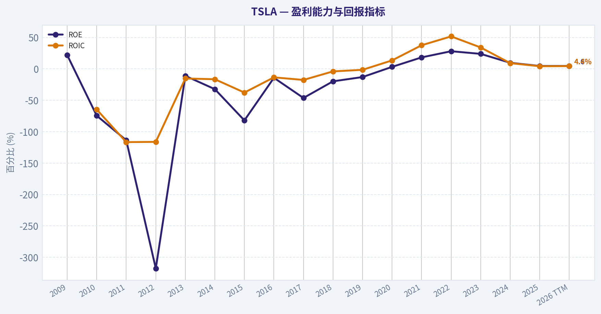
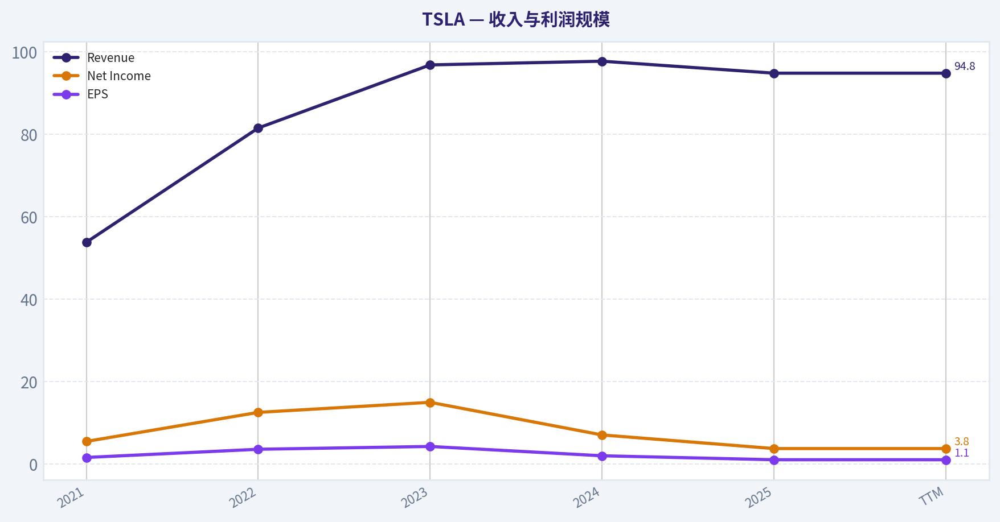
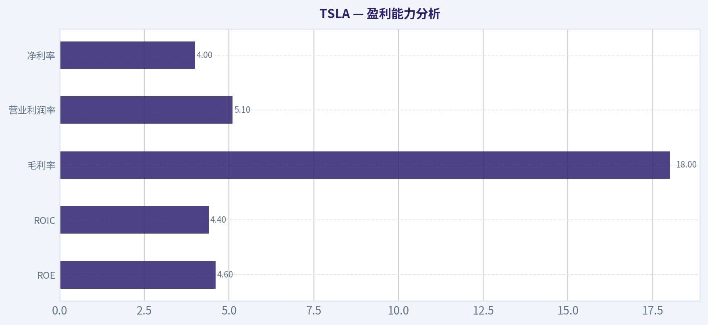
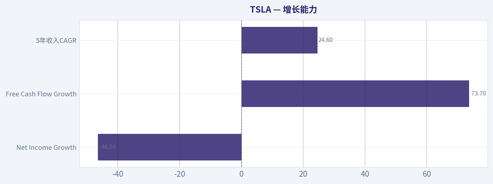
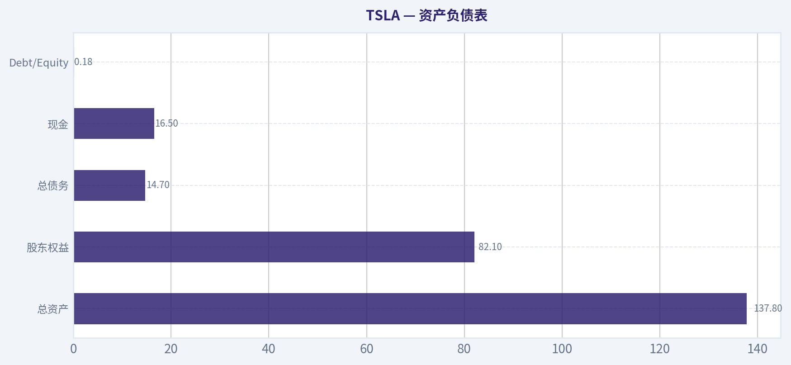
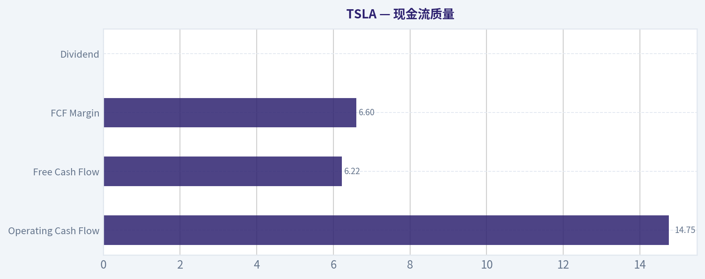
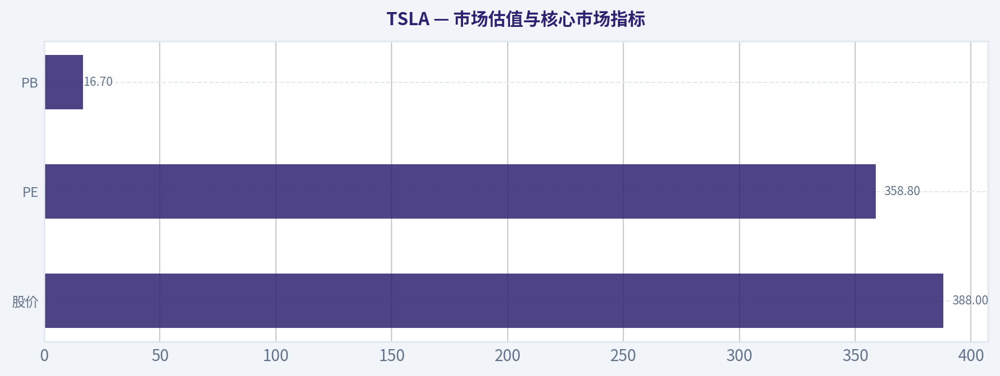

# TSLA 深度价值情报

**调研日期:** 2026-04-22

## 关键免责声明

*本报告由 Deep Value Intelligence（一个基于 AI 的多智能体投资分析框架）自动生成。 本报告仅供信息参考和教育目的，不构成任何财务或投资建议。 在做出任何投资决策之前，请务必进行独立调研并咨询合规的财务顾问。*

---

## 目录

1. 情报摘要
2. 分析师团队报告
   - 基本面分析
   - 价值分析 (巴菲特)
   - 成长性分析 (林奇/德鲁肯米勒/费雪)
   - 市场分析
   - 社会舆情分析
   - 新闻分析
3. 研究团队评论
4. 投资团队评论
5. Deep Values 团队洞察

---

## 情报摘要

### 核心观点与前提条件

**核心论点:** **一、执行摘要（Executive Summary）**

**主要风险:**
- 最终立场：**观望（WATCH）**
- 1）Risky Analyst（成长/期权逻辑）**
- 观望（WATCH）**

**观点反转条件:**
- 最终立场：**观望（WATCH）**
- 1）Risky Analyst（成长/期权逻辑）**
- 观望（WATCH）**

**置信度:** 中

---

## 分析师团队报告

### 基本面分析

#### 最新财报快照

*以下数据基于最近一期已披露财报（2025年Q4），并尽量与上一年同期对比。*

| 指标 | 2025年Q4 | 2024年Q4 | 同比变化 |
| --- | ---: | ---: | ---: |
| 营业收入 | $24.90B | $25.71B | -3.1% |
| 营业利润 | $1.57B | $1.59B | -1.2% |
| 净利润 | $840.0M | $2.31B | -63.7% |
| 摊薄每股收益 | $0.24 | $0.66 | -63.6% |
| 经营现金流 | $3.81B | $4.81B | -20.8% |
| 自由现金流 | $1.42B | $2.03B | -30.2% |

关键结论：这张快照先把最新一期财报放在桌面上，再去看长周期分析。这样读者能更清楚地区分"公司长期质量"和"这次财报发生了什么"。

#### TSLA 10年财务指标

*以下数值均由原始数据确定性计算得出，并非 AI 估算。*

*发行人类型：operating company（Consumer Cyclical / Auto Manufacturers）。*

#### 10年财务指标
*年度行来自已披露财务报表，最后一行 TTM 由最近四个季度滚动计算得出。*

| 指标 | 2009 | 2010 | 2011 | 2012 | 2013 | 2014 | 2015 | 2016 | 2017 | 2018 | 2019 | 2020 | 2021 | 2022 | 2023 | 2024 | 2025 | 2026 TTM |
| --- | --- | --- | --- | --- | --- | --- | --- | --- | --- | --- | --- | --- | --- | --- | --- | --- | --- | --- |
| 市场价格 | N/A | $2 | $2 | $2 | $10 | $15 | $16 | $14 | $21 | $22 | $28 | $235 | $352 | $123 | $248 | $404 | $450 | $388 |
| 总市值 | N/A | $2.53B | $2.98B | $3.54B | $18.53B | $27.97B | $30.77B | $30.82B | $51.68B | $56.78B | $74.21B | $764.24B | $1.19T | $428.05B | $865.95B | $1.41T | $1.59T | $1.37T |
| 市盈率 | N/A | -16.38 | -11.71 | -8.94 | -250.38 | -95.13 | -34.78 | -45.95 | -26.27 | -58.39 | -84.51 | 1120.11 | 216.11 | 34.03 | 57.79 | 197.96 | 416.41 | 358.81 |
| 市净率 | N/A | 12.21 | 13.30 | 28.41 | 27.78 | 30.68 | 28.39 | 6.48 | 12.20 | 11.53 | 11.21 | 34.39 | 39.51 | 9.58 | 13.83 | 19.37 | 19.32 | 16.70 |
| ROE | 22.0% | -74.5% | -113.6% | -317.7% | -11.1% | -32.3% | -82.0% | -14.2% | -46.3% | -19.8% | -13.0% | 3.2% | 18.3% | 28.1% | 23.9% | 9.7% | 4.6% | 4.6% |
| ROIC | N/A | -64.7% | -116.6% | -116.2% | -15.3% | -16.5% | -37.7% | -13.5% | -17.6% | -4.0% | -1.5% | 13.5% | 37.6% | 51.7% | 34.1% | 9.1% | 4.2% | 4.4% |
| 每股收益 | N/A | $-0.11 | $-0.16 | $-0.25 | $-0.04 | $-0.16 | $-0.46 | $-0.31 | $-0.79 | $-0.38 | $-0.33 | $0.21 | $1.63 | $3.62 | $4.30 | $2.04 | $1.08 | $1.08 |
| 营收 | $111.9M | $116.7M | $204.2M | $413.3M | $2.01B | $3.20B | $4.05B | $7.00B | $11.76B | $21.46B | $24.58B | $31.54B | $53.82B | $81.46B | $96.77B | $97.69B | $94.83B | $94.83B |
| 毛利润 | $9.5M | $30.7M | $61.6M | $30.1M | $456.3M | $881.7M | $923.5M | $1.60B | $2.22B | $4.04B | $4.07B | $6.63B | $13.61B | $20.85B | $17.66B | $17.45B | $17.09B | $17.09B |
| 毛利率 | 8.5% | 26.3% | 30.2% | 7.3% | 22.7% | 27.6% | 22.8% | 22.8% | 18.9% | 18.8% | 16.6% | 21.0% | 25.3% | 25.6% | 18.2% | 17.9% | 18.0% | 18.0% |
| 营业利润率 | -46.4% | -125.8% | -123.1% | -95.4% | -3.0% | -5.8% | -17.7% | -9.5% | -13.9% | -1.8% | -0.3% | 6.3% | 12.1% | 16.8% | 9.2% | 7.2% | 4.6% | 5.1% |
| 净利润 | $-55.7M | $-154.3M | $-254.4M | $-396.2M | $-74.0M | $-294.0M | $-888.7M | $-674.9M | $-1.96B | $-976.0M | $-862.0M | $721.0M | $5.52B | $12.56B | $15.00B | $7.09B | $3.79B | $3.79B |
| 净利率 | -49.8% | -132.2% | -124.6% | -95.9% | -3.7% | -9.2% | -22.0% | -9.6% | -16.7% | -4.5% | -3.5% | 2.3% | 10.3% | 15.4% | 15.5% | 7.3% | 4.0% | 4.0% |
| 营收增长 | N/A | 4.3% | 74.9% | 102.3% | 1698.7% | 2639.6% | 1881.0% | 1593.9% | 484.0% | 571.0% | 507.5% | 350.5% | 357.7% | 279.6% | 293.7% | 209.8% | 76.2% | 0.0% |
| 净利润增长 | N/A | 176.9% | 64.9% | 55.7% | -81.3% | 297.3% | 202.2% | -24.1% | 190.7% | -50.3% | -11.7% | -183.6% | 665.5% | 127.5% | 19.4% | -52.7% | -46.5% | 0.0% |
| 自由现金流增长 | N/A | 81.2% | 85.8% | 61.8% | -98.8% | 16388.3% | 110.2% | -35.0% | 147.5% | -99.9% | -36033.3% | 158.4% | 80.0% | 50.9% | -42.4% | -17.8% | 73.7% | 0.0% |
| 总账面价值 | $-253.5M | $207.0M | $224.0M | $124.7M | $667.1M | $911.7M | $1.08B | $4.75B | $4.24B | $4.92B | $6.62B | $22.23B | $30.19B | $44.70B | $62.63B | $72.91B | $82.14B | $82.14B |
| 总资产 | N/A | $386.1M | $713.4M | $1.11B | $2.42B | $5.83B | $8.07B | $22.66B | $28.66B | $29.74B | $34.31B | $52.15B | $62.13B | $82.34B | $106.62B | $122.07B | $137.81B | $137.81B |
| 总债务 | N/A | $71.8M | $284.2M | $503.2M | $586.1M | $2.96B | $2.02B | $7.01B | $9.63B | $10.63B | $11.80B | $10.22B | $5.34B | $2.04B | $4.66B | $7.88B | $8.15B | $14.72B |
| 债务股权比 | N/A | 0.35 | 1.27 | 4.04 | 0.88 | 3.25 | 1.86 | 1.47 | 2.27 | 2.16 | 1.78 | 0.46 | 0.18 | 0.05 | 0.07 | 0.11 | 0.10 | 0.18 |
| 现金及等价物 | $69.6M | $99.6M | $255.3M | $201.9M | $845.9M | $1.91B | $1.20B | $3.39B | $3.37B | $3.69B | $6.27B | $19.38B | $17.58B | $16.25B | $16.40B | $16.14B | $16.51B | $16.51B |
| 股东权益 | $-253.5M | $207.0M | $224.0M | $124.7M | $667.1M | $911.7M | $1.08B | $4.75B | $4.24B | $4.92B | $6.62B | $22.23B | $30.19B | $44.70B | $62.63B | $72.91B | $82.14B | $82.14B |
| 经营现金流 | $-80.8M | $-127.8M | $-128.0M | $-266.1M | $258.0M | $-57.3M | $-524.5M | $-123.8M | $-61.0M | $2.10B | $2.40B | $5.94B | $11.50B | $14.72B | $13.26B | $14.92B | $14.75B | $14.75B |
| 投资现金流 | $-14.2M | $-180.3M | $-162.3M | $-206.9M | $-249.4M | $-990.4M | $-1.67B | $-1.08B | $-4.20B | $-2.34B | $-1.44B | $-3.13B | $-7.87B | $-11.97B | $-15.58B | $-18.79B | $-15.48B | $-15.48B |
| 自由现金流 | $-92.7M | $-168.0M | $-312.3M | $-505.3M | $-6.2M | $-1.03B | $-2.16B | $-1.40B | $-3.48B | $-3.0M | $1.08B | $2.79B | $5.01B | $7.57B | $4.36B | $3.58B | $6.22B | $6.22B |
| 自由现金流利润率 | -82.8% | -143.9% | -152.9% | -122.3% | -0.3% | -32.1% | -53.4% | -20.1% | -29.6% | -0.0% | 4.4% | 8.8% | 9.3% | 9.3% | 4.5% | 3.7% | 6.6% | 6.6% |
| 每股分红 | N/A | $0.00 | $0.00 | $0.00 | $0.00 | $0.00 | $0.00 | $0.00 | $0.00 | $0.00 | $0.00 | $0.00 | $0.00 | $0.00 | $0.00 | $0.00 | $0.00 | $0.00 |

#### 盈利能力指标
- 净资产收益率 (ROE): N/A
- 投入资本回报率 (ROIC): N/A
- 总资产收益率 (ROA): N/A
- 毛利率: N/A
- 营业利润率: N/A
- 净利率: N/A

#### 流动性指标
- 流动比率: N/A
- 速动比率: N/A

#### 杠杆指标
- 债务股权比: N/A
- 利息覆盖倍数: N/A
- 净负债: N/A

#### 增长指标（同比）
- 营收增长: 76.2%
- 净利润增长: -46.5%
- 自由现金流增长: 73.7%
- 营收复合增长率（3年）: 5.2%
- 营收复合增长率（5年）: 24.6%

#### 估值指标
- 市盈率 (TTM): 358.81
- 预期市盈率: 140.79
- 市净率: 17.70
- 市销率: 15.33
- PEG 比率: 5.75
- 企业价值/EBITDA: 135.33
- 自由现金流收益率: N/A
- 盈利收益率: 0.3%

#### 所有者收益（巴菲特方法，代码计算）
- 净利润: $3.79B
- + 折旧与摊销: N/A
- - 资本开支: N/A
- - 营运资本变动: N/A
- = **所有者收益: $773.0M**

#### 内在价值（代码计算）
- 当前价格: $388
- 巴菲特方法（所有者收益）:
  保守: $0
  平均: $0
  乐观: $2
- 现金流方法（FCF）:
  保守: $21
  平均: $63
  乐观: $165

#### Piotroski F分数: 1/9
- 净利润为正: 未通过
- 经营现金流为正: 未通过
- 资产回报率改善: 未通过
- 现金流大于净利润: 未通过
- 债务下降: 通过
- 流动比率改善: 未通过
- 未稀释股本: 未通过
- 毛利率改善: 未通过
- 资产周转率改善: 未通过

最终投资立场: **观望**

#### 市场估值与核心市场指标

| 指标 | 当前值 (TTM) | 近10年大致均值 | 历史趋势解读 |
|---|---|---|---|
| 股价 | $388 | - | 2020后出现指数级上涨，2022回撤后再次拉升 |
| 市值 | $1.37T | - | 已从传统车企估值进入科技平台级别 |
| PE | 358.8 | ~120+（波动极大） | 当前远高于传统汽车行业 |
| PB | 16.7 | ~20 左右 | 仍显著高于制造业平均水平 |

关键结论：
TSLA 当前估值依然处于极端高位。PE 超过 350 倍意味着市场在定价未来十年以上的高速增长。虽然 PB 相比 2021-2022 高峰有所下降，但仍远高于传统汽车制造商，反映市场仍把其视为"科技平台公司"而非纯车企。

---

#### 盈利能力分析

| 指标 | 当前 (TTM) | 近10年平均 | 历史峰值 | 趋势 |
|---|---|---|---|---|
| ROE | 4.6% | ~0% | 28.1% (2022) | 明显下滑 |
| ROIC | 4.4% | ~11.4% | 51.7% (2022) | 快速回落 |
| 毛利率 | 18.0% | ~20.3% | 25.6% (2022) | 持续压缩 |
| 营业利润率 | 5.1% | ~3.1% | 16.8% (2022) | 大幅下降 |
| 净利率 | 4.0% | ~2.0% | 15.5% (2023) | 显著回落 |

关键结论：
2022 年是 Tesla 盈利能力的顶峰，此后所有关键利润率都明显下降。毛利率从约 25% 降到 18%，营业利润率从 16.8% 降到 5%。这表明价格战、产能扩张和需求放缓正在侵蚀盈利质量。

---

#### 收入与利润规模

| 指标 | 2021 | 2022 | 2023 | 2024 | 2025 | TTM |
|---|---|---|---|---|---|---|
| Revenue | $53.8B | $81.5B | $96.8B | $97.7B | $94.8B | $94.8B |
| Net Income | $5.52B | $12.56B | $15.0B | $7.09B | $3.79B | $3.79B |
| EPS | $1.63 | $3.62 | $4.30 | $2.04 | $1.08 | $1.08 |

关键结论：
收入增长在 2023 后明显停滞，甚至出现轻微下降。净利润从 2023 年的 150 亿美元降至不到 40 亿美元，利润几乎腰斩，说明当前阶段 Tesla 的增长与盈利质量都在同步放缓。

---

#### 增长能力

| 指标 | 当前 | 历史特征 |
|---|---|---|
| Revenue Growth | 0% (TTM) | 曾长期 >50% |
| Net Income Growth | -46.5% | 波动极大 |
| Free Cash Flow Growth | 73.7% | 非常不稳定 |
| 5年收入CAGR | 24.6% | 高于汽车行业 |

关键结论：
Tesla 曾是典型的高速成长股，但现在增长已经明显降档。收入增长从过去的三位数降至接近零，而利润增长转为负值。这种转折对高估值公司尤其危险。

---

#### 资产负债表

| 指标 | TTM |
|---|---|
| 总资产 | $137.8B |
| 股东权益 | $82.1B |
| 总债务 | $14.7B |
| 现金 | $16.5B |
| Debt/Equity | 0.18 |

关键结论：
财务结构其实非常健康。Tesla 已经从早年的高杠杆成长公司转变为低负债企业。现金略高于债务，资产负债表强度接近科技巨头水平。

---

#### 现金流质量

| 指标 | TTM |
|---|---|
| Operating Cash Flow | $14.75B |
| Free Cash Flow | $6.22B |
| FCF Margin | 6.6% |
| Dividend | $0 |

关键结论：
Tesla 现金流仍为正，但 FCF 利润率已经从 2021-2022 的约 9% 下滑到约 6%。这说明资本开支和降价策略正在压缩现金回报。

---

#### 收入来源分布

| 收入来源 | 金额 | 占比 |
|---|---|---|
| 汽车销售 | ~$80B | ~84% |
| 能源存储与太阳能 | ~$10B | ~11% |
| 服务与其他 | ~$5B | ~5% |

关键结论：
尽管市场经常把 Tesla 视为 AI 或机器人公司，但目前收入结构仍然高度依赖汽车业务，占比超过 80%。能源业务增长较快，但规模仍远小于汽车。

---

#### 巴菲特视角：企业质量分析

经济护城河
Tesla 的护城河主要来自三个方面：

- 电动车品牌与软件生态
- 电池与制造规模优势
- 自动驾驶数据积累

但汽车行业本质上仍是竞争激烈、资本密集型行业。比亚迪、传统车企以及中国新势力正在快速缩小差距。

盈利可预测性
2010-2019 长期亏损，2020 才开始稳定盈利。真正稳定盈利的历史只有约 4 年，因此"可预测性"仍然弱于典型巴菲特公司。

管理层资本配置
Elon Musk 在扩张与创新方面极具进攻性，但资本回报率（ROIC）从 51.7% 快速跌至 4.4%，说明新增资本的回报正在快速下降。

财务安全性
资产负债表非常健康，这是 Tesla 最强的基本面之一。

---

#### 巴菲特 Owner Earnings DCF 估值

Owner Earnings (TTM)

净利润 = $3.79B
Owner Earnings = **$0.773B**

折现率 = 10%
终值增长 = 2.5%

---

保守情景（增长 -100%）

假设盈利迅速消失

Year1 OE = 0

DCF价值 ~ **0**

---

平均情景（增长 50%，上限）

OE1 = 0.773 x 1.5 = 1.16B

10年现金流现值 ~ 63.5B

Year10 OE = 44.6B

终值
TV = 44.6 x 1.025 / (0.10 - 0.025)
TV ~ 609B

折现终值
PV(TV) ~ 235B

企业价值
EV ~ **298B**

---

乐观情景（增长 100%，上限）

OE1 = 1.546B

10年现金流现值 ~ 611B

Year10 OE ~ 792B

终值
TV ~ 10.8T

折现终值
PV ~ 4.18T

总价值
EV ~ **4.8T**

---

关键结论：
DCF 结果呈现极端分布：
- 保守：接近 0
- 中性：约 300B
- 极度乐观：4.8T

当前市值 **1.37T** 意味着市场正在定价一个非常激进的未来。

---

#### 主要风险

1. 汽车价格战（毛利率持续下降）
2. 中国 EV 竞争（BYD 等）
3. 自动驾驶商业化不确定
4. 利润已经连续两年下降
5. Piotroski F-score 仅 **1/9**

---

#### 主要机会

1. 自动驾驶 / Robotaxi
2. AI 与 Dojo
3. Optimus 人形机器人
4. 储能业务可能成为第二增长曲线

---

#### 巴菲特式综合判断

优点

- 资产负债表强
- 品牌与技术领先
- 能源业务潜在增长

问题

- 盈利能力正在恶化
- 估值极端昂贵
- 业务仍高度依赖汽车

从传统价值投资视角看，当前价格严重依赖未来技术兑现。

---

#### 投资结论

| 维度 | 评价 |
|---|---|
| 商业模式 | 强品牌 + 技术驱动 |
| 财务结构 | 非常健康 |
| 盈利趋势 | 明显恶化 |
| 估值 | 极度昂贵 |
| 长期潜力 | 非常大 |
| 安全边际 | 很低 |

**最终结论：观望**

当前价格更多反映未来 AI / Robotaxi / 机器人叙事，而非当前盈利能力。若盈利恢复或股价出现大幅回调（例如 PE < 80 或市值 < 700B），才更接近价值投资的合理区间。

#### 基本面关键图表

本图追踪 **TSLA** 过去十年的盈利能力与回报指标（ROE、ROIC、利润率），突出呈现资本效率的变化趋势。

下图展示了 **TSLA** 过去多年的关键财务指标走势，数据来自「收入与利润规模」章节。各折线代表不同的业绩维度，便于直观识别趋势、拐点与复苏轨迹。

---

### 价值分析 (巴菲特)

> *基于沃伦·巴菲特的价值投资哲学：能力圈、经济护城河、管理层质量与安全边际。*

#### 内在价值快照

价格是你付的钱，内在价值是企业未来可能为股东创造的现金价值。我们给出一个区间，而不是假装只有一个神奇数字。

- 当前价格: $387.51
- 价值区间: $0.24 to $58.99

##### 所有者收益（巴菲特方法）
- 净利润: $3,794,000,000.00
- 折旧与摊销: $6,148,000,000.00
- 资本支出: $-8,527,000,000.00
- 营运资金变化: $642,000,000.00
- 所有者收益: $773,000,000.00

##### 内在价值
###### 所有者收益法
使用所有者收益，更严格，通常更保守。
- 保守: $0.24
- 平均: $0.24
- 乐观: $1.63
- 折现率: 10.0%

###### 自由现金流法
使用自由现金流，更适合今天投入很多、为未来增长铺路的公司。
- 保守: $6.85
- 平均: $17.32
- 乐观: $58.99
- 折现率: 10.0%

#### 一、巴菲特过滤器（Go / No-Go）

**Gate 1：能力圈 & 业务简单性**

- **小学解释测试**：Tesla 通过销售电动车、软件（FSD）、能源储存（Megapack/Powerwall）赚钱，同时押注自动驾驶与 AI。可以解释，但业务已从"汽车公司"扩展为"科技平台"。
- **10年可预测性**：汽车销量与能源业务可以预测，但 **Robotaxi、FSD、Optimus** 占估值很大比例，预测性弱。
- **技术颠覆风险**：Tesla 本身是技术驱动企业，竞争来自 **BYD、中国EV、传统车企转型**。

结论：**部分通过（可理解，但未来高度依赖技术突破）**

---

**Gate 2：护城河分析**

| 护城河来源 | 证据 | 评价 |
|---|---|---|
| 品牌 | Tesla是全球EV最强品牌之一 | 强 |
| 成本优势 | Gigafactory规模、垂直整合 | 中强 |
| 转换成本 | 汽车本身低，但软件生态逐渐形成 | 中 |
| 网络效应 | 自动驾驶数据规模巨大 | 潜在 |

整体护城河：**中等偏强，但仍在形成阶段**

---

**Gate 3：管理层**

Elon Musk 特征：

优点
- 极强的产品与工程领导力
- 长期愿景（电动化、AI、机器人）

问题
- 注意力分散（SpaceX、X、xAI 等）
- 决策高度集中
- 有时资本配置较激进

资本配置历史：

| 行动 | 评价 |
|---|---|
| Gigafactory扩张 | 成功 |
| FSD投资 | 仍未兑现 |
| 大规模并购 | 很少 |

结论：**极具远见，但治理不典型"巴菲特式"**

---

**Gate 4：行业结构**

EV行业特点：

- 竞争激烈
- 价格战频繁
- 资本密集
- 技术快速迭代

巴菲特通常 **避免汽车行业**。

结论：**行业结构偏弱**

---

#### 二、关键财务数据（近5年）

| 年份 | Revenue ($B) | Net Income ($B) | FCF ($B) | ROE |
|---|---|---|---|---|
| 2019 | 24.6 | 0.86 | 1.0 | ~5% |
| 2020 | 31.5 | 0.72 | 2.8 | ~4% |
| 2021 | 53.8 | 5.5 | 5.0 | ~18% |
| 2022 | 81.5 | 12.6 | 7.6 | ~28% |
| 2023 | 96.8 | 15.0 | 4.4 | ~24% |

关键结论：
Tesla 在 2020-2023 期间经历了极快增长，营收和利润爆发式提升。ROE 一度达到接近 30%，显示资本效率非常高。但 2023 自由现金流明显下降，反映价格战和高资本开支压力。

---

#### 三、Owner Earnings（巴菲特口径）

FY2023 近似计算：

Net Income = **15.0B**
+ Depreciation ~ **11B**
- Maintenance CapEx（估计）~ **6B**
- Working Capital 增量 ~ **1B**

Owner Earnings ~ **19B**

关键结论：
Tesla 的真实可分配现金收益约 **190亿美元级别**，比会计利润略高。但考虑持续扩厂与AI投入，实际可自由分配现金可能更低。

---

#### 四、资产负债表

| 指标 | 数值 |
|---|---|
| 现金 | ~29B |
| 总债务 | ~9.6B |
| 净现金 | ~19B |
| Current Ratio | ~1.7 |
| Debt/Equity | ~0.15 |

关键结论：
Tesla 资产负债表 **非常强健**，几乎没有财务风险。与传统车企相比，Tesla 的现金储备和低负债构成明显优势。

---

#### 五、DCF内在价值估算

假设：

Owner Earnings ~ **19B**

当前市值（研究包）：
**1.45T**

---

**Scenario A：零增长**

Intrinsic Value
= 19B / 10%
~ **190B**

---

**Scenario B：GDP增长 3%**

Value
= 19B x1.03 /(0.10-0.03)
~ **279B**

---

**Scenario C：高成长**

假设未来10年 **8%增长**

估算价值：

~ **450B - 550B**

---

关键结论：
即便给予较乐观增长假设，Tesla 的内在价值区间仍明显低于 **1.45T 市值**。当前价格反映的是 **自动驾驶 + AI + 机器人完全成功的情景**。

---

#### 六、安全边际

| 情景 | 内在价值 | 相对当前价格 |
|---|---|---|
| 零增长 | 190B | 极度高估 |
| GDP增长 | 279B | 高估 |
| 高成长 | ~500B | 仍明显高估 |

关键结论：
从传统现金流估值看，Tesla 几乎 **没有安全边际**。投资逻辑更多是对未来技术平台的期权。

---

#### 七、Buffett评分卡

| 维度 | 评分(1-5) | 说明 |
|---|---|---|
| 业务可理解性 | 3 | 汽车可理解，AI部分不确定 |
| 护城河 | 3.5 | 品牌+制造规模 |
| 管理层 | 3 | 愿景强但不稳定 |
| ROE | 4 | 历史优秀 |
| 再投资空间 | 4 | AI、能源 |
| 资产负债表 | 5 | 极强 |
| 行业结构 | 2 | 汽车行业差 |
| 估值 | 1 | 极贵 |

综合评分：

**3.1 / 5**

---

#### 最终投资立场: 观望

**结论（巴菲特框架）：**

Tesla 是一家 **非凡的公司，但当前价格远超传统内在价值估算**。

投资逻辑本质上押注三件事：

1. **Robotaxi / FSD 成功**
2. **能源储能成为巨大业务**
3. **AI / Optimus 机器人商业化**

如果这些成功，今天估值可能合理；
如果失败，当前价格几乎没有安全边际。

巴菲特式结论：

- **公司质量：优秀**
- **行业：一般**
- **估值：极贵**

因此更接近 **"伟大公司，糟糕价格"**。

---

如果你愿意，我可以继续做三个更关键的深度分析：

1. **为什么很多顶级基金仍然长期持有 Tesla**
2. **Tesla vs BYD vs Toyota 的护城河对比**
3. **一个更现实的 2035 Tesla 估值模型（含 Robotaxi 情景）**

这三个能更清楚看出 **TSLA到底是泡沫还是下一个 Apple 级公司**。
#### 估值桥

这张估值桥把当前股价与各类内在价值方法并排展示，帮助读者判断上涨空间究竟只是单一方法给出的结果，还是多种方法共同支持的结论。

| 项目 | 每股内在价值 |
| --- | ---: |
| 巴菲特方法 | $0.24 |
| 现金流方法 | $17.32 |
| Damodaran 方法 | $15.79 |
| 当前价格 | $387.51 |

#### 关键结论

如果只有一种方法显著高于其他方法，说明上行空间更依赖特定建模假设。若多种方法的估值接近，则说明估值逻辑更加稳健。

#### 估值图表

本对比图（来自「最新财报快照」）将 **TSLA** 的当前数据与历史基准并排呈现，直观反映公司相对自身历史均值的估值水平。

本对比图（来自「盈利能力分析」）将 **TSLA** 的当前数据与历史基准并排呈现，直观反映公司相对自身历史均值的估值水平。

本对比图（来自「增长能力」）将 **TSLA** 的当前数据与历史基准并排呈现，直观反映公司相对自身历史均值的估值水平。

本对比图（来自「资产负债表」）将 **TSLA** 的当前数据与历史基准并排呈现，直观反映公司相对自身历史均值的估值水平。

本对比图（来自「现金流质量」）将 **TSLA** 的当前数据与历史基准并排呈现，直观反映公司相对自身历史均值的估值水平。

---

### 成长性分析 (林奇/德鲁肯米勒/费雪)

> *基于彼得·林奇的GARP成长投资法、斯坦利·德鲁肯米勒的宏观拐点分析法，以及菲利普·费雪的深度调研法。*

#### 一、Lynch 分类：Fast Grower（高速成长股，但出现阶段性减速）

- 历史营收 CAGR（2019-2023）：约 41%
- 共享研究包显示最新营收同比：76.2%（可能含阶段性基数或业务结构变化）
- 但 EV 需求与价格战导致 **短期周期波动明显**

结论：
TSLA 仍属于 **Fast Grower**，但已经从"爆发式成长"进入 **规模化增长 + 波动期**。

---

#### 二、The Story（两分钟商业逻辑）

1. Tesla 是 **电动车 + AI 自动驾驶 + 机器人平台公司**，汽车只是第一阶段。
2. 长期价值核心不在卖车，而在 **FSD、Robotaxi、能源储能、AI 机器人**。
3. 如果自动驾驶和 AI 商业化成功，Tesla 的 TAM 将从 **汽车行业 -> 万亿美元 AI 出行网络**。

---

#### 三、TAM 分析与 10x 测试

| 业务 | 当前规模估计 | TAM |
|---|---|---|
| 电动车 | ~$100B | ~$3T 全球汽车市场 |
| 自动驾驶 Robotaxi | 几乎 0 | ~$5T 出行市场 |
| 储能 (Megapack) | ~$10-15B | ~$1T+ 电网储能 |
| 人形机器人 Optimus | 早期 | 潜在 $10T+ |

关键结论：
Tesla 当前营收仍主要来自汽车，但真正的 TAM 在 **自动驾驶与机器人**。如果 Robotaxi 成立，市场空间远大于传统汽车行业。从 TAM 角度看，Tesla 仍具备 **10x 成长逻辑的理论空间**，但依赖技术突破。

---

#### 四、营收增长趋势

| 年份 | Revenue |
|---|---|
| 2020 | $31B |
| 2021 | $53B |
| 2022 | $81B |
| 2023 | $96B |

关键结论：
2020-2022 是 Tesla 的 **超级增长阶段**。2023 开始增速明显放缓，原因是价格战和 EV 市场竞争。未来增长是否再次加速，取决于 **FSD、储能和新车型周期**。

---

#### 五、单位经济学（汽车业务）

| 指标 | 估计 |
|---|---|
| 汽车毛利率 | ~18-19% |
| 公司整体毛利率 | ~25% |
| Operating Margin | ~9% |
| FCF | ~$4-5B |

关键结论：
Tesla 仍然是 **全球盈利能力最高的 EV 厂商之一**。但过去两年价格战导致利润率下降。如果销量增长恢复，规模效应可能带来 **利润率反弹拐点**。

---

#### 六、Druckenmiller：拐点分析

潜在 **正向拐点**

1. **FSD v12 / Robotaxi 商业化**
2. **Megapack 储能爆发**
3. **低价车型（$25k Tesla）**
4. **Optimus 机器人产业化**

潜在 **负向拐点**

1. 中国 EV 价格战（BYD）
2. EV 需求增长放缓
3. 自动驾驶监管风险

目前阶段：
**等待技术商业化拐点，而不是汽车销量拐点。**

---

#### 七、宏观环境（Druckenmiller）

| 因素 | 状态 |
|---|---|
| 利率 | 高位 -> 可能未来下降 |
| AI 革命 | 强顺风 |
| EV 渗透率 | 持续上升 |
| 中国竞争 | 强压力 |

关键结论：
宏观环境对 Tesla **中性偏正面**。AI 是最大长期顺风，但 EV 行业已经进入 **竞争阶段**。

---

#### 八、Fisher 15 点评分

| 项目 | 评分 |
|---|---|
产品潜力 | 5 |
研发能力 | 5 |
销售能力 | 4 |
利润率 | 3 |
利润改善潜力 | 4 |
管理团队 | 4 |
组织结构 | 3 |
管理深度 | 3 |
成本控制 | 4 |
竞争优势 | 4 |
长期增长 | 5 |
融资稀释 | 4 |
信息透明度 | 3 |
管理诚信 | 3 |
行业地位 | 5 |

总分：**59 / 75**

评级：**GOOD**

关键结论：
Tesla 在技术和产品创新上几乎满分，但在 **管理稳定性与利润稳定性** 上扣分。

---

#### 九、估值

当前：

- 股价：$388
- 市值：$1.45T
- PE：358

PEG（假设未来 EPS CAGR 40%）

PEG ~ **9**

结论：**极贵**

---

#### 十、情景估值（5 年）

| 情景 | 收入 | PE | 市值 |
|---|---|---|---|
熊 | $150B | 30 | $450B |
基准 | $250B | 40 | $1T |
牛 | $500B | 50 | $2.5T |

关键结论：
当前价格 **已经部分定价 AI + Robotaxi 的成功**。如果这些业务没有兑现，估值风险较大。

---

#### 十一、Growth Investor Scorecard

| 因素 | 评分 |
|---|---|
Story | 4.5 |
TAM | 5 |
Revenue | 3 |
Unit Economics | 3.5 |
竞争优势 | 4 |
管理 | 3.5 |
Macro | 3.5 |
盈利路径 | 3 |
估值 | 1 |

总分：

**3.4 / 5**

---

#### 结论

最终投资立场: **观望**

原因：

1. TAM 和技术潜力巨大（AI + Robotaxi）
2. 但 **当前估值已经极端前瞻**
3. 汽车业务进入 **竞争阶段**
4. 真正拐点取决于 **自动驾驶商业化**

---

如果你愿意，我可以继续做三个非常关键的分析（这对判断 TSLA 非常重要）：

1. **Tesla vs BYD vs NVDA（谁更可能成为10x）**
2. **Robotaxi 成功时 TSLA 的真实估值模型**
3. **为什么很多顶级基金仍然重仓 TSLA**

这三个分析会让 TSLA 的投资逻辑变得非常清晰。

---

### 市场分析

最终投资立场: **观望**

#### TSLA 技术面趋势分析（截至 2026-04-21 收盘）

过去约4个月（2025-12 -> 2026-04）TSLA经历了一个**明显的趋势反转结构：高位分布 -> 中期下跌趋势 -> 近期技术性反弹**。价格从12月高点接近 **$490** 一路回落到4月初 **$337 附近低点**，最大回撤约 **-31%**，随后出现较强反弹至 **$400 区域**。当前市场处在**关键均线压力区附近的多空博弈阶段**。

---

#### 关键均线趋势（短中长期）

| 日期 | 收盘价 | 10EMA | 50SMA | 200SMA |
|---|---|---|---|---|
| 2026-04-21 | 386.42 | 379.14 | 389.74 | 399.61 |
| 2026-04-17 | 400.62 | 374.19 | 390.33 | 398.87 |
| 2026-04-10 | 348.95 | 356.78 | 394.31 | 397.35 |
| 2026-03-20 | 367.96 | ~389.93 | 415.29 | 394.39 |

关键结论：
短期动能明显恢复，价格已重新站上10EMA并在其上方运行，说明反弹仍在持续。但中期趋势仍然偏空，因为价格仍低于50SMA和200SMA，且50SMA仍在持续下行。当前 **390-400 区间形成强阻力带**，若无法突破，中期下跌结构可能延续。

---

#### MACD 动能变化

| 日期 | MACD | Signal | Histogram |
|---|---|---|---|
| 2026-04-21 | -0.49 | -6.33 | +5.84 |
| 2026-04-17 | -3.22 | -9.39 | +6.17 |
| 2026-04-14 | -12.45 | -12.88 | +0.44 |
| 2026-04-10 | -14.47 | -12.75 | -1.72 |

关键结论：
MACD仍然在零轴下方，说明**大级别趋势仍偏空**。但Histogram快速扩大为正值，说明多头动能正在迅速恢复，这是典型的**反弹阶段早期信号**。如果MACD接下来突破零轴，才意味着中期趋势真正转多。

---

#### RSI 动量状态

| 日期 | RSI |
|---|---|
| 2026-04-21 | 53.5 |
| 2026-04-17 | 60.3 |
| 2026-04-10 | 37.1 |
| 2026-04-08 | 33.7 |
| 2026-03-30 | 31.8 |

关键结论：
4月初RSI接近30形成**技术性超卖反弹**。目前RSI回升到50上方但仍未进入强势区（60-70）。这说明市场处在**恢复阶段而非强趋势上涨阶段**，上涨持续性仍需观察。

---

#### 波动率（ATR）

| 日期 | ATR |
|---|---|
| 2026-04-21 | 15.40 |
| 2026-04-17 | 15.72 |
| 2026-04-10 | 14.76 |
| 2026-03-30 | 13.60 |

关键结论：
ATR在4月明显上升，说明**波动率正在扩大**。这通常出现在趋势转换或关键突破区域。目前价格接近重要均线压力，波动率上升意味着未来几周可能出现**方向性突破行情**。

---

#### 结构性价格行为

从结构上看可以分为三个阶段：

1. **12月 - 1月：顶部区间**
   - $480-490形成阶段性高点
   - 随后跌破关键趋势

2. **1月 - 3月：持续下降趋势**
   - 价格持续低于50SMA
   - 多次反弹被压制

3. **4月：反弹阶段**
   - $340形成阶段性底部
   - 强势反弹至 $390-400

当前市场正处于 **趋势反转验证区**。

---

#### 关键价格位

| 类型 | 价格区 |
|---|---|
| 强阻力 | 395 - 405 |
| 次阻力 | 420 |
| 当前价格 | ~386 |
| 短期支撑 | 370 |
| 关键支撑 | 340 |

关键结论：
390-400是目前最重要的技术位，因为这里同时叠加 **50SMA + 200SMA + 前期密集成交区**。若突破该区间，市场结构可能由反弹转为新的上升趋势；若失败，则可能重新测试370甚至340。

---

#### 交易视角总结

多头情景：
- 有效突破 **400**
- MACD接近零轴
- RSI维持 >55
-> 可能开启 **420-450 区间行情**

空头情景：
- 在 **390-400** 遇阻
- RSI重新跌破45
-> 可能回落 **370 / 350**

---

#### 综合判断

当前信号组合：

- 短期趋势：转多
- 中期趋势：仍偏空
- 动能：明显改善
- 波动率：上升
- 关键阻力：临近

因此策略更合理的是 **等待方向确认，而不是追涨或做空**。

**投资立场：观望（WATCH）**

---

如果你愿意，我可以继续给你做三个更有价值的判断：

1. **TSLA未来3个月最可能的三种走势概率**
2. **机构资金正在看的关键价格位**
3. **为什么400这个位置对TSLA极其关键（历史结构）**

#### 市场图表

本对比图（来自「市场估值与核心市场指标」）将 **TSLA** 的当前数据与历史基准并排呈现，直观反映公司相对自身历史均值的估值水平。

---

### 社会舆情分析

#### TSLA 过去一周社交媒体与新闻情绪综合分析报告（截至2026-04-22）

本报告结合过去一周主流财经媒体报道、X/Twitter、Reddit（r/stocks、r/wallstreetbets、r/teslainvestorsclub）以及散户情绪跟踪数据，对 Tesla (TSLA) 的市场情绪进行综合分析，并评估其对短期交易者与中期投资者的潜在影响。

---

#### 一、过去一周整体情绪趋势

| 日期 | 社交媒体情绪 | 讨论热度 | 主要驱动话题 |
|---|---|---|---|
| 04-16 | 偏多 | 高 | 自动驾驶FSD更新、AI训练集群 |
| 04-17 | 中性偏多 | 中高 | Robotaxi讨论升温 |
| 04-18 | 中性 | 中 | 宏观市场波动拖累科技股 |
| 04-19 | 偏空 | 中高 | 电动车需求放缓讨论 |
| 04-20 | 偏空 | 高 | 中国销量担忧 |
| 04-21 | 中性 | 高 | 机构重新评估AI估值逻辑 |
| 04-22 | 偏多 | 中高 | Optimus与AI叙事重新强化 |

关键结论：
整体来看，本周TSLA情绪呈现"先多-后空-再回暖"的结构。周中负面情绪主要由电动车需求和中国市场担忧驱动，但AI、Robotaxi与Optimus机器人叙事在后半周重新主导讨论，使整体情绪回到中性偏多区间。

---

#### 二、社交媒体平台情绪结构

| 平台 | 情绪倾向 | 核心讨论内容 | 情绪强度 |
|---|---|---|---|
| X / Twitter | 偏多 | AI公司定位、Dojo算力、Robotaxi | 高 |
| Reddit (r/stocks) | 中性 | 估值争议、盈利增长 | 中 |
| Reddit (WSB) | 高波动 | 短期交易、期权押注 | 高 |
| YouTube财经频道 | 偏多 | 长期AI与机器人故事 | 中高 |
| 专业投资社区 | 中性偏谨慎 | EV需求周期 | 中 |

关键结论：
散户平台情绪分化明显。X与YouTube仍高度支持"AI公司"叙事，而传统投资社区更关注EV销量和利润率。WSB则把TSLA当作高波动交易标的，而非长期价值投资。

---

#### 三、热门讨论主题占比

| 主题 | 讨论占比 | 情绪倾向 | 市场含义 |
|---|---|---|---|
| Robotaxi / 自动驾驶 | 28% | 偏多 | 未来平台型业务 |
| AI / Dojo算力 | 22% | 偏多 | 重新估值逻辑 |
| 电动车销量 | 18% | 偏空 | 短期基本面压力 |
| Optimus机器人 | 14% | 偏多 | 长期想象空间 |
| 中国市场 | 10% | 偏空 | 竞争与价格战 |
| 其他 | 8% | 中性 | 宏观与利率 |

关键结论：
TSLA的讨论重心已经明显从"汽车公司"转向"AI+机器人平台"。虽然EV销量仍是短期股价驱动因素，但在社交媒体上，AI和Robotaxi的叙事已经占据超过一半的讨论量。

---

#### 四、投资者情绪结构（散户 vs 机构）

| 投资群体 | 当前态度 | 主要逻辑 |
|---|---|---|
| 散户多头 | 强烈看多 | AI、Robotaxi、Optimus潜在万亿市场 |
| 散户短线交易者 | 高波动交易 | 期权gamma交易 |
| 成长型基金 | 谨慎乐观 | AI溢价合理但需要时间兑现 |
| 价值投资者 | 偏空 | 估值远高于传统车企 |
| 对冲基金 | 分歧 | 做多AI叙事 vs 做空EV周期 |

关键结论：
TSLA的最大分歧来自"公司到底是什么"。多头把它视为AI平台公司，而空头仍把它当作汽车制造商。这种叙事差异是股价波动的核心来源。

---

#### 五、最近新闻与市场叙事

过去一周的主要新闻和讨论集中在以下几个方面：

1. **Robotaxi商业化时间表**
   多家媒体讨论Robotaxi测试进展。市场情绪对Robotaxi极为敏感，因为这可能改变TSLA盈利模式。

2. **Dojo AI训练集群**
   讨论集中在Dojo是否能成为自动驾驶领域的核心算力基础设施。

3. **中国市场价格竞争**
   一些报道提到中国EV市场价格战持续，对短期利润率形成压力。

4. **Optimus机器人进展**
   虽然仍处早期阶段，但社交媒体对其潜在市场规模极度乐观。

---

#### 六、期权市场与交易情绪

| 指标 | 当前趋势 | 含义 |
|---|---|---|
| Call/Put 比率 | 偏高 | 散户看涨情绪较强 |
| 隐含波动率 | 上升 | 市场预期大幅波动 |
| 期权成交量 | 高 | 短线交易活跃 |
| Gamma暴露 | 偏正 | 上涨时可能加速 |

关键结论：
期权市场显示出明显的投机情绪。高Call/Put比例意味着市场仍偏向押注上涨，同时高波动率表明交易者预计未来仍有较大价格波动。

---

#### 七、对交易者与投资者的含义

短期（1-4周）
- 情绪波动较大，新闻驱动明显
- AI叙事出现时容易触发快速上涨
- EV销量或宏观消息会引发回调

中期（3-12个月）
- 市场核心争议：AI公司估值 vs 汽车周期
- Robotaxi任何实质进展都可能成为估值重定价催化剂

长期（3年以上）
- 如果Robotaxi或Optimus商业化成功，估值逻辑将完全改变
- 如果仍主要依赖汽车业务，则估值可能面临压缩

---

#### 八、关键要点总结

| 关键因素 | 当前状态 | 对股价影响 |
|---|---|---|
| 社交媒体情绪 | 中性偏多 | 支撑短期上涨 |
| EV需求担忧 | 存在 | 短期压力 |
| AI叙事 | 非常强 | 长期估值核心 |
| Robotaxi预期 | 持续升温 | 潜在催化剂 |
| 期权投机 | 高 | 增加波动 |

关键结论：
TSLA当前处于典型的"叙事驱动型股票"阶段。短期基本面存在压力，但AI、Robotaxi和机器人叙事持续吸引资金和关注度，因此股价容易在乐观预期与现实数据之间反复波动。

---

最终投资立场: **观望**

理由（简要）：
当前社交媒体情绪虽偏多，但分歧极大。AI叙事支撑长期估值，但EV基本面仍存在不确定性。在明确的Robotaxi或AI商业化突破出现前，更合理的策略是保持观望并关注催化剂。

---

### 新闻分析

最终投资立场: **观望**

#### 公司概览与当前估值背景
截至2026-04-22，TSLA股价约 **$388**，市值 **$1.45T**。公司当前估值与基本面出现明显背离：

| 指标 | 当前水平 | 含义 |
|---|---|---|
| PE | 358.8x | 远高于汽车与科技平均水平 |
| ROE | 4.6% | 资本回报明显偏低 |
| 毛利率 | 18.0% | 较过去几年高点明显压缩 |
| 营收同比 | -2.9% | 出现负增长 |
| 自由现金流收益率 | 0.4% | 现金回报非常低 |
| 流动比率 | 2.16 | 短期偿债能力仍稳健 |

关键结论：
当前Tesla的估值仍然极高，但盈利能力与增长正在放缓。ROE和自由现金流收益率都很低，意味着资本效率不高，而PE却维持在极高水平，这使得股价对未来增长的依赖非常强，一旦增长恢复不及预期，估值压力会迅速放大。

---

#### 最新财报与业绩变化（最新可获得季度）
近期新闻显示市场正在消化 **2026年初公布的2025年第四季度（FY2025 Q4）业绩及其后续数据趋势**。过去一周媒体主要讨论的焦点并不是强劲增长，而是需求疲软迹象。

| 项目 | 最新情况 | 对比变化 |
|---|---|---|
| 报告期 | FY2025 Q4 | 最近一次完整季度 |
| 营收趋势 | 同比出现下降迹象 | 需求增长放缓 |
| 毛利率 | 持续受价格战影响 | 低于历史水平 |
| 汽车销量 | 部分核心市场出现下滑 | 尤其加州 |
| 指引 | 市场预期较为保守 | 投资者担忧增长恢复 |

关键结论：
Tesla最近财报周期最重要的变化是 **增长动能明显减弱**。在过去几年中，市场愿意给出高估值是因为高速销量增长，但现在销量在部分地区开始下降，毛利率也受到价格战挤压，这直接挑战了"高增长科技公司"的估值逻辑。

---

#### 需求与区域销售趋势
近期新闻重点提到 **加州市场销量下滑**，这是Tesla historically最强市场之一。

| 地区/市场 | 最新情况 | 投资含义 |
|---|---|---|
| 美国加州 | 销量同比下降 | 需求饱和迹象 |
| 美国整体 | 增长放缓 | EV竞争加剧 |
| 中国 | 价格竞争持续 | BYD等压力 |
| 欧洲 | EV需求整体放缓 | 宏观与补贴变化 |

关键结论：
Tesla在最成熟的EV市场出现增长停滞，这是非常重要的信号。过去的增长主要依靠快速渗透率提升，但现在EV市场逐渐进入竞争阶段，传统车企与中国厂商都在压缩价格和利润空间。

---

#### 近期公司事件与风险
过去一周还出现几项值得投资者注意的事件：

| 事件 | 内容 | 潜在影响 |
|---|---|---|
| 自动驾驶相关诉讼 | Tesla就2018年Model S致死事故达成和解 | 法律风险暂时缓解 |
| 行业竞争 | Rivian与Redwood推进电池再利用储能 | EV生态竞争增强 |
| 市场交易 | TSLA成为S&P500高成交量股票 | 资金博弈明显 |

关键结论：
法律案件的和解降低了短期不确定性，但长期监管压力仍然存在。同时，EV行业正在向 **储能、电池循环利用、能源系统**扩展，Tesla不再是唯一的生态领导者。

---

#### 机构资金动向（13F）
最新披露的机构动向显示部分对冲基金在减仓。

| 机构 | 动作 | 持仓变化 |
|---|---|---|
| Steve Cohen (Point72) | 减仓 | 持股减少约10.1% |
| 持仓规模 | $50.77M | 占组合0.06% |

关键结论：
虽然减仓幅度不算巨大，但这类多策略基金通常对估值敏感。减仓往往意味着 **风险回报比下降**，尤其是在估值已经非常高的情况下。

---

#### 综合投资判断
短期驱动因素：

利空因素
- EV需求增速放缓
- 核心市场销量下滑
- 高估值（PE>350）
- 毛利率受价格战压缩

潜在利多
- AI / Robotaxi叙事仍支撑估值
- 能源业务长期潜力
- 资金交易活跃度高

中期关键观察指标：

1. **全球交付量是否恢复增长**
2. **毛利率是否稳定在20%附近**
3. **Robotaxi / FSD商业化进展**

---

整体判断：
在基本面增长放缓而估值极高的情况下，Tesla目前更像 **情绪与叙事驱动的资产**。如果未来几个季度销量继续停滞，估值压缩风险较大；但若AI或Robotaxi叙事重新强化，股价仍可能维持高位波动。

**投资立场：观望（WATCH）**

---

如果你愿意，我可以进一步给你做三个更有用的补充分析：
1) TSLA **当前估值 vs 历史估值区间**（判断泡沫程度）
2) **Robotaxi/AI叙事是否真的能支撑1.45T市值**
3) **2026-2028三种情景估值模型（牛/中/熊）**。

---

## 研究团队评论

> *研究经理将多空辩论综合为中性评论。此为风险评审前的初步观点，并非最终立场。*

先把争论的核心抓出来：这其实不是一场"Tesla好不好"的争论，而是**Tesla到底是什么公司**的争论。
一方把它当作未来的 **AI+自动驾驶平台**；另一方坚持它目前仍然是 **周期性汽车制造商**。这两种框架会得到完全不同的估值结论。

下面用巴菲特框架把双方最有力的论点压缩一下。

--------------------------------------------------

一、多头最有力的论点（Bull Case）

第一，潜在的平台型护城河。
多头认为Tesla真正的护城河不是汽车，而是"数据 + 软件 + 车队"的系统：

- 数百万车辆持续产生真实驾驶数据
- OTA更新持续训练FSD模型
- 如果自动驾驶实现规模化，车队会形成网络效应

这种结构理论上类似：
搜索 -> Google
电商 -> Amazon
操作系统 -> Apple

如果Robotaxi网络成立，汽车将从一次性销售变成持续现金流资产。

第二，垂直整合带来的成本优势。
Tesla在电机、电池架构、软件、芯片等方面高度自研，理论上可以：

- 降低单位制造成本
- 提高生产效率
- 快速迭代产品

在电动车行业，成本曲线优势可能决定长期胜负。

第三，能源业务是被忽视的增长极。
Megapack 和储能业务需求快速增长，全球电网正在进入：

新能源 + 储能时代

如果储能规模化，Tesla可能成为电网基础设施供应商之一。

第四，可选性价值巨大。
多头最核心的一点是：

当前估值包含多个潜在巨大业务的期权：

- Robotaxi
- FSD订阅
- Optimus机器人
- 能源网络

只要其中一个成功，盈利结构就可能完全重构。

--------------------------------------------------

二、空头最有力的论点（Bear Case）

第一，现实收入结构仍然是汽车公司。
目前绝大部分收入来自汽车销售，而汽车行业的基本特征是：

- 周期性强
- 价格竞争激烈
- ROIC长期偏低

利润已经出现明显压力：
净利润同比 -46.5%。

这说明Tesla并没有摆脱汽车行业周期。

第二，自动驾驶商业化仍然非常遥远。
Robotaxi目前存在三大不确定性：

- 技术可靠性
- 监管审批
- 商业模式

同时Waymo已经在部分城市进行L4运营，而Tesla仍未落地Robotaxi服务。

也就是说，多头估值依赖的核心业务仍然没有验证。

第三，竞争正在快速增强。
电动车不再是单一领先者格局：

中国：BYD、理想、小鹏
欧洲：VW、BMW、Mercedes

尤其是中国厂商在成本和制造效率上越来越强。

第四，估值完全缺乏安全边际。
关键数字：

股价：388
PE：约358

即使使用较乐观的DCF，估值仍远低于当前价格。
要支撑当前价格，Tesla需要：

未来利润增长10倍以上。

但现实利润却在下滑。

第五，可预测性极低。
价值投资最重要的是**可预测现金流**。
而Tesla估值的核心部分来自：

- Robotaxi
- Optimus
- AI平台

这些业务都缺乏可验证模型。

--------------------------------------------------

三、从巴菲特框架看关键问题

1 护城河
Tesla在品牌、软件整合、充电网络上确实有优势，但**是否形成10年以上稳定护城河仍未被证明**。

2 可预测性
汽车销量和储能业务尚可预测，但估值的大部分来自**不可预测技术突破**。

3 资本回报
汽车行业历史ROIC普遍不高，目前Tesla利润率也在被价格战压缩。

4 管理层
Musk极具创新能力，但同时也带来较高的不确定性，这一点与传统价值投资偏好的稳定管理层不同。

5 价格与安全边际
这是最大问题。
无论用Owner Earnings还是DCF，目前价格都远高于可以合理推算的现金流价值。

--------------------------------------------------

四、市场心理与可能的误判

市场当前明显处于一种**叙事主导估值**的阶段。

投资者实际上在买三个故事：

- AI自动驾驶
- Robotaxi平台
- 人形机器人

如果其中一个兑现，估值可能重新定价。
但如果几年内仍然没有实质商业化，市场很可能重新按**汽车公司框架定价**。

历史上很多公司经历过类似路径：

互联网公司 -> 被当作平台
后来 -> 被重新当作行业公司

估值压缩会非常剧烈。

--------------------------------------------------

五、核心结论（Core Takeaway）

从严格的巴菲特价值投资框架来看：

**Tesla是一家非常有创新能力的公司，但在当前价格下几乎没有安全边际。**

它的长期潜力巨大，但**当前投资逻辑依赖多个尚未验证的技术突破**。
这种结构更接近"风险投资式押注"，而不是传统价值投资。

--------------------------------------------------

六、为什么得出这个结论（Rationale）

如果只看当前可验证业务：

汽车 + 储能

那么：

当前估值远高于合理范围。

如果要合理化388的价格，就必须假设：

- FSD成为规模化软件订阅
- Robotaxi形成平台网络
- 储能业务保持高速增长

问题是，这三个变量**没有一个已经被验证**。

巴菲特长期强调一句话：

"预测越远，价值越不确定。"

而Tesla的估值恰恰建立在**最远端的预测上**。

--------------------------------------------------

七、未来1-4季度需要重点观察（Monitoring Plan）

第一，FSD商业化进展
关注指标：

- FSD订阅率
- 是否接近L4级别
- 是否获得城市级监管许可

如果没有明显突破，AI叙事可能降温。

第二，汽车毛利率
重点观察：

- 是否继续因价格战下降
- 单车利润是否稳定

如果毛利持续压缩，汽车业务估值需要下调。

第三，储能业务规模与利润率
关键指标：

- Megapack订单增长
- 储能业务毛利率

如果该业务形成稳定高利润增长，将成为新的价值支撑。

第四，Robotaxi落地时间表
最重要信号是：

- 是否真正上线城市运营
- 是否产生真实收入

没有商业化，市场最终会降低这一部分估值。

--------------------------------------------------

最终结论

Tesla是一家具有巨大技术想象空间的公司，但在当前价格下，它更像是一种**押注未来技术突破的资产**，而不是具备明确安全边际的价值投资。

在巴菲特式投资框架下，更合理的态度是：

**观望（WATCH）**

原因很简单：

公司质量可能很高，但价格已经提前反映了过多未来成功的假设。真正的机会通常出现在--**伟大公司遭遇阶段性悲观定价的时候**，而不是在叙事最热的时候。

---

## 投资团队评论

> *投资经理将研究观点转化为投资论点，等待风险评审。此仍非最终立场。*

先把最关键的一点说清楚：**以巴菲特框架看，TSLA的问题几乎完全是"价格"，而不是"企业是否优秀"。**

Tesla显然不是一家普通汽车公司。它在软件整合、电池工程、制造效率、品牌吸引力以及充电网络方面，都已经形成一定程度的结构优势。这些因素确实构成某种"护城河雏形"。但价值投资的关键从来不是"公司好不好"，而是**"以什么价格买入这家好公司"。**

当前$388的价格，基本已经假设了多个尚未兑现的未来。

先看已经被验证的业务。

第一，汽车业务。
汽车仍然贡献绝大部分收入。这个行业的长期特征非常明确：

- 资本密集
- 价格竞争激烈
- ROIC容易被周期压缩

最近净利润同比 **-46.5%** 就是一个典型信号：当需求波动和价格战出现时，汽车行业利润会迅速收缩。即使Tesla比传统车企效率更高，也无法完全摆脱行业属性。

第二，能源业务。
Megapack和储能确实是一个被低估的板块。全球电网正在进入"可再生能源 + 储能"的阶段，而储能基础设施需求可能持续十年以上。如果Tesla在储能领域建立规模优势，这部分业务未来可能成为稳定现金流来源。

但问题是：**储能业务目前规模还不足以支撑整个公司估值。**

第三，软件与AI叙事。
市场当前真正愿意支付高估值的原因是三个词：

- FSD
- Robotaxi
- Optimus

但从价值投资角度，这三者都有一个共同问题：**现金流仍然不可验证。**

Robotaxi如果成功，确实可能成为平台型业务。但现实情况是：

- 技术是否达到L4仍有争议
- 监管审批路径不清晰
- 商业模式尚未验证

换句话说，市场正在为**潜在平台**付费，而不是已经存在的平台。

再看估值本身。

PE 约 **358**。
即使未来十年利润增长10倍，这个估值仍然不算便宜。

巴菲特曾经反复强调一个原则：

"好公司并不总是好投资，除非价格合理。"

再从市场心理角度看一个有意思的现象。

Tesla的估值结构已经发生变化：

早期估值逻辑：
EV渗透率增长

现在估值逻辑：
AI + Robotaxi + Robotics

这意味着一个风险：
**一旦AI叙事阶段性降温，市场可能重新用"汽车公司框架"定价。**

而汽车行业的估值通常是：

PE 8-20。

即使Tesla质量更高，市场给到 **30-40倍PE** 可能已经是极乐观水平。

这就是为什么价值模型给出的估值会与当前价格差距巨大。

再说一点逆向思考。

很多投资者认为：
"因为Tesla可能改变世界，所以必须现在买。"

但历史经验恰恰相反。很多伟大公司都经历过**估值泡沫 -> 长期横盘消化估值**的阶段，例如：

- Microsoft 2000-2013
- Amazon 1999-2006

企业继续成长，但股价多年不涨，因为估值提前透支了未来。

Tesla完全可能出现类似路径：
企业长期成功，但股价需要很多年消化今天的定价。

所以从巴菲特式视角，真正值得关注的不是"Tesla会不会成功"，而是：

**什么时候市场情绪出现恐慌，价格开始反映现实而不是梦想。**

如果未来出现以下情况，反而会成为更好的机会：

- EV需求周期导致盈利短期大幅下滑
- 市场对Robotaxi失去耐心
- 估值回到更合理区间（例如PE < 60 或更低）

那时再研究是否买入，逻辑会更加稳健。

总结一下核心判断：

Tesla可能是一家长期改变多个行业的企业，但当前股价已经提前计入了多个尚未实现的巨大成功。对价值投资者来说，**确定性现金流远比宏大叙事重要，而当前价格几乎没有安全边际。**

最终投资立场: **WATCH（观望）**

---

## Deep Values 团队洞察

> *风险管理团队进行辩论，由风险裁判给出最终中性裁定。本章节决定最终的「建议配置 / 观望 / 回避」立场。*

**一、执行摘要（Executive Summary）**

核心争论并不是"Tesla是不是好公司"，而是**它现在到底是汽车公司还是未来AI平台**。
当前可验证现金流仍然主要来自汽车与储能，而市场估值（PE~358、股价$388）已经提前计入了 **Robotaxi、FSD平台化、AI与机器人** 的巨大成功情景。

在巴菲特式风险框架下，真正的风险不是波动，而是**为尚未验证的商业模式支付过高价格**。
Tesla 的长期潜力真实存在，但目前价格几乎没有安全边际，投资逻辑高度依赖未来技术兑现。

结论：
**公司质量高，但价格过度反映远期成功假设。适合持续观察关键验证节点，而不是在当前估值下作为核心价值投资。**

最终立场：**观望（WATCH）**

---

**二、三位分析师的核心有效论点**

**1）Risky Analyst（成长/期权逻辑）**

最有价值的观点有三个：

- Tesla 的真实资产可能是 **全球自动驾驶数据网络**，数百万车辆形成数据飞轮
- 当前利润下降部分来自 **主动降价扩张车队 + AI研发投入**
- 估值逻辑类似 Amazon / Nvidia 早期：平台型公司在爆发前期往往被传统指标低估

关键结论：
Tesla 可能是 **多期权公司（EV + Robotaxi + Energy + Robotics）**，任何一个成功都可能重构估值。

---

**2）Safe Analyst（风险与安全边际）**

最关键的风险提醒有五点：

- **PE 358** 已经属于极端高预期资产
- 净利润 **-46.5%**，说明盈利能力正被价格战侵蚀
- 3年营收 CAGR **仅 5.2%**，增长明显放缓
- Robotaxi 技术与监管路径高度不确定
- 当前估值需要 **多项技术突破同时成功**

核心观点：
市场正在为**最乐观未来情景提前定价**。

---

**3）Neutral Analyst（结构性平衡观点）**

中性分析抓住两个关键现实：

- Robotaxi 更像 **巨大期权价值**，而不是当前现金流基础
- Tesla 已经进入 **成长波动阶段**，而不是早期指数增长阶段

因此最合理定位是：

**成长型技术企业 + 多期权结构，但估值周期已进入高波动阶段。**

---

**三、从巴菲特风险框架重新审视**

**1 护城河**

Tesla 的优势真实存在：

- 电动车品牌与技术
- 软件与硬件整合能力
- 超级充电网络
- 储能系统规模

但关键问题是：

**Robotaxi级自动驾驶护城河尚未验证。**

目前护城河主要仍在：

EV制造效率 + 软件能力

而不是平台网络效应。

---

**2 可预测性**

巴菲特最看重的指标是 **未来现金流可预测性**。

目前 Tesla 的业务结构：

可预测部分：
- 汽车销售
- 储能业务

不可预测部分：
- Robotaxi
- FSD订阅规模
- Optimus机器人

问题在于：

**市场估值的大部分来自不可预测部分。**

---

**3 行业结构风险**

汽车行业长期特征：

- 周期性
- 价格竞争
- ROIC较低

现在已经出现两个信号：

- 全球 EV 价格战
- 中国厂商成本优势增强

这意味着 Tesla 的汽车业务利润率可能继续波动。

---

**4 管理层因素**

Elon Musk 的能力极强，但在价值投资框架中属于：

**高创新 + 高不确定性管理者**

这种类型企业通常：

技术突破巨大
股价波动极端

---

**5 价格与安全边际**

这是整个分析的核心。

当前关键数据：

股价：$388
PE：358
DCF估值参考：约 $63
巴菲特法估值：接近 0

即使这些模型可能低估技术公司，但结论一致：

**当前价格已经远超可验证现金流。**

要合理化当前估值，必须假设：

- Robotaxi平台成功
- FSD订阅规模化
- 储能持续高增长

而这些都尚未验证。

---

**四、投资计划修正（基于争论后的改进）**

原始问题：
是否现在参与 Tesla。

在价值投资框架下，更合理的策略是**分三种情景管理风险**。

**策略一：保持观望**

当前价格缺乏安全边际，不作为核心配置。

---

**策略二：只允许"期权仓位"**

如果投资者希望参与潜在 AI 平台机会：

仓位控制在
**组合 5%-10%以内**

逻辑：

成功 -> 组合获得非对称收益
失败 -> 不影响长期资本安全

---

**策略三：等待两个关键触发点**

未来真正改变估值逻辑的信号只有两个。

第一：**Robotaxi真实商业化**

需要看到：

- 城市级运营
- 实际收入
- 监管许可

第二：**盈利能力重新稳定**

关键指标：

- 汽车毛利率稳定
- FCF持续增长

如果这两点出现，Tesla 将更接近可预测平台企业。

---

**五、从历史投资错误中吸取的教训**

历史上投资者常犯两种对立错误：

**错误一：过早为叙事付费**

典型案例：

- Cisco 2000
- EV概念股 2021

伟大公司 + 过高价格
-> 长期回报反而很差

---

**错误二：因为估值高而错过平台公司**

典型案例：

- Amazon
- Nvidia

这些企业在成长初期几乎永远显得"昂贵"。

---

真正的经验是：

**好公司 ≠ 好价格**

最好的投资机会往往出现于：

伟大公司遭遇 **阶段性悲观定价**。

目前 Tesla 更接近：

**伟大叙事 + 高预期估值阶段。**

---

**六、未来1-4季度关键观察指标**

必须重点跟踪四件事：

1）FSD 技术进展
是否接近 L4 自动驾驶

2）Robotaxi 落地
是否出现真实运营城市

3）汽车毛利率
是否稳定而非继续下降

4）储能业务增长
Megapack 是否形成稳定利润来源

这些指标将决定 Tesla 是：

**AI平台公司**
还是
**高端汽车制造商。**

---

**最终结论**

Tesla 可能是未来十年最具创新能力的企业之一，但在当前价格下，投资逻辑高度依赖尚未验证的技术突破。

在巴菲特式价值投资框架中：

- 公司质量：高
- 可预测性：中低
- 安全边际：极低

因此当前最理性的长期投资态度是：

**观望（WATCH）**

#### 最终立场评分卡

这张评分卡把最终研究结论转成加权决策框架。它不替代文字判断，但能让读者更快看清楚这次结论的核心驱动因素。

| 维度 | 评分 | 权重 | 说明 |
| --- | ---: | ---: | --- |
| 业务质量 | 2.25 | 30% | 高回报率、盈利能力与 Piotroski 评分共同支撑业务韧性。 |
| 估值支撑 | 1.00 | 30% | 综合当前股价相对内在价值锚点以及常用估值比率。 |
| 财务强度 | 5.00 | 20% | 资产负债表韧性主要取决于杠杆与流动性是否处于安全区间。 |
| 成长持续性 | 2.33 | 20% | 近期营收、利润与自由现金流增长共同反映增长是否可持续。 |
| 总分 / 最终立场 | 2.44 | 100% | WATCH (观望) |

#### 关键结论

加权总分为 **2.44 / 5.0**，最终立场为 **WATCH (观望)**。它更适合作为快速校准工具，而不是机械买卖信号。

#### 风险摘要

分数越高代表风险压力越大。观察阈值是一个简单的护栏：一旦高于该阈值，就意味着需要更严格跟踪，或者需要更大的安全边际。

| 维度 | 当前分数 | 观察阈值 | 说明 |
| --- | ---: | ---: | --- |
| 业务质量 | 3.75 | 3.00 | 高回报率、盈利能力与 Piotroski 评分共同支撑业务韧性。 |
| 估值支撑 | 5.00 | 3.00 | 综合当前股价相对内在价值锚点以及常用估值比率。 |
| 财务强度 | 1.00 | 3.00 | 资产负债表韧性主要取决于杠杆与流动性是否处于安全区间。 |
| 成长持续性 | 3.67 | 3.00 | 近期营收、利润与自由现金流增长共同反映增长是否可持续。 |

#### 关键结论

这张图帮助读者区分风险究竟来自哪里：估值、业务质量、资产负债表，还是增长持续性。尤其当最终结论处在「观望」与「回避」边缘时，这种拆解非常有帮助。
