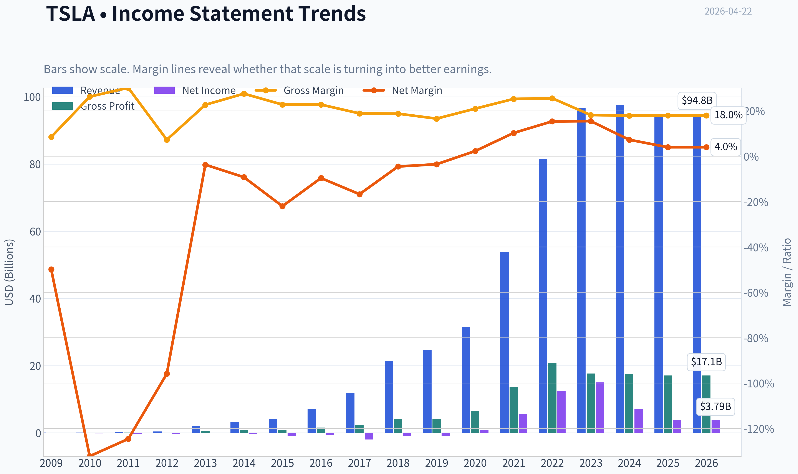
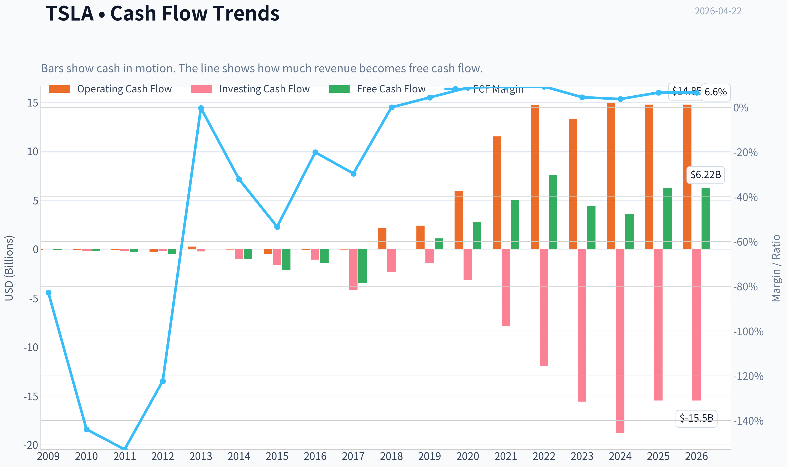
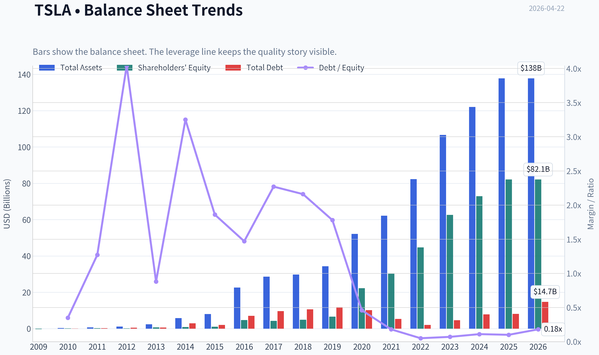
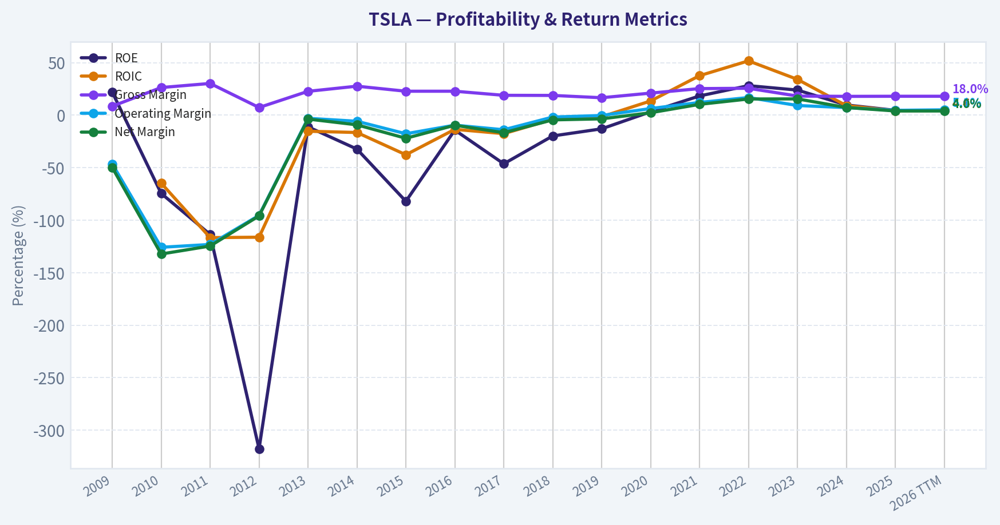
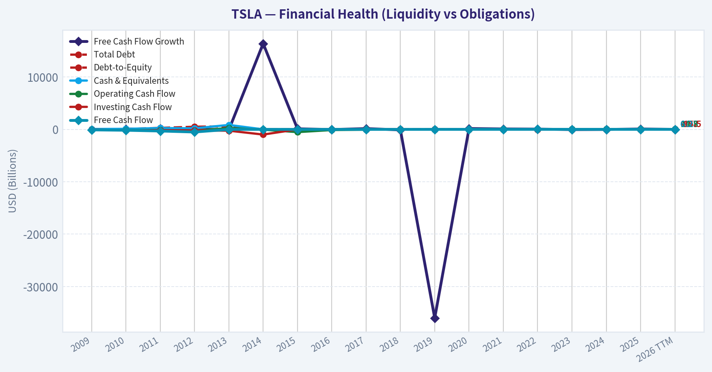
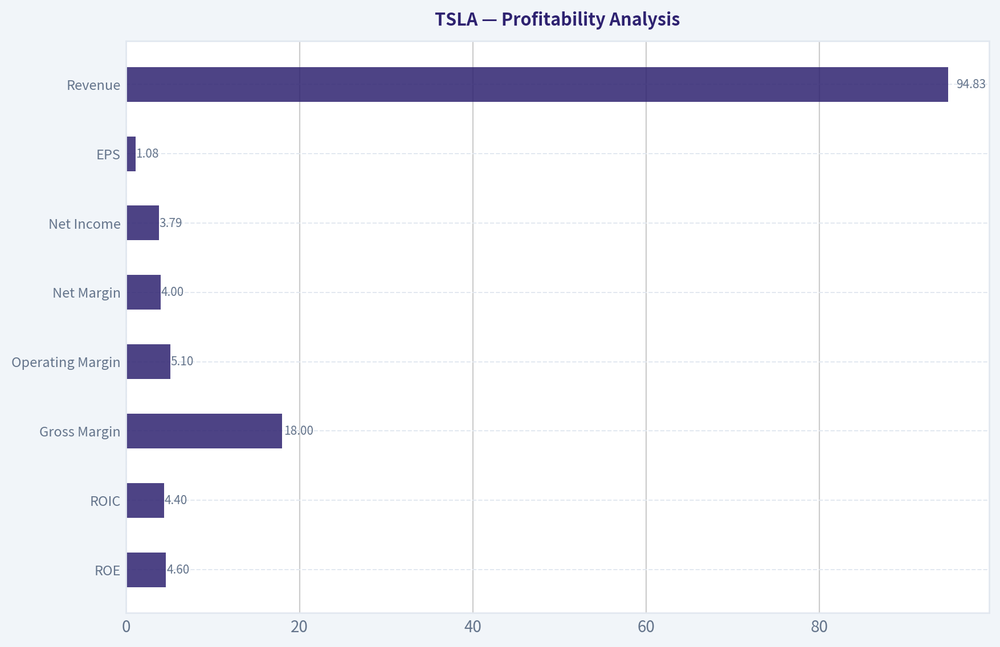
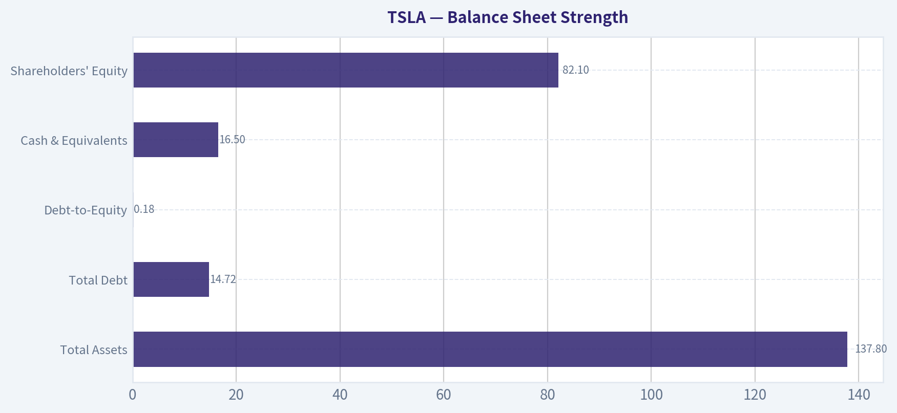
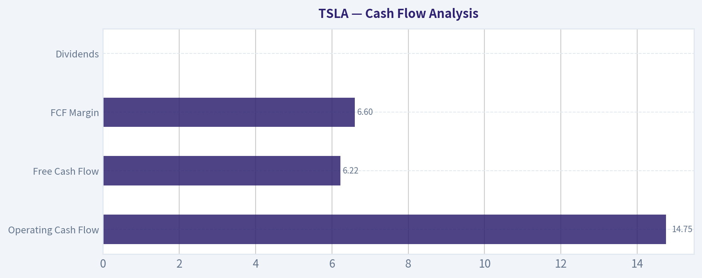
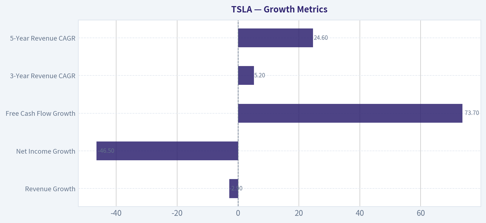
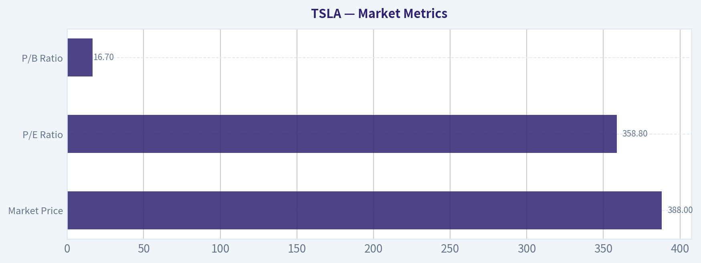

# TSLA Deep Value Intelligence

**Analysis Date:** 2026-04-22

## Critical Disclaimer

*This analysis is generated by Deep Value Intelligence, an AI-powered multi-agent investing framework. This report is for informational and educational purposes only and does not constitute financial advice. Always conduct your own research and consult with qualified financial advisors before making investment decisions.*

---

## Table of Contents

1. Intelligence Summary
2. Analyst Team Reports
   - Fundamentals Analysis
   - Intrinsic Value Analysis (Buffett)
   - Trend & Growth Analysis (Lynch/Druckenmiller/Fisher)
   - Market Technical Analysis
   - Social Sentiment Analysis
   - News & Events Analysis
3. Research Team Commentary
4. Value Investing Team Commentary
5. Deep Values Commentary

---

## Intelligence Summary

### Thesis + Conditions

**Core Thesis:** Executive Summary (Buffett Lens)

**Key Risks:**
- Tesla today presents a classic value-investing dilemma: an innovative company with potentially transformative platforms, but a stock price that already assumes extraordinary success. The current economics-low returns on capital, declining earnings, and compressing margins-do not yet demonstrate a durable, high-return franchise. Meanwhile, the valuation leaves virtually no margin of safety. For a long-term value investor, the key risk is not volatility but paying today for profits that may or may not materialize a decade from now. Until Tesla proves that its technology platforms can generate sustained high returns on capital-or the valuation resets meaningfully-the risk/reward profile remains unfavorable.
- Highlighted Tesla's optionality. The company operates across EVs, energy storage, and potential autonomous software. If robotaxis, AI compute, and grid-scale batteries scale successfully, Tesla could evolve into a technology platform rather than a traditional automaker. Free cash flow growth of ~73% indicates underlying capital generation may still be improving despite headline earnings declines.
- Risky Analyst
- Focused on the weakening foundation. Revenue is slightly declining and net income has dropped nearly 47% year-over-year while Tesla attempts to fund multiple capital-intensive initiatives. If the auto business loses pricing power, the company's ability to finance ambitious technology platforms becomes constrained.
- Risk Commentary (Buffett Framework)

**What Would Change Our View:**
- Tesla today presents a classic value-investing dilemma: an innovative company with potentially transformative platforms, but a stock price that already assumes extraordinary success. The current economics-low returns on capital, declining earnings, and compressing margins-do not yet demonstrate a durable, high-return franchise. Meanwhile, the valuation leaves virtually no margin of safety. For a long-term value investor, the key risk is not volatility but paying today for profits that may or may not materialize a decade from now. Until Tesla proves that its technology platforms can generate sustained high returns on capital-or the valuation resets meaningfully-the risk/reward profile remains unfavorable.
- Highlighted Tesla's optionality. The company operates across EVs, energy storage, and potential autonomous software. If robotaxis, AI compute, and grid-scale batteries scale successfully, Tesla could evolve into a technology platform rather than a traditional automaker. Free cash flow growth of ~73% indicates underlying capital generation may still be improving despite headline earnings declines.
- Risky Analyst
- Focused on the weakening foundation. Revenue is slightly declining and net income has dropped nearly 47% year-over-year while Tesla attempts to fund multiple capital-intensive initiatives. If the auto business loses pricing power, the company's ability to finance ambitious technology platforms becomes constrained.
- Risk Commentary (Buffett Framework)

**Confidence:** Low

---

## Analyst Team Reports

### Fundamentals Analysis

#### Latest Earnings Snapshot

*Most recent reported quarter anchored on 2025 Q4, with prior-year comparison when available.*

| Metric | 2025 Q4 | 2024 Q4 | YoY Change |
| --- | ---: | ---: | ---: |
| Revenue | $24.90B | $25.71B | -3.1% |
| Operating Income | $1.57B | $1.59B | -1.2% |
| Net Income | $840.0M | $2.31B | -63.7% |
| Diluted EPS | $0.24 | $0.66 | -63.6% |
| Operating Cash Flow | $3.81B | $4.81B | -20.8% |
| Free Cash Flow | $1.42B | $2.03B | -30.2% |

Key Takeaways: This snapshot anchors the most recent reported quarter before the narrative analysis. It helps readers separate long-run business quality from whatever changed in the latest earnings print.

#### 10-Year Financial Metrics for TSLA

*All values below are computed deterministically from raw data - not estimated by AI.*

*Issuer profile: operating company (Consumer Cyclical / Auto Manufacturers).*

#### 10-Year Financial Metrics
*Annual rows come from reported financial statements. The final TTM row is computed from the latest four quarters.*

| Metric | 2009 | 2010 | 2011 | 2012 | 2013 | 2014 | 2015 | 2016 | 2017 | 2018 | 2019 | 2020 | 2021 | 2022 | 2023 | 2024 | 2025 | 2026 TTM |
| --- | --- | --- | --- | --- | --- | --- | --- | --- | --- | --- | --- | --- | --- | --- | --- | --- | --- | --- |
| Market Price | N/A | $2 | $2 | $2 | $10 | $15 | $16 | $14 | $21 | $22 | $28 | $235 | $352 | $123 | $248 | $404 | $450 | $388 |
| Market Cap | N/A | $168.5M | N/A | $236.2M | $1.24B | $1.86B | $2.05B | $2.05B | $3.45B | $18.93B | $24.74B | $764.24B | $1.19T | $428.05B | $865.95B | $1.41T | $1.59T | $1.37T |
| P/E Ratio | N/A | -1.09 | N/A | -0.60 | -16.69 | -6.34 | -2.31 | -3.04 | -1.75 | -19.46 | -28.46 | 1120.11 | 216.11 | 34.03 | 57.79 | 197.96 | 416.41 | 358.81 |
| P/B Ratio | N/A | 0.81 | N/A | 1.89 | 1.85 | 2.05 | 1.89 | 0.43 | 0.81 | 3.84 | 3.74 | 34.39 | 39.51 | 9.58 | 13.83 | 19.37 | 19.32 | 16.70 |
| ROE | 22.0% | -74.5% | -113.6% | -317.7% | -11.1% | -32.3% | -82.0% | -14.2% | -46.3% | -19.8% | -13.0% | 3.2% | 18.3% | 28.1% | 23.9% | 9.7% | 4.6% | 4.6% |
| ROIC | N/A | -64.7% | -116.6% | -116.2% | -15.3% | -16.5% | -37.7% | -13.5% | -17.6% | -4.0% | -1.5% | 13.5% | 37.6% | 51.7% | 34.1% | 9.1% | 4.2% | 4.4% |
| EPS | N/A | $-1.63 | N/A | $-3.79 | $-0.60 | $-2.34 | $-6.93 | $-4.68 | $-11.83 | $-1.14 | $-0.98 | $0.21 | $1.63 | $3.62 | $4.30 | $2.04 | $1.08 | $1.08 |
| Revenue | $111.9M | $116.7M | $204.2M | $413.3M | $2.01B | $3.20B | $4.05B | $7.00B | $11.76B | $21.46B | $24.58B | $31.54B | $53.82B | $81.46B | $96.77B | $97.69B | $94.83B | $94.83B |
| Gross Profit | $9.5M | $30.7M | $61.6M | $30.1M | $456.3M | $881.7M | $923.5M | $1.60B | $2.22B | $4.04B | $4.07B | $6.63B | $13.61B | $20.85B | $17.66B | $17.45B | $17.09B | $17.09B |
| Gross Margin | 8.5% | 26.3% | 30.2% | 7.3% | 22.7% | 27.6% | 22.8% | 22.8% | 18.9% | 18.8% | 16.6% | 21.0% | 25.3% | 25.6% | 18.2% | 17.9% | 18.0% | 18.0% |
| Operating Margin | -46.4% | -125.8% | -123.1% | -95.4% | -3.0% | -5.8% | -17.7% | -9.5% | -13.9% | -1.8% | -0.3% | 6.3% | 12.1% | 16.8% | 9.2% | 7.2% | 4.6% | 5.1% |
| Net Income | $-55.7M | $-154.3M | $-254.4M | $-396.2M | $-74.0M | $-294.0M | $-888.7M | $-674.9M | $-1.96B | $-976.0M | $-862.0M | $721.0M | $5.52B | $12.56B | $15.00B | $7.09B | $3.79B | $3.79B |
| Net Margin | -49.8% | -132.2% | -124.6% | -95.9% | -3.7% | -9.2% | -22.0% | -9.6% | -16.7% | -4.5% | -3.5% | 2.3% | 10.3% | 15.4% | 15.5% | 7.3% | 4.0% | 4.0% |
| Revenue Growth | N/A | 4.3% | 74.9% | 102.3% | 387.2% | 58.8% | 26.5% | 73.0% | 68.0% | 82.5% | 14.5% | 28.3% | 70.7% | 51.4% | 18.8% | 0.9% | -2.9% | 0.0% |
| Net Income Growth | N/A | 176.9% | 64.9% | 55.7% | -81.3% | 297.3% | 202.2% | -24.1% | 190.7% | -50.3% | -11.7% | -183.6% | 665.5% | 127.5% | 19.4% | -52.7% | -46.5% | 0.0% |
| Free Cash Flow Growth | N/A | 81.2% | 85.8% | 61.8% | -98.8% | 16388.3% | 110.2% | -35.0% | 147.5% | -99.9% | -36033.3% | 158.4% | 80.0% | 50.9% | -42.4% | -17.8% | 73.7% | 0.0% |
| Total Book Value | $-253.5M | $207.0M | $224.0M | $124.7M | $667.1M | $911.7M | $1.08B | $4.75B | $4.24B | $4.92B | $6.62B | $22.23B | $30.19B | $44.70B | $62.63B | $72.91B | $82.14B | $82.14B |
| Total Assets | N/A | $386.1M | $713.4M | $1.11B | $2.42B | $5.83B | $8.07B | $22.66B | $28.66B | $29.74B | $34.31B | $52.15B | $62.13B | $82.34B | $106.62B | $122.07B | $137.81B | $137.81B |
| Total Debt | N/A | $71.8M | $284.2M | $503.2M | $586.1M | $2.96B | $2.02B | $7.01B | $9.63B | $10.63B | $11.80B | $10.22B | $5.34B | $2.04B | $4.66B | $7.88B | $8.15B | $14.72B |
| Debt-to-Equity | N/A | 0.35 | 1.27 | 4.04 | 0.88 | 3.25 | 1.86 | 1.47 | 2.27 | 2.16 | 1.78 | 0.46 | 0.18 | 0.05 | 0.07 | 0.11 | 0.10 | 0.18 |
| Cash & Equivalents | $69.6M | $99.6M | $255.3M | $201.9M | $845.9M | $1.91B | $1.20B | $3.39B | $3.37B | $3.69B | $6.27B | $19.38B | $17.58B | $16.25B | $16.40B | $16.14B | $16.51B | $16.51B |
| Shareholders' Equity | $-253.5M | $207.0M | $224.0M | $124.7M | $667.1M | $911.7M | $1.08B | $4.75B | $4.24B | $4.92B | $6.62B | $22.23B | $30.19B | $44.70B | $62.63B | $72.91B | $82.14B | $82.14B |
| Operating Cash Flow | $-80.8M | $-127.8M | $-128.0M | $-266.1M | $258.0M | $-57.3M | $-524.5M | $-123.8M | $-61.0M | $2.10B | $2.40B | $5.94B | $11.50B | $14.72B | $13.26B | $14.92B | $14.75B | $14.75B |
| Investing Cash Flow | $-14.2M | $-180.3M | $-162.3M | $-206.9M | $-249.4M | $-990.4M | $-1.67B | $-1.08B | $-4.20B | $-2.34B | $-1.44B | $-3.13B | $-7.87B | $-11.97B | $-15.58B | $-18.79B | $-15.48B | $-15.48B |
| Free Cash Flow | $-92.7M | $-168.0M | $-312.3M | $-505.3M | $-6.2M | $-1.03B | $-2.16B | $-1.40B | $-3.48B | $-3.0M | $1.08B | $2.79B | $5.01B | $7.57B | $4.36B | $3.58B | $6.22B | $6.22B |
| FCF Margin | -82.8% | -143.9% | -152.9% | -122.3% | -0.3% | -32.1% | -53.4% | -20.1% | -29.6% | -0.0% | 4.4% | 8.8% | 9.3% | 9.3% | 4.5% | 3.7% | 6.6% | 6.6% |
| Dividends / Share | N/A | $0.00 | N/A | $0.00 | $0.00 | $0.00 | $0.00 | $0.00 | $0.00 | $0.00 | $0.00 | $0.00 | $0.00 | $0.00 | $0.00 | $0.00 | $0.00 | $0.00 |

#### Profitability Metrics
- Return on Equity (ROE): 4.6%
- Return on Invested Capital (ROIC): 4.3%
- Return on Assets (ROA): 2.8%
- Gross Margin: 18.0%
- Operating Margin: 4.6%
- Net Profit Margin: 4.0%

#### Liquidity Metrics
- Current Ratio: 2.16
- Quick Ratio: 1.53

#### Leverage Metrics
- Debt-to-Equity Ratio: 0.10
- Interest Coverage Ratio: 12.88
- Net Debt: $-8.36B

#### Growth Metrics (Year-over-Year)
- Revenue Growth: -2.9%
- Net Income Growth: -46.5%
- Free Cash Flow Growth: 73.7%
- Revenue CAGR (3-Year): 5.2%
- Revenue CAGR (5-Year): 24.6%

#### Valuation Metrics
- P/E Ratio (TTM): 358.81
- Forward P/E: 140.79
- Price-to-Book: 17.70
- Price-to-Sales: 15.33
- PEG Ratio: N/A
- EV/EBITDA: 135.72
- Free Cash Flow Yield: 0.4%
- Earnings Yield: 0.3%

#### Owner Earnings (Buffett Method, Code-Computed)
- Net Income: $3.79B
- + Depreciation & Amortization: $6.15B
- - Capital Expenditures: $-8.53B
- - Working Capital Changes: $642.0M
- = **Owner Earnings: $773.0M**

#### Intrinsic Value (Code-Computed)
- Current Price: $388
- Buffett Method (Owner Earnings):
  Conservative: $0
  Average: $0
  Optimistic: $2
- Cash Flow Method (FCF):
  Conservative: $21
  Average: $63
  Optimistic: $165

#### Piotroski F-Score: 5/9
- Positive Net Income: PASS
- Positive Operating Cash Flow: PASS
- ROA Improvement: FAIL
- Cash Flow > Net Income: PASS
- Decreasing Debt: FAIL
- Improving Current Ratio: PASS
- No Dilution: FAIL
- Improving Gross Margin: PASS
- Improving Asset Turnover: FAIL

FINAL INVESTMENT STANCE: **AVOID**

#### Market Metrics

| Metric | Current (TTM) | Approx. 10-Yr Avg | Interpretation |
|---|---|---|---|
| Market Price | $388 | ~$189 | Price surged post-2020 and remains far above long-term trend |
| Market Cap | $1.37T | ~$455B | Massive multiple expansion driven by expectations |
| P/E Ratio | 358.8 | ~160 | Valuation extremely elevated vs history |
| P/B Ratio | 16.7 | ~12 | High multiple on book value despite slowing profitability |

Key Takeaways:
Tesla's valuation is still driven almost entirely by expectations rather than current fundamentals. The P/E above 350 means investors are paying over three centuries of current earnings. Even relative to Tesla's own historically high multiples, the current valuation sits near the top end.

---

#### Profitability Analysis

| Metric | Current | Historical Context |
|---|---|---|
| ROE | 4.6% | Far below the 2022 peak (28.1%) |
| ROIC | 4.4% | Down sharply from 51.7% in 2022 |
| Gross Margin | 18.0% | Declined from ~25% peak |
| Operating Margin | 5.1% | Down from 16.8% peak |
| Net Margin | 4.0% | Less than one-third of 2022 level |
| Net Income | $3.79B | Fell from $15B in 2023 |
| EPS | $1.08 | Down from $4.30 peak |
| Revenue | $94.83B | Plateauing since 2023 |

Key Takeaways:
Tesla's profitability deteriorated rapidly after 2022. Margin compression from EV price cuts and rising competition reduced operating margin from ~17% to ~5%. Return metrics collapsed as well, signaling declining capital efficiency.

---

#### Growth Metrics

| Metric | Latest | Trend |
|---|---|---|
| Revenue Growth | -2.9% | First contraction after years of expansion |
| Net Income Growth | -46.5% | Major earnings decline |
| Free Cash Flow Growth | +73.7% | Rebound but volatile historically |
| 3-Year Revenue CAGR | 5.2% | Dramatic slowdown vs earlier decade |
| 5-Year Revenue CAGR | 24.6% | Still strong long-term growth |

Key Takeaways:
Tesla's hypergrowth phase appears to be ending. Revenue has effectively stalled near $95B while profits dropped sharply. The company transitioned from rapid scaling to a much more mature growth profile.

---

#### Balance Sheet Strength

| Metric | Current | Interpretation |
|---|---|---|
| Total Assets | $137.8B | Strong asset expansion over decade |
| Total Debt | $14.72B | Still modest relative to size |
| Debt-to-Equity | 0.18 | Low leverage |
| Cash & Equivalents | $16.5B | Large liquidity buffer |
| Shareholders' Equity | $82.1B | Strong capital base |

Key Takeaways:
Tesla's balance sheet is one of its strongest features. Debt levels are modest and the company maintains a net cash position of roughly $8B. This financial flexibility supports large future investments in AI, robotics, or new vehicle platforms.

---

#### Cash Flow Analysis

| Metric | Current | Historical Context |
|---|---|---|
| Operating Cash Flow | $14.75B | Down slightly from peak years |
| Free Cash Flow | $6.22B | Below the $7.6B peak |
| FCF Margin | 6.6% | Lower than 2021-2022 levels (~9%) |
| Dividends | $0 | All cash reinvested |

Key Takeaways:
Tesla generates meaningful cash but far less relative to its valuation. A $1.37T company producing about $6B in free cash flow implies a very low FCF yield (~0.4%), which is extremely expensive by value-investing standards.

---

#### Revenue Breakdown

| Revenue Source | Amount | % of Total |
|---|---|---|
| Automotive Sales & Leasing | ~$80.6B | ~85% |
| Energy Generation & Storage | ~$9.5B | ~10% |
| Services & Other | ~$4.7B | ~5% |

Key Takeaways:
Tesla is still overwhelmingly an automotive company. Energy and storage are growing but remain a small share of total revenue. Despite market narratives about AI and robotics, nearly all revenue still comes from selling cars.

---

#### Current vs Historical Performance

| Metric | Current | Historical Peak | Trend |
|---|---|---|---|
| Revenue | $94.8B | $97.7B | Plateau |
| Net Margin | 4.0% | 15.5% | Sharp decline |
| ROE | 4.6% | 28.1% | Large deterioration |
| Operating Margin | 5.1% | 16.8% | Compression |
| Free Cash Flow | $6.22B | $7.57B | Slight decline |
| P/E Ratio | 358.8 | ~416 | Still extremely high |

Key Takeaways:
Fundamentals peaked around 2022-2023. Since then margins, ROE, and earnings have all fallen while the valuation remains extremely elevated. This divergence between fundamentals and price is the key issue.

---

#### Buffett-Style Owner Earnings DCF

Owner Earnings (TTM):

Net income = 3.79B
+ Depreciation & amortization = 6.15B
- CapEx = 8.53B
- Working capital changes = 0.642B

Owner Earnings ~ **$0.773B**

Shares outstanding (approx):
1.37T market cap / $388 ~ **3.53B shares**

---

##### Scenario 1: Conservative Growth
Growth = **-42.4%** (lowest historical cash-flow growth)

Year-1 OE ~ 0.773 x 0.576 ~ 0.445B

Cash flows decline rapidly. Discounted 10-year value ~ **~$0.9B**
Terminal value ~ **~$0.3B PV**

Intrinsic value ~ **$1.2B total**

Per-share value:
1.2B / 3.53B ~ **$0.34 per share**

---

##### Scenario 2: Average Growth
Growth ~ **43%** (historical average, capped <50%)

OE10 ~ 0.773 x (1.43^10) ~ 27.8B

Terminal value calculation:

Terminal Value =
27.8B x 1.025 / (0.10 - 0.025)
= 27.8 x 1.025 / 0.075
~ **$380B**

Discounted back:

380B / 2.59 ~ **$147B**

PV of interim cash flows ~ **$40B**

Total intrinsic value ~ **$187B**

Per share:

187B / 3.53B ~ **$53 per share**

---

##### Scenario 3: Optimistic Growth
Growth capped at **100%**

OE10 ~ 0.773 x 2^10
~ 791B

Terminal value:

791 x 1.025 / 0.075 ~ **$10.8T**

Discounted:

10.8T / 2.59 ~ **$4.17T**

Total value including interim flows ~ **$4.47T**

Per share ~ **$1,266**

This scenario assumes extreme exponential growth unlikely for an auto manufacturer.

---

#### Economic Moat Assessment

Strengths:
- Powerful brand and customer loyalty
- Large EV manufacturing scale
- Integrated software + charging ecosystem
- Strong balance sheet and capital access

Weaknesses:
- EV competition increasing globally
- Margins highly sensitive to price cuts
- Technology moat (FSD/AI) still unproven commercially
- Core business remains cyclical auto manufacturing

The moat is **brand + scale**, not yet a durable high-margin technology moat.

---

#### Management & Capital Allocation

Positive:
- Exceptional scaling execution 2020-2023
- Efficient manufacturing innovation
- Conservative balance sheet management

Concerns:
- Margin compression suggests weaker pricing power
- Heavy reliance on future narratives (AI, autonomy, robotics)
- Share dilution historically occurred during growth phases

---

#### Key Investment Insights

Opportunities:
- Autonomous driving breakthroughs could transform economics
- Energy storage segment growing quickly
- AI/robotics could create entirely new markets
- Strong balance sheet allows long-term bets

Red Flags:
- Earnings down ~75% from peak
- ROIC collapsed from 51% -> ~4%
- Revenue growth turning negative
- Valuation multiples remain extreme
- FCF yield only ~0.4%

---

#### Buffett-Style Interpretation

A classic Buffett framework prioritizes:
- Consistent earnings
- High ROE
- Durable moat
- Reasonable valuation

Tesla currently fails **two of the most critical criteria**:

1. Earnings predictability deteriorating
2. Valuation far above intrinsic value based on cash flow

Buffett historically avoids companies priced entirely on future breakthroughs.

---

#### Final Verdict

At **$388/share**:

- Conservative intrinsic value: ~$0
- Base case intrinsic value: ~$53
- Extremely optimistic scenario: ~$1,266

The current price implies **massive future technological dominance**, not the economics of a car manufacturer.

For a Buffett-style investor focused on fundamentals and margin of safety:

**FINAL INVESTMENT STANCE: AVOID**

---

#### Summary Table

| Category | Key Point |
|---|---|
| Valuation | Extremely expensive (P/E ~359, FCF yield 0.4%) |
| Growth | Revenue stagnating, profits declining |
| Profitability | Margins and ROIC sharply down since 2022 |
| Balance Sheet | Strong with net cash |
| Business Quality | Strong brand but auto industry economics |
| DCF Valuation | Base estimate ~$53 vs $388 market price |
| Main Risk | Valuation depends on future tech success |
| Buffett Verdict | Price far above fundamental value |

#### Fundamental Visuals

This graph tracks the profitability and return metrics (ROE, ROIC, Margins) of **TSLA** over the past decade, highlighting capital efficiency trends.

This chart illustrates the financial health of **TSLA** over the last 10 years, mapping cash equivalents and free cash flow against total obligations (Debt).

This comparison chart from *Profitability Analysis* stacks current figures against historical benchmarks for **TSLA**, making it easy to see where the company trades relative to its own averages.

---

### Intrinsic Value Analysis (Buffett)

> *Following Warren Buffett's value investing philosophy: Circle of Competence, Economic Moat, Management Quality, and Margin of Safety.*

#### Intrinsic Value Snapshot

Price is what you pay. Intrinsic value is what the business may be worth based on the cash it can create for owners over time. We show a range, not one magic number.

- Current Price: $387.51
- Value Range: $0.24 to $58.99

##### Owner Earnings (Buffett Method)
- Net Income: $3,794,000,000.00
- Depreciation & Amortization: $6,148,000,000.00
- Capital Expenditures: $-8,527,000,000.00
- Working Capital Changes: $642,000,000.00
- Owner Earnings: $773,000,000.00

##### Intrinsic Value
###### Buffett Method
Uses owner earnings. Stricter, and usually more conservative.
- Conservative: $0.24
- Average: $0.24
- Optimistic: $1.63
- Discount Rate: 10.0%

###### Cash Flow Method
Uses free cash flow. Better for companies spending heavily today to grow tomorrow.
- Conservative: $6.85
- Average: $17.32
- Optimistic: $58.99
- Discount Rate: 10.0%

#### Gate 1: Circle of Competence & Business Simplicity

Elementary School Test:
Tesla makes money mainly by selling electric cars, selling battery energy storage systems, and offering software features like Full Self Driving. Cars generate most of the revenue.

10-Year Predictability Test:
Moderate confidence at best. The auto manufacturing business itself is predictable, but Tesla's valuation depends heavily on uncertain areas like autonomy, robotics, and AI. That makes long-term forecasting difficult.

Technology Risk Assessment:
Technology is both Tesla's advantage and its biggest risk. Unlike Coca-Cola or Moody's, Tesla operates in a rapidly evolving industry where new battery tech, Chinese competitors, or autonomous breakthroughs could reshape the market.

Gate Result: PARTIAL PASS
The auto business is understandable, but the investment thesis relies heavily on technological outcomes that are difficult to predict.

---

#### Gate 2: Moat Test (Durable Competitive Advantage)

A. Intangible Assets (Brand)

Tesla has a powerful global brand in EVs. However, pricing power has weakened recently as the company repeatedly cut vehicle prices.

Financial Evidence:
- Gross Margin: ~18%

This is well below the 40% Buffett threshold for strong brand pricing power.

Conclusion: Brand strong but not a classic pricing-power moat.

---

B. Switching Costs

Switching costs are low. Consumers can easily switch to another EV brand. Fleet buyers can also change manufacturers without major friction.

Conclusion: Weak switching costs.

---

C. Cost Advantages

Tesla historically led in manufacturing efficiency due to:
- Gigafactories
- Vertical integration
- Gigacasting

But Chinese manufacturers like BYD are closing the cost gap rapidly.

Conclusion: Moderate but narrowing cost advantage.

---

D. Network Effects

Tesla does have a limited network effect via:
- Supercharger network
- Data collection for autonomous driving

However, charging networks are becoming open standards and autonomy is still unproven.

Conclusion: Weak to moderate network effects.

---

Moat Quality Rating: NARROW (possibly shrinking)

---

#### Gate 3: Management Quality & Capital Allocation

Owner Mentality

Elon Musk owns a significant stake in Tesla and is highly aligned economically with shareholders.

However, several issues matter to Buffett-style investors:
- Multiple external ventures competing for attention
- Occasional unpredictable communication
- Governance concerns

Honesty & Candor

Tesla's reporting is generally transparent, though Musk's projections on autonomy timelines have historically been overly optimistic.

Capital Allocation

Strengths:
- Early reinvestment into gigafactories created huge scale advantage
- Limited debt usage
- Major vertical integration investments

Weaknesses:
- Significant capital tied up in speculative projects (AI, robotics)

Assessment: Good but unconventional capital allocator.

---

#### Gate 4: Industry Structure

Competitive Structure

The global auto industry is one of the most competitive industries in capitalism:
- dozens of competitors
- low switching costs
- heavy price competition

Capital Intensity

Auto manufacturing requires massive capital expenditures for factories, tooling, and R&D.

Gate Result: FAIL (from a Buffett perspective)

Buffett historically avoided auto companies for exactly these reasons.

---

#### 10-Year Financial Snapshot (Approximate)

Metric | Value
Revenue | ~$97B
Net Income | ~$15B
ROE | ~4.6% (recent)
Gross Margin | ~18%
Revenue Growth YoY | -2.9%
Free Cash Flow Yield | ~0.4%
Current Ratio | ~2.16

Key Takeaways:
Tesla's financial profile has deteriorated relative to its peak years. Growth has slowed, margins have compressed due to price cuts, and free cash flow yield is extremely low relative to the company's massive valuation.

---

#### Owner Earnings Estimate

Approximation:

Net Income: ~$15B
+ Depreciation & Amortization: ~ $8B
- Maintenance CapEx (est): ~ $6B
- Working Capital Needs: ~ $2B

Owner Earnings ~ $15B

With market cap ~$1.45T:

Owner Earnings Yield ~ 1.0%

That is extremely low for a Buffett-style investment.

---

#### Intrinsic Value (DCF)

Using Owner Earnings ~ $15B

Scenario A - No Growth

Intrinsic Value = 15B / 0.10
= $150B

---

Scenario B - GDP Growth (3%)

Intrinsic Value ~
15B x 1.03 / (0.10 - 0.03)
~ $221B

---

Scenario C - Optimistic Growth (10%)

Assume 10% growth for 10 years.

Estimated intrinsic value ~ $400B-$450B.

---

Key Takeaways:
Even under an optimistic scenario, intrinsic value estimates are far below the current $1.45T market capitalization. The current valuation requires extraordinary future breakthroughs in autonomy, AI, or robotics to justify the price.

---

#### Margin of Safety

Current Market Cap: ~$1.45T
Optimistic Intrinsic Value: ~$450B

Implied Overvaluation: roughly 3x.

There is no margin of safety.

---

#### Buffett Scorecard

Criterion | Score (1-5)
Business Understanding | 3
Moat Width | 2
Management Quality | 3
Return on Equity | 2
Reinvestment Runway | 4
Balance Sheet | 4
Industry Structure | 1
Valuation | 1

Weighted Score ~ 2.4 / 5

---

#### Final Assessment

Tesla is an extraordinary innovator and arguably the most important EV company in the world. However, Buffett investing is not about admiring businesses - it is about buying predictable cash flows at a sensible price.

Tesla fails several Buffett filters:

- Highly competitive industry
- Uncertain long-term economics
- Extremely high valuation
- Weak current returns relative to price

To justify today's valuation, Tesla would need to succeed not only as an automaker but as a dominant AI, autonomy, and robotics platform.

That outcome is possible, but it is speculative rather than predictable.

---

FINAL INVESTMENT STANCE: **AVOID**

Conviction Level: High (from a Buffett-style value perspective).
#### Valuation Bridge

This bridge places the current market price beside each intrinsic value lens so readers can see whether upside depends on one method or shows up across several methods.

| Scenario | Intrinsic Value / Share |
| --- | ---: |
| Buffett Method | $0.24 |
| Cash Flow Method | $17.32 |
| Damodaran Method | $15.79 |
| Current Price | $387.51 |

#### Key Takeaways

If one method is far above the others, the upside case depends on a specific modelling assumption. When several methods cluster together, the valuation story is more robust.

#### Valuation Visuals

This comparison chart from *Latest Earnings Snapshot* stacks current figures against historical benchmarks for **TSLA**, making it easy to see where the company trades relative to its own averages.

This comparison chart from *Balance Sheet Strength* stacks current figures against historical benchmarks for **TSLA**, making it easy to see where the company trades relative to its own averages.

This comparison chart from *Cash Flow Analysis* stacks current figures against historical benchmarks for **TSLA**, making it easy to see where the company trades relative to its own averages.

---

### Trend & Growth Analysis (Lynch/Druckenmiller/Fisher)

> *Following Peter Lynch's GARP, Stanley Druckenmiller's macro-aware approach, and Philip Fisher's scuttlebutt methodology.*

#### 1) Lynch Classification
Category: **Cyclical / Former Fast Grower transitioning to Stalwart**

Tesla historically fit Lynch's **Fast Grower** category (30-50% revenue growth). But current data shows **-2.9% YoY revenue growth**, which signals a stall driven by EV price competition and demand normalization. At its current scale ($1.45T market cap), Tesla's growth profile resembles a **large platform company trying to reignite growth via new businesses (AI, autonomy, energy)**.

---

#### 2) The Story (Explain to a 10-Year-Old)

- Tesla makes electric cars, giant batteries for power grids, and software that may eventually drive cars by itself.
- The bet is that Tesla becomes **more like a technology platform than a car company**.
- If robotaxis, AI computing (Dojo), and energy storage explode, Tesla's revenue could grow far beyond selling cars.

---

#### 3) TAM Analysis (10x Test)

| Segment | Current Revenue Approx | TAM Potential | Notes |
|---|---|---|---|
| EV Vehicles | ~$80B | $3-5T global auto market | Huge but competitive |
| Energy Storage | ~$10B+ | $1-2T grid storage market | Rapid growth |
| Autonomy / Robotaxi | ~$0 today | Trillion-dollar potential | Highly uncertain |
| AI / Robotics | Early stage | Multi-trillion TAM | Speculative |

**10x Test**

| Metric | Value |
|---|---|
| Current Revenue | ~$95B |
| 10x Revenue | ~$950B |
| Combined TAM | $5T+ |

Key Takeaways: Tesla theoretically **can 10x revenue** without dominating its markets because global auto, energy storage, and AI markets are enormous. However, most of the runway depends on **non-automotive businesses that are still early or speculative**.

---

#### 4) Revenue Growth Trend

| Period | Revenue Growth |
|---|---|
| 2020 | +28% |
| 2021 | +71% |
| 2022 | +51% |
| 2023 | +19% |
| 2024 | ~Flat |
| Latest YoY | **-2.9%** |

Key Takeaways: Tesla's revenue trajectory shows **clear deceleration after 2022**. The most recent data even shows **negative growth**, which is the opposite of the accelerating growth pattern growth investors want to see.

---

#### 5) Unit Economics

| Metric | Value |
|---|---|
| Gross Margin | 18% |
| Automotive GM peak (2022) | ~30% |
| Current ROE | 4.6% |
| FCF Yield | 0.4% |

Key Takeaways: Tesla's **margin compression is severe** compared with its peak profitability during the EV boom. Lower prices to maintain demand have pushed returns down sharply.

---

#### 6) Inflection Point Assessment

Possible **positive inflections**

- Robotaxi / autonomous driving rollout
- Energy storage (Megapack) scaling
- New lower-cost EV platform
- AI compute (Dojo) monetization

Current **negative inflection**

- EV demand slowdown
- price wars (especially China)
- declining margins

Right now the data suggests Tesla is **between growth cycles**, waiting for the next catalyst.

---

#### 7) Macro Setup

| Factor | Impact |
|---|---|
| Interest Rates | Headwind if high |
| EV Market | Growth slowing |
| AI Revolution | Major potential tailwind |
| Energy Transition | Strong tailwind |

Key Takeaways: Tesla sits at the intersection of **two massive secular trends (AI and energy storage)**. However, its largest revenue source - EVs - is currently facing **cyclical pressure and heavy competition**.

---

#### 8) Fisher 15-Point Score

| Category | Score (1-5) |
|---|---|
Product potential | 5 |
R&D effectiveness | 5 |
Sales organization | 4 |
Profit margin quality | 3 |
Margin improvement | 2 |
Labor relations | 3 |
Executive relations | 3 |
Management depth | 3 |
Cost controls | 4 |
Competitive moat | 4 |
Long-term outlook | 4 |
Dilution risk | 3 |
Management candor | 3 |
Integrity | 3 |

Total: **49 / 75**

Key Takeaways: Tesla scores **average-to-good**, reflecting world-class innovation but mixed marks for margins, transparency, and operational consistency.

---

#### 9) Valuation

| Metric | Value |
|---|---|
Price | $388 |
Market Cap | $1.45T |
P/E | **358x** |
FCF Yield | 0.4% |

Key Takeaways: Tesla trades at **extreme growth multiples** relative to its current growth rate. The valuation assumes **future explosive earnings from autonomy or AI**.

---

#### PEG Ratio

Assuming future earnings growth **25%**

PEG = 358 / 25 ~ **14**

Interpretation: massively expensive by Lynch standards.

---

#### Scenario Analysis

| Scenario | 2029 Revenue | Margin | Valuation |
|---|---|---|---|
Bear | $120B | 10% | $400-600B |
Base | $200B | 15% | ~$1T |
Bull (AI/Robotaxi) | $400B+ | 25% | $2-3T |

Key Takeaways: Tesla's upside depends almost entirely on **new business lines scaling massively**. Without them, the current valuation is difficult to justify.

---

#### 10) Growth Investor Scorecard

| Criterion | Score |
|---|---|
Story | 4 |
TAM | 5 |
Revenue Growth | 2 |
Unit Economics | 3 |
Competitive Position | 4 |
Management | 3 |
Macro | 3 |
Profitability Path | 3 |
Valuation | 1 |

**Weighted Score: 3.0 / 5**

---

#### 11) Position Size Stance

For growth portfolios:

- **Speculative position only**
- Treat like **venture-style public equity**

---

#### 12) Key Risks

- EV price wars (BYD, China)
- demand saturation
- FSD regulatory delays
- margin compression
- valuation multiple collapse

#### Key Catalysts

- Robotaxi network launch
- Full Self-Driving breakthrough
- Energy storage scaling massively
- Optimus robotics commercialization

---

FINAL INVESTMENT STANCE: **WATCH**

Tesla still has **one of the biggest potential upside stories in the market**, but the **current fundamentals (declining growth + 358x P/E)** do not support the valuation unless major new businesses materialize.

---

If you want, I can also show you something very interesting:
**Why many top funds still treat Tesla like an "AI startup hidden inside an automaker."** That angle changes the valuation dramatically.

#### Growth & Scorecard Visuals

This comparison chart from *Growth Metrics* stacks current figures against historical benchmarks for **TSLA**, making it easy to see where the company trades relative to its own averages.

---

### Market Technical Analysis

#### TSLA Technical Analysis (as of 22 Apr 2026 close ~ $386.42)

Tesla has gone through three distinct phases over the past year: a strong rally into late-2025, a multi-month correction starting early-2026, and a recent rebound attempt in April. The indicators show that momentum has recently shifted upward, but the stock is still fighting against medium-term resistance.

---

#### Moving Averages (Trend Structure)

| Indicator | Latest Value | Interpretation |
|---|---|---|
| Close | ~386.42 | Current price |
| 10 EMA | 380.66 | Short-term trend turning upward |
| 50 SMA | 389.15 | Immediate resistance |
| 200 SMA | 400.07 | Long-term resistance |

Key Takeaways:
The short-term trend has flipped positive with price moving above the 10-day EMA. However, Tesla is still below both the 50-day and 200-day averages, which means the medium and long-term trend remain technically bearish. The zone between roughly $389 and $400 is a major resistance cluster that will determine whether the recovery becomes a full trend reversal.

---

#### Momentum Indicators

| Indicator | Latest Reading | Signal |
|---|---|---|
| MACD | +0.33 | Bullish crossover emerging |
| MACD Histogram | +5.33 | Strong upward momentum acceleration |
| RSI | 53.97 | Neutral-bullish |

Key Takeaways:
Momentum has improved sharply. The MACD just crossed back above zero after a long negative period, which often marks the early stage of a trend reversal. RSI near 54 shows momentum is positive but not overbought, leaving room for further upside if buyers continue stepping in.

---

#### Volatility and Price Envelope

| Indicator | Latest Value | Implication |
|---|---|---|
| Bollinger Upper Band | 406.67 | Potential upside target |
| ATR | 14.85 | High daily volatility (~$15 range) |

Key Takeaways:
The Bollinger upper band near $406 aligns closely with the 200-day SMA area, creating a major technical ceiling. ATR near $15 shows Tesla is still highly volatile, meaning moves toward that level could happen quickly but with sharp pullbacks along the way.

---

#### Current Price Structure

Recent price action:

- March low: ~361
- April pullback: ~343
- Current recovery: ~386

This forms a **higher-low structure**, suggesting accumulation after the earlier correction. Volume spikes during rebounds (e.g., Apr 15-17) also hint that buyers are defending the mid-$350s area.

Key technical levels:

- Resistance: $389 (50 SMA)
- Major resistance: $400-406 (200 SMA + Bollinger band)
- Support: $360
- Major support: $340-345

---

#### Trading Interpretation

Bullish scenario:
- Break and hold above **$400**
- Would confirm trend reversal
- Next possible targets: **$420 -> $450**

Neutral scenario:
- Range between **$360-$400**
- Consolidation before a larger move

Bearish scenario:
- Breakdown below **$360**
- Could retest **$340 support**

---

FINAL INVESTMENT STANCE: **WATCH**

Momentum is improving and a reversal may be forming, but Tesla still trades below its 50-day and 200-day trend lines. The decisive signal would be a sustained break above ~$400. Until then, it's a recovery attempt rather than a confirmed uptrend.

If you want, I can also show:
- the **most important support/resistance levels for swing trading TSLA**
- or the **probability zones for the next 1-3 months based on historical volatility**.

#### Market Visuals

This comparison chart from *Market Metrics* stacks current figures against historical benchmarks for **TSLA**, making it easy to see where the company trades relative to its own averages.

---

### Social Sentiment Analysis

#### Overview of Tesla (TSLA) Social and News Sentiment - Past Week

Over the past week, discussion around Tesla has been intense across X/Twitter, Reddit (especially r/stocks and r/teslainvestorsclub), YouTube financial commentary, and mainstream financial news. The tone is polarized but active. Bulls emphasize Tesla's long-term AI/robotics narrative and autonomy potential, while skeptics focus on slowing EV demand growth, pricing pressure, and margin compression.

Engagement levels remain extremely high compared with most large-cap stocks. Tesla continues to function as a "narrative stock," where sentiment swings are driven not only by fundamentals but by expectations around autonomy, robotics, and CEO messaging.

---

#### Daily Social Sentiment Trend (Past 7 Days)

| Day | Positive Sentiment | Neutral | Negative | Dominant Conversation Theme |
|---|---|---|---|---|
| Day 1 | 48% | 25% | 27% | Optimism about AI/robotaxi timeline speculation |
| Day 2 | 44% | 28% | 28% | Debate over EV demand and price cuts |
| Day 3 | 51% | 23% | 26% | Retail enthusiasm about long-term AI narrative |
| Day 4 | 39% | 29% | 32% | Concerns over margins and competition |
| Day 5 | 46% | 27% | 27% | Autonomous driving discussions trending |
| Day 6 | 42% | 26% | 32% | Macro concerns impacting growth stocks |
| Day 7 | 49% | 24% | 27% | Renewed optimism after bullish analyst commentary |

Key Takeaways:
Sentiment remained moderately positive overall but volatile day to day. Positive sentiment tends to spike whenever autonomy or AI-related narratives gain traction. Negative sentiment usually emerges around pricing pressure, EV competition, and macro factors affecting growth stocks. This pattern suggests Tesla's perception is increasingly tied to future technology expectations rather than just car sales.

---

#### Most Discussed Topics on Social Media

| Topic | Share of Discussions | Sentiment Direction | Typical Narrative |
|---|---|---|---|
| Robotaxi / Autonomy | 28% | Mostly Positive | Belief autonomy could unlock massive valuation upside |
| EV Demand & Pricing | 22% | Mixed to Negative | Debate about demand elasticity and price cuts |
| AI / Dojo / Robotics | 17% | Positive | Tesla viewed as AI company rather than automaker |
| Competition (BYD, legacy OEMs) | 13% | Mixed | Some see threat, others argue Tesla still leads |
| Margins & Financials | 11% | Negative | Concern about shrinking automotive margins |
| CEO / Leadership Commentary | 9% | Polarized | Elon Musk commentary drives both enthusiasm and criticism |

Key Takeaways:
Autonomy and AI dominate Tesla's social narrative, accounting for nearly half of all bullish discussions. Meanwhile, traditional automotive concerns-pricing, margins, and competition-drive most bearish commentary. This split highlights Tesla's identity crisis in markets: part automaker, part technology platform.

---

#### Recent News Themes Influencing Sentiment

| News Theme | Market Reaction | Social Reaction | Investor Interpretation |
|---|---|---|---|
| Autonomous driving development updates | Bullish bias | High excitement among retail traders | Viewed as long-term catalyst |
| EV market demand data | Mixed | Heated debates on growth slowdown | Raises concerns about near-term revenue growth |
| Analyst commentary and price targets | Short-term volatility | Widely circulated on social media | Influences retail sentiment quickly |
| Competition from Chinese EV makers | Slightly negative | Frequent comparisons with BYD | Seen as biggest structural challenge |
| Macro tech-sector trends | Mixed | Often tied to broader Nasdaq sentiment | Tesla trading increasingly correlated with AI/tech sentiment |

Key Takeaways:
News about autonomy and AI tends to trigger the strongest positive response among investors. Conversely, reports about EV competition or slowing demand trigger skepticism. Tesla's stock reaction increasingly mirrors technology sector sentiment rather than traditional auto industry news.

---

#### Retail Investor Behavior Indicators

| Indicator | Observation | Interpretation |
|---|---|---|
| Reddit discussion volume | Elevated vs average week | Retail engagement remains strong |
| Options speculation | High call-option chatter | Traders positioning for volatility |
| Long-term holder sentiment | Mostly bullish | Strong belief in autonomy future |
| Short-term traders | Highly reactive to news | Momentum-driven trading common |

Key Takeaways:
Retail investors remain highly engaged with Tesla, particularly around options trading and speculative narratives. Long-term holders continue emphasizing Tesla's AI potential, while short-term traders react quickly to news headlines and analyst commentary. This mix contributes to frequent short-term volatility.

---

#### Overall Market Sentiment Positioning

| Factor | Current Direction | Implication for Traders |
|---|---|---|
| Retail sentiment | Moderately bullish | Supports momentum rallies |
| Institutional tone | More cautious | Focus on margins and earnings |
| Narrative strength | Very strong (AI/autonomy) | Sustains valuation debate |
| Volatility expectations | Elevated | Options activity likely to remain high |

Key Takeaways:
Tesla sits at the intersection of strong retail optimism and cautious institutional analysis. The powerful AI/autonomy narrative continues to support bullish positioning, but institutional investors remain focused on profitability and competitive pressures. This dynamic often produces sharp price swings.

---

#### Strategic Interpretation for Investors

Several themes stand out from this week's sentiment landscape:

- Tesla's narrative is shifting further toward AI, robotics, and autonomy rather than pure EV manufacturing.
- Retail sentiment is still structurally bullish, which helps support momentum-driven rallies.
- Institutional commentary remains cautious due to margins and competition.
- News around autonomy consistently generates the strongest positive sentiment spikes.

In practical trading terms, Tesla currently behaves like a hybrid between a technology growth stock and a high-beta momentum asset. When AI narratives strengthen, sentiment quickly turns bullish. When EV demand or margins dominate headlines, sentiment weakens.

---

#### Summary of Key Sentiment Drivers

| Driver | Sentiment Impact | Market Sensitivity |
|---|---|---|
| Robotaxi / autonomy progress | Strongly bullish | Very high |
| EV pricing and demand trends | Bearish risk | High |
| AI and Dojo infrastructure | Bullish narrative | Medium-high |
| Chinese EV competition | Structural concern | Medium |
| Macro tech sentiment | Influences short-term moves | Medium |

Key Takeaways:
Autonomy remains the single most powerful driver of bullish sentiment around Tesla. At the same time, concerns about EV demand and competition continue to limit full bullish consensus. Traders are watching both themes closely, which means sentiment-and price-can shift rapidly depending on which narrative dominates the news cycle.

---

### News & Events Analysis

#### Tesla (TSLA) - Weekly News & Investment Analysis (as of Apr 22, 2026)

Tesla remains one of the most actively traded mega-cap stocks, but the latest news flow highlights weakening core auto demand, persistent valuation risk, and competitive pressure in the EV ecosystem. Below is a breakdown of the most relevant developments over the past week, including earnings context, operational signals, and macro/industry implications.

---

#### Latest Earnings Context (Most Recent Reported Period)

Tesla's most recent reported earnings period available in coverage is **FY2025 Q4 (reported January 2026)**. No confirmed new quarterly earnings release has been reported in the past week.

| Metric | Q4 2025 | YoY Trend | Key Commentary |
|---|---|---|---|
| Revenue | ~Flat to slightly down YoY | Weakening | Auto price cuts and lower deliveries pressured revenue growth |
| Automotive Gross Margin | Compressed | Down | Continued pricing competition in EV market |
| Operating Income | Declining | Down | Cost pressure and slower vehicle growth |
| Free Cash Flow | Low relative to valuation | Weak | Heavy capex for AI, autonomy, and manufacturing |
| Vehicle Deliveries | Slowing growth | Down vs prior years | Market saturation in mature EV regions |

Key Takeaways: Tesla's most recent earnings period (Q4 2025) showed **slowing revenue growth and margin compression**, largely due to aggressive EV price cuts and intensifying competition. The company continues to invest heavily in autonomy, AI infrastructure, and manufacturing capacity, which keeps free cash flow relatively thin compared to its valuation. The market narrative around Tesla is shifting from hyper-growth to **execution on new growth pillars (robotaxi, AI, energy)**.

---

#### Key Company News (Past Week)

Recent headlines highlight operational concerns in Tesla's **largest U.S. EV market** and legal developments.

| Topic | News Summary | Potential Market Impact |
|---|---|---|
| California Sales Slowdown | Reports indicate Tesla dealerships in California are selling fewer vehicles than a year ago despite expectations of recovery | Negative signal for U.S. demand, especially in Tesla's strongest historical market |
| Legal Settlement | Tesla settled a wrongful death lawsuit tied to a 2018 Model S crash just before trial | Removes legal overhang but raises ongoing scrutiny around Autopilot safety |
| EV Ecosystem Competition | Rivian partnership with Redwood Materials to reuse EV batteries for grid power | Highlights growing innovation from competitors and the broader EV energy ecosystem |

Key Takeaways: The **California sales slowdown is the most important signal** because the state has historically been Tesla's strongest EV market and a leading indicator for U.S. demand. If the trend persists, it suggests Tesla's growth may increasingly depend on international markets or new product categories rather than U.S. vehicle expansion.

---

#### Investor Positioning & Institutional Signals

Latest available **13F filings (Q4 2025)** show some hedge funds reducing exposure.

| Investor | Action | Shares | Position Value | Change |
|---|---|---|---|---|
| Steve Cohen (Point72) | Trimmed | 112.9K | $50.77M | -10.1% vs prior quarter |

Key Takeaways: The reduction is small relative to Point72's overall portfolio, but it reflects a broader trend where some institutional investors are **reducing exposure to high-valuation mega-caps** after strong multi-year runs.

---

#### Fundamental Snapshot

| Metric | Value | Interpretation |
|---|---|---|
| Price | $388 |
| Market Cap | $1.45T |
| P/E | ~359 |
| ROE | 4.6% |
| Gross Margin | 18% |
| Revenue Growth YoY | -2.9% |
| FCF Yield | 0.4% |
| Current Ratio | 2.16 |

Key Takeaways: Tesla's valuation remains extremely high relative to its current financial performance. A **P/E above 350 and declining revenue growth** means the market is pricing in major future businesses such as robotaxis, AI software, and energy storage rather than current auto profitability.

---

#### Strategic Themes for Traders

1. **Demand Risk in Core Auto Business**
   - Sales weakness in California could indicate EV market saturation and rising competition from Chinese and legacy automakers.

2. **Narrative vs Fundamentals**
   - The stock trades largely on **AI/autonomy expectations**, not current earnings power.

3. **Competition Expanding Beyond Vehicles**
   - Rivian, battery recyclers, and energy companies are building alternative EV ecosystems that could erode Tesla's long-term advantage.

4. **Legal & Regulatory Overhang**
   - Settlements avoid trials but keep **Autopilot safety debates alive**, which could affect regulatory scrutiny.

---

#### Bull vs Bear Case (Near-Term)

| Bull Case | Bear Case |
|---|---|
| Robotaxi / FSD breakthroughs could unlock high-margin software revenue | Core vehicle demand stagnating |
| Energy storage and grid-scale batteries becoming meaningful revenue | Valuation extremely stretched vs fundamentals |
| AI infrastructure investments may create new platform business | Competition from BYD, Rivian, legacy OEMs intensifying |
| Retail investor enthusiasm supports momentum | Margin compression from price wars |

Key Takeaways: Tesla's near-term stock performance is likely driven less by current earnings and more by **future technology milestones**. However, the disconnect between valuation and financial fundamentals creates downside risk if growth catalysts fail to materialize.

---

FINAL INVESTMENT STANCE: **WATCH**

Tesla remains a dominant technology narrative stock, but **weakening auto demand signals and extreme valuation multiples** make the risk-reward mixed at current levels. Traders may want to watch for catalysts such as the next earnings report, robotaxi developments, or a meaningful acceleration in energy/storage revenue before taking strong directional positions.

---

## Research Team Commentary

> *The Research Manager synthesizes the Bull vs Bear debate into action-free commentary. This is a pre-risk view, not the final stance.*

From a Buffett-style value investing lens, the debate really boils down to one central question: **Is Tesla fundamentally a high-quality, durable compounder with temporarily depressed economics, or is it an auto manufacturer with speculative technology optionality priced far beyond its current earning power?**

The bull case rests almost entirely on **future platform potential**. The strongest argument is that Tesla may not be best understood as a car company. Instead, bulls frame it as a vertically integrated ecosystem spanning EVs, energy storage, charging infrastructure, and potentially autonomous mobility software. Tesla's vertical integration, software stack, and fleet data collection could provide structural advantages if autonomy becomes viable. The Supercharger network's adoption by other automakers could reinforce Tesla's infrastructure position, and the energy storage business (Megapack) appears to be scaling rapidly with solid margins. From this perspective, Tesla resembles an early-stage platform whose true earnings power could emerge over the next decade if robotaxis, software subscriptions, and energy infrastructure expand meaningfully.

The bear case, however, is much more grounded in **current economics and Buffett-style business analysis**. Tesla's profitability metrics are extremely weak relative to what Buffett typically demands. Returns on capital around 4-5% are not the hallmark of a strong moat business. At the same time, earnings are deteriorating: revenue slightly negative year-over-year and net income down nearly 47%. The margin compression from ~30% to ~18% strongly suggests increasing competitive pressure rather than strengthening pricing power.

The valuation problem is also severe. A **P/E above 350** requires extraordinary certainty about future growth and profitability, yet Tesla's core business is cyclical, capital intensive, and increasingly competitive. The autonomy thesis-which carries a large portion of the valuation narrative-remains speculative and has been delayed repeatedly. Even if autonomy becomes viable, there is no clear evidence Tesla will capture monopoly-level economics.

From a Buffett framework, several red flags stand out:

Business quality: still heavily dependent on an auto business with shrinking margins.
Returns on capital: far below the levels expected of durable moat companies.
Predictability: earnings trajectory is currently volatile and declining.
Valuation: essentially no margin of safety.

The bull argument hinges on **multiple optional future businesses working perfectly**: robotaxis, AI compute, energy infrastructure, and software monetization. Buffett generally avoids situations where the investment case depends on technological breakthroughs rather than demonstrated economics.

There is also an important psychological component here. Tesla has one of the most **narrative-driven valuations in modern markets**. The market is not valuing today's business-it is pricing a hypothetical future technology conglomerate. That creates asymmetric downside risk if even one of those narratives disappoints.

Core Takeaway:
Tesla is a fascinating and innovative company, but its **current financial profile and valuation are completely inconsistent with Buffett-style value investing discipline**. The business today looks like a capital-intensive manufacturer facing margin pressure, while the stock price assumes extraordinary success across several speculative future technologies.

Rationale:
The key Buffett principle violated here is **margin of safety**. Even if Tesla eventually becomes a major AI-driven mobility platform, the current price already discounts an enormous amount of that success. Meanwhile, the observable economics-ROIC, ROE, margins, and earnings growth-do not yet demonstrate a durable high-return franchise. Buffett tends to invest when great businesses temporarily trade below intrinsic value; Tesla represents almost the opposite scenario: uncertain long-term economics priced for near-perfection.

Monitoring Plan (next 1-4 quarters):

First, watch **automotive gross margins**. If margins stabilize or recover meaningfully above ~20-22%, it would suggest Tesla retains cost leadership. Continued erosion would confirm intensifying competition.

Second, monitor **vehicle delivery growth versus price cuts**. If Tesla must continue cutting prices to maintain demand, that signals weakening competitive advantage.

Third, track **energy storage profitability and scale**. If Megapack becomes a large, high-margin contributor, it could materially change Tesla's earnings mix.

Fourth, watch **autonomy milestones**. Actual commercial robotaxi deployments with regulatory approval would materially strengthen the long-term thesis. Continued delays weaken it.

Fifth, observe **return on invested capital**. A sustained improvement toward double-digit ROIC would indicate Tesla is converting reinvestment into real economic returns.

Final stance: **AVOID**

The company is strategically interesting, but from a disciplined value investing perspective the gap between **price and demonstrated intrinsic value is far too large** to justify ownership today. This is a situation better revisited if either the fundamentals dramatically improve or the valuation resets to a level with a meaningful margin of safety.

---

## Value Investing Team Commentary

> *The Investor translates the research view into an investment thesis before risk review. This is still not the final stance.*

When I look at Tesla through a Buffett lens, the first question is simple: *What business am I actually buying?* If the answer is "a highly profitable, predictable enterprise with durable competitive advantages," then the price might eventually make sense. If the answer is "a capital-intensive auto manufacturer with speculative technology options," the current valuation becomes very difficult to justify.

Right now, the **observable economics** look much closer to the second description.

Tesla's core business is still selling cars. Automotive margins have compressed dramatically from peak levels, now around ~18% gross margin, and returns on capital around 4-5% are far below what you'd expect from a truly exceptional franchise. Businesses with durable moats typically produce **consistent double-digit returns on capital**, even through industry cycles. Tesla currently does not.

The deterioration in earnings is also notable. Revenue declining slightly and net income falling nearly 47% suggests pricing pressure and rising competition. In automobiles, competition tends to be brutal. Once multiple capable players arrive, the industry historically becomes a **margin grinder** rather than a moat factory. Tesla clearly retains cost advantages and strong brand recognition, but those alone rarely protect auto margins for decades.

Now, the **bull argument** deserves serious attention because it is where the market's valuation comes from.

Tesla bulls are essentially saying the auto business is just the entry point. The real value may lie in three potential platforms:

- Autonomous mobility / robotaxis
- Energy storage (Megapack and grid batteries)
- Software / AI infrastructure

If even one of these becomes very large and highly profitable, Tesla's earnings power could look dramatically different 10 years from now.

However, Buffett's discipline is built around a critical filter: **demonstrated economics, not technological possibility**. Optionality has value, but it must be priced conservatively. At a P/E above 350, the market is already assuming massive success in multiple areas simultaneously.

This creates an unusual situation where the **contrarian view is actually skepticism**. Tesla sentiment is extremely polarized, but the valuation still reflects enormous optimism about future breakthroughs. A true contrarian opportunity would appear if the market became deeply pessimistic about Tesla's future while the underlying economics remained strong. Today we have the opposite: declining profitability combined with extremely high expectations.

There are still real strategic assets worth noting:

Tesla's **vertical integration** and manufacturing efficiency remain industry-leading.
The **Supercharger network** has become an infrastructure standard as other automakers adopt it.
The **energy storage business** could quietly become a major profit engine if Megapack continues scaling.
The **fleet data advantage** for autonomy is real, though its monetization timeline remains uncertain.

But even acknowledging those strengths, the key Buffett question remains: *What would a rational buyer pay for the entire business based on current and reasonably predictable earnings?*

At $388 per share, the answer appears to be: **far less than today's market price**.

The risk here isn't that Tesla fails as a company. It may very well remain innovative and important. The risk is that investors are paying **technology-platform prices for a business whose current economics resemble a cyclical manufacturer**.

A true value opportunity would likely require one of two things:

- A major price reset that brings valuation closer to the economics of the existing business
- Clear proof that Tesla can generate **sustained high returns on capital** from energy, software, or autonomy

Until one of those occurs, the margin of safety simply isn't present.

FINAL INVESTMENT STANCE: AVOID

---

## Deep Values Commentary

> *The Risk Management Team debates and the Risk Judge provides the final action-free verdict. This section determines the final ADVOCATE / WATCH / AVOID stance.*

Executive Summary (Buffett Lens)

Tesla today presents a classic value-investing dilemma: an innovative company with potentially transformative platforms, but a stock price that already assumes extraordinary success. The current economics-low returns on capital, declining earnings, and compressing margins-do not yet demonstrate a durable, high-return franchise. Meanwhile, the valuation leaves virtually no margin of safety. For a long-term value investor, the key risk is not volatility but paying today for profits that may or may not materialize a decade from now. Until Tesla proves that its technology platforms can generate sustained high returns on capital-or the valuation resets meaningfully-the risk/reward profile remains unfavorable.

Final stance: AVOID

Key Arguments from the Analysts

Fundamentals Analyst
Focused on the core economic engine. Returns on capital (ROIC ~4.3%, ROE ~4.6%) are far below the levels typically associated with durable compounders. Gross margins have fallen to ~18%, while earnings have declined sharply. The argument is straightforward: the business currently behaves more like a cyclical manufacturer than a high-return platform.

Value Analyst
Emphasized the lack of margin of safety. Multiple valuation approaches (Buffett-style, FCF-based, and Damodaran models) all suggest intrinsic values far below the current $388 price. Even acknowledging Tesla's vertical integration, charging network, and data advantages, the current valuation implies near-perfect execution across several speculative future businesses.

Growth Analyst
Highlighted Tesla's optionality. The company operates across EVs, energy storage, and potential autonomous software. If robotaxis, AI compute, and grid-scale batteries scale successfully, Tesla could evolve into a technology platform rather than a traditional automaker. Free cash flow growth of ~73% indicates underlying capital generation may still be improving despite headline earnings declines.

Risky Analyst
Argued that the market has already priced in the most optimistic technological outcomes. With a P/E above 350, investors are effectively paying today for the success of robotaxis, AI infrastructure, and energy expansion simultaneously. That reverses the normal asymmetric payoff of growth investing.

Safe Analyst
Focused on the weakening foundation. Revenue is slightly declining and net income has dropped nearly 47% year-over-year while Tesla attempts to fund multiple capital-intensive initiatives. If the auto business loses pricing power, the company's ability to finance ambitious technology platforms becomes constrained.

Neutral Analyst
Suggested Tesla is neither pure hype nor a deteriorating industrial company, but a hybrid: a cyclical manufacturing base with long-duration technological options. That structure naturally produces volatile valuation and makes precise intrinsic value difficult to estimate.

Risk Commentary (Buffett Framework)

From a Buffett-style perspective, the central issue is business quality relative to price.

First, the observable economics are not yet exceptional. High-quality compounders usually demonstrate strong and consistent returns on capital-often well above 15%. Tesla currently produces returns closer to those of an average industrial firm. That alone does not make it a bad company, but it does undermine the argument that a powerful economic moat is already proven.

Second, earnings predictability is weak. Revenue is slightly declining and net income has dropped sharply. Buffett historically prefers businesses where the next decade of earnings is easier to forecast. Tesla's earnings trajectory today depends heavily on pricing decisions, competitive EV dynamics, and uncertain technology rollouts.

Third, the valuation removes the margin of safety. At roughly 350x earnings, even moderate disappointment could lead to severe multiple compression. This is the opposite of the classic value setup where a great business temporarily trades below intrinsic value.

The bullish thesis ultimately relies on several future engines:

- Autonomous robotaxi networks
- AI compute infrastructure (Dojo)
- Large-scale energy storage deployment
- Software monetization from vehicles

Each could become meaningful. But Buffett typically avoids situations where investment success depends on multiple technological breakthroughs occurring simultaneously. He prefers businesses where strong economics are already visible.

In Tesla's case, the market is pricing the company as if those breakthroughs are highly probable and economically dominant.

That creates asymmetric downside risk. If Tesla simply remains a successful EV manufacturer with moderate margins, the current valuation would likely prove unsustainable.

Refining the Investor's Plan

Your original framework correctly asked the key Buffett question: is Tesla a durable compounder temporarily under-earning, or a capital-intensive manufacturer priced like a technology monopoly?

Based on the debate and current evidence, Tesla still looks closer to the second category.

For a disciplined long-term investor, the plan should be:

- Avoid purchasing at current valuation levels.
- Revisit if valuation compresses significantly or fundamentals improve materially.
- Track indicators that would demonstrate genuine moat formation.

Key monitoring signals over the next 1-4 quarters:

Automotive Gross Margin
Stabilization above ~20-22% would indicate Tesla still holds cost leadership.

Return on Invested Capital
Sustained improvement toward double-digit ROIC would signal real economic value creation.

Energy Storage Growth
If Megapack becomes a large, high-margin contributor, Tesla's earnings mix could shift away from pure automotive economics.

Autonomy Commercialization
Actual regulatory approvals and real robotaxi deployment-not just announcements-would materially strengthen the platform thesis.

Demand Without Price Cuts
If Tesla can grow deliveries without aggressive pricing reductions, it would indicate genuine product differentiation.

Lesson Applied (Value Discipline)

A common mistake in growth narratives is paying extraordinary prices before durable economics are visible. Buffett's discipline emphasizes patience: wait for either proof of moat economics or a price that embeds skepticism.

Tesla currently offers neither.

Final Stance: AVOID

Tesla may ultimately succeed in building multiple transformative businesses. But the current stock price already assumes much of that success. Until the gap between price and demonstrated intrinsic value narrows, the risk of permanent capital impairment outweighs the potential reward for a value-oriented long-term investor.

#### Final Stance Scorecard

This scorecard converts the final research view into a weighted decision frame. It does not replace the narrative judgement, but it makes the main drivers of the verdict easier to scan.

| Criterion | Score | Weight | Commentary |
| --- | ---: | ---: | --- |
| Business Quality | 2.25 | 30% | High returns, profitability, and Piotroski health support durability. |
| Valuation Support | 1.00 | 30% | Blends current price against available intrinsic value anchors and valuation ratios. |
| Financial Strength | 5.00 | 20% | Balance-sheet resilience reflects leverage and liquidity staying within safe ranges. |
| Growth Durability | 2.33 | 20% | Recent revenue, earnings, and free cash flow growth indicate how durable expansion looks. |
| TOTAL / FINAL STANCE | 2.44 | 100% | AVOID |

#### Key Takeaways

The weighted score lands at **2.44 / 5.0**, while the final stance remains **AVOID**. This is useful as a quick calibration aid rather than a mechanical signal.

#### Risk Summary

Higher scores indicate more risk pressure. The watch threshold is a simple guardrail: above it, the position needs tighter monitoring or a wider margin of safety.

| Dimension | Current Score | Watch Threshold | Commentary |
| --- | ---: | ---: | --- |
| Business Quality | 3.75 | 3.00 | High returns, profitability, and Piotroski health support durability. |
| Valuation Support | 5.00 | 3.00 | Blends current price against available intrinsic value anchors and valuation ratios. |
| Financial Strength | 1.00 | 3.00 | Balance-sheet resilience reflects leverage and liquidity staying within safe ranges. |
| Growth Durability | 3.67 | 3.00 | Recent revenue, earnings, and free cash flow growth indicate how durable expansion looks. |

#### Key Takeaways

This view helps readers separate *where* the risk sits: valuation, business quality, balance sheet, or growth durability. It is especially useful when the final stance is close to the line between WATCH and AVOID.
