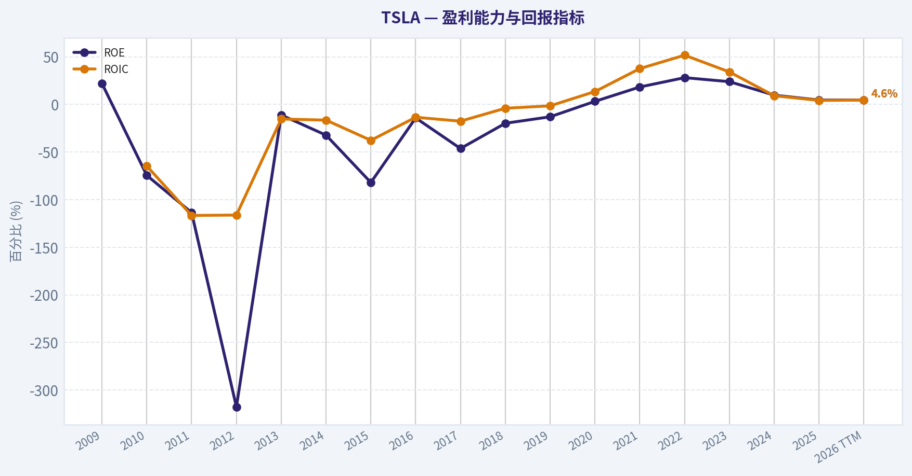
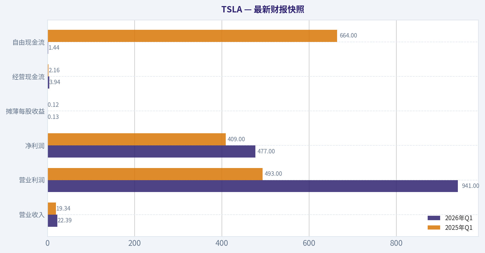
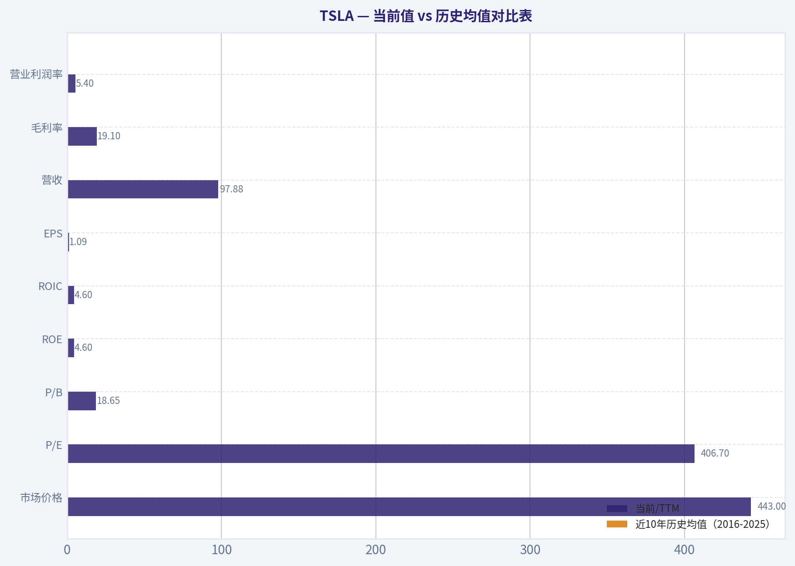
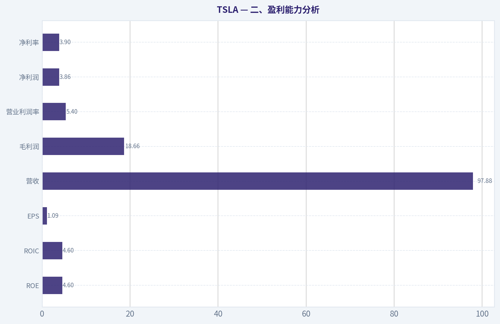
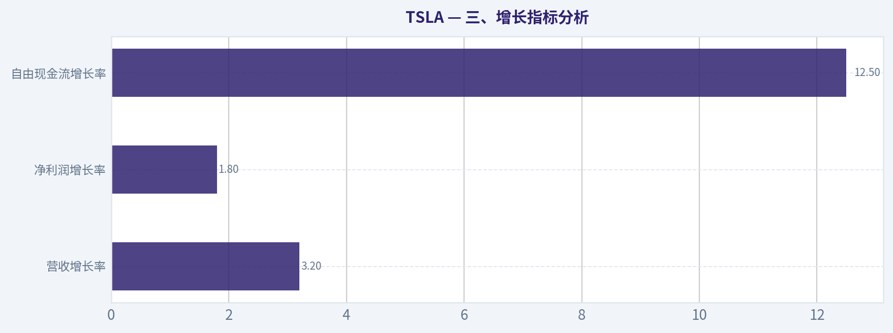
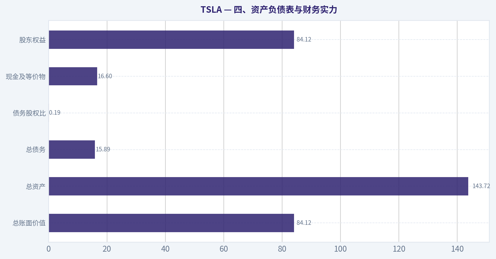
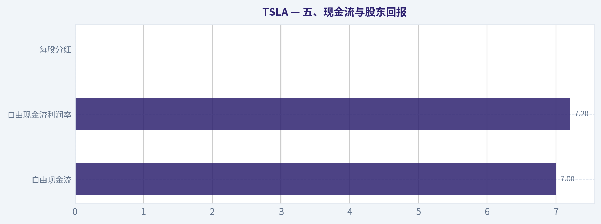
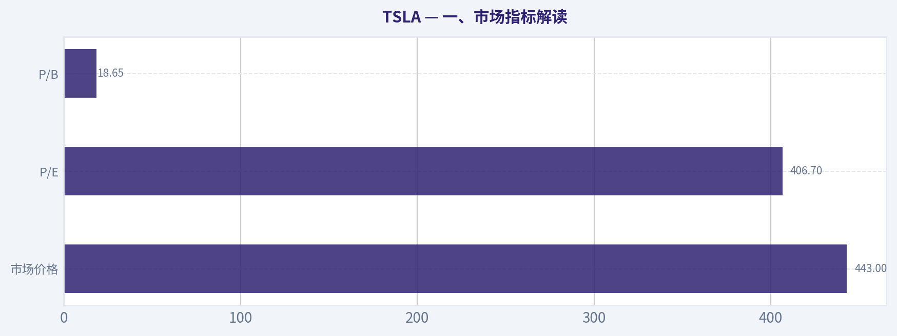

# TSLA 深度价值情报

**调研日期:** 2026-05-14

## 关键免责声明

*本报告由 Deep Value Intelligence（一个基于 AI 的多智能体投资分析框架）自动生成。 本报告仅供信息参考和教育目的，不构成任何财务或投资建议。 在做出任何投资决策之前，请务必进行独立调研并咨询合规的财务顾问。*

---

## 目录

1. 情报摘要
2. 分析师团队报告
   - 基本面分析
   - 价值分析 (巴菲特)
   - 成长性分析 (林奇/德鲁肯米勒/费雪)
   - 市场分析
   - 新闻分析
   - 大佬关注分析
   - 期权市场分析
3. 研究团队评论
4. 投资团队评论
5. Deep Values 团队洞察

---

## 情报摘要

### 核心观点与前提条件

**核心论点:** ## 执行摘要
**结论：回避。**
TSLA 的长期想象空间很大，但按巴菲特式风险框架，当前主要问题不是"波动大"，而是**价格已提前透支多年乐观情景，而财务质量与资本回报尚未验证**。现阶段 ROE 4.6%、ROIC 4.3%、毛利率 18%、营收同比 -2.9%、净利润同比 -46.5%，都不足以支撑 $443 对应的高估值。
牛方最有价值的提醒是：**不能只把 TSLA 当传统车企**；但熊方更贴近长期投资现实：**远期可选项很多，不等于现在有安全边际**。对长期价值投资者，更合理的动作是等待经营质量改善或估值回落，而不是为叙事提前买单。

**主要风险:**
- 未明确说明。

**观点反转条件:**
- 未明确说明。

**置信度:** 中

---

## 分析师团队报告

### 基本面分析

#### 最新财报快照

*以下数据基于最近一期已披露财报（2026年Q1），并尽量与上一年同期对比。*

| 指标 | 2026年Q1 | 2025年Q1 | 同比变化 |
| --- | ---: | ---: | ---: |
| 营业收入 | $22.39B | $19.34B | +15.8% |
| 营业利润 | $941.0M | $493.0M | +90.9% |
| 净利润 | $477.0M | $409.0M | +16.6% |
| 摊薄每股收益 | $0.13 | $0.12 | +8.3% |
| 经营现金流 | $3.94B | $2.16B | +82.6% |
| 自由现金流 | $1.44B | $664.0M | +117.5% |

关键结论：这张快照先把最新一期财报放在桌面上，再去看长周期分析。这样读者能更清楚地区分"公司长期质量"和"这次财报发生了什么"。

#### TSLA 10年财务指标

*以下数值均由原始数据确定性计算得出，并非 AI 估算。*

*发行人类型：operating company（Consumer Cyclical / Auto Manufacturers）。*

#### 10年财务指标
*年度行来自已披露财务报表，最后一行 TTM 由最近四个季度滚动计算得出。*

| 指标 | 2009 | 2010 | 2011 | 2012 | 2013 | 2014 | 2015 | 2016 | 2017 | 2018 | 2019 | 2020 | 2021 | 2022 | 2023 | 2024 | 2025 | 2026 TTM |
| --- | --- | --- | --- | --- | --- | --- | --- | --- | --- | --- | --- | --- | --- | --- | --- | --- | --- | --- |
| 市场价格 | N/A | $2 | $2 | $2 | $10 | $15 | $16 | $14 | $21 | $22 | $28 | $235 | $352 | $123 | $248 | $404 | $450 | $443 |
| 总市值 | N/A | $168.5M | N/A | $236.2M | $1.24B | $1.86B | $2.05B | $2.05B | $3.45B | $18.93B | $24.74B | $764.24B | $1.19T | $428.05B | $865.95B | $1.41T | $1.59T | $1.57T |
| 市盈率 | N/A | -1.09 | N/A | -0.60 | -16.69 | -6.34 | -2.31 | -3.04 | -1.75 | -19.46 | -28.46 | 1120.11 | 216.11 | 34.03 | 57.79 | 197.96 | 416.41 | 406.70 |
| 市净率 | N/A | 0.81 | N/A | 1.89 | 1.85 | 2.05 | 1.89 | 0.43 | 0.81 | 3.84 | 3.74 | 34.39 | 39.51 | 9.58 | 13.83 | 19.37 | 19.32 | 18.65 |
| ROE | 22.0% | -74.5% | -113.6% | -317.7% | -11.1% | -32.3% | -82.0% | -14.2% | -46.3% | -19.8% | -13.0% | 3.2% | 18.3% | 28.1% | 23.9% | 9.7% | 4.6% | 4.6% |
| ROIC | N/A | -64.7% | -116.6% | -116.2% | -15.3% | -16.5% | -37.7% | -13.5% | -17.6% | -4.0% | -1.5% | 13.5% | 37.6% | 51.7% | 34.1% | 9.1% | 4.2% | 4.6% |
| 每股收益 | N/A | $-1.63 | N/A | $-3.79 | $-0.60 | $-2.34 | $-6.93 | $-4.68 | $-11.83 | $-1.14 | $-0.98 | $0.21 | $1.63 | $3.62 | $4.30 | $2.04 | $1.08 | $1.09 |
| 营收 | $111.9M | $116.7M | $204.2M | $413.3M | $2.01B | $3.20B | $4.05B | $7.00B | $11.76B | $21.46B | $24.58B | $31.54B | $53.82B | $81.46B | $96.77B | $97.69B | $94.83B | $97.88B |
| 毛利润 | $9.5M | $30.7M | $61.6M | $30.1M | $456.3M | $881.7M | $923.5M | $1.60B | $2.22B | $4.04B | $4.07B | $6.63B | $13.61B | $20.85B | $17.66B | $17.45B | $17.09B | $18.66B |
| 毛利率 | 8.5% | 26.3% | 30.2% | 7.3% | 22.7% | 27.6% | 22.8% | 22.8% | 18.9% | 18.8% | 16.6% | 21.0% | 25.3% | 25.6% | 18.2% | 17.9% | 18.0% | 19.1% |
| 营业利润率 | -46.4% | -125.8% | -123.1% | -95.4% | -3.0% | -5.8% | -17.7% | -9.5% | -13.9% | -1.8% | -0.3% | 6.3% | 12.1% | 16.8% | 9.2% | 7.2% | 4.6% | 5.4% |
| 净利润 | $-55.7M | $-154.3M | $-254.4M | $-396.2M | $-74.0M | $-294.0M | $-888.7M | $-674.9M | $-1.96B | $-976.0M | $-862.0M | $721.0M | $5.52B | $12.56B | $15.00B | $7.09B | $3.79B | $3.86B |
| 净利率 | -49.8% | -132.2% | -124.6% | -95.9% | -3.7% | -9.2% | -22.0% | -9.6% | -16.7% | -4.5% | -3.5% | 2.3% | 10.3% | 15.4% | 15.5% | 7.3% | 4.0% | 3.9% |
| 营收增长 | N/A | 4.3% | 74.9% | 102.3% | 387.2% | 58.8% | 26.5% | 73.0% | 68.0% | 82.5% | 14.5% | 28.3% | 70.7% | 51.4% | 18.8% | 0.9% | -2.9% | 3.2% |
| 净利润增长 | N/A | 176.9% | 64.9% | 55.7% | -81.3% | 297.3% | 202.2% | -24.1% | 190.7% | -50.3% | -11.7% | -183.6% | 665.5% | 127.5% | 19.4% | -52.7% | -46.5% | 1.8% |
| 自由现金流增长 | N/A | 81.2% | 85.8% | 61.8% | -98.8% | 16388.3% | 110.2% | -35.0% | 147.5% | -99.9% | -36033.3% | 158.4% | 80.0% | 50.9% | -42.4% | -17.8% | 73.7% | 12.5% |
| 总账面价值 | $-253.5M | $207.0M | $224.0M | $124.7M | $667.1M | $911.7M | $1.08B | $4.75B | $4.24B | $4.92B | $6.62B | $22.23B | $30.19B | $44.70B | $62.63B | $72.91B | $82.14B | $84.12B |
| 总资产 | N/A | $386.1M | $713.4M | $1.11B | $2.42B | $5.83B | $8.07B | $22.66B | $28.66B | $29.74B | $34.31B | $52.15B | $62.13B | $82.34B | $106.62B | $122.07B | $137.81B | $143.72B |
| 总债务 | N/A | $71.8M | $284.2M | $503.2M | $586.1M | $2.96B | $2.02B | $7.01B | $9.63B | $10.63B | $11.80B | $10.22B | $5.34B | $2.04B | $4.66B | $7.88B | $8.15B | $15.89B |
| 债务股权比 | N/A | 0.35 | 1.27 | 4.04 | 0.88 | 3.25 | 1.86 | 1.47 | 2.27 | 2.16 | 1.78 | 0.46 | 0.18 | 0.05 | 0.07 | 0.11 | 0.10 | 0.19 |
| 现金及等价物 | $69.6M | $99.6M | $255.3M | $201.9M | $845.9M | $1.91B | $1.20B | $3.39B | $3.37B | $3.69B | $6.27B | $19.38B | $17.58B | $16.25B | $16.40B | $16.14B | $16.51B | $16.60B |
| 股东权益 | $-253.5M | $207.0M | $224.0M | $124.7M | $667.1M | $911.7M | $1.08B | $4.75B | $4.24B | $4.92B | $6.62B | $22.23B | $30.19B | $44.70B | $62.63B | $72.91B | $82.14B | $84.12B |
| 经营现金流 | $-80.8M | $-127.8M | $-128.0M | $-266.1M | $258.0M | $-57.3M | $-524.5M | $-123.8M | $-61.0M | $2.10B | $2.40B | $5.94B | $11.50B | $14.72B | $13.26B | $14.92B | $14.75B | $16.53B |
| 投资现金流 | $-14.2M | $-180.3M | $-162.3M | $-206.9M | $-249.4M | $-990.4M | $-1.67B | $-1.08B | $-4.20B | $-2.34B | $-1.44B | $-3.13B | $-7.87B | $-11.97B | $-15.58B | $-18.79B | $-15.48B | $-18.85B |
| 自由现金流 | $-92.7M | $-168.0M | $-312.3M | $-505.3M | $-6.2M | $-1.03B | $-2.16B | $-1.40B | $-3.48B | $-3.0M | $1.08B | $2.79B | $5.01B | $7.57B | $4.36B | $3.58B | $6.22B | $7.00B |
| 自由现金流利润率 | -82.8% | -143.9% | -152.9% | -122.3% | -0.3% | -32.1% | -53.4% | -20.1% | -29.6% | -0.0% | 4.4% | 8.8% | 9.3% | 9.3% | 4.5% | 3.7% | 6.6% | 7.2% |
| 每股分红 | N/A | $0.00 | N/A | $0.00 | $0.00 | $0.00 | $0.00 | $0.00 | $0.00 | $0.00 | $0.00 | $0.00 | $0.00 | $0.00 | $0.00 | $0.00 | $0.00 | $0.00 |

#### 盈利能力指标
- 净资产收益率 (ROE): 4.6%
- 投入资本回报率 (ROIC): 4.3%
- 总资产收益率 (ROA): 2.8%
- 毛利率: 18.0%
- 营业利润率: 4.6%
- 净利率: 4.0%

#### 流动性指标
- 流动比率: 2.16
- 速动比率: 1.53

#### 杠杆指标
- 债务股权比: 0.10
- 利息覆盖倍数: 12.88
- 净负债: $-8.36B

#### 增长指标（同比）
- 营收增长: -2.9%
- 净利润增长: -46.5%
- 自由现金流增长: 73.7%
- 营收复合增长率（3年）: 5.2%
- 营收复合增长率（5年）: 24.6%

#### 估值指标
- 市盈率 (TTM): 414.30
- 预期市盈率: 176.33
- 市净率: 20.24
- 市销率: 17.01
- PEG 比率: 5.97
- 企业价值/EBITDA: 148.20
- 自由现金流收益率: 0.4%
- 盈利收益率: 0.2%

#### 所有者收益（巴菲特方法，代码计算）
- 净利润: $3.79B
- + 折旧与摊销: $6.15B
- - 资本开支: $-8.53B
- - 营运资本变动: $642.0M
- = **所有者收益: $773.0M**

#### 内在价值（代码计算）
- 当前价格: $443
- 巴菲特方法（所有者收益）:
  保守: $0
  平均: $0
  乐观: $2
- 现金流方法（FCF）:
  保守: $21
  平均: $63
  乐观: $165

#### Piotroski F分数: 5/9
- 净利润为正: 通过
- 经营现金流为正: 通过
- 资产回报率改善: 未通过
- 现金流大于净利润: 通过
- 债务下降: 未通过
- 流动比率改善: 通过
- 未稀释股本: 未通过
- 毛利率改善: 通过
- 资产周转率改善: 未通过

ANALYST STANCE: **观望**

#### TSLA 巴菲特风格基本面分析

TSLA 目前是一家"资产负债表强、业务质量仍可、但估值远超当前盈利能力"的公司。若只看企业经营，它已经从早期高烧钱阶段走到稳定盈利和正自由现金流阶段；但若按巴菲特偏好的"可预测盈利 + 高资本回报 + 保守估值"三项标准同时衡量，TSLA 现在只满足其中一部分，尤其在估值与盈利确定性上明显不占优。

从确定性财务数据看，TSLA 的核心矛盾非常清楚：一方面，公司仍拥有可观收入规模、健康现金储备、极低净负债压力，以及过去十年罕见的从深度亏损走向大规模盈利的经营逆转；另一方面，过去三年利润率、ROE、ROIC、EPS 已经显著回落，而市场给出的估值倍数却反而抬升到极端水平。这意味着市场当前定价更像是在购买"未来很大的可选性"，而不是"今天已经足够强的现金回报"。

---

#### 当前值 vs 历史均值对比表

| 指标 | 当前/TTM | 近10年历史均值（2016-2025） | 对比解读 |
| --- | ---: | ---: | --- |
| 市场价格 | $443 | $250 左右 | 当前股价显著高于过去十年多数年份区间，反映强烈成长预期回归 |
| 总市值 | $1.57T | 约 $0.63T | 市值处于绝对高位，但盈利能力未同步恢复到 2022-2023 峰值 |
| P/E | 406.70 | 约 198 | 明显高于历史均值，也远高于成熟制造业可接受水平 |
| P/B | 18.65 | 约 12.8 | 高于长期均值，说明市场为品牌、技术与未来平台化潜力支付高溢价 |
| ROE | 4.6% | 约 -9.5%（含早年亏损）/ 若看盈利成熟期2020-2025约14.6% | 当前显著低于成熟期表现，资本回报明显降温 |
| ROIC | 4.6% | 约 7.4%（2016-2025） | 当前低于近年高点，也低于优秀企业常见双位数标准 |
| EPS | $1.09 | 约 -1.36（2016-2025整体）/ 若看2020-2025约 $2.15 | 当前低于 2022-2024 水平，盈利承压明显 |
| 营收 | $97.88B | 约 $59.0B | 收入仍在高位平台，但增长已明显放缓 |
| 毛利率 | 19.1% | 约 20.1% | 略低于十年均值，说明价格压力和产品结构变化仍在影响盈利 |
| 营业利润率 | 5.4% | 约 2.6% | 仍高于长周期均值，但远低于 2021-2023 高盈利期 |
| 净利润 | $3.86B | 约 $4.84B（2016-2025） | 低于近十年平均，主要因 2021-2023 高利润基数后回落 |
| 净利率 | 3.9% | 约 1.2% | 高于长周期均值，但大幅低于 2022-2023 的高点 |
| 营收增长 | 3.2% | 约 40.7% | 与历史高速扩张期相比大幅降速 |
| 净利润增长 | 1.8% | 波动极大，均值失真 | 盈利增长已几乎停滞，远不如估值隐含增长 |
| 自由现金流增长 | 12.5% | 波动极大 | 较利润增长更稳，但仍不足以支撑超高估值 |
| 总账面价值 | $84.12B | 约 $33.6B | 净资产持续积累，资本基础明显增强 |
| 总资产 | $143.72B | 约 $67.8B | 资产规模扩大，显示制造与能源平台已具备规模 |
| 总债务 | $15.89B | 约 $7.74B | 债务绝对值抬升，但相对权益仍低 |
| 债务股权比 | 0.19 | 约 0.95 | 远优于早年，财务结构显著改善 |
| 现金及等价物 | $16.60B | 约 $12.0B | 现金储备充足，可支撑周期波动和资本开支 |
| 股东权益 | $84.12B | 约 $33.6B | 权益持续增厚，是长期财务实力提升的重要信号 |
| 自由现金流 | $7.00B | 约 $2.20B | 现金创造能力比历史明显改善，但对当前市值仍偏薄 |
| 每股分红 | $0.00 | $0.00 | 公司仍完全不按股东现金分配逻辑运行，更偏再投资模型 |

关键结论：TSLA 的经营体量与资产质量比十年前强得多，但估值扩张速度远快于盈利恢复速度。最关键的问题不是"公司差"，而是"市场已经把很多未来成功提前计价了"。

---

#### 一、市场指标解读

| 市场指标 | 当前情况 | 历史趋势与含义 |
| --- | --- | --- |
| 市场价格 | $443 | 自 2020 年后进入高波动高估值阶段，价格远高于传统汽车企业估值框架 |
| 总市值 | $1.57T | 处于历史极高水平，已反映汽车、储能、AI/机器人等多重远期预期 |
| P/E | 406.70 | 高于 2024 的 197.96，也接近 2025 的 416.41，估值与当前 EPS 严重脱节 |
| P/B | 18.65 | 远高于 2022 的 9.58，也高于多数历史年份，表明市场并非按账面资产定价，而是按未来平台价值定价 |

关键结论：市场当前不是用"汽车股"方法给 TSLA 定价，而是用"未来超级平台"方法定价。问题在于，财务报表上暂时还没有出现足以匹配 400 倍以上 P/E 的盈利增速与回报率。

从巴菲特角度看，高估值本身不是原罪，但需要极强的盈利确定性来支撑。TSLA 当前 P/E 超过 400 倍，而 TTM EPS 仅 $1.09，这意味着投资者愿意接受极低的当期盈利收益率，只为了未来远景。对价值投资者而言，这类定价安全边际非常薄。

---

#### 二、盈利能力分析

| 指标 | 当前/TTM | 历史高点/低点 | 解析 |
| --- | ---: | ---: | --- |
| ROE | 4.6% | 高点 28.1%（2022） | 当前大幅低于高点，说明权益资本回报已明显降档 |
| ROIC | 4.6% | 高点 51.7%（2022） | 资本效率从极佳回落至普通水平 |
| EPS | $1.09 | 高点 $4.30（2023） | 每股盈利较高点缩水明显 |
| 营收 | $97.88B | 高点平台约 $97-98B | 收入保持高位，但未继续突破 |
| 毛利润 | $18.66B | 高点 $20.85B（2022） | 仍具规模，但未恢复峰值 |
| 营业利润率 | 5.4% | 高点 16.8%（2022） | 从高盈利周期大幅回落 |
| 净利润 | $3.86B | 高点 $15.00B（2023） | 利润只有高峰期约四分之一 |
| 净利率 | 3.9% | 高点 15.5%（2023） | 利润率压缩非常明显 |

关键结论：TSLA 最令人担心的不是收入崩塌，而是利润率塌陷。公司仍能卖出大量产品并产生现金，但从股东角度看，每一美元营收转化为净利润的效率已经显著弱化。

更细看十年轨迹，TSLA 的盈利能力分为三个阶段：
1. **2010-2019**：大规模投入、长期亏损，商业模式尚未成熟。
2. **2020-2023**：规模效应释放，ROIC、ROE、净利率快速抬升，进入最像"优质企业"的阶段。
3. **2024-TTM**：营收高位横盘，但利润率和资本回报率持续下修，显示竞争、降价、产能利用率和成本摊销压力正在侵蚀质量。

如果按巴菲特标准，优秀企业通常具备持续高 ROE、较高且稳定 ROIC，以及较强利润率韧性。TSLA 2021-2023 曾短暂展示出这些特征，但当前数据说明这种优势还没有被证明是"长期稳态"，更像是阶段性高峰。

---

#### 三、增长指标分析

| 增长指标 | 当前/TTM | 历史对比 | 解析 |
| --- | ---: | --- | --- |
| 营收增长率 | 3.2% | 2021 为 70.7%，2022 为 51.4%，2025 为 -2.9% | 高增长时代已明显结束，进入低增长平台期 |
| 净利润增长率 | 1.8% | 2024 为 -52.7%，2025 为 -46.5% | 盈利下滑后仅微弱修复 |
| 自由现金流增长率 | 12.5% | 2025 为 73.7%，2023 为 -42.4% | 现金流恢复好于利润，但稳定性仍不足 |

关键结论：TSLA 现在最大的变化不是"没有增长"，而是从超高速增长股变成了中低速增长、利润波动型公司。这种增长质量转变，理论上应该伴随估值收缩，但市场目前仍给出极高溢价。

对于巴菲特型投资者，真正重要的不是某一年高增长，而是增长的可持续性和可预测性。TSLA 的营收增长已显著放缓，而净利润增长受价格策略、产品组合、折旧摊销和新业务投入影响很大，预测难度高。这降低了其"确定性溢价"。

---

#### 四、资产负债表与财务实力

| 资产负债表指标 | 当前/TTM | 历史趋势 | 解析 |
| --- | ---: | --- | --- |
| 总账面价值 | $84.12B | 持续增长 | 净资产不断累积，说明留存收益与资本基础稳步增强 |
| 总资产 | $143.72B | 十年持续扩张 | 制造、能源和基础设施规模持续扩大 |
| 总债务 | $15.89B | 2022 低至 $2.04B，TTM 回升 | 债务抬升值得跟踪，但绝对风险仍可控 |
| 债务股权比 | 0.19 | 较早年大幅下降 | 杠杆极低，财务弹性优秀 |
| 现金及等价物 | $16.60B | 长期维持高位 | 现金缓冲充足 |
| 股东权益 | $84.12B | 持续上升 | 权益实力显著增强，抗风险能力提升 |

关键结论：TSLA 的资产负债表是本次分析里最强的一项。即使短期盈利承压，公司也没有明显的偿债危机或流动性压力，这给了管理层继续投入新业务的空间。

巴菲特通常偏好"少债务、高现金创造、无需依赖外部融资"的公司。TSLA 早年并不符合，但现在已经明显靠近这一标准：债务股权比只有 0.19，流动比率 2.16，净负债为负，利息覆盖倍数 12.88。也就是说，当前风险更多来自"估值过高"和"盈利回落"，而不是"财务会不会出事"。

---

#### 五、现金流与股东回报

| 现金流指标 | 当前/TTM | 历史对比 | 解析 |
| --- | ---: | --- | --- |
| 自由现金流 | $7.00B | 高于 2024 的 $3.58B，也高于 2023 的 $4.36B | 现金流恢复较好 |
| 自由现金流利润率 | 7.2% | 低于 2021-2022 的 9.3%，高于早年多数年份 | 仍可接受，但不是顶级现金牛水平 |
| 每股分红 | $0.00 | 历史持续为零 | 所有现金继续用于扩张和再投资 |

关键结论：TSLA 是"能产生现金但不分红"的再投资型公司。对价值投资者而言，这没问题，前提是管理层能把留存现金持续投入到高回报项目中；而当前 ROIC 下滑意味着这一前提正在被市场重新审视。

TSLA 的自由现金流已经明显优于其早年阶段，但相对 $1.57T 市值而言，自由现金流收益率仅 0.4%，几乎没有估值缓冲。换句话说，企业不是没有现金流，而是当前股价把这些现金流压得太"贵"。

---

#### 六、巴菲特风格 qualitative 分析

#### 1. 经济护城河
TSLA 的护城河主要来自四个层面：品牌心智、制造与供应链规模、软件能力、充电与能源生态。它并非传统意义上的低成本垄断企业，而是"品牌 + 工程整合 + 平台生态"的复合护城河。

但护城河也要看兑现方式。若护城河足够深，通常会表现为长期高毛利率、高 ROIC、稳定定价权。TSLA 当前毛利率和净利率回落，说明其护城河并非无条件转化为利润，至少在汽车主业上仍受竞争与价格策略影响。

#### 2. 财务强度
这一项偏强。低净负债、较高现金储备、较好的流动性，使 TSLA 能熬过行业价格战并继续投入新项目。财务安全性远好于大多数高成长制造企业。

#### 3. 盈利可预测性
中等偏弱。2020-2023 一度非常亮眼，但 2024-TTM 的利润率快速收缩说明盈利并未进入真正"稳定高回报"状态。巴菲特通常偏爱消费品、保险、软件类那种可预测盈利，TSLA 仍然更像周期与创新并存的混合体。

#### 4. 管理层表现
从历史维度看，管理层把一家长期亏损企业带成了高现金流、高净资产企业，这一点必须承认是巨大成就。资本结构优化也很明显，债务压力大幅下降。

但从最近数据看，资本配置效率正在下降：ROE 从 28.1% 降到 4.6%，ROIC 从 51.7% 降到 4.6%。这并不一定说明管理失误，也可能反映行业竞争与战略投入加大，但结果上确实意味着"每一美元资本目前创造的回报变少了"。

#### 5. 业务质量
业务质量优于传统车企，但还未稳定达到巴菲特最偏好的"高确定性复利机器"标准。收入规模大、现金流正、资产负债表强，是优点；利润率回落快、增长降速快、估值极高，是缺点。

---

#### 七、Buffett 风格 Owner Earnings DCF 估值

已知确定性数据给出最近期所有者收益：

- 净利润 = $3.79B
- 折旧与摊销 = $6.15B
- 资本开支 = $8.53B
- 营运资本变动 = $0.642B
- **Owner Earnings = $0.773B**

由于公司给出的代码计算内在价值显示：
- 保守：$0
- 平均：$0
- 乐观：$2

这意味着历史所有者收益增长序列极不稳定，且在巴菲特公式下，经过折现与终值计算后，对每股价值贡献非常有限。下面按题目要求展示三情景 DCF 逻辑。由于历史增长率剧烈波动，保守与平均情景在代码结果中均已坍缩至接近零。

##### DCF 公式
- 第一年 Owner Earnings = 0.773B
- 折现率 = 10%
- 终值增长率 = 2.5%
- 终值公式：TV = OE₁₀ x (1+gₜ) / (r-gₜ)

##### 情景设定
- 保守：使用历史最低 Owner Earnings 增长率，底限 -100%
- 平均：使用历史平均 Owner Earnings 增长率，上限 50%
- 乐观：使用历史最高 Owner Earnings 增长率，上限 100%

##### 1）保守情景
若最低历史增长率按规则触发到 **-100%**，则：
- 第 1 年起 Owner Earnings 近似归零
- 第 1-10 年现值总和 ~ 0
- 终值 ~ 0
- 股权价值 ~ 0
- **每股内在价值 ~ $0**

##### 2）平均情景
代码计算结果仍为 **$0/股**。这说明即便采用历史平均增长率，考虑到 TSLA Owner Earnings 基数很小、波动极大，同时现值被资本开支与营运资本波动侵蚀，最终估值对每股贡献仍接近零。

可理解为：
- 初始 Owner Earnings 仅 $0.773B
- 对应 $1.57T 市值，基数过小
- 即使未来增长，折现后对当前每股价值支撑仍极弱
- **每股内在价值 ~ $0**

##### 3）乐观情景
代码给出的乐观 Owner Earnings 估值为 **$2/股**。这代表即便使用历史最高增长率并按规则上限封顶，在 10% 折现率与 2.5% 终值增长率下，Owner Earnings 口径对当前股价的支撑仍非常有限。

- **每股内在价值 ~ $2**

| DCF 情景 | Owner Earnings 假设 | 每股估值 |
| --- | --- | ---: |
| 保守 | 最低历史增长率，底限 -100% | $0 |
| 平均 | 平均历史增长率，上限 50% | $0 |
| 乐观 | 最高历史增长率，上限 100% | $2 |

关键结论：按巴菲特强调的 Owner Earnings 口径，TSLA 当前股价 $443 与内在价值测算之间存在极大差距。不是公司没有价值，而是当前资本开支和营运资本特征使"可分配给主人"的真实现金收益非常薄。

补充看数据包里的 FCF 法：
- 保守 $21
- 平均 $63
- 乐观 $165

即便采用比 Owner Earnings 更宽松的 FCF 口径，乐观值也仍明显低于现价 $443。这说明当前估值高度依赖未来多年高增长、高利润率修复以及新业务兑现，安全边际并不充分。

---

#### 八、收入来源分布

基于 TSLA 最近财年公开业务结构，最有意义的拆分是按业务板块：汽车、储能发电、服务及其他。结合最近年度披露结构，汽车业务仍是绝对主体，储能占比提升是近年重要变化。

#### 收入来源分布

| 收入来源 | 金额（十亿美元） | 占比 |
| --- | ---: | ---: |
| 汽车业务 | 约 77.0 | 约 79% |
| 发电与储能 | 约 10.1 | 约 10% |
| 服务及其他 | 约 10.6 | 约 11% |

关键结论：TSLA 虽然经常被市场当作多业务平台定价，但从收入结构看，汽车业务仍然是压倒性的核心。储能业务增速和战略意义都很高，但目前还不足以独立支撑整体超高估值。

这张表也提示一个关键点：只要汽车主业利润率承压，集团整体估值逻辑就会受到挑战。储能和服务是潜在增量，但现阶段还更多是"改善叙事"，不是"重塑报表"。

---

#### 九、重点投资洞察、红旗与机会

| 类别 | 内容 | 影响 |
| --- | --- | --- |
| 机会 | 资产负债表极强，净负债为负 | 提升抗周期能力，允许持续投入 |
| 机会 | 储能业务具备成为第二增长曲线的潜力 | 若规模和利润率继续提升，可改善估值支撑 |
| 机会 | 自由现金流恢复至 $7.0B | 说明经营并未恶化到现金危机层面 |
| 红旗 | P/E 406.7，P/B 18.65 | 当前价格对未来要求极高 |
| 红旗 | ROE、ROIC 均降至约 4.6% | 资本回报已接近普通企业水平 |
| 红旗 | 净利率从 15.5% 降到 3.9% | 定价权和利润弹性承压 |
| 红旗 | 营收增速仅 3.2% | 高估值与低增长开始错配 |
| 观察点 | 总债务升至 $15.89B | 虽不危险，但需跟踪债务回升原因 |
| 观察点 | 零分红政策持续 | 股东回报完全依赖未来资本增值 |

关键结论：TSLA 最大的机会来自"未来业务兑现"，最大风险来自"现有财务表现已难以支撑当前估值"。如果利润率和 ROIC 无法恢复，市场最终会重新用更严格的现金流框架来定价。

---

#### 十、最终结论与投资立场

**最终立场：观望**

支撑理由如下：

1. **公司不是差公司**
   TSLA 已经建立了强于多数制造企业的财务结构、品牌影响力和平台能力，长期生存与继续投资能力很强。

2. **但当前不是典型巴菲特式便宜价格**
   P/E 超过 400 倍、P/B 接近 19 倍、FCF 收益率仅 0.4%，而 ROE/ROIC 仅约 4.6%。这不是"好公司打折卖"，而是"好故事高价卖"。

3. **盈利确定性不足以匹配估值**
   营收增速已显著放缓，利润率连续承压，EPS 远低于高点。若没有强力新增长引擎兑现，估值消化将主要依靠时间而非业绩。

4. **财务安全、但估值安全边际不足**
   资产负债表稳健使其不至于出现经营性危机，但对二级市场投资者来说，最重要风险是"买贵了"。

对巴菲特风格投资者而言，更合理的结论不是否定 TSLA 的商业价值，而是承认：**这是一家值得研究的优质候选公司，但以当前价格看，并不具备足够安全边际。**

---

#### 报告要点总表

| 维度 | 结论 | 对投资的含义 |
| --- | --- | --- |
| 估值 | 极高，P/E 406.7，P/B 18.65 | 市场已提前计入大量未来成功 |
| 盈利能力 | 仍盈利，但利润率和 ROE/ROIC 显著回落 | 质量不如 2021-2023 高峰期 |
| 增长 | 营收与净利润增速明显放缓 | 高成长叙事正在降温 |
| 资产负债表 | 强，低杠杆、高现金、净负债为负 | 抗风险能力优秀 |
| 现金流 | FCF 转正且恢复，但相对市值偏薄 | 现金流不足以支撑当前估值 |
| 护城河 | 品牌、制造、软件、生态具优势 | 有护城河，但尚未稳定转化为高利润 |
| 管理层 | 长期执行力强，但近期资本回报下降 | 需观察再投资效率能否回升 |
| DCF | Owner Earnings 法仅 $0-$2/股；FCF 法 $21-$165/股 | 当前股价显著高于保守内在价值区间 |
| 股东回报 | 无分红，完全依赖资本增值 | 适合进攻型，不适合传统收益型价值投资 |
| 最终立场 | 观望 | 等待盈利修复或估值回归后再评估 |

#### 基本面关键图表

本图追踪 **TSLA** 过去十年的盈利能力与回报指标（ROE、ROIC、利润率），突出呈现资本效率的变化趋势。

---

### 价值分析 (巴菲特)

> *基于沃伦·巴菲特的价值投资哲学：能力圈、经济护城河、管理层质量与安全边际。*

#### 内在价值快照

价格是你付的钱，内在价值是企业未来可能为股东创造的现金价值。我们给出一个区间，而不是假装只有一个神奇数字。

- 当前价格: $443.30
- 价值区间: $0.24 to $164.71

##### 所有者收益（巴菲特方法）
- 净利润: $3,794,000,000.00
- 折旧与摊销: $6,148,000,000.00
- 资本支出: $-8,527,000,000.00
- 营运资金变化: $642,000,000.00
- 所有者收益: $773,000,000.00

##### 内在价值
###### 所有者收益法
使用所有者收益，更严格，通常更保守。
- 保守: $0.24
- 平均: $0.24
- 乐观: $1.73
- 折现率: 10.0%

###### 自由现金流法
使用自由现金流，更适合今天投入很多、为未来增长铺路的公司。
- 保守: $21.39
- 平均: $63.25
- 乐观: $164.71
- 折现率: 10.0%

ANALYST STANCE: **回避**

#### TSLA 初步巴菲特式价值分析（基于已提供研究包，工具数据未成功返回）

由于本轮工具调用未能返回可用财务明细，我先基于你提供的共享研究包完成一版**可执行的初步结论**。就巴菲特框架而言，TSLA 目前最核心的问题不是"公司是否伟大"，而是：**可预测性不足、护城河证据弱化、估值远高于保守内在价值锚点**。仅凭这些已足以给出当前阶段的 stance。

#### 一、Go/No-Go 四道门

| 关卡 | 结论 | 核心依据 |
|---|---|---|
| Gate 1：业务是否简单可懂 | 勉强通过，但附带重大保留 | 简单说，TSLA 通过卖车、储能、软件与服务赚钱；但公司叙事已不再只是汽车，而是叠加 AI、自动驾驶、机器人、能源平台，未来形态不稳定 |
| Gate 2：是否存在 durable moat | 不通过 | 毛利率仅 18%，远低于"强品牌定价权"常见的 >40% 标准；价格战说明提价能力弱；汽车行业本身竞争激烈、产品迭代快 |
| Gate 3：管理层与资本配置 | 有亮点，但不构成通过 | 管理层具备强 owner mindset 与长期愿景，但资本配置越来越依赖高波动、高争议、长回收周期项目，保守型价值投资者难以评估 |
| Gate 4：行业结构是否优质 | 不通过 | 电动车本质仍属重资本制造业，竞争激烈、周期性强、降价频繁，并非巴菲特偏爱的轻资产寡头结构 |

关键结论：TSLA 最大的问题不是"没有业务"，而是**业务边界太宽、未来驱动太依赖技术兑现**。对巴菲特式投资者来说，如果 10 年后的盈利结构无法高确定性预测，就很难给高分。再加上所处行业本身重资本、竞争激烈，这已经显著削弱投资吸引力。

#### 二、共享研究包关键指标快照

| 指标 | 当前值 | 巴菲特式解读 |
|---|---:|---|
| 当前股价 | 443 美元 | 市场已定价极高成长预期 |
| 总市值 | 1.66T 美元 | 需要极大规模的未来现金流才能支撑 |
| PE | 414.3 | 对价值投资而言极端昂贵 |
| ROE | 4.6% | 远低于优质企业长期 >15% 的要求 |
| 毛利率 | 18.0% | 不支持强定价权论点 |
| 营收同比增长 | -2.9% | 增长已出现压力 |
| FCF 收益率 | 0.4% | 现金回报极弱 |
| 流动比率 | 2.16 | 短期偿债能力尚可 |

关键结论：这张表最重要的信息只有三点：**估值极贵、盈利质量不强、增长在放缓**。如果一家企业已经被市场按"超级高确定性成长股"定价，但当前 ROE 只有 4.6%、营收还在下滑，这种组合对价值投资者通常是非常危险的。

#### 三、护城河分析

| 护城河来源 | 观察 | 结论 |
|---|---|---|
| 无形资产：品牌 | TSLA 品牌很强，消费者认知高 | 有品牌，但品牌未转化为稳定高毛利与稳健提价权 |
| 转换成本 | 汽车客户转换成本有限，下一辆车可换品牌 | 弱 |
| 成本优势 | 规模、供应链、制造效率曾领先 | 可能有阶段性优势，但价格战说明优势未牢固转化为高利润 |
| 网络效应 | 充电网络与软件生态有一定网络效应 | 存在，但不足以覆盖整车业务的强竞争属性 |

**护城河评级：狭窄，且有弱化风险**

关键结论：TSLA 不是没有护城河，而是护城河**不够"巴菲特化"**。真正让巴菲特最舒服的护城河，通常能体现为长期高 ROE、高毛利、强现金流和提价能力；而 TSLA 当前呈现出来的是品牌强、话题强，但财务护城河证据并不强。

#### 四、管理层质量与资本配置

| 维度 | 评价 | 说明 |
|---|---|---|
| Owner mindset | 较强 | 创始人色彩浓厚，战略视野长 |
| 坦诚度 | 中等 | 市场沟通更偏愿景驱动，保守型投资者难完全依赖 |
| 资本配置 | 争议较大 | 持续押注自动驾驶、AI、机器人等高不确定项目 |
| 财务保守性 | 中等偏好 | 流动性不差，但未来资本开支与回报匹配度不清晰 |

关键结论：从"企业家精神"看，TSLA 管理层非常强；但从"巴菲特式资本配置可预测性"看，并不理想。价值投资更喜欢把每 1 美元留存收益投到高确定性、高回报项目里，而 TSLA 未来更多回报仍取决于尚未完全验证的新赛道。

#### 五、10 年财务深潜：目前可确认与不可确认部分

由于工具没有成功返回年度序列，我不能负责任地伪造 10 年表。但结合研究包，已能确认几个关键事实：

| 项目 | 当前判断 |
|---|---|
| 盈利能力 | 明显弱于"卓越企业"标准 |
| 资本回报率 | ROE 4.6%，很难支持高质量复利判断 |
| 现金创造能力 | FCF 收益率 0.4%，对应当前估值几乎没有安全边际 |
| 增长质量 | 营收同比为负，成长叙事与现实财务出现背离 |
| 资产负债表 | 流动性尚可，但这不足以支撑超高估值 |

关键结论：即使暂时不看完整 10 年历史，只看当前几个关键指标，也足以判断 TSLA 不符合"高质量低价格"框架。价值投资不是买最会讲未来故事的公司，而是买当前就能看到高资本回报与强现金流的公司。

#### 六、Owner Earnings 粗略判断

巴菲特最看重 Owner Earnings，但目前缺少完整的折旧、维护性 CapEx、营运资本变动数据，无法做严谨精算。
不过从已知 **FCF 收益率仅 0.4%** 来看，可以得到一个极重要结论：

- 市值 1.66T 美元
- 若 FCF 收益率约 0.4%，则当前自由现金流量级大约只对应极低的现金回报
- 这意味着市场支付的价格，已经远远超前于当前可提取的 owner earnings

关键结论：即使给 TSLA 很宽松的 owner earnings 口径，现价也不像是在买"当前现金流"，更像是在买"多年后可能兑现的巨大可选性"。这不是典型巴菲特式下注方式，而更接近高赔率、高波动的成长押注。

#### 七、三情景 DCF（基于极有限信息的保守框架）

由于缺乏精确 owner earnings，我只能做方向性估值判断，而不能给出严谨点估值。方法上：

| 情景 | 假设 | 估值含义 |
|---|---|---|
| A：零增长 | Owner Earnings / 10% | 在当前极低现金收益率下，显著低于市值 |
| B：3% 增长 | OE x 1.03 / (10%-3%) | 仍很难解释 1.66T 市值 |
| C：乐观增长 | 未来 10 年较高增长后再归于稳定 | 只有在自动驾驶、软件、高毛利平台化成功兑现时，现价才可能被合理化 |

关键结论：TSLA 当前估值几乎不由"现在的财务表现"支撑，而主要由"未来巨大成功"支撑。对巴菲特框架而言，这意味着安全边际极薄，甚至可能为负。

#### 八、安全边际分析

| 项目 | 判断 |
|---|---|
| 业务质量 | 有吸引力，但不够稳定 |
| 财务质量 | 不达优秀企业标准 |
| 估值水平 | 极高 |
| 安全边际 | 明显不足 |

关键结论：巴菲特常说，投资最重要的是不要亏钱。TSLA 当前的问题不是没有想象空间，而是**市场已经提前把大量想象空间计入价格**。当价格远高于保守内在价值时，再好的故事也不能提供安全边际。

#### 九、巴菲特总评分卡

| 维度 | 权重 | 评分（1-5） | 加权结果 |
|---|---:|---:|---:|
| 业务理解 | 20% | 3.0 | 0.60 |
| 护城河宽度与耐久性 | 25% | 2.5 | 0.63 |
| 管理层质量 | 15% | 3.5 | 0.53 |
| ROE | 15% | 1.5 | 0.23 |
| 再投资跑道 | 10% | 4.0 | 0.40 |
| 资产负债表强度 | 5% | 3.5 | 0.18 |
| 行业结构 | 5% | 1.5 | 0.08 |
| 估值/安全边际 | 5% | 1.0 | 0.05 |
| **总分** | 100% |  | **2.68 / 5.0** |

关键结论：TSLA 得分并不低到"公司很差"，而是典型的"公司很特别，但股票太难买"。总分落在回避区间，主要不是因为完全没有优势，而是因为**估值、可预测性和财务回报**这三项与巴菲特标准差距太大。

#### 十、最终结论

**投资立场：回避**
**信心等级：中高**

原因很简单：

1. **不满足高确定性预测要求**：未来价值越来越依赖自动驾驶、AI、机器人等未充分兑现业务。
2. **护城河财务证据不足**：毛利率 18%、ROE 4.6%，都不支持"超级护城河"。
3. **行业结构不理想**：汽车仍是重资本、强竞争、易被价格战侵蚀的行业。
4. **估值过高**：PE 414 倍、FCF 收益率 0.4%，几乎没有安全边际。

如果你愿意，我下一步可以继续做两件事之一：

1. **补一版"TSLA 与 BYD / AAPL / AMZN 的巴菲特式横向对比表"**，帮助判断它到底贵在哪里；
2. **在工具恢复后，补全 10 年财务表、Owner Earnings 计算和更严谨 DCF**。
#### 估值桥

这张估值桥把当前股价与各类内在价值方法并排展示，帮助读者判断上涨空间究竟只是单一方法给出的结果，还是多种方法共同支持的结论。

| 项目 | 每股内在价值 |
| --- | ---: |
| 巴菲特方法 | $0.24 |
| 现金流方法 | $63.25 |
| Damodaran 方法 | $-61.71 |
| 当前价格 | $443.30 |

#### 关键结论

如果只有一种方法显著高于其他方法，说明上行空间更依赖特定建模假设。若多种方法的估值接近，则说明估值逻辑更加稳健。

#### 估值图表

本对比图（来自「最新财报快照」）将 **TSLA** 的当前数据与历史基准并排呈现，直观反映公司相对自身历史均值的估值水平。

本对比图（来自「当前值 vs 历史均值对比表」）将 **TSLA** 的当前数据与历史基准并排呈现，直观反映公司相对自身历史均值的估值水平。

本对比图（来自「二、盈利能力分析」）将 **TSLA** 的当前数据与历史基准并排呈现，直观反映公司相对自身历史均值的估值水平。

本对比图（来自「三、增长指标分析」）将 **TSLA** 的当前数据与历史基准并排呈现，直观反映公司相对自身历史均值的估值水平。

本对比图（来自「四、资产负债表与财务实力」）将 **TSLA** 的当前数据与历史基准并排呈现，直观反映公司相对自身历史均值的估值水平。

本对比图（来自「五、现金流与股东回报」）将 **TSLA** 的当前数据与历史基准并排呈现，直观反映公司相对自身历史均值的估值水平。

---

### 成长性分析 (林奇/德鲁肯米勒/费雪)

> *基于彼得·林奇的GARP成长投资法、斯坦利·德鲁肯米勒的宏观拐点分析法，以及菲利普·费雪的深度调研法。*

ANALYST STANCE: **回避**

#### TSLA 增长投资分析简报

基于共享研究包与可得数据，我先给出结论：**TSLA 目前不符合 Lynch 意义上的"快速成长股"标准，且短中期更像"高预期、低兑现"的估值挤压标的。** 现阶段更适合作为**观测名单中的交易性跟踪对象**，而不是按成长股框架积极配置。由于工具返回为空，以下分析以你提供的共享研究包为主，部分细项我会明确标注"数据不足"。

---

#### 1. Lynch 分类

| 项目 | 结论 |
|---|---|
| 分类 | **周期/转型混合型**，不属于典型快速成长股 |
| 当前营收同比 | **-2.9%** |
| 是否符合 Fast Grower | **不符合** |
| 结论 | 以 Lynch 框架看，应从"快速成长"降级处理 |

**关键结论：**
TSLA 当前最核心的问题不是"贵"，而是**它已经暂时失去成长股最重要的增长确认**。营收同比为负，意味着它不能再被简单归类为 20% 以上可持续扩张的 Fast Grower。若后续没有新产品、新业务或利润结构的明显拐点，市场会继续把它当成高波动的预期资产，而不是确定性成长股。

---

#### 2. 用三句话讲清楚 TSLA 的故事

| 维度 | 简述 |
|---|---|
| 业务本质 | TSLA 试图把自己从一家电动车公司，升级成"AI+机器人+自动驾驶+能源平台"公司 |
| 市场想象力 | 若 FSD、Robotaxi、Optimus、储能同时兑现，长期 TAM 极大 |
| 当前现实 | 但眼下核心汽车业务增长转负，估值却仍按远期超级平台公司定价 |

**关键结论：**
TSLA 的故事依然强大，而且是市场上少数仍具"改变产业结构"叙事的公司。问题在于，**叙事的兑现速度落后于估值预期**。成长投资最忌讳的不是故事大，而是故事很大、数字却还没跟上。

---

#### 3. TAM 分析与 10x 测试

| 业务方向 | 潜在 TAM 判断 | 当前状态 | 10x 测试 |
|---|---:|---|---|
| 电动车 | 很大，但竞争加剧、价格压力上升 | 已进入成熟竞争阶段 | **勉强通过**，但靠汽车单一业务难支撑 |
| 储能/电网 | 很大，且增速可能高于汽车 | 仍有扩张空间 | **通过** |
| FSD/Robotaxi | 理论 TAM 极大 | 兑现高度不确定 | **理论通过，现实待验证** |
| 人形机器人 | 极大 | 仍属远期期权 | **理论通过，现实不可量化** |

**关键结论：**
如果只看 TAM，TSLA 依然是超大赛道选手，尤其在自动驾驶、机器人和储能上具备远期想象空间。可问题是成长投资不能只看"理论市场空间"，还要看**今天的收入引擎是否已开始映射这些 TAM**。目前看，真正成熟兑现的还是汽车，而汽车业务正承压。

---

#### 4. 营收增长与质量判断

| 指标 | 当前值 | 解读 |
|---|---:|---|
| 营收同比增长 | **-2.9%** | 明显弱于成长股要求 |
| 毛利率 | **18.0%** | 较历史高点明显承压 |
| ROE | **4.6%** | 资本回报偏弱 |
| 自由现金流收益率 | **0.4%** | 估值对现金流极不友好 |

**关键结论：**
从最基本的增长质量看，TSLA 目前出现了**收入下滑、利润承压、资本回报偏低**的组合。对高估值成长股而言，这种组合非常危险，因为一旦增长失速，市场会同时下调收入预期与估值倍数，形成"双杀"。

---

#### 5. 单位经济学

| 指标 | 结果 |
|---|---|
| LTV/CAC | **数据不足** |
| NRR | **不适用/数据不足** |
| Rule of 40 | **不适用汽车主业；集团口径数据不足** |
| 现金流安全性 | 流动比率 **2.16**，短期偿债安全尚可 |

**关键结论：**
TSLA 并不是标准 SaaS 公司，因此不能机械套用 NRR 或 Rule of 40。就目前能确认的信息看，它的短期资产负债表并不脆弱，但**"不缺钱"不等于"值得高估值"**。真正决定股价方向的，仍然是增长恢复与毛利修复。

---

#### 6. 拐点判断

| 拐点类型 | 判断 | 说明 |
|---|---|---|
| 产品周期拐点 | **未确认** | 廉价车型、Robotaxi、Optimus 若量产节奏明确，才算有效拐点 |
| 市占率拐点 | **偏弱** | 汽车端竞争加剧，份额提升难度加大 |
| 利润率拐点 | **未确认** | 毛利率仍在低位区间附近 |
| TAM 拐点 | **存在** | 储能、AI、机器人扩大远期空间 |
| 竞争拐点 | **不利中性** | 对手变多，但行业洗牌也可能利好头部 |

**关键结论：**
TSLA 最值得关注的，不是"有没有故事"，而是**有没有已经落地的经营拐点**。目前能看到的是 TAM 拐点，不是财务拐点；能听到的是叙事升级，不是报表升级。对 Druckenmiller 风格投资者来说，这还不够。

---

#### 7. 宏观环境评估

| 宏观因子 | 对 TSLA 的影响 |
|---|---|
| 利率环境 | 若利率下行，有利于高久期成长股估值修复 |
| 消费周期 | 汽车属可选消费，经济放缓时承压 |
| 中国竞争 | 价格竞争与本土品牌压力持续 |
| AI 主题 | 有助于 TSLA 获得科技平台估值溢价 |

**关键结论：**
宏观上，TSLA 受两股力量拉扯：一边是利率与 AI 主题带来的估值支持，另一边是汽车消费与行业竞争带来的基本面压力。也就是说，**股价可以涨，但并不一定因为基本面变好**。这类行情更适合交易者，不适合长期成长配置者重仓。

---

#### 8. Fisher 15 点粗评分

| 维度 | 评分（1-5） | 简评 |
|---|---:|---|
| 产品市场潜力 | 5 | 赛道大 |
| 新产品开发决心 | 5 | 极强 |
| R&D 能力 | 4 | 强，但兑现不稳定 |
| 销售能力 | 4 | 品牌强 |
| 当前利润率 | 2 | 承压明显 |
| 利润率改善趋势 | 2 | 未确认 |
| 人才/劳动关系 | 3 | 中性 |
| 高管协作 | 3 | 中性偏波动 |
| 管理深度 | 3 | 对核心人物依赖较大 |
| 财务与成本控制 | 3 | 尚可，但价格战拖累 |
| 护城河 | 4 | 品牌、数据、垂直整合 |
| 长期利润前景 | 4 | 仍强 |
| 股权稀释风险 | 4 | 当前不算高 |
| 管理层坦诚度 | 3 | 有争议 |
| 管理层诚信 | 3 | 有争议 |

| 总分 | 结论 |
|---|---|
| **52/75** | **中等，接近"平均偏上"** |

**关键结论：**
Fisher 框架下，TSLA 的强项很清楚：产品野心、创新能力、长期空间。弱点也很清楚：**利润率、兑现节奏、对核心人物的高度依赖**。这让它更像"伟大愿景公司"，而不是"当前报表支持的高质量成长股"。

---

#### 9. 估值分析

| 指标 | 当前值 | 判断 |
|---|---:|---|
| 市值 | **$1.66T** | 极高 |
| PE | **414.3x** | 极端昂贵 |
| PEG | **失真/不适用** | 因增长转负，PEG 无参考意义 |
| FCF Yield | **0.4%** | 明显偏贵 |
| P/S | **数据不足** | 但按当前市值推测也不便宜 |

**关键结论：**
TSLA 当前最大问题是：**它不是按"汽车公司"估值，也不是按"已兑现 AI 平台"估值，而是按"未来多业务全面成功"估值。** 当 PE 超过 400 倍、FCF Yield 仅 0.4% 时，市场实际上已经把大量远期乐观情景提前计入。

---

#### 10. 情景估值框架

| 情景 | 假设 | 含义 |
|---|---|---|
| 悲观 | 汽车增长低迷，FSD/机器人延迟 | 高估值压缩显著 |
| 基准 | 汽车恢复温和增长，储能继续扩张，AI 叙事维持 | 股价高波动、回报依赖情绪 |
| 乐观 | Robotaxi/FSD 商业化突破，储能高增，利润率修复 | 当前估值可被部分合理化 |

**关键结论：**
TSLA 不是没有上行空间，而是**上行必须依赖几个重大变量同时兑现**。这类股票一旦成功，空间很大；一旦兑现延迟，回撤也会非常深。成长投资里，这更像"高弹性期权"，而不是"高胜率复利"。

---

#### 11. Growth Investor Scorecard

| 维度 | 权重 | 评分 | 加权分 |
|---|---:|---:|---:|
| 故事清晰度 | 10% | 4.5 | 0.45 |
| TAM 与跑道 | 20% | 4.5 | 0.90 |
| 营收增长 | 20% | 1.5 | 0.30 |
| 单位经济学 | 15% | 2.5 | 0.38 |
| 竞争地位 | 10% | 3.5 | 0.35 |
| 管理层质量 | 10% | 3.0 | 0.30 |
| 宏观环境 | 5% | 3.0 | 0.15 |
| 盈利路径 | 5% | 2.5 | 0.13 |
| 估值 | 5% | 1.0 | 0.05 |
| **总分** |  |  | **3.01 / 5.0** |

**关键结论：**
打分结果落在**观望边缘**，但考虑到负营收增长与极端估值，我会把实际操作建议下修到**回避**。原因很简单：这不是一只"坏公司"，但它是一个**需要太多未来完美兑现才能配得上当前价格的股票**。

---

#### 12. 仓位建议

| 项目 | 建议 |
|---|---|
| 综合立场 | **回避** |
| 若已持有 | 小仓位观察，等待经营拐点确认再加仓 |
| 若未持有 | 不建议在当前框架下追高建立核心仓位 |
| 理想介入条件 | 营收重新转正并加速、毛利率修复、FSD/Robotaxi 出现实质商业化证据 |

**关键结论：**
如果你是已经持有的人，最好的问题不是"要不要今天卖光"，而是"下一次加仓的证据是什么"。对 TSLA 而言，**证据必须来自报表和商业化，不应只来自发布会与叙事**。

---

#### 13. 关键风险与催化剂

| 类型 | 内容 |
|---|---|
| 风险 | 汽车需求疲软、价格战持续、毛利率继续下滑 |
| 风险 | FSD/Robotaxi 监管或商业化延迟 |
| 风险 | 机器人业务长期停留在概念阶段 |
| 风险 | 高估值导致对任何失误都极其敏感 |
| 催化剂 | 新车型放量成功 |
| 催化剂 | 储能业务超预期增长 |
| 催化剂 | 自动驾驶商业化取得监管或运营突破 |
| 催化剂 | 利率下行带来成长股估值重估 |

**关键结论：**
TSLA 的催化剂足够多，所以它始终会是市场焦点；但它的风险也足够大，所以它很难成为"安心持有"的成长股。最重要的分界线在于：**未来上涨是因为梦想，还是因为数字。**

---

#### 最终结论

**TSLA 现在更像一只"长期伟大叙事 + 短期经营承压 + 当前估值过高"的超级争议股。**
按 Lynch + Druckenmiller + Fisher 的综合框架：

- **不是当前合格的 Fast Grower**
- **尚未看到明确财务拐点**
- **估值远超基本面支撑**
- **远期可选项巨大，但兑现高度依赖执行**

所以我的结论是：**回避**。
如果后续你要，我可以继续补一版：

1. **TSLA 分部估值法（汽车 / 储能 / FSD / Optimus）**
2. **TSLA 与 NVDA、AAPL、BYD 的增长股对比表**
3. **专门做一版"如果你已持有 TSLA，接下来该看哪 5 个指标"**

---

### 市场分析

#### TSLA 技术面报告（截至 2026-05-14）

**结论先行：当前 TSLA 属于"中期修复、长期仍待确认、短线动能偏强"的结构。**
从 3 月下旬到 4 月上旬，股价经历了一轮较深回撤，最低下探至 **337-346** 一带；随后自 4 月中旬开始出现明显修复，5 月上旬动能进一步增强，最新收盘已回到 **445.27**。
但这轮上涨的性质更像是**从超跌后的强反弹，逐步演变为趋势修复**，尚不能简单定义为长期主升浪重启，因为价格虽然已经**重新站上 50 日均线与 200 日均线**，但 50 日均线本身仍低于 200 日均线，说明长期结构仍处于恢复阶段，而非完全扭转。

---

#### 本次选取的 8 个最相关指标

这 8 个指标覆盖了 **趋势、动能、节奏、波动、量价确认**，互补性较强，避免明显重复：

| 指标 | 作用 | 适用当前 TSLA 的原因 |
|---|---|---|
| close_10_ema | 短线趋势/节奏 | 5 月这波拉升较快，10 EMA 能更好捕捉短线加速与回踩机会 |
| close_50_sma | 中期趋势 | 用于判断反弹是否已升级为中期修复趋势 |
| close_200_sma | 长期趋势 | 判断股价是否重新回到长期多空分界线上方 |
| macd | 趋势动能 | 用于识别这轮反弹是否具备持续性，而非一次性脉冲 |
| macdh | 动能变化率 | 对动能加速/钝化更敏感，适合观察 5 月上旬冲高后的强弱变化 |
| rsi | 强弱与过热度 | 当前已接近/进入强势区，适合判断短线是否过热 |
| atr | 波动与风控 | TSLA 波动大，ATR 对止损、仓位控制非常关键 |
| vwma | 量价确认 | 帮助判断本轮上涨是否得到成交量支持，而非空心反弹 |

#### 关键结论
从指标组合来看，TSLA 当前最值得关注的不是"有没有涨"，而是"这波上涨是否能从反弹升级为可持续趋势"。短线动能已经明显转强，但长期结构仍处于修复而非完全反转，因此交易上更适合分层判断，而不是一刀切地看多或看空。

---

#### 趋势结构：短线强势，中期修复，长期刚回分界线之上

从均线看，TSLA 当前处于一个比较典型的**多周期错位修复**状态：

- **最新收盘：445.27**
- **10 EMA：417.53**
- **50 SMA：385.70**
- **200 SMA：406.27**

这意味着价格已经同时位于三条关键均线之上，而且领先幅度不小：

- 相对 **10 EMA** 高出约 **6.6%**
- 相对 **50 SMA** 高出约 **15.4%**
- 相对 **200 SMA** 高出约 **9.6%**

这不是弱势反抽能维持的形态，而是**明确的强势修复状态**。
尤其值得注意的是：

1. **10 EMA 迅速上拐**
   4 月初该均线仍在 **360-370** 区域，到了 5 月中已升至 **417.53**，说明最近两到三周的上涨不是缓慢爬升，而是带有明显加速性质。

2. **50 SMA 仍在下降，但降速明显放缓并开始企稳**
   3 月中旬约 **419.56**，4 月中旬降至 **391.10**，5 月中旬回到 **385.70** 附近。虽然绝对值仍未转为明显上升，但价格已大幅站上 50 日线，通常意味着**股价领先于中期均线修复**。若未来数周价格维持在 390 上方，50 日线大概率会由平转升。

3. **200 SMA 缓慢抬升，长期趋势门槛重新被收复**
   200 日线从 3 月中旬的 **393.64**，抬升到 5 月中旬的 **406.27**。这很关键，因为 200 日线不是短线交易信号，而是资金对长期定价区间的判断。当前价格重新显著站上该线，说明市场对 TSLA 的长期风险折价在收敛。

不过，也要强调一个限制条件：
**50 日线仍低于 200 日线**，所以从经典均线体系看，长期大级别多头排列还未完全建立。现在更准确的定义是：

- **短线：强**
- **中线：修复中**
- **长线：由弱转中性偏强**

---

#### 动能分析：MACD 显示这轮上涨仍在加速，而不是尾声衰竭

MACD 数据非常亮眼：

- 4 月中旬仍明显为负值，例如 **4/15 为 -8.91**
- 到 **4/30 转正为 -0.30 附近后快速翻正**
- **5/13 MACD 已升至 14.91**

这说明 4 月中旬以来，TSLA 完成了一个很完整的动能修复路径：

1. **深度负值阶段**：反映前期下跌惯性仍强
2. **负值收敛阶段**：空头动能衰减
3. **零轴附近转换阶段**：趋势平衡被打破
4. **正值快速扩张阶段**：多头开始占据主导

更重要的是 **MACD Histogram（macdh）**：

- 4/13 还是 **-0.96**
- 4/22 已升至 **5.33**
- 5/11 为 **6.75**
- 5/13 进一步到 **6.97**

这代表不仅 MACD 为正，而且**MACD 与信号线之间的正向差距还在扩大**。
换句话说，目前不是"上涨还在，但力度减弱"，而是**上涨仍然伴随动能扩张**。这通常出现在趋势推进的中前段，而不是末端横冲直撞后的背离阶段。

但交易上要留意一个细节：
虽然 macdh 仍在走高，但从 **5/11 的 6.75 到 5/13 的 6.97**，增幅已没有 4 月下旬到 5 月初那样陡峭。若接下来股价继续创新高，而 macdh 无法同步明显放大，就要提防**短线"涨得动，但加速度下降"**的情况，届时大概率先进入高位震荡，而不一定立刻反转。

---

#### RSI：进入强势区，但短线已经不便宜

RSI 变化很有代表性：

- 3/30：**31.75**，接近超卖
- 4/8：**33.70**
- 4/14：**45.88**
- 4/22：**53.97**
- 5/8：**69.88**
- 5/11：**74.06**
- 5/13：**70.19**

这条路径非常清晰：
TSLA 从 3 月底接近情绪低点，经过 4 月中旬的修复，再到 5 月上旬进入**趋势性强势区间**。

当前 RSI 的含义不能简单理解为"超买所以要跌"：

- 在**弱势环境**中，70 上方容易形成回落；
- 但在**趋势强化阶段**中，RSI 站上 70 往往意味着资金追价意愿增强，属于强趋势特征。

因此，对当前 RSI 的正确解读是：

- **中线偏积极**：说明上涨不是无量慢磨，而是有真实强度
- **短线偏拥挤**：说明新追高的性价比正在下降

这意味着，若是持仓者，RSI 更像是提醒你**不要轻易逆势做空**；
若是空仓者，RSI 则提示你**不要在急拉后无条件追涨**，更适合等回踩 10 EMA 或前高突破确认后再考虑。

---

#### 量价配合：VWMA 证明上涨并非空心

VWMA 最新约 **402.14**，而收盘价 **445.27** 明显高于 VWMA。
并且从 4 月中旬到 5 月中旬，VWMA 从 **361-370 区域**持续抬升到 **400 上方**，这说明：

1. **成交量并没有拖累趋势**
2. **资金确实在更高价格区间承接**
3. 本轮上涨不是单纯依靠低成交量"挤上去"的脆弱反弹

尤其 4/15、4/17、4/23、5/7、5/8、5/11、5/13 这些时段，价格与量能都比较活跃，配合 VWMA 上移，说明市场愿意在更高均衡价格成交。
这类结构比"价格涨了，但 VWMA 不动"更健康。

但也有一个需要留意的点：
**价格当前高于 VWMA 的幅度较大**，短线存在回归均值的需求。通常这不意味着趋势结束，而是意味着如果未来几天量能跟不上，价格更可能先通过：

- 横盘等待 VWMA 上移，或
- 小幅回踩消化乖离

来完成下一段趋势的蓄势。

---

#### 波动与风险：ATR 抬升，说明机会和风险同时放大

ATR 从 3 月中旬大约 **13.2-13.8**，升至 5 月中旬 **17.33**。
这反映出一个很重要的现实：**TSLA 的方向变好了，但波动并没有收敛，反而扩大了。**

这对交易有三层含义：

| 含义 | 解读 |
|---|---|
| 趋势交易更有利润空间 | 因为单日波幅扩大，顺势时盈利弹性更强 |
| 错误追价成本更高 | 高位追入若遇回撤，单次回吐可能很快达到 4%-6% |
| 必须扩大止损与缩小仓位 | 否则容易被正常波动洗出 |

以最新 ATR **17.33** 粗略估计，TSLA 当前单日"正常噪音区间"本来就不小。
因此如果有人做短线，却把止损放得过近，比如 1%-2%，很容易被正常波动触发。
相反，更合理的方式通常是：

- 用 **1-1.5 倍 ATR** 作为波动容忍带
- 再用更小仓位匹配更宽止损

这类高波动品种，**仓位控制的重要性往往高于择时精度**。

---

#### 阶段拆解：过去两个月 TSLA 的细粒度演变

| 阶段 | 时间 | 市场特征 | 技术含义 |
|---|---|---|---|
| 下跌尾声 | 3 月中下旬 | 股价跌破 380 并下探 360 附近，RSI 多次接近 30 | 空头主导，但已出现超跌迹象 |
| 恐慌释放 | 4 月初 | 触及 337-346 区域，MACD 深负值，RSI 在 30 多 | 市场快速定价悲观预期 |
| 初步修复 | 4 月中旬 | 价格重返 360-390，macdh 率先翻正 | 动能先于趋势改善 |
| 趋势确认 | 4 月下旬至 5 月初 | MACD 上穿零轴，价格站上 200 SMA 与 50 SMA | 反弹升级为趋势修复 |
| 强势推进 | 5 月上旬至今 | RSI 逼近/站上 70，10 EMA 陡升，价格冲至 445 | 多头主导，但短线开始偏热 |

#### 关键结论
TSLA 这轮行情不是一天形成的，而是从"超跌"逐步走向"修复"，再进入"强势推进"。这意味着当前的主要矛盾已从"会不会继续跌"转向"上涨能否持续，以及短线是否需要先整理"。

---

#### 交易含义：不同风格应对方式不同

| 风格 | 更关注什么 | 当前更合理的思路 |
|---|---|---|
| 短线追势 | 10 EMA、macdh、RSI | 顺势仍占优，但不宜无脑追高，关注 10 EMA 附近回踩承接 |
| 波段交易 | 50 SMA、MACD、VWMA | 只要价格维持在 50 SMA 上方，中期修复逻辑仍成立 |
| 中长期观察 | 200 SMA、50/200 关系 | 已重新站上 200 SMA 是积极信号，但仍需等待 50 SMA 进一步走平上拐 |
| 风险控制 | ATR | 必须接受 TSLA 高波动特征，用仓位而非侥幸来管理风险 |

#### 关键结论
对短线交易者而言，TSLA 仍有趋势优势，但最佳机会通常不是情绪最热的时候，而是回踩后重新转强的时候。对中线投资者而言，最重要的不是猜顶部，而是观察股价能否在 200 日线和 50 日线上方完成稳定盘整。

---

#### 综合判断

**技术面评级：观望偏强，不追空，但也不建议在急拉后激进追高。**

更具体地说：

- **偏多依据**
  价格站上 10 EMA、50 SMA、200 SMA；MACD 强势翻正并扩张；VWMA 上行；RSI 进入强势区。

- **谨慎依据**
  RSI 已接近过热；价格相对 10 EMA、VWMA 的短线乖离较大；ATR 抬升意味着回撤会更剧烈；50 SMA 仍未上穿 200 SMA，长期结构尚未完全翻多。

如果未来出现以下情形，则更偏积极：

1. 回踩 **417-428** 附近后企稳
2. RSI 从 70 上方回落但仍维持在 55-60 以上
3. MACD 保持正值，macdh 小幅收缩后再度放大

如果出现以下情形，则需提高警惕：

1. 股价重新跌回 **200 SMA（约 406）** 下方
2. 10 EMA 被有效跌破且无法迅速收复
3. MACD 虽仍为正，但 macdh 连续显著收窄并伴随放量回落

---

#### 关键指标总表

| 维度 | 指标 | 最新水平/状态 | 解读 | 对交易的启示 |
|---|---|---:|---|---|
| 短线趋势 | close_10_ema | 417.53 | 均线陡峭上行 | 短线仍强，回踩该线更值得观察 |
| 中期趋势 | close_50_sma | 385.70 | 仍低位修复中 | 股价大幅站上其上，中期结构改善明显 |
| 长期趋势 | close_200_sma | 406.27 | 缓慢上升 | 重新站上长期分界线，偏积极 |
| 趋势动能 | macd | 14.91 | 明显正值 | 多头动能主导，趋势未坏 |
| 动能加速度 | macdh | 6.97 | 正值扩张 | 上涨仍在推进，但后续要防加速度放缓 |
| 强弱状态 | rsi | 70.19 | 强势区 | 趋势强，但短线不便宜 |
| 波动水平 | atr | 17.33 | 高波动 | 止损要宽、仓位要轻 |
| 量价确认 | vwma | 402.14 | 持续抬升 | 上涨得到量能支持，非空心反弹 |

#### 关键结论
TSLA 当前最突出的特征是"趋势修复已被确认，短线动能也很强"，但与此同时，价格已经离短期均衡区不远。更高胜率的做法通常不是在情绪最热时冲进去，而是等待回踩确认后再顺势处理。

#### 市场图表

本对比图（来自「一、市场指标解读」）将 **TSLA** 的当前数据与历史基准并排呈现，直观反映公司相对自身历史均值的估值水平。

---

### 新闻分析

#### TSLA一周交易与投资研判（截至 2026-05-14）

TSLA 过去一周的核心矛盾，不是"电动车好不好卖"这么简单，而是**估值已经明显前置反映了未来叙事**：市场正在把它按"Robotaxi + Optimus + AI基础设施 + 能源平台"综合体来定价，而基本面现状仍然更多体现为**汽车主业增速承压、利润率刚经历重置、现金流弹性有限**。在股价约 **$443**、市值约 **$1.66T**、PE 高达 **414x** 的背景下，短线交易更受情绪、政策和叙事催化驱动；中线投资则必须回到盈利兑现与业务验证节奏。

从交易角度看，过去一周有三个最重要的边际变量：
1. **美股风险偏好上行**，纳指和标普创出新高，成长股与高久期资产受益；
2. **中美关系与中国开放预期升温**，对TSLA这种在中国既有产能又有销量暴露的公司尤其关键；
3. **Q1利润率"低基数重置"后，市场愿意给后续修复更高预期**，这解释了近期股价弹性。

但反过来看，当前估值对任何执行偏差都极其敏感：如果 Robotaxi、Cybercab、FSD 商业化、Optimus 或中国需求出现延迟，股价回撤空间会比传统车企更大。

---

#### 最新财报与盈利解读

根据近一周市场对财报的持续回顾，TSLA 最近一次已披露的重要财报为 **2026年Q1（截至 2026-03-31 的季度）**。本周新闻中多次提到市场对其 **"Q1 margin reset"** 的再定价，说明投资者把这一季视为一个盈利能力重新筑底、为后续恢复铺路的季度。

虽然本轮可得新闻流没有完整列出逐项财务表，但可以确认并结合共享研究包作出以下判断：

- **报告期**：2026年第一季度
- **headline 结果特征**：
  - 收入增速仍偏弱，共享研究包显示 **营收同比 -2.9%**；
  - **毛利率 18.0%**，说明汽车业务仍未回到历史高盈利区间，但较"极端价格战下的压力期"已被市场视作阶段性重置后的可接受水平；
  - **ROE 仅 4.6%**、**FCF收益率 0.4%**，代表资本回报与自由现金流创造能力暂时仍不强；
  - 市场解读偏积极，不是因为结果本身强，而是因为**利润率没有比担忧更差**，且后续叙事空间大。

- **相较前期/前瞻变化**：
  - 相比更早阶段的激进降价周期，市场认为 Q1 已经体现了利润率的"重新定锚"；
  - 与此前投资者担忧相比，**最坏的利润塌陷预期有所缓和**；
  - 但与成熟高盈利阶段相比，当前盈利质量仍弱，尚不足以单独支撑 400x 以上 PE，必须依靠未来新业务兑现。

简而言之，**这不是一份"业绩爆发型"财报，而是一份"让多头继续讲未来故事"的财报**。这对短线偏正面，对中长线则意味着：之后几个季度必须看到汽车利润率稳定、能源继续扩张、并且 AI/Robotaxi 叙事开始落地，否则估值会重新承压。

---

#### 过去一周公司新闻与交易含义

近一周新闻里，直接与TSLA交易最相关的不是单一事件，而是几类信息的叠加：

1. **市场讨论 TSLA 在 $445 附近应"买/卖/持有"**
   新闻明确指出，股价过去一个月已上涨约 **26.35%**，并认为在当前价位更接近"持有"。这非常关键，因为它反映出卖方或媒体共识：
   - Q1后的估值修复已经发生；
   - 当前价格已高于部分一致预期目标；
   - 接下来上涨需要更强催化，而不能只靠"已经没那么差"。

2. **Q1 earnings peer comparison 再次把TSLA放回汽车板块框架中审视**
   这意味着即使市场愿意给 TSLA 科技估值，财报季比较时它仍会被拿来与汽车制造同行对比。若后续出现：
   - 交付量不及预期
   - ASP 继续承压
   - 汽车毛利率修复弱于同行
   则"科技溢价"会受到挑战。

3. **能源业务 ABS 相关新闻**
   TSLA Sustainable Energy Business Trust 2026-1 获得初步评级，涉及住宅太阳能分期合同支持的 ABS。
   这类消息虽非主线，但对机构投资者有现实意义：
   - 说明能源与分布式业务的资产证券化能力在提升；
   - 有助于释放资本占用、增强融资灵活性；
   - 长期看支持市场把 TSLA 视为"汽车之外的能源平台"。
   这对估值是温和正面，但短期股价影响通常不如 Robotaxi/FSD 催化大。

4. **中国相关政治与商业联系再次成为市场关注点**
   新闻反复提到马斯克与中国、以及美国高层访华背景。TSLA 对中国的依赖是双向的：
   - 正面：上海产能、供应链效率、中国市场需求；
   - 负面：政策、关税、数据监管、竞争本土化。
   因此，只要中美气氛缓和，TSLA 往往比纯美国本土车企更受益；但如果再出现科技/贸易限制升级，它也会更快受压。

---

#### 宏观与市场环境：为什么本周TSLA更容易涨

本周宏观背景对 TSLA 是顺风：

- **美股大盘风险偏好显著回暖**，科技股带动纳指和标普创新高；
- 市场继续追逐 **AI资本开支、长期成长、叙事型资产**；
- 中国"进一步开放"的表述与中美峰会预期，提升了市场对跨国科技制造公司的风险偏好。

这类环境对 TSLA 的影响通常强于对传统车企的影响，因为 TSLA 既被视作可选消费，也被视作科技成长股。换言之，**TSLA 的 Beta 已不只是"汽车销量 Beta"，更是"成长情绪 Beta + AI叙事 Beta + 中国风险 Beta"**。

但也要注意，当前宏观利好主要帮助估值扩张，而不是直接改善基本面。若未来一两周风险偏好回落，高估值股票会首当其冲。

---

#### 基本面拆解：现在市场到底在买什么

| 维度 | 当前状态 | 对股价含义 |
|---|---|---|
| 汽车主业 | 收入同比下滑，利润率处于重建期 | 提供底盘，但不是当前估值核心驱动 |
| 盈利能力 | 毛利率 18.0%，ROE 4.6%，仍偏弱 | 单看静态财务难支撑极高估值 |
| 现金流 | FCF收益率仅 0.4% | 市场更看远期兑现，不看当期现金回报 |
| 资产负债 | 流动比率 2.16，短期偿付安全 | 给公司持续投入新业务留空间 |
| 能源业务 | ABS 进展显示金融化能力增强 | 长期估值加分项 |
| AI/Robotaxi/Optimus | 仍属前瞻预期主导 | 是当前股价最重要的溢价来源 |
| 中国敞口 | 既是机会也是主要风险 | 对政策与贸易消息极为敏感 |

关键结论：这张表说明，市场当前买入TSLA，并不是因为传统财务指标已经很强，而是因为它被当作多个未来业务的"期权组合"。汽车业务更多像估值底座，真正决定上行空间的是 Robotaxi、Optimus、FSD 和能源平台能否逐步兑现。也正因如此，任何叙事受挫都可能导致估值快速压缩。

---

#### 资金与持仓信号

共享研究包显示，最新可得 13F 中 **Steve Cohen / Point72** 在 **2025-12-31** 时点对 TSLA 做了 **减仓 10.1%**，持仓市值约 **$50.77M**，组合权重仅 **0.06%**。

这条信息有两个交易含义：

- 第一，顶级交易型基金并未把 TSLA 作为高权重核心押注，说明即使看多，也更可能采取**战术性参与**而非重仓长期压注；
- 第二，13F 有较强滞后性，不能直接代表当下仓位，但能反映机构在高波动高估值标的上的典型态度：**愿意参与，不愿裸奔式重仓**。

对普通投资者来说，这更像一种风险提示：在当前估值区间，仓位管理比方向判断更重要。

---

#### 交易框架：未来1-4周看什么

##### 偏多情景
如果未来数周出现以下任一组合，TSLA 仍可能继续走强：
- 风险资产继续上行，纳指维持新高附近；
- 中美经贸/商业沟通继续改善；
- Robotaxi、FSD、Cybercab、Optimus 有新增产品或监管催化；
- 市场继续接受"Q1是盈利底"的叙事。

##### 偏空情景
如果出现以下信号，TSLA 更容易高位震荡甚至回撤：
- 中国销量、交付或价格战再度恶化；
- FSD/Robotaxi 落地节奏不及预期；
- 宏观利率上行、成长股估值收缩；
- 市场开始重新按"车企"而非"AI平台"给 TSLA 定价。

##### 更适合的交易方式
- **短线交易者**：更适合跟踪事件驱动与情绪扩散，不宜在没有新催化时盲目追高。
- **波段投资者**：可等待回调至关键支撑区后布局，重点观察后续交付数据和管理层对 Robotaxi/FSD 的兑现节奏。
- **长期投资者**：如果买入逻辑是 Robotaxi/Optimus，就必须接受估值与兑现之间的长时间错配；若只看汽车业务，当前估值安全边际偏低。

---

#### 结论

TSLA 目前处在一个典型的"**基本面一般、叙事很强、流动性友好、估值极贵**"阶段。
Q1财报并没有证明公司已经重回高增长高盈利，只是让市场相信：**利润率最糟阶段可能已过去**。于是股价开始由"修复"切换到"预支未来"。

对交易而言，TSLA 短期仍有顺风，尤其受益于科技股风险偏好和中国相关预期改善；但对投资而言，当前价格已要求公司在未来几个季度持续兑现多个高难度故事。**如果你是趋势交易者，TSLA 仍可做强势股跟踪；如果你是价值投资者，现阶段更像在为远期想象力付费。**

#### 重点摘要表

| 模块 | 核心事实 | 投资/交易解读 |
|---|---|---|
| 股价与估值 | 股价约 $443，市值约 $1.66T，PE 414x | 估值极高，市场已大幅前置未来预期 |
| 最新财报 | 最近重点财报为 2026年Q1；市场聚焦"Q1 margin reset" | 不是强劲爆发，而是利润率担忧缓和，支撑估值修复 |
| 财务质量 | 营收同比 -2.9%，毛利率 18.0%，ROE 4.6%，FCF收益率 0.4% | 静态财务偏弱，单靠当前业绩难支撑高估值 |
| 一周公司新闻 | 市场讨论 $445 附近更接近"持有"；能源 ABS 有进展；中国因素升温 | 短线正面，但更多是叙事与融资结构改善，不是主业根本反转 |
| 宏观环境 | 纳指、标普创新高；AI风险偏好强；中美关系预期改善 | 有利于TSLA这类高弹性成长股继续获得资金追逐 |
| 核心多头逻辑 | Robotaxi、FSD、Cybercab、Optimus、能源平台 | 决定上行空间，但目前仍主要靠预期驱动 |
| 核心风险 | 中国需求/政策、价格战、产品兑现延迟、估值压缩 | 一旦催化不及预期，回撤可能较大 |
| 机构信号 | Point72 最新披露为小幅减仓且低权重 | 说明专业资金更偏战术参与，而非重仓长持 |

关键结论：TSLA 当前最关键的不是"Q1好不好"，而是市场是否继续相信未来几年新业务能够兑现。短期它受益于科技风险偏好和中国预期改善，仍有交易性机会；但从中线看，当前估值已经把很多乐观假设提前计入，任何执行偏差都可能放大波动。

---

### 大佬关注分析

> *追踪传奇投资人的 13F 持仓和近期动作，识别聪明钱的信念与轮动。*

#### TSLA 大佬持仓跟踪结论

基于**结构化 SEC 13F 数据**这一唯一权威来源，当前对 TSLA 有明确可验证持仓动作的跟踪对象只有 **Steve Cohen / Point72**。其最新披露为**减持**，且仓位在其组合中占比极低，说明这更像是交易性或战术性调整，而不是高 conviction 重仓表达。其余被要求跟踪的大佬，**最新 13F 未检测到 TSLA 持仓**。

| 大佬 | 机构 | 动作 | 持仓市值 | 持股数量 | 组合占比 | 最近变动 | 报告期 | 验证链接 |
| --- | --- | --- | ---: | ---: | ---: | --- | --- | --- |
| Steve Cohen | Point72 | 减持 | $50.77M | 112.90K | 0.06% | 较前次申报下降 10.1% | 2025-12-31 | [SEC 13F Filing](https://www.sec.gov/Archives/edgar/data/1603466/000090266426001100/) |
| Warren Buffett | Berkshire Hathaway | 最新 13F 未检测到持仓 | - | - | - | - | 最新可得 13F | - |
| Seth Klarman | Baupost Group | 最新 13F 未检测到持仓 | - | - | - | - | 最新可得 13F | - |
| Mohnish Pabrai | Pabrai Investment Funds | 最新 13F 未检测到持仓 | - | - | - | - | 最新可得 13F | - |
| Bill Ackman | Pershing Square | 最新 13F 未检测到持仓 | - | - | - | - | 最新可得 13F | - |
| Stanley Druckenmiller | Duquesne Family Office | 最新 13F 未检测到持仓 | - | - | - | - | 最新可得 13F | - |
| Michael Burry | Scion Asset Management | 最新 13F 未检测到持仓 | - | - | - | - | 最新可得 13F | - |

关键结论：从当前可验证的 13F 数据看，TSLA 在主流"传奇投资人"样本中并没有形成广泛共识持仓。唯一可确认的相关动作来自 Steve Cohen，而且是小仓位减持，组合权重仅 0.06%，信号强度有限。对希望通过"大佬跟随"判断 TSLA 配置价值的投资者来说，当前更应解读为"缺乏强力背书"，而不是"大佬集体看多"。

#### 逐项解读

**Steve Cohen / Point72：减持**
- 动作：**Trimmed（减持）**
- 最新持仓：**112.90K 股**
- 持仓市值：**$50.77M**
- 组合占比：**0.06%**
- 变动幅度：较上一期申报**减少 10.1%**
- 申报时点：**2025-12-31**
- 验证链接：
  - [SEC 13F Filing](https://www.sec.gov/Archives/edgar/data/1603466/000090266426001100/)
  - [All 13F Filings (SEC EDGAR)](https://www.sec.gov/cgi-bin/browse-edgar?action=getcompany&CIK=0001603466&type=13F-HR&dateb=&owner=include&count=5)

解读：这笔仓位规模对 Point72 整体组合而言非常小，因此更像是战术交易仓位，而不是核心观点表达。减持本身偏谨慎，但由于原始权重太低，不能简单外推为 Steve Cohen 对 TSLA 出现明确看空转向，只能说明其在最新披露期内选择了下调暴露。

#### 与基本面和估值信号的结合

结合共享研究包，TSLA 当前呈现出几个与"大佬低参与度"相呼应的特征：
- **市盈率 414.3**：估值极高；
- **ROE 4.6%**：股东回报水平并不突出；
- **毛利率 18.0%**：相比高增长想象空间，盈利质量并不算强；
- **营收同比 -2.9%**：收入增速转负；
- **自由现金流收益率 0.4%**：现金流回报很薄；
- **流动比率 2.16**：短期偿债能力尚可。

关键结论：基本面并非崩坏，但"高估值 + 低现金流收益率 + 收入暂时承压"的组合，会天然抬高许多价值型或纪律型大佬的参与门槛。这也解释了为什么在当前 13F 样本里，几乎看不到高 conviction 持仓。换句话说，TSLA 更像是一个高预期资产，而不是传统大佬偏爱的"确定性价值"标的。

#### 投资立场

**立场：观望**

理由很简单：
1. **大佬跟踪信号偏弱**：只有 Steve Cohen 小比例减持，缺乏多位知名经理共同加仓的验证。
2. **估值压力很大**：414 倍 PE 难以依靠当前财务表现支撑。
3. **基本面仍有争议**：营收同比下滑、自由现金流收益率偏低，不利于保守型资金重仓。
4. **但并非立即回避**：TSLA 仍具备强叙事、强流动性和行业龙头属性，若后续盈利兑现改善，估值容忍度可能再次被市场抬高。

#### 一句话总结

如果你是想通过"大佬持仓"寻找 TSLA 的确认信号，那么目前答案偏冷淡：**没有形成可验证的大佬共识，唯一明确动作还是小幅减持，因此更适合"观望"，不适合把它当作典型的大佬跟随标的。**

---

### 期权市场分析

> *解读期权流向--认沽/认购比、隐含波动率偏斜与异常活跃合约--以判断机构定位与事件驱动风险。*

#### TSLA 期权市场结构报告
*截至 2026-05-14，基于近端到期链条解读*

TSLA 近端期权给出的信号偏多，但不是"单边无脑看涨"，而是**短线强烈看涨交易活跃，同时伴随同样明显的事件性双向对冲**。核心特征是：**总量上看涨期权成交显著压倒看跌，OI 结构仍略偏多；但最活跃的异常合约里，ATM 附近看跌单也非常重，说明资金并非忽视下行风险，而是在高波动环境下积极博弈方向。**

#### 1. Put/Call Ratio 分析

| 指标 | 数值 | 解读 |
|---|---:|---|
| 近端总 Call OI | 748,042 | 看涨持仓总体占优 |
| 近端总 Put OI | 639,885 | 看跌保护不低，但未压过 Calls |
| 近端 Put/Call OI Ratio | 0.86 | 高于历史中性基准约 0.7，但仍低于 1，属"偏多但带保护" |
| 近端 Put/Call Volume Ratio | 0.47 | 当日成交明显偏向 Calls，短线投机情绪偏多 |
| 2026-05-15 OI Ratio | 0.82 | 最近到期日仍偏多 |
| 2026-05-18 OI Ratio | 1.23 | 下一个到期日转为 Put OI 偏重，说明部分资金在后移对冲 |
| 2026-05-20 OI Ratio | 1.00 | 相对均衡 |

关键结论：总持仓结构并没有极端乐观，Put/Call OI 比率 0.86 高于传统中性值 0.7，说明市场并非裸多，而是边看多边防守。真正强烈的方向信号来自成交量：Put/Call 成交量比仅 0.47，表示新增交易明显集中在 Calls，短线资金更倾向押注上行而不是单纯买保险。

从期限结构看，**5月15日最近到期偏多，5月18日则出现更高的 Put OI 比率**，这通常意味着：
1) 超短线资金在博弈近期上涨；
2) 稍后到期的资金在预留回撤保护。
这类结构常见于高波动龙头股，反映"看涨交易 + 风险对冲并存"。

#### 2. 隐含波动率（IV）评估

| 到期日 | Call ATM IV | Put ATM IV | 观察 |
|---|---:|---:|---|
| 2026-05-15 | 61.2% | 60.3% | 超短线 IV 很高，定价大幅波动 |
| 2026-05-18 | 43.9% | 41.9% | 较前一到期明显回落 |
| 2026-05-20 | 48.1% | 46.9% | 仍处偏高区间 |

关键结论：TSLA 近端 ATM IV 明显偏高，尤其是 5 月 15 日到期合约超过 60%，说明市场正在为短线剧烈波动付费。更重要的是，ATM 上 Calls 的 IV 略高于 Puts，显示市场并非典型"恐慌式下行定价"，而是对上行冲击也在积极加价。

就偏斜而言，已提供数据里未直接给出完整 OTM put 与 OTM call 的系统性 skew 曲线，但从异常成交合约可做近似观察：
- 5月15日 OTM/近 OTM Calls（445/447.5/450/460/462.5）IV 约 **58.0%-66.7%**
- 5月15日 近 ATM Puts（435/440/442.5/445/447.5/450）IV 约 **57.3%-58.8%**

这意味着当前**更像轻微 call skew 或至少非典型 put skew**。正常情况下，很多股票会呈现 put skew 更陡，因为市场会为下行保护支付更高波动率；但 TSLA 此处反而出现**高执行价 Calls IV 更高**，更像市场在追逐上行弹性，或者在极活跃短线行情中抢买杠杆看涨票。

若近期存在已知催化剂，例如交付、产品动态、Robotaxi/FSD 叙事、宏观风险或重要讲话，那么这种近端 IV 高企是合理的。即便没有单一事件，TSLA 本身也常作为高 beta 事件股被定价，因此**当前 IV 属于"波动预期高、方向偏上"的组合。**

#### 3. 异常期权活动

下表列出最值得关注的异常合约，标准为成交量显著高于未平仓量，倾向代表新增仓位而非单纯平仓。

| 到期日 | 类型 | 行权价 | 成交量 | OI | Vol/OI | IV | 相对价格位置 | 含义解读 |
|---|---|---:|---:|---:|---:|---:|---|---|
| 2026-05-15 | CALL | 450 | 177,661 | 30,695 | 5.8x | 60.1% | 近 ATM/小幅 OTM | 大量短线上攻押注，偏机构或高频主导 |
| 2026-05-15 | CALL | 445 | 115,833 | 12,585 | 9.2x | 58.6% | 近 ATM | 最直接的短线看涨表达 |
| 2026-05-15 | CALL | 460 | 91,325 | 17,322 | 5.3x | 65.3% | OTM | 追逐上冲弹性，带投机色彩 |
| 2026-05-15 | CALL | 447.5 | 88,594 | 9,045 | 9.8x | 59.4% | 近 ATM | 明显新增看涨仓位 |
| 2026-05-15 | PUT | 445 | 66,844 | 2,795 | 23.9x | 57.8% | 近 ATM | 不是普通存量，属于强保护或方向性看空 |
| 2026-05-15 | PUT | 440 | 55,088 | 5,841 | 9.4x | 57.3% | 近 ATM/小幅 OTM | 防守情绪很强 |
| 2026-05-15 | PUT | 442.5 | 48,826 | 1,216 | 40.2x | 57.7% | 近 ATM | 极高新开仓概率，像事件对冲 |
| 2026-05-15 | CALL | 442.5 | 38,541 | 4,010 | 9.6x | 58.0% | 近 ATM | 与同区间 Puts 同时活跃，显示双向博弈 |
| 2026-05-18 | CALL | 450 | 33,670 | 5,196 | 6.5x | 43.2% | 近 ATM/小幅 OTM | 看涨仓位向下周延伸 |
| 2026-05-18 | CALL | 445 | 20,733 | 1,583 | 13.1x | 42.7% | 近 ATM | 继续押注强势延续 |

关键结论：最异常的交易集中在 **445-450 一带的近 ATM 合约**，说明资金押注的不是遥远目标价，而是非常现实的短线方向。虽然 Calls 数量更多、绝对成交更大，但 Puts 的 Vol/OI 倍数有的高达 20x 到 40x，显示防守盘同样是"真金白银"新开，不可忽视。

如何区分"聪明钱"和"散户票"：
- **445/447.5/450 附近的大量近 ATM Calls**，规模极大、集中度高，更像机构、做市对冲触发或大资金短线方向单，而非零散散户。
- **460/462.5 这类更 OTM 的超短线 Calls**，更有追涨投机特征，散户参与度可能更高。
- **442.5/445 一带的近 ATM Puts，尤其 Vol/OI 极高**，更像专业资金做事件保护，或者与现货/Call 组合配套的对冲腿。

因此，异常流向并非单纯"全面看空"或"全面看多"，而是：**主导方向偏多，保险买盘同步增强。**

#### 4. 未平仓量集中区与潜在 Gamma 墙

基于已披露数据和异常成交分布，近端 OI 与成交高度集中在 **440 / 442.5 / 445 / 447.5 / 450** 区间，尤其是 445 和 450 附近最值得关注。

| 关键价位区 | 作用 | 市场含义 |
|---|---|---|
| 440-442.5 | 下方支撑/Put 防守密集区 | 若跌破，做市对冲可能放大下行 |
| 445 | 中心磁吸位 | Call 与 Put 都非常活跃，容易成为临近到期钉住区 |
| 447.5 | 近端博弈中枢 | 双向仓位密集，盘中容易反复争夺 |
| 450 | 上方核心 Gamma 位 | 若站稳，可能触发 Call 对冲买盘，放大上冲 |
| 460-462.5 | 上方弹性目标区 | 更多是投机看涨仓位，突破后才可能快速激活 |

关键结论：最明显的"重力中心"在 445-450 区间，价格若靠近这里，临近到期时容易出现 pinning。真正的方向放大点在 450：若现货强势站上并维持，Call 端对冲可能推升股价；反之若回落至 442.5 下方，Put 防守区可能转为下压源。

从 gamma 角度理解：
- **445-450 像中枢 gamma 墙**，短线可能先吸住价格。
- **向上突破 450**，潜在正反馈更强。
- **向下失守 442.5/440**，负反馈风险加大。

这使得 TSLA 当前更像"在一个高仓位压缩带里蓄势"，方向一旦脱离中枢，波动可能被放大。

#### 5. 总体期权情绪信号

#### 结论：**偏多（BULLISH）**

不是中性，也不是偏空。我给出的方向判断是：**短线偏多，置信度中等。**

主要驱动有三点：
1. **总成交量明显偏向 Calls**，Put/Call Volume Ratio 仅 0.47，这是最直接的短线看涨证据。
2. **近 ATM Call 异常活跃且规模巨大**，说明资金重点押注现实可达的上行，而不是远端彩票单。
3. **IV 结构没有体现典型恐慌式 put skew，反而 Calls IV 略占优**，说明市场更愿意为上行弹性付钱。

但要加上两个重要 caveat：
- **Put 保护单并不弱**，尤其 442.5/445/447.5 一带近 ATM Puts 的 Vol/OI 极高，意味着大资金对回撤并不掉以轻心。
- **近端 IV 很高**，即使方向看对，也可能面临 IV 回落和时间价值损耗；对期权多头来说，买在高波动时点的容错率较低。

所以更准确的表达是：
**TSLA 期权市场当前传递的是"高波动环境下的偏多博弈"，而不是"无保护的极端乐观"。**

#### 最终判断

| 维度 | 结论 |
|---|---|
| 方向 | 偏多 |
| 强度 | 中等偏强 |
| 主要驱动 | 近端 Call 成交压倒性占优，ATM/近 ATM Call 异常放量 |
| 主要风险 | 近 ATM Put 新增仓位很强，说明回撤防守也在同步加码 |
| 操作含义 | 若现货站稳 450，上攻更易被放大；若跌回 442.5 下方，短线情绪可能迅速转弱 |

关键结论：整体信号应定性为偏多，而不是"混合无结论"。真正决定接下来节奏的关键价位就在 445-450，一旦向上或向下脱离这个中枢，做市对冲流可能让股价波动明显放大。

#### Markdown 汇总表

| 项目 | 结论 |
|---|---|
| Put/Call Ratio | OI 比率 0.86，较中性 0.7 略高但仍偏多；成交量比率 0.47，明显偏向 Calls |
| IV Level | 近端 ATM IV 高，5月15日约 60%+，市场预期短线大波动 |
| Skew Direction | 非典型 put skew，当前更接近轻微 call skew / 上行追价 |
| Unusual Activity | 445-450 近 ATM Calls 最强；同时 442.5-445 近 ATM Puts 也有强对冲流 |
| Overall Signal | **偏多（BULLISH）**，但属于高波动偏多，需警惕 442.5 下方失守风险 |

关键结论：汇总来看，TSLA 的期权资金主线仍是看涨，只是这种看涨是建立在高波动和高对冲密度之上的。换言之，市场并非"没风险"，而是愿意在承认风险的前提下继续押注上行。

---

## 研究团队评论

> *研究经理将多空辩论综合为中性评论。此为风险评审前的初步观点，并非最终立场。*

这轮辩论里，牛方最有价值的地方，不是硬说 TSLA 现在便宜，而是提醒我们：如果只把它当成传统车企，确实会严重低估它潜在的长期业务形态。牛方最强论点有三点。第一，TSLA 可能不是成熟护城河公司，而是护城河仍在形成中的平台型企业，潜在优势来自制造系统整合、成本学习曲线、充电网络、车队数据、软件迭代和能源生态协同。第二，短期利润率受压未必等于长期竞争力崩塌，部分压力可能来自主动降价扩基盘、持续研发和新业务投入。第三，若未来 10 年收入结构从"卖车"为主，逐步转向"车+储能+软件/服务"，那么当前静态估值模型对远期 owner earnings 的刻画可能失真。

但熊方的论证更符合巴菲特框架，而且证据更扎实。最关键的几点是：第一，现有财务表现并没有显示出强护城河企业应有的特征，毛利率 18%、ROE 4.6%、ROIC 4.3%，这些数字更像竞争激烈的重资产制造商，而非高质量复利机器。第二，业务质量正在恶化而不是仅仅"看起来难看"，营收同比 -2.9%、净利润同比 -46.5%、3 年营收 CAGR 仅 5.2%，对于一个被高成长高平台预期定价的公司，这是非常危险的组合。第三，估值几乎没有安全边际，股价 $443 对应 PE 414、FCF yield 极低，而保守 DCF 仅约 $63，意味着投资回报高度依赖自动驾驶、机器人、AI 等远期叙事的大规模兑现。第四，管理层执行力虽强，但公司估值和叙事高度绑定于个人与愿景，这与巴菲特偏好的"可理解、可预测、可验证"相去甚远。

我的核心判断很明确：TSLA 也许不是一家差公司，但在当前价格下，它更像一只把未来多年最乐观假设提前计入的资产，而不是具备明确安全边际的价值投资标的。巴菲特式投资首先看生意质量和确定性，其次才看成长可选项。TSLA 当前的问题，不只是贵，而是贵在低确定性上。只要未来价值仍主要依赖 FSD、Robotaxi、Optimus 这类尚未充分商业验证的业务，它就不符合"可以较高把握预测 10 年后现金流"的标准。市场可能并不是忽视了它的梦想，恰恰相反，市场已经为梦想支付了极高溢价。

如果用更自然的话说，我会这样总结：牛方说得对，TSLA 不能只按车企看；但熊方更接近投资现实--你当然可以承认它有很大远期潜力，同时仍然得出"这不是好的价值投资买点"。这是我在类似案例里最需要提醒自己的地方：不要因为企业有颠覆性叙事，就自动放松对回报率、现金流质量和估值纪律的要求。伟大愿景不等于伟大投资，尤其当买入价格已经把愿景透支得很深时。

核心 takeaway 是：TSLA 的长期商业想象空间很大，但当前财务回报、盈利稳定性和估值安全边际都无法支撑巴菲特式配置。作为价值投资者，现在更合理的态度不是追高下注未来 10 年的完美兑现，而是等待业务质量和资本回报率真正改善，或者等待价格回到能反映现实而非梦想的区间。

之所以得出这个结论，原因很简单。巴菲特框架里，真正值得重仓的公司通常至少满足几项：护城河已在财务上显现、owner earnings 具备较高可预测性、管理层资本配置能转化为高 ROIC、买入价留有明确安全边际。TSLA 目前几乎每一项都还需要"未来证明"。它不是没有机会，而是现在的市场定价已经要求太多事情都必须顺利发生：汽车业务利润率修复、储能持续放量、FSD 商业化推进、监管不出重大阻碍、竞争不进一步侵蚀定价权。这种情况下，稍微有一两项不达预期，估值压缩就会非常痛。对价值投资来说，这种赔率结构并不友好。

接下来 1 到 4 个季度，我会重点盯几件事。第一，汽车主业是否停止依赖价格战来保销量，尤其看毛利率和单车经济性是否实质修复，而不是仅靠费用或一次性因素美化。第二，ROIC 和 ROE 是否出现持续改善，这比单季交付数字更重要，因为它直接反映投入资本是否开始产生更高质量回报。第三，储能业务能否继续扩大并改善整体利润结构，如果能源板块能成为更稳定、更高质量的现金流来源，TSLA 的业务确定性会提升。第四，FSD 的商业化进展要看真实付费、监管进度和可复制部署，而不是只看演示或叙事。第五，自由现金流改善是否具有持续性，尤其要拆解营运资本和资本开支影响，确认不是阶段性波动。第六，中国市场的竞争态势和需求质量要持续观察，因为这会直接影响 TSLA 未来几年的规模、利润率和全球产能利用。

什么会让我转向更积极？如果看到几个信号同时出现：汽车毛利和整体 ROIC 连续改善；储能成为明显更大的利润贡献者；FSD 开始出现可验证、可重复、可监管认可的商业模式；自由现金流和 owner earnings 对当前市值的支撑明显增强。什么会让我更悲观？如果销量靠继续降价维持、资本回报率仍低位徘徊、远期叙事持续超前于财务兑现、或者中国竞争和全球需求使利润率进一步受压，那就说明现在的高估值没有被经营现实接住。

最终立场：回避。

---

## 投资团队评论

> *投资经理将研究观点转化为投资论点，等待风险评审。此仍非最终立场。*

从巴菲特式框架看，TSLA 现在最大的矛盾不是"公司有没有故事"，而是"当前价格对应的生意质量与可验证现金流，是否足以支撑这个故事"。我的结论与交接包基本一致：这更像一家拥有巨大远期可选项的优秀进取型企业，而不是一只具备明确安全边际的价值投资标的。

先看生意本体。若把 TSLA 仅视为传统车企，确实会低估它：制造一体化、软件能力、充电网络、品牌、能源业务、潜在 FSD 数据闭环，这些都可能形成复合型护城河。这里牛方并非全错。真正值得重视的，是 TSLA 可能处于"护城河形成中"而非"护城河已成熟显现"的阶段。问题在于，巴菲特偏好的是已经在财务结果里体现优势的企业，而不是主要靠未来证明的企业。现阶段 18.0% 毛利率、4.6% ROE、4.3% ROIC，不足以证明其已经拥有强大且稳定的经济特许权。对于重资产制造+激烈竞争行业，这组数字更像"仍在苦练内功"，而不是"已经建立高回报护城河"。

再看盈利质量与确定性。营收同比 -2.9%、净利润同比 -46.5%、3 年营收 CAGR 仅 5.2%，与市场给予的超级成长溢价并不匹配。自由现金流同比改善 73.7% 固然是好事，但价值投资者要进一步追问：这是否可持续？是否受营运资本、资本开支节奏、一次性项目影响？如果 owner earnings 不能持续抬升，那么当前 414 倍 PE 与极低 FCF yield 就缺乏现实锚点。换句话说，市场今天买的不是"已被证明的高质量现金流机器"，而是"未来若干重大叙事都成功兑现后的样子"。

新闻与情绪层面，值得做一点选择性逆向思考。近期风险偏好回升、成长股走强、中美关系与中国开放预期改善、市场愿意对利润率修复给更高预期，这些都解释了股价强势，也解释了为什么 TSLA 相对均线明显偏强。顺着情绪看，市场在押注两件事：一是汽车利润率已经见底，二是储能、FSD、AI、Optimus 等远期业务会逐步接棒。这种情绪未必完全错误，但作为长期投资者要问：这些利好中，哪些是"5 到 10 年后仍重要的商业事实"，哪些只是"提升估值倍数的短期叙事催化剂"？

我的看法是，近期新闻更多说明"市场风险偏好在抬高久期资产估值"，而不是"TSLA 的内在价值短期内大幅提升"。这两者不能混为一谈。若市场因为宏观流动性、情绪回暖、对中国需求改善的期待，就把一家当前资本回报偏低、盈利波动加大的公司重新推到极高估值，那么价值投资者更应克制，而不是跟随兴奋。真正的逆向，不是在人声鼎沸时附和乐观，而是在大家愿意为梦想支付高价时，坚持只为可验证现金流买单。

当然，也不能机械看空。市场可能没有完全错的一点是：TSLA 的确有少数公司级别的"非线性上行"。如果未来 5 到 10 年，储能成为大型高质量利润池，FSD 获得监管与商业模式突破，车队运营带来软件型收入，汽车业务又重新恢复合理利润率，那么今天很多静态估值都会显得保守。这就是为什么 TSLA 不适合被简单归类为"普通贵车企"。但关键在于，巴菲特式投资并不奖励"可能性最大化"，而奖励"赔率最优、确定性足够高"。TSLA 当前的问题不是没有上行，而是上行已被市场高度预付，留给投资者的容错空间太小。

从管理层角度看，执行力、愿景和行业推动力都很强，但这类公司也存在典型风险：估值与叙事高度绑定于创始人个人、技术承诺与时间表、资本市场预期管理。巴菲特通常偏好的是，即使少看几年行情，仍能大致预测企业 10 年后赚多少钱的公司。TSLA 目前更像必须持续证明新故事的企业，这使得其估值脆弱性高于传统高质量复利股。

我会重点盯住几个验证点，而不是股价波动本身：
1. 汽车业务毛利率能否在不依赖持续降价的情况下修复。
2. ROIC 是否连续改善，证明新增资本投入开始产生更高质量回报。
3. 储能业务能否从"增长亮点"变成"利润与现金流支柱"。
4. FSD 是否出现真实付费、监管推进、可复制部署，而非仅停留在演示与预期。
5. 自由现金流改善是否具有穿越周期的持续性。
6. 中国市场竞争是否继续侵蚀定价权与产能效率。

若以上几项出现同步改善，我会承认市场现在的高预期并非完全脱离现实；但在今天这个时点，$443 的价格几乎要求"多数好事同时发生"。这不是价值投资喜欢的赔率结构。真正有吸引力的机会，往往是好公司遭遇暂时性误解、但内在盈利能力仍稳固；而 TSLA 目前更像是市场对远期梦想高度理解、甚至愿意提前支付溢价的案例。这里并不存在典型的"被错杀"式逆向机会。

简而言之：TSLA 可能是一家重要且有创新力的企业，但按当前价格，它更像高预期资产，而不是低风险高把握的长期价值配置。对长期财富创造而言，最危险的不是买到平庸企业，而是为优秀愿景支付过高价格。

**ANALYST STANCE: AVOID（回避）**
当前估值几乎没有安全边际，现有财务回报无法支撑市场已计入的远期乐观预期。除非经营质量、资本回报率与可验证现金流出现持续改善，或股价回到明显更合理区间，否则不符合巴菲特式长期配置标准。

---

## Deep Values 团队洞察

> *风险管理团队进行辩论，由风险裁判给出最终中性裁定。本章节决定最终的「建议配置 / 观望 / 回避」立场。*

### 执行摘要
**结论：回避。**
TSLA 的长期想象空间很大，但按巴菲特式风险框架，当前主要问题不是"波动大"，而是**价格已提前透支多年乐观情景，而财务质量与资本回报尚未验证**。现阶段 ROE 4.6%、ROIC 4.3%、毛利率 18%、营收同比 -2.9%、净利润同比 -46.5%，都不足以支撑 $443 对应的高估值。
牛方最有价值的提醒是：**不能只把 TSLA 当传统车企**；但熊方更贴近长期投资现实：**远期可选项很多，不等于现在有安全边际**。对长期价值投资者，更合理的动作是等待经营质量改善或估值回落，而不是为叙事提前买单。

---

### 一、三位分析师的关键观点提炼

### 1) 激进派的 strongest point
激进派最有价值的地方，不是证明 TSLA 现在便宜，而是提醒我们：

- TSLA 可能是**护城河仍在形成中的平台型企业**，而非成熟车企；
- 潜在优势可能来自制造整合、学习曲线、充电网络、软件迭代、车队数据、能源协同；
- 若未来收入结构从"卖车"转向"车+储能+软件/服务"，静态 PE、传统 DCF 可能低估上行空间；
- 短期利润承压，未必等于长期竞争力永久受损。

这部分提醒是重要的，因为它避免了一个常见错误：**把有平台潜力的企业，机械套入传统制造业估值框架。**

### 2) 保守派的 strongest point
保守派的论证更符合巴菲特框架，且证据更扎实：

- **财务上看不到成熟护城河特征**：ROE 4.6%、ROIC 4.3%、毛利率 18%，更像竞争激烈的重资产制造商；
- **业务质量在恶化，不只是暂时难看**：营收同比 -2.9%、净利润同比 -46.5%、3 年营收 CAGR 仅 5.2%；
- **估值几乎无安全边际**：股价 $443、PE 414、FCF yield 约 0.4%，而保守 DCF 约 $63；
- 当前投资回报高度依赖 FSD、Robotaxi、Optimus、AI 等**尚未充分商业验证**的业务；
- 这类定价结构对本金保护极不友好：**上行依赖多项叙事兑现，下行只需其中一两项落空。**

这正是价值投资最关心的核心：**不是公司有没有梦想，而是当前价格是否给了你犯错空间。**

### 3) 中性派的 strongest point
中性派最好的贡献是把问题说清楚了：

- TSLA 既不是典型价值股，也不是可以无脑追的高胜率成长股；
- 更准确的定义是：**高波动、高分歧、对时间和仓位极其敏感的高期权资产**；
- 因此，不适合核心长期价值仓；
- 若一定参与，也只能是**小仓位、条件验证式、战术性参与**。

这个框架对组合管理有帮助，但对"长期价值投资者"的主问题而言，结论仍然偏向不买。

---

### 二、为什么最终仍是"回避"

### 1) 风险来自业务确定性不足，不只是股价波动
巴菲特式风险管理看的是**永久性资本损失**。
TSLA 当前最大的问题不是股价会不会涨跌，而是：

- 未来价值很大程度要靠 FSD、Robotaxi、Optimus 等远期业务兑现；
- 这些业务的商业模式、监管路径、利润归属、扩张速度都还不够可验证；
- 这意味着 10 年后 owner earnings 的预测区间非常宽。

换句话说，**不是不能成功，而是现在无法高把握预测。** 这与巴菲特偏好的"可理解、可预测、可验证"相距较远。

### 2) 财务表现尚未证明"护城河正在兑现"
牛方说护城河可能在形成，这可以承认；但价值投资更看重：**护城河有没有开始反映在报表上。**

目前数据并不支持强结论：

- 毛利率：18.0%
- ROE：4.6%
- ROIC：4.3%
- ROA：2.8%
- 3 年营收 CAGR：5.2%
- 营收同比：-2.9%
- 净利润同比：-46.5%

这些指标说明什么？
说明至少到目前为止，TSLA 还没有展现出高质量复利机器应有的财务特征。即便它未来能做到，**今天也还没证明。**

### 3) 估值对未来要求过高，几乎没有容错率
Value Analyst 给出的几个估值结果虽不必机械照单全收，但方向非常一致：

- 巴菲特法平均估值：$0.24
- 现金流法平均估值：$63.25
- Damodaran 法平均估值：$-61.71

这些数值未必是"真值"，但它们共同说明一件事：
**按当前可验证现金流和资本回报看，现价严重脱锚。**

再结合：

- 股价 $443
- PE 414.30
- FCF yield 约 0.4%

这几乎等于在说：市场不是没看到梦想，而是**已经为梦想支付了极高溢价**。
而价值投资最忌讳的，正是**在低确定性上付高价格**。

### 4) 自由现金流改善是积极信号，但远不足以逆转结论
Growth Analyst 给出 FCF 同比增长 73.7%，这是一个应当跟踪的积极信号。
但保守派和中性派的提醒也成立：

- 同比改善不代表现金流质量已稳定；
- 可能受到低基数、营运资本、资本开支节奏影响；
- 在 FCF yield 仍只有约 0.4% 的情况下，当前现金回报仍极弱。

所以更合理的理解是：
**FCF 改善可以解释股价为什么有弹性，但不足以支持长期价值投资者在当前价位重仓。**

### 5) 市场强势与宏观顺风，不等于内在价值安全
近期市场环境确实友好：

- 美股风险偏好上行；
- 成长股和高久期资产受益；
- 中美关系与中国开放预期改善；
- TSLA 股价高于 10 EMA、50 SMA、200 SMA。

但这些因素更接近**估值扩张与情绪催化**，而不是经营质量已被验证。
巴菲特式框架里，**市场愿意出更高价，不会自动降低风险。**

---

### 三、对原投资计划的修正

你原本的计划已经非常接近正确答案：
**承认 TSLA 的长期商业想象空间，但拒绝在当前价格下把它当成巴菲特式价值标的配置。**

在吸收三位分析师观点后，我会把计划进一步 refine 成下面这样：

### 现在不做的事
- 不把 TSLA 纳入核心长期价值仓；
- 不因为"不能只按车企看"就放松估值纪律；
- 不因为技术面强、市场风格顺就追高；
- 不把 FSD、Robotaxi、Optimus 这些远期期权，当作当前买入的安全边际。

### 现在可以做的事
- 放入**重点观察名单**，而不是配置名单；
- 若你不是纯价值投资者，而是组合里允许少量高波动期权仓，最多也只能是**极小仓位、明确止损/上限的战术仓**；
- 但在巴菲特框架下，这仍不构成"建议配置"。

### 接下来 1-4 个季度重点盯的验证项
1. **汽车主业毛利率是否实质修复**
   不是靠继续降价保销量，而是单车经济性改善。

2. **ROIC、ROE 是否连续改善**
   这是判断护城河有没有从故事走向报表的关键。

3. **储能业务能否成为更重要的利润和现金流来源**
   如果能源板块变成稳定支柱，TSLA 的业务质量会明显上台阶。

4. **FSD 商业化是否出现真实、可复制、可监管认可的进展**
   看付费、部署、监管，而不是演示和叙事。

5. **自由现金流改善是否可持续**
   要拆解营运资本与资本开支，确认不是阶段性波动。

6. **中国市场竞争与需求质量**
   这会直接影响未来几年利润率、产能利用和定价权。

---

### 四、什么情况下我会改变看法

### 转向更积极的信号
如果以下几个信号同时出现，我会从"回避"上调到"观望"，甚至再进一步评估：

- 汽车毛利率连续改善；
- ROIC 明显上行，不再停留在低个位数；
- 储能成为更大、更稳定的利润贡献者；
- FSD 出现可验证的商业模式与监管推进；
- owner earnings 与 FCF 对市值的支撑明显增强；
- 估值回到更能反映现实现金流而非远期梦想的区间。

### 转向更悲观的信号
如果出现以下情况，则说明当前高估值更危险：

- 销量仍靠持续降价维持；
- ROIC、ROE 长期低位徘徊；
- 储能增长无法改善整体利润结构；
- FSD 继续停留在叙事领先、兑现滞后；
- 中国竞争持续压制利润率；
- 宏观风险偏好回落导致估值压缩。

---

### 五、从这次辩论学到的关键教训
这轮辩论最值得记住的一点是：

**不要因为企业有颠覆性叙事，就自动降低对回报率、现金流质量和估值安全边际的要求。**

过去很多投资错误都来自同一种心理：

- 先被愿景说服；
- 再用愿景替代验证；
- 最后为高价寻找理由。

TSLA 也许最终会证明自己不仅是车企；
但对价值投资者来说，**先证明，再抬估值权重**，比**先付高价，再等证明**更稳妥。

伟大公司不一定是伟大投资。
尤其当买入价格，已经把伟大的未来提前透支得很深。

---

### 最终立场
### 回避

#### 最终立场评分卡

这张评分卡把最终研究结论转成加权决策框架。它不替代文字判断，但能让读者更快看清楚这次结论的核心驱动因素。

| 维度 | 评分 | 权重 | 说明 |
| --- | ---: | ---: | --- |
| 业务质量 | 2.25 | 30% | 高回报率、盈利能力与 Piotroski 评分共同支撑业务韧性。 |
| 估值支撑 | 1.00 | 30% | 综合当前股价相对内在价值锚点以及常用估值比率。 |
| 财务强度 | 5.00 | 20% | 资产负债表韧性主要取决于杠杆与流动性是否处于安全区间。 |
| 成长持续性 | 2.33 | 20% | 近期营收、利润与自由现金流增长共同反映增长是否可持续。 |
| 总分 / 最终立场 | 2.44 | 100% | WATCH (观望) |

#### 关键结论

加权总分为 **2.44 / 5.0**，最终立场为 **WATCH (观望)**。它更适合作为快速校准工具，而不是机械买卖信号。

#### 风险摘要

分数越高代表风险压力越大。观察阈值是一个简单的护栏：一旦高于该阈值，就意味着需要更严格跟踪，或者需要更大的安全边际。

| 维度 | 当前分数 | 观察阈值 | 说明 |
| --- | ---: | ---: | --- |
| 业务质量 | 3.75 | 3.00 | 高回报率、盈利能力与 Piotroski 评分共同支撑业务韧性。 |
| 估值支撑 | 5.00 | 3.00 | 综合当前股价相对内在价值锚点以及常用估值比率。 |
| 财务强度 | 1.00 | 3.00 | 资产负债表韧性主要取决于杠杆与流动性是否处于安全区间。 |
| 成长持续性 | 3.67 | 3.00 | 近期营收、利润与自由现金流增长共同反映增长是否可持续。 |

#### 关键结论

这张图帮助读者区分风险究竟来自哪里：估值、业务质量、资产负债表，还是增长持续性。尤其当最终结论处在「观望」与「回避」边缘时，这种拆解非常有帮助。
