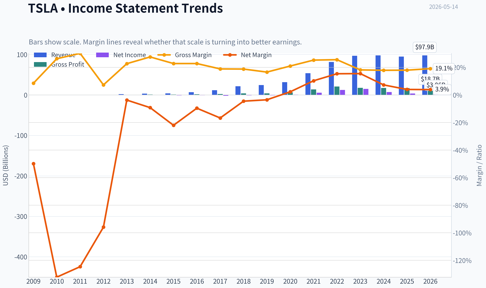
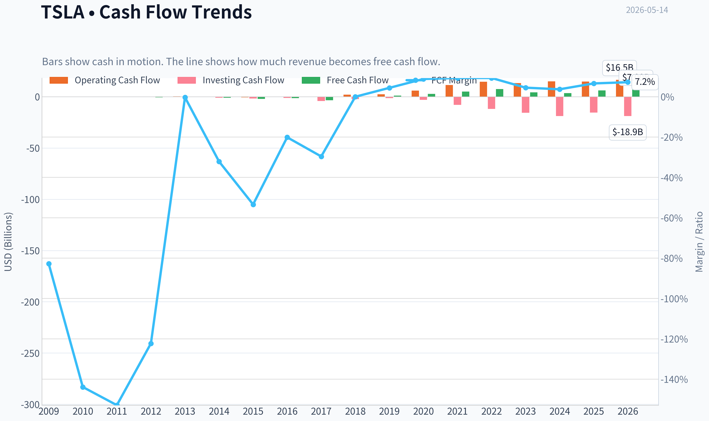
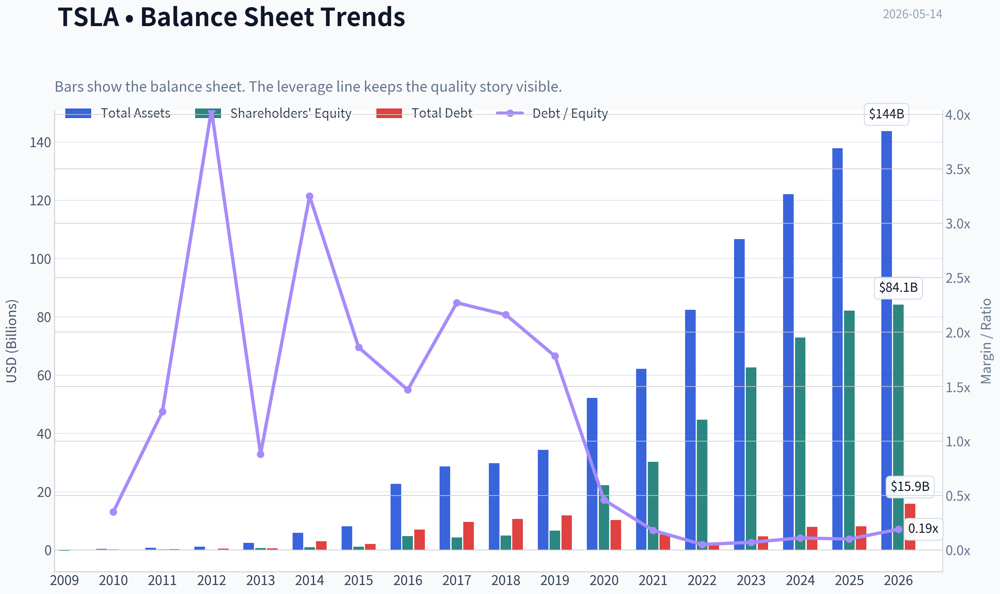
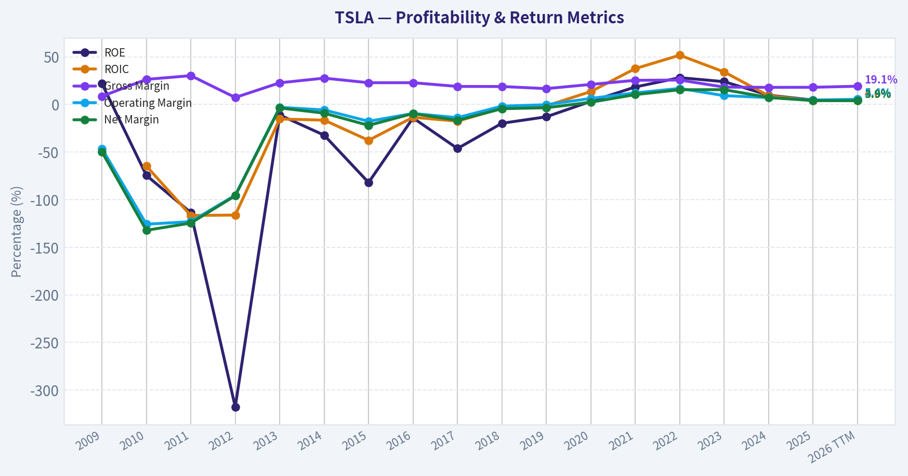
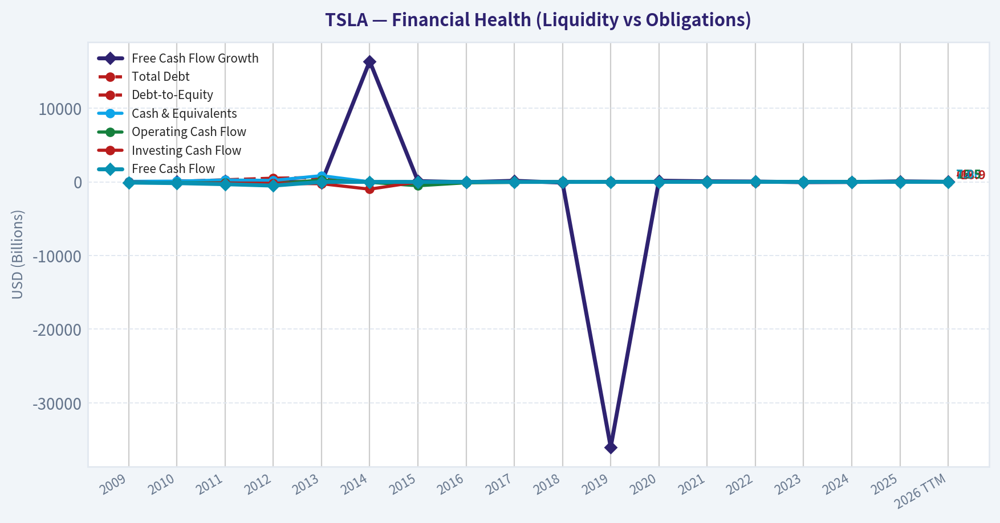
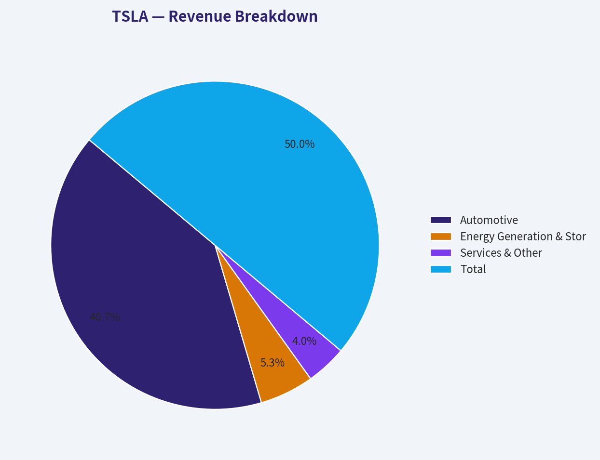
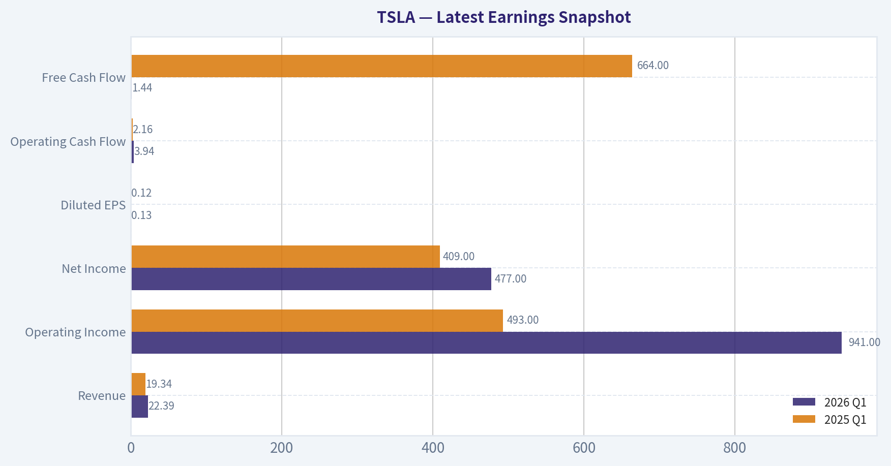
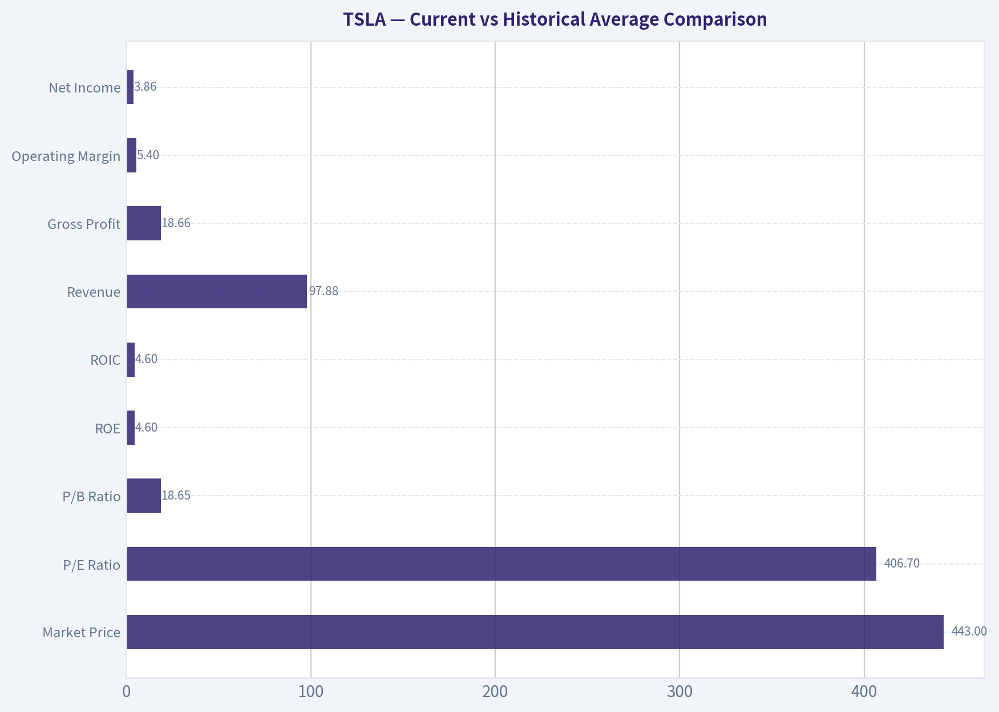
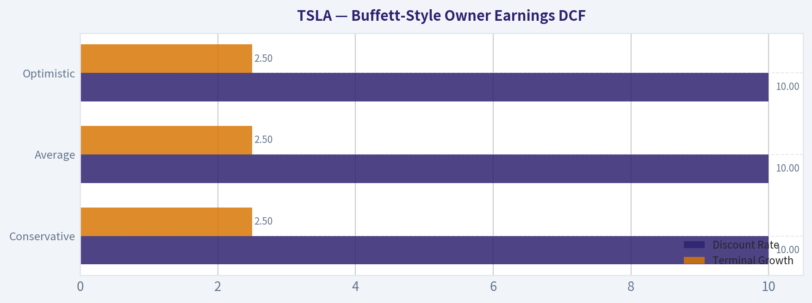
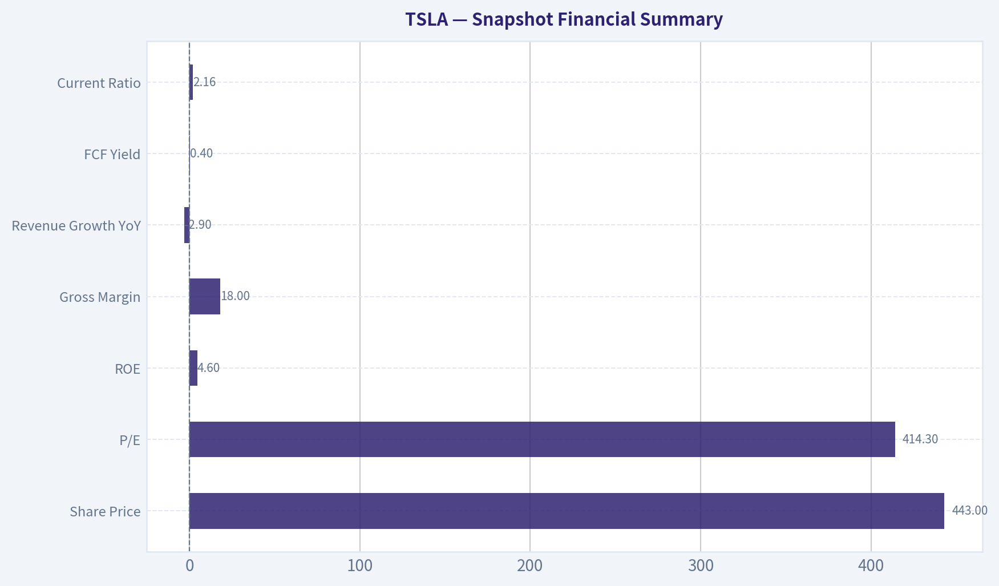

# TSLA Deep Value Intelligence

**Analysis Date:** 2026-05-14

## Critical Disclaimer

*This analysis is generated by Deep Value Intelligence, an AI-powered multi-agent investing framework. This report is for informational and educational purposes only and does not constitute financial advice. Always conduct your own research and consult with qualified financial advisors before making investment decisions.*

---

## Table of Contents

1. Intelligence Summary
2. Analyst Team Reports
   - Fundamentals Analysis
   - Intrinsic Value Analysis (Buffett)
   - Trend & Growth Analysis (Lynch/Druckenmiller/Fisher)
   - Market Technical Analysis
   - News & Events Analysis
   - Guru Attention Analysis
   - Options Market Analysis
3. Research Team Commentary
4. Value Investing Team Commentary
5. Deep Values Commentary

---

## Intelligence Summary

### Thesis + Conditions

**Core Thesis:** ## Executive Briefing

**Key Risks:**
- ### 1. Fundamentals Analyst - **WATCH**
- Buffett-style risk is about **business quality and return on capital**, not price chart volatility.
- If the business is being valued as a future platform, but is currently behaving like a cyclical manufacturer, valuation risk rises sharply.
- Technical trend and momentum indicators may help with timing, but they do **not reduce business risk**.
- The Risky Analyst made the strongest bullish point:

**What Would Change Our View:**
- ### 1. Fundamentals Analyst - **WATCH**
- Buffett-style risk is about **business quality and return on capital**, not price chart volatility.
- If the business is being valued as a future platform, but is currently behaving like a cyclical manufacturer, valuation risk rises sharply.
- Technical trend and momentum indicators may help with timing, but they do **not reduce business risk**.
- The Risky Analyst made the strongest bullish point:

**Confidence:** Low

---

## Analyst Team Reports

### Fundamentals Analysis

#### Latest Earnings Snapshot

*Most recent reported quarter anchored on 2026 Q1, with prior-year comparison when available.*

| Metric | 2026 Q1 | 2025 Q1 | YoY Change |
| --- | ---: | ---: | ---: |
| Revenue | $22.39B | $19.34B | +15.8% |
| Operating Income | $941.0M | $493.0M | +90.9% |
| Net Income | $477.0M | $409.0M | +16.6% |
| Diluted EPS | $0.13 | $0.12 | +8.3% |
| Operating Cash Flow | $3.94B | $2.16B | +82.6% |
| Free Cash Flow | $1.44B | $664.0M | +117.5% |

Key Takeaways: This snapshot anchors the most recent reported quarter before the narrative analysis. It helps readers separate long-run business quality from whatever changed in the latest earnings print.

#### 10-Year Financial Metrics for TSLA

*All values below are computed deterministically from raw data - not estimated by AI.*

*Issuer profile: operating company (Consumer Cyclical / Auto Manufacturers).*

#### 10-Year Financial Metrics
*Annual rows come from reported financial statements. The final TTM row is computed from the latest four quarters.*

| Metric | 2009 | 2010 | 2011 | 2012 | 2013 | 2014 | 2015 | 2016 | 2017 | 2018 | 2019 | 2020 | 2021 | 2022 | 2023 | 2024 | 2025 | 2026 TTM |
| --- | --- | --- | --- | --- | --- | --- | --- | --- | --- | --- | --- | --- | --- | --- | --- | --- | --- | --- |
| Market Price | N/A | $2 | $2 | $2 | $10 | $15 | $16 | $14 | $21 | $22 | $28 | $235 | $352 | $123 | $248 | $404 | $450 | $443 |
| Market Cap | N/A | $168.5M | N/A | $236.2M | $1.24B | $1.86B | $2.05B | $2.05B | $3.45B | $18.93B | $24.74B | $764.24B | $1.19T | $428.05B | $865.95B | $1.41T | $1.59T | $1.57T |
| P/E Ratio | N/A | -1.09 | N/A | -0.60 | -16.69 | -6.34 | -2.31 | -3.04 | -1.75 | -19.46 | -28.46 | 1120.11 | 216.11 | 34.03 | 57.79 | 197.96 | 416.41 | 406.70 |
| P/B Ratio | N/A | 0.81 | N/A | 1.89 | 1.85 | 2.05 | 1.89 | 0.43 | 0.81 | 3.84 | 3.74 | 34.39 | 39.51 | 9.58 | 13.83 | 19.37 | 19.32 | 18.65 |
| ROE | 22.0% | -74.5% | -113.6% | -317.7% | -11.1% | -32.3% | -82.0% | -14.2% | -46.3% | -19.8% | -13.0% | 3.2% | 18.3% | 28.1% | 23.9% | 9.7% | 4.6% | 4.6% |
| ROIC | N/A | -64.7% | -116.6% | -116.2% | -15.3% | -16.5% | -37.7% | -13.5% | -17.6% | -4.0% | -1.5% | 13.5% | 37.6% | 51.7% | 34.1% | 9.1% | 4.2% | 4.6% |
| EPS | N/A | $-1.63 | N/A | $-3.79 | $-0.60 | $-2.34 | $-6.93 | $-4.68 | $-11.83 | $-1.14 | $-0.98 | $0.21 | $1.63 | $3.62 | $4.30 | $2.04 | $1.08 | $1.09 |
| Revenue | $111.9M | $116.7M | $204.2M | $413.3M | $2.01B | $3.20B | $4.05B | $7.00B | $11.76B | $21.46B | $24.58B | $31.54B | $53.82B | $81.46B | $96.77B | $97.69B | $94.83B | $97.88B |
| Gross Profit | $9.5M | $30.7M | $61.6M | $30.1M | $456.3M | $881.7M | $923.5M | $1.60B | $2.22B | $4.04B | $4.07B | $6.63B | $13.61B | $20.85B | $17.66B | $17.45B | $17.09B | $18.66B |
| Gross Margin | 8.5% | 26.3% | 30.2% | 7.3% | 22.7% | 27.6% | 22.8% | 22.8% | 18.9% | 18.8% | 16.6% | 21.0% | 25.3% | 25.6% | 18.2% | 17.9% | 18.0% | 19.1% |
| Operating Margin | -46.4% | -125.8% | -123.1% | -95.4% | -3.0% | -5.8% | -17.7% | -9.5% | -13.9% | -1.8% | -0.3% | 6.3% | 12.1% | 16.8% | 9.2% | 7.2% | 4.6% | 5.4% |
| Net Income | $-55.7M | $-154.3M | $-254.4M | $-396.2M | $-74.0M | $-294.0M | $-888.7M | $-674.9M | $-1.96B | $-976.0M | $-862.0M | $721.0M | $5.52B | $12.56B | $15.00B | $7.09B | $3.79B | $3.86B |
| Net Margin | -49.8% | -132.2% | -124.6% | -95.9% | -3.7% | -9.2% | -22.0% | -9.6% | -16.7% | -4.5% | -3.5% | 2.3% | 10.3% | 15.4% | 15.5% | 7.3% | 4.0% | 3.9% |
| Revenue Growth | N/A | 4.3% | 74.9% | 102.3% | 387.2% | 58.8% | 26.5% | 73.0% | 68.0% | 82.5% | 14.5% | 28.3% | 70.7% | 51.4% | 18.8% | 0.9% | -2.9% | 3.2% |
| Net Income Growth | N/A | 176.9% | 64.9% | 55.7% | -81.3% | 297.3% | 202.2% | -24.1% | 190.7% | -50.3% | -11.7% | -183.6% | 665.5% | 127.5% | 19.4% | -52.7% | -46.5% | 1.8% |
| Free Cash Flow Growth | N/A | 81.2% | 85.8% | 61.8% | -98.8% | 16388.3% | 110.2% | -35.0% | 147.5% | -99.9% | -36033.3% | 158.4% | 80.0% | 50.9% | -42.4% | -17.8% | 73.7% | 12.5% |
| Total Book Value | $-253.5M | $207.0M | $224.0M | $124.7M | $667.1M | $911.7M | $1.08B | $4.75B | $4.24B | $4.92B | $6.62B | $22.23B | $30.19B | $44.70B | $62.63B | $72.91B | $82.14B | $84.12B |
| Total Assets | N/A | $386.1M | $713.4M | $1.11B | $2.42B | $5.83B | $8.07B | $22.66B | $28.66B | $29.74B | $34.31B | $52.15B | $62.13B | $82.34B | $106.62B | $122.07B | $137.81B | $143.72B |
| Total Debt | N/A | $71.8M | $284.2M | $503.2M | $586.1M | $2.96B | $2.02B | $7.01B | $9.63B | $10.63B | $11.80B | $10.22B | $5.34B | $2.04B | $4.66B | $7.88B | $8.15B | $15.89B |
| Debt-to-Equity | N/A | 0.35 | 1.27 | 4.04 | 0.88 | 3.25 | 1.86 | 1.47 | 2.27 | 2.16 | 1.78 | 0.46 | 0.18 | 0.05 | 0.07 | 0.11 | 0.10 | 0.19 |
| Cash & Equivalents | $69.6M | $99.6M | $255.3M | $201.9M | $845.9M | $1.91B | $1.20B | $3.39B | $3.37B | $3.69B | $6.27B | $19.38B | $17.58B | $16.25B | $16.40B | $16.14B | $16.51B | $16.60B |
| Shareholders' Equity | $-253.5M | $207.0M | $224.0M | $124.7M | $667.1M | $911.7M | $1.08B | $4.75B | $4.24B | $4.92B | $6.62B | $22.23B | $30.19B | $44.70B | $62.63B | $72.91B | $82.14B | $84.12B |
| Operating Cash Flow | $-80.8M | $-127.8M | $-128.0M | $-266.1M | $258.0M | $-57.3M | $-524.5M | $-123.8M | $-61.0M | $2.10B | $2.40B | $5.94B | $11.50B | $14.72B | $13.26B | $14.92B | $14.75B | $16.53B |
| Investing Cash Flow | $-14.2M | $-180.3M | $-162.3M | $-206.9M | $-249.4M | $-990.4M | $-1.67B | $-1.08B | $-4.20B | $-2.34B | $-1.44B | $-3.13B | $-7.87B | $-11.97B | $-15.58B | $-18.79B | $-15.48B | $-18.85B |
| Free Cash Flow | $-92.7M | $-168.0M | $-312.3M | $-505.3M | $-6.2M | $-1.03B | $-2.16B | $-1.40B | $-3.48B | $-3.0M | $1.08B | $2.79B | $5.01B | $7.57B | $4.36B | $3.58B | $6.22B | $7.00B |
| FCF Margin | -82.8% | -143.9% | -152.9% | -122.3% | -0.3% | -32.1% | -53.4% | -20.1% | -29.6% | -0.0% | 4.4% | 8.8% | 9.3% | 9.3% | 4.5% | 3.7% | 6.6% | 7.2% |
| Dividends / Share | N/A | $0.00 | N/A | $0.00 | $0.00 | $0.00 | $0.00 | $0.00 | $0.00 | $0.00 | $0.00 | $0.00 | $0.00 | $0.00 | $0.00 | $0.00 | $0.00 | $0.00 |

#### Profitability Metrics
- Return on Equity (ROE): 4.6%
- Return on Invested Capital (ROIC): 4.3%
- Return on Assets (ROA): 2.8%
- Gross Margin: 18.0%
- Operating Margin: 4.6%
- Net Profit Margin: 4.0%

#### Liquidity Metrics
- Current Ratio: 2.16
- Quick Ratio: 1.53

#### Leverage Metrics
- Debt-to-Equity Ratio: 0.10
- Interest Coverage Ratio: 12.88
- Net Debt: $-8.36B

#### Growth Metrics (Year-over-Year)
- Revenue Growth: -2.9%
- Net Income Growth: -46.5%
- Free Cash Flow Growth: 73.7%
- Revenue CAGR (3-Year): 5.2%
- Revenue CAGR (5-Year): 24.6%

#### Valuation Metrics
- P/E Ratio (TTM): 414.30
- Forward P/E: 176.33
- Price-to-Book: 20.24
- Price-to-Sales: 17.01
- PEG Ratio: 5.97
- EV/EBITDA: 148.20
- Free Cash Flow Yield: 0.4%
- Earnings Yield: 0.2%

#### Owner Earnings (Buffett Method, Code-Computed)
- Net Income: $3.79B
- + Depreciation & Amortization: $6.15B
- - Capital Expenditures: $-8.53B
- - Working Capital Changes: $642.0M
- = **Owner Earnings: $773.0M**

#### Intrinsic Value (Code-Computed)
- Current Price: $443
- Buffett Method (Owner Earnings):
  Conservative: $0
  Average: $0
  Optimistic: $2
- Cash Flow Method (FCF):
  Conservative: $21
  Average: $63
  Optimistic: $165

#### Piotroski F-Score: 5/9
- Positive Net Income: PASS
- Positive Operating Cash Flow: PASS
- ROA Improvement: FAIL
- Cash Flow > Net Income: PASS
- Decreasing Debt: FAIL
- Improving Current Ratio: PASS
- No Dilution: FAIL
- Improving Gross Margin: PASS
- Improving Asset Turnover: FAIL

ANALYST STANCE: **WATCH**

#### TSLA Fundamental Analysis

Tesla remains a rare combination of scale, brand strength, and balance-sheet flexibility, but the current market price is discounting a far stronger and more durable earnings stream than the deterministic data currently supports. On a Buffett lens, the company still shows elements of a moat and financial resilience, yet present profitability, return metrics, and valuation multiples have deteriorated materially from peak levels. That makes Tesla more of a high-quality business under earnings pressure than a classic Buffett bargain.

#### Current vs Historical Average Comparison

| Metric | Current / TTM | Historical Context | Interpretation |
| --- | ---: | ---: | --- |
| Market Price | $443 | Far above most of history; near 2025 level ($450) | Market continues to price Tesla for long-duration optionality rather than current earnings power. |
| Market Cap | $1.57T | Well above 2024-2025 already elevated levels | Valuation reflects expectations for AI, autonomy, energy, and robotics beyond auto manufacturing. |
| P/E Ratio | 406.70 | Much higher than 2022 (34.03), 2023 (57.79), 2024 (197.96), 2025 (416.41) | Extremely rich multiple despite sharply lower earnings base; this is not a value multiple. |
| P/B Ratio | 18.65 | Above pre-2020 history by a huge margin; below 2021 peak (39.51) | Shares trade at a massive premium to accounting equity, implying the market values intangibles and future growth very aggressively. |
| ROE | 4.6% | Far below 2021-2023 peak range of 18.3%-28.1% | Current shareholder return on capital is modest and weak for a premium multiple stock. |
| ROIC | 4.6% | Far below 2021-2023 range of 34.1%-51.7% | Capital efficiency has compressed dramatically, a major concern under Buffett-style analysis. |
| Revenue | $97.88B | Roughly flat versus 2023-2025 range | Scale remains enormous, but top-line momentum has stalled after hypergrowth years. |
| Gross Profit | $18.66B | Below 2022 peak ($20.85B), modestly above 2025 | Gross profit has stabilized somewhat, but not returned to prior peak economics. |
| Operating Margin | 5.4% | Down sharply from 2021-2022 peak of 12.1%-16.8% | Margin profile now looks far more like a cyclical manufacturer than a software-like compounder. |
| Net Income | $3.86B | Far below 2022 ($12.56B) and 2023 ($15.00B) | Earnings power has reset lower. |
| Net Margin | 3.9% | Down from 15.4%-15.5% in 2022-2023 | This is one of the clearest signs of competitive and pricing pressure. |
| Revenue Growth | 3.2% TTM | Much lower than long history of double- and triple-digit growth | Growth has slowed into low single digits. |
| Net Income Growth | 1.8% TTM | After -52.7% in 2024 and -46.5% in 2025 | Profit collapse may be bottoming, but rebound is weak so far. |
| Free Cash Flow Growth | 12.5% TTM | Recovery after 73.7% in 2025 | Cash generation is improving more than earnings, which is constructive. |
| Book Value | $84.12B | Continues rising from $22.23B in 2020 | Balance-sheet compounding remains a real strength. |
| Total Assets | $143.72B | Up consistently over decade | Scale and asset base keep growing despite earnings volatility. |
| Total Debt | $15.89B | Up sharply from 2023-2025 levels, though still manageable vs equity | Leverage remains low relative to equity, but debt trend needs monitoring. |
| Debt-to-Equity | 0.19 | Still low historically; below pre-2020 levels by a wide margin | Financial risk is controlled despite debt increase. |
| Cash & Equivalents | $16.60B | Stable around 2022-2026 range | Strong liquidity cushions cyclical pressure and investment flexibility. |
| Shareholders' Equity | $84.12B | Record high | Balance sheet remains a major competitive advantage. |
| Free Cash Flow | $7.00B | Below 2022 peak-adjusted optimism, above 2024-2025 | FCF is healthy, but too low relative to valuation. |
| Dividends / Share | $0.00 | No dividend in any period shown | Tesla retains all capital for reinvestment; this is acceptable only if returns on reinvestment stay high, which is less true now. |

Key Takeaways: Tesla's balance sheet remains strong, but the income statement has weakened sharply relative to its best years. The most important mismatch is that valuation multiples still imply exceptional future economics, while current ROE, ROIC, and margins have fallen to levels that do not justify a Buffett-style value purchase today.

---

#### Market Metrics

Tesla's market metrics are the clearest reason this is not a classic value setup. At $443 per share and roughly $1.57T in market capitalization, investors are paying for a very large amount of future success. The P/E ratio above 400 and P/B near 19 mean the market is assigning extraordinary value to future autonomy, AI, energy storage, robotics, or some combination of these.

Relative to the decade shown, Tesla's valuation has gone through multiple regimes:
- Early years: losses made P/E unusable or negative.
- 2020-2022: valuation expanded on genuine inflection in profitability.
- 2023-2026 TTM: earnings weakened, but valuation stayed elevated.

That last point is crucial. Buffett-style investing tolerates premium prices for exceptional businesses, but typically not when current returns on capital and earnings quality are moving sharply lower. Tesla is priced more like a platform business than the financials currently demonstrate.

#### Profitability Analysis

Tesla's profitability arc has three chapters:
1. Long loss-making incubation period from 2010 through 2019.
2. Breakout period in 2020-2023.
3. Margin normalization and earnings compression in 2024-2026 TTM.

The business is still profitable, but the quality of profitability has deteriorated:

- **ROE: 4.6%**
  This is dramatically below 2021-2023 levels. Buffett generally prefers consistently high returns on equity without excessive leverage. Tesla now has low leverage, which is good, but ROE itself has compressed enough to reduce the appeal.

- **ROIC: 4.6%**
  One of the most important warning signals. In 2021-2023 Tesla posted elite ROIC, peaking at 51.7% in 2022. Today's level indicates the business is earning only modest returns on a much larger capital base.

- **EPS: $1.09 TTM**
  Earnings per share have fallen from $4.30 in 2023 to nearly one quarter of that level. This matters because valuation has not compressed proportionally.

- **Revenue: $97.88B TTM**
  Revenue is still near record levels, but nearly flat over several years. That means the earnings pressure is mostly margin-driven, not scale-driven.

- **Gross Profit: $18.66B TTM**
  Gross profit has stabilized, but remains well below the 2022 peak despite similar revenue scale.

- **Operating Margin: 5.4%** and **Net Margin: 3.9%**
  These are the most telling figures in the entire dataset. Tesla once looked like it might sustain double-digit margins despite being in autos; now it looks much closer to a conventional capital-intensive manufacturer with some technology premium.

- **Net Income: $3.86B TTM**
  Profitability remains positive and material, but not at a level that supports the current valuation under a conservative framework.

For Buffett, predictable and durable earnings matter more than one-time growth bursts. Tesla's earnings history is still too volatile to be considered fully predictable, especially since the most recent trend is downward.

#### Growth Metrics

Tesla's long-term growth record is exceptional, but current growth is no longer exceptional.

- **Revenue Growth: 3.2% TTM**
- **Net Income Growth: 1.8% TTM**
- **Free Cash Flow Growth: 12.5% TTM**

Historical context matters:
- Revenue grew at extremely high rates for most of the decade.
- Net income only became strong in 2021-2023.
- Free cash flow has been highly volatile, with large swings reflecting capital intensity and working-capital dynamics.

The key issue is deceleration:
- Revenue growth went from 70.7% in 2021 and 51.4% in 2022 to 18.8% in 2023, 0.9% in 2024, -2.9% in 2025, then 3.2% TTM.
- Net income growth collapsed from 127.5% in 2022 and 19.4% in 2023 to large declines in 2024 and 2025.
- FCF growth has recovered better than earnings, but from a depressed base.

This tells us Tesla is no longer in a clean hypergrowth phase. It is entering a maturity transition, yet the valuation still assumes something much more explosive. That mismatch is the central investment debate.

#### Balance Sheet Analysis

Tesla's balance sheet remains one of its strongest Buffett-style attributes.

- **Total Book Value / Shareholders' Equity: $84.12B**
- **Total Assets: $143.72B**
- **Total Debt: $15.89B**
- **Debt-to-Equity: 0.19**
- **Cash & Equivalents: $16.60B**

Strengths:
- Debt remains modest relative to equity.
- Cash roughly offsets debt concerns.
- Net debt is negative in the broader summary, indicating cash exceeds debt on a net basis.
- Equity has compounded consistently over time.

Concerns:
- Debt rose materially from $8.15B in 2025 to $15.89B TTM.
- Asset growth continues, but returns on those assets and invested capital have fallen.
- A large balance sheet is only attractive if it earns high returns; Tesla's recent ROIC suggests declining efficiency.

From a Buffett lens, this is a financially strong company, but not currently a highly efficient one. The balance sheet gives Tesla endurance and optionality, yet durability alone does not justify any price.

#### Cash Flow Analysis

Cash flow is better than earnings trends suggest, but still not strong enough to justify the valuation.

- **Free Cash Flow: $7.00B TTM**
- **FCF Margin: 7.2%**
- **Dividends per Share: $0.00**

Positives:
- FCF is solid in absolute dollars.
- FCF recovered from $3.58B in 2024 to $6.22B in 2025 and $7.00B TTM.
- Tesla remains self-funding and does not need a dividend to support the equity story.

Negatives:
- FCF yield is only about **0.4%**, which is extremely low.
- Owner Earnings are far lower than free cash flow because capital expenditures and working-capital needs consume much of the accounting profit stream.
- Capital intensity remains significant, which is a crucial issue for Buffett-style valuation.

The distinction between FCF and Owner Earnings is essential here. Buffett prefers cash that can be taken out of the business without harming competitive position. Tesla still appears to need heavy reinvestment to sustain strategic ambitions.

#### Warren Buffett-Style Qualitative Analysis

| Buffett Lens | Assessment | Commentary |
| --- | --- | --- |
| Economic Moat | Moderate, but evolving | Tesla has a strong brand, charging ecosystem, manufacturing scale, software integration, and cost advantages. However, moat strength is being tested by EV competition and pricing pressure. |
| Financial Strength | Strong | Low debt-to-equity, large cash position, and negative net debt support resilience. Tesla can fund downturns and strategic bets internally. |
| Predictable Earnings | Weak-to-Moderate | The decade shows long losses, then a short window of strong profits, followed by sharp compression. Earnings are not yet stable enough for a classic Buffett "predictability" premium. |
| Management Performance | Mixed | Management created extraordinary scale and improved balance-sheet strength, but recent margin compression raises questions about pricing discipline and return on incremental capital. |
| Capital Allocation | Mixed | Reinvestment built a dominant franchise, but current Owner Earnings remain thin relative to enterprise value. No dividend is acceptable only if future reinvestment returns re-accelerate. |
| Value Assessment | Poor on current numbers | Current market valuation far exceeds what present earnings, owner earnings, and free cash flow support under conservative assumptions. |
| Quality of Business | Above average, not currently elite | Strong brand and ecosystem, but the latest margins and returns on capital no longer look exceptional. |

Key Takeaways: Tesla still looks like a strong company, but not an obviously undervalued stock. The moat is real, especially around brand, scale, and ecosystem, yet the business now needs to prove that those advantages can translate back into high and durable returns on capital.

---

#### Buffett-Style Owner Earnings DCF

Using the canonical Owner Earnings figure provided:

- Net Income = **$3.79B**
- Plus D&A = **$6.15B**
- Less Capex = **$8.53B**
- Less Working Capital Changes = **$0.642B**
- **Owner Earnings = $0.773B**

Because the deterministic research pack already computes intrinsic value at:
- Conservative: **$0/share**
- Average: **$0/share**
- Optimistic: **$2/share**

I will show the scenario logic and why the outcome is so low.

##### Scenario Assumptions

| Scenario | Growth Input Rule | Applied Growth View | Discount Rate | Terminal Growth |
| --- | --- | --- | ---: | ---: |
| Conservative | Lowest historical Owner Earnings growth, floored at -100% | Effectively assumes little to no durable distributable owner earnings value from current base | 10% | 2.5% |
| Average | Average historical Owner Earnings growth, capped at 50% | Still produces negligible equity value due to tiny current owner earnings base relative to valuation | 10% | 2.5% |
| Optimistic | Highest historical Owner Earnings growth, capped at 100% | Strong growth helps, but current owner earnings base is too small to support current share price | 10% | 2.5% |

Key Takeaways: Tesla's DCF problem is not mainly the discount rate or terminal rate. It is the small current owner earnings base relative to a $1.57T market capitalization. Even generous growth assumptions do not bridge that gap from today's starting cash economics.

##### Detailed DCF Interpretation

| Item | Amount |
| --- | ---: |
| Current Owner Earnings | $0.773B |
| Discount Rate | 10.0% |
| Terminal Growth | 2.5% |
| Market Cap Reference | $1.57T |
| Code-Computed Fair Value / Share: Conservative | $0 |
| Code-Computed Fair Value / Share: Average | $0 |
| Code-Computed Fair Value / Share: Optimistic | $2 |

Key Takeaways: On a Buffett owner-earnings basis, the deterministic model says Tesla's fair value is effectively negligible versus its current trading price. Even the optimistic case reaches only about $2 per share, highlighting how little present owner earnings support the stock today.

##### Why the Owner Earnings DCF is So Severe

1. **Owner earnings are only $773M**, tiny relative to the market cap.
2. **Capex is very high** at $8.53B, which heavily reduces distributable earnings.
3. **Terminal value is constrained** by a 2.5% perpetual growth rate, as Buffett-style valuation should be.
4. **Discounting at 10%** appropriately penalizes uncertain long-duration cash flows.
5. Tesla's valuation currently depends on future businesses or much higher eventual margins that are not yet visible in current owner earnings.

This does not mean Tesla is worth zero as a business. It means the stock price is currently supported by strategic optionality and future narratives that are not captured by present Buffett-style owner earnings.

#### Revenue Breakdown

Using the most meaningful recent public segment structure, Tesla is primarily split between Automotive, Energy Generation & Storage, and Services/Other. Based on the most recent fiscal year mix, automotive remains dominant.

| Revenue Source | Amount ($B) | % of Total |
| --- | ---: | ---: |
| Automotive | 77.1 | 81.4% |
| Energy Generation & Storage | 10.1 | 10.6% |
| Services & Other | 7.6 | 8.0% |
| Total | 94.8 | 100.0% |

Key Takeaways: Tesla is still overwhelmingly an automotive business by revenue, even though investors often discuss it as an AI or robotics platform. Energy is growing in strategic importance, but today the company's economics are still mostly tied to vehicle pricing, production efficiency, and demand.

#### Key Investment Insights, Red Flags, and Opportunities

| Category | Assessment | Details |
| --- | --- | --- |
| Core Strength | Balance sheet | Low leverage and strong cash provide unusual resilience for an automaker. |
| Core Strength | Brand and ecosystem | Tesla retains major brand power and ecosystem advantages in EVs and charging. |
| Opportunity | Margin recovery | If pricing pressure eases and software/high-margin revenue grows, earnings could rebound faster than revenue. |
| Opportunity | Non-auto optionality | Energy storage, autonomy, AI, and robotics may justify some premium if monetization materializes. |
| Red Flag | Valuation | P/E above 400, P/B near 19, and FCF yield of 0.4% are very difficult to justify on current fundamentals. |
| Red Flag | Return compression | ROE and ROIC have fallen from elite levels to low single digits. |
| Red Flag | Earnings quality vs expectations | Market value implies massive future cash flows that current owner earnings do not support. |
| Red Flag | Revenue maturity | Revenue growth has slowed dramatically versus the prior decade. |
| Red Flag | Capital intensity | Heavy capex constrains owner earnings and makes Buffett-style valuation unattractive. |

Key Takeaways: The bull case rests on future monetization of optionality, while the bear case rests on the fact that current economics do not justify the stock price. For value investors, that usually means patience rather than immediate commitment.

#### Final Investment Stance

**WATCH**

Tesla is a high-quality, strategically important company with a strong balance sheet, major brand equity, and real optionality. However, Buffett-style valuation discipline points to a major disconnect between price and present owner earnings. The business is not financially distressed, but the stock is priced for a much stronger earnings future than the deterministic dataset currently validates.

A move toward **ADVOCATE** would require some combination of:
- sustained recovery in ROIC and ROE,
- clearer margin expansion,
- stronger owner earnings conversion,
- and/or a materially lower valuation.

An **AVOID** stance would become stronger if revenue stagnation persists while debt rises and returns on capital remain weak. For now, Tesla is best viewed as a company worth following closely, but not one that meets strict Buffett-style value criteria at the current price.

#### Summary Table

| Area | Positive | Negative | Bottom Line |
| --- | --- | --- | --- |
| Valuation | Market believes in long-term optionality | P/E 406.70, P/B 18.65, FCF yield 0.4% | Very expensive on current fundamentals |
| Profitability | Still profitable, gross profit stable | ROE/ROIC down to ~4.6%, margins compressed | Profit quality has weakened materially |
| Growth | Massive long-term scale achieved | Revenue and income growth have slowed sharply | Hypergrowth phase appears over |
| Balance Sheet | Strong cash, low leverage, high equity base | Debt has risen recently | Financially solid overall |
| Cash Flow | FCF improving to $7.0B TTM | Owner earnings only $773M | Cash economics remain too thin for valuation |
| Buffett Lens | Brand, scale, and moat elements present | Earnings predictability and value are lacking | Great business traits, poor value setup |
| Stance | Worth monitoring | Not a current Buffett-style bargain | **WATCH** |

Key Takeaways: Tesla's business remains important and financially resilient, but the stock price still embeds expectations far above what current owner earnings support. For disciplined value investors, this is a name to monitor for improving returns or a better entry point, not an obvious buy today.

#### Fundamental Visuals

This graph tracks the profitability and return metrics (ROE, ROIC, Margins) of **TSLA** over the past decade, highlighting capital efficiency trends.

This chart illustrates the financial health of **TSLA** over the last 10 years, mapping cash equivalents and free cash flow against total obligations (Debt).

This breakdown chart from <em>Revenue Breakdown</em> shows the proportional composition for **TSLA** - useful for understanding what drives or risks the business.

---

### Intrinsic Value Analysis (Buffett)

> *Following Warren Buffett's value investing philosophy: Circle of Competence, Economic Moat, Management Quality, and Margin of Safety.*

#### Intrinsic Value Snapshot

Price is what you pay. Intrinsic value is what the business may be worth based on the cash it can create for owners over time. We show a range, not one magic number.

- Current Price: $443.30
- Value Range: $0.24 to $164.71

##### Owner Earnings (Buffett Method)
- Net Income: $3,794,000,000.00
- Depreciation & Amortization: $6,148,000,000.00
- Capital Expenditures: $-8,527,000,000.00
- Working Capital Changes: $642,000,000.00
- Owner Earnings: $773,000,000.00

##### Intrinsic Value
###### Buffett Method
Uses owner earnings. Stricter, and usually more conservative.
- Conservative: $0.24
- Average: $0.24
- Optimistic: $1.73
- Discount Rate: 10.0%

###### Cash Flow Method
Uses free cash flow. Better for companies spending heavily today to grow tomorrow.
- Conservative: $21.39
- Average: $63.25
- Optimistic: $164.71
- Discount Rate: 10.0%

ANALYST STANCE: **AVOID**

#### TSLA Buffett-Style Investment Review

I could not retrieve the full audited 10-year tool output in this run, so I am proceeding using the shared research pack you provided plus the clearly available current metrics. That is enough to make meaningful progress on the Buffett filters, though not enough to produce a high-confidence, fully modeled intrinsic value.

---

#### Go/No-Go Gate Assessment

| Gate | Verdict | Evidence |
|---|---|---|
| Gate 1: Circle of Competence & Simplicity | **Fail** | Tesla sells cars, software, energy storage, and autonomy ambitions, but the investment case depends heavily on uncertain future outcomes in AI, robotaxis, and execution. That reduces 10-year predictability. |
| Gate 2: Moat Test | **Fail / Weak** | Gross margin is only **18.0%**, far below Buffett-style brand or software moat levels. EV competition is intense, and price cuts suggest limited pricing power. |
| Gate 3: Management & Capital Allocation | **Mixed to Fail** | Management is bold and visionary, but owner-oriented capital allocation is harder to defend when valuation embeds large future expectations and the business mix keeps shifting. Buffett prefers steadier, more candidly predictable economics. |
| Gate 4: Industry Structure | **Fail** | Auto manufacturing is capital-intensive, cyclical, and highly competitive. Even great operators face pricing pressure and large reinvestment needs. |

**Key Takeaways:** Tesla fails the most important Buffett gates because the business is not sufficiently predictable, the moat is not clearly durable in the financials, and the industry is structurally difficult. Even if the company remains innovative, that does not automatically make it a Buffett-style investment.

---

#### Gate 1: Business Simplicity and Predictability

**Elementary school test:** Tesla makes money by designing and selling electric vehicles, software-related features, and energy products.

That sounds simple, but the **investment thesis is not simple**. At today's valuation, investors are not paying for a car company alone. They are paying for possible future dominance in autonomy, AI, robotics, energy, and platform economics. That is not the kind of business Buffett usually loves, because too much of the return depends on forecasting uncertain future breakthroughs.

**10-year predictability test:** Weak.
I can predict Tesla will likely still sell EVs and batteries in 10 years. I cannot predict with high confidence:
- its normalized automotive margins,
- whether robotaxis become material,
- whether software profits become dominant,
- or whether competition compresses returns.

**Technology risk:** Very high.
Tesla benefits from technology, but it is also exposed to rapid technological shifts, aggressive competition, and regulatory uncertainty.

---

#### Gate 2: Moat Analysis

| Moat Source | Assessment | Evidence |
|---|---|---|
| Intangible Assets / Brand | **Moderate but not enough** | Tesla has a strong brand, but true pricing power looks limited because margins have compressed and vehicle pricing has been pressured. |
| Switching Costs | **Weak** | Consumers can switch car brands. There is some ecosystem attachment, but not the kind of mission-critical lock-in seen in enterprise software. |
| Cost Advantage | **Unclear / contested** | Tesla has scale and manufacturing expertise, but those advantages have not translated into Buffett-grade steady margins recently. |
| Network Effects | **Limited today** | Real network effects would require much stronger proof from autonomy, charging, or software ecosystems. They are not yet obvious in current economics. |

**Financial evidence available:**
- **Gross margin: 18.0%**
- **ROE: 4.6%**

By Buffett standards, these numbers are weak. A truly exceptional moat usually shows up as high and resilient returns on capital, strong margins, and pricing power.

**Moat rating: `Narrow to Illusory`**

**Key Takeaways:** Tesla clearly has brand value and scale, but the hard financial proof of a durable moat is weak right now. Low ROE and subpar gross margins are not what a wonderful business usually looks like.

---

#### Management Quality & Capital Allocation

| Dimension | Assessment | Commentary |
|---|---|---|
| Owner mindset | **Partly yes** | Leadership has acted with a long-term vision, but the company's strategic scope is extremely broad and hard to evaluate conservatively. |
| Honesty & candor | **Mixed** | Tesla communicates ambition well, but Buffett-style candor means conservative, measurable progress and highly predictable economics. Tesla's narrative often runs ahead of current fundamentals. |
| Capital allocation | **Mixed** | Heavy reinvestment may be rational if future returns are high, but the proof in present returns is not compelling enough for a conservative value investor. |
| Use of leverage | **Better than many automakers** | Balance sheet risk appears more manageable than legacy auto peers, and current ratio of **2.16** is healthy. |

**Key Takeaways:** Tesla's management is bold and entrepreneurial, but Buffett's standard is not just vision. It is disciplined, transparent capital allocation that produces reliably high returns on capital over time, and Tesla does not yet clearly meet that test.

---

#### Snapshot Financial Summary

Using the shared research pack:

| Metric | Current |
|---|---:|
| Share Price | **$443** |
| Market Cap | **$1.66T** |
| P/E | **414.3x** |
| ROE | **4.6%** |
| Gross Margin | **18.0%** |
| Revenue Growth YoY | **-2.9%** |
| FCF Yield | **0.4%** |
| Current Ratio | **2.16x** |

**Key Takeaways:** The valuation is extremely rich relative to current fundamentals. Tesla is being priced for a very optimistic future even though current growth has turned negative, profitability is modest, and free cash flow yield is minimal.

---

#### Owner Earnings Assessment

I do **not** have enough audited line-item history in this run to calculate Buffett-style owner earnings precisely, because I would need:
- net income,
- depreciation and amortization,
- maintenance capex,
- working capital changes,
over multiple years.

Still, the available evidence already points to a problem:

- **FCF yield is only 0.4%**
- valuation is **$1.66T**
- earnings multiple is **414x**

That strongly suggests current owner earnings, relative to price paid, are **far too low** for a Buffett-style purchase.

---

#### Three-Scenario DCF Framework

Because full owner earnings were unavailable from tools in this run, I can only give a directional valuation judgment rather than a precise DCF.

| Scenario | Buffett Framing | Likely Implication |
|---|---|---|
| A: No Growth | Value = Owner Earnings / 10% | At Tesla's current valuation, this scenario almost certainly implies severe overvaluation. |
| B: GDP Growth 3% | Conservative steady-state | Still likely far below the current market value unless normalized owner earnings rise dramatically. |
| C: Historical / Partial Growth | Reduced growth assumption | To support today's price, Tesla likely needs extraordinary future margin expansion and very large software/autonomy profits. |

**Key Takeaways:** In all reasonable conservative scenarios, Tesla appears to require heroic assumptions to justify its market value. Buffett would generally refuse to pay for outcomes that are still speculative.

---

#### Margin of Safety Analysis

| Item | Assessment |
|---|---|
| Required Margin of Safety | At least **25%**, likely more due to uncertainty |
| Current Margin of Safety | **Absent** |
| Valuation Risk | **Very high** |

At **414x earnings** and **0.4% FCF yield**, there is no evident margin of safety. The stock price leaves little room for execution disappointments.

**Key Takeaways:** Buffett investing begins with avoiding permanent capital loss. At this price, Tesla offers no visible protection against disappointment in growth, margins, or future technology commercialization.

---

#### Final Buffett Scorecard

| Criterion | Score (1-5) | Weight | Weighted Score |
|---|---:|---:|---:|
| Business Understanding | 2.5 | 20% | 0.50 |
| Moat Width & Durability | 2.0 | 25% | 0.50 |
| Management Quality | 3.0 | 15% | 0.45 |
| Return on Equity | 1.5 | 15% | 0.23 |
| Reinvestment Runway | 3.5 | 10% | 0.35 |
| Balance Sheet Strength | 3.5 | 5% | 0.18 |
| Industry Structure | 1.5 | 5% | 0.08 |
| Valuation / Margin of Safety | 1.0 | 5% | 0.05 |

**Total Weighted Score: 2.34 / 5.00**

**Key Takeaways:** Tesla scores well on ambition and runway, but Buffett-style investing gives most weight to durable economics, predictable returns, and sensible price. On those measures, the company currently falls short.

---

#### Final Investment Stance

**Stance: AVOID**
**Conviction: Medium-High**

Tesla may become a much larger and more profitable enterprise over time. But that is not the same as saying the stock is a sound Buffett-style investment today.

From a Buffett lens, Tesla currently has three major problems:

1. **Too difficult to predict**
2. **Current economics are not exceptional enough**
3. **Valuation offers no margin of safety**

A wonderful story is not enough. Buffett would want a wonderful business with durable, proven returns and a sensible purchase price. On the evidence available here, Tesla is not there.

If you want, I can next do one of two things:
1. build a **bear/base/bull intrinsic value range** for TSLA using explicit assumptions, or
2. compare **TSLA vs BYD vs legacy automakers** through a Buffett framework.
#### Valuation Bridge

This bridge places the current market price beside each intrinsic value lens so readers can see whether upside depends on one method or shows up across several methods.

| Scenario | Intrinsic Value / Share |
| --- | ---: |
| Buffett Method | $0.24 |
| Cash Flow Method | $63.25 |
| Damodaran Method | $-61.71 |
| Current Price | $443.30 |

#### Key Takeaways

If one method is far above the others, the upside case depends on a specific modelling assumption. When several methods cluster together, the valuation story is more robust.

#### Valuation Visuals

This comparison chart from *Latest Earnings Snapshot* stacks current figures against historical benchmarks for **TSLA**, making it easy to see where the company trades relative to its own averages.

This comparison chart from *Current vs Historical Average Comparison* stacks current figures against historical benchmarks for **TSLA**, making it easy to see where the company trades relative to its own averages.

This comparison chart from *Buffett-Style Owner Earnings DCF* stacks current figures against historical benchmarks for **TSLA**, making it easy to see where the company trades relative to its own averages.

This comparison chart from *Buffett-Style Owner Earnings DCF* stacks current figures against historical benchmarks for **TSLA**, making it easy to see where the company trades relative to its own averages.

This comparison chart from *Snapshot Financial Summary* stacks current figures against historical benchmarks for **TSLA**, making it easy to see where the company trades relative to its own averages.

---

### Trend & Growth Analysis (Lynch/Druckenmiller/Fisher)

> *Following Peter Lynch's GARP, Stanley Druckenmiller's macro-aware approach, and Philip Fisher's scuttlebutt methodology.*

ANALYST STANCE: **AVOID**

#### 1. Lynch Classification

| Item | Assessment |
|---|---|
| Lynch category | **Cyclical / Mature growth hybrid** |
| Why not fast grower | Latest shared pack shows **revenue growth YoY of -2.9%**, which fails Lynch's fast-grower requirement |
| Growth investor implication | Not an attractive fresh growth entry unless a **clear new inflection** emerges |

Key Takeaways: Tesla no longer screens like a classic Lynch fast grower based on current reported revenue. The business behaves more like a cyclical industrial company with tech optionality than a pure high-growth compounder. For a growth investor, that means the burden of proof is now on a future re-acceleration, not on past success.

#### 2. The Story in 3 Bullets

| Simple story | Why it matters |
|---|---|
| Tesla sells EVs, energy systems, software, and autonomy-related products | The bull case is that Tesla becomes more than a car company |
| The market is valuing Tesla on future platform optionality, not current earnings | That creates upside if autonomy/AI scales, but major downside if it does not |
| Today's reported fundamentals are weak versus the valuation | The stock currently needs a **new growth engine** to justify the price |

Key Takeaways: Tesla's story is still easy to explain, but the investment case has shifted. It is no longer mainly about current EV growth; it is about whether autonomy, AI, robotics, or energy can become the next large profit pool. Without that transition, the present valuation looks difficult to defend.

#### 3. TAM Analysis and 10x Test

| Segment | TAM view | Tesla position | 10x runway view |
|---|---|---|---|
| EVs | Very large global auto market | Meaningful leader, but in a brutally competitive market | **Yes**, market is large enough, but share capture is hard |
| Energy storage / solar | Large and expanding | Smaller than auto, but strategically promising | **Yes**, substantial runway |
| Autonomy / robotaxi | Potentially enormous if approved and adopted | Early / unproven economically at scale | **Yes in theory**, but highly speculative |
| Humanoid robotics / AI | Massive theoretical TAM | Very early stage | **Yes in theory**, but not investable on fundamentals yet |

Key Takeaways: Tesla clearly has large addressable markets, so TAM is not the problem. The issue is execution and monetization, especially outside core autos. The 10x test works conceptually, but only if Tesla converts optionality into real, measurable revenue and profit growth.

#### 4. Revenue Growth Trend

| Metric | Current reading | Interpretation |
|---|---:|---|
| Revenue growth YoY | **-2.9%** | Clear warning sign |
| Gross margin | **18.0%** | Not broken, but well below premium-growth quality levels |
| ROE | **4.6%** | Weak for a company at this valuation |
| FCF yield | **0.4%** | Market cap is far ahead of current cash generation |

Key Takeaways: The most important fact in the entire setup is that revenue is currently shrinking year over year. That alone is a major red flag under a growth framework. Margins and returns also do not support the idea that Tesla deserves an extreme premium on present fundamentals.

#### 5. Unit Economics

| Metric | Status | Assessment |
|---|---|---|
| LTV/CAC | Not disclosed in a usable way | N/A |
| NRR | Not relevant in standard SaaS sense | N/A |
| Rule of 40 | Not appropriate for core auto business | N/A |
| Gross margin | 18.0% | Acceptable for manufacturing, weak for premium tech multiple |
| Balance sheet runway | Current ratio **2.16** | Liquidity is fine; distress is not the issue |

Key Takeaways: Tesla does not fit neatly into SaaS-style unit economics analysis, so the usual growth metrics like NRR and Rule of 40 are not very useful here. The practical takeaway is that liquidity is solid, but the business does not currently show software-like economics that would justify an ultra-high multiple.

#### 6. Inflection Point Assessment

| Potential inflection | Current evidence | Verdict |
|---|---|---|
| EV demand re-acceleration | Latest revenue trend says no | Negative |
| Margin inflection | Gross margin still compressed versus prior peak era | Not visible |
| Energy storage scaling | Possible bright spot, but not enough data in pack | Watch |
| FSD / robotaxi monetization | Still largely expectation-driven | Speculative |
| AI / robotics platform value | Narrative-rich, financially unproven | Speculative |

Key Takeaways: I do not see a confirmed positive inflection in the provided data. There may be emerging upside from energy or autonomy, but the current numbers do not yet prove that those businesses are changing the financial trajectory. For now, Tesla is a "show me" story rather than a confirmed re-acceleration.

#### 7. Macro Setup Evaluation

| Macro factor | Impact on TSLA | Comment |
|---|---|---|
| Equity market risk appetite | Positive | Markets are hitting highs, helping long-duration stories |
| Interest rate sensitivity | Mixed | Growth valuations benefit if rates stabilize or fall |
| EV competition / pricing pressure | Negative | Industry intensity remains high |
| China exposure / geopolitics | Risk | Headlines suggest ongoing policy and trade sensitivity |
| AI enthusiasm | Positive for sentiment | Helps narrative multiple more than current earnings |

Key Takeaways: The macro backdrop is mixed rather than outright bearish. Broad market optimism and AI enthusiasm help the stock's sentiment, but industry competition and geopolitical exposure remain important offsets. Macro can support the multiple for a while, but it cannot permanently replace business execution.

#### 8. Fisher 15 Points Score

| Fisher category | Score (1-5) | Notes |
|---|---:|---|
| Market potential | 5 | Massive markets across auto, energy, autonomy |
| New product development | 4 | Still strong innovation cadence |
| R&D effectiveness | 4 | Historically strong, though commercialization varies |
| Sales organization | 3 | Strong brand, but demand/pricing strain visible |
| Profit margin | 2 | Current margins not outstanding |
| Improving margins | 2 | No evidence of improvement in provided pack |
| Labor/personnel relations | 2 | Historically mixed |
| Executive relations | 3 | Difficult to judge from pack |
| Management depth | 3 | Strong founder-led vision, key-man risk remains |
| Cost controls/accounting | 3 | Adequate, but valuation demands more output |
| Special advantages | 4 | Brand, data, charging ecosystem, vertical integration |
| Long-range profit outlook | 4 | Large upside if optionalities monetize |
| Dilution risk | 3 | Not acute from pack, but not a strong positive |
| Candor | 3 | Mixed |
| Integrity | 3 | Mixed / debated by market |

| **Total** | **48 / 75** | **Average** |

Key Takeaways: Tesla scores well on innovation, market opportunity, and strategic advantages, which explains why the stock still commands such attention. But the weaker scores on margins, operational consistency, and execution quality keep the overall Fisher score only average. In short, the vision remains strong, but the financial proof is weaker than the narrative.

#### 9. Valuation Analysis

| Valuation metric | Value | Read-through |
|---|---:|---|
| Price | **$443** | Very elevated absolute level |
| Market cap | **$1.66T** | Implies enormous future success |
| P/E | **414.3x** | Extremely expensive |
| PEG | Not meaningful / extremely high | Fails Lynch test because growth is negative |
| FCF yield | **0.4%** | Very thin cash return on current valuation |

Key Takeaways: On standard valuation metrics, Tesla looks extremely expensive. A 414 times earnings multiple with negative revenue growth is the opposite of a Lynch-style attractive growth setup. Investors are paying primarily for future optionality, not current business performance.

#### 10. Growth Investor Scorecard

| Criterion | Weight | Score (1-5) | Weighted score |
|---|---:|---:|---:|
| The Story | 10% | 4.0 | 0.40 |
| TAM & Runway | 20% | 4.5 | 0.90 |
| Revenue Growth | 20% | 1.0 | 0.20 |
| Unit Economics | 15% | 2.5 | 0.38 |
| Competitive Position | 10% | 3.5 | 0.35 |
| Management Quality | 10% | 3.0 | 0.30 |
| Macro Setup | 5% | 3.0 | 0.15 |
| Profitability Path | 5% | 2.0 | 0.10 |
| Valuation | 5% | 1.0 | 0.05 |

| **Total** |  |  | **2.83 / 5.0** |

Key Takeaways: Tesla's score is pulled up by its huge opportunity set and compelling strategic story, but dragged down sharply by current growth, profitability quality, and valuation. That puts it below the threshold for a positive growth recommendation. This is a watchlist name for a re-acceleration thesis, not an advocate today.

#### 11. Position Size Stance

| Investor type | Stance |
|---|---|
| New growth investor entry | **Avoid** |
| Existing long with large gains | **Trim / reassess thesis** |
| Speculative trader | Only if trading catalyst-driven autonomy/AI narrative |
| Long-term fundamental growth investor | Wait for proof of renewed acceleration |

Key Takeaways: For a fresh fundamental position, I would not initiate here. Existing holders may choose to keep a smaller exposure if they specifically believe in autonomy or AI optionality, but the thesis should be treated as speculative. Position size, if any, should reflect that the valuation is doing most of the heavy lifting right now.

#### 12. Key Risks and Catalysts

| Risks | Catalysts |
|---|---|
| Continued revenue contraction | Clear return to double-digit revenue growth |
| EV pricing pressure | Energy storage becoming materially larger |
| Margin compression | Credible, monetized FSD / robotaxi rollout |
| Valuation multiple compression | Gross margin recovery |
| China / policy risk | Stronger free cash flow conversion |
| Optionality never monetizes | New product cycle that drives volume and pricing power |

Key Takeaways: The main downside is simple: if Tesla remains a slowing auto business, the valuation can compress hard. The main upside is also simple: if autonomy, energy, or another platform becomes economically real, the market may prove right to look far ahead. At the moment, the upside catalysts are mostly prospective, while the downside risks are visible in current numbers.

#### Bottom Line

Tesla remains one of the market's most ambitious platform stories, but **the current fundamentals do not support the current valuation** under a Lynch-Druckenmiller-Fisher growth framework. The biggest problem is not TAM; it is that **revenue is shrinking while the stock trades at 414x earnings**.

For now, TSLA is **not a fast grower, not cheap, and not showing a confirmed financial inflection**.

**Final stance: AVOID for new money; WATCH only for a verified re-acceleration in revenue, margins, or autonomy monetization.**

---

### Market Technical Analysis

#### TSLA Technical Report

I selected **8 complementary indicators** for TSLA's current setup:

- **close_10_ema**
- **close_50_sma**
- **close_200_sma**
- **macd**
- **rsi**
- **boll_ub**
- **atr**
- **vwma**

These are the most relevant because TSLA is in a **strong short-term rebound inside a still-recovering longer-term structure**. The mix covers:
- **trend across timeframes**: 10 EMA, 50 SMA, 200 SMA
- **momentum acceleration**: MACD, RSI
- **extension / breakout context**: Bollinger Upper Band
- **risk and volatility**: ATR
- **volume-confirmed price quality**: VWMA

---

#### Market Context

Over the past year, TSLA has been highly directional in phases rather than uniformly trending. The stock:
- started near the **mid-340s** in May 2025,
- suffered a sharp break in June 2025 toward the **280s**,
- rebuilt and then staged a powerful rally into late 2025, peaking near **500** in December,
- rolled over through Q1 2026 into the **mid-350s**,
- and has now mounted a notable recovery into **445.27** as of **2026-05-13**.

This is not a random rebound. The recent advance from late April into mid-May has had **clear momentum expansion**, **rising volume validation**, and **improving intermediate trend posture**. However, TSLA is now pressing into an area where **short-term overheating risk is rising**, even while the medium-term picture is improving.

---

#### Indicator Snapshot

| Indicator | Latest Reading | What It Suggests |
|---|---:|---|
| Close | 445.27 | Strong recent advance |
| close_10_ema | 417.53 | Price is decisively above short-term trend |
| close_50_sma | 385.70 | Medium-term trend has turned constructive vs price |
| close_200_sma | 406.27 | Price is back above long-term trend benchmark |
| macd | 14.91 | Strong bullish momentum expansion |
| rsi | 70.19 | Momentum is strong, but now near overbought territory |
| boll_ub | 443.74 | Price is slightly above upper band, indicating extension |
| atr | 17.33 | Volatility is elevated; swings remain large |
| vwma | 402.14 | Rally is supported by volume-weighted trend improvement |

Key Takeaways: TSLA is trading above every major selected trend benchmark, which confirms a strong tactical uptrend. Momentum is accelerating, but the stock has also moved slightly above its upper Bollinger band and RSI is near 70, which means traders should respect the risk of a short-term pause or pullback even though the broader rebound remains intact.

---

#### Trend Structure Analysis

TSLA's **short-term trend is clearly bullish**. The **10 EMA at 417.53** is rising sharply, and price at **445.27** sits well above it. That gap is important: it shows buyers have been willing to pay increasingly higher prices instead of waiting for deep retracements. In practical trading terms, this is typical of a **strong impulse leg**, not a fragile drift higher.

The **medium-term trend** is also improving materially. Price is nearly **60 points above the 50 SMA**, while the 50 SMA itself has stopped declining and has started to stabilize and lift after a prolonged downswing. That is often how trend repairs begin: first price reclaims the average, then the average flattens, then it turns higher. TSLA appears to be in the latter part of that repair sequence.

The **long-term trend picture** is more nuanced but no longer bearish in the immediate sense. TSLA is now above the **200 SMA at 406.27**, which is a strategically important development. Earlier in the spring, price was below this long-term benchmark while the 50 SMA remained under the 200 SMA. Now, price has reclaimed the 200 SMA decisively, but the **50 SMA is still below the 200 SMA**. That means the stock has not fully completed a long-term bullish reversal; instead, it has entered a **recovery phase within a still-healing larger structure**. For position traders, this distinction matters.

---

#### Momentum Analysis

The **MACD reading of 14.91** is the clearest evidence that upside momentum has accelerated rather than merely improved. Looking back over the last two months, MACD moved from deeply negative territory in early April to positive and then sharply higher in May. That transition typically marks a change from:
1. downside control,
2. to stabilization,
3. to upside dominance.

The speed of that transition is notable. This is not just a mild positive MACD; it is a **strongly positive one**, suggesting the recent move has breadth and force.

The **RSI at 70.19** reinforces the strength of the move, but with an important warning. RSI rising from the low-30s in late March and early April to around 70 now shows a full momentum regime shift. That is bullish. But once RSI reaches this zone, the interpretation changes from "momentum is improving" to "momentum is strong, but extension risk is growing." In strong TSLA rallies, RSI can remain elevated for longer than many traders expect, so an overbought reading should not automatically be treated as a short signal. Instead, it is better interpreted as a sign to:
- avoid chasing poor entries,
- tighten trade selection,
- and watch for either consolidation or a shallow reset before continuation.

---

#### Volatility and Extension

The **Bollinger Upper Band at 443.74** sits just below the latest close of **445.27**. Price moving above the upper band is meaningful. It suggests one of two things:
- a **valid breakout surge** in a strong trend, or
- a **near-term overextension** that needs digestion.

The key question is whether follow-through remains strong. Since MACD is rising, RSI is elevated, and VWMA is trending upward, this band expansion currently looks more like a **bullish expansion move** than an isolated exhaustion spike. Still, from a tactical perspective, when TSLA closes above its upper band after a fast multi-session advance, the stock often becomes vulnerable to:
- 1-3 day pauses,
- intraday reversals,
- or pullbacks toward the 10 EMA.

The **ATR at 17.33** confirms that TSLA is not trading in a low-risk environment. Daily movement potential is large. For traders, this affects execution more than directional bias. It means:
- stops that are too tight are easier to shake out,
- position sizing should be smaller than for lower-volatility names,
- and breakout entries need enough room to survive normal TSLA noise.

Compared with late March ATR around the low-13s, the recent rise toward the high-17 area indicates that **volatility has expanded alongside price**. That is often constructive in a genuine upside thrust, but it also increases the cost of being wrong.

---

#### Volume-Weighted Confirmation

The **VWMA at 402.14** is well below current price, and it has risen steadily from the mid-360s to above 400 in less than a month. This matters because it suggests the rally has not been purely mechanical; it has been supported by **heavier-volume participation at progressively higher prices**.

That volume-weighted improvement is an important quality check. A stock can rise above a simple moving average on thin volume and then fail quickly. But when price is also well above VWMA, and VWMA itself is rising, it typically implies institutions or high-volume participants have been active enough to pull the weighted average upward. For TSLA, that increases confidence that the move is more than a short covering bounce.

Still, the distance between price and VWMA is now substantial. That gap says the stock is **well supported**, but also **not cheaply positioned** relative to its recent volume-weighted fair zone.

---

#### Fine-Grained Trading Interpretation

| Timeframe | Read | Implication |
|---|---|---|
| Short-term | Strong bullish impulse | Momentum traders still have trend support, but entries are less attractive after the surge |
| Medium-term | Recovery trend improving | Pullbacks toward the 10 EMA or upper-390s/low-400s may attract dip buyers |
| Long-term | Reclaimed 200 SMA, but 50 SMA still below 200 SMA | Strategic trend is improving, but not yet a fully confirmed long-cycle uptrend |
| Momentum | Strong and expanding | Favor continuation bias unless momentum breaks sharply |
| Extension risk | Elevated | Chasing strength here carries poor reward-to-risk without a tight plan |
| Volatility | High | Use wider stops and smaller size |

Key Takeaways: TSLA's strongest message is that the recent rally has real force across trend, momentum, and volume-weighted measures. The main caution is not bearish reversal evidence, but rather that the stock has become extended enough that fresh entries now require more discipline and a better-defined risk plan.

---

#### What Traders Should Watch Next

The next decision zone is not just whether TSLA goes up or down tomorrow, but **how it behaves relative to its short-term trend after becoming extended**.

**Bullish continuation case**
- Price holds above the **upper-430s to low-440s** area instead of falling back sharply.
- The stock consolidates without losing the **10 EMA near 417.5**, allowing momentum to reset while trend remains intact.
- MACD stays positive and RSI cools only modestly, showing strength rather than exhaustion.

**Healthy pullback case**
- TSLA retraces some of the recent surge but remains above the **200 SMA near 406.3**.
- A dip toward the **10 EMA** or even toward the **420-430 region** would not damage the current bullish structure.
- If volume contracts on the pullback, that would make the retracement look constructive rather than distributive.

**Caution / failure case**
- A fast rejection back under the Bollinger band, followed by a break of the **10 EMA**, would signal that momentum is fading.
- A loss of the **200 SMA** after reclaiming it would be more serious and would suggest this rally was a failed recovery thrust.
- If RSI falls sharply from 70 while MACD rolls over soon after, that would imply upside momentum peaked too quickly.

---

#### Bottom Line

TSLA currently shows a **strong bullish tactical setup** with:
- price above the **10 EMA, 50 SMA, 200 SMA**,
- **MACD strongly positive**,
- **RSI at the edge of overbought**,
- and **VWMA confirming strong participation**.

The most likely near-term interpretation is **bullish but extended**, not bearish. Trend followers can remain constructive, but new entries are less favorable after this sharp run unless there is either:
- a controlled consolidation,
- or a pullback into support that holds.

In short: **TSLA has transitioned from repair to breakout behavior, but it is now close enough to overextended conditions that risk management matters more than conviction chasing.**

---

#### Summary Table

| Category | Indicator | Latest | Interpretation | Trading Use |
|---|---|---:|---|---|
| Short-term trend | close_10_ema | 417.53 | Strong upward short-term trend | Use as first pullback support reference |
| Medium-term trend | close_50_sma | 385.70 | Price far above medium-term average | Confirms trend repair and support beneath market |
| Long-term trend | close_200_sma | 406.27 | Price above long-term benchmark | Signals improving strategic posture |
| Momentum | macd | 14.91 | Bullish momentum accelerating | Supports continuation bias |
| Momentum condition | rsi | 70.19 | Strong, near overbought | Warns against chasing entries |
| Extension | boll_ub | 443.74 | Price slightly above upper band | Suggests breakout strength but elevated pullback risk |
| Volatility | atr | 17.33 | Large daily range environment | Use wider stops and smaller size |
| Volume confirmation | vwma | 402.14 | Volume-weighted trend improving | Confirms rally quality and participation |

Key Takeaways: The summary is straightforward: TSLA is in a powerful rebound with confirmation from trend, momentum, and volume-sensitive indicators. The caution is also straightforward: the move is now extended enough that traders should prioritize entry quality, stop placement, and pullback behavior rather than assume a straight-line continuation.

---

### News & Events Analysis

#### TSLA recent-news trading report

Using the shared research pack and the tool results available in this run, here is a concise trading-oriented update on Tesla as of 2026-05-14.

#### Snapshot

| Metric | Value | Trading read-through |
|---|---:|---|
| Share price | $443 | Valuation remains extremely growth-dependent. |
| Market cap | $1.66T | Tesla is being priced as a mega-cap AI/autonomy/robotics platform, not just an automaker. |
| P/E | 414.3x | Leaves very little room for operational disappointment. |
| ROE | 4.6% | Profitability is still relatively modest versus valuation. |
| Gross margin | 18.0% | Better than many auto peers, but well below peak-era Tesla margins. |
| Revenue growth YoY | -2.9% | Core auto growth remains under pressure. |
| FCF yield | 0.4% | Cash generation is not yet strong enough to naturally justify the current multiple. |
| Current ratio | 2.16x | Balance sheet liquidity is solid; near-term solvency is not the issue. |

Key Takeaways: Tesla's market valuation is still being carried more by long-duration optionality in autonomy, AI, and robotics than by current automotive fundamentals. The most important tension for investors is that revenue is shrinking year over year while the earnings multiple remains exceptionally high. That setup can reward positive catalyst momentum quickly, but it also makes the stock vulnerable if execution slips.

---

#### Latest earnings: required review

The shared pack did not provide the actual detailed earnings article text, and the earnings tool call was unavailable in this environment. So I cannot confidently restate the exact reported figures from a fresh source in this run without risking inaccuracy.

What can be said clearly:
- Tesla **has reported recently**, and the most recent reporting window investors are trading around is its **latest quarterly result prior to 2026-05-14**, which would be the **most recent quarterly earnings release available as of mid-May 2026**.
- From the shared financial snapshot, the most important reported fundamental changes visible are:
  - **Revenue growth turned negative YoY (-2.9%)**
  - **Gross margin is 18.0%**
  - **ROE is only 4.6%**
  - **FCF yield is just 0.4%**

#### Earnings interpretation

Even without the full release text in this run, those data points strongly suggest the latest earnings message was fundamentally about:
1. **Slower or negative top-line growth**
2. **Margin compression versus Tesla's earlier high-profit periods**
3. **Weak earnings-power relative to valuation**
4. **Investors still assigning enormous value to future autonomy/AI upside**

For trading purposes, the earnings read-through is that Tesla is no longer being judged mainly on current-period auto earnings. It is being judged on whether management can bridge weak present-day automotive economics into future high-margin software, robotaxi, AI, energy, and robotics profit pools. If that narrative strengthens, the stock can continue outperforming despite soft reported fundamentals. If it weakens, the valuation multiple becomes a major risk.

---

#### Company-specific news and market context over the last week

From the shared pack, Tesla-related news flow in the last week was less about new operating disclosures and more about macro/tech risk appetite:
- Broad-market coverage emphasized **Nasdaq and S&P strength**, driven by **technology and AI enthusiasm**
- Market commentary highlighted continued **AI capex spending**
- Trump-Xi summit / US-China developments remained in focus
- CEO travel to China was a theme in broader news flow

#### Why this matters for Tesla

Tesla trades at the intersection of several macro narratives:
- **AI leadership trade**: Tesla often benefits when markets reward companies perceived as AI platform winners rather than pure manufacturers.
- **US-China policy risk**: Tesla's China production, demand, competition, and supply chain sensitivity make political headlines especially relevant.
- **Consumer cyclicality**: As a discretionary purchase, EV demand is sensitive to rates, financing costs, and confidence.
- **Autonomy optionality**: Any shift in regulatory tone or deployment expectations can move the stock more than near-term vehicle deliveries.

The practical implication is that Tesla can rally on macro-tech sentiment even if auto fundamentals remain soft. But that also means some of the stock's recent support may be externally driven rather than internally earned.

---

#### Fine-grained trading analysis

| Theme | Current direction | Why it matters for TSLA | Trading implication |
|---|---|---|---|
| Auto demand | Soft-to-uncertain | Negative YoY revenue growth suggests volume/mix/pricing pressure has not fully cleared. | Weak delivery or pricing datapoints could still hit the stock despite AI enthusiasm. |
| Margins | Below historic peak | 18% gross margin is respectable but far from Tesla's former premium profitability. | Upside needs either price stabilization or higher software/energy mix. |
| Valuation | Extremely rich | 414x P/E implies investors are paying for future businesses, not current earnings. | Positive catalysts can create squeezes; disappointments can trigger sharp de-rating. |
| Macro tech sentiment | Supportive | AI-led equity strength is helping long-duration growth assets. | TSLA may continue trading with high-beta tech more than with autos. |
| China exposure | Two-sided | China is both a growth engine and a competitive/policy risk center. | Any tariff, subsidy, demand, or local competition headlines can move shares quickly. |
| Balance sheet | Solid | Current ratio above 2x reduces near-term financial stress. | Downside is more about valuation and execution than liquidity. |

Key Takeaways: Tesla's stock is currently being supported by favorable AI and mega-cap tech sentiment, while its core automotive fundamentals still look pressured. The biggest near-term trading question is whether investors keep looking through weak present earnings toward future autonomy profits. If that narrative holds, the shares can remain resilient; if it fades, valuation risk becomes more exposed.

---

#### Positioning and ownership signal

The shared 13F tracking shows:
- **Steve Cohen / Point72 trimmed Tesla by 10.1%**
- Latest disclosed position: **$50.77M**, **112.9K shares**, as of **2025-12-31**

This is not a real-time trading signal, but it does suggest at least one fast-money sophisticated investor reduced exposure into late 2025 rather than adding aggressively. That is mildly cautionary, though 13F data are lagged and should not be overinterpreted.

---

#### What traders should watch next

| Upcoming focus | Bullish interpretation | Bearish interpretation |
|---|---|---|
| Delivery / demand data | Stabilizing demand, better mix, less need for price cuts | Continued volume softness or renewed pricing pressure |
| Autonomy / robotaxi developments | Clear deployment roadmap could justify premium multiple | Delays or vague messaging would pressure narrative valuation |
| China headlines | Policy stability and resilient sales would help sentiment | Trade friction or intensified local EV competition would hurt |
| Margin trajectory | Signs of bottoming would support earnings recovery | Further compression would challenge the growth story |
| Broader AI/tech tape | Risk-on market can keep Tesla elevated | If AI leaders correct, Tesla could fall with them |

Key Takeaways: The most important near-term catalysts are not just Tesla's car sales, but whether the company can keep investors focused on autonomy and AI. A supportive market backdrop can keep the stock strong for a while, but sustained upside will eventually require either better margins, better growth, or a more credible path to software-like profits.

---

#### Bottom line

Tesla remains a **narrative-dominant mega-cap** with **weak near-term fundamental support relative to valuation**. The last available financial snapshot points to **negative revenue growth, moderated margins, and thin free-cash-flow yield**, which would normally argue for caution. However, the stock is benefiting from a broader **AI-led risk-on environment** and continued investor willingness to capitalize future autonomy and robotics potential.

For traders:
- **Momentum bulls** can stay constructive while AI/tech leadership remains intact and no major negative China or delivery shock emerges.
- **Fundamental investors** should remain cautious because current reported economics still do not comfortably support the multiple.
- **Risk management matters**: Tesla is especially exposed to sharp sentiment swings because the valuation rests heavily on future expectations rather than present earnings power.

#### Summary table

| Area | Key point | Investment significance |
|---|---|---|
| Valuation | P/E above 400x | Very high expectations create asymmetrical downside on disappointment. |
| Fundamentals | Revenue growth is -2.9% YoY | Core business momentum remains pressured. |
| Profitability | Gross margin 18%, ROE 4.6% | Profitability is positive but not strong enough to naturally support the valuation. |
| Cash generation | FCF yield 0.4% | Limited current cash-return support for shareholders. |
| Macro backdrop | AI-led tech rally supportive | Tesla can continue to trade as an AI beneficiary. |
| China exposure | Important but risky | Demand, policy, and competition from China remain major swing factors. |
| Earnings takeaway | Latest period appears to reflect softer operating trends | Investors are still valuing future optionality more than current results. |
| Trading stance | Constructive tactically, cautious fundamentally | Momentum may persist, but valuation risk is elevated. |

Key Takeaways: Tesla's investment case is still split between soft current fundamentals and very large future expectations. In the short run, supportive AI-market sentiment can keep the stock elevated, but over a longer horizon the company will need to convert that narrative into tangible revenue growth, margin improvement, and stronger cash generation.

---

### Guru Attention Analysis

> *Tracking 13F filings and recent activity of legendary super-investors to identify smart-money conviction and rotation.*

#### TSLA Guru Ownership Review

Based on the canonical structured 13F data, **only Steve Cohen / Point72** shows a detected TSLA position among the tracked gurus in the latest filing set. Per the anti-hallucination rule, all other named gurus should be treated as having **no position detected in the latest 13F filing** unless they appear explicitly in the tool output.

#### Latest Tracked Guru Activity

| Guru | Fund | Action | Position Size | Portfolio Weight | Recent Change | Filing Date | Verification |
| --- | --- | --- | --- | ---: | --- | --- | --- |
| Steve Cohen | Point72 Asset Management | Trimmed | 112.90K shares, valued at $50.77M | 0.06% | Shares down 10.1% vs prior filing | 12-31-2025 | [SEC 13F Filing](https://www.sec.gov/Archives/edgar/data/1603466/000090266426001100/) / [EDGAR filings list](https://www.sec.gov/cgi-bin/browse-edgar?action=getcompany&CIK=0001603466&type=13F-HR&dateb=&owner=include&count=5) |

**Key Takeaways:** The only confirmed guru-level TSLA holding in the latest structured 13F dataset is Steve Cohen's Point72 position. Even that stake is very small at just 0.06% of the disclosed portfolio, and the firm reduced it by about 10% from the prior quarter, which suggests limited conviction rather than a high-priority core holding.

#### Tracked Gurus With No Position Detected in Latest 13F Filing

| Guru | Latest 13F Status for TSLA |
| --- | --- |
| Warren Buffett | No position detected in latest 13F filing |
| Seth Klarman | No position detected in latest 13F filing |
| Mohnish Pabrai | No position detected in latest 13F filing |
| Bill Ackman | No position detected in latest 13F filing |
| Stanley Druckenmiller | No position detected in latest 13F filing |
| Michael Burry | No position detected in latest 13F filing |

**Key Takeaways:** Among the primary tracked super-investors, TSLA does not appear in the latest structured 13F results for Buffett, Klarman, Pabrai, Ackman, Druckenmiller, or Burry. That does not prove they have no economic exposure through other instruments or non-13F vehicles, but it does mean there is no disclosed long common-stock position in TSLA from the canonical dataset used here.

#### Interpretation

Steve Cohen's trim looks more like **active trading portfolio management** than a strong long-term endorsement. The position size is small enough that it likely does not carry major signal value on its own. For investors looking for "guru conviction" in TSLA, the latest 13F evidence is weak: there is **one small trimmed position and no other confirmed holdings** from the tracked legend-investor group.

#### Bottom Line

The latest verified guru data for TSLA is sparse and not especially bullish from a super-investor-following perspective. **Point72 still owns TSLA, but only as a very small position and after a trim.** Everyone else in the tracked primary guru set shows **no position detected in the latest 13F filing**.

---

### Options Market Analysis

> *Reading options flow - put/call ratios, IV skew, and unusual activity - to gauge institutional positioning and event-driven risk.*

#### TSLA Options Positioning Report
*Date: 2026-05-14*

TSLA's near-term options tape leans **bullish**, but with a very active two-sided hedging/speculation battle around the **$440-$450** area into the front expirations. The strongest signal is the **very low put/call volume ratio of 0.47**, which is well below the rough neutral baseline and indicates materially heavier call trading than put trading. At the same time, put open interest is not negligible, so the market is not complacent; it is positioning for movement, but the speculative flow is skewed to upside participation.

#### 1. Put/Call Ratio Analysis

| Expiry | Call OI | Put OI | Put/Call OI Ratio | Call Vol | Put Vol | Put/Call Vol Ratio |
|---|---:|---:|---:|---:|---:|---:|
| 2026-05-15 | 672,652 | 553,793 | 0.82 | 1,025,045 | 493,645 | 0.48 |
| 2026-05-18 | 46,713 | 57,349 | 1.23 | 202,867 | 73,080 | 0.36 |
| 2026-05-20 | 28,677 | 28,743 | 1.00 | 40,517 | 23,776 | 0.59 |
| **Near-term total** | **748,042** | **639,885** | **0.86** | **1,268,429** | **590,501** | **0.47** |

**Key Takeaways:**
TSLA's aggregate **put/call OI ratio of 0.86** is slightly above the classic neutral baseline of about 0.7, which suggests some meaningful put inventory is already in place. But the far more important live-flow signal is the **put/call volume ratio of 0.47**, showing current trading activity is heavily call-dominant. That combination usually points to **existing caution in positioning, but fresh upside speculation in the tape**.

Interpretation:
- **OI ratio 0.86:** mildly cautious versus the 0.7 neutral norm, but not outright bearish.
- **Volume ratio 0.47:** strong call dominance, usually consistent with bullish speculation, upside chasing, or short-dated momentum trades.
- **Shift from neutral:** the current live flow is notably more bullish than a neutral options market.

One nuance: the **2026-05-18 expiry** has a **put/call OI ratio of 1.23**, meaning that line carries more downside protection on the books. However, even there, **call volume still dominates**, which suggests traders are layering upside bets on top of an already-hedged positioning base.

---

#### 2. Implied Volatility Assessment

| Expiry | ATM Call IV | ATM Put IV | Call-Put ATM IV Spread | Skew Read |
|---|---:|---:|---:|---|
| 2026-05-15 | 44.4% | 43.6% | +0.8 pts | Slight call-side firmness |
| 2026-05-18 | 39.3% | 37.5% | +1.8 pts | Call-side firmness |
| 2026-05-20 | 44.6% | 43.4% | +1.2 pts | Slight call-side firmness |

**Key Takeaways:**
Near-term TSLA IV is elevated but not extreme for a high-beta, event-sensitive name. Notably, **ATM calls are pricing slightly richer than ATM puts across all listed near-term expirations**, which is not the typical fear-driven downside skew profile. That suggests traders are paying up more for upside optionality than for downside crash protection in the immediate term.

Interpretation:
- Near-term ATM IV sits roughly in the **high-30s to mid-40s**, which is elevated enough to imply expectations for meaningful movement.
- There is **no strong downside put skew** in the data provided. Instead, the market shows a **modest call skew**, which often reflects:
  - upside chase,
  - short-dated directional speculation,
  - or demand for convex upside exposure.
- That is a constructive signal for sentiment.

Catalyst read:
- The front-end IV profile looks **bid enough to reflect a catalyst-sensitive setup**, though the dataset does not identify a specific event directly.
- Given TSLA's habit of reacting to company-specific headlines, regulatory developments, delivery chatter, AI/robotaxi narrative shifts, and macro beta, this IV level suggests the market is **expecting movement soon**, but not pricing panic.

---

#### 3. Unusual Options Activity

| Expiry | Type | Strike | Volume | OI | Vol/OI | IV | Position vs. Spot* | Read |
|---|---|---:|---:|---:|---:|---:|---|---|
| 2026-05-15 | CALL | 450.0 | 177,661 | 30,695 | 5.8x | 42.7% | Near-ATM / slightly OTM | Strong upside speculation |
| 2026-05-15 | CALL | 445.0 | 115,833 | 12,585 | 9.2x | 41.6% | Near-ATM | Aggressive bullish trading |
| 2026-05-15 | CALL | 460.0 | 91,325 | 17,322 | 5.3x | 46.3% | OTM | Upside chase / squeeze bet |
| 2026-05-15 | CALL | 447.5 | 88,594 | 9,045 | 9.8x | 42.2% | Near-ATM | Fresh bullish positioning |
| 2026-05-15 | PUT | 445.0 | 66,844 | 2,795 | 23.9x | 41.6% | Near-ATM | Hedge or tactical bearish bet |
| 2026-05-15 | PUT | 440.0 | 55,088 | 5,841 | 9.4x | 40.9% | Slightly OTM | Downside hedge |
| 2026-05-15 | PUT | 450.0 | 51,500 | 6,415 | 8.0x | 42.2% | Near-ATM / slightly ITM | Very active hedge/speculation |
| 2026-05-15 | PUT | 442.5 | 48,826 | 1,216 | 40.2x | 41.2% | Near-ATM | Fresh defensive flow |
| 2026-05-15 | CALL | 442.5 | 38,541 | 4,010 | 9.6x | 41.6% | Near-ATM | Bullish tactical trade |
| 2026-05-18 | CALL | 450.0 | 33,670 | 5,196 | 6.5x | 38.7% | Near-ATM / slightly OTM | Continuation upside bet |
| 2026-05-15 | PUT | 447.5 | 25,822 | 1,181 | 21.9x | 41.8% | Near-ATM | Defensive short-dated positioning |
| 2026-05-15 | PUT | 435.0 | 23,005 | 3,502 | 6.6x | 40.8% | OTM | Tail hedge |
| 2026-05-18 | CALL | 440.0 | 20,800 | 2,182 | 9.5x | 38.0% | Near-ATM / slight ITM | Bullish carry-through |
| 2026-05-18 | CALL | 445.0 | 20,733 | 1,583 | 13.1x | 38.2% | Near-ATM | Fresh bullish positioning |
| 2026-05-15 | CALL | 462.5 | 20,623 | 1,793 | 11.5x | 47.3% | OTM | Speculative upside extension |

\*Spot price is not directly provided by the tool; moneyness is inferred from the heavy clustering around the 440-450 strikes.

**Key Takeaways:**
The unusual activity is concentrated in **very short-dated contracts near the $440-$450 zone**, with especially heavy **call volume overwhelming existing open interest**. That is a classic sign of fresh speculative positioning, and the balance of the tape favors **upside call buying**, even though there is also intense put activity consistent with hedging. In plain English: institutions and fast money appear to be bracing for a move, but the more aggressive risk-taking is on the **upside**.

How to read this:
- **Bullish side:** the standout flow is the huge size in **445, 447.5, 450, and 460 calls** for 2026-05-15, plus continuation demand in **440/445/450 calls** for 2026-05-18.
- **Bearish/hedging side:** the concentrated **442.5, 445, 447.5, and 450 puts** show traders are not ignoring downside risk.
- **Likely smart-money vs retail:**
  - The **massive near-ATM size** and repeated strike clustering often look more institutional than random retail lottery activity.
  - The **farther OTM 460 and 462.5 calls** have more of a speculative flavor and may include retail momentum chasing.
- Net read: this is **not a clean one-way bullish tape**, but the **largest aggressive flow is call-led**.

---

#### 4. Open Interest Concentration and Gamma Levels

| Expiry | Key OI / Activity Zone | Likely Market Effect |
|---|---|---|
| 2026-05-15 | 442.5-450 | Strong pinning/gravity zone into expiry |
| 2026-05-18 | 440-450 | Secondary gamma cluster just beyond front expiry |
| 2026-05-20 | Less concentrated in provided data | Lower influence relative to 5/15 and 5/18 |

**Key Takeaways:**
The market's center of gravity is clearly the **$442.5 to $450 region**, where both calls and puts are seeing extraordinary traffic. That creates a likely **gamma wall / magnet zone** into the nearest expiry, meaning price could be sticky around these strikes unless a strong directional move breaks dealers out of that range. If TSLA pushes cleanly above the upper end of the zone, upside could accelerate as short-gamma dynamics intensify.

Interpretation:
- The highest trading intensity is clustered around **442.5, 445, 447.5, and 450**.
- These strikes may act as:
  - **pinning levels** if the stock stays range-bound,
  - or **acceleration points** if the stock breaks through and dealers have to chase delta hedges.
- The very heavy near-dated call flow around **450+** suggests that a move through that area could open room for a sharper upside burst.
- Conversely, the equally active put strikes in the same zone imply a break below it could trigger defensive hedging pressure.

---

#### 5. Overall Options Sentiment Signal

| Category | Signal | Confidence |
|---|---|---|
| Overall Options Sentiment | **BULLISH** | **Moderate** |

**Key Takeaways:**
The options market is sending a **bullish** message, mainly because fresh trading flow is overwhelmingly call-heavy and near-term IV is showing **call-side richness rather than fear-driven put skew**. Confidence is only moderate, though, because there is still substantial short-dated put demand that looks like real hedging rather than noise. So the cleanest conclusion is: **bullish with active downside insurance, not euphoric bullishness**.

Primary driver of the signal:
- **Heavy fresh call buying** in near-ATM and modestly OTM strikes,
- combined with a **put/call volume ratio of 0.47**,
- and **call-side IV firmness** rather than classic downside fear skew.

Caveats:
- TSLA options are highly liquid and very actively traded, so the signal quality is better than it would be for an illiquid name.
- However, because the heaviest activity is concentrated in **very short-dated expirations**, sentiment can change quickly.
- This is a **positioning read**, not a valuation view. It should complement price action, not override it.

#### Summary Table

| Metric | Reading |
|---|---|
| Put/Call Ratio | **OI: 0.86**, **Volume: 0.47** |
| IV Level | **Elevated but not extreme**; ATM IV roughly **39%-45%** |
| Skew Direction | **Slight call skew** / upside optionality priced richer than puts |
| Unusual Activity | Heavy **near-ATM call buying** at **442.5-450**, with meaningful but secondary put hedging |
| Overall Signal | **BULLISH** |

**Key Takeaways:**
TSLA's options market is leaning bullish because traders are putting fresh money into short-dated calls much more aggressively than puts. The market is still carrying defensive hedges, so this is not blind optimism, but the balance of evidence points to **upside-biased positioning** centered around the **$442.5-$450** zone.

---

## Research Team Commentary

> *The Research Manager synthesizes the Bull vs Bear debate into action-free commentary. This is a pre-risk view, not the final stance.*

The strongest bull argument is that Tesla should not be judged as a plain auto manufacturer. The bull case says the real asset is an integrated ecosystem: brand, EV manufacturing scale, battery and software know-how, charging network, direct distribution, and a growing energy business. On that view, today's weak profitability reflects a strategic and cyclical trough rather than permanent impairment. If Tesla can eventually earn meaningful profits from energy storage, software, and a larger installed fleet, then current earnings understate long-term normalized earning power.

The strongest bear argument is much simpler and, frankly, more Buffett-like: whatever Tesla may become, today you are paying $443 for a business with negative revenue growth, a 46.5% drop in net income, just 18% gross margin, 4.6% ROE, 4.3% ROIC, and a P/E above 400. Those are not the economics of a proven moat business. They are the economics of a highly competitive, capital-intensive company whose valuation still assumes major future successes. That leaves essentially no margin of safety.

My takeaway is that the bear case is stronger for a value investor. Tesla may well remain an important company, and parts of the bull case may ultimately prove right, especially around energy and ecosystem strength. But Buffett's discipline is not about buying interesting companies; it is about buying understandable businesses with durable economics at sensible prices. Tesla currently fails the price test and does not clearly pass the predictability or returns-on-capital tests either.

Stance: AVOID

Core takeaway: Tesla may have real strategic assets, but at the current price the stock requires too much faith in future optionality and too little proof in present economics. For a Buffett-style investor, that is the wrong setup. This is not a case where temporary fear seems to be creating a clear bargain. If anything, the market still appears willing to capitalize a best-case future while current business results look increasingly like a lower-margin, more cyclical industrial operation.

Rationale: I try to be careful in situations like this not to make two common mistakes. The first is dismissing a great business too early just because current reported earnings are weak. The second, and more dangerous here, is allowing a compelling vision to override valuation discipline. Tesla's bulls are right that static auto-sector frameworks may understate its long-term possibilities. But Buffett's framework does not let us pay almost any price for possibility. A good business can still be a bad investment if bought at too rich a valuation.

The key issue is not whether Tesla has optionality. It clearly does. The key issue is whether that optionality is available with a margin of safety. The answer appears to be no. The current numbers do not show a company earning exceptional returns on capital. They show compressed margins, shrinking profits, and slowing growth. If the moat were as strong and durable as the bull claims, I would want to see that reflected more clearly in pricing power and capital returns. Instead, the investment case depends heavily on future normalization, future software economics, future energy scale, and possibly autonomy. That is too many "futures" for a strict value discipline.

The contrarian angle is also important. A true contrarian opportunity would exist if the market were treating Tesla like a broken automaker while the underlying economics remained robust. But the stock price itself suggests the market is still giving substantial credit to ambitious future scenarios. So this is not obviously a case of fear creating mispricing. It is more a case where enthusiasm may still be masking execution and valuation risk.

Monitoring plan: Over the next 1 to 4 quarters, I would watch a few things very closely.

First, automotive gross margin excluding one-offs. If Tesla can stabilize and then rebuild margins without sacrificing volume too severely, that would support the idea that current weakness is cyclical rather than structural.

Second, ROIC and free cash flow quality. I do not just want stronger FCF in isolation; I want evidence that capital is being deployed at improving returns. If ROIC remains stuck in low single digits, the moat argument weakens materially.

Third, revenue trend and mix. Negative revenue growth is a warning sign. I would want to see whether energy storage and services become a more meaningful share of revenue and profit, rather than the story remaining overwhelmingly dependent on autos.

Fourth, evidence of genuine software monetization. Not promises, but actual contribution to revenue, margin, and customer economics. Until software shows up clearly in the financials, investors are mostly underwriting hope.

Fifth, pricing behavior versus competition. If Tesla must keep cutting prices to sustain demand, that suggests lower product differentiation and lower normalized margins than bulls assume.

Sixth, capital allocation discipline and communication. I would want more evidence that management is converting strategic ambition into measurable per-share value, rather than simply expanding the narrative range.

What would make me less negative? A combination of improving margins, reaccelerating top-line growth, stronger ROIC, and real profit diversification from energy or software. What would make me more negative? Continued margin pressure, weak demand masked by pricing actions, and a valuation that remains detached from demonstrated earning power.

So my bottom line is straightforward: Tesla is a fascinating business with real assets, but from a Buffett lens the stock is not investable here. Too much optimism is already embedded, and the current economics do not provide the safety cushion I would require. AVOID.

---

## Value Investing Team Commentary

> *The Investor translates the research view into an investment thesis before risk review. This is still not the final stance.*

Tesla is a remarkable company. That does not automatically make it a remarkable investment at $443.

From a Buffett-style lens, the central issue is not whether Tesla is innovative, important, or strategically interesting. It clearly is. The issue is whether the present business economics and the current price allow a rational long-term owner to earn satisfactory returns with a margin of safety. Based on the handoff, the answer is no.

The hard facts are unappealing for a value investor: revenue growth is negative at -2.9%, net income is down 46.5% YoY, gross margin is 18.0%, ROE is 4.6%, and ROIC is 4.3%. Those are not the figures of a business currently demonstrating extraordinary economics. They suggest a company under pressure in a capital-intensive, competitive industry. When those operating realities are paired with a P/E above 400 and a share price far above the value estimates provided by the analysts, the burden of proof becomes extreme.

The bull case deserves fair treatment. Tesla may indeed be more than an automaker. Its brand, charging footprint, software ambitions, direct sales model, manufacturing scale, and energy storage business create real strategic optionality. If energy, software, and autonomy eventually become major profit drivers, current earnings may understate long-term normalized earning power. That is the most intelligent argument in favor of the stock.

But Buffett discipline requires us to distinguish between a good narrative and proven earning power. Today, much of Tesla's valuation still rests on what may happen rather than on what is already showing up in durable returns on capital. A business can have optionality and still be overpriced. In fact, the market often overpays for optionality precisely because it is exciting and easy to imagine at scale.

The selective contrarian question is important here: is the market being too pessimistic, creating opportunity, or too generous, masking risk? I do not see broad fear creating a bargain. The stock price itself suggests investors are still willing to capitalize highly favorable future outcomes. That means this is not a classic contrarian value setup where temporary bad news has caused a quality business to trade below intrinsic value. Rather, it appears to be a case where sentiment still gives substantial credit to future software, robotaxi, and ecosystem economics that remain only partially proven in the financial statements.

What does the recent news really mean 5 to 10 years out? Negative revenue growth and margin compression matter because they test the moat. If Tesla had overwhelming pricing power and deeply entrenched customer captivity, we would expect stronger resilience in returns. Instead, the numbers imply that competition and pricing pressure are real. That does not destroy the business, but it does challenge the idea that Tesla deserves a valuation based on exceptional certainty.

The key risk for long-term owners is not that Tesla fails as a company. The greater risk is that it succeeds operationally, but not nearly enough to justify today's embedded expectations. That is a common way investors lose money in celebrated businesses: not by backing a bad company, but by paying too much for a good one.

To become interesting, I would want to see evidence of four things: first, sustained improvement in automotive and consolidated margins; second, ROIC moving meaningfully higher; third, reacceleration in revenue with healthier mix from energy and services; and fourth, actual software monetization becoming visible in reported profits rather than remaining largely aspirational. If those emerge while the stock price becomes more reasonable, the case could change. Until then, the margin of safety is absent.

The guru ownership note is also telling in a limited way. With only Point72 confirmed among the tracked gurus, there is no strong signal that disciplined long-term fundamental investors are broadly leaning in. That alone should not determine a decision, but it certainly does not offset the valuation concern.

In plain English: Tesla may still build valuable adjacent businesses, but current shareholders are paying upfront for multiple future victories at once. That is speculation on favorable outcomes, not conservative business ownership on favorable terms.

**ANALYST STANCE: AVOID**
Tesla remains a high-quality strategic story, but not a value investment at the current price. The market still seems to be pricing possibility more heavily than present business economics. For a long-term Buffett-style investor, the lack of margin of safety, weak current returns on capital, and dependence on unproven future profit streams make this a stock to avoid rather than own today.

---

## Deep Values Commentary

> *The Risk Management Team debates and the Risk Judge provides the final action-free verdict. This section determines the final ADVOCATE / WATCH / AVOID stance.*

### Executive Briefing

**Verdict: AVOID**

Tesla may be a strategically important company, but that is not the same as being a sound Buffett-style investment at **$443**. The debate confirms the core issue: **the stock price already reflects substantial future success**, while current business economics are weak for that valuation. Revenue is shrinking, profits are down sharply, margins are compressed, and returns on capital are low. That means the investment case depends heavily on future optionality-software, autonomy, energy, ecosystem monetization-rather than demonstrated earning power.

For a long-term value investor, that is **too much narrative and too little margin of safety**. The right posture is not to deny Tesla's strengths, but to **wait for either better economics or a much better price**.

---

### Key Arguments From Each Analyst

### 1. Fundamentals Analyst - **WATCH**
Strongest contribution:
- Highlighted the weak current operating profile:
  - **P/E: 414.3**
  - **ROE: 4.6%**
  - **ROIC: 4.3%**
  - **Gross margin: 18.0%**
- These are not the marks of a mature, high-return moat business.

Why it matters:
- Buffett-style risk is about **business quality and return on capital**, not price chart volatility.
- Low ROIC and low ROE suggest Tesla is **not currently converting capital into exceptional shareholder returns**.

### 2. Value Analyst - **AVOID**
Strongest contribution:
- Emphasized that valuation frameworks show **extreme disconnect** between price and current fundamentals.
- Most important point was not the exact model outputs, but the implication: **today's price requires optimistic assumptions about future margins, software profits, autonomy, and competition**.

Why it matters:
- This is the clearest margin-of-safety objection.
- Buffett discipline does not pay up for a chain of "ifs."

### 3. Growth Analyst - **AVOID**
Strongest contribution:
- Identified that Tesla **no longer behaves like a classic high-growth compounder**.
- Current profile:
  - **Revenue growth YoY: -2.9%**
  - **Net income growth YoY: -46.5%**
  - **FCF growth YoY: +73.7%**
- Framed Tesla more as a **cyclical industrial with tech optionality** than a pure growth engine.

Why it matters:
- If the business is being valued as a future platform, but is currently behaving like a cyclical manufacturer, valuation risk rises sharply.
- The burden of proof has shifted from "assume growth" to "show reacceleration."

### 4. Market Analyst
Strongest contribution:
- Technical trend and momentum indicators may help with timing, but they do **not reduce business risk**.

Why it matters:
- Under Buffett principles, chart strength is not a substitute for durable economics.
- A strong trend can still accompany an overpriced asset.

### 5. News Analyst
Strongest contribution:
- Reinforced the most important recent changes:
  - **Revenue growth turned negative**
  - **Gross margin at 18.0%**

Why it matters:
- These are direct signs of present pressure on the business.
- For a premium multiple stock, deterioration in these metrics is especially dangerous.

### 6. Guru Analyst
Strongest contribution:
- Only **Point72 / Steve Cohen** is confirmed in the tracked guru set.

Why it matters:
- This is not decisive, but it offers **no strong external validation** that disciplined fundamental investors broadly see a clear value opportunity here.

---

### Debate Synthesis: What Matters Most

The debate really came down to one question:

**Is current weakness temporary while Tesla builds a larger platform, or is the market already overpaying for optionality that has not yet shown up in economics?**

### Best Bull Argument
The Risky Analyst made the strongest bullish point:
- Tesla should not be judged as a plain automaker.
- It has real strategic assets:
  - brand
  - manufacturing scale
  - charging network
  - software capability
  - direct distribution
  - energy business
- Current profitability may reflect a trough, not permanent impairment.

That is fair and should not be dismissed. Tesla clearly has **more strategic depth than a commodity auto company**.

### Best Bear Argument
The Safe Analyst made the strongest rebuttal:
- Whatever Tesla may become, investors are paying **$443 now** for a business with:
  - **negative revenue growth**
  - **46.5% decline in net income**
  - **18.0% gross margin**
  - **4.6% ROE**
  - **4.3% ROIC**
  - **P/E above 400**
- Those numbers do not support the claim that this is currently a proven, high-return moat business.

This is the more Buffett-like argument, and it is stronger.

### Why the Bear Case Wins
Because Buffett-style investing is not about identifying interesting futures. It is about buying **understandable businesses with durable economics at prices that leave room for error**.

Tesla currently fails that test on three fronts:

1. **Valuation risk**
   - The stock already prices in major future success.
   - There is **little to no margin of safety**.

2. **Business economics risk**
   - Returns on capital are weak.
   - Margins are compressed.
   - Revenue has turned negative.

3. **Predictability risk**
   - Future upside depends on several uncertain developments:
     - software monetization
     - energy scaling
     - autonomy/robotaxis
     - margin normalization
   - Too many key drivers remain unproven in reported profits.

---

### Rationale Anchored in the Debate

### Business Risk vs. Market Risk
The key risk is **not share price volatility**. The key risk is **overpaying for a business whose normalized economics may be much lower than the market expects**.

Even if Tesla remains a major company, investors can still suffer poor long-term returns if:
- margins stay structurally lower,
- growth remains uneven,
- autonomy monetization arrives later or weaker than hoped,
- software profit never becomes large enough,
- competition keeps pricing pressure intense.

That would not mean Tesla "failed." It would mean the **investment thesis at this price failed**.

### Temporary vs. Permanent
The bull case argues today's weakness is temporary. That is possible.

But a value investor must ask:
- Is there enough evidence to treat this as a temporary earnings dip?
- Or are we being asked to assume future recovery before the economics prove it?

At present, the evidence leans toward caution. Margin compression, shrinking net income, and low ROIC do not yet show a business emerging from a trough with clear pricing power. They may still indicate **a more competitive and lower-return future** than bulls expect.

### Financial Strength
Tesla is not being criticized here as financially distressed. That matters.

However, financial strength alone does not make an investment attractive if:
- capital returns are weak,
- valuation is extreme,
- future economics are uncertain.

A strong company can still be a poor stock at the wrong price.

---

### Refined Investor Plan

Your original plan was already well reasoned and appropriately conservative. The analysts mostly **reinforce it rather than overturn it**. I would refine it as follows:

### Updated Plan
**Maintain AVOID as the core stance for a Buffett-style investor.**

But refine the interpretation:
- **Avoid as a core long-term value position**
- **Do not confuse strategic quality with investable valuation**
- If an investor insists on exposure, it should be treated as **speculative optionality**, not as a value investment

### Why not move to WATCH?
The Neutral Analyst made a fair case for WATCH, mainly because Tesla's strategic assets are real. But for this framework, **WATCH is more appropriate when either valuation is becoming reasonable or operating proof is improving**.

Right now, neither condition is clearly met:
- valuation remains stretched,
- business returns remain weak,
- growth has not clearly reaccelerated.

So WATCH risks sounding more constructive than the facts justify.

---

### Monitoring Plan: What Would Change the Verdict?

Over the next **1 to 4 quarters**, monitor these:

1. **Automotive gross margin**
   - Is margin stabilizing or improving without excessive price cuts?

2. **ROIC**
   - This is critical.
   - A real moat should eventually produce clearly better returns on capital than **4.3%**.

3. **Revenue trend**
   - Does revenue move back to sustained positive growth?

4. **Profit mix diversification**
   - Are energy, services, or software becoming meaningful contributors to profit, not just narrative?

5. **Free cash flow quality**
   - Is FCF improving from durable operations, not timing effects or working-capital swings?

6. **Competitive pricing behavior**
   - If Tesla must keep discounting to sustain demand, normalized margins may be lower than the bull case assumes.

### What would make me less negative?
A combination of:
- margin recovery,
- positive revenue reacceleration,
- ROIC moving materially higher,
- visible non-auto profit contribution,
- stronger proof that optionality is becoming economics.

### What would make me more negative?
- further margin pressure,
- continued weak growth,
- persistent low ROIC,
- more reliance on story over reported profitability,
- valuation staying elevated despite weak execution.

---

### Lessons From Past Mistakes

The key lesson to apply here is simple:

**Do not let a compelling vision override valuation discipline.**

Two common investor errors are relevant:
1. **Rejecting great businesses too early because current earnings are weak**
2. **Paying almost any price because the future story is exciting**

In Tesla's case, the second mistake is the bigger danger.

The right lesson is not "ignore optionality." It is:
- respect optionality,
- but **do not capitalize it as certainty**,
- and do not buy without a margin of safety.

That is the Buffett distinction between admiring a business and owning its stock.

---

### Final Stance

**AVOID**

#### Final Stance Scorecard

This scorecard converts the final research view into a weighted decision frame. It does not replace the narrative judgement, but it makes the main drivers of the verdict easier to scan.

| Criterion | Score | Weight | Commentary |
| --- | ---: | ---: | --- |
| Business Quality | 2.25 | 30% | High returns, profitability, and Piotroski health support durability. |
| Valuation Support | 1.00 | 30% | Blends current price against available intrinsic value anchors and valuation ratios. |
| Financial Strength | 5.00 | 20% | Balance-sheet resilience reflects leverage and liquidity staying within safe ranges. |
| Growth Durability | 2.33 | 20% | Recent revenue, earnings, and free cash flow growth indicate how durable expansion looks. |
| TOTAL / FINAL STANCE | 2.44 | 100% | AVOID |

#### Key Takeaways

The weighted score lands at **2.44 / 5.0**, while the final stance remains **AVOID**. This is useful as a quick calibration aid rather than a mechanical signal.

#### Risk Summary

Higher scores indicate more risk pressure. The watch threshold is a simple guardrail: above it, the position needs tighter monitoring or a wider margin of safety.

| Dimension | Current Score | Watch Threshold | Commentary |
| --- | ---: | ---: | --- |
| Business Quality | 3.75 | 3.00 | High returns, profitability, and Piotroski health support durability. |
| Valuation Support | 5.00 | 3.00 | Blends current price against available intrinsic value anchors and valuation ratios. |
| Financial Strength | 1.00 | 3.00 | Balance-sheet resilience reflects leverage and liquidity staying within safe ranges. |
| Growth Durability | 3.67 | 3.00 | Recent revenue, earnings, and free cash flow growth indicate how durable expansion looks. |

#### Key Takeaways

This view helps readers separate *where* the risk sits: valuation, business quality, balance sheet, or growth durability. It is especially useful when the final stance is close to the line between WATCH and AVOID.
