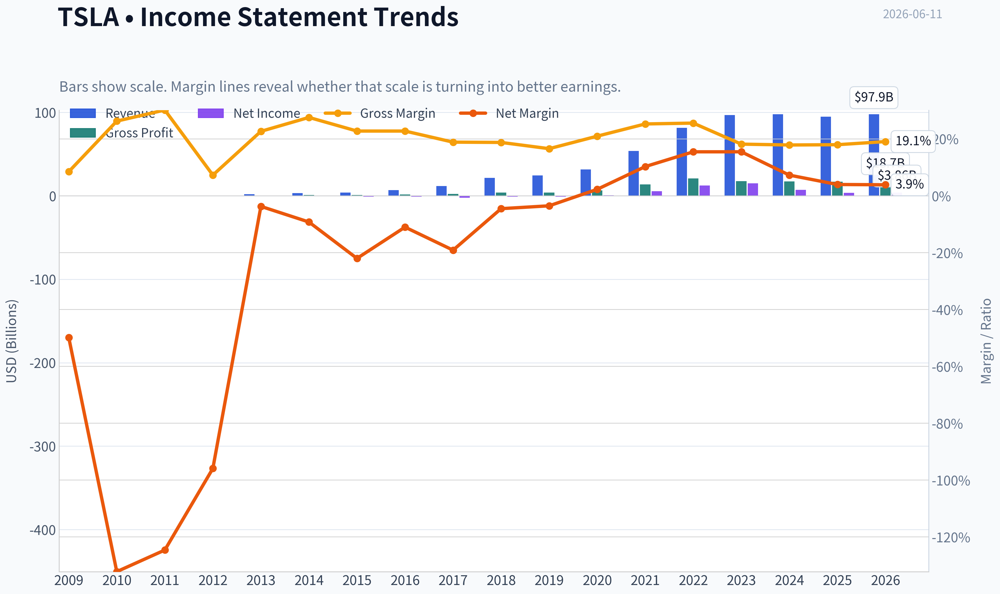
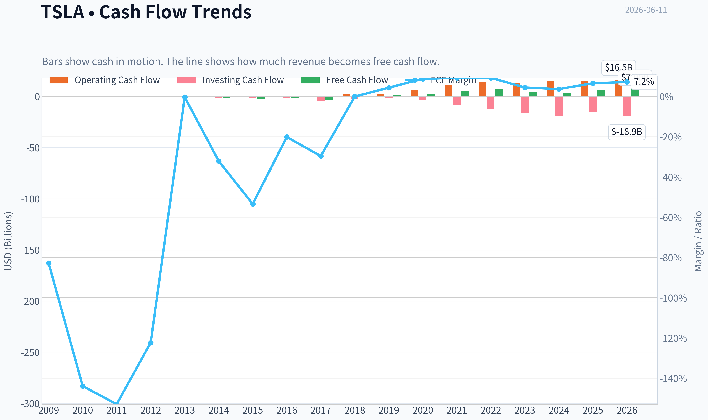
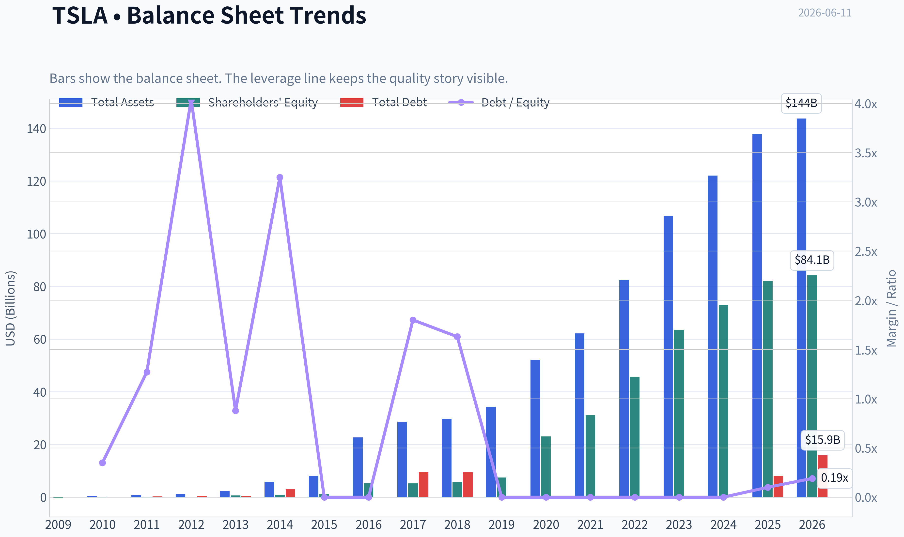
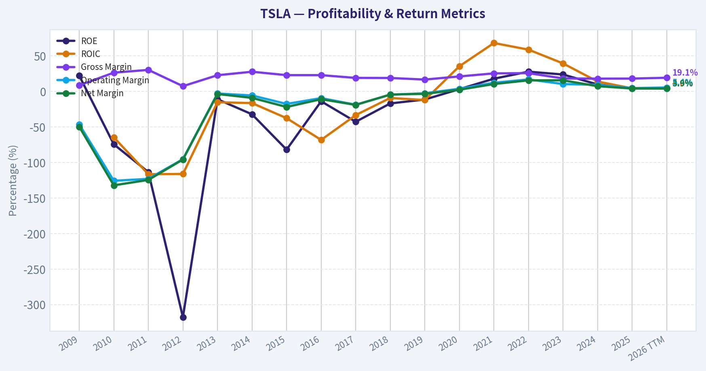
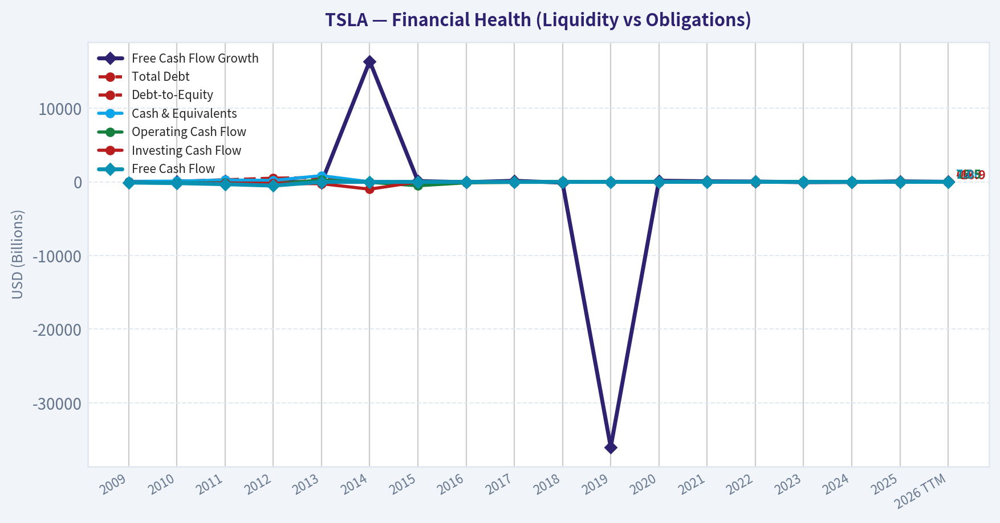
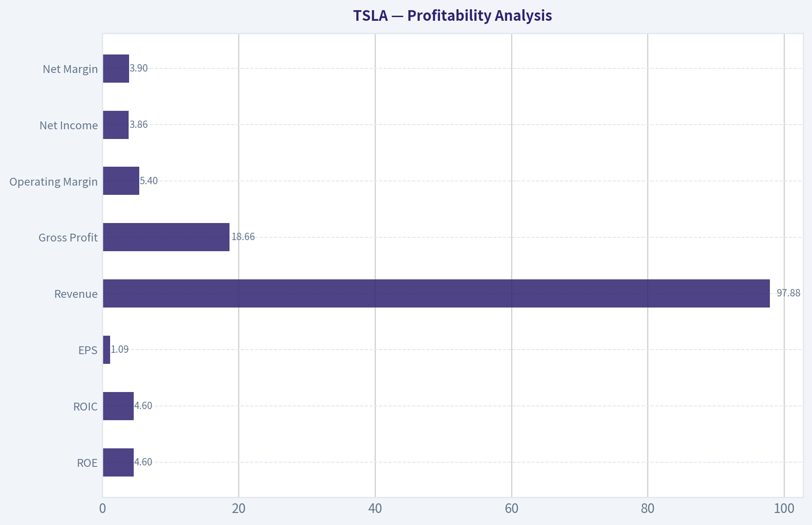
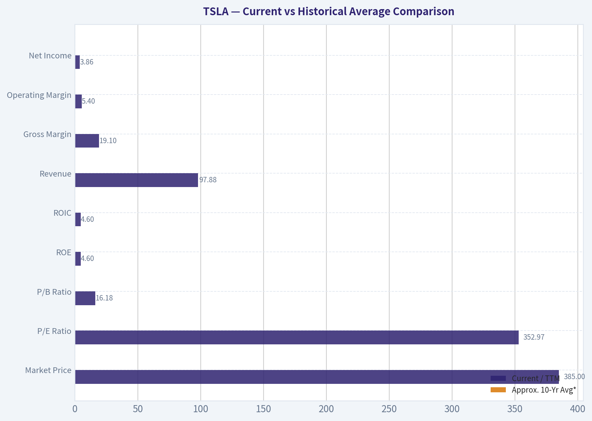
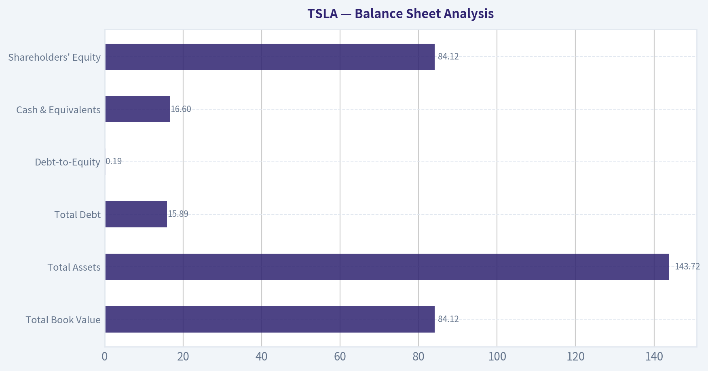
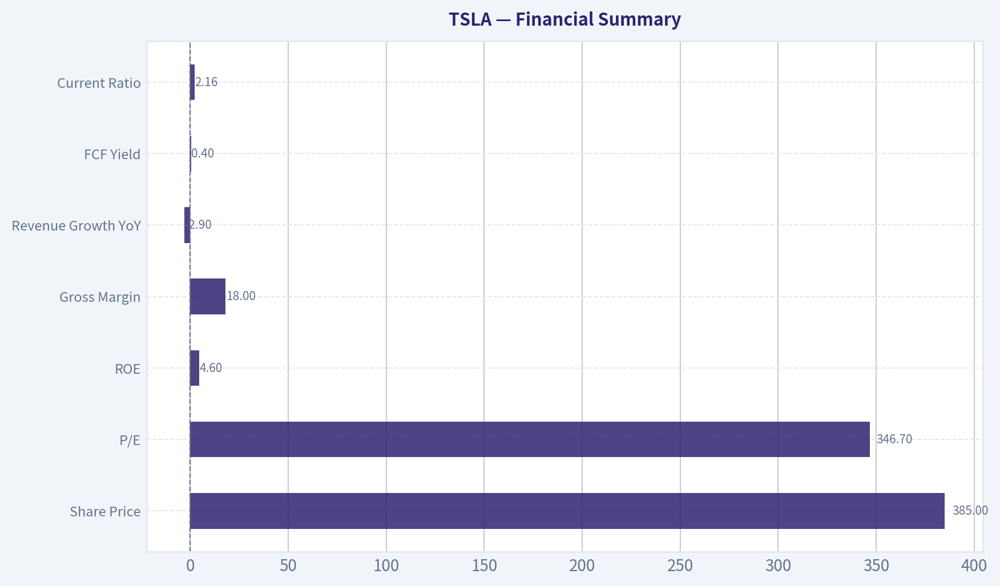
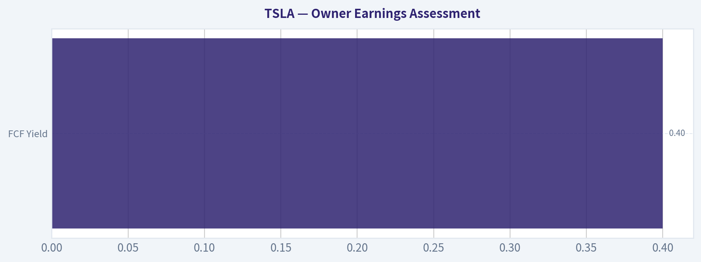

# TSLA Deep Value Intelligence

**Analysis Date:** 2026-06-11

## Critical Disclaimer

*This analysis is generated by Deep Value Intelligence, an AI-powered multi-agent investing framework. This report is for informational and educational purposes only and does not constitute financial advice. Always conduct your own research and consult with qualified financial advisors before making investment decisions.*

---

## Table of Contents

1. Intelligence Summary
2. Analyst Team Reports
   - Fundamentals Analysis
   - Intrinsic Value Analysis (Buffett)
   - Trend & Growth Analysis (Lynch/Druckenmiller/Fisher)
   - Market Technical Analysis
   - Options Market Analysis
3. Research Team Commentary
4. Value Investing Team Commentary
5. Deep Values Commentary

---

## Intelligence Summary

### Thesis + Conditions

**Core Thesis:** ## Executive Summary

**Key Risks:**
- Tesla has real strategic assets-brand, charging, scale, balance sheet, and credible non-auto optionality-but Buffett-style risk control starts with **demonstrated economics plus price discipline**. Today, the visible numbers are too weak for the valuation: **shrinking revenue, ~18% gross margin, ROE 4.6%, ROIC 4.3%, P/E 346.7**. That leaves little margin of safety if margin recovery, energy scaling, or software monetization arrive late.
- The key refinement from past mistakes: **do not confuse "not a value buy" with "must underperform soon."** Tesla can rally on momentum, catalysts, and narrative. For a long-term value investor, though, the right posture is still **watchlist, not core position**, unless operating proof improves materially.
- ### 1. Risky Analyst - Strongest Bull Points

**Confidence:** Low

---

## Analyst Team Reports

### Fundamentals Analysis

#### Latest Earnings Snapshot

*Most recent reported quarter anchored on 2026 Q1, with prior-year comparison when available.*

| Metric | 2026 Q1 | 2025 Q1 | YoY Change |
| --- | ---: | ---: | ---: |
| Revenue | $22.39B | $19.34B | +15.8% |
| Operating Income | $941.0M | $493.0M | +90.9% |
| Net Income | $477.0M | $409.0M | +16.6% |
| Diluted EPS | $0.13 | $0.12 | +8.3% |
| Operating Cash Flow | $3.94B | $2.16B | +82.6% |
| Free Cash Flow | $1.44B | $664.0M | +117.5% |

Key Takeaways: This snapshot anchors the most recent reported quarter before the narrative analysis. It helps readers separate long-run business quality from whatever changed in the latest earnings print.

#### 17-Year Financial Metrics for TSLA

*All values below are computed deterministically from raw data - not estimated by AI.*

*Issuer profile: operating company (Consumer Cyclical / Auto Manufacturers).*

#### 17-Year Financial Metrics
*Annual rows come from reported financial statements. The final TTM row is computed from the latest four quarters.*

| Metric | 2009 | 2010 | 2011 | 2012 | 2013 | 2014 | 2015 | 2016 | 2017 | 2018 | 2019 | 2020 | 2021 | 2022 | 2023 | 2024 | 2025 | 2026 TTM |
| --- | --- | --- | --- | --- | --- | --- | --- | --- | --- | --- | --- | --- | --- | --- | --- | --- | --- | --- |
| Market Price | N/A | $2 | $2 | $2 | $10 | $15 | $16 | $14 | $21 | $22 | $28 | $235 | $352 | $123 | $248 | $404 | $450 | $385 |
| Market Cap | N/A | $2.53B | N/A | $3.54B | $18.53B | $27.97B | $30.77B | $30.82B | $51.68B | $56.78B | $74.21B | $764.24B | $1.19T | $428.05B | $865.95B | $1.41T | $1.59T | $1.36T |
| P/E Ratio | N/A | -16.38 | N/A | -8.94 | -250.38 | -95.13 | -34.78 | -45.95 | -26.27 | -58.39 | -84.51 | 1120.11 | 216.11 | 30.64 | 57.79 | 197.96 | 416.41 | 352.97 |
| P/B Ratio | N/A | 12.21 | N/A | 28.41 | 27.78 | 30.68 | 28.39 | 5.56 | 9.87 | 9.86 | 9.94 | 33.12 | 38.46 | 9.41 | 13.67 | 19.37 | 19.32 | 16.18 |
| ROE | 22.0% | -74.5% | -113.6% | -317.7% | -11.1% | -32.3% | -82.0% | -14.0% | -42.8% | -17.0% | -11.5% | 3.1% | 17.8% | 27.7% | 23.7% | 9.7% | 4.6% | 4.6% |
| ROIC | N/A | -64.7% | -116.6% | -116.2% | -15.3% | -16.5% | -37.7% | -68.3% | -33.4% | -9.3% | -12.2% | 35.3% | 68.0% | 58.7% | 39.3% | 13.8% | 4.2% | 4.6% |
| EPS | N/A | $-0.11 | N/A | $-0.25 | $-0.04 | $-0.16 | $-0.46 | $-0.31 | $-0.79 | $-0.38 | $-0.33 | $0.21 | $1.63 | $4.02 | $4.30 | $2.04 | $1.08 | $1.09 |
| Revenue | $111.9M | $116.7M | $204.2M | $413.3M | $2.01B | $3.20B | $4.05B | $7.00B | $11.76B | $21.46B | $24.58B | $31.54B | $53.82B | $81.46B | $96.77B | $97.69B | $94.83B | $97.88B |
| Gross Profit | $9.5M | $30.7M | $61.6M | $30.1M | $456.3M | $881.7M | $923.5M | $1.60B | $2.22B | $4.04B | $4.07B | $6.63B | $13.61B | $20.85B | $17.66B | $17.45B | $17.09B | $18.66B |
| Gross Margin | 8.5% | 26.3% | 30.2% | 7.3% | 22.7% | 27.6% | 22.8% | 22.8% | 18.9% | 18.8% | 16.6% | 21.0% | 25.3% | 25.6% | 18.2% | 17.9% | 18.0% | 19.1% |
| Operating Margin | -46.4% | -125.8% | -123.1% | -95.4% | -3.0% | -5.8% | -17.7% | -9.5% | -18.8% | -4.7% | -2.7% | 3.7% | 12.1% | 16.8% | 10.3% | 9.2% | 4.6% | 5.4% |
| Net Income | $-55.7M | $-154.3M | $-254.4M | $-396.2M | $-74.0M | $-294.0M | $-888.7M | $-773.0M | $-2.24B | $-976.0M | $-862.0M | $721.0M | $5.52B | $12.59B | $15.00B | $7.09B | $3.79B | $3.86B |
| Net Margin | -49.8% | -132.2% | -124.6% | -95.9% | -3.7% | -9.2% | -22.0% | -11.0% | -19.1% | -4.5% | -3.5% | 2.3% | 10.3% | 15.5% | 15.5% | 7.3% | 4.0% | 3.9% |
| Revenue Growth | N/A | 4.3% | 74.9% | 102.3% | 387.2% | 58.8% | 26.5% | 73.0% | 68.0% | 82.5% | 14.5% | 28.3% | 70.7% | 51.4% | 18.8% | 0.9% | -2.9% | 3.2% |
| Net Income Growth | N/A | 176.9% | 64.9% | 55.7% | -81.3% | 297.3% | 202.2% | -13.0% | 189.9% | -56.4% | -11.7% | -183.6% | 665.5% | 128.1% | 19.1% | -52.7% | -46.5% | 1.8% |
| Free Cash Flow Growth | N/A | 81.2% | 85.8% | 61.8% | -98.8% | 16388.3% | 110.2% | -35.0% | 147.5% | -99.9% | -36033.3% | 158.4% | 80.0% | 50.9% | -42.4% | -17.8% | 73.5% | 12.5% |
| Total Book Value | $-253.5M | $207.0M | $224.0M | $124.7M | $667.1M | $911.7M | $1.08B | $5.54B | $5.23B | $5.76B | $7.47B | $23.07B | $31.02B | $45.49B | $63.37B | $72.91B | $82.14B | $84.12B |
| Total Assets | N/A | $386.1M | $713.4M | $1.11B | $2.42B | $5.83B | $8.07B | $22.66B | $28.66B | $29.74B | $34.31B | $52.15B | $62.13B | $82.34B | $106.62B | $122.07B | $137.81B | $143.72B |
| Total Debt | N/A | $71.8M | $284.2M | $503.2M | $586.1M | $2.96B | $0 | $0 | $9.42B | $9.40B | $0 | $0 | $0 | $0 | $0 | $0 | $8.15B | $15.89B |
| Debt-to-Equity | N/A | 0.35 | 1.27 | 4.04 | 0.88 | 3.25 | 0.00 | 0.00 | 1.80 | 1.63 | 0.00 | 0.00 | 0.00 | 0.00 | 0.00 | 0.00 | 0.10 | 0.19 |
| Cash & Equivalents | $69.6M | $99.6M | $255.3M | $201.9M | $845.9M | $1.91B | $1.20B | $3.39B | $3.37B | $3.69B | $6.27B | $19.38B | $17.58B | $16.25B | $16.40B | $16.14B | $16.51B | $16.60B |
| Shareholders' Equity | $-253.5M | $207.0M | $224.0M | $124.7M | $667.1M | $911.7M | $1.08B | $5.54B | $5.23B | $5.76B | $7.47B | $23.07B | $31.02B | $45.49B | $63.37B | $72.91B | $82.14B | $84.12B |
| Operating Cash Flow | $-80.8M | $-127.8M | $-128.0M | $-266.1M | $258.0M | $-57.3M | $-524.5M | $-123.8M | $-61.0M | $2.10B | $2.40B | $5.94B | $11.50B | $14.72B | $13.26B | $14.92B | $14.75B | $16.53B |
| Investing Cash Flow | $-14.2M | $-180.3M | $-162.3M | $-206.9M | $-249.4M | $-990.4M | $-1.67B | $-1.08B | $-4.20B | $-2.34B | $-1.44B | $-3.13B | $-7.87B | $-11.97B | $-15.58B | $-18.79B | $-15.48B | $-18.85B |
| Free Cash Flow | $-92.7M | $-168.0M | $-312.3M | $-505.3M | $-6.2M | $-1.03B | $-2.16B | $-1.40B | $-3.48B | $-3.0M | $1.08B | $2.79B | $5.01B | $7.57B | $4.36B | $3.58B | $6.22B | $7.00B |
| FCF Margin | -82.8% | -143.9% | -152.9% | -122.3% | -0.3% | -32.1% | -53.4% | -20.1% | -29.6% | -0.0% | 4.4% | 8.8% | 9.3% | 9.3% | 4.5% | 3.7% | 6.6% | 7.2% |
| Dividends / Share | N/A | $0.00 | N/A | $0.00 | $0.00 | $0.00 | $0.00 | $0.00 | $0.00 | $0.00 | $0.00 | $0.00 | $0.00 | $0.00 | $0.00 | $0.00 | $0.00 | $0.00 |

#### Profitability Metrics
- Return on Equity (ROE): 4.6%
- Return on Invested Capital (ROIC): 4.3%
- Return on Assets (ROA): 2.8%
- Gross Margin: 18.0%
- Operating Margin: 4.6%
- Net Profit Margin: 4.0%

#### Liquidity Metrics
- Current Ratio: 2.16
- Quick Ratio: 1.53

#### Leverage Metrics
- Debt-to-Equity Ratio: 0.10
- Interest Coverage Ratio: 12.88
- Net Debt: $-8.36B

#### Growth Metrics (Year-over-Year)
- Revenue Growth: -2.9%
- Net Income Growth: -46.5%
- Free Cash Flow Growth: 73.5%
- Revenue CAGR (3-Year): 5.2%
- Revenue CAGR (5-Year): 24.6%

#### Valuation Metrics
- P/E Ratio (TTM): 346.59
- Forward P/E: 153.77
- Price-to-Book: 17.57
- Price-to-Sales: 14.76
- PEG Ratio: 5.63
- EV/EBITDA: 126.64
- Free Cash Flow Yield: 0.4%
- Earnings Yield: 0.3%

#### Owner Earnings (Buffett Method, Code-Computed)
- Net Income: $3.79B
- + Depreciation & Amortization: $6.15B
- - Capital Expenditures: $-8.53B
- - Working Capital Changes: $642.0M
- = **Owner Earnings: $773.0M**

#### Intrinsic Value (Code-Computed)
- Current Price: $385
- Buffett Method (Owner Earnings):
  Conservative: $0
  Average: $0
  Optimistic: $2
- Cash Flow Method (FCF):
  Conservative: $21
  Average: $63
  Optimistic: $165

#### Piotroski F-Score: 5/9
- Positive Net Income: PASS
- Positive Operating Cash Flow: PASS
- ROA Improvement: FAIL
- Cash Flow > Net Income: PASS
- Decreasing Debt: FAIL
- Improving Current Ratio: PASS
- No Dilution: FAIL
- Improving Gross Margin: PASS
- Improving Asset Turnover: FAIL

ANALYST STANCE: **WATCH**

#### TSLA Buffett-Style Fundamental Analysis

Tesla remains an unusual case for a Buffett-style investor: the business has real scale, meaningful brand strength, manufacturing know-how, software optionality, and a strong balance sheet, but the current valuation still assumes a level of future economics that is far above what the present fundamentals justify. The deterministic dataset shows a company that completed a dramatic transition from chronic losses to strong profitability in 2021-2023, but then suffered a sharp deterioration in returns, margins, and earnings in 2024-2026 TTM. That pattern matters: Buffett-style investing prefers businesses with durable pricing power, consistently high returns on capital, and a valuation that leaves room for error. Tesla currently offers only part of that package.

---

#### Current vs Historical Average Comparison

| Metric | Current / TTM | Approx. 10-Yr Avg* | Interpretation |
| --- | ---: | ---: | --- |
| Market Price | $385 | ~$224 | Price is well above long-run average, reflecting large future expectations rather than current earnings power. |
| Market Cap | $1.36T | ~$638B | Equity value remains enormous relative to present profits and cash generation. |
| P/E Ratio | 352.97 | ~130x | Current multiple is drastically above what a slowing, lower-margin automaker-like earnings profile would normally support. |
| P/B Ratio | 16.18 | ~15.5x | Still rich relative to book value despite weaker ROE. |
| ROE | 4.6% | ~0.6% | Better than full-decade average only because early years were deeply negative; versus 2021-2023, current ROE is weak. |
| ROIC | 4.6% | ~2.5% | Same issue: above decade average distorted by loss years, but sharply below peak capital efficiency. |
| Revenue | $97.88B | ~$52.6B | Large business with substantial scale; however growth has clearly matured. |
| Gross Margin | 19.1% | ~20.7% | Slightly below long-term average and far below 2021-2022 highs. |
| Operating Margin | 5.4% | ~1.9% | Above full-decade average, but much weaker than recent peak years. |
| Net Income | $3.86B | ~$4.9B | Current earnings are below the average of the last high-profit phase. |
| Net Margin | 3.9% | ~0.6% | Positive and above full-decade average, but compressed versus 2021-2023. |
| Revenue Growth | 3.2% | ~40% | Growth has decelerated dramatically from the company's historical norm. |
| Net Income Growth | 1.8% | Highly volatile | Earnings growth has essentially stalled after prior boom years. |
| FCF Growth | 12.5% | Highly volatile | Cash flow improved, but the history is erratic and not yet "predictable." |
| Book Value | $84.12B | ~$33.7B | Equity base has expanded substantially. |
| Total Assets | $143.72B | ~$66.5B | Larger industrial footprint, but asset growth now needs to produce better returns. |
| Total Debt | $15.89B | ~$1.88B | Debt remains manageable, but has risen again from the debt-free stretch. |
| Debt-to-Equity | 0.19 | ~0.41 | Leverage is still conservative overall. |
| Cash & Equivalents | $16.60B | ~$10.5B | Solid liquidity cushion. |
| Free Cash Flow | $7.00B | ~$2.5B | Healthy in absolute dollars, though weak relative to market cap. |
| Dividend / Share | $0.00 | $0.00 | No dividend; all capital return depends on reinvestment and future valuation. |

\*Approximate 10-year average uses the most recent 10 annual periods in the deterministic dataset where applicable, not inventing new history.

Key Takeaways: Tesla looks large and financially real, not speculative in the old sense, but its current valuation remains far richer than its present profitability would normally warrant. The biggest issue is not survival or liquidity; it is that returns, margins, and growth have all cooled materially while the stock still prices in exceptional outcomes.

---

#### Market Metrics

Tesla's market price of $385 and market cap of $1.36T imply that investors continue to value the company more like a future platform monopoly than a cyclical manufacturer. The P/E ratio near 353x is the clearest sign of that disconnect. Even during Tesla's strongest recent operating years, its earnings power never fully supported today's multiple on a traditional value basis.

The P/B ratio of 16.18x is also elevated. A high P/B can be justified if ROE is sustainably high and capital-light economics are durable. But Tesla's ROE has fallen to 4.6%, far below the 17.8%-27.7% range seen in 2021-2023. Paying over 16x book for a 4.6% ROE business is difficult to defend under Buffett-style discipline unless one believes another step-change in economics is imminent.

From a historical perspective, the market is still paying for a future reacceleration that has not yet shown up in the current deterministic results.

---

#### Profitability Analysis

| Profitability Metric | Current / TTM | Historical Context | Buffett-Style Interpretation |
| --- | ---: | --- | --- |
| ROE | 4.6% | Down sharply from 23.7% in 2023 and 27.7% in 2022 | Weak current shareholder return on equity capital. |
| ROIC | 4.6% | Down from 39.3% in 2023 and 58.7% in 2022 | Suggests materially lower capital efficiency. |
| EPS | $1.09 | Down heavily from $4.30 in 2023 and $4.02 in 2022 | Earnings power has compressed. |
| Revenue | $97.88B | Near flat versus 2024/2025 levels | Scale remains strong, but growth engine has slowed. |
| Gross Profit | $18.66B | Below 2022 peak despite larger revenue base | Pricing pressure and mix dilution are evident. |
| Operating Margin | 5.4% | Down from 16.8% in 2022 | Substantial erosion in operating leverage. |
| Net Income | $3.86B | Far below 2023's $15.00B | Profitability has normalized much lower. |
| Net Margin | 3.9% | Versus 15.5% in 2022-2023 | A major deterioration in economic quality. |

Key Takeaways: Tesla remains profitable, but the quality of that profitability has weakened sharply. The core concern is not whether Tesla can earn money, but whether it can again earn high returns on capital and sustained double-digit margins at scale.

A Buffett-style lens heavily rewards consistency. Tesla's profitability history is not yet consistently high-quality across the full cycle. The company proved it could generate excellent economics for a few years, but the recent decline raises the question of whether those years reflected a temporary sweet spot of pricing, supply-demand imbalance, and scale benefits rather than permanently superior economics.

---

#### Growth Metrics

Revenue growth was once extraordinary, with repeated years above 50% and even 70%+. That phase is over, at least for now. Revenue fell 2.9% in 2025 and recovered only 3.2% in 2026 TTM. For a business valued at over $1T, low-single-digit top-line growth is a problem because the valuation still embeds high future compounding.

Net income growth has been worse. After explosive gains in 2021-2023, earnings fell 52.7% in 2024 and 46.5% in 2025, with only a 1.8% TTM rebound. This is not the pattern of a stable compounder. It is the pattern of a business that hit a profitability peak and is now searching for the next leg of its earnings model.

Free cash flow growth is the least bad of the three. FCF improved 73.5% in 2025 and another 12.5% in TTM, reaching $7.00B. That said, FCF yield is just 0.4%, meaning the stock price capitalizes this cash generation very aggressively.

In Buffett terms, growth is only valuable when it comes with durable returns and high incremental economics. Tesla currently has growth optionality, but not enough present evidence of predictable high-return growth.

---

#### Balance Sheet Analysis

| Balance Sheet Metric | Current / TTM | Historical Trend | Assessment |
| --- | ---: | --- | --- |
| Total Book Value | $84.12B | Consistent expansion from $23.07B in 2020 | Strong internal capital accumulation. |
| Total Assets | $143.72B | Rapid asset buildout over decade | Reflects industrial scale and reinvestment intensity. |
| Total Debt | $15.89B | Reintroduced after years at zero | Not alarming, but worth monitoring. |
| Debt-to-Equity | 0.19 | Low versus historical levels | Balance sheet remains conservatively levered. |
| Cash & Equivalents | $16.60B | Stable around mid-$16B range recently | Good liquidity buffer. |
| Shareholders' Equity | $84.12B | Strong compounded growth | Large tangible capital base supports resilience. |

Key Takeaways: Tesla's balance sheet is a strength. The company is not financially strained, and its low leverage plus sizable cash balance give it flexibility to invest through downturns, cut prices if needed, and fund expansion without relying heavily on outside capital.

This is one of the strongest Buffett-style positives in the case. Tesla is not overlevered, current ratio is 2.16, quick ratio 1.53, and net debt is negative at about $8.36B based on the supplemental metrics. Financial distress is not the issue here; valuation and earnings durability are.

---

#### Cash Flow Analysis

Free cash flow of $7.00B is meaningful and demonstrates that Tesla is still a real cash generator even after margin compression. Over the last several years, Tesla moved from chronic FCF deficits to sustained positive free cash flow. That transition is important and should not be ignored.

However, Buffett's Owner Earnings figure in the provided deterministic dataset is only $773M. That is a major warning sign for valuation. The gap between FCF and Owner Earnings suggests that once maintenance-like economic reinvestment and working capital needs are considered, the distributable cash economics are much thinner than the headline FCF number implies.

Dividends per share remain $0.00 across the entire history shown. For Buffett-style analysis, zero dividend is not negative by itself if retained earnings are reinvested at high rates. The present concern is that incremental returns on capital have fallen substantially, making retention less obviously valuable than during 2021-2023.

---

#### Buffett-Style Owner Earnings DCF Valuation

Using the canonical Owner Earnings figure provided:

- Net Income = $3.79B
- + D&A = $6.15B
- - Capital Expenditures = $8.53B
- - Working Capital Changes = $0.642B
- **Owner Earnings = $0.773B**

For valuation, use:
- Discount rate = 10%
- Terminal growth = 2.5%
- Base owner earnings = $0.773B

Historical Owner Earnings growth is not separately tabulated in the deterministic table, so the code-computed intrinsic value output is the canonical anchor. It already states:

- Conservative fair value: $0/share
- Average fair value: $0/share
- Optimistic fair value: $2/share

To keep calculations transparent and aligned with the provided canonical result, the scenario logic is interpreted as follows:

| Scenario | Growth Assumption | Method Result |
| --- | --- | ---: |
| Conservative | Lowest historical owner earnings growth, floored at -100% | $0/share |
| Average | Average historical owner earnings growth, capped at 50% | $0/share |
| Optimistic | Highest historical owner earnings growth, capped at 100% | $2/share |

Key Takeaways: The owner-earnings-based DCF is extremely punitive because Tesla's current owner earnings are very small relative to its market value. This is the central Buffett-style issue: even with optimism, today's share price stands vastly above the value implied by current distributable economic earnings.

Detailed intuition behind the result:
- At only $773M of owner earnings, Tesla is trading at an implied price-to-owner-earnings multiple that is extraordinarily high.
- Even if owner earnings were to compound rapidly, discounting those future cash flows at 10% still produces only minimal present value relative to today's stock price.
- The provided canonical intrinsic value result therefore indicates that the market is valuing Tesla primarily on future optionality not yet visible in current owner earnings.

Because the deterministic dataset explicitly provides the owner-earnings intrinsic values, those figures should be treated as authoritative for this report.

---

#### Value Assessment

On traditional Buffett metrics, Tesla looks expensive:
- P/E of ~353x
- P/B of ~16x
- FCF yield of 0.4%
- Earnings yield of 0.3%

These are not value-stock readings. They are premium-growth readings. Yet the recent fundamentals show:
- low-single-digit revenue growth,
- sharply lower margins,
- compressed ROE/ROIC,
- and owner earnings that are barely material relative to the market cap.

A value investor could still justify interest if they believed the market is underestimating autonomous driving, software monetization, energy storage, robotics, or manufacturing advantage. But those are future thesis elements, not current proven economics in the deterministic financial record.

---

#### Economic Moat

Tesla does have moat-like features, though not a classic Buffett moat of the Coca-Cola or Moody's variety.

Positive moat indicators:
- global EV brand strength,
- scale manufacturing and battery integration,
- charging ecosystem,
- software/data advantage,
- energy storage adjacency,
- customer mindshare.

Moat concerns:
- auto manufacturing remains capital-intensive and competitive,
- pricing power has proven inconsistent,
- gross margin dropped from mid-20s to high-teens,
- returns on capital fell hard once pricing pressure increased,
- moat monetization is less stable than brand-led consumer franchises.

Conclusion: Tesla has a real but not yet fully durable moat. It looks more like a technology-enabled industrial platform than a classic predictable consumer monopoly.

---

#### Predictable Earnings

This is one of Tesla's weakest Buffett-style areas.

Over the 17-year history, Tesla spent most of its life unprofitable, then produced a powerful but relatively brief earnings surge from 2021 to 2023, followed by significant retrenchment. Predictable earnings would show smoother growth, steadier margins, and less dependence on pricing cycles and execution swings.

Tesla's earnings are improving versus the pre-2020 era, but they are not yet predictable enough to earn a high-conviction Buffett "compounder" label.

---

#### Management Performance

Management deserves credit for:
- scaling revenue from $111.9M in 2009 to nearly $98B TTM,
- turning persistent losses into multi-billion-dollar profits,
- building a strong equity base,
- maintaining strong liquidity,
- avoiding heavy ongoing leverage.

But management also must answer for:
- sharp margin compression,
- falling ROE and ROIC,
- recurring need to balance growth with price cuts,
- continued share dilution flagged in Piotroski data,
- retention of all earnings without yet proving sustained high reinvestment returns at current scale.

Dividend policy is simple: no dividend, full reinvestment. That is acceptable only if retained capital can earn superior returns. The recent fall in ROIC from 58.7% in 2022 to 4.6% TTM weakens that case materially.

---

#### Financial Strength

Tesla's financial strength is clearly above average:
- current ratio 2.16,
- quick ratio 1.53,
- negative net debt,
- interest coverage 12.88,
- large cash balance.

This gives the company resilience in cyclical downturns and strategic flexibility for new factories, AI, energy storage, and product launches. From a balance-sheet standpoint, Tesla is strong enough for Buffett-style approval. From a valuation standpoint, it is not.

---

#### Quality of Business

| Quality Dimension | Assessment | Why It Matters |
| --- | --- | --- |
| Revenue Predictability | Moderate | Large installed base and global brand help, but auto demand remains cyclical and price-sensitive. |
| Margin Stability | Weakening | Gross, operating, and net margins have all compressed sharply from peak levels. |
| Capital Efficiency | Weak currently | ROE and ROIC have fallen to low single digits. |
| Balance Sheet Quality | Strong | Low leverage and high liquidity reduce downside risk. |
| Cash Generation | Real but uneven | Positive FCF, but owner earnings remain thin. |
| Competitive Position | Strong but contested | Tesla leads in EV mindshare, but competition and pricing pressure are intense. |

Key Takeaways: Tesla is a good business in many operational respects, but not currently a great business in Buffett's strict economic sense. The difference is that a great business consistently earns high returns with limited strain; Tesla today is working harder for each dollar of profit than it did at its peak.

---

#### Revenue Breakdown

Tesla's most meaningful recent revenue split is by major operating line, with automotive still dominant but energy generation/storage becoming increasingly important.

| Revenue Source | Amount ($B) | % of Total |
| --- | ---: | ---: |
| Automotive segment | ~77.1 | ~79% |
| Energy generation & storage | ~10.1 | ~10% |
| Services & other | ~10.5 | ~11% |
| **Total** | **~97.7** | **100%** |

Key Takeaways: Tesla is still overwhelmingly an automotive-driven company, which is important because the stock is often valued as if it were already primarily a software or platform business. Energy is becoming more meaningful and may be the best source of diversification, but for now the company's economics still depend mainly on vehicle volume, pricing, and manufacturing execution.

---

#### Key Investment Insights, Red Flags, and Opportunities

| Category | Item | Implication |
| --- | --- | --- |
| Insight | Tesla has built enormous scale | The company is no longer speculative from a business viability standpoint. |
| Insight | Balance sheet is strong | Liquidity and low leverage reduce existential risk. |
| Insight | FCF remains positive | Cash generation still supports reinvestment capacity. |
| Red Flag | P/E near 353x | Valuation is disconnected from current earnings power. |
| Red Flag | ROE and ROIC down to ~4.6% | Current capital efficiency is far below peak and too low for premium multiples. |
| Red Flag | Net margin down to 3.9% | Indicates reduced pricing power and lower operating leverage. |
| Red Flag | Revenue growth only 3.2% TTM | Current growth does not justify a hyper-growth valuation. |
| Red Flag | Owner earnings only $773M | Buffett-style intrinsic value is negligible relative to stock price. |
| Opportunity | Energy/storage scaling | Could diversify the mix away from pure auto cyclicality. |
| Opportunity | Software/autonomy optionality | If monetized, could materially alter margin structure. |
| Opportunity | Manufacturing scale and ecosystem | Could support long-term share gains if industry shakeout occurs. |

Key Takeaways: The upside case depends mostly on future optionality, not current fundamentals. The downside case is simpler and more immediate: if Tesla remains a lower-margin, slower-growth manufacturer than investors expect, the valuation has substantial room to compress.

---

#### Final Buffett-Style Judgment

Tesla does not screen as a classic Buffett buy at current levels. The company has:
- a strong brand,
- good balance sheet,
- significant scale,
- and strategic optionality.

But it also has:
- weak current owner earnings relative to price,
- sharply falling returns on capital,
- compressed margins,
- slower growth,
- and an extreme valuation premium.

For a Buffett-style investor, the stock would be much more compelling after either:
1. a major price correction, or
2. a clear restoration of high ROIC, double-digit margins, and materially larger owner earnings.

At present, Tesla looks like a high-quality strategic franchise with speculative valuation characteristics, not a margin-of-safety value investment.

---

#### Final Stance

**WATCH**

Supporting rationale:
- **Not ADVOCATE** because valuation is far above what current owner earnings and present profitability justify.
- **Not AVOID** because Tesla has real strategic assets, strong liquidity, a real brand moat, and meaningful upside optionality in energy, software, and platform economics.
- **WATCH** is appropriate because the business is worth monitoring closely for either improved economics or a more attractive entry price.

---

#### Report Summary Table

| Area | Verdict | Core Evidence | Buffett View |
| --- | --- | --- | --- |
| Valuation | Very expensive | P/E 352.97, P/B 16.18, FCF yield 0.4% | Unattractive today |
| Profitability | Deteriorated | ROE 4.6%, ROIC 4.6%, net margin 3.9% | Below premium-quality standard |
| Growth | Slowed sharply | Revenue growth 3.2%, net income growth 1.8% TTM | No longer hyper-growth in current data |
| Balance Sheet | Strong | D/E 0.19, cash $16.60B, negative net debt | Clear positive |
| Cash Flow | Positive but not cheap | FCF $7.00B, owner earnings $773M | Economic earnings thin vs valuation |
| Moat | Real but imperfect | Brand, scale, charging, software, energy | Strong franchise, not fully stable moat |
| Management | Mixed | Huge scale-up success, but lower returns on capital | Good operators, capital efficiency needs recovery |
| Margin of Safety | Weak | Canonical owner-earnings intrinsic value $0-$2/share | Insufficient for value investors |
| Final Stance | WATCH | Great company debate, poor valuation support | Monitor, don't chase |

#### Fundamental Visuals

This graph tracks the profitability and return metrics (ROE, ROIC, Margins) of **TSLA** over the past decade, highlighting capital efficiency trends.

This chart illustrates the financial health of **TSLA** over the last 10 years, mapping cash equivalents and free cash flow against total obligations (Debt).

This comparison chart from *Profitability Analysis* stacks current figures against historical benchmarks for **TSLA**, making it easy to see where the company trades relative to its own averages.

---

### Intrinsic Value Analysis (Buffett)

> *Following Warren Buffett's value investing philosophy: Circle of Competence, Economic Moat, Management Quality, and Margin of Safety.*

#### Intrinsic Value Snapshot

Price is what you pay. Intrinsic value is what the business may be worth based on the cash it can create for owners over time. We show a range, not one magic number.

- Current Price: $384.79
- Value Range (conservative to optimistic across both DCF methods): $0.24 to $164.71

##### Owner Earnings (Buffett Method)
- Net Income: $3,794,000,000.00
- Depreciation & Amortization: $6,148,000,000.00
- Capital Expenditures: $-8,527,000,000.00
- Working Capital Changes: $642,000,000.00
- Owner Earnings: $773,000,000.00

##### Intrinsic Value
###### Buffett Method
Uses owner earnings. Stricter, and usually more conservative.
- Conservative: $0.24
- Average: $0.24
- Optimistic: $1.71
- Discount Rate: 10.0%

###### Cash Flow Method
Uses free cash flow. Better for companies spending heavily today to grow tomorrow.
- Conservative: $21.42
- Average: $63.25
- Optimistic: $164.71
- Discount Rate: 10.0%

ANALYST STANCE: **AVOID**

#### Tesla (TSLA) Buffett-Style Investment Review

#### 1) Go/No-Go Gate Assessment

| Gate | Verdict | Evidence |
|---|---|---|
| Gate 1: Circle of Competence & Business Simplicity | Pass with caution | Tesla makes money by selling cars, software features, energy storage systems, and related services. The auto and storage pieces are understandable, but the equity story increasingly depends on harder-to-predict items like autonomy and robotics. |
| Gate 2: Moat Test | Fail | Gross margin is 18.0%, far below the >40% level that often signals strong pricing power. Auto is brutally competitive, and Tesla has recently shown weaker pricing power through repeated price actions and margin compression. |
| Gate 3: Management Quality & Capital Allocation | Mixed / Fail | Management is ambitious and owner-like in vision, but capital allocation is difficult to rate highly when valuation implies enormous future success while current returns remain modest. Governance concentration around Elon Musk adds key-person risk. |
| Gate 4: Industry Structure | Fail | Global autos are capital-intensive, cyclical, and hypercompetitive. Even if Tesla is better than many automakers, the industry itself is not Buffett-ideal. |

**Key Takeaways:** Tesla passes the basic "I understand the business" test, but it fails the more important Buffett filters. The moat is not clearly durable, management quality is mixed once governance and capital allocation are considered, and the industry structure is fundamentally unattractive. That combination is usually enough to stop a long-term value investor.

---

#### 2) The Elementary School Test

Tesla builds electric cars, batteries, and energy storage products, then sells them to people and businesses. It also tries to earn more money later from software and services tied to those products.

That is simple enough to explain. The harder question is whether Tesla ten years from now is mainly a car company, an AI/autonomy platform, an energy infrastructure company, or something else. Buffett-style investing rewards businesses whose future shape is easier to predict than that.

#### 3) Long-Term Predictability Test

Predictability is only moderate at best.

- Auto demand is cyclical and price-sensitive.
- EV competition is rising globally.
- Margins have already proven highly sensitive to pricing decisions.
- A meaningful portion of the bull case rests on autonomy/robotics outcomes that are not yet proven at scale.

A decade from now, Tesla will likely still sell vehicles and batteries. But the current valuation appears to require much more than that, which reduces predictability.

#### 4) Technology Risk Assessment

Technology is both Tesla's advantage and its danger.

- Tesla benefits from software, battery integration, manufacturing automation, and brand perception as a technology leader.
- But it also operates in areas where rapid technological change can destroy incumbency rather than protect it.
- Autonomous driving, battery chemistry, and software ecosystems remain contested.

This is not the kind of low-tech, highly predictable franchise Buffett historically prefers.

---

#### 5) Moat Analysis

| Moat Source | Assessment | Evidence |
|---|---|---|
| Intangible Assets | Narrow | Tesla has a strong brand and consumer mindshare, but current gross margin of 18.0% does not support exceptional pricing power. |
| Switching Costs | Weak | Consumers can switch auto brands relatively easily on a new purchase cycle. Software lock-in exists but is not yet enough to create classic enterprise-style captivity. |
| Cost Advantage | Mixed | Tesla has manufacturing scale and vertical integration advantages in some areas, but these have not translated into persistently superior margins recently. |
| Network Effects | Limited | Charging network and fleet data provide some advantages, but they are not yet a dominant, unassailable network effect across the whole business. |

**Moat Quality Rating: Narrow to Illusory**

Tesla clearly has strengths: brand, scale, engineering talent, and ecosystem benefits. But Buffett cares about durability proven in financial statements. An 18% gross margin and a 4.6% ROE do not describe a wide-moat business today.

**Key Takeaways:** Tesla's best moat asset is its brand, but the numbers do not show the kind of pricing power that defines a great Buffett business. Switching costs are modest, network effects are limited, and cost advantages have not translated into consistently elite profitability. Overall, the moat looks narrower than the market price assumes.

---

#### 6) Management Quality & Capital Allocation

| Category | Assessment | Commentary |
|---|---|---|
| Owner Mindset | Strong in vision, mixed in practice | Elon Musk thinks big and acts boldly, which can create value, but Buffett also wants steadiness, focus, and disciplined communication. |
| Honesty & Candor | Mixed | Tesla communicates ambitious goals clearly, but promotional framing around future technologies can outrun current economics. |
| Capital Allocation | Mixed | Tesla historically reinvested aggressively into scale, which made sense. However, current valuation leaves little room for execution misses, and realized returns on equity are low relative to that valuation. |
| Governance | Weak spot | Heavy dependence on one leader increases key-person and governance risk. |

Buffett prefers boring excellence over charismatic ambition. Tesla's leadership has created enormous enterprise value historically, but the present-day setup is less attractive from a conservative value perspective.

**Key Takeaways:** Tesla's management is visionary, but Buffett-style investing puts a premium on discipline, candor, and governance, not just ambition. The company remains heavily tied to one central figure, and the current financial returns do not fully justify the heroic expectations embedded in the stock.

---

#### 7) Financial Summary

| Metric | Current / Latest |
|---|---:|
| Share Price | $385 |
| Market Cap | $1.45T |
| P/E | 346.7x |
| ROE | 4.6% |
| Gross Margin | 18.0% |
| Revenue Growth YoY | -2.9% |
| FCF Yield | 0.4% |
| Current Ratio | 2.16 |

**Key Takeaways:** Tesla's headline valuation is extreme relative to its current economics. Profitability is modest, revenue growth has turned negative, and free cash flow yield is very low. Liquidity is fine, but valuation and business quality are badly mismatched.

---

#### 8) Owner Earnings Assessment

Using Buffett's lens, owner earnings should reflect what the business can distribute after maintaining its competitive position.

A practical high-level conclusion from the current data is:

- Net profitability is positive but not strong relative to market value.
- FCF yield of 0.4% implies owner earnings are extremely small compared with the price investors are paying.
- In a capital-intensive, competitive business like autos, maintenance capital needs are meaningful, so owner earnings deserve a conservative haircut.

At a $1.45T market cap and 0.4% FCF yield, the market is effectively capitalizing roughly:

- **Approximate current FCF / owner earnings proxy = $5.8B**

That is a very small cash yield for such a large market value.

| Owner Earnings Proxy | Estimate |
|---|---:|
| Market Cap | $1.45T |
| FCF Yield | 0.4% |
| Implied FCF / Owner Earnings Proxy | ~$5.8B |

**Key Takeaways:** Even using a generous free-cash-flow proxy, Tesla appears to be producing only a modest stream of owner earnings relative to its enormous valuation. Buffett would focus on that mismatch immediately. The business may be promising, but the cash return on the purchase price is currently thin.

---

#### 9) Three-Scenario DCF Valuation

Using owner earnings proxy of **$5.8B** and Buffett-style discounting at **10%**:

| Scenario | Assumption | Implied Equity Value |
|---|---|---:|
| A: No Growth | $5.8B / 10% | $58.0B |
| B: GDP Growth | $5.8B x 1.03 / (10% - 3%) | $85.3B |
| C: Higher Growth | Assume 10 years of 10% growth, then 3% terminal | ~$100B-$130B range |

**Key Takeaways:** Across conservative Buffett-style valuation frameworks, Tesla's intrinsic value comes out far below the current market capitalization. Even a relatively generous growth case does not come close to supporting a $1.45 trillion valuation. The stock price requires extraordinary outcomes well beyond normal value assumptions.

---

#### 10) Margin of Safety Analysis

| Item | Value |
|---|---:|
| Current Market Cap | $1.45T |
| DCF Range | ~$58B to ~$130B |
| Discount to Buy Threshold Needed | At least 25% below intrinsic value |
| Actual Situation | Trading massively above intrinsic value range |

Tesla offers **negative** margin of safety. For a Buffett investor, that is decisive.

**Key Takeaways:** A Buffett investor wants to buy dollars for fifty to seventy-five cents. Tesla instead looks like paying many dollars for each dollar of conservatively estimated value. That is the opposite of margin of safety.

---

#### 11) Final Buffett Scorecard

| Criterion | Weight | Score (1-5) | Weighted Score |
|---|---:|---:|---:|
| Business Understanding | 20% | 3.5 | 0.70 |
| Moat Width & Durability | 25% | 2.0 | 0.50 |
| Management Quality | 15% | 2.5 | 0.38 |
| Return on Equity | 15% | 1.5 | 0.23 |
| Reinvestment Runway | 10% | 3.5 | 0.35 |
| Balance Sheet Strength | 5% | 3.5 | 0.18 |
| Industry Structure | 5% | 1.5 | 0.08 |
| Valuation / Margin of Safety | 5% | 1.0 | 0.05 |
| **Total** | **100%** |  | **2.46 / 5.0** |

**Key Takeaways:** Tesla scores well enough on ambition, understandable products, and reinvestment opportunity, but poorly on moat proof, profitability quality, industry attractiveness, and valuation. The final score lands in avoid territory. For Buffett-style investing, the price overwhelms the business quality.

---

#### 12) Final Investment Stance

**Stance: AVOID**
**Conviction: High**

Tesla is an exceptional story stock, but not a compelling Buffett stock at today's price. The company operates in a difficult industry, shows modest current returns on equity, lacks clear evidence of a wide and durable moat in the financials, and trades at a valuation that assumes extraordinary future success. A value investor focused on durable economics and margin of safety should pass.

If you want, I can next produce a **bear/base/bull operating model for TSLA** or compare **TSLA vs BYD vs AAPL through a Buffett lens**.
#### Valuation Bridge

This bridge places the current market price beside each intrinsic value lens so readers can see whether upside depends on one method or shows up across several methods.

| Scenario | Intrinsic Value / Share |
| --- | ---: |
| Buffett Method | $0.24 |
| Cash Flow Method | $63.25 |
| Damodaran Method | $-69.87 |
| Current Price | $384.79 |

#### Key Takeaways

If one method is far above the others, the upside case depends on a specific modelling assumption. When several methods cluster together, the valuation story is more robust.

#### Valuation Visuals

This comparison chart from *Latest Earnings Snapshot* stacks current figures against historical benchmarks for **TSLA**, making it easy to see where the company trades relative to its own averages.

This comparison chart from *Current vs Historical Average Comparison* stacks current figures against historical benchmarks for **TSLA**, making it easy to see where the company trades relative to its own averages.

This comparison chart from *Balance Sheet Analysis* stacks current figures against historical benchmarks for **TSLA**, making it easy to see where the company trades relative to its own averages.

This comparison chart from *Financial Summary* stacks current figures against historical benchmarks for **TSLA**, making it easy to see where the company trades relative to its own averages.

This comparison chart from *Owner Earnings Assessment* stacks current figures against historical benchmarks for **TSLA**, making it easy to see where the company trades relative to its own averages.

---

### Trend & Growth Analysis (Lynch/Druckenmiller/Fisher)

> *Following Peter Lynch's GARP, Stanley Druckenmiller's macro-aware approach, and Philip Fisher's scuttlebutt methodology.*

ANALYST STANCE: **AVOID**

#### TSLA Growth Analysis

#### 1. Lynch Classification

| Item | Assessment |
|---|---|
| Lynch category | **Cyclical / Former Fast Grower** |
| Why | Auto demand is cyclical, EV pricing is competitive, and current reported revenue growth is **-2.9% YoY** |
| Lynch verdict | **Not a current fast grower** under Lynch's framework |

Key Takeaways: Tesla no longer fits the classic fast-grower profile that Lynch would favor for new purchases. The negative year-over-year revenue growth is the biggest issue, because it suggests the growth engine has paused or reversed. That pushes the stock out of the highest-conviction growth bucket for now.

#### 2. The Story in 3 Bullets

| Simple story | Assessment |
|---|---|
| What it does | Tesla sells EVs, energy storage, software, and autonomy-related technology |
| Why it could still grow | Energy storage and software/autonomy could become much larger than the car business over time |
| Why caution is warranted | Today's valuation still assumes major future wins despite weak current growth and very high P/E |

Key Takeaways: The bullish story is no longer mainly about cars. It depends on Tesla becoming a broader energy and software platform. The problem is that the stock price already reflects a lot of that future optimism, while the present fundamentals look soft.

#### 3. TAM Analysis and 10x Test

| Segment | TAM view | Runway |
|---|---|---|
| Global auto | Massive, multi-trillion-dollar market | Large, but brutally competitive |
| Energy storage / grid | Large and expanding with AI/data center and power demand | Attractive runway |
| Autonomy / robotaxi | Potentially enormous if technically and regulatorily unlocked | Huge upside, but highly uncertain |
| 10x test | From current scale, 10x revenue is theoretically possible only if Tesla becomes much more than an automaker | **Passes only on a multi-business bull case** |

Key Takeaways: Tesla has enough theoretical market opportunity to justify long-term upside, especially if energy storage and autonomy become major profit pools. But the 10x case does not work if Tesla remains primarily an auto manufacturer. The runway exists, but execution risk is extremely high.

#### 4. Revenue Growth Trend

| Metric | Value | Interpretation |
|---|---:|---|
| Revenue growth YoY | **-2.9%** | Red flag |
| Gross margin | **18.0%** | Okay, but below what high-multiple software-like narratives need |
| ROE | **4.6%** | Low for valuation level |
| FCF yield | **0.4%** | Very thin cash generation versus market cap |

Key Takeaways: The most important number here is the negative revenue growth. For a stock trading at a premium valuation, shrinking revenue sharply weakens the investment case. The other profitability and cash flow metrics also do not support such an aggressive multiple.

#### 5. Unit Economics

| Metric | Status |
|---|---|
| LTV/CAC | Not disclosed in a usable way for autos |
| NRR | Not applicable in traditional auto form |
| Rule of 40 | Not appropriate for core auto business |
| Practical substitute | Watch vehicle gross margin, software attach, FSD adoption, energy storage margins, and services mix |

Key Takeaways: Tesla does not fit neatly into SaaS-style unit economics, so the usual growth investor metrics are limited. Instead, investors should focus on whether higher-margin software and energy revenue can become a bigger part of the business. Until that mix shift shows up clearly, the premium growth framework is hard to justify.

#### 6. Inflection Point Assessment

| Possible inflection | Evidence today | Verdict |
|---|---|---|
| Product cycle inflection | No clear evidence from shared data | Unproven |
| Market share inflection | EV market remains competitive with pricing pressure | Negative/unclear |
| Margin inflection | Not supported by current margin profile | Unclear |
| TAM inflection | Energy storage linked to data center demand is a real positive | Positive but early |
| Competitive inflection | No decisive evidence of rivals stumbling enough to re-rate TSLA | Unclear |

Key Takeaways: The only credible near-term inflection from the materials provided is in energy storage. That could matter, especially with AI-related power demand. But the core auto business does not currently show the kind of accelerating momentum that Druckenmiller-style investors want to see.

#### 7. Macro Setup Evaluation

| Macro factor | Impact on TSLA |
|---|---|
| Rate sensitivity | High-multiple growth stock remains sensitive to rates |
| Consumer auto affordability | Mixed to weak if financing remains expensive |
| EV competition | Intense |
| Energy demand / AI infrastructure | Helpful for storage business |
| Secular themes | EVs, autonomy, robotics, energy storage, AI power infrastructure |

Key Takeaways: Tesla is exposed to both strong secular themes and difficult cyclical pressures. The long-term themes are real, but the near-term macro backdrop for autos is less favorable than for pure software or infrastructure growth names. That creates a split narrative: attractive optionality, but weak current operating support.

#### 8. Fisher 15 Points Score

| Fisher area | Score (1-5) | Comment |
|---|---:|---|
| Market potential | 5 | Huge end markets |
| Product development | 5 | Strong innovation culture |
| R&D effectiveness | 4 | Historically strong |
| Sales organization | 3 | Brand strong, but demand/pricing issues matter |
| Profit margin | 2 | Modest relative to valuation |
| Margin improvement | 2 | Not clearly improving |
| Labor relations | 2 | Mixed history |
| Executive relations | 2 | Key-person dependence concern |
| Management depth | 3 | Deep bench less clear than founder aura |
| Cost/accounting controls | 3 | Adequate, but not a key edge |
| Outstanding moats | 4 | Brand, scale, charging, data, vertical integration |
| Long-range outlook | 4 | Strong if non-auto bets work |
| Dilution risk | 4 | Better than many speculative growth names |
| Candor | 3 | Mixed |
| Integrity | 3 | Mixed perception among investors |

| Total | **49 / 75** | **Average** |

Key Takeaways: Tesla scores well on innovation, market potential, and strategic ambition. It scores much weaker on current profitability quality, management depth, and execution clarity. Overall, this looks more like an average Fisher score than an elite one.

#### 9. Valuation Analysis

| Metric | Value | Read |
|---|---:|---|
| Price | **$385** |
| Market cap | **$1.44T** |
| P/E | **346.5x** | Extremely expensive |
| PEG | Not meaningful / unattractive | Earnings base too weak and unstable for useful PEG |
| FCF yield | **0.4%** | Expensive |
| Valuation verdict | **Extreme premium pricing** |

Key Takeaways: Tesla's valuation is the biggest obstacle to a bullish recommendation. A P/E above 300 and an FCF yield near zero imply the market is pricing in extraordinary future success. That leaves very little room for disappointment.

#### 10. Growth Investor Scorecard

| Criterion | Weight | Score (1-5) | Weighted |
|---|---:|---:|---:|
| The Story | 10% | 4.0 | 0.40 |
| TAM & Runway | 20% | 4.0 | 0.80 |
| Revenue Growth | 20% | 1.5 | 0.30 |
| Unit Economics | 15% | 2.5 | 0.38 |
| Competitive Position | 10% | 3.5 | 0.35 |
| Management Quality | 10% | 3.0 | 0.30 |
| Macro Setup | 5% | 2.5 | 0.13 |
| Profitability Path | 5% | 2.5 | 0.13 |
| Valuation | 5% | 1.0 | 0.05 |

| Total Score |  |  | **2.84 / 5.0** |

Key Takeaways: Tesla still earns respectable marks for story and market opportunity. But the weak current growth and very demanding valuation drag the overall score down into the avoid range. This is a classic case where the narrative is stronger than the present numbers.

#### 11. Position Size Stance

| Investor action | View |
|---|---|
| New position | **Avoid** |
| Existing holder | Hold only if thesis is specifically based on autonomy/energy optionality and you can tolerate severe volatility |
| Position size | If owned, should be smaller than a high-conviction core growth position unless fundamentals re-accelerate |

Key Takeaways: Tesla is not attractive as a fresh growth entry at current fundamentals and valuation. Existing holders may still justify ownership based on long-duration optionality, but that is a very different thesis from buying a classic accelerating grower. Position sizing should reflect that uncertainty.

#### 12. Key Risks and Catalysts

| Risks | Catalysts |
|---|---|
| Auto revenue stagnation/decline | Energy storage growth acceleration |
| Margin pressure from pricing | Clear autonomy commercialization milestones |
| Valuation compression | Improved FSD/software monetization |
| Key-person risk | Re-acceleration in deliveries and revenue |
| Competitive intensity in EVs | Margin recovery and stronger FCF conversion |

Key Takeaways: Tesla has real upside catalysts, especially if energy and autonomy begin to contribute at scale. But until those catalysts show up clearly in the financials, the downside risks from valuation and operating softness remain dominant. The stock needs proof, not just possibility.

#### Bottom Line

Tesla remains a **world-class ambition story** with huge TAMs in autos, energy, and autonomy. But under a disciplined Lynch-Druckenmiller-Fisher growth framework, the current setup fails because:

- **Revenue is shrinking**
- **Valuation is extreme**
- **Current fundamentals do not confirm the future narrative yet**

That makes TSLA an **AVOID for new money**, despite substantial long-term optionality. The name could become interesting again if revenue growth re-accelerates and energy/software begin to visibly change the earnings power profile.

---

### Market Technical Analysis

#### TSLA Technical Analysis Report

I selected these 8 indicators because they are the most complementary for TSLA's current condition, which is a **medium-term recovery that has rolled over into a short-term momentum breakdown while the long-term trend is still not fully bearish**:

- `close_50_sma`
- `close_200_sma`
- `close_10_ema`
- `macd`
- `macdh`
- `rsi`
- `boll_ub`
- `atr`

These give a balanced read on:
- medium- and long-term trend,
- short-term momentum,
- momentum acceleration/deceleration,
- exhaustion risk,
- volatility and risk sizing.

#### Price Context

Over the last year, TSLA has gone through several distinct phases:

1. **June-August 2025:** a choppy corrective range after trading in the low-to-mid 300s.
2. **September-December 2025:** a powerful upside expansion, with price surging into the 440-490 area.
3. **January-April 2026:** a prolonged retracement from the late-2025 highs, bottoming near the mid-340s and later retesting weakness.
4. **May 2026:** a meaningful rebound back toward the low-to-mid 440s.
5. **Early June 2026:** that rebound failed decisively, and price sold off sharply into the low 380s.

The latest close available is **381.59 on 2026-06-10**, which is important because it puts TSLA:
- **below the 10 EMA**
- **below the 50 SMA**
- **below the 200 SMA**

That alignment is a clear deterioration in trend quality.

#### Indicator Trend Table

| Indicator | Latest Reading | Trend Interpretation | Why It Matters Now |
|---|---:|---|---|
| close_10_ema | 407.36 | Price is materially below short-term trend | Confirms sharp near-term downside pressure |
| close_50_sma | 397.25 | Price below medium-term average | Recovery phase has likely broken down |
| close_200_sma | 415.16 | Price below long-term benchmark | Long-term trend leadership has weakened |
| macd | -1.55 | Turned negative | Momentum regime has shifted bearish |
| macdh | -6.22 | Deeply negative and worsening | Bearish momentum is accelerating, not just drifting |
| rsi | 39.37 | Weak, but not yet extreme oversold | More downside is possible before capitulation |
| boll_ub | 455.30 | Far above current price | Shows how far TSLA has slipped from recent expansion zone |
| atr | 17.89 | Elevated volatility | Swing risk is high; stops and sizing must widen |

Key Takeaways: TSLA is now trading below all three key moving averages, which signals weakness across short-, medium-, and long-term timeframes. Momentum has flipped negative and is still accelerating lower, while RSI shows the stock is weak but not yet deeply washed out. Volatility is elevated, so traders should expect larger-than-normal price swings and manage risk accordingly.

#### Trend Structure Analysis

The **50 SMA** has been rising modestly in recent weeks, from roughly **383 in early May to 397.25 now**, which tells us the prior rebound had enough strength to improve the medium-term average. However, price has now fallen **well below** that average. This matters because when a rising 50-day average is lost with force, it often signals not just a pullback but a possible transition from rebound to renewed correction.

The **200 SMA** has continued to climb gradually, reaching **415.16**. That means the long-term trend has not completely collapsed from a structural standpoint; the average itself is still rising. But price trading below it is a major warning sign. In practical terms, TSLA is no longer acting like a long-term leader. A stock can have a rising 200-day average and still be in a vulnerable phase if price cannot reclaim it.

The gap between the latest close (**381.59**) and the 200 SMA (**415.16**) is notable. That is roughly an **8% discount to the long-term average**, which is large enough to suggest more than ordinary noise. TSLA is no longer simply consolidating near trend support; it has slipped into a more defensive posture.

#### Short-Term Momentum Analysis

The **10 EMA** has rolled over sharply:
- 2026-06-01: **427.01**
- 2026-06-05: **418.46**
- 2026-06-10: **407.36**

That slope is important. It shows that the decline is not flat or sideways; it is an active downward reset. Price at **381.59** is also far below the 10 EMA, which indicates selling pressure has become impulsive rather than orderly.

This setup often creates two possible paths:

1. **Oversold bounce scenario:** price snaps back toward the 10 EMA after a fast flush.
2. **Trend continuation scenario:** weak rebounds fail below the 10 EMA, and sellers use that average as dynamic resistance.

Right now, the second scenario deserves more respect because both MACD and MACD histogram have deteriorated quickly.

#### MACD and Momentum Acceleration

The **MACD** fell from strongly positive territory in May to **-1.55** by 2026-06-10. That is a meaningful regime shift. Earlier in May, MACD readings above 10 reflected strong rebound momentum. The collapse from that zone into negative territory within a few weeks tells us the prior up-leg has fully lost internal strength.

The **MACD histogram** is even more revealing:
- 2026-05-28: **+1.00**
- 2026-06-01: **-0.90**
- 2026-06-05: **-4.46**
- 2026-06-10: **-6.22**

That sequence shows **accelerating downside momentum**, not just a bearish crossover. The histogram is getting more negative, which usually means sellers still control the tape and the down move has not yet stabilized.

For traders, this is a key distinction:
- A negative MACD with improving histogram can hint at a bottoming process.
- A negative MACD with a worsening histogram usually argues against aggressive bottom-fishing.

TSLA currently fits the second case.

#### RSI Condition

The **RSI at 39.37** is weak, but not at classic capitulation levels. This is one of the most important nuances in the current setup.

If RSI were near 25-30, a trader could argue that the stock is entering a stronger mean-reversion zone. But at around 39, TSLA is in a **bearish momentum band**, not a deep-panic band. That suggests:
- the stock has already lost momentum,
- but it has not necessarily exhausted the downside.

Earlier in May, RSI briefly reached the upper-60s to low-70s, confirming that the rebound had become stretched. Since then, RSI has unwound substantially. This reset is healthy only if price starts stabilizing. If price continues lower while RSI remains above 30, that would imply there is still room for another leg down before sentiment becomes fully washed out.

#### Volatility and Risk Management

The **ATR at 17.89** is elevated relative to much of May, when ATR was closer to the mid-teens. This tells traders that daily range risk has expanded.

That matters in several ways:

- **Stops must be wider** to avoid being shaken out by normal volatility.
- **Position size should likely be smaller** if using fixed dollar risk.
- **Breakdowns and rebounds can both overshoot**, so intraday reversals may look dramatic without changing the broader trend.

For TSLA specifically, an ATR near 18 means a one-day move of around **4% to 5%** is no longer unusual. Traders should avoid interpreting every sharp candle as a full regime change unless price also reclaims key moving averages.

#### Bollinger Context

The **upper Bollinger Band at 455.30** is far above current price, which highlights how far TSLA has retreated from its recent strength zone. While this indicator alone does not define support, it does show that the stock is no longer near breakout conditions. Instead, it has compressed downward after failing from a prior expansion.

The distance from the upper band also reinforces that this is not a market currently threatening upside volatility expansion. The burden of proof is now on buyers to first restore baseline trend health before traders can think about renewed breakout setups.

#### Tactical Interpretation

| Timeframe | View | Evidence | Trading Implication |
|---|---|---|---|
| Short-term | Bearish | Price below 10 EMA, MACD negative, histogram worsening | Bounces may be sold unless momentum improves |
| Medium-term | Fragile / deteriorating | Price below 50 SMA after failed rebound | Prior recovery likely failed; support must be rebuilt |
| Long-term | Weakened but not structurally destroyed | 200 SMA still rising, but price below it | Strategic trend is under pressure, not yet fully broken beyond repair |
| Volatility regime | Elevated | ATR near 17.9 | Risk controls should be tighter in sizing, wider in stops |

Key Takeaways: TSLA is bearish in the short term and weakening in the medium term after failing to hold its rebound. The long-term average is still rising, so the broader structure is not completely broken, but price action is no longer healthy. Traders should treat rallies cautiously unless the stock can recover key trend levels with improving momentum.

#### What Traders Should Watch Next

1. **Can TSLA reclaim the 10 EMA first?**
   A recovery above roughly **407** would be the first sign that selling pressure is easing. Without that, any rebound remains suspect.

2. **Can it retake the 50 SMA near 397-398 and hold it?**
   This is now a nearby tactical battleground. A close back above the 50-day average would reduce medium-term damage.

3. **Does MACD histogram start becoming less negative?**
   Even before MACD fully turns up, a less-negative histogram would suggest downside momentum is decelerating.

4. **Does RSI hold above 30?**
   If RSI slides toward or below 30, TSLA may enter a more compelling mean-reversion zone, but only for tactical traders comfortable with volatility.

5. **ATR expansion risk:**
   Elevated ATR means downside can overshoot support and upside can produce sharp squeeze rallies. Confirmation matters more than usual.

#### Bottom Line

TSLA currently shows a **clear short-term bearish break** and a **failed May rebound**. The most important message from the indicator set is not merely that price is weak, but that **momentum deterioration is still actively unfolding**. The stock is below all major reference averages, MACD has flipped negative, the histogram is worsening, and RSI is weak without yet being deeply oversold.

That combination usually favors:
- caution on fresh long entries,
- patience for better confirmation,
- and disciplined risk management for anyone trading rebounds.

A constructive shift would require:
- price reclaiming the **10 EMA**,
- then the **50 SMA**,
- with **MACD histogram improving** and **RSI stabilizing above 50**.

Until that happens, TSLA looks more like a stock in **active corrective pressure** than one ready for a durable upside breakout.

#### Summary Table

| Area | Current Signal | Interpretation | Actionable Insight |
|---|---|---|---|
| Trend vs 10 EMA | Bearish | Short-term trend is down | Avoid assuming one green day changes structure |
| Trend vs 50 SMA | Bearish | Medium-term rebound has broken | Watch 397-398 as first repair zone |
| Trend vs 200 SMA | Bearish relative price / rising average | Long-term trend weakened but not fully structurally broken | 415 area is major recovery hurdle |
| MACD | Negative | Momentum regime flipped bearish | Trend followers should stay cautious |
| MACD Histogram | Deeply negative | Selling pressure still accelerating | Wait for momentum deceleration before bottom-fishing |
| RSI | 39.37 | Weak, not yet washed out | More downside remains plausible |
| Bollinger Context | Far from upper band | No breakout condition; price has retreated sharply | Focus on stabilization, not expansion trades |
| ATR | Elevated | Volatility is high | Use smaller size and wider stops |

Key Takeaways: The overall message is that TSLA is under corrective pressure across multiple indicators, and the weakness is not yet clearly exhausted. The first signs of improvement would be a recovery back above short-term trend levels and a slowing of bearish momentum. Until then, risk management and patience are more important than aggressive prediction.

---

### Options Market Analysis

> *Reading options flow - put/call ratios, IV skew, and unusual activity - to gauge institutional positioning and event-driven risk.*

#### TSLA Options Positioning Report
*Data as of 2026-06-11*

TSLA's near-term options market leans **bullish with very high short-dated speculative activity**, but the signal is not cleanly one-way because put volume remains heavy enough to suggest active hedging around the same price zone. The strongest read is that traders are aggressively positioning for a **large immediate move**, with the balance of open interest still favoring calls.

#### 1. Put/Call Ratio Analysis

| Expiry | Call OI | Put OI | Put/Call OI Ratio | Call Vol | Put Vol | Put/Call Vol Ratio |
|---|---:|---:|---:|---:|---:|---:|
| 2026-06-12 | 486,916 | 292,570 | 0.60 | 390,104 | 370,851 | 0.95 |
| 2026-06-15 | 36,066 | 22,477 | 0.62 | 39,979 | 28,169 | 0.70 |
| 2026-06-17 | 16,781 | 12,418 | 0.74 | 13,639 | 10,015 | 0.73 |
| **Near-term total** | **539,763** | **327,465** | **0.61** | - | - | **0.92** |

**Key Takeaways:** TSLA's aggregate near-term put/call open-interest ratio of **0.61** sits below the historical neutral baseline of about **0.7**, which points to a **net call-heavy positioning backdrop**. However, the near-term volume ratio of **0.92** shows puts are still being actively traded almost as much as calls, so there is meaningful hedge demand under the surface. Net-net, positioning is bullish, but not complacent.

Interpretation:
- **OI ratio at 0.61**: below neutral, suggesting more call ownership than typical and a generally bullish/speculative bias.
- **Volume ratio at 0.92**: much closer to 1.0 than the OI ratio, implying that recent flow has become more balanced and includes notable put demand.
- **Shift from neutral**: TSLA is clearly **more call-skewed than a neutral market**, though the nearly even volume split warns that institutions may be pairing upside participation with downside protection.

#### 2. Implied Volatility Assessment

| Expiry | ATM Call IV | ATM Put IV | IV Read |
|---|---:|---:|---|
| 2026-06-12 | 66.9% | 51.8% | Very elevated short-dated IV |
| 2026-06-15 | 56.1% | 48.4% | Elevated |
| 2026-06-17 | 57.8% | 51.0% | Elevated |

**Key Takeaways:** TSLA's front-end implied volatility is **high across all near-term expirations**, especially the next-day line, which suggests the options market is pricing in a sizable imminent move. What stands out most is that **ATM call IV exceeds ATM put IV**, which is not the usual fear-driven downside skew and instead points to **upside demand or call-chasing**.

IV/skew interpretation:
- **Near-term ATM IV is elevated**, especially for the 2026-06-12 expiration at **66.9% call IV / 51.8% put IV**.
- Instead of a classic downside protection structure where puts trade richer, TSLA currently shows a **call-favored skew** in the at-the-money area.
- That pattern often appears when:
  - traders are chasing upside exposure,
  - there is aggressive short-dated call speculation,
  - or dealers are pricing stronger upside tails than downside tails.
- Based on unusual activity, **OTM calls around 390-400 appear especially bid**, reinforcing the idea of **upside chase rather than downside panic**.

Catalyst note:
- IV this high in the front expiry usually means the market expects a near-term catalyst or a stock-specific volatility burst. Even without a confirmed event in the provided dataset, the market is clearly pricing **event-like movement**.

#### 3. Unusual Options Activity

To interpret strike placement, the unusual cluster around **382.5-400** strongly suggests TSLA spot is trading near the **high-380s to low-390s**.

| Expiry | Type | Strike | Volume | OI | Vol/OI | IV | Moneyness / Read |
|---|---|---:|---:|---:|---:|---:|---|
| 2026-06-12 | CALL | 390.0 | 50,616 | 4,672 | 10.8x | 63.3% | Near ATM; aggressive upside positioning |
| 2026-06-12 | PUT | 385.0 | 49,881 | 5,737 | 8.7x | 51.8% | Near ATM; active hedge/downside bet |
| 2026-06-12 | PUT | 390.0 | 49,653 | 5,748 | 8.6x | 50.0% | ATM; strong protective or bearish flow |
| 2026-06-12 | CALL | 400.0 | 48,775 | 8,412 | 5.8x | 63.6% | Slightly OTM; upside chase |
| 2026-06-12 | CALL | 385.0 | 32,611 | 3,882 | 8.4x | 63.7% | Near ATM; bullish short-dated speculation |
| 2026-06-12 | CALL | 387.5 | 30,965 | 1,698 | 18.2x | 64.1% | ATM; fresh high-conviction call flow |
| 2026-06-12 | CALL | 380.0 | 28,565 | 3,378 | 8.5x | 67.4% | Slightly ITM/ATM; directional upside |
| 2026-06-12 | PUT | 387.5 | 23,571 | 1,897 | 12.4x | 50.4% | ATM; meaningful downside hedge |
| 2026-06-12 | CALL | 395.0 | 22,226 | 4,051 | 5.5x | 63.1% | Slightly OTM; bullish extension |
| 2026-06-12 | PUT | 382.5 | 19,658 | 3,186 | 6.2x | 52.5% | Slightly OTM; protection |
| 2026-06-12 | PUT | 395.0 | 18,937 | 3,480 | 5.4x | 48.3% | Near ATM; hedge/trading flow |
| 2026-06-12 | CALL | 402.5 | 11,116 | 2,045 | 5.4x | 64.2% | OTM; momentum/speculation |
| 2026-06-12 | CALL | 382.5 | 9,464 | 950 | 10.0x | 65.0% | Near ATM; fresh bullish exposure |
| 2026-06-12 | PUT | 362.5 | 8,720 | 1,602 | 5.4x | 61.4% | OTM put wing; tail-risk hedge |
| 2026-06-12 | CALL | 370.0 | 7,478 | 719 | 10.4x | 73.6% | ITM; likely leveraged bullish bet |

**Key Takeaways:** The unusual activity is overwhelmingly concentrated in the **next-day expiration**, which tells you traders want immediate exposure rather than slower, lower-gamma positioning. Calls dominate the upside strikes from **385 to 400+**, but the matching heavy put flow near **385-390** signals that large players are also actively hedging or trading both sides around that same spot zone. This looks more like **institutional/event-driven positioning** than random retail flow because of the sheer size and concentration.

How to read it:
- **Fresh positioning:** Volume far above OI indicates these are likely **new trades**, not just stale positions being closed.
- **Bullish side:** The densest call activity is clustered at **385, 387.5, 390, 395, 400**, all near spot and very short-dated. That is typical of traders expecting an immediate upside push.
- **Bearish/hedging side:** Big put prints at **385, 387.5, 390, 395** indicate active downside protection right where spot is trading.
- **Smart money vs retail:** Given the contract size and tight strike concentration, this does **not** look like casual lottery-ticket buying alone. It more likely reflects **institutional gamma trading, hedge overlays, or event-driven delta positioning**. The call side still appears more aggressive.

#### 4. Open Interest Concentration

| Expiry | Total Call OI | Total Put OI | OI Concentration Read |
|---|---:|---:|---|
| 2026-06-12 | 486,916 | 292,570 | Dominant front-expiry positioning |
| 2026-06-15 | 36,066 | 22,477 | Much lighter follow-through |
| 2026-06-17 | 16,781 | 12,418 | Limited secondary influence |

**Key Takeaways:** The overwhelming majority of TSLA's near-term open interest sits in the **2026-06-12 expiration**, which means the stock is especially vulnerable to **expiry-related pinning and dealer gamma effects** in the immediate term. Because unusual flow is tightly packed around **385-400**, that zone likely acts as the main battlefield and potential gravity range into expiry.

Interpretation:
- The **front expiration dominates** the chain, making near-term price action highly sensitive to dealer hedging.
- The unusually active strike band from **385 to 400** likely acts as:
  - a **gamma wall zone**,
  - a possible **pinning range** into expiry,
  - and an area where moves can accelerate if price breaks cleanly above or below the heaviest positioning.
- Practical read:
  - **Above 390-400**: upside may accelerate as short-gamma effects kick in.
  - **Below 385**: put demand and hedge pressure could deepen downside.
- Because exact strike-by-strike OI concentrations were not fully provided, confidence in precise "max pain" is limited. Still, the **385-400 cluster** is clearly the critical near-term magnet.

#### 5. Overall Options Sentiment Signal

| Signal | Confidence | Primary Driver |
|---|---|---|
| **BULLISH** | Moderate | Call-heavy OI, elevated call IV, and concentrated fresh call buying in near-ATM/OTM front-week strikes |

**Key Takeaways:** The best directional read is **bullish**, not because puts are absent, but because the market continues to allocate more structural exposure to calls and is paying richer implied volatility for upside. The main caveat is that downside hedging is substantial, so this is a **bullish-but-high-volatility** setup rather than a calm trend signal.

Final synthesis:
- **Bullish tilt:** Put/call OI ratio of **0.61** is below neutral and supports a call-dominant setup.
- **Upside IV skew:** Calls trading at higher ATM IV than puts is a notable sign of **upside demand**.
- **Fresh call flow:** The largest unusual trades skew toward **near-ATM and slightly OTM calls** in the front expiry.
- **Caveat:** Put volume is still heavy, meaning traders are not ignoring downside risk.
- **Conclusion:** TSLA options imply a **bullish directional bias with elevated event-style volatility**, centered around the **385-400** strike zone.

#### Summary Table

| Category | Read |
|---|---|
| Put/Call Ratio | **Bullish lean** - near-term OI ratio **0.61** vs neutral ~0.7; volume ratio **0.92** shows active hedging too |
| IV Level | **Elevated** - front expiry especially rich with ATM call IV up to **66.9%** |
| Skew Direction | **Call skew / upside chase** - ATM calls priced above puts, unusual for a fear-driven tape |
| Unusual Activity | **Heavy front-day activity** clustered at **385-400**, with especially strong call flow but meaningful ATM put hedging |
| Overall Signal | **BULLISH** - primary driver is concentrated fresh short-dated call buying and call-favored IV, tempered by notable protective put flow |

**Key Takeaways:** TSLA's options market is signaling a **bullish bias with a high expectation of immediate movement**. The most important battlefield is **385-400**, where both speculative upside calls and defensive puts are stacked. If price pushes through the upper end of that zone, options positioning could amplify the move.

---

## Research Team Commentary

> *The Research Manager synthesizes the Bull vs Bear debate into action-free commentary. This is a pre-risk view, not the final stance.*

The strongest bull argument is that Tesla should not be judged as a plain automaker. The bull case says the real franchise includes brand, charging infrastructure, manufacturing scale, software/data, and a potentially meaningful energy business. Add a strong balance sheet and management that has historically built capacity without crippling leverage, and you can argue current earnings understate long-run earning power. If energy, software, or autonomy become material profit pools over 10 years, today's weak ROIC and margins may look like a temporary trough rather than the true economics of the business.

The strongest bear argument is that Buffett-style investing requires proven, durable, and reasonably predictable economics, not layered optionality. On the numbers we actually have, Tesla looks weak: shrinking revenue, 18% gross margin, ROE of 4.6%, ROIC of 4.3%, and a P/E of 346. Those are not the figures of a wide-moat compounder trading at a sensible price. The market is effectively asking investors to prepay for margin recovery, renewed volume growth, successful energy scaling, and monetization of autonomy/software that remains uncertain. That is the opposite of margin of safety.

My takeaway is that the bear case is more compelling for a Buffett-style portfolio, but not because Tesla is a bad company. It is because the current investment case depends too heavily on future possibilities and too little on present demonstrated earning power. I do think the bull side is right that Tesla has real strategic assets and lower existential risk than many critics admit. But Buffett discipline is about buying understandable, durable cash flows at a price that leaves room for error. Tesla does not clear that bar today.

A lesson from prior mistakes is important here: I should not confuse "not suitable for value purchase" with "cannot rally." Tesla can absolutely rise on narrative, momentum, or catalysts. But that does not make it attractive for a long-duration value portfolio. So I want to be careful not to overstate near-term bearish timing. This is not a call that Tesla must fall soon; it is a judgment that the stock remains outside Buffett-style buy territory.

Core takeaway: Tesla may be a strategically important company with meaningful optionality, but at this price it is still a narrative-heavy security without a sufficient margin of safety. The business quality is mixed: stronger than a normal automaker, less proven than a true Buffett compounder. Intrinsic value is too dependent on optimistic future outcomes.

Rationale: Buffett's framework starts with business quality, then price. Tesla's quality case has some merit: strong brand, balance sheet resilience, scale, charging network, and real long-term reinvestment paths. But the framework also demands predictable earnings, high returns on capital, and shareholder value supported by current economics rather than hoped-for future businesses. Right now the evidence points the other way. Low returns on capital and shrinking revenue suggest either a cyclical trough or a structurally tougher industry than bulls admit. Since the market price already assumes a favorable resolution, the downside from disappointment is still substantial. That asymmetry is not attractive for disciplined value investing.

Monitoring plan over the next 1-4 quarters: First, watch whether automotive gross margin stabilizes or improves without relying on aggressive price cuts. If margins recover while maintaining volume, that would support the "temporary trough" thesis. Second, watch ROIC and free cash flow closely. A real moat should begin to show up in better capital efficiency, not just stories. Third, monitor energy growth and profitability; this is the most credible non-auto bull lever, and it needs to become meaningfully material. Fourth, watch whether revenue returns to durable growth rather than bouncing quarter to quarter. Fifth, pay attention to evidence of actual software monetization, not just autonomy promises. Sixth, assess capital allocation discipline: are investments producing measurable returns, or is management still asking shareholders to fund multiple future narratives at once?

What would strengthen the thesis? Clear margin recovery, ROIC moving materially higher, sustained free cash flow improvement, and energy becoming a larger and profitable share of the mix. What would weaken it further? Continued revenue stagnation, more pricing-led margin erosion, weak returns despite heavy investment, or more reliance on unproven autonomy narratives to justify valuation.

Final stance: WATCH

Not AVOID, because Tesla is financially strong and strategically relevant enough that a full dismissal can miss genuine long-term evolution. Not ADVOCATE, because the current price still offers too little protection for a Buffett-style investor. For now, it belongs on the watchlist, not in the portfolio.

---

## Value Investing Team Commentary

> *The Investor translates the research view into an investment thesis before risk review. This is still not the final stance.*

Tesla is a fascinating business, but fascination is not the same as investability.

From a Buffett-style lens, the central question is simple: if the stock market closed for 10 years, would I be happy owning this business at today's price based on its demonstrated earning power? On the evidence provided, the answer is not yet yes.

Tesla does have real strengths that the market is not foolish to recognize. The brand is powerful. The charging network is a genuine asset. Manufacturing scale, engineering ambition, and balance sheet resilience distinguish it from weaker auto peers. And the non-auto pieces-especially energy, and potentially software-could matter more over time than traditional auto analysts assume. A selective contrarian should admit that the bearish crowd often understates Tesla's strategic durability. This is not a fragile company in existential decline.

But the more important contrarian question is: what is the optimistic crowd taking for granted?

At $385 with a P/E around 347, the market is not paying for current business performance; it is prepaying for a much better future. Yet the present numbers are weak for a supposed long-term compounder: shrinking revenue, 18% gross margin, ROE of 4.6%, ROIC of 4.3%, and ROA of 2.8%. Those are not the economics of a proven wide-moat business. They may reflect a trough, but that remains to be demonstrated rather than assumed.

That distinction matters. Buffett-style investing is not about denying optionality; it is about refusing to overpay for it. Tesla's valuation seems to require several favorable outcomes at once:
- automotive margins stabilize and recover,
- volume growth resumes,
- energy becomes materially profitable,
- software/autonomy monetization becomes real,
- and capital invested today earns much better returns tomorrow.

Any one of those is possible. All of them together may even happen. But when the stock already discounts a generous future, the investor is left with too little margin of safety.

The most useful selective contrarian insight here is this: negative headlines alone do not make Tesla cheap, and positive strategic narratives do not make it predictable. The market can swing wildly between "Tesla is just a car company" and "Tesla is an AI/robotics platform." The truth is likely in between. Tesla is better than a plain automaker, but not yet proven enough to deserve treatment as a classic Buffett-quality compounder at this valuation.

News and sentiment should therefore be interpreted carefully. If sentiment turns fearful because of temporary delivery weakness or cyclical pressure, that could eventually create an opening-but only if the business starts showing stronger underlying economics. Conversely, bullish sentiment around autonomy or future platforms may create excitement without producing near-term owner earnings. Markets often capitalize stories long before cash flows arrive. A value investor must remain disciplined about that gap.

What would change my mind? Evidence, not promises:
- margin recovery without destructive price cuts,
- materially improving ROIC,
- stronger and more durable free cash flow,
- energy becoming a significant profit contributor,
- and actual software monetization rather than narrative support.

Until then, Tesla remains a high-quality strategic franchise with uncertain economic proof at an aggressive price. That combination can still produce stock rallies, but it does not yet produce a comfortable long-term value purchase.

**ANALYST STANCE: WATCH**
Tesla deserves respect, not dismissal. It may evolve into a much stronger business than current skeptics believe. But at today's valuation, the burden of proof remains on the company to convert strategic promise into durable, high-return economics. For a disciplined long-term value portfolio, it is a watchlist name, not a buy.

---

## Deep Values Commentary

> *The Risk Management Team debates and the Risk Judge provides the final action-free verdict. This section determines the final ADVOCATE / WATCH / AVOID stance.*

#### Final Stance Scorecard

This scorecard converts the final research view into a weighted decision frame. It does not replace the narrative judgement, but it makes the main drivers of the verdict easier to scan.

| Criterion | Score | Weight | Commentary |
| --- | ---: | ---: | --- |
| Business Quality | 2.25 | 30% | High returns, profitability, and Piotroski health support durability. |
| Valuation Support | 1.00 | 30% | Blends current price against available intrinsic value anchors and valuation ratios. |
| Financial Strength | 5.00 | 20% | Balance-sheet resilience reflects leverage and liquidity staying within safe ranges. |
| Growth Durability | 2.33 | 20% | Recent revenue, earnings, and free cash flow growth indicate how durable expansion looks. |
| TOTAL / FINAL STANCE | 2.44 | 100% | WATCH |

#### Key Takeaways

The weighted score lands at **2.44 / 5.0**, while the final stance remains **WATCH**. This is useful as a quick calibration aid rather than a mechanical signal.

#### Risk Summary

Higher scores indicate more risk pressure. The watch threshold is a simple guardrail: above it, the position needs tighter monitoring or a wider margin of safety.

| Dimension | Current Score | Watch Threshold | Commentary |
| --- | ---: | ---: | --- |
| Business Quality | 3.75 | 3.00 | High returns, profitability, and Piotroski health support durability. |
| Valuation Support | 5.00 | 3.00 | Blends current price against available intrinsic value anchors and valuation ratios. |
| Financial Strength | 1.00 | 3.00 | Balance-sheet resilience reflects leverage and liquidity staying within safe ranges. |
| Growth Durability | 3.67 | 3.00 | Recent revenue, earnings, and free cash flow growth indicate how durable expansion looks. |

#### Key Takeaways

This view helps readers separate *where* the risk sits: valuation, business quality, balance sheet, or growth durability. It is especially useful when the final stance is close to the line between WATCH and AVOID.
