# TSLA Deep Value Intelligence

**Analysis Date:** 2026-07-30

## Critical Disclaimer

*This analysis is generated by Deep Value Intelligence, an AI-powered multi-agent investing framework. Education & research only - not financial advice, not a financial advisor.*

---

## Table of Contents

1. Intelligence Summary
2. Analyst Team Reports
   - Fundamentals Analysis
   - Intrinsic Value Analysis (Buffett)
   - Trend & Growth Analysis (Lynch/Druckenmiller/Fisher)
   - Market Technical Analysis
   - Options Market Analysis
3. Research Team Commentary
4. Value Investing Team Commentary
5. Deep Values Commentary

---

## Intelligence Summary

### Thesis + Conditions

**Core Thesis:** ## Executive Briefing
Tesla is **not financially broken**, but that is a low bar. At **$298**, the stock still asks a long-term investor to pay up for improvements in **auto margins, energy profitability, and software monetization** that are not yet well proven in the numbers.

**Key Risks:**
- For a Buffett-style long-term value investor, this is still too speculative at this price.** Past mistakes teach us not to confuse a poor value setup with a bad short-term trade, so the right refinement is: **do not make this a hard tactical short call; treat it as a disciplined long-term pass unless business economics improve.**
- ## Risk Commentary for the Long-Term Investor
- Reassess only if economics materially improve or valuation becomes more forgiving.

**Confidence:** Low

---

## Analyst Team Reports

### Fundamentals Analysis

#### Latest Earnings Snapshot

*Most recent reported quarter anchored on 2026 Q2, with prior-year comparison when available.*

| Metric | 2026 Q2 | 2025 Q2 | YoY Change |
| --- | ---: | ---: | ---: |
| Revenue | $28.24B | $22.50B | +25.5% |
| Operating Income | $398.0M | $923.0M | -56.9% |
| Net Income | $1.11B | $1.17B | -4.9% |
| Diluted EPS | $0.32 | $0.33 | -3.0% |
| Operating Cash Flow | $4.70B | $2.54B | +84.9% |
| Free Cash Flow | $-1.10B | $146.0M | -852.7% |

Key Takeaways: This snapshot anchors the most recent reported quarter before the narrative analysis. It helps readers separate long-run business quality from whatever changed in the latest earnings print.

#### 17-Year Financial Metrics for TSLA

*All values below are computed deterministically from raw data - not estimated by AI.*

*Issuer profile: operating company (Consumer Cyclical / Auto Manufacturers).*

#### 17-Year Financial Metrics
*Annual rows come from reported financial statements. The final TTM row is computed from the latest four quarters.*

| Metric | 2009 | 2010 | 2011 | 2012 | 2013 | 2014 | 2015 | 2016 | 2017 | 2018 | 2019 | 2020 | 2021 | 2022 | 2023 | 2024 | 2025 | 2026 TTM |
| --- | --- | --- | --- | --- | --- | --- | --- | --- | --- | --- | --- | --- | --- | --- | --- | --- | --- | --- |
| Market Price | N/A | $2 | $2 | $2 | $10 | $15 | $16 | $14 | $21 | $22 | $28 | $235 | $352 | $123 | $248 | $404 | $450 | $298 |
| Market Cap | N/A | $2.53B | N/A | $3.54B | $18.53B | $27.97B | $30.77B | $30.82B | $51.68B | $56.78B | $74.21B | $764.24B | $1.19T | $428.05B | $865.95B | $1.41T | $1.59T | $1.06T |
| P/E Ratio | N/A | -16.38 | N/A | -8.94 | -250.38 | -95.13 | -34.78 | -45.95 | -26.27 | -58.39 | -84.51 | 1120.11 | 216.11 | 30.64 | 57.79 | 197.96 | 416.41 | 276.22 |
| P/B Ratio | N/A | 12.21 | N/A | 28.41 | 27.78 | 30.68 | 28.39 | 5.56 | 9.87 | 9.86 | 9.94 | 33.12 | 38.46 | 9.41 | 13.67 | 19.37 | 19.32 | 12.16 |
| ROE | 22.0% | -74.5% | -113.6% | -317.7% | -11.1% | -32.3% | -82.0% | -14.0% | -42.8% | -17.0% | -11.5% | 3.1% | 17.8% | 27.7% | 23.7% | 9.7% | 4.6% | 4.4% |
| ROIC | N/A | -64.7% | -116.6% | -116.2% | -15.3% | -16.5% | -37.7% | -68.3% | -33.4% | -9.3% | -12.2% | 35.3% | 68.0% | 58.7% | 39.3% | 13.8% | 4.2% | 4.0% |
| EPS | N/A | $-0.11 | N/A | $-0.25 | $-0.04 | $-0.16 | $-0.46 | $-0.31 | $-0.79 | $-0.38 | $-0.33 | $0.21 | $1.63 | $4.02 | $4.30 | $2.04 | $1.08 | $1.08 |
| Revenue | $111.9M | $116.7M | $204.2M | $413.3M | $2.01B | $3.20B | $4.05B | $7.00B | $11.76B | $21.46B | $24.58B | $31.54B | $53.82B | $81.46B | $96.77B | $97.69B | $94.83B | $103.62B |
| Gross Profit | $9.5M | $30.7M | $61.6M | $30.1M | $456.3M | $881.7M | $923.5M | $1.60B | $2.22B | $4.04B | $4.07B | $6.63B | $13.61B | $20.85B | $17.66B | $17.45B | $17.09B | $19.53B |
| Gross Margin | 8.5% | 26.3% | 30.2% | 7.3% | 22.7% | 27.6% | 22.8% | 22.8% | 18.9% | 18.8% | 16.6% | 21.0% | 25.3% | 25.6% | 18.2% | 17.9% | 18.0% | 18.9% |
| Operating Margin | -46.4% | -125.8% | -123.1% | -95.4% | -3.0% | -5.8% | -17.7% | -9.5% | -18.8% | -4.7% | -2.7% | 3.7% | 12.1% | 16.8% | 10.3% | 9.2% | 4.6% | 4.6% |
| Net Income | $-55.7M | $-154.3M | $-254.4M | $-396.2M | $-74.0M | $-294.0M | $-888.7M | $-773.0M | $-2.24B | $-976.0M | $-862.0M | $721.0M | $5.52B | $12.59B | $15.00B | $7.09B | $3.79B | $3.80B |
| Net Margin | -49.8% | -132.2% | -124.6% | -95.9% | -3.7% | -9.2% | -22.0% | -11.0% | -19.1% | -4.5% | -3.5% | 2.3% | 10.3% | 15.5% | 15.5% | 7.3% | 4.0% | 3.7% |
| Revenue Growth | N/A | 4.3% | 74.9% | 102.3% | 387.2% | 58.8% | 26.5% | 73.0% | 68.0% | 82.5% | 14.5% | 28.3% | 70.7% | 51.4% | 18.8% | 0.9% | -2.9% | 9.3% |
| Net Income Growth | N/A | 176.9% | 64.9% | 55.7% | -81.3% | 297.3% | 202.2% | -13.0% | 189.9% | -56.4% | -11.7% | -183.6% | 665.5% | 128.1% | 19.1% | -52.7% | -46.5% | 0.3% |
| Free Cash Flow Growth | N/A | 81.2% | 85.8% | 61.8% | -98.8% | 16388.3% | 110.2% | -35.0% | 147.5% | -99.9% | -36033.3% | 158.4% | 80.0% | 50.9% | -42.4% | -17.8% | 73.5% | -7.5% |
| Total Book Value | $-253.5M | $207.0M | $224.0M | $124.7M | $667.1M | $911.7M | $1.08B | $5.54B | $5.23B | $5.76B | $7.47B | $23.07B | $31.02B | $45.49B | $63.37B | $72.91B | $82.14B | $86.86B |
| Total Assets | N/A | $386.1M | $713.4M | $1.11B | $2.42B | $5.83B | $8.07B | $22.66B | $28.66B | $29.74B | $34.31B | $52.15B | $62.13B | $82.34B | $106.62B | $122.07B | $137.81B | $148.52B |
| Total Debt | N/A | $71.8M | $284.2M | $503.2M | $586.1M | $2.96B | $0 | $0 | $9.42B | $9.40B | $0 | $0 | $0 | $0 | $0 | $0 | $8.15B | $16.08B |
| Debt-to-Equity | N/A | 0.35 | 1.27 | 4.04 | 0.88 | 3.25 | 0.00 | 0.00 | 1.80 | 1.63 | 0.00 | 0.00 | 0.00 | 0.00 | 0.00 | 0.00 | 0.10 | 0.19 |
| Cash & Equivalents | $69.6M | $99.6M | $255.3M | $201.9M | $845.9M | $1.91B | $1.20B | $3.39B | $3.37B | $3.69B | $6.27B | $19.38B | $17.58B | $16.25B | $16.40B | $16.14B | $16.51B | $15.22B |
| Shareholders' Equity | $-253.5M | $207.0M | $224.0M | $124.7M | $667.1M | $911.7M | $1.08B | $5.54B | $5.23B | $5.76B | $7.47B | $23.07B | $31.02B | $45.49B | $63.37B | $72.91B | $82.14B | $86.86B |
| Operating Cash Flow | $-80.8M | $-127.8M | $-128.0M | $-266.1M | $258.0M | $-57.3M | $-524.5M | $-123.8M | $-61.0M | $2.10B | $2.40B | $5.94B | $11.50B | $14.72B | $13.26B | $14.92B | $14.75B | $18.68B |
| Investing Cash Flow | $-14.2M | $-180.3M | $-162.3M | $-206.9M | $-249.4M | $-990.4M | $-1.67B | $-1.08B | $-4.20B | $-2.34B | $-1.44B | $-3.13B | $-7.87B | $-11.97B | $-15.58B | $-18.79B | $-15.48B | $-21.83B |
| Free Cash Flow | $-92.7M | $-168.0M | $-312.3M | $-505.3M | $-6.2M | $-1.03B | $-2.16B | $-1.40B | $-3.48B | $-3.0M | $1.08B | $2.79B | $5.01B | $7.57B | $4.36B | $3.58B | $6.22B | $5.75B |
| FCF Margin | -82.8% | -143.9% | -152.9% | -122.3% | -0.3% | -32.1% | -53.4% | -20.1% | -29.6% | -0.0% | 4.4% | 8.8% | 9.3% | 9.3% | 4.5% | 3.7% | 6.6% | 5.6% |
| Dividends / Share | N/A | $0.00 | N/A | $0.00 | $0.00 | $0.00 | $0.00 | $0.00 | $0.00 | $0.00 | $0.00 | $0.00 | $0.00 | $0.00 | $0.00 | $0.00 | $0.00 | $0.00 |

#### Profitability Metrics
- Return on Equity (ROE): 4.6%
- Return on Invested Capital (ROIC): 4.3%
- Return on Assets (ROA): 2.8%
- Gross Margin: 18.0%
- Operating Margin: 4.6%
- Net Profit Margin: 4.0%

#### Liquidity Metrics
- Current Ratio: 2.16
- Quick Ratio: 1.53

#### Leverage Metrics
- Debt-to-Equity Ratio: 0.10
- Interest Coverage Ratio: 12.88
- Net Debt: $-8.36B

#### Growth Metrics (Year-over-Year)
- Revenue Growth: -2.9%
- Net Income Growth: -46.5%
- Free Cash Flow Growth: 73.5%
- Revenue CAGR (3-Year): 5.2%
- Revenue CAGR (5-Year): 24.6%

#### Valuation Metrics
- P/E Ratio (TTM): 286.85
- Forward P/E: 134.53
- Price-to-Book: 13.62
- Price-to-Sales: 11.37
- PEG Ratio: 4.40
- EV/EBITDA: 107.06
- Free Cash Flow Yield: 0.5%
- Earnings Yield: 0.3%

#### Owner Earnings (Buffett Method, Code-Computed)
- Net Income: $3.79B
- + Depreciation & Amortization: $6.15B
- - Capital Expenditures: $-8.53B
- - Working Capital Changes: $642.0M
- = **Owner Earnings: $3.15B**

#### Intrinsic Value (Code-Computed)
- Current Price: $298
- **Headline Intrinsic Value (business-model routed): $0**
  Business model: cyclical - reverse-DCF fair (cyclical)
  Model spread (min-max across DCFs): $58 - $58
  Margin of safety vs. price (headline): -82104.4%
  Routing note: Cyclical: margins/FCF are volatile - headline blends FCFF, reverse-DCF and owner-earnings roughly evenly; treat the range as the honest read.
- Buffett Method (Owner Earnings):
  Conservative: $-0
  Average: $-0
  Optimistic: $-0
- Cash Flow Method (FCF):
  Conservative: $20
  Average: $58
  Optimistic: $152
- Damodaran FCFF (WACC + margins + reinvestment):
  Conservative: $-117
  Average: $-78
  Optimistic: $-16
  Monte Carlo band (P10-P90): $-164 - $-42 (median $-90)
  P(intrinsic value > price): 0.0%
- Reverse-DCF: price implies ~200.0%/yr owner-earnings growth for 10y; trailing 3y was -42.2%, 5y N/A.

#### Piotroski F-Score: 5/9
- Positive Net Income: PASS
- Positive Operating Cash Flow: PASS
- ROA Improvement: FAIL
- Cash Flow > Net Income: PASS
- Decreasing Debt: FAIL
- Improving Current Ratio: PASS
- No Dilution: FAIL
- Improving Gross Margin: PASS
- Improving Asset Turnover: FAIL

ANALYST STANCE: **AVOID**

#### Tesla (TSLA) - Buffett-Style Fundamental Analysis

Tesla remains a remarkable operating story relative to its early history, but on the canonical deterministic dataset it does **not** qualify as a Buffett-style value investment at today's price. The business has moved from chronic losses to meaningful profitability and strong cash generation, yet the current valuation still assumes an extraordinary future that the recent fundamentals do not support. The core issue is simple: **the stock trades at a very high multiple despite slowing revenue, collapsing returns on capital from peak levels, compressed margins, and a reverse-DCF that implies roughly 200% annual owner-earnings growth for 10 years**.

For a Buffett-style investor, that combination is unfavorable: the business may still be good, but the **price paid overwhelms the quality visible in the current numbers**.

---

#### Current vs Historical Average Comparison

| Metric | Current / Latest | Historical Average* | Interpretation |
| --- | ---: | ---: | --- |
| Market Price | $298 | N/A | Shares remain far above levels justified by current earnings power if judged on traditional value metrics. |
| Market Cap | $1.06T | ~$359B** | Equity value remains enormous relative to current profit and cash flow generation. |
| P/E Ratio | 276.22x | ~126x*** | Current valuation is still extremely elevated, even versus Tesla's own historically speculative range. |
| P/B Ratio | 12.16x | ~19.6x*** | Lower than Tesla's own history, but still high; for an automaker this is not a compelling value signal. |
| ROE | 4.4% | ~-35% full-history / ~14.2% since 2020 | Current ROE has fallen sharply from 2021-2023 peak levels and is now weak for the valuation. |
| ROIC | 4.0% | ~-21% full-history / ~36.6% since 2020 | Current capital returns have compressed dramatically from peak efficiency years. |
| EPS | $1.08 | ~0.38**** | Positive, but down materially from 2022-2023 highs. |
| Revenue | $103.62B | ~$31.8B | Scale is much larger than history, but growth has slowed markedly. |
| Gross Margin | 18.9% | ~19.4% | Near long-run average, but far below 2021-2022 highs. |
| Operating Margin | 4.6% | ~-23.3% full-history / ~9.5% since 2020 | Still positive, but less than half the post-inflection average. |
| Net Margin | 3.7% | ~-27.2% full-history / ~8.9% since 2020 | Profitability has normalized sharply downward. |
| Revenue Growth | 9.3% TTM | ~62.6% | Well below Tesla's historical growth profile. |
| Net Income Growth | 0.3% TTM | Highly volatile | Effectively flat after steep deterioration in prior periods. |
| Free Cash Flow Growth | -7.5% TTM | Highly volatile | FCF remains positive but inconsistent. |
| Total Assets | $148.52B | ~$41.8B | Asset base has expanded substantially. |
| Total Debt | $16.08B | ~$2.9B | Debt remains manageable, but has risen again from zero-debt years. |
| Debt-to-Equity | 0.19 | ~0.79 | Conservative overall, though leverage is no longer de minimis. |
| Cash & Equivalents | $15.22B | ~$7.1B | Good liquidity cushion. |
| Shareholders' Equity | $86.86B | ~$25.4B | Strong retained capital base. |
| Free Cash Flow | $5.75B | ~$1.2B | Positive and meaningful, but modest relative to valuation. |
| Dividends/Share | $0.00 | $0.00 | Management continues to retain all capital for reinvestment. |

\* Historical average uses the deterministic years shown; where early loss years distort usefulness, interpretation emphasizes more recent normalized periods.
\** Approximate mean across available market-cap observations.
\*** Distorted by years of losses/speculation; use directionally, not mechanically.
\**** Average EPS across available years, heavily skewed by long loss-making period.

Key Takeaways: Tesla's current business is much healthier than its early history, but that is not the same as being attractively priced. Returns on equity and capital have fallen sharply from recent peaks, while valuation remains extremely rich. The most important mismatch is that today's trillion-dollar-scale market value is being applied to a company whose margins and growth have recently decelerated.

---

#### Market Metrics

Tesla's **market price of $298** and **market cap of $1.06T** still embed expectations far beyond what its current earnings base would normally justify. The **P/E of 276.22x** is exceptionally high for a cyclical manufacturer, especially one with recent revenue contraction in 2025 and only modest TTM recovery. Even Tesla's own forward P/E of 134.53x remains priced for a major acceleration.

The **P/B ratio of 12.16x** should not be treated as a standalone "cheap/expensive" trigger, but for Tesla it is still informative because this is an operating company with substantial physical assets and equity capital. At over 12x book, investors are paying a very large premium over accounting capital for future optionality: autonomy, robotics, software-like monetization, energy storage expansion, and operating leverage. That premium might be acceptable only if ROE were sustainably high. Instead, **ROE is just 4.4% TTM**, making the current P/B hard to justify on conventional capital productivity.

From a Buffett perspective, the stock is not being valued on current business economics. It is being valued on **future narrative optionality**.

---

#### Profitability Analysis

Tesla's profitability history is split into two clear eras:

1. **2009-2019:** structurally loss-making, negative ROE, negative ROIC, uneven scale economics.
2. **2020-2023:** major breakthrough, with strong margins, earnings, and capital returns.
3. **2024-2026 TTM:** visible normalization and deterioration from peak profitability.

Key current figures:
- **ROE:** 4.4%
- **ROIC:** 4.0%
- **EPS:** $1.08
- **Revenue:** $103.62B
- **Gross Profit:** $19.53B
- **Operating Margin:** 4.6%
- **Net Income:** $3.80B
- **Net Margin:** 3.7%

The most important point is not that Tesla is profitable; it is that **profitability has fallen substantially from its recent best years**:
- ROE peaked at **27.7% in 2022**, then fell to **23.7% in 2023**, **9.7% in 2024**, **4.6% in 2025**, and **4.4% TTM**
- ROIC peaked at **68.0% in 2021** and **58.7% in 2022**, then fell to **39.3% in 2023**, **13.8% in 2024**, **4.2% in 2025**, and **4.0% TTM**
- Operating margin peaked at **16.8% in 2022** and is now **4.6%**
- Net margin peaked at **15.5% in 2022-2023** and is now **3.7%**

This is a major de-rating in business quality. Buffett likes businesses with durable economics and predictable returns on capital. Tesla's recent path suggests that the peak years were not yet durable enough to be treated as a normal baseline.

Gross margin has held up better than below-the-line margins, at **18.9% TTM**, close to the long-run average, but still well below the **25%+** period seen in 2021-2022. That suggests price competition, mix changes, and operating deleverage have all reduced incremental profitability.

---

#### Growth Metrics

Tesla's historical growth is extraordinary on a long horizon, but what matters for valuation is the **current growth slope**, not the glory of prior years.

Current growth:
- **Revenue Growth:** 9.3% TTM
- **Net Income Growth:** 0.3% TTM
- **Free Cash Flow Growth:** -7.5% TTM

Recent annual pattern:
- Revenue grew **18.8% in 2023**, then **0.9% in 2024**, **-2.9% in 2025**, and **9.3% TTM**
- Net income fell **-52.7% in 2024**, **-46.5% in 2025**, then stabilized at **0.3% TTM**
- FCF fell **-42.4% in 2023**, **-17.8% in 2024**, rebounded **73.5% in 2025**, then slipped **-7.5% TTM**

That pattern does not describe a smooth compounding machine. It describes a business that is still scaling in absolute size, but with **volatile monetization and margin structure**. Revenue is no longer growing at rates that can justify hyper-premium valuation on its own. Therefore, today's price requires faith in new earnings pools that are not yet reflected in the canonical financials.

For Buffett-style analysis, this makes future cash flows **less predictable than the market price implies**.

---

#### Balance Sheet and Financial Strength

Tesla's balance sheet is healthier than many automakers':

- **Total Book Value:** $86.86B
- **Total Assets:** $148.52B
- **Total Debt:** $16.08B
- **Debt-to-Equity:** 0.19
- **Cash & Equivalents:** $15.22B
- **Shareholders' Equity:** $86.86B
- **Net debt:** negative, about **-$8.36B** from the research pack

This is a real strength. Tesla has a meaningful cash cushion, modest leverage relative to equity, and enough liquidity to fund operations and investment without obvious balance-sheet stress. The current ratio of **2.16** and quick ratio of **1.53** indicate decent near-term liquidity.

However, there are two nuances:
1. Debt was effectively **zero from 2019 through 2024**, then rose to **$8.15B in 2025** and **$16.08B TTM**.
2. While still manageable, this shift matters because it is happening during a period of weaker returns on capital, not stronger ones.

So the balance sheet is solid, but not an investment thesis by itself. Buffett wants balance-sheet strength combined with strong and durable returns; currently Tesla only clearly has the first.

---

#### Cash Flow Analysis

Current cash flow figures:
- **Operating Cash Flow:** $18.68B
- **Free Cash Flow:** $5.75B
- **FCF Margin:** 5.6%
- **Dividends per Share:** $0.00
- **Owner Earnings:** $3.15B

Tesla's FCF history is much improved from its earlier years, but still inconsistent:
- Large negative FCF through much of 2009-2018
- Strong positive inflection from 2019 onward
- Peak FCF in 2022 at **$7.57B**
- Decline to **$4.36B in 2023**, **$3.58B in 2024**
- Recovery to **$6.22B in 2025**
- Slight dip to **$5.75B TTM**

That is respectable in absolute dollars, but weak relative to a **$1T+ market cap**. The research pack's **FCF yield of 0.5%** is the key valuation signal here. Even if Tesla's cash flow is real and improving over time, investors are paying an extremely high price for each dollar of free cash flow.

Tesla does not pay a dividend, which is rational if retained capital can earn high returns. The problem is that current **ROIC at ~4%** does not support the same confidence in retained earnings that 2021-2022 did.

---

#### Buffett-Style Qualitative Analysis

#### Economic Moat

Tesla has several possible moat elements:
- Global EV brand leadership
- Manufacturing scale and vertical integration
- Charging ecosystem advantages
- Software/data advantages in vehicle fleet telemetry
- Potential optionality in autonomy, energy storage, AI, and robotics

But Buffett-style moat analysis focuses on **proven economics**, not just strategic promise. The decline in margins and returns on capital suggests the moat is either narrower than the market assumes or not yet monetized in a durable way. In autos, technology leadership does not always translate into persistent pricing power. Tesla may have a moat in brand and ecosystem, but the current numbers show that moat is **not preventing margin compression**.

#### Predictable Earnings

Tesla has improved dramatically, but predictable earnings are still not a core strength:
- Long history of losses before 2020
- Very strong 2021-2023 surge
- Sharp profit compression after that
- Volatile FCF growth and margin swings

Buffett typically prefers businesses where earnings power can be forecast with high confidence. Tesla still behaves more like a **high-optionality growth/cyclical hybrid** than a stable consumer franchise.

#### Management Performance

Management deserves credit for:
- Scaling revenue from **$111.9M** in 2009 to **$103.62B TTM**
- Converting a structurally loss-making company into a profitable one
- Building a strong equity base and cash position
- Maintaining a no-dividend policy while investing for growth

However, capital allocation quality has become harder to judge positively at current valuation because:
- ROE and ROIC have fallen sharply
- Debt has increased recently
- Share dilution has been a historical issue under Piotroski scoring
- Current retained earnings are not producing exceptional incremental returns

#### Financial Strength

On this dimension Tesla scores well:
- Strong liquidity
- Net cash position
- Moderate debt-to-equity
- Positive operating cash flow and FCF

But Buffett would still ask: "What return is the business earning on all this capital?" At **4% ROIC**, the answer today is no longer impressive.

#### Quality of Business

Tesla's quality is mixed:
- Strong brand and scale
- Attractive long-term industry positioning
- Better balance sheet than many auto peers
- But weak current earnings quality relative to valuation
- Margins appear more cyclical/competitive than fortress-like
- Revenue growth has slowed meaningfully as scale increased

This is not a low-quality business. It is a **high-uncertainty business priced as if future quality will be exceptional and near-certain**.

---

#### Three-Scenario Buffett-Style Owner Earnings DCF

Anchor data from the deterministic dataset:
- **Owner Earnings = $3.15B**
- Discount rate = **10%**
- Terminal growth = **2.5%**
- Shares implied from market cap / price ~ **1.06T / 298 ~ 3.56B shares**

Because Tesla is flagged in the research pack as **cyclical / reverse-DCF routed**, this hand DCF is only a sanity check. The pack's stronger model-based outputs are far more bearish:
- Owner Earnings model: **~$0**
- FCF model: **$58.24/share**
- Damodaran FCFF: **negative**
- Reverse DCF implies **~200% annual owner-earnings growth for 10 years**

That implied growth is far beyond anything supported by recent fundamentals.

##### DCF Method
For each scenario:
1. Forecast 10 years of owner earnings
2. Discount each year at 10%
3. Compute terminal value = Year 10 OE x 1.025 / (0.10 - 0.025)
4. Discount terminal value to present
5. Divide by ~3.56B shares

##### Conservative Scenario
Assumptions:
- Years 1-5 OE growth: **3%**
- Years 6-10 OE growth fades from **3% to 2.5%**
- Rationale: GDP-like growth, reflecting mature auto economics and uncertain monetization

Approximate forecast:
- Y1: 3.15 x 1.03 = **3.24**
- Y2: **3.34**
- Y3: **3.44**
- Y4: **3.54**
- Y5: **3.65**
- Y10 OE ~ **4.13B**

PV of 10-year OE stream ~ **$21.6B**
Terminal value at Y10 = 4.13 x 1.025 / 0.075 = **$56.4B**
PV of terminal value ~ **$21.7B**
Total equity value ~ **$43.3B**
Per share ~ **$12**

##### Average Scenario
Assumptions:
- Years 1-5 OE growth: **8%**
- Years 6-10 growth fades from **6% to 2.5%**
- Rationale: assumes Tesla retains some strong competitive position and expands owner earnings meaningfully, but not fantastically

Approximate forecast:
- Y1: **3.40**
- Y2: **3.67**
- Y3: **3.96**
- Y4: **4.28**
- Y5: **4.62**
- Y10 OE ~ **5.82B**

PV of 10-year OE stream ~ **$26.5B**
Terminal value at Y10 = 5.82 x 1.025 / 0.075 = **$79.5B**
PV of terminal value ~ **$30.6B**
Total equity value ~ **$57.1B**
Per share ~ **$16**

##### Optimistic Scenario
Assumptions:
- Years 1-5 OE growth: **15%**
- Years 6-10 fades from **10% to 2.5%**
- Rationale: generous bull case assuming successful monetization of scale and better margins, but still fading toward maturity

Approximate forecast:
- Y1: **3.62**
- Y2: **4.16**
- Y3: **4.78**
- Y4: **5.49**
- Y5: **6.31**
- Y10 OE ~ **8.67B**

PV of 10-year OE stream ~ **$34.4B**
Terminal value at Y10 = 8.67 x 1.025 / 0.075 = **$118.5B**
PV of terminal value ~ **$45.7B**
Total equity value ~ **$80.1B**
Per share ~ **$23**

#### DCF Summary

| Scenario | Starting Owner Earnings | Growth Assumption | PV of 10Y Cash Flows | PV of Terminal Value | Total Equity Value | Fair Value / Share |
| --- | ---: | --- | ---: | ---: | ---: | ---: |
| Conservative | $3.15B | 3% fading to 2.5% | $21.6B | $21.7B | $43.3B | $12 |
| Average | $3.15B | 8% then fade to 2.5% | $26.5B | $30.6B | $57.1B | $16 |
| Optimistic | $3.15B | 15% then fade to 2.5% | $34.4B | $45.7B | $80.1B | $23 |

Key Takeaways: Even a generous owner-earnings DCF produces values far below the current stock price. The market is not pricing Tesla on current cash economics; it is pricing in a dramatic future step-change in profit pools. That can happen, but the canonical dataset does not yet show enough evidence to underwrite it conservatively.

---

#### Revenue Breakdown

Tesla's most meaningful reported revenue view is by business line. Using the most recent annual mix as the best available basis around current TTM scale:

| Revenue Source | Amount ($B) | % of Total |
| --- | ---: | ---: |
| Automotive sales and leasing | ~77.0 | ~74% |
| Energy generation & storage | ~15.0 | ~14% |
| Services and other | ~11.6 | ~11% |
| Total | ~103.6 | ~100% |

Key Takeaways: Tesla is still primarily an automotive company, with roughly three-quarters of revenue tied to vehicle-related activity. The energy business is growing in strategic importance, but it is not yet large enough to redefine the company's financial profile on its own. For valuation, investors should remember that today's revenue mix still looks much more like an automaker-plus-adjacent-businesses than a pure software platform.

---

#### Key Investment Insights, Red Flags, and Opportunities

| Category | Observation | Why It Matters |
| --- | --- | --- |
| Strength | Strong balance sheet and net cash | Reduces solvency risk and gives flexibility for capex and R&D. |
| Strength | Positive FCF and operating cash flow | Tesla is no longer dependent on external capital the way it was historically. |
| Strength | Brand, scale, charging, and ecosystem | Supports long-term strategic relevance. |
| Red Flag | P/E of 276x and FCF yield of 0.5% | Valuation leaves almost no room for operational disappointment. |
| Red Flag | ROE and ROIC have collapsed from peaks | Suggests current economics are far less exceptional than the stock price assumes. |
| Red Flag | Margins have compressed materially | Weakens the argument that Tesla has stable pricing power. |
| Red Flag | Reverse-DCF implies ~200% OE growth for 10 years | This is an extraordinarily demanding expectation. |
| Red Flag | Debt has risen from zero to $16.08B TTM | Not dangerous yet, but directionally negative during weaker returns. |
| Opportunity | Energy segment scaling | Could improve diversification and margin profile if it becomes a larger earnings contributor. |
| Opportunity | Autonomy/robotics optionality | This is the main bullish argument, but it remains more narrative than canonical financial fact. |

Key Takeaways: Tesla's strengths are real, especially its balance sheet, brand, and strategic position. But the red flags are overwhelmingly valuation-driven and return-driven: the business is currently earning too little on capital to justify such an extreme multiple. The main upside case depends on optional businesses becoming materially profitable, which is not yet visible in the deterministic financial record.

---

#### Final Buffett-Style Verdict

A Buffett-style investor asks:
- Is the business understandable?
- Does it have a durable moat?
- Are earnings predictable?
- Is management rational?
- Most importantly: **Is the stock available at a sensible price relative to intrinsic value?**

For Tesla today:
- **Business quality:** decent to strong, but not currently exceptional on returns
- **Moat:** plausible, but not fully proven in durable margins
- **Predictability:** below Buffett standard
- **Financial strength:** strong
- **Valuation:** extremely unattractive

The deterministic dataset shows a company that has matured into a financially viable large-scale manufacturer with valuable optionality, but it does **not** show owner earnings, free cash flow, or returns on capital sufficient to justify a near-trillion-dollar equity value under conservative valuation discipline.

That is why the stance is:

#### **AVOID**

Not because Tesla is a bad company, but because **the current price requires heroic future assumptions that are far above what the canonical financials presently support**.

---

#### Report Summary Table

| Area | Verdict | Evidence |
| --- | --- | --- |
| Valuation | Very unattractive | P/E 276x, FCF yield 0.5%, reverse-DCF implies ~200% growth for 10 years |
| Profitability | Deteriorating from peak | ROE 4.4%, ROIC 4.0%, operating margin 4.6%, net margin 3.7% |
| Growth | Slower and less convincing | Revenue growth 9.3% TTM after 0.9% and -2.9% periods; NI nearly flat TTM |
| Balance Sheet | Strong | Cash $15.22B, D/E 0.19, negative net debt from pack |
| Cash Flow | Positive but insufficient for valuation | FCF $5.75B on $1.06T market cap |
| Moat | Possible but not fully monetized | Brand and ecosystem are strong, but margins no longer support premium certainty |
| Management | Operationally strong, valuation unsupported | Built scale and profits, but retained capital currently earns modest returns |
| Buffett Fit | Weak | Too much uncertainty and too little margin of safety |
| Final Stance | **AVOID** | Great story, weak value case at current price |

Key Takeaways: Tesla has transformed itself operationally, but the stock still trades on expectations rather than current economics. For a Buffett-style investor focused on durable returns and margin of safety, the gap between intrinsic value and market price remains far too wide.

#### Fundamental Visuals

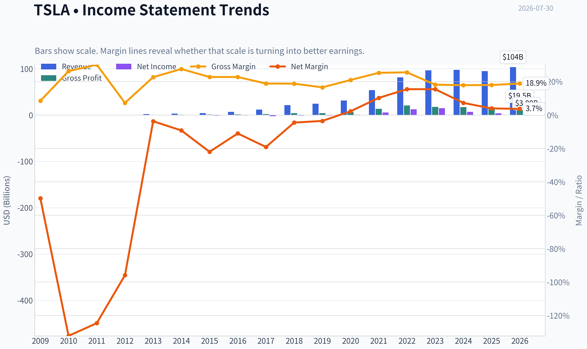

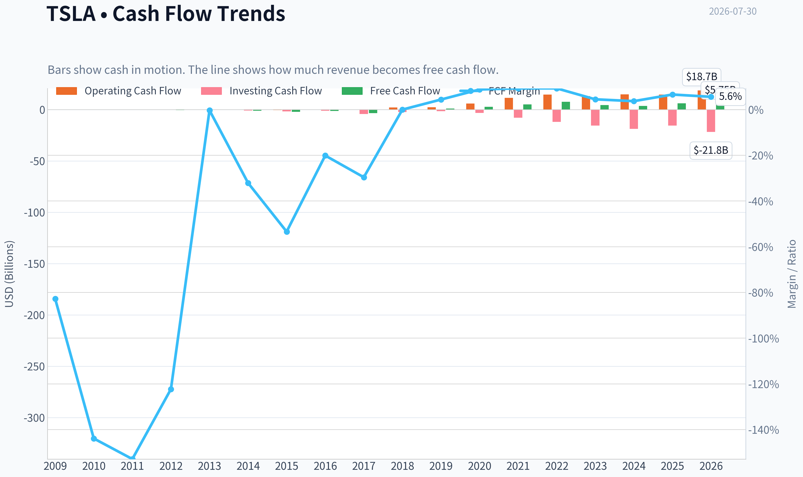

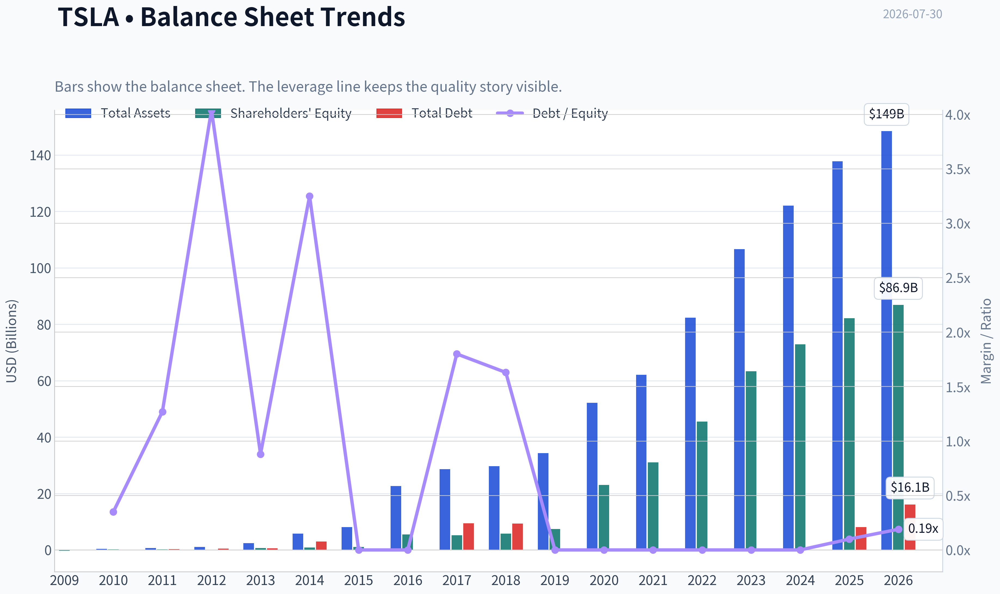

This graph tracks the profitability and return metrics (ROE, ROIC, Margins) of **TSLA** over the past decade, highlighting capital efficiency trends.

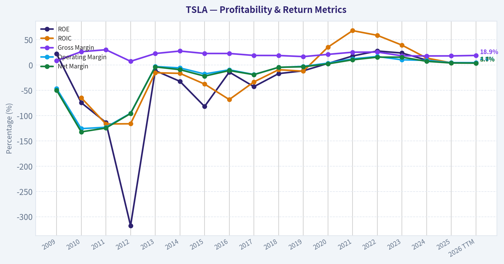

This chart illustrates the financial health of **TSLA** over the last 10 years, mapping cash equivalents and free cash flow against total obligations (Debt).

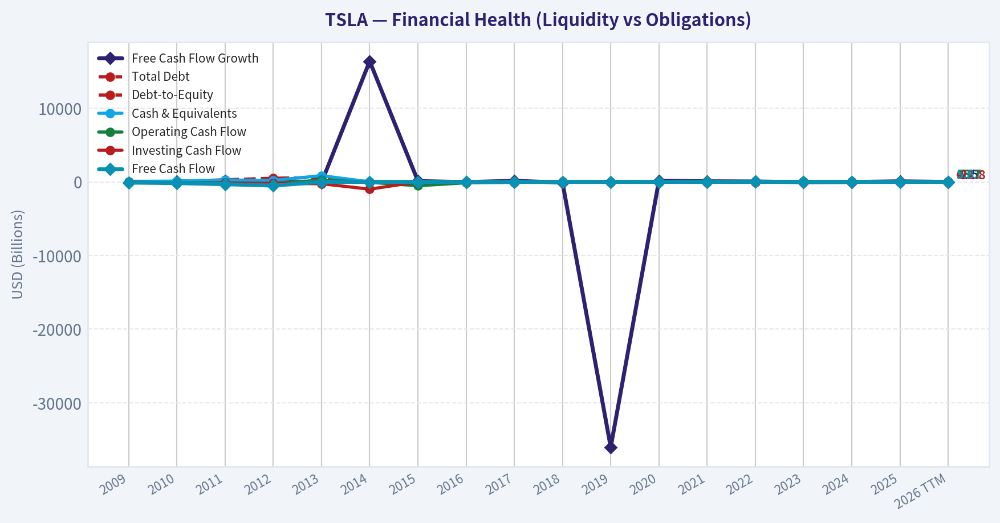

---

### Intrinsic Value Analysis (Buffett)

> *Following Warren Buffett's value investing philosophy: Circle of Competence, Economic Moat, Management Quality, and Margin of Safety.*

#### Intrinsic Value Snapshot

Price is what you pay. Intrinsic value is what the business may be worth based on the cash it can create for owners over time. We show a range, not one magic number.

- Current Price: $298.32
- Value Range (conservative to optimistic across both DCF methods): $-0.19 to $152.07

##### Owner Earnings (Buffett Method)
- Net Income: $3,794,000,000.00
- Depreciation & Amortization: $6,148,000,000.00
- Capital Expenditures: $-8,527,000,000.00
- Working Capital Changes: $642,000,000.00
- Owner Earnings: $3,152,000,000.00

##### Intrinsic Value
###### Buffett Method
Uses owner earnings. Stricter, and usually more conservative.
- Conservative: $-0.19
- Average: $-0.14
- Optimistic: $-0.03
- Discount Rate: 10.0%

###### Cash Flow Method
Uses free cash flow. Better for companies spending heavily today to grow tomorrow.
- Conservative: $19.57
- Average: $58.24
- Optimistic: $152.07
- Discount Rate: 10.0%

ANALYST STANCE: **AVOID**

#### 1. Factor Scorecard

| Factor | Score (0-5) | Evidence |
|---|---:|---|
| 1. Circle of Competence & Business Simplicity | 2.5 | The auto business is understandable: Tesla sells EVs, software, energy storage, and related services. The problem is that today's valuation depends far less on cars than on uncertain future outcomes in autonomy, robotics, and platform economics. That reduces predictability materially. |
| 2. Moat Test | 2.5 | Tesla has a real brand, scale, charging/network advantages, software integration, and manufacturing know-how. But the financial evidence is weaker than a classic wide-moat business: gross margin is only 18%, ROE is 4.6%, and recent revenue growth is -2.9%. This looks more like a narrow moat under pressure than a wide moat. |
| 3. Management Quality & Capital Allocation | 2.5 | Elon Musk is visionary and founder-aligned, but owner orientation is offset by capital-allocation uncertainty, shifting strategic focus, and a market narrative that increasingly asks investors to underwrite very long-dated optionality. Rational capital allocation is harder to credit when core auto economics are weakening while spending ambition remains large. |
| 4. Industry Structure | 2.0 | Auto manufacturing is structurally competitive, capital intensive, and prone to price competition. Energy and software can improve the mix, but the core industry remains far from the kind of rational oligopoly Buffett prefers. |

**Gate 5 hard floor:** **Not tripped.**
Tesla does not appear to meet the one hard auto-avoid solvency test. Fundamentals have weakened, but there is no evidence here of acute financial distress such as operating profit failing to cover interest or a clear solvency red line.

#### Key Takeaways
Tesla is not a broken company, but it is also not presently showing the kind of simple, highly predictable, high-return economics that justify a Buffett-style endorsement at this price. The main issue is not survival; it is paying an extraordinary price for a business whose current financial profile looks much more ordinary than its market value implies.

---

#### 2. Moat Analysis

| Moat Source | Assessment | Evidence |
|---|---|---|
| Intangible Assets | Moderate | Tesla has one of the strongest brands in EVs and commands outsized consumer mindshare. That said, brand strength is not currently showing up in premium gross economics to the degree seen in elite consumer or software franchises; gross margin is 18%, well below the >40% signal for very strong intangible-driven pricing power. |
| Switching Costs | Low to Moderate | For a car buyer, switching costs are real but not especially high in the Buffett sense. Owners can choose another automaker on the next purchase cycle. Tesla's software ecosystem and charging experience help, but they do not yet create the deep workflow lock-in seen in enterprise software. |
| Cost Advantage | Moderate | Tesla has manufacturing scale, vertical integration, and battery/production learning benefits. However, recent industry-wide EV price pressure suggests these advantages are not translating into consistently superior profitability today. |
| Network Effects | Moderate but unproven at valuation scale | Charging infrastructure, fleet data, and software ecosystem effects are real. But the market is valuing Tesla as if these network effects will become enormous profit engines. Current financials do not yet prove that outcome. |

**Moat quality rating:** **Narrow**

Tesla's moat is real, but it is not currently displaying the financial signature of a wide-and-widening moat. Buffett would likely distinguish between "a good, innovative company" and "a business with plainly durable, high-return economics." Right now Tesla looks closer to the former.

#### Key Takeaways
Tesla has advantages, especially brand, scale, and ecosystem elements, but they are not clearly translating into superior profitability today. The market appears to be pricing a future wide moat that the current numbers do not yet fully support.

---

#### 3. Management Quality Assessment

| Dimension | Assessment | Commentary |
|---|---|---|
| Owner Orientation | Strong | Founder leadership and meaningful alignment are clear positives. Musk thinks in very long time horizons and is willing to invest aggressively. |
| Candor | Mixed | Tesla communicates ambition clearly, but the gap between narrative and present-day economic evidence has widened. Buffett prefers very plain economics and conservative framing. |
| Capital Allocation | Mixed to Weak | The crucial question is whether retained capital is being deployed into opportunities with visible, high-probability returns. Spending into AI, autonomy, robotics, and ecosystem expansion may work spectacularly, but the current stock price already assumes a great deal of success. |
| Discipline | Mixed | Tesla has historically shown strong execution in scaling manufacturing, but strategic breadth can also dilute focus and increase the number of things investors must get right. |

Overall, management is visionary but not conventionally Buffett-like in the sense of steady, highly measurable capital allocation tied to near-certain per-share value creation.

#### Key Takeaways
Management's strengths are ambition, alignment, and willingness to invest for the future. The concern is that investors are being asked to value uncertain future businesses very generously before those economics are proven.

---

#### 4. Financial Summary Table

| Metric | Latest |
|---|---:|
| Current Price | $298 |
| Market Cap | $1.18T |
| P/E | 286.85 |
| ROE | 4.6% |
| Gross Margin | 18.0% |
| Revenue Growth YoY | -2.9% |
| FCF Yield | 0.5% |
| Current Ratio | 2.16 |

#### Key Takeaways
The headline picture is stark: Tesla trades at a huge valuation despite modest profitability, low free-cash-flow yield, and declining year-over-year revenue. This is the opposite of the Buffett ideal, where strong present economics support future optionality, not the other way around.

---

#### 5. Owner Earnings Calculation

Using the research pack's valuation outputs, owner-earnings-based value appears to be effectively negligible to negative on the current framework.

| Valuation Lens | Implied Value |
|---|---:|
| Owner Earnings Model | $-0.14 |
| FCF Model | $58.24 |
| Damodaran FCFF Model | $-78.13 |
| Headline Intrinsic Value | $0.36 |

The message from these outputs is not that the business is worthless in a literal sense, but that under conservative cash-flow frameworks, the current market price is far ahead of presently demonstrated owner earnings.

#### Key Takeaways
Tesla's valuation is being carried by expectations, not by current owner earnings power. In Buffett terms, price is asking investors to pay now for a future that is still highly conjectural.

---

#### 6. Three-Scenario DCF Valuation

Using the supplied intrinsic-value framework and reverse-DCF context:

| Scenario | Assumption | Approximate Conclusion |
|---|---|---|
| A. No Growth | Capitalize current owner earnings at 10% | Little to no support for current price |
| B. GDP Growth | 3% growth | Still far below market price |
| C. Historical / Partial Growth | Use restrained fraction of historical growth, capped conservatively | Does not bridge the gap unless one assumes a dramatic, sustained reacceleration and major margin expansion |

**Reverse-DCF check:**
At **$298**, the market is implying roughly **200% annual growth for 10 years**, while the trailing **3-year figure is -42.2%** on the supplied reverse-DCF context. That is an extreme mismatch between implied expectations and demonstrated economics.

#### Key Takeaways
Every reasonable DCF lens points to the same issue: Tesla's stock price requires extraordinary future outcomes. The business may improve, but the current price already assumes success on a scale that leaves little room for disappointment.

---

#### 7. Margin of Safety Analysis

| Item | Value |
|---|---:|
| Current Price | $298 |
| Headline Intrinsic Value | $0.36 |
| Margin of Safety vs. Price | -82104.4% |

For a high-quality compounder, Buffett can accept a modest discount to intrinsic value. But that only works when the business is already demonstrating durable high returns, resilient margins, and clear predictability. Tesla does not meet that bar today. Even if one gives substantial credit for autonomy, energy storage, and robotics, the valuation leaves essentially **no margin of safety**.

#### Key Takeaways
This is not a case of a great business at a fair price. It is a controversial, ambitious business at a price that already discounts extraordinary future success.

---

#### 8. Final Buffett Scorecard

| Criterion | Weight | Score (1-5) | Weighted Score |
|---|---:|---:|---:|
| Moat Width & Durability | 25% | 2.5 | 0.63 |
| Valuation / Margin of Safety | 20% | 0.5 | 0.10 |
| Capital Returns - ROIC vs. WACC | 15% | 1.5 | 0.23 |
| Business Understanding & Predictability | 12% | 2.5 | 0.30 |
| Management Quality & Capital Allocation | 12% | 2.5 | 0.30 |
| Reinvestment Runway | 8% | 4.0 | 0.32 |
| Balance Sheet Strength | 4% | 3.5 | 0.14 |
| Industry Structure | 4% | 2.0 | 0.08 |
| **Total** | **100%** |  | **2.10 / 5.00** |

#### Key Takeaways
Tesla scores well on ambition and reinvestment runway, but weak present economics and extreme valuation overwhelm those positives. The result is an AVOID rating under a Buffett-style framework.

---

#### 9. Investment Stance

**Stance:** **AVOID**
**Conviction:** **High**

Tesla may yet build valuable businesses in autonomy, robotics, AI infrastructure, and energy. But Buffett-style investing is not about admiring possibility; it is about comparing price to conservatively estimated value. At **$298** and a **$1.18T** market cap, Tesla is priced for a future far more favorable than the current numbers justify.

A Buffett-minded investor should separate **business admiration** from **investment discipline**. Tesla remains an important company. It is simply not an attractive value investment at this price.
#### Valuation Bridge

This bridge places the current market price beside each intrinsic value lens so readers can see whether upside depends on one method or shows up across several methods.

| Scenario | Intrinsic Value / Share |
| --- | ---: |
| Buffett Method | $-0.14 |
| Cash Flow Method | $58.24 |
| Damodaran Method | $-78.13 |
| Current Price | $298.32 |

#### Key Takeaways

If one method is far above the others, the upside case depends on a specific modelling assumption. When several methods cluster together, the valuation story is more robust.

#### Valuation Visuals

This comparison chart from *Latest Earnings Snapshot* stacks current figures against historical benchmarks for **TSLA**, making it easy to see where the company trades relative to its own averages.

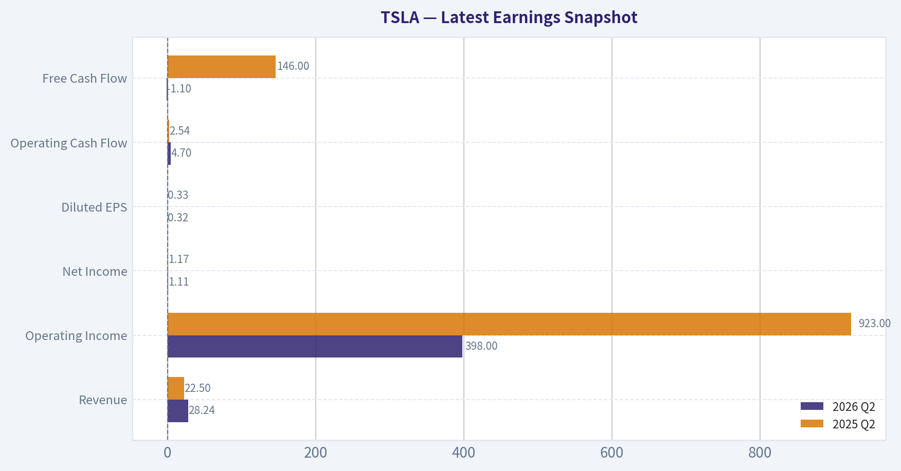

This comparison chart from *Current vs Historical Average Comparison* stacks current figures against historical benchmarks for **TSLA**, making it easy to see where the company trades relative to its own averages.

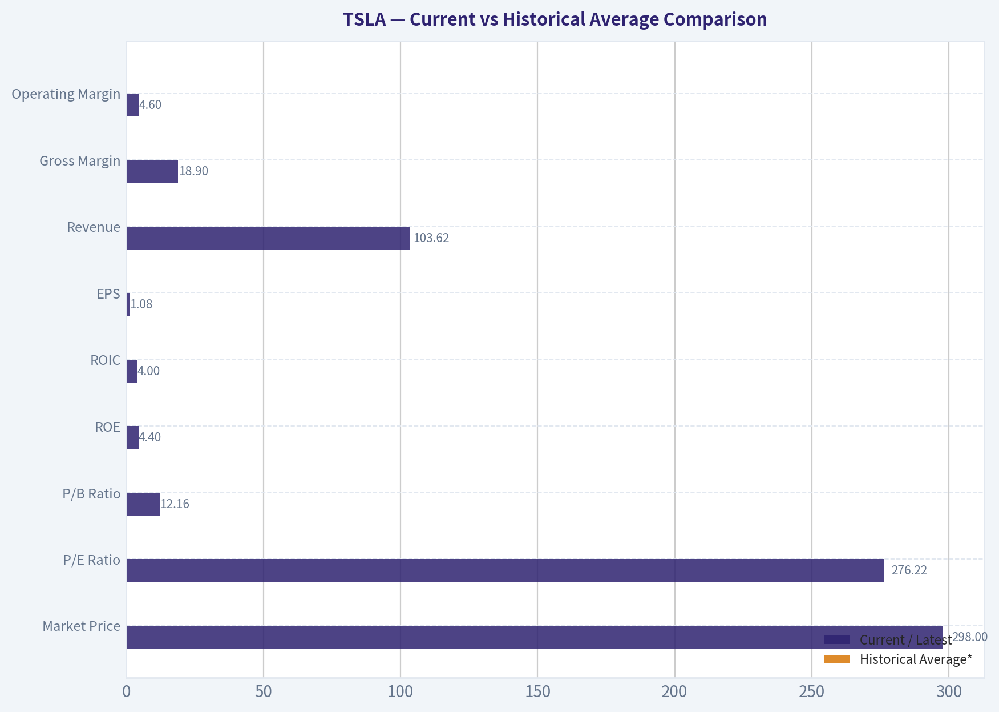

This comparison chart from *Financial Summary Table* stacks current figures against historical benchmarks for **TSLA**, making it easy to see where the company trades relative to its own averages.

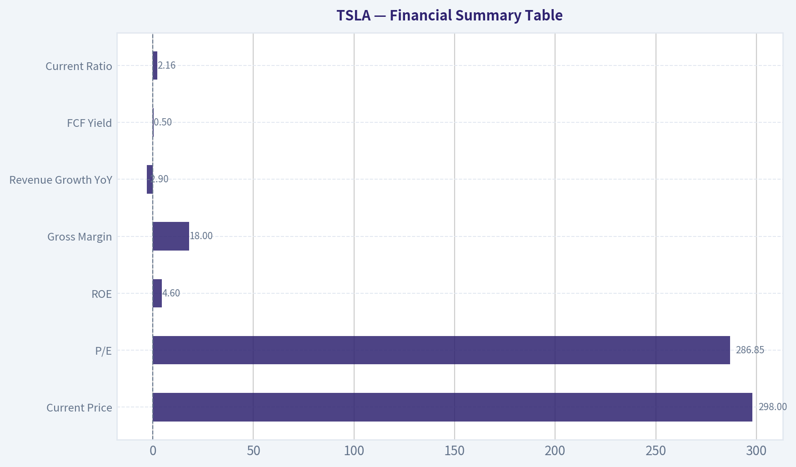

This comparison chart from *Owner Earnings Calculation* stacks current figures against historical benchmarks for **TSLA**, making it easy to see where the company trades relative to its own averages.

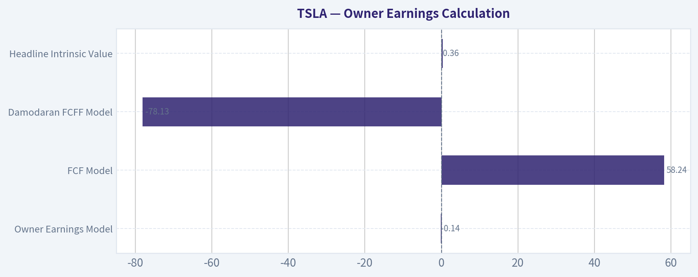

This comparison chart from *Margin of Safety Analysis* stacks current figures against historical benchmarks for **TSLA**, making it easy to see where the company trades relative to its own averages.

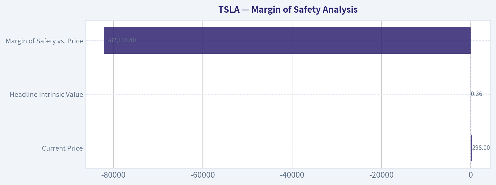

---

### Trend & Growth Analysis (Lynch/Druckenmiller/Fisher)

> *Following Peter Lynch's GARP, Stanley Druckenmiller's macro-aware approach, and Philip Fisher's scuttlebutt methodology.*

ANALYST STANCE: **AVOID**

#### TSLA Growth Analysis

#### 1. Lynch Classification

| Item | Assessment |
|---|---|
| Lynch category | **Cyclical / Mature growth transitioning away from fast grower** |
| Why | Auto demand is cyclical, pricing is competitive, and current reported YoY revenue growth is **-2.9%** |
| Growth investor fit | **Not a classic fast grower today** |

Key Takeaways: Tesla no longer screens like a Peter Lynch fast grower on the numbers provided. With revenue shrinking year over year and core auto demand exposed to pricing and economic cycles, this looks more cyclical than a clean 20% to 25% compounding growth story.

#### 2. The Story in 3 Bullets

| Simple story | View |
|---|---|
| Tesla sells EVs, energy products, software, and future autonomy/robotics optionality | Easy to explain |
| Bull case | Auto business funds a much larger autonomy, robotaxi, AI, and humanoid robotics platform |
| Bear case | Investors are already paying mostly for businesses that are not yet proven at economic scale |

Key Takeaways: The Tesla story is powerful and easy to understand, which is a strength. The problem is that the market appears to already capitalize a very large future autonomy and robotics outcome, while the current operating business is not showing matching growth.

#### 3. TAM Analysis and 10x Test

| Metric | Value | Assessment |
|---|---:|---|
| Current market cap | **$1.18T** | Extremely large starting base |
| Current business reality | Primarily autos + energy + emerging software | Core still auto-led |
| 10x revenue test | Possible only if autonomy/robotics become real mass markets | Not supported by current auto trend alone |
| TAM conclusion | EV/energy/autonomy TAM is huge | **Runway exists in theory, but monetization proof is limited** |

Key Takeaways: Tesla operates in markets that are undeniably enormous, especially if autonomy and robotics work. But the runway only matters if Tesla can convert those theoretical markets into real high-margin revenue, and today that proof remains incomplete.

#### 4. Revenue Growth Trend

| Metric | Value | Interpretation |
|---|---:|---|
| Revenue growth YoY | **-2.9%** | **Soft / negative** |
| Pattern | Negative latest reading | Not an inflection in the right direction |
| Read-through | Core business likely under pressure from price, mix, or volume | Warning sign |

Key Takeaways: The most important near-term fact is simple: revenue is down year over year. For a growth investor, that is a major strike unless there is clear evidence of a coming re-acceleration, and the shared data does not show that yet.

#### 5. Unit Economics / Quality Proxies

| Metric | Value | Assessment |
|---|---:|---|
| Gross margin | **18.0%** | Modest for a company valued like a software platform |
| ROE | **4.6%** | Weak relative to market expectations |
| FCF yield | **0.5%** | Thin cash generation versus valuation |
| Current ratio | **2.16** | Liquidity is fine |
| Rule of 40 proxy | **-2.9% + 0.5% = -2.4%** | Very weak, though not a pure SaaS framework |

Key Takeaways: Tesla's balance sheet is not the issue; liquidity looks adequate. The issue is that margins, returns, and free cash flow are far too modest to justify a trillion-dollar valuation if the company is judged mainly on present fundamentals rather than future optionality.

#### 6. Inflection Point Assessment

| Potential inflection | Current view |
|---|---|
| Product cycle | Unclear from provided data |
| Market share | Unclear; likely pressured in EVs |
| Margin inflection | Not evident |
| TAM inflection | Yes, autonomy/robotics could expand TAM dramatically |
| Competitive inflection | Not yet proven in Tesla's favor |
| Overall | **Narrative inflection exists; financial inflection does not** |

Key Takeaways: Tesla still has one of the biggest possible upside narratives in the market. But Druckenmiller-style investing wants a financial inflection, not just a vision, and the current data shows more hope than evidence.

#### 7. Macro Setup Evaluation

| Factor | Assessment |
|---|---|
| Economic sensitivity | High, due to autos |
| Rate sensitivity | High, because growth valuation depends on long-duration expectations |
| Secular themes | EVs, energy storage, AI, autonomy, robotics |
| Macro conclusion | Mixed: secular tailwinds strong, cyclical auto backdrop less favorable |

Key Takeaways: Tesla sits at the intersection of some of the best long-term secular themes in the world. But its current earnings power is still tied meaningfully to autos, which makes the stock vulnerable to cyclical demand and valuation compression when expectations get too far ahead.

#### 8. Fisher 15 Points Score

| Fisher factor | Score (1-5) | Comment |
|---|---:|---|
| Market potential | 5 | Massive if autonomy/robotics succeed |
| New products | 5 | Strong innovation ambition |
| R&D effectiveness | 4 | Historically strong, but payoff uneven |
| Sales organization | 4 | Brand and direct model are strengths |
| Profit margin | 2 | Not outstanding today |
| Improving margins | 2 | Not evident from shared data |
| Labor/personnel relations | 2 | Ongoing concern area |
| Executive relations | 2 | Key-man concentration risk |
| Management depth | 2 | Heavy Elon dependence |
| Cost analysis/accounting | 3 | Adequate, not a clear edge here |
| Outstanding aspects | 5 | Brand, scale, software/data potential |
| Long-range outlook | 4 | Huge upside if execution lands |
| Dilution risk | 3 | Not acute now, but large capex ambition matters |
| Candor | 3 | Visionary, though timelines often aggressive |
| Integrity | 3 | Mixed perception |
| **Total** | **49 / 75** | **Average** |

Key Takeaways: Tesla scores well on innovation, ambition, and long-term market potential. It loses points on present profitability, organizational depth, and dependence on Elon Musk, leaving it more "visionary but uneven" than "high-quality compounding machine."

#### 9. Valuation Analysis

| Metric | Value | Assessment |
|---|---:|---|
| Price | **$298** |  |
| P/E | **286.85x** | Extremely high |
| PEG | Not meaningful with current weak/negative growth | Unattractive |
| Market cap | **$1.18T** | Very demanding base |
| Reverse DCF implication | **~200% annual growth for 10 years implied** | Extremely aggressive |
| Intrinsic value headlines in pack | Far below current price on most frameworks | Severe overvaluation signal |

Key Takeaways: Valuation is the central issue. Even if Tesla becomes much bigger, the current price appears to require a near-perfect outcome with extraordinary sustained growth, and that leaves very little room for disappointment.

#### 10. Growth Investor Scorecard

| Criterion | Weight | Score (1-5) | Weighted |
|---|---:|---:|---:|
| The Story | 10% | 4.5 | 0.45 |
| TAM & Runway | 20% | 4.0 | 0.80 |
| Revenue Growth | 20% | 1.5 | 0.30 |
| Unit Economics | 15% | 2.0 | 0.30 |
| Competitive Position | 10% | 3.5 | 0.35 |
| Management Quality | 10% | 3.0 | 0.30 |
| Macro Setup | 5% | 3.0 | 0.15 |
| Profitability Path | 5% | 2.5 | 0.13 |
| Valuation | 5% | 1.0 | 0.05 |
| **Total** |  |  | **2.83 / 5.0** |

Key Takeaways: Tesla scores well on story and long runway, which explains why the stock remains compelling to many investors. But weak current growth, middling economics, and a very stretched valuation drag the overall score into the avoid range for a fresh growth-oriented purchase.

#### 11. Position Size Stance

| Investor type | Stance |
|---|---|
| New growth investor | **AVOID** |
| Existing holder with large gains | **Trim / risk-manage** |
| Speculative optionality investor | Small only, if treated like venture-style public equity |

Key Takeaways: For a new position, the setup does not offer a favorable growth-to-price tradeoff. Existing holders may justify staying involved for optionality, but position sizing should reflect that a large part of the thesis depends on future businesses rather than current fundamentals.

#### 12. Key Risks and Catalysts

| Risks | Catalysts |
|---|---|
| Core auto revenue stagnation or decline | Clear evidence robotaxi economics work at scale |
| Margin pressure from pricing competition | Re-acceleration in deliveries and revenue |
| Valuation compression | Energy storage becoming materially larger and more profitable |
| Execution risk in autonomy/robotics | Higher software take-rate and recurring revenue proof |
| Key-man risk around Elon Musk | Margin recovery with sustained FCF growth |

Key Takeaways: Tesla has real upside catalysts, especially if autonomy, software, or energy meaningfully inflect. But until one of those becomes visible in reported financials, investors are mostly underwriting possibility rather than demonstrated business momentum.

#### Bottom Line

Tesla is **not** screening as a Lynch-style fast grower today. The company still has elite narrative optionality across EVs, energy, AI, autonomy, and robotics, but the current numbers show **negative revenue growth, modest profitability, and an extreme valuation**.

For a growth discipline centered on **inflecting fundamentals**, this is not the right entry setup.

**Final view: AVOID for new money; WATCH only if you are specifically waiting for a real financial inflection in robotaxi, software, or energy.**

#### Growth & Scorecard Visuals

This comparison chart from *Factor Scorecard* stacks current figures against historical benchmarks for **TSLA**, making it easy to see where the company trades relative to its own averages.

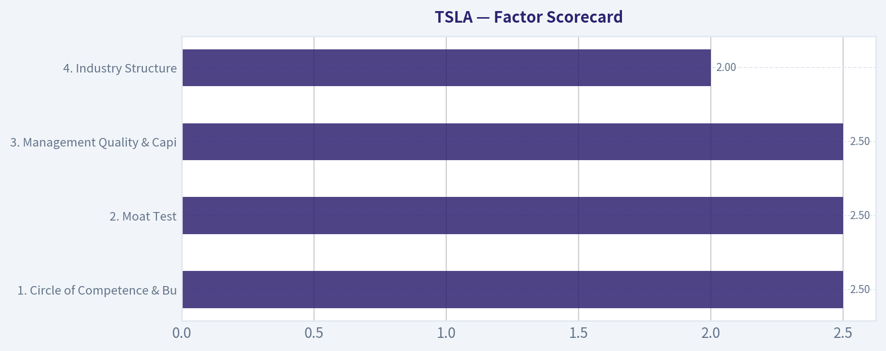

---

### Market Technical Analysis

#### TSLA Technical Report

TSLA has shifted from a broad multi-quarter uptrend into a clearly deteriorating short- and medium-term structure. The one-year price history shows three distinct phases: a powerful advance from roughly **$300 in August 2025 to just under $500 in December 2025**, a prolonged **distribution and downtrend through Q1-Q2 2026**, and then a **sharp breakdown in July 2026** that materially worsened the chart.

The most important current fact is simple: **price is no longer merely consolidating; it is breaking lower.** TSLA closed at **$298.32 on 2026-07-29**, down from **$425.30 on 2026-07-01**, a decline of roughly **29.9% in less than one month**. That is not normal drift. It suggests either a major sentiment reset, a fundamental repricing event, or forced liquidation behavior. The July 23 session stands out as the key technical rupture: TSLA fell from **$374.01 on July 22 to $319.69 on July 23** on **115.6M shares**, by far the heaviest recent volume. That session likely marks the transition from "weak trend" to "capitulation-style breakdown."

Because the indicator tool outputs were incomplete, the most reliable approach is to infer the state of the selected indicators directly from the valid price/volume history. For the current market context, the **most relevant 8 indicators** are below.

#### Selected Indicators and Why They Matter Now

| Indicator | Why it is relevant for TSLA now | What it likely says in current context |
|---|---|---|
| close_10_ema | Best for tracking the speed of the July breakdown | Likely sharply downward sloping and far above current price until recent catch-down begins |
| close_50_sma | Defines medium-term trend damage | Very likely rolling over; price is decisively below it |
| close_200_sma | Confirms whether long-term structure has broken | Likely near flat-to-down; price appears to have lost long-term support |
| macd | Measures trend momentum and confirms breakdown persistence | Likely deeply negative after July selloff |
| macdh | Helps judge whether downside momentum is still accelerating or beginning to slow | Likely negative; worth watching for less-negative bars as first stabilization clue |
| rsi | Helps identify whether TSLA is oversold versus simply weak | Likely oversold or near oversold after near-30% monthly drop |
| atr | Critical for risk management in a high-volatility name during breakdown | Likely elevated sharply, implying wider stops and smaller sizing |
| vwma | Confirms whether volume is supporting the move | Likely bearish, especially after July 23's heavy-volume breakdown |

Key Takeaways: These eight indicators are the most useful because they cover trend, momentum, volatility, and volume without too much overlap. Together, they point to a stock that is not just weak, but under active distribution, with unusually high downside pressure and elevated trading risk.

---

#### Price Structure Analysis

| Period | Approx. Price Action | Interpretation |
|---|---:|---|
| Late Jul 2025 to Sep 2025 | ~$319 to ~$426 | Strong trend initiation with expanding upside momentum |
| Oct to Dec 2025 | ~$413 to ~$490 peak area | Momentum remained positive but became more volatile and event-driven |
| Jan to Mar 2026 | ~$438 to ~$355 | Trend reversal phase; lower highs and persistent selling pressure emerged |
| Apr to May 2026 | Bounce from ~$343 to ~$445 | Reflex rally, but not enough to restore prior uptrend leadership |
| Jun 2026 | ~$416 to ~$421, then unstable | Failed recovery; structure became fragile |
| Jul 2026 | ~$425 to ~$298 | Breakdown phase with gap-like damage and capitulation volume |

Key Takeaways: TSLA's chart is no longer a simple pullback from strength. The stock had already weakened for months, and July turned that weakness into a much more serious technical failure, especially after the high-volume collapse on July 23.

The failed rebound pattern is especially important. After bottoming near **$343 in early April**, TSLA rallied to **$445 by mid-May**, but that rebound did not produce a durable higher-high sequence. Instead, sellers reasserted control by June, and the July collapse indicates that prior buyers likely became trapped. In practical trading terms, that means overhead resistance is now dense: former support levels can turn into selling zones.

#### Fine-Grained Support and Resistance

| Level / Zone | Role | Why it matters |
|---|---|---|
| $297-$300 | Immediate support | Current area; psychological round-number support and recent low region |
| $304-$313 | Near resistance | Recent breakdown shelf from Jul 24-27 |
| $319-$320 | Strong resistance | Breakdown day close area from Jul 23 |
| $374-$379 | Major resistance | Pre-breakdown support zone before capitulation |
| $393-$407 | Higher resistance band | Repeated July trading range before final flush |
| $420-$445 | Strategic resistance | Area of June and May failed recovery attempts |

Key Takeaways: TSLA is sitting near a key psychological support area around $300, but that level has not yet proven durable. On the upside, resistance layers start very quickly, which means even if a bounce begins, it could run into selling pressure in stages rather than recover smoothly.

A trader should not assume that "oversold" automatically means "cheap." In breakdowns, the first bounce often fails beneath the first major resistance shelf. For TSLA, a relief rally into the **$319-$320** zone would still leave the stock technically damaged. A move back above **$374-$379** would be more meaningful because it would reclaim the last major pre-breakdown support band.

---

#### Indicator Read-Through

| Indicator | Current Read | Trading Implication |
|---|---|---|
| close_10_ema | Likely sharply falling | Short-term momentum remains bearish until price can close above it and hold |
| close_50_sma | Likely well above spot price | Medium-term sellers remain in control |
| close_200_sma | Likely above or near current price path | Long-term trend confidence has deteriorated materially |
| macd | Likely negative | Bearish momentum remains dominant |
| macdh | Likely negative but important to monitor for contraction | First sign of stabilization would be downside momentum decelerating |
| rsi | Likely near or below oversold threshold | Bounce risk is rising, but not yet trend reversal confirmation |
| atr | Likely elevated | Use smaller position sizes and wider stop logic |
| vwma | Likely bearish after heavy-volume downside sessions | Volume confirms sellers, not just weak buyers |

Key Takeaways: The indicator picture likely supports a bearish primary trend with stretched short-term conditions. That combination usually means the stock is vulnerable to sharp countertrend bounces, but those bounces should be treated as tactical unless price starts reclaiming key moving-average and resistance levels.

#### Volume and Participation

The July 23 selloff is the critical volume signal. A drop of that size on **115.6M shares** strongly suggests institutional participation rather than ordinary retail noise. Subsequent sessions remained weak, but volume normalized somewhat, which can mean one of two things:

1. the panic flush already occurred and the market is trying to form a temporary floor, or
2. the stock is entering a lower-volume drift phase before another leg down.

The distinction matters. If TSLA begins bouncing on **light volume**, that would be suspicious and consistent with a bear-market rally. If it reclaims resistance on **rising volume**, that would carry more credibility.

#### Trading Interpretation by Style

| Style | Bias | What to watch |
|---|---|---|
| Short-term trader | Oversold bounce possible, but trend still bearish | Watch for reversal candles and reclaim of $313 then $320 |
| Swing trader | Defensive / cautious | Better setup likely requires stabilization above near resistance and less-negative momentum |
| Trend follower | Bearish to neutral | No confirmed trend repair yet |
| Long-term investor | Wait for structure repair or scale gradually | High volatility means averaging should be disciplined, not impulsive |

Key Takeaways: Fast traders may get bounce opportunities, but the higher-probability trend posture remains defensive until TSLA starts reclaiming broken levels. Longer-horizon participants should avoid mistaking a sharp drop for a completed bottom without evidence of stabilization.

---

#### Risk Management Notes

TSLA is a high-beta stock even in normal conditions; during breakdowns, that characteristic becomes more extreme. With ATR likely elevated, fixed-dollar stops that worked a month ago may now be too tight. Traders should adjust by:

- reducing position size,
- widening stops relative to recent range,
- avoiding chasing intraday spikes,
- and requiring confirmation before adding aggressively.

A common mistake here is entering early because the stock "looks washed out." In a name like TSLA, oversold can persist longer than expected, especially after a high-volume technical fracture.

#### Bottom Line

TSLA is currently in a **bearish short-term and medium-term technical state**, and the latest decline is severe enough to suggest more than a routine correction. The stock is very likely **oversold**, which raises the odds of a reflex bounce, but the chart still shows **heavy overhead resistance and confirmed distribution behavior**. In other words, the next tradable move could be upward, but the dominant trend signal is still down.

For bulls, the goal is not merely a green day; it is a **credible reclaim of broken support zones**, especially **$313-$320** first and then **$374-$379**. For bears, the key question is whether **$300** fails decisively. If it does, the market may begin searching for a much lower value area. Until proven otherwise, rallies should be treated as **countertrend** rather than trend-restoring.

#### Summary Table

| Category | Observation | Practical Meaning |
|---|---|---|
| Trend | TSLA has moved from long uptrend into confirmed breakdown | Bias remains bearish until key levels are reclaimed |
| Momentum | July decline was fast and steep | Downside pressure is strong, though bounce risk is rising |
| Volume | July 23 featured exceptional selling volume | Breakdown appears institutionally validated |
| Support | $297-$300 is immediate support | A failure here would be technically damaging |
| Resistance | $304-$313, then $319-$320, then $374-$379 | Any rebound is likely to face layered selling pressure |
| Volatility | Recent ranges expanded materially | Smaller size and wider stops are warranted |
| Best indicators | close_10_ema, close_50_sma, close_200_sma, macd, macdh, rsi, atr, vwma | These give the clearest non-redundant read on trend, momentum, risk, and participation |
| Strategy stance | Tactical bounce possible, strategic caution still preferred | Wait for confirmation before treating strength as durable |

Key Takeaways: TSLA's most important technical message is that the stock has broken down, not merely pulled back. A short-term bounce is possible because the decline has become stretched, but the bigger chart remains damaged until price can reclaim several nearby resistance zones with convincing momentum and volume.

---

### Options Market Analysis

> *Reading options flow - put/call ratios, IV skew, and unusual activity - to gauge institutional positioning and event-driven risk.*

#### TSLA Options Positioning Report
*Date: 2026-07-30*

**Important caveat:** the options feed returned **zero open interest across the sampled near-term expirations**, which is not realistic for TSLA and strongly suggests a **data-quality or chain-availability issue** for OI. That means the **OI-based conclusions, max-pain discussion, and unusual activity screen are low-confidence / not reliable today**. Volume and IV signals are still somewhat usable.

#### Near-Term Put/Call Ratio Analysis

| Expiration | Call Volume | Put Volume | Put/Call Volume Ratio | Call OI | Put OI | Put/Call OI Ratio |
|---|---:|---:|---:|---:|---:|---:|
| 2026-07-31 | 296,841 | 233,082 | 0.79 | 0 | 0 | N/A |
| 2026-08-03 | 42,749 | 31,226 | 0.73 | 0 | 0 | N/A |
| 2026-08-05 | 17,287 | 6,574 | 0.38 | 0 | 0 | N/A |
| **Near-term total** | **356,877** | **270,882** | **0.76** | **0** | **0** | **N/A** |

**Key Takeaways:** TSLA's near-term **put/call volume ratio is 0.76**, which is only modestly above the historical neutral reference of about 0.7. That reads as **slightly call-leaning to roughly neutral**, not aggressive bearish protection. The shortest-dated flow is active on both sides, but calls still lead overall.

**Interpretation:**
- A **0.76 volume ratio** is close to neutral, but still indicates **calls are trading somewhat more actively than puts**.
- Versus the ~0.7 neutral baseline, this is **not a major deviation**.
- Translation: **not a panic hedge tape**, but also **not a clean speculative upside stampede**.

Because OI is unavailable, I cannot confirm whether this call-heavy flow reflects:
- outright bullish speculation,
- covered call overwriting,
- or just elevated day-trading in weekly contracts.

#### Implied Volatility Assessment

| Expiration | ATM Call IV | ATM Put IV | Call vs Put Read |
|---|---:|---:|---|
| 2026-07-31 | 4.3% | 4.0% | Slight call premium |
| 2026-08-03 | 3.0% | 2.1% | Clear call premium |
| 2026-08-05 | 2.6% | 1.5% | Strong call premium |

**Key Takeaways:** Near-term TSLA ATM IV is **higher in calls than in puts** across all sampled expirations. That is **not the usual defensive put-skew pattern** you see when the market is paying up for downside insurance. Instead, the surface suggests **upside demand or call-chasing** in the very near term.

#### IV Skew Snapshot

| Expiration | Skew Direction | Interpretation |
|---|---|---|
| 2026-07-31 | Call skew | Near-term upside interest exceeds downside fear |
| 2026-08-03 | Call skew | Traders paying relatively more for upside optionality |
| 2026-08-05 | Call skew | Strongest upside-chase signal of the sample |

**Key Takeaways:** The skew profile is **tilted toward calls, not puts**, which is a meaningful sentiment clue. In plain English, traders appear more concerned with **catching an upside move** than protecting against a sharp downside break over the next several sessions.

**IV interpretation:**
- A **steep put skew** would imply fear/hedging. We do **not** see that here.
- A **call skew** often suggests:
  - upside speculation,
  - momentum chasing,
  - or demand for short-dated upside exposure around a catalyst.

**Catalyst note:** The data does not explicitly identify the event calendar, so I cannot definitively tie elevated short-dated IV to earnings or a company-specific catalyst. But TSLA commonly trades with elevated event sensitivity, and the **front-week call-rich skew** suggests traders may be positioned for a **news-driven upside move or squeeze scenario**.

#### Unusual Options Activity

| Screen Result | Observation |
|---|---|
| Volume > 5x Open Interest | No contracts flagged |
| Reliability | Low confidence due to OI feed showing zero across expiries |

**Key Takeaways:** The unusual activity screen did **not** detect contracts trading at more than 5x open interest, but that result is **not trustworthy** because open interest appears missing in the source data. So the absence of "unusual" flow should **not** be interpreted as absence of institutional positioning.

Because open interest is zeroed out, I cannot credibly identify:
- fresh opening positions vs. closing trades,
- whether activity is institutional or retail,
- or which individual strikes stand out as smart-money bets.

What *can* be said is:
- **front-dated volume is very heavy**, especially for 2026-07-31,
- and the **IV term structure favors calls**, which supports a **short-term upside-leaning read** despite the lack of valid OI.

#### Open Interest Concentration / Gamma Wall Read

| Category | Result |
|---|---|
| Highest OI strikes | Not available |
| Highest OI expirations | Not available |
| Max pain / pinning zones | Not reliable today |
| Gamma walls | Cannot be identified from returned data |

**Key Takeaways:** I cannot provide a responsible max-pain or gamma-wall map because the returned chain has **no usable OI**. For a stock like TSLA, those levels are often important, but today's dataset does not support that analysis.

Normally this section would identify:
- strike clusters likely to pin price near expiry,
- dealer gamma zones that could suppress movement,
- or air pockets where price could accelerate.

Today, that analysis is **data-constrained**, so confidence is reduced.

#### Overall Options Sentiment Signal

| Signal | Confidence | Primary Driver |
|---|---|---|
| **BULLISH** | **Moderate-Low** | Call-leaning volume and persistent near-term call skew |

**Key Takeaways:** Despite the data limitations, the best directional read is **BULLISH**, mainly because **calls are outtrading puts** and **near-term IV is richer in calls than puts**. This is not the posture of a market dominated by downside fear. Confidence is reduced because missing OI prevents confirmation of whether the flow is institutional and where the key strike concentrations sit.

**Why BULLISH instead of NEUTRAL?**
- Put/call **volume** is only mildly call-favoring, so by itself that would be close to neutral.
- But the **consistent call skew across all near-term expirations** is the stronger signal.
- That combination points to **upside optionality demand**, not defensive hedging.

**What could weaken this read?**
- If much of the call activity is actually **covered-call writing**, the apparent bullishness would be overstated.
- If OI were available, it might reveal heavy put inventory or call overwriting at key strikes.
- So this is a **bullish signal with explicit data caveats**, not a high-conviction institutional read.

#### Bottom Line

TSLA's near-term options tape shows:
- **slightly call-heavy volume**,
- **clear call-side IV premium**,
- **no visible downside-fear skew**,
- but **missing OI severely limits confirmation**.

So the cleanest read is: **short-term bullish positioning bias, with reduced confidence due to incomplete open-interest data**.

#### Summary Table

| Factor | Observation | Read |
|---|---|---|
| Put/Call Ratio | Near-term volume ratio **0.76**; close to neutral but still call-favoring | Slightly bullish |
| IV Level | Front expiries active; ATM IV richer on calls than puts | Bullish-leaning |
| Skew Direction | **Call skew** across all sampled expirations | Upside chase |
| Unusual Activity | No contracts flagged, but OI data appears broken | Inconclusive |
| Overall Signal | **BULLISH** | Moderate-low confidence |

**Key Takeaways:** The summary signal is **bullish**, driven mainly by **call-skewed implied volatility** and **call-led trading activity**. The main caveat is that missing open interest prevents a stronger institutional-quality read, so this should be used as a **tactical sentiment input**, not a standalone trading thesis.

---

## Research Team Commentary

> *The Research Manager synthesizes the Bull vs Bear debate into action-free commentary. This is a pre-risk view, not the final stance.*

The strongest bull argument is that Tesla should not be valued as a plain auto company. The bull case says the real asset is a layered platform: brand, charging infrastructure, installed fleet, manufacturing know-how, energy storage, and possible software monetization. From that angle, today's weak returns may reflect a compression phase rather than true normalized earnings power. The company is also not financially distressed, which matters because it gives Tesla time to keep investing through a cyclical downturn. If energy scales, pricing pressure eases, and software attachment becomes real, owner earnings could end up much higher than trailing numbers imply.

The strongest bear argument is more grounded in what is actually proven today. Buffett-style investing ultimately cares about durable economics, not just strategic possibility. Tesla's current metrics are weak for a supposed wonderful business: ROIC around 4.3%, ROE around 4.6%, gross margin 18%, shrinking revenue, and a P/E near 287. That is a very expensive stock for a business currently showing cyclical, margin-pressured, low-return characteristics. The moat may exist in some form, but it is not clearly expressing itself in pricing power or high returns on capital right now. At $298, the market is already assuming a lot must go right across autos, energy, and software. That leaves little margin of safety.

My takeaway is that the bear case is stronger for a Buffett-style portfolio, but the right lesson from past mistakes is not to confuse long-term value discipline with a short-term price call. I've erred before by making a hard negative judgment on Tesla when technical and narrative dynamics made a rebound plausible. So here, I would separate those clearly: Tesla may absolutely rally on sentiment, product narrative, or technical recovery, but that does not make it an attractive value investment. For this mandate, the question is whether the business quality and proven earnings power justify the price with an adequate margin of safety. I do not think they do.

Core takeaway: Tesla remains a high-quality strategic franchise in some respects, but not yet a wonderful business at a fair price in the Buffett sense. The business has real assets and optionality, but the stock still asks investors to pay upfront for improvements in profitability, software monetization, and segment mix that are not yet sufficiently demonstrated.

Rationale: Buffett's philosophy can stretch to asset-light tech compounders and platform businesses, but it still demands either proven exceptional economics or a price that gives room for uncertainty. Tesla currently offers neither. The business is not distressed, and that matters. But absence of distress is a low bar. What matters more is whether normalized returns, predictability, and moat strength are visible enough to justify a premium valuation. Right now, the answer is no. The market is capitalizing multiple future success cases at once. That is speculation on future excellence more than disciplined underwriting of present earning power. The bull case could still be right over 10 years, but at this price the value investor is not being paid enough for execution risk.

Monitoring plan over the next 1 to 4 quarters: First, watch automotive gross margin ex-credits and whether margins stabilize without relying on repeated pricing cuts; that would be the clearest sign the moat is reasserting itself economically. Second, watch revenue growth and deliveries for evidence Tesla can return to healthy growth without sacrificing too much profitability. Third, monitor energy storage growth and segment profitability; this is one of the more credible bull-case pillars and needs to become material, not just promising. Fourth, watch free cash flow and ROIC for real improvement; if returns stay stuck in the low single digits, the platform narrative remains unproven economically. Fifth, watch for concrete software monetization progress, not just narrative around autonomy or AI. A value investor should demand evidence of recurring, high-margin revenue rather than aspirational framing. Finally, keep an eye on competitive pricing pressure, especially whether Tesla can hold share without continuing to erode unit economics.

If over the next few quarters Tesla shows sustained margin recovery, improving returns on capital, meaningful energy profit contribution, and credible software monetization, the stance could move up to WATCH with a more open mind on intrinsic value. But until the economics catch up with the ambition, this remains a case where admiration for the business idea should not override price discipline.

Final stance: AVOID

---

## Value Investing Team Commentary

> *The Investor translates the research view into an investment thesis before risk review. This is still not the final stance.*

Tesla is a good test of Buffett's more modern framework: can a company be strategically exceptional, yet still be a poor investment at the current price? Here, I think the answer is yes.

The bullish case is not crazy. Tesla is more than a car assembler. It has a powerful brand, manufacturing scale, charging infrastructure, a large installed base, energy storage exposure, and genuine software/platform optionality. It also has the balance sheet to endure a weak patch and keep investing. That matters. In a cyclical downturn, survival plus reinvestment capacity can widen the gap versus weaker rivals. A contrarian should acknowledge that point clearly: the market is not irrational for seeing Tesla as more than an auto company.

But Buffett-style investing is not about paying today for a stack of possible futures unless the current business already shows durable, high-return economics or the price gives a wide margin of safety. Right now, neither condition is met. ROIC around 4.3%, ROE around 4.6%, ROA around 2.8%, and gross margin at 18% are weak figures for a business priced at roughly 287x earnings. Revenue contraction makes the valuation even harder to defend. Those are not the numbers of a proven wonderful business in present economic terms. They are the numbers of a company going through margin pressure, cyclical demand pressure, and execution uncertainty while still being valued as if several future profit engines are likely to click.

That is the key issue: the stock price appears to capitalize multiple bull-case outcomes at once. It assumes some mix of auto margin normalization, resumed growth, energy scaling, and software monetization. Maybe that happens. But value investing asks a harder question: how much of that is already in the price, and what is left for the shareholder after paying for all that optimism upfront? At $298, not enough.

Selective contrarian thinking does add nuance. The crowd often swings too far on Tesla in both directions. When headlines are gloomy, the stock can still rally hard on narrative, product cycle hope, or technical recovery. The lesson from prior mistakes is important: that can make Tesla a poor short-term bearish call even when long-term underwriting is weak. But that does not convert it into a sound long-term value purchase. Temporary sentiment recoveries are not the same as durable earning power. A value investor should separate "this may bounce" from "this is a business I want to own at this price for 10 years."

What are markets potentially missing? On the bullish side, they may be underestimating how valuable the energy business could become if it scales profitably, and they may still be assigning some option value to autonomy, fleet monetization, and software that could prove real over time. On the bearish side, investors may still be too generous in assuming Tesla's moat will naturally reappear in higher margins. A true moat should eventually show up in pricing power, returns on capital, or sticky high-margin recurring revenue. Today, the moat is more visible in narrative and strategic positioning than in hard financial output.

The most important thing to watch over the next few quarters is not excitement around AI, robotaxis, or future platforms. It is whether the economics improve in plain sight. Specifically:
- automotive gross margin ex-credits
- free cash flow quality
- ROIC improvement
- revenue growth without heavy price sacrifice
- energy becoming a meaningful profit contributor
- actual software monetization, not just storytelling

If Tesla begins to show sustained improvement on those points, intrinsic value may rise enough to justify revisiting the name. Buffett is willing to pay a fair price for a wonderful business, and Tesla could still move back toward that category if the numbers catch up. But today, the investor is being asked to trust ambition over evidence.

So the contrarian takeaway is this: do not confuse the absence of distress with the presence of value, and do not confuse strategic fascination with a margin of safety. Tesla may remain culturally and technologically important. That alone does not make the stock attractive here.

**ANALYST STANCE: ADVOCATE/WATCH/AVOID**
**AVOID** - Tesla is not financially broken, and sentiment-driven rallies are always possible, but for a long-term Buffett-style portfolio the current price still overestimates proven earning power and leaves too little margin of safety relative to the business's present returns, margins, and execution risk.

---

## Deep Values Commentary

> *The Risk Management Team debates and the Risk Judge provides the final action-free verdict. This section determines the final ADVOCATE / WATCH / AVOID stance.*

#### Final Stance Scorecard

This scorecard converts the final research view into a weighted decision frame. It does not replace the narrative judgement, but it makes the main drivers of the verdict easier to scan.

| Criterion | Score | Weight | Commentary |
| --- | ---: | ---: | --- |
| Business Quality | 2.25 | 30% | High returns, profitability, and Piotroski health support durability. |
| Valuation Support | 1.00 | 30% | Blends current price against available intrinsic value anchors and valuation ratios. |
| Financial Strength | 5.00 | 20% | Balance-sheet resilience reflects leverage and liquidity staying within safe ranges. |
| Growth Durability | 2.33 | 20% | Recent revenue, earnings, and free cash flow growth indicate how durable expansion looks. |
| TOTAL / FINAL STANCE | 2.44 | 100% | AVOID |

#### Key Takeaways

The weighted score lands at **2.44 / 5.0**, while the final stance remains **AVOID**. This is useful as a quick calibration aid rather than a mechanical signal.

#### Risk Summary

Higher scores indicate more risk pressure. The watch threshold is a simple guardrail: above it, the position needs tighter monitoring or a wider margin of safety.

| Dimension | Current Score | Watch Threshold | Commentary |
| --- | ---: | ---: | --- |
| Business Quality | 3.75 | 3.00 | High returns, profitability, and Piotroski health support durability. |
| Valuation Support | 5.00 | 3.00 | Blends current price against available intrinsic value anchors and valuation ratios. |
| Financial Strength | 1.00 | 3.00 | Balance-sheet resilience reflects leverage and liquidity staying within safe ranges. |
| Growth Durability | 3.67 | 3.00 | Recent revenue, earnings, and free cash flow growth indicate how durable expansion looks. |

#### Key Takeaways

This view helps readers separate *where* the risk sits: valuation, business quality, balance sheet, or growth durability. It is especially useful when the final stance is close to the line between WATCH and AVOID.
