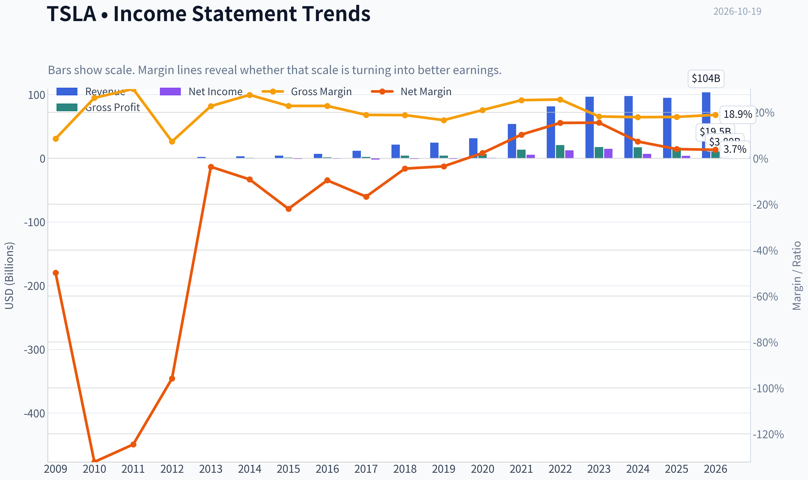
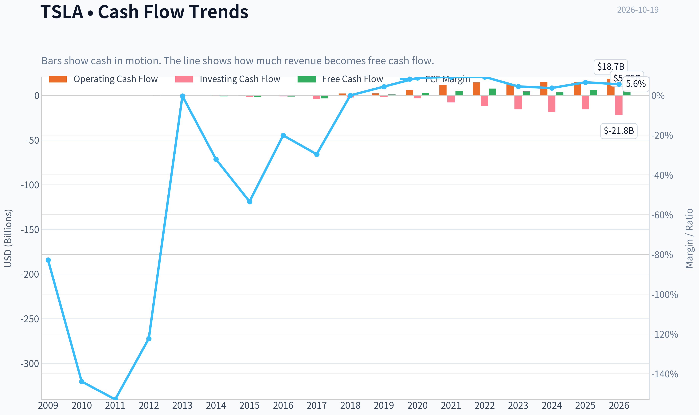
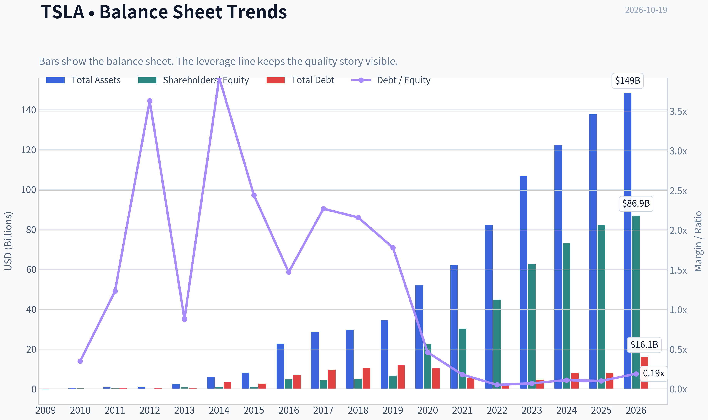
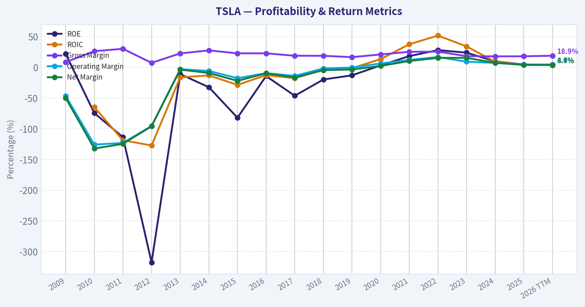
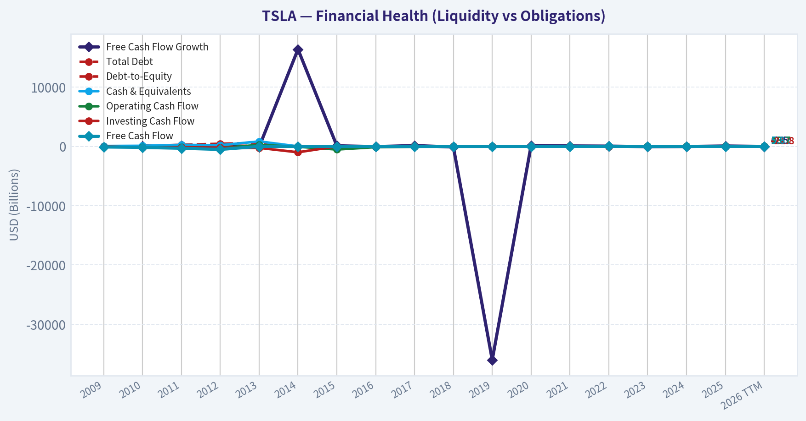
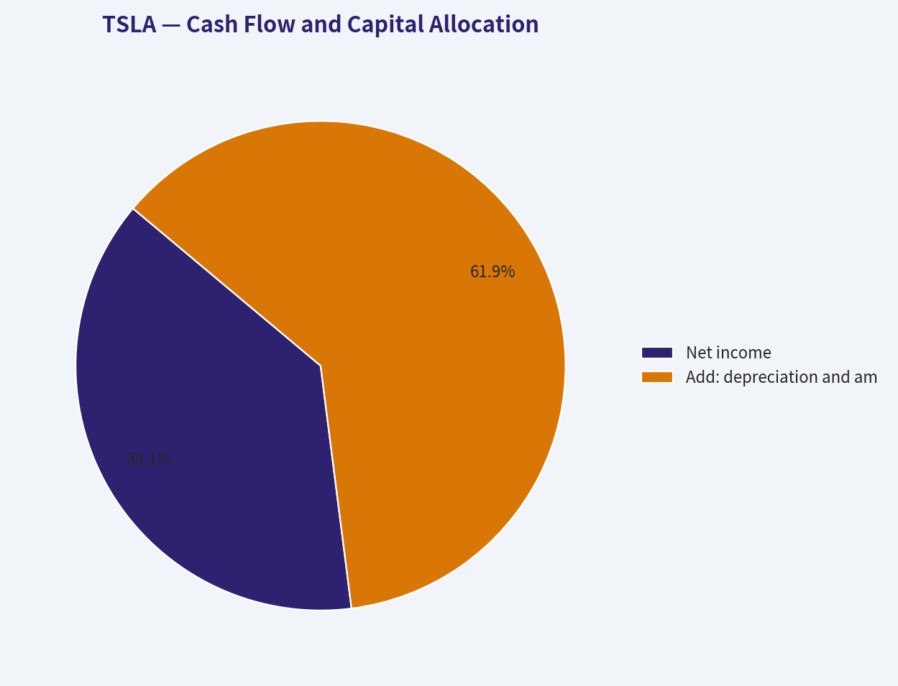
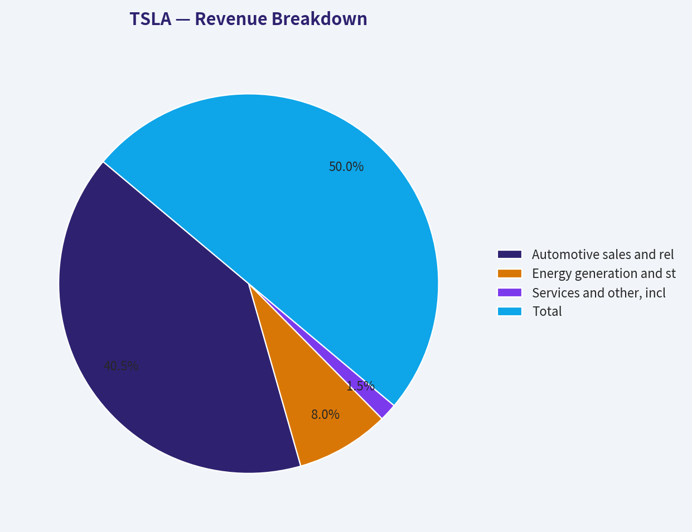
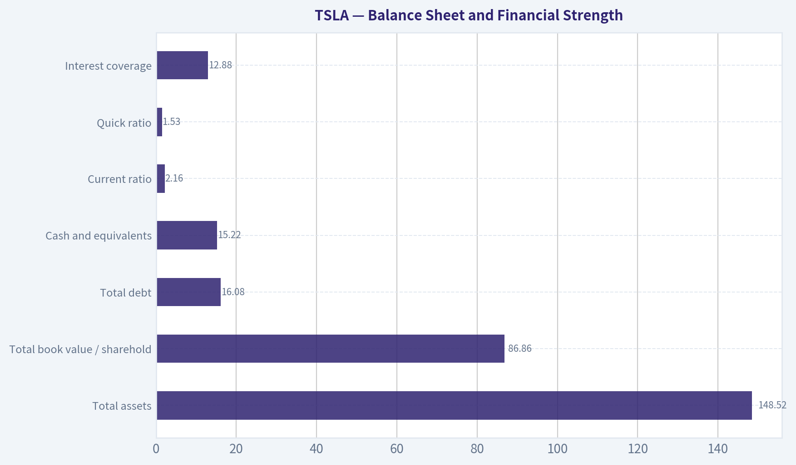
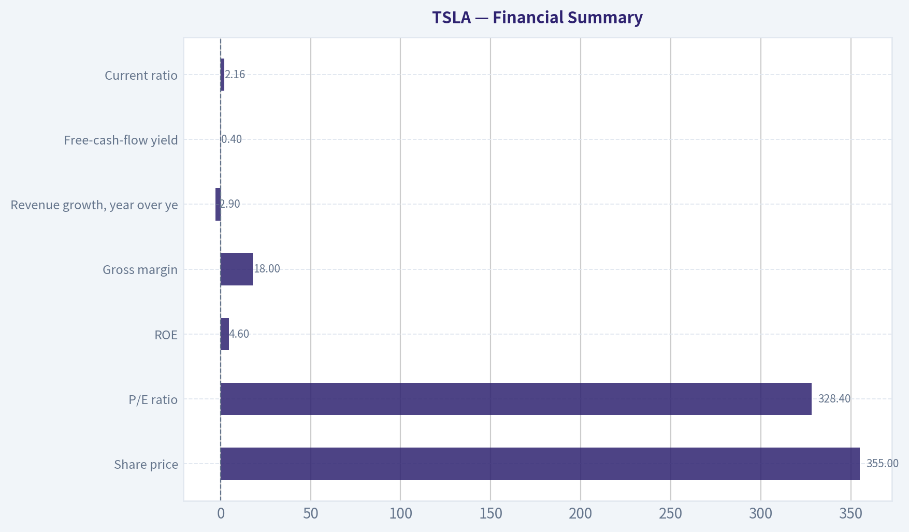
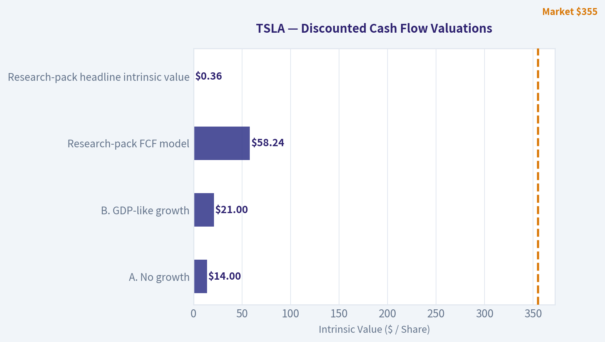

# TSLA Deep Value Intelligence

**Analysis Date:** 2026-10-19

## Critical Disclaimer

*This analysis is generated by Deep Value Intelligence, an AI-powered multi-agent investing framework. Education & research only - not financial advice, not a financial advisor.*

---

## Table of Contents

1. Intelligence Summary
2. Analyst Team Reports
   - Fundamentals Analysis
   - Intrinsic Value Analysis (Buffett)
   - Trend & Growth Analysis (Lynch/Druckenmiller/Fisher)
   - Market Technical Analysis
   - Options Market Analysis
3. Research Team Commentary
4. Value Investing Team Commentary
5. Deep Values Commentary

---

## Intelligence Summary

### Thesis + Conditions

**Core Thesis:** ## Executive Briefing

**Key Risks:**
- The decisive risk is not insolvency or stock-price volatility; it is **overpayment for unproven future economics**. Under the debate's reverse-DCF assumptions, approximately **27%-29% annual earnings growth for roughly 15 years**, followed by a **30x terminal multiple**, is required to support the valuation. That leaves inadequate protection against delays, dilution, margin pressure, or lower terminal expectations.
- Still, **AVOID is too absolute**. Energy storage and partial software or autonomy monetization deserve non-zero value, and past experience shows that valuation is a poor short-term timing signal for Tesla. Keep it on the watchlist, do not short it merely because it is expensive, and require either stronger operating evidence or a materially better price before establishing a core position.
- ### Risky Analyst: Strategic optionality is real, but price discipline is insufficient

**Confidence:** Low

---

## Analyst Team Reports

### Fundamentals Analysis

#### Latest Earnings Snapshot

*Most recent reported quarter anchored on 2026 Q2, with prior-year comparison when available.*

| Metric | 2026 Q2 | 2025 Q2 | YoY Change |
| --- | ---: | ---: | ---: |
| Revenue | $28.24B | $22.50B | +25.5% |
| Operating Income | $398.0M | $923.0M | -56.9% |
| Net Income | $1.11B | $1.17B | -4.9% |
| Diluted EPS | $0.32 | $0.33 | -3.0% |
| Operating Cash Flow | $4.70B | $2.54B | +84.9% |
| Free Cash Flow | $-1.10B | $146.0M | -852.7% |

Key Takeaways: This snapshot anchors the most recent reported quarter before the narrative analysis. It helps readers separate long-run business quality from whatever changed in the latest earnings print.

#### 17-Year Financial Metrics for TSLA

*All values below are computed deterministically from raw data - not estimated by AI.*

*Issuer profile: operating company (Consumer Cyclical / Auto Manufacturers).*

#### 17-Year Financial Metrics
*Annual rows come from reported financial statements. The final TTM row is computed from the latest four quarters.*

| Metric | 2009 | 2010 | 2011 | 2012 | 2013 | 2014 | 2015 | 2016 | 2017 | 2018 | 2019 | 2020 | 2021 | 2022 | 2023 | 2024 | 2025 | 2026 TTM |
| --- | --- | --- | --- | --- | --- | --- | --- | --- | --- | --- | --- | --- | --- | --- | --- | --- | --- | --- |
| Market Price | N/A | $2 | $2 | $2 | $10 | $15 | $16 | $14 | $21 | $22 | $28 | $235 | $352 | $123 | $248 | $404 | $450 | $355 |
| Market Cap | N/A | $168.5M | $199.0M | $236.2M | $1.23B | $1.86B | $2.05B | $2.05B | $3.45B | $18.93B | $24.74B | $764.24B | $1.19T | $428.05B | $865.95B | $1.41T | $1.59T | $1.26T |
| P/E Ratio | N/A | -1.09 | -0.78 | -0.60 | -16.68 | -6.34 | -2.31 | -3.04 | -1.75 | -19.46 | -28.46 | 1120.11 | 216.11 | 34.03 | 57.79 | 197.96 | 416.41 | 328.44 |
| P/B Ratio | N/A | 0.81 | 0.89 | 1.89 | 1.85 | 2.04 | 1.89 | 0.43 | 0.81 | 3.84 | 3.74 | 34.39 | 39.51 | 9.58 | 13.83 | 19.37 | 19.32 | 14.46 |
| ROE | 22.0% | -74.5% | -113.6% | -317.7% | -11.1% | -32.3% | -82.0% | -14.2% | -46.3% | -19.8% | -13.0% | 3.2% | 18.3% | 28.1% | 23.9% | 9.7% | 4.6% | 4.4% |
| ROIC | N/A | -64.7% | -118.8% | -127.2% | -16.3% | -13.1% | -28.5% | -12.7% | -17.6% | -4.0% | -1.5% | 13.5% | 37.6% | 51.7% | 34.1% | 9.1% | 4.2% | 4.0% |
| EPS | N/A | $-1.63 | $-2.43 | $-3.79 | $-0.60 | $-2.34 | $-6.93 | $-4.68 | $-11.83 | $-1.14 | $-0.98 | $0.21 | $1.63 | $3.62 | $4.30 | $2.04 | $1.08 | $1.08 |
| Revenue | $111.9M | $116.7M | $204.2M | $413.3M | $2.01B | $3.20B | $4.05B | $7.00B | $11.76B | $21.46B | $24.58B | $31.54B | $53.82B | $81.46B | $96.77B | $97.69B | $94.83B | $103.62B |
| Gross Profit | $9.5M | $30.7M | $61.6M | $30.1M | $456.3M | $881.7M | $923.5M | $1.60B | $2.22B | $4.04B | $4.07B | $6.63B | $13.61B | $20.85B | $17.66B | $17.45B | $17.09B | $19.53B |
| Gross Margin | 8.5% | 26.3% | 30.2% | 7.3% | 22.7% | 27.6% | 22.8% | 22.8% | 18.9% | 18.8% | 16.6% | 21.0% | 25.3% | 25.6% | 18.2% | 17.9% | 18.0% | 18.9% |
| Operating Margin | -46.4% | -125.8% | -123.1% | -95.4% | -3.0% | -5.8% | -17.7% | -9.5% | -13.9% | -1.8% | -0.3% | 6.3% | 12.1% | 16.8% | 9.2% | 7.2% | 4.6% | 4.6% |
| Net Income | $-55.7M | $-154.3M | $-254.4M | $-396.2M | $-74.0M | $-294.0M | $-888.7M | $-674.9M | $-1.96B | $-976.0M | $-862.0M | $721.0M | $5.52B | $12.56B | $15.00B | $7.09B | $3.79B | $3.80B |
| Net Margin | -49.8% | -132.2% | -124.6% | -95.9% | -3.7% | -9.2% | -22.0% | -9.6% | -16.7% | -4.5% | -3.5% | 2.3% | 10.3% | 15.4% | 15.5% | 7.3% | 4.0% | 3.7% |
| Revenue Growth | N/A | 4.3% | 74.9% | 102.3% | 387.2% | 58.8% | 26.5% | 73.0% | 68.0% | 82.5% | 14.5% | 28.3% | 70.7% | 51.4% | 18.8% | 0.9% | -2.9% | 9.3% |
| Net Income Growth | N/A | 176.9% | 64.9% | 55.7% | -81.3% | 297.3% | 202.2% | -24.1% | 190.7% | -50.3% | -11.7% | -183.6% | 665.5% | 127.5% | 19.4% | -52.7% | -46.5% | 0.3% |
| Free Cash Flow Growth | N/A | 81.2% | 85.8% | 61.8% | -98.8% | 16388.3% | 110.2% | -35.0% | 147.5% | -99.9% | -36033.3% | 158.4% | 80.0% | 50.9% | -42.4% | -17.8% | 73.7% | -7.5% |
| Total Book Value | $-253.5M | $207.0M | $224.0M | $124.7M | $667.1M | $911.7M | $1.08B | $4.75B | $4.24B | $4.92B | $6.62B | $22.23B | $30.19B | $44.70B | $62.63B | $72.91B | $82.14B | $86.86B |
| Total Assets | N/A | $386.1M | $713.4M | $1.11B | $2.42B | $5.83B | $8.07B | $22.66B | $28.66B | $29.74B | $34.31B | $52.15B | $62.13B | $82.34B | $106.62B | $122.07B | $137.81B | $148.52B |
| Total Debt | N/A | $71.8M | $276.3M | $452.3M | $586.1M | $3.57B | $2.65B | $7.01B | $9.63B | $10.63B | $11.80B | $10.22B | $5.34B | $2.04B | $4.66B | $7.88B | $8.15B | $16.08B |
| Debt-to-Equity | N/A | 0.35 | 1.23 | 3.63 | 0.88 | 3.92 | 2.44 | 1.47 | 2.27 | 2.16 | 1.78 | 0.46 | 0.18 | 0.05 | 0.07 | 0.11 | 0.10 | 0.19 |
| Cash & Equivalents | $69.6M | $99.6M | $255.3M | $201.9M | $845.9M | $1.91B | $1.20B | $3.39B | $3.37B | $3.69B | $6.27B | $19.38B | $17.58B | $16.25B | $16.40B | $16.14B | $16.51B | $15.22B |
| Shareholders' Equity | $-253.5M | $207.0M | $224.0M | $124.7M | $667.1M | $911.7M | $1.08B | $4.75B | $4.24B | $4.92B | $6.62B | $22.23B | $30.19B | $44.70B | $62.63B | $72.91B | $82.14B | $86.86B |
| Operating Cash Flow | $-80.8M | $-127.8M | $-128.0M | $-266.1M | $258.0M | $-57.3M | $-524.5M | $-123.8M | $-61.0M | $2.10B | $2.40B | $5.94B | $11.50B | $14.72B | $13.26B | $14.92B | $14.75B | $18.68B |
| Investing Cash Flow | $-14.2M | $-180.3M | $-162.3M | $-206.9M | $-249.4M | $-990.4M | $-1.67B | $-1.08B | $-4.20B | $-2.34B | $-1.44B | $-3.13B | $-7.87B | $-11.97B | $-15.58B | $-18.79B | $-15.48B | $-21.83B |
| Free Cash Flow | $-92.7M | $-168.0M | $-312.3M | $-505.3M | $-6.2M | $-1.03B | $-2.16B | $-1.40B | $-3.48B | $-3.0M | $1.08B | $2.79B | $5.01B | $7.57B | $4.36B | $3.58B | $6.22B | $5.75B |
| FCF Margin | -82.8% | -143.9% | -152.9% | -122.3% | -0.3% | -32.1% | -53.4% | -20.1% | -29.6% | -0.0% | 4.4% | 8.8% | 9.3% | 9.3% | 4.5% | 3.7% | 6.6% | 5.6% |
| Dividends / Share | N/A | $0.00 | $0.00 | $0.00 | $0.00 | $0.00 | $0.00 | $0.00 | $0.00 | $0.00 | $0.00 | $0.00 | $0.00 | $0.00 | $0.00 | $0.00 | $0.00 | $0.00 |

#### Profitability Metrics
- Return on Equity (ROE): 4.6%
- Return on Invested Capital (ROIC): 6.9%
- Return on Assets (ROA): 2.8%
- Gross Margin: 18.0%
- Operating Margin: 4.6%
- Net Profit Margin: 4.0%

#### Liquidity Metrics
- Current Ratio: 2.16
- Quick Ratio: 1.53

#### Leverage Metrics
- Debt-to-Equity Ratio: 0.10
- Interest Coverage Ratio: 12.88
- Net Debt: $-35.91B

#### Growth Metrics (Year-over-Year)
- Revenue Growth: -2.9%
- Net Income Growth: -46.5%
- Free Cash Flow Growth: 73.7%
- Revenue CAGR (3-Year): 5.2%
- Revenue CAGR (5-Year): 24.6%

#### Valuation Metrics
- P/E Ratio (TTM): 328.44
- Forward P/E: 163.59
- Price-to-Book: 16.13
- Price-to-Sales: 13.52
- PEG Ratio: 3.61
- EV/EBITDA: 127.77
- Free Cash Flow Yield: 0.4%
- Earnings Yield: 0.3%

#### Owner Earnings (Buffett Method, Code-Computed)
- Net Income: $3.79B
- + Depreciation & Amortization: $6.15B
- - Capital Expenditures: $-8.53B
- - Working Capital Changes: $642.0M
- = **Owner Earnings: $3.15B**

#### Intrinsic Value (Code-Computed)
- Current Price: $355
- **Headline Intrinsic Value (business-model routed): $0**
  Business model: cyclical - reverse-DCF fair (cyclical)
  Model spread (min-max across DCFs): $58 - $58
  Margin of safety vs. price (headline): -97645.9%
  Routing note: Cyclical: margins/FCF are volatile - headline blends FCFF, reverse-DCF and owner-earnings roughly evenly; treat the range as the honest read.
- Buffett Method (Owner Earnings):
  Conservative: $-0
  Average: $-0
  Optimistic: $-0
- Cash Flow Method (FCF):
  Conservative: $20
  Average: $58
  Optimistic: $152
- Damodaran FCFF (WACC + margins + reinvestment):
  Conservative: $-109
  Average: $-70
  Optimistic: $-12
  Monte Carlo band (P10-P90): $-152 - $-37 (median $-82)
  P(intrinsic value > price): 0.0%
- Reverse-DCF: price implies ~200.0%/yr owner-earnings growth for 10y; trailing 3y was -42.1%, 5y N/A.

#### Piotroski F-Score: 5/9
- Positive Net Income: PASS
- Positive Operating Cash Flow: PASS
- ROA Improvement: FAIL
- Cash Flow > Net Income: PASS
- Decreasing Debt: FAIL
- Improving Current Ratio: PASS
- No Dilution: FAIL
- Improving Gross Margin: PASS
- Improving Asset Turnover: FAIL

ANALYST STANCE: **AVOID**

#### Executive Summary

Tesla remains a financially strong but economically difficult-to-value operating company. The balance sheet is substantially healthier than it was during its pre-profitability years, with approximately $15.2 billion of cash, low reported debt-to-equity of 0.19 on the latest TTM data, and positive operating cash flow. However, profitability has deteriorated sharply from its 2021-2023 peak: TTM revenue growth is negative, net income is down approximately 46.5% year over year, operating margin is only 4.6%, and ROIC is approximately 4%.

At a market price of approximately $355, Tesla trades at roughly 328 times earnings, about 13.5 times sales, and approximately 0.4% free-cash-flow yield. The price therefore depends on a very large improvement in future earnings from autonomy, artificial intelligence, energy storage, robotics, or other initiatives that are not yet reflected in current cash generation.

The deterministic reverse-DCF indicates that the current price implies approximately 200% annual owner-earnings growth for ten years, compared with a trailing three-year owner-earnings growth rate of approximately negative 42.1%. That gap is too large for a Buffett-style investment based on demonstrated economics.

#### Current Market and Operating Metrics

| Metric | Current Value | Interpretation |
|---|---:|---|
| Market price | $355 | Very high absolute valuation relative to current earnings and cash flow |
| Market capitalization | Approximately $1.40 trillion current snapshot | Equity value remains dependent on substantial future growth |
| P/E ratio | 328.44 | Extremely expensive on current earnings |
| Price-to-book ratio | Approximately 14.5 to 16.1 | Very high for an automobile manufacturer; unlike software, Tesla has a substantial asset base, so book value is not irrelevant |
| ROE | 4.4% to 4.6% | Well below the level normally associated with a premium valuation |
| ROIC | Approximately 4.0% to 6.9%, depending on dataset definition | Below a 10% discount-rate hurdle and far below Tesla's 2021-2023 peak |
| Revenue | $103.62 billion TTM | Large and diversified business, but recent growth has slowed materially |
| Operating margin | 4.6% | Compressed from 12.1% in 2021 and 16.8% in 2022 |
| Net income | $3.80 billion TTM | Positive but substantially below the 2022-2023 peak |
| Free cash flow | $5.75 billion TTM | Positive, but small relative to the market capitalization |
| FCF yield | Approximately 0.4% | Provides almost no current cash-flow compensation for valuation risk |

**Key Takeaways:** Tesla's current valuation is disconnected from present profitability. The company has scale and positive cash generation, but a 4.6% operating margin and approximately 4% ROIC do not presently justify a 328 times earnings multiple. The investment case is primarily a long-duration option on future businesses rather than a purchase of established owner earnings.

#### Current Versus Ten-Year Historical Average

The historical comparison below uses the 2016-2025 period from the deterministic dataset. Averages for P/E are not economically useful because Tesla had many loss-making years and extreme positive multiples during the transition to profitability.

| Metric | Current / TTM | 2016-2025 Average | Current Versus Average |
|---|---:|---:|---|
| Revenue | $103.62B | Approximately $44.1B | More than twice the decade average |
| Revenue growth | 9.3% dataset TTM figure; latest reported YoY snapshot -2.9% | Approximately 40.5% | Growth is far below the decade average |
| Gross margin | 18.9% TTM; 18.0% current snapshot | Approximately 20.3% | Below historical average |
| Operating margin | 4.6% | Approximately 2.1% | Above the full transition-period average, but well below recent peak years |
| Net margin | 3.7% to 4.0% | Approximately 0.5% | Above the full decade average, but sharply below 2021-2023 |
| ROE | 4.4% to 4.6% | Approximately -3.0% | Better than the loss-making historical average, but weak for today's valuation |
| ROIC | Approximately 4.0% | Approximately 11.4% | Far below the decade average, which is boosted by unusually strong 2021-2023 results |
| Free cash flow | $5.75B TTM | Approximately $2.57B | Above average in absolute dollars |
| Debt-to-equity | 0.19 TTM; 0.10 in the annual table | Approximately 0.87 | Much stronger balance-sheet leverage than most of the historical period |
| Cash and equivalents | $15.22B | Approximately $11.9B | Above the decade average |
| P/B ratio | Approximately 14.5 to 16.1 | Approximately 14.5 | Not materially below its decade average and still very expensive for an automaker |
| P/E ratio | 328.44 | Not meaningful | Current earnings multiple is extreme and distorted by low earnings |

**Key Takeaways:** Tesla has clearly improved its balance sheet and absolute financial scale, but its current returns on capital are much weaker than its best historical years. Revenue is more than twice the decade average, yet growth and margins have fallen substantially, meaning the company is currently generating less economic value per dollar of capital than the historical peak implied.

#### Profitability and Earnings Quality

Tesla's earnings history shows a dramatic transition from a development-stage company to a profitable manufacturer, followed by a recent deterioration.

- **Revenue:** Revenue increased from $7.0 billion in 2016 to $97.7 billion in 2024 and $103.6 billion on the latest TTM basis. This is a major long-term achievement. However, 2025 revenue was approximately $94.8 billion, down 2.9% year over year in the latest snapshot, showing that the hypergrowth phase has paused.
- **Gross profit and margins:** TTM gross profit is approximately $19.5 billion, with a gross margin near 18.9%. Gross margin is below the 25%-26% levels recorded in 2021-2022. Price reductions, competition, product mix, and possible underutilization of manufacturing capacity have weakened unit economics.
- **Operating margin:** Operating margin has declined from 16.8% in 2022 to approximately 4.6% TTM. This is one of the most important negative trends because it shows that Tesla's scale has not translated into continuously higher incremental profitability.
- **Net income and EPS:** TTM net income is approximately $3.8 billion and EPS is approximately $1.08. EPS is down sharply from $4.30 in 2023 and $2.04 in 2024 according to the deterministic dataset.
- **ROE:** Current ROE of roughly 4.4%-4.6% is positive, but low. It does not support a premium price-to-book ratio unless management can sustainably increase margins and asset productivity.
- **ROIC:** Current ROIC is approximately 4%, with the broader profitability dataset reporting 6.9% under a different calculation. Either figure is materially below a reasonable 10% hurdle rate. Tesla's 2021-2023 ROIC readings of 37.6%, 51.7%, and 34.1% were exceptional and should not be treated as a stable base case.
- **Free cash flow:** TTM FCF is approximately $5.75 billion, but FCF growth is volatile. FCF fell in 2023 and 2024, improved in 2025, and declined approximately 7.5% on the latest TTM measure in the deterministic table.

The earnings profile is therefore not yet predictable enough for a classic Buffett compounder valuation. The business has a valuable platform and brand, but recent results show substantial cyclicality and operating leverage.

#### Balance Sheet and Financial Strength

| Balance-Sheet Metric | Current / TTM Value | Assessment |
|---|---:|---|
| Total assets | $148.52B | Large industrial asset base |
| Total book value / shareholders' equity | $86.86B | Strongly positive and substantially built since 2020 |
| Total debt | $16.08B | Manageable in relation to cash and assets, though higher than the prior annual figures |
| Debt-to-equity | 0.19 TTM; approximately 0.10 in the annual table | Low relative to Tesla's earlier years |
| Cash and equivalents | $15.22B | Meaningful liquidity reserve |
| Current ratio | 2.16 | Healthy short-term liquidity; meaningful for an industrial company |
| Quick ratio | 1.53 | Indicates reasonable liquid-asset coverage |
| Net debt | Approximately negative $35.9B under the broader leverage dataset | Net cash position provides resilience |
| Interest coverage | 12.88 | Adequate debt-servicing capacity |

**Key Takeaways:** Tesla's financial strength is the clearest positive feature of the investment case. Debt is manageable, liquidity is strong, and the company is not dependent on continual external financing. The principal risk is therefore not insolvency; it is paying an extremely high price for a business whose current returns and margins are declining.

#### Cash Flow and Capital Allocation

Tesla generated approximately $18.68 billion of operating cash flow and $5.75 billion of free cash flow on the latest TTM basis. Capital expenditure was approximately $8.53 billion, indicating that the company continues to reinvest heavily in factories, infrastructure, artificial intelligence, energy, and other growth initiatives.

The code-computed Buffett-style owner earnings estimate is approximately $3.15 billion:

| Owner-Earnings Calculation | Amount |
|---|---:|
| Net income | $3.79B |
| Add: depreciation and amortization | $6.15B |
| Less: capital expenditures | $(8.53B) |
| Less: working-capital adjustment | Approximately $(0.64B) |
| Estimated owner earnings | Approximately $3.15B |
| Approximate owner earnings per share | Approximately $0.80 |

**Key Takeaways:** Tesla's accounting net income overstates the cash flow that can safely be distributed to owners after reinvestment. Using owner earnings of approximately $3.15 billion, the current equity value implies an owner-earnings yield of only about 0.2% to 0.3%. Tesla pays no dividend, so shareholders rely almost entirely on future price appreciation.

#### Dividend Policy and Capital Allocation

Tesla has paid no dividend throughout the historical dataset. Retaining cash is rational if management can reinvest at high returns, but the current ROIC of approximately 4% raises the question of whether incremental capital is being deployed as productively as it was during the strongest growth period.

The Piotroski F-score is 5 out of 9. Positive net income, positive operating cash flow, cash flow exceeding net income, improving current ratio, and improving gross margin are positives. However, the score is weakened by declining return on assets, higher debt in the latest TTM period, dilution, and weaker asset turnover.

Management has demonstrated exceptional ability to scale production and create a global electric-vehicle brand. Nevertheless, a Buffett analysis must separate entrepreneurial achievement from current capital allocation returns. The present data do not yet demonstrate that every additional dollar reinvested will earn a sustainably high return.

#### Revenue Breakdown

The deterministic dataset provides total TTM revenue but does not provide a complete audited segment breakdown. The following is an approximate reconstruction based on Tesla's publicly reported business categories and the latest TTM total of approximately $103.6 billion.

| Revenue Source | Amount ($B, approximate) | % of Total |
|---|---:|---:|
| Automotive sales and related automotive revenue | $84.0B | 81% |
| Energy generation and storage | $16.5B | 16% |
| Services and other, including charging, insurance, used vehicles, and ancillary activities | $3.1B | 3% |
| **Total** | **$103.6B** | **100%** |

**Key Takeaways:** Tesla remains primarily an automotive company, despite the valuation increasingly reflecting software, autonomy, robotics, and artificial-intelligence ambitions. Energy storage is strategically important and growing, but it is not yet large enough to offset the effect of weaker automotive pricing and margins. The valuation requires non-automotive businesses to become much larger and more profitable than they are today.

#### Buffett-Style Economic Moat

Tesla has several genuine competitive advantages:

1. **Brand and consumer recognition:** Tesla remains one of the strongest global electric-vehicle brands.
2. **Manufacturing scale:** Its production footprint, supply-chain experience, and manufacturing learning curve are meaningful advantages.
3. **Charging ecosystem:** The Supercharger network and industry adoption of Tesla's charging standard provide infrastructure-related benefits.
4. **Data and software integration:** Tesla has accumulated large amounts of driving and vehicle-use data, although the economic value of that data depends on successful commercialization.
5. **Energy-storage positioning:** Megapack and related products provide exposure to a potentially attractive, faster-growing market.

However, the moat is not unassailable. Traditional automakers, Chinese EV manufacturers, battery suppliers, and software competitors continue to improve. Automotive price competition can rapidly erode margins, as recent results demonstrate. A moat should be judged by sustained pricing power and returns on capital; Tesla's current margin and ROIC deterioration suggest that the moat is presently weaker economically than the brand narrative implies.

#### Predictability of Earnings

Tesla's earnings are not yet predictable enough for a conventional Buffett-style valuation.

- Revenue growth has historically been exceptional but highly volatile.
- Net income growth includes large swings caused by the transition from losses to profitability.
- Free cash flow growth contains extreme percentages because prior-year FCF was sometimes near zero or negative.
- Operating margin has fallen from 16.8% in 2022 to 4.6% TTM.
- The business is exposed to interest rates, consumer financing, subsidies, commodity costs, foreign exchange, and vehicle pricing.

The long-term direction of the company may remain attractive, but predictability of owner earnings is currently low. That makes a high-confidence intrinsic-value estimate difficult.

#### Three-Scenario Buffett-Style Owner-Earnings DCF

The hand-built DCF below uses:

- Current owner earnings: approximately $3.15 billion
- Approximate diluted shares: 3.94 billion, inferred from the current market capitalization and price
- Starting owner earnings per share: approximately $0.80
- Forecast period: 10 years
- Discount rate: 10%
- Terminal growth rate: 2.5%
- Growth rates fade toward the 2.5% terminal rate rather than continuing indefinitely at the initial rate

These calculations are a sanity check. The deterministic pack's model-based outputs are more cautious and should be treated as the primary valuation anchor because Tesla is cyclical and its owner earnings are volatile.

| Scenario | Initial Owner-Earnings Growth | Terminal Growth | Approximate Hand-DCF Value per Share | Interpretation |
|---|---:|---:|---:|---|
| Conservative | 3% | 2.5% | $10-$12 | Mature industrial economics with limited real growth |
| Average | 8% | 2.5% | $14-$17 | Sustained growth with gradual margin recovery |
| Optimistic | 15% | 2.5% | $20-$27 | Strong execution, significant expansion, and successful new businesses |

**Key Takeaways:** Even generous owner-earnings assumptions produce values far below the $355 market price because the starting owner-earnings base is small. The pack's separate FCF model produces a wider range of approximately $20 to $152 per share, while its Damodaran FCFF model ranges from negative values to approximately negative $12 per share. Across methodologies, the valuation does not provide a margin of safety.

A simplified average-scenario calculation illustrates the issue:

- Starting owner earnings per share: approximately $0.80
- Ten-year earnings growth: approximately 8%, fading toward 2.5%
- Present value of explicit-period owner earnings: approximately $5-$6 per share
- Present value of terminal value: approximately $9-$11 per share
- Approximate intrinsic value: approximately $14-$17 per share

The market price of $355 is therefore more than twenty times the generous average hand-DCF estimate. To justify the current price using $3.15 billion of owner earnings, Tesla would require extraordinary growth, much higher margins, or substantial value from businesses that are not yet producing comparable cash flows.

#### Model-Based Valuation and Reverse DCF

| Valuation Reference | Value / Implied Result |
|---|---:|
| Current market price | $355 |
| Headline intrinsic value | Approximately $0.36 in the business-model-routed model |
| FCF-model conservative value | Approximately $20 |
| FCF-model average value | Approximately $58 |
| FCF-model optimistic value | Approximately $152 |
| Damodaran FCFF conservative value | Approximately negative $109 |
| Damodaran FCFF average value | Approximately negative $70 |
| Damodaran FCFF optimistic value | Approximately negative $12 |
| Reverse-DCF implied owner-earnings growth | Approximately 200% annually for 10 years |
| Historical trailing three-year owner-earnings growth | Approximately negative 42.1% |

**Key Takeaways:** The valuation models disagree on the exact fair value because Tesla's cash flows are cyclical and reinvestment needs are difficult to normalize. They agree on the central point: the current price assumes an extraordinary transformation in future cash generation. The reverse-DCF requirement is especially demanding because it is dramatically higher than Tesla's recent owner-earnings trend.

#### Key Investment Opportunities

| Opportunity | Why It Matters | What Must Be Demonstrated |
|---|---|---|
| Autonomy and robotaxi services | Could create software-like margins and recurring revenue | Regulatory approval, reliable deployment, and substantial cash generation |
| Energy storage | Provides a faster-growing market beyond vehicles | Sustainable margins and material contribution to total earnings |
| Lower-cost vehicles | Could expand the addressable market | Volume growth without further damaging automotive margins |
| Manufacturing efficiency | Could restore operating leverage | Rising output with stable or improving gross margin |
| Artificial intelligence and robotics | Could create new high-margin businesses | Commercial products rather than speculative announcements |
| Charging ecosystem | Can deepen customer lock-in and ancillary revenue | Monetization at scale |

**Key Takeaways:** Tesla has meaningful optionality, particularly in autonomy, energy storage, and robotics. The difficulty is that these opportunities are already heavily embedded in the share price, so successful execution may be required merely to justify the current valuation rather than generate an attractive investment return.

#### Key Risks and Red Flags

- **Extreme valuation:** 328 times earnings and approximately 0.4% FCF yield leave almost no room for execution mistakes.
- **Margin compression:** Operating margin has fallen from 16.8% in 2022 to approximately 4.6% TTM.
- **Weak current returns:** ROE and ROIC are low relative to the valuation.
- **Automotive concentration:** Approximately 81% of estimated revenue remains tied to automotive activity.
- **Competitive pressure:** EV price competition can reduce profitability faster than volume increases.
- **Growth deceleration:** Recent revenue growth is negative on the latest reported snapshot.
- **Capital intensity:** New factories, AI infrastructure, energy facilities, and vehicle programs require substantial reinvestment.
- **Dilution:** The Piotroski analysis flags dilution as a weakness.
- **Key-person and governance risk:** The investment case is unusually dependent on executive vision and future product claims.
- **Execution and regulatory risk:** Autonomy and robotaxi projections depend on technical, legal, and regulatory outcomes that remain uncertain.
- **Narrative risk:** Future businesses may be economically valuable, but their value cannot be assumed before they produce durable cash flow.

#### Final Investment Assessment

Tesla is a high-quality strategic business in several respects: it has a recognized brand, a large installed base, global manufacturing capability, a strong cash position, and multiple potential growth avenues. Its balance sheet is a significant strength, and the company is much more financially durable than it was during its early development phase.

However, Buffett-style investing requires purchasing durable owner earnings at a rational price. Tesla currently fails that test. The latest owner earnings are approximately $3.15 billion against an equity value of approximately $1.4 trillion. Profit margins and returns on capital are declining, revenue growth has slowed, and the market price implies a level of future growth far beyond the company's recent cash-flow record.

**Final stance: AVOID.** This is not a judgment that Tesla's products or long-term opportunities lack merit. It is a valuation judgment. A more attractive entry point would require either a substantial decline in the share price or clear evidence that automotive margins have recovered and that autonomy, energy, robotics, or other new businesses are producing substantial, repeatable owner earnings.

#### Key Points Summary

| Category | Assessment | Investor Implication |
|---|---|---|
| Business quality | Strong brand, scale, technology, and strategic optionality | Genuine long-term competitive advantages exist |
| Financial strength | Strong cash position and manageable leverage | Low near-term solvency risk |
| Profitability | Positive but deteriorating; operating margin approximately 4.6% | Current returns do not support premium valuation |
| Growth | Long-term growth has been exceptional, but recent growth has slowed or turned negative | Historical growth cannot be extrapolated mechanically |
| Earnings predictability | Low to moderate | Difficult to establish a reliable intrinsic value |
| Capital allocation | Heavy reinvestment, no dividend, mixed recent return metrics | Future returns depend on successful new projects |
| Valuation | Extremely demanding | Little or no margin of safety |
| DCF conclusion | Hand DCF approximately $10-$27; model-based FCF range approximately $20-$152 | All values are materially below $355 |
| Principal upside | Autonomy, energy, robotics, AI, and manufacturing scale | Requires substantial execution beyond current results |
| Principal risk | Multiple compression combined with margin and growth weakness | High downside if future optionality is delayed |
| Final stance | **AVOID** | Monitor for lower valuation or measurable cash-flow improvement |

#### Fundamental Visuals

This graph tracks the profitability and return metrics (ROE, ROIC, Margins) of **TSLA** over the past decade, highlighting capital efficiency trends.

This chart illustrates the financial health of **TSLA** over the last 10 years, mapping cash equivalents and free cash flow against total obligations (Debt).

This breakdown chart from <em>Cash Flow and Capital Allocation</em> shows the proportional composition for **TSLA** - useful for understanding what drives or risks the business.

This breakdown chart from <em>Revenue Breakdown</em> shows the proportional composition for **TSLA** - useful for understanding what drives or risks the business.

---

### Intrinsic Value Analysis (Buffett)

> *Following Warren Buffett's value investing philosophy: Circle of Competence, Economic Moat, Management Quality, and Margin of Safety.*

#### Intrinsic Value Snapshot

Price is what you pay. Intrinsic value is what the business may be worth based on the cash it can create for owners over time. We show a range, not one magic number.

- Current Price: $354.72
- Value Range (conservative to optimistic across both DCF methods): $-0.19 to $152.07

##### Owner Earnings (Buffett Method)
- Net Income: $3,794,000,000.00
- Depreciation & Amortization: $6,148,000,000.00
- Capital Expenditures: $-8,527,000,000.00
- Working Capital Changes: $642,000,000.00
- Owner Earnings: $3,152,000,000.00

##### Intrinsic Value
###### Buffett Method
Uses owner earnings. Stricter, and usually more conservative.
- Conservative: $-0.19
- Average: $-0.14
- Optimistic: $-0.03
- Discount Rate: 10.0%

###### Cash Flow Method
Uses free cash flow. Better for companies spending heavily today to grow tomorrow.
- Conservative: $19.54
- Average: $58.24
- Optimistic: $152.07
- Discount Rate: 10.0%

ANALYST STANCE: **AVOID**

#### Executive Summary

Tesla has a recognizable brand, significant manufacturing scale, a large installed vehicle fleet, and potentially valuable optionality in autonomy, energy storage, and robotics. However, the current valuation assumes extraordinary success across several uncertain businesses at once.

At approximately **$355 per share and a $1.40 trillion market capitalization**, Tesla trades at roughly **328 times earnings** and offers an estimated **0.4% free-cash-flow yield**. Revenue is declining, gross margin is only 18%, ROE is 4.6%, and the reverse-DCF indicates that the market price implies approximately **200% annual growth for 10 years**. That is incompatible with a conventional margin-of-safety investment.

#### Factor Scorecard

| Factor | Score | Assessment |
|---|---:|---|
| 1. Circle of competence and simplicity | 2/5 | The automobile business is understandable, but Tesla increasingly depends on autonomy, robotics, AI, energy, and regulatory outcomes. |
| 2. Durable competitive advantage | 3/5 | Brand, charging infrastructure, software integration, manufacturing scale, and data are meaningful advantages, but the auto business remains competitive and margins have compressed. |
| 3. Management and capital allocation | 3/5 | Founder-led ownership alignment is strong, but governance, executive attention, compensation, political exposure, and capital-allocation concentration create meaningful risks. |
| 4. Industry structure | 2/5 | Automotive manufacturing is capital-intensive and highly competitive, with price competition and technological change. |
| **Gate 5: Quality and solvency floor** | **Not tripped** | There is evidence of weakening earnings momentum, but no evidence here of distress-level solvency. Current liquidity appears sound. |

#### Moat Analysis

| Potential moat | Evidence | Judgment |
|---|---|---|
| Brand and intangible assets | Tesla remains one of the strongest global EV brands and has substantial consumer recognition. | Real, but brand strength has not prevented price reductions or margin pressure. |
| Scale and cost advantage | High production scale, vertical integration, software capability, and manufacturing know-how provide advantages. | Useful advantage, though competitors are narrowing the gap. |
| Charging ecosystem | The Supercharger network and adoption of Tesla's charging standard increase ecosystem value. | One of Tesla's more durable advantages. |
| Switching costs | Vehicle switching costs are moderate rather than exceptional. Customers can move among premium EV brands. | Narrow moat. |
| Network effects and data | Fleet data may support autonomy and software development. | Potentially powerful, but future economic value remains unproven. |
| Energy storage | Battery-storage demand could become a meaningful second business. | Attractive runway, but not yet sufficient to justify the present valuation alone. |

**Moat quality rating: 3/5 - Narrow to moderately wide, with upside if autonomy and energy become economically dominant.** The existing automotive moat is not wide enough to support a valuation requiring near-perfect execution.

**Key Takeaways:** Tesla possesses real advantages in brand, charging, scale, and software integration. Its largest potential moat-autonomy and fleet data-remains an uncertain future asset rather than a demonstrated source of durable profits. The current valuation capitalizes substantial success before that success is financially proven.

#### Management Quality Assessment

Elon Musk has substantial ownership alignment and has demonstrated unusual ambition, speed, and willingness to pursue long-term projects. Those are genuine strengths.

However, owner orientation does not eliminate governance risk. Tesla is highly dependent on one executive, whose attention is divided among several companies and political activities. Executive compensation, related-company complexity, public communications, and the company's willingness to prioritize ambitious future narratives over near-term financial discipline deserve scrutiny.

Capital allocation is mixed:

- **Positive:** substantial reinvestment into factories, charging, batteries, software, and energy.
- **Negative:** large portions of the investment case rely on uncertain projects whose commercial economics are not yet established.
- **Risk:** investors must distinguish between Tesla's current operating business and the value of several speculative options.

**Management score: 3/5.**

#### Financial Summary

| Metric | Latest reported snapshot |
|---|---:|
| Share price | $355 |
| Market capitalization | $1.40 trillion |
| P/E ratio | 328.4x |
| ROE | 4.6% |
| Gross margin | 18.0% |
| Revenue growth, year over year | -2.9% |
| Free-cash-flow yield | 0.4% |
| Estimated free cash flow | Approximately $5.6 billion |
| Current ratio | 2.16x |
| Headline intrinsic value | $0.36 per share |
| Reverse-DCF implied annual growth for 10 years | Approximately 200% |
| Trailing three-year growth indicator | -42.1% |

**Key Takeaways:** Tesla's financial profile has weakened relative to the expectations embedded in its stock price. Low ROE, an 18% gross margin, negative revenue growth, and a 0.4% free-cash-flow yield do not support a conventional trillion-dollar valuation without extraordinary future growth.

#### Owner Earnings Calculation

Using current free cash flow as a practical proxy for normalized owner earnings:

| Owner earnings bridge | Approximate amount |
|---|---:|
| Net income | Not separately provided in the research snapshot |
| Add: depreciation and amortization | Included in operating cash flow analysis |
| Less: maintenance capital expenditure | Not separately disclosed |
| Less: working-capital investment | Not separately disclosed |
| **Normalized owner earnings proxy** | **Approximately $5.6 billion** |
| Approximate shares outstanding | Approximately 3.94 billion |
| **Owner earnings per share proxy** | **Approximately $1.42** |

Tesla's accounting earnings are not an adequate standalone valuation anchor because the company is still investing heavily and its maintenance-versus-growth capital expenditure split is difficult to determine precisely. Even using the relatively favorable $5.6 billion free-cash-flow proxy, the stock trades at roughly **250 times owner earnings**.

**Key Takeaways:** The owner-earnings estimate is small relative to Tesla's market value. At the current price, investors are paying for a dramatic transformation in earnings power rather than buying the existing cash flows at a reasonable multiple.

#### Three-Scenario DCF Valuation

Assumptions use a 10% discount rate and approximately 3.94 billion shares.

| Scenario | Core assumption | Equity value | Value per share |
|---|---|---:|---:|
| A. No growth | $5.6B owner earnings, no growth | $56B | $14 |
| B. GDP-like growth | 3% perpetual growth | $82B | $21 |
| C. Historical/normalized growth | Historical operating trend is negative; no credible positive long-term rate is established | Not supportable at a premium | Below current price |
| Research-pack FCF model | Alternative FCF-based valuation | - | $58.24 |
| Research-pack headline intrinsic value | Business-model-routed reverse-DCF estimate | - | $0.36 |

The research pack's three-model spread is **-$0.14, $58.24, and -$70.24 per share** for owner earnings, FCF, and Damodaran FCFF respectively. The wide dispersion reflects the sensitivity of Tesla's valuation to assumptions about future reinvestment, margins, and optionality.

**Key Takeaways:** Even the favorable GDP-growth DCF produces a value near $21 per share, while the alternative FCF model produces $58.24. Both are far below $355. The valuation only works if Tesla achieves exceptional growth and profitability well beyond what current financial results demonstrate.

#### Margin of Safety Analysis

| Measure | Result |
|---|---:|
| Current price | $355 |
| No-growth DCF value | $14 |
| GDP-growth DCF value | $21 |
| FCF-model value | $58.24 |
| Premium to FCF-model value | Approximately 510% |
| Headline margin of safety | -97645.9% |
| Reverse-DCF implied growth | Approximately 200% annually for 10 years |

For a wide-moat, high-ROIC compounder, a 10% to 15% premium-to-value tolerance can sometimes be justified. Tesla does not currently meet that standard: ROE is only 4.6%, free-cash-flow yield is 0.4%, revenue is contracting, and the automotive industry is highly competitive.

The reverse-DCF is the clearest warning. A price implying approximately 200% annual growth for a decade requires not merely strong execution, but a fundamental transformation into a much larger and more profitable software, autonomy, robotics, and energy platform.

**Key Takeaways:** Tesla is not merely priced for success; it is priced for extraordinary success across multiple uncertain initiatives. The margin of safety is strongly negative under conventional cash-flow assumptions.

#### Buffett Scorecard

| Criterion | Weight | Score | Weighted contribution |
|---|---:|---:|---:|
| Moat width and durability | 25% | 3/5 | 0.75 |
| Valuation and margin of safety | 20% | 1/5 | 0.20 |
| Capital returns: ROIC versus WACC | 15% | 2/5 | 0.30 |
| Business understanding and predictability | 12% | 2/5 | 0.24 |
| Management quality and capital allocation | 12% | 3/5 | 0.36 |
| Reinvestment runway | 8% | 4/5 | 0.32 |
| Balance-sheet strength | 4% | 4/5 | 0.16 |
| Industry structure | 4% | 2/5 | 0.08 |
| **Total** | **100%** |  | **2.41/5** |

**Key Takeaways:** Tesla scores well on ambition, reinvestment runway, and selected competitive advantages. Those strengths are overwhelmed by valuation, weak current returns on equity, limited predictability, and a highly competitive industry structure.

#### Investment Stance

**AVOID - High conviction on valuation, moderate conviction on business quality.**

Tesla may ultimately become a valuable autonomy, robotics, energy, or software platform. That possibility should remain on the analytical watchlist. But a Buffett-style investment requires paying a sensible price for demonstrable owner earnings, not underwriting a decade of exceptional outcomes at today's price.

A more attractive entry point would require either:

1. A substantial decline in the share price,
2. Sustained improvement in margins and free cash flow, or
3. Clear evidence that autonomy, energy, and software are producing large, recurring, high-return profits.

Until then, Tesla is an impressive company but an unattractive investment at approximately **$355 per share**.
#### Valuation Bridge

This bridge places the current market price beside each intrinsic value lens so readers can see whether upside depends on one method or shows up across several methods.

| Scenario | Intrinsic Value / Share |
| --- | ---: |
| Buffett Method | $-0.14 |
| Cash Flow Method | $58.24 |
| Damodaran Method | $-70.24 |
| Current Price | $354.72 |

#### Key Takeaways

If one method is far above the others, the upside case depends on a specific modelling assumption. When several methods cluster together, the valuation story is more robust.

#### Valuation Visuals

This comparison chart from *Latest Earnings Snapshot* stacks current figures against historical benchmarks for **TSLA**, making it easy to see where the company trades relative to its own averages.

This comparison chart from *Balance Sheet and Financial Strength* stacks current figures against historical benchmarks for **TSLA**, making it easy to see where the company trades relative to its own averages.

This comparison chart from *Financial Summary* stacks current figures against historical benchmarks for **TSLA**, making it easy to see where the company trades relative to its own averages.

The following chart maps the **TSLA** Owner Earnings DCF valuation scenarios (Conservative, Average, Optimistic) to visually represent the margin of safety based on intrinsic value calculations.

---

### Trend & Growth Analysis (Lynch/Druckenmiller/Fisher)

> *Following Peter Lynch's GARP, Stanley Druckenmiller's macro-aware approach, and Philip Fisher's scuttlebutt methodology.*

ANALYST STANCE: **AVOID**

#### Executive View

Tesla remains a category-defining company with meaningful optionality in autonomy, robotics, energy storage, and AI. However, the currently available data show a difficult combination: declining revenue, low return on equity, weak free-cash-flow yield, compressed gross margin, and an extreme valuation.

The stock is priced for a major future earnings acceleration that has not yet appeared in reported results. I would not initiate a position at approximately $355 and a $1.4 trillion market capitalization.

#### 1. Lynch Classification

| Category | Assessment |
|---|---|
| Lynch classification | Former fast grower transitioning toward a cyclical/high-expectation growth story |
| Revenue growth | -2.9% year over year |
| Profitability quality | ROE of 4.6%; gross margin of 18.0% |
| Valuation | P/E of 328x; FCF yield of 0.4% |
| Current stance | Avoid new buying; monitor for a fundamental re-acceleration |

**Key Takeaways:** Tesla no longer qualifies as a conventional fast grower based on the latest revenue trend. It may still possess fast-growing future businesses, but investors are currently paying a fast-growth valuation for a company whose consolidated revenue is declining.

#### 2. The Story in Three Bullets

- Tesla is attempting to evolve from an electric-vehicle manufacturer into an AI, autonomy, robotics, energy-storage, and transportation platform.
- Its largest upside opportunity is a successful autonomy or robotics product cycle that materially expands the addressable market and improves margins.
- The central risk is that these future businesses remain largely unproven while the mature automotive business faces competition, pricing pressure, and slowing growth.

#### 3. TAM Analysis and the 10x Test

Tesla's potential TAM is enormous if autonomous mobility, humanoid robotics, grid storage, and AI services become commercially meaningful. However, the 10x test must be applied to economic revenue and profits-not merely to theoretical market opportunity.

| Measure | Assessment |
|---|---|
| Current market capitalization | Approximately $1.40 trillion |
| 10x market capitalization | Approximately $14 trillion |
| Current revenue base | Not provided in the research pack |
| 10x revenue test | Cannot be precisely calculated from the supplied data |
| Required condition | Autonomy, robotics, energy, and software must become large, high-margin businesses |
| TAM quality | Very large, but dependent on execution, regulation, and commercialization |

**Key Takeaways:** Tesla has sufficient theoretical market opportunity to support a very large company, but a $14 trillion equity value would require extraordinary future earnings. The TAM is an option, not evidence that the option will convert into revenue or cash flow.

#### 4. Revenue Growth Trend

| Indicator | Latest Data | Interpretation |
|---|---:|---|
| Revenue growth year over year | -2.9% | Contraction |
| Three-year reverse-DCF growth reference | -42.1% | Historically weak trend in the supplied data |
| Gross margin | 18.0% | Modest for a company valued on technology-platform expectations |
| ROE | 4.6% | Low relative to the valuation |
| Free-cash-flow yield | 0.4% | Minimal current cash-flow support |

**Key Takeaways:** The reported pattern is decelerating rather than inflecting upward. A credible investment case requires several quarters of renewed volume growth, stable or expanding margins, and evidence that new businesses are contributing economically.

#### 5. Unit Economics and Operating Efficiency

| Metric | Result | Assessment |
|---|---:|---|
| LTV/CAC | Not disclosed in the supplied data | Cannot verify |
| Net revenue retention | Not applicable or not disclosed | No SaaS-style evidence available |
| Rule of 40 | Not meaningful from available data | Tesla is not primarily a subscription business |
| Gross margin | 18.0% | Requires improvement for a high-valuation technology thesis |
| Current ratio | 2.16 | Indicates reasonable short-term liquidity |

**Key Takeaways:** Tesla's liquidity is not the immediate concern. The larger issue is that the supplied data do not demonstrate superior customer economics or recurring software economics sufficient to justify the valuation.

#### 6. Inflection Point Assessment

| Potential inflection | Current evidence | Status |
|---|---|---|
| Vehicle volume acceleration | Revenue is down 2.9% year over year | Not confirmed |
| Automotive margin inflection | Gross margin is 18.0% | Not confirmed |
| Autonomy commercialization | Strategic promise, but no quantified contribution supplied | Unproven |
| Robotics product ramp | Long-term option, not current earnings driver | Unproven |
| Energy-storage scaling | Attractive potential, but no growth or margin data supplied | Unverified |
| Competitive inflection | Competition remains intense, particularly in EVs | Unfavorable/uncertain |

**Key Takeaways:** Tesla has several possible future inflection points, but none is confirmed by the provided operating data. The stock therefore depends heavily on expectations rather than demonstrated acceleration.

#### 7. Macro Setup

The secular backdrop for AI, electrification, storage, and automation is favorable. However, Tesla is exposed to consumer financing conditions, vehicle affordability, commodity prices, trade policy, and interest rates. High-duration growth assets also remain vulnerable if rates rise or if market enthusiasm around AI and autonomy fades.

Stanley Druckenmiller initiated a reported $53 million position as of June 30, 2026, while Steve Cohen increased his position. These are useful signals for monitoring, but 13F filings are delayed snapshots and do not establish a current thesis or appropriate valuation.

#### 8. Fisher 15-Point Score

| Fisher criterion group | Score |
|---|---:|
| Market potential, innovation, R&D | 13 / 15 |
| Sales organization and competitive reach | 8 / 10 |
| Current and improving profit margins | 5 / 10 |
| Management depth and executive relations | 6 / 10 |
| Cost analysis and accounting confidence | 6 / 10 |
| Moat, switching costs, and special advantages | 8 / 10 |
| Long-range profit outlook | 6 / 10 |
| Dilution, candor, and integrity considerations | 5 / 10 |
| **Estimated total** | **57 / 75** |

**Key Takeaways:** Tesla scores well on innovation, brand, engineering ambition, and market potential. The score is held back by current margin pressure, governance and key-person risk, uncertainty around commercialization, and the gap between long-term promises and present financial performance.

#### 9. Valuation Analysis

| Valuation measure | Result | Interpretation |
|---|---:|---|
| Price | $355 | Elevated absolute price, though price alone is not decisive |
| Market capitalization | $1.40 trillion | Requires exceptional future economics |
| P/E | 328x | Extremely expensive |
| FCF yield | 0.4% | Very limited current cash-flow yield |
| Headline intrinsic value | $0.36 | Highly unfavorable, model-sensitive |
| Owner Earnings estimate | -$0.14 | Negative in the supplied model |
| FCF model estimate | $58.24 | Well below market price |
| Damodaran FCFF estimate | -$70.24 | Negative in the supplied model |
| Reverse-DCF implication | Approximately 200% annual growth for 10 years | Unrealistically demanding |

**Key Takeaways:** Every available valuation measure indicates a very large margin of safety problem. The market price requires an extraordinary multi-year earnings transformation, while current revenue growth, margins, and cash-flow yield do not support that assumption.

A conventional PEG ratio is not useful here because the P/E is 328x and current earnings growth data are insufficient. Even using a hypothetical 20% earnings-growth rate would produce a PEG above 16, far beyond Lynch's acceptable range.

#### 10. Growth Investor Scorecard

| Criterion | Weight | Score / 5 | Weighted contribution |
|---|---:|---:|---:|
| The story | 10% | 4.5 | 0.45 |
| TAM and runway | 20% | 4.5 | 0.90 |
| Revenue growth | 20% | 1.5 | 0.30 |
| Unit economics | 15% | 2.0 | 0.30 |
| Competitive position | 10% | 3.5 | 0.35 |
| Management quality | 10% | 2.5 | 0.25 |
| Macro setup | 5% | 3.5 | 0.18 |
| Profitability path | 5% | 2.5 | 0.13 |
| Valuation | 5% | 0.5 | 0.03 |
| **Total** | **100%** |  | **2.89 / 5.00** |

**Key Takeaways:** Tesla's story and potential TAM score highly, but present growth, profitability, and valuation score poorly. The resulting score falls below the 3.0 threshold for a WATCH rating and supports an AVOID stance for new capital.

#### 11. Position Size Stance

- **New position:** 0%.
- **Existing holders:** Hold only if comfortable with substantial volatility and a long-duration, option-like thesis.
- **Speculative exposure:** No more than 1% for investors deliberately seeking autonomy or robotics optionality.
- **Growth portfolio allocation:** Tesla should not be a core position until revenue growth re-accelerates and valuation becomes less dependent on distant outcomes.

#### 12. Key Risks and Catalysts

| Catalysts | Risks |
|---|---|
| Successful autonomous ride-hailing launch | Continued vehicle-volume weakness |
| Material robotics commercialization | EV price competition and margin compression |
| Energy-storage growth with improving margins | Regulatory delays or autonomy setbacks |
| New high-margin software revenue | Governance and key-person risk |
| Sustained revenue re-acceleration | Valuation compression from higher rates |
| Gross-margin recovery | Failure to convert AI investment into cash flow |

**Key Takeaways:** The upside catalysts are powerful but binary and difficult to model. The downside risks are more visible in the current financial data, particularly slowing revenue, low cash-flow yield, and extreme valuation.

#### Bottom Line

Tesla is an exceptional innovation story but currently an unattractive growth investment at the supplied price. I would revisit the stock if revenue growth returned to 20% or higher, gross margins stabilized or expanded, free cash flow strengthened materially, and autonomy or robotics produced verifiable commercial revenue. Until then, the valuation leaves too little room for execution mistakes.

---

### Market Technical Analysis

ANALYST STANCE: **WATCH**

#### TSLA technical analysis

**Data basis.** The latest available trading session in the supplied data is **October 16, 2026**, when TSLA closed at **$354.72**. October 19 is shown as a non-trading day in the indicator service, so the analysis uses October 16 as the effective valuation date. The online indicator report returned unavailable values for this date; therefore, the moving-average, momentum, Bollinger, and volatility readings below are interpreted from the supplied OHLCV history and should be treated as approximate rather than vendor-certified calculations.

#### Market structure and trend

TSLA remains in a broad corrective trend. From the approximately **$499 peak in December 2025** to the July 2026 low near **$298**, the stock experienced a decline of roughly 40%. The subsequent recovery toward **$388 in October** has not yet repaired the larger technical damage.

The intermediate-term picture is particularly important. TSLA rallied strongly from late July through early September, but the advance stalled around the **$380-$388 region**. The stock then produced a sequence of lower highs into late September, falling to approximately **$353** before rebounding above $380 in early October. That rebound has now weakened again, with the October 16 close down to $354.72.

The price is likely trading slightly below its approximate **50-day moving-average area near $358-$362**, and materially below an estimated **200-day moving-average zone around $380-$390**. This implies that the recent recovery is still more consistent with a countertrend bounce than with a confirmed long-term uptrend. A sustained move back above the 50-day average would improve the short-term structure, but a more convincing bullish transition would require reclaiming the 200-day average and holding above it.

#### Momentum

Short-term momentum has deteriorated. The October decline from approximately $383 to $355 has been accompanied by several consecutive lower closes and a loss of the early-October breakout structure. The estimated 10-day EMA is likely near **$365-$370**, placing the latest close below that faster trend gauge.

That relationship indicates that sellers currently control the short-term tape. A recovery above the 10-day EMA, followed by a move above the 50-day average, would be an initial sign that the pullback is stabilizing. Until then, rallies may encounter selling pressure near the **$365-$375** area.

The MACD picture is also likely weakening. Following the September-to-early-October recovery, momentum appears to have rolled over, with the MACD likely moving toward or below its signal line. This would confirm that the rebound has lost force, although the magnitude of the decline is not yet sufficient by itself to establish a new major downtrend from the July low.

#### RSI and reversal risk

RSI is likely in the **low-to-mid-40s**, reflecting negative but not deeply oversold momentum. This is an important distinction: TSLA has weakened enough to show bearish momentum, but the indicator does not appear to be at the classic oversold threshold near 30.

Consequently, a further decline remains technically possible without requiring an immediate oversold bounce. Conversely, if price tests the **$345-$350** region while RSI forms a higher low, that could create a constructive bullish divergence and improve the risk-reward profile for a short-term reversal trade.

#### Volatility and Bollinger-band context

TSLA remains a high-volatility equity. Recent daily ranges have frequently been in the **$8-$15** area, with occasional larger moves. An approximate 14-day ATR in the neighborhood of **$12-$15** would imply that stops placed only a few dollars away from an entry are vulnerable to ordinary daily fluctuations.

The approximate 20-day Bollinger structure appears to place the middle band near **$368-$372**, the upper band around **$387-$395**, and the lower band near **$345-$352**. The October 16 close is therefore close to the lower portion of the recent volatility envelope. This creates two competing interpretations:

- A close near the lower band can support a short-term mean-reversion bounce.
- A decisive close below the lower band, especially on elevated volume, would instead indicate expanding downside momentum.

The most useful confirmation would be whether TSLA can quickly reclaim the Bollinger middle band. Failure to do so would leave the stock in a pattern of lower highs and lower short-term equilibrium levels.

#### Volume and price confirmation

The October 16 decline occurred on approximately **61.9 million shares**, substantially above many of the quieter sessions earlier in October. That elevated activity makes the decline more significant than an ordinary low-volume pullback. It suggests that the move was accompanied by meaningful repositioning rather than simply a lack of buyers.

The key question is whether future selling volume contracts near support. A decline toward $345-$350 on falling volume could represent exhaustion and accumulation. A break below that zone on volume comparable to or greater than October 16 would materially increase downside risk.

#### Important price levels

The first nearby support zone is approximately **$349-$353**, based on the recent October low and the estimated lower Bollinger-band area. Below that, the next important zone is around **$337-$345**, followed by the July breakout and consolidation area near **$315-$325**.

On the upside, initial resistance is likely clustered near **$362-$370**, where the short-term moving average and recent breakdown area converge. Stronger resistance is located around **$378-$388**, encompassing the October swing high and the upper portion of the recent September range. A close above $388, preferably with expanding volume, would substantially improve the technical outlook.

#### Trading interpretation

The current setup favors patience rather than aggressive directional exposure. Short sellers have a favorable technical backdrop while price remains below the 10-day and 50-day trend areas, but initiating a new short directly above $350 carries poor risk-reward because that region is near potential support and the lower volatility band.

For bullish traders, a more attractive setup would require evidence of stabilization near $349-$353, a higher low, and then a reclaim of approximately $365-$370. A stronger confirmation would be a close above $380 with improving volume and momentum.

For risk management, position sizing should reflect TSLA's large average daily range. A stop distance of only a few dollars is likely too narrow; volatility-adjusted exits using approximately one to two ATRs may be more appropriate, depending on the holding period and strategy.

| Indicator / factor | Current reading or interpretation | Trading implication |
|---|---:|---|
| Latest close | $354.72 on October 16, 2026 | Price is near important short-term support |
| 10-day EMA | Approx. $365-$370 | Close below it shows weak short-term momentum |
| 50-day SMA | Approx. $358-$362 | TSLA is likely slightly below medium-term trend support |
| 200-day SMA | Approx. $380-$390 | Longer-term trend remains unconfirmed and broadly corrective |
| MACD | Likely rolling over toward bearish territory | Rebound momentum has weakened |
| RSI | Approx. low-to-mid-40s | Bearish momentum, but not deeply oversold |
| Bollinger bands | Middle approx. $368-$372; lower approx. $345-$352 | Price is near the lower band; bounce and breakdown risks are both meaningful |
| ATR | Approx. $12-$15 | Wide stops and smaller position sizes are appropriate |
| Support | $349-$353, then $337-$345 | A break below $349 would weaken the setup materially |
| Resistance | $362-$370, then $378-$388 | Reclaiming these zones would improve the bullish case |
| Overall stance | **WATCH** | Wait for either confirmed support or a decisive trend reclaim |

**Key Takeaways:** TSLA's recent recovery has weakened, and the stock is now testing a support zone near $349 to $353. Momentum is bearish but not yet deeply oversold, so a further decline remains possible while a technical bounce could also develop near the lower Bollinger area. The most important confirmation levels are $365 to $370 on the upside and $349 on the downside.

---

### Options Market Analysis

> *Reading options flow - put/call ratios, IV skew, and unusual activity - to gauge institutional positioning and event-driven risk.*

ANALYST STANCE: **BULLISH** - low confidence due to missing open-interest and strike-level data.

#### TSLA Options Snapshot

Data retrieved for October 19, 2026. The near-term chain shows substantial trading volume, but reported open interest is zero across all listed expirations. This prevents reliable calculation of open-interest-based positioning and raises a data-quality concern.

| Expiration | Call Volume | Put Volume | Put/Call Volume Ratio | Call ATM IV | Put ATM IV |
|---|---:|---:|---:|---:|---:|
| Oct. 19, 2026 | 404,424 | 215,073 | 0.53 | 5.2% | 6.9% |
| Oct. 23, 2026 | 173,225 | 140,205 | 0.81 | 1.9% | 2.8% |
| Oct. 26, 2026 | 14,057 | 8,721 | 0.62 | 1.9% | 2.1% |
| **Total / overall** | **591,706** | **364, -?** | **0.62** | - | - |

*The tool reports total put volume of 364, -? unavailable from the raw summary; adding the displayed expirations gives 363,999 put contracts.*

**Key Takeaways:** Call volume exceeds put volume across every near-term expiration. The overall put/call volume ratio of 0.62 is below the approximately 0.70 neutral baseline, suggesting a modestly bullish or call-oriented near-term bias. However, the zero open-interest readings substantially reduce confidence in this interpretation.

#### Put/Call Ratio Analysis

| Measure | Result | Interpretation |
|---|---:|---|
| Put/call OI ratio | N/A | Cannot be calculated because both call and put OI are reported as zero |
| Put/call volume ratio | 0.62 | Below the ~0.70 neutral reference level |
| Oct. 19 volume ratio | 0.53 | Strongest call bias among the listed expirations |
| Oct. 23 volume ratio | 0.81 | Slightly more balanced, with relatively greater put activity |
| Oct. 26 volume ratio | 0.62 | Moderately call-heavy |

**Key Takeaways:** Volume data points toward bullish speculation or call-heavy trading rather than aggressive downside hedging. The signal is not confirmed by open interest because the feed reports zero OI, so the ratio may reflect same-day turnover rather than newly established positions.

#### Implied Volatility Assessment

| Expiration | Call ATM IV | Put ATM IV | Put-minus-Call IV Spread |
|---|---:|---:|---:|
| Oct. 19, 2026 | 5.2% | 6.9% | +1.7 percentage points |
| Oct. 23, 2026 | 1.9% | 2.8% | +0.9 percentage points |
| Oct. 26, 2026 | 1.9% | 2.1% | +0.2 percentage points |

**Key Takeaways:** Puts carry higher ATM implied volatility than calls at every listed expiration, indicating a mild downside-protection skew. Absolute IV levels are extraordinarily low for TSLA and may reflect a stale, incomplete, or improperly scaled data feed rather than genuinely minimal expected movement. No reliable conclusion can be made about an earnings or event premium from this dataset alone.

#### IV Skew and Catalyst Risk

The available data indicates a **mild put skew**, with put ATM IV above call ATM IV by 0.2 to 1.7 percentage points. That suggests some demand for downside protection, particularly in the closest expiration.

No catalyst calendar or event-specific volatility information was provided. Therefore, it is not possible to confirm whether the elevated front-expiration put premium reflects earnings, a product announcement, macro risk, or routine hedging.

#### Unusual Options Activity

| Finding | Result |
|---|---|
| Contracts with volume greater than 5x open interest | None identified |
| Fresh directional bets | Cannot be confirmed |
| Smart-money versus retail activity | Cannot be distinguished from the available data |

**Key Takeaways:** The tool found no contracts meeting its unusual-activity threshold. Because reported open interest is zero, this result should be treated cautiously: the absence of flagged contracts may reflect missing OI data rather than a genuine lack of unusual positioning.

#### Open Interest Concentration and Gamma Levels

| Item | Finding |
|---|---|
| Highest-OI strikes | Not available; all reported OI is zero |
| Highest-OI expirations | Not available |
| Max-pain analysis | Not possible |
| Gamma walls | Not identifiable |
| Pinning or gravitational levels | Cannot be determined |

**Key Takeaways:** There is no usable open-interest information for identifying support, resistance, max-pain, or gamma walls. TSLA's near-term price behavior may therefore be more sensitive to realized trading flow and volatility than to identifiable options-market pinning levels.

#### Overall Options Sentiment

The directional read is **BULLISH**, driven primarily by the 0.62 near-term put/call volume ratio and call volume exceeding put volume across all listed expirations. This suggests more call-oriented speculation or upside participation than downside hedging.

Confidence is **low** because the chain reports zero open interest, provides no strike-level information, shows unusually low IV readings, and contains no contracts flagged as unusual activity. The bullish signal should therefore be treated as a preliminary volume-flow indication rather than a robust institutional-positioning signal.

#### Summary

| Category | Assessment |
|---|---|
| Put/Call Ratio | **Bullish-leaning:** volume ratio 0.62 versus ~0.70 neutral; OI ratio unavailable |
| IV Level | **Unusually low / potentially unreliable:** 1.9%-6.9% ATM IV |
| Skew Direction | **Mild put skew:** puts trade at higher ATM IV than calls |
| Unusual Activity | **None flagged:** no contracts exceeded 5x OI; OI data is unreliable |
| Overall Signal | **BULLISH, low confidence** |

**Key Takeaways:** TSLA options flow is modestly bullish based on call-dominant volume, but the dataset has major limitations. Missing open interest, absent strike-level data, and implausibly low IV prevent confirmation of institutional conviction, gamma levels, or catalyst-related risk.

---

## Research Team Commentary

> *The Research Manager synthesizes the Bull vs Bear debate into action-free commentary. This is a pre-risk view, not the final stance.*

Core takeaway: Tesla has rare strategic assets and credible long-term opportunities, especially in energy storage, software distribution, charging, and potentially autonomy. But at $355, investors are not receiving those opportunities cheaply. The price requires roughly 27%-29% annual earnings growth for about 15 years under the debate's assumptions, followed by a still-generous 30x terminal multiple. That is too much unproven success and too little valuation protection for a Buffett-style portfolio.

The strongest bull argument is that current automotive earnings may significantly understate Tesla's eventual earning power. Tesla has an internationally recognized brand, manufacturing scale, a connected fleet, over-the-air software distribution, charging infrastructure, battery expertise, and an increasingly credible energy-storage business. These assets would be difficult and expensive to recreate together. Energy is particularly important because it addresses a proven commercial need and could diversify Tesla away from increasingly competitive vehicle economics. If energy scales profitably and autonomy or software creates recurring, high-margin revenue, consolidated earnings could grow far faster than the current automotive results imply.

The bull is also right that a 328x trailing P/E is not, by itself, a sufficient reason to reject a company. Current earnings can be a misleading denominator when a business is investing heavily or approaching a major mix shift. Buffett's framework allows paying a fair price for a durable, asset-light compounder. Tesla should not be dismissed merely because it is modern, technology-driven, or difficult to value with conventional multiples.

The problem is that Tesla has not yet demonstrated the economics required to earn that treatment. Its 18% gross margin, 6.9% ROIC, 4.6% ROE, and 2.8% ROA do not describe an established high-return compounder. Heavy spending may be suppressing current returns, but spending is not automatically value-creating investment. The company still must prove that retained capital devoted to AI, autonomy, robotics, factories, batteries, and infrastructure will eventually produce returns materially above its cost of capital.

The bear's reverse-DCF argument is decisive. The bullish value of approximately $400-$425 depends on owner earnings compounding around 28.5%-29% annually for 15 years and Tesla still deserving a 30x terminal multiple. At that growth rate, earnings would increase by more than fortyfold. Even approximately 25% annual growth-an exceptional outcome for a capital-intensive business-was estimated to produce a value below the current share price. The claimed 11%-16% discount to the bull valuation is therefore smaller than the uncertainty surrounding the assumptions and does not constitute a dependable margin of safety.

There are also two layers of optimism in that valuation: extraordinary growth must continue for an unusually long period, and investors must still award a premium multiple after Tesla has become vastly larger. A genuine quality-scaled margin of safety can be only 10%-15% for a proven, predictable, high-ROIC compounder. Tesla has not yet earned that lower required discount. Given its execution, regulatory, governance, competitive, and capital-intensity risks, it would require substantially more protection.

The automotive moat deserves respect but should not be overstated. Tesla's scale, brand, integration, and charging ecosystem are meaningful advantages. Yet those advantages have not prevented margin compression or weak current capital returns. A moat ultimately must appear in pricing power, customer retention, lower capital requirements, or superior returns on incremental investment. Scale without attractive incremental returns can increase revenue without creating commensurate per-share value.

Autonomy remains potentially transformative, but it is not free optionality at this price. Commercial success requires more than technical progress: it requires regulatory approval, acceptable liability economics, customer trust, operational reliability, and defensible monetization. Robotics is even less mature and should carry little weight in a conservative appraisal. Energy storage is more credible, but it must become sufficiently large and profitable to influence consolidated owner earnings, not merely report rapid revenue growth.

Management's record is similarly mixed from a Buffett perspective. Tesla has achieved things established competitors once considered implausible, demonstrating exceptional ambition and execution capacity. At the same time, key-person dependence, governance concerns, numerous simultaneous initiatives, and currently modest returns make capital allocation difficult to underwrite. The appropriate test is not whether management can launch ambitious projects; it is whether each retained dollar eventually produces more than a dollar of durable intrinsic value.

The prior TSLA mistake is relevant, but it should refine rather than reverse the conclusion. Valuation did not correctly predict the previous 30-day move because Tesla is highly sensitive to momentum, sentiment, catalysts, and narrative expansion. The current observation that the price is near a lower trading band could support a mean-reversion bounce. The options analyst's bullish view is low-confidence and should carry little weight because strike-level open interest is missing and reported open interest is zero.

Accordingly, I would not interpret this long-term conclusion as a prediction that Tesla must fall over the next month. A tactical rally and a poor long-term investment proposition can coexist. Price action, volume, and catalysts should govern any short-term trading decision, while intrinsic value governs portfolio ownership. That separation avoids repeating the prior error of treating overvaluation as an immediate timing signal.

My rationale is therefore straightforward: Tesla may eventually become a wonderful business across several enormous markets, but today's price already requires a large part of that transformation to succeed. Current capital returns do not validate the platform thesis, cash-flow evidence is insufficient in the supplied record, and the reverse DCF leaves little room for delay, dilution, lower margins, or a less generous terminal multiple. This is not a solvency-based rejection; it is an expectations and margin-of-safety rejection.

Over the next one to four quarters, I would monitor automotive gross profit per vehicle excluding regulatory credits, automotive volume and pricing, and whether margins stabilize without relying on repeated price cuts. Sustained margin recovery would strengthen the thesis; continued deterioration would suggest that competition is structurally transferring Tesla's cost advantages to customers.

I would separately track energy-storage revenue, gross margin, operating contribution, and capital requirements. Rapid growth matters only if it produces durable incremental cash flow. Evidence that energy is becoming a significant, high-return profit center would raise intrinsic value more credibly than additional long-dated robotics promises.

For software and autonomy, I would look for commercially measurable results: recurring revenue, paid adoption, retention, recognized deferred revenue, regulatory approvals, deployment scale, liability experience, and contribution margins. Demonstrations, mileage statistics, or management timelines without material cash generation would not justify increasing the valuation.

The most important financial indicators are free cash flow after stock-based compensation and growth capital expenditure, dilution, and incremental ROIC. ROIC needs to move sustainably above the cost of capital, rather than merely rebound for one quarter. If earnings improve while free cash flow remains weak or capital intensity rises sharply, the apparent progress would be lower quality.

I would also monitor management focus, related governance developments, and whether capital allocation becomes more concentrated around projects with observable commercial returns. A combination of improving margins, high-quality free-cash-flow growth, profitable energy scaling, and genuine software monetization could move the stance toward WATCH or ADVOCATE. Conversely, continued low ROIC, automotive margin pressure, dilution, delayed commercialization, or greater capital demands would reinforce the current conclusion.

Tesla is an exceptional collection of assets and options, but exceptional assets do not automatically make an exceptional investment at any price. At $355, the market is asking the investor to underwrite extraordinary execution before the necessary economics have been demonstrated.

Final stance: AVOID

---

## Value Investing Team Commentary

> *The Investor translates the research view into an investment thesis before risk review. This is still not the final stance.*

### Investment Commentary

Tesla owns an unusual combination of strategic assets: a globally recognized brand, manufacturing scale, a large connected fleet, over-the-air software distribution, battery expertise, charging infrastructure, and a rapidly developing energy-storage operation. These assets create genuine long-term possibilities beyond automobile manufacturing. The issue is not whether Tesla has opportunities; it is whether investors at **$355 per share** are being adequately compensated for the uncertainty surrounding them.

### Current economics do not yet establish a wonderful business

The supplied operating metrics remain modest:

- **Gross margin:** 18.0%
- **ROIC:** 6.9%
- **ROE:** 4.6%
- **ROA:** 2.8%
- **Trailing P/E:** approximately 328

The P/E ratio alone is not decisive because current earnings may understate future earning power. However, the weak returns on capital matter. Tesla is retaining and deploying substantial capital, but it has not yet demonstrated that those investments collectively produce durable returns well above its cost of capital.

A Buffett-style investor should distinguish between spending and value-creating reinvestment. Factories, AI infrastructure, robotics development, battery capacity, and charging networks may become productive assets, but their value depends on the future cash they generate-not on the ambition or scale of the expenditures.

Tesla therefore cannot yet be treated like a proven, asset-light, high-ROIC compounder deserving a minimal margin of safety. Its most valuable prospective businesses remain either early, commercially unproven, or capital intensive.

### The moat is meaningful but economically incomplete

Tesla possesses real competitive advantages:

- Brand recognition and customer mindshare
- Manufacturing and battery integration
- A large installed fleet generating operational data
- Software distribution directly to vehicles
- The charging ecosystem
- Scale in electric vehicles and energy storage

Yet a moat must ultimately appear in superior economics. It should produce pricing power, recurring revenue, lower customer-acquisition costs, reduced capital requirements, or sustainably high returns on incremental capital. Tesla's margin compression and low current ROIC indicate that its advantages have not recently translated into the financial characteristics of a dominant franchise.

Scale can be strategically valuable without necessarily creating attractive per-share returns. If competition forces cost reductions to be passed through to customers, Tesla may sell more products without achieving the earnings growth implicit in its valuation.

### Energy is the most credible source of upside

Among Tesla's non-automotive opportunities, energy storage deserves the greatest weight. It addresses an established need arising from renewable generation, grid instability, and electricity-demand growth. Unlike robotics, energy storage does not require investors to assume the creation of an entirely new commercial market.

However, revenue growth alone is insufficient. Investors should monitor:

- Energy-storage gross and operating margins
- Incremental capital requirements
- Cash conversion
- Return on invested capital
- The segment's contribution to consolidated owner earnings

If energy becomes a large, profitable, high-return operation, it could materially improve Tesla's business quality and reduce its dependence on automotive margins. Until then, its prospective value should be included conservatively.

### Autonomy and robotics are not free options

Autonomy could radically change Tesla's economics by introducing recurring, high-margin software or transportation revenue. But commercial success requires more than technical progress. It requires regulatory approval, safe and reliable deployment, customer trust, favorable liability economics, and defensible monetization.

The relevant evidence would include:

- Paid adoption and retention
- Recurring software revenue
- Recognized rather than merely deferred revenue
- Regulatory approvals across meaningful markets
- Commercial deployment at scale
- Contribution margins and liability costs

Robotics is even earlier and should receive little weight in a conservative appraisal. At the current share price, these projects are not free upside. Investors are already paying substantially for their anticipated success.

### Reverse DCF reveals the central problem

The valuation appears to require earnings growth of roughly **27%-29% annually for approximately 15 years**, followed by a still-premium **30x terminal multiple**. At 28.5% annual growth, earnings would rise by more than fortyfold.

That creates two simultaneous dependencies:

1. Tesla must compound earnings at an extraordinary rate for an unusually long period.
2. After becoming vastly larger, it must still command a premium terminal valuation.

Either assumption might prove achievable independently, but requiring both leaves little protection against slower adoption, margin pressure, dilution, regulatory delays, increased capital intensity, or a lower terminal multiple. Even an exceptional outcome of approximately 25% annual growth may not justify the current price under the supplied analysis.

A valuation of $400-$425 based on these aggressive assumptions does not provide a genuine 11%-16% margin of safety. The uncertainty in the assumptions is much larger than the apparent discount. Because Tesla is not yet a predictable, high-ROIC compounder, it should require a materially wider discount-closer to the margin demanded for an uncertain, capital-intensive growth business.

### Management and capital allocation

Tesla's management has demonstrated exceptional ambition and an ability to accomplish objectives that incumbent manufacturers once considered implausible. That history should not be dismissed. Nevertheless, capital allocation must be evaluated by economic results, not project count or technological spectacle.

The concerns include:

- Key-person dependence
- Numerous simultaneous initiatives
- Governance uncertainty
- Potential dilution
- Significant future capital requirements
- Limited visibility into project-level returns

The proper test is whether each retained dollar creates more than one dollar of durable present value. Sustained improvement in incremental ROIC and free cash flow would be stronger evidence than additional product timelines or demonstrations.

### Selective contrarian interpretation

A contrarian investor should recognize that negative automotive headlines, competitive concerns, and lower-band price action can produce a tactical rebound. If widely discussed problems are already reflected in expectations, even modestly better news can cause a sharp rally. Tesla's volatility, narrative sensitivity, and optionality make such rallies entirely plausible.

But genuine contrarian value requires more than a falling or temporarily weak share price. At approximately 328 times trailing earnings, the market is not displaying classic capitulation about Tesla's long-term prospects. It continues to assign considerable value to autonomy, robotics, energy, and AI. The contrarian mistake would be to interpret short-term technical weakness as evidence that expectations have become conservative.

The options analyst's bullish indication is also too weak to alter the long-term conclusion. Missing strike-level information and reported zero open interest prevent reliable interpretation. Trading volume can reflect speculation, hedging, or short-term positioning rather than informed conviction about intrinsic value.

Conversely, investors should not use overvaluation as a short-term bearish timing signal. A mean-reversion rally and an unattractive long-term expected return can coexist. Avoiding the shares for long-term ownership is not equivalent to recommending a short position.

### Evidence that would justify reconsideration

The stance could improve if several developments occur together:

1. Automotive margins stabilize without repeated price reductions.
2. Gross profit per vehicle improves, excluding regulatory credits.
3. Energy storage becomes a material, profitable, cash-generative segment.
4. Autonomy produces measurable recurring revenue and attractive contribution margins.
5. Free cash flow improves after stock-based compensation and growth capital expenditures.
6. Incremental ROIC rises sustainably above the cost of capital.
7. Dilution remains controlled and capital allocation becomes more focused.
8. The share price falls enough to provide a margin of safety against conservative assumptions.

Absent such evidence, investors are being asked to finance the transformation before its economics have been demonstrated.

**ANALYST STANCE: AVOID**

At $355, Tesla offers exceptional strategic assets but insufficient valuation protection. The current price requires extraordinary, prolonged growth and continued premium valuation while present returns on capital remain modest and several major profit engines are unproven. This is not a judgment of financial distress or a prediction of near-term price weakness; it is an expectations-based rejection for long-term ownership at the current valuation.

---

## Deep Values Commentary

> *The Risk Management Team debates and the Risk Judge provides the final action-free verdict. This section determines the final ADVOCATE / WATCH / AVOID stance.*

#### Final Stance Scorecard

This scorecard converts the final research view into a weighted decision frame. It does not replace the narrative judgement, but it makes the main drivers of the verdict easier to scan.

| Criterion | Score | Weight | Commentary |
| --- | ---: | ---: | --- |
| Business Quality | 2.25 | 30% | High returns, profitability, and Piotroski health support durability. |
| Valuation Support | 1.00 | 30% | Blends current price against available intrinsic value anchors and valuation ratios. |
| Financial Strength | 5.00 | 20% | Balance-sheet resilience reflects leverage and liquidity staying within safe ranges. |
| Growth Durability | 2.33 | 20% | Recent revenue, earnings, and free cash flow growth indicate how durable expansion looks. |
| TOTAL / FINAL STANCE | 2.44 | 100% | WATCH |

#### Key Takeaways

The weighted score lands at **2.44 / 5.0**, while the final stance remains **WATCH**. This is useful as a quick calibration aid rather than a mechanical signal.

#### Risk Summary

Higher scores indicate more risk pressure. The watch threshold is a simple guardrail: above it, the position needs tighter monitoring or a wider margin of safety.

| Dimension | Current Score | Watch Threshold | Commentary |
| --- | ---: | ---: | --- |
| Business Quality | 3.75 | 3.00 | High returns, profitability, and Piotroski health support durability. |
| Valuation Support | 5.00 | 3.00 | Blends current price against available intrinsic value anchors and valuation ratios. |
| Financial Strength | 1.00 | 3.00 | Balance-sheet resilience reflects leverage and liquidity staying within safe ranges. |
| Growth Durability | 3.67 | 3.00 | Recent revenue, earnings, and free cash flow growth indicate how durable expansion looks. |

#### Key Takeaways

This view helps readers separate *where* the risk sits: valuation, business quality, balance sheet, or growth durability. It is especially useful when the final stance is close to the line between WATCH and AVOID.
