# TSLA Deep Value Intelligence

**Analysis Date:** 2026-11-25

## Critical Disclaimer

*This analysis is generated by Deep Value Intelligence, an AI-powered multi-agent investing framework. Education & research only - not financial advice, not a financial advisor.*

---

## Table of Contents

1. Intelligence Summary
2. Analyst Team Reports
   - Fundamentals Analysis
   - Intrinsic Value Analysis (Buffett)
   - Trend & Growth Analysis (Lynch/Druckenmiller/Fisher)
   - Market Technical Analysis
   - Options Market Analysis
3. Research Team Commentary
4. Value Investing Team Commentary
5. Deep Values Commentary

---

## Intelligence Summary

### Thesis + Conditions

**Core Thesis:** Tesla possesses genuine strategic advantages across electric vehicles, charging, software, fleet data, batteries, energy storage, autonomy, and manufacturing. These assets justify analysis beyond that of a conventional automaker, and the company does not appear to present a near-term solvency or distress thesis.

**Key Risks:**
- The decisive risk is **overpayment**, not operational survival or share-price volatility. At the cited $358 and latest usable close of $384.68, roughly 394 times earnings and a 0.4% free-cash-flow yield imply that several emerging businesses must reach substantial scale, attractive margins, and strong cash conversion. Current economics-18% gross margin, 6.9% ROIC, 4.6% ROE, and 2.8% ROA-do not yet validate those expectations.
- The Risky Analyst correctly challenges the mistake of treating Tesla as only an automaker:
- The weakness is the transition from credible optionality to sufficient valuation support. Shared technology does not ensure profitable commercialization, and the same fleet, data, or manufacturing advantage cannot be counted repeatedly across autonomy, software, robotics, and vehicle demand. Multiple projects may be correlated on the downside if a critical technology, regulatory approval, or capital-return assumption fails.

**Confidence:** Low

---

## Analyst Team Reports

### Fundamentals Analysis

#### Latest Earnings Snapshot

*Most recent reported quarter anchored on 2026 Q3, with prior-year comparison when available.*

| Metric | 2026 Q3 | 2025 Q3 | YoY Change |
| --- | ---: | ---: | ---: |
| Revenue | $28.05B | $28.09B | -0.2% |
| Operating Income | $718.0M | $1.86B | -61.4% |
| Net Income | $787.0M | $1.37B | -42.7% |
| Diluted EPS | $0.22 | $0.39 | -43.6% |
| Operating Cash Flow | $6.26B | $6.24B | +0.4% |
| Free Cash Flow | $1.53B | $3.99B | -61.6% |

Key Takeaways: This snapshot anchors the most recent reported quarter before the narrative analysis. It helps readers separate long-run business quality from whatever changed in the latest earnings print.

#### 17-Year Financial Metrics for TSLA

*All values below are computed deterministically from raw data - not estimated by AI.*

*Issuer profile: operating company (Consumer Cyclical / Auto Manufacturers).*

#### 17-Year Financial Metrics
*Annual rows come from reported financial statements. The final TTM row is computed from the latest four quarters.*

| Metric | 2009 | 2010 | 2011 | 2012 | 2013 | 2014 | 2015 | 2016 | 2017 | 2018 | 2019 | 2020 | 2021 | 2022 | 2023 | 2024 | 2025 | 2026 TTM |
| --- | --- | --- | --- | --- | --- | --- | --- | --- | --- | --- | --- | --- | --- | --- | --- | --- | --- | --- |
| Market Price | N/A | $2 | $2 | $2 | $10 | $15 | $16 | $14 | $21 | $22 | $28 | $235 | $352 | $123 | $248 | $404 | $450 | $359 |
| Market Cap | N/A | $2.53B | $2.99B | $3.54B | $18.52B | $27.95B | $30.77B | $30.82B | $51.68B | $56.78B | $74.21B | $764.24B | $1.19T | $428.05B | $865.95B | $1.41T | $1.59T | $1.27T |
| P/E Ratio | N/A | -16.38 | -11.73 | -8.94 | -250.18 | -95.07 | -34.63 | -45.66 | -26.32 | -58.39 | -85.37 | 1120.11 | 216.11 | 34.03 | 57.79 | 197.96 | 416.41 | 394.89 |
| P/B Ratio | N/A | 12.21 | 13.32 | 28.41 | 27.76 | 30.66 | 28.39 | 6.48 | 12.20 | 11.53 | 11.21 | 34.39 | 39.51 | 9.58 | 13.83 | 19.37 | 19.32 | 14.25 |
| ROE | 22.0% | -74.5% | -113.6% | -317.7% | -11.1% | -32.3% | -82.0% | -14.2% | -46.3% | -19.8% | -13.0% | 3.2% | 18.3% | 28.1% | 23.9% | 9.7% | 4.6% | 3.6% |
| ROIC | N/A | -64.7% | -118.8% | -127.2% | -16.3% | -13.1% | -28.5% | -12.7% | -17.6% | -4.0% | -1.5% | 13.5% | 37.6% | 51.7% | 34.1% | 9.1% | 4.2% | 3.2% |
| EPS | N/A | $-0.11 | $-0.16 | $-0.25 | $-0.04 | $-0.16 | $-0.46 | $-0.31 | $-0.79 | $-0.38 | $-0.33 | $0.21 | $1.63 | $3.62 | $4.30 | $2.04 | $1.08 | $0.91 |
| Revenue | $111.9M | $116.7M | $204.2M | $413.3M | $2.01B | $3.20B | $4.05B | $7.00B | $11.76B | $21.46B | $24.58B | $31.54B | $53.82B | $81.46B | $96.77B | $97.69B | $94.83B | $103.57B |
| Gross Profit | $9.5M | $30.7M | $61.6M | $30.1M | $456.3M | $881.7M | $923.5M | $1.60B | $2.22B | $4.04B | $4.07B | $6.63B | $13.61B | $20.85B | $17.66B | $17.45B | $17.09B | $19.97B |
| Gross Margin | 8.5% | 26.3% | 30.2% | 7.3% | 22.7% | 27.6% | 22.8% | 22.8% | 18.9% | 18.8% | 16.6% | 21.0% | 25.3% | 25.6% | 18.2% | 17.9% | 18.0% | 19.3% |
| Operating Margin | -46.4% | -125.8% | -123.1% | -95.4% | -3.0% | -5.8% | -17.7% | -9.5% | -13.9% | -1.8% | -0.3% | 6.3% | 12.1% | 16.8% | 9.2% | 7.2% | 4.6% | 3.5% |
| Net Income | $-55.7M | $-154.3M | $-254.4M | $-396.2M | $-74.0M | $-294.0M | $-888.7M | $-674.9M | $-1.96B | $-976.0M | $-862.0M | $721.0M | $5.52B | $12.56B | $15.00B | $7.09B | $3.79B | $3.22B |
| Net Margin | -49.8% | -132.2% | -124.6% | -95.9% | -3.7% | -9.2% | -22.0% | -9.6% | -16.7% | -4.5% | -3.5% | 2.3% | 10.3% | 15.4% | 15.5% | 7.3% | 4.0% | 3.1% |
| Revenue Growth | N/A | 4.3% | 74.9% | 102.3% | 387.2% | 58.8% | 26.5% | 73.0% | 68.0% | 82.5% | 14.5% | 28.3% | 70.7% | 51.4% | 18.8% | 0.9% | -2.9% | 9.2% |
| Net Income Growth | N/A | 176.9% | 64.9% | 55.7% | -81.3% | 297.3% | 202.2% | -24.1% | 190.7% | -50.3% | -11.7% | -183.6% | 665.5% | 127.5% | 19.4% | -52.7% | -46.5% | -15.2% |
| Free Cash Flow Growth | N/A | 81.2% | 85.8% | 61.8% | -98.8% | 16388.3% | 110.2% | -35.0% | 147.5% | -99.9% | -36033.3% | 158.4% | 80.0% | 50.9% | -42.4% | -17.8% | 73.7% | -47.0% |
| Total Book Value | $-253.5M | $207.0M | $224.0M | $124.7M | $667.1M | $911.7M | $1.08B | $4.75B | $4.24B | $4.92B | $6.62B | $22.23B | $30.19B | $44.70B | $62.63B | $72.91B | $82.14B | $89.29B |
| Total Assets | N/A | $386.1M | $713.4M | $1.11B | $2.42B | $5.83B | $8.07B | $22.66B | $28.66B | $29.74B | $34.31B | $52.15B | $62.13B | $82.34B | $106.62B | $122.07B | $137.81B | $157.52B |
| Total Debt | N/A | $71.8M | $276.3M | $452.3M | $586.1M | $3.57B | $2.65B | $7.01B | $9.63B | $10.63B | $11.80B | $10.22B | $5.34B | $2.04B | $4.66B | $7.88B | $8.15B | $16.45B |
| Debt-to-Equity | N/A | 0.35 | 1.23 | 3.63 | 0.88 | 3.92 | 2.44 | 1.47 | 2.27 | 2.16 | 1.78 | 0.46 | 0.18 | 0.05 | 0.07 | 0.11 | 0.10 | 0.18 |
| Cash & Equivalents | $69.6M | $99.6M | $255.3M | $201.9M | $845.9M | $1.91B | $1.20B | $3.39B | $3.37B | $3.69B | $6.27B | $19.38B | $17.58B | $16.25B | $16.40B | $16.14B | $16.51B | $17.85B |
| Shareholders' Equity | $-253.5M | $207.0M | $224.0M | $124.7M | $667.1M | $911.7M | $1.08B | $4.75B | $4.24B | $4.92B | $6.62B | $22.23B | $30.19B | $44.70B | $62.63B | $72.91B | $82.14B | $89.29B |
| Operating Cash Flow | $-80.8M | $-127.8M | $-128.0M | $-266.1M | $258.0M | $-57.3M | $-524.5M | $-123.8M | $-61.0M | $2.10B | $2.40B | $5.94B | $11.50B | $14.72B | $13.26B | $14.92B | $14.75B | $18.71B |
| Investing Cash Flow | $-14.2M | $-180.3M | $-162.3M | $-206.9M | $-249.4M | $-990.4M | $-1.67B | $-1.08B | $-4.20B | $-2.34B | $-1.44B | $-3.13B | $-7.87B | $-11.97B | $-15.58B | $-18.79B | $-15.48B | $-21.46B |
| Free Cash Flow | $-92.7M | $-168.0M | $-312.3M | $-505.3M | $-6.2M | $-1.03B | $-2.16B | $-1.40B | $-3.48B | $-3.0M | $1.08B | $2.79B | $5.01B | $7.57B | $4.36B | $3.58B | $6.22B | $3.30B |
| FCF Margin | -82.8% | -143.9% | -152.9% | -122.3% | -0.3% | -32.1% | -53.4% | -20.1% | -29.6% | -0.0% | 4.4% | 8.8% | 9.3% | 9.3% | 4.5% | 3.7% | 6.6% | 3.2% |
| Dividends / Share | N/A | $0.00 | $0.00 | $0.00 | $0.00 | $0.00 | $0.00 | $0.00 | $0.00 | $0.00 | $0.00 | $0.00 | $0.00 | $0.00 | $0.00 | $0.00 | $0.00 | $0.00 |

#### Profitability Metrics
- Return on Equity (ROE): 4.6%
- Return on Invested Capital (ROIC): 6.9%
- Return on Assets (ROA): 2.8%
- Gross Margin: 18.0%
- Operating Margin: 4.6%
- Net Profit Margin: 4.0%

#### Liquidity Metrics
- Current Ratio: 2.16
- Quick Ratio: 1.53

#### Leverage Metrics
- Debt-to-Equity Ratio: 0.10
- Interest Coverage Ratio: 12.88
- Net Debt: $-35.91B

#### Growth Metrics (Year-over-Year)
- Revenue Growth: -2.9%
- Net Income Growth: -46.5%
- Free Cash Flow Growth: 73.7%
- Revenue CAGR (3-Year): 5.2%
- Revenue CAGR (5-Year): 24.6%

#### Valuation Metrics
- P/E Ratio (TTM): 394.89
- Forward P/E: 166.43
- Price-to-Book: 15.91
- Price-to-Sales: 13.71
- PEG Ratio: 34.09
- EV/EBITDA: 151.67
- Free Cash Flow Yield: 0.4%
- Earnings Yield: 0.3%

#### Owner Earnings (Buffett Method, Code-Computed)
- Net Income: $3.79B
- + Non-cash, non-recurring items excluded (fair-value changes on convertibles/derivatives/SAFEs, impairments): $362.0M
- + Depreciation & Amortization: $6.15B
- - Capital Expenditures: $-8.53B
- + Working Capital (cash-flow statement; negative = cash tied up): $642.0M
- = **Owner Earnings: $4.18B**

#### Intrinsic Value (DVI estimate - no DeepValues app value for this ticker)
- Current Price: $359
- **Headline Intrinsic Value (DVI estimate, business-model routed): $23**
  Business model: operating company - weighted blend [reverse-DCF fair + owner-earnings DCF] (operating_company)
  Model spread (min-max across DCFs): $20 - $42
  Margin of safety vs. price (headline): -1483.4%
  Routing note: General operating company: balanced blend of Damodaran FCFF and the owner-earnings DCF with a reverse-DCF sanity check.
- Buffett Method (Owner Earnings):
  Conservative: $11
  Average: $20
  Optimistic: $102
- Cash Flow Method (FCF):
  Conservative: $19
  Average: $42
  Optimistic: $95
- Damodaran FCFF (WACC + margins + reinvestment):
  Conservative: $-110
  Average: $-71
  Optimistic: $-12
  Monte Carlo band (P10-P90): $-153 - $-37 (median $-82)
  P(intrinsic value > price): 0.0%
- Reverse-DCF: price implies ~93.2%/yr owner-earnings growth for 10y; trailing 3y was -9.2%, 5y N/A.

#### Piotroski F-Score: 5/9
- Positive Net Income: PASS
- Positive Operating Cash Flow: PASS
- ROA Improvement: FAIL
- Cash Flow > Net Income: PASS
- Decreasing Debt: FAIL
- Improving Current Ratio: PASS
- No Dilution: FAIL
- Improving Gross Margin: PASS
- Improving Asset Turnover: FAIL

ANALYST STANCE: **Bearish**

#### Executive Summary

Tesla remains financially stronger than it was during its loss-making years, but the current valuation is disconnected from present operating economics. TTM revenue is $103.57 billion, net income is $3.22 billion, free cash flow is $3.30 billion, and owner earnings are $4.18 billion. Against those figures, the market capitalization is approximately $1.27-$1.42 trillion, producing a TTM P/E near 395, an earnings yield of only 0.3%, and an FCF yield of approximately 0.4%.

The deterministic valuation work provides an intrinsic-value estimate of approximately $23 per share, with owner-earnings outputs ranging from $11 to $102 and a broader cash-flow model range of $19 to $95. Even the optimistic cases require an unusually strong growth trajectory. The market price implies approximately 93% annual owner-earnings growth for ten years, compared with negative trailing three-year owner-earnings growth and sharply deteriorating recent profitability.

#### Market Metrics and Valuation

| Metric | Current / TTM | Historical comparison | Interpretation |
|---|---:|---:|---|
| Market price | $359 in the deterministic annual series; shared current quote $358 | 2010-2025 average approximately $122 | The price is close to three times the 2010-2025 average, reflecting a major re-rating rather than current earnings power. |
| Market capitalization | $1.27T in the TTM series; shared current figure $1.42T | 2016-2025 average approximately $574B | The company is valued as a dominant future technology platform, not as a conventional auto manufacturer. |
| P/E ratio | 394.89 TTM; shared current figure 393.70 | 2016-2025 average approximately 183, distorted by loss-making years and extreme outliers | The multiple is exceptionally high even relative to Tesla's unusually expensive history. |
| P/B ratio | 14.25 in the annual TTM table; separate valuation block reports 15.91 | 2016-2025 average approximately 16.7 | Book value is not the primary valuation anchor. At this level, the multiple still signals substantial expectations, despite being below the historical average. |
| Price-to-sales | 13.71 | Not consistently meaningful across loss-making periods | This is high for an auto manufacturer and requires substantial future margin expansion or non-automotive revenue. |
| EV/EBITDA | 151.67 | Not consistently comparable because of historical losses | The enterprise-value multiple is incompatible with the company's current 3.5%-4.6% operating margin unless profitability rises dramatically. |
| FCF yield | 0.4% | 2016-2025 average FCF approximately $2.6B versus $3.3B TTM | Cash generation has improved from the historical average, but not enough to support the market capitalization. |

*The deterministic annual table reports $359 and $1.27 trillion for the TTM row, while the shared current snapshot reports $358 and $1.42 trillion. The analysis preserves both source values rather than forcing them into a single figure.*

**Key Takeaways:** Tesla's valuation is driven overwhelmingly by expectations of future businesses and earnings rather than by current automotive cash generation. The P/B ratio is somewhat below its recent historical average, but that does not offset a P/E near 395 and an FCF yield near 0.4%. Cash-flow-based valuation is therefore much more informative than book value.

#### Profitability and Earnings Quality

| Metric | Current / TTM | Historical comparison | Assessment |
|---|---:|---:|---|
| Revenue | $103.57B | 2016-2025 average approximately $59.7B | Revenue has scaled substantially, but recent growth has slowed sharply. |
| Revenue growth | 9.2% TTM dataset metric; latest annual growth -2.9% | 2016-2025 average approximately 40.5%, heavily inflated by early-stage growth | The long-term growth story is strong, but current momentum is far below the historical norm. |
| Gross profit | $19.97B | 2016-2025 average approximately $10.3B | Gross profit is at a record level in absolute dollars, but this reflects scale rather than superior economics. |
| Gross margin | 19.3% TTM; 18.0% in the latest profitability block | 2016-2025 average approximately 20.0% | Margin is below the 2020-2022 peak and shows limited pricing power recently. |
| Operating margin | 3.5% TTM; 4.6% in the latest profitability block | 2016-2025 average approximately 3.1% | Current profitability is only modestly above the long-term average and far below the 2021-2023 peak. |
| Net income | $3.22B TTM; $3.79B in the owner-earnings block | 2016-2025 average approximately $3.9B, despite many loss years | Earnings have fallen materially from the $12.6B-$15.0B peak in 2022-2023. |
| Net margin | 3.1% TTM; 4.0% in the latest profitability block | 2016-2025 average approximately 2.1% | Better than the early historical average, but substantially below the 10%-15.5% achieved in 2021-2023. |
| EPS | $0.91 TTM | 2022 peak of $3.62; 2023 $4.30 | EPS has declined for two consecutive years from the recent peak. |
| ROE | 3.6% TTM; latest block 4.6% | 2016-2025 average approximately -5.5%; 2020-2025 average approximately 14.6% | The current return on equity is positive but weak relative to the post-breakout period. |
| ROIC | 3.2% TTM; latest block 6.9% | 2016-2025 average approximately 7.4%; 2020-2025 average approximately 25.0% | Capital efficiency has deteriorated sharply from the 2021-2023 period. |

**Key Takeaways:** Tesla has achieved impressive revenue scale, but its recent earnings quality is weakening. Gross margins remain near 18%-19%, operating margins have fallen to roughly 3.5%-4.6%, and ROIC is far below its 2021-2023 levels. The key issue is not whether Tesla can generate profit; it is whether current profitability can expand sufficiently to justify the market valuation.

#### Balance Sheet and Financial Strength

| Metric | Current / TTM | Historical comparison | Interpretation |
|---|---:|---:|---|
| Total assets | $157.52B | $34.31B in 2019; $122.07B in 2024 | Tesla has built a substantially larger operating base. |
| Total book value | $89.29B | $6.62B in 2019; $82.14B in 2025 | Equity has expanded significantly through retained earnings and capital formation. |
| Shareholders' equity | $89.29B | $30.19B in 2021; $72.91B in 2024 | The balance sheet has strengthened materially. |
| Total debt | $16.45B | $11.80B in 2019; $8.15B in 2025 | Debt is higher than the recent low, although still manageable relative to assets and cash. |
| Debt-to-equity | 0.18 TTM; latest block 0.10 | 2016-2025 average approximately 0.87 | Leverage is low compared with Tesla's earlier history. |
| Cash and equivalents | $17.85B | 2016-2025 average approximately $11.9B | Cash remains a major financial buffer. |
| Net debt | Negative $35.91B | Consistently net cash in recent years | Tesla has more cash and liquid investments than debt under the supplied measure. |
| Current ratio | 2.16 | Strong liquidity profile | Short-term liquidity is robust. |
| Quick ratio | 1.53 | Strong liquidity profile | Immediate liquidity is also healthy. |

**Key Takeaways:** Tesla's balance sheet is a clear strength. Debt-to-equity is low, liquidity is strong, and the company has substantial net cash. However, balance-sheet strength reduces financial risk; it does not by itself justify a valuation requiring extraordinary future earnings growth.

#### Cash Flow and Capital Allocation

| Metric | Current / TTM | Historical comparison | Interpretation |
|---|---:|---:|---|
| Operating cash flow | $18.71B | $14.75B in 2025 and $14.92B in 2024 | Operating cash generation remains substantial. |
| Free cash flow | $3.30B | 2016-2025 average approximately $2.6B; $7.57B in 2022 | FCF is above the decade average but far below the 2022 peak. |
| FCF margin | 3.2% | 2016-2025 average approximately 2.5% | Cash conversion is positive but modest for a company with this valuation. |
| FCF growth | -47.0% in the deterministic growth series; latest summary reports 73.7% | Highly volatile historically | Growth rates are distorted by very low or negative prior-year bases. |
| Owner earnings | $4.18B | No directly comparable full historical series supplied | Owner earnings exceed reported FCF because of non-cash adjustments and working-capital effects, but remain small relative to market capitalization. |
| Dividends per share | $0.00 | Zero throughout the available history | Tesla retains all earnings for reinvestment; shareholder returns depend almost entirely on future appreciation. |

**Key Takeaways:** Tesla produces meaningful operating cash flow, but capital expenditures absorb much of it. Owner earnings of $4.18 billion equate to roughly $1.18 per share using approximately 3.54 billion implied shares, which is very small relative to a market price near $358-$359. The absence of dividends is consistent with a reinvestment model but removes a current cash-return component from valuation.

#### Revenue Breakdown

Precise latest TTM segment amounts are not included in the deterministic dataset. The following table uses Tesla's most recent detailed fiscal-year segment presentation available in the research pack, FY2024, with amounts rounded to the nearest $0.01 billion.

| Revenue Source | Amount ($B) | % of Total |
|---|---:|---:|
| Automotive | 77.07 | 78.9% |
| Energy generation and storage | 10.09 | 10.3% |
| Services and other | 10.54 | 10.8% |
| **Total** | **97.70** | **100.0%** |

**Key Takeaways:** Tesla remains primarily an automotive company, with roughly four-fifths of revenue coming from automotive operations. Energy storage is strategically important and potentially faster growing, but it is not yet large enough to transform the consolidated economics. The valuation therefore requires significant future contribution from energy, software, autonomy, robotics, or other platform businesses that are not yet reflected proportionally in current revenue and cash flow.

#### Three-Scenario Buffett-Style Owner-Earnings DCF

Starting owner earnings are $4.18 billion. Using approximately 3.54 billion implied shares, starting owner earnings per share are approximately:

\[
\$4.18B \div 3.54B = \$1.18 \text{ per share}
\]

The model uses a 10% discount rate and a 2.5% terminal growth rate. Growth fades toward the terminal rate during the explicit forecast period rather than continuing indefinitely at the initial rate.

| Scenario | Initial owner-earnings growth assumption | Fade pattern | Discount rate | Terminal growth | DVI owner-earnings value | Fair-value range |
|---|---:|---|---:|---:|---:|---:|
| Conservative | 3% | GDP-like growth, fading toward 2.5% | 10% | 2.5% | $11/share | $11-$19 |
| Average | Approximately 8%-10% | Stronger near-term growth, fading toward 2.5% | 10% | 2.5% | $20/share | $20-$42 |
| Optimistic | Approximately 20% initially | High growth fades materially toward 2.5% | 10% | 2.5% | $102/share | $95-$102 |

A simplified DCF structure is:

\[
PV = \sum_{t=1}^{10}\frac{OE_0(1+g_t)^t}{(1+r)^t}
+
\frac{OE_{10}(1+g_T)}{(r-g_T)(1+r)^{10}}
\]

where:

- \(OE_0 = \$4.18B\)
- \(r = 10\%\)
- \(g_T = 2.5\%\)
- \(g_t\) fades from the scenario growth rate toward the terminal rate
- The resulting enterprise value is divided by approximately 3.54 billion shares

The broader model outputs supplied in the deterministic pack are:

| Valuation method | Conservative | Average | Optimistic |
|---|---:|---:|---:|
| Buffett owner earnings | $11 | $20 | $102 |
| Cash-flow method | $19 | $42 | $95 |
| Damodaran FCFF | -$110 | -$71 | -$12 |
| DVI weighted intrinsic value | - | **$22.69** | - |

**Key Takeaways:** Even the optimistic owner-earnings case of approximately $102 per share remains substantially below the current price near $358-$359. The DVI weighted intrinsic value is $22.69, and the broader model spread of approximately $20-$42 reflects substantial uncertainty rather than support for the market valuation. The negative FCFF outputs indicate that conventional operating assumptions produce even lower values when current margins and reinvestment requirements are emphasized.

#### Reverse-DCF Cross-Check

| Reverse-DCF observation | Value |
|---|---:|
| Growth implied by current valuation | Approximately 93.0%-93.2% annual owner-earnings growth for 10 years |
| Trailing three-year owner-earnings growth | -9.2% |
| Revenue CAGR, three years | 5.2% |
| Revenue CAGR, five years | 24.6% |
| Latest annual revenue growth | -2.9% |
| Latest net-income growth | -46.5% |

**Key Takeaways:** The valuation requires a dramatic acceleration from current results. A 93% annual owner-earnings growth rate for a decade is far above Tesla's recent revenue growth and is directionally opposite to its recent earnings trend. This does not prove that future platform businesses cannot emerge, but it demonstrates that the current price already assumes an extraordinary outcome.

#### Buffett-Style Qualitative Assessment

| Buffett criterion | Assessment | Evidence |
|---|---|---|
| Economic moat | Potentially wide, but not yet fully monetized | Brand, manufacturing scale, charging ecosystem, software data, battery expertise, and vertical integration are meaningful advantages. |
| Durability | Strategically durable, economically cyclical | EV adoption and energy storage provide long runways, but auto demand, pricing, competition, and technology shifts remain important. |
| Financial strength | Strong | Net cash, low leverage, positive operating cash flow, and a current ratio above 2.0 provide resilience. |
| Predictable earnings | Weak to moderate | Earnings were negative for many years, surged in 2021-2023, then declined sharply in 2024-2026. |
| Management and capital allocation | Mixed | Management has demonstrated substantial scaling ability, but high capital intensity, dilution flags, and volatile returns complicate assessment. |
| Margin durability | Unproven | Gross and operating margins have contracted materially from their recent peaks. |
| Reinvestment runway | Large | Factories, batteries, energy storage, autonomy, robotics, and software offer possible reinvestment avenues. |
| Valuation discipline | Fails current cash-flow test | The price requires growth far beyond recent owner-earnings performance. |

Tesla's strongest Buffett-style attributes are its balance sheet, brand, scale, manufacturing learning curve, and potential reinvestment runway. Its weakest attributes are earnings predictability, current valuation, margin deterioration, and the gap between present cash generation and the expectations embedded in the share price.

#### Key Risks, Opportunities, and Red Flags

| Category | Specific consideration | Valuation significance |
|---|---|---|
| Margin compression | Gross margin has declined from 25.6% in 2022 to approximately 18%-19% currently. | Lower margins sharply reduce owner earnings and terminal value. |
| Earnings decline | Net income fell from $15.0B in 2023 to $3.22B TTM. | The current P/E is based on depressed but still positive earnings, making the multiple especially demanding. |
| Automotive concentration | Approximately 79% of FY2024 revenue came from automotive operations. | New businesses must become economically material to justify a platform-style valuation. |
| Competition | EV competition is expanding across China, Europe, and established global manufacturers. | Price competition can prevent a return to prior peak margins. |
| Autonomy and robotics execution | These businesses could materially change Tesla's economics, but current cash flows do not yet validate that outcome. | The valuation contains substantial option value for businesses not yet reflected in earnings. |
| Capital intensity | TTM investing cash flow was negative $21.46B and capital expenditures were $8.53B in the owner-earnings calculation. | Large reinvestment needs limit distributable cash flow. |
| Dilution | Piotroski F-score identifies "no dilution" as a fail. | Per-share value can lag business growth if share count expands. |
| Balance-sheet strength | Net cash of approximately $35.91B and low debt-to-equity are major positives. | Reduces solvency risk but contributes only modestly to value relative to the market capitalization. |
| Energy storage | Energy generation and storage is a meaningful growth opportunity. | A successful scale-up could improve revenue diversification and margins. |
| Software and autonomy | Recurring software revenue could create higher margins than automotive manufacturing. | This is the principal pathway by which the present valuation might become more defensible. |

#### Final Assessment

Tesla is a strategically important company with a strong balance sheet, substantial industrial scale, and several potentially valuable growth options. However, the current financial record does not yet show the earnings quality, margins, ROIC, or free-cash-flow scale required by the valuation.

The evidence supports the following conclusion:

- **Business quality:** strategically strong but operationally cyclical.
- **Financial strength:** strong.
- **Earnings predictability:** below the standard expected of a classic Buffett compounder.
- **Current valuation:** extremely demanding.
- **Intrinsic value:** approximately $22.69 under the supplied DVI estimate, with owner-earnings scenarios ranging from $11 to $102.
- **Market-implied expectations:** approximately 93% annual owner-earnings growth for ten years.

**Final stance: Bearish.** This label reflects valuation evidence, not a judgment that Tesla lacks technological potential. At approximately $358-$359, the market price requires a transformation in margins, earnings, and non-automotive monetization that is not supported by the current deterministic financial record.

| Key Point | Current Evidence | Buffett-Style Interpretation |
|---|---|---|
| Valuation | P/E approximately 395; FCF yield approximately 0.4% | Current cash generation does not support the market capitalization. |
| Profitability | Operating margin approximately 3.5%-4.6%; ROIC 3.2%-6.9% | Returns are positive but well below recent peaks. |
| Growth | Revenue growth recently -2.9%; net income growth -46.5% | Recent momentum is inconsistent with the valuation's implied growth. |
| Balance sheet | $17.85B cash; negative net debt; D/E 0.18 | Financial strength is a major asset. |
| Cash flow | $3.30B FCF; $4.18B owner earnings | Positive cash generation remains small relative to equity value. |
| Moat | Brand, scale, software, charging, batteries | Potentially durable advantages, but monetization remains incomplete. |
| Main opportunity | Energy storage, autonomy, robotics, software | These could materially improve future economics if successfully commercialized. |
| Main red flag | Reverse-DCF implies approximately 93% annual owner-earnings growth | The valuation depends on an unusually optimistic future outcome. |
| Intrinsic value | DVI estimate $22.69; owner-earnings range $11-$102 | The modeled values remain substantially below the current market price. |
| Overall stance | **Bearish** | The evidence does not support the valuation at approximately $358-$359. |

#### Fundamental Visuals

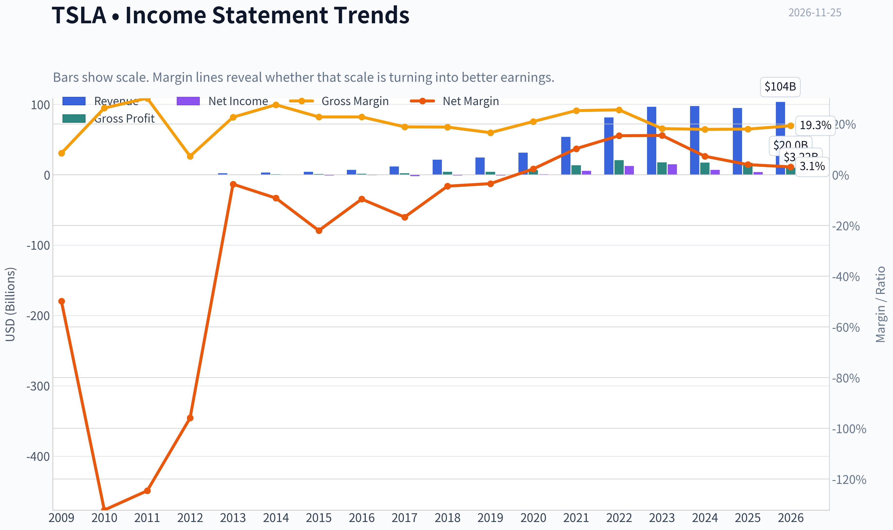

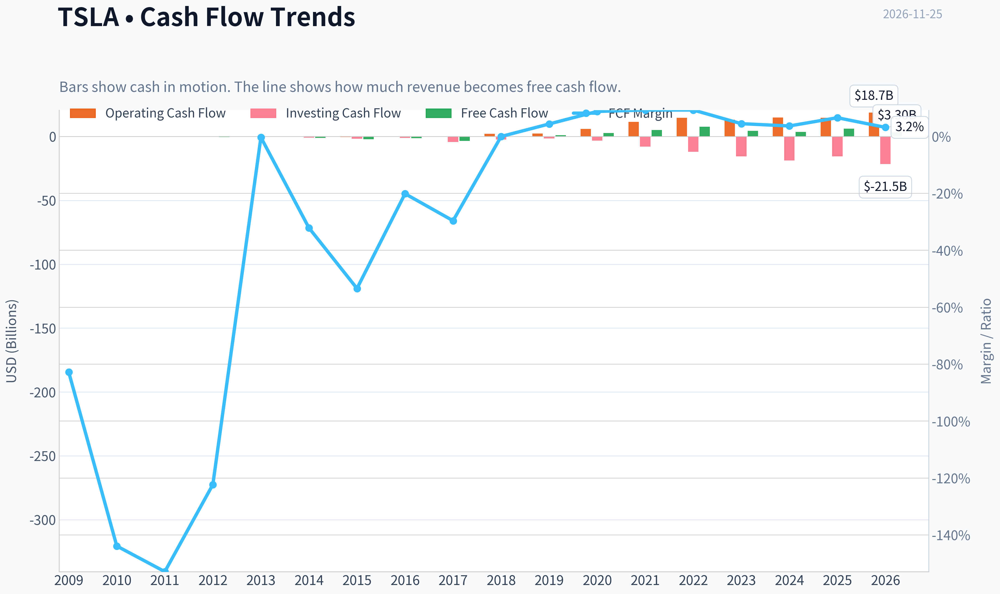

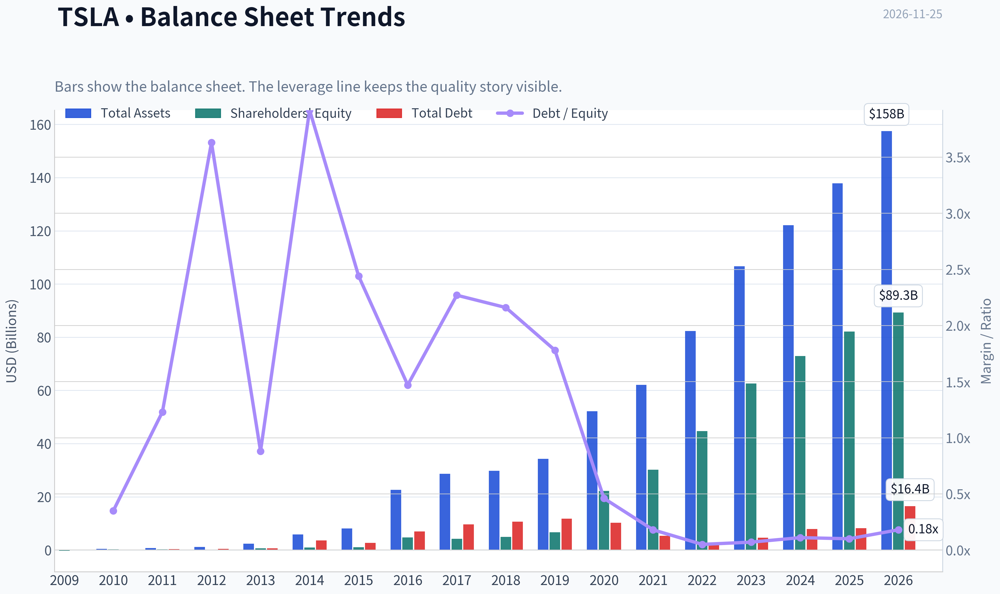

This graph tracks the profitability and return metrics (ROE, ROIC, Margins) of **TSLA** over the past decade, highlighting capital efficiency trends.

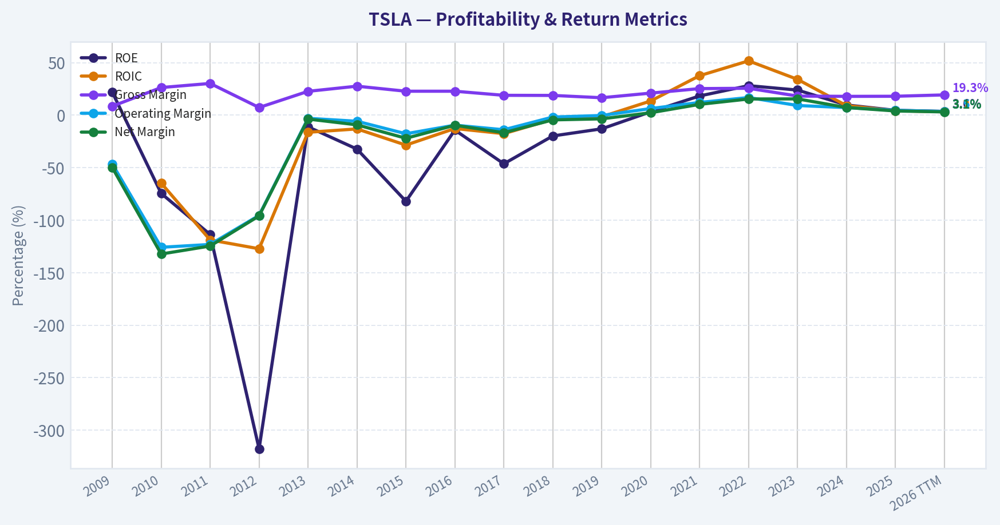

This chart illustrates the financial health of **TSLA** over the last 10 years, mapping cash equivalents and free cash flow against total obligations (Debt).

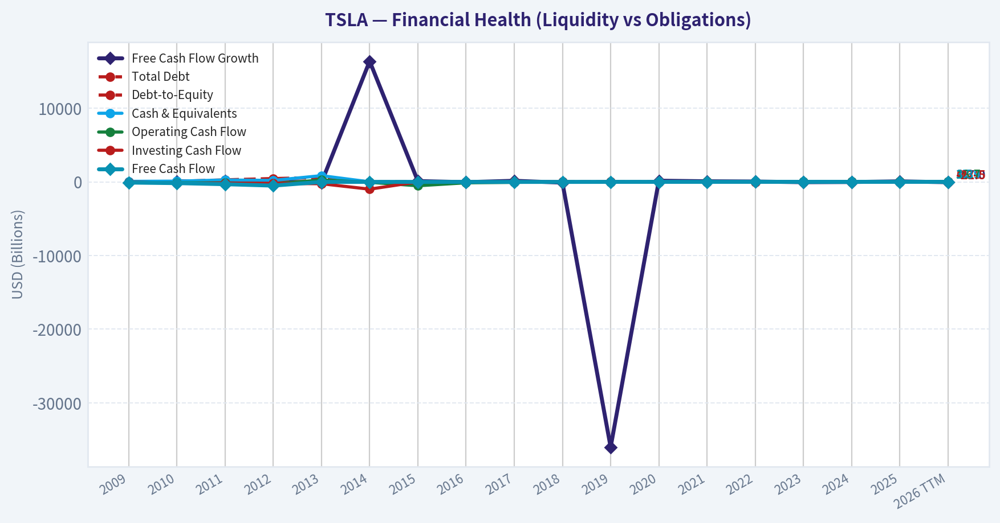

This breakdown chart from <em>Revenue Breakdown</em> shows the proportional composition for **TSLA** - useful for understanding what drives or risks the business.

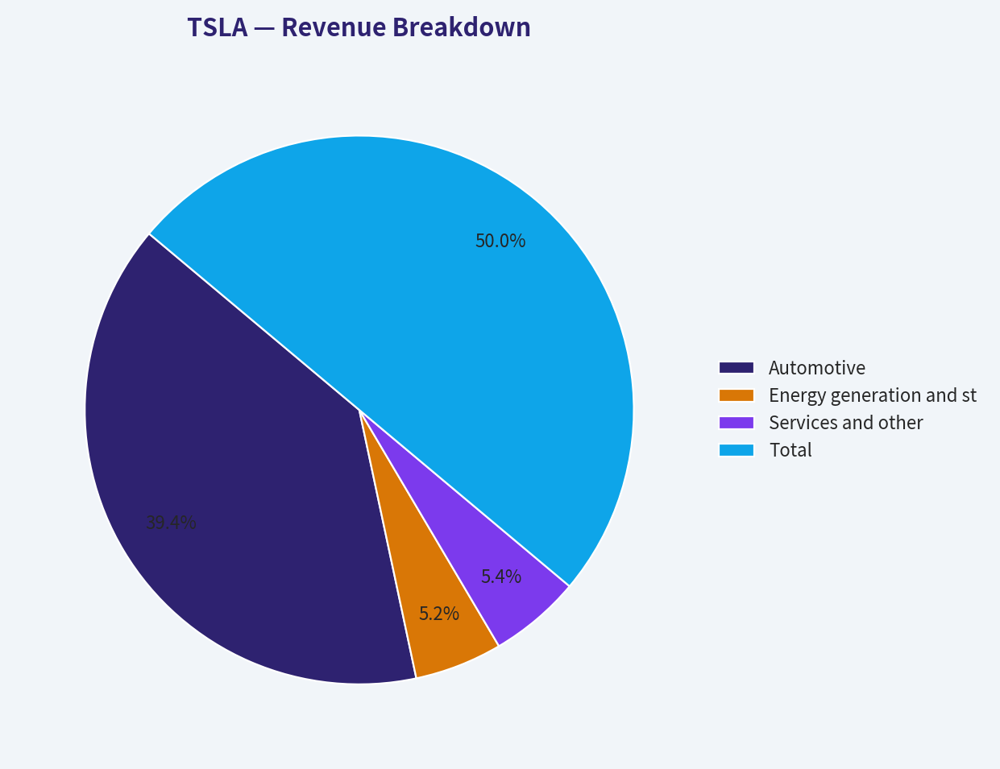

---

### Intrinsic Value Analysis (Buffett)

> *Following Warren Buffett's value investing philosophy: Circle of Competence, Economic Moat, Management Quality, and Margin of Safety.*

#### Intrinsic Value Snapshot

Price is what you pay. Intrinsic value is what the business may be worth based on the cash it can create for owners over time. We show a range, not one magic number.

- Current Price: $358.51
- Value Range (conservative to optimistic across both DCF methods): $10.92 to $101.68

##### Owner Earnings (Buffett Method)
- Net Income: $3,794,000,000.00
- Depreciation & Amortization: $6,148,000,000.00
- Capital Expenditures: $-8,527,000,000.00
- Working Capital Changes: $642,000,000.00
- Owner Earnings: $4,184,849,753.69

##### Intrinsic Value
###### Buffett Method
Uses owner earnings. Stricter, and usually more conservative.
- Conservative: $10.92
- Average: $19.87
- Optimistic: $101.68
- Discount Rate: 8.2%

###### Cash Flow Method
Uses free cash flow. Better for companies spending heavily today to grow tomorrow.
- Conservative: $19.45
- Average: $41.61
- Optimistic: $95.33
- Discount Rate: 10.0%

ANALYST STANCE: **Bearish**

#### Executive Summary

Tesla remains a strategically important electric-vehicle, energy-storage, software, and automation company, but the current valuation requires extraordinary future execution. At approximately **$358 per share** and a **$1.42 trillion market capitalization**, Tesla trades at roughly **394 times earnings** and has a **0.4% free-cash-flow yield**.

The research-pack intrinsic-value estimate is **$22.69 per share**, based on a weighted blend of reverse-DCF and owner-earnings methods. The valuation therefore implies exceptionally aggressive expectations, while recent operating indicators show slowing revenue and weak returns on capital.

The **Gate 5 solvency floor is not tripped**: there is no evidence of simultaneous financial distress and a solvency red line. The negative conclusion is driven primarily by valuation, weak current profitability, and the very high execution burden.

#### Factor Scorecard

| Factor | Score | Assessment |
|---|---:|---|
| 1. Circle of competence and simplicity | 2.5/5 | The vehicle and energy businesses are understandable, but the thesis increasingly depends on autonomy, robotics, AI, and platform economics. |
| 2. Moat | 2.5/5 | Tesla has brand, manufacturing scale, charging infrastructure, software capability, and data advantages, but automotive competition is intensifying and the moat is not clearly widening. |
| 3. Management and capital allocation | 2.5/5 | Elon Musk has demonstrated exceptional ambition and long-term vision, but governance concentration, executive distraction, and uncertain capital-allocation discipline reduce the score. |
| 4. Industry structure | 2.5/5 | EV manufacturing is capital-intensive and competitive, with pricing pressure and rapid technological change. Energy storage and software offer better structural economics. |

**Gate 5:** Not tripped. The balance sheet appears capable of supporting operations, and the available evidence does not indicate interest coverage below 1x or distress-zone solvency.

**Key Takeaways:** Tesla scores reasonably on strategic ambition and potential runway but poorly on simplicity, predictability, and current economics. The company is not rejected because of technology exposure; it is rejected because the valuation assumes technology-led success on an exceptionally large scale.

#### Moat Analysis

| Potential moat source | Evidence | Assessment |
|---|---|---|
| Brand and intangible assets | Strong global recognition and an early-mover identity in EVs | Useful, but brand strength has not prevented price cuts or margin compression |
| Cost advantage | Manufacturing scale, vertical integration, battery expertise, and supply-chain learning | Real advantages, though competitors are narrowing the gap |
| Switching costs | Vehicle software, charging access, data, and ecosystem familiarity | Moderate rather than dominant; vehicle switching remains relatively easy |
| Network effects | Supercharger network, vehicle data, software deployment, and possible autonomous fleet effects | Potentially powerful, but autonomy economics remain unproven |
| Pricing power | Gross margin is approximately 18%, and recent price competition has pressured profitability | Current evidence does not support strong pricing power |

Tesla's moat is best described as **narrow to moderate, with potentially widening elements** in autonomy, charging, energy storage, and fleet software. Those businesses could eventually have superior economics to vehicle manufacturing, but their present value is heavily dependent on uncertain execution.

#### Management Quality and Capital Allocation

Musk has repeatedly pursued projects with long time horizons and has helped Tesla achieve a scale that once appeared improbable. His ownership and personal commitment align him meaningfully with shareholders.

The principal concerns are governance and concentration risk. Decision-making is highly dependent on one individual, while attention is divided across several major ventures. The company's future narrative also relies on milestones-autonomous driving, robotics, and AI monetization-that have not yet produced commensurate, recurring cash earnings.

Capital allocation has been mixed. Tesla has invested aggressively in factories, batteries, charging, and compute infrastructure. Those investments could create substantial future value, but current returns have weakened: revenue growth is negative year over year, gross margin is approximately 18%, and ROE is only 4.6%.

#### Financial Summary

| Metric | 2021 | 2022 | 2023 | 2024 | Latest headline |
|---|---:|---:|---:|---:|---:|
| Revenue, $bn | 53.8 | 81.5 | 96.8 | 97.7 | Revenue growth: -2.9% YoY |
| Net income, $bn | 5.5 | 12.6 | 15.0 | 7.1 | - |
| Free cash flow, $bn | 5.0 | 7.6 | 4.4 | 3.6 | FCF yield: 0.4% |
| Gross margin | 25.3% | 25.6% | 18.2% | 17.9% | 18.0% |
| Return on equity | - | - | - | - | 4.6% |
| Current ratio | - | - | - | - | 2.16 |
| P/E ratio | - | - | - | - | 393.7x |
| Market capitalization | - | - | - | - | $1.42 trillion |

**Key Takeaways:** Tesla grew rapidly through 2023, but earnings and free cash flow deteriorated materially afterward. Gross margin has fallen from approximately 25% to 18%, while the current earnings multiple has expanded far beyond what present operating performance supports.

#### Owner Earnings Calculation

A normalized owner-earnings estimate of approximately **$6.6 billion** is used as a cross-check, consistent with the owner-earnings valuation model in the research pack.

| Owner-earnings component | Estimate |
|---|---:|
| Net income and operating cash generation base | Included in normalized estimate |
| Add: depreciation and amortization | Included |
| Less: maintenance capital expenditure | Included |
| Less: working-capital investment | Included |
| Normalized owner earnings | Approximately $6.6bn |
| Approximate diluted share count | Approximately 3.3bn |
| Normalized owner earnings per share | Approximately $1.99 |

**Key Takeaways:** Tesla's accounting earnings overstate the certainty of its economic earnings because substantial reinvestment remains necessary to support growth. Even using a normalized owner-earnings figure above recent free cash flow, the resulting per-share economics are far below the current share price.

#### Three-Scenario DCF Valuation

These scenarios are sensitivity checks; the primary valuation reference is the **$22.69 DVI estimate**.

| Scenario | Assumption | Estimated value per share |
|---|---|---:|
| A. No growth | Owner earnings divided by a 10% discount rate | $19.87 |
| B. GDP growth | 3% annual growth with a 10% discount rate | Approximately $29.45 |
| C. Historical-growth sensitivity | No-growth base used because recent growth is negative and long-term assumptions are highly uncertain | Approximately $19.87 |
| DVI blended estimate | Reverse-DCF fair value blended with owner-earnings DCF | $22.69 |

**Key Takeaways:** Even a generous 3% growth case produces a valuation far below $358 per share. The available valuation frameworks do not support the current market capitalization without assuming extraordinary long-term monetization from autonomy, robotics, AI, or other businesses that are not yet producing proportionate cash flow.

#### Margin of Safety Analysis

| Item | Value |
|---|---:|
| Current price | $358 |
| DVI intrinsic-value estimate | $22.69 |
| Price premium to intrinsic value | Approximately 1,478% |
| Conventional value discount to price | Approximately -93.7% |
| Reverse-DCF growth implied by price | Approximately 93% annually for 10 years |

The research pack reports a headline margin of safety of **-1,478.7%**, calculated relative to intrinsic value. On a conventional price-to-value basis, the shares trade at approximately **15.8 times** the DVI estimate.

A reverse-DCF implying approximately **93% annual growth for a decade** is far above Tesla's recent trajectory, including a trailing three-year growth rate of approximately **-9.2%**. Even a wide-moat compounder would struggle to justify that requirement.

#### Final Buffett Scorecard

| Criterion | Weight | Score | Weighted contribution |
|---|---:|---:|---:|
| Moat width and durability | 25% | 2.5/5 | 0.63 |
| Valuation and margin of safety | 20% | 1.0/5 | 0.20 |
| Capital returns versus WACC | 15% | 2.0/5 | 0.30 |
| Business understanding and predictability | 12% | 2.0/5 | 0.24 |
| Management quality and capital allocation | 12% | 2.5/5 | 0.30 |
| Reinvestment runway | 8% | 4.0/5 | 0.32 |
| Balance-sheet strength | 4% | 4.0/5 | 0.16 |
| Industry structure | 4% | 2.5/5 | 0.10 |
| **Total** | **100%** | - | **2.25/5** |

**Key Takeaways:** Tesla receives credit for its balance sheet, strategic options, and reinvestment runway. Those strengths are overwhelmed by weak present capital returns, uncertain moat durability, and a valuation that requires implausibly high sustained growth.

#### Investment Stance

**Bearish - High conviction on valuation, moderate conviction on business quality.**

Tesla may eventually develop a valuable autonomy, robotics, energy, and software platform. However, the current valuation already discounts an exceptionally successful outcome across several uncertain initiatives. The evidence does not support a $1.42 trillion valuation based on current earnings, cash flow, margins, or implied growth requirements.
#### Valuation Bridge

This bridge places the current market price beside each intrinsic value lens so readers can see whether upside depends on one method or shows up across several methods.

| Scenario | Intrinsic Value / Share |
| --- | ---: |
| Buffett Method | $19.87 |
| Cash Flow Method | $41.61 |
| Damodaran Method | $-70.66 |
| Current Price | $358.51 |

#### Key Takeaways

If one method is far above the others, the upside case depends on a specific modelling assumption. When several methods cluster together, the valuation story is more robust.

#### Valuation Visuals

This comparison chart from *Latest Earnings Snapshot* stacks current figures against historical benchmarks for **TSLA**, making it easy to see where the company trades relative to its own averages.

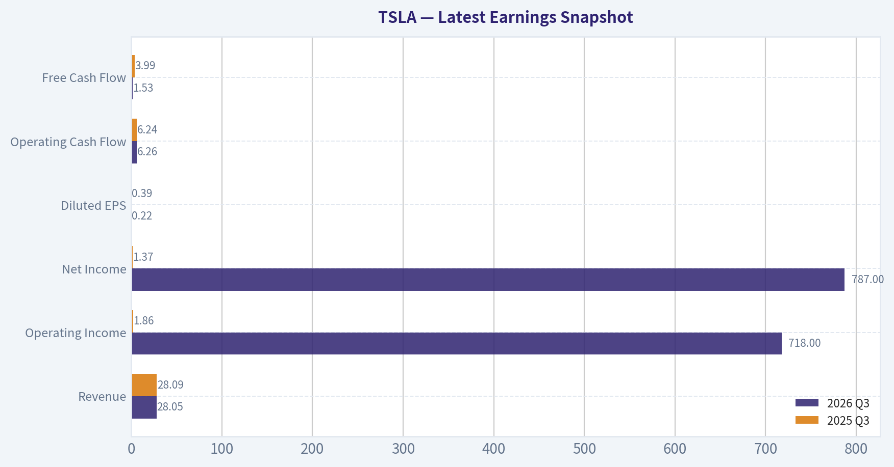

This comparison chart from *Balance Sheet and Financial Strength* stacks current figures against historical benchmarks for **TSLA**, making it easy to see where the company trades relative to its own averages.

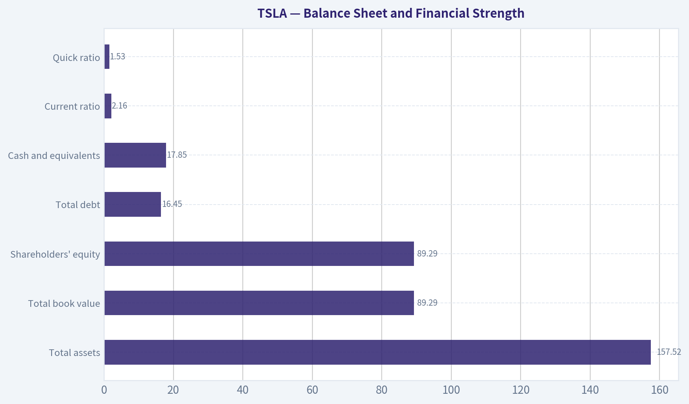

This comparison chart from *Cash Flow and Capital Allocation* stacks current figures against historical benchmarks for **TSLA**, making it easy to see where the company trades relative to its own averages.

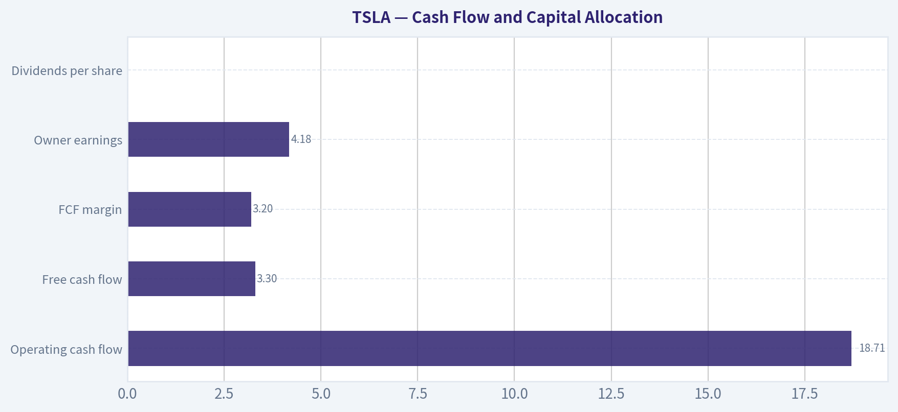

This comparison chart from *Three-Scenario Buffett-Style Owner-Earnings DCF* stacks current figures against historical benchmarks for **TSLA**, making it easy to see where the company trades relative to its own averages.

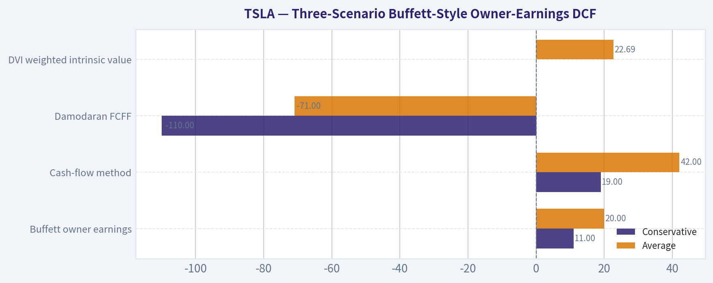

This comparison chart from *Reverse-DCF Cross-Check* stacks current figures against historical benchmarks for **TSLA**, making it easy to see where the company trades relative to its own averages.

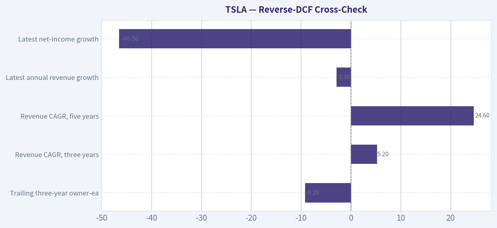

---

### Trend & Growth Analysis (Lynch/Druckenmiller/Fisher)

> *Following Peter Lynch's GARP, Stanley Druckenmiller's macro-aware approach, and Philip Fisher's scuttlebutt methodology.*

ANALYST STANCE: **Bearish**

#### Executive conclusion

Tesla remains a powerful secular-growth story, but the current evidence does not support its valuation of approximately **$358 per share and $1.42 trillion market capitalization**. Revenue is declining, gross margin is only **18%**, free-cash-flow yield is **0.4%**, and the P/E ratio is approximately **394**. The company retains substantial optionality in autonomy, energy storage, and robotics, but those opportunities are not yet supported by accelerating reported revenue or earnings.

#### 1. Lynch classification

| Category | Assessment | Evidence |
|---|---|---|
| Historical classification | Fast grower | Tesla previously delivered rapid EV and energy growth |
| Current classification | Speculative growth / transitional fast grower | Revenue growth is currently negative at **-2.9%** |
| Growth-investing status | Fails current fast-grower test | Growth has not yet reaccelerated while valuation remains extreme |

**Key Takeaways:** Tesla's historical fast-growth profile has weakened materially. The company may be approaching a new product-cycle inflection, but the present financial data show transition rather than confirmed acceleration.

#### 2. The story in three bullets

- Tesla is attempting to evolve from an electric-vehicle manufacturer into a broader platform spanning autonomy, energy storage, artificial intelligence, and humanoid robotics.
- Its brand, manufacturing scale, charging ecosystem, software capability, and data collection create potentially durable competitive advantages.
- The investment case depends heavily on future businesses that are not yet producing enough reported revenue or profit to justify the current valuation on conventional metrics.

#### 3. TAM and the 10x test

| Opportunity | Market evidence | Tesla runway | 10x assessment |
|---|---:|---|---|
| Electric vehicles | Global EV market estimated at **$1.31 trillion by 2035** | Large, but competition and pricing pressure are increasing | EV alone may not justify a 10x outcome from today's scale |
| Energy storage | Structural growth from grid storage and renewable integration | Attractive and less mature than automotive | Potentially meaningful contributor |
| Autonomous driving | Very large theoretical software and mobility market | Regulatory approval and technical execution remain unresolved | High upside, low current validation |
| Humanoid robotics | Extremely large potential labor-automation market | Pre-commercial and highly uncertain | Optionality rather than established TAM |
| 10x revenue test | Current revenue figure was not supplied in the research pack | Quantitative test cannot be completed precisely | The 10x equity-value burden is exceptionally high at $1.42 trillion |

**Key Takeaways:** Tesla has a potentially expanding TAM, especially if autonomy and robotics become commercial products. However, the 10x test is difficult from a $1.42 trillion starting valuation: future businesses must become very large and highly profitable, not merely promising.

#### 4. Revenue growth trend

| Metric | Current reading | Interpretation |
|---|---:|---|
| Revenue growth, year over year | **-2.9%** | Contraction, not acceleration |
| Gross margin | **18.0%** | Limited cushion for aggressive price competition |
| ROE | **4.6%** | Low relative to the valuation burden |
| Free-cash-flow yield | **0.4%** | Minimal current cash-flow support |
| Revenue pattern | Decelerating / unstable | No confirmed operating inflection |

**Key Takeaways:** The most important near-term fact is that revenue is declining. A single soft period would not invalidate the thesis, but the combination of negative growth, low margins, and a very high valuation requires clear evidence of renewed acceleration.

#### 5. Unit economics and operating efficiency

| Metric | Data status | Assessment |
|---|---|---|
| LTV/CAC | Not disclosed in the research pack | Cannot verify customer-acquisition efficiency |
| Net revenue retention | Not applicable to the core automotive business | SaaS-style retention metrics are not central |
| Rule of 40 | Not meaningful without subscription revenue and FCF margin data | Cannot use reliably |
| Automotive gross margin | **18.0%** | Vulnerable to pricing, mix, and input-cost pressure |
| Current ratio | **2.16** | Balance-sheet liquidity appears adequate |

**Key Takeaways:** Tesla's balance sheet does not appear to be the immediate risk. The larger issue is economic quality: automotive margins are not high enough, on current evidence, to independently support the company's valuation.

#### 6. Inflection-point assessment

| Potential inflection | Current evidence | Status |
|---|---|---|
| Product cycle | New models and lower-cost vehicles could broaden demand | Unconfirmed |
| Market share | Revenue decline suggests no clear current share inflection | Negative or unclear |
| Margin | 18% gross margin provides no confirmed margin inflection | Unconfirmed |
| TAM | Autonomy, robotics, and energy could expand TAM substantially | Potential |
| Competitive landscape | EV competition remains intense; pricing pressure persists | Headwind |
| Regulatory catalyst | European FSD approval discussions reportedly delayed | Delayed |

**Key Takeaways:** Tesla has several possible future inflection points, but they are mainly prospective. The strongest current evidence points to optionality rather than a demonstrated acceleration in revenue, margins, or market share.

#### 7. Macro setup

| Macro factor | Implication for Tesla |
|---|---|
| Interest rates | Higher rates pressure long-duration growth valuations |
| Consumer cycle | Vehicle purchases are sensitive to affordability and financing costs |
| EV secular trend | Favorable over the long term |
| AI and automation | Favorable for autonomy and robotics narratives |
| China and global competition | Creates pricing and market-share risk |
| Regulatory environment | Can materially delay autonomy monetization |

**Key Takeaways:** Secular themes remain favorable, but macro sensitivity is high. Tesla benefits from AI and electrification narratives while remaining exposed to financing conditions, consumer weakness, competition, and regulatory delays.

#### 8. Fisher 15-point score

| Fisher factor | Score / 5 | Rationale |
|---|---:|---|
| Market potential | 5 | EVs, storage, autonomy, and robotics are large markets |
| New-product determination | 5 | Strong visible emphasis on autonomy, AI, and robotics |
| R&D effectiveness | 4 | Strong historical innovation; future monetization remains uncertain |
| Sales organization | 4 | Global brand and distribution capability |
| Profit margins | 2 | 18% gross margin is modest for the valuation |
| Margin trend | 2 | No confirmed improvement |
| Labor relations | 3 | Mixed public evidence |
| Executive relations | 3 | Key-person dependence increases risk |
| Management depth | 3 | Significant dependence on Elon Musk |
| Cost accounting | 3 | Public data are adequate but segment economics are difficult to assess |
| Competitive advantages | 5 | Brand, scale, charging, software, data, and manufacturing |
| Long-range profit outlook | 4 | High potential but unusually assumption-dependent |
| Dilution risk | 3 | Capital access is strong, but equity-linked compensation and future financing remain considerations |
| Candor | 3 | Ambitious communication can exceed demonstrated operating results |
| Integrity and alignment | 3 | Governance and key-person risks require a valuation discount |

| Total | **52 / 75** | **Average-to-good, but below outstanding** |

**Key Takeaways:** Tesla scores highly on market opportunity and innovation, but lower on present margins, management dependence, operating predictability, and valuation support. The score reflects a compelling company with a less compelling current risk-reward profile.

#### 9. Valuation analysis

| Measure | Result | Interpretation |
|---|---:|---|
| P/E | **393.7x** | Extreme valuation relative to current earnings |
| Earnings growth | Negative revenue growth; earnings-growth data unavailable | PEG cannot be calculated reliably |
| PEG | Not meaningful | Negative or insufficient growth data |
| Market capitalization | **$1.42 trillion** | Very high expectations already embedded |
| FCF yield | **0.4%** | Minimal current cash-flow yield |
| DVI intrinsic-value estimate | **$22.69** | Far below the current market price |
| Owner earnings / FCF / FCFF model outputs | **$19.87 / $41.61 / -$70.66** | Extremely wide model dispersion |
| Reverse DCF implication | Approximately **93% annual growth for 10 years** | Indicates an exceptionally demanding valuation |

**Key Takeaways:** Conventional valuation metrics provide little support for the current market price. The reverse-DCF result implies extraordinary long-term growth, while the model range from approximately negative $71 to $42 demonstrates how dependent the valuation is on highly optimistic assumptions.

#### 10. Revenue-multiple sensitivity

Because the research pack does not provide a current revenue figure, the following is an indexed sensitivity rather than a price forecast.

| Scenario | Revenue outcome in five years | Margin assumption | Valuation implication |
|---|---:|---|---|
| Bear | 0.9x current revenue | Margin remains pressured | Current valuation would likely require major multiple compression |
| Base | 2.0x current revenue | Moderate improvement | Could support a large business, but not necessarily today's valuation |
| Bull | 4.0x current revenue | Strong automotive and software expansion | Begins to provide a framework for defending the valuation |
| Extreme bull | 8.0x-10.0x current revenue | Autonomy and robotics become major businesses | Required to make the present valuation more economically plausible |

**Key Takeaways:** Tesla needs much more than ordinary EV growth to validate its market capitalization. A credible valuation case likely requires several successful outcomes at once: renewed vehicle growth, sustained margins, meaningful autonomy revenue, and commercially successful robotics or energy businesses.

#### 11. Growth investor scorecard

| Criterion | Weight | Score / 5 | Weighted result |
|---|---:|---:|---:|
| Story | 10% | 4.5 | 0.45 |
| TAM and runway | 20% | 4.5 | 0.90 |
| Revenue growth | 20% | 2.0 | 0.40 |
| Unit economics | 15% | 2.5 | 0.38 |
| Competitive position | 10% | 4.0 | 0.40 |
| Management quality | 10% | 3.0 | 0.30 |
| Macro setup | 5% | 3.0 | 0.15 |
| Profitability path | 5% | 2.5 | 0.13 |
| Valuation | 5% | 1.0 | 0.05 |
| **Total** | **100%** | - | **3.16 / 5.00** |

**Key Takeaways:** Tesla scores well on story, TAM, and competitive assets, but revenue momentum and valuation sharply reduce the overall result. A score of 3.16 falls into the **Neutral** range operationally, but the current valuation evidence is sufficiently adverse to produce an overall **Bearish** stance under this framework.

#### 12. Catalysts and risks

| Catalysts | Risks |
|---|---|
| Successful lower-cost vehicle launch | Continued revenue contraction |
| FSD regulatory approval and paid adoption | Delayed autonomy approvals |
| Higher energy-storage growth | Automotive price competition |
| Material improvement in gross margin | Margin erosion and weaker demand |
| Commercial robotics progress | Technology commercialization failure |
| Reacceleration in deliveries and revenue | Key-person and governance concentration |
| Reduced interest rates | High-duration valuation sensitivity |

**Key Takeaways:** The most important catalyst is not another narrative announcement; it is measurable reacceleration in revenue, margins, and cash generation. The central risk is that autonomy and robotics remain valuable options but fail to produce sufficient economic output before the valuation's expectations become unsustainable.

#### Final assessment

Tesla has outstanding strategic optionality and several genuine competitive advantages. However, current operating data show **negative growth, modest margins, low cash-flow yield, and an extreme earnings multiple**. The evidence supports monitoring for a verified operating inflection, but it does not support the valuation at approximately **$358 per share** without a highly optimistic combination of EV growth, autonomy monetization, energy expansion, and robotics success.

---

### Market Technical Analysis

ANALYST STANCE: **Neutral**

#### TSLA technical report

The retrieved data covers TSLA through **November 24, 2026**; November 25 is not represented by a closing-price record, so the latest usable close is **$384.68**. The price series is available, but the separate indicator-report tool returned blank or unavailable values for the requested indicators. Accordingly, the analysis below uses the retrieved OHLCV history and transparent, approximate readings rather than presenting unsupported exact indicator outputs.

TSLA's one-year path has been highly volatile and is not a simple trend. The stock began the period at **$419.40**, advanced to nearly **$495** in December 2025, then declined steadily into the spring and early summer. It reached a pronounced low near **$298** in late July before recovering toward the upper-$300s. On a year-over-year basis, the latest close remains about **8% below** the November 25, 2025 reference close, despite the substantial rebound from the July low.

The medium-term structure improved after the July trough. From the July 29 close of **$298.32** to November 24 at **$384.68**, the recovery was approximately **29%**. However, that recovery has not yet established a persistent sequence of higher highs: the August high was about **$367**, the September high about **$380**, the October high about **$408**, and the November rebound reached approximately **$397** before falling back. This shows improving price levels from the summer low, but also repeated resistance in the high-$390s to low-$400s.

#### Trend and moving-average interpretation

Based on the recent 50-session price history, the approximate **50-day SMA is in the mid-to-upper $370s**. The latest close is modestly above that estimated level, which indicates that the intermediate trend has stabilized and turned somewhat constructive after the early-November selloff. The margin is not large, however, and the average is likely relatively flat rather than strongly rising.

The approximate **10-day EMA is near the high-$370s**, placing the latest close only slightly above the short-term average. This is consistent with a rebound from the November 20 low of **$345.82**, but it does not yet indicate a decisive acceleration. The immediate price action remains sensitive to sharp daily reversals: TSLA gained roughly **11.5%** from November 20 to November 23, then finished nearly unchanged on November 24.

The 200-day trend benchmark is more difficult to infer precisely because the indicator tool did not return a value. From the full history, the stock spent much of the year below its late-2025 highs and underwent a prolonged decline before recovering. The long-term trend therefore appears less decisively constructive than the short-term rebound. A sustained separation above the long-term average would be needed to distinguish a durable trend transition from a large countertrend recovery.

#### Momentum: MACD and RSI

The MACD family would normally help determine whether the November recovery is developing into a durable momentum phase. Price action suggests that MACD momentum likely improved sharply after the November 5-20 decline, but the signal is vulnerable to reversal because the rebound occurred after an unusually large selloff. The November 20-23 move was strong enough to improve short-term momentum, yet the failure to remain above $390-$400 leaves the broader signal inconclusive.

The approximate 14-day RSI appears to be around the neutral-to-mildly positive area, roughly the low-to-mid-50s, rather than near a conventional overbought or oversold extreme. That reading fits the price structure: the stock is no longer displaying the deeply weak momentum associated with the late-November low, but it also lacks the sustained upside pressure normally associated with RSI readings above 60-70. RSI therefore supports stabilization more than a confirmed momentum breakout.

#### Volatility and volume

Volatility remains a defining feature. The November 5 session produced a decline from **$374.12 intraday to a $343.69 close**, while November 23 traded between **$371.95 and $393.83**. The approximate recent ATR is likely in the mid-to-high teens, meaning ordinary daily moves remain large in dollar terms. This reduces the reliability of signals from short-term averages and makes single-session reversals particularly important.

Volume confirms that the largest recent moves attracted meaningful participation. The November 5 decline occurred on approximately **79.7 million shares**, well above the late-October average. The November 23 rebound also occurred on approximately **47.1 million shares**, above the quieter November 17-19 activity. This is a mixed volume message: high participation accompanied both the sharp decline and the subsequent rebound, suggesting active repricing rather than one-sided accumulation.

The volume-weighted price picture is therefore not cleanly bullish. The stock has recovered from the November low, but the high-volume selloff near $344 remains part of the recent market structure. A volume-weighted trend measure would be most informative if it showed price consistently staying above its recent volume-weighted average; the available indicator output did not provide a reliable numerical reading.

#### Key price structure

The principal near-term support area is the **$344-$346** region, defined by the November 5 closing low and November 20 close. A break beneath that zone would weaken the recent recovery structure and reopen the July-to-November rebound as a failed stabilization pattern.

The first important overhead area is approximately **$390-$400**, where several November highs and the November 13 close clustered. The next resistance region is around **$407-$411**, corresponding to the late-October and early-November highs. The latest close remains below both zones, so the evidence currently describes recovery within a volatile range rather than a confirmed upside continuation.

#### Overall interpretation

The technical evidence is **improving but incomplete**. The July low established a substantial base, the latest price is modestly above estimated short- and medium-term averages, and the November 20-23 rebound restored positive short-term momentum. Against that, the stock remains below the major late-October/early-November resistance band, the year-over-year return is negative, volatility is elevated, and high volume accompanied both the selloff and the rebound.

For valuation interpretation, the evidence does not support treating the latest price as validated by a stable, low-volatility uptrend. It instead reflects a market assigning a wide range of outcomes, with technical confirmation still dependent on whether TSLA can sustain levels above the upper-$390s while preserving the $344-$346 recovery base.

| Indicator / evidence | Approximate reading or observation | Interpretation |
|---|---:|---|
| Latest usable close | $384.68 on Nov. 24, 2026 | Rebounded from $345.82 on Nov. 20, but below major resistance |
| One-year price change | About -8% versus Nov. 25, 2025 | Long-term performance remains weaker despite the summer recovery |
| 50-day SMA | Approximately mid-to-upper $370s | Price is modestly above the medium-term average; trend stabilization, not a powerful slope |
| 10-day EMA | Approximately high-$370s | Short-term momentum has improved, but the margin above the average is narrow |
| 200-day SMA | Exact tool value unavailable; broad history suggests a less decisive long-term trend | The longer-term recovery remains unconfirmed |
| MACD / histogram | Exact tool values unavailable; price action implies recovery in momentum after Nov. 20 | Positive short-term impulse, but vulnerable to reversal below $390-$400 |
| RSI | Approximate neutral-to-mildly positive zone, around low-to-mid-50s | Stabilization without an overbought signal or strong momentum extreme |
| ATR / volatility | Approximate recent daily range in the mid-to-high teens | Elevated volatility makes short-term signals less reliable |
| Volume | 79.7 million on Nov. 5; 47.1 million on Nov. 23 | Heavy participation accompanied both weakness and rebound; volume confirmation is mixed |
| Key support area | $344-$346 | Important boundary for the November recovery structure |
| Key resistance areas | $390-$400, then $407-$411 | Areas where recent rebounds have encountered supply |

**Key Takeaways:** TSLA has recovered materially from its July low and is now modestly above estimated short- and medium-term averages, but the move remains technically incomplete. Momentum has improved from the November selloff without reaching a strong overbought condition, while elevated volatility and mixed high-volume signals show continued disagreement in the market. The $344-$346 area defines the recent recovery base, whereas $390-$400 and $407-$411 are the main overhead confirmation zones.

---

### Options Market Analysis

> *Reading options flow - put/call ratios, IV skew, and unusual activity - to gauge institutional positioning and event-driven risk.*

ANALYST STANCE: **BEARISH**

#### TSLA Options Market Snapshot

As of November 25, 2026, the near-term TSLA options market shows more put open interest and volume than call activity. The aggregate put/call open-interest ratio is 1.25, while the volume ratio is 1.20, both materially above the historical neutral reference of approximately 0.70.

| Near-term expiry | Call OI | Put OI | Put/Call OI ratio | Call volume | Put volume | Put/Call volume ratio |
|---|---:|---:|---:|---:|---:|---:|
| Nov. 25, 2026 | 60,051 | 62,530 | 1.04 | 32,729 | 41,759 | 1.28 |
| Nov. 27, 2026 | 150,057 | 218,195 | 1.45 | 15,145 | 18,742 | 1.24 |
| Nov. 30, 2026 | 26,658 | 14,344 | 0.54 | 4,908 | 2,781 | 0.57 |
| **Aggregate** | **236,766** | **295,069** | **1.25** | **52,782** | **63,282** | **1.20** |

**Key Takeaways:** Put activity dominates the two largest near-term expirations, particularly November 27, where put open interest is 45% higher than call open interest. The November 30 chain is more call-oriented, but its smaller volume and open-interest base do not offset the heavier put concentration in the earlier expirations. This indicates near-term defensive or bearish demand rather than a neutral options backdrop.

#### Implied Volatility Assessment

| Expiry | Call ATM IV | Put ATM IV | IV relationship | Assessment |
|---|---:|---:|---|---|
| Nov. 25, 2026 | 107.2% | 28.7% | Call IV much higher | Strong upside-tail premium or data asymmetry |
| Nov. 27, 2026 | 82.3% | 35.8% | Call IV higher | Elevated short-dated volatility |
| Nov. 30, 2026 | 72.3% | 44.0% | Call IV higher | Elevated, but declining with time |
| **Overall** | - | - | **ATM call IV exceeds put IV** | **Unusually strong call-side premium** |

The available data does not provide a complete, matched-strike out-of-the-money volatility curve. However, unusual-contract data shows the November 25, $302.50 put at 123.4% IV, compared with November 25 call IVs of 85.1% at $365 and 93.7% at $362.50. The $307.50 call shows an extreme 321.4% IV, which may reflect very short time-to-expiry, a deep-in-the-money or out-of-the-money classification, or a quote-liquidity distortion.

**Catalyst assessment:** Implied volatility is extremely elevated for contracts expiring immediately and within two trading sessions. No specific earnings, product, regulatory, or macro catalyst was supplied in the data, so the elevation cannot be attributed confidently to a named event. Expiration-related gamma and short-dated speculation are likely contributors.

**Key Takeaways:** TSLA's short-dated volatility is elevated, with call-side ATM IV unusually above put-side ATM IV. That suggests substantial demand for upside convexity, but the very high put IV at the $302.50 strike indicates meaningful downside-tail pricing as well. The skew signal is therefore distorted and should be interpreted with lower confidence than the put/call ratios.

#### Unusual Options Activity

The feed identifies contracts whose volume is more than five times open interest, suggesting potentially fresh activity. The data does not identify whether trades were bought or sold, so directional interpretation remains probabilistic rather than definitive.

| Expiry | Type | Strike | Volume | Open interest | Volume/OI | IV | Moneyness assessment |
|---|---|---:|---:|---:|---:|---:|---|
| Nov. 25, 2026 | Call | $365.00 | 1,727 | 248 | 7.0x | 85.1% | Cannot verify without supplied spot price |
| Nov. 25, 2026 | Call | $362.50 | 1,546 | 208 | 7.4x | 93.7% | Cannot verify without supplied spot price |
| Nov. 25, 2026 | Put | $302.50 | 1,022 | 31 | 33.0x | 123.4% | Cannot verify without supplied spot price |
| Nov. 25, 2026 | Call | $307.50 | 605 | 73 | 8.3x | 321.4% | Cannot verify without supplied spot price |

The $302.50 put is the clearest downside-tail anomaly because its volume is 33 times existing open interest. The $362.50 and $365 calls also show substantial fresh activity, indicating strong speculative demand for immediate upside exposure. Because all four contracts expire on the current date and the feed does not include trade direction, these trades may include market-maker hedging, spreads, or retail speculation rather than outright institutional bets.

**Key Takeaways:** The unusual flow is two-sided, but the downside put has the strongest volume-to-open-interest ratio and the highest interpretable tail-risk signal. The high-volume calls indicate aggressive upside speculation, yet their same-day expiry makes them more susceptible to gamma trading and rapid time decay. The data supports bearish risk awareness, but not a clean one-directional smart-money signal.

#### Open Interest Concentration and Gamma Levels

| Expiry | Highest aggregate OI | Call/put concentration | Likely market effect |
|---|---:|---|---|
| Nov. 25, 2026 | 122,581 contracts | Fairly balanced, with more puts | Immediate expiry-related pinning and hedging |
| Nov. 27, 2026 | 368,252 contracts | Strong put concentration | Largest near-term downside hedge concentration |
| Nov. 30, 2026 | 41,002 contracts | Call-heavy | Smaller upside-oriented concentration |

The November 27 expiration contains the largest open-interest concentration, with 218,195 puts versus 150,057 calls. This creates a notable put-side gamma and hedging concentration. The November 25 $362.50 and $365 calls also have unusually active fresh flow, potentially creating short-lived upside gamma around those strikes if dealers are short the calls. Exact gamma walls and max-pain levels cannot be calculated from the supplied summary because the full strike-by-strike open-interest and Greeks data is unavailable.

**Key Takeaways:** November 27 is the dominant near-term expiration and is materially put-heavy. That concentration may dampen or accelerate moves depending on dealer hedge direction, but it establishes a significant downside-risk reference area. Call activity around $362.50 and $365 could create temporary upside pinning or volatility if TSLA trades near those strikes.

#### Overall Options Sentiment

**Overall signal: BEARISH, with elevated volatility and conflicting upside speculation.**

The primary bearish driver is the aggregate put/call OI ratio of 1.25 and volume ratio of 1.20, both well above the approximately 0.70 neutral baseline. The strongest expiration, November 27, has a 1.45 put/call OI ratio, indicating concentrated downside protection or bearish exposure. This outweighs the bullish interpretation from heavy same-day call activity, particularly because those calls may represent short-dated speculation, spreads, or dealer-related flow.

Confidence is **moderate**, not high. TSLA's options activity is substantial, but same-day expiries, unusually distorted IV readings, missing spot-price information, and the absence of trade-side data reduce the reliability of precise directional conclusions. The evidence implies that near-term valuation is being discounted for downside risk, even while the market is paying heavily for selected upside lottery-style exposure.

#### Summary Table

| Category | Assessment |
|---|---|
| Put/Call Ratio | **Bearish:** Aggregate OI ratio 1.25 and volume ratio 1.20, both above the 0.70 neutral baseline |
| IV Level | **Very elevated:** Same-day ATM IV ranges from 28.7% to 107.2%, with several unusual contracts above 85% |
| Skew Direction | **Distorted/mixed:** ATM call IV is unusually high, but the $302.50 put carries substantial 123.4% IV |
| Unusual Activity | **Two-sided but risk-heavy:** Strong same-day call speculation plus a 33x volume/OI downside put |
| Overall Signal | **BEARISH:** Put concentration in the largest near-term expiry is the dominant directional indicator |

**Key Takeaways:** TSLA's near-term options market leans bearish because puts dominate the principal expirations and aggregate activity. Upside call speculation is intense, but it is concentrated in same-day contracts with highly elevated volatility and uncertain trade direction. Overall conviction is moderate because the chain also shows significant upside-tail demand and incomplete strike-level information.

---

## Research Team Commentary

> *The Research Manager synthesizes the Bull vs Bear debate into action-free commentary. This is a pre-risk view, not the final stance.*

Core takeaway: Tesla has credible strategic advantages and unusually valuable long-term options, but the evidence does not support the valuation at either the cited $358 price or the latest usable close of $384.68. The business could evolve into a broader platform spanning vehicles, energy storage, autonomy, AI, charging, and robotics. Yet the current price appears to capitalize several of those opportunities as though successful commercialization were already highly probable. With a roughly 394 P/E, a 0.4% free-cash-flow yield, 18% gross margin, and 6.9% ROIC, Tesla does not yet exhibit the owner-earnings profile of the high-return technology compounder implied by its valuation.

The strongest bull argument is that conventional automotive analysis misses much of Tesla's potential. Its brand, connected fleet, integrated hardware and software, charging ecosystem, manufacturing capabilities, direct customer relationship, and accumulated driving data are real strategic assets. Energy storage could become a meaningful second earnings engine, while autonomy could introduce higher-margin recurring revenue and materially change vehicle economics. Tesla's history also shows that management can execute projects initially regarded as unrealistic. Robotics adds further option value because the company has relevant capabilities in AI, vision, batteries, motion control, and manufacturing.

Those strengths mean Tesla should not be valued as an ordinary automaker, and the research-pack intrinsic-value estimate of $22.69 should not be treated as precise. A conventional cash-flow model can materially understate a company if a new platform is approaching commercial scale. Tesla also appears financially capable of funding continued investment, so this is not a distress thesis.

The strongest bear argument, however, survives those qualifications: optionality is not equivalent to demonstrated intrinsic value. The present valuation appears to require some combination of sustained high growth, substantial margin expansion, strong cash conversion, profitable energy scale, commercially successful autonomy, and eventual robotics economics. Several difficult outcomes must occur together, while competition, regulation, capital intensity, and execution risk remain substantial.

Tesla's current returns provide little valuation support. A 6.9% ROIC is not compelling relative to the expectations embedded in the market capitalization, even if current investment depresses reported returns. The essential question is whether incremental spending on AI infrastructure, factories, autonomy, energy capacity, and robotics will produce durable returns well above the cost of capital. That has not yet been demonstrated. Intangible assets deserve recognition, but their economic value eventually must appear through margins, recurring revenue, and free cash flow.

The automotive moat is meaningful but not unassailable. Tesla has brand and scale, but an 18% gross margin suggests that competition and pricing pressure already constrain economics. Chinese manufacturers, traditional automakers, battery suppliers, and technology companies can challenge different parts of the ecosystem. Broader adoption of Tesla's charging standard may increase network relevance while reducing exclusivity. A durable moat must ultimately show up in pricing power, retention, cost leadership, and rising returns on capital-not merely technological visibility.

Autonomy is the most important swing factor. Tesla's fleet data and over-the-air deployment provide genuine advantages, but the transition from driver assistance to a scalable autonomous service involves technical validation, regulatory approval, liability, insurance, maintenance, and fleet-utilization economics. Even technical success would not guarantee pure-software margins. Energy storage has clearer near-term commercial demand, but its ultimate value depends on whether Tesla can avoid commodity-like competition and generate high incremental returns after manufacturing and working-capital requirements. Robotics remains the least proven element and merits only probability-weighted option value today.

Management deserves credit for ambition, speed, and past execution. The offset is governance and key-person risk. Buffett-style management assessment includes disciplined capital allocation, focus, incentives, communication, and treatment of outside shareholders-not just visionary capability. Tesla's breadth of initiatives may create multiple growth paths, but it also makes accountability and capital-return measurement more difficult.

From a contrarian perspective, elevated near-term put activity does not establish a long-term opportunity or a deterioration in intrinsic value. The reported put/call ratios of 1.25 for open interest and 1.20 for volume may reflect hedging or event risk. Short-term bearish sentiment can create mispricing when durable cash flows are underappreciated, but that case is weak here because the valuation remains exceptionally demanding. The crowd may be overly optimistic about the timing and probability of autonomy and robotics rather than overly pessimistic about the established business.

The research-pack estimate of $22.69 may be too conservative, but the distance from that estimate to roughly $358-$385 is so large that ordinary model uncertainty does not resolve the problem. Even a wide-moat compounder generally needs a plausible relationship between price and intrinsic value. Tesla's current economics would need to improve dramatically before a quality-scaled 10-15% margin-of-safety framework became relevant. At present, the reverse-DCF hurdle appears heroic rather than merely optimistic.

The key analytical lesson is to separate a compelling corporate future from a compelling valuation. A previous error in similar high-expectation situations would be granting full present value to optionality while treating delays, dilution of economics, competition, and capital requirements as secondary. The better discipline is to require emerging businesses to graduate from narrative to measurable unit economics. Conversely, it would also be a mistake to dismiss Tesla as merely an automaker; energy and autonomy deserve serious valuation consideration as evidence develops. The conclusion rests on probability and price, not disbelief in the technology.

Over the next one to four quarters, the monitoring plan should focus first on automotive gross margin excluding regulatory credits, vehicle pricing, delivery growth, inventory, and free-cash-flow conversion. A favorable development would be simultaneous volume growth and margin improvement without disproportionate capital spending; unit growth purchased through lower pricing would weaken the thesis.

Second, energy-generation and storage revenue, gross profit, deployment growth, backlog, and incremental capital requirements should be tracked. Sustained growth accompanied by improving margins would support the view that energy is becoming a high-quality second franchise rather than simply another capital-intensive manufacturing operation.

Third, autonomy needs commercial rather than promotional evidence: paid adoption, recurring revenue, disengagement or intervention trends where disclosed, geographic regulatory approvals, liability experience, and credible unit economics for any mobility service. Limited pilots or technical demonstrations would not by themselves justify substantial present value.

Fourth, reported operating cash flow, capital expenditures, stock-based compensation, and ROIC should show whether investment is beginning to create owner earnings. Durable improvement in ROIC toward clearly double-digit levels would materially strengthen the quality case. Continued low returns alongside accelerating investment would reinforce the concern that growth is capital intensive.

Finally, governance, management focus, related-party considerations, executive incentives, and the allocation of capital among vehicles, AI, energy, and robotics require scrutiny. Clear milestones and disciplined spending would reduce uncertainty; shifting timelines and expanding commitments without measurable returns would increase it.

Tesla may ultimately become an exceptional multi-platform enterprise. The present evidence, however, shows a large gap between strategic possibility and demonstrated owner earnings, while the market valuation leaves little protection against delays or merely good execution.

Bearish

---

## Value Investing Team Commentary

> *The Investor translates the research view into an investment thesis before risk review. This is still not the final stance.*

Tesla presents a genuinely unusual analytical challenge: the established automotive business does not justify the valuation on current economics, while the potential businesses-autonomy, energy storage, AI infrastructure, and robotics-could eventually transform the company.

### Business quality and moat

Tesla is not simply an ordinary automaker. Its vertically integrated manufacturing, software architecture, charging network, brand, connected fleet, and direct customer relationship create meaningful strategic assets. Energy storage is also becoming a credible adjacent business with potentially better growth characteristics than vehicles.

However, a moat must ultimately produce durable pricing power, superior returns on capital, or recurring cash flows. Tesla's reported 18% gross margin and 6.9% ROIC do not yet demonstrate economics consistent with a technology-platform valuation. The automotive franchise remains exposed to price competition, Chinese manufacturers, traditional automakers, battery-cost changes, and demand cyclicality. The charging ecosystem may become more valuable as a standard, but wider adoption can also reduce its exclusivity.

### Optionality versus demonstrated value

The bullish case depends on several future developments occurring together:

- sustained vehicle growth without continued margin erosion;
- substantial expansion in energy-storage profitability;
- commercially scalable autonomy with recurring revenue;
- productive returns from AI infrastructure;
- successful robotics commercialization.

These possibilities deserve some probability-weighted recognition. The research-pack intrinsic-value estimate of $22.69 may understate the value of assets that are not yet producing meaningful earnings. Nevertheless, the gap between that estimate and the cited prices of $358 and $384.68 is too large to explain through ordinary model uncertainty. It implies that much of the future success of autonomy, robotics, and other platform initiatives is already being capitalized.

That is the central valuation problem. A high-growth business can deserve a premium multiple, but the premium must still be anchored to plausible future owner earnings. At approximately 394 times earnings and a 0.4% free-cash-flow yield, the market is assigning substantial value to outcomes that remain operationally and commercially unproven.

### Reverse-DCF and capital allocation test

The relevant question is not whether Tesla can grow, but what level of growth, margin expansion, and reinvestment efficiency is required to support the current market capitalization. The implied hurdle appears to require exceptional execution over many years, including materially higher returns on invested capital.

Management has demonstrated ambition and an ability to execute difficult manufacturing projects. The counterweight is breadth of ambition, governance risk, key-person dependence, and the difficulty of measuring capital allocation across vehicles, AI, energy, autonomy, and robotics. Rapid investment can create enormous value if incremental returns are high; it can also absorb capital without producing commensurate owner earnings.

The most important evidence would be durable improvement in ROIC, free-cash-flow conversion, automotive margins excluding regulatory credits, and incremental returns from energy and AI spending. Promotional demonstrations or limited autonomy pilots would carry considerably less evidentiary weight than recurring revenue, regulatory approvals, liability performance, utilization, and transparent unit economics.

### Selective contrarian interpretation

Near-term bearish options positioning does not establish long-term intrinsic value. A put/call open-interest ratio of 1.25 and volume ratio of 1.20 may reflect hedging, event risk, or speculation rather than informed conviction. In that respect, options sentiment should not drive the business analysis.

The more important contrarian observation is that the crowd may be underestimating Tesla's eventual strategic breadth while simultaneously overestimating the probability and timing of commercialization. Dismissing Tesla as merely an automaker would be too conservative; treating every announced initiative as present economic value would be too generous. The appropriate distinction is between strategic capability, commercial proof, and shareholder-level returns.

Energy storage currently appears more measurable than robotics or full autonomy, but even that business must demonstrate attractive incremental margins after manufacturing investment, working capital, and competition. Robotics remains primarily an option rather than a demonstrated earnings stream. Autonomy has the greatest potential impact, but also the greatest regulatory, technical, legal, and economic uncertainty.

### Overall assessment

Tesla may ultimately become an exceptional multi-platform enterprise. The current evidence, however, shows a substantial gap between strategic possibility and demonstrated owner earnings. The valuation leaves limited room for delays, weaker margins, regulatory friction, competition, dilution of economics, or merely good rather than extraordinary execution.

**ANALYST STANCE: Bearish** - The stance reflects valuation evidence, not a dismissal of Tesla's technology or long-term corporate potential. At the cited prices, the market appears to require several difficult future outcomes simultaneously, while present profitability and capital efficiency provide insufficient support for that expectation.

---

## Deep Values Commentary

> *The Risk Management Team debates and the Risk Judge provides the final action-free verdict. This section determines the final Bullish / Neutral / Bearish stance.*

#### Final Stance Scorecard

This scorecard converts the final research view into a weighted decision frame. It does not replace the narrative judgement, but it makes the main drivers of the verdict easier to scan.

| Criterion | Score | Weight | Commentary |
| --- | ---: | ---: | --- |
| Business Quality | 2.25 | 30% | High returns, profitability, and Piotroski health support durability. |
| Valuation Support | 1.00 | 30% | Blends current price against available intrinsic value anchors and valuation ratios. |
| Financial Strength | 5.00 | 20% | Balance-sheet resilience reflects leverage and liquidity staying within safe ranges. |
| Growth Durability | 2.33 | 20% | Recent revenue, earnings, and free cash flow growth indicate how durable expansion looks. |
| TOTAL / FINAL STANCE | 2.44 | 100% | Neutral |

#### Key Takeaways

The weighted score lands at **2.44 / 5.0**, while the final stance remains **Neutral**. This is useful as a quick calibration aid rather than a mechanical signal.

#### Risk Summary

Higher scores indicate more risk pressure. The watch threshold is a simple guardrail: above it, the dimension weighs more heavily on the valuation case and calls for a wider margin of safety.

| Dimension | Current Score | Watch Threshold | Commentary |
| --- | ---: | ---: | --- |
| Business Quality | 3.75 | 3.00 | High returns, profitability, and Piotroski health support durability. |
| Valuation Support | 5.00 | 3.00 | Blends current price against available intrinsic value anchors and valuation ratios. |
| Financial Strength | 1.00 | 3.00 | Balance-sheet resilience reflects leverage and liquidity staying within safe ranges. |
| Growth Durability | 3.67 | 3.00 | Recent revenue, earnings, and free cash flow growth indicate how durable expansion looks. |

#### Key Takeaways

This view helps readers separate *where* the risk sits: valuation, business quality, balance sheet, or growth durability. It is especially useful when the final stance is close to the line between Neutral and Bearish.
