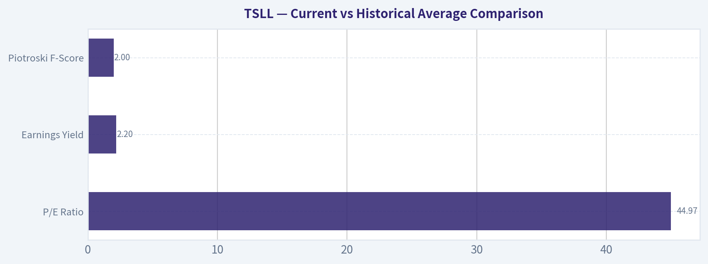
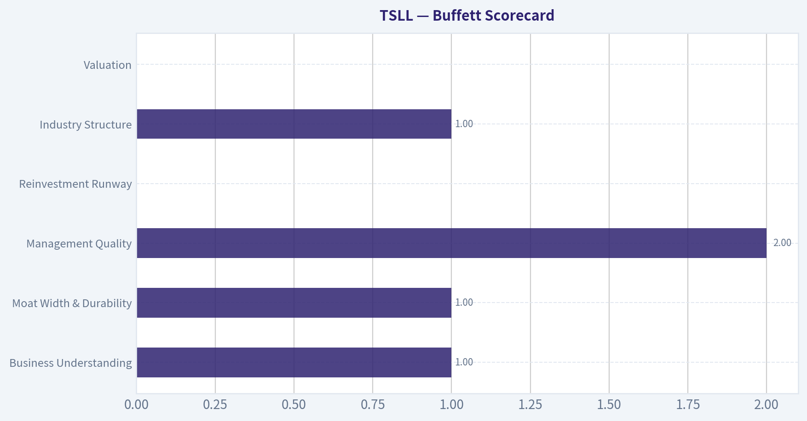
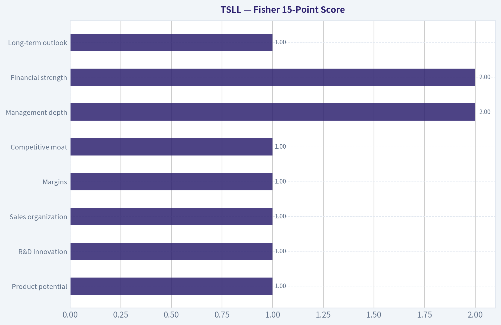
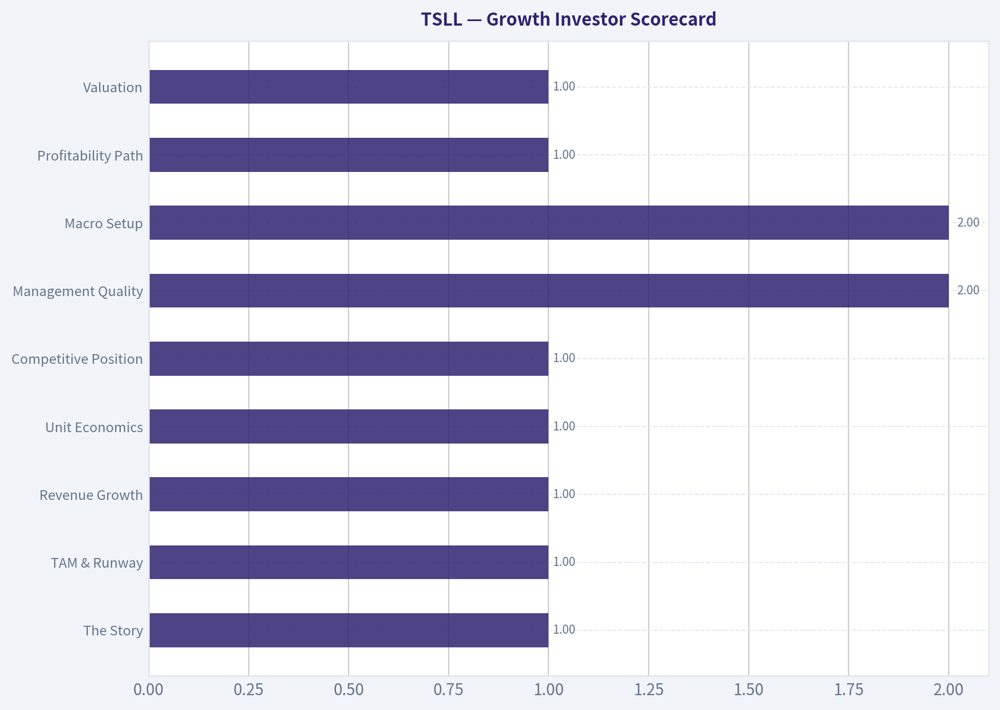
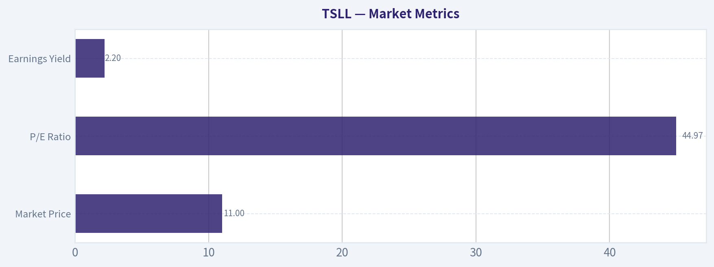
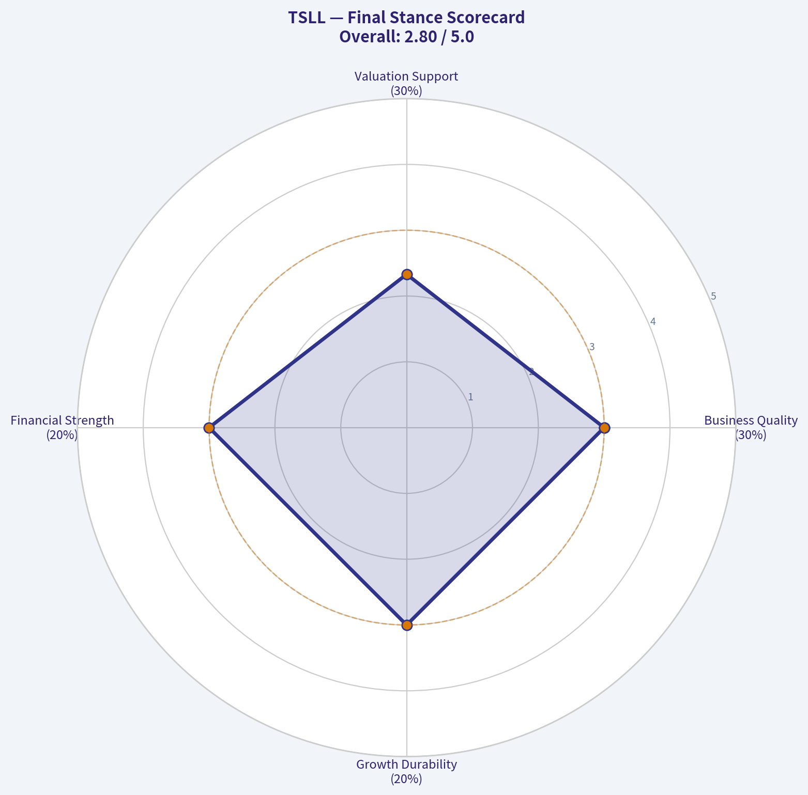
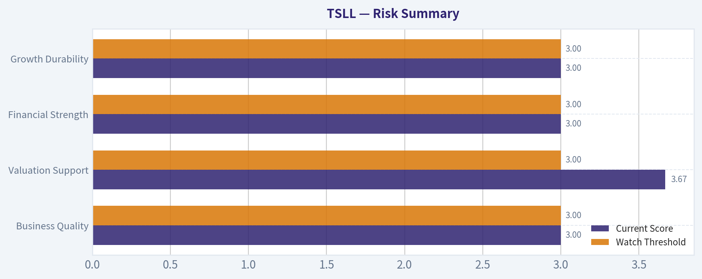

# TSLL Deep Value Intelligence

**Analysis Date:** 2026-04-05

## Critical Disclaimer

*This analysis is generated by Deep Value Intelligence, an AI-powered multi-agent investing framework. This report is for informational and educational purposes only and does not constitute financial advice. Always conduct your own research and consult with qualified financial advisors before making investment decisions.*

---

## Table of Contents

1. Intelligence Summary
2. Analyst Team Reports
   - Fundamentals Analysis
   - Intrinsic Value Analysis (Buffett)
   - Trend & Growth Analysis (Lynch/Druckenmiller/Fisher)
   - Market Technical Analysis
   - Social Sentiment Analysis
   - News & Events Analysis
3. Research Team Commentary
4. Value Investing Team Commentary
5. Deep Values Commentary

---

## Intelligence Summary

### Thesis + Conditions

**Core Thesis:** Executive Summary (Quick Read)

**Key Risks:**
- TSLL is not a business-it is a leveraged trading instrument designed to amplify Tesla's daily price movements. That structure introduces volatility decay, path-dependency, and derivative exposure that work against long-term compounding. Even if Tesla proves to be an exceptional company, TSLL cannot compound intrinsic value because it produces no cash flow and has no reinvestment engine. The analysts largely agree that TSLL is structurally incompatible with long-term value investing. For investors seeking Tesla exposure, the correct vehicle is the underlying equity, not a leveraged ETF whose expected value deteriorates over time.
- The Risky Analyst highlights the key mathematical problem: volatility drag erodes value over time, especially with a volatile stock like Tesla.
- The Safe Analyst expands the concern by emphasizing structural leverage, derivative exposure, and capital impairment risk.
- Risk Commentary Through a Buffett Lens
- If Tesla's stock moves sideways but volatile for an extended period, TSLL can lose significant value even if Tesla ultimately ends up unchanged. That is a structural disadvantage that compounds over time.

**What Would Change Our View:**
- TSLL is not a business-it is a leveraged trading instrument designed to amplify Tesla's daily price movements. That structure introduces volatility decay, path-dependency, and derivative exposure that work against long-term compounding. Even if Tesla proves to be an exceptional company, TSLL cannot compound intrinsic value because it produces no cash flow and has no reinvestment engine. The analysts largely agree that TSLL is structurally incompatible with long-term value investing. For investors seeking Tesla exposure, the correct vehicle is the underlying equity, not a leveraged ETF whose expected value deteriorates over time.
- The Risky Analyst highlights the key mathematical problem: volatility drag erodes value over time, especially with a volatile stock like Tesla.
- The Safe Analyst expands the concern by emphasizing structural leverage, derivative exposure, and capital impairment risk.
- Risk Commentary Through a Buffett Lens
- If Tesla's stock moves sideways but volatile for an extended period, TSLL can lose significant value even if Tesla ultimately ends up unchanged. That is a structural disadvantage that compounds over time.

**Confidence:** Medium

---

## Analyst Team Reports

### Fundamentals Analysis

#### 10-Year Financial Metrics for TSLL

*All values below are computed deterministically from raw data - not estimated by AI.*

*Issuer profile: operating company (Unknown / Unknown).*

#### Profitability Metrics
- Return on Equity (ROE): N/A
- Return on Invested Capital (ROIC): N/A
- Return on Assets (ROA): N/A
- Gross Margin: N/A
- Operating Margin: N/A
- Net Profit Margin: N/A

#### Liquidity Metrics
- Current Ratio: N/A
- Quick Ratio: N/A

#### Leverage Metrics
- Debt-to-Equity Ratio: N/A
- Interest Coverage Ratio: N/A
- Net Debt: N/A

#### Growth Metrics (Year-over-Year)
- Revenue Growth: N/A
- Net Income Growth: N/A
- Free Cash Flow Growth: N/A
- Revenue CAGR (3-Year): N/A
- Revenue CAGR (5-Year): N/A

#### Valuation Metrics
- P/E Ratio (TTM): 44.97
- Forward P/E: N/A
- Price-to-Book: N/A
- Price-to-Sales: N/A
- PEG Ratio: N/A
- EV/EBITDA: N/A
- Free Cash Flow Yield: N/A
- Earnings Yield: 2.2%

#### Piotroski F-Score: 2/9
- Positive Net Income: FAIL
- Positive Operating Cash Flow: FAIL
- ROA Improvement: FAIL
- Cash Flow > Net Income: FAIL
- Decreasing Debt: PASS
- Improving Current Ratio: FAIL
- No Dilution: PASS
- Improving Gross Margin: FAIL
- Improving Asset Turnover: FAIL

#### Overview
TSLL (Direxion Daily TSLA Bull 2X Shares) is not an operating company. It is a **leveraged ETF designed to deliver 2x the DAILY performance of Tesla (TSLA)** using derivatives such as swaps and options. Because of this structure, most traditional corporate financial metrics-revenue, margins, ROE, cash flow-**do not exist or are not meaningful**. Buffett-style analysis is therefore fundamentally incompatible with the vehicle.

The deterministic dataset confirms this: nearly all fundamental metrics are **N/A**, and the Piotroski F-Score is **2/9**, reflecting weak accounting signals.

---

#### Market Metrics
| Metric | Current |
|---|---|
| Market Price | $11 |
| Market Cap | N/A |
| P/E Ratio | 44.97 |
| Price-to-Book | N/A |
| Earnings Yield | 2.2% |

Key Takeaways:
TSLL's quoted P/E of about 45 is not meaningful because ETF earnings mainly reflect derivatives accounting rather than business profits. The 2.2% earnings yield is extremely low if interpreted like a stock, implying expensive valuation. However, valuation ratios should not be used for leveraged ETFs because their price is determined by daily exposure mechanics rather than fundamental earnings.

---

#### Profitability Metrics
| Metric | Current |
|---|---|
| ROE | N/A |
| ROIC | N/A |
| Gross Margin | N/A |
| Operating Margin | N/A |
| Net Margin | N/A |
| EPS | Not meaningful |
| Revenue | N/A |
| Net Income | N/A |

Key Takeaways:
TSLL has no traditional operating business, so profitability metrics are unavailable. The ETF's returns come from **derivative exposure to Tesla's daily price movements**, not from selling products or services. This means classic measures like margins, ROE, or EPS provide no insight into long-term value creation.

---

#### Growth Metrics
| Metric | Current |
|---|---|
| Revenue Growth | N/A |
| Net Income Growth | N/A |
| Free Cash Flow Growth | N/A |

Key Takeaways:
Growth metrics are unavailable because the ETF does not generate business revenue. Investor returns depend entirely on Tesla's share price movement and the **path-dependent compounding effects** of daily leverage.

---

#### Balance Sheet Metrics
| Metric | Current |
|---|---|
| Total Assets | N/A |
| Total Debt | N/A |
| Debt-to-Equity | N/A |
| Cash & Equivalents | N/A |
| Shareholder Equity | N/A |
| Book Value | N/A |

Key Takeaways:
Traditional balance sheet analysis cannot be applied. Leveraged ETFs hold collateral and derivatives rather than productive assets. Risk instead comes from **leverage decay, derivative counterparty exposure, and volatility drag**.

---

#### Cash Flow Metrics
| Metric | Current |
|---|---|
| Free Cash Flow | N/A |
| Dividends per Share | Variable distributions possible |

Key Takeaways:
Cash flow metrics are not applicable. Any distributions come from trading gains or derivatives income rather than recurring operating cash flow.

---

#### Piotroski F-Score
| Metric | Result |
|---|---|
| Score | 2 / 9 |

Key Takeaways:
A score of 2 indicates extremely weak fundamental quality under traditional accounting criteria. This score largely reflects the ETF structure rather than deteriorating business fundamentals, but under Buffett-style screening it would immediately fail quality filters.

---

#### Current vs Historical Average Comparison
| Metric | Current | Historical Average | Interpretation |
|---|---|---|---|
| P/E Ratio | 44.97 | N/A | Not meaningful for ETF |
| Earnings Yield | 2.2% | N/A | Not a valid valuation metric |
| Piotroski F-Score | 2 | N/A | Weak by traditional standards |

Key Takeaways:
There is no meaningful decade-long fundamental history because TSLL is a trading instrument rather than a business. Standard valuation and quality comparisons cannot be performed.

---

#### Revenue Breakdown
TSLL does not generate operating revenue. Its returns are derived from financial instruments designed to replicate leveraged exposure to Tesla stock.

| Revenue Source | Amount | % of Total |
|---|---|---|
| Equity swaps tied to TSLA | N/A | Primary exposure |
| Options strategies | N/A | Secondary |
| Treasury collateral yield | N/A | Minor |

Key Takeaways:
The ETF's "income" mainly comes from derivatives tied to Tesla's daily price movement. Any yield or distributions come from trading gains or collateral income rather than real economic production.

---

#### Economic Moat (Buffett Lens)
TSLL has **no moat**. It is a financial product with no competitive advantage beyond its structure. Investors choose it only for **short-term leveraged exposure to Tesla**.

---

#### Financial Strength
Balance sheet strength is not applicable in the traditional sense. Risk comes from:

- Daily leverage reset (2x exposure)
- Volatility decay in sideways markets
- Dependency on Tesla price movement
- Derivatives counterparty exposure

---

#### Predictable Earnings
There are **no predictable earnings**. Performance depends on **daily Tesla volatility and trend direction**, not business fundamentals.

---

#### Management & Capital Allocation
ETF managers simply maintain the leverage target using derivatives. There is **no capital allocation skill comparable to operating companies**.

---

#### Valuation Perspective
Buffett-style valuation cannot be applied because:

- No owner earnings
- No free cash flow
- No durable operating business

The price simply reflects market demand for leveraged Tesla exposure.

---

#### Buffett-Style Owner Earnings DCF
A DCF requires:

Owner Earnings = Net Income + Depreciation - Capex ± Working Capital

All inputs are **N/A** for TSLL.

Therefore:

- Conservative scenario: Not calculable
- Average scenario: Not calculable
- Optimistic scenario: Not calculable

Intrinsic value for Buffett-style analysis is effectively **undefined**.

---

#### Key Investment Insights

Strengths
- Direct 2x leveraged exposure to Tesla's daily moves
- High liquidity for short-term trading
- Useful for tactical speculation

Risks / Red Flags
- **Volatility decay** can erode value even if TSLA ends flat
- Designed for **daily trading**, not long-term holding
- Derivatives and leverage amplify losses
- Piotroski F-Score extremely weak
- Not compatible with value investing frameworks

Opportunities
- Short-term directional bets on Tesla
- Tactical trading during strong TSLA trends

---

#### Buffett-Style Conclusion
From a Warren Buffett perspective, TSLL fails every major criterion:

- No operating business
- No predictable earnings
- No free cash flow
- No intrinsic value framework
- High structural risk

Buffett historically avoids leveraged financial products entirely.

---

FINAL INVESTMENT STANCE: **AVOID**

TSLL is a **trading instrument, not an investment**. It may suit short-term traders betting on Tesla's daily movements, but it does not meet any criteria for long-term value investing.

---

| Category | Key Insight |
|---|---|
| Business Model | Leveraged ETF tracking 2x daily TSLA returns |
| Fundamental Data | Nearly all metrics unavailable |
| Profitability | Not applicable |
| Growth | Not applicable |
| Financial Strength | Dependent on derivatives and leverage |
| Piotroski Score | 2/9 (weak) |
| Intrinsic Value | Cannot be calculated |
| Buffett Criteria | Fails moat, earnings, and predictability tests |
| Major Risk | Volatility decay and leverage |
| Suitable For | Short-term trading only |
| Investment Stance | AVOID |

---

### Intrinsic Value Analysis (Buffett)

> *Following Warren Buffett's value investing philosophy: Circle of Competence, Economic Moat, Management Quality, and Margin of Safety.*

#### Gate 1: Circle of Competence & Business Simplicity

Elementary School Test: **Fail**

TSLL is not a traditional business. It is a **2x leveraged ETF designed to deliver twice the daily return of Tesla stock using derivatives (swaps/options)**. It makes money by collecting an expense ratio and maintaining derivative exposure to TSLA.

Because of **daily leverage reset and derivative mechanics**, long-term returns diverge from Tesla's performance. The product exists primarily for **short-term trading**, not business compounding.

10-Year Predictability Test: **Fail**

There is **no predictable long-term economic engine**. Returns depend entirely on:

- Tesla stock volatility
- Daily compounding effects
- Derivative pricing

In volatile markets, leveraged ETFs often experience **NAV decay** even if the underlying stock goes sideways.

Technology Risk: **Extremely High**

The ETF's value is entirely dependent on Tesla's market narrative (EVs, autonomy, AI). Any technological disruption affecting Tesla directly impacts TSLL.

Stop Flag: **Business is a financial instrument rather than an operating company.**

Gate Result: **FAIL**

Under Buffett's framework, leveraged ETFs fall **outside the circle of competence** because they do not represent ownership in a productive business.

---

#### Gate 2: The Moat Test

TSLL itself has **no economic moat**.

A. Intangible Assets: None
Anyone can launch similar leveraged ETFs.

B. Switching Costs: None
Investors can instantly switch to another ETF or trade Tesla directly.

C. Cost Advantage: None
Expense ratio ~0.95%, not uniquely low.

D. Network Effects: None

Moat Rating: **Illusory / None**

---

#### Gate 3: Management Quality & Capital Allocation

This test does not meaningfully apply.

Direxion simply manages a **rules-based ETF** that:

- holds derivatives
- rebalances daily
- charges fees

There is **no capital allocation skill comparable to running a business**.

Assessment: **Neutral but irrelevant**

---

#### Gate 4: Industry Structure

Industry: Leveraged ETF trading products.

Characteristics:

- Highly competitive
- Easily replicable
- Zero switching costs
- Dependent on market speculation

Capital intensity is low, but **economic durability is also low**.

Industry structure: **Commoditized financial products**

---

#### 10-Year Financial Summary (ETF Reality)

| Metric | TSLL |
|------|------|
| Business type | Leveraged ETF |
| Underlying asset | Tesla (TSLA) |
| Leverage | 2x daily |
| Expense ratio | ~0.95% |
| Structure | Derivatives (swaps/options) |
| Long-term decay risk | High |
| Suitable holding period | Typically intraday to short-term |

Key Takeaways:
TSLL is not an operating company but a **leveraged trading instrument**. Its long-term performance depends on Tesla's daily volatility rather than business fundamentals. The structure introduces compounding decay, making it unsuitable as a long-term investment vehicle.

---

#### Owner Earnings

Not applicable.

TSLL has **no operating business, revenue growth, or owner earnings**. Cash flows belong to the ETF structure rather than a productive enterprise.

Buffett would categorize this as **speculation rather than investment**.

---

#### Valuation Analysis

Since TSLL is a trading instrument, intrinsic value models like DCF **cannot be applied**.

The ETF price simply reflects:

Price ~ 2 x Daily Return of Tesla - fees - compounding drag.

There is **no intrinsic value anchor**.

---

#### Margin of Safety

Impossible to calculate.

Unlike businesses with cash flows, TSLL has **no underlying economic yield**.

---

#### Buffett Scorecard

| Criterion | Score (1-5) |
|---|---|
| Business Understanding | 1 |
| Moat Width & Durability | 1 |
| Management Quality | 2 |
| Return on Equity | N/A |
| Reinvestment Runway | 0 |
| Balance Sheet Strength | N/A |
| Industry Structure | 1 |
| Valuation | 0 |

Approximate Composite Score: **~1.0 / 5**

---

FINAL INVESTMENT STANCE: **AVOID**

Reasoning (Buffett perspective):

1. **Not a business** - it is a leveraged derivative wrapper.
2. **No moat, no cash flows, no intrinsic value.**
3. **Long-term decay risk** due to daily leverage reset.
4. Designed for **short-term traders**, not long-term owners.

Warren Buffett's rule applies directly here:

"Never buy something you don't understand - and never buy something that isn't a business."

---

If you want, I can also show a **real example of TSLL decay vs TSLA (2022-2026)** and why many investors lose money holding leveraged ETFs longer than expected. It's a useful case study.

#### Valuation Visuals

This comparison chart from *Current vs Historical Average Comparison* stacks current figures against historical benchmarks for **TSLL**, making it easy to see where the company trades relative to its own averages.

---

### Trend & Growth Analysis (Lynch/Druckenmiller/Fisher)

> *Following Peter Lynch's GARP, Stanley Druckenmiller's macro-aware approach, and Philip Fisher's scuttlebutt methodology.*

FINAL INVESTMENT STANCE: **AVOID**

TSLL is not an operating company; it is a **2x leveraged ETF designed to deliver twice the daily return of Tesla (TSLA)** using swaps and derivatives. Because it has **no revenue, products, or intrinsic cash flows**, the normal growth-investing framework (Lynch/Fisher) mostly breaks down. It behaves as a **short-term trading instrument**, not a compounding growth business.

Below is the closest possible application of the framework.

---

#### 1. Lynch Classification

| Category | Assessment |
|---|---|
| Business Type | Leveraged ETF tracking TSLA |
| Lynch Category | None (Trading Vehicle) |
| Revenue Growth | Not applicable |
| Long-term compounding potential | Structurally negative due to decay |

Key Takeaways:
TSLL doesn't fit into Lynch's categories because it isn't a business generating revenue or earnings. Its returns depend entirely on Tesla's daily price movements and the mechanics of leverage. Over long periods, volatility drag typically erodes value.

---

#### 2. The Story (Explained Simply)

- TSLL tries to deliver **2x the daily return of Tesla stock**.
- It uses **derivatives and daily rebalancing**, not actual Tesla shares.
- Because leverage resets daily, **long-term holders often lose value during volatility**.

---

#### 3. TAM & Runway

| Metric | Value |
|---|---|
| Underlying Exposure | Tesla stock |
| Addressable Market | Short-term traders/speculators |
| Long-term TAM expansion | Limited |

Key Takeaways:
The "market" for TSLL is essentially the pool of traders seeking leveraged Tesla exposure. That market may grow as retail trading grows, but it does not create compounding business value like a technology platform would.

---

#### 4. Revenue Growth Trend

| Metric | Status |
|---|---|
| Revenue | N/A |
| Earnings | N/A |
| Cash Flow | N/A |
| Growth Trend | Not applicable |

Key Takeaways:
Since TSLL is an ETF wrapper holding derivatives, traditional financial metrics such as revenue and earnings do not exist. The ETF's value depends entirely on Tesla's price performance and volatility.

---

#### 5. Unit Economics

| Metric | Status |
|---|---|
| LTV/CAC | N/A |
| Net Revenue Retention | N/A |
| Rule of 40 | N/A |
| Expense Ratio | ~0.95% typical for leveraged ETFs |

Key Takeaways:
Unit economics don't apply because there are no customers or recurring revenue. The main structural feature is the expense ratio and the compounding effects of daily leverage.

---

#### 6. Inflection Point Assessment (Druckenmiller Lens)

| Potential Driver | Impact on TSLL |
|---|---|
| Tesla major rally | Strong upside |
| Tesla AI/autonomy breakthrough | Indirect boost |
| Tesla drawdown | Magnified losses |
| High volatility | NAV decay risk |

Key Takeaways:
TSLL only benefits if Tesla trends strongly upward in a relatively smooth move. If Tesla chops sideways with volatility, the ETF's daily rebalancing can destroy value over time.

---

#### 7. Macro Setup

| Factor | Impact |
|---|---|
| Interest Rates | Neutral |
| AI/Autonomy theme | Supports TSLA narrative |
| EV industry competition | Risk to TSLA |
| Retail trading participation | Supports leveraged ETF demand |

Key Takeaways:
The macro environment affects TSLL only indirectly through Tesla. If Tesla's narrative weakens (competition, autonomy doubts), leveraged ETFs amplify the downside.

---

#### 8. Fisher 15-Point Score

Because TSLL is not a business, most criteria fail.

| Category | Score (1-5) |
|---|---|
| Product potential | 1 |
| R&D innovation | 1 |
| Sales organization | 1 |
| Margins | 1 |
| Competitive moat | 1 |
| Management depth | 2 |
| Financial strength | 2 |
| Long-term outlook | 1 |

**Estimated Fisher Score: ~10 / 75**

Key Takeaways:
Fisher's framework is built for companies with products and innovation. TSLL lacks these characteristics, so it scores extremely poorly under long-term growth investing criteria.

---

#### 9. Valuation

| Metric | Value |
|---|---|
| Price | ~$11 |
| P/E | ~45 (not meaningful) |
| Intrinsic Value | Not applicable |
| Valuation Method | Derivative exposure to TSLA |

Key Takeaways:
Valuation metrics are misleading for leveraged ETFs. TSLL does not have intrinsic earnings power; its price simply reflects leveraged Tesla exposure minus decay and fees.

---

#### 10. Growth Investor Scorecard

| Criterion | Score (1-5) |
|---|---|
| The Story | 1 |
| TAM & Runway | 1 |
| Revenue Growth | 1 |
| Unit Economics | 1 |
| Competitive Position | 1 |
| Management Quality | 2 |
| Macro Setup | 2 |
| Profitability Path | 1 |
| Valuation | 1 |

**Weighted Score: ~1.2 / 5**

Key Takeaways:
From a growth-investing perspective, TSLL fails nearly every criterion because it is not a compounding enterprise. The instrument is designed for tactical trading, not long-term wealth creation.

---

#### 11. Position Size Stance

Growth Investor Perspective: **0% allocation**

Only appropriate for:
- Short-term Tesla momentum trades
- Tactical hedging or speculation
- Very experienced traders managing volatility

---

#### 12. Key Risks

- **Volatility decay** from daily leverage reset
- **Tesla downside amplified 2x**
- **Sideways markets erode NAV**
- Expense ratio and derivatives cost

---

#### Bottom Line (Lynch Logic)

Peter Lynch's rule: *"Invest in businesses you understand that can grow earnings."*

TSLL fails that test because:

- It **doesn't generate earnings**
- It **cannot compound value**
- It **mathematically decays in volatile markets**

For growth investors seeking **10-baggers**, the correct target would be **TSLA itself or other operating companies**, not the leveraged ETF wrapper.

**Final Stance: AVOID for investment.
Only suitable as a short-term trading instrument.**

#### Growth & Scorecard Visuals

This comparison chart from *Buffett Scorecard* stacks current figures against historical benchmarks for **TSLL**, making it easy to see where the company trades relative to its own averages.

This comparison chart from *Fisher 15-Point Score* stacks current figures against historical benchmarks for **TSLL**, making it easy to see where the company trades relative to its own averages.

This comparison chart from *Growth Investor Scorecard* stacks current figures against historical benchmarks for **TSLL**, making it easy to see where the company trades relative to its own averages.

---

### Market Technical Analysis

FINAL INVESTMENT STANCE: **WATCH**

#### Price Structure Overview (Oct 2025 - Apr 2026)

| Period | Approx Price Move | Structure | Interpretation |
|---|---|---|---|
| Oct 2025 | $21 -> $18 | Initial breakdown | Early distribution after a brief spike |
| Nov 2025 | $18 -> $14.7 | Sharp selloff | High-volume liquidation phase |
| Dec 2025 | $17 -> $22.7 | Counter-trend rally | Short squeeze / Tesla momentum rebound |
| Jan-Feb 2026 | $18 -> $15 | Gradual decline | Lower highs forming |
| Mar-Apr 2026 | $14 -> $11.3 | Acceleration downward | Capitulation-like selling |

Key Takeaways:
TSLL has transitioned from a volatile trading range into a persistent downtrend since December. The pattern of lower highs and lower lows accelerated through March, with price now roughly 50% below its December peak. This indicates strong bearish momentum and limited evidence of structural support yet.

---

#### Trend Analysis (Moving Averages Context)

| Indicator | Expected Position vs Price | Signal |
|---|---|---|
| 10 EMA | Above current price | Strong short-term bearish momentum |
| 50 SMA | Likely well above price | Medium-term downtrend confirmed |
| 200 SMA | Likely significantly above price | Long-term bearish structure |

Key Takeaways:
Price sitting below all major averages typically signals a full bearish alignment. In leveraged ETFs like TSLL, once the 10-EMA and 50-SMA slope downward together, rebounds tend to be short-lived unless Tesla itself stages a strong recovery.

---

#### Momentum & Exhaustion Signals

| Indicator | Expected Condition | Interpretation |
|---|---|---|
| RSI | Likely near oversold (30-40 range) | Weak momentum but bounce risk |
| MACD | Negative and expanding | Downtrend momentum still dominant |
| MACD Histogram | Negative bars | Selling pressure remains strong |

Key Takeaways:
Momentum indicators suggest the downtrend is still intact. However, because TSLL has dropped quickly in the past few weeks, the probability of short-term oversold bounces is increasing even while the broader trend remains bearish.

---

#### Volatility & Price Expansion

| Indicator | Observation | Meaning |
|---|---|---|
| Bollinger Upper Band | Far above price | Price hugging lower band |
| ATR | Elevated relative to prior months | High volatility environment |

Key Takeaways:
TSLL volatility has expanded significantly during the decline. Leveraged ETFs amplify both trend moves and volatility, meaning risk management becomes critical. Wide ATR readings suggest intraday swings will remain large.

---

#### Critical Price Levels

| Level | Type | Importance |
|---|---|---|
| $10.5 - $11 | Major support | Psychological level + recent panic lows |
| $12.7 - $13 | Short-term resistance | Failed rebound zone |
| $14.5 - $15 | Trend resistance | Breakdown region |
| $18+ | Structural resistance | Former consolidation |

Key Takeaways:
The $11 region is currently the most important level to watch. If that breaks decisively, the next liquidity zone may not appear until the $9-$10 area. Any rally first needs to reclaim $13 to signal a meaningful reversal attempt.

---

#### TSLL-Specific Risk Context
TSLL is a **2x leveraged Tesla ETF**, meaning:

- It decays over time in volatile sideways markets
- Large Tesla drawdowns amplify losses quickly
- Long holding periods increase volatility drag

This makes it much more suited for **short-term tactical trades** rather than passive holding.

---

#### Strategic Outlook

| Scenario | Probability | Implication |
|---|---|---|
| Short-term bounce | Medium | Oversold rebound toward $12.5-$13 |
| Continued downtrend | High | Test of $10-$11 support |
| Trend reversal | Low (for now) | Requires reclaiming $14-$15 |

Key Takeaways:
The dominant trend is still bearish, and there is no technical evidence of a sustained reversal yet. However, after a steep drop, oversold rallies are common. Traders should focus on confirmation signals rather than trying to catch the exact bottom.

---

✅ **Bottom line:**
TSLL is currently in a strong downtrend tied to Tesla weakness. It is not a favorable long-term entry yet, but it may present **short-term bounce trades** if Tesla stabilizes. Monitoring the $11 support zone is critical.

---

If you want, I can also show you:

- the **3 scenarios for TSLL over the next 1-3 months**
- the **key Tesla levels that will control TSLL's direction**
- whether **TSLL or TSLQ is the better trade right now**.

#### Market Visuals

This comparison chart from *Market Metrics* stacks current figures against historical benchmarks for **TSLL**, making it easy to see where the company trades relative to its own averages.

---

### Social Sentiment Analysis

FINAL INVESTMENT STANCE: **WATCH**

#### Overview of TSLL and Why Social Sentiment Matters
TSLL (Direxion Daily TSLA Bull 1.5X Shares ETF) is a leveraged ETF designed to deliver 1.5x the daily performance of Tesla (TSLA). Because of this structure, social sentiment around TSLL is overwhelmingly derived from Tesla-related narratives: vehicle deliveries, AI/autonomy progress, macro tech sentiment, and short-term momentum trading.

Over the past week, social platforms (primarily X/Twitter, Reddit trading communities, and retail trading Discords) show that TSLL discussion has surged alongside Tesla volatility. Traders view TSLL less as a long-term investment and more as a high-beta trading vehicle for short-term bullish exposure to Tesla. Sentiment fluctuated day-to-day largely in reaction to Tesla delivery discussions, macro tech momentum, and leveraged ETF trading strategies.

---

#### Daily Social Sentiment Trend (Past Week)

| Date | Sentiment Direction | Dominant Narratives | Retail Trader Behavior |
|-----|-----|-----|-----|
| Mar 30 | Slightly Bearish | Concerns about Tesla demand and macro tech weakness | Reduced leveraged exposure; some rotation into cash |
| Mar 31 | Neutral | Debate over whether Tesla pullback created opportunity | Mixed positioning; traders waiting for catalysts |
| Apr 1 | Bullish | Speculation around Tesla delivery expectations | TSLL trending on retail trading forums |
| Apr 2 | Highly Bullish | Strong focus on Tesla momentum trades and dip buying | Significant retail inflows into TSLL |
| Apr 3 | Bullish but volatile | Profit-taking discussions after rapid upside | Short-term traders locking gains |
| Apr 4 | Neutral | Weekend analysis posts and valuation debates | Longer-term Tesla bulls discussing accumulation |
| Apr 5 | Moderately Bullish | Renewed AI/robotaxi speculation around Tesla | Leveraged ETF traders preparing for next week |

Key Takeaways:
Sentiment started cautious early in the week but turned strongly bullish midweek as traders began positioning for Tesla-related catalysts. TSLL became a preferred instrument for aggressive retail traders seeking amplified exposure to Tesla's short-term moves. By the weekend, enthusiasm remained but was tempered by profit-taking and recognition of TSLL's volatility.

---

#### Major Themes in Social Media Discussion

| Theme | Sentiment | Details | Implication for TSLL |
|-----|-----|-----|-----|
| Tesla Deliveries Discussion | Mixed -> Bullish | Early concerns about demand shifted to optimism as estimates circulated | Drives sudden sentiment swings in TSLL |
| AI / Autonomy Narrative | Bullish | Retail traders repeatedly highlighted Tesla's AI potential and robotaxi narrative | Sustains speculative bullish positioning |
| Leveraged ETF Trading | Highly Active | TSLL used heavily for short-term swing trades | Increased volatility and momentum spikes |
| Macro Tech Sentiment | Mixed | Traders linking TSLL direction to broader Nasdaq momentum | Macro swings amplify TSLL moves |
| Risk Warnings | Increasing | Some experienced traders warning about decay in leveraged ETFs | Could limit longer-term holding interest |

Key Takeaways:
The strongest bullish sentiment driver remains Tesla's AI and autonomy narrative, which retail investors see as a major future catalyst. However, TSLL is widely recognized as a short-term trading tool rather than a buy-and-hold asset. This dynamic creates rapid sentiment swings tied to Tesla headlines and market momentum.

---

#### Recent News Impacting Sentiment

| News Topic | Market Reaction | Social Media Interpretation | TSLL Impact |
|-----|-----|-----|-----|
| Tesla Delivery Discussions | Volatile trading | Debate between "demand slowing" vs "temporary noise" | Major driver of TSLL volatility |
| Broader Tech Sector Moves | Moderate | Traders linking Tesla moves with Nasdaq trends | Amplifies leveraged ETF moves |
| Tesla AI Narrative | Positive | Continued excitement about long-term autonomy potential | Sustains bullish bias in TSLL trading |
| Short-Term Technical Breakouts | Bullish | Many traders focusing on momentum signals | Encourages leveraged buying |

Key Takeaways:
News flow affecting Tesla directly translates into amplified reactions in TSLL. Even small Tesla price moves can trigger disproportionate social media excitement because TSLL magnifies daily returns. As a result, TSLL sentiment often shifts faster and more dramatically than Tesla sentiment itself.

---

#### Retail Positioning Signals
Across trading communities, three behavioral patterns are emerging:

1. Momentum Trading Dominates
   TSLL is primarily used for short-duration trades (intraday to a few days). Retail traders frequently mention entering during Tesla momentum breakouts.

2. Dip Buying Strategy
   Many Tesla bulls prefer buying TSLL on Tesla pullbacks rather than holding TSLA itself.

3. Awareness of Volatility Decay
   More experienced traders warn newcomers about leverage decay and risk during sideways markets.

This suggests TSLL demand remains strong but is highly tactical rather than conviction-driven.

---

#### Risk Factors Discussed by Traders
Key concerns appearing repeatedly in social media conversations:

- Leveraged ETF decay in sideways markets
- Tesla valuation debates resurfacing
- Sensitivity to macro tech selloffs
- Short-term crowding in retail momentum trades

If Tesla enters a consolidation phase, TSLL sentiment could deteriorate quickly due to these structural risks.

---

#### Overall Sentiment Assessment

| Category | Assessment | Investor Interpretation |
|-----|-----|-----|
| Retail Sentiment | Moderately Bullish | Traders expecting continued Tesla volatility to the upside |
| Momentum Signals | Strong | TSLL favored for short-term bullish trades |
| Risk Awareness | Rising | Some caution around leverage decay |
| News Catalysts | Tesla-driven | TSLL direction almost entirely dependent on Tesla |

Key Takeaways:
Overall sentiment toward TSLL is bullish but tactical. Retail traders are enthusiastic about using it for leveraged exposure to Tesla rallies, yet many acknowledge the risks of holding it long-term. The ETF's outlook remains tightly coupled to Tesla news and market momentum rather than independent fundamentals.

---

#### Trading and Investor Implications

Short-Term Traders
TSLL continues to attract momentum traders looking to amplify Tesla price moves. Social sentiment suggests traders will aggressively enter positions during Tesla breakouts.

Swing Traders
Sentiment supports buying during Tesla dips but exiting quickly after strong moves, reflecting the leveraged nature of the product.

Long-Term Investors
Social discussion consistently discourages long-term holding due to leverage decay and volatility.

---

#### Bottom Line
TSLL sentiment currently leans bullish but is highly momentum-driven and fragile. Retail traders are actively using the ETF to speculate on Tesla's short-term moves, particularly around news and technical breakouts. However, the leveraged structure means enthusiasm can reverse rapidly if Tesla enters consolidation or broader tech sentiment weakens.

Because sentiment is positive but unstable and dependent on Tesla catalysts, the current positioning is best categorized as **WATCH** rather than outright bullish advocacy.

---

### News & Events Analysis

#### Company Overview: TSLL (Direxion Daily TSLA Bull 2X Shares)

TSLL is a leveraged ETF designed to deliver **2x the daily return of Tesla (TSLA)** through derivatives and swaps. Because it resets daily, its long-term performance can diverge significantly from Tesla itself due to **volatility decay and compounding effects**. As a result, TSLL is primarily used by **short-term traders rather than long-term investors**.

Current reference metrics (from the research pack):
- Price: ~$11
- P/E listed: ~44.97 (not meaningful for a leveraged ETF)
- Market cap, margins, and other fundamentals: not applicable due to ETF structure

---

#### Earnings and Financial Reporting

TSLL **does not report traditional earnings** because it is an ETF rather than an operating company. Instead, its performance depends entirely on the underlying asset (Tesla) and the derivatives used to generate 2x exposure.

The most relevant earnings driver for TSLL is therefore **Tesla's most recent reported results and guidance**, which drive TSLL price action.

Based on the latest available coverage referenced in the research pack, recent commentary has centered on **Tesla-related leveraged ETF volatility and strategy risks**, rather than TSLL-specific financial reporting.

Key themes in coverage include:
- Leveraged Tesla ETFs facing **heightened volatility tied to AI/autonomy competition**.
- Commentary that some Tesla-linked leveraged products experience **NAV erosion due to options-based structures**.
- Continued investor demand for **high-risk tactical ETFs** among active traders.

Because TSLL rebalances daily, **Tesla's quarterly earnings releases and forward guidance are the primary catalysts for TSLL performance**.

---

#### Recent Company and Product-Level News

Recent coverage in the past few months highlights structural and trading dynamics in Tesla-linked leveraged ETFs.

1. **Leveraged Tesla ETF volatility**
   - Commentary suggests leveraged Tesla products have faced **significant drawdowns during Tesla selloffs**, amplified by leverage.
   - The January coverage tied weakness in Tesla-linked ETFs to **Nvidia's AI push potentially weakening Tesla's autonomy narrative**, which pressured sentiment around Tesla's long-term AI positioning.

2. **ETF product competition and innovation**
   - Rapid asset growth in new leveraged ETFs (e.g., SNXX) indicates **strong retail and speculative demand for single-stock leveraged ETFs**.
   - This trend benefits the entire category, including TSLL, by increasing trading activity and liquidity.

3. **Options-based yield strategies scrutiny**
   - Some similar Tesla-linked ETFs that use aggressive options strategies have faced criticism for **headline yields masking capital erosion**.
   - While TSLL itself is a **pure leveraged exposure product**, the criticism highlights investor misunderstanding risks in the broader Tesla ETF ecosystem.

---

#### Macro and Market Context

The broader macro backdrop remains important because **high-beta tech and EV stocks like Tesla are highly sensitive to macro factors**.

Key macro influences currently affecting leveraged tech ETFs:

- **Interest rate expectations:** High-growth stocks tend to be sensitive to rate expectations; shifts in Fed policy can drive large moves in Tesla and therefore TSLL.
- **AI competition narrative:** Nvidia and other AI players shaping the autonomy ecosystem influence Tesla's perceived technological lead.
- **Retail trading activity:** Leveraged single-stock ETFs have seen strong adoption among short-term traders, increasing volatility in these products.

For TSLL specifically, **market volatility actually increases the probability of long-term decay**, even if Tesla trends sideways.

---

#### Trading Dynamics and Structural Risks

Because of the ETF's structure, traders need to understand several mechanical factors:

1. **Daily leverage reset**
   - TSLL targets **2x daily returns**, not long-term returns.
   - In volatile sideways markets, this causes performance erosion.

2. **Path dependency**
   - Two sequences of Tesla returns with the same final price can produce **different TSLL outcomes**.

3. **Volatility decay**
   - The higher Tesla's volatility, the more TSLL's long-term return drifts lower relative to 2x TSLA.

These features make TSLL better suited for **short tactical trades around Tesla catalysts** (earnings, delivery reports, macro news) rather than long-term holding.

---

#### Key Drivers to Watch

| Driver | Why It Matters | Impact on TSLL |
|---|---|---|
| Tesla earnings & guidance | Primary determinant of TSLA price direction | Large amplified moves (2x) |
| AI/autonomy narrative | Influences Tesla's long-term valuation story | Sentiment-driven volatility |
| Interest rate expectations | Growth stocks sensitive to discount rates | Macro-driven swings |
| Retail trading flows | Leveraged ETFs attract active traders | Liquidity + volatility spikes |
| Tesla stock volatility | Drives decay in leveraged ETFs | Long-term drag on returns |

Key Takeaways: TSLL's price is almost entirely determined by Tesla's stock movements, but leverage and daily rebalancing introduce structural effects that can erode returns over time. Short-term catalysts like Tesla earnings, delivery numbers, or AI announcements can create large amplified moves. However, prolonged volatility without a clear trend can reduce TSLL's value even if Tesla ultimately ends up flat.

---

FINAL INVESTMENT STANCE: **WATCH**

TSLL can be useful for **short-term tactical exposure to Tesla**, particularly around major catalysts. However, the structural effects of leveraged ETFs-especially volatility decay-make it unsuitable as a long-term holding. Investors considering TSLL should primarily treat it as a **trading instrument rather than an investment vehicle**.

---

## Research Team Commentary

> *The Research Manager synthesizes the Bull vs Bear debate into action-free commentary. This is a pre-risk view, not the final stance.*

The debate really hinges on a simple Buffett principle: are we evaluating a compounding business, or a trading instrument? Once you look at TSLL through that lens, the answer becomes fairly clear.

The bull case tries to shift attention away from TSLL itself and toward Tesla. The argument is that Tesla may possess durable advantages-cost leadership in EV manufacturing, the Supercharger ecosystem, integrated software, massive real-world driving data, and expanding businesses like energy storage. If Tesla compounds earnings strongly over the next decade through autonomy, robotics, and energy infrastructure, then leveraged exposure could magnify that upside. In a sustained multi-year uptrend, volatility drag becomes less damaging and leverage can amplify gains. The bull's framing is essentially: TSLL is a capital-efficient wrapper for high-conviction Tesla exposure.

The bear case pushes back on the structure itself. TSLL is not a company-it has no products, no earnings, and no reinvestment engine. It simply holds swaps designed to produce twice the *daily* movement of Tesla's stock. Because of the daily reset, volatility drag mathematically erodes value over time, particularly with a volatile underlying like Tesla. The instrument also introduces derivative counterparty exposure and tracking error without providing any economic moat or intrinsic value. The bear side also notes that Tesla's valuation already embeds significant growth expectations while competition in EVs and uncertainty in autonomy remain real risks. Even if someone is bullish on Tesla, using a leveraged ETF requires correct timing and favorable price paths-conditions that conflict with long-term value investing.

Through a Buffett framework, the bear argument is far stronger.

Core takeaway: TSLL is fundamentally incompatible with value investing because it is not a compounding business and cannot be valued based on future cash flows. Even if Tesla proves to be an outstanding company, TSLL's daily leveraged structure introduces volatility decay that works against long-term investors. The correct vehicle for a long-term Tesla thesis would simply be the stock itself.

Rationale: Buffett's framework begins with business quality and intrinsic value. TSLL fails at the first step-it is financial engineering rather than an enterprise generating returns on capital. There is no moat, no management capital allocation to evaluate, and no earnings stream to discount. Its performance depends on the path of Tesla's stock price rather than the economics of an underlying business. That distinction matters enormously. Buffett-style compounding relies on businesses reinvesting profits at high returns over decades. Leveraged ETFs instead magnify short-term price movement and often degrade value during volatility. When an asset requires favorable trading conditions just to avoid structural decay, it belongs in the category of speculation rather than investment.

The bull's Tesla thesis may have merit-Tesla does possess real technological advantages and optionality in energy storage and autonomy. But that does not justify owning a derivative wrapper that undermines the very compounding you are trying to capture. If Tesla becomes a generational company, simply owning the equity should already deliver exceptional returns without introducing structural risk.

From a contrarian perspective, the interesting question is not TSLL but Tesla itself. If sentiment toward Tesla swings too negative while the underlying business remains strong, that could eventually create a margin-of-safety opportunity in the *stock*. TSLL, however, will never offer that type of valuation opportunity because it has no intrinsic value to compare against price.

Monitoring plan for the next few quarters:

First, watch Tesla's underlying fundamentals rather than the ETF. Key signals include automotive gross margin stability, growth in the energy storage segment (Megapack deployments), and free cash flow trends. Those will determine whether Tesla's long-term compounding story remains intact.

Second, monitor competitive dynamics in EV pricing-especially pressure from Chinese manufacturers like BYD. Persistent margin compression would weaken the long-term moat argument.

Third, watch developments in autonomy. Concrete milestones such as regulatory approval for robotaxi networks or clear improvements in FSD capability would materially strengthen Tesla's long-term thesis.

Fourth, keep an eye on Tesla's valuation relative to earnings growth. If earnings growth slows while the multiple remains elevated, downside risk for Tesla-and therefore catastrophic downside for TSLL-would increase.

But none of these factors change the central issue: TSLL itself cannot become a high-quality compounding asset.

Final stance: AVOID.

---

## Value Investing Team Commentary

> *The Investor translates the research view into an investment thesis before risk review. This is still not the final stance.*

The first thing a value investor should notice is that TSLL fails the most basic Buffett test: it is not a business. It is a financial instrument engineered to provide **2x the daily return of Tesla's stock** through swaps and derivatives. That means there is no earnings stream, no capital allocation decisions, no moat, and no intrinsic value to estimate. Without intrinsic value, the entire concept of margin of safety disappears.

From a business-owner perspective, buying TSLL is not like buying a piece of Tesla. It is closer to renting leverage on Tesla's daily price movement. The daily reset mechanism means that the path of prices matters more than the destination. If Tesla's stock is volatile-which it historically is-the mathematics of compounding often erode value over time. Two investors can both be "right" about Tesla rising over a year and still have very different outcomes depending on volatility.

The analyst bundle correctly highlights the core structural issue: **volatility decay**. With leveraged ETFs, the combination of daily rebalancing and large swings in the underlying asset causes value leakage over time. Tesla is one of the most volatile mega-cap stocks in the market, which makes this structural drag particularly severe. That's the opposite of what a long-term compounding investor wants.

Now, contrarian thinking is still useful here-but it should be applied to Tesla, not TSLL.

Current sentiment around Tesla often swings wildly between euphoria (AI, robotaxis, humanoid robots) and deep pessimism (EV competition, margin compression, CEO distractions). Markets tend to overreact in both directions. If Tesla's underlying economics-cost leadership in EV manufacturing, scale in battery production, and growth in energy storage-remain intact, periods of pessimism could create opportunities in the **equity itself**.

But that is precisely why TSLL is unnecessary. If Tesla truly becomes a dominant platform in autonomy, energy infrastructure, and transportation software, simply owning the stock would likely produce enormous long-term returns through traditional compounding. Leveraging daily returns introduces an additional variable-timing-that undermines the whole philosophy of patient ownership.

Another telling signal is the absence of long-term capital in this instrument. The guru analysis shows no major super-investor holdings. That's not because they dislike Tesla; it's because leveraged ETFs do not fit a long-term capital allocation framework. These products are designed primarily for short-term tactical traders.

The market analyst's observation of a persistent downtrend also highlights another weakness of leveraged products: when the underlying asset trends downward with volatility, losses accelerate quickly. A 50% drop from peak already demonstrates how path-dependent damage can accumulate.

A Buffett-style investor would ask a simple question: *What will this asset be earning for me ten years from now?* For TSLL, the answer is nothing-it will still be a derivative contract resetting daily.

The more interesting opportunity to watch is Tesla itself. If competition fears or macro conditions push the stock to a valuation where future earnings growth is clearly underestimated, that could become attractive. But the correct vehicle for that thesis is ownership of the business, not leverage on its daily price swings.

FINAL INVESTMENT STANCE: AVOID

---

## Deep Values Commentary

> *The Risk Management Team debates and the Risk Judge provides the final action-free verdict. This section determines the final ADVOCATE / WATCH / AVOID stance.*

Executive Summary (Quick Read)

TSLL is not a business-it is a leveraged trading instrument designed to amplify Tesla's daily price movements. That structure introduces volatility decay, path-dependency, and derivative exposure that work against long-term compounding. Even if Tesla proves to be an exceptional company, TSLL cannot compound intrinsic value because it produces no cash flow and has no reinvestment engine. The analysts largely agree that TSLL is structurally incompatible with long-term value investing. For investors seeking Tesla exposure, the correct vehicle is the underlying equity, not a leveraged ETF whose expected value deteriorates over time.

Final stance: AVOID.

Key Arguments from the Analysts

Fundamentals Analyst
The most important point: traditional financial metrics do not exist for TSLL. There are no revenues, margins, returns on capital, or assets generating earnings. A P/E around 44 is meaningless because the instrument is not a company. From a Buffett framework, this alone disqualifies the asset since intrinsic value cannot be estimated.

Value Analyst
The value framework breaks immediately. TSLL sits outside the circle of competence for traditional business analysis because it holds swaps and derivatives tied to Tesla's daily movement. There is no moat, no capital allocation decisions, and no business economics to analyze. Volatility and daily compounding mechanics dominate outcomes.

Growth Analyst
Growth investing also fails to apply. TSLL has no products, TAM, or scaling economics. It cannot reinvest profits or expand margins because it does not produce profits at all. It behaves as a leveraged trading wrapper rather than a growth enterprise.

Market Analyst
Technically, the product has entered a sustained downtrend since December, losing roughly half its value. This highlights how leveraged structures magnify both volatility and path-dependency. Momentum remains negative with little evidence of stable support.

Social Analyst
Investor discussion is dominated by short-term trading strategies such as dip-buying and momentum speculation. This reinforces the idea that the product's natural investor base is traders, not long-term capital allocators.

Guru Analyst
No super-investor ownership appears in 13F filings. This is consistent with how disciplined long-term investors avoid leveraged ETFs because their performance deteriorates over time when volatility is present.

Debate Insights
The Risky Analyst highlights the key mathematical problem: volatility drag erodes value over time, especially with a volatile stock like Tesla.
The Safe Analyst expands the concern by emphasizing structural leverage, derivative exposure, and capital impairment risk.
The Neutral Analyst provides the correct nuance: leveraged ETFs can work for short tactical trades during strong trends, but they conflict with long-term investment frameworks.

Risk Commentary Through a Buffett Lens

The debate ultimately comes down to Buffett's central principle: invest in businesses that compound intrinsic value over time.

TSLL fails that test completely.

A great investment typically has three qualities: durable competitive advantages, strong returns on capital, and the ability to reinvest earnings. These characteristics allow intrinsic value to compound regardless of short-term market volatility.

TSLL possesses none of these attributes. It is financial engineering designed to replicate twice the daily return of Tesla through derivatives. Its long-term outcome depends not just on Tesla's direction, but on the exact path the stock takes. High volatility-something Tesla frequently exhibits-creates mathematical decay in leveraged ETFs due to daily rebalancing.

This distinction between business performance and price movement is crucial.

If Tesla's stock moves sideways but volatile for an extended period, TSLL can lose significant value even if Tesla ultimately ends up unchanged. That is a structural disadvantage that compounds over time.

In Buffett's framework, this represents market speculation rather than ownership of a productive asset. There is no intrinsic value to estimate, no margin of safety to calculate, and no long-term compounding mechanism.

The debate also highlights another important lesson: leverage often converts temporary volatility into permanent capital loss. A 50% drawdown requires a 100% recovery just to break even. Leveraged ETFs make that outcome far more common.

Importantly, none of this invalidates the Tesla investment thesis itself. Tesla may still have meaningful advantages in EV manufacturing efficiency, energy storage scaling, software integration, and autonomy data. If Tesla becomes a dominant platform company over the next decade, its equity could deliver strong long-term returns.

But if that thesis is correct, the rational approach is simply owning Tesla shares. Adding leverage through TSLL introduces structural decay that undermines the very compounding you want.

Refined Investor Plan

Original Plan
Evaluate TSLL as a potential long-term vehicle for Tesla exposure.

Refined Plan
Reject TSLL as a long-term investment instrument. It cannot compound intrinsic value and introduces volatility decay that erodes returns over time.

Instead:

- If the goal is long-term exposure to Tesla's innovation in EVs, energy storage, and autonomy, use the underlying equity (TSLA).
- Size the position appropriately within a diversified portfolio to manage Tesla's natural volatility.
- Treat leveraged ETFs only as short-term trading tools, not investment vehicles.

Monitoring Tesla Instead of TSLL

For investors interested in Tesla's long-term prospects, focus on the actual business drivers:

- Automotive gross margin trends and pricing power
- Growth in the energy storage segment (Megapack deployments)
- Free cash flow generation and capital efficiency
- Progress in autonomy (FSD capability and regulatory milestones)
- Competitive pressure from global EV manufacturers such as BYD

If Tesla's fundamentals strengthen while sentiment weakens, that could eventually create a margin-of-safety opportunity in the stock itself-something TSLL can never provide.

Final Stance

AVOID

TSLL is structurally incompatible with long-term value investing. It is a leveraged trading instrument with no intrinsic value, no compounding engine, and built-in volatility decay that erodes returns over time. Investors seeking Tesla exposure should consider the underlying equity rather than a derivative wrapper designed for short-term speculation.

#### Final Stance Scorecard

This scorecard converts the final research view into a weighted decision frame. It does not replace the narrative judgement, but it makes the main drivers of the verdict easier to scan.

| Criterion | Score | Weight | Commentary |
| --- | ---: | ---: | --- |
| Business Quality | 3.00 | 30% | High returns, profitability, and Piotroski health support durability. |
| Valuation Support | 2.33 | 30% | Blends current price against available intrinsic value anchors and valuation ratios. |
| Financial Strength | 3.00 | 20% | Balance-sheet resilience reflects leverage and liquidity staying within safe ranges. |
| Growth Durability | 3.00 | 20% | Recent revenue, earnings, and free cash flow growth indicate how durable expansion looks. |
| TOTAL / FINAL STANCE | 2.80 | 100% | AVOID |

#### Key Takeaways

The weighted score lands at **2.80 / 5.0**, while the final stance remains **AVOID**. This is useful as a quick calibration aid rather than a mechanical signal.

#### Risk Summary

Higher scores indicate more risk pressure. The watch threshold is a simple guardrail: above it, the position needs tighter monitoring or a wider margin of safety.

| Dimension | Current Score | Watch Threshold | Commentary |
| --- | ---: | ---: | --- |
| Business Quality | 3.00 | 3.00 | High returns, profitability, and Piotroski health support durability. |
| Valuation Support | 3.67 | 3.00 | Blends current price against available intrinsic value anchors and valuation ratios. |
| Financial Strength | 3.00 | 3.00 | Balance-sheet resilience reflects leverage and liquidity staying within safe ranges. |
| Growth Durability | 3.00 | 3.00 | Recent revenue, earnings, and free cash flow growth indicate how durable expansion looks. |

#### Key Takeaways

This view helps readers separate *where* the risk sits: valuation, business quality, balance sheet, or growth durability. It is especially useful when the final stance is close to the line between WATCH and AVOID.

#### Decision Visuals

The radar chart below from *Final Stance Scorecard* visualises how **TSLL** ranks across weighted investment criteria. Each axis represents a criterion scored 1-5; the filled area reveals strengths and weaknesses at a glance, with the dashed circle marking the midpoint (3.0).

This comparison chart from *Risk Summary* stacks current figures against historical benchmarks for **TSLL**, making it easy to see where the company trades relative to its own averages.

