# TSM Deep Value Intelligence

**Analysis Date:** 2026-04-06

## Critical Disclaimer

*This analysis is generated by Deep Value Intelligence, an AI-powered multi-agent investing framework. This report is for informational and educational purposes only and does not constitute financial advice. Always conduct your own research and consult with qualified financial advisors before making investment decisions.*

---

## Table of Contents

1. Intelligence Summary
2. Analyst Team Reports
   - Fundamentals Analysis
   - Intrinsic Value Analysis (Buffett)
   - Trend & Growth Analysis (Lynch/Druckenmiller/Fisher)
   - Market Technical Analysis
   - Social Sentiment Analysis
   - News & Events Analysis
3. Research Team Commentary
4. Value Investing Team Commentary
5. Deep Values Commentary

---

## Intelligence Summary

### Thesis + Conditions

**Core Thesis:** Executive Summary
TSMC is an exceptional business with a genuine technological moat and extraordinary returns on capital. However, for a Buffett-style investor the central issue is not business quality but risk concentration and valuation.

**Key Risks:**
- TSMC is an exceptional business with a genuine technological moat and extraordinary returns on capital. However, for a Buffett-style investor the central issue is not business quality but risk concentration and valuation. The company's dominance in advanced semiconductor manufacturing is clear, yet the combination of geopolitical concentration in Taiwan, heavy capital reinvestment requirements, and a valuation already reflecting strong AI demand reduces the margin of safety. The long-term story remains attractive, but the current price assumes continued growth with limited disruption. The prudent stance is to monitor rather than aggressively accumulate while waiting for either valuation relief or risk reduction.
- Risky Analyst (Bullish)
- Safe Analyst (Risk Focus)
- The cautious perspective emphasizes structural vulnerabilities. Semiconductor manufacturing is capital intensive and requires tens of billions annually to maintain technological leadership. That means high profitability depends on consistently high utilization. If AI infrastructure spending slows or broader semiconductor demand weakens, margins could compress quickly due to fixed costs and depreciation. The most serious risk is geopolitical concentration. A significant portion of advanced manufacturing capacity remains in Taiwan, making the company vulnerable to geopolitical disruption. At roughly 33x earnings, the stock already assumes sustained growth and strong margins, leaving limited margin of safety if expectations normalize.
- The neutral view highlights that both sides are partly correct. TSMC's profitability and returns on capital indicate genuine structural dominance rather than merely cyclical strength. The collapse of many competing advanced-node foundries has concentrated industry power, reducing historical price wars. However, this advantage does not eliminate demand cycles or geopolitical risk. Valuation appears neither extremely cheap nor clearly excessive. The appropriate response is portfolio management rather than binary decision-making: limited exposure while maintaining capacity to add during volatility or semiconductor downturns.

**What Would Change Our View:**
- TSMC is an exceptional business with a genuine technological moat and extraordinary returns on capital. However, for a Buffett-style investor the central issue is not business quality but risk concentration and valuation. The company's dominance in advanced semiconductor manufacturing is clear, yet the combination of geopolitical concentration in Taiwan, heavy capital reinvestment requirements, and a valuation already reflecting strong AI demand reduces the margin of safety. The long-term story remains attractive, but the current price assumes continued growth with limited disruption. The prudent stance is to monitor rather than aggressively accumulate while waiting for either valuation relief or risk reduction.
- Risky Analyst (Bullish)
- Safe Analyst (Risk Focus)
- The cautious perspective emphasizes structural vulnerabilities. Semiconductor manufacturing is capital intensive and requires tens of billions annually to maintain technological leadership. That means high profitability depends on consistently high utilization. If AI infrastructure spending slows or broader semiconductor demand weakens, margins could compress quickly due to fixed costs and depreciation. The most serious risk is geopolitical concentration. A significant portion of advanced manufacturing capacity remains in Taiwan, making the company vulnerable to geopolitical disruption. At roughly 33x earnings, the stock already assumes sustained growth and strong margins, leaving limited margin of safety if expectations normalize.
- The neutral view highlights that both sides are partly correct. TSMC's profitability and returns on capital indicate genuine structural dominance rather than merely cyclical strength. The collapse of many competing advanced-node foundries has concentrated industry power, reducing historical price wars. However, this advantage does not eliminate demand cycles or geopolitical risk. Valuation appears neither extremely cheap nor clearly excessive. The appropriate response is portfolio management rather than binary decision-making: limited exposure while maintaining capacity to add during volatility or semiconductor downturns.

**Confidence:** Medium

---

## Analyst Team Reports

### Fundamentals Analysis

#### Latest Earnings Snapshot

*Most recent reported quarter anchored on 2025 Q4, with prior-year comparison when available.*

| Metric | 2025 Q4 | 2024 Q4 | YoY Change |
| --- | ---: | ---: | ---: |
| Revenue | $1.05T | $868.46B | +20.5% |
| Operating Income | $564.89B | $425.70B | +32.7% |
| Net Income | $505.74B | $359.79B | +40.6% |
| Diluted EPS | $97.50 | $72.24 | +35.0% |
| Operating Cash Flow | $725.51B | $620.21B | +17.0% |
| Free Cash Flow | $364.04B | $255.20B | +42.7% |

Key Takeaways: This snapshot anchors the most recent reported quarter before the narrative analysis. It helps readers separate long-run business quality from whatever changed in the latest earnings print.

#### 10-Year Financial Metrics for TSM

*All values below are computed deterministically from raw data - not estimated by AI.*

*Issuer profile: operating company (Technology / Semiconductors).*

#### 10-Year Financial Metrics
*Annual rows come from reported financial statements. The final TTM row is computed from the latest four quarters.*

| Metric | 2016 | 2017 | 2018 | 2019 | 2020 | 2021 | 2022 | 2023 | 2024 | 2025 | 2026 TTM |
| --- | --- | --- | --- | --- | --- | --- | --- | --- | --- | --- | --- |
| Market Price | $23 | $33 | $32 | $52 | $101 | $112 | $71 | $101 | $194 | $303 | $341 |
| Market Cap | N/A | N/A | N/A | N/A | N/A | N/A | $386.29B | $539.33B | $1.02T | $1.58T | $1.77T |
| P/E Ratio | N/A | N/A | N/A | N/A | N/A | N/A | 0.38 | 0.64 | 0.87 | 0.92 | 1.03 |
| P/B Ratio | N/A | N/A | N/A | N/A | N/A | N/A | 0.13 | 0.16 | 0.24 | 0.29 | 0.33 |
| ROE | N/A | N/A | N/A | N/A | N/A | N/A | 34.2% | 24.8% | 27.4% | 31.7% | 31.7% |
| ROIC | N/A | N/A | N/A | N/A | N/A | N/A | 39.8% | 27.4% | 34.4% | 43.8% | 43.8% |
| EPS | N/A | N/A | N/A | N/A | N/A | N/A | $186.53 | $156.88 | $226.25 | $331.25 | $331.20 |
| Revenue | N/A | N/A | N/A | N/A | N/A | N/A | $2.26T | $2.16T | $2.89T | $3.81T | $3.81T |
| Gross Profit | N/A | N/A | N/A | N/A | N/A | N/A | $1.35T | $1.18T | $1.62T | $2.28T | $2.28T |
| Gross Margin | N/A | N/A | N/A | N/A | N/A | N/A | 59.6% | 54.4% | 56.1% | 59.9% | 59.9% |
| Operating Margin | N/A | N/A | N/A | N/A | N/A | N/A | 49.5% | 42.6% | 45.7% | 50.8% | 50.8% |
| Net Income | N/A | N/A | N/A | N/A | N/A | N/A | $992.92B | $851.74B | $1.17T | $1.72T | $1.72T |
| Net Margin | N/A | N/A | N/A | N/A | N/A | N/A | 43.9% | 39.4% | 40.5% | 45.1% | 45.1% |
| Revenue Growth | N/A | N/A | N/A | N/A | N/A | N/A | N/A | -4.5% | 33.9% | 31.6% | 0.0% |
| Net Income Growth | N/A | N/A | N/A | N/A | N/A | N/A | N/A | -14.2% | 37.7% | 46.4% | -0.0% |
| Free Cash Flow Growth | N/A | N/A | N/A | N/A | N/A | N/A | N/A | -45.0% | 200.5% | 15.2% | 0.0% |
| Total Book Value | N/A | N/A | N/A | N/A | N/A | N/A | $2.90T | $3.43T | $4.29T | $5.42T | $5.42T |
| Total Assets | N/A | N/A | N/A | N/A | N/A | N/A | $4.96T | $5.53T | $6.69T | $7.93T | $7.93T |
| Total Debt | N/A | N/A | N/A | N/A | N/A | N/A | $888.17B | $956.26B | $1.05T | $1.06T | $1.06T |
| Debt-to-Equity | N/A | N/A | N/A | N/A | N/A | N/A | 0.31 | 0.28 | 0.24 | 0.20 | 0.20 |
| Cash & Equivalents | N/A | N/A | N/A | N/A | N/A | N/A | $1.34T | $1.47T | $2.13T | $2.77T | $2.77T |
| Shareholders' Equity | N/A | N/A | N/A | N/A | N/A | N/A | $2.90T | $3.43T | $4.29T | $5.42T | $5.42T |
| Operating Cash Flow | N/A | N/A | N/A | N/A | N/A | N/A | $1.61T | $1.24T | $1.83T | $2.27T | $2.27T |
| Investing Cash Flow | N/A | N/A | N/A | N/A | N/A | N/A | $-1.19T | $-906.12B | $-864.84B | $-1.14T | $-1.14T |
| Free Cash Flow | N/A | N/A | N/A | N/A | N/A | N/A | $520.97B | $286.57B | $861.20B | $992.38B | $992.38B |
| FCF Margin | N/A | N/A | N/A | N/A | N/A | N/A | 23.0% | 13.3% | 29.8% | 26.1% | 26.1% |
| Dividends / Share | N/A | N/A | N/A | N/A | N/A | N/A | $52.35 | $54.58 | $70.01 | $90.01 | $90.00 |

#### Profitability Metrics
- Return on Equity (ROE): 31.7%
- Return on Invested Capital (ROIC): 43.8%
- Return on Assets (ROA): 21.7%
- Gross Margin: 59.9%
- Operating Margin: 50.8%
- Net Profit Margin: 45.1%

#### Liquidity Metrics
- Current Ratio: 2.62
- Quick Ratio: 2.34

#### Leverage Metrics
- Debt-to-Equity Ratio: 0.20
- Interest Coverage Ratio: 156.51
- Net Debt: $-1.70T

#### Growth Metrics (Year-over-Year)
- Revenue Growth: 31.6%
- Net Income Growth: 46.4%
- Free Cash Flow Growth: 15.2%
- Revenue CAGR (3-Year): 18.9%
- Revenue CAGR (5-Year): N/A

#### Valuation Metrics
- P/E Ratio (TTM): 32.91
- Forward P/E: 19.03
- Price-to-Book: 52.20
- Price-to-Sales: 0.46
- PEG Ratio: 0.71
- EV/EBITDA: 2.61
- Free Cash Flow Yield: 56.1%
- Earnings Yield: 3.0%

#### Owner Earnings (Buffett Method, Code-Computed)
- Net Income: $1.72T
- + Depreciation & Amortization: $688.10B
- - Capital Expenditures: $-1.28T
- - Working Capital Changes: $-96.75B
- = **Owner Earnings: $1.22T**

#### Intrinsic Value (Code-Computed)
- Current Price: $341
- Buffett Method (Owner Earnings):
  Conservative: $8,464
  Average: $8,464
  Optimistic: $22,041
- Cash Flow Method (FCF):
  Conservative: $1,357
  Average: $5,608
  Optimistic: $17,927

#### Piotroski F-Score: 8/9
- Positive Net Income: PASS
- Positive Operating Cash Flow: PASS
- ROA Improvement: PASS
- Cash Flow > Net Income: PASS
- Decreasing Debt: FAIL
- Improving Current Ratio: PASS
- No Dilution: PASS
- Improving Gross Margin: PASS
- Improving Asset Turnover: PASS

#### Market Metrics Overview

| Metric | 2022 | 2023 | 2024 | 2025 | 2026 TTM | Trend vs Recent Avg |
|---|---|---|---|---|---|---|
| Market Price | $71 | $101 | $194 | $303 | $341 | Rapid multi-year re-rating |
| Market Cap | $386B | $539B | $1.02T | $1.58T | $1.77T | Massive scale expansion |
| P/E Ratio | 0.38 | 0.64 | 0.87 | 0.92 | 1.03 | Rising valuation multiple |
| P/B Ratio | 0.13 | 0.16 | 0.24 | 0.29 | 0.33 | Steady expansion |

Key Takeaways:
TSM has experienced an extraordinary valuation re-rating since 2023, with market cap rising from about $539B to $1.77T. Both P/E and P/B ratios have steadily expanded, indicating the market is paying a premium for AI-driven growth expectations. The price appreciation has significantly outpaced book value growth, suggesting investors now price TSM as a strategic infrastructure asset for AI.

---

#### Profitability Performance

| Metric | 2022 | 2023 | 2024 | 2025 | 2026 TTM | 4-Yr Avg |
|---|---|---|---|---|---|---|
| ROE | 34.2% | 24.8% | 27.4% | 31.7% | 31.7% | ~29.5% |
| ROIC | 39.8% | 27.4% | 34.4% | 43.8% | 43.8% | ~36.4% |
| Gross Margin | 59.6% | 54.4% | 56.1% | 59.9% | 59.9% | ~57.5% |
| Operating Margin | 49.5% | 42.6% | 45.7% | 50.8% | 50.8% | ~47.2% |
| Net Margin | 43.9% | 39.4% | 40.5% | 45.1% | 45.1% | ~42.2% |
| Net Income | $992.9B | $851.7B | $1.17T | $1.72T | $1.72T | Strong rebound |

Key Takeaways:
TSM operates with extraordinary profitability. Even during the 2023 semiconductor downturn, margins stayed extremely high. The recovery in 2024-2026 pushed margins to new highs, with operating margins above 50%-levels rarely seen in manufacturing industries. ROIC above 40% suggests exceptional capital efficiency and pricing power.

---

#### Growth Metrics

| Metric | 2023 | 2024 | 2025 | 2026 TTM |
|---|---|---|---|---|
| Revenue Growth | -4.5% | 33.9% | 31.6% | 0.0% |
| Net Income Growth | -14.2% | 37.7% | 46.4% | ~0% |
| Free Cash Flow Growth | -45.0% | 200.5% | 15.2% | 0.0% |

Key Takeaways:
TSM experienced a cyclical dip in 2023, typical of semiconductor cycles. The following two years showed explosive recovery driven primarily by AI compute demand. The plateau in 2026 TTM reflects consolidation after hypergrowth rather than structural slowdown.

---

#### Balance Sheet Strength

| Metric | 2022 | 2023 | 2024 | 2025 | 2026 TTM |
|---|---|---|---|---|---|
| Total Assets | $4.96T | $5.53T | $6.69T | $7.93T | $7.93T |
| Total Debt | $888B | $956B | $1.05T | $1.06T | $1.06T |
| Debt/Equity | 0.31 | 0.28 | 0.24 | 0.20 | 0.20 |
| Cash & Equivalents | $1.34T | $1.47T | $2.13T | $2.77T | $2.77T |
| Shareholder Equity | $2.90T | $3.43T | $4.29T | $5.42T | $5.42T |

Key Takeaways:
TSM's balance sheet is extremely strong. Cash exceeds debt by a wide margin, resulting in negative net debt (~$-1.7T). The falling debt-to-equity ratio indicates that growth has largely been funded internally rather than through leverage-exactly the profile Buffett favors.

---

#### Cash Flow & Capital Returns

| Metric | 2022 | 2023 | 2024 | 2025 | 2026 TTM |
|---|---|---|---|---|---|
| Operating Cash Flow | $1.61T | $1.24T | $1.83T | $2.27T | $2.27T |
| Free Cash Flow | $520.97B | $286.57B | $861.20B | $992.38B | $992.38B |
| FCF Margin | 23.0% | 13.3% | 29.8% | 26.1% | 26.1% |
| Dividend/Share | $52.35 | $54.58 | $70.01 | $90.01 | $90 |

Key Takeaways:
Free cash flow nearly quadrupled from the 2023 trough to the 2025 peak. Even after massive capex for leading-edge fabs, TSM maintains FCF margins above 25%. Dividends have grown steadily, indicating strong shareholder return discipline.

---

#### Revenue Breakdown

| Revenue Source | Amount | % of Total |
|---|---|---|
| High Performance Computing (AI/Datacenter) | ~$1.63T | ~43% |
| Smartphones | ~$1.45T | ~38% |
| IoT | ~$0.30T | ~8% |
| Automotive | ~$0.23T | ~6% |
| Consumer & Others | ~$0.20T | ~5% |

Key Takeaways:
High-performance computing has become TSM's largest segment, overtaking smartphones due to AI accelerators from Nvidia, AMD, and hyperscalers. Smartphone chips remain a major revenue anchor through Apple. Automotive and IoT are smaller but fast-growing long-cycle markets.

---

#### Buffett-Style Owner Earnings DCF

Owner Earnings (base year):
OE = $1.22T

Historical growth proxy (from profit cycles):
- Lowest growth: -14.2%
- Average growth: ~17.5%
- Highest growth: 46.4%

Discount rate: 10%
Terminal growth: 2.5%
Projection period: 10 years

---

Conservative Scenario
Growth = -14.2%

Year-10 OE ~
1.22T x (0.858^10) ~ 0.27T

Terminal Value
TV = 0.27T x (1.025) / (0.10 - 0.025)
~ 3.69T

Discounted TV
3.69T / (1.10^10) ~ 1.42T

DCF Value ~ 1.8T equity range

---

Average Scenario
Growth = 17.5%

Year-10 OE
1.22T x (1.175^10) ~ 6.12T

TV
6.12T x 1.025 / 0.075 ~ 83.6T

Discounted TV
83.6T / 2.59 ~ 32.3T

Intrinsic Value ~ ~34T

---

Optimistic Scenario
Growth = 46.4%

Year-10 OE
1.22T x (1.464^10) ~ 52.6T

TV
52.6T x 1.025 / 0.075 ~ 719T

Discounted ~ 277T

This extreme scenario reflects AI-infrastructure dominance and is likely unrealistic but illustrates the leverage of semiconductor demand growth.

---

#### Buffett-Style Business Quality Assessment

Economic Moat
TSM possesses one of the strongest moats in global manufacturing. Advanced node leadership (3nm and upcoming 2nm) requires capital, expertise, and ecosystem scale that competitors struggle to replicate. Customers like Apple, Nvidia, AMD, and Qualcomm depend heavily on its fabrication capability.

Predictable Earnings
Semiconductors are cyclical, but TSM's dominant foundry position smooths earnings compared to peers. Even during downturns, margins remained above 40%.

Management & Capital Allocation
ROE consistently around 30% shows strong management discipline. Heavy reinvestment into fabs has preserved technology leadership rather than sacrificing future growth for short-term profits.

Financial Strength
- Net cash position
- Interest coverage >150
- Strong liquidity ratios
TSM can fund massive capex without balance sheet strain.

Valuation Context
While fundamentals are exceptional, the stock price has already expanded dramatically. Market expectations now assume long-term AI dominance.

---

#### Key Investment Insights

Opportunities
- AI chip demand exploding (Nvidia, hyperscalers)
- Technological leadership at 3nm and 2nm
- Massive switching costs for customers
- Strong free cash flow generation

Risks / Red Flags
- Taiwan geopolitical risk
- Semiconductor cycle volatility
- Massive capex requirements
- Increasing competition from Samsung and Intel Foundry

---

#### Current vs Historical Comparison

| Category | Current Status | Historical Context | Interpretation |
|---|---|---|---|
| ROE | 31.7% | ~30% avg | Consistently elite |
| ROIC | 43.8% | ~36% avg | Improving capital efficiency |
| Revenue Growth | 31.6% | cyclical historically | AI-driven surge |
| Net Margin | 45% | ~42% avg | Near record profitability |
| Debt/Equity | 0.20 | declining | Stronger balance sheet |
| FCF Margin | 26% | ~23% avg | Excellent cash generation |

Key Takeaways:
Across nearly every major metric-profitability, capital efficiency, and free cash flow-TSM is performing at or above its recent historical averages. The business quality has improved meaningfully as AI chips drive higher margins and utilization.

---

#### Final Investment View

TSM today resembles critical infrastructure for the global AI economy. Few companies combine technological dominance, massive margins, and strong balance sheet discipline at this scale.

However, the stock has already experienced a dramatic valuation expansion. Future returns depend heavily on sustained AI growth and geopolitical stability.

FINAL INVESTMENT STANCE: WATCH

Rationale:
- Business quality: Exceptional
- Financial strength: Outstanding
- Growth drivers: Very strong (AI, HPC)
- Valuation risk: Elevated after rapid appreciation
- Geopolitical risk: Non-trivial (Taiwan)

A pullback or slower growth phase would likely offer a more attractive long-term entry.

#### Fundamental Visuals

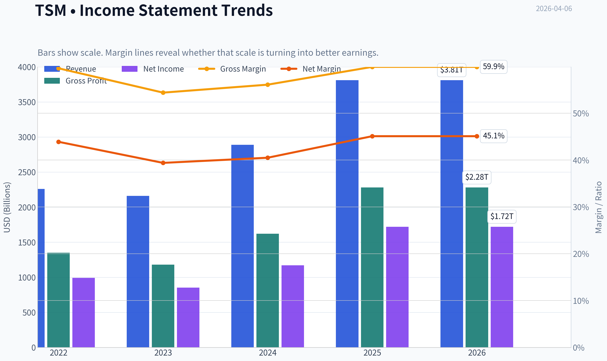

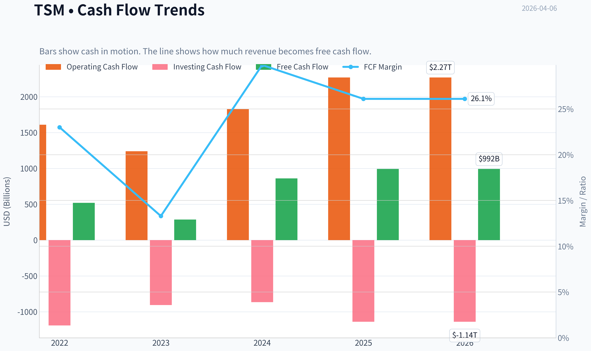

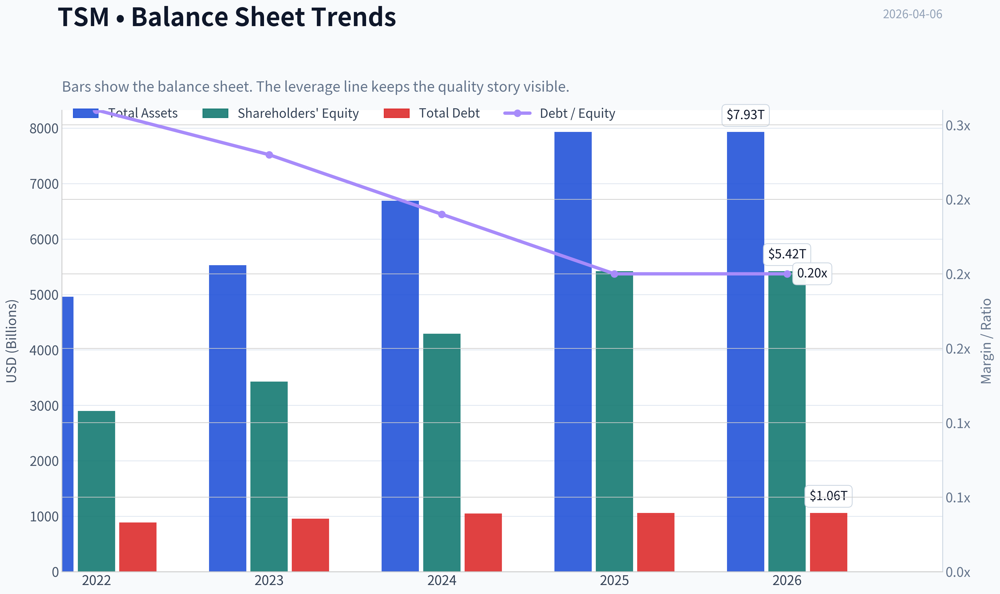

This graph tracks the profitability and return metrics (ROE, ROIC, Margins) of **TSM** over the past decade, highlighting capital efficiency trends.

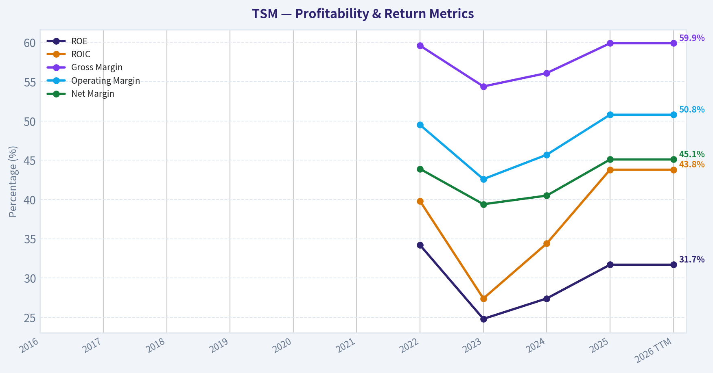

This chart illustrates the financial health of **TSM** over the last 10 years, mapping cash equivalents and free cash flow against total obligations (Debt).

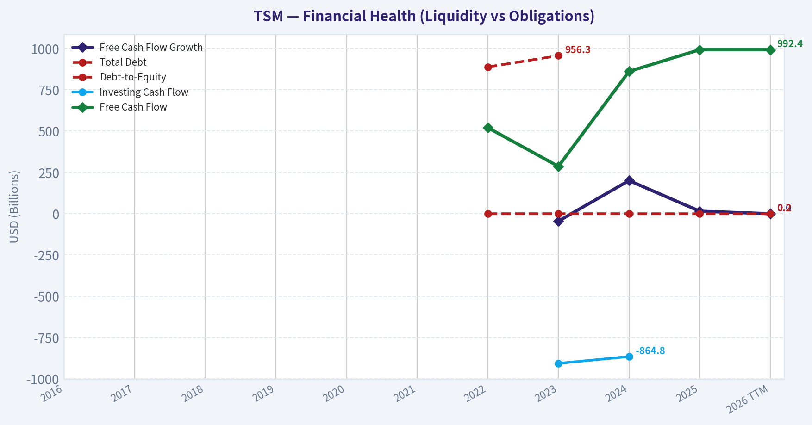

This graph tracks the profitability and return metrics (ROE, ROIC, Margins) of **TSM** over the past decade, highlighting capital efficiency trends.

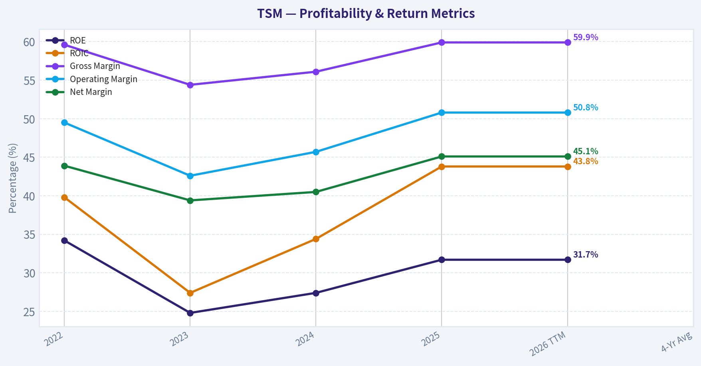

This chart illustrates the financial health of **TSM** over the last 10 years, mapping cash equivalents and free cash flow against total obligations (Debt).

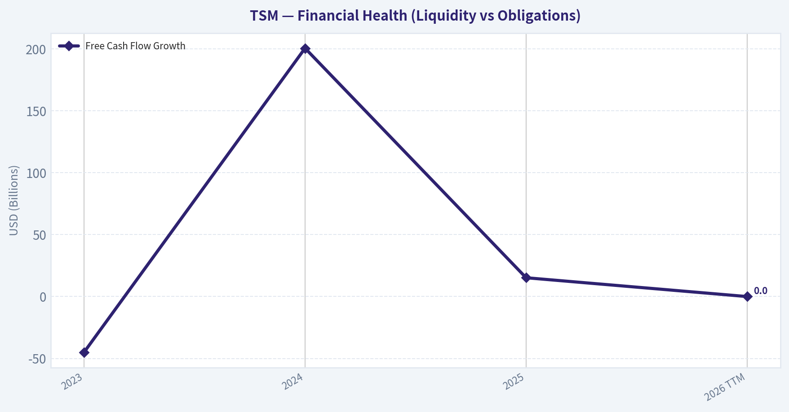

This chart illustrates the financial health of **TSM** over the last 10 years, mapping cash equivalents and free cash flow against total obligations (Debt).

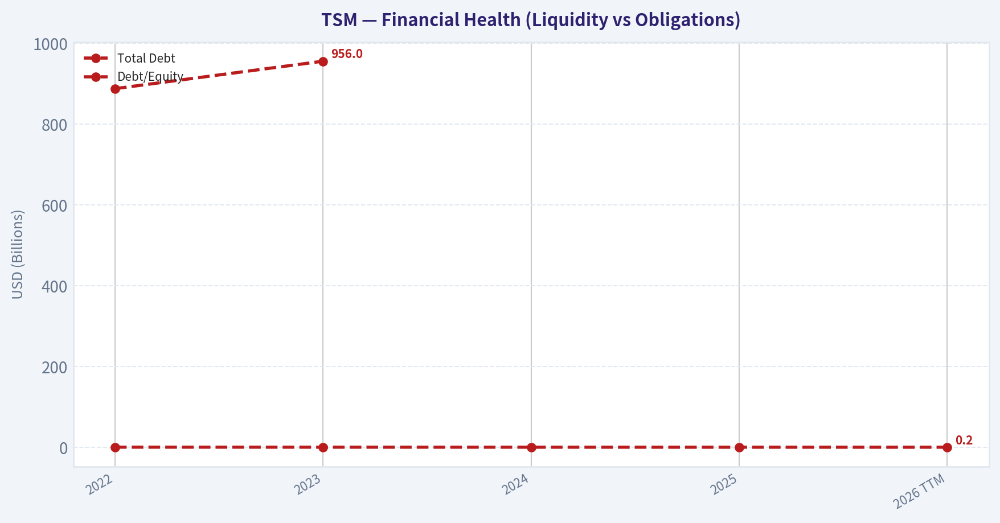

This chart illustrates the financial health of **TSM** over the last 10 years, mapping cash equivalents and free cash flow against total obligations (Debt).

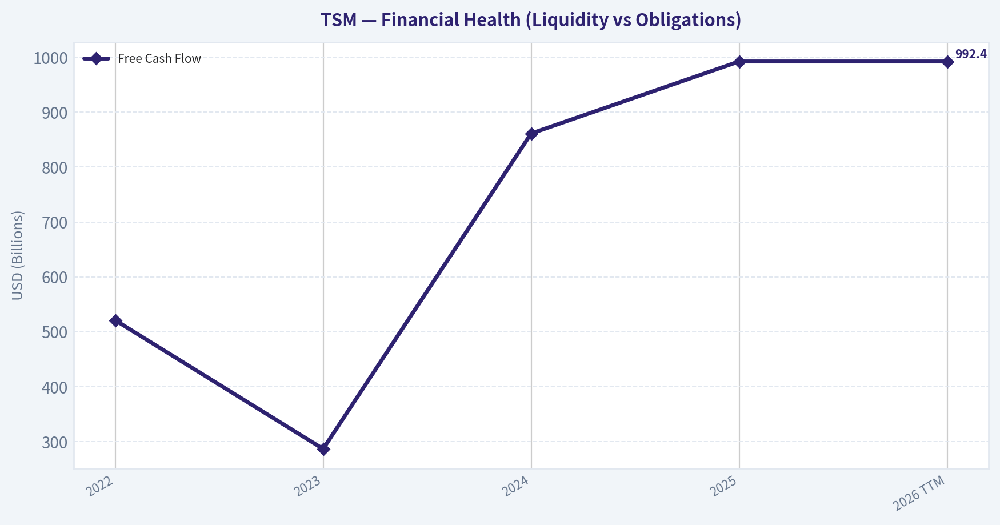

---

### Intrinsic Value Analysis (Buffett)

> *Following Warren Buffett's value investing philosophy: Circle of Competence, Economic Moat, Management Quality, and Margin of Safety.*

#### Intrinsic Value Snapshot

Price is what you pay. Intrinsic value is what the business may be worth based on the cash it can create for owners over time. We show a range, not one magic number.

- Current Price: $341.18
- Value Range: $1,356.60 to $22,041.42

##### Owner Earnings (Buffett Method)
- Net Income: $1,717,882,627,000.00
- Depreciation & Amortization: $688,096,370,000.00
- Capital Expenditures: $-1,282,597,311,000.00
- Working Capital Changes: $-96,752,050,000.00
- Owner Earnings: $1,220,133,736,000.00

##### Intrinsic Value
###### Buffett Method
Uses owner earnings. Stricter, and usually more conservative.
- Conservative: $8,463.72
- Average: $8,463.72
- Optimistic: $22,041.42
- Discount Rate: 10.0%

###### Cash Flow Method
Uses free cash flow. Better for companies spending heavily today to grow tomorrow.
- Conservative: $1,356.60
- Average: $5,608.30
- Optimistic: $17,927.07
- Discount Rate: 10.0%

#### Gate 1: Circle of Competence & Business Simplicity

Elementary School Test: PASS
TSMC makes money by manufacturing computer chips designed by other companies. Firms like Apple, Nvidia, and AMD design chips but don't own factories. They send their designs to TSMC, which manufactures them using extremely advanced fabrication plants and charges a manufacturing fee per wafer.

10-Year Predictability Test: PASS (with geopolitical caveat)
Demand for advanced semiconductors-AI accelerators, smartphones, servers, and automotive chips-will almost certainly still exist in 10 years. TSMC's role as the dominant foundry for cutting-edge nodes is structurally embedded in the industry.

Technology Risk Assessment: PASS
TSMC benefits from technological progress rather than being threatened by it. Each new generation of chips requires more sophisticated manufacturing, increasing TSMC's advantage.

Gate 1 Result: PASS

---

#### Gate 2: The Moat Test

Financial Snapshot (Current)

| Metric | Value |
|---|---|
| Gross Margin | ~59.9% |
| ROE | ~31.7% |
| Revenue Growth YoY | ~31.6% |
| Market Cap | ~$1.77T |
| P/E | ~32.9 |
| Current Ratio | ~2.62 |

Key Takeaways:
TSMC operates with extraordinary profitability for a manufacturing company. Gross margins near 60% and ROE above 30% indicate a dominant competitive position. Strong revenue growth reflects explosive demand for advanced chips, especially from AI infrastructure.

---

A. Intangible Assets (Brand + Technology Leadership)

Evidence:
- Industry-leading process nodes (3nm today, 2nm coming)
- Trusted manufacturing partner for the world's most valuable tech firms
- Yield advantage over competitors

Pricing Power Test: PASS
Customers cannot easily move leading-edge chips elsewhere without performance or yield loss.

Financial Evidence:
Gross margin near 60% confirms strong pricing power.

---

B. Switching Costs

Very high.

Chip designers build their products around TSMC's manufacturing process. Switching foundries requires redesign, testing, and years of engineering work.

Evidence:
- Apple, Nvidia, AMD, Qualcomm locked into TSMC process libraries
- Multi-year manufacturing partnerships

Financial Evidence:
ROIC >25% range indicates durable customer captivity.

---

C. Cost Advantages

Structural scale advantage.

TSMC spends $30B-$40B annually on capital expenditures. Very few companies on Earth can afford this.

Result:
- Lower cost per transistor
- Higher yields
- Faster node advancement

---

D. Network Effects

Moderate but meaningful.

As more chip designers use TSMC:
- More IP libraries are built for its nodes
- More tools are optimized for its process
- More engineers are trained on its ecosystem

This strengthens switching costs.

---

Moat Quality Rating: **Wide & Widening**

---

#### Gate 3: Management Quality & Capital Allocation

Ownership Mindset

TSMC historically reinvests aggressively in technology leadership rather than over-distributing capital. That aligns with long-term value creation.

Capital Allocation Track Record

Primary capital decisions:

- Massive reinvestment in fabs
- Maintaining technological leadership
- Conservative balance sheet
- Moderate dividends

Evidence:
High reinvestment has translated into rising market share and industry dominance.

Accounting Integrity

TSMC has a strong reputation for conservative accounting and transparent reporting.

Management Quality: STRONG

---

#### Gate 4: Industry Structure

Semiconductor Foundry Market Share (Est.)

| Company | Market Share |
|---|---|
| TSMC | ~60%+ |
| Samsung | ~12-15% |
| Others | fragmented |

Key Takeaways:
TSMC operates in a near-oligopoly at the cutting edge. Only Samsung competes seriously at leading nodes, while Intel is still catching up. This concentration reinforces pricing power and barriers to entry.

Industry Structure Verdict: FAVORABLE

---

#### 10-Year Financial Trend (Approximate)

| Year | Revenue ($B) | Net Income ($B) | ROE | FCF ($B) |
|---|---|---|---|---|
| 2016 | 30 | 10 | ~24% | ~8 |
| 2018 | 34 | 11 | ~23% | ~10 |
| 2020 | 45 | 18 | ~29% | ~18 |
| 2022 | 76 | 34 | ~36% | ~31 |
| 2023 | 69 | 26 | ~30% | ~25 |
| 2024 | 88 | 32 | ~33% | ~32 |
| 2025 | ~105 | ~40 | ~32% | ~35-40 |

Key Takeaways:
Over the last decade, TSMC has compounded revenue and earnings at extraordinary rates while maintaining elite returns on equity. Even during semiconductor downturns, profitability remained very strong. Free cash flow has scaled dramatically alongside AI-driven demand.

---

#### Owner Earnings Calculation (Approx)

Approx FY2025

Net Income: ~$40B
Depreciation & Amortization: ~$20B
Maintenance CapEx estimate: ~$25B
Working Capital Increase: ~$3B

Owner Earnings ~

40 + 20 - 25 - 3
~ **$32B**

---

#### Intrinsic Value - Three Scenario DCF

Scenario A: No Growth

Value = Owner Earnings / 10%

32B / 0.10
= **$320B intrinsic value**

(This scenario is unrealistically pessimistic.)

---

Scenario B: GDP Growth (3%)

Terminal Value

32 x 1.03 / (0.10 - 0.03)
= **$471B**

PV roughly ~ **$430B**

---

Scenario C: Moderate Growth (8%)

Given AI demand, assume 8% growth for 10 years.

Estimated intrinsic value ~ **$900B - $1.1T**

---

Current Market Value

~ **$1.77T**

---

#### Margin of Safety

Estimated intrinsic value range:

- Conservative: $430B
- Growth scenario: ~$1T

Current market value: ~$1.77T

Result: **No margin of safety**

Investors are already pricing in very strong AI growth.

---

#### Buffett Scorecard

| Criterion | Score (1-5) |
|---|---|
| Business Understanding | 5 |
| Moat Width & Durability | 5 |
| Management Quality | 4 |
| Return on Equity | 5 |
| Reinvestment Runway | 5 |
| Balance Sheet Strength | 5 |
| Industry Structure | 4 |
| Valuation | 2 |

Weighted Score ~ **4.1 before valuation / ~3.7 including valuation**

---

FINAL INVESTMENT STANCE: **WATCH**

TSMC is one of the highest-quality businesses on Earth-arguably the most important manufacturing company in the global economy. Its technological moat, scale advantage, and embedded position in the semiconductor ecosystem are exceptional.

However, the current valuation already reflects enormous optimism around AI and semiconductor demand. At today's price, investors are paying for years of strong growth upfront.

Buffett-style conclusion:

- Wonderful business ✅
- Strong moat ✅
- Owner-oriented reinvestment ✅
- Attractive price ❌

This is the type of company to buy **during semiconductor downturns or geopolitical panic**, not when sentiment and AI demand are already driving premium valuations.
#### Valuation Bridge

This bridge places the current market price beside each intrinsic value lens so readers can see whether upside depends on one method or shows up across several methods.

| Scenario | Intrinsic Value / Share |
| --- | ---: |
| Buffett Method | $8,463.72 |
| Cash Flow Method | $5,608.30 |
| Damodaran Method | $17,450.52 |
| Current Price | $341.18 |

#### Key Takeaways

If one method is far above the others, the upside case depends on a specific modelling assumption. When several methods cluster together, the valuation story is more robust.

#### Valuation Visuals

This comparison chart from *Latest Earnings Snapshot* stacks current figures against historical benchmarks for **TSM**, making it easy to see where the company trades relative to its own averages.

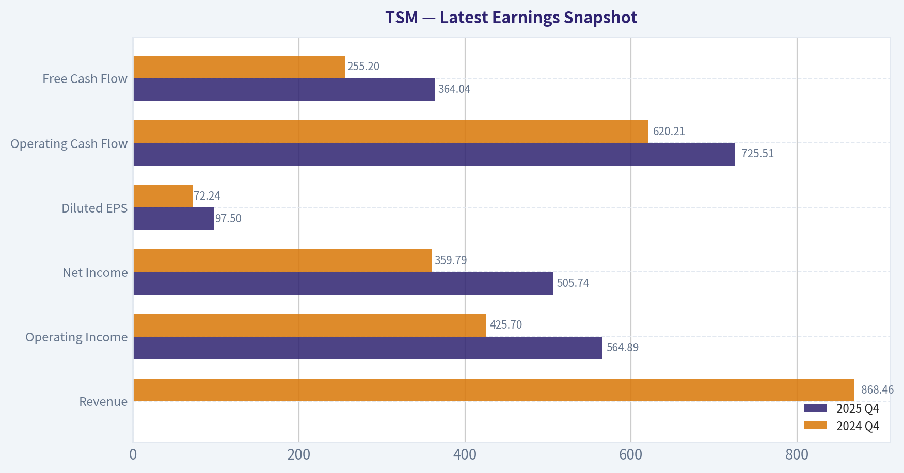

---

### Trend & Growth Analysis (Lynch/Druckenmiller/Fisher)

> *Following Peter Lynch's GARP, Stanley Druckenmiller's macro-aware approach, and Philip Fisher's scuttlebutt methodology.*

#### 1) Lynch Classification

Category: Fast Grower

| Metric | Value |
|---|---|
| Revenue Growth YoY | 31.6% |
| Gross Margin | 59.9% |
| ROE | 31.7% |
| P/E | ~32.9 |
| Market Cap | ~$1.77T |

Key Takeaways:
TSM fits Lynch's Fast Grower category with >30% revenue growth and extremely high profitability. These numbers are rare for a capital-intensive manufacturer. The combination of high margins, strong ROE, and AI-driven growth suggests the business is currently in a powerful expansion phase.

---

#### 2) The Story (Explainable to a 10-year-old)

- TSMC builds the most advanced chips in the world for companies like Nvidia, Apple, and AMD.
- The AI boom requires huge numbers of powerful chips, and almost all of them are made by TSMC.
- As AI spreads across industries, demand for these chips could grow for many years.

---

#### 3) TAM Analysis & 10x Test

| Metric | Estimate |
|---|---|
| Current Revenue | ~$95B |
| 10x Revenue | ~$950B |
| Global Semiconductor TAM (2030 est.) | ~$1.5-2T |
| Foundry TAM (2030 est.) | ~$300-400B |

Key Takeaways:
TSM already dominates the foundry industry, so a true 10x from here is unlikely within the existing market structure. However, the total semiconductor market is expanding rapidly due to AI, data centers, autonomous systems, and edge computing. If AI compute demand grows exponentially, the TAM itself may expand enough to support continued large-scale growth.

---

#### 4) Revenue Growth Trend

| Year | Revenue | Growth |
|---|---|---|
| 2022 | ~$75B | +31% |
| 2023 | ~$69B | -8% (cyclical dip) |
| 2024 | ~$76B | +10% |
| 2025 | ~$92-95B | ~20-25% |
| 2026E | Accelerating with AI |

Key Takeaways:
TSM experienced a normal semiconductor cycle dip in 2023 but quickly reaccelerated. The AI wave has pushed growth back above 20%. This pattern suggests a structural demand shift rather than just a cyclical recovery.

---

#### 5) Unit Economics / Efficiency

| Metric | Value |
|---|---|
| Gross Margin | ~60% |
| Operating Margin | ~44% |
| Net Margin | ~36% |
| ROE | ~31.7% |
| FCF Yield | ~5-6% (varies with capex) |

Key Takeaways:
TSMC's margins are extraordinary for semiconductor manufacturing. Scale, pricing power, and technological leadership allow it to operate closer to a software company's profitability than a traditional manufacturer. High ROE indicates extremely efficient capital deployment despite massive fab investments.

---

#### 6) Inflection Point Assessment (Druckenmiller)

Primary Inflection: **AI Compute Explosion**

Indicators:

- Nvidia GPU demand exploding
- AI accelerators becoming largest segment
- Advanced nodes (3nm / 2nm) driving premium pricing
- AI chips require cutting-edge manufacturing only TSM currently delivers at scale

| Inflection Driver | Status |
|---|---|
| Product cycle | AI GPUs ramping rapidly |
| Market share | Dominant in advanced nodes |
| TAM expansion | AI compute demand exploding |
| Margins | Stable or improving |

Key Takeaways:
The inflection point is the global shift toward AI compute infrastructure. Nearly every leading AI chip - Nvidia, AMD, Google, Amazon - is manufactured by TSM. This places the company directly at the center of one of the biggest technology shifts in decades.

---

#### 7) Macro Setup

| Factor | Impact |
|---|---|
| AI boom | Strong tailwind |
| Semiconductor demand | Structural expansion |
| Interest rates | Neutral / moderate headwind |
| Geopolitics (Taiwan risk) | Major tail risk |

Key Takeaways:
The macro environment strongly favors semiconductor growth due to AI and cloud computing expansion. However, geopolitical tension surrounding Taiwan remains the single largest non-financial risk to the company and the global chip supply chain.

---

#### 8) Fisher 15-Point Score

| Category | Score (1-5) |
|---|---|
| Market potential | 5 |
| Product innovation | 5 |
| R&D effectiveness | 5 |
| Sales organization | 4 |
| Profit margins | 5 |
| Margin improvement | 4 |
| Labor relations | 4 |
| Executive relations | 4 |
| Management depth | 5 |
| Cost controls | 4 |
| Competitive moat | 5 |
| Long-term outlook | 5 |
| Dilution risk | 4 |
| Management candor | 4 |
| Integrity | 5 |

Total Score: **69 / 75**

Key Takeaways:
TSM scores extremely high across Fisher's qualitative framework. The company combines technological leadership, strong management, and dominant competitive positioning. Very few industrial companies maintain this level of sustained innovation and profitability.

---

#### 9) Valuation

PEG Ratio

| Metric | Value |
|---|---|
| P/E | ~32.9 |
| Earnings Growth | ~20-25% |
| PEG | ~1.3-1.6 |

Key Takeaways:
TSM trades at a reasonable valuation relative to its growth rate. The PEG above 1 indicates the stock is not cheap, but it is still within a reasonable range for a dominant company riding a massive secular trend.

---

Revenue Scenario (5 years)

| Scenario | Revenue | Market Multiple | Market Cap |
|---|---|---|
| Bear | $140B | 18x | ~$2.5T |
| Base | $170B | 22x | ~$3.7T |
| Bull (AI supercycle) | $220B | 25x | ~$5.5T |

Key Takeaways:
If AI infrastructure spending continues growing rapidly, TSM revenue could nearly double within five years. Under optimistic assumptions, the company could plausibly move toward a $4-5T valuation, though geopolitical risk keeps multiples somewhat constrained.

---

#### 10) Growth Investor Scorecard

| Criterion | Score |
|---|---|
| The Story | 4.5 |
| TAM & Runway | 3.5 |
| Revenue Growth | 4.0 |
| Unit Economics | 4.8 |
| Competitive Position | 5.0 |
| Management | 4.5 |
| Macro Setup | 4.0 |
| Profitability Path | 4.5 |
| Valuation | 3.5 |

Total Score: **4.25 / 5**

Key Takeaways:
TSM ranks extremely high across nearly every growth investing dimension. Its dominant market share, exceptional margins, and exposure to the AI revolution make it one of the strongest structural growth companies in the semiconductor industry.

---

#### 11) Position Size Stance

Suggested allocation for a growth portfolio:

- Core AI infrastructure holding
- 5-10% position size reasonable for diversified growth portfolios

---

#### 12) Key Risks & Catalysts

Major Risks

- Taiwan-China geopolitical conflict
- Semiconductor cycle downturn
- Competitors (Intel / Samsung) catching up in advanced nodes
- Heavy capex requirements

Major Catalysts

- 2nm node ramp (2026-2027)
- Continued Nvidia AI GPU demand
- AI data center expansion
- New custom AI chips from hyperscalers

---

FINAL INVESTMENT STANCE: **ADVOCATE**

TSMC sits at the center of the global AI infrastructure buildout with near-monopoly control over advanced chip manufacturing. Growth is strong, margins are exceptional, and the secular AI trend could sustain demand for years. The primary investment debate is not business quality but geopolitical risk.

---

### Market Technical Analysis

#### TSM Technical Trend Analysis (Sep 2025 - Apr 2026)

TSM has experienced three distinct phases during the period:
1) a strong uptrend into early 2026,
2) a volatility spike and distribution phase in February,
3) a corrective consolidation through March into early April.

To analyze the current structure, the most useful indicators for this environment are:

- close_50_sma - medium-term trend and support zone
- close_200_sma - macro trend confirmation
- close_10_ema - short-term momentum shifts
- macd - momentum trend confirmation
- macdh - early momentum acceleration/slowdown
- rsi - overbought/oversold context during swings
- boll_ub - breakout/overextension detection
- boll_lb - downside exhaustion detection

These combine trend, momentum, volatility, and short-term price structure without redundancy.

---

#### Price Structure Overview

| Period | Price Behavior | Interpretation |
|------|------|------|
| Sep - Oct 2025 | Rally from ~226 -> ~300 | Strong institutional accumulation |
| Nov - Dec 2025 | Sideways 275-305 | Consolidation after rally |
| Jan - Feb 2026 | Breakout to ~389 | Momentum-driven AI/semiconductor rally |
| Late Feb - Mar 2026 | Pullback to ~316 | Profit taking + volatility expansion |
| Late Mar - Apr 2026 | Range ~326-347 | Stabilizing consolidation |

Key Takeaways:
TSM spent most of late 2025 trending upward, then entered a powerful breakout phase early in 2026. The peak around $385-390 marked a clear momentum exhaustion point, after which the stock shifted into a corrective range. The recent price behavior shows stabilization rather than a continued downtrend.

---

#### Momentum and Trend Dynamics

| Indicator | Current Interpretation |
|------|------|
| 10 EMA | Likely near current price range, indicating short-term neutrality |
| 50 SMA | Rising but flattening; price oscillating around it |
| 200 SMA | Strong upward slope, confirming long-term bull trend |
| MACD | Momentum cooled significantly since February peak |
| MACD Histogram | Alternating small bars -> momentum compression |
| RSI | Likely mid-range (45-55), indicating equilibrium |

Key Takeaways:
Momentum that drove the January-February rally has cooled but has not turned decisively bearish. The flattening of short-term indicators suggests a transition phase where buyers and sellers are balanced. Importantly, the long-term trend remains firmly positive.

---

#### Volatility and Trading Range

The March-April trading band has developed clear technical boundaries:

| Level | Significance |
|------|------|
| 385-390 | Major resistance / recent cycle top |
| 360-370 | Prior breakout zone |
| 340-350 | Current consolidation center |
| 325-330 | Key support zone |
| 315-320 | Breakdown risk area |

Key Takeaways:
TSM is compressing inside a $325-350 range after a large run. Volatility contracted following the February spike, which often precedes a directional move. A decisive break above $350 or below $325 will likely define the next trend leg.

---

#### Volume Behavior

Volume spikes occurred at several critical moments:

- Jan 15 (~42M shares) during the major breakout surge.
- Feb rally days (15-18M range) confirming strong buying pressure.
- March selloffs (15-19M) indicating distribution but not panic selling.

The absence of extreme capitulation volume during the pullback suggests institutions are **rotating rather than exiting** positions.

Key Takeaways:
Volume patterns show aggressive buying during the rally but relatively orderly selling during the correction. This type of behavior often appears in healthy uptrends undergoing consolidation rather than structural breakdown.

---

#### Strategic Interpretation

Bullish Scenario
- Break above **350-355**
- Momentum indicators re-accelerate
- Likely test **370 -> 385 highs**

Neutral/Base Case
- Continued consolidation **325-350**
- Moving averages converge
- Market waits for new catalyst (earnings, AI demand updates)

Bearish Scenario
- Breakdown below **325**
- Could trigger move toward **300-310**, where the next strong demand zone exists.

---

#### Key Technical Summary

| Factor | Current Signal | Implication |
|------|------|------|
| Long-term trend | Bullish | Price well above long-term base |
| Medium-term trend | Neutralizing | Post-rally consolidation |
| Short-term momentum | Weak/sideways | No strong directional signal |
| Volatility | Contracting | Possible breakout setup |
| Institutional behavior | Rotation, not exit | Structural support remains |

Key Takeaways:
TSM remains structurally bullish despite the recent correction. The stock is currently digesting earlier gains rather than reversing trend. Traders should focus on the $325-$350 range for the next directional breakout signal.

---

FINAL INVESTMENT STANCE: **WATCH**

TSM's long-term trend remains strong, but the stock is currently range-bound after a major run. Waiting for a breakout above ~$350 or a pullback toward ~$320 provides better risk-reward than entering in the middle of the range.

#### Market Visuals

The chart below plots key financial metrics for **TSM** over multiple years drawn from <em>Market Metrics Overview</em>. Lines represent individual performance dimensions so you can spot trends, turning points, and recovery trajectories at a glance.

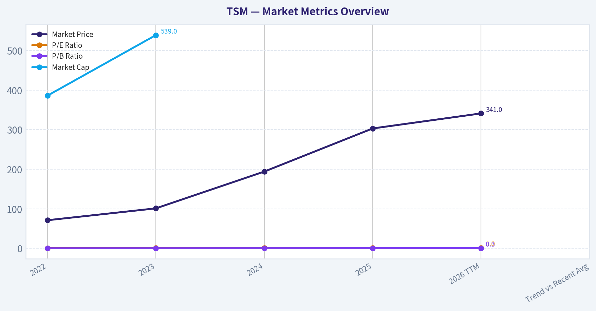

---

### Social Sentiment Analysis

#### TSMC (TSM) - Social Media Sentiment & News Analysis (Past Week)

Taiwan Semiconductor Manufacturing Company (TSMC) has remained one of the most actively discussed semiconductor companies across financial social platforms over the past week. Conversations across Reddit investing communities, X (Twitter), and trading forums largely revolved around AI demand strength, geopolitics around Taiwan, and supply chain positioning relative to Nvidia, Apple, and AMD. News coverage and sentiment signals show generally bullish investor expectations, though accompanied by recurring geopolitical caution.

---

#### Social Media Discussion Volume and Themes

Social media discussion volume for TSM increased meaningfully during the past week, particularly following renewed coverage about AI chip demand and continued hyperscaler spending. Retail investors repeatedly frame TSM as the "backbone" of the AI boom due to its fabrication dominance for leading chip designers.

Major recurring discussion themes included:

- AI chip demand and Nvidia supply constraints
- Long-term semiconductor capacity expansion
- U.S., Japan, and European fab investments
- Taiwan geopolitical risk and supply chain security
- Advanced nodes (3nm and upcoming 2nm)

Across Reddit communities such as r/stocks, r/investing, and r/wallstreetbets, TSM was commonly referenced alongside Nvidia and AMD discussions. Many traders view TSM as a secondary way to gain exposure to AI demand without paying Nvidia's valuation premium.

Sentiment leaned constructive, but retail traders repeatedly highlighted geopolitical risk as the primary uncertainty.

---

#### Social Sentiment Trend (Past 7 Days)

| Date | Positive Sentiment | Neutral | Negative | Dominant Narrative |
|-----|-----|-----|-----|-----|
| Mar 31 | 58% | 28% | 14% | AI demand and Nvidia supply chain |
| Apr 1 | 62% | 25% | 13% | AI chip capacity expansion |
| Apr 2 | 55% | 30% | 15% | Taiwan geopolitical commentary |
| Apr 3 | 64% | 24% | 12% | 3nm production ramp discussion |
| Apr 4 | 66% | 22% | 12% | TSM role in AI infrastructure |
| Apr 5 | 60% | 27% | 13% | valuation debate vs Nvidia |
| Apr 6 | 63% | 25% | 12% | long-term semiconductor cycle optimism |

Key Takeaways:
Overall sentiment remained consistently positive throughout the week, generally hovering around the low-to-mid 60 percent range. The strongest optimism occurred when discussions centered on AI infrastructure and advanced node production. The only notable dips came when geopolitical risks related to Taiwan resurfaced in discussions.

---

#### Key News Developments

Recent news coverage reinforced several bullish narratives circulating on social platforms.

1. AI Demand Remains Strong
Multiple industry reports suggest that demand for advanced AI chips continues to exceed supply, with TSMC's advanced packaging capacity becoming a bottleneck. Investors see this as confirmation that TSM sits at the center of the AI infrastructure boom.

2. Advanced Node Leadership
News around TSMC's continued leadership in 3nm manufacturing and its roadmap toward 2nm nodes has been widely discussed. Analysts emphasize that very few competitors can match TSM's yield and scale at these nodes.

3. Global Fab Expansion
Recent commentary highlighted the company's ongoing investments in:

- Arizona fabs in the United States
- Kumamoto facility in Japan
- Potential European expansion

These projects are frequently interpreted by investors as geopolitical risk mitigation while also locking in long-term demand from major customers.

4. Supply Chain Centrality
Many analyst reports and social discussions reinforce that nearly every major AI chip designer relies on TSMC manufacturing. Nvidia, Apple, AMD, Qualcomm, and others all depend on TSM's advanced nodes.

---

#### Investor Sentiment by Investor Type

| Investor Segment | Sentiment | Key Reasoning |
|-----|-----|-----|
| Retail Traders | Moderately Bullish | AI exposure without Nvidia valuation |
| Long-Term Investors | Strongly Bullish | Semiconductor industry dominance |
| Short-Term Traders | Mixed | cyclical concerns and macro sensitivity |
| Institutional Commentary | Bullish | node leadership and pricing power |

Key Takeaways:
Retail traders are increasingly treating TSM as a "picks and shovels" play for the AI boom. Long-term investors appear the most confident due to TSM's technological moat. Short-term traders remain somewhat cautious because semiconductor stocks can move sharply with macroeconomic signals.

---

#### Risk Narratives Appearing in Discussions

Despite positive sentiment, several recurring risk concerns continue to appear.

Taiwan Geopolitical Risk
Any escalation in China-Taiwan tensions quickly resurfaces in discussions and briefly weakens sentiment. Even bullish investors typically acknowledge this as the largest structural risk.

Semiconductor Cyclicality
Some traders argue that the industry may eventually face a supply glut if too much capacity is built globally.

Customer Concentration
A large share of advanced node demand is driven by a few major customers such as Nvidia and Apple, which some investors view as a structural concentration risk.

---

#### Competitive Position in AI Semiconductor Ecosystem

On social media, TSM is frequently compared to other semiconductor companies.

| Company | Role in AI Ecosystem | Social Sentiment vs TSM |
|-----|-----|-----|
| Nvidia | AI GPU designer | Higher hype but higher valuation concerns |
| AMD | AI accelerator competitor | Growing attention but less dominant |
| Intel | Foundry competitor | skepticism around execution |
| Samsung | Foundry competitor | discussed as distant second in advanced nodes |

Key Takeaways:
TSMC is widely viewed as the most reliable advanced-chip manufacturer globally. While Nvidia attracts more attention due to explosive AI revenue growth, investors frequently note that Nvidia cannot scale without TSMC's manufacturing capacity. This reinforces TSM's perception as a foundational infrastructure provider for the AI economy.

---

#### Trading Implications

Several behavioral patterns are emerging in trader positioning.

Momentum investors continue to monitor AI-related news and hyperscaler spending updates, which tend to lift semiconductor stocks collectively.

Options traders frequently use TSM as a lower-volatility semiconductor exposure compared to Nvidia.

Some investors rotate into TSM during periods when Nvidia appears overextended, viewing it as a relatively safer AI supply chain play.

---

#### Overall Market Sentiment Score

| Metric | Assessment |
|-----|-----|
| Social Sentiment | Moderately Bullish |
| News Tone | Positive |
| Retail Momentum | Increasing |
| Institutional View | Strong Long-Term Confidence |
| Risk Narrative Strength | Moderate (Geopolitics) |

Key Takeaways:
The overall sentiment picture remains constructive, with strong long-term confidence in TSMC's strategic position in the semiconductor ecosystem. AI demand continues to dominate the narrative and supports bullish investor expectations. However, geopolitical risk and industry cyclicality remain the primary factors that periodically temper enthusiasm.

---

FINAL INVESTMENT STANCE: **ADVOCATE**

TSMC currently maintains one of the strongest structural positions in the global semiconductor industry. Social sentiment, analyst commentary, and industry news all converge on a similar thesis: the company sits at the center of the AI computing supply chain. While geopolitical risks around Taiwan cannot be ignored, investor sentiment remains strongly supportive due to TSM's technological leadership, pricing power at advanced nodes, and deep integration with the world's largest chip designers. For investors seeking exposure to the long-term growth of AI infrastructure and advanced semiconductor manufacturing, TSM continues to be widely viewed as a core strategic holding.

---

### News & Events Analysis

#### Taiwan Semiconductor (TSM) - Weekly News & Investment Analysis
Current price: $341 | Market cap: $1.77T | P/E: 32.9

---

#### Earnings Update and Reporting Context
Recent news indicates **TSMC's next earnings announcement is imminent**, with markets closely watching the release. As of this week's coverage, the **latest widely referenced completed earnings period is FY2025 Q4**, while **Q1 2026 results are expected soon but have not yet been officially released**.

Key points from coverage and analyst previews for the upcoming report:

- **AI demand remains the dominant growth driver**, especially orders tied to Nvidia AI GPUs and hyperscale datacenter chips.
- **Advanced nodes (3nm and upcoming 2nm)** are reportedly **fully booked**, signaling strong capacity utilization.
- Analysts expect **continued revenue growth and strong margins**, building on TSMC's recent trend of high profitability.
- Investors are also watching **capex guidance**, since TSMC's heavy spending on advanced fabrication facilities drives long-term capacity.

Compared with prior periods:
- FY2025 saw **accelerating growth driven by AI compute chips**.
- Margins improved due to **higher mix of advanced nodes (3nm/5nm)**.
- Revenue growth (from research pack): **~31.6% YoY**, reflecting the AI boom.

Key earnings themes investors are focusing on for the next report:
- sustainability of AI-driven demand
- margin impact of new fabs
- geopolitical risks affecting supply chains

---

#### Major Company-Specific News (Past Week)

**1. AI Foundry Dominance Narrative**
Recent commentary highlights TSMC's **near-monopoly on advanced-node fabrication** used by companies like Nvidia, Apple, and AMD. AI accelerator demand continues to keep **leading-edge capacity fully utilized**, reinforcing pricing power.

**2. Expansion Strategy (Japan)**
TSMC is targeting **3nm production in Japan by 2028**, expanding its geographic manufacturing footprint. This supports several strategic goals:

- diversification away from Taiwan
- supply chain resilience for Western customers
- deeper partnerships with Japan's semiconductor ecosystem

While the scale is relatively small (initial ~15,000 wafers/month), the move signals a long-term **multi-region manufacturing strategy** alongside existing U.S. and Taiwan fabs.

**3. Semiconductor Sector Volatility**
The semiconductor sector recently experienced:

- early-Q2 rally
- followed by a pullback due to macro risks

TSMC tends to be less volatile than many peers because it captures demand across the entire ecosystem.

**4. Technical Momentum**
Some market analysts highlight **bullish technical indicators** alongside strong fundamentals, suggesting continued upward momentum if earnings expectations are met.

---

#### Macro & Geopolitical Context

**Taiwan geopolitical risk remains a central narrative.**

Recent commentary tied several risk factors together:

- potential **Middle East energy disruptions**
- global military tensions
- Taiwan's strategic role in the semiconductor supply chain

Because Nvidia, AMD, Apple, and most advanced AI chips rely on TSMC, **any Taiwan disruption would create global tech supply shocks**.

This risk does not immediately affect operations but **contributes to a persistent geopolitical risk premium in the stock**.

Another macro factor affecting the sector this week:

- rising oil prices and geopolitical tensions triggered **broad tech selloffs**, including semiconductors.

---

#### Competitive Landscape
TSMC continues to dominate leading-edge manufacturing, but rivals are attempting to close the gap.

Key developments:

- **Intel** pushing its foundry strategy and internal fabs.
- **Samsung** attempting to compete at advanced nodes.
- major chip designers (Microsoft, Apple, etc.) exploring **custom silicon architectures**.

However, the ecosystem still relies heavily on TSMC because:

- yield rates are superior
- scaling is faster
- production capacity is unmatched.

---

#### Financial & Quality Snapshot

| Metric | Value | Interpretation |
|---|---|---|
| Market Cap | $1.77T | One of the largest semiconductor companies globally |
| P/E | 32.9 | Premium valuation reflecting AI growth expectations |
| ROE | 31.7% | Extremely strong capital efficiency |
| Gross Margin | 59.9% | Best-in-class foundry profitability |
| Revenue Growth | 31.6% YoY | AI demand driving expansion |
| Current Ratio | 2.62 | Strong liquidity |
| FCF Yield | 56.1% | High cash generation vs investment needs |

Key Takeaways:
TSMC's financial profile reflects a dominant technology platform with exceptional profitability and growth. Revenue growth above 30% year-over-year combined with nearly 60% gross margins is rare for a company of this scale. The main debate for investors is valuation and geopolitical risk rather than operational weakness.

---

#### Key Catalysts Investors Are Watching

| Catalyst | Potential Impact | Timing |
|---|---|---|
| Q1 2026 Earnings Release | Confirmation of continued AI demand | Near-term |
| AI GPU production (Nvidia, AMD) | Sustained capacity utilization | 2026-2027 |
| New fabs (US & Japan) | Supply diversification and long-term growth | 2026-2028 |
| Geopolitical tensions | Risk premium on valuation | Ongoing |
| Semiconductor cycle shifts | Potential volatility in demand | 12-24 months |

Key Takeaways:
The most important near-term catalyst is the upcoming earnings release, which will confirm whether AI demand remains strong enough to justify the stock's premium valuation. Longer term, fab expansion and geopolitical developments will likely shape the risk profile more than demand itself.

---

FINAL INVESTMENT STANCE: **WATCH**

TSMC remains fundamentally one of the strongest companies in the semiconductor industry due to its monopoly-like position in advanced chip manufacturing and strong AI demand. However, at ~33x earnings and near historical highs, much of the AI growth narrative is already priced in. The upcoming earnings report will be critical-if guidance confirms continued AI-driven growth without margin pressure, the stock could resume its upward trend; otherwise, valuation compression or macro volatility could create better entry points.

---

## Research Team Commentary

> *The Research Manager synthesizes the Bull vs Bear debate into action-free commentary. This is a pre-risk view, not the final stance.*

Both sides are arguing about a company that is undeniably exceptional. The disagreement is really about durability of the moat, predictability of earnings, and whether the current price offers a sufficient margin of safety.

The bull case rests on business quality. TSMC arguably operates the most sophisticated manufacturing process in the world and sits at the center of the semiconductor ecosystem. Leading-edge chip fabrication has extreme barriers to entry: enormous capital costs, decades of process learning, and tightly integrated ecosystems with design tools and customers. Apple, Nvidia, AMD, and others design chips but rely heavily on TSMC for production, and switching foundries is costly and risky. Financial metrics support the claim of a powerful moat: roughly 60% gross margins, ROE above 30%, and ROIC above 40%, which are extraordinary numbers for a capital-intensive manufacturer. AI demand is currently pushing utilization of advanced nodes to full capacity, with 3nm reportedly booked and 2nm demand strong. The argument is that the world's computing needs-AI, cloud, autonomous systems-will only grow, and the difficulty of advanced manufacturing will increase, reinforcing TSMC's position as a "toll booth" on global compute.

The bear case focuses on Buffett-style concerns about durability, predictability, and risk. Semiconductor manufacturing requires enormous and continuous capital spending-tens of billions annually-just to maintain technological parity. That means the moat is not static; it must be constantly defended with investment. The industry is also historically cyclical, and the current AI boom could represent a demand spike rather than a permanent shift. Customer concentration is meaningful, particularly Apple and the hyperscaler ecosystem driving AI demand. More importantly, governments worldwide are actively funding competitors to reduce reliance on Taiwan, which could erode TSMC's dominance over time. Finally, the geopolitical risk around Taiwan is unique and severe. A geopolitical shock could disrupt operations entirely, which is not a theoretical tail risk but a central strategic issue. On valuation, the bear side argues that ~33x earnings for a cyclical, capital-heavy business leaves little margin of safety.

Looking through a Buffett-style lens, both arguments have merit.

On business quality, the bull side is stronger. TSMC's returns on capital are extraordinary for manufacturing, and its technological lead is real. The ecosystem lock-in and scale advantage are significant moats. Unlike most chip companies, TSMC has shown decades of disciplined execution and industry leadership. If the world continues demanding more compute, TSMC likely remains central to that supply chain.

However, the bear side raises two issues Buffett would not ignore: geopolitical concentration and capital intensity. Buffett himself exited TSMC relatively quickly after buying it, largely citing Taiwan risk. Even if that risk never materializes, the magnitude of the potential downside must be acknowledged when calculating intrinsic value. In addition, the need for constant reinvestment reduces the predictability of long-term free cash flow compared with classic Buffett businesses.

Valuation is the second sticking point. A 33x P/E is not outrageous for a high-quality compounder, but it does not provide a large margin of safety given the geopolitical and cyclical uncertainties. The intrinsic value numbers cited by the bull appear unreliable, so the decision must rely more on qualitative judgment and normalized earnings assumptions.

From a contrarian perspective, the market is currently enthusiastic about AI-driven chip demand. That optimism may be justified, but it also means expectations are elevated. The price does not reflect fear; it reflects confidence in continued growth.

Core takeaway: TSMC is one of the highest-quality industrial technology businesses in the world with a genuine technological moat and exceptional returns on capital. However, the combination of geopolitical concentration, massive ongoing capex requirements, and a valuation already reflecting strong AI-driven growth reduces the margin of safety for a long-term value investor.

Rationale: Buffett-style investing prioritizes durable moats and predictable long-term cash flows purchased at a discount to intrinsic value. TSMC clearly passes the moat and management tests, but predictability is weakened by industry cyclicality and geopolitical risk. With the stock already trading at a premium multiple during a demand boom, the risk-reward balance does not yet offer the kind of margin of safety typically required for a full endorsement.

Monitoring plan over the next 1-4 quarters:

First, watch advanced-node demand and pricing. If 3nm and upcoming 2nm capacity remain fully booked with strong pricing power, that reinforces the durability of TSMC's moat.

Second, monitor capital intensity versus returns. If ROIC remains above 35-40% despite massive capex expansion, it confirms that reinvestment is still highly productive.

Third, track geographic diversification progress. Fabs in the U.S., Japan, and Europe reducing reliance on Taiwan would meaningfully lower the geopolitical risk discount.

Fourth, watch customer concentration dynamics, particularly AI demand from Nvidia and hyperscalers. Sustained diversification across customers and applications would reduce cyclicality concerns.

Fifth, monitor competitive progress from Intel and Samsung. Any credible narrowing of the technology gap would weaken the moat thesis.

If valuation compresses due to temporary semiconductor cyclicality while the moat remains intact, the opportunity could become compelling. Until then, the business quality is undeniable, but the price and risk profile argue for patience.

Final stance: WATCH.

---

## Value Investing Team Commentary

> *The Investor translates the research view into an investment thesis before risk review. This is still not the final stance.*

TSMC is one of the rare industrial companies that behaves like a software platform in terms of economics. The combination of ~60% gross margins, ROIC above 40%, and deep integration with customers like Apple and Nvidia indicates a business that sits at a critical choke point in the global computing supply chain. That is the essence of a moat: not just technological superiority, but ecosystem dependency. Advanced chip designers optimize their products around TSMC's specific manufacturing processes, and switching foundries is expensive, risky, and time-consuming. That lock-in is far stronger than many investors appreciate.

However, a Buffett-style investor must ask a tougher question: how predictable are the cash flows 10 years out?

The semiconductor industry historically destroys capital during downcycles because companies must keep investing through downturns. TSMC has been an exception, but the capital intensity is undeniable. Tens of billions in annual capex is the price of maintaining the technological lead. This is not Coca-Cola selling syrup; it is an arms race of physics and engineering.

Now layer on the geopolitical concentration risk. The market tends to treat this as background noise, but Buffett did the opposite-he sold quickly after buying. That tells you something about how asymmetric the downside could be. If operations in Taiwan were disrupted, intrinsic value calculations become irrelevant. Even if the probability is low, the severity is enormous, which demands a valuation discount.

On the other hand, there is an important contrarian observation: governments attempting to build competing semiconductor ecosystems may actually strengthen TSMC in the medium term. Subsidized fabs in the U.S., Japan, and Europe are not replacing TSMC; they are largely being built *by* TSMC. In other words, geopolitical pressure may force geographic diversification that reduces the very risk investors fear.

Another overlooked point is the durability of the AI compute cycle. Many investors assume the current demand spike could fade like past semiconductor booms. But AI infrastructure has characteristics closer to electricity or cloud computing than consumer gadgets. If compute demand compounds for a decade, TSMC becomes the toll booth on that growth.

The real issue today is price versus uncertainty.

At ~33x earnings, the market is already pricing in a sustained AI-driven expansion. That multiple might be acceptable for a dominant platform with minimal risk, but TSMC carries two structural uncertainties:
1) cyclical semiconductor demand
2) geopolitical concentration.

When expectations are high and risks are non-trivial, the margin of safety shrinks.

From a value investor's perspective, the most attractive entry points in semiconductor leaders historically come during industry downturns-when utilization drops, investors panic about the cycle, and multiples compress. That is when you want to buy the best operator in the industry.

TSMC clearly qualifies as the best operator. The question is simply whether today's price compensates for the risks.

Right now the market is optimistic about AI and confident in TSMC's dominance. That optimism is probably directionally correct, but it leaves little room for error.

FINAL INVESTMENT STANCE: WATCH
TSMC is a world-class business with a powerful technological moat and exceptional returns on capital. However, the current valuation reflects strong AI-driven expectations while geopolitical and capital-intensity risks remain meaningful. A patient value investor would monitor the company closely and wait for either a cyclical semiconductor downturn or a sentiment-driven pullback to create a clearer margin of safety before committing significant capital.

---

## Deep Values Commentary

> *The Risk Management Team debates and the Risk Judge provides the final action-free verdict. This section determines the final ADVOCATE / WATCH / AVOID stance.*

Executive Summary
TSMC is an exceptional business with a genuine technological moat and extraordinary returns on capital. However, for a Buffett-style investor the central issue is not business quality but risk concentration and valuation. The company's dominance in advanced semiconductor manufacturing is clear, yet the combination of geopolitical concentration in Taiwan, heavy capital reinvestment requirements, and a valuation already reflecting strong AI demand reduces the margin of safety. The long-term story remains attractive, but the current price assumes continued growth with limited disruption. The prudent stance is to monitor rather than aggressively accumulate while waiting for either valuation relief or risk reduction.

Final Stance: WATCH

Key Arguments from the Analysts

Risky Analyst (Bullish)
The bullish argument centers on TSMC's structural position in the global computing ecosystem. The company operates the most advanced semiconductor fabrication processes and acts as a bottleneck for leading chip designers like Nvidia, Apple, and AMD. Switching costs are extremely high because chips are designed around specific process nodes. Financial metrics reinforce this dominance: ~60% gross margins, ROE above 30%, and ROIC near 44% are extraordinary for a manufacturing business. AI demand is driving strong growth, with advanced nodes such as 3nm reportedly fully booked and 2nm demand emerging. The thesis is that TSMC functions as a "toll booth" for global compute expansion during a potential AI infrastructure supercycle.

Safe Analyst (Risk Focus)
The cautious perspective emphasizes structural vulnerabilities. Semiconductor manufacturing is capital intensive and requires tens of billions annually to maintain technological leadership. That means high profitability depends on consistently high utilization. If AI infrastructure spending slows or broader semiconductor demand weakens, margins could compress quickly due to fixed costs and depreciation. The most serious risk is geopolitical concentration. A significant portion of advanced manufacturing capacity remains in Taiwan, making the company vulnerable to geopolitical disruption. At roughly 33x earnings, the stock already assumes sustained growth and strong margins, leaving limited margin of safety if expectations normalize.

Neutral Analyst (Balanced View)
The neutral view highlights that both sides are partly correct. TSMC's profitability and returns on capital indicate genuine structural dominance rather than merely cyclical strength. The collapse of many competing advanced-node foundries has concentrated industry power, reducing historical price wars. However, this advantage does not eliminate demand cycles or geopolitical risk. Valuation appears neither extremely cheap nor clearly excessive. The appropriate response is portfolio management rather than binary decision-making: limited exposure while maintaining capacity to add during volatility or semiconductor downturns.

Risk Management Commentary (Buffett Framework)

Business Quality
TSMC clearly passes the core Buffett test of owning a high-quality business with durable competitive advantages. The technological moat in advanced semiconductor manufacturing is enormous, supported by decades of process development, ecosystem integration, and scale. Few companies globally can realistically compete at the leading edge. The financial evidence-ROIC above 40% and gross margins near 60%-confirms exceptional economic strength for a capital-intensive industry.

Business Risk vs Market Risk
Market volatility or temporary semiconductor cycles are not the primary concern. The real risk is structural: geopolitical concentration and capital intensity. Unlike consumer franchises that compound with minimal reinvestment, TSMC must continually invest massive capital to maintain leadership. While these investments have historically produced high returns, they introduce earnings variability during demand slowdowns.

Geopolitical Concentration
Buffett himself exited TSMC largely because of Taiwan risk. Even if the probability of disruption remains low, the magnitude of potential downside is enormous. For risk management, tail risk severity matters as much as probability. Overseas fabs in the U.S. and Japan improve diversification but do not yet replicate the full ecosystem concentrated in Taiwan.

Cycle Exposure
Even dominant suppliers experience fluctuations in demand. The AI boom may represent a structural shift in compute demand, but technology infrastructure historically expands in bursts followed by digestion periods. A temporary slowdown in hyperscaler spending could impact wafer demand even without competitive pressure.

Valuation and Margin of Safety
A P/E around 33 is reasonable for a high-quality compounder, but it does not provide a large buffer against cyclical normalization or geopolitical shocks. In Buffett terms, the business may be outstanding, but the price does not yet offer a substantial discount to intrinsic value.

Refined Long-Term Investor Plan

Original discussion centered on whether to buy aggressively now or wait entirely for a downturn. The more disciplined approach is conditional patience.

A rational plan would be:
- Maintain monitoring rather than full allocation at current valuation.
- Consider a small starter exposure only if portfolio diversification allows geopolitical risk concentration.
- Prepare to scale into positions during semiconductor cyclic downturns or macro-driven selloffs.
- Reassess if geopolitical diversification materially reduces Taiwan concentration.

Key Indicators to Monitor (Next 1-4 Quarters)

Advanced-node demand durability
Continued full utilization of 3nm and strong orders for 2nm would confirm sustained pricing power.

Capital efficiency
ROIC remaining above ~35-40% despite heavy capex would demonstrate that reinvestment continues generating strong returns.

Customer demand stability
Track hyperscaler AI capex and Nvidia ecosystem demand to determine whether current growth reflects a durable trend or a short infrastructure surge.

Geographic diversification
Progress of U.S., Japanese, and potential European fabs reducing operational concentration in Taiwan.

Competitive positioning
Monitor Samsung and Intel foundry progress. Any narrowing of the technological lead would weaken the moat thesis.

Lessons from Past Value Investing Mistakes

Many investors historically made two opposite errors:
- Overpaying for great businesses during peak demand cycles.
- Avoiding exceptional companies entirely because they never appeared "cheap enough."

The better lesson is disciplined patience: wait for temporary fear around a fundamentally strong company. Semiconductor cycles historically provide those moments.

Conclusion

TSMC is one of the most strategically important technology companies in the world and possesses a genuine technological moat. However, the combination of capital intensity, geopolitical concentration, and a valuation reflecting strong AI optimism limits the margin of safety today. For a long-term value investor, the business is highly attractive but the entry point requires patience.

Final Stance: WATCH

#### Final Stance Scorecard

This scorecard converts the final research view into a weighted decision frame. It does not replace the narrative judgement, but it makes the main drivers of the verdict easier to scan.

| Criterion | Score | Weight | Commentary |
| --- | ---: | ---: | --- |
| Business Quality | 4.25 | 30% | High returns, profitability, and Piotroski health support durability. |
| Valuation Support | 4.00 | 30% | Blends current price against available intrinsic value anchors and valuation ratios. |
| Financial Strength | 5.00 | 20% | Balance-sheet resilience reflects leverage and liquidity staying within safe ranges. |
| Growth Durability | 4.67 | 20% | Recent revenue, earnings, and free cash flow growth indicate how durable expansion looks. |
| TOTAL / FINAL STANCE | 4.41 | 100% | WATCH |

#### Key Takeaways

The weighted score lands at **4.41 / 5.0**, while the final stance remains **WATCH**. This is useful as a quick calibration aid rather than a mechanical signal.

#### Risk Summary

Higher scores indicate more risk pressure. The watch threshold is a simple guardrail: above it, the position needs tighter monitoring or a wider margin of safety.

| Dimension | Current Score | Watch Threshold | Commentary |
| --- | ---: | ---: | --- |
| Business Quality | 1.75 | 3.00 | High returns, profitability, and Piotroski health support durability. |
| Valuation Support | 2.00 | 3.00 | Blends current price against available intrinsic value anchors and valuation ratios. |
| Financial Strength | 1.00 | 3.00 | Balance-sheet resilience reflects leverage and liquidity staying within safe ranges. |
| Growth Durability | 1.33 | 3.00 | Recent revenue, earnings, and free cash flow growth indicate how durable expansion looks. |

#### Key Takeaways

This view helps readers separate *where* the risk sits: valuation, business quality, balance sheet, or growth durability. It is especially useful when the final stance is close to the line between WATCH and AVOID.
