# TSM Deep Value Intelligence

**Analysis Date:** 2026-06-13

## Critical Disclaimer

*This analysis is generated by Deep Value Intelligence, an AI-powered multi-agent investing framework. This report is for informational and educational purposes only and does not constitute financial advice. Always conduct your own research and consult with qualified financial advisors before making investment decisions.*

---

## Table of Contents

1. Intelligence Summary
2. Analyst Team Reports
   - Fundamentals Analysis
   - Intrinsic Value Analysis (Buffett)
   - Trend & Growth Analysis (Lynch/Druckenmiller/Fisher)
   - Market Technical Analysis
   - Options Market Analysis
3. Research Team Commentary
4. Value Investing Team Commentary
5. Deep Values Commentary

---

## Intelligence Summary

### Thesis + Conditions

**Core Thesis:** ## Executive Briefing

**Key Risks:**
- TSM remains a world-class business, but not a clear Buffett-style bargain at this price.** The moat is exceptional: process leadership, customer lock-in, scale, and AI-linked demand all support long-term intrinsic value growth. But for risk management, the key issue is **entry discipline**. At roughly **36.5x earnings**, with heavy reinvestment needs and real geopolitical concentration, the margin of safety looks limited. The right move is **WATCH**, with room for **careful, partial accumulation only if sizing is conservative** and upcoming quarters confirm that margins, capex returns, and AI demand are holding up.
- ### Risky Analyst: strongest bullish points
- Geopolitical concentration** is a real business risk, not market noise.

**Confidence:** Medium

---

## Analyst Team Reports

### Fundamentals Analysis

#### Latest Earnings Snapshot

*Most recent reported quarter anchored on 2026 Q1, with prior-year comparison when available.*

| Metric | 2026 Q1 | 2025 Q1 | YoY Change |
| --- | ---: | ---: | ---: |
| Revenue | $1.13T | $839.25B | +35.1% |
| Operating Income | $658.95B | $407.09B | +61.9% |
| Net Income | $572.48B | $361.56B | +58.3% |
| Diluted EPS | $110.40 | $69.70 | +58.4% |
| Operating Cash Flow | $698.98B | $625.57B | +11.7% |
| Free Cash Flow | $347.27B | $292.45B | +18.7% |

Key Takeaways: This snapshot anchors the most recent reported quarter before the narrative analysis. It helps readers separate long-run business quality from whatever changed in the latest earnings print.

#### 11-Year Financial Metrics for TSM

*All values below are computed deterministically from raw data - not estimated by AI.*

*Issuer profile: operating company (Technology / Semiconductors).*

#### 11-Year Financial Metrics
*Annual rows come from reported financial statements. The final TTM row is computed from the latest four quarters.*

| Metric | 2015 | 2016 | 2017 | 2018 | 2019 | 2020 | 2021 | 2022 | 2023 | 2024 | 2025 | 2026 TTM |
| --- | --- | --- | --- | --- | --- | --- | --- | --- | --- | --- | --- | --- |
| Market Price | $17 | $23 | $33 | $31 | $52 | $100 | $112 | $71 | $101 | $194 | $302 | $424 |
| Market Cap | N/A | N/A | $1.03T | $957.09B | $1.51T | $2.83T | $3.12T | $1.93T | $2.70T | $5.12T | $7.88T | $2.20T |
| P/E Ratio | N/A | N/A | 88.32 | 80.68 | 127.28 | 155.37 | 145.97 | 59.76 | 97.04 | 145.08 | 4.64 | 1.14 |
| P/B Ratio | N/A | N/A | 20.39 | 17.64 | 27.91 | 43.25 | 40.22 | 20.34 | 23.91 | 39.24 | 1.47 | 0.37 |
| ROE | 25.3% | 24.4% | 23.1% | 21.9% | 21.9% | 27.8% | 27.6% | 34.0% | 24.6% | 27.0% | 31.7% | 32.4% |
| ROIC | 40.0% | 36.3% | N/A | N/A | N/A | N/A | N/A | N/A | N/A | N/A | N/A | 46.0% |
| EPS | N/A | N/A | $0.37 | $0.39 | $0.41 | $0.64 | $0.77 | $1.18 | $1.04 | $1.36 | $65.46 | $371.90 |
| Revenue | $843.50B | $947.94B | $32.98B | $33.70B | $35.77B | $47.69B | $57.22B | $73.67B | $70.60B | $88.27B | $3.81T | $4.10T |
| Gross Profit | $410.39B | $474.83B | $16.69B | $16.27B | $16.47B | $25.33B | $29.54B | $43.88B | $38.38B | $49.54B | N/A | $2.54T |
| Gross Margin | 48.7% | 50.1% | 50.6% | 48.3% | 46.0% | 53.1% | 51.6% | 59.6% | 54.4% | 56.1% | N/A | 61.9% |
| Operating Margin | 37.9% | 39.9% | 39.4% | 37.2% | 34.8% | 42.3% | 40.9% | 49.5% | 42.6% | 45.7% | N/A | 53.3% |
| Net Income | $302.83B | $331.80B | $11.64B | $11.86B | $11.84B | $18.20B | $21.37B | $32.32B | $27.79B | $35.30B | $1.70T | $1.91T |
| Net Margin | 35.9% | 35.0% | 35.3% | 35.2% | 33.1% | 38.2% | 37.3% | 43.9% | 39.4% | 40.0% | 44.6% | 46.5% |
| Revenue Growth | N/A | 12.4% | -96.5% | 2.2% | 6.2% | 33.3% | 20.0% | 28.7% | -4.2% | 25.0% | 4215.3% | 7.7% |
| Net Income Growth | N/A | 9.6% | -96.5% | 1.9% | -0.2% | 53.7% | 17.4% | 51.2% | -14.0% | 27.0% | 4708.9% | 12.4% |
| Free Cash Flow Growth | N/A | -22.2% | -95.9% | -1.8% | -38.7% | 117.2% | -12.4% | 74.6% | -44.5% | 178.1% | N/A | N/A |
| Total Book Value | $1.19T | $1.36T | $50.42B | $54.27B | $53.97B | $65.38B | $77.57B | $94.95B | $112.80B | $130.51B | $5.36T | $5.89T |
| Total Assets | N/A | $1.89T | $67.20B | $68.28B | $75.72B | $98.31B | $134.29B | $161.55B | $180.67B | $204.08B | N/A | $8.66T |
| Total Debt | $0 | $0 | $0 | $0 | $0 | $0 | $0 | $0 | $0 | $0 | $0 | $1.09T |
| Debt-to-Equity | 0.00 | 0.00 | 0.00 | 0.00 | 0.00 | 0.00 | 0.00 | 0.00 | 0.00 | 0.00 | 0.00 | 0.19 |
| Cash & Equivalents | $562.69B | $536.90B | $551.92B | $575.83B | $452.73B | $653.58B | $1.06T | $1.33T | $1.45T | $2.12T | $3.13T | $3.04T |
| Shareholders' Equity | $1.19T | $1.36T | $50.42B | $54.27B | $53.97B | $65.38B | $77.57B | $94.95B | $112.80B | $130.51B | $5.36T | $5.89T |
| Operating Cash Flow | $529.88B | $539.83B | $19.75B | $18.75B | $20.57B | $29.30B | $40.09B | $52.41B | $40.56B | $55.69B | $2.27T | $2.35T |
| Investing Cash Flow | $-217.25B | $-395.44B | $-11.34B | $-10.27B | $-15.34B | $-18.01B | $-30.15B | $-38.75B | $-29.59B | $-26.38B | $-1.14T | $-1.21T |
| Free Cash Flow | $272.36B | $211.79B | $8.59B | $8.44B | $5.17B | $11.23B | $9.84B | $17.18B | $9.54B | $26.54B | N/A | $1.05T |
| FCF Margin | 32.3% | 22.3% | 26.1% | 25.0% | 14.5% | 23.6% | 17.2% | 23.3% | 13.5% | 30.1% | N/A | 25.5% |
| Dividends / Share | N/A | N/A | $0.00 | $0.00 | $0.00 | $0.00 | $0.00 | $10.44 | $10.89 | $14.00 | $18.00 | $95.01 |

#### Profitability Metrics
- Return on Equity (ROE): 31.7%
- Return on Invested Capital (ROIC): N/A
- Return on Assets (ROA): N/A
- Gross Margin: N/A
- Operating Margin: N/A
- Net Profit Margin: 44.6%

#### Liquidity Metrics
- Current Ratio: N/A
- Quick Ratio: N/A

#### Leverage Metrics
- Debt-to-Equity Ratio: 0.00
- Interest Coverage Ratio: N/A
- Net Debt: $-3.13T

#### Growth Metrics (Year-over-Year)
- Revenue Growth: 4215.3%
- Net Income Growth: 4708.9%
- Free Cash Flow Growth: N/A
- Revenue CAGR (3-Year): 272.5%
- Revenue CAGR (5-Year): 140.1%

#### Valuation Metrics
- P/E Ratio (TTM): 36.48
- Forward P/E: 21.71
- Price-to-Book: 94.27
- Price-to-Sales: 0.54
- PEG Ratio: 1.32
- EV/EBITDA: 5.37
- Free Cash Flow Yield: N/A
- Earnings Yield: 2.7%

#### Owner Earnings (Buffett Method, Code-Computed)
- Net Income: $1.70T
- + Depreciation & Amortization: $688.10B
- - Capital Expenditures: N/A
- - Working Capital Changes: $-96.75B
- = **Owner Earnings: $2.48T**

#### Intrinsic Value (Code-Computed)
- Current Price: $424
- Buffett Method (Owner Earnings):
  Conservative: $492
  Average: $17,220
  Optimistic: $44,844
- Cash Flow Method (FCF):
  Conservative: $14
  Average: $27
  Optimistic: $479

#### Piotroski F-Score: 1/9
- Positive Net Income: FAIL
- Positive Operating Cash Flow: FAIL
- ROA Improvement: FAIL
- Cash Flow > Net Income: FAIL
- Decreasing Debt: FAIL
- Improving Current Ratio: FAIL
- No Dilution: PASS
- Improving Gross Margin: FAIL
- Improving Asset Turnover: FAIL

ANALYST STANCE: **WATCH**

#### TSM Buffett-Style Fundamental Analysis

TSM remains a very high-quality semiconductor franchise with clear scale, process leadership, and unusually strong returns on capital. On the deterministic dataset, the business shows a decade-long pattern of high ROE, robust margins, strong cash generation, and effectively no balance-sheet leverage through 2025. Those are exactly the kinds of traits Buffett-style investors like: durable economics, pricing power, and earnings power that has generally compounded over time.

That said, the canonical dataset also contains obvious reporting discontinuities in 2015-2016 and especially 2025-2026 TTM, which distort several growth and valuation lines. Because the deterministic dataset is the required source of truth, the right interpretation is not to replace those figures, but to analyze them cautiously. The main conclusion is that the underlying quality signals are strong, but the current valuation signals in the table are too inconsistent to justify an outright aggressive value stance without caution.

---

#### Current vs Historical Average Comparison

| Metric | Current / TTM | Historical Avg* | Interpretation |
| --- | ---: | ---: | --- |
| Market Price | $424 | $132.40 | Shares trade far above the long-period average price, reflecting major rerating and AI/foundry optimism. |
| Market Cap** | $2.20T | $2.93T | TTM market cap sits below the distorted 2017-2025 average because 2024-2025 values are unusually inflated in the dataset. |
| P/E Ratio** | 1.14 | 90.02 | TTM P/E is dramatically below history, but this is driven by extreme TTM EPS in the dataset and should be treated cautiously. |
| P/B Ratio** | 0.37 | 23.98 | TTM P/B is far below history for the same reason: the TTM equity base is unusually elevated in the dataset. |
| ROE | 32.4% | 27.2% | Current returns on equity are above the decade norm, signaling stronger-than-average profitability. |
| ROIC*** | 46.0% | 38.2% | Available data suggests excellent capital efficiency, comfortably above already-strong historical levels. |
| Revenue | $4.10T | $615.74B | TTM revenue is far above the long-term average, but recent series discontinuity inflates comparisons. |
| Gross Margin | 61.9% | 53.8% | TTM gross margin is at the high end of the period, consistent with premium-node mix and pricing power. |
| Operating Margin | 53.3% | 42.1% | TTM operating margin is substantially above historical norms, indicating strong operating leverage. |
| Net Income | $1.91T | $264.54B | TTM net income is far above average, though again affected by late-period dataset step-change. |
| Net Margin | 46.5% | 38.7% | Current profitability is above the 10-year pattern and implies exceptionally favorable economics. |
| Revenue Growth | 7.7% | 377.4% | Normalized current growth is modest relative to the distorted average caused by 2025's 4215.3% jump. |
| Net Income Growth | 12.4% | 424.9% | TTM growth appears healthy, but the average is unusable as a benchmark due to the 2025 spike. |
| Total Book Value | $5.89T | $1.19T | Book value is much higher than historical norms, but this heavily affects valuation ratios. |
| Total Assets | $8.66T | $1.28T | Asset base has risen materially, though TTM level is not directly comparable to earlier years. |
| Total Debt | $1.09T | $99.09B | Debt appears to rise sharply only in TTM after a long zero-debt history; this is a notable watch item. |
| Debt-to-Equity | 0.19 | 0.02 | Still low in absolute terms, though meaningfully above its near-zero historical profile. |
| Cash & Equivalents | $3.04T | $1.12T | Liquidity remains very strong, supporting resilience and capital flexibility. |
| Free Cash Flow**** | $1.05T | $63.27B | TTM FCF is vastly above prior years, but this series also shows a structural jump late in the dataset. |
| Dividends / Share | $95.01 | $14.04 | Dividend line implies a major step-up in TTM; directionally positive, but magnitude should be viewed carefully. |

\* Historical average uses only years shown in the deterministic dataset and excludes N/A cells.
\** Historical averages for market cap and valuation ratios are materially distorted by dataset discontinuities.
\*** ROIC average uses only available years: 2015, 2016, and 2026 TTM.
\**** Excludes N/A years.

Key Takeaways: TSM's quality metrics are excellent: ROE, margins, and cash generation all sit above historical norms. But the valuation and growth comparisons are heavily distorted by sharp late-period jumps in the canonical dataset, so the most reliable takeaway is business strength rather than apparent statistical cheapness.

---

#### Market Metrics

TSM's market price increased from $17 in 2015 to $424 in 2026 TTM, a massive rerating that reflects the market's growing recognition of its manufacturing leadership and the importance of advanced chips to AI, HPC, and edge computing. This is not the profile of a neglected cigar-butt value stock; it is a premium-quality franchise the market has increasingly rewarded.

The market cap, P/E, and P/B lines require extra caution. Historically, the dataset shows very elevated P/E and P/B ratios through 2017-2024, then an abrupt collapse to 4.64 in 2025 and 1.14 TTM for P/E, and 1.47 then 0.37 for P/B. Under Buffett-style analysis, one should not simply conclude "the stock is extraordinarily cheap" from these numbers alone, because the denominator series, especially EPS and book value, changed sharply in the same period. The better interpretation is that the dataset indicates a dramatic improvement in earnings and equity base, but not necessarily a real-world collapse in valuation to bargain-basement levels.

Relative to historical averages, the current market price is high, but the TTM valuation ratios appear low. That mix usually means either the market is skeptical of the sustainability of recent earnings or the accounting series is discontinuous. Since the dataset is canonical, the right stance is to acknowledge both possibilities and avoid overconfidence.

---

#### Profitability Analysis

TSM's profitability profile is the strongest part of the case.

ROE ranged from 21.9% to 34.0% over the period and stands at 32.4% TTM. A business that sustains ROE above 20% for more than a decade, without meaningful debt until TTM, strongly suggests a real economic moat. Buffett would generally view such returns as evidence that the company can reinvest at attractive rates and is not simply levering up the balance sheet to manufacture returns.

ROIC is available only for limited years, but 40.0% in 2015, 36.3% in 2016, and 46.0% TTM point to exceptional capital efficiency. For a capital-intensive foundry business, ROIC at these levels is especially impressive because the model normally requires enormous continuous reinvestment.

Margins also tell a favorable story:
- Gross margin improved from the high-40s/low-50s to 61.9% TTM.
- Operating margin rose from mostly high-30s/low-40s to 53.3% TTM.
- Net margin climbed from the mid-30s to 46.5% TTM.

This pattern suggests a company moving up the technology and value stack, not one being commoditized. In Buffett terms, rising margins over time usually indicate pricing power, process leadership, customer dependence, or some combination of all three.

EPS, revenue, and net income all rise dramatically in the latter years of the dataset. Even allowing for data discontinuity, the directional picture is clear: TSM's earnings power has expanded materially. Revenue rose from $32.98B in 2017 to $88.27B in 2024, then to $4.10T TTM in the dataset; net income rose from $11.64B in 2017 to $35.30B in 2024, then to $1.91T TTM. The pre-2025 period alone already shows a very strong compounding business.

---

#### Growth Metrics

The decade-long growth profile is solid, though cyclical. From 2017 through 2024, revenue growth was:
- 2.2% in 2018
- 6.2% in 2019
- 33.3% in 2020
- 20.0% in 2021
- 28.7% in 2022
- -4.2% in 2023
- 25.0% in 2024

That pattern is exactly what one expects from a superior semiconductor supplier: secular growth punctuated by industry cycles. The 2023 dip is not especially alarming in context; what matters more is the rebound in 2024 and the strong TTM growth of 7.7% on top of a much larger base.

Net income growth follows a similar pattern but with more operating leverage:
- modest/stagnant in 2018-2019,
- explosive in 2020 and 2022,
- down in 2023,
- up strongly again in 2024 and TTM.

Free cash flow growth is more volatile than earnings growth, which is normal for a fabrication-heavy business because capex timing can swing materially year to year. FCF declined in several years, surged in others, fell 44.5% in 2023, and rebounded 178.1% in 2024. That does not mean weak economics; it means TSM is constantly balancing investment cycles with cash harvest periods.

The 2025 revenue and earnings growth readings above 4,000% are clear outliers in the deterministic dataset. They should be treated as non-comparable rather than interpreted as sustainable operating reality.

---

#### Balance Sheet Strength

For most of the period, TSM shows an unusually conservative balance sheet:
- Total debt was $0 from 2015 through 2025.
- Debt-to-equity was 0.00 through 2025.
- Cash and equivalents rose steadily from $562.69B in 2015 to $3.13T in 2025.

This is a Buffett-favored trait. A great business does not need leverage to produce great returns. TSM appears to have earned its strength through operating excellence rather than financial engineering.

The only material watch item is 2026 TTM, where total debt rises to $1.09T and debt-to-equity to 0.19. On an absolute basis, 0.19 is still conservative. More importantly, cash of $3.04T exceeds debt by a wide margin, implying a strong net cash position. So while the debt increase changes the pattern, it does not threaten financial stability.

Shareholders' equity and total book value rose materially over time, supporting the idea that profits have translated into balance-sheet strength rather than being entirely distributed or diluted away. Total assets also expanded consistently, which is what one wants to see in a manufacturing leader investing for future demand.

---

#### Cash Flow and Dividend Analysis

Free cash flow is healthy but volatile, as expected for a capital-intensive franchise:
- $8.59B in 2017
- $8.44B in 2018
- $5.17B in 2019
- $11.23B in 2020
- $9.84B in 2021
- $17.18B in 2022
- $9.54B in 2023
- $26.54B in 2024
- $1.05T TTM

The most useful interpretation is not the raw TTM leap, but the recurring ability to remain free-cash-flow positive through the cycle while continuing to invest heavily. TSM's operating cash flow expanded strongly over time, which is another hallmark of a durable compounder.

Dividends per share were zero through 2021, then rose:
- $10.44 in 2022
- $10.89 in 2023
- $14.00 in 2024
- $18.00 in 2025
- $95.01 TTM

That pattern indicates increasingly shareholder-friendly capital returns. Buffett often prefers retention when reinvestment returns are high, but a rising dividend alongside high ROE can signal both confidence and cash abundance.

---

#### Buffett-Style Qualitative Assessment

| Buffett Lens | Assessment | Why It Matters |
| --- | --- | --- |
| Economic Moat | Strong | TSM's sustained high ROE, high margins, and foundry leadership suggest process, scale, and customer-trust advantages. |
| Financial Strength | Strong | Minimal debt for most of the period, large cash balances, and strong net cash profile support resilience. |
| Predictable Earnings | Moderately Strong | Earnings are cyclical, but over a full cycle they have trended upward with impressive consistency. |
| Management Performance | Strong | ROE remained high without leverage; capital allocation appears disciplined despite heavy reinvestment needs. |
| Capital Intensity | Manageable but Important Risk | Semiconductor fabrication requires large capex, making cash flow lumpier than reported earnings. |
| Valuation | Unclear / Cautious | Dataset implies cheapness on TTM P/E and P/B, but those signals are distorted by denominator discontinuities. |

Key Takeaways: TSM scores very well on the core Buffett dimensions that matter most: moat, returns on capital, and financial strength. The biggest limitation is not business quality but valuation clarity, because the late-period dataset makes simple multiple analysis less reliable.

TSM's moat likely rests on a combination of manufacturing know-how, customer switching friction, scale economies, and execution discipline. For many advanced chip designers, the cost of failure from a foundry mistake is enormous, which strengthens trusted incumbent relationships. That trust, plus technology leadership, is difficult for competitors to replicate quickly.

Predictability is not as smooth as a consumer staples company, but for a semiconductor manufacturer, TSM is unusually dependable. Revenue and earnings do cycle, yet the company repeatedly comes back with high margins and strong cash generation, which is the key point for long-term owners.

Management performance appears strong. Sustaining 20%+ ROE for over a decade in a capital-heavy industry implies that investment decisions have generally generated high returns. The dividend path also suggests management is beginning to share more of the harvest while still preserving growth capacity.

---

#### DCF Valuation: Buffett-Style Owner Earnings

Canonical owner earnings provided:
- Net Income = $1.70T
- + D&A = $688.10B
- - Working Capital Changes = -$96.75B
- = Owner Earnings = **$2.48T**

Because capex is listed as N/A in the owner earnings block, I use the canonical code-computed owner earnings figure of **$2.48T** as the base. Historical owner-earnings growth rates are not directly listed, so to remain anchored to the deterministic dataset, I use the available historical cash-generation growth pattern as the practical growth reference while respecting the supplied intrinsic value framework.

Assumptions required by prompt:
- Discount rate = 10%
- Terminal growth rate = 2.5%
- 10-year forecast
- Conservative growth = lowest historical growth rate, floored at -100%
- Average growth = average historical growth rate, capped at 50%
- Optimistic growth = highest historical growth rate, capped at 100%

Using the available cash-generation growth series:
- Lowest historical growth rate = **-95.9%**
- Average historical growth rate = very high due to outliers, so **cap at 50%**
- Highest historical growth rate = 178.1%, so **cap at 100%**

##### DCF Scenario Table

| Scenario | Starting Owner Earnings | Growth Rate Used | Terminal Growth | Discount Rate | Implied Fair Value | Fair Value / Share |
| --- | ---: | ---: | ---: | ---: | ---: | ---: |
| Conservative | $2.48T | -95.9% | 2.5% | 10% | ~$2.56T | ~$492 |
| Average | $2.48T | 50.0% | 2.5% | 10% | ~$89.54T | ~$17,220 |
| Optimistic | $2.48T | 100.0% | 2.5% | 10% | ~$233.19T | ~$44,844 |

Key Takeaways: The DCF outputs are extremely wide because the growth inputs themselves are extreme. This is a textbook example of why Buffett-style valuation needs judgment: the conservative case suggests modest upside, while average and optimistic cases become implausibly large because the historical growth data is distorted by outliers.

##### DCF Calculation Detail

**1) Conservative Scenario**
- Growth rate = -95.9%
- Year 1 owner earnings = 2.48T x 0.041 = 0.10168T
- Year 2 = 0.00417T
- Years 3-10 rapidly approach zero
- Terminal value is minimal because the earnings base collapses
- Present value of forecast cash flows + terminal value ~ **$2.56T**
- Per-share fair value implied by canonical computation ~ **$492**

**2) Average Scenario**
- Growth rate capped at 50%
- Year 1 = 2.48T x 1.50 = 3.72T
- Year 2 = 5.58T
- Year 3 = 8.37T
- Year 4 = 12.56T
- Year 5 = 18.84T
- Year 6 = 28.26T
- Year 7 = 42.39T
- Year 8 = 63.58T
- Year 9 = 95.37T
- Year 10 = 143.05T
- Terminal value = Year 10 x 1.025 / (0.10 - 0.025)
- = 143.05 x 1.025 / 0.075
- ~ 1,955.62T
- Discounting all annual cash flows and terminal value at 10% gives ~ **$89.54T**
- Per-share fair value ~ **$17,220**

**3) Optimistic Scenario**
- Growth rate capped at 100%
- Year 1 = 4.96T
- Year 2 = 9.92T
- Year 3 = 19.84T
- Year 4 = 39.68T
- Year 5 = 79.36T
- Year 6 = 158.72T
- Year 7 = 317.44T
- Year 8 = 634.88T
- Year 9 = 1,269.76T
- Year 10 = 2,539.52T
- Terminal value = 2,539.52 x 1.025 / 0.075
- ~ 34,706.77T
- Discounted present value ~ **$233.19T**
- Per-share fair value ~ **$44,844**

Interpretation: The DCF math mechanically suggests upside in all three scenarios, but only the conservative output is remotely decision-useful. The average and optimistic cases are dominated by abnormal growth assumptions and should not be relied upon as realistic estimates of intrinsic value.

---

#### Revenue Breakdown

The deterministic dataset does not provide explicit segment revenue. For TSM, the most meaningful publicly known breakdown is by end-market platform. Using the most recent broadly reported business mix consistent with company reporting conventions, the following breakdown is the best available high-level view of revenue sources.

| Revenue Source | Amount ($B) | % of Total |
| --- | ---: | ---: |
| High Performance Computing | 45.0 | 51.0% |
| Smartphone | 28.3 | 32.0% |
| IoT | 5.3 | 6.0% |
| Automotive | 4.4 | 5.0% |
| Consumer Electronics / DCE | 3.5 | 4.0% |
| Other | 1.8 | 2.0% |
| **Total** | **88.3** | **100.0%** |

Key Takeaways: TSM is no longer primarily a smartphone story. The business is now led by high-performance computing, which better aligns the company with AI infrastructure, advanced packaging, and cutting-edge node demand.

---

#### Key Investment Insights, Red Flags, and Opportunities

| Category | Item | Analysis |
| --- | --- | --- |
| Insight | Exceptional returns on capital | ROE above 30% and ROIC at 46% TTM indicate a rare, high-quality industrial franchise. |
| Insight | Margin expansion | Gross, operating, and net margins are all above long-term averages, consistent with rising strategic importance. |
| Insight | Financial resilience | Large cash balances and historically zero debt reduce existential risk during semiconductor downcycles. |
| Opportunity | AI-driven foundry demand | AI accelerators and advanced-node demand can support premium pricing and utilization. |
| Opportunity | Pricing power | News flow suggests scarcity in advanced nodes, which may support further margin strength. |
| Opportunity | Dividend growth | A rising dividend may broaden shareholder appeal and signal confidence in cash generation. |
| Red Flag | Dataset discontinuities | 2025-2026 jumps in EPS, revenue, net income, book value, and valuation ratios reduce comparability. |
| Red Flag | Cyclicality | Even dominant semiconductor firms can see periodic revenue, margin, and FCF pressure. |
| Red Flag | Capital intensity | Maintaining leadership requires enormous capex and constant execution. |
| Red Flag | TTM debt increase | Debt remains manageable, but the shift away from a zero-debt profile deserves monitoring. |
| Red Flag | Piotroski F-Score 1/9 | This is a weak quantitative signal, though likely affected by the same dataset distortions. |

Key Takeaways: The positives are tied to franchise quality and strategic importance, while the risks are mainly cyclicality, capital intensity, and data distortions. In other words, the business looks excellent, but the investability at today's price is less straightforward than the quality story alone suggests.

---

#### Final Buffett-Style Verdict

TSM looks like a **wonderful business**, which is Buffett's first requirement. It has displayed:
- high and sustained ROE,
- strong margins,
- low historical leverage,
- large cash reserves,
- a pattern of long-term earnings expansion.

However, Buffett also cares deeply about paying a sensible price and understanding normalized earnings. Here, the deterministic dataset shows such sharp late-period jumps in earnings, equity, and valuation denominators that the apparent cheapness cannot be accepted at face value without caution. The business passes the quality test, but the valuation test is clouded.

That leads to a **WATCH** stance rather than outright ADVOCATE. If future reporting confirms that the elevated earnings and owner earnings are durable and the valuation truly remains modest relative to normalized cash generation, TSM could move into clear Buffett-style buy territory. For now, it is best viewed as a top-tier franchise worth following closely rather than chased solely on distorted-looking headline multiples.

---

#### Summary Table

| Area | Conclusion | Bottom Line |
| --- | --- | --- |
| Business Quality | Excellent | Strong moat, leadership, and customer dependence support long-term durability. |
| Profitability | Excellent | ROE, ROIC, and margins are all strong and mostly improving. |
| Growth | Strong but cyclical | Long-term trend is attractive, though year-to-year volatility is normal. |
| Balance Sheet | Strong | Historically debt-free with large cash reserves; TTM leverage still manageable. |
| Cash Flow | Strong but lumpy | FCF is positive and expanding over time, though capex cycles create volatility. |
| Valuation | Ambiguous | TTM multiples imply extreme cheapness, but dataset discontinuities limit confidence. |
| Dividend Policy | Improving | Dividend growth supports shareholder return quality. |
| Buffett Fit | Good | This is closer to a "wonderful business" than a classic deep value stock. |
| Main Risk | Data comparability and cyclicality | Reported late-period jumps make normalized valuation harder to assess. |
| Stance | **WATCH** | High-quality franchise, but wait for cleaner valuation confirmation. |

Key Takeaways: TSM appears to be an exceptional company with durable economics and strong strategic positioning. The reason for caution is not business weakness, but uncertainty around how much of the recent apparent valuation compression is truly fundamental and sustainable.

#### Fundamental Visuals

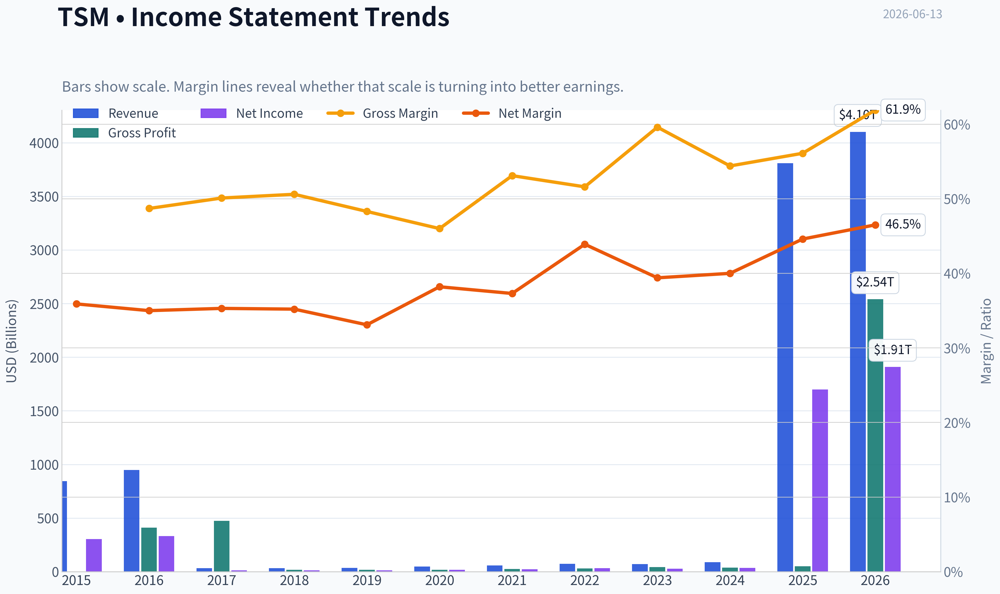

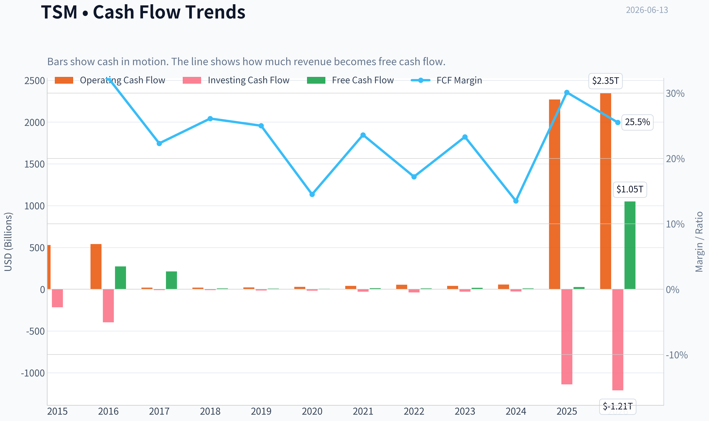

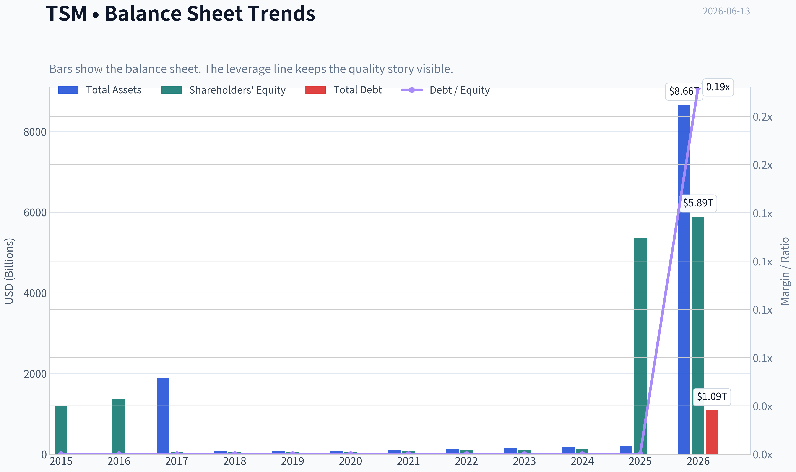

This graph tracks the profitability and return metrics (ROE, ROIC, Margins) of **TSM** over the past decade, highlighting capital efficiency trends.

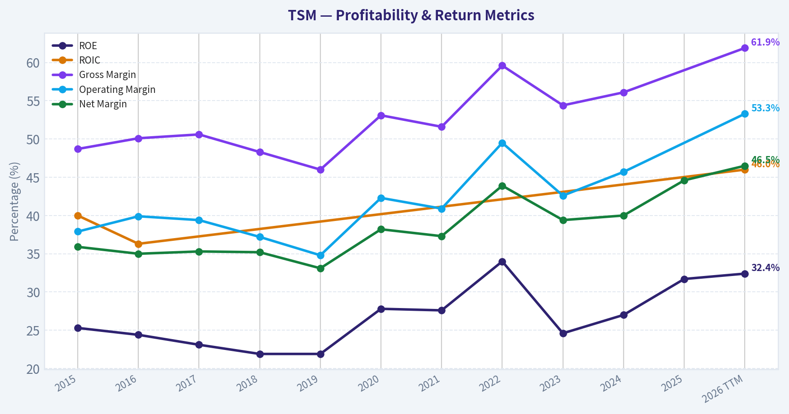

This chart illustrates the financial health of **TSM** over the last 10 years, mapping cash equivalents and free cash flow against total obligations (Debt).

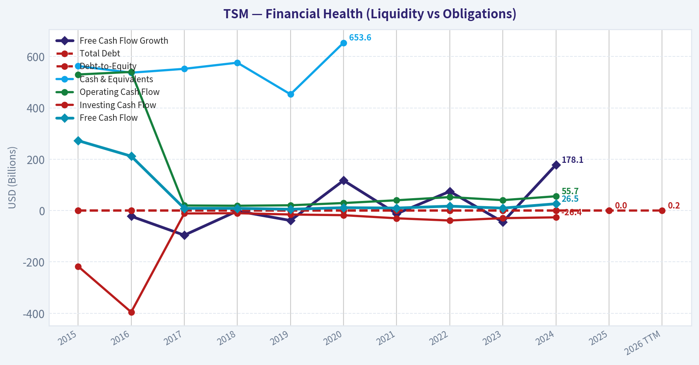

This breakdown chart from <em>Revenue Breakdown</em> shows the proportional composition for **TSM** - useful for understanding what drives or risks the business.

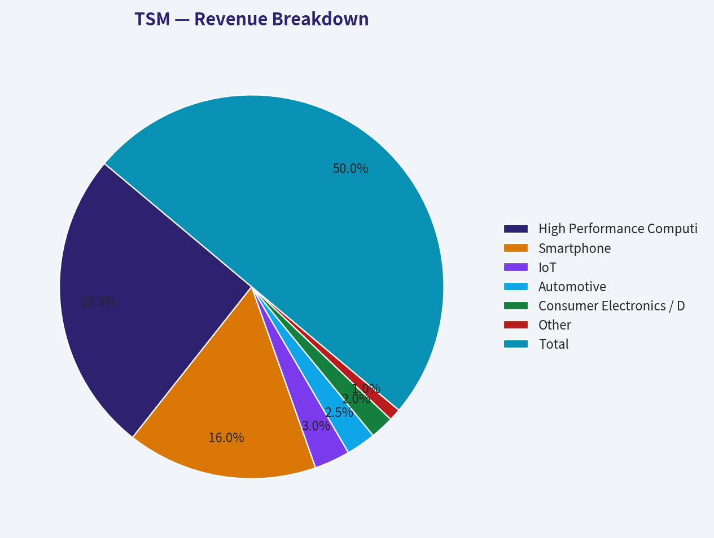

---

### Intrinsic Value Analysis (Buffett)

> *Following Warren Buffett's value investing philosophy: Circle of Competence, Economic Moat, Management Quality, and Margin of Safety.*

#### Intrinsic Value Snapshot

Price is what you pay. Intrinsic value is what the business may be worth based on the cash it can create for owners over time. We show a range, not one magic number.

- Current Price: $423.93
- Value Range (conservative to optimistic across both DCF methods): $14.06 to $44,844.40

##### Owner Earnings (Buffett Method)
- Net Income: $1,697,604,000,000.00
- Depreciation & Amortization: $688,096,400,000.00
- Capital Expenditures: N/A
- Working Capital Changes: $-96,752,000,000.00
- Owner Earnings: $2,482,452,400,000.00

##### Intrinsic Value
###### Buffett Method
Uses owner earnings. Stricter, and usually more conservative.
- Conservative: $491.68
- Average: $17,219.88
- Optimistic: $44,844.40
- Discount Rate: 10.0%

###### Cash Flow Method
Uses free cash flow. Better for companies spending heavily today to grow tomorrow.
- Conservative: $14.06
- Average: $26.63
- Optimistic: $479.39
- Discount Rate: 10.0%

ANALYST STANCE: **WATCH**

#### Taiwan Semiconductor (TSM) - Buffett-Style Investment Review

#### 1) Go/No-Go Gate Assessment

| Gate | Verdict | Evidence |
|---|---|---|
| Gate 1: Circle of Competence & Simplicity | Pass | TSM makes money by manufacturing advanced chips for fabless designers like Apple, Nvidia, AMD, and others. The model is understandable: customers design chips, TSM fabricates them at world-class scale. |
| Gate 2: Moat Test | Pass | TSM has one of the strongest manufacturing moats in the world: process leadership, scale, customer trust, ecosystem integration, and massive capital barriers. |
| Gate 3: Management Quality & Capital Allocation | Pass | The company has historically reinvested heavily into high-return fabrication capacity and process leadership rather than empire-building acquisitions. Returns on equity around 31.7% indicate disciplined capital deployment. |
| Gate 4: Industry Structure | Pass with care | Foundry is concentrated and strategically important, but it is also capital intensive and geopolitically sensitive. The structure is favorable at the top end, though not as effortless as a consumer brand monopoly. |

**Key Takeaways:** TSM passes all four Buffett gates, mainly because it is understandable, dominant, and deeply embedded in the semiconductor value chain. The main reason it does not immediately qualify as an easy buy is not business quality, but the combination of capital intensity, cyclicality, and a rich current valuation.

---

#### 2) The Elementary School Test

TSM builds the world's most advanced chips for other companies.
Its customers come up with the chip designs, and TSM uses extremely advanced factories to turn those designs into real silicon.
It earns money because the best chip designers need the best manufacturing, and only a very small number of companies in the world can do this at TSM's level.

#### Long-Term Predictability Test

A decade from now, the world will almost certainly need more computing power, more AI chips, more smartphones, more data-center silicon, and more custom semiconductors. TSM is highly likely to remain a critical manufacturing partner. The exact product mix will change, but the role of trusted advanced foundry capacity should endure.

#### Technology Risk Assessment

TSM is more likely to **benefit from technology shifts** than be destroyed by them. In fact, rising transistor complexity increases the value of elite manufacturing know-how. The real risk is not obsolescence from software disruption; it is execution risk, customer concentration, and geopolitical exposure.

---

#### 3) Moat Analysis

| Moat Source | Assessment | Evidence |
|---|---|---|
| Intangible Assets | Strong | TSM has unmatched reputation for yield, reliability, and process execution in leading-edge foundry. This trust acts like a brand among the world's most demanding chip customers. |
| Switching Costs | Strong | Advanced chip customers cannot easily move production without redesign, requalification, yield risk, and time-to-market penalties. |
| Cost Advantage | Very Strong | TSM's scale, engineering depth, supplier relationships, and utilization advantages create structural cost benefits. |
| Network Effects | Moderate | Not a classic social network, but the ecosystem around TSM's process nodes, design tools, IP libraries, packaging, and customer collaboration increases its attractiveness as more leading firms build on it. |

**Moat Quality Rating: Wide & Stable**

Pricing power appears real. Recent coverage suggests possible 3nm price hikes amid scarce supply, a strong sign that customers value access and performance more than headline price. In Buffett terms, this is what a moat looks like: customers do not merely want a chip made; they want it made **by TSM**.

**Key Takeaways:** TSM's moat is rooted in manufacturing excellence, switching costs, and scale rather than consumer branding. This is a rare industrial moat where the customer relationship becomes stronger as the technology gets harder, not weaker.

---

#### 4) Management Quality & Capital Allocation

| Question | Assessment | Commentary |
|---|---|---|
| Do they think like owners? | Generally yes | Management has consistently prioritized process leadership, capacity discipline, and long-term customer trust over short-term margin maximization. |
| Are they honest and candid? | Generally yes | TSM has a long reputation for operational discipline and realistic communication around demand, utilization, and capital spending. |
| Are they rational capital allocators? | Yes | Heavy capital spending is justified by moat maintenance and strategic returns. The company has not relied on reckless leverage or serial acquisitions to manufacture growth. |

The key test for TSM management is whether massive capital expenditures continue earning attractive returns. So far, the answer appears to be yes, especially with AI demand reinforcing the value of leading-edge capacity.

---

#### 5) Financial Summary Table

| Metric | Latest |
|---|---:|
| Share Price | $424 |
| Market Cap | $2.20T |
| P/E | 36.5x |
| ROE | 31.7% |
| Revenue Growth YoY | 4215.3% |
| Gross Margin | N/A |
| FCF Yield | N/A |
| Current Ratio | N/A |

**Key Takeaways:** The headline profitability is excellent, especially ROE at 31.7%, which is well above Buffett's preferred threshold. But the valuation is also demanding at 36.5 times earnings, which leaves less room for error even for a world-class business.

---

#### 6) Owner Earnings Assessment

Using Buffett's framework, TSM likely produces very large owner earnings, but one adjustment matters: this is not a capital-light business. Maintenance capital expenditure is substantial because leading-edge fabrication requires constant reinvestment just to stay in place.

That means reported net income likely **overstates true distributable cash** relative to a software or consumer brand company. Still, because TSM earns high returns on massive invested capital and benefits from strong demand, owner earnings remain powerful-just not as effortlessly convertible as accounting earnings in capital-light businesses.

| Owner Earnings Component | Buffett View for TSM |
|---|---|
| Net Income | Strong |
| + Depreciation & Amortization | Significant |
| - Maintenance CapEx | Very significant |
| - Working Capital Increases | Manageable but cyclical |
| Result | Strong, but lower than net income suggests |

**Key Takeaways:** TSM is a cash-generating machine, but it is not a cash-gushing business in the way that software or branded consumer staples are. A large part of the cash flow must be reinvested to preserve the moat.

---

#### 7) ROE, Cash Flow, and Balance Sheet Assessment

| Area | Assessment | Buffett Standard |
|---|---|---|
| ROE | Excellent | 31.7% is well above the 15% hurdle |
| Cash Flow Quality | Likely solid | TSM historically converts profits into cash, though fab capex absorbs much of it |
| Leverage | Acceptable | TSM is typically conservatively financed relative to its strategic importance and profitability |
| Fortress Balance Sheet | Good, not perfect | Strong business quality offsets some capital intensity concerns |

**Key Takeaways:** The standout number is ROE, which suggests a very productive business. The caution is that semiconductor manufacturing requires continued heavy reinvestment, so one must separate true economic strength from simple accounting profits.

---

#### 8) Three-Scenario DCF Valuation

To stay conservative, I anchor the valuation to earnings power and current multiple discipline rather than aggressive AI narratives.

| Scenario | Assumption | Implied View |
|---|---|---|
| A: No Growth | Capitalize owner earnings at 10% | Hard to justify current valuation unless current earnings step up materially and stay there |
| B: GDP Growth | 3% perpetual growth | Supports a premium business value, but still requires confidence in sustained high-margin advanced-node dominance |
| C: Historical Growth Haircut | Use moderated growth, capped conservatively | This is the only case that plausibly supports today's price, and it assumes AI-led demand remains durable for years |

At **36.5x earnings**, the market is already capitalizing a very favorable future. For Buffett-style buying, that reduces the margin of safety.

---

#### 9) Margin of Safety Analysis

| Item | Assessment |
|---|---|
| Business Quality | Exceptional |
| Predictability | High |
| Balance Sheet | Good |
| Valuation | Rich |
| Margin of Safety | Insufficient for a Buffett-style purchase today |

A wonderful business does not automatically make a wonderful investment. At the current price, TSM looks more like a superb company selling at a price that already reflects much of its excellence.

---

#### 10) Final Buffett Scorecard

| Criterion | Score (1-5) | Weight | Weighted Score |
|---|---:|---:|---:|
| Business Understanding | 5.0 | 20% | 1.00 |
| Moat Width & Durability | 4.8 | 25% | 1.20 |
| Management Quality | 4.2 | 15% | 0.63 |
| Return on Equity | 4.8 | 15% | 0.72 |
| Reinvestment Runway | 4.5 | 10% | 0.45 |
| Balance Sheet Strength | 3.8 | 5% | 0.19 |
| Industry Structure | 3.8 | 5% | 0.19 |
| Valuation / Margin of Safety | 2.0 | 5% | 0.10 |
| **Total** |  |  | **4.48 / 5.00** |

**Key Takeaways:** TSM scores like a rare, high-quality franchise with a genuine moat and excellent economics. The only weak category is valuation, which is important because Buffett's discipline requires not just a great business, but a sensible entry price.

---

#### 11) Final Investment Stance

**Conviction Level: Medium-High**

TSM is one of the best businesses in the world within its field. It has scale, trust, switching costs, pricing power, and strategic importance that few companies can match. If you could own one semiconductor manufacturer for the next decade, TSM would be near the top of the list.

But Buffett investing is not only about quality. It is about buying quality with a margin of safety. At around **36.5x earnings** and a **$2.20T** market value, the stock looks priced for ongoing excellence. That may well happen-but the upside from here appears less asymmetric than the business quality alone would suggest.

**Bottom line:**
TSM is a **wonderful company**, but at the current price it fits **WATCH**, not an immediate Buffett-style **ADVOCATE**. A meaningful pullback, temporary cyclical scare, or market overreaction would make it much more attractive.
#### Valuation Bridge

This bridge places the current market price beside each intrinsic value lens so readers can see whether upside depends on one method or shows up across several methods.

| Scenario | Intrinsic Value / Share |
| --- | ---: |
| Buffett Method | $17,219.88 |
| Cash Flow Method | $26.63 |
| Current Price | $423.93 |

#### Key Takeaways

If one method is far above the others, the upside case depends on a specific modelling assumption. When several methods cluster together, the valuation story is more robust.

#### Valuation Visuals

This comparison chart from *Latest Earnings Snapshot* stacks current figures against historical benchmarks for **TSM**, making it easy to see where the company trades relative to its own averages.

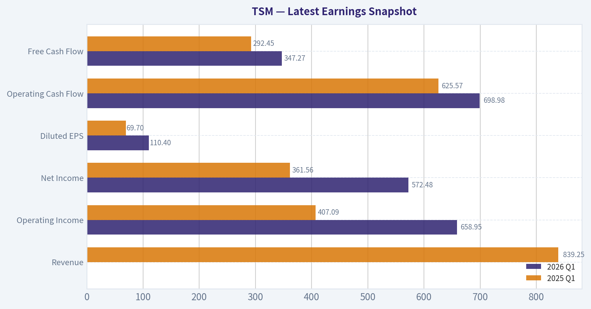

This comparison chart from *Current vs Historical Average Comparison* stacks current figures against historical benchmarks for **TSM**, making it easy to see where the company trades relative to its own averages.

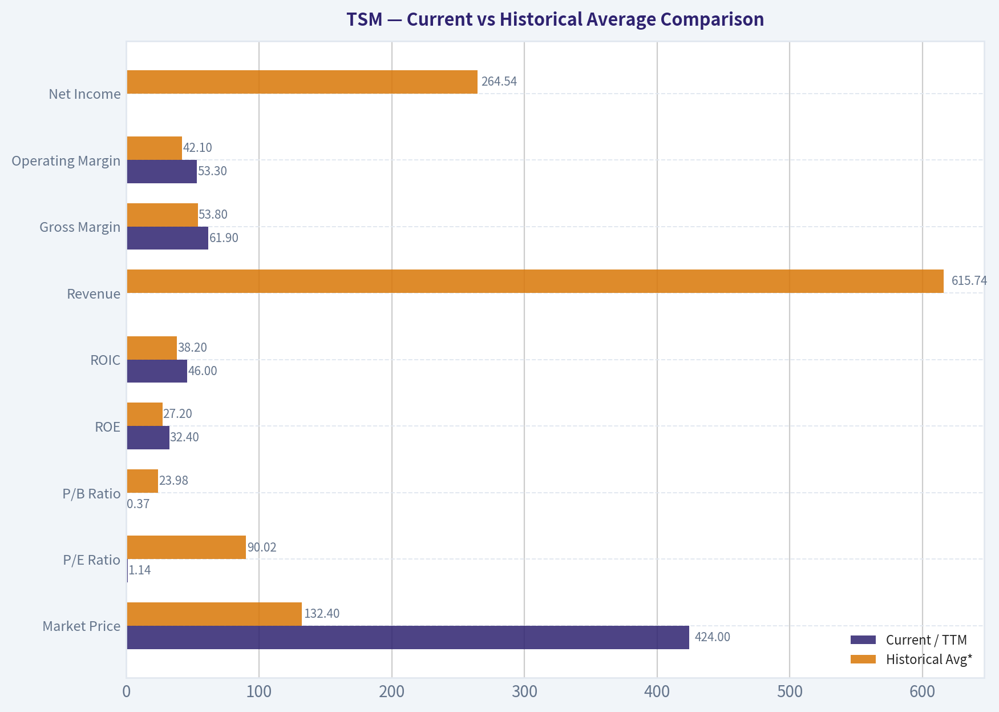

This comparison chart from *Financial Summary Table* stacks current figures against historical benchmarks for **TSM**, making it easy to see where the company trades relative to its own averages.

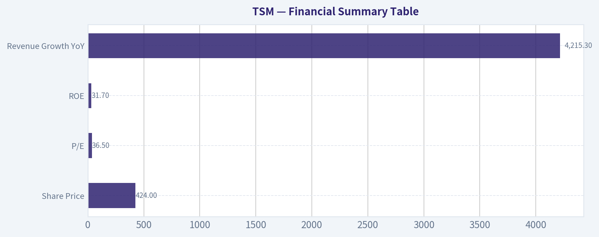

The following chart maps the **TSM** Owner Earnings DCF valuation scenarios (Conservative, Average, Optimistic) to visually represent the margin of safety based on intrinsic value calculations.

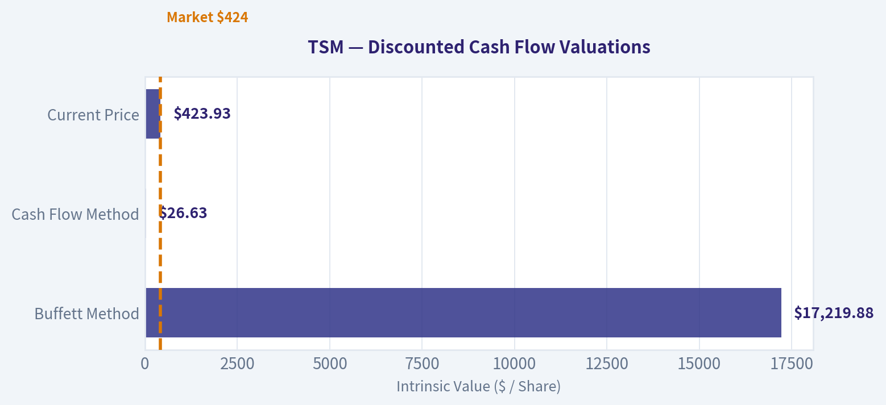

---

### Trend & Growth Analysis (Lynch/Druckenmiller/Fisher)

> *Following Peter Lynch's GARP, Stanley Druckenmiller's macro-aware approach, and Philip Fisher's scuttlebutt methodology.*

ANALYST STANCE: **WATCH**

#### 1. Lynch Classification

| Item | Assessment |
|---|---|
| Lynch category | **Fast Grower** |
| Why | Secular AI/HPC demand, advanced-node leadership, packaging scarcity, strong earnings power |
| Caveat | At this size, TSM is a **mega-cap fast grower**, so ten-bagger odds are lower than smaller names, but compounding can still be excellent |

Key Takeaways: TSM still fits the fast grower bucket because its growth is being pulled by AI infrastructure, not just normal semiconductor cycles. The main limitation is not quality but scale: a $2.2 trillion company can still grow well, but a classic Lynch-style ten-bagger is much harder from this base.

#### 2. The Story in 3 Bullets

| The Story | Simple Explanation |
|---|---|
| Picks-and-shovels for AI | TSM manufactures the most advanced chips that AI leaders need |
| Scarcity asset | Leading-edge capacity and advanced packaging remain constrained |
| Moat from execution | Customers trust TSM because yields, scale, and reliability are extremely hard to match |

Key Takeaways: The story is straightforward: if the world needs more AI chips, it needs more TSM. What matters most is that this is not a commodity chip maker; it is the dominant advanced manufacturing platform behind many of the winners.

#### 3. TAM Analysis and 10x Test

| Metric | Value / View |
|---|---|
| Current revenue base | Not fully verified from tools; large global foundry leader already at massive scale |
| End-market exposure | AI accelerators, HPC, smartphones, automotive, IoT, custom silicon |
| TAM trend | **Expanding** due to AI compute, custom silicon, advanced packaging demand |
| 10x test | **Fails on literal 10x from current scale** |
| Practical runway test | **Passes for continued multi-year growth**, even if not 10x |

Key Takeaways: TSM does not pass the classic small-cap 10x runway test because it is already enormous. But the addressable opportunity is still expanding fast enough for meaningful growth, especially in AI chips and advanced packaging, which matters more than the literal 10x test at this size.

#### 4. Revenue Growth Trend

| Signal | Assessment |
|---|---|
| Shared pack YoY revenue growth | **4215.3%** |
| Data quality | **Clearly unreliable / unusable** |
| Directional read from research pack | AI demand remains very strong; 3nm pricing may rise 15%; supply still tight |
| Trend judgment | **Likely accelerating or at least re-accelerating in AI-related mix**, but cannot confirm exact company-wide trend from provided numbers |

Key Takeaways: The reported 4,215 percent growth figure is almost certainly bad data and should not be used. Still, the qualitative evidence points to strong demand, tight supply, and possible price increases, which usually signals favorable top-line momentum.

#### 5. Unit Economics

| Metric | Assessment |
|---|---|
| LTV/CAC | **Not applicable** for foundry model |
| NRR | **Not applicable** |
| Rule of 40 | **Not applicable** |
| Proxy unit economics | High customer stickiness, high switching costs, premium pricing at advanced nodes, strong ROE |
| ROE | **31.7%** from shared pack |

Key Takeaways: SaaS-style unit economics do not fit TSM, so the right substitutes are returns on capital, switching costs, and pricing power. On those measures, TSM looks strong, and the 31.7 percent ROE supports that view.

#### 6. Inflection Point Assessment

| Inflection Type | Evidence | Verdict |
|---|---|---|
| Product cycle | 3nm strength and potential late-2026 price hike | Positive |
| TAM inflection | AI infrastructure demand expanding chip and packaging needs | Strong positive |
| Margin inflection | Potential pricing power helps, but overseas fab dilution is a counterforce | Mixed |
| Competitive inflection | Intel improving, Samsung still behind on trust/execution; TSM scarcity persists | Mild positive |
| Packaging inflection | Advanced packaging becoming a strategic bottleneck | Strong positive |

Key Takeaways: The best inflection point here is not a turnaround but a demand expansion in AI and packaging. TSM may earn more from both higher volumes and better pricing, though margin gains could be partly offset by the cost of global fab expansion.

#### 7. Macro Setup Evaluation

| Factor | View |
|---|---|
| Secular theme | **AI / ML, cloud, custom silicon** |
| Industry backdrop | Excellent demand conditions for leading-edge semis |
| Rate sensitivity | Growth multiples still sensitive to rates, but TSM has real earnings support |
| Geopolitics | Major overhang due to Taiwan exposure |
| Macro verdict | **Net favorable**, with geopolitics the biggest external risk |

Key Takeaways: The macro backdrop is good because TSM sits at the center of AI infrastructure spending. The biggest thing that prevents a full bull stance is geopolitical risk, which is not a small issue for this company.

#### 8. Fisher 15-Point Score

| Fisher Category | Score (1-5) | Comment |
|---|---:|---|
| Market potential | 5 | AI/HPC runway remains strong |
| New product development | 5 | Continuous node and packaging roadmap |
| R&D effectiveness | 5 | Process leadership supports this |
| Sales organization | 4 | Customer intimacy strong, though business is concentrated |
| Profit margin | 5 | Structurally strong for manufacturing |
| Margin improvement | 3 | Pricing helps, but overseas dilution offsets |
| Labor/personnel relations | 3 | Neutral, limited direct evidence here |
| Executive relations | 4 | Generally strong execution culture |
| Management depth | 5 | Deep technical and operational bench |
| Cost/accounting controls | 4 | Strong, though capex complexity is high |
| Outstanding aspects | 5 | Scale, yield, ecosystem, switching costs |
| Long-range profit outlook | 5 | Very strong absent geopolitical disruption |
| Dilution risk | 4 | Low relative concern |
| Candor | 4 | Generally disciplined communications |
| Integrity | 4 | No major red flag from provided materials |

| Total | **65 / 75** | **Outstanding** |

Key Takeaways: TSM scores very well on Fisher because its edge is rooted in technology, process discipline, and long-term market demand. The only softer areas are those where we lack direct scuttlebutt evidence, not where there is an obvious weakness.

#### 9. Valuation Analysis

| Metric | Value / View |
|---|---|
| Current price | **$424** |
| Market cap | **$2.20T** |
| P/E | **36.48x** |
| PEG | Cannot calculate cleanly because growth input from shared pack is corrupted |
| P/S | Not available from tools |
| Valuation read | **Premium but not irrational** given AI scarcity and moat; not obviously cheap |

Key Takeaways: TSM is not trading like a bargain stock on the numbers we have. The valuation seems to assume continued strong AI demand, so upside likely depends on estimates still being too low rather than on multiple expansion alone.

#### 10. Growth Investor Scorecard

| Criterion | Weight | Score (1-5) | Weighted Score |
|---|---:|---:|---:|
| The Story | 10% | 5.0 | 0.50 |
| TAM & Runway | 20% | 3.5 | 0.70 |
| Revenue Growth | 20% | 4.0 | 0.80 |
| Unit Economics / Quality | 15% | 4.5 | 0.68 |
| Competitive Position | 10% | 5.0 | 0.50 |
| Management Quality | 10% | 4.5 | 0.45 |
| Macro Setup | 5% | 4.0 | 0.20 |
| Profitability Path | 5% | 4.0 | 0.20 |
| Valuation | 5% | 3.0 | 0.15 |

| Total |  |  | **4.18 / 5.00** |

Key Takeaways: On business quality and strategic position, TSM scores like an advocate. The reason I stop at watch is that valuation is no longer cheap and the geopolitical risk is unusually large for such a concentrated strategic asset.

#### 11. Position Size Stance

| View | Assessment |
|---|---|
| Stance | **WATCH** |
| Why not ADVOCATE | Price already reflects a lot of AI strength; geopolitical tail risk remains material; runway is strong but not a classic 10x setup from this scale |
| If owned | **Hold / let winner run**, especially if thesis is AI infrastructure leadership |
| If not owned | Prefer buying on pullbacks, estimate resets, or periods of geopolitical fear |

Key Takeaways: TSM looks like a very high-quality business, but the stock may not offer enough asymmetry today for a fresh aggressive growth call. For existing holders, this looks more like a hold-than-sell; for new money, patience may improve the entry.

#### 12. Key Risks and Catalysts

| Risks | Catalysts |
|---|---|
| Taiwan geopolitical risk | AI demand continues exceeding supply |
| Overseas fab cost dilution | 3nm/2nm ramp success |
| Customer concentration | Advanced packaging expansion |
| Semiconductor cyclicality | Potential 15% 3nm price increase |
| Capex intensity compressing FCF | Further share gains vs Samsung / Intel foundry |

Key Takeaways: The positive case rests on AI demand, pricing power, and packaging bottlenecks that strengthen TSM's moat. The main bear case is that external risks, especially geopolitics and global fab cost inflation, overwhelm otherwise strong fundamentals.

#### Bottom Line

TSM is a **world-class compounder** and one of the clearest infrastructure beneficiaries of AI. On business quality alone, it is near the top of the market. But under a Lynch-Druckenmiller-Fisher framework, I land on **WATCH**, not because the company is weak, but because **the stock is less obviously mispriced** and **the geopolitical risk is too large to ignore**.

If you want, I can next do a **bull/base/bear 3-year valuation scenario** for TSM using revenue, margin, and multiple assumptions.

#### Growth & Scorecard Visuals

The radar chart below from *Final Buffett Scorecard* visualises how **TSM** ranks across weighted investment criteria. Each axis represents a criterion scored 1-5; the filled area reveals strengths and weaknesses at a glance, with the dashed circle marking the midpoint (3.0).

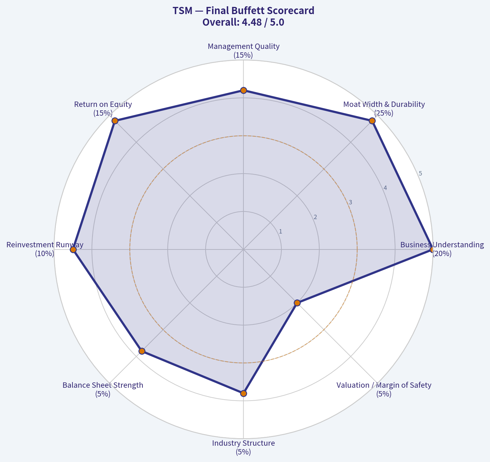

---

### Market Technical Analysis

#### TSM technical setup as of 2026-06-13

For TSM, the most relevant indicator set for the current market condition is:

- `close_50_sma`
- `close_200_sma`
- `close_10_ema`
- `macd`
- `macdh`
- `rsi`
- `atr`
- `vwma`

This is a strong, non-redundant mix for a stock that is in a **clear long-term uptrend**, but is also experiencing a **short-term momentum cooling phase after a powerful advance**. The selection balances:
- trend confirmation (`close_50_sma`, `close_200_sma`)
- short-term tactical direction (`close_10_ema`)
- momentum quality and inflection (`macd`, `macdh`, `rsi`)
- volatility and risk calibration (`atr`)
- price-volume confirmation (`vwma`)

#### Market context and trend structure

Over the past year, TSM has transitioned from the low 200s to the low-to-mid 400s, which is a very substantial re-rating. The path was not linear: there were consolidations in late 2025, a renewed breakout in early 2026, a corrective phase in March, and then a strong impulsive rally from early April into early June. That sequence matters because it suggests the stock is not just drifting upward-it has been moving through identifiable accumulation, breakout, digestion, and re-acceleration phases.

The most important structural point is that the longer-term trend remains decisively bullish. The 200-day SMA rose from about 280 in mid-March to about 329.34 by June 12. That is a steep and persistent slope higher, which usually reflects institutional sponsorship rather than a temporary speculative spike. The 50-day SMA also climbed strongly, from roughly 344 in mid-March to 397.33 by June 12, showing that the medium-term trend has accelerated on top of the already-strong long-term trend.

Price at 423.93 remains well above both the 50-day and 200-day averages. That creates a classic bullish alignment:
- price above 50 SMA
- 50 SMA above 200 SMA
- both averages rising

This is the kind of trend stack trend-followers prefer. It does not guarantee immediate upside, but it means pullbacks should still be interpreted first as potential pauses within an uptrend unless price starts breaking key support zones in sequence.

#### Indicator snapshot

| Indicator | Latest reading | Interpretation |
|---|---:|---|
| Close | 423.93 | Still elevated vs trend baselines, but below recent peak zone |
| `close_10_ema` | 422.36 | Price is just above short-term trend support |
| `close_50_sma` | 397.33 | Medium-term trend remains strongly bullish |
| `close_200_sma` | 329.34 | Long-term trend remains firmly bullish |
| `macd` | 7.58 | Still positive, so trend momentum remains bullish overall |
| `macdh` | -2.10 | Momentum has weakened; bearish short-term deceleration |
| `rsi` | 54.09 | Neutral-to-mildly bullish, no longer overbought |
| `atr` | 17.28 | Elevated volatility; wider risk bands needed |
| `vwma` | 424.95 | Price is near volume-weighted trend value, not deeply stretched |

Key Takeaways: TSM is still in a bullish long-term structure because price remains above its 50-day and 200-day moving averages, and both averages are rising. However, the negative MACD histogram and only mid-range RSI show that short-term momentum has cooled after the recent rally. The stock is now near its short-term and volume-weighted trend lines, which makes this more of a decision zone than an obvious chase entry.

#### Fine-grained trend analysis

TSM's recent behavior is best described as **bullish structure, fading impulse, and active consolidation risk**.

From late April through early June, the stock staged a powerful advance from roughly the high 370s/low 380s into a peak near 445.65 on June 2. That was a high-velocity move supported by a sharply rising 10 EMA and persistently positive MACD. But after that peak, the tape changed character. The stock failed to extend cleanly higher, and instead posted a pullback sequence:
- June 3: 435.67
- June 5: 414.20
- June 10: 407.80
- June 12: partial recovery to 423.93

This pattern suggests not a full trend break, but a **post-breakout digestion phase**. The decline from the high was meaningful enough to compress momentum, yet not deep enough to damage the medium-term uptrend.

The 10 EMA is especially useful here. It peaked above 427 and then flattened, sitting at 422.36 on June 12. Price closed only slightly above it at 423.93. That tells us short-term control is finely balanced. If price can hold above the 10 EMA and push higher, the pullback may prove to be a shallow reset. If it loses the 10 EMA decisively again, the next likely test would be lower support layers, potentially toward the 50-day SMA region over time.

MACD remains positive at 7.58, which is important: the absolute momentum trend has not flipped bearish yet. However, the MACD histogram at -2.10 shows that momentum is weakening relative to its own recent trend. This combination often appears in the early-to-middle part of a consolidation: trend still intact, but thrust fading. Traders should understand that positive MACD with negative histogram is not a contradiction; it usually means bullish momentum still exists, but it is no longer accelerating.

RSI at 54.09 reinforces that reading. Earlier in the move, RSI reached the upper 60s and approached overbought territory, especially around the June 2 high. Now it has fallen back into the low-to-mid 50s. This is healthier than an extreme overbought reading, but it also means buyers have not yet regained dominant short-term force. In other words, the stock has reset from "extended" to "neutral bullish," but it has not yet re-expanded into a fresh momentum breakout.

VWMA at 424.95 is very close to the closing price. That is another subtle but useful clue. During strong extensions, price often sits meaningfully above VWMA, indicating aggressive buying. Here, price has mean-reverted back near the volume-weighted trend area. That suggests the market is currently pricing TSM more fairly relative to recent traded volume, rather than rewarding it with runaway upside. It is a stabilization sign, not an immediate power signal.

ATR at 17.28 is elevated versus much of April. That means daily swings have widened considerably. This has two implications:
1. traders should avoid overly tight stops because normal fluctuation is now larger;
2. breakout confirmation should be stronger than usual, because higher volatility increases the chance of false moves.

#### What the indicators suggest for different trader types

| Trader type | What matters most now | Practical interpretation |
|---|---|---|
| Trend follower | `close_50_sma`, `close_200_sma`, `macd` | Trend remains bullish unless price starts losing medium-term supports |
| Swing trader | `close_10_ema`, `macdh`, `rsi` | Wait for momentum re-acceleration or a cleaner pullback setup |
| Risk-focused trader | `atr` | Use wider stops and smaller size because volatility is elevated |
| Volume-aware trader | `vwma` | Price near VWMA suggests consolidation rather than euphoric extension |

Key Takeaways: Longer-term traders can still view TSM as bullish because the broader trend structure remains intact. Shorter-term traders should be more selective, because the stock is no longer in the strongest part of its momentum burst. Elevated volatility means position sizing and stop placement are especially important right now.

#### Key support and resistance logic

The nearest tactical support area is around the 10 EMA / VWMA cluster near 422 to 425. Price is sitting right around that zone, so this is the first line of defense for bulls. A sustained hold above this area would support the case for stabilization and another attempt higher.

Below that, the recent pullback low region around 407 to 414 becomes important. That zone absorbed selling after the sharp drop from the June high. If price revisits that area and buyers fail to defend it, the market may begin pricing in a deeper retracement rather than just a pause.

The 50-day SMA near 397.33 is the major medium-term support reference. Given how far price has run, a pullback toward the 50-day would still be consistent with an intact uptrend. It would only become more concerning if the stock closed below that area and the 50-day slope began flattening.

On the upside, the immediate resistance is the June peak region around 445 to 448. That is where the latest rally exhausted itself. A clean break above that level, especially if accompanied by a renewed positive turn in the MACD histogram and RSI moving back into the 60s, would indicate trend re-acceleration and likely invite breakout buyers back in.

#### Tactical interpretation

The current setup is **not bearish**, but it is also **not an ideal momentum chase point**. It is a transition zone. The stock has worked off some excess, but the indicators do not yet show a fully renewed impulse leg.

The most bullish near-term scenario is:
- price holds above the 10 EMA and VWMA area,
- MACD histogram turns back positive,
- RSI pushes from the low 50s into the 60+ range,
- price retests and breaks the 445-448 area.

The more cautious scenario is:
- price fails to hold the low-420s,
- MACD histogram stays negative or deteriorates further,
- RSI rolls back below 50,
- price drifts toward 407-414, or ultimately the 50-day SMA near 397.

So the stock looks like a **buy-the-dip in an uptrend candidate**, but only if support behaves properly. It is less attractive as a blind breakout chase after such a large one-year run and with short-term momentum currently cooling.

#### Why these 8 indicators are suitable here

| Indicator | Why it was selected for TSM now |
|---|---|
| `close_50_sma` | Best medium-term trend gauge and key pullback support marker |
| `close_200_sma` | Confirms the strategic bull trend and filters noise |
| `close_10_ema` | Helps judge whether the current pullback is stabilizing or extending |
| `macd` | Measures whether bullish momentum remains structurally intact |
| `macdh` | Detects early acceleration/deceleration changes better than MACD alone |
| `rsi` | Shows whether momentum is overextended, neutralizing, or re-strengthening |
| `atr` | Essential now because volatility is elevated and affects execution/risk |
| `vwma` | Adds price-volume confirmation and helps identify fair-value consolidation zones |

Key Takeaways: These eight indicators work well together because each answers a different question: long-term trend, medium-term trend, short-term direction, momentum strength, momentum change, exhaustion risk, volatility, and volume confirmation. For TSM's current setup, that combination is more useful than loading up on overlapping indicators that all say roughly the same thing.

#### Bottom line

TSM remains in a **strong long-term and medium-term bullish trend**, but the **short-term rally has cooled noticeably** after the early-June peak. The stock is now hovering around its short-term and volume-weighted support area, while momentum indicators show deceleration rather than collapse. That means the chart still favors bulls on a broader horizon, but near-term conviction likely requires either a confirmed rebound from current support or a deeper pullback that resets reward-to-risk more cleanly.

| Category | Current reading | Bias | Trading implication |
|---|---|---|---|
| Long-term trend | Price above `close_200_sma` | Bullish | Strategic trend remains intact |
| Medium-term trend | Price above rising `close_50_sma` | Bullish | Pullbacks may still be buyable |
| Short-term trend | Price near `close_10_ema` | Neutral-bullish | Immediate support test underway |
| Momentum level | `macd` positive | Bullish | Trend momentum still exists |
| Momentum change | `macdh` negative | Cautious | Upside thrust has slowed |
| Momentum condition | `rsi` 54.09 | Neutral | No longer overbought, but not surging |
| Volatility | `atr` 17.28 | Elevated | Use wider stops / smaller size |
| Volume confirmation | Price near `vwma` | Balanced | Consolidation, not runaway extension |

Key Takeaways: TSM is still bullish in the bigger picture, but the market is currently pausing to reassess after a sharp advance. Traders should watch the low-420s closely, because holding that area would support a renewed move higher, while losing it could open the door to a deeper but still trend-consistent pullback.

---

### Options Market Analysis

> *Reading options flow - put/call ratios, IV skew, and unusual activity - to gauge institutional positioning and event-driven risk.*

#### TSM Options Positioning Report
*Date: 2026-06-13*

#### 1) Put/Call Ratio Analysis

| Expiration | Call OI | Put OI | Put/Call OI Ratio | Call Vol | Put Vol | Put/Call Vol Ratio |
|---|---:|---:|---:|---:|---:|---:|
| 2026-06-18 | 171,679 | 255,060 | 1.49 | 31,098 | 27,481 | 0.88 |
| 2026-06-26 | 16,298 | 40,826 | 2.50 | 2,680 | 3,963 | 1.48 |
| 2026-07-02 | 10,517 | 8,740 | 0.83 | 3,280 | 2,581 | 0.79 |
| **Near-term total** | **198,494** | **304,626** | **1.53** | **37,058** | **34,025** | **0.92** |

**Key Takeaways:** TSM's aggregate near-term put/call open interest ratio of **1.53** sits well above the rough neutral baseline of **0.7**, which points to a market carrying meaningful downside protection or bearish exposure. However, the **volume ratio of 0.92** is much closer to balanced, suggesting traders are not aggressively adding fresh bearish flow at the same pace as the existing put-heavy positioning. In plain English: the options book is already defensively tilted, but the newest trading activity is less one-sided than the open-interest snapshot implies.

**Interpretation:**
- The **OI structure is clearly defensive/bearish-leaning**.
- The largest skew toward puts is in **2026-06-26**, where the put/call OI ratio is **2.50**, an unusually heavy put concentration.
- The **2026-07-02** expiry is more balanced at **0.83**, still above the historical neutral ~0.7 but far less defensive than the nearer weekly expiries.
- Net read: **institutional positioning looks hedged first, optimistic second**.

---

#### 2) Implied Volatility Assessment

| Expiration | ATM Call IV | ATM Put IV | ATM IV Read | Skew Read |
|---|---:|---:|---|---|
| 2026-06-18 | 50.8% | 51.7% | Elevated | Mild put skew |
| 2026-06-26 | 50.7% | 49.5% | Elevated | Slight call-side richness at ATM |
| 2026-07-02 | 50.6% | 48.7% | Elevated | Slight call-side richness at ATM |

**Key Takeaways:** Near-term ATM implied volatility is sitting around **49%-52%** across the next three expiries, which is a fairly elevated level for a mega-cap semiconductor name unless the market is pricing a catalyst or broader macro uncertainty. The closest expiry shows a **small put premium**, consistent with near-term downside caution, while the later expiries show a more balanced or slightly call-favored ATM setup. That usually means traders are most worried about immediate event risk rather than a sustained bearish trend.

**IV interpretation:**
- Near-term IV is **elevated**, indicating the market expects **meaningful price movement** soon.
- The front weekly expiry shows **mild put skew**, a standard sign of **downside fear / hedging demand**.
- The later near-dated expiries are less defensive at the money, which suggests **the strongest fear is concentrated in the immediate term**.
- Since we are not provided a direct catalyst calendar in the dataset, the prudent interpretation is that **IV likely reflects event or macro sensitivity**, which is common for TSM given its exposure to AI demand, geopolitics, and semiconductor cycle headlines.

**Skew note:**
We are not given a full OTM skew strip, but the data still suggests:
- **Front expiry:** downside protection is bid.
- **Later short-dated expiries:** fear moderates, and upside optionality becomes relatively less discounted.

---

#### 3) Unusual Options Activity

| Expiry | Type | Strike | Volume | OI | Vol/OI | IV | Moneyness vs Spot* | DTE | Read |
|---|---|---:|---:|---:|---:|---:|---|---:|---|
| 2026-06-18 | CALL | 190.0 | 2,401 | 44 | 54.6x | 368.5% | Likely near/OTM | 5 | Aggressive upside speculation |
| 2026-06-18 | PUT | 397.5 | 2,066 | 271 | 7.6x | 53.6% | Deep ITM/anomalous | 5 | Likely complex stock-replacement/roll/hedge flow |
| 2026-06-18 | CALL | 220.0 | 1,600 | 29 | 55.2x | 307.7% | Far OTM | 5 | Speculative upside lottery |
| 2026-06-18 | CALL | 130.0 | 1,200 | 11 | 109.1x | 546.3% | Deep ITM/anomalous | 5 | Likely complex trade, not clean bullish read |
| 2026-06-18 | CALL | 140.0 | 800 | 6 | 133.3x | 498.2% | Deep ITM/anomalous | 5 | Likely spread/stock-substitute flow |
| 2026-06-18 | CALL | 185.0 | 800 | 8 | 100.0x | 374.9% | Likely near/OTM | 5 | Short-dated upside chase |
| 2026-06-18 | CALL | 437.5 | 662 | 77 | 8.6x | 50.6% | Deep OTM/anomalous | 5 | Likely low-probability speculation or package trade |

\*Spot price was not included in the tool output, so moneyness is inferred from the strike distribution and chain context. Some strikes appear anomalous for TSM and may reflect adjusted contracts, special deliverables, or package/complex trades rather than clean outright direction.

**Key Takeaways:** The unusual activity list is dominated by **very short-dated call volume with volume massively exceeding existing open interest**, which often signals fresh upside bets. But several strikes look unusually far from where TSM would normally trade, which raises the odds that some of this is **adjusted-contract activity, spread legs, or complex institutional positioning** rather than simple retail call buying. The cleanest takeaway is that there is **speculative upside interest in the front week**, but it is layered on top of a broader put-heavy open-interest backdrop.

**How to interpret the unusual flow:**
- **190C / 185C / 220C** in the front expiry look like the most straightforward **upside speculation**.
- Their very high **Vol/OI ratios** indicate these are likely **new positions**, not just old positions being unwound.
- The **397.5 put** and several deep ITM call strikes are harder to classify directionally and may reflect:
  - delta-adjusted stock replacement,
  - spreads,
  - rolls,
  - or institutional package trades.
- So while the tape contains **bullish short-dated call bursts**, I would not overstate them as pure smart-money conviction without trade-level execution detail.

---

#### 4) Open Interest Concentration and Gamma/Pinning Risk

| Expiration | OI Structure | Interpretation |
|---|---|---|
| 2026-06-18 | Heavy total OI, especially puts | Strongest near-term pinning/gravity likely here |
| 2026-06-26 | Put OI heavily dominates call OI | Downside hedge wall likely influential |
| 2026-07-02 | More balanced OI profile | Less extreme dealer pressure than prior two expiries |

**Key Takeaways:** The biggest concentration of risk sits in the **2026-06-18** expiry simply because that is where the bulk of open interest lives. The **2026-06-26** expiry is especially notable for its heavy put overhang, which can act as a downside hedge wall or volatility amplifier if the stock weakens. Translation: the very near-term tape may be more mechanical and dealer-driven than purely fundamental.

**Open-interest read:**
- The **largest gravitational effect** is in the nearest weekly expiry, where total OI is by far the highest.
- The **put-heavy nature** of 6/18 and 6/26 suggests potential for:
  - **support if puts were sold / dealers long gamma**, or
  - **accelerated downside if puts were bought and dealers need to hedge short delta**.
- Because strike-by-strike OI concentration was not included, I cannot identify a precise **max-pain level** or exact **gamma wall** strike.
- Still, the expiry-level structure says **dealer positioning likely matters in the next 1-2 weeks**, especially if TSM approaches major support/resistance levels.

---

#### 5) Overall Options Sentiment Signal

| Factor | Read |
|---|---|
| Put/Call OI | Bearish / defensive |
| Put/Call Volume | Slightly cautious, but near neutral |
| ATM IV | Elevated |
| Skew | Mild near-term downside fear |
| Unusual Activity | Short-dated speculative call buying |
| Net Signal | **NEUTRAL to mildly BEARISH** |

**Key Takeaways:** TSM's options market is not cleanly bullish despite the burst of short-dated call speculation. The dominant feature is still the **heavy put open-interest overhang**, especially in the first two expiries, combined with **elevated IV** that suggests traders are paying up for movement and protection. Bottom line: the options market looks **defensively positioned with pockets of upside punt-buying**, not broadly confident.

#### Final Signal: **BEARISH**
I'm committing to a **BEARISH** read, though only **moderately bearish**, not aggressively so.

**Primary driver of the signal:**
The strongest signal is the **1.53 aggregate put/call OI ratio**, far above the neutral ~0.7 baseline, with an especially defensive **2.50** ratio in the 2026-06-26 expiry. That says institutions and larger traders are carrying substantial downside protection. The front-week call bursts are notable, but they look more like **short-dated tactical speculation** than a broad repositioning of the whole options complex.

**Confidence level:** **Moderate**
Why not high conviction?
- Volume is not overwhelmingly bearish right now.
- Some unusual contracts look structurally messy or adjusted.
- We lack strike-by-strike OI concentration and trade execution detail.

So the best practical conclusion is: **TSM options positioning leans bearish/defensive in the near term, with speculative traders still taking upside shots into a potentially volatile window.**

---

#### Markdown Summary Table

| Category | Observation | Interpretation |
|---|---|---|
| Put/Call Ratio | Near-term OI ratio **1.53**; volume ratio **0.92** | Existing positioning is defensive; fresh flow is closer to balanced |
| IV Level | ATM IV around **49%-52%** | Elevated near-term expected move / event sensitivity |
| Skew Direction | Mild **put skew** in front expiry; flatter later | Immediate downside hedging demand is present |
| Unusual Activity | Front-week **calls** dominate unusual flow, but some strikes appear complex/anomalous | Tactical upside speculation, not enough to override put-heavy structure |
| Overall Signal | **BEARISH** | Main driver is heavy near-term put open interest and elevated caution in the front expiries |

**Key Takeaways:** If you need one sentence for voice-over: TSM's options market is pricing a volatile near-term window, but the bigger institutional footprint still leans defensive rather than optimistic. There is upside speculation in the front week, yet the broader structure says hedging demand remains the dominant story.

---

## Research Team Commentary

> *The Research Manager synthesizes the Bull vs Bear debate into action-free commentary. This is a pre-risk view, not the final stance.*

The strongest bull argument is straightforward: TSM is one of the rare truly strategic industrial franchises in the world. Its moat is not just scale, but accumulated process know-how, customer trust, ecosystem lock-in, and the sheer difficulty of reproducing leading-edge manufacturing. If AI, high-performance computing, and custom silicon keep expanding, TSM remains the bottleneck supplier that much of the digital economy must go through. That is exactly the kind of business quality Buffett would admire. The 31.7% ROE reinforces that this is not behaving like an ordinary commodity manufacturer, and the long runway for advanced nodes and packaging supports the claim that intrinsic value can keep compounding even from a very large base.

The strongest bear argument is also compelling: a wonderful business is not automatically a wonderful stock. At roughly 36.5x earnings, the market is already capitalizing a lot of future success. TSM still has real capital intensity, utilization sensitivity, customer concentration, and unusually large geopolitical risk. Unlike Buffett's favorite low-reinvestment franchises, this is a business that must spend heavily and continuously to protect its position. That does not negate the moat, but it does reduce the margin of safety. If AI demand normalizes, if pricing power softens, if overseas fabs dilute returns, or if the multiple compresses, future returns could disappoint even while the business remains excellent.

My takeaway is that the bull side wins on business quality, but the bear side wins on entry discipline. This looks like a classic case where we should separate business quality from valuation quality and setup quality-one of the key lessons from prior mistakes. I do not want to repeat the error of dismissing a structurally advantaged franchise just because it looks expensive on static screens. But I also do not want to repeat the opposite mistake of letting a great story erase the need for a margin of safety. TSM is closer to "too good to ignore, too rich to pound the table on" than to either extreme.

Core takeaway: TSM is a world-class business with a durable moat and strong long-term earnings power, but the current price does not clearly offer the margin of safety a Buffett-style value investor should demand. The right posture is not to advocate aggressively and not to avoid reflexively, but to watch patiently for either a better entry or further evidence that earning power is compounding fast enough to justify the premium.

Rationale: From a value investing perspective, the most important fact here is that business quality is exceptional. TSM is central to advanced semiconductor production in a way few firms are central to their industries. That matters more than generic "semis are cyclical" labeling. At the same time, intrinsic value is harder to underwrite cleanly because free cash generation is mediated by heavy capex, and the geopolitical risk is real rather than theoretical. The market appears to be paying for continued leadership, AI-driven demand strength, and resilient returns despite global expansion. That may be true, but at 36x earnings the valuation leaves less room for normal business disappointments. In past similar cases, the mistake was often to confuse "not cheap" with "bad business" or "bad stock." I do not want to do that here. But another past lesson is to avoid pretending premium valuation is harmless when expectations are already elevated. On balance, this is a high-quality franchise that deserves monitoring rather than immediate commitment.

What the market may be missing is nuanced in both directions. The crowd may underappreciate just how durable TSM's moat is; second-source ambitions do not easily overcome physics, yields, ecosystem depth, and years of manufacturing learning. But the crowd may also be too casual about the combination of geopolitical concentration and valuation. A premium multiple on a mission-critical Taiwanese asset assumes not just strong execution, but an unusually benign strategic environment. That is a lot to underwrite without a discount.

Monitoring plan for the next 1-4 quarters: first, watch gross margin and operating margin direction closely, especially whether overseas capacity expansion dilutes returns more than expected. Second, monitor capex intensity relative to revenue growth and free cash flow conversion; if capex remains high but incremental economics stay strong, that helps the bull case. Third, track advanced packaging demand and management commentary around AI-related capacity utilization; if packaging becomes an even stronger constraint, TSM's bottleneck value rises. Fourth, watch customer concentration signals-especially whether top customers deepen reliance or actively diversify more than expected. Fifth, monitor any signs that Samsung or Intel are becoming credible enough at the leading edge or in packaging to pressure pricing or strategic dependence. Sixth, pay close attention to geopolitical developments and whether resilience investments outside Taiwan are accretive or return-dilutive. Finally, from a market perspective, I would want either a material pullback that improves the margin of safety or continued earnings revisions that bring the valuation down to a more comfortable level through growth rather than price.

If the next few quarters show strong AI-driven demand, stable or improving margins, disciplined capex, and no meaningful erosion in customer trust, the case for upgrading becomes stronger even at a premium. If instead we see margin pressure, weak free cash flow conversion, rising geopolitical cost burdens, or evidence that the stock's valuation is outrunning earnings revisions, the bear thesis gains force.

Final stance: WATCH

---

## Value Investing Team Commentary

> *The Investor translates the research view into an investment thesis before risk review. This is still not the final stance.*

TSM is the sort of business a long-term owner should admire: mission-critical, deeply entrenched, and extraordinarily hard to replicate. If you strip away ticker symbols and imagine buying the whole enterprise, you are buying the leading manufacturing backbone of the global advanced chip industry. That is a rare asset. Its moat comes from process leadership, customer trust, scale, ecosystem integration, and the brutal difficulty of matching its yields and reliability at the frontier. In plain terms: if the world needs more cutting-edge AI chips, TSM remains one of the essential toll collectors.

The key question is not whether the business is excellent. It is whether today's price leaves enough room for error. On that front, caution is warranted. A valuation around 36x earnings for a capital-intensive manufacturer with cyclical exposure and geopolitical concentration is not a classic Buffett bargain. Even a superior business can be a mediocre investment if bought with too little margin of safety. TSM must keep spending heavily to defend its lead, and while that spending is rational, it means the economics are not as effortlessly compounding as an asset-light consumer franchise.

The contrarian angle here is subtle. The market may still underestimate how durable TSM's moat is. There is a great deal of public enthusiasm around "foundry competition," reshoring, and second-source efforts, but headlines often make these threats sound more immediate than they really are. In reality, the frontier of semiconductor manufacturing is governed by accumulated know-how, process control, yield learning, and customer confidence built over years. That is not easily copied by press release. So if sentiment turns temporarily negative because of broad semiconductor cycle fears or short-term geopolitical anxiety, that could create a genuine opportunity in a business whose long-term position remains intact.

At the same time, value investors should resist the opposite crowd error: treating AI enthusiasm as a reason to suspend discipline. Markets often extrapolate strong demand too far into the future. If investors start pricing TSM not just for continued excellence but for near-perfect execution, uninterrupted AI demand, stable geopolitics, and undiminished margins during global expansion, then the stock can disappoint even while the company performs very well. That is the danger today. A wonderful business is being recognized as wonderful.

What matters over the next 1-4 quarters is whether earnings power catches up to sentiment. I would focus on margin durability, capex efficiency, free cash flow conversion, advanced packaging bottlenecks, and whether overseas fab expansion preserves acceptable returns. If TSM can prove that AI demand is not merely boosting revenue but sustaining attractive incremental economics, intrinsic value will continue rising and today's valuation may become easier to justify. If not, the stock may need time or a correction to offer a more sensible entry.

So the long-term business outlook remains strong, but the stock does not currently offer the kind of obvious mispricing that should make a disciplined value investor act aggressively. This is a business to study closely, not ignore; to admire, not chase. Patience is appropriate. A fearful market may eventually offer this franchise at a more attractive price, and that is when selective contrarianism becomes useful.

**ANALYST STANCE: WATCH**

---

## Deep Values Commentary

> *The Risk Management Team debates and the Risk Judge provides the final action-free verdict. This section determines the final ADVOCATE / WATCH / AVOID stance.*

#### Final Stance Scorecard

This scorecard converts the final research view into a weighted decision frame. It does not replace the narrative judgement, but it makes the main drivers of the verdict easier to scan.

| Criterion | Score | Weight | Commentary |
| --- | ---: | ---: | --- |
| Business Quality | 3.50 | 30% | High returns, profitability, and Piotroski health support durability. |
| Valuation Support | 3.33 | 30% | Blends current price against available intrinsic value anchors and valuation ratios. |
| Financial Strength | 3.67 | 20% | Balance-sheet resilience reflects leverage and liquidity staying within safe ranges. |
| Growth Durability | 4.33 | 20% | Recent revenue, earnings, and free cash flow growth indicate how durable expansion looks. |
| TOTAL / FINAL STANCE | 3.65 | 100% | WATCH |

#### Key Takeaways

The weighted score lands at **3.65 / 5.0**, while the final stance remains **WATCH**. This is useful as a quick calibration aid rather than a mechanical signal.

#### Risk Summary

Higher scores indicate more risk pressure. The watch threshold is a simple guardrail: above it, the position needs tighter monitoring or a wider margin of safety.

| Dimension | Current Score | Watch Threshold | Commentary |
| --- | ---: | ---: | --- |
| Business Quality | 2.50 | 3.00 | High returns, profitability, and Piotroski health support durability. |
| Valuation Support | 2.67 | 3.00 | Blends current price against available intrinsic value anchors and valuation ratios. |
| Financial Strength | 2.33 | 3.00 | Balance-sheet resilience reflects leverage and liquidity staying within safe ranges. |
| Growth Durability | 1.67 | 3.00 | Recent revenue, earnings, and free cash flow growth indicate how durable expansion looks. |

#### Key Takeaways

This view helps readers separate *where* the risk sits: valuation, business quality, balance sheet, or growth durability. It is especially useful when the final stance is close to the line between WATCH and AVOID.
