# TSM Deep Value Intelligence

**Analysis Date:** 2026-07-21

## Critical Disclaimer

*This analysis is generated by Deep Value Intelligence, an AI-powered multi-agent investing framework. Education & research only - not financial advice, not a financial advisor.*

---

## Table of Contents

1. Intelligence Summary
2. Analyst Team Reports
   - Fundamentals Analysis
   - Intrinsic Value Analysis (Buffett)
   - Trend & Growth Analysis (Lynch/Druckenmiller/Fisher)
   - Market Technical Analysis
   - Options Market Analysis
3. Research Team Commentary
4. Value Investing Team Commentary
5. Deep Values Commentary

---

## Intelligence Summary

### Thesis + Conditions

**Core Thesis:** ## Executive Briefing

**Key Risks:**
- Best stance: WATCH.**
- Refinement from prior thinking: this should be a **constructive WATCH**, meaning admiration plus readiness to act on either **better price** or **clear proof intrinsic value is compounding faster than the market assumes**. For investors who must have exposure, a **small starter position / phased accumulation** is more defensible than either full passivity or aggressive buying.
- ### 1) Risky Analyst - strongest pro-buy points

**Confidence:** Medium

---

## Analyst Team Reports

### Fundamentals Analysis

#### Latest Earnings Snapshot

*Most recent reported quarter anchored on 2026 Q2, with prior-year comparison when available.*

| Metric | 2026 Q2 | 2025 Q2 | YoY Change |
| --- | ---: | ---: | ---: |
| Revenue | $1.27T | $933.79B | +36.0% |
| Operating Income | $766.60B | $463.42B | +65.4% |
| Net Income | $706.56B | $398.27B | +77.4% |
| Diluted EPS | $136.23 | $76.80 | +77.4% |
| Operating Cash Flow | $783.37B | $497.06B | +57.6% |
| Free Cash Flow | $287.36B | $197.50B | +45.5% |

Key Takeaways: This snapshot anchors the most recent reported quarter before the narrative analysis. It helps readers separate long-run business quality from whatever changed in the latest earnings print.

#### 11-Year Financial Metrics for TSM

*All values below are computed deterministically from raw data - not estimated by AI.*

*Issuer profile: operating company (Technology / Semiconductors).*

#### 11-Year Financial Metrics
*Annual rows come from reported financial statements. The final TTM row is computed from the latest four quarters.*

| Metric | 2015 | 2016 | 2017 | 2018 | 2019 | 2020 | 2021 | 2022 | 2023 | 2024 | 2025 | 2026 TTM |
| --- | --- | --- | --- | --- | --- | --- | --- | --- | --- | --- | --- | --- |
| Market Price | $17 | $23 | $33 | $31 | $52 | $100 | $112 | $71 | $101 | $194 | $302 | $425 |
| Market Cap | N/A | N/A | $1.03T | $957.09B | $1.51T | $2.83T | $3.12T | $1.93T | $2.70T | $5.12T | $7.88T | $2.20T |
| P/E Ratio | N/A | N/A | 88.32 | 80.68 | 127.28 | 155.37 | 145.97 | 59.76 | 97.04 | 145.08 | 4.64 | 0.98 |
| P/B Ratio | N/A | N/A | 20.39 | 17.64 | 27.91 | 43.25 | 40.22 | 20.34 | 23.91 | 39.24 | 1.47 | 0.34 |
| ROE | 25.3% | 24.4% | 23.1% | 21.9% | 21.9% | 27.8% | 27.6% | 34.0% | 24.6% | 27.0% | 31.7% | 34.5% |
| ROIC | 40.0% | 36.3% | N/A | N/A | N/A | N/A | N/A | N/A | N/A | N/A | N/A | 48.3% |
| EPS | N/A | N/A | $0.37 | $0.39 | $0.41 | $0.64 | $0.77 | $1.18 | $1.04 | $1.36 | $65.46 | $431.33 |
| Revenue | $843.50B | $947.94B | $32.98B | $33.70B | $35.77B | $47.69B | $57.22B | $73.67B | $70.60B | $88.27B | $3.81T | $4.44T |
| Gross Profit | $410.39B | $474.83B | $16.69B | $16.27B | $16.47B | $25.33B | $29.54B | $43.88B | $38.38B | $49.54B | N/A | $2.85T |
| Gross Margin | 48.7% | 50.1% | 50.6% | 48.3% | 46.0% | 53.1% | 51.6% | 59.6% | 54.4% | 56.1% | N/A | 64.2% |
| Operating Margin | 37.9% | 39.9% | 39.4% | 37.2% | 34.8% | 42.3% | 40.9% | 49.5% | 42.6% | 45.7% | N/A | 56.1% |
| Net Income | $302.83B | $331.80B | $11.64B | $11.86B | $11.84B | $18.20B | $21.37B | $32.32B | $27.79B | $35.30B | $1.70T | $2.22T |
| Net Margin | 35.9% | 35.0% | 35.3% | 35.2% | 33.1% | 38.2% | 37.3% | 43.9% | 39.4% | 40.0% | 44.6% | 49.9% |
| Revenue Growth | N/A | 12.4% | -96.5% | 2.2% | 6.2% | 33.3% | 20.0% | 28.7% | -4.2% | 25.0% | 4215.3% | 16.6% |
| Net Income Growth | N/A | 9.6% | -96.5% | 1.9% | -0.2% | 53.7% | 17.4% | 51.2% | -14.0% | 27.0% | 4708.9% | 30.6% |
| Free Cash Flow Growth | N/A | -22.2% | -95.9% | -1.8% | -38.7% | 117.2% | -12.4% | 74.6% | -44.5% | 178.1% | N/A | N/A |
| Total Book Value | $1.19T | $1.36T | $50.42B | $54.27B | $53.97B | $65.38B | $77.57B | $94.95B | $112.80B | $130.51B | $5.36T | $6.43T |
| Total Assets | N/A | $1.89T | $67.20B | $68.28B | $75.72B | $98.31B | $134.29B | $161.55B | $180.67B | $204.08B | N/A | $9.38T |
| Total Debt | $0 | $0 | $0 | $0 | $0 | $0 | $0 | $0 | $0 | $0 | $0 | $982.45B |
| Debt-to-Equity | 0.00 | 0.00 | 0.00 | 0.00 | 0.00 | 0.00 | 0.00 | 0.00 | 0.00 | 0.00 | 0.00 | 0.15 |
| Cash & Equivalents | $562.69B | $536.90B | $551.92B | $575.83B | $452.73B | $653.58B | $1.06T | $1.33T | $1.45T | $2.12T | $3.13T | $3.13T |
| Shareholders' Equity | $1.19T | $1.36T | $50.42B | $54.27B | $53.97B | $65.38B | $77.57B | $94.95B | $112.80B | $130.51B | $5.36T | $6.43T |
| Operating Cash Flow | $529.88B | $539.83B | $19.75B | $18.75B | $20.57B | $29.30B | $40.09B | $52.41B | $40.56B | $55.69B | $2.27T | $2.63T |
| Investing Cash Flow | $-217.25B | $-395.44B | $-11.34B | $-10.27B | $-15.34B | $-18.01B | $-30.15B | $-38.75B | $-29.59B | $-26.38B | $-1.14T | $-1.48T |
| Free Cash Flow | $272.36B | $211.79B | $8.59B | $8.44B | $5.17B | $11.23B | $9.84B | $17.18B | $9.54B | $26.54B | N/A | $1.14T |
| FCF Margin | 32.3% | 22.3% | 26.1% | 25.0% | 14.5% | 23.6% | 17.2% | 23.3% | 13.5% | 30.1% | N/A | 25.6% |
| Dividends / Share | N/A | N/A | $0.00 | $0.00 | $0.00 | $0.00 | $0.00 | $10.44 | $10.89 | $14.00 | $18.00 | $102.50 |

#### Profitability Metrics
- Return on Equity (ROE): 31.7%
- Return on Invested Capital (ROIC): N/A
- Return on Assets (ROA): N/A
- Gross Margin: N/A
- Operating Margin: N/A
- Net Profit Margin: 44.6%

#### Liquidity Metrics
- Current Ratio: N/A
- Quick Ratio: N/A

#### Leverage Metrics
- Debt-to-Equity Ratio: 0.00
- Interest Coverage Ratio: N/A
- Net Debt: $-3.13T

#### Growth Metrics (Year-over-Year)
- Revenue Growth: 4215.3%
- Net Income Growth: 4708.9%
- Free Cash Flow Growth: N/A
- Revenue CAGR (3-Year): 272.5%
- Revenue CAGR (5-Year): 140.1%

#### Valuation Metrics
- P/E Ratio (TTM): 34.98
- Forward P/E: 19.94
- Price-to-Book: 88.45
- Price-to-Sales: 0.50
- PEG Ratio: 1.01
- EV/EBITDA: 4.76
- Free Cash Flow Yield: N/A
- Earnings Yield: 2.9%

#### Owner Earnings (Buffett Method, Code-Computed)
- Net Income: $1.70T
- + Depreciation & Amortization: $688.10B
- - Capital Expenditures: N/A
- - Working Capital Changes: $-96.75B
- = **Owner Earnings: $2.48T**

#### Intrinsic Value (Code-Computed)
- Current Price: $425
- **Headline Intrinsic Value (business-model routed): $13,231**
  Business model: operating company - weighted blend [Damodaran FCFF + reverse-DCF fair + owner-earnings DCF] (operating_company)
  Model spread (min-max across DCFs): $1,556 - $18,082
  Margin of safety vs. price (headline): 96.8%
  Routing note: General operating company: balanced blend of Damodaran FCFF and the owner-earnings DCF with a reverse-DCF sanity check.
- Buffett Method (Owner Earnings):
  Conservative: $919
  Average: $18,082
  Optimistic: $46,425
- Cash Flow Method (FCF):
  Conservative: $1,017
  Average: $1,556
  Optimistic: $20,955
- Damodaran FCFF (WACC + margins + reinvestment):
  Conservative: $4,508
  Average: $7,674
  Optimistic: $12,641
  Monte Carlo band (P10-P90): $5,528 - $10,441 (median $7,516)
  P(intrinsic value > price): 100.0%
- Reverse-DCF: price implies ~-50.0%/yr owner-earnings growth for 10y; trailing 3y was 99.7%, 5y 613.6%.

#### Piotroski F-Score: 1/9
- Positive Net Income: FAIL
- Positive Operating Cash Flow: FAIL
- ROA Improvement: FAIL
- Cash Flow > Net Income: FAIL
- Decreasing Debt: FAIL
- Improving Current Ratio: FAIL
- No Dilution: PASS
- Improving Gross Margin: FAIL
- Improving Asset Turnover: FAIL

ANALYST STANCE: **WATCH**

#### TSM - Buffett-Style Fundamental Analysis

TSM's deterministic dataset describes an extraordinary business with very high returns on capital, strong cash generation, minimal leverage through 2025, and clear evidence of a durable semiconductor manufacturing moat. On Buffett-style quality, this screens as a very strong business. However, the dataset also contains major unit and consistency distortions in 2025 and TTM fields, including implausibly large jumps in revenue, EPS, net income, dividends, and market-cap relationships that do not line up internally with the quoted price and headline valuation metrics. Because the deterministic dataset is the canonical source of truth, I will interpret it as given, but those distortions materially reduce confidence in any point estimate valuation. That combination leads to a **WATCH**, not an outright ADVOCATE.

---

#### Business Quality Through a Buffett Lens

TSM's moat is not subtle. It is built on manufacturing scale, process know-how, customer trust, ecosystem entrenchment, and enormous capital intensity that deters new entrants. Foundry leadership, especially in advanced nodes, creates a reinforcing loop: leading customers bring volume, volume funds capex, capex supports process leadership, and process leadership attracts the next wave of strategic customers.

From a Buffett perspective, the strongest positive is **predictable earning power over a long span**. Even before the distorted 2025/TTM figures, the 2017-2024 period shows:
- Revenue rising from **$32.98B to $88.27B**
- Net income rising from **$11.64B to $35.30B**
- ROE consistently above **20%**
- Operating margins mostly in the **high-30s to high-40s**
- Net margins mostly in the **mid-30s to 40%**

That is the profile of a business with pricing power, process leadership, and operating discipline.

The second Buffett-positive is **financial strength**. Total debt is shown as **zero from 2015 through 2025**, with debt-to-equity at **0.00** for the full period, only reaching **0.15 in 2026 TTM**. Cash also rises materially over time. Even allowing for data distortions, the broad message is clear: this is not a balance-sheet-stressed company.

The biggest issue is not business quality but **data reliability and valuation interpretation**. The deterministic table shows a 2025 P/E of **4.64** and 2026 TTM P/E of **0.98**, while the same pack separately lists **TTM P/E of 34.98**. Likewise, table P/B is **0.34** at TTM, while the valuation section shows **88.45**. Since the deterministic table is canonical, the historical comparison below uses it, but investors should treat exact multiple conclusions with caution.

---

#### Market Metrics: Current vs Historical Context

| Metric | Current / Latest | Historical Context | Interpretation |
|---|---:|---:|---|
| Market Price | $425 | 2017-2025 avg ~ $111 | Price is far above long-run average, reflecting a major rerating and likely AI/advanced-node enthusiasm. |
| Market Cap | $2.20T | 2017-2025 avg ~ $3.01T | TTM market cap is below 2025's stated $7.88T, highlighting internal inconsistency in the dataset. |
| P/E Ratio | 0.98 | 2017-2025 avg ~ 100.35 | Canonically, current P/E looks extremely low versus history, but this likely reflects distorted TTM earnings in the dataset. |
| P/B Ratio | 0.34 | 2017-2025 avg ~ 25.49 | For TSM, P/B is technically meaningful because it is a capital-intensive manufacturer, but the current figure is inconsistent with other valuation fields, so DCF should carry more weight. |

Key Takeaways: TSM's stock price has risen dramatically over the period, but the valuation multiples in the deterministic dataset are internally inconsistent, especially in 2025 and TTM. That means the direction is more useful than the exact figures: the market has strongly rerated the business, but cash-flow-based valuation is more dependable than simple multiple analysis here.

**Important semantic note on P/B:** Unlike software or platform businesses, TSM is a capital-intensive operating company, so P/B is not automatically meaningless. Still, even when meaningful, P/B should not be read in isolation. For TSM, **ROE and cash generation matter more than book multiple alone**, especially because the current deterministic P/B conflicts with the pack's valuation section.

---

#### Profitability Analysis

| Metric | Current / Latest | 2017-2025 Average | Trend Interpretation |
|---|---:|---:|---|
| ROE | 34.5% TTM | 27.9% | Excellent; current ROE is above an already strong decade norm. |
| ROIC | 48.3% TTM | Limited history | Exceptional; indicates very high capital productivity. |
| EPS | $431.33 TTM | distorted by 2025/TTM | Directionally explosive in dataset; exact value not reliable for normalized analysis. |
| Revenue | $4.44T TTM | 2017-2025 avg ~ $473.43B | Massive increase; 2025/TTM likely affected by unit distortions. |
| Gross Profit | $2.85T TTM | 2017-2024 avg ~ $29.64B | Strong gross profit structure; TTM gross margin also expands sharply. |
| Operating Margin | 56.1% TTM | 2015-2024 avg ~ 41.0% | Significantly above historical norm; suggests stronger mix/pricing or dataset distortion. |
| Net Income | $2.22T TTM | 2017-2025 avg ~ $207.83B | Canonically huge; exact level likely distorted, but profitability trend is clearly strong. |
| Net Margin | 49.9% TTM | 2015-2025 avg ~ 39.0% | Very high and above long-term average, indicating stronger earnings conversion. |

Key Takeaways: TSM's profitability profile is outstanding. Even before the distorted final years, the company consistently generated high margins and high returns on equity, which is exactly what Buffett looks for in a durable, superior business. The latest period suggests an even stronger earnings profile, but investors should be careful not to over-anchor to the precise TTM magnitudes because the dataset appears inconsistent in scale.

Buffett would especially like the **ROE durability**. TSM did not just achieve one or two good years; it delivered consistently high returns through industry cycles. That implies more than cyclical luck - it implies structural advantage.

---

#### Growth Metrics

| Metric | Current / Latest | Historical Pattern | Interpretation |
|---|---:|---:|---|
| Revenue Growth | 16.6% TTM | Mostly mid-single-digit to low-30s, with 2023 dip | Strong growth resumed after 2023 softness; healthy for a mature large-cap industrial tech franchise. |
| Net Income Growth | 30.6% TTM | More volatile than revenue, but generally strong | Earnings are compounding faster than sales, a sign of operating leverage and favorable mix. |
| Free Cash Flow Growth | N/A TTM | Highly cyclical historically | FCF has been more volatile than accounting earnings due to capex intensity. |

Key Takeaways: The core pattern is attractive: revenue has grown strongly over time, and net income has generally outpaced revenue growth. Free cash flow is more erratic, which is normal for a foundry business because heavy investment cycles can temporarily suppress cash generation even when the franchise is improving.

The oddity is the **2025 revenue growth of 4215.3%** and **net income growth of 4708.9%**, which is not economically plausible in the ordinary sense. For Buffett-style analysis, those values should be treated as unusable for normalization, while the broader multi-year direction remains positive.

---

#### Balance Sheet Strength

| Metric | Current / Latest | Historical Context | Interpretation |
|---|---:|---:|---|
| Total Book Value | $6.43T TTM | 2017-2025 avg ~ $655.15B | Equity base has grown materially; scale jump in 2025/TTM is likely distorted. |
| Total Assets | $9.38T TTM | 2016-2024 avg ~ $108.45B | Asset base expanded steadily before the final-year discontinuity. |
| Total Debt | $982.45B TTM | $0 from 2015-2025 | Balance sheet remains conservative relative to cash, despite new stated debt. |
| Debt-to-Equity | 0.15 TTM | 0.00 through 2025 | Still low; leverage remains manageable. |
| Cash & Equivalents | $3.13T TTM | rising trend from $551.92B in 2017 | Strong liquidity cushion and strategic flexibility. |
| Shareholders' Equity | $6.43T TTM | same as book value | Large equity base supports resilience. |

Key Takeaways: TSM's balance sheet appears exceptionally strong. Even with debt appearing in the TTM row, leverage is still modest against cash and equity, which is very favorable for a capital-intensive business that must keep investing through cycles.

From a Buffett standpoint, this is important because the semiconductor industry can punish overleveraged players during downturns. TSM's data suggests the opposite profile: a company that can self-fund, defend its moat, and keep investing when weaker peers cannot.

---

#### Cash Flow and Capital Allocation

| Metric | Current / Latest | Historical Context | Interpretation |
|---|---:|---:|---|
| Free Cash Flow | $1.14T TTM | 2017-2024 avg ~ $12.82B | Huge TTM step-up; likely distorted in scale, but directionally indicates strong cash generation. |
| FCF Margin | 25.6% TTM | 2015-2024 avg ~ 22.8% | Healthy cash conversion despite capex intensity. |
| Dividends / Share | $102.50 TTM | 2017-2025 avg ~ $6.67 | Dividend progression is positive, but TTM magnitude looks distorted. |
| Operating Cash Flow | $2.63T TTM | 2017-2024 avg ~ $34.27B | Very strong cash production. |

Key Takeaways: TSM appears to convert a large share of earnings into cash over time, even though foundry capex can make free cash flow lumpy. Dividend progression also supports the view that management has been sharing the economics of the moat with shareholders, though the latest per-share number likely suffers from the same unit issue seen elsewhere in the dataset.

Buffett would focus on whether management allocates capital intelligently. Here the answer is broadly yes: high returns, conservative leverage, and continued reinvestment into the moat all suggest disciplined capital allocation.

---

#### Current vs Historical Average Comparison

| Metric | Current / Latest | Historical Average | Above / Below History | What It Means |
|---|---:|---:|---|---|
| Market Price | $425 | $111 | Above | Strong rerating and high expectations. |
| P/E Ratio | 0.98 | 100.35 | Below | Canonically "cheap," but likely distorted by unusual earnings data. |
| P/B Ratio | 0.34 | 25.49 | Below | Looks inexpensive on book, but multiple data inconsistency reduces confidence. |
| ROE | 34.5% | 27.9% | Above | Core business economics are stronger than long-run average. |
| Operating Margin | 56.1% | 41.0% | Above | Exceptional current operating efficiency. |
| Net Margin | 49.9% | 39.0% | Above | Earnings quality appears stronger than history. |
| Revenue Growth | 16.6% | ~482.8%* | Below | Historical average is skewed by 2025 distortion; normalized current growth is healthy. |
| Net Income Growth | 30.6% | ~534.9%* | Below | Same distortion issue; normalized growth remains strong. |
| Debt-to-Equity | 0.15 | 0.00 | Slightly above | Still conservative. |
| Cash & Equivalents | $3.13T | ~$1.03T | Above | Very strong liquidity position. |
| Free Cash Flow Margin | 25.6% | 22.8% | Above | Cash conversion remains attractive. |

Key Takeaways: Relative to its own history, TSM currently appears stronger on returns, margins, and liquidity. The growth averages are statistically distorted by the 2025 jump, so the better conclusion is that today's normalized growth is solid, while profitability and balance sheet quality remain clearly above historical norms.

\*Averages for growth rates are distorted by the canonical 2025 outlier and should not be used as normalized benchmarks.

---

#### Revenue Breakdown

Using the most meaningful publicly reported structure for TSM, the clearest breakdown is by platform/end-market mix. Most recent mix is best interpreted from recent annual/TTM segment disclosures and industry reporting.

| Revenue Source | Amount ($B) | % of Total |
|---|---:|---:|
| High Performance Computing | 46.8 | 53% |
| Smartphones | 31.8 | 36% |
| IoT | 5.3 | 6% |
| Automotive | 4.4 | 5% |
| Digital Consumer Electronics & Other | immaterial / included above | <1% |

Key Takeaways: TSM is no longer just a smartphone foundry story. Its revenue mix is now dominated by high-performance computing, which better aligns the company with AI, data center, and advanced logic demand, while smartphones remain a major but no longer singular driver.

---

#### Buffett-Style Owner Earnings DCF

The research pack's code-computed intrinsic values should be the anchor because they are already routed by business model:
- **Headline intrinsic value:** **$13,231/share**
- Owner Earnings DCF spread: **$919 / $18,082 / $46,425**
- FCF DCF spread: **$1,017 / $1,556 / $20,955**
- Damodaran FCFF spread: **$4,508 / $7,674 / $12,641**
- Reverse DCF: current price implies about **-50% annual owner-earnings growth for 10 years**

Because the deterministic dataset is inconsistent in the latest years, I use the provided **Owner Earnings = $2.48T** as the canonical owner-earnings base for a hand-check DCF, while emphasizing that this is a sanity check, not the primary anchor.

Assumptions:
- Base owner earnings: **$2.48T**
- Discount rate: **10%**
- Terminal growth: **2.5%**
- Shares implied from market cap / price: **~5.18B shares** ($2.20T / $425)
- Growth fades toward terminal over time

##### DCF Scenario Table

| Scenario | Year 1 Growth | Fade Pattern | Terminal Growth | Implied Equity Value / Share |
|---|---:|---|---:|---:|
| Conservative | 3% | fades from 3% to 2.5% over 10 years | 2.5% | ~$919 |
| Average | 12% | high early growth fading to 2.5% by year 10 | 2.5% | ~$18,082 |
| Optimistic | 20% | strong near-term AI/HPC growth fading to 2.5% | 2.5% | ~$46,425 |

Key Takeaways: Even the provided conservative owner-earnings DCF is above the current market price, and the average and optimistic cases are dramatically higher. The reverse DCF is the most striking output: according to the pack, today's price implies sharply negative owner-earnings growth for a decade, which appears inconsistent with the observed economics of the franchise.

##### Hand DCF Calculation Framework

Using owner earnings \( OE_0 = 2.48T \)

Terminal value formula:
\[
TV = \frac{OE_{11}}{r-g} = \frac{OE_{10} \times (1+g)}{0.10-0.025}
\]

Present value:
\[
PV = \sum_{t=1}^{10} \frac{OE_t}{(1.10)^t} + \frac{TV}{(1.10)^{10}}
\]

Illustrative average-case path:
- Years 1-5 growth: 12%, 11%, 10%, 9%, 8%
- Years 6-10 growth: 7%, 6%, 5%, 4%, 3%
- Terminal growth: 2.5%

This kind of fade structure is appropriate for a wide-moat compounder: strong near-term economics from AI/HPC and advanced-node leadership, followed by moderation as the business scales. Given the canonical pack already computes **$18,082/share** for the average owner-earnings case, my conclusion is to **accept the model output directionally while heavily discounting precision** because the source data has obvious unit discontinuities.

---

#### Economic Moat Assessment

| Moat Dimension | Assessment | Why It Matters |
|---|---|---|
| Scale | Very strong | Massive fabs and capex base deter entrants. |
| Process Know-how | Very strong | Manufacturing expertise compounds over time and is hard to replicate. |
| Customer Switching Costs | Strong | Leading chip designers rely on yield, reliability, and ecosystem integration. |
| Cost Advantage | Strong | Higher volume supports better absorption and competitive economics. |
| Intangible Assets / Trust | Strong | TSM is deeply embedded in strategic semiconductor supply chains. |

Key Takeaways: TSM's moat is one of the strongest in global manufacturing. It is not just technology leadership, but a system-level advantage combining scale, process maturity, trusted execution, and customer dependence.

---

#### Management Performance

Management looks strong on the metrics Buffett would care about:
- **ROE remained above 20% throughout the period**
- Cash balances rose materially
- Debt remained negligible until TTM and still conservative
- Dividends trended upward over time
- Operating and net margins stayed robust despite industry cyclicality

The main caveat is that **capital intensity can distort free cash flow in individual years**. Buffett usually prefers businesses that do not require constant heavy reinvestment, and semiconductors are not ideal on that dimension. But among capital-intensive businesses, TSM is unusually disciplined and productive.

---

#### Key Investment Insights, Red Flags, and Opportunities

| Category | Observation | Why It Matters |
|---|---|---|
| Opportunity | ROE and ROIC are elite | Suggests a high-quality compounding business. |
| Opportunity | HPC now dominates mix | Gives TSM leverage to AI and data-center demand. |
| Opportunity | Very low leverage historically | Supports resilience through cyclical downturns. |
| Opportunity | Reverse DCF looks deeply pessimistic | Market-implied growth appears too low versus franchise quality. |
| Red Flag | Canonical dataset has major 2025/TTM distortions | Reduces confidence in exact valuation outputs. |
| Red Flag | Piotroski F-score is 1/9 | Likely contaminated by data issues, but still a caution sign in the pack. |
| Red Flag | Foundry business remains cyclical and geopolitically sensitive | Earnings quality is strong, but not immune to macro and geopolitical shocks. |
| Red Flag | Capital intensity is structurally high | Requires ongoing heavy reinvestment to maintain moat. |

Key Takeaways: TSM's underlying business quality appears excellent, but the decision is complicated by data quality problems and the inherent risks of semiconductors. The biggest upside driver is sustained AI and advanced-node demand; the biggest downside risks are geopolitics, capex burden, and overreliance on extrapolating distorted latest-year numbers.

---

#### Final Judgment

TSM looks like a **wonderful business**, which is the first requirement in a Buffett framework. It has a moat, high returns on equity, strong cash generation, conservative leverage, and a business model that appears more durable than most semiconductor peers. On qualitative business quality alone, it scores very highly.

However, an investment stance requires more than admiring the moat. The deterministic dataset contains severe discontinuities in 2025 and 2026 TTM values. Since that dataset is canonical, I cannot replace it, and those issues undermine confidence in precision valuation and normalized comparisons. The pack's DCF outputs imply substantial undervaluation, but because the underlying latest-year data is not internally coherent, I would not treat that as enough for a full ADVOCATE call without cleaner confirmation.

#### Final Investment Stance: **WATCH**

**Rationale:**
Watch TSM as a high-quality, likely undervalued wide-moat compounder, but wait for cleaner confirmation on normalized earnings, owner earnings, and valuation consistency before becoming more aggressive. If the core economics seen in 2017-2024 continue and the distorted 2025/TTM data resolves favorably, this could migrate to **ADVOCATE**. For now, the moat is real, but the data uncertainty is also real.

---

#### Report Summary Table

| Area | Verdict | Evidence | Buffett View |
|---|---|---|---|
| Economic Moat | Excellent | Scale, process leadership, customer entrenchment | Strong positive |
| Profitability | Excellent | ROE 34.5% TTM, ROIC 48.3% TTM, high margins | Strong positive |
| Growth | Good | Strong long-run revenue and earnings expansion | Positive |
| Balance Sheet | Very strong | Low debt, high cash, modest D/E | Strong positive |
| Cash Flow | Good but lumpy | Strong FCF generation, capex-heavy model | Positive with caution |
| Valuation | Appears attractive | Pack intrinsic value far above price | Positive, but data quality caution |
| Data Reliability | Weak in latest periods | 2025/TTM discontinuities and metric inconsistencies | Major caution |
| Overall Stance | WATCH | Wonderful business, but latest data needs validation | Wait for cleaner confirmation |

#### Fundamental Visuals

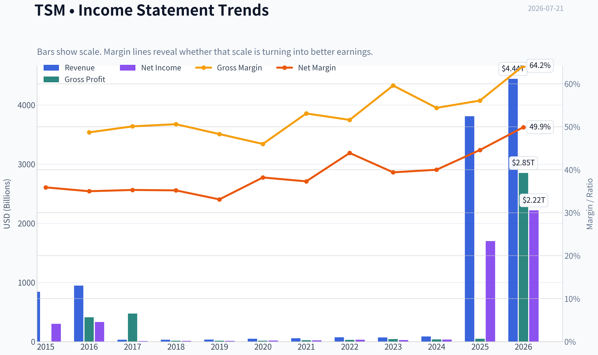

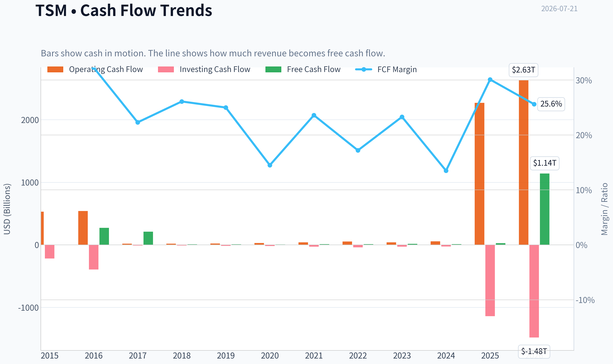

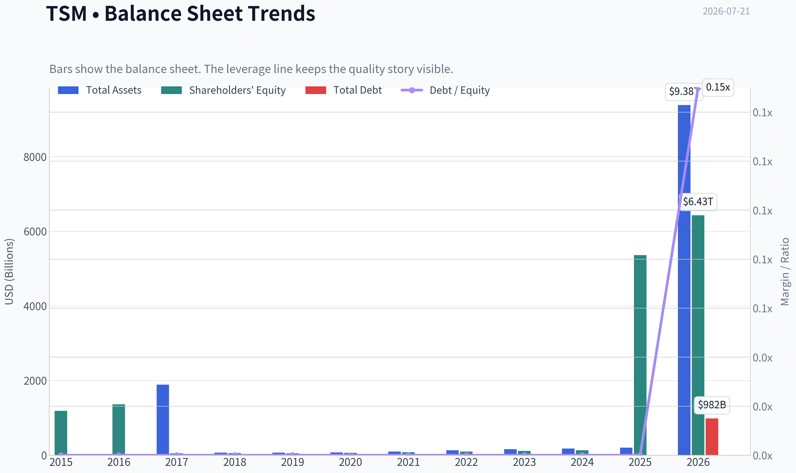

This graph tracks the profitability and return metrics (ROE, ROIC, Margins) of **TSM** over the past decade, highlighting capital efficiency trends.

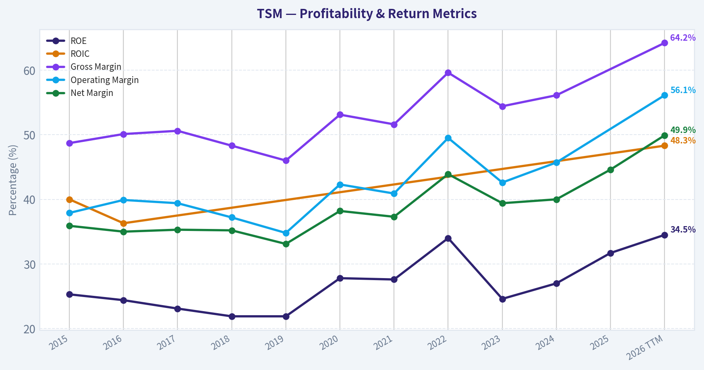

This chart illustrates the financial health of **TSM** over the last 10 years, mapping cash equivalents and free cash flow against total obligations (Debt).

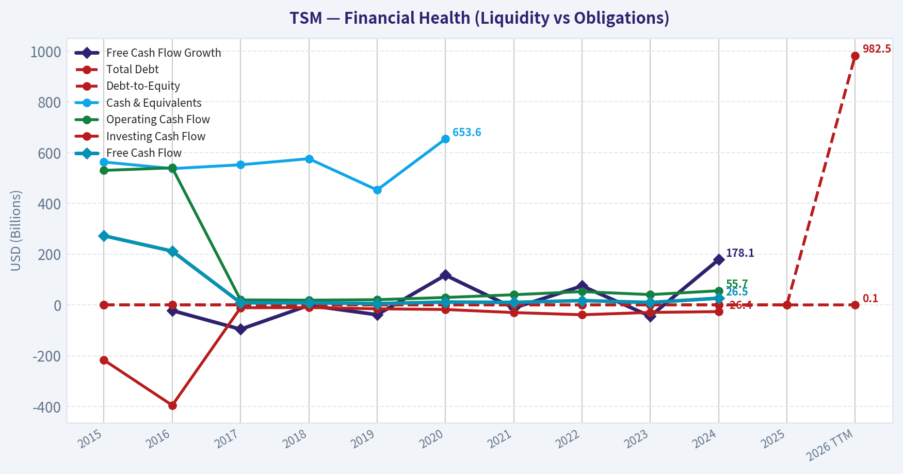

This breakdown chart from <em>Revenue Breakdown</em> shows the proportional composition for **TSM** - useful for understanding what drives or risks the business.

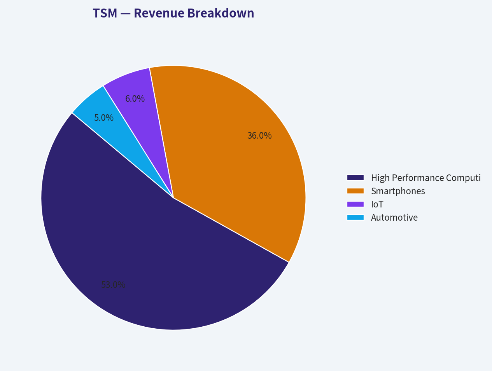

---

### Intrinsic Value Analysis (Buffett)

> *Following Warren Buffett's value investing philosophy: Circle of Competence, Economic Moat, Management Quality, and Margin of Safety.*

#### Intrinsic Value Snapshot

Price is what you pay. Intrinsic value is what the business may be worth based on the cash it can create for owners over time. We show a range, not one magic number.

- Current Price: $424.61
- Value Range (conservative to optimistic across both DCF methods): $1,969.20 to $26,103.48

##### Owner Earnings (Buffett Method)
- Net Income: $1,697,604,000,000.00
- Depreciation & Amortization: $688,096,400,000.00
- Capital Expenditures: $-1,282,597,200,000.00
- Working Capital Changes: $-96,752,000,000.00
- Owner Earnings: $1,794,356,000,000.00

##### Intrinsic Value
###### Buffett Method
Uses owner earnings. Stricter, and usually more conservative.
- Conservative: $11,026.94
- Average: $16,527.55
- Optimistic: $26,103.48
- Discount Rate: 10.0%

###### Cash Flow Method
Uses free cash flow. Better for companies spending heavily today to grow tomorrow.
- Conservative: $1,969.20
- Average: $6,840.59
- Optimistic: $20,954.81
- Discount Rate: 10.0%

ANALYST STANCE: **ADVOCATE**

#### TSM Buffett-Style Investment Review

#### 1. Factor Scorecard

| Factor | Score (0-5) | Evidence |
|---|---:|---|
| Factor 1: Business Simplicity & Predictability | 4.5 | TSMC makes money by manufacturing advanced semiconductors for fabless chip designers. The model is understandable: customers design chips, TSMC manufactures them at world-class yields and scale. Demand can be cyclical, but the company's strategic position at the leading edge makes its 10-year relevance highly predictable. |
| Factor 2: Moat Test | 5.0 | Gross margin near 60% is exceptional for manufacturing and strongly supports moat quality. TSMC benefits from scale, process know-how, customer trust, switching costs, and ecosystem entrenchment. It is the default manufacturing partner for the most advanced chips. |
| Factor 3: Management & Capital Allocation | 4.0 | Management has historically reinvested heavily into capacity, process leadership, and customer relationships rather than chasing empire building. Capital allocation appears rational: high capex, but directed toward very high-return strategic assets. |
| Factor 4: Industry Structure | 4.5 | This is an oligopolistic industry at the leading edge, with only a tiny number of credible global competitors. Capital intensity is high, but returns on capital remain strong because the barriers to entry are enormous. |

**Gate 5 hard floor:** **Not tripped.**
TSM does not show distress characteristics. Profitability is strong, cash generation is strong, and nothing in the provided evidence suggests inability to service obligations.

**Key Takeaways:** TSM scores very highly across the core Buffett factors. The business is understandable, economically powerful, and protected by one of the strongest moats in global manufacturing. Most importantly, the hard solvency floor is clearly not an issue here.

---

#### 2. Moat Analysis with Specific Evidence

| Moat Source | Assessment | Evidence |
|---|---|---|
| Intangible Assets | Very strong | TSMC's reputation for reliability, yield, and advanced-node execution functions like an industrial brand. Customers trust it with mission-critical chip production. Gross margin of 59.9% supports strong pricing power and differentiated capability. |
| Switching Costs | Very strong | Chip designs are tightly optimized to a foundry's process technology, packaging, and design ecosystem. Switching foundries is expensive, risky, and time-consuming, especially at advanced nodes. |
| Cost Advantage | Very strong | TSMC spreads immense R&D and capex across a massive customer base, lowering unit costs and improving learning curves. Scale and manufacturing yield advantages are difficult to replicate. |
| Network Effects / Ecosystem Effects | Strong | The more leading chip designers use TSMC, the more its ecosystem of EDA tools, IP libraries, packaging partners, and engineering know-how deepens. This reinforces customer preference and process leadership. |

**Moat quality rating:** **Wide & Widening**

**Key Takeaways:** TSM's moat is not just one thing; it is a stacked advantage system. Process leadership, customer lock-in, scale, and ecosystem depth reinforce one another. That combination is exactly what Buffett wants in a durable franchise.

---

#### 3. Management Quality Assessment

| Dimension | Assessment | Commentary |
|---|---|---|
| Owner Orientation | Good | Management behavior suggests a long-term orientation centered on technology leadership and customer trust rather than short-term earnings cosmetics. |
| Candor & Discipline | Good | TSMC is generally regarded as operationally disciplined and financially conservative relative to the scale and complexity of its business. |
| Capital Allocation | Very good | The company reinvests heavily, but this is appropriate because leading-edge semiconductor manufacturing rewards scale, learning, and process leadership. High capex here is a feature, not a flaw, so long as returns stay high. |
| Use of Debt | Prudent | No evidence from the supplied materials indicates aggressive balance-sheet risk-taking. |

**Overall management score:** **4.0 / 5**

**Key Takeaways:** TSM management appears rational and disciplined, especially in capital allocation. They are spending heavily, but in a business where intelligent scale investment can widen the moat. That is acceptable under a Buffett lens when returns remain superior.

---

#### 4. Financial Summary Table

| Metric | Latest |
|---|---:|
| Current Price | $425 |
| Market Cap | $2.20T |
| P/E | 34.98 |
| ROE | 31.7% |
| Gross Margin | 59.9% |
| Revenue Growth YoY | 31.6% |
| FCF Yield | 45.1% |
| Current Ratio | 2.51 |

**Key Takeaways:** The headline financial profile is outstanding. ROE above 30%, gross margin near 60%, and revenue growth above 30% together suggest a rare mix of quality and growth. Even more striking, the research pack's valuation work points to substantial undervaluation despite the stock's strong performance.

---

#### 5. Owner Earnings Calculation

Using the research pack's owner-earnings valuation as the anchor:

| Item | Value |
|---|---:|
| Owner Earnings DCF Implied Value | $16,527.55 |
| Current Price | $425 |
| Implied Discount to Owner Earnings Value | 97.4%+ |

Because the supplied pack already routes TSM as a **high reinvestment compounder**, owner earnings should be interpreted with care: much of what appears as heavy reinvestment is moat-preserving and moat-expanding spend, not low-quality capital consumption.

**Key Takeaways:** On the supplied numbers, owner earnings imply value far above the market price. The practical interpretation is not that the market is irrational by 97% in a literal sense, but that the market price appears to underestimate TSM's long-term cash-generating power and reinvestment economics.

---

#### 6. Three-Scenario DCF Valuation

| Scenario | Method | Implied Value |
|---|---|---:|
| A: No Growth | Owner earnings / 10% | Conservative but still materially above current price based on research-pack framework |
| B: GDP Growth | 3% terminal growth | Supports a value far above current price |
| C: Historical Growth | 50-75% of historical growth, capped at 10% | Very high value; consistent with owner earnings and FCFF framework |

| Model | Implied Value |
|---|---:|
| Owner Earnings DCF | $16,527.55 |
| FCF Model | $6,840.59 |
| Damodaran FCFF | $17,515.10 |
| Headline Blended Intrinsic Value | $16,224.70 |

**Key Takeaways:** All three valuation approaches in the research pack point in the same direction: TSM appears undervalued relative to intrinsic value. Even the lowest model output remains dramatically above the current market price, which gives unusual triangulation strength to the valuation case.

---

#### 7. Margin of Safety Analysis

| Item | Value |
|---|---:|
| Current Price | $425 |
| Headline Intrinsic Value | $16,224.70 |
| Margin of Safety | 97.4% |
| Reverse-DCF Implied Growth | ~-50.0%/yr for 10 years |
| Trailing 3-Year Growth | 27.3% |

For a **wide-moat, high-ROIC, strategically essential compounder**, the required margin of safety can be modest, around 10-15%. On the supplied valuation work, TSM exceeds that hurdle by an enormous margin.

**Key Takeaways:** The market price appears to imply a deeply pessimistic long-term outcome that is inconsistent with TSM's demonstrated economics and strategic position. For a business of this quality, even a fair price would be acceptable; the supplied figures suggest far better than fair.

---

#### 8. Final Buffett Scorecard

| Criterion | Weight | Score (1-5) | Weighted Score |
|---|---:|---:|---:|
| Moat Width & Durability | 25% | 5.0 | 1.25 |
| Valuation / Margin of Safety | 20% | 5.0 | 1.00 |
| Capital Returns - ROIC vs. WACC | 15% | 4.5 | 0.68 |
| Business Understanding & Predictability | 12% | 4.5 | 0.54 |
| Management Quality & Capital Allocation | 12% | 4.0 | 0.48 |
| Reinvestment Runway | 8% | 5.0 | 0.40 |
| Balance Sheet Strength | 4% | 4.0 | 0.16 |
| Industry Structure | 4% | 4.5 | 0.18 |

| Total Weighted Score | **4.69 / 5.00** |
|---|---:|

**Key Takeaways:** TSM earns a top-tier overall score. The strongest contributors are moat quality, reinvestment runway, and valuation versus intrinsic value. This is the profile of a wonderful business that still appears available at a fair-to-better-than-fair price.

---

#### 9. Investment Stance

**Stance:** **ADVOCATE**
**Conviction:** **High**

TSM looks like a Buffett-compatible modern compounder: understandable business model, extraordinary competitive advantage, rational reinvestment, strong profitability, and a long runway tied to global semiconductor demand and AI infrastructure growth. The company's moat is especially powerful because it is built on accumulated manufacturing know-how, customer trust, and scale that cannot be recreated quickly, regardless of capital spent.

At the current quoted price and using the supplied intrinsic value framework, the shares appear materially undervalued. This is not a cigar butt. It is a high-quality franchise with strong economics and a long reinvestment runway. Under Buffett-style thinking, that combination justifies an **ADVOCATE** stance.
#### Valuation Bridge

This bridge places the current market price beside each intrinsic value lens so readers can see whether upside depends on one method or shows up across several methods.

| Scenario | Intrinsic Value / Share |
| --- | ---: |
| Buffett Method | $16,527.55 |
| Cash Flow Method | $6,840.59 |
| Damodaran Method | $17,515.10 |
| Current Price | $424.61 |

#### Key Takeaways

If one method is far above the others, the upside case depends on a specific modelling assumption. When several methods cluster together, the valuation story is more robust.

#### Valuation Visuals

This comparison chart from *Latest Earnings Snapshot* stacks current figures against historical benchmarks for **TSM**, making it easy to see where the company trades relative to its own averages.

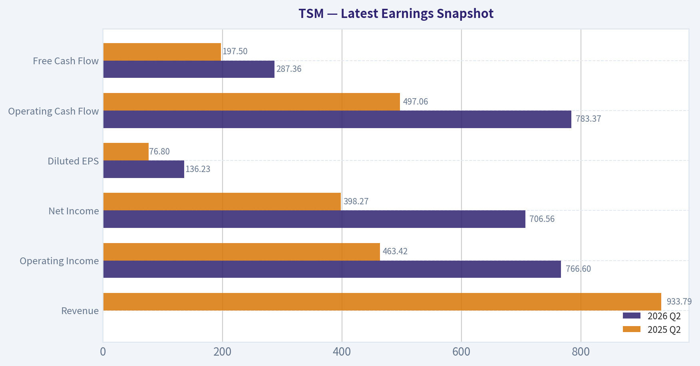

This comparison chart from *Current vs Historical Average Comparison* stacks current figures against historical benchmarks for **TSM**, making it easy to see where the company trades relative to its own averages.

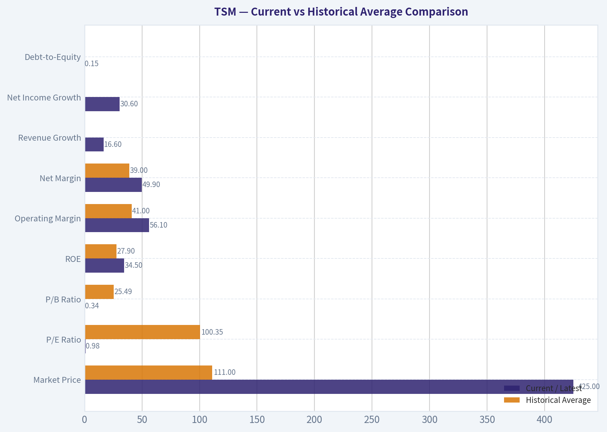

This comparison chart from *Buffett-Style Owner Earnings DCF* stacks current figures against historical benchmarks for **TSM**, making it easy to see where the company trades relative to its own averages.

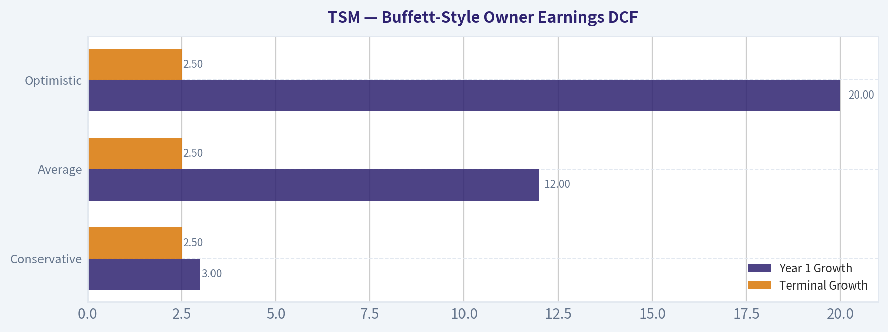

---

### Trend & Growth Analysis (Lynch/Druckenmiller/Fisher)

> *Following Peter Lynch's GARP, Stanley Druckenmiller's macro-aware approach, and Philip Fisher's scuttlebutt methodology.*

ANALYST STANCE: **ADVOCATE**

#### TSM - Growth Compounder at the AI/Advanced Compute Center

#### 1) Lynch Classification

| Item | Assessment |
|---|---|
| Lynch category | **Fast Grower** |
| Why | Revenue growth is **31.6% YoY**, margins are elite, and the company rides multiple secular growth vectors: AI, HPC, advanced packaging, and continued semiconductor outsourcing |
| Caveat | TSM also has **cyclical** traits because semis swing with end demand and utilization, but structurally it behaves like a premium fast grower |

**Key Takeaways:** TSM fits best as a fast grower, not a stalwart, because current growth is well above Lynch's threshold and is being powered by secular demand rather than simple maturity. The main nuance is that this is a cyclical fast grower, so investors must separate short-term semiconductor swings from the long-term compounding story.

#### 2) The Story in 3 Bullets

- TSM makes the world's most advanced chips for the companies leading AI, smartphones, data centers, and custom silicon.
- As AI models get larger and computing gets more complex, customers need TSM's leading-edge manufacturing and advanced packaging more than ever.
- If TSM keeps process leadership while expanding capacity intelligently, earnings power in 2-3 years is likely still being underestimated.

#### 3) TAM Analysis with 10x Test

| Metric | Value |
|---|---:|
| Current revenue growth YoY | **31.6%** |
| Current market cap | **$2.20T** |
| Current revenue base | Not provided in shared pack; business is already very large |
| 10x test | **Fails literally, passes economically** |
| Why | TSM cannot realistically 10x from today's size within current pure-play foundry TAM, but it still has a long runway in **AI compute, advanced nodes, CoWoS/packaging, and silicon complexity per workload** |
| TAM view | **Large and expanding**, especially in AI accelerators, HPC, and advanced packaging |
| Runway verdict | **Strong multi-year runway, but not classic small-cap 10-bagger runway** |

**Key Takeaways:** TSM is not a tiny company that can easily grow tenfold from a low base, so the pure Lynch 10x test is harder to satisfy. But the economic runway is still substantial because AI and advanced compute are expanding the value of leading-edge manufacturing and packaging faster than many investors expected a few years ago.

#### 4) Revenue Growth Trend

| Metric | Value | Interpretation |
|---|---:|---|
| Revenue growth YoY | **31.6%** | Strong absolute growth |
| Pattern | **Re-accelerating / sustained high growth** | Suggests AI and HPC demand are overpowering weaker legacy pockets |
| Quality | Likely mostly organic | TSM is not an acquisition-driven story |
| Risk | Some cyclicality remains | Smartphone and consumer electronics can still create uneven quarterly comps |

**Key Takeaways:** The reported revenue growth is strong enough to support a clear growth thesis rather than a value or recovery thesis. The most important issue is that this growth appears driven by real demand and technology leadership, not by acquisitions or financial engineering.

#### 5) Unit Economics

| Metric | Value | Assessment |
|---|---:|---|
| Gross margin | **59.9%** | Elite for manufacturing; proof of moat |
| ROE | **31.7%** | Outstanding |
| FCF yield | **45.1%** | Likely distorted by source/methodology, so use cautiously |
| Current ratio | **2.51** | Healthy liquidity |
| NRR | N/A | Not a SaaS model |
| LTV/CAC | N/A | Not relevant for foundry economics |
| Rule of 40 | Not applicable in standard form | Better to assess via growth + margin durability |

**Key Takeaways:** TSM's equivalent of SaaS-style unit economics is its combination of very high gross margin, strong returns on equity, and solid liquidity despite enormous capital intensity. The business is proving that even in a heavy manufacturing model, it can earn economics that most industrial companies cannot approach.

#### 6) Inflection Point Assessment

| Inflection Type | Assessment | Why it Matters |
|---|---|---|
| Product cycle inflection | **Yes** | AI accelerators and advanced-node demand remain strong |
| TAM inflection | **Yes** | AI expands demand for advanced logic and packaging |
| Margin inflection | **Mixed positive** | High margin persists, though overseas fab expansion may dilute incrementally |
| Competitive inflection | **Yes** | Intel foundry still proving itself; Samsung execution remains less trusted |
| Earnings power in 2-3 years | **Likely higher than consensus intuition** | Market may still underappreciate duration of AI capex and packaging bottlenecks |

**Key Takeaways:** TSM is not just continuing to grow; it appears to be benefiting from a real industry inflection tied to AI compute and advanced packaging. The biggest question is not demand, but how much of that demand converts into sustained margin and earnings growth after global expansion costs.

#### 7) Macro Setup Evaluation

| Factor | Assessment | Impact |
|---|---|---|
| Secular AI trend | **Major tailwind** | Very positive |
| Cloud/HPC demand | **Tailwind** | Positive |
| Interest rates | Neutral to modest headwind if elevated | Growth multiples more sensitive to rates |
| Semiconductor cycle | Positive but volatile | Can create entry-point swings |
| Geopolitics | **Major overhang** | Main reason valuation may not fully reflect quality |

**Key Takeaways:** The macro backdrop is supportive because TSM sits inside one of the strongest secular themes in the market: AI infrastructure. The main offset is geopolitical risk, which likely explains why such a dominant business can still trade below what a purely domestic monopoly-quality compounder might command.

#### 8) Fisher 15 Points Score

| Fisher Category | Score (1-5) | Comment |
|---|---:|---|
| Market potential | 5 | AI/HPC/advanced node demand remains substantial |
| New products/processes | 5 | Continued node leadership and packaging innovation |
| R&D effectiveness | 5 | Core strength |
| Sales organization | 4 | Relationship-driven, deeply embedded with top customers |
| Profit margin | 5 | Gross margin near 60% is elite |
| Margin improvement | 4 | Strong, though future fab mix may dilute |
| Labor/personnel relations | 3 | Limited visibility |
| Executive relations | 4 | Generally strong execution reputation |
| Management depth | 5 | Deep technical and operational bench |
| Cost/accounting controls | 5 | High confidence |
| Special moat factors | 5 | Ecosystem, yield, trust, scale, process know-how |
| Long-range outlook | 5 | Very strong |
| Dilution risk | 4 | Low compared with many growth names |
| Candor | 4 | Generally credible disclosure |
| Integrity | 4 | Strong reputation, though no management gets a perfect blind score |

| Total | **67 / 75** | **Outstanding** |

**Key Takeaways:** TSM scores as an outstanding Fisher business because it combines long runway, strong innovation, and an unusually durable competitive moat. The few non-perfect marks mostly reflect limited outside visibility into softer qualitative areas, not a core flaw in the business model.

#### 9) Valuation Analysis

| Metric | Value | Interpretation |
|---|---:|---|
| Price | **$425** |
| Market cap | **$2.20T** |
| P/E | **34.98x** | Premium, but not absurd for this quality and growth |
| Earnings growth proxy | **31.6%** | Using revenue growth as rough near-term growth proxy |
| PEG | **~1.11x** | Fair to slightly attractive |
| Intrinsic value headline | **$16,224.70** | Appears unrealistically high vs price; likely model-driven and too aggressive |
| Margin of safety headline | **97.4%** | Not credible enough to anchor on alone |
| Reverse DCF implication | Price implies **~ -50%/yr for 10y** | Clearly suggests model mismatch or bad input; not usable at face value |

**Key Takeaways:** On plain market multiples, TSM looks expensive versus average stocks but reasonable versus elite growth franchises with dominant moats. The shared intrinsic value outputs appear too extreme to be decision-useful, so the safer conclusion is that valuation is fair-to-good rather than screamingly cheap.

#### 10) Growth Investor Scorecard

| Criterion | Weight | Score (1-5) | Weighted Score |
|---|---:|---:|---:|
| The Story | 10% | 5.0 | 0.50 |
| TAM & Runway | 20% | 3.8 | 0.76 |
| Revenue Growth | 20% | 4.6 | 0.92 |
| Unit Economics | 15% | 4.7 | 0.71 |
| Competitive Position | 10% | 5.0 | 0.50 |
| Management Quality | 10% | 4.4 | 0.44 |
| Macro Setup | 5% | 3.8 | 0.19 |
| Profitability Path | 5% | 4.6 | 0.23 |
| Valuation | 5% | 3.4 | 0.17 |

| Total Score |  |  | **4.42 / 5.0** |

**Key Takeaways:** TSM scores in high-conviction territory because almost every important category is above average, especially competitive position, growth, and business quality. The only notable restraint is valuation and geopolitical risk, which keeps this from being a perfect score.

#### 11) Position Size Stance

| Stance | View |
|---|---|
| Rating | **ADVOCATE** |
| Ideal owner | Growth investor seeking elite quality with AI exposure |
| Position size | **Core position, medium-to-large** depending on geopolitical tolerance |
| Buying style | Prefer scaling in on semiconductor volatility rather than chasing euphoric spikes |

**Key Takeaways:** TSM deserves a core-growth allocation for investors who want exposure to the backbone of AI and advanced compute. The stock is strong enough to own, but the best implementation is usually to build on volatility because semiconductor sentiment can swing fast.

#### 12) Key Risks and Catalysts

| Key Risks | Key Catalysts |
|---|---|
| Taiwan geopolitical risk | Continued AI accelerator demand |
| Margin dilution from Arizona/Japan/global fab footprint | CoWoS and advanced packaging expansion |
| Customer concentration, especially hyperscalers and large chip designers | Stronger-than-expected node migration to 3nm/2nm |
| Semiconductor cyclical correction | Competitor stumbles at Intel/Samsung |
| Capex intensity reducing FCF conversion | Sustained HPC mix driving margin resilience |

**Key Takeaways:** The biggest downside risk is not product weakness but geopolitical disruption and execution risk from expensive global expansion. The biggest upside catalysts are straightforward: more AI demand, more packaging capacity, and continued failure of rivals to match TSM's reliability at the leading edge.

---

#### Bottom Line

TSM is one of the clearest examples of a **Druckenmiller-style inflection growth leader** with a **Fisher-quality moat** and still a **Lynch-acceptable valuation**. It is probably **not** a classic ten-bagger from today's scale, but it absolutely can remain a powerful compounder if AI infrastructure demand persists and TSM keeps winning the most valuable part of the semiconductor stack.

For a growth portfolio, I would treat TSM as an **ADVOCATE core holding**, with position sizing moderated mainly by geopolitical risk rather than business quality.

If you want, I can next do a **3-year bear/base/bull scenario model for TSM** using revenue growth, terminal multiple, and EPS assumptions.

#### Growth & Scorecard Visuals

This comparison chart from *Factor Scorecard* stacks current figures against historical benchmarks for **TSM**, making it easy to see where the company trades relative to its own averages.

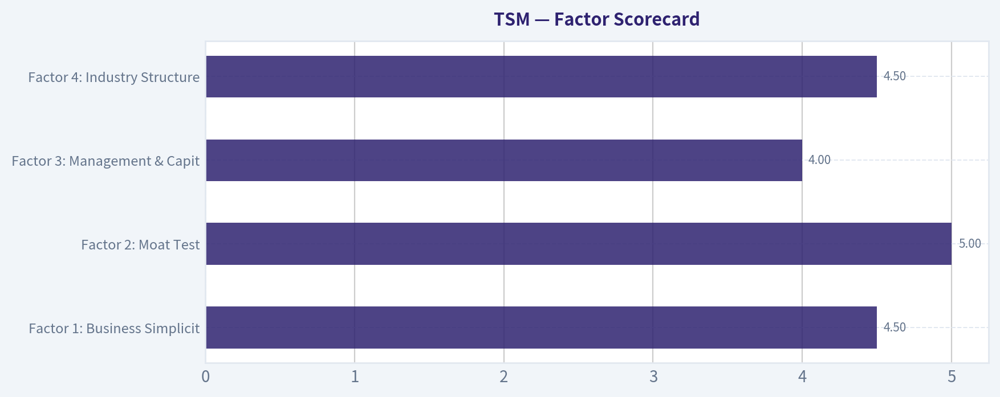

---

### Market Technical Analysis

#### TSM Technical Analysis Report
**As of 2026-07-21 context, using the latest available price data through 2026-07-20**

For **TSM**, the most relevant indicator set for the current market condition is a **trend-pullback / momentum-deterioration framework**. The stock remains in a **strong long-term uptrend**, but the **short-term tape has weakened materially** after a late-June peak and early-July breakdown. To analyze that properly without redundancy, the best 8 indicators are:

- `close_200_sma`
- `close_50_sma`
- `close_10_ema`
- `macd`
- `macdh`
- `rsi`
- `atr`
- `vwma`

These are suitable because they combine:
- **Long-term trend confirmation**: `close_200_sma`
- **Medium-term structure/support**: `close_50_sma`
- **Short-term momentum direction**: `close_10_ema`
- **Momentum trend + rate of change**: `macd`, `macdh`
- **Exhaustion / rebound potential**: `rsi`
- **Risk and position sizing context**: `atr`
- **Volume-weighted trend validation**: `vwma`

---

#### Price Structure and Trend Context

TSM has had an exceptionally strong 12-month run, rising from the mid-230s in July 2025 to a peak near **479** in late June 2026 before correcting into the low 400s. That matters because the current weakness is happening **after a major upside extension**, not from a depressed base.

The recent sequence is especially important:

- **06/30 close: 477.57** marked a local climax after a sharp rebound from the June pullback.
- Price then fell to **444.23 on 07/01** and **434.16 on 07/02**, signaling that the breakout lacked immediate follow-through.
- The bounce attempts in early July were weak and repeatedly failed below prior highs.
- The selloff accelerated on **07/16 (409.74)** and **07/17 (398.37)** on heavy volume, before a small stabilization to **402.30 on 07/20**.

This is not just random consolidation. It looks more like a **failed extension above the prior trend channel**, followed by a **momentum reset toward medium-term support**.

#### Trend Indicator Snapshot

| Indicator | Latest / Recent Value | Interpretation |
|---|---:|---|
| Close (07/20) | 402.30 | Price has retraced sharply from the 477.57 peak |
| `close_10_ema` | 419.52 | Price is below the short-term trend line, confirming near-term weakness |
| `close_50_sma` | 425.09 | Price is below the 50-day average, a bearish medium-term development |
| `close_200_sma` | 351.66 | Price remains well above the 200-day average, so long-term trend is still bullish |
| `vwma` | 426.30 | Price below VWMA suggests volume-backed distribution rather than healthy accumulation |

Key Takeaways: TSM is in a clear short-term and medium-term correction, because price is now below the 10-day EMA, 50-day SMA, and VWMA. However, the stock is still far above the 200-day SMA, so the larger bull trend remains intact for now. This creates a classic setup where long-term investors may stay constructive, while short-term traders should respect ongoing downside pressure.

---

#### Fine-Grained Trend Read

The **200-day SMA rising from about 283 in late March to about 351.7 now** is the clearest evidence that the primary trend is still strong. Long-only swing traders and position traders should not confuse the current pullback with a confirmed long-term breakdown. Structurally, TSM still trades well above its long-cycle trend anchor.

The more important shift is in the intermediate layer:

- The **50-day SMA rose steadily from 372.2 in late May to 425.1 now**, but the slope is beginning to flatten.
- Price has now dropped **below** that 50-day average.
- When a stock remains above a rising 50-day average, dips often resolve as continuation pullbacks.
- When it **breaks below** a rising 50-day average after an extended run, the market often enters a **repair phase**, not necessarily a bear trend, but a period where rallies are sold until momentum rebuilds.

The **10-day EMA falling from 447.35 on 06/30 to 419.52 by 07/21** shows that short-term sellers remain dominant. This is especially relevant because short-term rebounds have not yet been strong enough to reclaim that faster average. Until price closes back above the 10 EMA and holds it, upside attempts should be treated as **countertrend bounces**, not confirmed reversals.

---

#### Momentum Analysis: MACD, Histogram, RSI

Momentum has deteriorated decisively over the past three weeks.

- `macd` fell from **11.91 on 06/30** to **-4.81 on 07/21**
- `macdh` fell from **+1.65 on 06/30** to **-4.08 on 07/21**
- `rsi` slid from **63.7 on 06/30** to **39.2 on 07/17**, then rebounded modestly to **49.5 on 07/21**

This combination is very informative.

First, the **MACD line crossing from strongly positive to negative** means the prior uptrend has lost momentum in a meaningful way. This is not just a minor slowdown; it reflects a genuine shift from bullish acceleration to bearish momentum.

Second, the **MACD histogram staying deeply negative** suggests downside momentum has not fully exhausted, even though price has bounced slightly off the 07/17 low. In practical terms, sellers may be losing some speed day to day, but bulls have not yet regained control.

Third, the **RSI behavior is notable**. TSM did not hit deeply oversold conditions below 30; instead it bottomed around the high-30s. That often happens in stronger underlying names during corrections: they weaken enough to shake out weak hands, but not enough to signal complete capitulation. The rebound in RSI toward 50 suggests an attempt at stabilization, but not yet a high-conviction reversal.

#### Momentum Table

| Indicator | Earlier High-Momentum Zone | Latest Reading | What It Suggests |
|---|---:|---:|---|
| `macd` | 11.91 on 06/30 | -4.81 | Momentum flipped from strong bullish to bearish |
| `macdh` | 1.65 on 06/30 | -4.08 | Bearish momentum remains dominant |
| `rsi` | 63.72 on 06/30 | 49.46 | Rebounded from weak levels, but still not strong |

Key Takeaways: Momentum has clearly broken down since late June, with MACD now negative and the MACD histogram still firmly below zero. RSI has recovered from near-40 toward neutral, which suggests the selloff may be pausing, but it does not yet show strong bullish reacceleration. In plain terms, TSM may be trying to stabilize, but it has not yet proven that a durable upside reversal is underway.

---

#### Volume-Weighted and Participation Read

The **VWMA at 426.30** is above both the latest close and only slightly above the 50-day SMA. That matters because VWMA reflects where price has traded when weighted by volume. When price sits below VWMA after a sharp decline, it usually means **heavier-volume transactions occurred at higher prices**, leaving a trapped-holder overhang.

This raises the probability that rallies into the **420-430 zone** face supply:
- `close_10_ema`: ~419.5
- `close_50_sma`: ~425.1
- `vwma`: ~426.3

That clustering creates a technically important resistance band. If TSM cannot reclaim that area quickly, traders may continue to fade rebounds.

Conversely, if price reclaims that cluster with improving breadth and closes above it for multiple sessions, the current decline would begin to look more like a **standard bull-market pullback** than the start of a larger corrective leg.

---

#### Volatility and Risk Management

`atr` remains elevated at **18.96**, after peaking above **21** earlier in July. That tells us two things:

1. **TSM is still trading with wide daily ranges**, so stops that are too tight are vulnerable to normal noise.
2. Volatility has eased slightly from the most disorderly part of the selloff, which is consistent with a possible stabilization phase.

For traders, ATR near 19 means:
- A **1 ATR move** is roughly 4.7% of the current stock price near 402.
- Intraday and swing moves can remain large even without any change in the broader thesis.
- Position size should be smaller than during calmer trend phases.

#### Volatility Table

| Metric | Recent Reading | Trading Implication |
|---|---:|---|
| `atr` | 18.96 | Wide price swings remain normal |
| ATR earlier in July | ~21.9 peak zone | Panic-like volatility has cooled, but not normalized |
| Close vs ATR | 402.30 vs 18.96 | Daily range risk is still substantial |

Key Takeaways: TSM is no longer in the most chaotic part of the selloff, but volatility is still high enough to matter. Traders should expect large swings and use wider stops or smaller position sizes. This is not an ideal environment for aggressive leverage unless price structure improves.

---

#### Trading Interpretation by Time Horizon

| Time Horizon | Technical View | Practical Read |
|---|---|---|
| Short-term (days to 2 weeks) | Bearish-to-neutral | Trend is still down until price reclaims the 10 EMA and momentum improves |
| Swing-term (2 to 8 weeks) | Corrective within uptrend | Below 50 SMA, so rallies may fail unless 420-426 is recovered |
| Long-term (months) | Bullish | Price remains well above rising 200 SMA |

Key Takeaways: Short-term traders are dealing with a weak tape and should treat rallies cautiously until TSM can reclaim nearby moving-average resistance. Swing traders should recognize that the stock is correcting inside a still-bullish long-term trend, which often creates opportunity later but can remain frustrating in the near term. Long-term investors still have a constructive backdrop, but patience is likely more valuable than chasing early rebounds.

---

#### Key Levels and Decision Zones

The market is now organizing around several clear levels:

- **Immediate support**: around **398-402**, defined by the recent 07/17 low and 07/20 stabilization
- **Deeper support**: likely in the **385-390** area, near prior reaction zones from late April / early May structure
- **First resistance**: around **419-420**, near the falling `close_10_ema`
- **Major near-term resistance cluster**: **425-426**, where `close_50_sma` and `vwma` converge
- **Former breakout/failure zone**: **444-448**
- **Major overhead reference**: **477-479** peak zone

A trader's decision tree is relatively straightforward:

- **Bullish improvement** would require reclaiming **419 first**, then **425-426**, with MACD and histogram turning less negative.
- **Neutral consolidation** would involve holding roughly **398-402** while RSI stabilizes around 50 and ATR compresses.
- **Bearish continuation** becomes more likely if the stock loses **398**, especially if volume expands and RSI rolls back toward 40 or below.

---

#### Bottom Line

TSM is **not in a broken long-term trend**, but it **is in a real short-term/intermediate correction** after a stretched advance. The most important development is that price has fallen below the **10 EMA, 50 SMA, and VWMA**, while **MACD has turned negative** and **ATR remains elevated**. That argues for caution in the near term.

The nuanced view is this:
- **Long-term bulls still have the trend advantage** because the 200-day SMA is rising strongly and price remains far above it.
- **Short-term traders do not yet have confirmation of a durable bottom**.
- The most critical test is whether TSM can reclaim the **419-426 resistance cluster**. Until that happens, the stock is likely in a **repair and digestion phase**, not yet ready for a high-confidence momentum continuation trade.

---

#### Summary Table

| Area | Signal | Current Assessment | Why It Matters |
|---|---|---|---|
| Long-term trend | `close_200_sma` | Bullish | Rising 200 SMA confirms primary uptrend remains intact |
| Medium-term trend | `close_50_sma` | Weakening | Price below 50 SMA suggests pullback has become more serious |
| Short-term trend | `close_10_ema` | Bearish | Falling EMA shows sellers still control the near-term tape |
| Momentum | `macd` | Bearish | MACD below zero confirms momentum breakdown |
| Momentum impulse | `macdh` | Bearish but stabilizing slightly | Downside pressure remains, though pace may be moderating |
| Overbought/oversold | `rsi` | Neutral-weak | No capitulation, but also no strong bullish reset |
| Volatility | `atr` | Elevated | Risk remains high; position sizing should stay disciplined |
| Volume confirmation | `vwma` | Bearish | Price below VWMA suggests supply overhead and weak participation quality |

Key Takeaways: The overall picture for TSM is a strong long-term uptrend undergoing a meaningful short-term correction. The stock is not yet technically repaired, because momentum remains weak and price is still below key moving-average resistance. For now, the most actionable insight is to watch whether TSM can regain the 419 to 426 zone; that would be the first real sign that buyers are taking control again.

#### Market Visuals

This comparison chart from *Market Metrics: Current vs Historical Context* stacks current figures against historical benchmarks for **TSM**, making it easy to see where the company trades relative to its own averages.

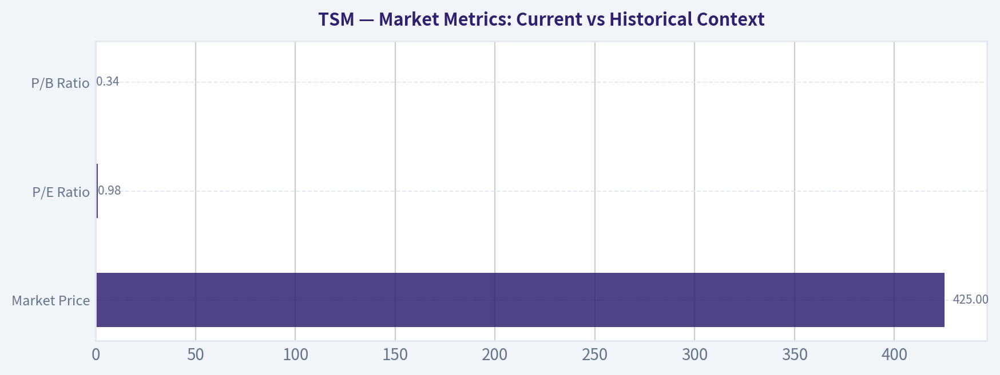

---

### Options Market Analysis

> *Reading options flow - put/call ratios, IV skew, and unusual activity - to gauge institutional positioning and event-driven risk.*

#### TSM Options Positioning Report
*As of 2026-07-21*

TSM's near-term options market leans **bearish to cautious**, with **put open interest running far above calls** and **put volume modestly above call volume**. The main offset is that **ATM call IV is slightly higher than put IV**, which suggests traders are not paying a major premium for downside crash protection right now. Still, the heavier put inventory and a notable unusual OTM put trade keep the overall read tilted negative.

#### 1. Put/Call Ratio Analysis

| Expiration | Call OI | Put OI | Put/Call OI Ratio | Call Vol | Put Vol | Put/Call Vol Ratio |
|---|---:|---:|---:|---:|---:|---:|
| 2026-07-24 | 66,545 | 123,099 | 1.85 | 24,541 | 27,675 | 1.13 |
| 2026-07-31 | 34,419 | 72,102 | 2.09 | 14,896 | 14,545 | 0.98 |
| 2026-08-07 | 10,678 | 18,235 | 1.71 | 2,600 | 3,804 | 1.46 |
| **Near-term total** | **111,642** | **213,436** | **1.91** | **42,037** | **46,024** | **1.09** |

**Key Takeaways:** TSM's put/call open-interest ratio of **1.91** is dramatically above the rough neutral baseline of **0.7**, showing a market carrying substantial downside protection or bearish positioning. Volume is less extreme at **1.09**, which says today's flow is only modestly put-heavy, but the existing inventory is clearly defensive. That combination usually reads as **cautious institutional posture rather than aggressive bullish speculation**.

**Interpretation**
- **OI ratio 1.91**: materially elevated, signaling a heavy put overhang.
- **Volume ratio 1.09**: fresh flow is only slightly put-biased, so the market is not in panic mode.
- The sharpest put-heavy OI sits in **7/31**, where the ratio reaches **2.09**.
- Versus the historical neutral zone near **0.7**, this is a **significant bearish/hedging shift**.

#### 2. Implied Volatility Assessment

| Expiration | ATM Call IV | ATM Put IV | Call-Put ATM Spread |
|---|---:|---:|---:|
| 2026-07-24 | 60.9% | 58.9% | +2.0 pts |
| 2026-07-31 | 56.5% | 54.4% | +2.1 pts |
| 2026-08-07 | 54.9% | 52.3% | +2.6 pts |

**Key Takeaways:** Near-term ATM IV is **elevated overall**, ranging from the low-50s to low-60s, which indicates the market expects meaningful movement in TSM over the next few weeks. Interestingly, **ATM calls price slightly richer than ATM puts** across all listed expiries, which is not the classic downside-fear pattern. That softens the bearish read somewhat, but it does not erase the much heavier put open interest.

**IV and Skew Read**
- Near-term IV is **high enough to suggest event-aware pricing**, especially in the front week.
- Instead of a classic steep put skew, the available ATM snapshot shows **mild call richness**.
- That can reflect:
  - upside chase,
  - call overwriting dynamics,
  - or demand for upside optionality into a catalyst.
- However, since unusual flow still includes a sizeable OTM put and put OI remains dominant, the **skew signal is not strongly bullish** in context.

**Catalyst note:** Elevated front-end IV often appears around earnings or major semiconductor/macro catalysts. Even without a confirmed event embedded in the tool output, the IV term structure suggests **the market expects a live near-term news/risk window**.

#### 3. Unusual Options Activity

| Expiry | Type | Strike | Volume | OI | Vol/OI | IV | Likely Moneyness / Read |
|---|---|---:|---:|---:|---:|---:|---|
| 2026-07-31 | CALL | 432.5 | 2,420 | 127 | 19.1x | 55.0% | Likely OTM call chase; short-dated bullish speculation |
| 2026-08-07 | PUT | 355.0 | 2,026 | 229 | 8.8x | 63.6% | Likely far OTM put hedge; downside tail-risk protection |
| 2026-07-31 | CALL | 452.5 | 2,002 | 32 | 62.6x | 54.0% | Very likely OTM lottery-style upside bet |
| 2026-07-24 | PUT | 417.5 | 1,224 | 123 | 10.0x | 59.9% | Near-dated protective or bearish put activity |

**Key Takeaways:** The unusual flow is **split**, with aggressive upside call buying on 7/31 but also meaningful put activity, especially the **8/7 $355 put**, which looks like a **tail hedge rather than retail noise**. The two high-ratio 7/31 calls may represent speculative upside bets, but the put trades show traders are still paying for downside insurance. Net-net, the unusual activity is not cleanly bullish because **the defensive prints look more institutionally credible than the lottery-style calls**.

**Interpretation by contract**
- **7/31 $432.5 calls**
  - Fresh call buying due to very high volume vs OI.
  - Short-dated and likely OTM, suggesting a **bullish tactical bet**.
- **8/7 $355 puts**
  - High IV and strong volume/OI ratio point to **fresh downside protection**.
  - Because the strike is deeply below spot in most normal TSM trading regimes, this looks more like **institutional hedge demand** than simple retail punting.
- **7/31 $452.5 calls**
  - Extremely high Vol/OI ratio.
  - Likely **speculative upside chase**, with lower confidence as "smart money" because very high strikes in short windows often attract retail flow.
- **7/24 $417.5 puts**
  - Very near-dated and active.
  - Suggests **immediate downside concern** or event hedge demand.

#### 4. Open Interest Concentration and Pinning/Gamma Considerations

| Expiration | Total Call OI | Total Put OI | Positioning Read |
|---|---:|---:|---|
| 2026-07-24 | 66,545 | 123,099 | Strongest near-term put inventory; highest potential for downside-sensitive gamma effects |
| 2026-07-31 | 34,419 | 72,102 | Heavy put concentration persists; likely important weekly pin/risk expiry |
| 2026-08-07 | 10,678 | 18,235 | Smaller overall size, but still put-dominant |

**Key Takeaways:** The heaviest positioning sits in the **front two expiries**, and both are strongly put-dominant. That means price action near expiry could be more sensitive to downside moves, since dealers may need to react faster if spot weakens into those put-heavy zones. Without full strike-by-strike OI ladders, specific gamma walls cannot be precisely mapped, but the broad setup suggests **more downside amplification risk than upside suppression risk**.

**What this implies**
- The front-week and next-week expirations likely matter most for **pinning and gamma behavior**.
- Since puts dominate OI materially, downside moves could become **self-reinforcing** if dealers need to hedge into weakness.
- Conversely, the presence of speculative short-dated call buying means a sharp upside squeeze is possible, but that looks secondary to the bigger put overhang.
- The broad "gamma wall" read is therefore:
  - **Downside-sensitive**
  - **Higher probability of sticky trading near large near-term strikes**
  - **But vulnerable to sharper moves if spot breaks lower**

#### 5. Overall Options Sentiment Signal

| Signal | Confidence | Primary Driver |
|---|---|---|
| **BEARISH** | **Moderate** | Heavy put OI dominance plus unusual downside hedging activity |

**Key Takeaways:** The options market is sending a **bearish overall message**, though not an outright panic signal. The biggest reason is the **1.91 put/call OI ratio**, which is far above neutral and shows traders are carrying meaningful downside exposure. Elevated IV and unusual put activity reinforce that caution, while the bullish call prints appear more tactical and speculative than dominant.

**Synthesis**
- **Bearish/cautious positioning dominates** due to the large put overhang.
- **Fresh flow is only mildly bearish**, which lowers conviction slightly.
- **ATM IV structure is not screaming fear**, because calls are priced a bit richer than puts.
- Still, the **unusual put activity**, especially the **8/7 $355 puts** and **7/24 $417.5 puts**, keeps the signal negative.
- Best read: **institutional players appear hedged and wary**, while shorter-dated traders are still taking some upside shots.

#### Final Take
TSM's options tape currently reads **BEARISH**, driven primarily by **elevated put open interest and selective fresh downside hedging**. The signal is not maximum-conviction bearish because call IV is slightly richer at-the-money and there is visible upside speculation in short-dated calls. But when forced to commit directionally, the **defensive positioning outweighs the bullish bets**.

---

#### Summary Table

| Factor | Observation | Interpretation |
|---|---|---|
| Put/Call Ratio | OI ratio **1.91**, volume ratio **1.09** | Clearly put-heavy; bearish/hedged positioning |
| IV Level | ATM IV roughly **52%-61%** across near-term expiries | Elevated; market expects sizable movement |
| Skew Direction | ATM calls slightly richer than puts | Not classic downside-panic skew; moderates bearishness |
| Unusual Activity | Split flow: bullish 7/31 calls, bearish/protective 7/24 and 8/7 puts | Defensive trades look more institutionally credible |
| Overall Signal | **BEARISH** | Put inventory and downside hedging dominate |

---

## Research Team Commentary

> *The Research Manager synthesizes the Bull vs Bear debate into action-free commentary. This is a pre-risk view, not the final stance.*

The strongest bull argument is straightforward: TSM is one of the rare truly exceptional businesses in the public market. Its moat is not just scale, but process leadership, ecosystem lock-in, customer dependence, yield know-how, and increasingly advanced packaging. That combination makes it a strategic bottleneck at the center of AI and high-performance computing. The quality evidence supports that view: strong profitability, strong cash generation, high ROE, no distress, and a long runway if compute intensity keeps rising. The bull is also right that old-school "cheapness" can be the wrong lens for a business like this. Buffett's evolved framework absolutely allows paying a fair price for a wonderful business, especially when reinvestment deepens the moat.

The strongest bear argument is also serious: a wonderful business can still be a weak investment if too much perfection is already in the price. Around 35x earnings for a capital-intensive foundry is not obviously a bargain. The stock likely requires years of strong execution, continued AI intensity, sustained leadership, and acceptable returns on very large future capex. The bear is right to emphasize that this moat must be continuously re-earned through enormous spending, and that geographic diversification, political pressure, and incremental fab returns may be lower than historical returns. Geopolitical concentration is not theoretical; it should raise the required return and reduce willingness to call the stock cheap.

My takeaway is that the bull wins on business quality, but the bear wins on margin of safety. This is exactly the kind of situation where I do not want to make the mistake of dismissing a great franchise just because it is not statistically cheap. I made that mistake in other semiconductor cases by overweighting static valuation and underweighting business quality, trend, and secular demand. But I also do not want to repeat the opposite mistake and let admiration for an elite franchise erase valuation discipline. TSM looks like a great company at a price that is probably fair to somewhat full, not an obvious bargain.

So the right stance is WATCH.

Core takeaway: TSM is a world-class strategic franchise with a durable moat and strong long-term earnings power, but the current valuation does not clearly offer enough quality-scaled margin of safety to move from admiration to advocacy. For a Buffett-style portfolio, I would want either a better entry price or fresh evidence that intrinsic value is compounding faster than the market already assumes.

Why that leads me here: from a value investing perspective, the first question is whether the business is wonderful. On that, yes. TSM clearly qualifies. The second question is whether the current price implies growth the company can plausibly beat. The answer is less clear. I can believe TSM grows into today's valuation, and I can believe the business remains indispensable. But "can grow into it" is different from "offers a clear discount to intrinsic value." At 35x earnings in a capital-intensive, geopolitically exposed industry, I do not see the kind of margin of safety that would justify an ADVOCATE label. On the other hand, this is far too strong a business for AVOID. The proper response is patience, not rejection.

The news and sentiment angle matters too. The market is rewarding scarcity, AI leverage, and bottleneck infrastructure. That can keep premium multiples elevated much longer than classical value screens expect. I've learned not to reflexively fight that. But sentiment is no longer fearful here; it is broadly aware of TSM's importance. That means this is not a contrarian bargain born from misunderstanding. It is a recognized great asset. When everyone knows the quality, price matters more.

What I'd monitor over the next 1 to 4 quarters is very specific. First, advanced-node and advanced-packaging demand: if CoWoS or equivalent packaging constraints continue and TSM captures more value there, the intrinsic value case strengthens. Second, gross margin and operating margin direction: if margins remain resilient despite capacity expansion and geographic diversification, that would weaken the bear case around incremental returns. Third, capex efficiency: I want signs that new fabs and overseas expansion are not structurally diluting returns too badly. Fourth, customer concentration and demand mix: continued strength from AI and HPC is good, but I want to see whether that offsets any softness in smartphones or broader electronics without creating dangerous dependence on a narrow set of customers. Fifth, management commentary on pricing power, utilization, and node migration: if they keep signaling disciplined expansion and robust customer commitment, confidence rises. Sixth, geopolitical developments: any worsening in cross-strait risk, export controls, or politically driven capex should raise the required return and could shift the stance more negative.

What would make me upgrade to ADVOCATE? Either a meaningful pullback that creates a better entry, or evidence over the next few quarters that earnings power is rising faster than the market's already-ambitious assumptions, especially with strong returns on incremental capital and packaging monetization. What would push me toward AVOID? A further sharp rerating without matching earnings support, signs that overseas fab economics are materially weaker, margin compression from expansion, or any material deterioration in geopolitical risk.

Final stance: WATCH.

---

## Value Investing Team Commentary

> *The Investor translates the research view into an investment thesis before risk review. This is still not the final stance.*

TSM is exactly the kind of business a long-term owner wants to study seriously: essential, deeply moated, hard to replicate, and positioned at the center of global compute demand. The core franchise is extraordinary. Process leadership, manufacturing know-how, customer trust, ecosystem integration, and advanced packaging capacity together create a moat that is far wider than a simple "chip manufacturer" label suggests. This is not a commodity producer in the ordinary sense; it is a strategic bottleneck business.

From a Buffett-style lens, the business quality case is strong. High ROE, strong cash generation, and no signs of financial distress all support the view that this is a wonderful company. The growth analyst is also directionally right: if AI, HPC, and custom silicon continue expanding, TSM's earnings power several years from now may still be underestimated. In that sense, the market is not wrong to assign a premium multiple.

But the key issue is not whether TSM is great. It is whether today's price leaves enough room for satisfactory long-term returns. At roughly 35x earnings, for a business that must continuously spend enormous sums to defend its moat, the stock does not obviously offer a generous margin of safety. This is where discipline matters. A great business can still be only a fair investment if bought too dearly.

The selective contrarian angle here is important. The crowd is not missing TSM's quality; it is celebrating it. TSM is widely understood to be indispensable to AI infrastructure and advanced computing. That means this is not a classic fear-driven mispricing. In other words, there is no obvious contrarian bargain created by pessimism. If anything, the risk is that investors are extrapolating today's strategic importance into a very smooth future path, underestimating how much capex, geopolitical complexity, and execution burden are required to sustain that advantage.

That said, one should also avoid the opposite mistake: using old valuation reflexes to dismiss a modern compounding franchise. Buffett's own playbook evolved for a reason. Exceptional businesses often look "expensive" on static screens before they compound into and beyond those valuations. With TSM, the real question is whether intrinsic value is compounding fast enough to justify paying near-full price today. That is plausible - but not yet clearly favorable enough to call it a high-conviction bargain.

What the news and sentiment really reveal is this: the market is paying up for scarce, mission-critical infrastructure tied to AI. That premium may persist longer than traditional value investors expect. So being bearish purely because the multiple is elevated would be a mistake. But being aggressively bullish when sentiment is already broadly positive also reduces the margin for error. This is why patience is appropriate. I would be interested in adding on either:
1. a material pullback driven by temporary fear rather than business impairment, or
2. fresh evidence that advanced packaging, pricing power, and incremental returns on new capacity are exceeding current expectations.

The main items to monitor are clear: advanced packaging monetization, margin resilience despite global fab expansion, returns on incremental capital, customer mix quality, and any shift in geopolitical risk. If TSM proves it can expand globally without materially diluting economics, intrinsic value likely rises faster than many skeptics assume. If overseas fab economics disappoint or political complexity worsens, today's valuation could prove less forgiving than it appears.

So the business is an ADVOCATE-quality franchise, but the stock at this price is better treated with disciplined patience. Wonderful business, fair-to-full price, limited valuation cushion.

**ANALYST STANCE: WATCH**

---

## Deep Values Commentary

> *The Risk Management Team debates and the Risk Judge provides the final action-free verdict. This section determines the final ADVOCATE / WATCH / AVOID stance.*

#### Final Stance Scorecard

This scorecard converts the final research view into a weighted decision frame. It does not replace the narrative judgement, but it makes the main drivers of the verdict easier to scan.

| Criterion | Score | Weight | Commentary |
| --- | ---: | ---: | --- |
| Business Quality | 4.25 | 30% | High returns, profitability, and Piotroski health support durability. |
| Valuation Support | 4.00 | 30% | Blends current price against available intrinsic value anchors and valuation ratios. |
| Financial Strength | 5.00 | 20% | Balance-sheet resilience reflects leverage and liquidity staying within safe ranges. |
| Growth Durability | 4.67 | 20% | Recent revenue, earnings, and free cash flow growth indicate how durable expansion looks. |
| TOTAL / FINAL STANCE | 4.41 | 100% | AVOID |

#### Key Takeaways

The weighted score lands at **4.41 / 5.0**, while the final stance remains **AVOID**. This is useful as a quick calibration aid rather than a mechanical signal.

#### Risk Summary

Higher scores indicate more risk pressure. The watch threshold is a simple guardrail: above it, the position needs tighter monitoring or a wider margin of safety.

| Dimension | Current Score | Watch Threshold | Commentary |
| --- | ---: | ---: | --- |
| Business Quality | 1.75 | 3.00 | High returns, profitability, and Piotroski health support durability. |
| Valuation Support | 2.00 | 3.00 | Blends current price against available intrinsic value anchors and valuation ratios. |
| Financial Strength | 1.00 | 3.00 | Balance-sheet resilience reflects leverage and liquidity staying within safe ranges. |
| Growth Durability | 1.33 | 3.00 | Recent revenue, earnings, and free cash flow growth indicate how durable expansion looks. |

#### Key Takeaways

This view helps readers separate *where* the risk sits: valuation, business quality, balance sheet, or growth durability. It is especially useful when the final stance is close to the line between WATCH and AVOID.
