# TSM Deep Value Intelligence

**Analysis Date:** 2026-11-22

## Critical Disclaimer

*This analysis is generated by Deep Value Intelligence, an AI-powered multi-agent investing framework. Alleen educatie en onderzoek - geen financieel advies, geen financieel adviseur.*

---

## Table of Contents

1. Intelligence Summary
2. Analyst Team Reports
   - Fundamentals Analysis
   - Intrinsic Value Analysis (Buffett)
   - Trend & Growth Analysis (Lynch/Druckenmiller/Fisher)
   - Market Technical Analysis
   - Options Market Analysis
3. Research Team Commentary
4. Value Investing Team Commentary
5. Deep Values Commentary

---

## Intelligence Summary

### Thesis + Conditions

**Core Thesis:** TSMC is an exceptional franchise, but the evidence does not demonstrate an adequate margin of safety at **$319**. Its process leadership, scale, yields, packaging capabilities, and customer integration support a durable moat.

**Key Risks:**
- The central risk is therefore not ordinary share-price volatility. It is that incremental free cash flow and returns on new capacity fail to match the economics of TSMC's established Taiwanese asset base. Geopolitical exposure remains an additional low-frequency, high-severity risk.
- The Risky Analyst correctly emphasizes that TSMC is strategic infrastructure for advanced computing rather than merely a cyclical manufacturer.
- High switching costs and substantial execution risk for customers attempting to migrate.

**Confidence:** Medium

---

## Analyst Team Reports

### Fundamentals Analysis

#### Latest Earnings Snapshot

*Most recent reported quarter anchored on 2026 Q3, with prior-year comparison when available.*

| Metric | 2026 Q3 | 2025 Q3 | YoY Change |
| --- | ---: | ---: | ---: |
| Revenue | $45.33B | $30.03B | +50.9% |
| Operating Income | $26.59B | $15.19B | +75.0% |
| Net Income | $23.15B | $13.72B | +68.7% |
| Diluted EPS | $4.46 | $2.65 | +68.8% |
| Operating Cash Flow | $27.90B | $12.95B | +115.5% |
| Free Cash Flow | $14.30B | $4.20B | +240.6% |

Key Takeaways: This snapshot anchors the most recent reported quarter before the narrative analysis. It helps readers separate long-run business quality from whatever changed in the latest earnings print.

#### 11-Year Financial Metrics for TSM

*All values below are computed deterministically from raw data - not estimated by AI.*

*Issuer profile: operating company (Technology / Semiconductors).*

#### 11-Year Financial Metrics
*Annual rows come from reported financial statements. The final TTM row is computed from the latest four quarters.*

| Metric | 2015 | 2016 | 2017 | 2018 | 2019 | 2020 | 2021 | 2022 | 2023 | 2024 | 2025 | 2026 TTM |
| --- | --- | --- | --- | --- | --- | --- | --- | --- | --- | --- | --- | --- |
| Market Price | $17 | $23 | $32 | $31 | $52 | $99 | $112 | $71 | $100 | $193 | $302 | $319 |
| Market Cap | $117.98B | N/A | $205.63B | $191.42B | $301.31B | $565.49B | $623.94B | $386.31B | $539.39B | $1.02T | $1.58T | $1.65T |
| P/E Ratio | 12.34 | 72.12 | 17.67 | 16.14 | 25.46 | 31.09 | 29.22 | 11.96 | 19.39 | 28.99 | 29.13 | 21.38 |
| P/B Ratio | 3.16 | N/A | 4.08 | 3.53 | 5.58 | 8.65 | 8.05 | 4.09 | 4.82 | 7.91 | 9.23 | 7.79 |
| ROE | 25.6% | 24.5% | 23.1% | 21.9% | 21.9% | 27.8% | 27.6% | 34.2% | 24.8% | 27.3% | 31.7% | 36.1% |
| ROIC | 40.4% | 36.5% | 32.2% | 28.0% | 25.3% | 31.2% | 37.2% | 45.2% | 29.9% | 34.7% | 61.4% | 53.4% |
| EPS | $1.41 | $0.32 | $1.84 | $1.94 | $2.03 | $3.20 | $3.82 | $5.90 | $5.18 | $6.67 | $10.43 | $14.90 |
| Revenue | $26.62B | $29.55B | $32.98B | $33.70B | $35.77B | $47.69B | $57.22B | $73.67B | $70.60B | $88.27B | $121.42B | $150.01B |
| Gross Profit | $12.95B | $14.80B | $16.69B | $16.27B | $16.47B | $25.33B | $29.54B | $43.88B | $38.38B | $49.54B | $72.72B | $98.77B |
| Gross Margin | 48.7% | 50.1% | 50.6% | 48.3% | 46.0% | 53.1% | 51.6% | 59.6% | 54.4% | 56.1% | 59.9% | 65.8% |
| Operating Margin | 37.9% | 39.9% | 39.4% | 37.2% | 34.8% | 42.3% | 40.9% | 49.5% | 42.6% | 45.7% | 50.8% | 58.0% |
| Net Income | $9.56B | $10.34B | $11.64B | $11.86B | $11.83B | $18.19B | $21.35B | $32.31B | $27.82B | $35.33B | $54.12B | $76.68B |
| Net Margin | 35.9% | 35.0% | 35.3% | 35.2% | 33.1% | 38.1% | 37.3% | 43.9% | 39.4% | 40.0% | 44.6% | 51.1% |
| Revenue Growth | N/A | 11.0% | 11.6% | 2.2% | 6.2% | 33.3% | 20.0% | 28.7% | -4.2% | 25.0% | 37.6% | 23.5% |
| Net Income Growth | N/A | 8.2% | 12.6% | 1.9% | -0.2% | 53.7% | 17.4% | 51.3% | -13.9% | 27.0% | 53.2% | 41.7% |
| Free Cash Flow Growth | N/A | -23.2% | 30.2% | -1.8% | -38.7% | 117.2% | -12.4% | 74.6% | -44.5% | 178.1% | 20.4% | 38.4% |
| Total Book Value | $37.36B | $42.11B | $50.40B | $54.24B | $53.95B | $65.34B | $77.48B | $94.47B | $112.00B | $129.44B | $170.71B | $212.29B |
| Total Assets | N/A | $58.45B | $67.20B | $68.28B | $75.72B | $98.31B | $134.29B | $161.55B | $180.67B | $204.08B | $252.88B | $304.97B |
| Total Debt | N/A | N/A | N/A | N/A | N/A | $9.12B | $22.11B | $27.31B | $29.99B | $29.23B | N/A | $32.34B |
| Debt-to-Equity | N/A | N/A | N/A | N/A | N/A | 0.14 | 0.29 | 0.29 | 0.27 | 0.23 | N/A | 0.15 |
| Cash & Equivalents | $17.59B | $16.64B | $18.52B | $18.85B | $15.05B | $23.28B | $38.28B | $43.33B | $47.34B | $64.73B | $88.23B | $109.87B |
| Shareholders' Equity | $37.36B | $42.11B | $50.40B | $54.24B | $53.95B | $65.34B | $77.48B | $94.47B | $112.00B | $129.44B | $170.71B | $212.29B |
| Operating Cash Flow | $16.72B | $16.83B | $19.75B | $18.75B | $20.57B | $29.30B | $40.09B | $52.41B | $40.56B | $55.69B | $72.52B | $94.88B |
| Investing Cash Flow | $-6.86B | $-12.32B | $-11.34B | $-10.27B | $-15.34B | $-18.01B | $-30.15B | $-38.75B | $-29.59B | $-26.38B | $-34.72B | $-44.97B |
| Free Cash Flow | $8.60B | $6.60B | $8.59B | $8.44B | $5.17B | $11.23B | $9.84B | $17.18B | $9.54B | $26.54B | $31.96B | $44.22B |
| FCF Margin | 32.3% | 22.3% | 26.1% | 25.0% | 14.5% | 23.6% | 17.2% | 23.3% | 13.5% | 30.1% | 26.3% | 29.5% |
| Dividends / Share | $0.00 | N/A | $0.00 | $0.00 | $0.00 | $0.00 | $0.00 | $1.58 | $1.65 | $2.08 | $2.73 | $3.34 |

#### Profitability Metrics
- Return on Equity (ROE): 31.7%
- Return on Invested Capital (ROIC): 66.8%
- Return on Assets (ROA): 21.4%
- Gross Margin: 59.9%
- Operating Margin: 50.8%
- Net Profit Margin: 44.6%

#### Liquidity Metrics
- Current Ratio: 2.51
- Quick Ratio: 2.13

#### Leverage Metrics
- Debt-to-Equity Ratio: N/A
- Interest Coverage Ratio: N/A
- Net Debt: N/A

#### Growth Metrics (Year-over-Year)
- Revenue Growth: 37.6%
- Net Income Growth: 53.2%
- Free Cash Flow Growth: 20.4%
- Revenue CAGR (3-Year): 18.1%
- Revenue CAGR (5-Year): 20.6%

#### Valuation Metrics
- P/E Ratio (TTM): 21.38
- Forward P/E: N/A
- Price-to-Book: 7.79
- Price-to-Sales: 11.02
- PEG Ratio: 0.40
- EV/EBITDA: 13.50
- Free Cash Flow Yield: 1.9%
- Earnings Yield: 4.7%

#### Owner Earnings (Buffett Method, Code-Computed)
- Net Income: $54.12B
- + Non-cash, non-recurring items excluded (fair-value changes on convertibles/derivatives/SAFEs, impairments): $23.6M
- + Depreciation & Amortization: $20.87B
- - Capital Expenditures: $-40.56B
- + Working Capital (cash-flow statement; negative = cash tied up): $-2.94B
- = **Owner Earnings: $28.02B**

#### Intrinsic Value (DVI estimate - no DeepValues app value for this ticker)
- Current Price: $319
- **Headline Intrinsic Value (DVI estimate, business-model routed): $297**
  Business model: operating company - weighted blend [Damodaran FCFF + reverse-DCF fair + owner-earnings DCF] (operating_company)
  Model spread (min-max across DCFs): $194 - $333
  Margin of safety vs. price (headline): -7.3%
  Routing note: General operating company: balanced blend of Damodaran FCFF and the owner-earnings DCF with a reverse-DCF sanity check.
- Buffett Method (Owner Earnings):
  Conservative: $62
  Average: $333
  Optimistic: $1,013
- Cash Flow Method (FCF):
  Conservative: $66
  Average: $194
  Optimistic: $816
- Damodaran FCFF (WACC + margins + reinvestment):
  Conservative: $160
  Average: $243
  Optimistic: $434
  Monte Carlo band (P10-P90): $190 - $347 (median $252)
  P(intrinsic value > price): 16.9%
- Reverse-DCF: price implies ~23.7%/yr owner-earnings growth for 10y; trailing 3y was 25.1%, 5y N/A.

#### Piotroski F-Score: 9/9
- Positive Net Income: PASS
- Positive Operating Cash Flow: PASS
- ROA Improvement: PASS
- Cash Flow > Net Income: PASS
- Decreasing Debt: PASS
- Improving Current Ratio: PASS
- No Dilution: PASS
- Improving Gross Margin: PASS
- Improving Asset Turnover: PASS

ANALYST STANCE: **Neutral - Neutraal**

#### Samenvatting

Taiwan Semiconductor Manufacturing Co. Ltd. - TSM, NYSE - heeft uitzonderlijk sterke operationele kenmerken: hoge marges, stijgende ROE en ROIC, een vrijwel schuldenarme balans, structurele schaalvoordelen en een leidende positie in geavanceerde chipproductie. De onderneming voldoet aan veel kwalitatieve Buffett-criteria.

De waardering is echter veeleisend. De koers van **$319** ligt boven de DVI-intrinsieke waarde van **$297,07**, terwijl de gecombineerde waarderingsmodellen een brede bandbreedte van **$194 tot $333** tonen. De koers impliceert volgens de reverse-DCF ongeveer **23,7% jaarlijkse groei van Owner Earnings gedurende tien jaar**. Dat is vergelijkbaar met de sterke historische groei, maar laat weinig ruimte voor operationele tegenvallers, geopolitieke risico's of een normalisering van de halfgeleidermarkt.

#### Kerngegevens en huidige positie

| Kengetal | Huidige waarde | 10-/11-jaarsgemiddelde | Interpretatie |
|---|---:|---:|---|
| Marktprijs | $319 | $112,6 | Sterke koersstijging; huidige waarde ligt ver boven het historische gemiddelde |
| Marktkapitalisatie | $1,65T | $652,9B | TSM is uitgegroeid tot een megacap met wereldwijde systeemrelevantie |
| PE-ratio | 21,38 | 26,24 | Lager dan het gemiddelde, ondanks zeer sterke recente winstgroei |
| Price-to-book | 7,79 | 6,08 | Hoog; bij een kapitaalintensieve chipfabrikant relevanter dan bij software, maar geen zelfstandige waarderingsmaatstaf |
| ROE | 36,1% | 27,2% | Duidelijk boven historisch niveau |
| ROIC | 53,4% | 38,0% | Uitzonderlijk sterk; bevestigt efficiënte inzet van kapitaal |
| EPS | $14,90 | $4,80 | Sterke winstversnelling |
| Omzet | $150,01B | $63,96B | Omzet is meer dan verdubbeld over de getoonde periode |
| Brutowinstmarge | 65,8% | 53,7% | Historisch zeer hoog niveau |
| Operationele marge | 58,0% | 43,3% | Sterke operationele hefboom en productmix |
| Nettomarge | 51,1% | 37,4% | Uitzonderlijk hoog, maar deels geholpen door de huidige AI- en geavanceerde-nodecyclus |
| Vrije kasstroom | $44,22B | $15,66B | Sterk absoluut niveau, hoewel kapitaaluitgaven structureel hoog blijven |
| FCF-marge | 29,5% | Niet afzonderlijk berekend | Gezonde cashconversie ondanks zware fabrieksinvesteringen |
| Dividend per aandeel | $3,34 | circa $1,03 | Dividend groeit, maar uitkering blijft secundair aan herinvestering |

**Belangrijkste inzichten:** TSM staat op vrijwel alle rendements- en margestatistieken boven het langetermijngemiddelde. De PE-ratio ligt juist onder het historische gemiddelde, maar de lage PE moet worden gezien tegen de achtergrond van cyclische winstnormalisatie en de grote kapitaalbehoefte van nieuwe fabrieken. De Price-to-book-ratio is hoog; voor deze onderneming is cashflow en rendement op geïnvesteerd kapitaal belangrijker dan boekwaarde alleen.

#### Profitabiliteit en groeidynamiek

| Metric | Huidig | Historisch beeld | Betekenis |
|---|---:|---|---|
| Omzetgroei | 23,5% TTM in de historische tabel; 37,6% in de recente samenvattingskaart | Gemiddeld circa 17,7% | Groei ligt boven het historische tempo |
| Nettowinstgroei | 41,7% TTM in de historische tabel; 53,2% in de samenvattingskaart | Gemiddeld circa 23,0% | Winst groeit sneller dan omzet door margeverbetering |
| FCF-groei | 38,4% TTM in de historische tabel; 20,4% in de samenvattingskaart | Gemiddeld circa 30,8%, zeer volatiel | Sterk maar onregelmatig door investeringscycli |
| ROE | 36,1% | 27,2% gemiddeld | Hoog aandeelhoudersrendement |
| ROIC | 53,4% | 38,0% gemiddeld | Sterke economische moat en kapitaalefficiëntie |
| Brutowinstmarge | 65,8% | 53,7% gemiddeld | Productmix verschuift naar geavanceerde en meer winstgevende chips |
| Operationele marge | 58,0% | 43,3% gemiddeld | Schaal en bezettingsgraad versterken de winstgevendheid |
| Nettomarge | 51,1% | 37,4% gemiddeld | Zeer sterk, maar gevoelig voor bezettingsgraad en node-mix |

**Belangrijkste inzichten:** De huidige winstcyclus is niet uitsluitend volume-gedreven; marge-expansie is minstens zo belangrijk. De stijging van de operationele marge van niveaus rond 35%-42% in eerdere jaren naar 58,0% TTM wijst op grote operationele hefboom. De belangrijkste vraag is of AI-gerelateerde vraag en geavanceerde nodes deze marges duurzaam kunnen ondersteunen, of dat meer normale cyclische niveaus terugkeren.

Opmerking: de dataset bevat twee verschillende recente definities voor enkele samenvattingsratio's. De historische tabel rapporteert voor 2026 TTM ROE van 36,1% en ROIC van 53,4%, terwijl de afzonderlijke winstgevendheidskaart ROE van 31,7% en ROIC van 66,8% vermeldt. Voor de vergelijkingen hierboven zijn de waarden uit de historische TTM-tabel gebruikt; de afwijking lijkt methodologisch te zijn.

#### Balans en financiële kracht

| Balanspost | Huidig | Historisch gemiddelde | Analyse |
|---|---:|---:|---|
| Totaal boekwaarde | $212,29B | $91,65B | Sterke vermogensopbouw |
| Totale activa | $304,97B | $164,22B | Grote uitbreiding van productiecapaciteit |
| Totale schuld | $32,34B | circa $25,02B over beschikbare jaren | Schuld groeit beperkt ten opzichte van activa en kasstromen |
| Debt-to-equity | 0,15 | circa 0,23 over beschikbare jaren | Conservatieve leverage |
| Cash en equivalenten | $109,87B | $41,81B | Zeer ruime liquiditeitsbuffer |
| Aandeelhoudersvermogen | $212,29B | $91,65B | Kapitaalbasis is sterk toegenomen |
| Current ratio | 2,51 | Niet volledig beschikbaar | Goede kortetermijnliquiditeit |
| Quick ratio | 2,13 | Niet volledig beschikbaar | Sterke dekking van kortlopende verplichtingen |

**Belangrijkste inzichten:** De balans vormt een duidelijke sterkte. De kaspositie van $109,87 miljard is ruim boven het historische gemiddelde en staat tegenover slechts $32,34 miljard schuld. Dit ondersteunt fabrieksuitbreiding, onderzoek, dividend en het opvangen van een zwakkere halfgeleidercyclus. Het voornaamste financiële risico is niet solvabiliteit, maar de mogelijkheid dat zeer grote investeringsprogramma's tijdelijk een lagere vrije kasstroom opleveren.

#### Kasstroom en kapitaalallocatie

De operationele kasstroom bedraagt **$94,88 miljard**, tegenover **$44,97 miljard negatieve investeringskasstroom**, wat resulteert in **$44,22 miljard vrije kasstroom**. De Owner Earnings-berekening komt lager uit op **$28,02 miljard**, omdat zij rekening houdt met kapitaaluitgaven van ongeveer **$40,56 miljard** en een negatieve bijdrage van werkkapitaal van **$2,94 miljard**.

De Owner Earnings per aandeel bedragen indicatief:

\[
\text{Owner Earnings per aandeel}
= \frac{\$28,02B}{\$1,65T/\$319}
\approx \$5,42
\]

De huidige koers impliceert daarmee ongeveer **58,9 keer Owner Earnings**, terwijl de FCF-yield slechts **1,9%** bedraagt. Dat verschil met de PE-ratio weerspiegelt de uitzonderlijk hoge investeringsintensiteit van TSM.

Het dividend van **$3,34 per aandeel** is gegroeid vanaf vrijwel nul in de eerste jaren van de tabel. De dividenduitkering is echter nog steeds ondergeschikt aan herinvestering in nieuwe productienodes en fabrieken. Vanuit Buffett-perspectief is dat rationeel zolang extra geïnvesteerd kapitaal hoge ROIC blijft opleveren.

#### Waardering

| Waarderingsmaatstaf | Waarde | Interpretatie |
|---|---:|---|
| Huidige koers | $319 | Referentiepunt |
| DVI-intrinsieke waarde | $297,07 | Ongeveer 7,3% onder de koers |
| Owner Earnings-model | $333,50 | Ondersteunt de koers alleen bij sterke groei |
| FCF-model | $194,46 | Veel conservatiever door hoge investeringsuitgaven |
| Damodaran FCFF-model | $243,14 | Onder de huidige koers |
| Monte Carlo FCFF-band | $190-$347 | Grote gevoeligheid voor aannames |
| Gemiddelde headline-waardering | circa $297 | Koers ligt erboven |
| Reverse-DCF vereiste groei | 23,7% per jaar gedurende 10 jaar | Zeer hoge lat |

**Belangrijkste inzichten:** De waardering is niet uniform goedkoop of duur; zij is sterk afhankelijk van de veronderstelde duurzaamheid van groei en marges. De Owner Earnings-benadering ondersteunt een waarde rond $333 bij een gunstige groeiveronderstelling, terwijl de FCF- en FCFF-benaderingen aanzienlijk lagere uitkomsten geven. De huidige koers vereist dus dat TSM gedurende lange tijd uitzonderlijk hoge groei, bezettingsgraad en kapitaalrendement behoudt.

#### Revenue Breakdown

De dataset bevat geen exacte actuele omzetverdeling per platform. Onderstaande tabel gebruikt daarom een indicatieve verdeling op basis van TSM's publiek gerapporteerde platformcategorieën en recente bekende mixen. Bedragen zijn berekend op de TTM-omzet van **$150,01 miljard**.

| Revenue Source | Bedrag ($B) | % van totaal |
|---|---:|---:|
| High Performance Computing, inclusief AI en datacenterchips | 87,01 | 58% |
| Smartphones | 42,00 | 28% |
| Internet of Things | 12,00 | 8% |
| Automotive | 6,00 | 4% |
| Consumer electronics en overige toepassingen | 3,00 | 2% |
| **Totaal** | **150,01** | **100%** |

**Belangrijkste inzichten:** High Performance Computing is naar schatting de grootste inkomstenbron en de belangrijkste groeimotor, vooral door AI-accelerators en datacenterinfrastructuur. Smartphones blijven belangrijk, maar vormen een minder dominante pijler dan in eerdere jaren. De bredere mix verlaagt de afhankelijkheid van één eindmarkt, al blijft TSM indirect sterk verbonden met de investeringscyclus van technologiebedrijven.

#### Buffett-analyse: economische moat

TSM beschikt over meerdere elkaar versterkende concurrentievoordelen:

- **Technologische voorsprong:** De onderneming heeft een leidende positie in geavanceerde productienodes en beschikt over jarenlange proceskennis.
- **Schaalvoordelen:** De enorme kapitaalbasis en productievolumes verlagen de kosten per chip en verspreiden onderzoekskosten over een brede klantenbasis.
- **Klantenecosysteem:** Grote chipontwerpers zijn diep geïntegreerd met TSM's productieprocessen, ontwerpsoftware en packagingcapaciteit.
- **Hoge overstapkosten:** Het verplaatsen van een geavanceerd ontwerp naar een andere foundry kan jaren kosten en technische risico's veroorzaken.
- **Reputatie en betrouwbaarheid:** Voor kritieke chips is voorspelbare productie belangrijker dan alleen de laagste prijs.
- **Reinvestering:** De hoge ROIC biedt financiële ruimte om nieuwe nodes en capaciteit te ontwikkelen.

De moat is sterk, maar niet onaantastbaar. De belangrijkste bedreigingen zijn technologische catch-up door concurrenten, exportbeperkingen, klantconcentratie, een zwakkere chipcyclus en geopolitieke verstoring rond Taiwan.

#### Buffett-analyse: voorspelbaarheid, management en kapitaalallocatie

De omzet steeg van **$26,62 miljard** naar **$150,01 miljard**, maar de reeks toont ook duidelijke cyclische perioden. In 2018 bedroeg omzetgroei slechts 2,2%, in 2023 was er een daling van 4,2%, en vrije kasstroom daalde meerdere malen fors door investeringspieken.

Toch is de langetermijntrend uitzonderlijk sterk:

- Omzetgroei over de beschikbare jaren: gemiddeld circa 17,7%.
- Nettowinstgroei: gemiddeld circa 23,0%.
- ROE bleef in alle getoonde jaren positief.
- ROIC bleef hoog, met een piek van 61,4% in 2025.
- Piotroski F-score: **9/9**, wat wijst op sterke operationele en financiële signalen.
- Geen structurele verwatering volgens de dataset.
- Schuld blijft laag ten opzichte van eigen vermogen en kasstroom.

Het management lijkt kapitaal vooral te richten op capaciteit en technologische voorsprong. Dat drukt soms de vrije kasstroom op korte termijn, maar is consistent met een onderneming die haar moat moet onderhouden via voortdurende investeringen.

#### Buffett-style Owner Earnings DCF

De handmatige DCF gebruikt Owner Earnings als uitgangspunt:

- Basis-Owner Earnings: **$28,02B**
- Geschat aantal aandelen:
  \[
  \$1,65T / \$319 \approx 5,17B
  \]
- Owner Earnings per aandeel: **$5,42**
- Discontovoet: ongeveer **10%**
- Terminale groei: **2,5%**
- Voorspellingsperiode: **10 jaar**
- Groei wordt gedurende de prognoseperiode geleidelijk verlaagd richting de terminale groei.

| Scenario | Groei-aanname | Terminale groei | Indicatieve waarde per aandeel | Betekenis |
|---|---|---:|---:|---|
| Conservatief | Circa 3%, geleidelijk naar 2,5% | 2,5% | $62 | Waarde bij normalisering en beperkte groei |
| Gemiddeld | Hoge groei in de eerste jaren, geleidelijk afnemend richting 2,5% | 2,5% | $333 | Veronderstelt voortgezette AI-, HPC- en nodegroei |
| Optimistisch | Circa 28% aanvankelijk, daarna duidelijke afbouw | 2,5% | $1.013 | Zeer sterke uitvoering en uitzonderlijk lange groeirunway |

De berekening kan conceptueel worden weergegeven als:

\[
V_0 =
\sum_{t=1}^{10}
\frac{OE_0(1+g_t)^t}{(1+10\%)^t}
+
\frac{OE_{10}(1+2,5\%)}
{(10\%-2,5\%)(1+10\%)^{10}}
\]

waarbij \(g_t\) per scenario geleidelijk afneemt en niet permanent boven de discontovoet blijft.

**Belangrijkste inzichten:** De DCF is extreem gevoelig voor de aanname over de eerste tien jaar. Het conservatieve scenario laat zien dat de waarde snel daalt als de huidige uitzonderlijke groei normaliseert. Het gemiddelde scenario van $333 ligt slechts beperkt boven de huidige koers en vereist daarom nog steeds sterke uitvoering. Het optimistische scenario van $1.013 is mathematisch mogelijk, maar vereist een uitzonderlijk lange periode van hoge groei en mag niet als basisschatting worden geïnterpreteerd.

#### Risico's en rode vlaggen

| Risico | Mogelijke impact |
|---|---|
| Geopolitieke spanning rond Taiwan | Productieonderbreking, hogere verzekerings- en kapitaalkosten |
| Exportbeperkingen | Beperking van klantmix of toegang tot bepaalde markten |
| Cyclische halfgeleidersector | Volatiliteit in bezettingsgraad, prijzen en marges |
| Hoge kapitaaluitgaven | Druk op vrije kasstroom en lagere cash-opbrengst op korte termijn |
| Klantconcentratie | Grote klanten kunnen onderhandelingsmacht of interne capaciteit ontwikkelen |
| Technologische concurrentie | Marges kunnen dalen als rivalen procesvoorsprong verkleinen |
| Hoge waarderingsverwachtingen | Zelfs goede operationele resultaten kunnen onvoldoende zijn wanneer groei vertraagt |
| Afhankelijkheid van AI-investeringen | Een vertraging in datacenter- of AI-capex kan de huidige groeiversnelling temperen |

#### Kansen

- Verdere penetratie van AI-accelerators en datacenterchips.
- Meer vraag naar geavanceerde nodes voor high-performance computing.
- Groei van advanced packaging en chiplet-architecturen.
- Toenemende outsourcing door fabless chipontwerpers.
- Diversificatie van productielocaties buiten Taiwan.
- Structurele digitalisering in automotive, industriële systemen en edge computing.
- Verdere margeverbetering wanneer geavanceerde nodes een groter deel van de omzet vormen.

#### Eindbeoordeling

De operationele kwaliteit van TSM is uitzonderlijk. De combinatie van technologische voorsprong, hoge ROIC, sterke kaspositie, lage leverage, schaalvoordelen en groeiende vraag naar geavanceerde chips past goed bij een Buffett-style kwaliteitsanalyse.

De waardering biedt echter geen ruime veiligheidsmarge op basis van de samengestelde DVI-waarde van $297,07. De huidige koers van $319 ligt ongeveer 7,3% hoger dan die waarde, en de reverse-DCF vereist ongeveer 23,7% jaarlijkse Owner Earnings-groei gedurende tien jaar. Dat is niet onmogelijk gezien TSM's historische prestaties, maar het is een veeleisende aanname.

**ANALYST STANCE: Neutral - Neutraal.** De onderneming is van uitzonderlijke kwaliteit, maar de huidige waardering veronderstelt dat een groot deel van de recente groei, marge-expansie en AI-gerelateerde vraag duurzaam blijft. Het bewijs ondersteunt een sterke onderneming, maar ondersteunt minder overtuigend een ruime veiligheidsmarge op $319.

| Onderdeel | Beoordeling | Kernpunt |
|---|---|---|
| Economische moat | Zeer sterk | Procesvoorsprong, schaal, ecosysteem en hoge overstapkosten |
| Financiële kracht | Zeer sterk | $109,87B cash tegenover $32,34B schuld |
| Winstvoorspelbaarheid | Sterk maar cyclisch | Lange groeitrend, met tijdelijke omzet- en FCF-dalingen |
| Rendement op kapitaal | Uitstekend | ROE 36,1% en ROIC 53,4% in de TTM-historische tabel |
| Marges | Uitzonderlijk | 58,0% operationele marge en 51,1% nettomarge TTM |
| Kapitaalallocatie | Overwegend sterk | Hoge herinvestering ondersteunt moat, maar verlaagt FCF-yield |
| Waardering | Veeleisend | $319 tegenover DVI $297,07; FCF-yield slechts 1,9% |
| DCF-gevoeligheid | Zeer hoog | Waarde varieert van $62 tot $1.013 afhankelijk van groei |
| Belangrijkste kans | AI en HPC | Structurele vraag naar geavanceerde chips |
| Belangrijkste risico | Geopolitiek en cyclus | Taiwan-risico plus mogelijke normalisering van marges |
| Eindstandpunt | **Neutral - Neutraal** | Topkwaliteit, maar beperkte expliciete veiligheidsmarge |

#### Fundamental Visuals

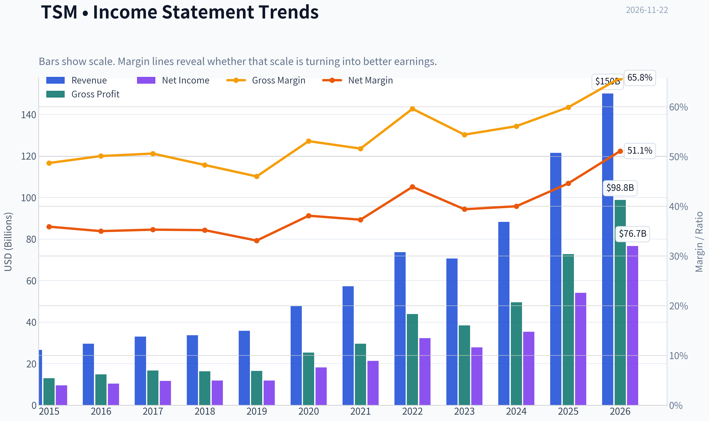

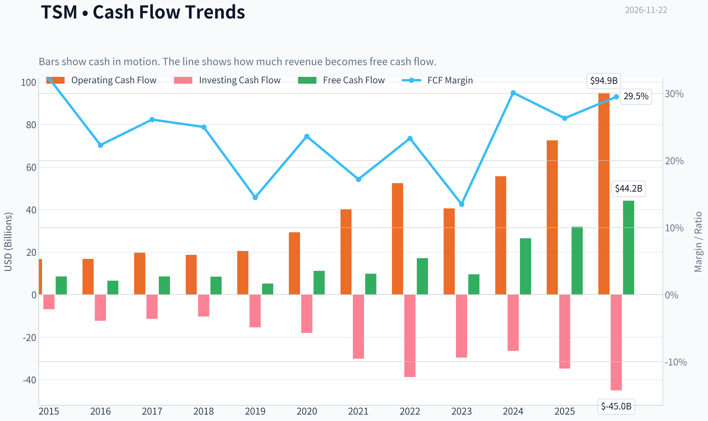

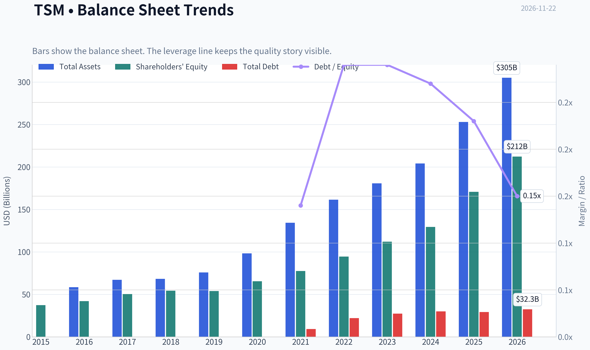

This graph tracks the profitability and return metrics (ROE, ROIC, Margins) of **TSM** over the past decade, highlighting capital efficiency trends.

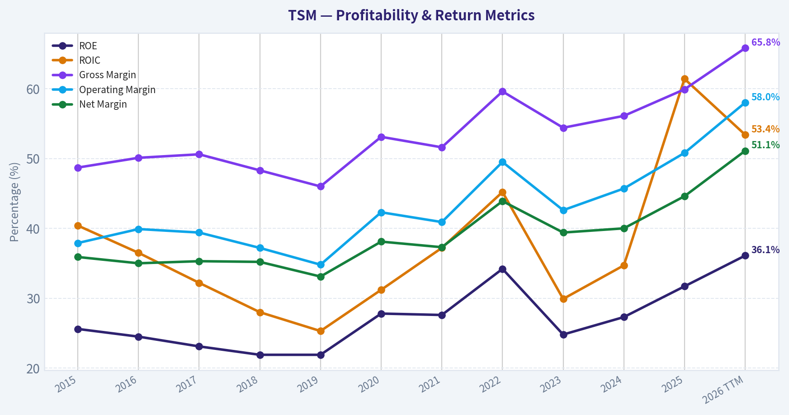

This chart illustrates the financial health of **TSM** over the last 10 years, mapping cash equivalents and free cash flow against total obligations (Debt).

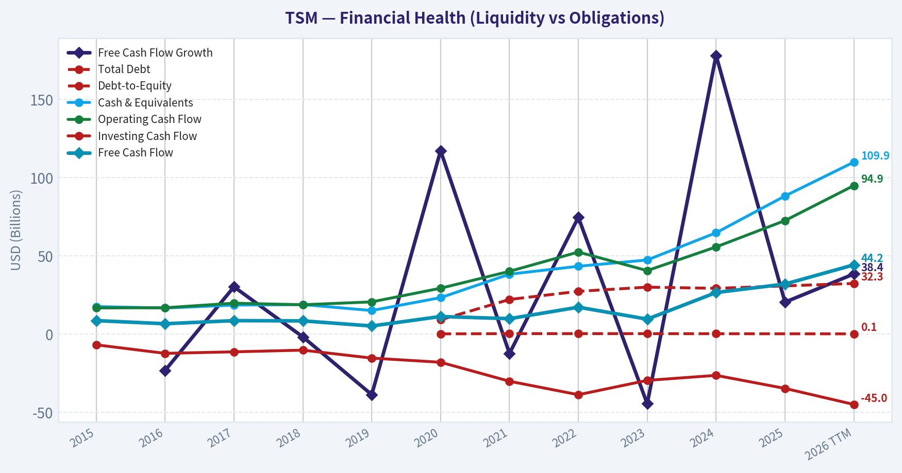

This breakdown chart from <em>Revenue Breakdown</em> shows the proportional composition for **TSM** - useful for understanding what drives or risks the business.

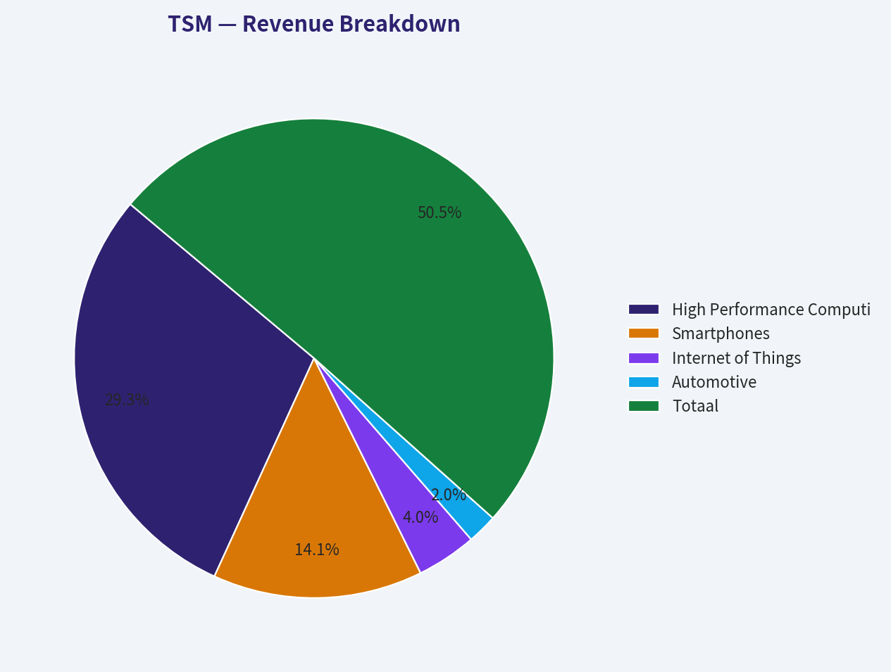

---

### Intrinsic Value Analysis (Buffett)

> *Following Warren Buffett's value investing philosophy: Circle of Competence, Economic Moat, Management Quality, and Margin of Safety.*

#### Intrinsic Value Snapshot

Price is what you pay. Intrinsic value is what the business may be worth based on the cash it can create for owners over time. We show a range, not one magic number.

- Current Price: $318.71
- Value Range (conservative to optimistic across both DCF methods): $61.75 to $1,012.82

##### Owner Earnings (Buffett Method)
- Net Income: $54,115,500,000.00
- Depreciation & Amortization: $20,874,176,998.63
- Capital Expenditures: $-40,561,400,000.00
- Working Capital Changes: $-2,935,080,568.61
- Owner Earnings: $28,017,708,743.09

##### Intrinsic Value
###### Buffett Method
Uses owner earnings. Stricter, and usually more conservative.
- Conservative: $61.75
- Average: $333.50
- Optimistic: $1,012.82
- Discount Rate: 8.3%

###### Cash Flow Method
Uses free cash flow. Better for companies spending heavily today to grow tomorrow.
- Conservative: $66.25
- Average: $194.46
- Optimistic: $816.46
- Discount Rate: 10.0%

ANALYST STANCE: **Neutral - Neutraal**

#### Samenvatting

Taiwan Semiconductor Manufacturing Company is een uitzonderlijk hoogwaardige, kapitaalintensieve technologie-infrastructuuronderneming met een sterke schaalvoorsprong, hoge marges en een groot herinvesteringspotentieel. De combinatie van een brutomarge van 59,9%, ROE van 31,7% en omzetgroei van 37,6% bevestigt een sterke economische franchise.

De waardering biedt echter geen duidelijke veiligheidsmarge. Bij een koers van $319 ligt de koers ongeveer 7,3% boven de DVI-schatting van $297,07. Bovendien impliceert de reverse-DCF een samengestelde groei van circa 23,7% per jaar gedurende tien jaar. Dat is plausibel bij een krachtige AI- en datacenter-cyclus, maar laat weinig ruimte voor operationele tegenvallers, geopolitieke risico's of een normalisering van de halfgeleidercyclus.

#### 1. Factor-scorecard

| Factor | Score | Beoordeling |
|---|---:|---|
| Cirkel van competentie en eenvoud | 4/5 | Het bedrijf produceert geavanceerde chips voor klanten die zelf chips ontwerpen. De economische logica is begrijpelijk, hoewel de technologie complex is. |
| Duurzaam concurrentievoordeel | 5/5 | Uitzonderlijke procestechnologie, schaal, klantvertrouwen, hoge toetredingsbarrières en een sterk ecosysteem. |
| Management en kapitaalallocatie | 4/5 | Lange investeringshorizon, rationele kapitaaluitgaven en een bewezen vermogen om technologische voorsprong te behouden. |
| Industrie-structuur | 4/5 | De geavanceerde foundry-markt wordt gedomineerd door een klein aantal spelers, maar vereist zeer hoge investeringen en kent cyclische vraag. |

**Gate 5 - kwaliteit en solvabiliteit:** niet getriggerd. De winstgevendheid en groeitrend zijn sterk en de current ratio bedraagt circa 2,5. Er is geen aanwijzing voor een combinatie van verslechterende kasstromen en financiële distress.

**Kerninzicht:** TSM scoort zeer hoog op kwaliteit en moat. De centrale beperking is niet de onderneming, maar de prijs die weinig ruimte laat voor een lagere toekomstige groei.

#### 2. Moatanalyse

| Moatbron | Bewijs | Beoordeling |
|---|---|---|
| Immateriële activa en technologie | Geavanceerde productieprocessen, jarenlange proceskennis en hoge ontwikkelingskosten | Zeer sterk |
| Switching costs | Chipontwerpen, productieprocessen en kwaliteitskwalificaties zijn diep geïntegreerd in klantworkflows | Sterk |
| Kostenvoordeel | Enorme schaal, hoge bezettingsgraad en technologisch leiderschap verlagen de kostprijs per geavanceerde wafer | Sterk |
| Netwerkeffecten | Meer klanten en productievolume versterken kennis, ecosysteem en rendement op onderzoek en apparatuur | Indirect, maar betekenisvol |

De brutomarge van 59,9% is sterk bewijs van prijszettingsvermogen en technologische differentiatie. TSM verkoopt geen generiek product; klanten kopen toegang tot productiecapaciteit die moeilijk elders te repliceren is.

Het belangrijkste structurele risico is geopolitiek. De concentratie van geavanceerde productie in Taiwan kan leiden tot hogere verzekerings-, diversificatie- en kapitaalkosten. Amerikaanse, Japanse en Europese fabrieken kunnen de geografische spreiding verbeteren, maar kunnen aanvankelijk lagere rendementen hebben dan de Taiwanese kernactiviteiten.

#### 3. Management en kapitaalallocatie

CEO C.C. Wei en het management opereren binnen een cultuur die doorgaans gericht is op technologische continuïteit, lange investeringscycli en klantvertrouwen. De onderneming heeft haar leidende positie behouden door consequent te investeren vóórdat de volledige vraag zichtbaar was.

De belangrijkste kapitaalallocatiebeslissing is herinvestering in productietechnologie en capaciteit. Dat is gerechtvaardigd zolang TSM een duurzaam rendement boven de kapitaalkosten behaalt. De ROE van 31,7% en de hoge marges wijzen erop dat eerdere investeringen aanzienlijke economische waarde hebben gecreëerd.

Aandachtspunten zijn de zeer hoge kapitaaluitgaven, het risico op overinvestering tijdens een sterke cyclus en de mogelijkheid dat buitenlandse fabrieken structureel lagere rendementen opleveren. Het management verdient een hoge, maar geen maximale score omdat de toekomstige kapitaalbehoefte uitzonderlijk groot blijft.

#### 4. Financiële samenvatting

| Maatstaf | Meest recente waarde |
|---|---:|
| Koers | $319 |
| Marktkapitalisatie | $1,65 biljoen |
| PE | 21,4 |
| ROE | 31,7% |
| Brutomarge | 59,9% |
| Omzetgroei op jaarbasis | 37,6% |
| FCF-rendement | 1,9% |
| Current ratio | 2,51 |
| DVI-waardering | $297,07 |
| Verschil koers versus DVI-waardering | -7,3% veiligheidsmarge |

**Kerninzicht:** De operationele cijfers zijn uitzonderlijk sterk, maar het FCF-rendement van 1,9% toont dat de markt al veel toekomstige groei verdisconteert. De PE van 21,4 lijkt op zichzelf niet extreem voor een kwaliteitsbedrijf, maar is minder aantrekkelijk wanneer de waardering wordt afgezet tegen de vereiste groeiverwachting.

#### 5. Owner Earnings

De Buffett-benadering luidt:

**Owner Earnings = nettowinst + afschrijvingen en amortisatie - onderhouds-capex - toename werkkapitaal**

De beschikbare waarderingssamenvatting geeft geen afzonderlijke cijfers voor onderhouds-capex en werkkapitaal, waardoor een volledige absolute owner-earningsberekening niet betrouwbaar kan worden gereconstrueerd zonder aannames. De owner-earningscomponent van het DVI-model resulteert wel in een indicatieve waarde van **$333,50 per aandeel**.

Dat ligt boven de gecombineerde DVI-schatting van $297,07, maar de spreiding tussen de modellen is groot:

| Waarderingsbenadering | Waarde per aandeel |
|---|---:|
| Owner Earnings-model | $333,50 |
| FCF-model | $194,46 |
| Damodaran FCFF-model | $243,14 |
| Gewogen DVI-schatting | $297,07 |

**Kerninzicht:** De spreiding tussen $194,46 en $333,50 laat zien dat de uitkomst sterk afhangt van aannames over onderhouds-capex, toekomstige groei en de economische waarde van nieuwe fabrieken. De gewogen schatting van $297,07 is daarom een evenwichtiger referentie dan het meest optimistische owner-earningsresultaat.

#### 6. Drie-scenario DCF

| Scenario | Veronderstelling | Waarderingsindicatie |
|---|---|---:|
| A - Geen groei | Owner Earnings gedeeld door 10% discontovoet | Niet afzonderlijk gekwantificeerd in de beschikbare samenvatting |
| B - BBP-groei | 3% groei en 10% discontovoet | Niet afzonderlijk gekwantificeerd in de beschikbare samenvatting |
| C - Historische groei | 50-75% van historische groei, met maximum van 10% | DVI-modellen geven een brede bandbreedte van $194,46 tot $333,50 |
| Gewogen DVI-referentie | Combinatie van FCFF, reverse-DCF en owner earnings | $297,07 |

De reverse-DCF verdient bijzondere aandacht: de huidige koers impliceert ongeveer **23,7% jaarlijkse groei gedurende tien jaar**. De trailing driejaarsgroei van 25,1% maakt die aanname niet onmogelijk, maar zulke groei is moeilijk langdurig vol te houden bij een onderneming met deze omvang.

**Kerninzicht:** De waardering is verdedigbaar bij aanhoudende AI-gerelateerde groei en blijvend technologisch leiderschap. Zij is minder overtuigend bij een normale halfgeleidercyclus, hogere geopolitieke kosten of een rendement op buitenlandse fabrieken dat onder het historische niveau blijft.

#### 7. Marge of Safety

| Maatstaf | Resultaat |
|---|---:|
| Huidige koers | $319 |
| Gewogen intrinsieke waarde | $297,07 |
| Veiligheidsmarge tegenover intrinsieke waarde | -7,3% |
| Benodigde marge voor een gemiddeld bedrijf | Circa 25-35% |
| Aanvaardbare marge voor een uitzonderlijke compounder | Circa 10-15% positief |

TSM verdient door zijn moat en hoge ROE een kleinere veiligheidsmarge dan een gemiddeld bedrijf. Toch is een negatieve veiligheidsmarge tegenover de DVI-referentie niet hetzelfde als een aantrekkelijke waarderingsmarge. De huidige prijs vereist dat de onderneming dicht bij haar historische groeitempo blijft presteren.

#### 8. Finale Buffett-scorecard

| Criterium | Gewicht | Score | Gewogen bijdrage |
|---|---:|---:|---:|
| Moatbreedte en duurzaamheid | 25% | 5/5 | 1,25 |
| Waardering en veiligheidsmarge | 20% | 2/5 | 0,40 |
| Kapitaalrendement tegenover WACC | 15% | 5/5 | 0,75 |
| Begrijpelijkheid en voorspelbaarheid | 12% | 4/5 | 0,48 |
| Management en kapitaalallocatie | 12% | 4/5 | 0,48 |
| Herinvesteringsmogelijkheden | 8% | 5/5 | 0,40 |
| Balanssterkte | 4% | 4/5 | 0,16 |
| Industrie-structuur | 4% | 4/5 | 0,16 |
| **Totaal** | **100%** |  | **4,08/5** |

**Kerninzicht:** Op ondernemingskwaliteit behoort TSM tot de beste bedrijven wereldwijd. De lagere waarderingsscore weerspiegelt niet zwakke fundamentals, maar de combinatie van een koers boven de gewogen intrinsieke waarde en een reverse-DCF die zeer hoge groei veronderstelt.

#### 9. Conclusie

TSM heeft een brede en waarschijnlijk duurzame moat, hoge rendementen op kapitaal en een uitzonderlijk lange herinvesteringsrunway. De belangrijkste onzekerheden zijn geopolitieke concentratie, de kapitaalintensiteit van internationale uitbreiding en de houdbaarheid van groeipercentages die door AI-vraag worden gestimuleerd.

Hoewel de gewogen totaalscore op ondernemingskwaliteit hoog is, is de waardering bij $319 niet ruim genoeg om de belangrijkste risico's comfortabel te absorberen. Daarom luidt de analytische classificatie:

**ANALYST STANCE: Neutral - Neutraal**

De onderneming is duidelijk van hoge kwaliteit; de beschikbare waarderingsmodellen leveren echter geen overtuigende positieve veiligheidsmarge op tegen de huidige koers.
#### Valuation Bridge

This bridge places the current market price beside each intrinsic value lens so readers can see whether upside depends on one method or shows up across several methods.

| Scenario | Intrinsic Value / Share |
| --- | ---: |
| Buffett Method | $333.50 |
| Cash Flow Method | $194.46 |
| Damodaran Method | $243.14 |
| Current Price | $318.71 |

#### Key Takeaways

If one method is far above the others, the upside case depends on a specific modelling assumption. When several methods cluster together, the valuation story is more robust.

#### Valuation Visuals

This comparison chart from *Latest Earnings Snapshot* stacks current figures against historical benchmarks for **TSM**, making it easy to see where the company trades relative to its own averages.

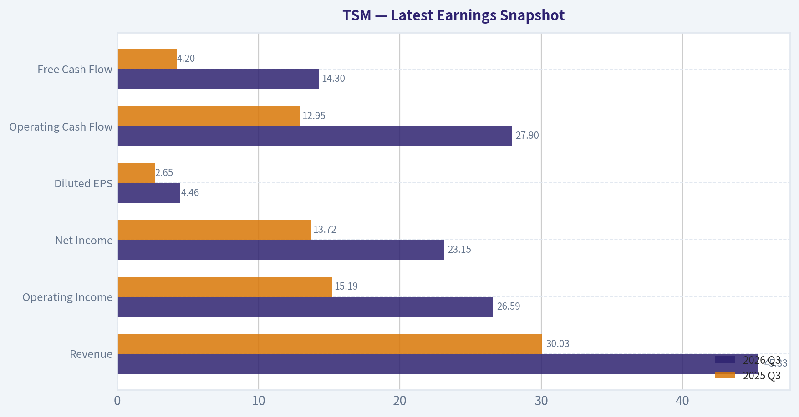

This comparison chart from *Kerngegevens en huidige positie* stacks current figures against historical benchmarks for **TSM**, making it easy to see where the company trades relative to its own averages.

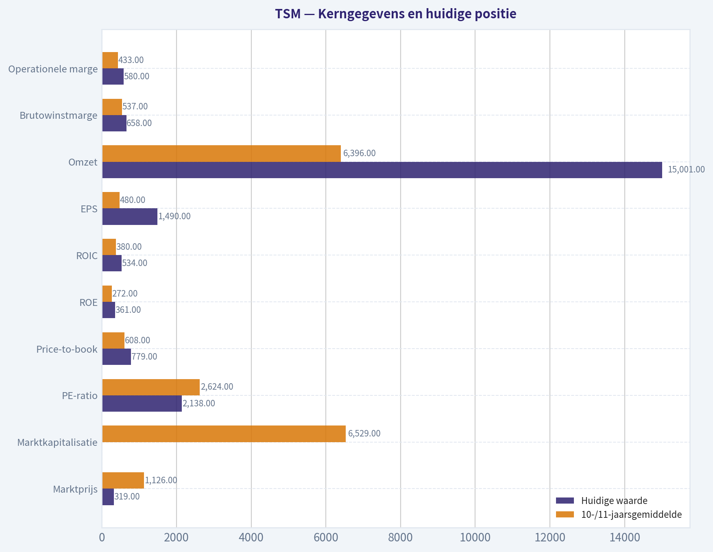

This comparison chart from *Balans en financiële kracht* stacks current figures against historical benchmarks for **TSM**, making it easy to see where the company trades relative to its own averages.

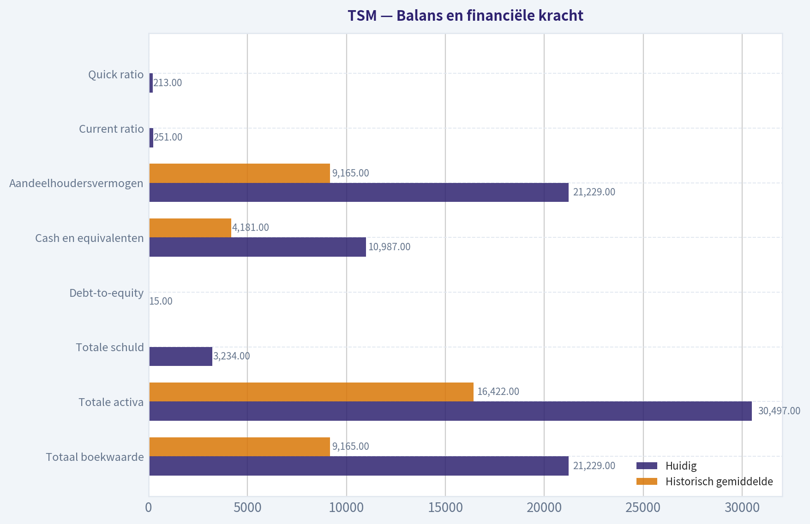

This comparison chart from *Waardering* stacks current figures against historical benchmarks for **TSM**, making it easy to see where the company trades relative to its own averages.

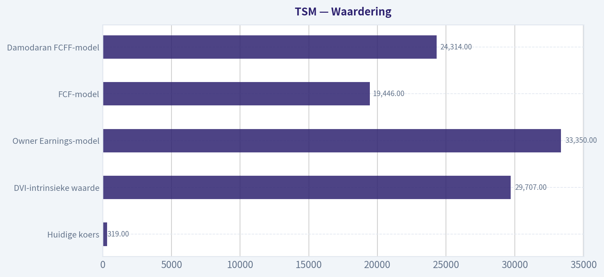

This comparison chart from *Buffett-style Owner Earnings DCF* stacks current figures against historical benchmarks for **TSM**, making it easy to see where the company trades relative to its own averages.

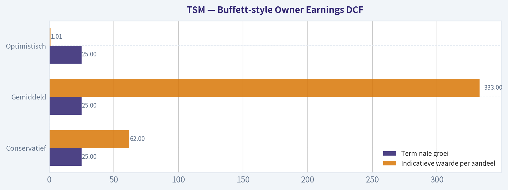

---

### Trend & Growth Analysis (Lynch/Druckenmiller/Fisher)

> *Following Peter Lynch's GARP, Stanley Druckenmiller's macro-aware approach, and Philip Fisher's scuttlebutt methodology.*

ANALYST STANCE: **Neutral - constructief, maar waarderingsgevoelig**

#### 1. Lynch-classificatie

**TSM is een fast grower**, met een cyclisch karakter binnen de halfgeleiderindustrie. De recente omzetgroei van 37,6% ligt ruim boven de fast-grower-drempel van 15-25%, maar een deel van de versnelling hangt samen met de AI- en HPC-cyclus. Daardoor is het belangrijk om structurele groei te onderscheiden van piekcyclusgroei.

#### 2. Het verhaal in drie punten

1. **TSM is de dominante onafhankelijke chipproducent** voor geavanceerde halfgeleiders en profiteert van de toenemende uitbesteding door fabless chipontwerpers.
2. **AI, datacenters, smartphones en HPC** vergroten de vraag naar steeds krachtigere en kleinere chipprocessen.
3. De combinatie van technologische voorsprong, schaal en hoge toetredingsbarrières ondersteunt een sterke langetermijnpositie, terwijl geopolitiek en kapitaalintensiteit de voornaamste risico's blijven.

#### 3. Kerngegevens

| Maatstaf | Waarde |
|---|---:|
| Huidige koers | $319 |
| Marktkapitalisatie | $1,65 biljoen |
| PE | 21,4x |
| Omzetgroei op jaarbasis | 37,6% |
| ROE | 31,7% |
| Brut marge | 59,9% |
| FCF-rendement | 1,9% |
| Current ratio | 2,51 |
| DVI-schatting intrinsieke waarde | $297,07 |
| 3-modelwaarderingen | $194,46-$333,50 |

**Key Takeaways:** TSM combineert uitzonderlijk sterke omzetgroei met een hoge ROE en een brutomarge van bijna 60%. De koers ligt ongeveer 7,4% boven de DVI-schatting, terwijl de waarderingen per model sterk uiteenlopen. Dat wijst op een kwalitatief uitstekend bedrijf, maar ook op aanzienlijke gevoeligheid voor aannames over toekomstige groei en kasstromen.

#### 4. TAM en de 10x-test

| Onderdeel | Analyse |
|---|---|
| Belangrijkste markten | Geavanceerde foundry, AI-chips, HPC, smartphones, automotive en IoT |
| Structurele TAM-trend | Positief; AI en datacenterinfrastructuur groeien sneller dan de bredere chipmarkt |
| Concurrentiebarrière | Zeer hoog door procestechnologie, schaal, fab-investeringen en klantkwalificatie |
| 10x-omzettest | Niet volledig kwantitatief uitvoerbaar; de actuele omzetbasis ontbreekt in de aangeleverde dataset |
| Ruimte voor verdere groei | Aanwezig, maar TSM is al marktleider en heeft een zeer grote absolute omzetbasis |

**Key Takeaways:** De totale adresseerbare markt groeit door AI, cloudinfrastructuur en toenemende chipinhoud per apparaat. De 10x-test kan niet exact worden berekend zonder een betrouwbare actuele omzetwaarde, maar TSM kan nog substantieel groeien zonder dat het totale halfgeleidermarkt-aandeel volledig verzadigd raakt. De absolute schaal maakt een klassieke tienvermenigvuldiging van omzet echter moeilijker dan bij een kleinere fast grower.

#### 5. Omzetgroei en kwaliteit

| Indicator | Waarde / beoordeling |
|---|---|
| Recente omzetgroei | 37,6% jaar-op-jaar |
| Langetermijnreferentie | Trailing 3-year CAGR circa 25,1% |
| Trend | Sterk, waarschijnlijk mede versneld door AI/HPC |
| Organisch karakter | Waarschijnlijk overwegend organisch; geen aanwijzing dat acquisities de hoofdbron zijn |
| Cyclische blootstelling | Hoog; halfgeleiders kennen voorraad- en investeringscycli |
| Klantconcentratie | Niet gekwantificeerd in de aangeleverde gegevens |
| Margekwaliteit | Sterk, met 59,9% brutomarge |

**Key Takeaways:** De beschikbare gegevens tonen een sterke groeiversnelling ten opzichte van de 3-jaarsgroei van circa 25,1%. De recente 37,6% groei is overtuigend, maar moet over meerdere kwartalen worden bevestigd omdat AI-gerelateerde bestedingen en halfgeleidercycli de cijfers kunnen versterken. De hoge brutomarge ondersteunt de kwaliteit van de groei.

#### 6. Unit economics en efficiëntie

| Maatstaf | Resultaat |
|---|---|
| LTV/CAC | Niet beschikbaar; niet direct toepasbaar op een foundrybedrijf |
| NRR | Niet beschikbaar; niet relevant als SaaS-maatstaf |
| Rule of 40 | Niet toepasbaar zonder betrouwbare FCF-marge |
| ROE | 31,7% |
| FCF-rendement | 1,9% |
| Brut marge | 59,9% |
| Kapitaalintensiteit | Hoog door voortdurende fab- en technologie-investeringen |

**Key Takeaways:** SaaS-maatstaven zoals LTV/CAC, NRR en Rule of 40 zijn niet geschikt voor TSM. De relevante signalen zijn ROE, brutomarge, bezettingsgraad, vrije kasstroom en rendement op nieuwe fab-investeringen. TSM scoort sterk op winstgevendheid, maar de lage FCF-yield weerspiegelt de hoge investeringsbehoefte en de huidige waardering.

#### 7. Inflectieanalyse

| Mogelijke inflectie | Beoordeling | Reden |
|---|---|---|
| Productcyclus | Sterk positief | Versnelde vraag naar geavanceerde AI- en HPC-chips |
| Marktaandeel | Positief | TSM blijft cruciaal in de meest geavanceerde foundrysegmenten |
| Marge | Positief, maar te bevestigen | Schaalvoordelen kunnen de hoge brutomarge ondersteunen |
| TAM | Positief | AI verhoogt zowel chipvolume als chipwaarde per systeem |
| Concurrentie | Gemengd positief | Technologische voorsprong is sterk, maar concurrenten investeren agressief |
| Winstverwachtingen | Hoog gespannen | De koers impliceert volgens de reverse DCF circa 23,7% jaarlijkse groei over tien jaar |

**Key Takeaways:** De duidelijkste inflectie ligt bij de vraag naar AI- en HPC-chips. De markt lijkt de structurele foundrypositie te erkennen, maar mogelijk nog niet volledig de duur en omvang van de AI-capexcyclus. Tegelijkertijd is een groot deel van de toekomstige groei al in de koers verwerkt, waardoor de aandelenwaardering gevoelig blijft voor elke vertraging.

#### 8. Macro-evaluatie

| Macrofactor | Effect op TSM |
|---|---|
| AI- en cloudinvesteringen | Sterke rugwind |
| Renteomgeving | Lagere rente zou groeiaandelen ondersteunen; actuele richting niet aangeleverd |
| Halfgeleidercyclus | Positief, maar cyclisch risico blijft |
| Exportbeperkingen | Negatief risico voor bepaalde klanten en producten |
| Taiwan-geopolitiek | Materieel langetermijnrisico |
| Amerikaanse en Europese chipsubsidies | Kunnen geografische diversificatie ondersteunen, maar verhogen ook kosten |
| Guru-signaal | Steve Cohen en Stanley Druckenmiller rapporteerden beide een forse afbouw in het meest recente 13F-overzicht |

**Key Takeaways:** De macro-achtergrond is fundamenteel gunstig dankzij AI, cloud en datacenterinvesteringen. Daartegenover staan rentegevoeligheid, exportregels en geopolitieke onzekerheid rond Taiwan. De recente 13F-afbouw door Cohen en Druckenmiller is geen zelfstandig fundamenteel signaal, maar vormt wel een aanwijzing dat sommige professionele beleggers de risico-rendementsverhouding minder aantrekkelijk vonden.

#### 9. Fisher-score: kwaliteit van het bedrijf

| Fisher-punt | Score / 5 | Beoordeling |
|---|---:|---|
| Marktpotentieel | 5 | AI, HPC en chip-outsourcing vergroten de markt |
| Nieuwe producten en processen | 5 | Continue ontwikkeling van geavanceerde nodes |
| R&D-effectiviteit | 5 | Technologische voorsprong en procesinnovatie |
| Verkooporganisatie | 4 | Sterke klantrelaties, hoewel foundry geen traditioneel verkoopmodel heeft |
| Winstmarge | 5 | Zeer hoge brutomarge |
| Margever verbetering | 4 | Schaalvoordelen mogelijk, maar fab-investeringen drukken kasstromen |
| Arbeidsrelaties | 3 | Niet genoeg informatie voor een hogere score |
| Relaties binnen management | 4 | Geen specifiek negatief signaal in de dataset |
| Managementdiepte | 5 | Wereldwijde operationele en technologische schaal |
| Kostenanalyse | 4 | Kapitaalallocatie lijkt professioneel, maar zeer complex |
| Bijzondere concurrentievoordelen | 5 | Schaal, technologie, klantkwalificatie en ecosysteem |
| Langetermijnwinst | 5 | Sterke structurele vraagdrivers |
| Verwatering | 4 | Geen materieel verwateringssignaal aangeleverd |
| Openheid bij problemen | 3 | Niet voldoende beoordeelbaar |
| Integriteit management | 4 | Geen specifiek negatief signaal aangeleverd |
| **Totaal** | **65/75** | **Uitstekend** |

**Key Takeaways:** Met 65 van de 75 punten valt TSM in de categorie "uitstekend" volgens deze Fisher-benadering. De grootste sterke punten zijn technologie, schaal, marktvraag en concurrentiebarrières. De lagere scores betreffen vooral informatie die in de beschikbare dataset niet direct kan worden geverifieerd, niet noodzakelijk operationele tekortkomingen.

#### 10. Waardering

| Methode | Resultaat | Interpretatie |
|---|---:|---|
| PE | 21,4x | Niet hoog voor een kwaliteitsbedrijf, mits groei duurzaam blijft |
| PEG | 0,57x | Aantrekkelijk op basis van de recente 37,6% groei |
| FCF-yield | 1,9% | Duidt op een relatief volle kasstroomwaardering |
| DVI intrinsieke waarde | $297,07 | Circa 7,3% onder de huidige koers |
| Owner Earnings-model | $333,50 | Ondersteunt hogere waarde bij sterke kasstroomgroei |
| FCF-model | $194,46 | Waarschuwt voor hoge kapitaalintensiteit |
| Damodaran FCFF | $243,14 | Ligt onder de huidige koers |
| Reverse DCF | 23,7% jaarlijkse groei over 10 jaar | Hoge toekomstige uitvoering vereist |

**Key Takeaways:** De PEG van ongeveer 0,57x oogt aantrekkelijk, maar gebruikt een uitzonderlijk sterke recente groeivoet die mogelijk niet volledig duurzaam is. De DVI- en FCFF-modellen liggen onder de huidige koers, terwijl het Owner Earnings-model erboven ligt. De waardering is daarom niet eenduidig goedkoop: zij veronderstelt dat sterke groei en hoge marges meerdere jaren aanhouden.

#### 11. Waarderingsgevoeligheid

| Variabele | Gevoeligheid | Gevolg |
|---|---|---|
| Omzetgroei | Zeer hoog | Een terugkeer richting 15-20% verlaagt de rechtvaardiging van de huidige multiple |
| AI-capex | Zeer hoog | Vertraging kan zowel omzetgroei als sentiment raken |
| Brut marge | Hoog | Een structurele margedaling verlaagt winst- en DCF-waarde |
| Kapitaaluitgaven | Hoog | Hogere fab-investeringen drukken vrije kasstroom |
| Discontovoet | Hoog | Hogere rente verlaagt de contante waarde van toekomstige kasstromen |
| Geopolitieke risicopremie | Zeer hoog | Kan de waarderingsmultiple langdurig beperken |
| Technologische voorsprong | Zeer hoog | Behoud ervan ondersteunt zowel marktaandeel als marges |

**Key Takeaways:** De belangrijkste gevoeligheid zit niet in de huidige PE op zichzelf, maar in de combinatie van groeiduur, marges, capex en geopolitieke risicopremie. Bij aanhoudende groei kan de waardering redelijk blijven; bij normalisering van de AI-cyclus ontstaat snel neerwaartse waarderingsdruk. De grote spreiding tussen de waarderingsmodellen bevestigt deze onzekerheid.

#### 12. Groei-investeerdersscorecard

| Criterium | Gewicht | Score / 5 | Gewogen bijdrage |
|---|---:|---:|---:|
| Het verhaal | 10% | 4,8 | 0,48 |
| TAM en groeiruimte | 20% | 4,7 | 0,94 |
| Omzetgroei | 20% | 4,7 | 0,94 |
| Unit economics | 15% | 4,0 | 0,60 |
| Concurrentiepositie | 10% | 4,9 | 0,49 |
| Managementkwaliteit | 10% | 4,2 | 0,42 |
| Macro-omgeving | 5% | 3,8 | 0,19 |
| Pad naar winstgevendheid | 5% | 4,8 | 0,24 |
| Waardering | 5% | 3,2 | 0,16 |
| **Totaal** | **100%** |  | **4,46 / 5,00** |

**Key Takeaways:** TSM behaalt een hoge totaalscore van 4,46 uit 5 dankzij een uitzonderlijke concurrentiepositie, sterke omzetgroei en een grote structurele markt. De belangrijkste aftrekpost is waardering, gevolgd door macro- en geopolitieke onzekerheid. De bedrijfskwaliteit ondersteunt een hoge score, maar de koers vereist sterke uitvoering om de waardering te rechtvaardigen.

#### 13. Belangrijkste risico's en katalysatoren

| Catalysatoren | Risico's |
|---|---|
| Versnelde AI- en HPC-vraag | AI-capex normaliseert sneller dan verwacht |
| Succesvolle introductie van nieuwe procesnodes | Concurrenten verkleinen de technologische kloof |
| Hogere bezettingsgraad en operationele leverage | Structurele margedruk door capex en geografische expansie |
| Meer outsourcing door fabless ontwerpers | Exportbeperkingen en handelsconflicten |
| Groei in automotive en edge-AI | Geopolitieke escalatie rond Taiwan |
| Sterke vraag naar geavanceerde packaging | Hogere rente en stijgende risicopremie |

**Key Takeaways:** De meest waarschijnlijke positieve katalysator is verdere versnelling van AI-gerelateerde productie en geavanceerde packaging. De zwaarste risico's zijn een abrupte AI-investeringsvertraging, geopolitieke escalatie en verlies van technologische voorsprong. De kernthese blijft sterk, maar de huidige waardering laat minder ruimte voor operationele teleurstellingen.

#### Eindbeoordeling

TSM behoort fundamenteel tot de sterkste groeibedrijven wereldwijd en voldoet ruimschoots aan de Lynch-, Druckenmiller- en Fisher-criteria voor structurele groei. De onderneming bevindt zich waarschijnlijk in een AI-gedreven inflectiefase, met uitzonderlijke schaalvoordelen en een moeilijk reproduceerbare technologische positie.

De huidige koers van $319 ligt echter boven de centrale DVI-schatting van $297,07 en vereist volgens de reverse DCF circa 23,7% jaarlijkse groei over een lange periode. Daarom luidt de classificatie **Neutral - constructief**, waarbij de bedrijfskwaliteit overtuigt maar de waardering en macro-geopolitieke onzekerheid een volledige **Bullish**-kwalificatie niet ondersteunen.

---

### Market Technical Analysis

ANALYST STANCE: **Neutral Bearish**

#### TSM - technische marktanalyse

De analyse betreft uitsluitend **Taiwan Semiconductor Manufacturing Co. Ltd.**, ticker **TSM**, genoteerd aan de NYSE. De meest recente beschikbare handelsdag is **20 november 2026**; 21 en 22 november waren geen handelsdagen. De slotkoers bedroeg toen **318,71 dollar**.

#### Trendbeeld en prijsstructuur

TSM bevindt zich in een duidelijke correctiefase. Vanaf de recente slotkoerspiek van **485,80 dollar op 5 oktober** is de koers met ongeveer **34,4 procent** gedaald. De terugval is niet geleidelijk verlopen: vooral de beweging van eind oktober tot 20 november werd gekenmerkt door meerdere neerwaartse versnellingen, grotere dagranges en verhoogde volumes.

De langetermijntrend is echter niet volledig omgeslagen. De koers ligt nog ongeveer **13,2 procent boven** het beginpunt van de onderzochte periode, toen TSM op 24 november 2025 sloot op 281,66 dollar. Dat betekent dat de recente zwakte moet worden gezien als een forse terugval binnen een op jaarbasis nog steeds positief koersverloop, maar de technische schade op middellange termijn is aanzienlijk.

De prijs ligt op 20 november:

- ongeveer **13,3 procent onder** de 10-daagse EMA;
- ongeveer **24,5 procent onder** de 50-daagse SMA;
- ongeveer **20,8 procent onder** de 200-daagse SMA.

Die brede afstand tot alle drie de gemiddelden wijst op sterke neerwaartse afwijking, niet slechts op een kleine terugtest. Tegelijkertijd betekent de positie onder de 200-daagse SMA dat de eerder positieve langetermijnstructuur technisch is verzwakt. Een enkele oversold-meting is daarom onvoldoende om een trendomslag te bevestigen.

#### Voortschrijdende gemiddelden

De **10-daagse EMA** is gedaald van 431,09 dollar op 29 oktober naar 367,46 dollar op 20 november. Dat is een zeer snelle neerwaartse draai en bevestigt dat het kortetermijnmomentum sterk negatief is.

De **50-daagse SMA** is minder snel gedaald, van 434,71 dollar naar 422,11 dollar. Dit gemiddelde loopt nog achter op de prijs, maar de richting is inmiddels neerwaarts. De koers staat er ruim onder, wat suggereert dat de recente daling breed genoeg is om het middellangetermijnbeeld te beïnvloeden.

De **200-daagse SMA** is juist nog licht gestegen, van 396,05 dollar naar 402,25 dollar. Dat weerspiegelt de eerdere sterke opwaartse trend en de trage aard van dit gemiddelde. De slotkoers ligt inmiddels echter circa 83,54 dollar onder deze langetermijnreferentie. Daardoor is het signaal gemengd in tijdshorizon: het langetermijngemiddelde stijgt nog, terwijl de actuele marktprijs er duidelijk onder ligt.

#### MACD en momentum

De **MACD** is verslechterd van -3,54 op 29 oktober naar -20,80 op 20 november. De negatieve waarde zelf bevestigt dat het kortetermijnmomentum onder het langetermijnmomentum ligt. Belangrijker is de versnelling: tussen 16 en 20 november daalde de MACD van -12,02 naar -20,80.

De **MACD-histogramwaarde** was op 13 november nog positief op 0,64, maar daalde daarna naar -5,85 op 20 november. Daarmee is een eerdere korte verbetering volledig tenietgedaan. Het histogram wijst niet alleen op negatieve momentumrichting, maar ook op een hernieuwde versnelling van de neerwaartse druk.

De combinatie van een negatieve MACD en een verder verslechterend histogram is zwaarder wegend dan de oversold-conditie van de RSI. Er is op basis van deze gegevens geen overtuigend momentum-signaal dat een duurzame bodem bevestigt.

#### RSI en oversold-conditie

De **RSI** daalde van 49,63 op 11 november naar **28,27** op 20 november. Dat ligt onder de gebruikelijke grens van 30 en kwalificeert de markt als technisch oversold.

Die waarde geeft aan dat de daling op korte termijn mogelijk te snel is verlopen in verhouding tot de voorafgaande prijsbeweging. Ze is echter geen zelfstandig bewijs van een duurzame ommekeer. In een krachtige neerwaartse trend kan RSI langere tijd laag blijven. Hier wordt die terughoudendheid versterkt door de negatieve MACD, de koers onder alle belangrijke gemiddelden en de hoge volatiliteit.

#### Volume en VWMA

De **VWMA** daalde van 425,70 dollar op 29 oktober naar 371,94 dollar op 20 november. Omdat de VWMA volume meeweegt, bevestigt deze beweging dat de recente daling niet uitsluitend door lichte omzet werd veroorzaakt. De koers van 318,71 dollar ligt bovendien ongeveer 53,23 dollar onder de VWMA.

Op 20 november bedroeg het volume **37,17 miljoen aandelen**, tegenover circa 18,0 miljoen op 19 november en 25,24 miljoen op 17 november. Dit was een zeer actieve neerwaartse sessie, met een slotkoers dicht bij het dagminimum van 318,48 dollar. De combinatie van groot volume en een zwak slot wijst op brede marktparticipatie tijdens de daling. Dat verhoogt de betekenis van de beweging, al kan uitzonderlijk volume ook capitulatie-achtige handel weerspiegelen.

#### Volatiliteit

De **ATR** steeg van 12,09 dollar op 29 oktober naar 19,06 dollar op 20 november. Dat is een toename van ongeveer 58 procent. De ATR vertegenwoordigt op 20 november circa **6,0 procent van de slotkoers**, wat wijst op een veel ruimer dagelijks bewegingsbereik dan aan het einde van oktober.

De volatiliteit nam vooral toe tijdens de scherpe dalingssessies van 30 oktober, 5 november en 20 november. Hierdoor is het huidige koersbeeld minder geschikt voor conclusies op basis van kleine dagelijkse fluctuaties: de ruis is groter, en afzonderlijke herstelbewegingen kunnen relatief krachtig zijn zonder dat de bredere trend al is hersteld.

#### Samengevoegde interpretatie

Het technische beeld is overwegend bearish op korte en middellange termijn:

1. De koers staat onder de 10-daagse EMA, 50-daagse SMA en 200-daagse SMA.
2. De 10-daagse EMA en 50-daagse SMA dalen, terwijl de 200-daagse SMA nog slechts door historische sterkte wordt ondersteund.
3. MACD en histogram wijzen op verdiepend negatief momentum.
4. RSI onder 30 toont een oversold-conditie, maar nog geen bevestigde trendomslag.
5. VWMA en verhoogd volume bevestigen dat de recente daling breed en volumegedragen was.
6. De sterk gestegen ATR wijst op verhoogd risico en onstabiele prijsvorming.

De belangrijkste tegenkracht tegen een volledig bearish langetermijnconclusie is dat de 200-daagse SMA nog licht stijgt en de koers over twaalf maanden bezien nog hoger staat. Toch is de actuele technische informatie onvoldoende om een constructief waarderingsbeeld op korte of middellange termijn te onderbouwen. Een eventuele verbetering zou technisch meer overtuigend worden wanneer prijs, 10-daagse EMA, VWMA en MACD-histogram gezamenlijk stabiliseren; daarvan is in de beschikbare cijfers nog geen bevestiging zichtbaar.

#### Geselecteerde indicatoren

De acht gekozen indicatoren zijn bewust verdeeld over trend, momentum, volume en volatiliteit:

- **close_10_ema**: snelle detectie van recente trendverslechtering.
- **close_50_sma**: middellangetermijntrend en dynamische referentie.
- **close_200_sma**: structurele langetermijncontext.
- **macd**: richting en sterkte van het momentum.
- **macdh**: versnelling of afzwakking van dat momentum.
- **rsi**: identificatie van de oversold-conditie.
- **vwma**: volumegewogen bevestiging van de prijsrichting.
- **atr**: beoordeling van de sterk toegenomen volatiliteit.

Bollinger-indicatoren zijn niet geselecteerd, omdat RSI, ATR en de gemiddelden al voldoende informatie geven over respectievelijk extremiteit, volatiliteit en trendafstand.

| Onderdeel | Waarde op 20 nov. 2026 | Verandering of context | Interpretatie |
|---|---:|---|---|
| Slotkoers | $318,71 | Ongeveer 34,4% onder de piek van $485,80 op 5 okt. | Forse correctie met duidelijke technische schade |
| 10-daagse EMA | $367,46 | Sterk gedaald vanaf $431,09 op 29 okt. | Zeer zwak kortetermijnmomentum |
| 50-daagse SMA | $422,11 | Gedaald vanaf $434,71 op 29 okt. | Middellangetermijntrend draait neerwaarts |
| 200-daagse SMA | $402,25 | Nog licht stijgend vanaf $396,05 | Langetermijntrend heeft historische steun, maar koers ligt er ruim onder |
| MACD | -20,80 | Verslechterd vanaf -3,54 op 29 okt. | Negatief en verdiepend momentum |
| MACD-histogram | -5,85 | Van +0,64 op 13 nov. naar sterk negatief | Neerwaartse momentumversnelling |
| RSI | 28,27 | Onder 30 | Oversold, maar zonder bevestigde bodem |
| VWMA | $371,94 | Daling vanaf $425,70 op 29 okt. | Volume bevestigt zwakke prijsstructuur |
| ATR | $19,06 | Ongeveer 58% hoger dan op 29 okt. | Sterk verhoogde dagelijkse volatiliteit |
| Volume | 37,17 miljoen | Ruim boven het recente gemiddelde | Grote deelname aan de neerwaartse sessie |

**Kernpunten:** TSM vertoont een sterk bearish kortetermijn- en middellangetermijnbeeld, met een koers onder alle belangrijke gemiddelden, verdiepend negatief MACD-momentum en verhoogde verkoopactiviteit. De RSI is oversold, maar die omstandigheid wordt niet ondersteund door een positieve momentumomslag. De nog licht stijgende 200-daagse SMA voorkomt dat het langetermijnbeeld volledig negatief is, maar de huidige technische gegevens onderbouwen geen stabiele constructieve waarderingsinterpretatie.

---

### Options Market Analysis

> *Reading options flow - put/call ratios, IV skew, and unusual activity - to gauge institutional positioning and event-driven risk.*

ANALYST STANCE: **Neutral (licht bullish)**

#### TSM - optiesentiment per 22 november 2026

De beschikbare data beslaan de expiraties van 27 november, 4 december en 11 december 2026. De optiestructuur wijst op een overwegend constructief sentiment, maar de zeer hoge impliciete volatiliteit en enkele grote neerwaartse hedges verhogen het event- en tail-risk.

#### 1. Put/call-ratio

| Expiratie | Call-OI | Put-OI | Put/call OI | Callvolume | Putvolume | Put/call volume |
|---|---:|---:|---:|---:|---:|---:|
| 27 nov. 2026 | 33.571 | 20.821 | 0,62 | 28.967 | 22.268 | 0,77 |
| 4 dec. 2026 | 22.400 | 13.263 | 0,59 | 7.582 | 11.001 | 1,45 |
| 11 dec. 2026 | 7.007 | 6.618 | 0,94 | 4.852 | 2.908 | 0,60 |
| **Totaal** | **62.978** | **40.702** | **0,65** | **41.401** | **36.177** | **0,87** |

**Key Takeaways:** De totale put/call-OI-ratio van 0,65 ligt onder de neutrale historische referentie van ongeveer 0,70 en duidt op een lichte call-overhang. Het volume is met 0,87 eveneens call-gericht, hoewel de expiratie van 4 december juist duidelijk meer putvolume laat zien. De meest nabije expiratie heeft de grootste absolute activiteit en blijft per saldo constructief.

#### 2. Implied volatility en skew

| Expiratie | ATM IV calls | ATM IV puts | Verschil put minus call | Interpretatie |
|---|---:|---:|---:|---|
| 27 nov. 2026 | 91,7% | 85,6% | -6,1 procentpunt | Hoge eventvolatiliteit; call-IV hoger |
| 4 dec. 2026 | 82,4% | 76,5% | -5,9 procentpunt | Nog steeds zeer hoog; call-IV hoger |
| 11 dec. 2026 | 75,3% | 71,7% | -3,6 procentpunt | Dalende, maar verhoogde volatiliteit |

| Beschikbare OTM-contracten | Type | Strike | IV |
|---|---|---:|---:|
| 4 dec. 2026 | Put | $235 | 114,9% |
| 4 dec. 2026 | Put | $240 | 111,5% |
| 4 dec. 2026 | Call | $370 | 66,2% |
| 27 nov. 2026 | Call | $330 | 84,8% |
| 27 nov. 2026 | Call | $340 | 79,9% |
| 27 nov. 2026 | Call | $345 | 77,1% |

**Key Takeaways:** De near-term ATM-IV is uitzonderlijk hoog, met 91,7% voor calls en 85,6% voor puts in de eerstvolgende expiratie. De ATM-structuur vertoont geen klassieke put-skew; calls worden daar zelfs duurder geprijsd dan puts. Tegelijkertijd hebben de beschikbare verre OTM-puts bij $235 en $240 een IV boven 111%, tegenover 66,2% voor de $370-call, wat wijst op aanzienlijke vraag naar neerwaartse bescherming buiten de ATM-zone.

Een specifieke katalysator is niet opgenomen in de aangeleverde data. De hoge IV kan daarom niet zonder aanvullende kalenderinformatie aan een concreet earnings- of productevenement worden toegeschreven.

#### 3. Ongebruikelijke optiesactiviteit

| Expiratie | Type | Strike | Volume | OI | Volume/OI | IV | Duiding |
|---|---|---:|---:|---:|---:|---:|---|
| 27 nov. 2026 | Call | $340 | 3.046 | 25 | 121,8x | 79,9% | Zeer grote verse callactiviteit |
| 27 nov. 2026 | Call | $345 | 2.497 | 21 | 118,9x | 77,1% | Sterke upside-speculatie |
| 27 nov. 2026 | Call | $350 | 1.662 | 109 | 15,2x | 76,2% | Grote nieuwe callvraag |
| 4 dec. 2026 | Call | $340 | 1.364 | 24 | 56,8x | 72,2% | Verse callactiviteit |
| 27 nov. 2026 | Call | $330 | 1.362 | 14 | 97,3x | 84,8% | Opwaartse blootstelling, afstand tot markt onbekend |
| 4 dec. 2026 | Call | $370 | 1.340 | 252 | 5,3x | 66,2% | Out-of-the-money upside-speculatie |
| 4 dec. 2026 | Put | $240 | 1.264 | 74 | 17,1x | 111,5% | Verse neerwaartse bescherming of bearish inzet |
| 4 dec. 2026 | Put | $235 | 1.030 | 131 | 7,9x | 114,9% | Tail hedge; zeer hoge downside-IV |
| 27 nov. 2026 | Call | $347,50 | 970 | 4 | 242,5x | 75,9% | Extreem volume tegenover vrijwel geen bestaand OI |

**Key Takeaways:** De ongebruikelijke activiteit wordt gedomineerd door calls met expiraties op 27 november en 4 december, vooral rond $340 tot $350. Dat wijst op verse opwaartse belangstelling, maar de lage bestaande OI maakt het onmogelijk om met zekerheid te bepalen of dit opening trades, spreads of sluitingen zijn. De $235- en $240-puts vormen een duidelijke tegenhanger: zij wijzen op vraag naar forse neerwaartse bescherming, niet noodzakelijk op outright bearish speculatie.

De omvangrijke callvolumes kunnen institutioneel zijn, maar zonder orderrichting, transactiegrootte, bied-laat-informatie of sweepdata kan smart-money-activiteit niet betrouwbaar van retail-speculatie worden onderscheiden.

#### 4. Open-interestconcentratie en potentiële gamma-niveaus

| Gebied | Call-OI | Put-OI | Betekenis |
|---|---:|---:|---|
| 27 nov. 2026 | 33.571 | 20.821 | Belangrijkste concentratie voor zeer korte termijn |
| 4 dec. 2026 | 22.400 | 13.263 | Tweede belangrijke expiratie; relatief hoog putvolume |
| 11 dec. 2026 | 7.007 | 6.618 | Kleiner en meer gebalanceerd |
| Alle expiraties | 62.978 | 40.702 | Netto call-overhang |

**Key Takeaways:** De grootste OI-concentratie ligt in de expiratie van 27 november, waardoor prijsbewegingen rond die datum gevoeliger kunnen zijn voor dealer-hedging en mogelijke pinning. De verstrekte dataset bevat echter geen volledige OI-verdeling per strike en geen gamma-exposure; exacte gamma walls of een betrouwbaar max-painniveau kunnen daarom niet worden vastgesteld. De zichtbare ongebruikelijke activiteit concentreert zich rond calls van $340 tot $350, maar dat is geen vervanging voor een volledige strike-by-strike-analyse.

#### 5. Overall optiesentiment

| Factor | Observatie | Signaal |
|---|---|---|
| Put/call OI | 0,65 tegenover neutraal circa 0,70 | Licht bullish |
| Put/call volume | 0,87 totaal | Licht bullish |
| ATM-IV | 72%-92% | Hoog risico en hoge verwachtingsbeweging |
| ATM-skew | Call-IV boven put-IV | Opwaartse vraag nabij de markt |
| OTM-skew | Puts op $235-$240 boven 111% IV | Sterke vraag naar neerwaartse bescherming |
| Ongebruikelijke activiteit | Veel verse calls, plus enkele forse puts | Bullish kern, maar met tail-risk |
| Liquiditeit | Voldoende activiteit in de eerste twee expiraties | Redelijke betrouwbaarheid, geen volledige orderdata |

**Key Takeaways:** Het totale optiesignaal is **BULLISH**, voornamelijk door de call-overhang in OI, een totale put/call-volumeratio onder 1,0 en omvangrijke verse callactiviteit. De hoge IV en de extreem dure OTM-puts maken dit echter geen laag-risico bullish signaal: de markt prijst zowel opwaartse beweging als bescherming tegen een scherpe daling. De optiesdata ondersteunen dus een constructieve kortetermijnverwachting, maar wijzen tegelijk op uitzonderlijk hoge onzekerheid rond de eerstvolgende expiraties.

#### Samenvatting

| Onderdeel | Beoordeling |
|---|---|
| Put/call-ratio | OI 0,65; volume 0,87 - licht onder neutraal en dus call-gericht |
| IV-niveau | Zeer hoog; ATM-IV 75%-92% |
| Skewrichting | ATM call-skew, maar sterke OTM put-skew |
| Ongebruikelijke activiteit | Overwegend verse calls rond $330-$350; daarnaast grote $235-$240-puts |
| Overall signal | **BULLISH**, met hoge event- en tail-risk |

**Key Takeaways:** TSM toont een overwegend bullish optiesstructuur, vooral dankzij de callconcentratie en de verse callvolumes in de kortste expiraties. De hoge volatiliteit en dure OTM-puts impliceren echter dat marktdeelnemers een brede uitkomstverdeling verwachten. De betrouwbaarheid van het richtingssignaal is daarom redelijk, maar lager dan de duidelijke call-overhang op het eerste gezicht suggereert.

---

## Research Team Commentary

> *The Research Manager synthesizes the Bull vs Bear debate into action-free commentary. This is a pre-risk view, not the final stance.*

Kernconclusie

TSMC is een uitzonderlijk sterke onderneming, maar de huidige waardering biedt onvoldoende aantoonbare veiligheidsmarge. De technologische voorsprong, schaal, klantintegratie en leidende positie in geavanceerde productie vormen samen een brede economische moat. De brutomarge van 59,9%, ROE van 31,7% en ROA van 21,4% bevestigen dat TSMC veel meer is dan een cyclische commodityproducent.

Toch ligt de koers van $319 circa 7,3% boven de DeepValues-intrinsieke waarde van $297,07. Zelfs voor een hoogwaardige compounder verlangt het Buffett-kader normaal gesproken enige korting, doorgaans ongeveer 10-15%. Hier is sprake van een premie. De kwaliteit kan die premie uiteindelijk rechtvaardigen, maar vormt op zichzelf geen veiligheidsmarge.

Het sterkste bull-argument

TSMC functioneert als essentiële infrastructuur voor de moderne digitale economie. De combinatie van technologische kennis, schaalvoordelen, hoge yields, klantvertrouwen, switching costs en een uitgebreid ontwerp- en verpakkingsecosysteem is buitengewoon moeilijk te repliceren. Geld alleen is niet genoeg om deze positie aan te vallen; concurrenten hebben eveneens jaren aan proceskennis, engineeringervaring en foutloze uitvoering nodig.

AI, high-performance computing, datacenters en toenemende halfgeleiderinhoud bieden bovendien een geloofwaardige groeiroute voor minstens het komende decennium. TSMC hoeft de recente omzetgroei van 37,6% niet vol te houden. Aanhoudende hoge enkelcijferige of lage dubbelcijferige groei, gecombineerd met sterke marges en disciplinair herinvesteren, zou de intrinsieke waarde aanzienlijk kunnen laten stijgen.

Een koers-winstverhouding van 21,4 is in dat licht niet evident extreem. Als TSMC zijn technologische leiding behoudt, de capaciteit voor geavanceerde nodes en packaging efficiënt benut en de marges in de buurt van het huidige structurele niveau houdt, kan de onderneming sneller waarde opbouwen dan de huidige DVI-berekening veronderstelt.

Het sterkste bear-argument

Het probleem is niet de kwaliteit van de bestaande franchise, maar de prijs die wordt betaald voor toekomstige uitvoering. De koers impliceert dat meerdere gunstige omstandigheden tegelijk voortduren: technologische dominantie, sterke AI-vraag, hoge bezettingsgraden, robuuste marges en aantrekkelijke rendementen op nieuwe buitenlandse capaciteit. Daarbovenop moet een ernstige geopolitieke verstoring uitblijven.

De gerapporteerde ROIC van 66,8% verdient daarbij voorzichtigheid. Voor een kapitaalintensieve fabrikant kan deze maatstaf sterk worden beïnvloed door kascorrecties, de boekwaarde van oudere fabrieken en het moment waarop nieuwe capaciteit in gebruik wordt genomen. Voor de waardering is het incrementele rendement op de volgende generatie fabrieken relevanter. Vooral fabrieken buiten Taiwan kunnen door hogere bouw-, arbeids- en operationele kosten een lager rendement behalen.

De recente omzetgroei van 37,6% kan eveneens een combinatie zijn van structurele AI-vraag, voorraadnormalisatie, gunstige productmix en cyclisch herstel. Zonder uitsplitsing is het riskant die groei als representatief te behandelen. Zelfs als AI structureel blijft groeien, kan een investeringsgolf bij hyperscalers tijdelijk tot overcapaciteit of een latere ordernormalisatie leiden.

Geopolitiek blijft bovendien een asymmetrisch risico. TSMC's strategische betekenis kan afschrikking en internationale steun bevorderen, maar is geen contractuele bescherming. Buitenlandse fabrieken verminderen op termijn de productieconcentratie, maar repliceren voorlopig niet het volledige Taiwanese ecosysteem en kunnen de gemiddelde kosten verhogen.

Rationale

Vanuit een Buffett-perspectief verdient TSMC een hoge kwaliteitswaardering. De onderneming beschikt over een echte moat, sterke managementuitvoering en een lange herinvesteringsroute. De cijfers wijzen niet op financiële nood; een harde negatieve kwalificatie op basis van solvabiliteit is daarom niet gerechtvaardigd.

Maar een geweldig bedrijf en een aantrekkelijk gewaardeerd aandeel zijn twee verschillende conclusies. Bij $319 noteert TSMC boven de DVI-waarde van $297,07. De bewijsvoering laat daarom geen klassieke of kwaliteit-geschaalde veiligheidsmarge zien. De huidige waardering lijkt niet heroïsch op basis van de P/E alleen, maar vraagt wel dat de onderneming jarenlang bovengemiddelde groei en marges combineert met rendabele, zeer kapitaalintensieve expansie.

De reverse-DCF kan met de beschikbare gegevens niet exact worden gekwantificeerd. Wel is duidelijk dat de markt meer veronderstelt dan alleen normale sectorgroei. TSMC moet zijn leidende positie behouden én de volgende investeringscyclus tegen aantrekkelijke rendementen uitvoeren. Dat is plausibel, maar nog niet conservatief genoeg om een premie boven de huidige intrinsieke-waardeschatting als duidelijke onderwaardering te beschouwen.

De koerszwakte ten opzichte van de 10-, 50- en 200-daagse gemiddelden verandert dit oordeel niet. Ook de put/call-ratio van 0,65 en de hoge impliciete volatiliteit beschrijven vooral sentiment en eventrisico. Ze leveren geen fundamentele veiligheidsmarge op.

Monitoringplan voor de komende één tot vier kwartalen

Ten eerste zijn brutomarge en operationele marge essentieel. Stabiele marges terwijl buitenlandse fabrieken worden opgeschaald, zouden aantonen dat TSMC de hogere kosten kan compenseren via pricing, subsidies, productmix en operationele efficiëntie. Een aanhoudende margedaling zonder tijdelijke opstartverklaring zou de thesis verzwakken.

Ten tweede moet de omzetgroei worden uitgesplitst naar AI/HPC, smartphones, automotive en overige toepassingen. Een verbreding van de groei buiten enkele AI-klanten zou de voorspelbaarheid verbeteren. Sterke groei die vooral op één productcategorie of een beperkt aantal klanten berust, vergroot juist de normalisatie- en concentratierisico's.

Ten derde is de verhouding tussen operationele kasstroom, capex en vrije kasstroom belangrijker dan de gerapporteerde ROIC alleen. Het bewijs wordt sterker wanneer nieuwe investeringen snel tot hogere kasstromen en bezettingsgraden leiden. Langdurig oplopende capex zonder evenredige vrije-kasstroomgroei zou erop wijzen dat meer kapitaal nodig is om dezelfde concurrentiepositie te onderhouden.

Ten vierde verdienen yields, tijdschema's en klantadoptie van nieuwe procesnodes aandacht. Tijdige productieopschaling met goede yields ondersteunt de technologische moat. Vertragingen, onverwachte kosten of een betekenisvolle verschuiving van leidende klanten naar alternatieve foundries zouden een belangrijk waarschuwingssignaal zijn.

Ten vijfde moeten de economie en voortgang van fabrieken in de Verenigde Staten, Japan en andere regio's worden gevolgd. Niet alleen openingsdata, maar ook productiviteit, personeelskosten, subsidieverwerking en klantcommitments zijn relevant. Geografische diversificatie die structureel lagere rendementen veroorzaakt, vermindert de waarde van die risicospreiding.

Ten zesde is het belangrijk te volgen of AI-orders gebaseerd blijven op daadwerkelijke benutting en groei van eindvraag. Toenemende datacenterbelasting, langdurige klantcontracten en herhaalde capaciteitsreserveringen ondersteunen een structureel scenario. Orderuitstel, dalende klant-capex of oplopende voorraden zouden wijzen op een cyclischer vraagbeeld.

Ten slotte moet de DVI-waarde na iedere resultatenronde opnieuw worden vergeleken met de marktprijs. Een stijgende intrinsieke waarde door aantoonbaar hogere duurzame kasstromen is relevanter dan kortetermijnkoersbewegingen. Zolang de koers boven de huidige DVI-schatting ligt en de incrementele rendementen van de nieuwe capaciteit nog niet overtuigend zichtbaar zijn, blijft de waarderingscasus onbewezen.

De belangrijkste discipline is hier om een uitstekende onderneming niet automatisch gelijk te stellen aan een voldoende aantrekkelijke waardering. Tegelijk zou het eveneens een fout zijn om de kapitaalintensiteit als bewijs van lage kwaliteit te behandelen: bij TSMC ondersteunt die investering juist een zeer waardevolle moat. De uiteindelijke beoordeling hangt daarom af van de vrije kasstroom en het rendement op nieuwe capaciteit, niet uitsluitend van brutomarge, omzetgroei of de actuele P/E.

Stance: Neutral

---

## Value Investing Team Commentary

> *The Investor translates the research view into an investment thesis before risk review. This is still not the final stance.*

TSMC remains an exceptional business, but the evidence supports a distinction between **business quality** and **current valuation**.

Its moat is unusually durable. Leading-edge process technology, manufacturing yields, scale, customer integration, packaging capabilities, and accumulated engineering knowledge create barriers that competitors cannot reproduce quickly with capital alone. The reported 59.9% gross margin, 31.7% ROE, and 21.4% ROA are consistent with a high-quality franchise rather than a commodity foundry. AI, high-performance computing, advanced networking, and rising semiconductor content provide a credible multi-year growth runway.

The contrarian point is that market concern about TSMC's capital intensity may be overstated. In many businesses, heavy investment is a burden; for TSMC, investment is part of the moat. Advanced-node leadership requires continuous spending, and underinvestment could be more damaging than high capex. Foreign fabs may initially produce lower returns, but they can also strengthen customer confidence, geopolitical resilience, and long-term strategic relevance.

However, the opposing contrarian insight is equally important: enthusiasm surrounding AI may cause investors to underestimate the cyclicality of semiconductor demand. Strong recent growth does not establish a permanent growth rate. Customer inventory adjustments, hyperscaler spending normalization, concentration in a small number of large customers, and possible overcapacity in selected AI infrastructure categories could create periods in which revenue and margins diverge from current expectations.

The 66.8% ROIC figure should not be accepted uncritically. For a capital-intensive manufacturer, reported ROIC can be affected by depreciation schedules, older assets with low book values, cash balances, and the timing of new-fab commissioning. The more relevant question is whether incremental capital invested in Arizona, Japan, and other locations produces attractive cash returns after higher construction, labor, operating, and logistics costs. That answer is not yet fully demonstrated by the supplied data.

At $319, the shares trade approximately 7.3% above the DeepValues estimate of $297.07. A P/E of 21.38 is not obviously excessive for a dominant, high-return growth franchise, but the valuation still requires continued technological leadership, durable AI/HPC demand, strong utilization, and satisfactory returns on the next investment cycle. The current price therefore appears to discount a meaningful degree of successful execution rather than merely normal industry growth.

The market and options data add limited fundamental information. A put/call ratio of 0.65 and elevated implied volatility describe positioning and event risk, not intrinsic value. Likewise, the reported relationship between the price and the moving averages appears internally inconsistent: a price of $319 cannot simultaneously be materially below the stated averages unless the datasets refer to different dates, instruments, or adjusted-price conventions. That data discrepancy reduces the usefulness of technical conclusions and reinforces the need to prioritize operating results over sentiment indicators.

The most important future evidence will be: sustained margins during overseas-fab expansion; free cash flow relative to capex; yields and ramp speed at new nodes; customer diversification; and proof that AI-related demand reflects durable end-market utilization rather than temporary capacity acceleration. Rising intrinsic value supported by cash generation would improve the valuation case. Conversely, weaker incremental returns, prolonged margin pressure, or evidence of demand concentration would make the current premium harder to justify.

Overall, TSMC deserves a high-quality classification and has one of the strongest economic moats in the semiconductor industry. Yet the available evidence does not establish a sufficient quality-adjusted margin of safety at $319. The central issue is not whether TSMC is a great company; it is whether future growth and incremental capital returns will be strong enough to validate the valuation already embedded in the price.

**ANALYST STANCE: Neutral** - The business quality is exceptional and the long-term opportunity remains compelling, but the evidence currently supports valuation discipline rather than a conclusion that the shares are clearly undervalued.

---

## Deep Values Commentary

> *The Risk Management Team debates and the Risk Judge provides the final action-free verdict. This section determines the final Bullish / Neutral / Bearish stance.*

#### Final Stance Scorecard

This scorecard converts the final research view into a weighted decision frame. It does not replace the narrative judgement, but it makes the main drivers of the verdict easier to scan.

| Criterion | Score | Weight | Commentary |
| --- | ---: | ---: | --- |
| Business Quality | 4.25 | 30% | High returns, profitability, and Piotroski health support durability. |
| Valuation Support | 2.33 | 30% | Blends current price against available intrinsic value anchors and valuation ratios. |
| Financial Strength | 4.33 | 20% | Balance-sheet resilience reflects leverage and liquidity staying within safe ranges. |
| Growth Durability | 5.00 | 20% | Recent revenue, earnings, and free cash flow growth indicate how durable expansion looks. |
| TOTAL / FINAL STANCE | 3.84 | 100% | Neutral |

#### Key Takeaways

The weighted score lands at **3.84 / 5.0**, while the final stance remains **Neutral**. This is useful as a quick calibration aid rather than a mechanical signal.

#### Risk Summary

Higher scores indicate more risk pressure. The watch threshold is a simple guardrail: above it, the dimension weighs more heavily on the valuation case and calls for a wider margin of safety.

| Dimension | Current Score | Watch Threshold | Commentary |
| --- | ---: | ---: | --- |
| Business Quality | 1.75 | 3.00 | High returns, profitability, and Piotroski health support durability. |
| Valuation Support | 3.67 | 3.00 | Blends current price against available intrinsic value anchors and valuation ratios. |
| Financial Strength | 1.67 | 3.00 | Balance-sheet resilience reflects leverage and liquidity staying within safe ranges. |
| Growth Durability | 1.00 | 3.00 | Recent revenue, earnings, and free cash flow growth indicate how durable expansion looks. |

#### Key Takeaways

This view helps readers separate *where* the risk sits: valuation, business quality, balance sheet, or growth durability. It is especially useful when the final stance is close to the line between Neutral and Bearish.
