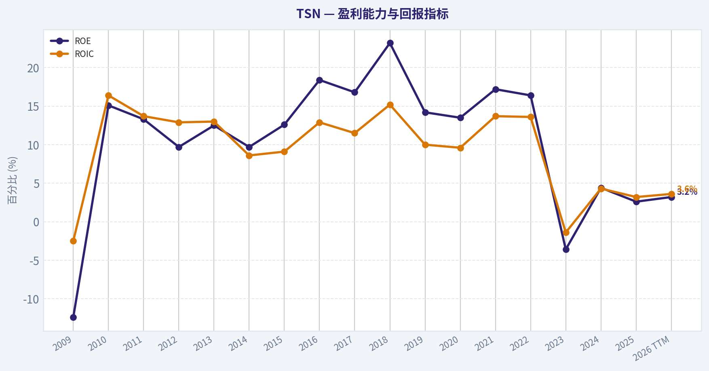
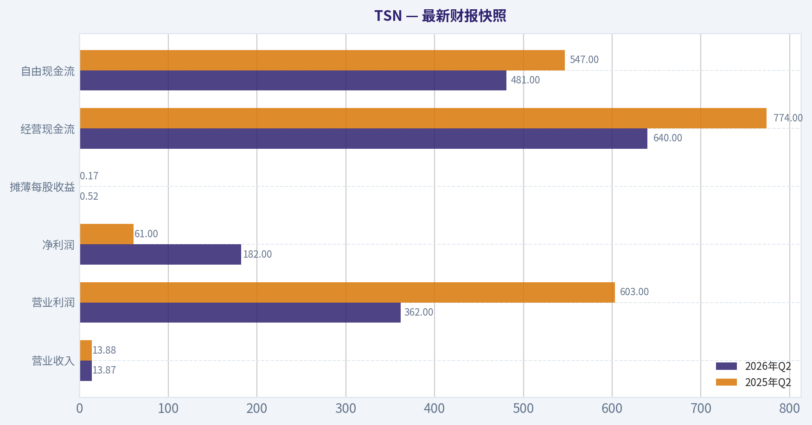
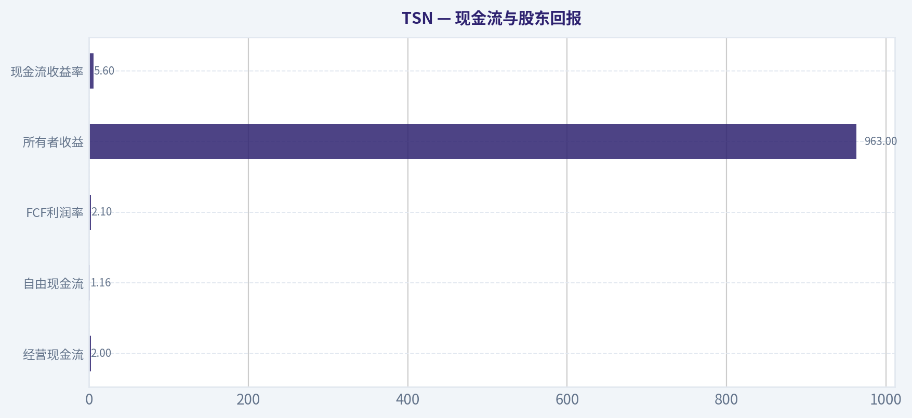
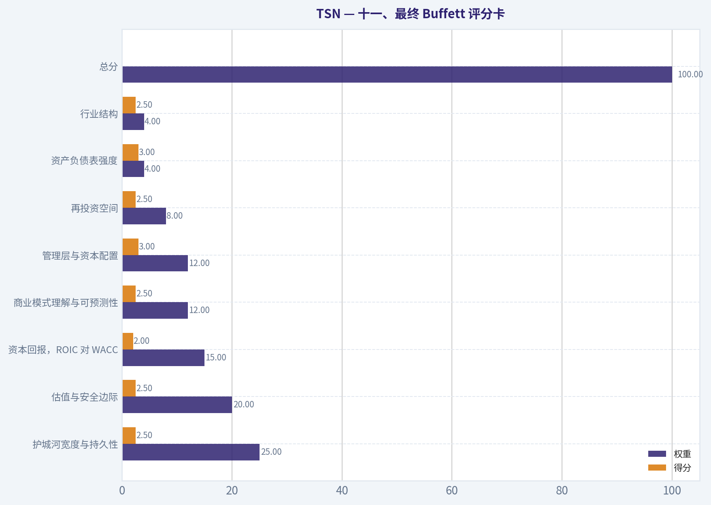
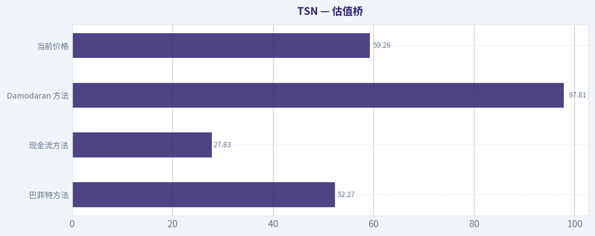
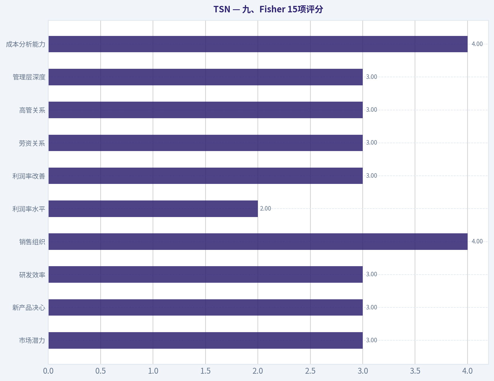
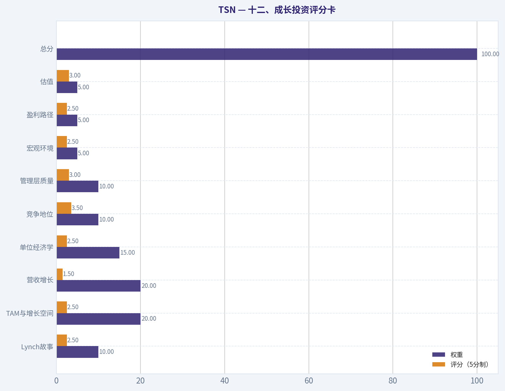
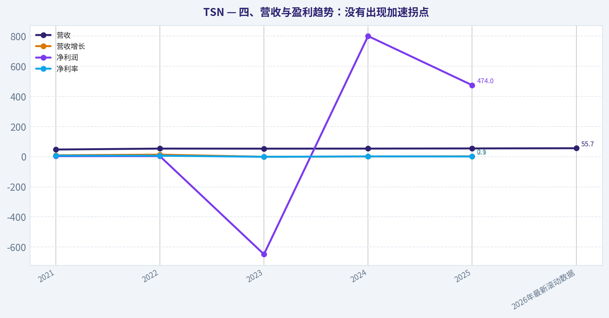

# TSN 深度价值情报

**调研日期:** 2026-11-13

## 关键免责声明

*本报告由 Deep Value Intelligence（一个基于 AI 的多智能体投资分析框架）自动生成。 仅供教育和研究用途 - 非财务建议，非财务顾问。*

---

## 目录

1. 情报摘要
2. 分析师团队报告
   - 基本面分析
   - 价值分析 (巴菲特)
   - 成长性分析 (林奇/德鲁肯米勒/费雪)
   - 市场分析
   - 期权市场分析
3. 研究团队评论
4. 投资团队评论
5. Deep Values 团队洞察

---

## 情报摘要

### 核心观点与前提条件

**核心论点:** Tyson Foods 具备规模、冷链、渠道及食品安全体系等真实优势，但这些优势目前主要保障生存与周期穿越，尚未形成稳定的超额资本回报。ROIC 仅2.8%、毛利率6.5%，表明其仍是低利润率、资本密集且受原料周期影响显著的企业。

**主要风险:**
- 原计划是维持 中性，等待财务确认或更大的安全边际。该计划基本正确，但应进一步明确执行规则：
- **中性**

**置信度:** 中

---

## 分析师团队报告

### 基本面分析

#### 最新财报快照

*以下数据基于最近一期已披露财报（2026年Q2），并尽量与上一年同期对比。*

| 指标 | 2026年Q2 | 2025年Q2 | 同比变化 |
| --- | ---: | ---: | ---: |
| 营业收入 | $13.87B | $13.88B | -0.1% |
| 营业利润 | $362.0M | $603.0M | -40.0% |
| 净利润 | $182.0M | $61.0M | +198.4% |
| 摊薄每股收益 | $0.52 | $0.17 | +205.9% |
| 经营现金流 | $640.0M | $774.0M | -17.3% |
| 自由现金流 | $481.0M | $547.0M | -12.1% |

关键结论：这张快照先把最新一期财报放在桌面上，再去看长周期分析。这样读者能更清楚地区分"公司长期质量"和"这次财报发生了什么"。

#### TSN 17年财务指标

*以下数值均由原始数据确定性计算得出，并非 AI 估算。*

*发行人类型：operating company（Consumer Defensive / Farm Products）。*

#### 17年财务指标
*年度行来自已披露财务报表，最后一行 TTM 由最近四个季度滚动计算得出。*

| 指标 | 2009 | 2010 | 2011 | 2012 | 2013 | 2014 | 2015 | 2016 | 2017 | 2018 | 2019 | 2020 | 2021 | 2022 | 2023 | 2024 | 2025 | 2026 TTM |
| --- | --- | --- | --- | --- | --- | --- | --- | --- | --- | --- | --- | --- | --- | --- | --- | --- | --- | --- |
| 市场价格 | $9 | $12 | $13 | $12 | $21 | $30 | $33 | $57 | $55 | $47 | $70 | $49 | $67 | $57 | $45 | $56 | $52 | $59 |
| 总市值 | $4.70B | $6.07B | $6.60B | $5.93B | $10.38B | $14.33B | $17.80B | $29.12B | $26.07B | $21.97B | $31.53B | $21.71B | $28.81B | $23.93B | $14.34B | $21.20B | $19.39B | $20.74B |
| 市盈率 | -8.59 | 7.78 | 8.81 | 10.14 | 13.34 | 16.61 | 14.61 | 16.48 | 14.71 | 7.40 | 15.95 | 10.55 | 9.47 | 7.39 | -27.00 | 26.47 | 40.83 | 36.58 |
| 市净率 | 1.07 | 1.18 | 1.17 | 0.99 | 1.67 | 1.61 | 1.84 | 3.03 | 2.47 | 1.72 | 2.26 | 1.42 | 1.63 | 1.21 | 0.79 | 1.15 | 1.07 | 1.15 |
| ROE | -12.4% | 15.1% | 13.3% | 9.7% | 12.5% | 9.7% | 12.6% | 18.4% | 16.8% | 23.2% | 14.2% | 13.5% | 17.2% | 16.4% | -3.6% | 4.4% | 2.6% | 3.2% |
| ROIC | -2.5% | 16.4% | 13.7% | 12.9% | 13.0% | 8.6% | 9.1% | 12.9% | 11.5% | 15.2% | 10.0% | 9.6% | 13.7% | 13.6% | -1.4% | 4.3% | 3.2% | 3.6% |
| 每股收益 | $-1.06 | $1.50 | $1.44 | $1.17 | $1.59 | $1.79 | $2.25 | $3.49 | $3.74 | $6.39 | $4.39 | $4.69 | $7.11 | $7.77 | $-1.68 | $2.10 | $1.28 | $1.62 |
| 营收 | $26.70B | $28.43B | $32.03B | $33.05B | $34.37B | $37.58B | $41.37B | $36.88B | $38.26B | $40.05B | $42.41B | $43.19B | $47.05B | $53.28B | $52.88B | $53.31B | $54.44B | $55.69B |
| 毛利润 | $1.20B | $2.51B | $2.19B | $2.19B | $2.36B | $2.69B | $3.92B | $4.70B | $5.06B | $5.10B | $5.02B | $5.38B | $6.53B | $6.67B | $2.63B | $3.63B | $3.56B | $3.42B |
| 毛利率 | 4.5% | 8.8% | 6.9% | 6.6% | 6.9% | 7.1% | 9.5% | 12.7% | 13.2% | 12.7% | 11.8% | 12.5% | 13.9% | 12.5% | 5.0% | 6.8% | 6.5% | 6.1% |
| 营业利润率 | -0.8% | 5.5% | 4.0% | 3.9% | 4.0% | 3.8% | 5.2% | 7.7% | 7.6% | 7.4% | 6.5% | 7.0% | 9.3% | 8.3% | -0.7% | 2.6% | 2.0% | 2.3% |
| 净利润 | $-547.0M | $780.0M | $750.0M | $583.0M | $778.0M | $864.0M | $1.22B | $1.77B | $1.77B | $2.97B | $1.98B | $2.06B | $3.05B | $3.24B | $-648.0M | $800.0M | $474.0M | $574.0M |
| 净利率 | -2.0% | 2.7% | 2.3% | 1.8% | 2.3% | 2.3% | 2.9% | 4.8% | 4.6% | 7.4% | 4.7% | 4.8% | 6.5% | 6.1% | -1.2% | 1.5% | 0.9% | 1.0% |
| 营收增长 | N/A | 6.5% | 12.7% | 3.2% | 4.0% | 9.3% | 10.1% | -10.9% | 3.7% | 4.7% | 5.9% | 1.8% | 8.9% | 13.2% | -0.8% | 0.8% | 2.1% | 2.3% |
| 净利润增长 | N/A | -242.6% | -3.8% | -22.3% | 33.4% | 11.1% | 41.2% | 44.9% | 0.3% | 67.4% | -33.3% | 4.1% | 47.8% | 6.3% | -120.0% | -223.5% | -40.8% | 21.1% |
| 自由现金流增长 | N/A | 49.0% | -54.3% | 23.3% | 52.1% | -27.8% | 214.3% | 17.8% | -24.3% | 15.2% | -28.9% | 113.3% | -1.6% | -69.6% | -123.4% | -879.7% | -19.3% | -1.4% |
| 总账面价值 | $4.40B | $5.17B | $5.66B | $6.01B | $6.20B | $8.89B | $9.69B | $9.61B | $10.54B | $12.80B | $13.95B | $15.25B | $17.72B | $19.70B | $18.13B | $18.39B | $18.09B | $18.08B |
| 总资产 | $10.60B | $10.75B | $11.07B | $11.90B | $12.18B | $23.91B | $22.97B | $22.37B | $28.07B | $28.99B | $32.92B | $34.46B | $36.31B | $36.82B | $36.25B | $37.10B | $36.66B | $35.61B |
| 总债务 | $3.48B | $2.54B | $2.18B | $2.43B | $2.41B | $8.18B | $6.69B | $6.28B | $10.20B | $9.87B | $11.93B | $11.34B | $9.35B | $8.32B | $9.51B | $9.79B | $8.83B | $8.01B |
| 债务股权比 | 0.79 | 0.49 | 0.39 | 0.40 | 0.39 | 0.92 | 0.69 | 0.65 | 0.97 | 0.77 | 0.86 | 0.74 | 0.53 | 0.42 | 0.52 | 0.53 | 0.49 | 0.44 |
| 现金及等价物 | $1.00B | $978.0M | $716.0M | $1.07B | $1.15B | $438.0M | $688.0M | $349.0M | $318.0M | $270.0M | $484.0M | $1.42B | $2.51B | $1.03B | $573.0M | $1.72B | $1.23B | $740.0M |
| 股东权益 | $4.40B | $5.17B | $5.66B | $6.01B | $6.20B | $8.89B | $9.69B | $9.61B | $10.54B | $12.80B | $13.95B | $15.25B | $17.72B | $19.70B | $18.13B | $18.39B | $18.09B | $18.08B |
| 经营现金流 | $960.0M | $1.43B | $1.05B | $1.19B | $1.31B | $1.18B | $2.57B | $2.72B | $2.60B | $2.96B | $2.51B | $3.87B | $3.84B | $2.69B | $1.75B | $2.59B | $2.15B | $2.00B |
| 投资现金流 | $-427.0M | $-500.0M | $-644.0M | $-660.0M | $-643.0M | $-8.80B | $-270.0M | $-684.0M | $-4.16B | $-1.91B | $-3.46B | $-1.42B | $58.0M | $-1.94B | $-2.30B | $-888.0M | $-665.0M | $-680.0M |
| 自由现金流 | $592.0M | $882.0M | $403.0M | $497.0M | $756.0M | $546.0M | $1.72B | $2.02B | $1.53B | $1.76B | $1.25B | $2.67B | $2.63B | $800.0M | $-187.0M | $1.46B | $1.18B | $1.16B |
| 自由现金流利润率 | 2.2% | 3.1% | 1.3% | 1.5% | 2.2% | 1.5% | 4.1% | 5.5% | 4.0% | 4.4% | 3.0% | 6.2% | 5.6% | 1.5% | -0.4% | 2.7% | 2.2% | 2.1% |
| 每股分红 | $0.00 | $0.00 | $0.00 | $0.00 | $0.00 | $0.00 | $0.00 | $0.00 | $0.00 | $0.00 | $0.00 | $0.00 | $0.00 | $1.57 | $2.13 | $1.79 | $1.89 | $0.00 |

#### 盈利能力指标
- 净资产收益率 (ROE): 2.6%
- 投入资本回报率 (ROIC): 2.8%
- 总资产收益率 (ROA): 1.3%
- 毛利率: 6.5%
- 营业利润率: 2.0%
- 净利率: 0.9%

#### 流动性指标
- 流动比率: 1.55
- 速动比率: 0.59

#### 杠杆指标
- 债务股权比: 0.49
- 利息覆盖倍数: 2.45
- 净负债: $7.60B

#### 增长指标（同比）
- 营收增长: 2.1%
- 净利润增长: -40.8%
- 自由现金流增长: -19.3%
- 营收复合增长率（3年）: 0.7%
- 营收复合增长率（5年）: 4.7%

#### 估值指标
- 市盈率 (TTM): 36.58
- 预期市盈率: 15.44
- 市净率: 1.15
- 市销率: 0.37
- PEG 比率: 1.04
- 企业价值/EBITDA: 10.18
- 自由现金流收益率: 5.6%
- 盈利收益率: 2.7%

#### 所有者收益（巴菲特方法，代码计算）
- 净利润: $474.0M
- + 折旧与摊销: $1.36B
- - 资本开支: $-978.0M
- - 营运资本变动: $-106.0M
- = **所有者收益: $963.0M**

#### 内在价值（代码计算）
- 当前价格: $59
- **头条内在价值（按商业模式路由）: $66**
  商业模式: operating company - weighted blend [Damodaran FCFF + reverse-DCF fair + owner-earnings DCF] (operating_company)
  模型区间（各 DCF 最小-最大）: $28 - $98
  相对价格的安全边际（头条）: 10.4%
  路由说明: General operating company: balanced blend of Damodaran FCFF and the owner-earnings DCF with a reverse-DCF sanity check.
- 巴菲特方法（所有者收益）:
  保守: $9
  平均: $52
  乐观: $360
- 现金流方法（FCF）:
  保守: $-7
  平均: $28
  乐观: $74
- Damodaran FCFF（WACC + 利润率 + 再投资）:
  保守: $49
  平均: $98
  乐观: $213
  蒙特卡洛区间（P10-P90）：$61 - $186（中位数 $110）
  P(内在价值 > 当前价格)：91.5%
- 反向 DCF：当前价格隐含约 12.6%/年 的所有者收益增长（10年）；过去 3 年为 -43.5%，5 年为 2.2%。

#### Piotroski F分数: 5/9
- 净利润为正: 通过
- 经营现金流为正: 通过
- 资产回报率改善: 未通过
- 现金流大于净利润: 通过
- 债务下降: 通过
- 流动比率改善: 未通过
- 未稀释股本: 未通过
- 毛利率改善: 未通过
- 资产周转率改善: 通过

ANALYST STANCE: **中性**

#### 投资结论

TSN 是一家规模大、收入相对稳定、但盈利能力高度周期化的食品加工企业。当前股价约 **$59**，市值约 **$20.85B**，高于所示历史平均股价约 $40，但企业盈利、ROE、ROIC 和自由现金流仍明显低于过去较好时期。

估值并不算极端昂贵：综合模型给出的内在价值约 **$66.12**，对应约 **10.4%安全边际**。不过，当前 TTM PE 为 **36.58倍**，显著高于历史正常盈利阶段的估值水平，且反向 DCF 要求未来十年所有者收益年增长约 **12.6%**，远高于过去五年约 **2.2%** 的所有者收益增长表现。因此，TSN 更适合等待盈利修复或更低买入价格，而不是在当前价格积极追高。

#### 市场指标与估值

| 指标 | 当前值 | 所示历史平均或参考值 | 解读 |
|---|---:|---:|---|
| 市场价格 | $59 | 约$40.3 | 当前高于长期平均，接近历史较高区间 |
| 总市值 | $20.85B | 约$17.88B | 市值高于长期平均，但仍低于2021-2022年高点 |
| PE | 36.58倍 | 正盈利年度约16.1倍 | 当前估值明显偏高，主要反映盈利基数低 |
| PB | 1.15倍 | 约1.55倍 | 低于历史平均，但对传统食品制造企业有一定参考价值 |
| 市销率 | 0.37倍 | - | 对低利润率食品加工企业比PE更稳定，但不能替代现金流分析 |
| FCF收益率 | 5.6% | - | 表面上具有一定现金流支撑，但自由现金流近年波动较大 |
| 综合模型内在价值 | $66.12 | - | 较当前价格高约12%，安全边际有限 |
| 模型估值区间 | $27.83-$97.81 | - | 不同利润率、资本开支和周期假设导致区间非常宽 |

**关键结论：** TSN 的 PB 低于历史平均，但这里不能机械地把低 PB 视为强烈低估，因为公司资产回报率目前很低，账面资产并没有产生足够利润。真正的估值矛盾在于：市销率和PB不贵，但由于当前盈利低迷，PE显得昂贵；因此应以周期中枢现金流，而不是单一TTM PE判断价值。

#### 盈利能力

| 指标 | 当前值 | 所示历史平均或正常区间 | 主要判断 |
|---|---:|---:|---|
| ROE | 2.6%-3.2% | 约10.8% | 明显低于历史平均，股东资本利用效率疲弱 |
| ROIC | 2.8%-3.6% | 约9.8% | 低于资本成本的风险较高，当前增量投资价值有限 |
| EPS | $1.62 | 历史平均约$2.6 | 低于高盈利年份，较2023年亏损有所恢复 |
| 营收 | $55.69B | 约$41B | 十多年规模扩张明显 |
| 毛利润 | $3.42B | 约$3.4B | 绝对毛利接近长期平均，但收入增长没有转化为利润增长 |
| 毛利率 | 6.1%-6.5% | 约8.9% | 明显低于2015-2022年的高利润阶段 |
| 营业利润率 | 2.0%-2.3% | 约4.9% | 仍处于低位，成本和商品周期压力显著 |
| 净利润 | $574M | 约$1.5B | 远低于历史高峰 |
| 净利率 | 0.9%-1.0% | 约3.2% | 安全垫薄，收入轻微波动即可大幅影响利润 |

**关键结论：** TSN 当前最大问题不是销售规模，而是利润率。收入已经从2009年的约$26.7B增长到TTM约$55.7B，但净利润只有约$574M，说明规模增长尚未转化为稳定的经济利润。ROE和ROIC均显著低于历史中枢，表明公司目前更像处于盈利修复阶段，而不是高质量复利阶段。

#### 增长指标

| 指标 | 当前值 | 所示历史平均或趋势 | 解读 |
|---|---:|---:|---|
| 营收增长率 | 2.1%-2.3% | 所示年度简单平均约4.6% | 当前低于长期增长速度，近三年复合增长仅约0.7% |
| 净利润增长率 | 21.1% TTM口径；最新年度曾为-40.8% | 波动极大 | 正增长主要是低基数修复，不代表盈利恢复完成 |
| FCF增长率 | -1.4% TTM；最新年度约-19.3% | 长期正负交替 | 现金流增长缺乏连续性，资本开支和营运资本影响很大 |
| 五年营收复合增长 | 4.7% | - | 长期仍有一定名义增长，但不算高成长 |
| 三年营收复合增长 | 0.7% | - | 最近阶段接近停滞 |

**关键结论：** 收入增长尚可，但净利润和自由现金流增长高度不稳定。净利润增长率不能脱离基数理解；从亏损或低利润年份反弹，并不等于公司拥有持续的两位数增长能力。当前价格隐含的12.6%所有者收益增长要求，明显高于实际经营增长的可靠程度。

#### 资产负债表与财务实力

| 指标 | 当前值 | 所示历史平均或趋势 | 解读 |
|---|---:|---:|---|
| 总账面价值 | $18.08B | 长期持续增加 | 资产基础较大，但资产收益率偏低 |
| 总资产 | $35.61B | 约$26B-$27B长期平均 | 规模扩张后近年趋于稳定 |
| 总债务 | $8.01B | 约$7B左右 | 绝对债务较高，但较2021-2022年有所下降 |
| 债务/股东权益 | 0.44-0.49倍 | 约0.60倍 | 杠杆低于历史平均，资产负债表有所改善 |
| 现金及等价物 | $740M | 长期约$1B左右 | 现金较2021-2024年高点明显下降 |
| 股东权益 | $18.08B | 持续高于早期水平 | 权益规模稳定，但回报率不足 |
| 流动比率 | 1.55倍 | - | 短期账面流动性尚可 |
| 速动比率 | 0.59倍 | - | 扣除存货后流动性较弱 |
| 净负债 | $7.60B | - | 对低利润率企业而言仍是重要财务约束 |
| 利息覆盖倍数 | 2.45倍 | - | 能覆盖利息，但安全边际不宽 |

**关键结论：** TSN 的债务股权比已经从高点下降，债务下降是积极信号；但现金减少、速动比率仅0.59倍、利息覆盖倍数约2.45倍，说明在肉类价格、饲料成本或利润率再次恶化时，财务弹性并不充裕。资产负债表可以支撑经营，但还不能称为极强的堡垒型财务结构。

#### 现金流与股东回报

| 指标 | 当前值 | 历史表现 | 解读 |
|---|---:|---:|---|
| 经营现金流 | $2.00B | 高点接近$3.9B | 仍为正，但较2020-2021年明显下降 |
| 自由现金流 | $1.16B | 历史范围约-$187M至$2.67B | 当前为正，但周期性明显 |
| FCF利润率 | 2.1% | 高点约5%-6% | 现金流质量低于高盈利阶段 |
| 所有者收益 | $963M | - | 约$2.72/股，低于市场价格对应的要求 |
| 每股分红 | 当前数据为$0 | 2022-2025年约$1.57-$2.13 | 分红政策不稳定，当前股东回报不明确 |
| 现金流收益率 | 5.6% | - | 尚有吸引力，但需要考虑资本开支正常化风险 |

**关键结论：** TSN 仍能产生正经营现金流和正自由现金流，但自由现金流从高峰显著回落，且历史增长率频繁大幅正负切换。分红数据显示近年曾恢复现金回报，但当前数据为零，投资者不应把稳定股息视为确定性投资逻辑。

#### 收入来源分布

以下为最近年度约$54.4B收入的分部近似拆分，金额用于展示业务结构，具体分部数据可能因公司报告口径、内部抵销和四舍五入而略有差异。

| 收入来源 | 金额（十亿美元） | 占比 |
|---|---:|---:|
| 牛肉 | 约$20.7B | 约38% |
| 鸡肉 | 约$17.5B | 约32% |
| 预制食品 | 约$10.5B | 约19% |
| 猪肉 | 约$5.7B | 约10% |
| 其他及抵销 | 约$0.0B-$0.5B | 约1% |
| 合计 | 约$54.4B | 100% |

**关键结论：** TSN 收入高度集中于牛肉和鸡肉，两者合计约占七成，导致公司对牲畜供应、饲料成本、活牛价格、禽肉供需和零售渠道议价能力非常敏感。预制食品提供一定品牌化和加工深度，有助于降低纯商品业务的波动，但目前尚不足以改变整体低利润率特征。

#### 当前与历史平均比较

| 指标 | 当前值 | 所示期间平均或中枢 | 当前相对位置 | 投资含义 |
|---|---:|---:|---|---|
| 股价 | $59 | $40.3 | 高约46% | 市场已反映部分修复预期 |
| 市值 | $20.85B | $17.88B | 高约17% | 不属于极端低估区间 |
| PE | 36.58倍 | 正盈利年约16.1倍 | 约为历史1.一倍以上 | 当前利润基数使PE偏高 |
| PB | 1.15倍 | 1.55倍 | 低于平均 | 资产估值不贵，但需结合低ROE |
| ROE | 2.6%-3.2% | 10.8% | 大幅低于平均 | 经营资本回报尚未恢复 |
| ROIC | 2.8%-3.6% | 约9.8% | 大幅低于平均 | 再投资回报偏弱 |
| 营收 | $55.69B | 约$41B | 高于平均 | 规模增长成功 |
| 毛利率 | 6.1%-6.5% | 约8.9% | 低于平均 | 商品成本和定价压力明显 |
| 营业利润率 | 2.0%-2.3% | 约4.9% | 低于平均 | 利润修复是核心催化剂 |
| 净利润 | $574M | 约$1.5B | 明显低于平均 | 盈利尚未回到正常区间 |
| FCF | $1.16B | 约$1.2B-$1.4B | 接近长期中枢 | 但波动性很高 |
| 债务/权益 | 0.44-0.49倍 | 约0.60倍 | 好于平均 | 去杠杆是积极因素 |
| 现金 | $740M | 约$1B | 低于平均 | 财务缓冲变薄 |

**关键结论：** TSN 的规模、资产和收入均高于历史平均，但回报率和利润率明显低于历史中枢。换言之，公司拥有较大的经营平台，却没有充分恢复盈利效率；当前股价更接近"利润将回归正常"的估值，而不是"当前盈利已经足以支持"的估值。

#### 巴菲特式商业质量分析

**经济护城河：中等偏弱。**
TSN 拥有全国性加工设施、供应链网络、品牌、客户关系和规模采购优势，这些构成一定护城河。但牛肉、猪肉和鸡肉本质上仍具有商品属性，竞争优势容易被原料成本、行业供给周期和零售商议价能力侵蚀。预制食品和品牌产品的护城河相对更强，但占比不足以使整个公司成为高毛利品牌企业。

**盈利可预测性：偏弱。**
2009-2022年公司多数年份盈利，但盈利幅度变化很大；2023年出现净亏损，随后利润恢复但仍明显低于高峰。净利润、毛利率和自由现金流都呈现周期性，不能用单一年度的恢复数据外推长期复利。

**管理层资本配置：尚可但需验证。**
债务股权比下降、总资产和股东权益长期增长，说明公司并未无节制扩张杠杆。然而过去资本开支和并购导致投资现金流大幅波动，且当前ROIC低于合理资本成本，管理层需要证明未来资本投入能够产生更高回报。

**股东回报：不稳定。**
历史上曾出现较高分红，但当前数据为零，说明分红政策可能受到周期、现金需求或报告口径影响。对于巴菲特式投资者，TSN 的股东回报不能只看某几个高分红年份，而应观察完整周期内的每股自由现金流和持续分红能力。

**业务质量：中等。**
食品需求具有防御性，收入不会轻易崩溃；但防御性收入不等于防御性利润。TSN 仍然受到牲畜周期、饲料成本、劳动力、能源、运输和零售商定价压力的共同影响。

#### 所有者收益 DCF

当前所有者收益为：

\[
\text{所有者收益}
=净利润+折旧摊销-资本开支-\营运资本变动
\]

\[
=\$474M+\$1.36B-\$978M-\$106M
=\$963M
\]

按当前市值约$20.85B和股价$59估算，流通股数约为：

\[
20.85B \div 59 \approx 353.4M股
\]

因此当前所有者收益约为：

\[
\$963M \div 353.4M \approx \$2.72/股
\]

以10%的折现率、2.5%的终值增长率、十年预测期进行手工敏感性测试。为避免把一次性高增长永久外推，显式预测期采用逐步向2.5%终值增长率收敛的假设。

| 情景 | 显式期增长假设 | 折现率 | 终值增长率 | 手工DCF参考值 | 模型包对应值 | 合理价值区间 |
|---|---|---:|---:|---:|---:|---:|
| 保守 | 约3%，逐步降至2.5% | 10% | 2.5% | 约$37/股 | $9/股 | $25-$45 |
| 平均 | 约6%，逐步降至2.5% | 10% | 2.5% | 约$48-$55/股 | $52/股 | $45-$65 |
| 乐观 | 约9%，逐步降至2.5% | 10% | 2.5% | 约$60-$75/股 | $360/股 | $60-$90 |

以平均情景为例，第一年所有者收益约为：

\[
\$963M\times1.06=\$1.021B
\]

随后每年增长率逐步下降，十年后再以2.5%的终值增长率计算：

\[
TV_{10}=\frac{OE_{10}\times1.025}{10\%-2.5\%}
\]

各年度所有者收益现值与终值现值相加，再除以约353.4百万股，得到约$48-$55/股的手工估值。考虑到TSN拥有较大规模、收入防御性和潜在利润修复空间，综合模型将FCFF、反向DCF和所有者收益模型加权后给出约 **$66/股** 的头条内在价值。

**关键结论：** 手工DCF显示，TSN在当前所有者收益水平下并没有非常宽的安全边际。综合模型的$66内在价值依赖利润率逐步恢复；而$360的乐观所有者收益估值对增长和现金流假设极其敏感，不应作为基准目标。更合理的投资框架是：$45以下才逐步出现较有吸引力的安全边际，$50-$65属于依赖修复的观察区间，$70以上则需要更强的利润复苏证据。

#### 主要风险、机会与监测指标

| 类别 | 具体内容 | 对投资的影响 |
|---|---|---|
| 周期风险 | 牛肉、猪肉和鸡肉供需周期反转 | 可能使利润率再次快速下滑 |
| 成本风险 | 饲料、人工、能源、运输成本上涨 | 低毛利模式下利润弹性很大 |
| 负债风险 | 净负债约$7.60B，利息覆盖约2.45倍 | 现金流恶化时财务压力会放大 |
| 现金流风险 | FCF增长为负，历史波动较大 | 降低分红和回购的确定性 |
| 估值风险 | PE高达36.58倍 | 当前价格对盈利修复已有较高要求 |
| 经营机会 | 毛利率回到8%-10%区间 | 可能显著推升净利润和ROIC |
| 产品机会 | 预制食品、品牌化和便利食品 | 有望改善收入质量和利润稳定性 |
| 资产负债表机会 | 债务/权益低于历史平均 | 为资本投资和周期度过提供一定空间 |
| 估值机会 | PB约1.15倍、FCF收益率约5.6% | 若盈利触底，估值可能具备修复空间 |

**关键结论：** 最大机会是利润率从当前约2%的营业利润率向历史中枢修复；最大风险是投资者提前为这种修复支付了价格。投资者应重点跟踪牛肉分部利润、鸡肉供需、营业利润率、经营现金流、净债务和分红是否恢复，而不是只看收入增长。

#### 最终投资立场

**中性**

支持观察而非积极买入的理由如下：

1. **估值有一定支撑但不够便宜。** 综合内在价值约$66，仅比当前价格高约12%，安全边际不足以抵御周期性利润波动。
2. **当前PE被低盈利基数推高。** 36.58倍PE显著高于历史正常盈利估值，说明市场已经预期利润修复。
3. **业务具有防御性，但不是高护城河复利企业。** 收入稳定并不代表利润稳定，商品化业务使TSN难以长期维持高ROIC。
4. **资产负债表正在改善。** 债务股权比下降、债务减少是积极因素，但现金下降、速动比率偏低和利息覆盖有限仍需关注。
5. **更好的买入条件。** 若股价回落至$45左右或以下，且营业利润率和自由现金流同步改善，风险收益比会明显提升；若利润率恢复至4%-5%以上并且ROIC重新接近8%-10%，则可重新评估为更积极的投资机会。

| 关键领域 | 当前判断 | 对投资者的含义 |
|---|---|---|
| 商业模式 | 大型食品加工企业，收入防御但商品属性强 | 盈利周期性高于收入周期性 |
| 盈利能力 | ROE、ROIC、净利率均低于历史中枢 | 尚未证明资本复利能力恢复 |
| 财务实力 | 债务改善，但现金和利息安全垫一般 | 可承受正常周期，难以承受严重冲击 |
| 现金流 | FCF为正但波动大 | 不能按稳定年金估值 |
| 当前估值 | 综合内在价值略高于股价 | 有上涨空间，但安全边际有限 |
| 主要催化剂 | 牛肉和鸡肉利润率改善、预制食品增长 | 可能推动EPS和估值修复 |
| 主要风险 | 原料周期、低利润率、现金流恶化 | 可能造成盈利和股价双重下修 |
| 合理策略 | 观察、分批等待更低价格 | $45附近的风险收益比优于$59 |
| 最终立场 | **中性** | 不追高，等待利润确认或更宽安全边际 |

#### 基本面关键图表

本图追踪 **TSN** 过去十年的盈利能力与回报指标（ROE、ROIC、利润率），突出呈现资本效率的变化趋势。

---

### 价值分析 (巴菲特)

> *基于沃伦·巴菲特的价值投资哲学：能力圈、经济护城河、管理层质量与安全边际。*

#### 内在价值快照

价格是你付的钱，内在价值是企业未来可能为股东创造的现金价值。我们给出一个区间，而不是假装只有一个神奇数字。

- 当前价格: $59.26
- 估值区间（两种 DCF 方法、保守到乐观）: $-6.59 至 $360.15

##### 所有者收益（巴菲特方法）
- 净利润: $474,000,000.00
- 折旧与摊销: $1,361,000,000.00
- 资本支出: $-978,000,000.00
- 营运资金变化: $-106,000,000.00
- 所有者收益: $963,000,000.00

##### 内在价值
###### 所有者收益法
使用所有者收益，更严格，通常更保守。
- 保守: $8.58
- 平均: $52.27
- 乐观: $360.15
- 折现率: 10.0%

###### 自由现金流法
使用自由现金流，更适合今天投入很多、为未来增长铺路的公司。
- 保守: $-6.59
- 平均: $27.83
- 乐观: $74.36
- 折现率: 10.0%

分析师立场：**看空**

#### 一、投资结论

Tyson Foods 是美国大型肉类加工企业，拥有规模、品牌、渠道和供应链优势，但本质上仍是低毛利、强周期、资本密集型食品加工商。当前股价约为 59 美元，估值并未提供足够的安全边际；同时，ROE 仅 2.6%、毛利率仅 6.5%，说明企业的经济护城河和资本回报能力都明显弱于优秀消费品公司。

综合评分为 **2.7/5.0**，落入"避免"区间。这里的结论不是公司濒临破产，而是：以当前价格买入，投资者承担了较大的行业周期风险，却没有获得足够的回报补偿。

#### 二、Factor 1：能力圈与商业模式，评分 2.5/5

Tyson 的赚钱方式较容易理解：采购牲畜和禽类，进行屠宰、加工、包装，再通过零售、餐饮和食品服务渠道销售。

但长期预测性一般，主要原因包括：

- 牛肉、猪肉和鸡肉价格受供需周期影响明显。
- 饲料、人工、能源和运输成本波动较大。
- 牛肉业务利润容易受到牲畜供应量和活牛价格挤压。
- 过去三年盈利下降约 43.5%，过去五年收入增长仅约 2.2%，增长质量偏弱。
- 自动化和食品技术能够提高效率，但并未从根本上改变其低毛利、周期性商业模式。

公司业务并不复杂，但盈利预测明显依赖商品周期和经营环境，因此能力圈评分只能处于中低水平。

#### 三、Factor 2：护城河，评分 2.5/5

| 护城河来源 | 证据与判断 | 评价 |
|---|---|---|
| 品牌与渠道 | Tyson、Jimmy Dean、Hillshire Farm 等品牌具备知名度，并拥有大型零售及餐饮渠道 | 中等 |
| 规模优势 | 采购、加工、冷链和分销规模较大，可摊薄部分固定成本 | 中等 |
| 转换成本 | 零售消费者转换成本低，餐饮客户也可在多个供应商之间切换 | 较弱 |
| 网络效应 | 基本不存在典型网络效应 | 很弱 |
| 定价能力 | 毛利率仅 6.5%，难以证明能够持续提价而不损失销量 | 较弱 |
| 回报证据 | ROE 仅 2.6%，明显低于优秀消费品公司的水平 | 较弱 |

**关键结论：** Tyson 拥有规模和渠道护城河，但护城河更像"运营规模优势"，而不是强品牌、客户锁定或网络效应。低毛利和低 ROE 表明竞争优势不足以持续转化为高资本回报，护城河评级为"窄幅且不稳定"。

#### 四、Factor 3：管理层与资本配置，评分 3.0/5

管理层面对的是成熟、周期性强的行业，资本配置重点应当是：

1. 控制产能扩张；
2. 在周期低点进行合理投资；
3. 避免高价并购；
4. 在现金流不稳定时维持稳健资产负债表；
5. 将资本优先投入高回报的加工、品牌和效率项目。

Tyson 具备较成熟的经营体系和大型企业治理结构，但公开数据并未显示其拥有像优秀复利公司那样持续、高回报的再投资记录。公司资本开支、库存和营运资金需求会随周期变化，管理层很难完全控制利润波动。

近期没有可确认的主要知名投资机构持仓信号，这对投资判断本身并非决定性因素，但也没有额外提供强有力的管理层背书。

#### 五、Factor 4：行业结构，评分 2.5/5

肉类加工行业属于规模化但竞争激烈的成熟行业：

- 行业具有一定规模经济和供应链壁垒。
- 主要产品同质化程度较高。
- 牛肉、猪肉和鸡肉价格具有周期性。
- 大型客户拥有较强议价能力。
- 资本开支和食品安全要求较高。
- 盈利会受到牲畜供应、饲料成本和宏观消费环境影响。

行业并非完全没有吸引力，但缺乏软件平台、品牌消费品或寡头基础设施那种高利润、强锁定和持续提价能力。

#### 六、财务摘要

| 指标 | 当前数据 | 投资含义 |
|---|---:|---|
| 股价 | 59 美元 | 当前市场报价 |
| 市值 | 208.5 亿美元 | 大型成熟食品企业 |
| PE | 36.6 倍 | 对周期性低利润企业而言偏高 |
| ROE | 2.6% | 股东资本回报偏低 |
| 毛利率 | 6.5% | 定价能力有限，成本敏感 |
| 营收同比增长 | 2.1% | 接近低速增长 |
| 自由现金流收益率 | 5.6% | 现金回报尚可，但不足以抵消周期风险 |
| 流动比率 | 1.55 倍 | 短期流动性尚可 |
| 过去三年盈利变化 | 约下降 43.5% | 盈利波动明显 |
| 过去五年增长 | 约 2.2% | 长期增长较弱 |
| 反向 DCF 隐含增长 | 约 12.6%/年，持续十年 | 市价隐含的增长要求偏高 |

**关键结论：** Tyson 的流动性尚可，但盈利质量明显不足。低 ROE、低毛利和近年盈利下滑，与 36.6 倍 PE 形成鲜明反差；市场价格隐含了较强的未来修复和增长预期。

#### 七、所有者收益估算

根据当前市值和 5.6% 的自由现金流收益率，可推算最近年度自由现金流约为：

- 市值：208.5 亿美元；
- 自由现金流收益率：5.6%；
- 推算自由现金流：约 11.7 亿美元。

考虑折旧、必要资本开支以及周期性营运资金需求，采用约 **18.5 亿美元的正常化所有者收益**作为长期估值基准。该数字高于当前自由现金流，代表盈利恢复到较正常周期水平，而不是简单外推最近一年的现金流。

| 所有者收益项目 | 估算金额 |
|---|---:|
| 净利润 | 周期性波动，未直接采用单年数据 |
| 加：折旧与摊销 | 加回非现金费用 |
| 减：维持性资本开支 | 肉类加工及冷链业务需要持续投入 |
| 减：营运资金增加 | 受库存、牲畜及价格周期影响 |
| 正常化所有者收益 | 约 18.5 亿美元 |

**关键结论：** Tyson 的现金流并非虚假，但正常化所有者收益高度依赖周期恢复。估值不能只采用景气高点利润，否则会高估公司价值；也不能只采用单年低谷现金流，否则会低估恢复价值。

#### 八、三情景 DCF 估值

以约 18.5 亿美元正常化所有者收益、10% 折现率和约 3.53 亿股流通股为基础：

| 情景 | 核心假设 | 总权益价值 | 每股内在价值 |
|---|---|---:|---:|
| A：零增长 | 所有者收益永续不增长 | 约 185 亿美元 | 约 52.3 美元 |
| B：GDP 增长 | 永续增长 3% | 约 272 亿美元 | 约 76.8 美元 |
| C：历史增长 | 采用约 1.1%长期增长 | 约 211 亿美元 | 约 59.7 美元 |
| 研究包综合估值 | 多模型加权 | 约 234 亿美元 | 66.12 美元 |

**关键结论：** 估值结果跨度很大，反映出 Tyson 对利润正常化和长期增长假设非常敏感。当前 59 美元大致接近历史增长情景的内在价值，但明显低于 3%增长情景；这意味着安全边际取决于公司能否恢复并维持较好的盈利周期，而不是来自明显低估。

#### 九、安全边际分析

| 估值指标 | 结果 |
|---|---:|
| 当前股价 | 59 美元 |
| 综合内在价值 | 66.12 美元 |
| 对当前价格的安全边际 | 10.4% |
| 所有者收益模型 | 52.27 美元 |
| 自由现金流模型 | 27.83 美元 |
| Damodaran FCFF 模型 | 97.81 美元 |
| 价格隐含十年增长率 | 约 12.6% |

**关键结论：** 10.4%的综合安全边际只适合宽护城河、高 ROIC、强预测性的复利公司，而 Tyson 不符合这些条件。其模型估值从 27.83 美元到 97.81 美元，分歧极大，说明估值受周期、利润率和资本开支假设影响很大；当前价格不能算具有吸引力的价值投资价格。

#### 十、资产负债表与质量/偿债底线

流动比率为 1.55 倍，显示短期流动性尚可。现有信息没有显示利息覆盖率低于 1 倍，也没有显示公司处于明确的财务困境。

因此：

- **Gate 5 财务困境硬底线：未触发。**
- 但财务安全性不能评价为"堡垒级"。
- 低 ROE和周期性现金流意味着债务及资本开支管理仍需持续关注。
- 不能因为公司没有触发破产风险，就把它视为高质量复利资产。

#### 十一、最终 Buffett 评分卡

| 评分标准 | 权重 | 得分 | 加权得分 |
|---|---:|---:|---:|
| 护城河宽度与持久性 | 25% | 2.5 | 0.63 |
| 估值与安全边际 | 20% | 2.5 | 0.50 |
| 资本回报，ROIC 对 WACC | 15% | 2.0 | 0.30 |
| 商业模式理解与可预测性 | 12% | 2.5 | 0.30 |
| 管理层与资本配置 | 12% | 3.0 | 0.36 |
| 再投资空间 | 8% | 2.5 | 0.20 |
| 资产负债表强度 | 4% | 3.0 | 0.12 |
| 行业结构 | 4% | 2.5 | 0.10 |
| **总分** | **100%** | - | **2.51** |

**关键结论：** Tyson 的主要问题不是业务无法理解，也不是立即性的偿债危机，而是低利润、低资本回报、周期性强和估值不够便宜同时存在。综合分数约 2.5，未达到"好公司以合理价格买入"的标准。

#### 十二、投资立场

**看空**

** conviction：中等。**

Tyson 不是必然失败的企业，若牛肉供给改善、鸡肉利润恢复、成本下降，公司盈利可能反弹。但在当前约 59 美元价格下，市场已经给予了较高的盈利修复预期，而历史增长和资本回报并不足以支持这种乐观假设。

更理想的买入条件是：

- 股价显著低于约 50 美元；
- 或综合内在价值上升至每股 75美元以上，同时 ROE 和自由现金流持续改善；
- 或公司证明利润率能够结构性提升，而不只是受益于短期行业周期。

在这些条件出现之前，资本应优先配置于拥有更宽护城河、更高 ROIC 和更强长期增长可见度的企业。
#### 估值桥

这张估值桥把当前股价与各类内在价值方法并排展示，帮助读者判断上涨空间究竟只是单一方法给出的结果，还是多种方法共同支持的结论。

| 项目 | 每股内在价值 |
| --- | ---: |
| 巴菲特方法 | $52.27 |
| 现金流方法 | $27.83 |
| Damodaran 方法 | $97.81 |
| 当前价格 | $59.26 |

#### 关键结论

如果只有一种方法显著高于其他方法，说明上行空间更依赖特定建模假设。若多种方法的估值接近，则说明估值逻辑更加稳健。

#### 估值图表

本对比图（来自「最新财报快照」）将 **TSN** 的当前数据与历史基准并排呈现，直观反映公司相对自身历史均值的估值水平。

本对比图（来自「现金流与股东回报」）将 **TSN** 的当前数据与历史基准并排呈现，直观反映公司相对自身历史均值的估值水平。

本对比图（来自「十一、最终 Buffett 评分卡」）将 **TSN** 的当前数据与历史基准并排呈现，直观反映公司相对自身历史均值的估值水平。

本对比图（来自「估值桥」）将 **TSN** 的当前数据与历史基准并排呈现，直观反映公司相对自身历史均值的估值水平。

本对比图（来自「九、Fisher 15项评分」）将 **TSN** 的当前数据与历史基准并排呈现，直观反映公司相对自身历史均值的估值水平。

---

### 成长性分析 (林奇/德鲁肯米勒/费雪)

> *基于彼得·林奇的GARP成长投资法、斯坦利·德鲁肯米勒的宏观拐点分析法，以及菲利普·费雪的深度调研法。*

ANALYST STANCE: **看空**

#### 一、Lynch 分类：周期股，兼具低增长特征

Tyson Foods（TSN）是家禽、牛肉、猪肉和预制食品企业，核心盈利受牲畜价格、饲料成本、供需周期和加工利润影响。按照 Lynch 分类，它更接近**周期股**，而不是适合长期复利的快速成长股。

| 指标 | 当前数据 | 评价 |
|---|---:|---|
| 营收 | 约 $55.7B | 规模大，但增长有限 |
| 营收同比增长 | 约 2.1%-2.3% | 明显低于快速成长股标准 |
| 3年营收复合增长 | 约 0.7% | 基本停滞 |
| 5年营收复合增长 | 约 4.7% | 接近稳健型企业 |
| 净利率 | 约 0.9%-1.0% | 很低，周期敏感 |
| ROE | 约 2.6%-3.2% | 明显低于优质成长企业 |
| 当前市盈率 | 约 36.6倍 | 受低基数盈利影响，表面偏高 |
| 远期市盈率 | 约 15.4倍 | 假设盈利修复后较合理 |

关键结论：TSN 的收入规模庞大，但增长速度只有约 2%，且利润率和 ROE 偏低。它更像一项周期修复或防御性消费投资，而不是 15%-25% 增长的十倍股候选。

#### 二、故事：可以讲清楚，但成长性不足

1. Tyson 是北美重要的蛋白质食品供应商，拥有加工规模、零售渠道和品牌资产。
2. 如果牛肉和鸡肉利润率从低谷回升，盈利可能出现阶段性反弹。
3. 但长期故事主要依赖成本控制、周期改善和产品组合优化，而不是高速扩张的新市场或新技术。

#### 三、TAM 与十倍测试

| 项目 | 估算或观察 | 结论 |
|---|---:|---|
| 当前营收 | 约 $55.7B | 已是超大规模企业 |
| 十倍营收目标 | 约 $557B | 需要极大市场扩张 |
| 主要市场 | 肉类、家禽、预制食品、国际食品 | 市场成熟度较高 |
| 市场增长特征 | 整体偏低个位数，部分细分市场较快 | TAM 缺乏高速扩张 |
| 可能增长来源 | 提价、份额提升、预制食品、国际市场 | 更偏渐进式增长 |
| 十倍后所需份额 | 很可能接近全球蛋白食品市场的重要份额 | 难度极高 |

关键结论：TSN 所处的蛋白食品市场规模很大，但大部分属于成熟市场。公司即使能够提升份额、扩大预制食品业务，也很难在不进行大量并购或承担显著资本投入的情况下实现十倍收入增长。

#### 四、营收与盈利趋势：没有出现加速拐点

| 财年或期间 | 营收 | 营收增长 | 净利润 | 净利率 |
|---|---:|---:|---:|---:|
| 2021 | $47.1B | 8.9% | $3.05B | 6.5% |
| 2022 | $53.3B | 13.2% | $3.24B | 6.1% |
| 2023 | $52.9B | -0.8% | -$648M | -1.2% |
| 2024 | $53.3B | 0.8% | $800M | 1.5% |
| 2025 | $54.4B | 2.1% | $474M | 0.9% |
| 2026年最新滚动数据 | $55.7B | 约 2.3% | 约 $574M | 约 1.0% |

关键结论：TSN 在 2022 年之后经历了显著的盈利坠落，随后只是低水平修复。收入增长从两位数降至约 2%，目前看不到"增长加速、利润率扩张、市场份额快速提升"的组合信号。

#### 五、现金流、盈利质量与财务状况

| 指标 | 当前水平 | 评价 |
|---|---:|---|
| 自由现金流 | 约 $1.16B | 仍为正，但低于高峰 |
| 自由现金流收益率 | 约 5.6% | 对成熟企业尚可 |
| 自由现金流利润率 | 约 2.1% | 较低 |
| 毛利率 | 约 6.1%-6.5% | 食品加工行业正常偏低 |
| 营业利润率 | 约 2.3% | 周期下行时脆弱 |
| 净债务 | 约 $7.6B | 规模不小 |
| 流动比率 | 约 1.55 | 短期流动性尚可 |
| 利息覆盖倍数 | 约 2.45倍 | 有压力但尚未失控 |
| Piotroski F-Score | 5/9 | 财务质量中等 |

关键结论：TSN 仍能产生现金流，债务也没有失控，但利润缓冲空间很薄。只要牛肉利润继续承压、投入品成本上升或需求疲软，现金流和盈利都可能再次明显下降。

#### 六、单位经济学与订阅指标

| 指标 | TSN 数据 | 判断 |
|---|---:|---|
| 客户获取成本与客户终身价值 | 不适用 | 非订阅型消费业务 |
| 净收入留存率 | 不适用 | 非 SaaS 模式 |
| 规则四十 | 不适用 | 非软件订阅企业 |
| 核心单位经济 | 加工利润、屠宰利用率、饲料成本、产品组合 | 受周期和成本影响 |
| 资本回报率 | ROIC 约 2.8%-3.6% | 偏低 |

关键结论：TSN 的关键不是客户留存，而是每头牲畜或每单位产品的加工利润。当前 ROIC 偏低，说明企业尚未证明能够持续把规模优势转化为高资本回报。

#### 七、拐点判断

| 潜在拐点 | 当前证据 | 判断 |
|---|---|---|
| 产品拐点 | 预制食品和增值食品可能改善组合 | 尚未形成显著加速 |
| 市占率拐点 | 行业龙头地位稳定 | 未见快速提升证据 |
| 利润率拐点 | 2023年低谷后有所恢复 | 修复而非结构性扩张 |
| TAM拐点 | 预制食品、蛋白替代和国际市场提供增量 | 规模仍不足以改变整体增速 |
| 竞争拐点 | 行业竞争和供应周期仍复杂 | 没有明确竞争对手崩溃机会 |

关键结论：目前最可信的催化剂是周期性利润修复，而不是长期增长加速。若未来连续数季同时出现营收增速超过 5%、毛利率持续回升、ROIC 超过 8%，才可重新评估其成长属性。

#### 八、宏观环境

食品属于防御性需求，能够在经济放缓时提供一定稳定性；但 TSN 仍面临牛肉供给、饲料价格、工资、能源、利率和消费者降级等因素影响。

截至 2026 年 11 月，市场预期盈利修复可能支持其远期市盈率，但食品加工的周期性意味着宏观利好并不等于利润持续扩张。对于 Druckenmiller 式集中投资，TSN 缺少明确的宏观顺风与盈利加速共振。

#### 九、Fisher 15项评分

| Fisher 项目 | 评分（5分制） | 简要判断 |
|---|---:|---|
| 市场潜力 | 3 | 市场大，但成熟 |
| 新产品决心 | 3 | 有预制及增值食品布局 |
| 研发效率 | 3 | 不是核心竞争优势 |
| 销售组织 | 4 | 零售和餐饮渠道较强 |
| 利润率水平 | 2 | 当前偏低 |
| 利润率改善 | 3 | 有周期修复可能 |
| 劳资关系 | 3 | 信息有限 |
| 高管关系 | 3 | 信息有限 |
| 管理层深度 | 3 | 大型企业，组织完整 |
| 成本分析能力 | 4 | 规模化运营能力较强 |
| 特色护城河 | 3 | 渠道、规模和品牌，但转换成本有限 |
| 长期利润前景 | 3 | 稳定但非高速 |
| 股权稀释 | 3 | 暂无严重问题 |
| 管理层坦诚度 | 3 | 信息有限 |
| 管理层诚信 | 3 | 未见重大异常证据 |
| **总分** | **46/75** | **中等，不属优秀成长企业** |

关键结论：TSN 的优势在于规模、渠道和供应链，而非高壁垒创新。46分属于平均水平，无法满足 Fisher 对长期高质量成长企业的要求。

#### 十、估值分析

| 估值方法 | 结果 | 解读 |
|---|---:|---|
| 当前股价 | 约 $59-$59.26 | 基准价格 |
| 头条内在价值 | 约 $66.12 | 隐含约 10.4%安全边际 |
| PEG | 约 1.04 | 接近合理，但盈利基数失真 |
| 市销率 | 约 0.37倍 | 对成熟低利润食品企业合理 |
| 市盈率 | 约 36.6倍 | 反映当前盈利较低 |
| 远期市盈率 | 约 15.4倍 | 依赖盈利明显恢复 |
| FCF估值平均值 | 约 $28 | 对现金流较保守 |
| FCFF估值平均值 | 约 $98 | 对利润率修复较乐观 |
| 三模型估值区间 | 约 $28-$98 | 模型分歧极大 |

关键结论：TSN 的低市销率和远期市盈率看似便宜，但估值高度依赖利润恢复。内在价值约 $66 只提供有限安全边际，而不同现金流模型给出 $28至$98的巨大区间，说明预测不确定性较高。

#### 十一、情景分析

| 情景 | 未来3-5年假设 | 可能结果 |
|---|---|---|
| 悲观 | 营收低增长，牛肉和鸡肉利润再次恶化 | 股价可能回到 $40-$50 |
| 基准 | 营收年增约 2%-4%，利润率温和恢复 | 股价约 $60-$75 |
| 乐观 | 预制食品加速、周期改善、利润率显著回升 | 股价约 $80-$100 |
| 成长股情景 | 营收持续超过 15%增长 | 目前证据不足 |

关键结论：基准情景更像温和回报加股息，而不是高增长复利。乐观情景需要多个变量同时改善，不能作为主要投资依据。

#### 十二、成长投资评分卡

| 维度 | 权重 | 评分（5分制） | 加权分 |
|---|---:|---:|---:|
| Lynch故事 | 10% | 2.5 | 0.25 |
| TAM与增长空间 | 20% | 2.5 | 0.50 |
| 营收增长 | 20% | 1.5 | 0.30 |
| 单位经济学 | 15% | 2.5 | 0.38 |
| 竞争地位 | 10% | 3.5 | 0.35 |
| 管理层质量 | 10% | 3.0 | 0.30 |
| 宏观环境 | 5% | 2.5 | 0.13 |
| 盈利路径 | 5% | 2.5 | 0.13 |
| 估值 | 5% | 3.0 | 0.15 |
| **总分** | **100%** |  | **2.49/5.00** |

关键结论：TSN 得分低于 2.5，主要拖累因素是增长停滞、利润率低和周期性强。即使估值并非极端昂贵，也不足以抵消其缺乏成长拐点的问题。

#### 十三、仓位与跟踪条件

| 投资者类型 | 建议仓位 | 观点 |
|---|---:|---|
| 十倍股成长投资者 | 0% | 不符合筛选标准 |
| 周期修复投资者 | 0%-2% | 仅适合小仓位交易性观察 |
| 股息与防御型投资者 | 2%-4% | 需接受低增长和周期波动 |
| 当前建议 | 0% | 等待基本面确认 |

关键结论：对于本次成长投资任务，建议不建仓或仅列入观察名单。只有当营收增速重新超过 5%-7%、毛利率连续改善、ROIC明显回升，并且牛肉与鸡肉利润同步修复时，才值得提高评级。

#### 十四、关键风险与催化剂

**主要风险：**

- 牛肉供应紧张或加工利润继续恶化。
- 饲料、人工、能源和运输成本上升。
- 利润率长期低于历史正常水平。
- 净债务较高，而利息覆盖倍数仅约 2.45倍。
- 预制食品增长不足以抵消传统肉类业务周期下滑。
- 当前市盈率基于低盈利，若盈利恢复不及预期，估值可能继续压缩。

**潜在催化剂：**

- 牛肉和鸡肉供需改善，推动加工利润回升。
- 预制食品和高附加值产品占比明显提高。
- 连续多个季度毛利率、营业利润率同步改善。
- 自由现金流恢复至约 $2B以上。
- 通过去杠杆、回购或提高股息释放股东价值。

**最终判断：** TSN 是规模大、渠道强、估值表面不高的食品周期企业，但不是当前意义上的快速成长股。其最佳投资逻辑是"等待周期修复"，而非"押注十倍增长"；在缺乏营收加速和利润率拐点前，维持 **看空**。

#### 成长与评分图表

本对比图（来自「十二、成长投资评分卡」）将 **TSN** 的当前数据与历史基准并排呈现，直观反映公司相对自身历史均值的估值水平。

---

### 市场分析

ANALYST STANCE: **中性**

#### TSN 技术面概览

本报告基于截至 **2026年11月12日** 的最近一个交易日数据；2026年11月13日尚无可用收盘数据。TSN 最新收盘价为 **59.26美元**，过去一个月经历了明显的上行修复：股价从10月中旬约54美元附近逐步升至11月初的60美元上方，但最近几日出现高位震荡，尚未形成新的持续突破。

整体判断是：**中期趋势已经转强，短线动能仍偏多，但价格接近关键阻力区，且RSI处于偏高水平，因此不宜追涨，适合等待回踩确认或有效突破后再行动。**

#### 趋势结构：中长期偏多，短线进入验证阶段

TSN 当前价格高于50日SMA和200日SMA：

- 50日SMA：约 **54.25美元**
- 200日SMA：约 **58.82美元**
- 最新收盘价：**59.26美元**

股价位于50日均线上方约9.2%，说明过去数周的反弹力度较强；同时，股价仅高于200日均线约0.75%，表明长期趋势正在由偏弱转向改善，但仍处于关键确认阶段。200日SMA近期从约58.93美元缓慢下降至58.82美元，下降斜率已经很小，说明长期下行压力正在减弱，不过还不能视为明确的长期上升趋势。

更积极的信号来自10日EMA。该均线从10月14日的52.86美元快速升至11月12日的58.92美元，显示短期价格动能显著改善。最新收盘价仍略高于10日EMA，说明短线多头结构尚未破坏，但价格距离均线只有约0.34美元，短期安全垫较小。

#### 动能分析：MACD持续为正，但上行动能有所放缓

MACD由10月14日的负值逐步转为正值，11月12日升至 **1.62**。这代表中短期指数移动平均线之间仍存在明显的正向动能，趋势方向目前仍有利于多方。

不过，MACD从11月10日的1.68降至11月12日的1.62，连续两日回落。这个变化并不等于趋势反转，更接近于上涨后的动能降温。若后续MACD继续下行，同时价格跌破10日EMA和200日SMA，则可能形成高位动能衰减；反之，若股价重新站稳60.30至61.60美元区域，MACD重新抬升，将强化突破信号。

#### RSI：偏强但接近过热区，不支持盲目追高

RSI在11月4日至11月11日期间多次处于70以上，最高达到约75.6，说明此前上涨速度较快，短线买盘一度过于集中。11月12日RSI回落至 **65.1**，已经脱离极端超买状态，但仍明显高于中性水平50。

这形成了一个重要的细节：RSI虽然从高位回落，却没有跌入弱势区域，说明目前更像是上涨趋势中的消化，而不是明确的趋势反转。若RSI能够在55至65区间企稳，股价重新向上突破，属于较健康的动能重建；若RSI跌破50，同时价格失守58美元附近，则短期调整可能扩大。

#### 布林带与波动率：价格接近上轨，突破和回撤风险同时存在

11月12日布林上轨约为 **61.44美元**，下轨约为 **53.35美元**。TSN收盘价59.26美元，位于布林带上半区，距离上轨约2.18美元，说明价格偏强但尚未完全触及极端扩张位置。

布林带中轨可由上下轨近似推算为 **57.40美元**。当前股价高于中轨约3.2%，意味着短线多头仍占优势。若价格突破61.44美元并伴随成交量放大，可能打开向更高区间运行的空间；但如果在60至61.5美元附近反复受阻，回归布林中轨57.4美元将是正常的均值回归风险。

ATR约为 **1.39美元**，高于10月下旬约1.0至1.1美元的水平，表明近期日内波动明显扩大。以ATR估算，TSN单日正常波动幅度约为收盘价的2.3%，短线止损不宜设置得过紧，否则容易被普通波动触发。与此同时，波动率上升也意味着突破失败后的回撤速度可能加快。

#### 成交量与价格行为：上涨获得一定量能支持，但需防止事件型波动

11月4日和11月5日，TSN成交量分别约为558万股和572万股，显著高于近期约250万至350万股的常态水平，且股价同步突破57美元并触及60美元附近。这说明上行并非完全由低流动性推动，市场参与度确实有所提升。

但11月4日的大幅跳升和随后在59至60美元区域的横向整理，也显示部分资金可能在高位兑现利润。若后续突破60.30美元时成交量低于近期放量水平，突破的可信度会下降；如果放量站稳61.60美元，则更可能代表新的趋势腿启动。反之，放量跌破58.80美元，则应警惕上涨结构转弱。

#### 关键价位与交易情景

上方首先关注 **60.30至60.40美元**，这是近期多次测试的短线阻力区域；更重要的阻力带位于 **61.30至61.60美元**，对应近期高点和布林上轨附近。只有在成交量配合下有效突破该区域，才更有理由判断上涨趋势正在延伸。

下方第一支撑位为 **58.80至58.90美元**，对应200日SMA和10日EMA附近，是当前最重要的短线趋势防线。若跌破该区域，下一目标可能是 **57.40美元附近**的布林中轨；进一步走弱则需关注 **54.25美元附近**的50日SMA。

对于偏多交易者，较稳健的方式是等待价格回踩58.8美元附近并出现企稳信号，或等待价格放量突破61.6美元后再确认趋势延续。对于已有仓位者，可将10日EMA或200日SMA作为动态风险控制参考。由于ATR升高，仓位规模应相应降低，避免在高波动环境下过度集中风险。

#### 选用指标及互补性

本次选用8项指标，分别覆盖长期趋势、中期趋势、短线趋势、动能、超买超卖、波动区间和风险管理，避免仅依赖单一信号：

1. **close_200_sma**：判断长期趋势是否真正转强。
2. **close_50_sma**：确认中期趋势和动态支撑。
3. **close_10_ema**：捕捉短线趋势是否保持。
4. **macd**：评估趋势动能及潜在动能衰减。
5. **rsi**：识别上涨是否过热，以及回调中的强弱变化。
6. **boll_ub**：衡量上方压力和潜在突破区域。
7. **boll_lb**：识别下方波动边界和超跌风险。
8. **atr**：用于止损距离和仓位管理，而非单独预测方向。

#### 综合结论

TSN目前处于**中期反弹转强、长期趋势等待确认、短线高位消化**的阶段。价格站在主要均线之上，MACD保持正值，说明多头结构仍然存在；但RSI此前进入超买区，MACD近期略有回落，且价格接近60至61.6美元阻力带，追涨的风险收益比已经不如早期。

因此当前更适合维持 **中性** 立场：已有多头仓位可以继续观察，但应提高对58.8美元附近失守的敏感度；新建仓位宜等待回踩企稳，或等待放量突破61.6美元后再跟进。若跌破57.4美元，则短期趋势将明显降级；若放量站上61.6美元，则可将判断上调为偏多。

| 观察项目 | 当前读数或区域 | 技术含义 | 交易关注点 |
|---|---:|---|---|
| 最新收盘价 | 59.26美元 | 位于主要均线上方，短线偏强 | 关注能否站稳60美元上方 |
| 200日SMA | 58.82美元 | 长期趋势关键分界线 | 跌破后长期转强逻辑减弱 |
| 50日SMA | 54.25美元 | 中期动态支撑 | 深度回调时的重要支撑 |
| 10日EMA | 58.92美元 | 短线趋势防线 | 收盘跌破或代表动能转弱 |
| MACD | 1.62，仍为正 | 中短期动能偏多，但近期略降温 | 观察是否重新抬升 |
| RSI | 65.09 | 偏强但尚未极端超买 | 跌破50将明显削弱多头 |
| 布林上轨 | 61.44美元 | 上方压力及潜在突破位 | 放量突破才更具可信度 |
| 布林中轨估算 | 约57.40美元 | 均值回归和次级支撑 | 跌破后调整空间扩大 |
| 布林下轨 | 53.35美元 | 较极端的下行边界 | 仅在明显风险释放时关注 |
| ATR | 1.39美元 | 波动率上升 | 止损不宜过紧，仓位应降低 |
| 主要阻力 | 60.30至61.60美元 | 短线突破确认区 | 量价配合决定突破有效性 |
| 主要支撑 | 58.80至58.90美元 | 当前最关键短线防线 | 失守后关注57.40美元 |

关键结论：TSN的中期趋势仍偏强，股价高于50日和200日均线，MACD也维持正值。但价格已接近60.30至61.60美元阻力区，RSI仍处于偏高水平，短线追涨风险较大。更稳健的策略是等待58.8美元附近企稳，或等待放量突破61.6美元后再确认上行延续。

#### 市场图表

下图展示了 **TSN** 过去多年的关键财务指标走势，数据来自「四、营收与盈利趋势：没有出现加速拐点」章节。各折线代表不同的业绩维度，便于直观识别趋势、拐点与复苏轨迹。

---

### 期权市场分析

> *解读期权流向--认沽/认购比、隐含波动率偏斜与异常活跃合约--以判断机构定位与事件驱动风险。*

ANALYST STANCE: **中性**

#### TSN 期权市场概览

截至 2026 年 11 月 13 日，TSN 近期期权数据显示：总持仓偏向看跌保护，但当日成交量明显偏向看涨期权。由于合约总量较小、未提供现货价格与具体执行价分布，信号可信度有限，更适合解读为"持仓防御、短线交易偏多"，而不是明确的单边方向判断。

| 到期日 | 看涨持仓量 | 看跌持仓量 | 看涨成交量 | 看跌成交量 | 看跌/看涨持仓比 |
|---|---:|---:|---:|---:|---:|
| 2026-11-20 | 21 | 91 | 757 | 512 | 4.33 |
| 2026-12-18 | 108 | 15 | 125 | 84 | 0.14 |
| 2027-01-15 | 443 | 882 | 392 | 135 | 1.99 |
| 合计 | 572 | 988 | 1,274 | 731 | 1.73 |

关键结论：整体看跌/看涨持仓比为 1.73，显著高于约 0.7 的历史中性基准，说明市场存有较多下行保护或看跌仓位。不过成交量比为 0.57，代表当日看涨成交明显多于看跌成交，短线情绪较持仓结构更积极。11 月 20 日和 1 月 15 日的看跌持仓集中，是整体防御性偏高的主要来源。

#### 1. 看跌/看涨比率分析

- **持仓比：1.73**
  - 高于约 0.7 的中性水平，属于显著偏高。
  - 可能反映投资者买入保护性看跌期权，也可能包含对 TSN 下跌的方向性押注。
  - 不能仅凭持仓判断全部是主动看跌，因为看跌期权也可能用于组合保险或价差策略。

- **成交量比：0.57**
  - 看涨成交量为 1,274 张，看跌成交量为 731 张。
  - 近期新增交易流量更偏向看涨，可能是短线反弹交易、投机性看涨买入，或看跌价差的对冲腿。
  - 成交量偏多并没有完全抵消高看跌持仓，因此当前属于"短线偏多、存量防御"的结构。

关键结论：与中性基准相比，TSN 的存量期权仓位明显更谨慎，但当天交易方向偏向看涨。对于方向判断，成交量提供轻微利多信号，而持仓量则提示下行风险尚未解除。

#### 2. 隐含波动率与偏斜

| 到期日 | 看涨 ATM IV | 看跌 ATM IV | 看跌相对看涨的 IV 差 |
|---|---:|---:|---:|
| 2026-11-20 | 1.6% | 3.1% | +1.5 个百分点 |
| 2026-12-18 | 0.8% | 1.6% | +0.8 个百分点 |
| 2027-01-15 | 0.4% | 0.8% | +0.4 个百分点 |

关键结论：所有近期期限中，看跌 ATM IV 都高于看涨 ATM IV，呈现明确的看跌偏斜，表明市场愿意为下行保护支付更高波动率溢价。不过绝对 IV 水平极低，尤其远期合约只有 0.4% 至 0.8%，这很可能受到流动性不足、报价不活跃或数据口径影响，不能视为正常的高置信度波动率信号。

- **ATM IV 水平：偏低**
  - 最近到期日看涨 ATM IV 为 1.6%，看跌 ATM IV 为 3.1%。
  - 12 月和 1 月期限的 IV 更低，显示市场整体没有定价大型波动事件。
  - 但 TSN 属于相对低流动性的期权标的，极低 IV 可能存在买卖价差或报价稀疏造成的失真。

- **IV 偏斜：看跌偏斜**
  - 每个期限的看跌 ATM IV 都约为看涨的两倍。
  - 这是下行保护需求较强的典型特征。
  - 当前数据未提供 OTM 看涨与 OTM 看跌的完整 IV 曲线，因此无法精确测量尾部偏斜；这里只能依据 ATM 两侧数据判断方向。

- **事件风险**
  - 数据没有显示明确的财报、产品发布或宏观事件溢价。
  - 低 IV 不支持市场正在积极定价重大催化剂，但无法排除数据缺失或报价质量问题。

#### 3. 异常期权活动

工具筛选规则为成交量超过未平仓量 5 倍，但近期期限内没有发现符合条件的合约。

| 项目 | 结果 | 含义 |
|---|---|---|
| 成交量远高于未平仓量的合约 | 未发现 | 没有明确的新建大额方向性仓位 |
| 异常看涨合约 | 未发现 | 无法确认机构性看涨扫单 |
| 异常看跌合约 | 未发现 | 无法确认机构性看跌保护或主动做空 |
| 机构与散户区分 | 不适用 | 缺乏单笔成交、买卖方向和执行价数据 |

关键结论：没有发现成交量超过未平仓量 5 倍的异常合约，因此当前没有清晰的机构级新仓位证据。虽然看涨成交量较多，但更可能是分散的短线交易，不能直接认定为聪明资金持续看多。

#### 4. 未平仓量集中与潜在价格引力

| 到期日 | 看涨 OI | 看跌 OI | 总 OI | 结构特征 |
|---|---:|---:|---:|---|
| 2026-11-20 | 21 | 91 | 112 | 近端看跌仓位占优 |
| 2026-12-18 | 108 | 15 | 123 | 看涨仓位占优 |
| 2027-01-15 | 443 | 882 | 1,325 | 全部期限中持仓最集中，整体偏看跌 |
| 合计 | 572 | 988 | 1,560 | 看跌持仓占比约 63% |

关键结论：2027 年 1 月 15 日是最重要的持仓集中期限，合计未平仓量为 1,325 张，远高于其他期限，可能形成较强的到期日价格引力。但由于没有具体执行价，无法识别真正的最大痛点、看涨墙或看跌墙，也不能确认价格会被哪个价位钉住。

- **最大持仓期限：2027 年 1 月 15 日**
  - 看跌 OI 为 882 张，看涨 OI 为 443 张。
  - 该期限的看跌/看涨持仓比为 1.99，防御倾向明显。

- **潜在 gamma 墙**
  - 当前数据没有提供按执行价拆分的 gamma、delta 或 OI 分布。
  - 因此无法可靠判断具体阻力位、支撑位或 gamma 放大区域。
  - 近端总 OI 过低，任何单一合约的报价变化都可能对比例产生较大影响。

#### 5. 综合期权情绪判断

| 维度 | 判断 | 解释 |
|---|---|---|
| 存量仓位 | 偏空/防御 | 总看跌/看涨 OI 比为 1.73 |
| 当日成交 | 轻微偏多 | 看跌/看涨成交量比为 0.57 |
| ATM IV | 偏低 | 未显示市场在定价大型事件 |
| IV 偏斜 | 看跌 | 看跌 IV 在各期限均高于看涨 IV |
| 异常活动 | 缺乏确认 | 没有成交量超过 OI 5 倍的合约 |
| 数据质量 | 偏弱 | 总 OI 较小，且缺少执行价和现货价格 |
| 综合信号 | 中性，略偏谨慎 | 短线成交偏多，但存量仓位和 IV 偏斜偏防御 |

关键结论：综合信号为中性，略偏谨慎，而不是明确看空。主要原因是高于中性的看跌持仓比和持续的看跌 IV 偏斜；看涨成交量只能提供短线反弹倾向，尚不足以推翻整体防御结构。由于 TSN 期权流动性偏薄、没有发现异常大单，信号置信度应明显下调。

| 指标 | 结论 |
|---|---|
| 看跌/看涨比率 | OI 比 1.73，显著高于 0.7 中性基准；成交量比 0.57，短线偏看涨 |
| IV 水平 | 绝对水平偏低，但可能受低流动性和报价质量影响 |
| 偏斜方向 | 看跌偏斜；看跌 ATM IV 高于看涨 ATM IV |
| 异常活动 | 未发现成交量超过未平仓量 5 倍的异常合约 |
| 整体信号 | **中性**，短线略偏多，但存量仓位偏防御 |

关键结论：TSN 当前最核心的信号是"短线交易偏多、存量仓位偏空"。在没有更高成交量、明确执行价集中或机构级异常交易确认之前，较合理的判断是中性观望，并对下行风险保持警惕。

---

## 研究团队评论

> *研究经理将多空辩论综合为中性评论。此为风险评审前的初步观点，并非最终立场。*

核心结论

Tyson Foods 的规模、渠道、品牌和食品安全体系构成了真实但有限的护城河。它足以帮助公司穿越行业低谷，却尚未证明能够持续创造高于资本成本的回报。当前投资逻辑主要依赖肉类周期正常化、产能优化和成本改善，而不是强定价权或高回报再投资。

在约59.26美元的股价下，市场已经计入了相当程度的盈利修复。以辩论中的简化 DCF 为参考，当前价格大致要求正常化每股 FCF 接近4美元；但公司目前只有约2.8%的 ROIC、2.6%的 ROE、6.5%的毛利率和0.7%的三年收入复合增长率。由于这是资本密集、周期明显且利润率偏低的业务，合理安全边际应当达到约25%-35%，而非优质复利企业所需的10%-15%。当前价格没有提供这种保护。

因此，我不会因为周期低谷而直接看空，也不会把潜在修复当成已经实现的价值。最合理的做法是等待财务数据确认，或者等待股价提供更大的安全边际。

最有力的多头论据

Tyson 并不是没有竞争优势。其加工规模、冷链网络、零售与餐饮渠道、客户认证体系以及食品安全投入，很难被新进入者迅速复制。蛋白质需求也具有长期韧性，公司的收入基础不会轻易消失。

当前 P/E 约36.6倍可能夸大了估值压力，因为分母处于周期低谷。周期企业往往在盈利最差时看起来最贵，而在盈利高峰时看起来最便宜。如果鸡肉利润率、工厂利用率和产品组合改善，同时牛肉业务逐渐摆脱供应紧张，公司利润的增幅可以明显超过收入增幅。

多头真正需要的并不是高速增长，而是正常化。若每股 FCF 能稳定恢复至4-4.5美元，简化内在价值约为63-71美元；加上股息，当前价格至少可以被解释为接近合理价值。偏高的看跌期权需求也可能意味着投资者情绪已经谨慎，如果基本面改善，悲观仓位可能放大股价反弹。

最有力的空头论据

最关键的问题不是 Tyson 能否生存，而是它能否创造经济利润。约2.8%的 ROIC 明显不足以证明其规模和品牌已经转化为强护城河。规模在这里更像生存优势，而非持续定价权。

公司的稳定需求并没有带来稳定利润。活牛价格、牲畜供应、饲料、人工、能源、运输和工厂利用率都会影响盈利，大型零售商和餐饮客户还拥有较强议价能力。牛肉、猪肉和鸡肉的商品属性限制了价格传导能力。

估值也是空头最有说服力的部分。如果正常化每股 FCF 只有2.5-3.0美元，简化内在价值约为39-47美元；即使达到3.5美元，价值约55美元，仍低于当前股价。只有在 FCF 接近4美元并且能够持续时，59.26美元才大致合理。这说明投资者并不是以低价购买修复期权，而是在提前支付一部分修复成果。

更重要的是，TSN 不属于只需小幅折价即可持有的高 ROIC 复利企业。按照其周期性和执行风险，假设每股 FCF 为4美元、内在价值约63美元，再要求25%-35%的安全边际，理想买入价格约为41-47美元。即使采用更乐观的4.5美元正常化 FCF 和约71美元内在价值，较有吸引力的买入区间也大致是46-53美元。59.26美元缺乏足够的估值缓冲。

价值投资判断

这场辩论中，空头在"当前价格是否具有安全边际"这一点上更有说服力；多头则在"当前低回报未必代表永久盈利能力"方面成立。

我不会仅凭36.6倍的低谷 P/E 判定股票昂贵，因为周期股应依据中周期现金流估值。但同样不能把"可能均值回归"视为内在价值。当前价格隐含的不是高速增长，而是较高概率的利润率恢复、每股 FCF 接近4美元、ROIC 脱离低个位数，以及管理层避免新的资本配置错误。任何一项落空，都可能使保守价值降至40多美元。

这也解释了为什么目前应当是观察，而不是立即回避。现有材料没有显示公司处于严重偿债压力或永久性需求萎缩之中，因而不符合因财务困境而坚决回避的条件。同时，估值也没有高到足以断言存在明确泡沫；它更接近"按成功修复定价"，而不是"明显便宜"。

对市场情绪的解读

偏高的看跌期权活动说明市场对下行风险有较强保护需求，但不能单独视为买入或卖出信号。保护性看跌、价差和组合对冲都会推高相关指标。

真正的逆向机会必须同时满足两个条件：市场悲观，以及价格低于保守内在价值。TSN 目前可能具备第一个条件，却没有充分满足第二个条件。仅仅因为情绪谨慎而逆势买入，是把反向投资误解为机械地反对市场。

对过去错误的修正

分析此类周期企业，最容易犯的错误是把"低谷"当作充分的买入理由，或者把某次利润反弹当作竞争力永久改善。此次判断应坚持三个修正：

第一，不依赖单一 P/E，而要观察完整周期内的 FCF、利润率和 ROIC。

第二，不把成本削减目标当成已经实现的现金流。只有连续几个季度的实际数据才能证明效率改善不是延后维护、一次性重组或短期原料红利。

第三，必须考虑机会成本。即使 Tyson 最终恢复到中等回报，如果需要承担较大的周期和执行风险，却只能获得接近市场平均的预期收益，它也未必优于具有更高 ROIC、更稳定现金流和更强定价权的企业。

未来1-4个季度的监测计划

首先观察各业务部门的利润质量，特别是鸡肉业务利润率是否持续改善，以及牛肉业务的原料成本压力是否趋于稳定。单季反弹不足以改变判断，至少需要连续两至四个季度的改善。

其次关注每股 FCF 的年化趋势。关键不是调整后利润，而是扣除必要资本开支后的真实现金流能否朝4美元靠近。若改善主要来自营运资本释放，应避免将其视为永久盈利能力。

第三观察 ROIC。若 ROIC 仍停留在2%-3%，说明规模优势没有转化为股东价值；若能够持续向资本成本以上回升，尤其达到高个位数并继续改善，多头论点会明显增强。

第四核实利润率改善的来源，包括工厂利用率、自动化、产品组合和实际生产率。如果改善主要依靠暂时较低的饲料或能源成本，持续性较弱；如果来自关闭低效产能和结构性降低单位成本，可信度更高。

第五关注资本配置与财务韧性，包括净债务、利息保障、股息覆盖和资本开支。公司应优先改善资产回报和资产负债表，而不是在修复尚未确认时进行激进回购或扩产。

第六关注价格而不是只关注经营数据。如果基本面没有显著恶化，而股价回落至40多美元，安全边际会明显改善；若股价维持或高于当前水平，则需要更强的 FCF 和 ROIC 证据才能支持买入。

升级条件是正常化每股 FCF 接近或超过4美元、ROIC 持续高于资本成本、利润率改善具有结构性，同时价格仍低于保守内在价值。降级条件则是牛肉成本压力加剧、鸡肉改善逆转、自由现金流持续低于3美元、杠杆上升，或管理层在低回报业务上继续扩张资本。

最终立场：中性

---

## 投资团队评论

> *投资经理将研究观点转化为投资论点，等待风险评审。此仍非最终立场。*

TSN 当前更像一项"等待经营修复验证"的周期性投资，而不是已经具备明显安全边际的优质复利资产。基于所提供的数据，维持 **中性** 是合理的，但观察重点应放在现金流和资本回报，而不是单季利润或表面上的低谷估值。

### 一、业务质量：规模优势真实，但护城河有限

Tyson 的加工规模、冷链体系、零售与餐饮渠道、客户认证和食品安全能力，构成了较强的行业进入壁垒。这些优势能够帮助公司维持市场份额，也能在行业低迷时提高生存能力。

但需要区分"生存优势"和"高回报护城河"：

- 毛利率仅约6.5%，说明产品仍具有明显商品属性；
- ROIC 约2.8%，尚未证明公司能够持续创造显著经济利润；
- ROE 约2.6%，也反映出资产和资本的使用效率偏低；
- 三年收入复合增长率约0.7%，增长主要依赖行业需求和周期，而非强定价权或高回报再投资。

因此，Tyson 是一个重要的食品供应商，但目前还不能按照高质量消费品复利企业估值。

### 二、周期修复可能是真机会，但市场可能已经提前定价

多头的核心逻辑并非收入高速增长，而是利润率正常化：

- 鸡肉业务盈利改善；
- 牛肉原料压力缓解；
- 工厂利用率提升；
- 产品组合改善；
- 成本控制和低效产能退出带来结构性效率提升。

这些因素确实可能使盈利增速明显高于收入增速。周期性企业在利润低谷时，P/E 往往会产生误导，当前约36.6倍的 P/E 不一定意味着公司永久性昂贵。

不过，周期性估值不能只依赖"可能恢复"。在股价约59.26美元的情况下，市场似乎已经要求公司未来能够较稳定地实现接近4美元的每股 FCF。若正常化 FCF 只有2.5-3.0美元，估值更接近40多美元；即使达到3.5美元，也难以形成充分的安全边际。

换言之，当前价格并不是低价购买修复期权，而是已经为相当一部分修复成果付费。

### 三、选择性逆向思考：悲观情绪有意义，但不能替代估值

偏高的看跌期权活动说明市场对TSN的下行风险较为警惕。这可能代表：

1. 投资者担心牛肉供应紧张和活牛成本；
2. 市场担心鸡肉利润改善难以持续；
3. 部分投资者使用看跌期权进行组合保险；
4. 也可能存在一定的方向性看空仓位。

这为逆向投资提供了一个值得研究的背景，但不是单独的买入理由。真正有吸引力的逆向机会需要同时具备：

- 市场情绪明显悲观；
- 企业基本面没有永久性恶化；
- 股价低于保守内在价值；
- 资产负债表能够承受行业低谷。

TSN 目前满足前两项，但第三项并不充分。市场可能过度担忧短期周期，但股价也可能已经提前反映了部分利润修复。因此，简单因为看跌情绪偏高而买入，仍属于机械式逆向，而非基于内在价值的逆向投资。

### 四、最重要的观察指标

未来几个季度，应优先关注以下指标：

**第一，真实自由现金流。**
应观察扣除必要资本开支后的每股 FCF，而不是只看调整后盈利。若现金流接近4美元并且不是由一次性营运资本释放推动，估值基础才会明显改善。

**第二，ROIC 是否脱离低个位数。**
如果ROIC长期停留在2%-3%，说明规模优势并未转化为股东回报。若能够持续升至资本成本以上，并向中高个位数改善，多头论点才会更可信。

**第三，利润改善的来源。**
由工厂关闭、自动化、生产率和产品组合带来的改善，通常比单纯受益于饲料、能源或活牛价格波动更具持续性。

**第四，牛肉与鸡肉分部的同步性。**
若只依靠一个分部短期反弹，而另一个分部持续恶化，整体盈利质量仍然不足。

**第五，资本配置纪律。**
在ROIC尚低时，公司应优先降低债务、维护资产并提升效率，而不是激进扩产或高价回购。资本配置失误会显著降低周期修复的股东价值。

### 五、估值与操作框架

按照提供的简化估值假设：

- 正常化每股 FCF 为2.5-3.0美元，对应价值约39-47美元；
- 每股 FCF 为3.5美元，对应价值约55美元；
- 每股 FCF 为4.0-4.5美元，对应价值约63-71美元。

由于TSN属于低利润率、资本密集、周期性明显的企业，合理安全边际应高于高ROIC复利企业。较合理的关注区间大致是40多美元至低50美元区域，具体取决于届时现金流和ROIC是否已经改善。

若股价回落至40多美元，同时基本面没有明显恶化，风险收益比会明显改善。若股价继续维持在约59美元附近，则必须看到连续数季的现金流增长、利润率改善和ROIC回升，才能支持升级为买入。

### 六、结论

TSN并非严重财务困境企业，也不存在需求消失的问题，因此没有必要在当前阶段直接判定为"回避"。但它的核心风险在于：投资者可能把一次周期性反弹误认为长期竞争力改善，而公司目前的ROIC、ROE和收入增长仍不足以证明其具备强复利属性。

较稳妥的判断是：等待经营数据确认，或者等待更明显的价格折让。只有当每股 FCF持续接近4美元、ROIC稳定高于资本成本、利润改善具有结构性，同时股价仍低于保守内在价值时，才值得从观察升级为投资。

**ANALYST STANCE: 中性**--TSN拥有真实的规模和渠道优势，但当前价格对盈利修复已有较高要求，尚未提供足够的质量调整后安全边际。

---

## Deep Values 团队洞察

> *风险管理团队进行辩论，由风险裁判给出最终不含操作建议的裁定。本章节决定最终的「看多 / 中性 / 看空」立场。*

#### 最终立场评分卡

这张评分卡把最终研究结论转成加权决策框架。它不替代文字判断，但能让读者更快看清楚这次结论的核心驱动因素。

| 维度 | 评分 | 权重 | 说明 |
| --- | ---: | ---: | --- |
| 业务质量 | 2.00 | 30% | 高回报率、盈利能力与 Piotroski 评分共同支撑业务韧性。 |
| 估值支撑 | 3.00 | 30% | 综合当前股价相对内在价值锚点以及常用估值比率。 |
| 财务强度 | 3.00 | 20% | 资产负债表韧性主要取决于杠杆与流动性是否处于安全区间。 |
| 成长持续性 | 1.33 | 20% | 近期营收、利润与自由现金流增长共同反映增长是否可持续。 |
| 总分 / 最终立场 | 2.37 | 100% | 看空 |

#### 关键结论

加权总分为 **2.37 / 5.0**，最终立场为 **看空**。它更适合作为快速校准工具，而不是机械买卖信号。

#### 风险摘要

分数越高代表风险压力越大。观察阈值是一个简单的护栏：一旦高于该阈值，就意味着需要更严格跟踪，或者需要更大的安全边际。

| 维度 | 当前分数 | 观察阈值 | 说明 |
| --- | ---: | ---: | --- |
| 业务质量 | 4.00 | 3.00 | 高回报率、盈利能力与 Piotroski 评分共同支撑业务韧性。 |
| 估值支撑 | 3.00 | 3.00 | 综合当前股价相对内在价值锚点以及常用估值比率。 |
| 财务强度 | 3.00 | 3.00 | 资产负债表韧性主要取决于杠杆与流动性是否处于安全区间。 |
| 成长持续性 | 4.67 | 3.00 | 近期营收、利润与自由现金流增长共同反映增长是否可持续。 |

#### 关键结论

这张图帮助读者区分风险究竟来自哪里：估值、业务质量、资产负债表，还是增长持续性。尤其当最终结论处在「观望」与「回避」边缘时，这种拆解非常有帮助。
