# TSN Deep Value Intelligence

**Analysis Date:** 2026-11-13

## Critical Disclaimer

*This analysis is generated by Deep Value Intelligence, an AI-powered multi-agent investing framework. Education & research only - not financial advice, not a financial advisor.*

---

## Table of Contents

1. Intelligence Summary
2. Analyst Team Reports
   - Fundamentals Analysis
   - Intrinsic Value Analysis (Buffett)
   - Trend & Growth Analysis (Lynch/Druckenmiller/Fisher)
   - Market Technical Analysis
   - Options Market Analysis
3. Research Team Commentary
4. Value Investing Team Commentary
5. Deep Values Commentary

---

## Intelligence Summary

### Thesis + Conditions

**Core Thesis:** **Verdict: Tyson Foods remains a credible recovery candidate, but not yet a Buffett-style purchase.** Its scale, brands, processing network, and customer relationships reduce the risk of competitive displacement. However, current economics-**2.8% ROIC, 2.6% ROE, 1.3% ROA, and a 6.5% gross margin**-do not demonstrate durable value creation.

**Key Risks:**
- **Verdict: Tyson Foods remains a credible recovery candidate, but not yet a Buffett-style purchase.** Its scale, brands, processing network, and customer relationships reduce the risk of competitive displacement. However, current economics-**2.8% ROIC, 2.6% ROE, 1.3% ROA, and a 6.5% gross margin**-do not demonstrate durable value creation.
- **Action:** Keep Tyson on the watchlist. Wait for either a materially lower price or sustained evidence that segment margins, free cash flow, and through-cycle ROIC are improving.
- The proposed **$70-$77** upside case is too optimistic for risk underwriting because it combines an unproven **$3.50 EPS** assumption with a generous **20-22x multiple**. A cyclical, capital-intensive company with limited pricing power should not receive that multiple unless returns on capital and cash-flow durability improve materially.

**Confidence:** Low

---

## Analyst Team Reports

### Fundamentals Analysis

#### Latest Earnings Snapshot

*Most recent reported quarter anchored on 2026 Q2, with prior-year comparison when available.*

| Metric | 2026 Q2 | 2025 Q2 | YoY Change |
| --- | ---: | ---: | ---: |
| Revenue | $13.87B | $13.88B | -0.1% |
| Operating Income | $362.0M | $603.0M | -40.0% |
| Net Income | $182.0M | $61.0M | +198.4% |
| Diluted EPS | $0.52 | $0.17 | +205.9% |
| Operating Cash Flow | $640.0M | $774.0M | -17.3% |
| Free Cash Flow | $481.0M | $547.0M | -12.1% |

Key Takeaways: This snapshot anchors the most recent reported quarter before the narrative analysis. It helps readers separate long-run business quality from whatever changed in the latest earnings print.

#### 17-Year Financial Metrics for TSN

*All values below are computed deterministically from raw data - not estimated by AI.*

*Issuer profile: operating company (Consumer Defensive / Farm Products).*

#### 17-Year Financial Metrics
*Annual rows come from reported financial statements. The final TTM row is computed from the latest four quarters.*

| Metric | 2009 | 2010 | 2011 | 2012 | 2013 | 2014 | 2015 | 2016 | 2017 | 2018 | 2019 | 2020 | 2021 | 2022 | 2023 | 2024 | 2025 | 2026 TTM |
| --- | --- | --- | --- | --- | --- | --- | --- | --- | --- | --- | --- | --- | --- | --- | --- | --- | --- | --- |
| Market Price | $9 | $12 | $13 | $12 | $21 | $30 | $33 | $57 | $55 | $47 | $70 | $49 | $67 | $57 | $45 | $56 | $52 | $59 |
| Market Cap | $4.70B | $6.07B | $6.60B | $5.93B | $10.38B | $14.33B | $17.80B | $29.12B | $26.07B | $21.97B | $31.53B | $21.71B | $28.81B | $23.93B | $14.34B | $21.20B | $19.39B | $20.74B |
| P/E Ratio | -8.59 | 7.78 | 8.81 | 10.14 | 13.34 | 16.61 | 14.61 | 16.48 | 14.71 | 7.40 | 15.95 | 10.55 | 9.47 | 7.39 | -27.00 | 26.47 | 40.83 | 36.58 |
| P/B Ratio | 1.07 | 1.18 | 1.17 | 0.99 | 1.67 | 1.61 | 1.84 | 3.03 | 2.47 | 1.72 | 2.26 | 1.42 | 1.63 | 1.21 | 0.79 | 1.15 | 1.07 | 1.15 |
| ROE | -12.4% | 15.1% | 13.3% | 9.7% | 12.5% | 9.7% | 12.6% | 18.4% | 16.8% | 23.2% | 14.2% | 13.5% | 17.2% | 16.4% | -3.6% | 4.4% | 2.6% | 3.2% |
| ROIC | -2.5% | 16.4% | 13.7% | 12.9% | 13.0% | 8.6% | 9.1% | 12.9% | 11.5% | 15.2% | 10.0% | 9.6% | 13.7% | 13.6% | -1.4% | 4.3% | 3.2% | 3.6% |
| EPS | $-1.06 | $1.50 | $1.44 | $1.17 | $1.59 | $1.79 | $2.25 | $3.49 | $3.74 | $6.39 | $4.39 | $4.69 | $7.11 | $7.77 | $-1.68 | $2.10 | $1.28 | $1.62 |
| Revenue | $26.70B | $28.43B | $32.03B | $33.05B | $34.37B | $37.58B | $41.37B | $36.88B | $38.26B | $40.05B | $42.41B | $43.19B | $47.05B | $53.28B | $52.88B | $53.31B | $54.44B | $55.69B |
| Gross Profit | $1.20B | $2.51B | $2.19B | $2.19B | $2.36B | $2.69B | $3.92B | $4.70B | $5.06B | $5.10B | $5.02B | $5.38B | $6.53B | $6.67B | $2.63B | $3.63B | $3.56B | $3.42B |
| Gross Margin | 4.5% | 8.8% | 6.9% | 6.6% | 6.9% | 7.1% | 9.5% | 12.7% | 13.2% | 12.7% | 11.8% | 12.5% | 13.9% | 12.5% | 5.0% | 6.8% | 6.5% | 6.1% |
| Operating Margin | -0.8% | 5.5% | 4.0% | 3.9% | 4.0% | 3.8% | 5.2% | 7.7% | 7.6% | 7.4% | 6.5% | 7.0% | 9.3% | 8.3% | -0.7% | 2.6% | 2.0% | 2.3% |
| Net Income | $-547.0M | $780.0M | $750.0M | $583.0M | $778.0M | $864.0M | $1.22B | $1.77B | $1.77B | $2.97B | $1.98B | $2.06B | $3.05B | $3.24B | $-648.0M | $800.0M | $474.0M | $574.0M |
| Net Margin | -2.0% | 2.7% | 2.3% | 1.8% | 2.3% | 2.3% | 2.9% | 4.8% | 4.6% | 7.4% | 4.7% | 4.8% | 6.5% | 6.1% | -1.2% | 1.5% | 0.9% | 1.0% |
| Revenue Growth | N/A | 6.5% | 12.7% | 3.2% | 4.0% | 9.3% | 10.1% | -10.9% | 3.7% | 4.7% | 5.9% | 1.8% | 8.9% | 13.2% | -0.8% | 0.8% | 2.1% | 2.3% |
| Net Income Growth | N/A | -242.6% | -3.8% | -22.3% | 33.4% | 11.1% | 41.2% | 44.9% | 0.3% | 67.4% | -33.3% | 4.1% | 47.8% | 6.3% | -120.0% | -223.5% | -40.8% | 21.1% |
| Free Cash Flow Growth | N/A | 49.0% | -54.3% | 23.3% | 52.1% | -27.8% | 214.3% | 17.8% | -24.3% | 15.2% | -28.9% | 113.3% | -1.6% | -69.6% | -123.4% | -879.7% | -19.3% | -1.4% |
| Total Book Value | $4.40B | $5.17B | $5.66B | $6.01B | $6.20B | $8.89B | $9.69B | $9.61B | $10.54B | $12.80B | $13.95B | $15.25B | $17.72B | $19.70B | $18.13B | $18.39B | $18.09B | $18.08B |
| Total Assets | $10.60B | $10.75B | $11.07B | $11.90B | $12.18B | $23.91B | $22.97B | $22.37B | $28.07B | $28.99B | $32.92B | $34.46B | $36.31B | $36.82B | $36.25B | $37.10B | $36.66B | $35.61B |
| Total Debt | $3.48B | $2.54B | $2.18B | $2.43B | $2.41B | $8.18B | $6.69B | $6.28B | $10.20B | $9.87B | $11.93B | $11.34B | $9.35B | $8.32B | $9.51B | $9.79B | $8.83B | $8.01B |
| Debt-to-Equity | 0.79 | 0.49 | 0.39 | 0.40 | 0.39 | 0.92 | 0.69 | 0.65 | 0.97 | 0.77 | 0.86 | 0.74 | 0.53 | 0.42 | 0.52 | 0.53 | 0.49 | 0.44 |
| Cash & Equivalents | $1.00B | $978.0M | $716.0M | $1.07B | $1.15B | $438.0M | $688.0M | $349.0M | $318.0M | $270.0M | $484.0M | $1.42B | $2.51B | $1.03B | $573.0M | $1.72B | $1.23B | $740.0M |
| Shareholders' Equity | $4.40B | $5.17B | $5.66B | $6.01B | $6.20B | $8.89B | $9.69B | $9.61B | $10.54B | $12.80B | $13.95B | $15.25B | $17.72B | $19.70B | $18.13B | $18.39B | $18.09B | $18.08B |
| Operating Cash Flow | $960.0M | $1.43B | $1.05B | $1.19B | $1.31B | $1.18B | $2.57B | $2.72B | $2.60B | $2.96B | $2.51B | $3.87B | $3.84B | $2.69B | $1.75B | $2.59B | $2.15B | $2.00B |
| Investing Cash Flow | $-427.0M | $-500.0M | $-644.0M | $-660.0M | $-643.0M | $-8.80B | $-270.0M | $-684.0M | $-4.16B | $-1.91B | $-3.46B | $-1.42B | $58.0M | $-1.94B | $-2.30B | $-888.0M | $-665.0M | $-680.0M |
| Free Cash Flow | $592.0M | $882.0M | $403.0M | $497.0M | $756.0M | $546.0M | $1.72B | $2.02B | $1.53B | $1.76B | $1.25B | $2.67B | $2.63B | $800.0M | $-187.0M | $1.46B | $1.18B | $1.16B |
| FCF Margin | 2.2% | 3.1% | 1.3% | 1.5% | 2.2% | 1.5% | 4.1% | 5.5% | 4.0% | 4.4% | 3.0% | 6.2% | 5.6% | 1.5% | -0.4% | 2.7% | 2.2% | 2.1% |
| Dividends / Share | $0.00 | $0.00 | $0.00 | $0.00 | $0.00 | $0.00 | $0.00 | $0.00 | $0.00 | $0.00 | $0.00 | $0.00 | $0.00 | $1.57 | $2.13 | $1.79 | $1.89 | $0.00 |

#### Profitability Metrics
- Return on Equity (ROE): 2.6%
- Return on Invested Capital (ROIC): 2.8%
- Return on Assets (ROA): 1.3%
- Gross Margin: 6.5%
- Operating Margin: 2.0%
- Net Profit Margin: 0.9%

#### Liquidity Metrics
- Current Ratio: 1.55
- Quick Ratio: 0.59

#### Leverage Metrics
- Debt-to-Equity Ratio: 0.49
- Interest Coverage Ratio: 2.45
- Net Debt: $7.60B

#### Growth Metrics (Year-over-Year)
- Revenue Growth: 2.1%
- Net Income Growth: -40.8%
- Free Cash Flow Growth: -19.3%
- Revenue CAGR (3-Year): 0.7%
- Revenue CAGR (5-Year): 4.7%

#### Valuation Metrics
- P/E Ratio (TTM): 36.58
- Forward P/E: 15.44
- Price-to-Book: 1.15
- Price-to-Sales: 0.37
- PEG Ratio: 1.04
- EV/EBITDA: 10.18
- Free Cash Flow Yield: 5.6%
- Earnings Yield: 2.7%

#### Owner Earnings (Buffett Method, Code-Computed)
- Net Income: $474.0M
- + Depreciation & Amortization: $1.36B
- - Capital Expenditures: $-978.0M
- - Working Capital Changes: $-106.0M
- = **Owner Earnings: $963.0M**

#### Intrinsic Value (Code-Computed)
- Current Price: $59
- **Headline Intrinsic Value (business-model routed): $66**
  Business model: operating company - weighted blend [Damodaran FCFF + reverse-DCF fair + owner-earnings DCF] (operating_company)
  Model spread (min-max across DCFs): $28 - $98
  Margin of safety vs. price (headline): 10.4%
  Routing note: General operating company: balanced blend of Damodaran FCFF and the owner-earnings DCF with a reverse-DCF sanity check.
- Buffett Method (Owner Earnings):
  Conservative: $9
  Average: $52
  Optimistic: $360
- Cash Flow Method (FCF):
  Conservative: $-7
  Average: $28
  Optimistic: $74
- Damodaran FCFF (WACC + margins + reinvestment):
  Conservative: $49
  Average: $98
  Optimistic: $213
  Monte Carlo band (P10-P90): $61 - $186 (median $110)
  P(intrinsic value > price): 91.5%
- Reverse-DCF: price implies ~12.6%/yr owner-earnings growth for 10y; trailing 3y was -43.5%, 5y 2.2%.

#### Piotroski F-Score: 5/9
- Positive Net Income: PASS
- Positive Operating Cash Flow: PASS
- ROA Improvement: FAIL
- Cash Flow > Net Income: PASS
- Decreasing Debt: PASS
- Improving Current Ratio: FAIL
- No Dilution: FAIL
- Improving Gross Margin: FAIL
- Improving Asset Turnover: PASS

ANALYST STANCE: **Neutral**

#### Executive Summary

Tyson Foods is a large, essential-food producer with substantial scale, recognizable brands, and a defensible distribution network. However, the current business is operating well below its historical profitability: TTM ROE is only 3.2%, ROIC is 3.6%, operating margin is 2.3%, and net margin is 1.0%, versus decade averages near 12%, 9%, 6%, and 4%, respectively.

At approximately $59 per share, TSN trades near the model-based headline intrinsic value of $66.12, offering only about a 10% indicated margin of safety. The valuation is not obviously excessive on forward earnings or sales, but current earnings quality is weak, cash flow has declined, and the price implies approximately 12.6% annual owner-earnings growth for ten years-far above the company's recent operating record. This supports a **Neutral** stance rather than an outright purchase.

#### Current Metrics Versus 10-Year Averages

The averages below use the ten completed annual periods from 2016 through 2025. The current column uses the 2026 TTM deterministic dataset where available.

| Metric | Current / TTM | 2016-2025 Average | Current vs. Average | Interpretation |
|---|---:|---:|---:|---|
| Market Price | $59 | $55.50 | 6.3% above | Price is modestly above its decade average |
| Market Cap | $20.74B | $21.61B | 4.0% below | Valuation remains below the decade's average market capitalization |
| P/E | 36.58x | 16.58x positive-year average* | Much higher | Current earnings are depressed, making the trailing multiple misleadingly high |
| P/B | 1.15x | 1.61x | 28.6% below | Low relative to history, but book value is not sufficient by itself |
| ROE | 3.2% | 12.3% | 9.1 percentage points below | Major deterioration in shareholder returns |
| ROIC | 3.6% | 9.3% | 5.7 percentage points below | Capital is currently earning below a reasonable cost of capital |
| Revenue | $55.69B | $46.18B | 20.6% above | Long-term scale and nominal revenue have expanded |
| Gross Margin | 6.1% | 10.6% | 4.5 percentage points below | Commodity and input-cost pressure is severe |
| Operating Margin | 2.3% | 5.8% | 3.5 percentage points below | Operating leverage and pricing power remain weak |
| Net Margin | 1.0% | 3.9% | 2.9 percentage points below | Bottom-line profitability is substantially below normal |
| Free Cash Flow | $1.16B | $1.51B | 23.2% below | Cash generation has not recovered to the decade norm |
| Debt | $8.01B | $9.54B | 16.0% below | Leverage has improved from the decade average |
| Cash | $0.74B | $0.99B | 25.3% below | Cash cushion is currently thinner than normal |
| Debt-to-Equity | 0.44x | 0.66x | 0.22x lower | Balance-sheet leverage is more conservative than the historical average |
| Dividends per Share | $0.00 | $0.74 | Lower | TTM dividend data appears interrupted or nonrepresentative |

\*The P/E average excludes years with negative earnings; the full-period average would be distorted by loss years.

**Key Takeaways:** TSN's revenue and balance-sheet leverage are better than their decade averages, but profitability and cash generation are substantially worse. The high trailing P/E is primarily a consequence of unusually low earnings rather than an indication of a high-quality compounder. The central investment question is whether margins can normalize without requiring excessive additional capital.

#### Market Metrics and Valuation

- **Market price:** $59.
- **Market capitalization:** approximately $20.74 billion in the deterministic TTM table; the research snapshot gives approximately $20.85 billion.
- **P/E:** 36.58x trailing, compared with a much lower positive-year historical norm. The forward P/E of approximately 15.44x assumes a meaningful earnings recovery.
- **P/B:** 1.15x. This is below the historical average of roughly 1.61x, but it should not be treated as a standalone bargain signal. Tyson is an operating food manufacturer with substantial physical assets, so book value has some relevance, but the decisive issue is whether the assets can generate normalized returns. Current ROE and ROIC are weak, which makes the low P/B less compelling.
- **Price-to-sales:** approximately 0.37x.
- **EV/EBITDA:** approximately 10.18x.
- **FCF yield:** approximately 5.6%.
- **Headline intrinsic value:** $66.12, implying approximately 10.4% upside from $59.

The valuation is therefore balanced: sales and enterprise-value multiples are moderate, but the trailing earnings multiple is expensive because profits are depressed. The headline intrinsic value is only modestly above the current quotation, and the underlying valuation models have a very wide range from approximately $28 to $98.

#### Profitability and Operating Performance

| Metric | Current / TTM | Historical Pattern | Assessment |
|---|---:|---|---|
| EPS | $1.62 | Historically volatile; reached $7.77 in 2022 and was negative in 2023 | Earnings have sharply normalized downward |
| Revenue | $55.69B | Generally increased from $36.88B in 2016 to over $54B recently | Scale is durable, but growth has slowed |
| Gross Profit | $3.42B | $5.06B-$6.67B during 2016-2022 | Gross profit has fallen despite record-level revenue |
| Gross Margin | 6.1% | 10.6% decade average | Major pressure from livestock, feed, labor, freight, and pricing |
| Operating Margin | 2.3% | 5.8% decade average | Current operations are producing less than half the normal margin |
| Net Income | $574M | $1.77B-$3.24B in 2016-2022; loss in 2023 | Profitability remains in a depressed cycle |
| Net Margin | 1.0% | 3.9% decade average | Thin margin leaves little room for execution errors |
| ROE | 3.2% | 12.3% decade average | Current returns are inadequate for a Buffett-style investment |
| ROIC | 3.6% | 9.3% decade average | Returns are below likely capital costs and inflation-adjusted opportunity costs |

**Key Takeaways:** Tyson's revenue has reached a new high, but gross profit and margins have not followed. This is a classic warning that growth in reported sales is not currently translating into economic growth. A successful investment requires substantial margin normalization, not merely additional revenue.

#### Growth Metrics

| Growth Metric | Current / TTM | Historical Observation | Interpretation |
|---|---:|---|---|
| Revenue growth | 2.3% TTM in the deterministic table | 5-year revenue CAGR approximately 4.7%; recent growth has slowed | The company is mature and cyclical rather than a high-growth business |
| Net income growth | 21.1% TTM in the deterministic table | Rebound from a depressed base; prior years included steep declines | Positive percentage growth is not yet evidence of normalized earnings |
| Free cash flow growth | -1.4% TTM | FCF has been highly volatile, including a 2023 negative year | Cash conversion remains unreliable |
| 3-year revenue CAGR | Approximately 0.7% | Essentially stagnant in the recent period | Recent top-line momentum is weak |
| 5-year revenue CAGR | Approximately 4.7% | Better than the recent three-year period | Long-term nominal growth is respectable but modest |

**Key Takeaways:** Revenue growth is positive but slow, while net-income growth benefits from a depressed comparison base. Free cash flow has not established a durable upward trend. The reverse DCF's implied 12.6% annual owner-earnings growth requirement is therefore demanding relative to recent fundamentals.

#### Balance Sheet and Financial Strength

| Balance-Sheet Metric | Current / TTM | 2016-2025 Average | Assessment |
|---|---:|---:|---|
| Total book value | $18.08B | Approximately $15.42B | Equity base has grown over the decade |
| Total assets | $35.61B | Approximately $33.80B | Asset base is stable and substantial |
| Total debt | $8.01B | $9.54B | Debt has declined from the historical average |
| Debt-to-equity | 0.44x | 0.66x | Improved leverage profile |
| Cash and equivalents | $0.74B | $0.99B | Cash is below normal |
| Shareholders' equity | $18.08B | Approximately $15.42B | Book equity remains substantial |
| Current ratio | 1.55x | Not provided as a decade series | Adequate conventional liquidity |
| Quick ratio | 0.59x | Not provided as a decade series | Liquidity depends materially on inventory turnover |
| Net debt | $7.60B | Not provided as a decade series | Meaningful debt burden relative to current earnings |
| Interest coverage | 2.45x | Not provided as a decade series | Manageable but not comfortably strong |

**Key Takeaways:** Tyson's debt-to-equity ratio has improved, which is a meaningful positive. However, $7.6 billion of net debt is substantial compared with only $574 million of TTM net income and a 2.45x interest-coverage ratio. The company is financially viable, but a prolonged period of weak margins could constrain dividends, buybacks, and strategic flexibility.

#### Cash Flow and Capital Allocation

TTM operating cash flow was approximately $2.00 billion, while free cash flow was approximately $1.16 billion. The deterministic owner-earnings calculation is:

| Owner-Earnings Calculation | Amount |
|---|---:|
| Net income | $474M |
| Add: depreciation and amortization | $1.36B |
| Less: capital expenditures | $(978)M |
| Less: working-capital investment | $(106)M |
| Estimated owner earnings | **$963M** |
| Owner earnings per approximate share | **$2.72** |

**Key Takeaways:** Owner earnings are positive and close to $1 billion, but they are below the cash-generation levels achieved during Tyson's strongest years. Capital expenditures remain significant because this is a physical manufacturing and processing business. The business can support value creation if returns normalize, but current returns do not yet demonstrate efficient reinvestment.

Dividend per share has been reported in the deterministic annual data at $1.57 in 2022, $2.13 in 2023, $1.79 in 2024, and $1.89 in 2025, while the TTM row shows $0.00. That TTM value should be treated cautiously because it may reflect timing or data-window treatment rather than a definitive long-term dividend policy conclusion.

#### Revenue Breakdown

Precise current segment amounts are not included in the deterministic dataset. The following is an approximate allocation based on Tyson's publicly reported business mix and the latest revenue base of approximately $55.69 billion. It is intended as a directional revenue mix, not a replacement for the canonical financial dataset.

| Revenue Source | Amount ($B, approximate) | % of Total |
|---|---:|---:|
| Beef | $20.1B | 36% |
| Chicken | $15.6B | 28% |
| Prepared Foods | $11.7B | 21% |
| Pork | $7.2B | 13% |
| Other / intersegment and miscellaneous | $1.1B | 2% |
| **Total** | **$55.7B** | **100%** |

**Key Takeaways:** Tyson is diversified across four major protein businesses, but Beef and Chicken together represent roughly two-thirds of revenue. Beef profitability is especially cyclical because cattle supply, feed costs, labor, and wholesale pricing can change rapidly. Prepared Foods offers greater branding and processing value, but it is not yet large enough to eliminate commodity exposure.

#### Buffett-Style Qualitative Analysis

**Economic moat**

Tyson's moat is based primarily on scale, infrastructure, procurement, distribution, customer relationships, and regulatory know-how rather than exceptionally strong brands alone. Its processing plants, supplier network, logistics system, and relationships with large retailers create meaningful barriers to entry. Food demand is recurring and non-discretionary.

The moat is nevertheless moderate rather than wide. Meat is a competitive, capital-intensive industry with volatile input costs and relatively limited long-term pricing power. Retailers and food-service customers can pressure suppliers, while commodity cycles can overwhelm operational improvements.

**Predictable earnings**

Revenue is relatively predictable because food consumption is recurring, but earnings are not. Net income ranged from losses to more than $3 billion across the dataset. The major earnings drivers-cattle availability, poultry supply, feed, labor, freight, product mix, and pricing-are cyclical and difficult to forecast precisely.

**Management and capital allocation**

Management has preserved scale and recently reduced debt relative to the historical average. However, low current ROE and ROIC indicate that capital is not presently being converted into attractive economic returns. Piotroski F-score is 5 out of 9: operating cash flow, positive income, cash-flow conversion, debt reduction, and asset turnover are positives, while ROA, current ratio, dilution, gross margin, and other operating indicators are not uniformly improving.

The dividend history suggests shareholder distributions became more meaningful in recent years, but the TTM zero-dividend reading requires verification before drawing a firm conclusion. Buybacks or dilution should also be monitored because the F-score flags no dilution as a failure.

**Quality of business**

Tyson has essential end-market demand and a large operating footprint, but its low margins leave little room for mistakes. At a 6.1% gross margin and 2.3% operating margin, modest increases in costs or execution problems can materially reduce earnings. The company is best viewed as a cyclical, asset-heavy operator with recovery potential-not as a steady high-ROIC compounder.

#### Three-Scenario Buffett-Style Owner-Earnings DCF

The current owner-earnings base is $963 million, or approximately $2.72 per share using an implied share count near 353 million. The hand-built DCF uses a 10-year explicit period, a 10% discount rate, and a 2.5% terminal growth rate. Growth fades toward the terminal rate rather than continuing indefinitely at the initial rate.

| Scenario | Initial Owner-Earnings Growth | Fading Assumption | Terminal Growth | Hand-DCF Indication | Pack Model Value |
|---|---:|---|---:|---:|---:|
| Conservative | 3% | 3% toward 2.5% | 2.5% | Approximately $35-$45/share | $9/share |
| Average | 6% | 6% gradually toward 2.5% | 2.5% | Approximately $45-$55/share | $52/share |
| Optimistic | 10% | 10% gradually toward 2.5% | 2.5% | Approximately $60-$75/share | $360/share |

**Key Takeaways:** The hand DCF produces a broad range because Tyson's value is highly sensitive to margin recovery and long-run cash-flow growth. The pack's Owner Earnings model is unusually dispersed, from $9 to $360 per share, showing that the valuation is not robust to assumptions. The more useful anchor is the model-routed headline value of $66.12, supported by a weighted blend of owner earnings, FCFF, and reverse-DCF methods.

A simplified average-case calculation illustrates the mechanics:

- Starting owner earnings: **$963M**.
- Approximate 10-year growth path: beginning near **6%**, fading toward **2.5%**.
- Discount rate: **10%**.
- Terminal value: terminal-year owner earnings x 1.025 ÷ (10% - 2.5%).
- Present value of explicit owner earnings plus terminal value: approximately **$16-$19 billion**, depending on the precise fade schedule.
- Divided by approximately **353 million shares**: roughly **$45-$55 per share**.

The broader intrinsic-value pack provides:

| Valuation Method | Conservative | Average | Optimistic |
|---|---:|---:|---:|
| Owner Earnings | $9 | $52 | $360 |
| FCF Method | $(7) | $28 | $74 |
| Damodaran FCFF | $49 | $98 | $213 |
| Headline weighted intrinsic value | - | **$66.12** | - |

**Key Takeaways:** FCFF produces a more favorable result than the direct FCF model because it assumes eventual margin and reinvestment normalization. The $66.12 headline value is only modestly above the current price, while the model spread demonstrates considerable uncertainty. The reverse DCF is particularly important: the current price implies approximately 12.6% annual owner-earnings growth for ten years, which is not supported by the recent three-year decline or modest five-year growth rate.

#### Key Investment Insights

| Category | Positive Factors | Concerns and Red Flags |
|---|---|---|
| Business position | Essential food demand, scale, infrastructure, distribution | Commodity exposure and limited structural pricing power |
| Growth | Revenue has reached a record level; five-year growth is positive | Recent three-year revenue CAGR is only about 0.7% |
| Profitability | Potential for cyclical margin recovery | ROE, ROIC, gross margin, operating margin, and net margin are far below normal |
| Balance sheet | Debt-to-equity has improved to 0.44x | $7.6B net debt and only 2.45x interest coverage |
| Cash flow | Positive operating cash flow and approximately $1.16B FCF | FCF is below the decade average and has been highly volatile |
| Valuation | Moderate sales and EV/EBITDA multiples; headline value above price | Trailing P/E is 36.6x; margin of safety is only about 10% |
| Capital allocation | Recent debt reduction is encouraging | Low returns on capital and unclear TTM dividend data |
| Catalysts | Beef-cycle improvement, poultry stabilization, prepared-food growth, cost reductions | Recovery depends on volatile commodity and operating conditions |
| Technical valuation risk | Forward P/E appears more reasonable if earnings recover | Price assumes a strong, sustained earnings recovery |

**Key Takeaways:** The principal opportunity is cyclical recovery: if Beef and Chicken margins normalize and Prepared Foods grows, earnings could recover faster than revenue. The principal risk is that weak margins are more structural than cyclical, in which case the current valuation offers little protection despite the low price-to-sales ratio.

#### Opportunities

1. **Margin normalization:** Even a partial return toward the historical 5%-7% operating-margin range could substantially increase earnings.
2. **Prepared Foods expansion:** Higher-value processed and branded products could reduce dependence on commodity economics.
3. **Debt reduction:** Continued deleveraging would improve interest coverage and increase resilience.
4. **Operational efficiency:** Plant utilization, labor productivity, mix improvement, and procurement could lift cash flow without requiring equivalent revenue growth.
5. **Cyclical livestock recovery:** More favorable cattle and poultry supply conditions could improve segment profitability.

#### Red Flags

1. Current ROE and ROIC are far below historical averages.
2. Gross margin has fallen from a decade average near 10.6% to approximately 6.1%.
3. Current net margin is only about 1.0%.
4. Interest coverage of 2.45x is adequate but not strong for a cyclical, asset-heavy company.
5. The reverse DCF requires 12.6% annual owner-earnings growth for ten years.
6. Free cash flow growth is negative and the decade series is volatile.
7. The F-score of 5/9 indicates mixed fundamental momentum.
8. TTM dividend reporting of zero should be verified before relying on the historical dividend pattern.

#### Final Investment Stance

**Neutral**

TSN has a credible recovery thesis, a large and essential business, improving debt-to-equity, and a model-based intrinsic value modestly above the current price. However, the present return profile is not Buffett-quality: ROE is only 3.2%, ROIC is 3.6%, operating margin is 2.3%, and cash flow is below its historical norm.

At $59, the stock does not provide a sufficiently large margin of safety for the uncertainty involved. A more attractive entry point would likely require either a materially lower share price-roughly the $40s to low $50s depending on assumptions-or clear evidence that margins, ROIC, interest coverage, and free cash flow are recovering. Existing shareholders can reasonably monitor a cyclical recovery, but new investors should wait for better valuation or stronger operating confirmation.

| Final Assessment | Conclusion |
|---|---|
| Business quality | Moderate; durable demand and scale, but cyclical and low-margin |
| Economic moat | Moderate, based on scale, infrastructure, and distribution |
| Financial strength | Acceptable but constrained by net debt and modest interest coverage |
| Earnings predictability | Low to moderate; revenue is stable but profits are cyclical |
| Current valuation | Roughly fair to slightly attractive, not deeply undervalued |
| Intrinsic-value anchor | Approximately $66 headline value; broad uncertainty range |
| Required catalyst | Sustained margin and ROIC recovery |
| Main risk | Persistent low profitability despite high revenue |
| Investment stance | **Neutral** |

**Key Takeaways:** Tyson is a potentially investable cyclical recovery, but it is not yet a clear Buffett-style bargain. The stock becomes more compelling if operating margins and ROIC return toward historical levels while debt continues to decline. Until that evidence appears, patience and a larger margin of safety are warranted.

#### Fundamental Visuals

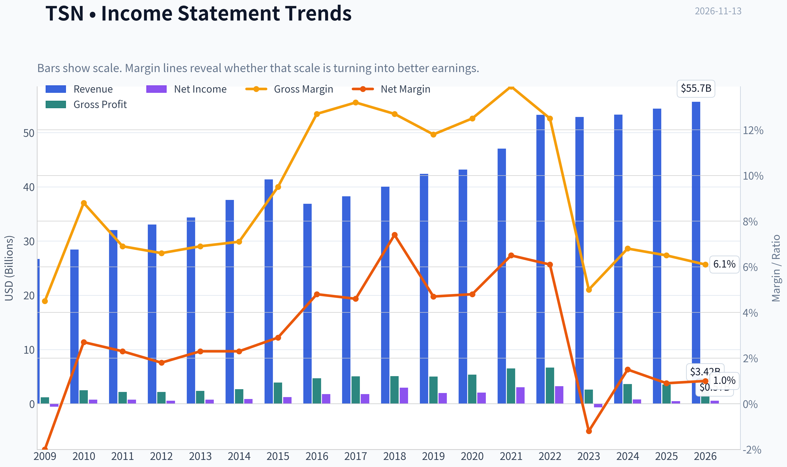

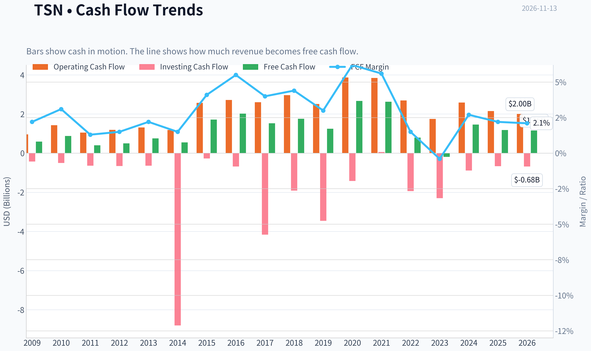

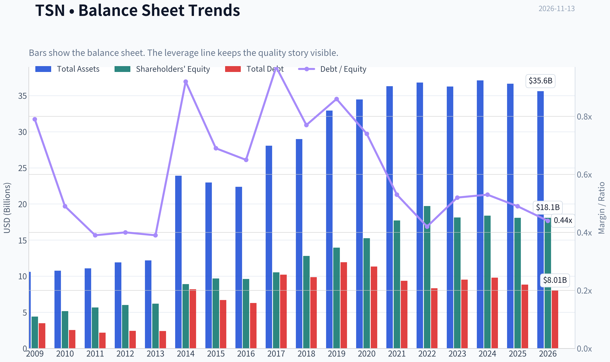

This graph tracks the profitability and return metrics (ROE, ROIC, Margins) of **TSN** over the past decade, highlighting capital efficiency trends.

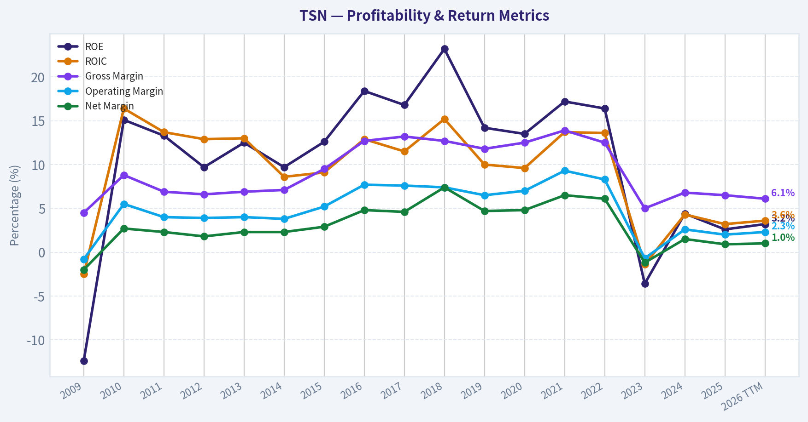

This chart illustrates the financial health of **TSN** over the last 10 years, mapping cash equivalents and free cash flow against total obligations (Debt).

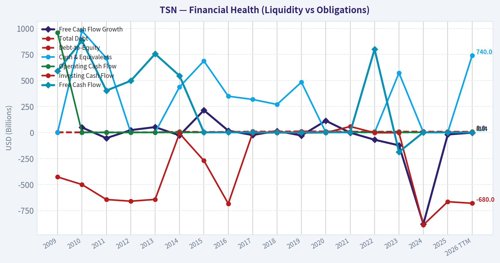

This comparison chart from *Profitability and Operating Performance* stacks current figures against historical benchmarks for **TSN**, making it easy to see where the company trades relative to its own averages.

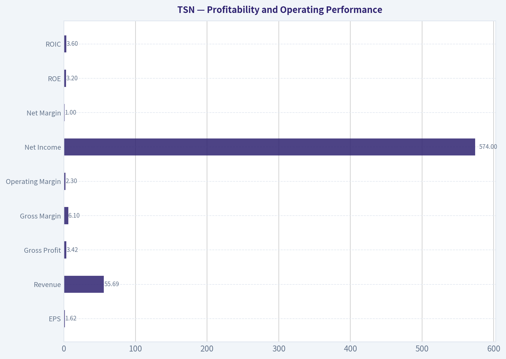

This breakdown chart from <em>Cash Flow and Capital Allocation</em> shows the proportional composition for **TSN** - useful for understanding what drives or risks the business.

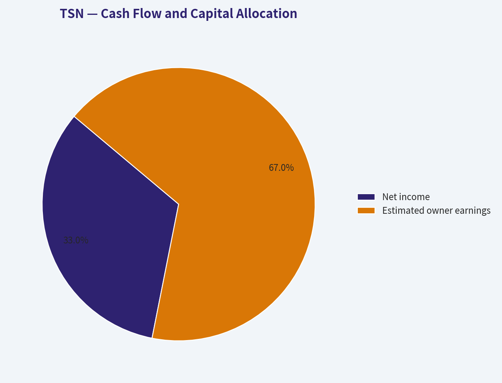

This breakdown chart from <em>Revenue Breakdown</em> shows the proportional composition for **TSN** - useful for understanding what drives or risks the business.

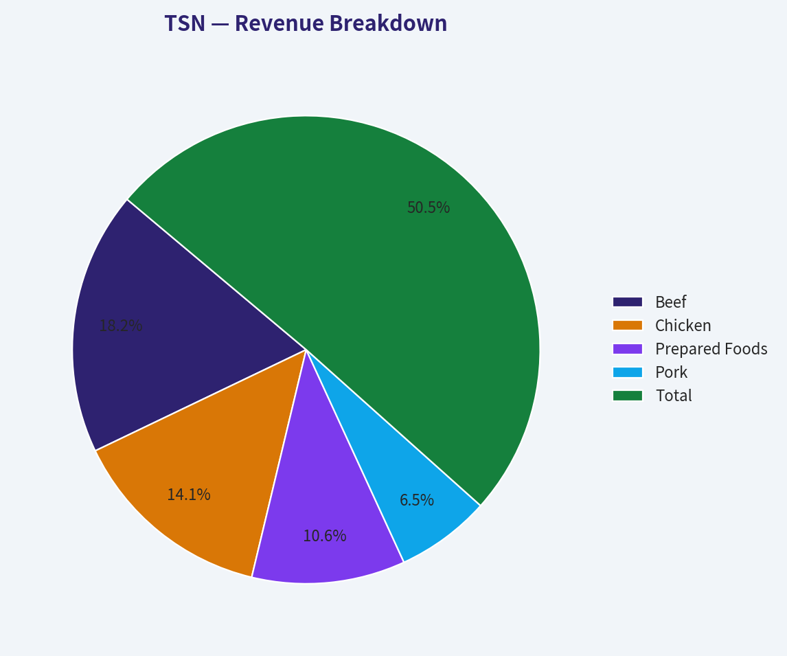

---

### Intrinsic Value Analysis (Buffett)

> *Following Warren Buffett's value investing philosophy: Circle of Competence, Economic Moat, Management Quality, and Margin of Safety.*

#### Intrinsic Value Snapshot

Price is what you pay. Intrinsic value is what the business may be worth based on the cash it can create for owners over time. We show a range, not one magic number.

- Current Price: $59.26
- Value Range (conservative to optimistic across both DCF methods): $-6.59 to $360.15

##### Owner Earnings (Buffett Method)
- Net Income: $474,000,000.00
- Depreciation & Amortization: $1,361,000,000.00
- Capital Expenditures: $-978,000,000.00
- Working Capital Changes: $-106,000,000.00
- Owner Earnings: $963,000,000.00

##### Intrinsic Value
###### Buffett Method
Uses owner earnings. Stricter, and usually more conservative.
- Conservative: $8.58
- Average: $52.27
- Optimistic: $360.15
- Discount Rate: 10.0%

###### Cash Flow Method
Uses free cash flow. Better for companies spending heavily today to grow tomorrow.
- Conservative: $-6.59
- Average: $27.83
- Optimistic: $74.36
- Discount Rate: 10.0%

ANALYST STANCE: **Bearish**

#### Executive Summary

Tyson Foods is a recognizable protein producer with meaningful scale, brands, distribution, and processing assets. However, the economics are structurally difficult: gross margins are only 6.5%, returns on equity are weak at 2.6%, earnings are cyclical, and recent earnings expectations point to renewed beef and chicken pressure.

At $59 per share, the stock is modestly below the headline intrinsic value estimate of $66.12, but that represents only a 10.4% margin of safety. For a cyclical, low-margin business with weak recent earnings momentum, that discount is not sufficient. The stock is not in financial distress, but it is not priced cheaply enough to compensate for its mediocre economics.

#### Factor Scorecard

| Factor | Score | Assessment |
|---|---:|---|
| Circle of competence and simplicity | 3/5 | Easy to understand, but future profits depend heavily on livestock cycles, feed costs, pricing, and operating execution. |
| Moat | 2.5/5 | Scale, distribution, brands, and customer relationships provide some advantages, but low margins indicate limited pricing power. |
| Management and capital allocation | 3/5 | Tyson has an established operating history, but the low current ROE and cyclical results provide limited evidence of exceptional value creation. |
| Industry structure | 2.5/5 | Protein processing is scale-driven but competitive, capital-intensive, and exposed to volatile commodity economics. |

**Gate 5 hard floor:** **Not tripped.** There is no evidence here of simultaneous deteriorating fundamentals and a solvency crisis such as interest coverage below 1x. The concern is poor and volatile profitability, not imminent financial distress.

**Key Takeaways:** Tyson is understandable and established, but it lacks the consistently high returns and pricing power associated with a Buffett-quality compounder. Its weaknesses reduce the appropriate valuation multiple and require a larger margin of safety.

#### Moat Analysis

| Potential moat source | Evidence | Rating |
|---|---|---:|
| Brand and intangible assets | Tyson is a major household and foodservice brand, but meat products are often substitutable and private-label competition is significant. | 2.5/5 |
| Scale and cost advantage | Large processing, purchasing, logistics, and distribution networks can lower unit costs. | 3/5 |
| Switching costs | Retailers and foodservice customers value reliable supply, but switching suppliers is generally possible. | 2/5 |
| Network effects | Essentially absent; scale does not create a strong consumer or platform network effect. | 1/5 |
| Overall moat durability | Scale is real, but the 6.5% gross margin suggests that competitive advantages are not strong enough to consistently retain high economic profits. | 2.5/5 |

Tyson's most credible advantage is operating scale. It can spread processing, logistics, compliance, and procurement costs across a large volume base. However, scale alone has not produced outstanding returns. The business remains exposed to commodity prices, disease, weather, feed costs, labor, retailer bargaining power, and shifting protein demand.

#### Financial Summary

| Metric | Current / latest reading |
|---|---:|
| Share price | $59.00 |
| Market capitalization | $20.85 billion |
| P/E ratio | 36.6x |
| Revenue growth, year over year | 2.1% |
| Gross margin | 6.5% |
| ROE | 2.6% |
| FCF yield | 5.6% |
| Current ratio | 1.55x |
| Headline intrinsic value | $66.12 |
| Reverse-DCF growth implied by price | Approximately 12.6% annually for 10 years |
| Trailing three-year earnings growth | -43.5% |
| Five-year earnings growth | 2.2% |

**Key Takeaways:** Tyson's low 6.5% gross margin and 2.6% ROE show that this is a thin-margin operating business rather than a high-return franchise. The valuation is demanding relative to recent growth: the market price appears to require approximately 12.6% annual growth for a decade, far above the recent five-year growth rate of 2.2%.

The current ratio is not a major concern for this operating company, but liquidity alone does not offset weak returns. The 36.6x P/E is particularly difficult to justify against the company's modest growth and cyclical earnings profile.

#### Owner Earnings Calculation

Using the owner-earnings valuation implied by the research valuation models:

| Item | Approximate amount |
|---|---:|
| Market capitalization | $20.85 billion |
| Approximate shares outstanding | 353.4 million |
| Implied owner earnings per share | $5.23 |
| Implied owner earnings | Approximately $1.85 billion |
| Owner-earnings yield at $59 | 8.9% |

**Key Takeaways:** The implied owner-earnings yield is better than the headline P/E suggests, but owner earnings in a protein processor can fluctuate materially across the cycle. The key question is whether approximately $1.85 billion represents sustainable mid-cycle earning power; recent earnings volatility makes that uncertain.

#### Three-Scenario DCF Valuation

The calculations below use approximately $5.23 per share of normalized owner earnings and a 10% discount rate.

| Scenario | Assumption | Estimated value per share |
|---|---|---:|
| A. No growth | Owner earnings capitalized at 10% | $52.27 |
| B. GDP-like growth | 3% perpetual growth | $76.96 |
| C. Historical-growth case | Approximately 1.5%-2.0% long-term growth, reflecting the recent 5-year record | Approximately $60-$68 |
| Research blended estimate | Owner earnings, FCF, Damodaran FCFF, and reverse-DCF blend | $66.12 |

**Key Takeaways:** The valuation range is wide, from roughly $52 to $77 per share, reflecting Tyson's sensitivity to normalized margins and growth assumptions. The conservative no-growth value is below the current price, while the 3% growth case provides only moderate upside. The blended estimate of $66.12 does not provide enough protection for a cyclical company with weak recent returns.

#### Margin of Safety Analysis

| Valuation measure | Result |
|---|---:|
| Current price | $59.00 |
| Headline intrinsic value | $66.12 |
| Upside to headline value | 12.1% |
| Margin of safety versus price | 10.4% |
| Owner-earnings value | $52.27 |
| FCF-based value | $27.83 |
| Damodaran FCFF value | $97.81 |

**Key Takeaways:** A 10.4% margin of safety is inadequate for Tyson's quality level. A wide-moat, high-ROIC compounder might merit purchase with a 10%-15% discount, but Tyson is a cyclical, low-margin business and should normally offer approximately 25%-35% downside protection. The large spread between the FCF-based and FCFF-based values confirms substantial valuation sensitivity.

The reverse-DCF is also unfavorable. The current price implies roughly 12.6% annual growth for ten years, while the recent five-year growth rate was only 2.2% and the trailing three-year trend was sharply negative. That implies the market is discounting a substantial earnings recovery and sustained execution.

#### Management Quality and Capital Allocation

Tyson's management challenge is not simply increasing sales; it is converting scale into durable per-share cash earnings. The company operates in an industry where large capital expenditures, working-capital swings, plant utilization, and acquisitions can absorb substantial cash.

Positive considerations include:

- A large and established operating platform.
- Valuable retailer and foodservice relationships.
- Opportunities to improve margins through plant efficiency, product mix, and capacity utilization.

Concerns include:

- Current ROE of only 2.6%.
- Highly cyclical earnings and commodity exposure.
- Limited evidence that retained capital is producing consistently superior returns.
- The need for ongoing capital investment to maintain and modernize processing capacity.

Management should be judged primarily on whether it can lift normalized ROIC and owner earnings rather than merely grow revenue. The current figures do not yet demonstrate exceptional capital allocation.

#### Final Buffett Scorecard

| Criterion | Weight | Score | Weighted contribution |
|---|---:|---:|---:|
| Moat width and durability | 25% | 2.5 | 0.63 |
| Valuation and margin of safety | 20% | 2.5 | 0.50 |
| Capital returns: ROIC versus WACC | 15% | 2.0 | 0.30 |
| Business understanding and predictability | 12% | 3.0 | 0.36 |
| Management quality and capital allocation | 12% | 3.0 | 0.36 |
| Reinvestment runway | 8% | 2.5 | 0.20 |
| Balance-sheet strength | 4% | 3.0 | 0.12 |
| Industry structure | 4% | 2.5 | 0.10 |
| **Total** | **100%** |  | **2.57/5** |

**Key Takeaways:** Tyson scores reasonably on simplicity and operating scale but poorly on moat durability, capital returns, and valuation support. The weighted score of approximately 2.6 falls in the **Bearish** range, although this is a valuation and quality judgment rather than a solvency-based rejection.

#### Investment Stance

**Bearish - Moderate conviction**

Tyson is a legitimate business with meaningful assets and a plausible recovery path, but the current price does not offer sufficient compensation for its thin margins, weak ROE, cyclical earnings, and uncertain growth. A more attractive entry point would likely require either:

- A price closer to the low-to-mid $40s, providing a 25%-35% margin of safety against the blended intrinsic value; or
- Clear evidence of sustained margin recovery, stronger owner earnings, and materially improved ROIC.

At $59, Tyson is not a wonderful business at a fair price. It is an average-quality cyclical business at a price that assumes a strong recovery.
#### Valuation Bridge

This bridge places the current market price beside each intrinsic value lens so readers can see whether upside depends on one method or shows up across several methods.

| Scenario | Intrinsic Value / Share |
| --- | ---: |
| Buffett Method | $52.27 |
| Cash Flow Method | $27.83 |
| Damodaran Method | $97.81 |
| Current Price | $59.26 |

#### Key Takeaways

If one method is far above the others, the upside case depends on a specific modelling assumption. When several methods cluster together, the valuation story is more robust.

#### Valuation Visuals

This comparison chart from *Latest Earnings Snapshot* stacks current figures against historical benchmarks for **TSN**, making it easy to see where the company trades relative to its own averages.

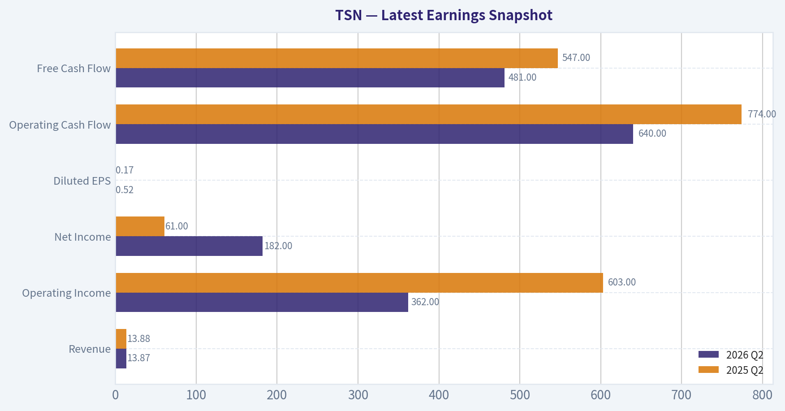

This comparison chart from *Current Metrics Versus 10-Year Averages* stacks current figures against historical benchmarks for **TSN**, making it easy to see where the company trades relative to its own averages.

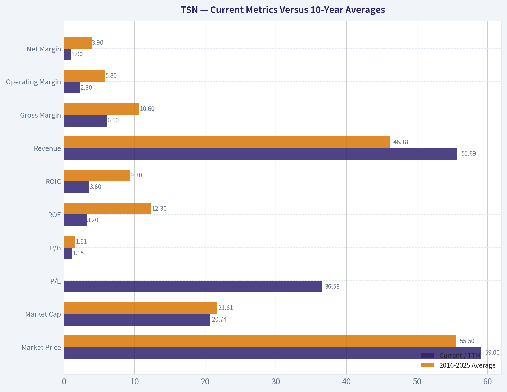

This comparison chart from *Balance Sheet and Financial Strength* stacks current figures against historical benchmarks for **TSN**, making it easy to see where the company trades relative to its own averages.

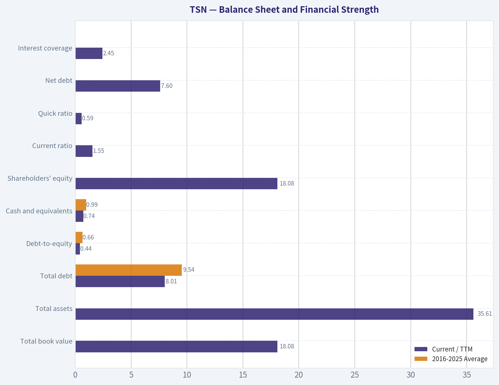

---

### Trend & Growth Analysis (Lynch/Druckenmiller/Fisher)

> *Following Peter Lynch's GARP, Stanley Druckenmiller's macro-aware approach, and Philip Fisher's scuttlebutt methodology.*

ANALYST STANCE: **Bearish**

#### 1. Lynch Classification

**Cyclical / mature stalwart**, not a fast grower. Tyson Foods is exposed to beef, pork, chicken, and prepared-food cycles. Its scale and brands provide durability, but current growth is too low for a Lynch-style ten-bagger thesis.

#### 2. The Story in Three Bullets

- Tyson is a large-scale protein producer with established brands, distribution, and retailer relationships.
- The potential upside depends mainly on a recovery in beef and chicken margins, cost savings, and improved supply conditions-not rapid secular revenue growth.
- Prepared Foods and operational improvements may stabilize earnings, but the company lacks a clear 20% annual growth engine.

#### 3. Key Fundamentals

| Metric | Latest Data | Growth Interpretation |
|---|---:|---|
| Share price | $59 | Reference price |
| Market capitalization | $20.85 billion | Large, mature company |
| Revenue growth, year over year | 2.1% | Stalwart-level growth |
| P/E ratio | 36.6x | High relative to current growth |
| Gross margin | 6.5% | Thin and exposed to commodity cycles |
| ROE | 2.6% | Weak capital efficiency |
| FCF yield | 5.6% | Some cash-flow support |
| Current ratio | 1.55x | Reasonable short-term liquidity |
| Headline intrinsic value | $66.12 | Approximately 10.4% upside |
| Reverse-DCF implied growth | 12.6% annually for 10 years | Aggressive relative to recent history |

**Key Takeaways:** Tyson's revenue is growing only slightly, while its valuation implies a much stronger long-term earnings trajectory. The 10.4% headline upside offers some valuation support, but it is not sufficient compensation for weak ROE, thin margins, and cyclical earnings risk.

#### 4. TAM and the 10x Test

| Item | Approximate Assessment |
|---|---:|
| Current annual revenue | Approximately $55 billion |
| 10x revenue target | Approximately $550 billion |
| Addressable market | Very large global protein and prepared-food market |
| Ability to reach 10x while remaining below 20% share | Theoretically possible in a broad global market, but operationally unrealistic |
| TAM growth | Low-to-moderate; largely tied to population, consumption, pricing, and prepared-food penetration |
| Runway quality | Adequate for steady growth, weak for ten-bagger growth |

**Key Takeaways:** Tyson operates in a large market, but market size alone does not create a ten-bagger opportunity. A tenfold revenue increase would require extraordinary global expansion and category growth, while Tyson's recent performance suggests a mature, cyclical business rather than a rapidly expanding platform.

#### 5. Revenue Growth Trend

| Period or Indicator | Result | Interpretation |
|---|---:|---|
| Latest year-over-year revenue growth | 2.1% | Slow growth |
| Recent three-year revenue trend | Approximately -43.5% cumulative share-price performance, not revenue | Market skepticism and cyclical pressure |
| Earnings outlook | Q4 earnings projected down approximately 43.5% | Near-term deterioration |
| Beef margins | Under pressure | Major cyclical headwind |
| Prepared Foods | Expected relative strength | Potential stabilizer |
| Growth pattern | Low and uneven | No confirmed acceleration |

**Key Takeaways:** Tyson does not currently show the accelerating revenue pattern sought by Druckenmiller. The most recent outlook points toward earnings deterioration, particularly in beef, while Prepared Foods may soften but not eliminate the weakness.

#### 6. Unit Economics and Profitability

| Metric | Assessment |
|---|---|
| LTV/CAC | Not meaningful or disclosed for this manufacturing and food-production model |
| Net revenue retention | Not applicable |
| Rule of 40 | Not applicable |
| Gross margin | 6.5% |
| FCF yield | 5.6% |
| ROE | 2.6% |
| Operating leverage | Possible if commodity costs and plant utilization improve |
| Profitability quality | Highly cyclical and margin-sensitive |

**Key Takeaways:** Tyson's economics are driven more by commodity spreads, production efficiency, and pricing than by subscription metrics. The 5.6% FCF yield is constructive, but the low gross margin and 2.6% ROE indicate limited structural profitability advantages.

#### 7. Inflection Point Assessment

| Potential Inflection | Current Evidence | Assessment |
|---|---|---|
| Product-cycle inflection | Prepared Foods growth | Positive but moderate |
| Market-share inflection | No clear evidence | Unconfirmed |
| Margin inflection | Possible recovery from beef and chicken pressure | Not yet visible |
| TAM inflection | No major new market identified | Weak |
| Competitive inflection | No clear competitor disruption | Unconfirmed |
| Earnings inflection | Near-term earnings decline expected | Negative |

**Key Takeaways:** Tyson may eventually experience a cyclical margin recovery, but that is different from a durable growth inflection. At present, the evidence points to stabilization potential rather than accelerating earnings power.

#### 8. Macro Setup

| Macro Factor | Impact on TSN |
|---|---|
| Economic cycle | Defensive food demand, but protein volumes and restaurant demand can soften |
| Interest rates | Higher rates pressure valuation and consumer purchasing power |
| Commodity prices | Beef, feed, labor, and transportation costs create material volatility |
| Consumer trends | Prepared and convenient foods are favorable secular niches |
| Secular theme | Food convenience and branded packaged foods, but not a high-growth technology-like theme |
| Overall macro setup | Mixed |

**Key Takeaways:** Tyson benefits from essential-food demand, but it remains vulnerable to commodity inflation, labor costs, livestock cycles, and consumer trade-down behavior. The macro backdrop is defensive but not especially favorable for rapid multiple expansion.

#### 9. Fisher's 15-Point Score

| Fisher Criterion | Score, 1-5 | Comment |
|---|---:|---|
| Market potential | 4 | Large protein and prepared-food markets |
| New-product determination | 3 | Some innovation, but not transformational |
| R&D effectiveness | 3 | Relevant but not a central competitive engine |
| Sales organization | 4 | Strong retailer and distribution network |
| Profit margins | 2 | Thin gross margins |
| Margin improvement potential | 3 | Cyclical recovery possible |
| Labor relations | 3 | Mixed and operationally complex |
| Executive relations | 3 | No clear exceptional advantage |
| Management depth | 3 | Large-company capabilities |
| Cost accounting | 4 | Scale and operational controls |
| Outstanding competitive aspects | 3 | Brands, scale, and distribution |
| Long-range profit outlook | 3 | Durable but low-growth |
| Dilution | 4 | No major dilution concern identified |
| Management candor | 3 | Insufficient evidence for a higher score |
| Management integrity | 3 | No decisive positive or negative evidence |
| **Total** | **48 / 75** | **Average** |

**Key Takeaways:** Tyson scores well for scale, distribution, and market durability, but poorly on margin quality and long-range growth. A 48 out of 75 is an average Fisher result and does not support a high-conviction growth investment.

#### 10. Valuation Analysis

| Valuation Method | Result | Interpretation |
|---|---:|---|
| P/E | 36.6x | Expensive for 2.1% revenue growth and declining near-term earnings |
| PEG | Not meaningful | Earnings growth is weak or negative; PEG becomes unreliable |
| Approximate price-to-sales | Approximately 0.4x | Low multiple reflects thin margins and cyclicality |
| FCF yield | 5.6% | Provides moderate valuation support |
| Headline intrinsic value | $66.12 | About 12% above the $59 reference price |
| Owner-earnings valuation | $52.27 | Below current price |
| FCF valuation | $27.83 | Materially below current price |
| Damodaran FCFF valuation | $97.81 | Highly optimistic outlier |
| Bear case | $45-$52 | Earnings decline or prolonged margin pressure |
| Base case | $60-$70 | Gradual normalization and modest cash-flow growth |
| Bull case | $80-$95 | Strong protein-cycle recovery plus successful Prepared Foods execution |

**Key Takeaways:** Valuation is highly model-sensitive. The headline intrinsic value suggests modest upside, but two of the three underlying valuation approaches are below the current price, and the 36.6x P/E is difficult to justify without a meaningful earnings recovery.

#### 11. Growth Investor Scorecard

| Criterion | Weight | Score, 1-5 | Weighted View |
|---|---:|---:|---:|
| The Story | 10% | 2.5 | Understandable, but not a high-growth story |
| TAM and runway | 20% | 2.5 | Large market, limited growth intensity |
| Revenue growth | 20% | 2.0 | Only 2.1% latest growth |
| Unit economics | 15% | 2.5 | Cash generation offset by thin margins |
| Competitive position | 10% | 3.5 | Strong scale and distribution |
| Management quality | 10% | 3.0 | Adequate, not clearly exceptional |
| Macro setup | 5% | 2.5 | Defensive demand but commodity risk |
| Profitability path | 5% | 3.0 | Recovery possible, structurally modest |
| Valuation | 5% | 2.5 | Mixed models and high P/E |
| **Overall score** | **100%** | **2.6 / 5.0** | **Avoid for growth investing** |

**Key Takeaways:** Tyson's strongest attributes are scale and market durability. Its main weaknesses are slow growth, weak returns on equity, cyclicality, and a valuation that assumes a substantial earnings recovery. The score falls below the threshold for a growth-oriented purchase.

#### 12. Position Size Stance

| Investor Profile | Suggested Position |
|---|---|
| Growth investor seeking ten-baggers | 0% |
| Existing defensive or dividend investor | Hold only if the income and cyclical-recovery thesis remains intact |
| Speculative cyclical investor | Small position only, generally below 2% |
| New buyer today | Wait for clearer margin recovery or a materially lower valuation |

**Key Takeaways:** Tyson is better viewed as a cyclical recovery or defensive-food holding than as a core growth investment. A new growth investor should wait for evidence of accelerating revenue, improving margins, and a more reasonable earnings multiple.

#### 13. Key Risks and Catalysts

| Catalysts | Risks |
|---|---|
| Beef and chicken margin recovery | Prolonged livestock and commodity pressure |
| Prepared Foods growth | Q4 earnings decline larger than expected |
| Plant rationalization and cost savings | Weak consumer demand or restaurant volumes |
| Improved pricing and mix | Labor, feed, freight, and input-cost inflation |
| Share repurchases or stronger FCF | High P/E despite low growth |
| Lower interest rates | Thin margins and weak ROE |
| Better supply stability | Structural competition and private-label pressure |

**Key Takeaways:** The main upside catalyst is a cyclical recovery in protein margins combined with operational improvement. The central risk is that the market is already pricing in a recovery that fails to materialize, leaving investors exposed to both earnings disappointment and valuation compression.

---

### Market Technical Analysis

ANALYST STANCE: **Neutral**

#### TSN technical market report

TSN's latest available close was **$59.26 on November 12, 2026**; November 13 was not a trading day in the retrieved dataset. The stock has strengthened materially from its late-September low near $50.50, but the current setup is becoming more extended after a sharp October-November advance.

The selected indicators are **close_50_sma, close_200_sma, close_10_ema, macd, rsi, boll_ub, boll_lb, and atr**. Together, they cover long-, medium-, and short-term trend, momentum, overbought/oversold conditions, volatility, and risk management without adding unnecessarily redundant signals.

#### Trend structure

The medium-term trend is constructive. TSN closed at $59.26, well above its **50-day SMA of $54.25**, and the 50-day average has risen steadily from approximately $53.6 in late October. This indicates that the recent recovery is not merely a one- or two-day bounce; price has established a higher trading range and the medium-term trend has turned upward.

The short-term trend is even stronger. The **10-day EMA is $58.92**, leaving the latest close only modestly above it. The EMA rose sharply from approximately $53.5 on October 19 to nearly $58.9 currently. That advance confirms persistent short-term buying pressure, although the small distance between price and the EMA suggests that TSN is no longer accelerating aggressively at the very latest close.

The long-term picture has improved but remains less decisive. TSN is just above its **200-day SMA of $58.82**, with the average itself nearly flat to slightly declining. This is an important inflection point: a sustained move above $58.80-$59.00 would strengthen the case that the broader trend has transitioned from neutral-to-bearish into bullish. Conversely, a failure to hold the 200-day average would make the recent rally look more like a recovery into major resistance rather than a confirmed long-term breakout.

#### Momentum assessment

MACD is strongly positive. The latest **MACD reading is 1.62**, up from approximately 0.26 on October 19 and negative in mid-October. This confirms that the rally has meaningful momentum rather than being driven only by a low-volume rebound. However, MACD eased from 1.68 on November 11, while price also slipped from $60.29 on November 10 to $59.26. That modest loss of momentum is not yet a bearish reversal, but it suggests that the rate of advance may be slowing.

RSI provides the main caution signal. RSI reached **74.0 on November 10**, remained above 70 on November 11, and declined to **65.1** on November 12. The retreat from overbought territory is constructive if it represents a controlled cooldown, because it reduces immediate overheating. Nevertheless, the recent readings show that buyers have already pushed the stock into a stretched zone. A renewed move above 70 without a corresponding breakout in price could create a bearish divergence risk.

#### Volatility and price position

The Bollinger Bands have expanded upward as TSN rallied. The latest **upper band is $61.44**, while the **lower band is $53.35**. At $59.26, price is in the upper portion of the band structure but is not currently pressing the upper band. This is a healthier configuration than an outright upper-band breakout followed by an immediate reversal: the stock retains upside room, but the market is also signaling that volatility has increased.

The relevant near-term levels are:

- **Resistance:** approximately $60.30-$61.45. The $60.30 area corresponds to the recent high, while the upper Bollinger Band is near $61.44.
- **First support:** approximately $58.90-$59.00, represented by the 10-day EMA and 200-day SMA.
- **Secondary support:** approximately $57.00-$57.50, near the late-October and early-November consolidation zone.
- **Stronger medium-term support:** approximately $54.25, near the 50-day SMA.

ATR has increased from roughly $1.00 in late October to **$1.39**. This indicates that daily price swings have become materially larger. At the current price, one ATR represents roughly 2.3% of the share price. Traders should therefore avoid placing stops too tightly around the current market price; a stop only a few cents below an obvious support level could be vulnerable to normal volatility.

#### Trading interpretation

The bullish case is supported by price above the rising 50-day SMA, price slightly above the 200-day SMA, a strongly positive MACD, and a 10-day EMA that has climbed rapidly. A daily close above **$60.30**, followed by acceptance above the **$61.40-$61.50** region, would provide stronger confirmation of continuation. Such a move would indicate that buyers are successfully converting the recent recovery into a higher-range breakout.

The cautious case is that TSN has rallied quickly from the low-$50s, RSI recently entered overbought territory, and the 200-day SMA is still nearly flat. A close back below **$58.80-$59.00** would weaken the immediate breakout thesis. A further decline through the $57 area would suggest that the stock needs a deeper consolidation, while a move below the rising 50-day SMA near $54.25 would materially damage the medium-term trend.

For traders without a position, the risk-reward profile is less attractive after the recent surge than it was during the October consolidation. A preferable approach may be to wait for either a confirmed breakout above $61.45 or a pullback that holds the $58.80-$59.00 support area. Existing long positions can be managed with volatility-adjusted risk controls, using ATR rather than an unusually tight fixed stop.

#### Key indicator summary

| Indicator | Latest reading | Trend implication | Trading relevance |
|---|---:|---|---|
| close_10_ema | $58.92 | Rising sharply; price slightly above it | Immediate trend support near $58.90 |
| close_50_sma | $54.25 | Rising steadily | Confirms improving medium-term trend |
| close_200_sma | $58.82 | Nearly flat/slightly declining | Critical long-term confirmation level |
| macd | 1.62 | Strongly positive, but recently eased | Momentum favors buyers, though acceleration is slowing |
| rsi | 65.09 | Down from overbought readings above 70 | Cooling momentum; not yet oversold or bearish |
| boll_ub | $61.44 | Rising upper volatility boundary | Breakout confirmation zone |
| boll_lb | $53.35 | Rising lower volatility boundary | Broader volatility-adjusted support |
| atr | $1.39 | Elevated versus late October | Wider stops and smaller position sizing may be appropriate |

Key Takeaways: TSN's trend is technically constructive because price is above both its rising 50-day average and its 200-day average, while MACD remains strongly positive. However, the rally is extended, RSI recently exceeded 70, and volatility has increased, so chasing the stock at current levels carries added risk. The most important near-term signal is whether TSN can hold the $58.80-$59.00 area or break decisively above $60.30 and then $61.45.

---

### Options Market Analysis

> *Reading options flow - put/call ratios, IV skew, and unusual activity - to gauge institutional positioning and event-driven risk.*

#### TSN Options Market Report

*Data as of November 13, 2026. The available feed does not provide TSN's current share price, strike-level open interest, or an explicit OTM put-versus-call skew calculation. Conclusions are therefore based on the supplied near-term expiration statistics.*

#### 1. Put/Call Ratio Analysis

| Expiration | Call OI | Put OI | Put/Call OI Ratio | Call Volume | Put Volume | Put/Call Volume Ratio |
|---|---:|---:|---:|---:|---:|---:|
| Nov. 20, 2026 | 21 | 91 | 4.33 | 757 | 512 | 0.68 |
| Dec. 18, 2026 | 108 | 15 | 0.14 | 125 | 84 | 0.67 |
| Jan. 15, 2027 | 443 | 882 | 1.99 | 392 | 135 | 0.34 |
| **Combined** | **572** | **988** | **1.73** | **1,274** | **731** | **0.57** |

**Key Takeaways:** TSN's combined put/call open-interest ratio of 1.73 is substantially above the approximately 0.7 neutral baseline, indicating a put-heavy existing positioning profile. However, current volume is call-dominant, with a 0.57 put/call volume ratio, suggesting recent activity is more constructive than the accumulated open interest. The strongest put concentration is in the November and January expirations.

#### 2. Implied Volatility Assessment

| Expiration | Call ATM IV | Put ATM IV | Put IV Premium vs. Call IV |
|---|---:|---:|---:|
| Nov. 20, 2026 | 1.6% | 3.1% | +1.5 percentage points |
| Dec. 18, 2026 | 0.8% | 1.6% | +0.8 percentage points |
| Jan. 15, 2027 | 0.4% | 0.8% | +0.4 percentage points |

**Key Takeaways:** Put ATM implied volatility is higher than call ATM IV across every listed expiration, consistently indicating downside protection is more expensive than upside exposure. The relative put premium is greatest in the nearest expiration, which may reflect short-dated downside hedging. Absolute IV readings are unusually low, so they should be treated cautiously as possible feed or contract-liquidity artifacts rather than definitive evidence of low event risk.

An explicit OTM skew measure was not supplied, but the higher put ATM IV across maturities is directionally consistent with a downside put skew. No known earnings, product, or other catalyst was provided in the data, so catalyst-related IV elevation cannot be confirmed.

#### 3. Unusual Options Activity

| Finding | Result |
|---|---|
| Contracts with volume greater than 5x open interest | None identified |
| Fresh directional activity | No statistically unusual contracts detected |
| Smart-money versus retail inference | Not determinable from the supplied data |

**Key Takeaways:** There were no contracts meeting the feed's unusual-activity threshold. This means there is no clear evidence of a fresh institutional put sweep, aggressive call speculation, or other isolated directional bet. The call-heavy volume is constructive, but without contract-level anomalies it does not qualify as strong smart-money confirmation.

#### 4. Open Interest Concentration and Gamma Considerations

| Expiration | Call OI | Put OI | Total OI | Positioning Character |
|---|---:|---:|---:|---|
| Nov. 20, 2026 | 21 | 91 | 112 | Heavily put-weighted |
| Dec. 18, 2026 | 108 | 15 | 123 | Heavily call-weighted |
| Jan. 15, 2027 | 443 | 882 | 1,325 | Largest concentration; put-heavy |
| **Total** | **572** | **988** | **1,560** | **Overall put-heavy** |

**Key Takeaways:** January 15, 2027 is the dominant open-interest expiration, accounting for roughly 85% of the listed combined open interest. Its 882 puts versus 443 calls create the clearest potential gravitational zone, although strike-level data is required to identify the actual price level. Gamma walls, max-pain levels, and potential pinning strikes cannot be determined because individual strikes were not included.

#### 5. Overall Options Sentiment

**Signal: BEARISH, with low-to-moderate confidence.**

The primary bearish driver is the combined put/call open-interest ratio of 1.73, well above the approximately 0.7 neutral benchmark. Put IV also exceeds call IV in every expiration, reinforcing a preference for downside protection or concern about downside risk.

The main counterpoint is the current volume profile: calls traded more actively than puts, particularly in the November expiration. That could represent bullish speculation, call spread activity, or covered-call transactions; without bid/ask execution data and strikes, the direction of those trades cannot be confirmed. No unusual-volume contracts were detected, and the relatively small absolute open-interest totals make the signal less reliable than it would be for a highly liquid options chain.

| Category | Assessment |
|---|---|
| Put/Call Ratio | **Bearish:** combined OI ratio 1.73 versus 0.7 neutral |
| IV Level | **Very low according to the feed; verify data quality and liquidity** |
| Skew Direction | **Downside:** puts carry higher ATM IV across all expirations |
| Unusual Activity | **None detected:** no contracts exceeded 5x open interest |
| Overall Signal | **BEARISH, low-to-moderate confidence** |

**Key Takeaways:** TSN's options positioning is bearish overall because open interest is heavily concentrated in puts and put volatility is consistently higher than call volatility. Recent volume is more bullish than the existing positioning, but it lacks unusual contract-level confirmation. The signal favors a cautious bearish interpretation, with reduced confidence because strike-level data, execution direction, and reliable gamma levels are unavailable.

---

## Research Team Commentary

> *The Research Manager synthesizes the Bull vs Bear debate into action-free commentary. This is a pre-risk view, not the final stance.*

Core takeaway: Tyson Foods is a legitimate recovery candidate, but not yet a Buffett-style purchase. Its national processing network, established brands, distribution capabilities, and retailer relationships would be difficult to reproduce. Nevertheless, those advantages currently produce only a 2.8% ROIC, 2.6% ROE, and 6.5% gross margin. At $59.26 and roughly 36.6 times current earnings, shareholders are being asked to underwrite a substantial recovery before there is enough evidence that the recovery will be durable or translate into free cash flow.

The strongest bull argument is that current earnings may materially understate normalized earning power. Tyson does not require rapid revenue growth to improve profits. Better plant utilization, chicken economics, product mix, cost control, and Prepared Foods execution could produce considerable operating leverage. Its physical network, food-safety capabilities, customer access, and brands create a moderate moat and make permanent displacement unlikely. If sustainable EPS reaches $3-$4, today's price would represent approximately 15-20 times earnings, which could be defensible at the upper end only if cash conversion and returns on capital improve.

The strongest bear argument is that scale has protected Tyson's relevance more clearly than it has protected shareholder returns. Protein processing remains capital-intensive, cyclical, and exposed to powerful retailers, commodity inputs, labor costs, animal disease, and continual maintenance spending. Tyson has limited structural pricing power, and cost savings can be absorbed by inflation or passed to customers. A 2.8% ROIC is below a reasonable cost of capital and cannot simply be labeled temporary without evidence. The present valuation therefore offers little protection if recovery is slower, smaller, or more capital-intensive than expected.

The quoted DCF figures of roughly $26-$38 are useful as warnings but should not be treated as precise intrinsic values. They extrapolate from depressed EPS without adequate information on normalized segment margins, maintenance capital expenditure, working capital, net debt, or free cash flow. Conversely, valuing Tyson on hypothetical $3-$4 EPS is also insufficient unless those earnings convert into distributable cash through a complete protein cycle. The honest conclusion is that the available data do not support a sufficiently reliable intrinsic-value estimate.

From a Buffett perspective, Tyson is neither a wonderful business deserving only a 10-15% valuation discount nor an obviously distressed enterprise that must be avoided. It is an average-to-moderate-quality cyclical business, so it should require a much larger margin of safety-roughly 30-40% against conservative through-cycle value. A decline from $59 to the mid-to-high $50s would not, by itself, create that margin of safety; it would be only a small price change. Technical support around $57-$59 and resistance around $60-$61 may influence trading, but they say nothing about intrinsic value.

Management has not earned a premium assessment from the supplied evidence. The relevant test is not announced savings or one strong quarter, but whether capital allocation lifts through-cycle ROIC above the cost of capital while preserving balance-sheet flexibility. Debt-funded investment is acceptable only if returns comfortably exceed financing costs. Without net debt, interest coverage, maintenance-capex, and cash-flow data, neither financial distress nor financial strength can be established.

The market may be correctly anticipating some cyclical normalization rather than irrationally overlooking Tyson's assets. There is no compelling contrarian opportunity merely because current profitability is weak. The better contrarian setup would arise if the shares were priced for permanent impairment while segment economics, free cash flow, and the balance sheet were visibly stabilizing. At present, price and proof are poorly aligned: the valuation anticipates improvement, while the reported returns have not confirmed it.

Over the next one to four quarters, I would monitor segment operating margins separately-especially Beef, Chicken, and Prepared Foods-rather than relying on consolidated adjusted EPS. Chicken improvement driven by productivity and mix would be more encouraging than a temporary commodity benefit. Beef margins should be evaluated against the cattle cycle so that cyclical price movements are not mistaken for structural execution.

I would also track operating cash flow after working-capital effects, maintenance and total capital expenditure, free-cash-flow conversion, net debt to normalized EBITDA, interest coverage, and debt maturities. Repeated restructuring charges or savings that fail to appear in cash flow would weaken the thesis. Evidence that Prepared Foods is sustaining volume, pricing, and margins despite private-label pressure would strengthen the moat assessment.

The most important confirmation would be several consecutive quarters of higher margins and positive free cash flow accompanied by ROIC moving decisively toward, and eventually above, Tyson's cost of capital. A recovery in EPS without improved ROIC would suggest that favorable industry conditions-not durable business improvement-are doing the work. The thesis would also strengthen if management demonstrated disciplined capital spending and avoided aggressive repurchases or acquisitions before leverage and cash generation were secure.

I would become more constructive if sustainable EPS approached $3-$4, free cash flow corroborated those earnings, leverage remained comfortable under conservative commodity assumptions, and the stock still traded at a meaningful discount to conservatively estimated through-cycle value. I would move toward avoidance if margins failed to improve, maintenance spending consumed operating cash, debt metrics weakened, or management continued investing at sub-cost-of-capital returns.

The lesson from prior cyclical investments is to use current market conditions and fundamental data rather than familiarity, brands, or an assumed reversion to normal. Tyson's recovery is plausible, but plausibility is not a margin of safety. The disciplined response is to wait for either a substantially better price or materially better evidence.

Neutral

---

## Value Investing Team Commentary

> *The Investor translates the research view into an investment thesis before risk review. This is still not the final stance.*

Tyson Foods is a recognizable, strategically important food company, but the current evidence points to a **cyclical recovery candidate rather than a high-quality compounder**.

At approximately $59.26, the shares trade at about 36.6 times reported earnings. That multiple is not necessarily excessive if current earnings are unusually depressed and Tyson can sustainably return to $3-$4 per share of earnings. However, the market is already assigning meaningful value to that recovery. The problem is that the underlying returns remain weak: roughly 2.8% ROIC, 2.6% ROE, and a 6.5% gross margin. Those figures suggest that Tyson's scale and distribution network have not yet translated into attractive economics for shareholders.

### Business quality and moat

Tyson benefits from genuine advantages:

- A large and difficult-to-replicate processing and distribution network
- Longstanding relationships with retailers, restaurants, and foodservice customers
- Recognized brands and food-safety capabilities
- Scale in procurement, production, logistics, and customer servicing

These assets reduce the risk of permanent competitive displacement. They do not, however, create the type of pricing power enjoyed by a leading consumer franchise. Tyson operates in categories where retailers retain substantial bargaining power, input costs are volatile, labor is important, and capacity decisions can materially affect profitability.

Its moat is therefore best characterized as **moderate and operational**, not exceptional. Scale helps Tyson remain relevant, but scale alone has not produced consistently high returns on capital.

### The recovery case

The bullish thesis is credible. Tyson does not need rapid revenue growth to generate better shareholder returns. Earnings could improve through:

- Better chicken production and supply conditions
- Improved plant utilization and labor productivity
- Favorable product mix
- Cost savings that are actually realized in cash
- Stabilization in Prepared Foods
- A more favorable protein cycle

Because Tyson has substantial fixed infrastructure, incremental margin improvement could have an outsized effect on earnings. If normalized EPS eventually reaches $3-$4, the current price would look much more reasonable on a forward basis.

The important distinction is whether that earnings improvement is **structural or cyclical**. A temporary benefit from chicken supply, cattle prices, or commodity conditions should not be valued like durable operational improvement. The strongest evidence would be several quarters of margin improvement accompanied by stronger free cash flow and higher ROIC-not merely a rebound in adjusted EPS.

### What the market may be missing

The market could be underestimating Tyson's operating leverage. A business with a national network, established customers, and depressed margins can recover faster than headline returns suggest. If management improves execution without excessive capital spending, the current earnings base may prove unusually low.

There is also a potential sentiment opportunity if investors are overly focused on recent weak profitability and fail to distinguish temporary industry conditions from permanent deterioration. Tyson's assets and customer relationships are unlikely to disappear simply because one part of the protein cycle is unfavorable.

However, selective contrarianism requires evidence. The opposing interpretation is that the market is not irrationally pessimistic; it is correctly discounting a business with structurally modest pricing power and inconsistent capital returns. A 2.8% ROIC cannot be dismissed as temporary without proof. If recovery requires continual investment merely to maintain capacity, improved accounting earnings may not translate into owner earnings.

### Valuation and margin of safety

Tyson does not appear to offer the valuation protection appropriate for an average-quality cyclical business. A wonderful, high-ROIC business might justify purchase at a 10-15% discount to reasonable intrinsic value. Tyson should require something closer to a **30-40% discount to conservative through-cycle value**, given its commodity exposure, capital intensity, retailer power, and uncertain cash conversion.

At $59.26, the stock appears to require a meaningful recovery before providing an adequate margin of safety. A move to $57 or $58 would not materially change that conclusion; it would be a technical decline, not a fundamental repricing. The $60-$61 resistance zone and $57-$59 support area may matter to traders, but they do not establish intrinsic value.

The cited DCF range of approximately $26-$38 should be treated as a warning rather than a precise valuation. It may understate normalized earnings, but a valuation based on hypothetical $3-$4 EPS is equally unreliable unless those earnings are supported by free cash flow, manageable leverage, and durable margins.

### Key evidence to monitor

The most important indicators over the next several quarters are:

1. **Segment margins**, especially Beef, Chicken, and Prepared Foods
2. **Free cash flow after capital expenditures and working capital**
3. **Maintenance capital requirements**, not just total reported capital spending
4. **Net debt relative to normalized EBITDA**
5. **Interest coverage and debt maturities**
6. **ROIC moving above the company's cost of capital**
7. Whether announced cost savings appear in cash flow
8. Whether Prepared Foods maintains volume and pricing despite private-label competition

Chicken improvement driven by productivity, better utilization, and mix would be more encouraging than improvement caused solely by favorable industry supply. Likewise, Beef should be evaluated against the cattle cycle rather than judged from one or two unusually strong or weak quarters.

Management should also be judged by restraint. Aggressive acquisitions, discretionary repurchases, or debt-funded expansion before cash generation is secure would weaken the investment case. A disciplined focus on operational improvement and balance-sheet flexibility would strengthen it.

### Overall assessment

Tyson is not a distressed business, and its assets have real strategic value. But it is also not currently demonstrating the economics of a wonderful business. The shares appear to offer exposure to a plausible recovery without yet offering a sufficiently large margin of safety for the risks involved.

The most attractive setup would be either:

- A substantially lower price reflecting skepticism about the recovery, or
- Clear evidence that normalized earnings are approaching $3-$4 per share, free cash flow is strong, leverage is controlled, and ROIC is sustainably improving

Until then, the prudent approach is to maintain a watchlist position rather than underwrite the recovery in advance. Tyson may become investable if sentiment turns sufficiently negative while the operating evidence improves, but a modest decline toward the high $50s would not by itself create a compelling value opportunity.

**ANALYST STANCE: Neutral**

---

## Deep Values Commentary

> *The Risk Management Team debates and the Risk Judge provides the final action-free verdict. This section determines the final Bullish / Neutral / Bearish stance.*

#### Final Stance Scorecard

This scorecard converts the final research view into a weighted decision frame. It does not replace the narrative judgement, but it makes the main drivers of the verdict easier to scan.

| Criterion | Score | Weight | Commentary |
| --- | ---: | ---: | --- |
| Business Quality | 2.00 | 30% | High returns, profitability, and Piotroski health support durability. |
| Valuation Support | 3.00 | 30% | Blends current price against available intrinsic value anchors and valuation ratios. |
| Financial Strength | 3.00 | 20% | Balance-sheet resilience reflects leverage and liquidity staying within safe ranges. |
| Growth Durability | 1.33 | 20% | Recent revenue, earnings, and free cash flow growth indicate how durable expansion looks. |
| TOTAL / FINAL STANCE | 2.37 | 100% | Neutral |

#### Key Takeaways

The weighted score lands at **2.37 / 5.0**, while the final stance remains **Neutral**. This is useful as a quick calibration aid rather than a mechanical signal.

#### Risk Summary

Higher scores indicate more risk pressure. The watch threshold is a simple guardrail: above it, the position needs tighter monitoring or a wider margin of safety.

| Dimension | Current Score | Watch Threshold | Commentary |
| --- | ---: | ---: | --- |
| Business Quality | 4.00 | 3.00 | High returns, profitability, and Piotroski health support durability. |
| Valuation Support | 3.00 | 3.00 | Blends current price against available intrinsic value anchors and valuation ratios. |
| Financial Strength | 3.00 | 3.00 | Balance-sheet resilience reflects leverage and liquidity staying within safe ranges. |
| Growth Durability | 4.67 | 3.00 | Recent revenue, earnings, and free cash flow growth indicate how durable expansion looks. |

#### Key Takeaways

This view helps readers separate *where* the risk sits: valuation, business quality, balance sheet, or growth durability. It is especially useful when the final stance is close to the line between Neutral and Bearish.
