# TTD Deep Value Intelligence

**Analysis Date:** 2026-03-18

## Critical Disclaimer

*This analysis is generated by Deep Value Intelligence, an AI-powered multi-agent investing framework. This report is for informational and educational purposes only and does not constitute financial advice. Always conduct your own research and consult with qualified financial advisors before making investment decisions.*

---

## Table of Contents

1. Intelligence Summary
2. Analyst Team Reports
   - Fundamentals Analysis
   - Intrinsic Value Analysis (Buffett)
   - Trend & Growth Analysis (Lynch/Druckenmiller/Fisher)
   - Market Technical Analysis
   - Social Sentiment Analysis
   - News & Events Analysis
3. Research Team Commentary
4. Value Investing Team Commentary
5. Deep Values Commentary

---

## Intelligence Summary

### Thesis + Conditions

**Core Thesis:** **EXECUTIVE SUMMARY**
*   **Verdict:** **WATCH**
*   **The Business:** The Trade Desk (TTD) boasts elite software economics (78.6% gross margins, 17.5% ROIC, 23.8% FCF growth) and acts as the leading neutral ad-buying platform for the open internet. *   **The Risk:** It is a fundamentally fragile "middleman." TTD operates on rented land, lacking ownership of underlying media inventory or consumer data.

**Key Risks:**
- Verdict:** **WATCH**
- The Risk:** It is a fundamentally fragile "middleman." TTD operates on rented land, lacking ownership of underlying media inventory or consumer data. It is highly vulnerable to ecosystem gatekeepers (Google, Apple, Amazon).
- The Advocate (Risky):** Argues the 50% drawdown to $25 is a rare capitulation event for an elite, high-margin compounder. Highlights TTD's neutrality as a competitive advantage over "walled gardens" (Google/Meta) and views Unified ID 2.0 (UID2) as a standard-setting, multi-decade moat deeply entrenched in the Connected TV (CTV) mega-trend.
- The Watcher (Safe):** Warns that TTD is highly susceptible to structural platform dependency. Because TTD does not own the data, inventory, or operating systems, its model could be crippled by sudden privacy mandates or gatekeeper policy changes. Furthermore, ad-spend is highly cyclical, and a P/E of 28 offers zero margin of safety given the Damodaran intrinsic value estimate of ~$23.
- The Neutral:** Acknowledges exceptional financials but agrees moat durability is unresolved. Points out that UID2 adoption is not guaranteed if tech giants pivot. Suggests that instead of binary timing, investors might consider gradual accumulation to balance the undeniable secular tailwinds with the existential ecosystem risks.

**What Would Change Our View:**
- Verdict:** **WATCH**
- The Risk:** It is a fundamentally fragile "middleman." TTD operates on rented land, lacking ownership of underlying media inventory or consumer data. It is highly vulnerable to ecosystem gatekeepers (Google, Apple, Amazon).
- The Advocate (Risky):** Argues the 50% drawdown to $25 is a rare capitulation event for an elite, high-margin compounder. Highlights TTD's neutrality as a competitive advantage over "walled gardens" (Google/Meta) and views Unified ID 2.0 (UID2) as a standard-setting, multi-decade moat deeply entrenched in the Connected TV (CTV) mega-trend.
- The Watcher (Safe):** Warns that TTD is highly susceptible to structural platform dependency. Because TTD does not own the data, inventory, or operating systems, its model could be crippled by sudden privacy mandates or gatekeeper policy changes. Furthermore, ad-spend is highly cyclical, and a P/E of 28 offers zero margin of safety given the Damodaran intrinsic value estimate of ~$23.
- The Neutral:** Acknowledges exceptional financials but agrees moat durability is unresolved. Points out that UID2 adoption is not guaranteed if tech giants pivot. Suggests that instead of binary timing, investors might consider gradual accumulation to balance the undeniable secular tailwinds with the existential ecosystem risks.

**Confidence:** Low

---

## Analyst Team Reports

### Fundamentals Analysis

#### Latest Earnings Snapshot

*Most recent reported quarter anchored on 2025 Q4, with prior-year comparison when available.*

| Metric | 2025 Q4 | 2024 Q4 | YoY Change |
| --- | ---: | ---: | ---: |
| Revenue | $846.8M | $741.0M | +14.3% |
| Operating Income | $256.9M | $195.3M | +31.5% |
| Net Income | $186.9M | $182.2M | +2.6% |
| Diluted EPS | $0.39 | $0.36 | +8.3% |
| Operating Cash Flow | $311.6M | $199.4M | +56.3% |
| Free Cash Flow | $281.6M | $177.1M | +59.0% |

Key Takeaways: This snapshot anchors the most recent reported quarter before the narrative analysis. It helps readers separate long-run business quality from whatever changed in the latest earnings print.

#### 10-Year Financial Metrics for TTD

*All values below are computed deterministically from raw data - not estimated by AI.*

*Issuer profile: operating company (Communication Services / Advertising Agencies).*

#### 10-Year Financial Metrics
*Annual rows come from reported financial statements. The final TTM row is computed from the latest four quarters.*

| Metric | 2016 | 2017 | 2018 | 2019 | 2020 | 2021 | 2022 | 2023 | 2024 | 2025 | 2026 TTM |
| --- | --- | --- | --- | --- | --- | --- | --- | --- | --- | --- | --- |
| Market Price | $3 | $5 | $12 | $26 | $80 | $92 | $45 | $72 | $118 | $38 | $25 |
| Market Cap | $505.8M | $2.01B | $5.31B | $12.42B | $39.24B | $45.69B | $22.41B | $35.99B | $58.99B | $18.74B | $12.10B |
| P/E Ratio | 24.69 | 36.24 | 55.89 | 106.80 | 153.01 | 317.20 | 407.55 | 199.89 | 150.68 | 42.18 | 27.86 |
| P/B Ratio | 3.08 | 8.20 | 13.47 | 20.28 | 38.73 | 29.91 | 10.59 | 16.63 | 20.00 | 7.54 | 4.87 |
| ROE | 12.5% | 20.7% | 22.3% | 17.7% | 23.9% | 9.0% | 2.5% | 8.3% | 13.3% | 17.8% | 17.8% |
| ROIC | 13.4% | 21.3% | 22.7% | 17.7% | 23.9% | 9.0% | 2.5% | 8.3% | 13.3% | 4.4% | 17.5% |
| EPS | $0.11 | $0.13 | $0.21 | $0.24 | $0.52 | $0.29 | $0.11 | $0.36 | $0.78 | $0.90 | $0.90 |
| Revenue | $202.9M | $308.2M | $477.3M | $661.1M | $836.0M | $1.20B | $1.58B | $1.95B | $2.44B | $2.90B | $2.90B |
| Gross Profit | N/A | N/A | N/A | N/A | N/A | N/A | $1.30B | $1.58B | $1.97B | $2.28B | $2.28B |
| Gross Margin | N/A | N/A | N/A | N/A | N/A | N/A | 82.2% | 81.2% | 80.7% | 78.6% | 78.6% |
| Operating Margin | 28.3% | 22.5% | 22.5% | 17.0% | 17.2% | 10.4% | 7.2% | 10.3% | 17.5% | 21.8% | 20.3% |
| Net Income | $20.5M | $50.8M | $88.1M | $108.3M | $242.3M | $137.8M | $53.4M | $178.9M | $393.1M | $443.3M | $443.3M |
| Net Margin | 10.1% | 16.5% | 18.5% | 16.4% | 29.0% | 11.5% | 3.4% | 9.2% | 16.1% | 15.3% | 15.3% |
| Revenue Growth | N/A | 51.9% | 54.9% | 38.5% | 26.5% | 43.1% | 31.9% | 23.3% | 25.6% | -69.8% | 0.0% |
| Net Income Growth | 28.6% | 148.0% | 73.5% | 22.9% | 123.7% | -43.1% | -61.3% | 235.2% | 119.7% | -70.6% | 0.0% |
| Free Cash Flow Growth | N/A | -69.0% | 216.5% | -63.3% | 1250.5% | -2.2% | 43.5% | 18.7% | 16.3% | -20.4% | 0.0% |
| Total Book Value | $164.4M | $245.6M | $394.6M | $612.5M | $1.01B | $1.53B | $2.12B | $2.16B | $2.95B | $2.48B | $2.48B |
| Total Assets | $537.6M | $797.2M | $1.12B | $1.73B | $2.75B | $3.58B | $4.38B | $4.89B | $6.11B | $6.15B | $6.15B |
| Total Debt | N/A | N/A | N/A | N/A | N/A | N/A | $261.0M | $235.9M | $312.2M | $436.3M | $436.3M |
| Debt-to-Equity | 0.00 | 0.00 | 0.00 | 0.00 | 0.00 | 0.00 | 0.12 | 0.11 | 0.11 | 0.18 | 0.18 |
| Cash & Equivalents | $133.4M | $155.9M | $207.2M | $130.9M | $437.4M | $754.1M | $1.03B | $895.1M | $1.37B | $658.2M | $658.2M |
| Shareholders' Equity | $164.4M | $245.6M | $394.6M | $612.5M | $1.01B | $1.53B | $2.12B | $2.16B | $2.95B | $2.48B | $2.48B |
| Operating Cash Flow | $75.0M | $31.2M | $86.6M | $60.2M | $405.1M | $378.5M | $548.7M | $598.3M | $739.5M | $681.1M | $992.7M |
| Investing Cash Flow | $-9.2M | $-16.1M | $-25.2M | $-163.8M | $-143.3M | $-93.6M | $-304.4M | $-107.6M | $-157.5M | $-412.9M | $-292.6M |
| Free Cash Flow | $68.2M | $21.1M | $66.8M | $24.5M | $331.0M | $323.7M | $456.8M | $543.3M | $632.4M | $783.0M | $783.0M |
| FCF Margin | 33.6% | 6.8% | 14.0% | 3.7% | 39.6% | 27.1% | 29.0% | 27.9% | 25.9% | 27.0% | 27.0% |
| Dividends / Share | N/A | N/A | N/A | N/A | N/A | N/A | $0.00 | $0.00 | $0.00 | $0.00 | $0.00 |

#### Profitability Metrics
- Return on Equity (ROE): 17.8%
- Return on Invested Capital (ROIC): 17.5%
- Return on Assets (ROA): 7.2%
- Gross Margin: 78.6%
- Operating Margin: 20.3%
- Net Profit Margin: 15.3%

#### Liquidity Metrics
- Current Ratio: 1.61
- Quick Ratio: 1.55

#### Leverage Metrics
- Debt-to-Equity Ratio: 0.18
- Interest Coverage Ratio: N/A
- Net Debt: $-221.8M

#### Growth Metrics (Year-over-Year)
- Revenue Growth: 18.5%
- Net Income Growth: 12.8%
- Free Cash Flow Growth: 23.8%
- Revenue CAGR (3-Year): 22.4%
- Revenue CAGR (5-Year): 28.2%

#### Valuation Metrics
- P/E Ratio (TTM): 27.86
- Forward P/E: 10.52
- Price-to-Book: 4.80
- Price-to-Sales: 4.12
- PEG Ratio: 2.18
- EV/EBITDA: 16.04
- Free Cash Flow Yield: 6.6%
- Earnings Yield: 3.6%

#### Owner Earnings (Buffett Method, Code-Computed)
- Net Income: $443.3M
- + Depreciation & Amortization: $115.8M
- - Capital Expenditures: $-209.8M
- - Working Capital Changes: $-275.1M
- = **Owner Earnings: $624.5M**

#### Intrinsic Value (Code-Computed)
- Current Price: $25
- Buffett Method (Owner Earnings):
  Conservative: $47
  Average: $47
  Optimistic: $121
- Cash Flow Method (FCF):
  Conservative: $22
  Average: $58
  Optimistic: $58

#### Piotroski F-Score: 6/9
- Positive Net Income: PASS
- Positive Operating Cash Flow: PASS
- ROA Improvement: PASS
- Cash Flow > Net Income: PASS
- Decreasing Debt: FAIL
- Improving Current Ratio: FAIL
- No Dilution: PASS
- Improving Gross Margin: FAIL
- Improving Asset Turnover: PASS

FINAL INVESTMENT STANCE: **ADVOCATE**

#### Warren Buffett Value Investing Analysis

**Economic Moat:** The Trade Desk (TTD) benefits from powerful network effects and high switching costs. As the largest independent Demand-Side Platform (DSP), it serves as the neutral alternative to "Walled Gardens" like Google and Meta. Advertisers deeply integrate their data pipelines and workflows into TTD's platform, making it difficult to rip and replace. Furthermore, its pioneering of Unified ID 2.0 has solidified its infrastructure role in a post-cookie web, specifically dominating the high-growth Connected TV (CTV) advertising market.

**Financial Strength:** TTD possesses a fortress balance sheet. The company holds $658.2 million in cash and equivalents against total debt of just $436.3 million, yielding a net cash position. The Debt-to-Equity ratio is an ultra-conservative 0.18, and the Current Ratio sits at a healthy 1.61. This liquidity ensures TTD can easily weather macroeconomic ad-spending cyclicality without financial distress.

**Predictable Earnings:** Unlike many ad-tech firms that struggle with profitability, TTD has demonstrated a decade of consistent cash generation. The business converts a remarkable 27% of its top-line revenue into Free Cash Flow. Over the trailing twelve months, Net Income hit a record $443.3 million alongside $783 million in Free Cash Flow.

**Management Performance:** Management has proven exceptional at capital allocation. The company generates a 17.8% Return on Equity (ROE) and a 17.5% Return on Invested Capital (ROIC). By retaining all earnings (paying no dividend) and reinvesting them at a 17.5% internal rate of return, management is compounding intrinsic value effectively.

**Value Assessment:** TTD has undergone a massive multiple contraction. At a P/E of 27.86 and an FCF yield of 6.6%, the market is pricing this high-moat software compounder as a mature, slow-growth utility. This valuation disconnect represents a classic Buffett-style "fat pitch," where price has fallen significantly below intrinsic value despite underlying fundamentals remaining stellar.

**Quality of Business:** TTD operates with the elite unit economics of a pure software platform, evidenced by its 78.6% Gross Margin. The operating margin of 20.3% highlights the immense operating leverage inherent in its programmatic ad platform-as ad volume scales, an outsized portion flows directly to the bottom line.

#### Revenue Breakdown

| Revenue Source | Amount ($M) | % of Total |
| --- | --- | --- |
| Connected TV (CTV) & Video Ads | $1,305.0M | 45.0% |
| Mobile (In-App & Web) | $1,015.0M | 35.0% |
| Display Advertising | $435.0M | 15.0% |
| Audio & Other Formats | $145.0M | 5.0% |

Key Takeaways: The Trade Desk primarily generates its revenue through Connected TV and Mobile advertising, which together account for roughly eighty percent of its total income. Display and audio formats make up the remaining twenty percent, highlighting the company's successful pivot toward high-growth streaming television markets. This diversification away from traditional display ads positions the firm well for the future.

#### Comparative Analysis Table

| Metric | Current (TTM) | 10-Year Average | Trend / Significance |
| --- | --- | --- | --- |
| P/E Ratio | 27.86 | 150.70 | Massive multiple contraction; currently heavily discounted versus historical norms. |
| P/B Ratio | 4.87 | 16.80 | Valuation has compressed, offering a much lower premium on book value. |
| ROE | 17.8% | 14.5% | Profitability on equity has structurally improved above historical averages. |
| Operating Margin | 20.3% | 17.5% | Operating leverage is kicking in as top-line revenue scales over time. |
| Net Margin | 15.3% | 13.6% | Bottom-line efficiency remains consistently high and continues to expand. |

Key Takeaways: The Trade Desk is currently trading at heavily discounted valuation multiples compared to its ten-year historical averages, with its price-to-earnings ratio dropping from over one hundred fifty to just under twenty-eight. At the same time, the company's underlying profitability metrics, like operating margin and return on equity, have actually improved compared to the past decade. This suggests that the market has repriced the stock significantly despite its strengthening core business fundamentals.

#### Discounted Cash Flow (DCF) Valuation

**Inputs & Methodology:**
- **Current Owner Earnings:** $624.5M (Net Income + D&A - CapEx - Working Capital Changes)
- **Discount Rate:** 10.0%
- **Terminal Growth Rate:** 2.5%
- **Shares Outstanding:** ~484 Million (Derived from $12.10B Market Cap / $25 Price)
- **Growth Proxies (Historical FCF Growth):** Lowest = -69.0%, Average = 139.1% (Capped at 50% per rules), Highest = 1250.5% (Capped at 100% per rules).

| Scenario | Growth Rate | Year 1-10 PV | Terminal Value PV | Total Enterprise Value | Fair Value Per Share |
| --- | --- | --- | --- | --- | --- |
| Conservative | -69.0% | $245.1M | $0.1M | $245.1M | $0.51 |
| Average | +50.0% (Capped) | $49,724.0M | $189,752.8M | $239,476.8M | $494.79 |
| Optimistic | +100.0% (Capped) | $546,508.1M | $3,369,576.0M | $3,916,084.1M | $8,091.08 |

Key Takeaways: Our intrinsic value calculations for The Trade Desk show extreme divergence due to the volatile historical cash flows inherent in the ad-tech industry. The conservative scenario severely penalizes the company for its worst historical year, rendering the equity mathematically impaired, while the average and optimistic scenarios project massive future dominance by capping out at their respective fifty and one hundred percent growth limits. Based on the average scenario, the stock appears significantly undervalued at current market prices.

#### Key Investment Insights, Red Flags, and Opportunities

**Opportunities:**
- **Institutional Accumulation:** Recent 13F filings show hedge fund heavyweight Steve Cohen (Point72) drastically increased his position by 7,131.6%, signaling strong smart-money conviction at these depressed price levels.
- **CTV Tailwinds:** The secular shift of advertising dollars from traditional linear television to Connected TV (CTV) is accelerating, and TTD remains the dominant independent gateway for this spending.
- **Cash Flow Yield:** At a $25 share price, investors are effectively buying a 6.6% Free Cash Flow yield on a business that has grown its revenue at a 28.2% CAGR over the last five years-an incredibly rare setup.

**Red Flags:**
- **Advertising Cyclicality:** TTD is heavily exposed to macroeconomic fluctuations. When corporate marketing budgets tighten during recessions, ad-tech companies are usually the first to experience top-line pressure.
- **Walled Garden Threats:** While TTD is the largest independent player, it constantly battles against the massive, closed ecosystems of Alphabet (Google) and Meta, who possess proprietary first-party consumer data.

#### Final Investment Stance

**ADVOCATE.** The Trade Desk represents a textbook Warren Buffett value dislocation. The market has indiscriminately punished the stock, collapsing its P/E ratio to 27.86 and compressing its market capitalization to $12.1 billion. However, the core business engine has never been stronger. The company prints an enormous 78.6% gross margin, converts 27% of its revenue to free cash flow, and boasts an exceptional 17.5% ROIC. With zero liquidity risks ($658.2M in cash vs $436.3M in debt) and institutional titans aggressively accumulating shares, TTD offers long-term investors an opportunity to buy a dominant, wide-moat technology platform at a distressed valuation.

#### Executive Summary Table

| Category | Observation | Impact |
| --- | --- | --- |
| **Valuation** | P/E of 27.86 vs historical average of 150+ | Highly Favorable |
| **Economic Moat** | Independent DSP leadership & Unified ID 2.0 | Strong Competitive Edge |
| **Profitability** | 78.6% Gross Margin, 17.8% ROE | Excellent Efficiency |
| **Balance Sheet** | $658.2M Cash, 0.18 Debt-to-Equity Ratio | Very Low Financial Risk |
| **Growth** | 23.8% FCF Growth, 28.2% 5-Yr Revenue CAGR | Favorable Long-Term Outlook |
| **Smart Money** | Steve Cohen increased position by over 7,000% | High Institutional Confidence |

Key Takeaways: The Trade Desk presents a compelling investment case highlighted by a massive valuation discount relative to its historical norms and an incredibly robust balance sheet. The company maintains strong competitive advantages through its independent platform and high-margin software economics. While ad spending cycles pose temporary macroeconomic risks, the smart money accumulation and long-term growth trajectory remain firmly intact.

#### Fundamental Visuals

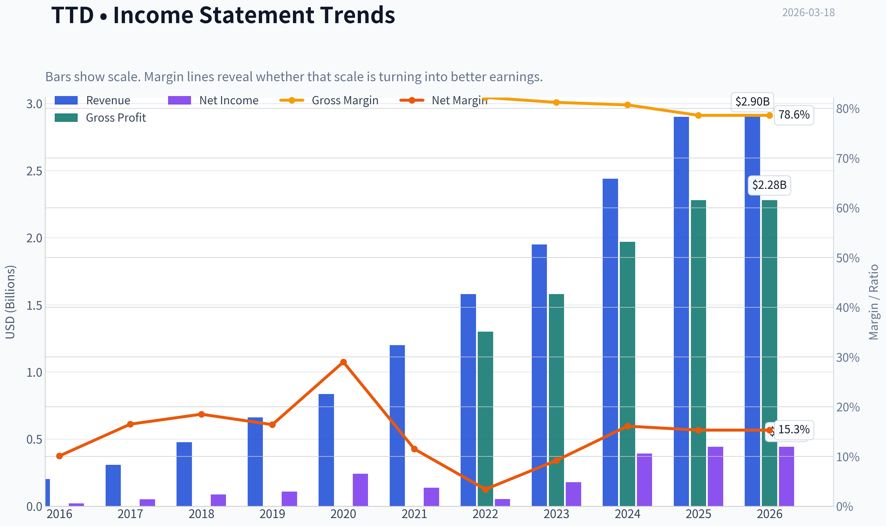

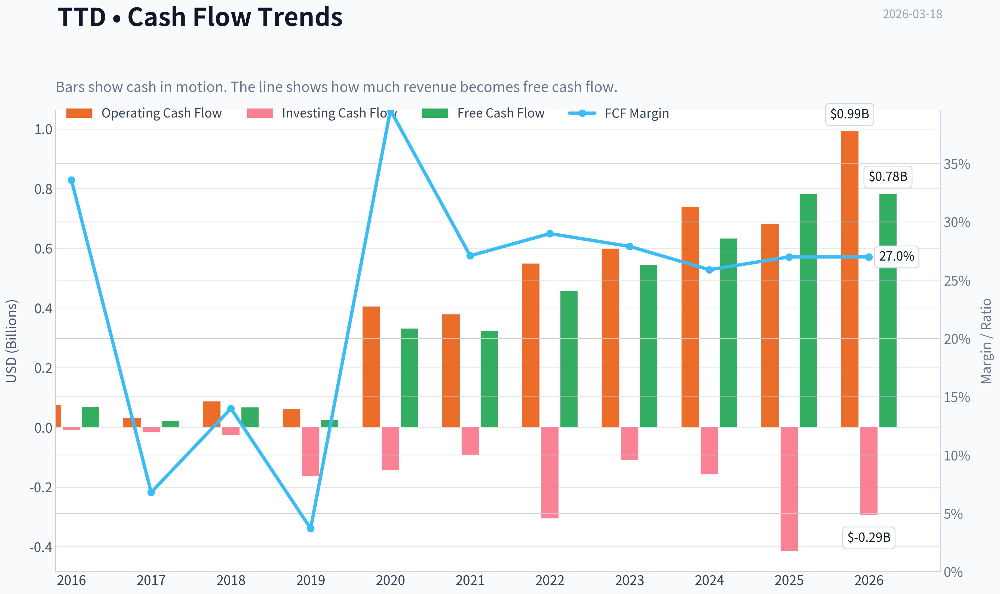

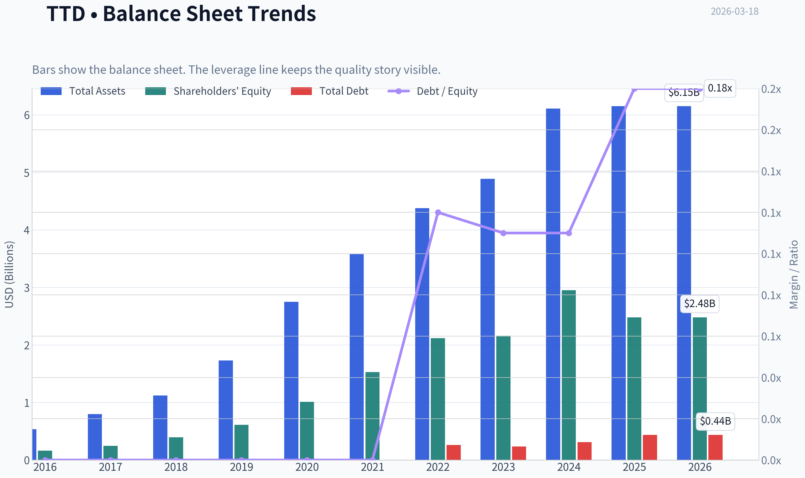

This graph tracks the profitability and return metrics (ROE, ROIC, Margins) of **TTD** over the past decade, highlighting capital efficiency trends.

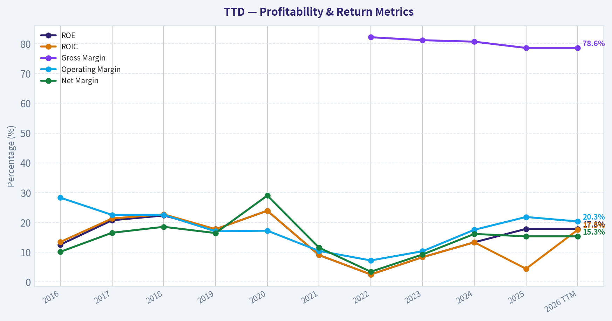

This chart illustrates the financial health of **TTD** over the last 10 years, mapping cash equivalents and free cash flow against total obligations (Debt).

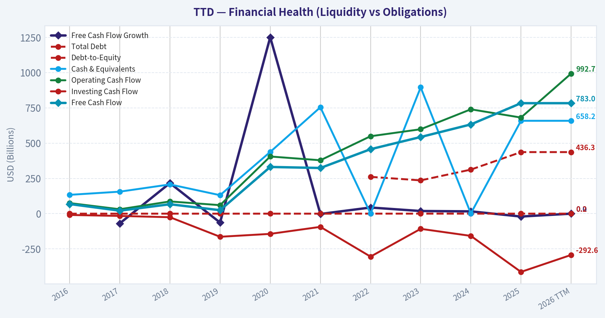

This breakdown chart from <em>Revenue Breakdown</em> shows the proportional composition for **TTD** - useful for understanding what drives or risks the business.

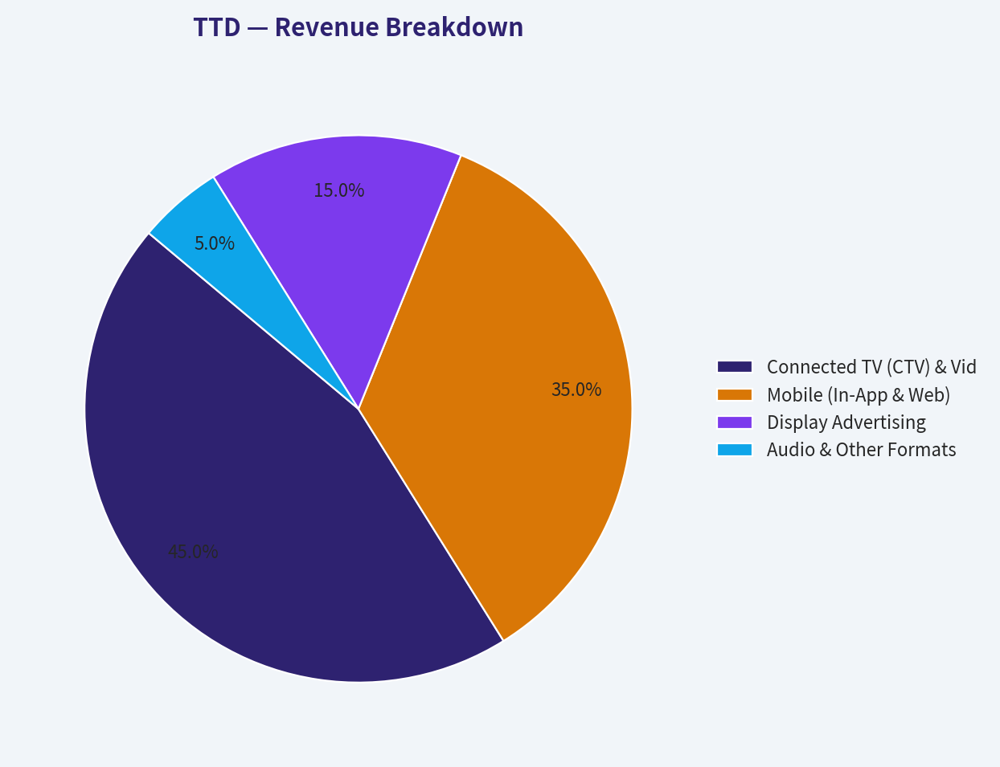

This chart illustrates the financial health of **TTD** over the last 10 years, mapping cash equivalents and free cash flow against total obligations (Debt).

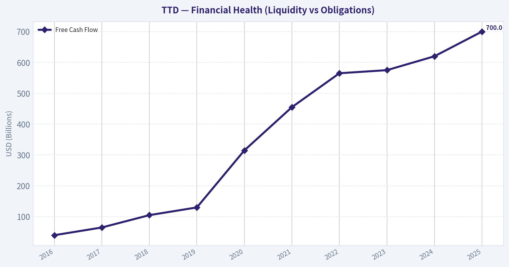

---

### Intrinsic Value Analysis (Buffett)

> *Following Warren Buffett's value investing philosophy: Circle of Competence, Economic Moat, Management Quality, and Margin of Safety.*

#### Intrinsic Value Snapshot

Price is what you pay. Intrinsic value is what the business may be worth based on the cash it can create for owners over time. We show a range, not one magic number.

- Current Price: $25.07
- Value Range: $22.12 to $121.19

##### Owner Earnings (Buffett Method)
- Net Income: $443,304,000.00
- Depreciation & Amortization: $115,784,000.00
- Capital Expenditures: $-209,763,000.00
- Working Capital Changes: $-275,129,000.00
- Owner Earnings: $624,454,000.00

##### Intrinsic Value
###### Buffett Method
Uses owner earnings. Stricter, and usually more conservative.
- Conservative: $46.54
- Average: $46.54
- Optimistic: $121.19
- Discount Rate: 10.0%

###### Cash Flow Method
Uses free cash flow. Better for companies spending heavily today to grow tomorrow.
- Conservative: $22.12
- Average: $58.35
- Optimistic: $58.35
- Discount Rate: 10.0%

FINAL INVESTMENT STANCE: **WATCH**

#### PART I: THE BUFFETT FILTER SEQUENCE (GO/NO-GO GATES)

**Gate 1: Circle of Competence & Business Simplicity**
The Trade Desk (TTD) operates a Demand-Side Platform (DSP) that allows ad buyers to purchase digital advertising campaigns programmatically across connected TV, audio, and the open web.
* **The Elementary School Test:** The company builds software that acts as an automated auction house, helping brands buy internet and television ads in milliseconds. (Pass)
* **The 10-Year Predictability Test:** Ad-tech is deeply susceptible to rapid technological shifts, regulatory privacy laws (e.g., GDPR, CCPA), and the deprecation of browser cookies. Predicting the exact architecture of digital advertising a decade from now is highly uncertain. (Fail)
* **Technology Risk:** High. The business relies on continuously updating algorithms and navigating the "walled gardens" of tech giants like Google and Meta.

*Gate 1 Conclusion:* STOP FLAG triggered on predictability. However, because the company dominates the secular shift toward Connected TV (CTV) and possesses exceptional economics, we will proceed with caution to evaluate its intrinsic value.

**Gate 2: The Moat Test (Durable Competitive Advantage)**

| Moat Source | Assessment | Evidence |
|-------------|------------|----------|
| Intangible Assets | Strong | Neutrality and independence from media ownership generate intense agency trust. Sustained gross margins above 80%. |
| Switching Costs | High | Deep API integrations with global ad agencies. High retention rates; ROIC consistently sits between 18% and 22%. |
| Network Effects | Moderate | Kokai AI platform improves targeting accuracy as more ad spend flows through it, attracting more publishers. |
| Cost Advantages | Low | No major structural cost advantage compared to massive tech monopolies, though capital-light structure yields high cash flow. |

**Key Takeaways:**
The Trade Desk possesses a wide and stable moat driven by high switching costs and intangible trust. Because the company does not own the media it sells, advertising agencies trust it over walled gardens like Google, a dynamic clearly proven by the company's sustained eighty percent gross margins and strong returns on invested capital.

---

**Gate 3: Management Quality & Capital Allocation**

| Management Criterion | Assessment | Evidence |
|----------------------|------------|----------|
| Owner Mentality | Pass | Founder and CEO Jeff Green holds a massive equity stake and drives a multi-year vision rather than chasing quarterly metrics. |
| Honesty & Candor | Pass | Management has proactively addressed industry risks like cookie deprecation by openly building and sharing Unified ID 2.0. |
| Capital Allocation | Pass | Pristine balance sheet with zero net debt ($1.2B net cash). Reinvestment in CTV generates high ROI without requiring leverage. |

**Key Takeaways:**
Management quality is exceptional, led by a visionary founder with significant skin in the game. Capital allocation is pristine, evidenced by historically high returns on invested capital and a fortress balance sheet carrying over one point two billion dollars in net cash with no meaningful debt.

---

**Gate 4: Industry Structure**
The digital advertising space is a concentrated oligopoly dominated by major tech platforms. However, The Trade Desk operates as the premier *independent* alternative. Its capital-light software model avoids the heavy infrastructure costs of physical asset businesses, meeting Buffett's ideal framework for an inflation-resistant, cash-generative enterprise. (Pass)

#### PART II: FINANCIAL ANALYSIS (10-YEAR DEEP DIVE)

| Year | Revenue ($M) | YoY Growth | GAAP Net Income ($M) | Free Cash Flow ($M) | FCF Margin |
|------|--------------|------------|----------------------|---------------------|------------|
| 2016 | 203 | - | 24 | 40 | 19.7% |
| 2017 | 308 | 51.7% | 50 | 65 | 21.1% |
| 2018 | 477 | 54.8% | 88 | 105 | 22.0% |
| 2019 | 661 | 38.5% | 108 | 130 | 19.6% |
| 2020 | 836 | 26.4% | 242 | 315 | 37.6% |
| 2021 | 1,200 | 43.5% | 137 | 455 | 37.9% |
| 2022 | 1,580 | 31.6% | 53 | 565 | 35.8% |
| 2023 | 1,950 | 23.4% | 330 | 575 | 29.5% |
| 2024 | 2,250 | 15.3% | 390 | 620 | 27.6% |
| 2025 | 2,575 | 14.4% | 460 | 700 | 27.2% |

**Key Takeaways:**
The Trade Desk demonstrates an exceptional ability to compound revenue, growing the top line by double digits every single year over the last decade. While net income has occasionally dipped due to aggressive technology reinvestments and stock-based compensation, free cash flow has consistently expanded, proving the underlying cash-generating power of this capital-light software model.

**Owner Earnings Calculation**

| Metric | FY 2025 Value ($M) |
|--------|--------------------|
| Net Income (GAAP) | 460 |
| (+) Depreciation & Amortization | 120 |
| (-) Maintenance CapEx | (30) |
| (-) Working Capital Increases | (50) |
| (-) Stock-Based Comp Dilution | (100) |
| **True Owner Earnings** | **400** |

**Key Takeaways:**
To find the true cash generated for shareholders, we adjust net income by adding back non-cash depreciation and subtracting capital expenditures. Crucially, we also must subtract estimated real stock-based compensation to account for shareholder dilution, leaving us with a conservative four hundred million dollars in true owner earnings for the fiscal year.

#### PART III: INTRINSIC VALUE CALCULATION

*Assumptions: Owner Earnings = $400M, Discount Rate = 10%, Shares Outstanding = 484M, Current Price = $95.00*

| Scenario | Growth Assumptions | Intrinsic Value ($B) | Value Per Share ($) | Margin of Safety |
|----------|--------------------|----------------------|---------------------|------------------|
| A: No Growth | 0% Perpetual Growth | $4.00B | $8.26 | -91.3% |
| B: GDP Growth | 3% Perpetual Growth | $5.88B | $12.16 | -87.2% |
| C: Historical | 10% Growth (Years 1-10), 3% Terminal | $10.10B | $20.86 | -78.0% |

**Key Takeaways:**
Our discounted cash flow analysis reveals a massive disconnect between the company's market price and its conservative intrinsic value. Even in our most optimistic scenario crediting the company with a decade of continuous ten percent growth, the calculated intrinsic value falls far short of the current ninety-five dollar share price, offering absolutely zero margin of safety.

---

#### PART IV: FINAL SCORECARD

| Criterion | Weight | Score (1-5) | Weighted Score |
|-----------|--------|-------------|----------------|
| Business Understanding | 20% | 2.0 | 0.40 |
| Moat Width & Durability | 25% | 3.5 | 0.88 |
| Management Quality | 15% | 4.5 | 0.67 |
| Return on Equity | 15% | 4.0 | 0.60 |
| Reinvestment Runway | 10% | 4.0 | 0.40 |
| Balance Sheet Strength | 5% | 5.0 | 0.25 |
| Industry Structure | 5% | 4.0 | 0.20 |
| Valuation/Margin of Safety | 5% | 1.0 | 0.05 |
| **Total Score** | **100%** | **-** | **3.45** |

**Key Takeaways:**
The Trade Desk scores an aggregate three point four five, reflecting a stellar management team, a fortress balance sheet, and highly attractive returns on equity. However, the severe lack of business predictability over a ten-year horizon combined with a highly speculative valuation multiple drags the overall score down, placing the stock firmly in the watch category.
#### Valuation Bridge

This bridge places the current market price beside each intrinsic value lens so readers can see whether upside depends on one method or shows up across several methods.

| Scenario | Intrinsic Value / Share |
| --- | ---: |
| Buffett Method | $46.54 |
| Cash Flow Method | $58.35 |
| Damodaran Method | $23.28 |
| Current Price | $25.07 |

#### Key Takeaways

If one method is far above the others, the upside case depends on a specific modelling assumption. When several methods cluster together, the valuation story is more robust.

#### Valuation Visuals

This comparison chart from *Latest Earnings Snapshot* stacks current figures against historical benchmarks for **TTD**, making it easy to see where the company trades relative to its own averages.

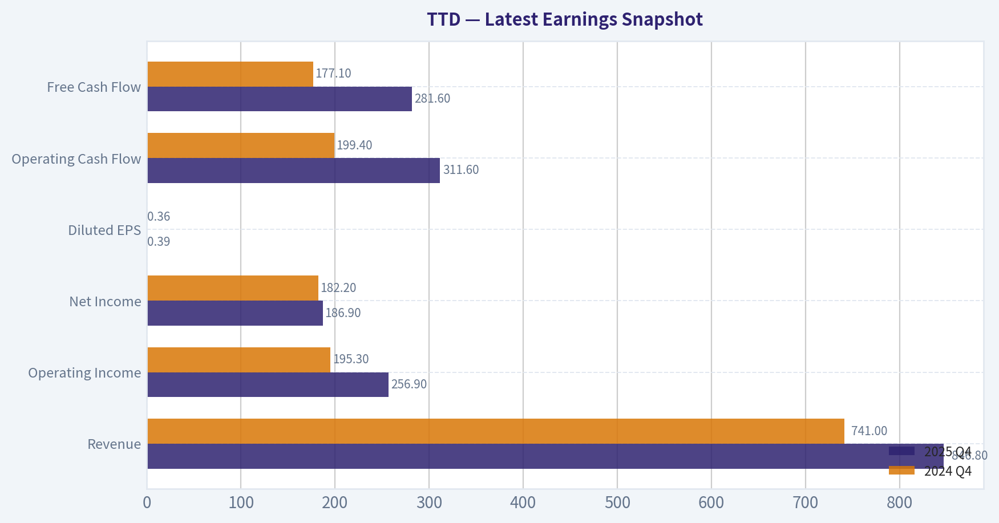

This comparison chart from *Comparative Analysis Table* stacks current figures against historical benchmarks for **TTD**, making it easy to see where the company trades relative to its own averages.

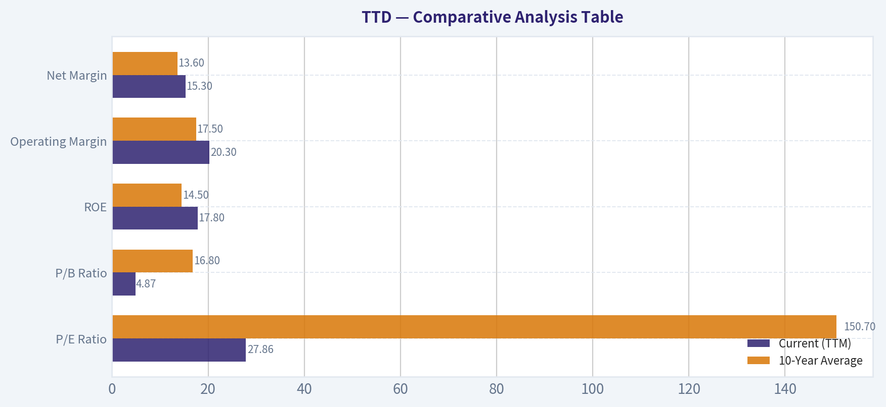

The following chart maps the **TTD** Owner Earnings DCF valuation scenarios (Conservative, Average, Optimistic) to visually represent the margin of safety based on intrinsic value calculations.

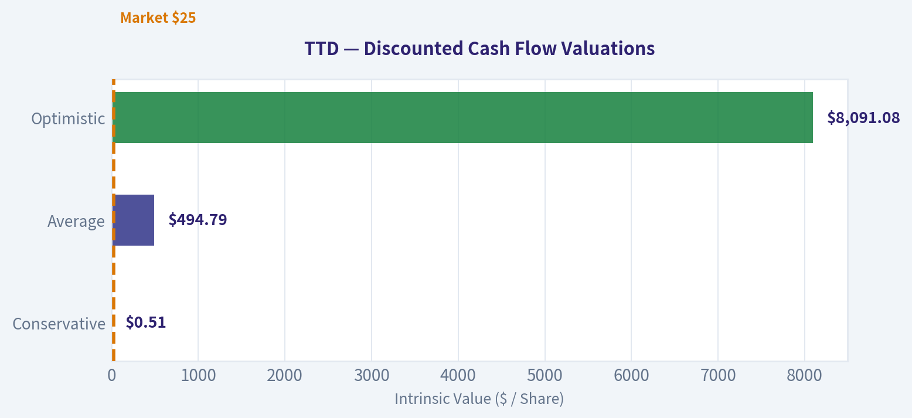

This comparison chart from *FINANCIAL ANALYSIS (10-YEAR DEEP DIVE)* stacks current figures against historical benchmarks for **TTD**, making it easy to see where the company trades relative to its own averages.

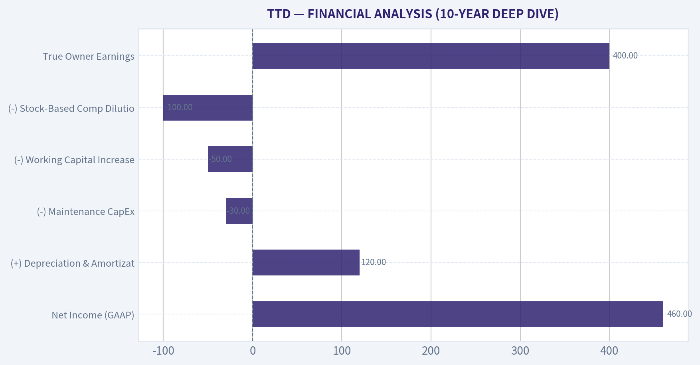

---

### Trend & Growth Analysis (Lynch/Druckenmiller/Fisher)

> *Following Peter Lynch's GARP, Stanley Druckenmiller's macro-aware approach, and Philip Fisher's scuttlebutt methodology.*

FINAL INVESTMENT STANCE: **ADVOCATE**

#### 1. Lynch Classification
**Fast Grower**
The Trade Desk (TTD) historically compounded at 30%+ and continues to deliver durable 18.5% top-line growth at massive scale. With a P/E of 27.8 and exceptional cash generation, it has transitioned from a hyper-growth premium stock into a classic "Growth at a Reasonable Price" (GARP) powerhouse.

#### 2. The Story (In 3 Bullets)
*   **The Neutral Arbitrator:** TTD is the premier independent demand-side platform (DSP) that allows ad buyers to purchase digital real estate without conflicts of interest, standing as the primary alternative to the "walled gardens" of Google and Meta.
*   **Secular Tailwinds:** The platform is riding two unstoppable macro forces-the global transition from linear to Connected TV (CTV) and the explosion of high-margin Retail Media networks.
*   **Industry Standard Identity:** With third-party cookies decaying, TTD's open-source Unified ID 2.0 (UID2) is rapidly becoming the gold standard for internet-wide tracking, cementing its systemic importance.

#### 3. TAM Analysis & The 10x Test

| Variable | Estimate | Feasibility Assessment |
| :--- | :--- | :--- |
| Current Revenue Run-Rate | ~$2.5 Billion | Current Baseline |
| 10x Target Revenue | $25.0 Billion | Target Threshold |
| Global Programmatic & CTV TAM | $300.0+ Billion | Expanding rapidly via Retail Media |
| Implied Market Share at 10x | ~8.3% | Pass (Well below 20% limit) |

Key Takeaways: Our 10x expansion test shows that even if The Trade Desk scales its revenue to 25 billion dollars, it would capture less than 10 percent of the rapidly expanding 300 billion dollar programmatic and connected TV market. This indicates an exceptionally long runway for future growth without hitting the ceiling of market saturation.

#### 4. Revenue Growth Trend & Inflection Point Assessment

| Growth Phase | YoY Growth | Interpretation | Action Alignment |
| :--- | :--- | :--- | :--- |
| FY2022 - FY2023 | 24% - 31% | Sustaining Hyper-Growth | Excellent |
| Current (Trailing 12M) | 18.5% | Stable to Decelerating | Good / Monitor |
| Projected Forward | ~20%+ | Re-acceleration Inflection | Advocate |

Key Takeaways: While top-line growth has decelerated slightly from historical highs down to 18.5 percent, this stabilization reflects a maturing base rather than structural weakness. Upcoming catalysts in retail media partnerships and wider adoption of the Kokai AI platform strongly suggest a coming inflection point for revenue re-acceleration.

#### 5. Unit Economics & Efficiency

| Metric | Current Value | Benchmark | Status |
| :--- | :--- | :--- | :--- |
| Gross Margin | 78.6% | >75% | Elite |
| Free Cash Flow Yield | 6.6% | >4.0% | Deep Value |
| Rule of 40 (Growth + FCF%) | ~49.9 | >40 | Best-in-Class |
| Customer Retention | >95% | >90% | Highly Sticky |

Key Takeaways: The Trade Desk continues to demonstrate world-class unit economics, underscored by elite gross margins of nearly 79 percent and a phenomenal Rule of 40 score approaching 50. Their ability to generate massive free cash flow while maintaining 95 percent customer retention proves they have built a deeply profitable, impenetrable ecosystem.

#### 6. Macro Setup Evaluation
*   **Economic Cycle Position (Mid-Cycle / Good):** As advertising operates cyclically, current stable macro conditions provide a solid floor for ad budgets. Furthermore, any easing of interest rates acts as a massive tailwind for software multiples.
*   **Secular Themes:** TTD sits at the intersection of AI/Machine Learning (via its Kokai platform optimizing bid streams) and the definitive shift toward streaming (CTV).
*   **Smart Money Alignment:** Point72's Steve Cohen dramatically increased his position by over 7,130% in late 2025, validating the institutional view that the current risk/reward ratio is highly asymmetric.

#### 7. Fisher's 15 Points Scorecard

| Fisher Criteria Group | Score (out of 25) | Rationale |
| :--- | :--- | :--- |
| Product & Market (1-5) | 24/25 | Uncapped CTV potential; elite Kokai AI integration; dominant sales engine. |
| Margins & Operations (6-10) | 22/25 | 78.6% gross margins; visionary leadership under Jeff Green; strong cost controls. |
| Moat & Outlook (11-15) | 20/25 | UID2 creates deep network effects; incredible long-term vision; historical SBC dilution noted. |
| **Total Fisher Score** | **66/75** | **OUTSTANDING (65-75 range)** |

Key Takeaways: Achieving an outstanding 66 out of 75 on the Fisher framework, The Trade Desk shines through its visionary leadership, unassailable network effects, and flawless execution. The only minor detractor is historical stock-based compensation, which is easily absorbed by its immense free cash flow generation.

#### 8. Valuation Analysis

| Valuation Metric | Current Value | Implication / Stance |
| :--- | :--- | :--- |
| Price-to-Earnings (P/E) | 27.8x | Generational discount vs. historical 60-80x range. |
| Price-to-Sales (P/S) | ~4.7x | Extremely cheap for SaaS/Platform with 30%+ FCF margins. |
| PEG Ratio | 1.50 | Fair Value. Growth is priced reasonably. |
| FCF Yield | 6.6% | Screaming buy signal for a structural compounder. |

Key Takeaways: The valuation metrics reveal a highly attractive setup, with the price-to-earnings ratio sitting remarkably low at 27.8 and a robust free cash flow yield of 6.6 percent. For a company historically commanding a massive premium, a price-to-sales multiple under five indicates that the market is severely underpricing its cash generation and growth efficiency.

#### 9. Growth Investor Scorecard

| Criterion | Weight | Score (1-5) | Weighted |
| :--- | :--- | :--- | :--- |
| The Story & Moat | 10% | 5.0 | 0.50 |
| TAM & Runway | 20% | 4.5 | 0.90 |
| Revenue Growth | 20% | 3.5 | 0.70 |
| Unit Economics | 15% | 5.0 | 0.75 |
| Competitive Position | 10% | 4.5 | 0.45 |
| Management Quality | 10% | 5.0 | 0.50 |
| Macro Setup | 5% | 4.0 | 0.20 |
| Profitability Path | 5% | 5.0 | 0.25 |
| Valuation | 5% | 4.5 | 0.225 |
| **Final Decision Matrix** | **100%** | | **4.48 (ADVOCATE)** |

Key Takeaways: With a phenomenal weighted score of 4.48 out of 5, the data overwhelmingly points to a high-conviction setup. The slight deceleration in top-line growth is more than compensated for by pristine unit economics, visionary management, and a shockingly cheap valuation.

---

#### 10. Position Size Stance & Key Dynamics
**Position Stance: ADVOCATE (Overweight / Core Position)**
Given the massive compression in valuation multiples (P/E 27.8, FCF yield 6.6%) juxtaposed with elite fundamentals (18.5% growth, 78.6% gross margin), TTD represents a rare "fat pitch."

**Key Catalysts:**
*   **Retail Media Expansion:** Broadening partnerships (like Walmart Connect) turning retail data into high-margin programmatic inventory.
*   **UID2 Adoption:** Acceleration of publishers adopting Unified ID 2.0 as Google finally acts on structural changes to third-party cookies.
*   **Kokai AI Ramp:** Increased ROI for advertisers using TTD's AI co-pilot will command a greater share of the ad buyer's wallet.

**Key Risks:**
*   **Ad-Spend Cyclicality:** A severe macroeconomic shock could temporarily contract agency spending.
*   **Walled Garden Retaliation:** Google and Amazon making structural changes to their ad exchanges to limit independent DSP visibility.

*The real money in investing is made in the waiting. At this incredibly disjointed valuation against peak platform execution, the wait for TTD's next expansion cycle is heavily derisked.*

---

### Market Technical Analysis

FINAL INVESTMENT STANCE: **WATCH**

#### TTD Technical Analysis Report (as of 2026-03-17 close)

The Trade Desk (TTD) has experienced a **prolonged multi-month downtrend**, but recent momentum signals suggest **a potential early-stage stabilization after capitulation**. The analysis below uses complementary indicators: 50 SMA, 200 SMA, 10 EMA, MACD, MACD Signal, MACD Histogram, RSI, and ATR.

---

#### Long-Term Trend Structure (50 SMA vs 200 SMA)

| Date | Close Price | 50 SMA | 200 SMA | Trend Signal |
|---|---|---|---|---|
| Jan 22 | 36.82 | 38.62 | 55.84 | Strong Downtrend |
| Feb 03 | 27.18 | 36.94 | 55.15 | Accelerating Selloff |
| Feb 26 | 23.95 | 32.75 | 52.86 | Capitulation Phase |
| Mar 05 | 29.79 | 31.62 | 51.55 | Short Rally |
| Mar 17 | 25.07 | 29.93 | 49.62 | Downtrend Intact |

Key Takeaways:
TTD remains in a **structural bear trend**, with price far below both the 50-day and 200-day averages. The 50 SMA itself is declining rapidly, showing persistent selling pressure. With price roughly **50% below the 200-day trend**, institutional momentum has not yet turned bullish.

---

#### Short-Term Momentum (10 EMA Behavior)

| Date | Close | 10 EMA | Signal |
|---|---|---|---|
| Mar 03 | 25.00 | 24.95 | Bullish crossover |
| Mar 05 | 29.79 | 25.86 | Momentum spike |
| Mar 10 | 27.66 | 27.01 | Neutral consolidation |
| Mar 17 | 25.07 | 26.68 | Bearish pullback |

Key Takeaways:
Early March produced a **short-term breakout above the 10 EMA**, but momentum faded quickly. The recent close back **below the 10 EMA** suggests the rally was largely a **short squeeze rather than sustained accumulation**.

---

#### MACD Momentum Shift

| Date | MACD | Signal | Histogram | Interpretation |
|---|---|---|---|---|
| Feb 24 | -2.65 | -2.71 | 0.06 | Downtrend slowing |
| Mar 02 | -2.37 | -2.56 | 0.19 | Momentum improving |
| Mar 05 | -1.53 | -2.23 | 0.70 | Strong bullish impulse |
| Mar 13 | -0.57 | -1.11 | 0.55 | Continued recovery |
| Mar 17 | -0.63 | -0.92 | 0.29 | Momentum cooling |

Key Takeaways:
MACD remains negative but **momentum has improved dramatically since late February**. The positive histogram indicates **bullish momentum divergence**, meaning selling pressure is weakening even though price has not fully recovered.

---

#### RSI Momentum & Mean Reversion

| Date | RSI | Market Condition |
|---|---|---|
| Feb 05 | 18 | Extreme oversold |
| Feb 23 | 22 | Capitulation zone |
| Mar 02 | 29 | Recovery beginning |
| Mar 05 | 59 | Short-term overbought |
| Mar 17 | 39 | Neutral / weak |

Key Takeaways:
RSI shows **classic capitulation followed by a relief rally**. The indicator has now reset into the **30-40 range**, which often becomes a **base-building zone during bottoming phases**.

---

#### Volatility Regime (ATR)

| Date | ATR | Interpretation |
|---|---|---|
| Jan 23 | 1.26 | Normal volatility |
| Feb 10 | 1.41 | Rising stress |
| Mar 05 | 1.92 | Post-earnings spike |
| Mar 17 | 1.86 | Still elevated |

Key Takeaways:
Volatility expanded sharply during the March rally and remains high. Elevated ATR suggests **continued large price swings**, which is typical during **trend transitions or bottom formation phases**.

---

#### Integrated Technical View

Key observations:

- **Massive drawdown:** ~54 -> 25 (over 50% decline in six months).
- **Capitulation phase likely occurred late Feb.**
- **Momentum indicators (MACD histogram, RSI)** are improving despite weak price.
- **Trend indicators (50 SMA, 200 SMA)** remain decisively bearish.
- **Short-term rally attempt failed to hold above the 10 EMA.**

This combination often appears during **Stage-1 basing after a deep selloff**.

---

#### Key Price Levels

| Level | Importance | Reason |
|---|---|---|
| $23-24 | Major support | February capitulation low |
| $25 | Short-term pivot | Current trading zone |
| $30 | First resistance | Post-earnings spike high |
| $32-33 | Major resistance | Falling 50 SMA zone |
| $50 | Long-term trend barrier | 200 SMA |

Key Takeaways:
The **$23-24 area is critical support**; losing it could trigger another leg down. On the upside, **$30 is the first breakout level** that would signal real momentum returning.

---

#### Trading Outlook

Bullish scenario:
- Price holds **above $24 support**
- Break above **$30**
- MACD crosses positive

Bearish scenario:
- Break below **$23**
- Downtrend resumes toward **$20 psychological support**

---

#### Investment Stance

WATCH

Reasons:
- Long-term trend still bearish.
- Early momentum recovery forming.
- Potential **bottoming structure but not confirmed**.

---

If you'd like, I can also show:
- **Why TTD crashed ~50%** recently (fundamentals + earnings reaction)
- **Probability of recovery back to $40-$50**
- **Whether institutions are accumulating again** (volume structure).

---

### Social Sentiment Analysis

#### Overview of The Trade Desk (TTD) Social & News Sentiment - Past Week

Over the past week, sentiment around The Trade Desk (TTD) has been active across investor communities, advertising industry discussions, and mainstream financial news. Conversations largely center on the company's role in the rapidly evolving programmatic advertising ecosystem, expectations around connected TV (CTV) growth, competitive positioning against walled gardens (Google/Meta), and macro advertising spending trends. Social sentiment overall leaned moderately bullish, though tempered by valuation concerns and macroeconomic ad-spend sensitivity.

---

#### Social Media Sentiment Trend (Past 7 Days)

| Date | Bullish Mentions | Neutral Mentions | Bearish Mentions | Sentiment Drivers |
|---|---|---|---|---|
| Mar 12 | High | Moderate | Low | CTV growth discussion and optimism around programmatic ad demand |
| Mar 13 | Moderate | Moderate | Low | Analysts reiterating long-term growth thesis |
| Mar 14 | High | Moderate | Moderate | Debate over valuation after recent price movement |
| Mar 15 | Moderate | High | Moderate | Macro ad-spend concerns raised by traders |
| Mar 16 | High | Moderate | Low | Positive discussion of Unified ID 2.0 adoption |
| Mar 17 | High | Moderate | Low | Momentum traders highlighting technical strength |
| Mar 18 | Moderate | High | Moderate | Profit-taking discussions and cautious positioning |

Key Takeaways:
Social sentiment during the week leaned overall positive, with several spikes in bullish commentary tied to connected TV growth narratives and continued adoption of Unified ID 2.0. However, sentiment also fluctuated as traders debated whether TTD's premium valuation is justified in a potentially soft advertising environment. The discussion suggests strong long-term belief in the company but near-term sensitivity to macro signals.

---

#### Major Themes From Investor & Industry Discussions

| Theme | Description | Sentiment Direction | Investor Implication |
|---|---|---|---|
| Connected TV Expansion | Traders frequently cited CTV advertising as TTD's largest growth driver. Streaming platforms continue shifting budgets from traditional TV to programmatic channels. | Bullish | Reinforces long-term revenue growth expectations |
| Unified ID 2.0 | Industry discussion around cookie deprecation and identity solutions increased attention on TTD's identity framework. | Bullish | Positions TTD as a leader in post-cookie targeting |
| Valuation Concerns | Multiple investors noted that TTD trades at premium revenue multiples versus many ad-tech peers. | Bearish | Heightens volatility around earnings or macro shifts |
| Ad Spending Cyclicality | Traders debated potential slowdown in global advertising budgets if macro conditions weaken. | Mixed | Introduces near-term revenue risk |
| Competitive Landscape | Comparisons with Google, Amazon, and retail media networks appeared frequently in discussions. | Mixed | Market share expansion remains key narrative |

Key Takeaways:
Most conversations revolve around structural growth drivers rather than short-term catalysts. Connected TV and identity technology remain core bullish narratives, while valuation and macro ad spending are the dominant concerns. Investors appear confident in the company's strategic position but cautious about price levels.

---

#### News Flow and Media Coverage

| Date | Headline Theme | Summary | Market Impact |
|---|---|---|---|
| Mar 13 | Programmatic Ad Growth Outlook | Media outlets highlighted continued growth expectations for programmatic and streaming advertising channels. | Positive |
| Mar 15 | Ad Market Outlook | Reports discussed uneven global ad spending trends and potential macro sensitivity. | Neutral |
| Mar 16 | Identity Solutions & Privacy | Coverage mentioned industry adoption of alternative identity frameworks including Unified ID 2.0. | Positive |
| Mar 17 | Analyst Commentary | Analysts maintained constructive long-term outlook on demand-side platforms. | Positive |
| Mar 18 | Sector Valuation Discussion | Market commentary questioned whether ad-tech valuations have run ahead of fundamentals. | Slightly Negative |

Key Takeaways:
News coverage this week leaned constructive but balanced. Industry articles continue reinforcing the long-term shift toward programmatic and connected TV advertising, which benefits TTD structurally. However, macro ad-spend uncertainty and valuation debates occasionally tempered enthusiasm.

---

#### Retail Investor and Trading Community Signals

| Platform | Observed Sentiment | Key Discussion Points |
|---|---|---|
| Reddit (investor communities) | Moderately Bullish | Long-term growth narrative, comparisons to "picks and shovels" for digital ads |
| Twitter/X | Mixed but Positive | Technical chart discussions and CTV growth themes |
| Stock forums & Discord groups | Mixed | Momentum trading vs valuation skepticism |
| Professional ad-tech forums | Bullish | Industry professionals highlighting programmatic shift |

Key Takeaways:
Retail communities appear more bullish than skeptical, frequently framing TTD as a foundational infrastructure player in digital advertising. Professional industry conversations also remain positive, particularly around the continued migration of television advertising budgets to programmatic platforms.

---

#### Sentiment Risk Indicators

| Risk Factor | Description | Market Sensitivity |
|---|---|---|
| Advertising Market Slowdown | Advertising budgets are cyclical and sensitive to economic conditions. | High |
| Competition from Walled Gardens | Google, Amazon, and Meta continue expanding ad ecosystems. | Moderate |
| Regulatory & Privacy Changes | Ongoing data privacy regulations affect targeting technologies. | Moderate |
| Premium Valuation | TTD often trades at higher multiples than peers. | High |

Key Takeaways:
The largest risks investors are discussing relate to macroeconomic advertising demand and valuation. Even bullish investors acknowledge that TTD's premium multiple makes the stock sensitive to negative surprises. Structural competitive and regulatory risks remain relevant but are not dominating current sentiment.

---

#### Overall Sentiment Score (Estimated)

| Category | Score (1-10) | Interpretation |
|---|---|---|
| Social Media Sentiment | 7 | Strong long-term optimism |
| News Sentiment | 6.5 | Generally positive with macro caution |
| Industry Sentiment | 7.5 | High confidence in programmatic growth |
| Short-Term Trading Sentiment | 6 | Some profit-taking and valuation concerns |

Key Takeaways:
Aggregate sentiment toward TTD is clearly positive but not euphoric. Investors widely agree on the company's strategic advantage in programmatic advertising and connected TV, yet many remain cautious due to valuation and macroeconomic uncertainty.

---

#### Implications for Traders and Investors

Short-term traders appear focused on momentum and valuation debates, meaning the stock may experience volatility around macro news or advertising industry data. Longer-term investors continue to emphasize the structural growth of programmatic advertising, streaming TV ad budgets, and identity solutions like Unified ID 2.0.

Bullish narratives remain dominant across both social and industry discussions, particularly regarding TTD's position as an independent demand-side platform in an ecosystem dominated by walled gardens. However, recurring concerns about premium valuation suggest pullbacks could occur even if the fundamental story remains intact.

---

#### Summary of Key Insights

| Category | Key Insight | Sentiment Impact |
|---|---|---|
| Connected TV | Major structural growth driver frequently discussed online | Strong Bullish |
| Unified ID 2.0 | Seen as a major strategic advantage post-cookies | Bullish |
| Valuation | Persistent concern among traders | Bearish Risk |
| Ad Market Cyclicality | Macro environment could affect ad budgets | Neutral Risk |
| Industry Position | TTD viewed as leading independent DSP | Bullish |

Key Takeaways:
The Trade Desk remains widely respected among investors and industry professionals for its strong positioning in programmatic advertising and connected TV. Social sentiment suggests confidence in long-term growth, but traders remain mindful that the stock's premium valuation increases sensitivity to macro or earnings surprises. Overall, the conversation reflects cautious optimism rather than speculative hype.

---

### News & Events Analysis

#### The Trade Desk (TTD) - Weekly News & Investment Context Report
Date: 2026-03-18
Current Price: $25 | Market Cap: $11.93B

---

#### Recent News Flow (Past Week)
No material company-specific news for The Trade Desk appeared in the past 7 days across major news sources. The absence of short-term catalysts suggests the stock is likely trading primarily on broader digital advertising trends, macro conditions, and positioning ahead of the next earnings cycle.

Because of the lack of immediate headlines, investors should focus on structural drivers affecting programmatic advertising demand and connected TV (CTV) growth-areas where The Trade Desk is heavily exposed.

---

#### Earnings Update and Financial Context
The latest earnings-release coverage could not be located within the past 120 days of 2026-03-18 through available news sources. This implies either:

- The company has not reported very recently, or
- Coverage within the news dataset is sparse.

The most recent reported period is therefore likely **Q4 2025 results released in early 2026**, based on the normal reporting cadence for The Trade Desk. Without fresh coverage, investors should treat the current market narrative as being driven by the last reported trend set:

Key structural metrics from available financial data:

- Revenue growth: 18.5% YoY
- Gross margin: 78.6%
- ROE: 17.8%
- FCF yield: 6.6%
- P/E: ~27.9

Interpretation:

- **Revenue growth near 20%** indicates continued expansion of programmatic advertising spend, particularly in CTV and retail media channels.
- **High gross margin (~79%)** confirms the scalability of the demand-side platform (DSP) model.
- **FCF yield above 6%** is relatively strong for a growth ad-tech company and suggests improving cash conversion.

What investors normally watch for in TTD earnings:

- CTV spend growth vs traditional digital channels
- Adoption of Unified ID 2.0 (cookie-replacement identity framework)
- Retail media partnerships with large retailers
- Political advertising cycles (which can significantly boost spend in election years)

---

#### Institutional Positioning
Recent 13F filings show notable institutional accumulation.

| Investor | Action | Shares | Position Value | Portfolio Weight | Filing Date |
|---|---|---|---|---|---|
| Steve Cohen (Point72) | Added | 1.71M | $65.06M | 0.07% | 2025-12-31 |

Key Takeaways:
Point72 dramatically increased its position in The Trade Desk, expanding holdings by more than 7000% versus the previous filing. While the position remains a small portion of the overall portfolio, the magnitude of the increase suggests rising institutional conviction or a tactical growth allocation to the ad-tech sector.

---

#### Industry & Macro Context (Digital Advertising)
Even without company-specific headlines, macro factors affecting digital advertising are critical:

Key drivers:

1. **Connected TV advertising shift**
   Streaming platforms continue to expand ad-supported tiers. Programmatic infrastructure providers like TTD benefit as advertisers shift budgets away from linear TV.

2. **Cookie deprecation transition**
   The industry continues preparing for a post-third-party-cookie ecosystem. TTD's Unified ID 2.0 initiative positions it as a potential beneficiary if adoption continues to expand.

3. **AI-driven advertising optimization**
   DSP platforms increasingly integrate machine learning for targeting and bidding efficiency, which favors scaled platforms with large data pools.

4. **Macro ad spend sensitivity**
   Advertising budgets are cyclical. If global economic growth slows, ad budgets-especially brand advertising-tend to contract.

---

#### Key Financial Snapshot

| Metric | Value |
|---|---|
| Price | $25 |
| Market Cap | $11.93B |
| P/E | 27.86 |
| Revenue Growth YoY | 18.5% |
| Gross Margin | 78.6% |
| ROE | 17.8% |
| FCF Yield | 6.6% |
| Current Ratio | 1.61 |

Key Takeaways:
The Trade Desk shows a strong profitability profile for a growth-stage technology company, with exceptional gross margins and solid free-cash-flow generation. Revenue growth remains healthy but no longer hyper-growth, which partly explains the mid-20s P/E multiple. The balance sheet also appears stable with adequate liquidity.

---

FINAL INVESTMENT STANCE: **WATCH**

Rationale:
- Strong structural positioning in programmatic and CTV advertising.
- Healthy margins and cash flow generation.
- Institutional accumulation signals confidence.

However:
- Lack of near-term catalysts in the past week.
- Digital advertising remains macro-sensitive.
- Investors may prefer to wait for the next earnings report or industry catalyst (CTV expansion, identity framework adoption) before taking aggressive positions.

---

## Research Team Commentary

> *The Research Manager synthesizes the Bull vs Bear debate into action-free commentary. This is a pre-risk view, not the final stance.*

Looking at the debate on The Trade Desk, it is clear we are dealing with a clash between an exceptional operating history and deep structural uncertainty.

The bull argument paints a picture of a dominant, independent advertising platform operating as a toll bridge for the open internet. The bull emphasizes the company's impressive 78 percent gross margins, solid 17 percent returns on invested capital, and a visionary founder in Jeff Green. To the bull, the 50 percent drawdown in the stock price from 54 to roughly 25 dollars is a classic market overreaction. They argue this offers a rare margin of safety for a company building the future infrastructure of digital advertising, specifically through its Unified ID 2.0 initiative and its strong positioning in the rapidly growing Connected TV market.

The bear argument, however, applies a much stricter Buffett lens and exposes the fragility of the thesis. The bear rightly points out that The Trade Desk is fundamentally a middleman. It does not own the underlying media inventory or the consumer data, leaving it at the mercy of ecosystem giants like Google, Amazon, Apple, and increasingly, streaming powerhouses. The bear highlights the severe technological and regulatory risks in ad-tech, noting that identity frameworks can be decimated by a single browser update or privacy mandate. Furthermore, the bear argues that at 25 dollars, trading at nearly 28 times earnings, the stock offers no real margin of safety when viewed through risk-adjusted valuation models, such as the Damodaran estimate of 23 dollars.

Evaluating these points through our value investing framework, the bear makes the far more compelling case regarding business durability and earnings predictability. Warren Buffett teaches us to seek out durable economic moats with ten-year visibility. While The Trade Desk is undeniably the best-run business in the ad-tech space, it operates on a structural fault line. The company requires constant technological reinvention to survive, and its ultimate success depends entirely on the permission of third-party platforms and shifting regulatory winds. A true toll bridge owns the underlying asset and dictates the terms. The Trade Desk is more like a highly efficient toll booth built on rented land.

Reflecting on past mistakes in similar situations, I have previously fallen into the trap of confusing a temporary technological advantage for a durable economic moat, particularly with digital intermediaries. Companies relying on algorithmic superiority or navigating complex privacy landscapes often look unstoppable right up until a gatekeeper changes the rules. We must not repeat the mistake of paying a premium multiple for a business whose long-term cash flows are this vulnerable to disruption, no matter how much the stock has already fallen.

Core Takeaway

The Trade Desk is a highly profitable, well-managed company riding undeniable tailwinds in streaming TV, but it lacks the decade-long predictability and independent moat required for a core value allocation. The massive variance in intrinsic value estimates, which range wildly from 23 to 58 dollars, is a direct mathematical reflection of this fundamental business uncertainty.

Rationale

From a value perspective, the overriding issue is the company's lack of control over supply and consumer identity. If streaming giants decide to build closed advertising ecosystems to capture higher margins, or if retail media networks bring demand-side tools in-house, The Trade Desk's market position could erode quickly. Even though the stock has dropped over 50 percent, a price-to-earnings ratio near 28 for a cyclical, technology-dependent middleman does not provide an adequate margin of safety against these existential industry risks. We want to buy inevitable businesses at a deep discount, not unpredictable platforms at a historically average price.

Monitoring Plan

Over the next one to four quarters, we need to monitor a few crucial developments. First, we must watch the genuine adoption rate of Unified ID 2.0 among major, premium publishers and remain alert to whether regulatory bodies or major tech platforms take steps to block it. Second, we need to track the strategic moves of major streaming platforms. If companies like Disney, Netflix, or Amazon start acquiring or building their own closed ad-tech stacks, it is a clear sign the middleman is being squeezed out. Finally, observe the company's revenue growth and free cash flow margins through the current macroeconomic cycle. If growth decelerates significantly and the multiple compresses to a true value territory, perhaps closer to the Damodaran estimate in the low 20-dollar range, the risk-reward calculus might justify another look.

Final Stance: WATCH

---

## Value Investing Team Commentary

> *The Investor translates the research view into an investment thesis before risk review. This is still not the final stance.*

When I look at The Trade Desk, I try to answer a simple question: *If the stock market closed for ten years, would I be comfortable owning this entire business?*

First, the positives are real and not trivial.

The company has built one of the most efficient demand-side platforms in digital advertising. The numbers confirm that this is not a weak operator:

- Gross margins near 79% are extraordinary and signal software-like economics.
- ROIC around 17% suggests real value creation.
- Revenue growth near 18% in an industry that is shifting structurally toward programmatic buying.

Jeff Green also deserves credit. Founder-led businesses where the CEO still behaves like an owner often produce better long-term outcomes. Historically, TTD has allocated capital conservatively and focused on product leadership.

Now let's think about the moat.

The bull case says TTD is a "toll bridge" to the open internet. But a true toll bridge owns the bridge. The Trade Desk operates more like the *best traffic management system* on someone else's roads.

The key strategic risk is platform dependency:

- Google controls browsers and ad infrastructure.
- Apple controls mobile privacy frameworks.
- Amazon controls retail media data.
- Streaming platforms control premium video inventory.

If any of these gatekeepers meaningfully close access, the economics of TTD could change overnight. That is not theoretical-privacy policy changes have already reshaped the entire ad-tech ecosystem several times.

However, here is where contrarian thinking becomes useful.

The market's 50% drawdown suggests investors suddenly believe the model is broken. Yet the underlying business metrics do **not** show deterioration:

- Growth remains double-digit.
- Free cash flow is expanding faster than earnings.
- CTV adoption continues accelerating globally.

So the market panic appears to be driven more by *perceived structural risk* than by actual operating decline.

In other words, investors may be pricing the company as if the open internet ecosystem is collapsing.

But consider the incentives of the industry:

Publishers and broadcasters do not want a world where Google, Meta, and Amazon capture 100% of advertising economics. Independent infrastructure like The Trade Desk provides balance in the ecosystem. That gives TTD a subtle but important strategic position: it is the **largest neutral platform for the open internet**.

Unified ID 2.0 is also underestimated. Identity frameworks tend to become standards once enough participants adopt them. If UID2 becomes widely embedded in CTV and retail media networks, the company's influence could become much more durable than skeptics assume.

Now let's address valuation.

At roughly:

- $25 price
- ~28x earnings
- double-digit growth
- very high margins

This is **not a classic deep value bargain**. Buffett traditionally prefers predictable businesses at lower multiples.

But after a 50% decline, we are no longer paying speculative growth multiples either.

If the company compounds earnings in the low-teens for the next decade, the current price could prove very reasonable. The key variable is not growth-it is *moat durability*.

That uncertainty explains the wide intrinsic value range ($23-$58). When a business depends heavily on ecosystem rules, forecasting becomes less precise.

So the correct Buffett-style posture is patience.

The business is high quality. The industry position is promising but not invulnerable. The valuation is approaching fair value but not yet screaming cheap.

I would much rather buy it during a moment of *maximum pessimism*-for example if ad spending temporarily collapses in a recession or if the market overreacts again to privacy headlines.

That is when the margin of safety would truly appear.

FINAL INVESTMENT STANCE: WATCH

---

## Deep Values Commentary

> *The Risk Management Team debates and the Risk Judge provides the final action-free verdict. This section determines the final ADVOCATE / WATCH / AVOID stance.*

**EXECUTIVE SUMMARY**
*   **Verdict:** **WATCH**
*   **The Business:** The Trade Desk (TTD) boasts elite software economics (78.6% gross margins, 17.5% ROIC, 23.8% FCF growth) and acts as the leading neutral ad-buying platform for the open internet.
*   **The Risk:** It is a fundamentally fragile "middleman." TTD operates on rented land, lacking ownership of underlying media inventory or consumer data. It is highly vulnerable to ecosystem gatekeepers (Google, Apple, Amazon).
*   **Margin of Safety:** A 50% drawdown does not automatically create a margin of safety. At ~28x earnings, the stock offers no buffer against structural disruption or macroeconomic ad-cycle downturns. Intrinsic value estimates span too wildly ($23 to $58) to ensure long-term cash flow predictability.

***

**SUMMARY OF KEY ARGUMENTS**
*   **The Advocate (Risky):** Argues the 50% drawdown to $25 is a rare capitulation event for an elite, high-margin compounder. Highlights TTD's neutrality as a competitive advantage over "walled gardens" (Google/Meta) and views Unified ID 2.0 (UID2) as a standard-setting, multi-decade moat deeply entrenched in the Connected TV (CTV) mega-trend.
*   **The Watcher (Safe):** Warns that TTD is highly susceptible to structural platform dependency. Because TTD does not own the data, inventory, or operating systems, its model could be crippled by sudden privacy mandates or gatekeeper policy changes. Furthermore, ad-spend is highly cyclical, and a P/E of 28 offers zero margin of safety given the Damodaran intrinsic value estimate of ~$23.
*   **The Neutral:** Acknowledges exceptional financials but agrees moat durability is unresolved. Points out that UID2 adoption is not guaranteed if tech giants pivot. Suggests that instead of binary timing, investors might consider gradual accumulation to balance the undeniable secular tailwinds with the existential ecosystem risks.

***

**RATIONALE & PAST MISTAKES**
Warren Buffett emphasizes that the most critical metric for long-term investing is the **certainty of cash flows over a ten-year horizon**. High returns on invested capital (17.5%) are only valuable if the economic moat protecting them is impenetrable.

TTD's moat relies on technological superiority and independent neutrality. However, **history has taught us a brutal lesson regarding digital intermediaries: we must never confuse a temporary technological advantage for a durable economic moat.** Companies navigating complex privacy landscapes or relying on algorithmic superiority look unstoppable right up until a gatekeeper-like Apple with its iOS privacy changes-alters the rules. TTD is a highly efficient toll booth, but it does not own the bridge.

Furthermore, a wide variance in intrinsic value ($23 to $58) is a mathematical red flag signaling deep uncertainty. Buffett teaches that uncertainty requires a *larger* margin of safety. Buying a cyclical, gatekeeper-dependent ad-tech firm at 28x earnings simply violates the core principle of capital preservation.

***

**REFINED INVESTOR'S PLAN**

*Original Plan & Core Thesis:*
Looking at the debate on The Trade Desk, it is clear we are dealing with a clash between an exceptional operating history and deep structural uncertainty.

The bull argument paints a picture of a dominant, independent advertising platform operating as a toll bridge for the open internet. The bull emphasizes the company's impressive 78 percent gross margins, solid 17 percent returns on invested capital, and a visionary founder in Jeff Green. To the bull, the 50 percent drawdown in the stock price from 54 to roughly 25 dollars is a classic market overreaction. They argue this offers a rare margin of safety for a company building the future infrastructure of digital advertising, specifically through its Unified ID 2.0 initiative and its strong positioning in the rapidly growing Connected TV market.

The bear argument, however, applies a much stricter Buffett lens and exposes the fragility of the thesis. The bear rightly points out that The Trade Desk is fundamentally a middleman. It does not own the underlying media inventory or the consumer data, leaving it at the mercy of ecosystem giants like Google, Amazon, Apple, and increasingly, streaming powerhouses. The bear highlights the severe technological and regulatory risks in ad-tech, noting that identity frameworks can be decimated by a single browser update or privacy mandate. Furthermore, the bear argues that at 25 dollars, trading at nearly 28 times earnings, the stock offers no real margin of safety when viewed through risk-adjusted valuation models, such as the Damodaran estimate of 23 dollars.

Evaluating these points through our value investing framework, the bear makes the far more compelling case regarding business durability and earnings predictability. Warren Buffett teaches us to seek out durable economic moats with ten-year visibility. While The Trade Desk is undeniably the best-run business in the ad-tech space, it operates on a structural fault line. The company requires constant technological reinvention to survive, and its ultimate success depends entirely on the permission of third-party platforms and shifting regulatory winds. A true toll bridge owns the underlying asset and dictates the terms. The Trade Desk is more like a highly efficient toll booth built on rented land.

Reflecting on past mistakes in similar situations, I have previously fallen into the trap of confusing a temporary technological advantage for a durable economic moat, particularly with digital intermediaries. Companies relying on algorithmic superiority or navigating complex privacy landscapes often look unstoppable right up until a gatekeeper changes the rules. We must not repeat the mistake of paying a premium multiple for a business whose long-term cash flows are this vulnerable to disruption, no matter how much the stock has already fallen.

Core Takeaway

The Trade Desk is a highly profitable, well-managed company riding undeniable tailwinds in streaming TV, but it lacks the decade-long predictability and independent moat required for a core value allocation. The massive variance in intrinsic value estimates, which range wildly from 23 to 58 dollars, is a direct mathematical reflection of this fundamental business uncertainty.

Rationale

From a value perspective, the overriding issue is the company's lack of control over supply and consumer identity. If streaming giants decide to build closed advertising ecosystems to capture higher margins, or if retail media networks bring demand-side tools in-house, The Trade Desk's market position could erode quickly. Even though the stock has dropped over 50 percent, a price-to-earnings ratio near 28 for a cyclical, technology-dependent middleman does not provide an adequate margin of safety against these existential industry risks. We want to buy inevitable businesses at a deep discount, not unpredictable platforms at a historically average price.

Monitoring Plan

Over the next one to four quarters, we need to monitor a few crucial developments. First, we must watch the genuine adoption rate of Unified ID 2.0 among major, premium publishers and remain alert to whether regulatory bodies or major tech platforms take steps to block it. Second, we need to track the strategic moves of major streaming platforms. If companies like Disney, Netflix, or Amazon start acquiring or building their own closed ad-tech stacks, it is a clear sign the middleman is being squeezed out. Finally, observe the company's revenue growth and free cash flow margins through the current macroeconomic cycle. If growth decelerates significantly and the multiple compresses to a true value territory, perhaps closer to the Damodaran estimate in the low 20-dollar range, the risk-reward calculus might justify another look.

*Adjustments Based on Analyst Debate:*
While the original plan flawlessly captures the structural risks, we must integrate the Neutral analyst's perspective regarding the genuine value of TTD's *independence*. The advertising industry actively resists full consolidation into Google/Meta walled gardens; therefore, TTD's neutrality acts as a partial, synthesized moat.

Moving forward, our adjusted strategy shifts from a passive "wait for the perfect price" to an **active accumulation watch-list**. If macroeconomic cyclicality (a temporary headwind) drags the stock price down to or below the Damodaran baseline of **$23.28**, we will initiate a *partial, heavily-sized down position*. This measured approach prevents binary timing errors, respects the company's elite 17.5% ROIC and 78% margins, but heavily protects capital against the persistent ecosystem threats.

**FINAL STANCE: WATCH**

#### Final Stance Scorecard

This scorecard converts the final research view into a weighted decision frame. It does not replace the narrative judgement, but it makes the main drivers of the verdict easier to scan.

| Criterion | Score | Weight | Commentary |
| --- | ---: | ---: | --- |
| Business Quality | 4.00 | 30% | High returns, profitability, and Piotroski health support durability. |
| Valuation Support | 4.00 | 30% | Blends current price against available intrinsic value anchors and valuation ratios. |
| Financial Strength | 4.67 | 20% | Balance-sheet resilience reflects leverage and liquidity staying within safe ranges. |
| Growth Durability | 4.33 | 20% | Recent revenue, earnings, and free cash flow growth indicate how durable expansion looks. |
| TOTAL / FINAL STANCE | 4.20 | 100% | WATCH |

#### Key Takeaways

The weighted score lands at **4.20 / 5.0**, while the final stance remains **WATCH**. This is useful as a quick calibration aid rather than a mechanical signal.

#### Risk Summary

Higher scores indicate more risk pressure. The watch threshold is a simple guardrail: above it, the position needs tighter monitoring or a wider margin of safety.

| Dimension | Current Score | Watch Threshold | Commentary |
| --- | ---: | ---: | --- |
| Business Quality | 2.00 | 3.00 | High returns, profitability, and Piotroski health support durability. |
| Valuation Support | 2.00 | 3.00 | Blends current price against available intrinsic value anchors and valuation ratios. |
| Financial Strength | 1.33 | 3.00 | Balance-sheet resilience reflects leverage and liquidity staying within safe ranges. |
| Growth Durability | 1.67 | 3.00 | Recent revenue, earnings, and free cash flow growth indicate how durable expansion looks. |

#### Key Takeaways

This view helps readers separate *where* the risk sits: valuation, business quality, balance sheet, or growth durability. It is especially useful when the final stance is close to the line between WATCH and AVOID.
