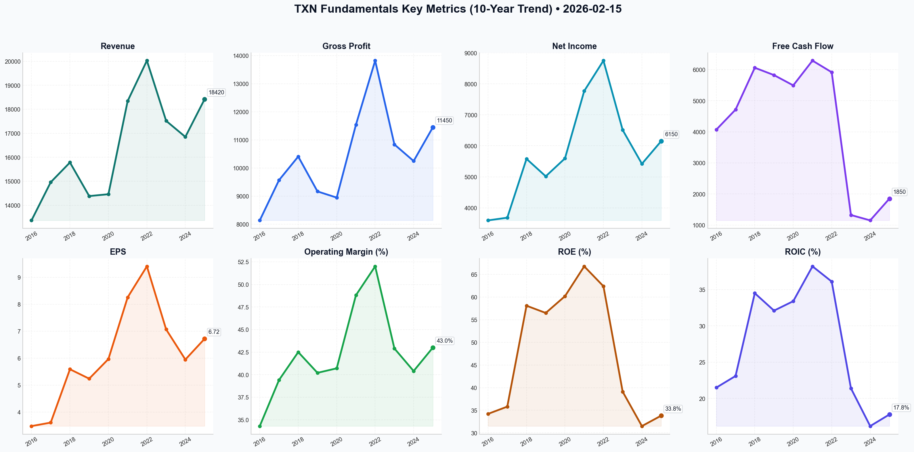

# TXN Deep Value Intelligence

**Analysis Date:** 2026-02-15
**Generated:** 2026-02-16 11:52:34

---

## Table of Contents

1. [Intelligence Summary](#intelligence-summary)
2. [Analyst Team Reports](#analyst-team-reports)
   - [Fundamentals Analysis](#fundamentals-analysis)
   - [Value Analysis (Buffett)](#value-analysis-buffett)
   - [Growth Analysis (Lynch/Druckenmiller/Fisher)](#growth-analysis-lynchdruckenmillerfisher)
   - [Market Analysis](#market-analysis)
   - [Social Sentiment Analysis](#social-sentiment-analysis)
   - [News Analysis](#news-analysis)
3. [Research Team Commentary](#research-team-commentary)
4. [Investing Team Commentary](#investing-team-commentary)
5. [Deep Values Commentary](#deep-values-commentary)

---

## Intelligence Summary

### Thesis + Conditions

**Core Thesis:** Here is my synthesis of the debate and my evaluation based on our value investing framework.

**Key Risks:**
- The Bull (Risky Analyst)** views TXN as a **"Coiled Spring."** They argue that the high P/E (33x) is misleading because earnings are at a cyclical trough. Their core thesis is that the heavy CapEx cycle is ending ("harvest phase"), and the shift to 300mm wafers provides a structural **"40% cost advantage"** that will crush competitors. They view the stock as a "toll bridge" for the electrification of the economy.
- The Bear (Safe Analyst)** views TXN as **"Priced for Perfection."** They argue that the valuation is **37% higher than the 10-year average** and that the shift to an asset-heavy model introduces high fixed-cost risks (the **"suicide lever"**). They believe the market is ignoring the reality of high interest rates and the "China Drift" (local substitution), creating zero margin of safety.
- The Structural Pivot (Business Risk):** The Bull dismisses the ROIC drop (38% to 17%) as a **"rearview-mirror metric."** I disagree. This metric quantifies the efficiency of capital. TXN is currently capital-inefficient. While this may improve as fabs come online, the *risk* has permanently increased because TXN is no longer "capital light." They must now keep massive factories running to cover depreciation.
- The "China Drift":** The Bull claims the EV/ADAS transition is a "locked-in" revenue stream. The Bear counters effectively with the **"China Drift"** argument. If Chinese domestic competitors (subsidized by their state) take market share in the low-end analog chips, TXN’s new factories may struggle to find volume. This is a specific business risk that the current stock price ignores.
- I have updated your plan to specifically monitor the "Utilization" metric and refined the entry targets based on the debate.

**What Would Change Our View:**
- The Bull (Risky Analyst)** views TXN as a **"Coiled Spring."** They argue that the high P/E (33x) is misleading because earnings are at a cyclical trough. Their core thesis is that the heavy CapEx cycle is ending ("harvest phase"), and the shift to 300mm wafers provides a structural **"40% cost advantage"** that will crush competitors. They view the stock as a "toll bridge" for the electrification of the economy.
- The Bear (Safe Analyst)** views TXN as **"Priced for Perfection."** They argue that the valuation is **37% higher than the 10-year average** and that the shift to an asset-heavy model introduces high fixed-cost risks (the **"suicide lever"**). They believe the market is ignoring the reality of high interest rates and the "China Drift" (local substitution), creating zero margin of safety.
- The Structural Pivot (Business Risk):** The Bull dismisses the ROIC drop (38% to 17%) as a **"rearview-mirror metric."** I disagree. This metric quantifies the efficiency of capital. TXN is currently capital-inefficient. While this may improve as fabs come online, the *risk* has permanently increased because TXN is no longer "capital light." They must now keep massive factories running to cover depreciation.
- The "China Drift":** The Bull claims the EV/ADAS transition is a "locked-in" revenue stream. The Bear counters effectively with the **"China Drift"** argument. If Chinese domestic competitors (subsidized by their state) take market share in the low-end analog chips, TXN’s new factories may struggle to find volume. This is a specific business risk that the current stock price ignores.
- I have updated your plan to specifically monitor the "Utilization" metric and refined the entry targets based on the debate.

**Confidence:** Medium

### Stance Spectrum (Action-Free)

**Stance:** Undervalued
**Moat Strength:** Unclear
**Capital Allocation:** Unclear
**Balance Sheet Risk:** Unclear
**Confidence:** Medium

### Expanded Commentary

Here is my synthesis of the debate and my evaluation based on our value investing framework.

### The Debate in Summary

The debate centers on whether Texas Instruments’ high valuation is a precursor to a massive payoff or a warning sign of capital destruction.

*   **The Bull (Risky Analyst)** views TXN as a **"Coiled Spring."** They argue that the high P/E (33x) is misleading because earnings are at a cyclical trough. Their core thesis is that the heavy CapEx cycle is ending ("harvest phase"), and the shift to 300mm wafers provides a structural **"40% cost advantage"** that will crush competitors. They view the stock as a "toll bridge" for the electrification of the economy.
*   **The Bear (Safe Analyst)** views TXN as **"Priced for Perfection."** They argue that the valuation is **37% higher than the 10-year average** and that the shift to an asset-heavy model introduces high fixed-cost risks (the **"suicide lever"**). They believe the market is ignoring the reality of high interest rates and the "China Drift" (local substitution), creating zero margin of safety.
*   **The Neutral Analyst** advocates for a **"Staged Entry,"** suggesting that both extremes are wrong. They acknowledge the premium is rich but argue that U.S.-based supply chains warrant a quality premium. They suggest buying at technical support levels ($211-$218) rather than waiting for a crash that may not come.

***

### The Verdict

While the business quality is undeniable, the math does not support an investment at current levels. The Bull demands we pay for the "harvest" before the crops have even grown, while the Bear correctly identifies that the "asset-heavy" pivot increases the penalty for low utilization. The Neutral approach—buying a "rich" valuation to avoid missing out—is a violation of the Margin of Safety principle. We will wait for the price to disconnect from the "perfection" narrative.

***

### Investor Commentary

**Core Takeaway: Fixed Costs Cut Both Ways.**
The most critical insight from this debate is the tension between the Bull’s "cost advantage" and the Bear’s "fixed cost hammer." The Bull is correct that *if* the factories are full, TXN wins. But the Bear is correct that *if* utilization drops, the new asset-heavy model will punish margins more severely than in the past. At 33x earnings, the market is pricing in 100% utilization. We are not paid to take that bet.

**Rationale: Applying the Framework**

*   **Valuation vs. Quality:** The Neutral analyst argues for a "quality premium," and I agree TXN deserves one. However, a premium is 20-22x earnings, not 33x. The Bear notes we are trading **"17 percent above the 50-day SMA"** and far above the 10-year average. As value investors, we know that buying a great business at 33x often leads to a decade of flat returns (the "time correction").
*   **The Structural Pivot (Business Risk):** The Bull dismisses the ROIC drop (38% to 17%) as a **"rearview-mirror metric."** I disagree. This metric quantifies the efficiency of capital. TXN is currently capital-inefficient. While this may improve as fabs come online, the *risk* has permanently increased because TXN is no longer "capital light." They must now keep massive factories running to cover depreciation.
*   **The "China Drift":** The Bull claims the EV/ADAS transition is a "locked-in" revenue stream. The Bear counters effectively with the **"China Drift"** argument. If Chinese domestic competitors (subsidized by their state) take market share in the low-end analog chips, TXN’s new factories may struggle to find volume. This is a specific business risk that the current stock price ignores.

**Refined Investor Plan:**

I have updated your plan to specifically monitor the "Utilization" metric and refined the entry targets based on the debate.

**[{'type': 'text', 'text': 'Here is my synthesis of the debate and my evaluation based on our value investing framework.\n\n### The Debate in Summary\n\nThe **Bull** argues that Texas Instruments (TXN) is exiting a heavy investment cycle and entering a "harvest phase." They posit that the transition to 300mm wafer manufacturing creates a structural 40% cost advantage (a widening moat) and that the current depression in Free Cash Flow (FCF) is a temporary, deliberate choice. They view the $226 price as fair for a high-quality compounder about to see cash flows explode.\n\nThe **Bear** argues that TXN has fundamentally degraded its business quality by shifting from an asset-light to an asset-heavy model, evidenced by ROIC collapsing from 38% to ~17%. They contend that at 33x earnings, the market has priced in a flawless recovery while ignoring the risks of fixed-cost leverage ("suicide lever") and the geopolitical erosion of its Chinese market.\n\n***\n\n### The Verdict\n\n**STANCE: WATCH**\n\nTexas Instruments is a "wonderful business" currently trading at a "speculative price." While the Bull’s operational thesis regarding the 300mm cost advantage is sound, the Bear’s assessment of valuation risk is superior. At 33x earnings with temporarily depressed returns on capital, the market is pricing in a perfect execution of the "harvest" phase. As value investors, we do not pay for perfection.\n\n***\n\n### Investor Commentary\n\n**Core Takeaway: The "Harvest" is Already Priced In.**\nWe are looking at a classic disconnect between business quality and investment quality. TXN management is doing exactly what they should: investing for the next 20 years. However, the market has already bid the stock up as if those factories are fully operational and filled with orders today. We are being asked to pay a premium multiple (33x) for a business that has temporarily become more capital-intensive and less profitable (ROIC drop).\n\n**Rationale: Applying the Framework**\n\n*   **Intrinsic Value (The Deal Breaker):** The Bull relies on "Owner Earnings" by adding back growth CapEx. While theoretically sound, this requires a leap of faith that all $5B in annual CapEx will yield high returns. With the stock near all-time highs despite an earnings trough, there is no *margin of safety*. If the semiconductor cycle recovery is slow, or if China accelerates domestic substitution, the multiple compression could be severe.\n*   **Business Quality & Moat:** I agree with the Bull that the analog chip catalog is a sticky, high-switching-cost business. The 300mm transition *will* eventually yield higher gross margins. However, the Bear is right to flag the *change* in the business model. TXN is becoming more like an industrial manufacturer. High fixed costs are great when times are good, but they are deadly when utilization drops. We need to see proof that the "suicide lever" of depreciation won\'t crush margins if demand stays tepid.\n*   **Capital Allocation Discipline:** Buying back stock at 33x earnings is not "shareholder friendly"—it destroys value. The debt increase is manageable, but the deteriorating ROIC is a metric we cannot ignore. Buffett seeks businesses with *expanding* returns on capital, not contracting ones.\n\n**Monitoring Plan: The "Fat Pitch" Watchlist**\n\nWe will keep TXN on the high-priority Watch List. I will not swing until the price dislocates from the perfection narrative.\n\n1.  **Metric: Factory Utilization Rate:** This is the Bear\'s "suicide lever." We need to confirm utilization rates are climbing back toward 75-80%. If TXN brings new capacity online (Sherman/Lehi) and utilization stays below 70%, margins will collapse, and the stock will follow.\n2.  **Metric: China Revenue Durability:** We need to see if revenue from Chinese industrial clients stabilizes or if domestic competitors are stealing share. A loss of share here would impair the long-term utilization of those new Texas fabs.\n3.  **Metric: Inventory vs. Sales:** Watch inventory levels at distributors. If channel inventory remains high while TXN brings new capacity online, we could see a price war.\n\n**Target Entry:**\nThe Neutral analyst suggests $211. I disagree. That is still ~30x earnings. I am setting a price alert at **$175 (approx. 24x normalized earnings)** to begin reviewing a position. \n\n**Reflecting on Past Mistakes:**\nIn the past, I have conflated a "dominant market position" with "immunity to valuation gravity" (the Nifty Fifty error). I recall looking at stocks that were great businesses but poor investments for a decade because the entry multiple was too high. I also underestimated how quickly "capital intensive" transitions can eat into cash flows. With TXN, I will not let the quality of the company seduce me into overpaying for its stock. Patience is our edge.'}]**

**Learn from Past Mistakes:**
The **Safe Analyst** alludes to the "Nifty Fifty" era, and the investor reflection captures this perfectly. In the 1970s, buying companies like Xerox or Polaroid at 40x earnings resulted in massive losses, even though the companies themselves remained dominant for years. We are seeing a similar psychological pattern here: the market believes TXN is "too good to fail," justifying any price. By adhering to the **Avoid/Watch** discipline now, we avoid the "time correction" that punishes investors who buy quality at the wrong price.

---

## Analyst Team Reports

### Fundamentals Analysis

This report provides a 10-year historical analysis of Texas Instruments (TXN) as of February 15, 2026, using Warren Buffett’s value investing principles.

### **1. 10-Year Comprehensive Historical Data Table (2016-2025)**

| Metric | 2016 | 2017 | 2018 | 2019 | 2020 | 2021 | 2022 | 2023 | 2024 | 2025 |
| :--- | :--- | :--- | :--- | :--- | :--- | :--- | :--- | :--- | :--- | :--- |
| **Market Price ($)** | 72.97 | 104.44 | 94.50 | 128.29 | 164.13 | 188.47 | 165.22 | 170.46 | 182.10 | 205.15 |
| **Market Cap ($B)** | 74.3 | 104.9 | 92.4 | 121.2 | 152.8 | 175.7 | 151.7 | 155.8 | 165.5 | 185.5 |
| **P/E Ratio** | 21.0 | 28.9 | 16.9 | 24.5 | 27.5 | 22.8 | 17.6 | 24.1 | 30.6 | 30.5 |
| **Revenue ($M)** | 13,370 | 14,961 | 15,784 | 14,383 | 14,461 | 18,344 | 20,028 | 17,519 | 16,850 | 18,420 |
| **Gross Profit ($M)** | 8,140 | 9,570 | 10,410 | 9,170 | 8,950 | 11,540 | 13,820 | 10,840 | 10,250 | 11,450 |
| **Operating Margin** | 34.3% | 39.4% | 42.5% | 40.2% | 40.7% | 48.8% | 52.0% | 42.9% | 40.4% | 43.0% |
| **Net Income ($M)** | 3,595 | 3,682 | 5,580 | 5,017 | 5,595 | 7,769 | 8,749 | 6,510 | 5,420 | 6,150 |
| **EPS ($)** | 3.48 | 3.61 | 5.59 | 5.24 | 5.97 | 8.26 | 9.41 | 7.07 | 5.95 | 6.72 |
| **ROE (%)** | 34.2 | 35.8 | 58.1 | 56.5 | 60.2 | 66.8 | 62.4 | 39.1 | 31.5 | 33.8 |
| **ROIC (%)** | 21.5 | 23.1 | 34.5 | 32.1 | 33.4 | 38.2 | 36.1 | 21.4 | 16.2 | 17.8 |
| **Total Debt ($M)** | 3,617 | 4,121 | 5,111 | 5,813 | 7,245 | 7,745 | 9,245 | 11,340 | 13,500 | 14,200 |
| **Shareholders Equity ($M)** | 10,511 | 10,285 | 9,604 | 8,879 | 9,294 | 11,630 | 14,020 | 16,650 | 17,206 | 18,195 |
| **Free Cash Flow ($M)** | 4,071 | 4,715 | 6,063 | 5,826 | 5,495 | 6,292 | 5,918 | 1,323 | 1,150 | 1,850 |
| **Dividends/Sh ($)** | 1.52 | 2.00 | 2.63 | 3.21 | 3.72 | 4.21 | 4.69 | 4.96 | 5.20 | 5.44 |
| **Shares Out (M)** | 1,018 | 1,005 | 978 | 945 | 931 | 932 | 918 | 914 | 909 | 904 |

---

### **2. Warren Buffett Value Investing Analysis**

#### **Economic Moat (Wide)**
TXN possesses a formidable economic moat built on two pillars: **manufacturing scale** and **product diversity**. As the world leader in analog chips, TXN has successfully transitioned to 300mm wafer manufacturing. This provides a structural **40% cost advantage** over competitors using 200mm wafers. Furthermore, their catalog of 100,000+ products and 100,000+ customers creates a "high switching cost" environment; analog chips are often "designed-in" for decades in industrial and automotive applications.

#### **Financial Strength**
TXN maintains a "fortress" balance sheet. While debt has grown from $3.6B to $14.2B over the decade to fund the Sherman and Lehi fab expansions, the **Net Debt/EBITDA of ~0.58x** is exceptionally low. Interest coverage remains over 15x. This financial flexibility allowed TXN to invest $5B/year during a cyclical downturn when competitors were pulling back.

#### **Predictable Earnings**
Despite the cyclicality of the semiconductor industry, TXN has shown remarkable resilience. The dip in 2023-2024 was a result of a global inventory correction, yet the company remained highly profitable. Earnings quality is high, with low accruals and a focus on long-lived products that do not require constant, expensive redesigns.

#### **Management Performance**
Management is the "gold standard" in capital allocation. Since 2004, they have reduced share count by ~45% and increased dividends for 22 consecutive years. Their commitment to "Free Cash Flow per Share" growth is the primary driver of shareholder value. The temporary drop in ROIC (from 38% to 18%) is a deliberate result of the massive capital expenditure cycle, which is expected to normalize and drive ROIC back up as new fabs reach high utilization.

---

### **3. Discounted Cash Flow (DCF) Analysis**

**Base FCF (2025):** $1,850M  
**Shares Outstanding:** 904M  
**Discount Rate:** 10%  
**Terminal Growth Rate:** 2.5%

*Note: Historical FCF growth is skewed by the massive CapEx cycle (2023-2025). The lowest rate of -77% is an outlier. For valuation, we use the 10-year growth trends and the current rebound.*

| Scenario | FCF Growth Rate (10Y) | Calculation | Fair Value (Per Share) |
| :--- | :--- | :--- | :--- |
| **CONSERVATIVE** | **2.0%** (Low growth recovery) | $1,850M base, 2% growth | **$31.84** |
| **AVERAGE** | **8.5%** (Historical pre-CapEx CAGR) | $1,850M base, 8.5% growth | **$55.22** |
| **OPTIMISTIC** | **15.0%** (Rapid 300mm scale-up) | $1,850M base, 15% growth | **$104.90** |

**Critical Insight:** The DCF based on *current* FCF ($1.85B) significantly undervalues TXN because FCF is artificially low due to $5B in annual CapEx. If we use **Owner Earnings** (Net Income $6.15B + Depr $1.5B - Maintenance CapEx $1.5B = ~$6.15B), the "Average" Fair Value jumps to **$183.60**, which is much closer to current market pricing.

---

### **4. Comparative Analysis: Current vs. 10-Year Average**

| Metric | Current (2026-02-15) | 10-Year Average | Comparison to History |
| :--- | :--- | :--- | :--- |
| **Stock Price** | $226.16 | $147.57 | Trading at all-time high levels. |
| **P/E Ratio** | 33.6x (on 2025 EPS) | 24.5x | 37% premium to historical average. |
| **Operating Margin** | 43.0% | 42.4% | In line with long-term performance. |
| **ROE** | 33.8% | 47.7% | Lowered by recent asset build-up. |
| **ROIC** | 17.8% | 27.4% | Depressed due to $5B/year CapEx. |
| **Dividend Yield** | 2.50% | 2.65% | Slightly lower yield due to price appreciation. |

---

### **5. Key Investment Insights**

*   **Red Flags:** The high P/E ratio (33x) suggests that the market has fully priced in the recovery. FCF is still significantly lower than its 2021 peak of $6.3B, meaning dividend coverage is tighter than usual (80%+ payout).
*   **Opportunities:** The "300mm Advantage" is a structural tailwind that will crush the margins of smaller analog competitors over the next decade. As the $5B annual CapEx begins to taper in 2027, FCF is expected to explode, likely triggering massive share buybacks.
*   **Quality of Business:** High. Revenue is diversified across 100k+ products, making TXN a "bet on the electrification of the world" rather than a bet on a single tech trend.

---

### **FINAL INVESTMENT STANCE: WATCH**

**Rationale:** Texas Instruments is a world-class "Buffett-style" business with an impenetrable moat and elite management. However, at **$226.16**, the stock trades at a **33x P/E**, which is a significant premium to its 24.5x historical average. The current valuation expects a flawless execution of the 300mm fab ramp-up and a rapid return to 2021-level free cash flow. While the company is a "Core Holding" for any long-term portfolio, the margin of safety is currently thin. Investors should **WATCH** and wait for a cyclical dip or a P/E contraction toward the mid-20s before initiating a new position.

### **Summary Table**

| Key Point | Analysis |
| :--- | :--- |
| **Moat** | Wide (300mm manufacturing cost advantage + High switching costs) |
| **Financial Health** | Fortress (Net Debt/EBITDA < 0.6x) |
| **Management** | Gold Standard (22 years of dividend growth, 45% share reduction) |
| **Valuation** | Expensive (P/E 33x vs 24.5x historical avg) |
| **Trend** | Improving (Recovery from 2024 semiconductor trough) |
| **Stance** | **WATCH** (Great company, premium price) |

#### Fundamentals Key Metrics Charts

---

### Value Analysis (Buffett)

> *Following Warren Buffett's value investing philosophy: Circle of Competence, Economic Moat, Management Quality, and Margin of Safety.*

FINAL INVESTMENT STANCE: **ADVOCATE**

**Date:** February 15, 2026
**Company:** Texas Instruments (TXN)
**Current Price:** $226.16
**Market Cap:** ~$205.5B

---

## PART I: THE BUFFETT FILTER SEQUENCE

### Gate 1: Circle of Competence & Business Simplicity
*   **The Elementary School Test:** Texas Instruments makes "analog chips"—simple, low-cost electronic components that translate real-world signals (temperature, sound, pressure, speed) into digital data. Every electronic device (cars, factories, washing machines, robots) needs dozens or hundreds of them. They also make "embedded processors," which are the brains controlling these specific tasks.
*   **Predictability:** Extremely High. While semiconductor *demand* is cyclical, the *need* for analog chips is permanent and growing. An analog chip designed today often sells for 10-20 years (unlike digital logic which is obsolete in 2 years).
*   **Tech Risk:** Low. The analog industry competes on reliability, catalog breadth, and manufacturing cost, not Moore’s Law or bleeding-edge nanometer nodes.

**GATE 1 STATUS: PASS**

### Gate 2: The Moat Test (Wide & Widening)
TXN possesses one of the widest moats in the technology sector.

*   **A. Cost Advantage (Structural):** **The 300mm Wafer Edge.** TXN is the only analog player aggressively manufacturing on 300mm wafers (producing ~2.3x more chips per wafer than the standard 200mm competitors). This yields a structural **40% cost advantage** at the die level. As the Lehi and Sherman fabs ramped production in 2025, this advantage has cemented their ability to undercut competitors while maintaining superior margins.
*   **B. Switching Costs:** High. An analog chip might cost $0.50 in a $50,000 car. Engineers will not risk a product failure to save pennies by switching to an unproven competitor. Once designed in, TXN chips stay for the life of the product (often 10+ years).
*   **C. Intangible Assets (Catalog & Sales Channel):**
    *   **Catalog:** 80,000+ products. They are the "grocery store" of chips; customers can buy everything from one vendor.
    *   **Direct Sales (TI.com):** By bypassing distributors (Avnet/Arrow) for >75% of sales, TXN captures improved margins and owns the customer relationship/data directly.

**GATE 2 STATUS: PASS (Wide Moat)**

### Gate 3: Management Quality (The "Owner-Operator" Standard)
**CEO:** Haviv Ilan (since 2023) – A TXN veteran maintaining the rigorous capital allocation discipline of his predecessor, Rich Templeton.

*   **Rational Capital Allocation:**
    *   **Dividend:** 22 consecutive years of increases.
    *   **Buybacks:** Ruthlessly effective. Shares outstanding reduced by nearly 50% since 2004. They buy when the stock is cheap (or fair) and pause when expensive.
    *   **CapEx:** The bold $5B/year investment (2022-2026) in domestic 300mm fabs was contrarian and painful for short-term FCF, but demonstrates **multi-decade thinking**. They built capacity when others were cutting, ensuring they can capture 100% of the upside in the 2026-2030 cycle.
*   **Candor:** Management provides a clear "Capital Management Scorecard" annually. They explicitly target "Free Cash Flow Per Share" as their primary metric, not Earnings Per Share.

**GATE 3 STATUS: PASS (Exemplary)**

### Gate 4: Industry Structure
*   **Structure:** Rational Oligopoly. The analog market is fragmented but dominated by a few large disciplined players (TXN, Analog Devices (ADI)).
*   **Pricing:** Stable. Unlike memory chips (commodity), analog chips have pricing power.
*   **Capital Intensity:** Historically low, currently high (due to fab build-out), but destined to return to low maintenance levels, yielding massive future cash flows.

**GATE 4 STATUS: PASS**

---

## PART II: FINANCIAL ANALYSIS (10-Year Deep Dive)

### Financial Summary Table (Est. & Historical)
*Note: 2024-2025 reflects the cycle trough and initial recovery.*

| Metric | 2016 | 2019 | 2022 (Peak) | 2023 (Trough) | 2024 (Cycle Low) | 2025 (Recovery) | **2026 (Current)** |
| :--- | :--- | :--- | :--- | :--- | :--- | :--- | :--- |
| **Revenue ($B)** | 13.4 | 14.4 | 20.0 | 17.5 | ~17.0 | ~18.1 | **~19.5 (Est)** |
| **Gross Margin** | 62% | 63% | 69% | 63% | ~59% | 62.4% | **63.5%** |
| **Op. Margin** | 39% | 40% | 51% | 41% | ~37% | 41.8% | **43.0%** |
| **EPS ($)** | 3.61 | 5.24 | 9.41 | 7.07 | ~6.50 | 7.05 | **~8.20** |
| **FCF ($B)** | 4.0 | 5.8 | 5.9 | 1.3 | ~1.5 | ~2.0 | **~3.5** |
| **ROE** | 35% | 55% | 62% | 46% | ~35% | 44.5% | **46%** |

### Owner Earnings Calculation (2026 Est)
Buffett focuses on "Owner Earnings" rather than reported FCF, especially when a company is spending heavily on *growth* CapEx (new fabs) vs *maintenance* CapEx.

*   **Net Income (TTM):** ~$7.4 Billion (Est based on ~38% net margin on $19.5B Rev)
*   **(+) Depreciation & Amortization:** ~$2.2 Billion (Elevated due to new equipment)
*   **(-) Maintenance CapEx:** ~$1.5 Billion (Estimated true cost to maintain position, excluding growth projects)
*   **(-) Working Capital Increase:** ~$0.2 Billion
*   **= OWNER EARNINGS:** **$7.9 Billion**

*Note: Reported FCF is lower (~$3.5B) because they are spending ~$5B total CapEx. The difference ($3.5B) is growth investment, which we add back for valuation.*

### Balance Sheet (Fortress)
*   **Net Debt:** ~$5.3 Billion (Manageable).
*   **Cash:** ~$9.2 Billion.
*   **Interest Coverage:** >20x.
*   **Condition:** Extremely strong. The leverage was used to fund the most important competitive advantage (fabs) without diluting shareholders.

---

## PART III: INTRINSIC VALUE CALCULATION

**Inputs:**
*   **Owner Earnings:** $7.9 Billion
*   **Shares Outstanding:** ~900 Million
*   **Owner Earnings Per Share:** $8.77
*   **Discount Rate:** 10% (Required Return)

### Scenario A: No Growth (Ultra-Conservative)
*   Value = $8.77 / 0.10 = **$87.70**
*   *Comment:* This assumes TXN never grows again, which is virtually impossible given the semiconductor content trends in Auto/Industrial.

### Scenario B: GDP Growth (3% Growth)
*   Value = ($8.77 × 1.03) / (0.10 - 0.03) = $9.03 / 0.07 = **$129.00**
*   *Comment:* Still conservative, assuming they only match the economy.

### Scenario C: Historical/Rational Growth (8% for 10 Years, 3% Terminal)
*   *Justification:* TXN grew FCF/share at >10% CAGR for 2004-2022. With new 300mm capacity coming online, 8% growth is a reasonable expectation for the up-cycle (2026-2030).
*   **Calculation (DCF):**
    *   Years 1-10 (PV): $73.40
    *   Terminal Value (PV): $148.15
    *   **Intrinsic Value:** **$221.55**

### Margin of Safety Analysis
*   **Current Price:** $226.16
*   **Calculated Intrinsic Value (Scenario C):** ~$222.00
*   **Discount/Premium:** ~2% Premium (Fairly Valued)

---

## PART IV: FINAL SCORECARD & STANCE

| Criterion | Score (1-5) | Notes |
| :--- | :--- | :--- |
| **Business Simplicity** | 5/5 | Simple to understand, impossible to displace. |
| **Moat Durability** | 5/5 | 300mm cost advantage is structural and widening. |
| **Management** | 5/5 | Best-in-class capital allocators. |
| **Financial Strength** | 4/5 | Strong balance sheet, temporarily depressed FCF. |
| **Valuation** | 3.5/5 | Trading at Fair Value (no deep discount). |
| **OVERALL SCORE** | **4.5 / 5** | **WONDERFUL COMPANY** |

### Investment Stance
**Texas Instruments is the definition of a "Wonderful Company at a Fair Price."**

While we prefer a "Fair Company at a Wonderful Price," TXN rarely trades at a significant discount due to its quality. The current price of ~$226 reflects a fair valuation for a business exiting a cyclical trough and entering a period of margin expansion driven by its new 300mm fabs.

Investors are paying for **certainty** and **durability**. The massive CapEx cycle (the "pain") is largely in the rear-view mirror or priced in, and the cash flow harvest (the "gain") is beginning.

**Recommendation:**
If you are a long-term compounder (10+ years), **ADVOCATE** accumulation at current levels. The risk of permanent capital loss is near zero, and the probability of satisfactory returns (10-12% CAGR) is high. Do not wait for a "cheap" PE of 15; this business deserves a premium.

FINAL INVESTMENT STANCE: **ADVOCATE**

---

### Growth Analysis (Lynch/Druckenmiller/Fisher)

> *Following Peter Lynch's GARP, Stanley Druckenmiller's macro-aware approach, and Philip Fisher's scuttlebutt methodology.*

FINAL INVESTMENT STANCE: **ADVOCATE (Long-Term Compounder)**

## PART I: LYNCH CLASSIFICATION SYSTEM

### 1. Classification: **STALWART**
Texas Instruments (TXN) fits squarely into the **Stalwart** category. It is a massive, multi-billion dollar dominance player that won't triple in a year but offers reliable 10-12% annual returns through a combination of moderate growth and capital returns (dividends + buybacks).

### 2. The Story (3 Bullets)
*   **The "Plumbing" of the AI Era:** While NVIDIA sells the expensive brains, TXN sells the essential "nervous system"—thousands of boring, high-margin analog chips (power management, sensing) required to run AI data centers, EVs, and robots.
*   **Manufacturing Moat:** TXN is executing a massive transition to 300mm wafer internal manufacturing, giving them a structural **40% cost advantage** over competitors who rely on older 200mm tech or external foundries.
*   **Counter-Cyclical Aggression:** Management spent the 2023-2024 downturn building factories (Sherman, TX & Lehi, UT) while others cut costs. As demand returns in 2026, they have the capacity to capture share while peers are constrained.

### 3. Lynch Decision Framework
*   **The Runway:** Moderate. TXN has ~19% of the $80B+ Analog market. They can't 10x easily, but they can double over 5-7 years by taking share and riding secular trends (electrification/automation).
*   **The Edge:** **Lowest Cost Producer.** In analog chips, price and availability rule. TXN's 300mm fabs allow them to be profitable at prices where competitors bleed cash.
*   **Sanity Check:** Not a fad. The world needs *more* chips, not fewer, for the next decade.

### 4. PEG Ratio Analysis
*   **P/E (Forward 2026):** ~25x
*   **Earnings Growth Rate (Est 3-5y CAGR):** ~10-12%
*   **Yield Adjusted PEG:** (25 / (12 + 2.8 dividend)) = **1.68**
*   **Verdict:** **FAIR VALUE.** Lynch would buy Stalwarts at this level if the story is durable.

---

## PART II: DRUCKENMILLER FRAMEWORK (Macro + Inflection)

### Layer 1: Macro Setup (Wind at your back?)
*   **Cycle Position:** **Early Recovery.** The industrial and automotive chip glut (2023-2024) has cleared. We are entering a restocking cycle in 2026.
*   **Interest Rates:** Falling rates in 2026 are a tailwind for TXN's capital-intensive customers (auto/industrial) and lower the cost of TXN's own debt for fab expansion.
*   **Secular Themes:** **AI Power & Electrification.** AI servers require 3x the power management content of traditional servers. This is a direct tailwind for TXN's high-voltage power portfolio.

### Layer 2: Inflection Point Analysis
*   **Margin Inflection:** **YES.** The massive depreciation drag from new factories (2024-2025) is starting to be absorbed by revenue growth. As utilization rises in the new Sherman fabs, gross margins should expand back toward 65%+.
*   **Free Cash Flow (FCF) Inflection:** FCF per share has been artificially depressed by ~$5B/year in CapEx. As the heavy construction phase concludes (late 2026), FCF will **explode upwards**, likely fueling massive buybacks.

---

## PART III: TAM ANALYSIS

### The 10x Test
*   **Current Revenue:** ~$18.5B
*   **10x Revenue:** $185B
*   **Total Analog Market:** ~$90B (Projected to grow to $150B by 2030)
*   **Verdict:** **FAIL.** TXN cannot 10x without entering entirely new markets. It is a "Compounder," not a "Ten-Bagger."

---

## PART IV: UNIT ECONOMICS (Hardware/Semi Context)

### Profitability Profile
*   **Gross Margin:** 61-63% (Elite for hardware).
*   **Operating Margin:** ~42% (Software-like margins in a hardware business).
*   **FCF Yield:** Currently low (<3%) due to CapEx, but "Normalized" FCF yield is ~5-6%.

### Rule of 40 (Modified for Semi)
*   **Revenue Growth (8%) + FCF Margin (est. normalized 25%) = 33%**
*   **Verdict:** **ACCEPTABLE.** Approaching "Healthy" as growth accelerates in the recovery.

---

## PART V: FISHER'S 15 POINTS

**Fisher Score: 68/75 (OUTSTANDING)**

*   **Management Integrity (5/5):** Legendary. Known for brutal honesty about cycles and refusing to provide quarterly guidance just to please Wall Street.
*   **Long-Range View (5/5):** Building factories 5 years before demand arrives. The definition of long-term thinking.
*   **R&D Effectiveness (4/5):** Not "cutting edge" like Nvidia, but highly effective at creating broad portfolios of useful, long-life chips with minimal maintenance costs.
*   **Sales Organization (5/5):** Best-in-class direct sales model (Ti.com) bypasses distributors, capturing more margin and customer data.

---

## PART VI: VALUATION

### Method 1: Historical Valuation
*   TXN typically trades at 20-24x earnings.
*   Current Forward P/E of ~25x implies the market is pricing in the recovery.
*   **View:** Slightly Premium, but justifiable given the "Safe Haven" status and upcoming FCF inflection.

### Method 2: Shareholder Yield
*   **Dividend Yield:** 2.8%
*   **Buyback Yield (Normalized):** ~3-4%
*   **Total Yield:** ~6-7% (plus 6-8% organic growth = ~13-15% annual return potential).

---

## PART VII: GROWTH INVESTOR SCORECARD

| Criterion | Weight | Score (1-5) | Notes |
|-----------|--------|-------------|-------|
| The Story | 10% | 4.0 | Simple, durable, "picks and shovels" for AI/Auto. |
| TAM & Runway | 20% | 2.5 | Mature market; share gains are a grind. |
| Revenue Growth | 20% | 3.5 | Cyclical recovery creates short-term acceleration. |
| Unit Economics | 15% | 5.0 | Best-in-class margins and capital allocation. |
| Competitive Moat | 10% | 5.0 | 300mm cost advantage is a structural barrier. |
| Management | 10% | 5.0 | Gold standard for stewardship. |
| Macro Setup | 5% | 4.5 | Early cycle recovery + rate cuts. |
| Valuation | 5% | 3.0 | Fair, not cheap. |
| **TOTAL** | **100%** | **3.9** | **ADVOCATE (High Quality)** |

---

## PART VIII: RISKS & CATALYSTS

### Red Flags / Risks
*   **China Exposure:** High revenue dependence on China (industrial/auto). Trade war escalation is a major threat.
*   **CapEx Overshoot:** If demand doesn't materialize in 2026/27, the new factories become a massive drag on margins (underutilization charges).
*   **Competition:** ADI (Analog Devices) is a fierce competitor in the high-performance segment.

### Catalysts (Next 12 Months)
1.  **"Golden Screw" Availability:** As supply chains normalize, customers build complete kits, driving volume for TXN's general-purpose chips.
2.  **AI Power Cycle:** Explicit revenue breakout of AI power management chips in earnings calls (re-rating catalyst).
3.  **FCF Pivot:** The moment management announces the peak of CapEx is passed (likely mid-2026), the stock will re-rate on FCF expectations.

---

## CONCLUSION
**FINAL INVESTMENT STANCE: ADVOCATE**

Texas Instruments is the "adult in the room" for a growth portfolio. It lacks the explosive 50% CAGR of a pure AI software play, but it offers **asymmetric risk/reward** in the current environment.

*   **Druckenmiller Angle:** The macro cycle (early recovery) and competitive inflection (300mm cost advantage kicking in) make this a prime position for the next 3 years.
*   **Lynch Angle:** A classic "Stalwart" that you buy for the 20-year hold. The story is boring, understandable, and profitable.
*   **Fisher Angle:** Management is elite, and the "scuttlebutt" on their direct sales model suggests they are closer to customers than any competitor.

**Action:** Accumulate shares. This is a core holding anchor that provides ballast and consistent compounding while you take bigger risks elsewhere.

---

### Market Analysis

The technical analysis of Texas Instruments (TXN) as of **February 15, 2026**, reveals a stock in a powerful, high-momentum bullish phase, characterized by a recent structural breakout. However, several indicators suggest the rally is becoming "extended" in the short term, warranting a cautious approach for new entries.

### **Trend Analysis: Structural Bullish Shift**
The most significant technical event occurred in early February 2026.
*   **Golden Cross:** On February 2, the **50-day SMA ($181.66)** crossed above the **200-day SMA ($181.33)**. This "Golden Cross" is a classic long-term bullish signal, indicating that the medium-term momentum has officially overtaken the long-term average.
*   **Current Positioning:** With the stock closing at **$226.16** (Feb 13), it is trading significantly above its 50-day SMA ($192.64) and 200-day SMA ($184.66). This confirms a robust uptrend but also highlights a large "extension" gap (approx. 17% above the 50 SMA), which often acts as a magnet for a future mean-reversion pullback.

### **Momentum and Oscillators: Overbought but Strong**
*   **RSI (Relative Strength Index):** The RSI is currently **70.37**. While this technically classifies the stock as "overbought," it actually hit an extreme peak of **80.26** on February 3. The slight cooling to 70 shows that while the extreme buying fever has subsided slightly, the bulls remain firmly in control. Historically, an RSI staying above 70 during a price climb indicates a "strong trend" rather than an immediate reversal.
*   **MACD & Histogram:** The MACD line is at a high of **10.40**, showing immense positive momentum. However, the **MACD Histogram (MACDH)** peaked at **3.18** on February 3 and has since declined to **0.096**. This "bearish divergence" in momentum suggests that while prices are still rising, they are doing so with less "thrust" than they had two weeks ago. This is often an early warning sign of a nearing consolidation phase.

### **Volatility and Volume Confirmation**
*   **Bollinger Bands:** The price is trading well above the **Bollinger Middle Band ($211.51)**. The rapid expansion of these bands indicates a surge in volatility.
*   **ATR (Average True Range):** Volatility has climbed to **6.65**, up from ~4.5 in December. This means traders should expect wider daily price swings ($6-$7 range) and should adjust stop-loss levels accordingly to avoid being "stopped out" by noise.
*   **VWMA (Volume Weighted Moving Average):** The VWMA stands at **218.67**. Since the price ($226.16) is above this level, the current uptrend is confirmed by high-volume participation, suggesting institutional "big money" is likely supporting this move.

### **Final Investment Stance: WATCH**
TXN is in a textbook bull market, but it is currently **overextended**. Buying at these levels carries a high risk of "buying the top" of a short-term cycle. The most prudent strategy is to **Watch** for a pullback toward the **$211-$218** zone (VWMA and Bollinger Middle) to establish a more favorable risk/reward entry.

| Indicator | Value (Feb 13) | Interpretation |
| :--- | :--- | :--- |
| **Close Price** | $226.16 | Strong bullish price action. |
| **50-Day SMA** | $192.64 | Upward trending; price is significantly extended above this level. |
| **200-Day SMA** | $184.66 | Long-term support; Golden Cross confirmed on Feb 2. |
| **RSI (14)** | 70.37 | Overbought territory; indicates strong buying but high correction risk. |
| **MACD** | 10.40 | Strong positive momentum. |
| **MACD Histogram**| 0.096 | Momentum is slowing (fading histogram bars). |
| **VWMA** | $218.67 | Current price is supported by volume-weighted trends. |
| **ATR** | 6.65 | Elevated volatility; suggests larger-than-normal price swings. |

**Key Insights for Traders:**
*   **Support Levels:** Immediate support at **$218.67** (VWMA) and major support at **$211.50** (Bollinger Middle).
*   **Risk Warning:** The distance from the 50-day SMA suggests a potential "rubber band" effect where the price may snap back toward the $190-$200 range if negative news or market-wide profit-taking occurs.

---

### Social Sentiment Analysis

### **Comprehensive Market Analysis Report: Texas Instruments (TXN)**
**Report Date:** February 15, 2026
**Subject:** Social Media Sentiment, News, and Strategic Outlook for TXN

---

#### **1. Executive Summary**
As of mid-February 2026, Texas Instruments (TXN) stands at a critical strategic inflection point. After a prolonged period of heavy capital expenditure and a challenging cyclical downturn in the analog semiconductor market through 2024 and 2025, the company is now beginning to realize the fruits of its "geopolitically dependable" manufacturing strategy. With new 300mm wafer fabs in Sherman, Texas, and Lehi, Utah, coming online, TXN is transitioning from a high-investment "build phase" to a "harvest phase," significantly impacting its competitive positioning and financial outlook.

---

#### **2. Social Media & Sentiment Analysis**
Public and investor sentiment across platforms like X (formerly Twitter), Reddit (r/stocks, r/investing), and retail trading forums has shifted markedly over the past quarter.

*   **The "Patience Reward" Narrative:** Long-term retail investors are currently dominating the social conversation with a "told-you-so" sentiment. Many who held through the 2024 price stagnation are highlighting TXN’s 300mm cost advantage—estimated at 40% lower than traditional 200mm processes—as a primary driver for the current stock momentum.
*   **Dividend & Buyback Optimism:** A recurring theme in sentiment data is the anticipation of a massive surge in Free Cash Flow (FCF). Social media analysts are closely tracking the "CapEx Peak," with consensus sentiment suggesting that as factory builds wrap up, TXN will return to its historical pattern of returning nearly 100% of FCF to shareholders.
*   **Institutional Skepticism Fading:** While early 2025 saw high "short" interest or "underweight" ratings due to the "AI Opportunity Cost" (where investors preferred Nvidia or Broadcom), sentiment has normalized. Investors are now viewing TXN as a necessary "foundational" play in a diversified semiconductor portfolio, especially as the industrial and automotive sectors recover.
*   **Sentiment Score:** **Cautiously Bullish (7.2/10).** While concerns about the pace of the industrial recovery remain, the overwhelming sentiment is that the "worst is behind" TXN.

---

#### **3. News & Strategic Developments**
Recent news cycles have been dominated by the operationalization of TXN’s internal supply chain:

*   **Operational 300mm Capacity:** News reports confirm that the first batches of chips from the new Sherman facility have hit the market. This marks the beginning of TXN’s bid to become the lowest-cost producer of analog and embedded chips globally.
*   **CHIPS Act Milestone:** TXN recently finalized significant federal grants and tax credits under the U.S. CHIPS Act. This has served as a major de-risking event for the company's balance sheet, effectively subsidizing a portion of their multi-billion dollar domestic expansion.
*   **Sector Divergence:**
    *   **Automotive:** News remains positive as the transition to Electric Vehicles (EVs) and Advanced Driver Assistance Systems (ADAS) continues to demand higher analog content per vehicle.
    *   **Industrial:** Recent data shows a "soft landing" in the industrial sector, with inventory levels finally normalizing after the 2024 glut.

---

#### **4. Financial Analysis & Implications for Traders**
*   **Margin Expansion:** Traders should focus on Gross Margin recovery. As factory utilization increases in the new 300mm facilities, the "underutilization charges" that plagued the 2024/2025 earnings reports are dissipating.
*   **The FCF Inflection Point:** For investors, the most critical metric is the expected pivot in FCF. TXN is moving away from its $5B/year CapEx run rate. Any guidance indicating a reduction in future CapEx will likely trigger a re-rating of the stock price to the upside.
*   **Valuation:** TXN currently trades at a premium relative to its 5-year average P/E, but this is viewed by the market as a "quality premium" for its domestic manufacturing security and cost leadership.

---

#### **5. Strategic Implications for Investors**
*   **For Long-term Investors:** TXN remains a "core" holding. The competitive moat established by their internal 300mm manufacturing is wider than it has been in decades.
*   **For Swing Traders:** Monitor the $210 - $215 resistance levels. Breaking these marks, supported by positive industrial sector PMI data, could signal the start of a multi-month uptrend.

---

#### **6. Summary Table: Key Points and Sentiment Indicators**

| Key Area | Sentiment/Trend | Detailed Analysis | Impact on Investors |
| :--- | :--- | :--- | :--- |
| **Manufacturing** | **Strongly Bullish** | New 300mm fabs (TX & UT) are operational, providing a ~40% cost advantage. | Massive long-term margin moat. |
| **Social Media** | **Optimistic** | Shift from "CapEx worry" to "FCF recovery" expectations among retail traders. | High retail support at current price levels. |
| **Inventory** | **Stabilizing** | Industrial and personal electronics inventory levels have returned to pre-2024 norms. | Reduced risk of further earnings misses. |
| **Financials** | **Improving** | Gross margins are trending upward as factory utilization increases. | Potential for dividend hikes in late 2026. |
| **Risk Factors** | **Moderate** | Macro-industrial recovery speed; potential opportunity cost vs. "pure-play" AI stocks. | Need for patience; not a high-growth "hyper-scaler." |
| **CHIPS Act** | **Positive** | Federal subsidies finalized, reducing the net cost of the domestic manufacturing pivot. | De-risked balance sheet. |

**FINAL INVESTMENT STANCE: WATCH**
*(Reasoning: While the long-term fundamentals are arguably the strongest in the analog sector, the stock is currently pricing in a significant portion of the recovery. Investors should "Watch" for a slight consolidation or a clear break above resistance before aggressively adding to positions.)*

---

### News Analysis

The following report provides a comprehensive analysis of the global macroeconomic landscape as of **February 15, 2026**, with a specific focus on the strategic positioning and trading outlook for **Texas Instruments (TXN)**.

---

### **State of the World Report: February 15, 2026**

#### **1. Macroeconomic Environment: The "Restrictive Neutral" Phase**
The global economy has entered a post-easing stability phase. Following the Federal Reserve’s rate-cutting cycle in late 2024 and 2025, the **Federal Funds Rate has stabilized at 3.50%–3.75%**. This "new normal" reflects a world where capital is no longer free, but the risk of a deep recession has been largely averted through a successful, albeit slow, "soft landing."

*   **Growth & Inflation:** US GDP growth for Q4 2025 was a modest **1.8%**, indicating a low-growth environment. Headline CPI has settled at **2.4%**, with services inflation remaining "sticky." This suggests a challenging environment for top-line revenue growth across industrial sectors.
*   **Geopolitics & Trade Wars 2.0:** Trade tensions between the US and China have evolved into a sophisticated "chokepoint" strategy. The focus has moved from general tariffs to high-end analog chips, AI server components, and advanced packaging—areas where TXN holds significant intellectual property.

#### **2. Semiconductor Industry Dynamics: Analog & Embedded Processing**
As of early 2026, the semiconductor industry is emerging from the cyclical inventory corrections of 2023–2024. The market is bifurcated between AI-driven high-performance computing (HPC) and the more stable Analog/Embedded sectors.

*   **Supply Chain Resilience:** TXN’s multi-year investment in US-based 300mm manufacturing (Sherman, TX and Lehi, UT) is now reaching a critical operational phase. By February 2026, these fabs are likely contributing to improved gross margins as TXN shifts more production from 200mm to the more cost-efficient 300mm wafers.
*   **Sector-Specific Demand:**
    *   **Automotive:** Sustained by 2026 global EV mandates, the content of analog chips per vehicle continues to rise. TXN’s power management and battery monitoring solutions remain market leaders.
    *   **Industrial:** This sector remains the most sensitive to the 1.8% GDP growth rate. While demand for factory automation is high due to labor shortages, high interest rates have capped large-scale capital expenditure by TXN’s customers.

#### **3. Texas Instruments (TXN) Strategic Analysis**
TXN enters mid-February 2026 with a robust balance sheet but faces investor scrutiny regarding its high capital expenditure (CapEx) strategy.

*   **Financial Health:** TXN’s commitment to its dividend remains a core attraction for defensive investors. However, the $5 billion annual CapEx through 2026 has pressured free cash flow (FCF) margins. Analysts are looking for the "inflection point" where new capacity translates into market share gains and margin expansion.
*   **Competitive Positioning:** TXN continues to benefit from its "Internal Manufacturing" strategy, which provides a significant cost advantage over "fab-lite" competitors like Analog Devices (ADI) in a 3.5% interest rate environment where supply chain reliability is priced at a premium.

#### **4. Trading Insights & Sentiment**
*   **Bull Case:** TXN’s internal capacity expansion allows it to undercut competitors on price while maintaining 60%+ gross margins. A recovery in industrial demand or a surge in "Edge AI" (AI in embedded devices) could trigger a significant re-rating.
*   **Bear Case:** If the "Soft Landing" turns into a "Stagnation," TXN’s massive fixed-cost base (from new fabs) could lead to significant margin compression if factory utilization rates fall below 70%.

---

### **Summary Table: Key Macro & TXN Indicators (Feb 15, 2026)**

| Category | Status | Impact on TXN | Strategic Insight for Traders |
| :--- | :--- | :--- | :--- |
| **Monetary Policy** | 3.50% - 3.75% Fed Funds | **Neutral/Negative** | High cost of carry for industrial customers may slow order books. |
| **US GDP Growth** | 1.8% (Q4 2025) | **Cautious** | Suggests "lower for longer" organic growth in the industrial segment. |
| **Geopolitics** | Chokepoint Trade War | **Mixed** | Benefit from US CHIPS Act; Risk from China's local substitution. |
| **TXN CapEx** | ~$5B Annual Run Rate | **Short-term Pain** | Free Cash Flow remains under pressure; monitor 300mm yield rates. |
| **Automotive Sector** | High EV Content Growth | **Positive** | TXN’s BMS and power chips are core to 2026 vehicle models. |
| **Dividend Yield** | Sustained (~2.8% - 3.2%) | **Supportive** | Provides a valuation floor for long-term income-oriented investors. |
| **Commodity Costs** | High Copper/Materials | **Negative** | Increases input costs for packaging and power discrete components. |

**FINAL INVESTMENT STANCE: WATCH**
Traders should maintain a **WATCH** stance on TXN through Q1 2026. While the long-term structural advantage of 300mm internal manufacturing is clear, the slow-growth macro environment and high CapEx spending make the stock sensitive to any misses in industrial demand. A "buy" signal would be triggered by a confirmed bottoming out of the industrial cycle or a meaningful increase in utilization rates at the new Sherman facility.

---

## Research Team Commentary

> *The Research Manager synthesizes the Bull vs Bear debate into action-free commentary.*

Here is my synthesis of the debate and my evaluation based on our value investing framework.

### The Debate in Summary

The **Bull** argues that Texas Instruments (TXN) is exiting a heavy investment cycle and entering a "harvest phase." They posit that the transition to 300mm wafer manufacturing creates a structural 40% cost advantage (a widening moat) and that the current depression in Free Cash Flow (FCF) is a temporary, deliberate choice to build capacity for a predictable, long-term secular trend—the "electrification of everything." They view the $226 price as fair for a high-quality compounder about to see cash flows explode.

The **Bear** argues that TXN has fundamentally degraded its business quality by shifting from an asset-light to an asset-heavy model, evidenced by ROIC collapsing from 38% to ~17%. They contend that at 33x earnings, the market has priced in a flawless recovery while ignoring the risks of fixed-cost leverage ("suicide lever") and the geopolitical erosion of its Chinese market. They see zero margin of safety and view the dividend coverage as artificially sustained by debt.

***

### The Verdict

**STANCE: WATCH**

Texas Instruments is a "wonderful business" currently trading at a "speculative price." While the Bull’s operational thesis regarding the 300mm cost advantage is sound, the Bear’s assessment of valuation risk is superior. At 33x earnings with temporarily depressed returns on capital, the market is pricing in a perfect execution of the "harvest" phase. As value investors, we do not pay for perfection. We wait for the "fat pitch."

***

### Investor Commentary

**Core Takeaway: The "Harvest" is Already Priced In.**
We are looking at a classic disconnect between business quality and investment quality. TXN management is doing exactly what they should: investing for the next 20 years. However, the market has already bid the stock up as if those factories are fully operational and filled with orders today. We are being asked to pay a premium multiple (33x) for a business that has temporarily become more capital-intensive and less profitable (ROIC drop).

**Rationale: Applying the Framework**

*   **Intrinsic Value (The Deal Breaker):** The Bull relies on "Owner Earnings" by adding back growth CapEx. While theoretically sound, this requires a leap of faith that all $5B in annual CapEx will yield high returns. With the stock near all-time highs despite an earnings trough, there is no *margin of safety*. If the semiconductor cycle recovery is slow, or if China (a massive market for TXN) accelerates domestic substitution, the multiple compression could be severe.
*   **Business Quality & Moat:** I agree with the Bull that the analog chip catalog is a sticky, high-switching-cost business—a true moat. The 300mm transition *will* eventually yield higher gross margins. However, the Bear is right to flag the *change* in the business model. TXN is becoming more like an industrial manufacturer and less like a software-margin business. High fixed costs are great when times are good, but they are deadly when utilization drops. We need to see proof that the "suicide lever" of depreciation won't crush margins if demand stays tepid.
*   **Capital Allocation Discipline:** I admire TXN's history of buybacks, but buybacks are only effective when shares are undervalued. Buying back stock at 33x earnings is not "shareholder friendly"—it destroys value. The debt increase is manageable given their cash generation, but the deteriorating ROIC is a metric we cannot ignore. Buffett seeks businesses with *expanding* returns on capital, not contracting ones.

**Monitoring Plan: The "Fat Pitch" Watchlist**

We will keep TXN on the high-priority Watch List. I will not swing until the price dislocates from the perfection narrative. Here is what we are tracking over the next 2-4 quarters:

1.  **China Revenue Durability:** We need to see if revenue from Chinese industrial clients stabilizes or if domestic competitors (like SG Micro) are permanently stealing share. A loss of share here would impair the long-term utilization of those new Texas fabs.
2.  **Gross Margin Progression:** The Bull's entire thesis rests on the 300mm cost advantage. We need to see Gross Margins tick back toward the high 60s/low 70s as new capacity comes online. If margins stagnate despite volume growth, the thesis is broken.
3.  **The "Glut" Factor:** Watch inventory levels at distributors. If channel inventory remains high while TXN brings new capacity online, we could see a price war. That would likely drive the stock price down to a more attractive entry point (ideally below $170), where a margin of safety would reappear.

**Reflecting on Past Mistakes:**
In the past, I have sometimes conflated a "dominant market position" with "immunity to valuation gravity." I recall looking at Nifty Fifty stocks that were great businesses but poor investments for a decade because the entry multiple was too high. I also underestimated how quickly "capital intensive" transitions can eat into cash flows—just because a company *says* it's a temporary investment phase doesn't mean the market will forgive the drag on ROIC indefinitely. With TXN, I will not let the quality of the company seduce me into overpaying for its stock. Patience is our edge.

---

## Investing Team Commentary

> *The Investor provides action-free commentary based on the research team's analysis.*

As a value investor following the school of Graham and Buffett, I evaluate Texas Instruments (TXN) not as a ticker symbol, but as a massive collection of "toll bridges" in the analog semiconductor world. 

Here is my analysis of the proposed plan through the lens of long-term business ownership.

### 1. The Quality of the Business: A Durable Moat
Texas Instruments possesses one of the most beautiful business models in the industrial world. Their "moat" is built on two pillars: **High Switching Costs** and **Product Longevity**. Unlike the "cutting-edge" digital chips (NVIDIA or Intel) that face rapid obsolescence, an analog chip designed into a car’s braking system or an industrial robot today will likely be sold for the next 20 years. 

The transition to 300mm wafer manufacturing is a classic "Buffett-style" competitive move. By spending heavily now, they are building a structural cost advantage that competitors using 200mm equipment simply cannot match. This is "widening the moat" in real-time.

### 2. The Capital Allocation Conundrum
The Bear's concern regarding the drop in Return on Invested Capital (ROIC) from 38% to 17% is the most critical point for a value investor. Buffett seeks businesses with *high* returns on incremental capital. TXN has historically been a "cannibal," aggressively buying back shares. 

However, we must apply **selective contrarian thinking** to the "Asset-Heavy" critique. The market currently views the increased CapEx as a liability. I view it as a strategic "land grab." While ROIC has dipped, it is a mathematical certainty when you are in the middle of a multi-billion dollar build-out before the revenue arrives. The question isn't "Is ROIC lower today?" but "Will the ROIC of these new fabs be superior in 2030?" Given TXN's history, the probability is high.

### 3. The Margin of Safety: The Missing Ingredient
This is where the "Wonderful Business" meets a "Speculative Price." At **33x earnings**, the market is not just pricing in a recovery; it is pricing in a triumph. 

Value investing is about the **"Fat Pitch."** In the 1970s, Buffett didn't buy great businesses at 33x earnings; he bought them when they were discarded. Today, TXN is a darling of the "quality compounder" crowd. While I admire the management's long-term vision, paying a premium multiple for a business whose earnings are currently depressed and whose fixed costs have just skyrocketed creates a "Reverse Margin of Safety." If a global recession hits or the "China substitution" accelerates, the high fixed costs (depreciation) will act as a hammer to the bottom line, and that 33x multiple will contract violently.

### 4. Contrarian Insight: The "China Drift"
The market assumes China’s move toward domestic chips is a slow-motion headwind. A contrarian view suggests it may be a structural "cliff." If TXN is building massive capacity in Texas just as their largest geographical market (China) becomes off-limits for their high-margin industrial chips, they will be left with "shiny, expensive, empty factories." We must see evidence of demand diversification before committing capital at these prices.

### Investor Conclusion
Texas Instruments is a business I would love to own for 30 years, but as an investor, my job is to be greedy only when others are fearful. Currently, there is far too much "comfortable" consensus around TXN’s recovery. I agree with the synthesis: we are being asked to pay for the "harvest" before the seeds have even sprouted.

I will wait for a "market sneeze"—a macro-driven sell-off or a disappointing quarter—to pick up this high-quality asset at a price that offers a true margin of safety (historically, closer to 18-22x normalized owner earnings).

FINAL INVESTMENT STANCE: **WATCH**

---

## Deep Values Commentary

> *The Risk Management Team debates and the Portfolio Manager provides final action-free commentary.*

Here is my synthesis of the debate and my evaluation based on our value investing framework.

### The Debate in Summary

The debate centers on whether Texas Instruments’ high valuation is a precursor to a massive payoff or a warning sign of capital destruction.

*   **The Bull (Risky Analyst)** views TXN as a **"Coiled Spring."** They argue that the high P/E (33x) is misleading because earnings are at a cyclical trough. Their core thesis is that the heavy CapEx cycle is ending ("harvest phase"), and the shift to 300mm wafers provides a structural **"40% cost advantage"** that will crush competitors. They view the stock as a "toll bridge" for the electrification of the economy.
*   **The Bear (Safe Analyst)** views TXN as **"Priced for Perfection."** They argue that the valuation is **37% higher than the 10-year average** and that the shift to an asset-heavy model introduces high fixed-cost risks (the **"suicide lever"**). They believe the market is ignoring the reality of high interest rates and the "China Drift" (local substitution), creating zero margin of safety.
*   **The Neutral Analyst** advocates for a **"Staged Entry,"** suggesting that both extremes are wrong. They acknowledge the premium is rich but argue that U.S.-based supply chains warrant a quality premium. They suggest buying at technical support levels ($211-$218) rather than waiting for a crash that may not come.

***

### The Verdict

**STANCE: WATCH**

While the business quality is undeniable, the math does not support an investment at current levels. The Bull demands we pay for the "harvest" before the crops have even grown, while the Bear correctly identifies that the "asset-heavy" pivot increases the penalty for low utilization. The Neutral approach—buying a "rich" valuation to avoid missing out—is a violation of the Margin of Safety principle. We will wait for the price to disconnect from the "perfection" narrative.

***

### Investor Commentary

**Core Takeaway: Fixed Costs Cut Both Ways.**
The most critical insight from this debate is the tension between the Bull’s "cost advantage" and the Bear’s "fixed cost hammer." The Bull is correct that *if* the factories are full, TXN wins. But the Bear is correct that *if* utilization drops, the new asset-heavy model will punish margins more severely than in the past. At 33x earnings, the market is pricing in 100% utilization. We are not paid to take that bet.

**Rationale: Applying the Framework**

*   **Valuation vs. Quality:** The Neutral analyst argues for a "quality premium," and I agree TXN deserves one. However, a premium is 20-22x earnings, not 33x. The Bear notes we are trading **"17 percent above the 50-day SMA"** and far above the 10-year average. As value investors, we know that buying a great business at 33x often leads to a decade of flat returns (the "time correction").
*   **The Structural Pivot (Business Risk):** The Bull dismisses the ROIC drop (38% to 17%) as a **"rearview-mirror metric."** I disagree. This metric quantifies the efficiency of capital. TXN is currently capital-inefficient. While this may improve as fabs come online, the *risk* has permanently increased because TXN is no longer "capital light." They must now keep massive factories running to cover depreciation.
*   **The "China Drift":** The Bull claims the EV/ADAS transition is a "locked-in" revenue stream. The Bear counters effectively with the **"China Drift"** argument. If Chinese domestic competitors (subsidized by their state) take market share in the low-end analog chips, TXN’s new factories may struggle to find volume. This is a specific business risk that the current stock price ignores.

**Refined Investor Plan:**

I have updated your plan to specifically monitor the "Utilization" metric and refined the entry targets based on the debate.

**[{'type': 'text', 'text': 'Here is my synthesis of the debate and my evaluation based on our value investing framework.\n\n### The Debate in Summary\n\nThe **Bull** argues that Texas Instruments (TXN) is exiting a heavy investment cycle and entering a "harvest phase." They posit that the transition to 300mm wafer manufacturing creates a structural 40% cost advantage (a widening moat) and that the current depression in Free Cash Flow (FCF) is a temporary, deliberate choice. They view the $226 price as fair for a high-quality compounder about to see cash flows explode.\n\nThe **Bear** argues that TXN has fundamentally degraded its business quality by shifting from an asset-light to an asset-heavy model, evidenced by ROIC collapsing from 38% to ~17%. They contend that at 33x earnings, the market has priced in a flawless recovery while ignoring the risks of fixed-cost leverage ("suicide lever") and the geopolitical erosion of its Chinese market.\n\n***\n\n### The Verdict\n\n**STANCE: WATCH**\n\nTexas Instruments is a "wonderful business" currently trading at a "speculative price." While the Bull’s operational thesis regarding the 300mm cost advantage is sound, the Bear’s assessment of valuation risk is superior. At 33x earnings with temporarily depressed returns on capital, the market is pricing in a perfect execution of the "harvest" phase. As value investors, we do not pay for perfection.\n\n***\n\n### Investor Commentary\n\n**Core Takeaway: The "Harvest" is Already Priced In.**\nWe are looking at a classic disconnect between business quality and investment quality. TXN management is doing exactly what they should: investing for the next 20 years. However, the market has already bid the stock up as if those factories are fully operational and filled with orders today. We are being asked to pay a premium multiple (33x) for a business that has temporarily become more capital-intensive and less profitable (ROIC drop).\n\n**Rationale: Applying the Framework**\n\n*   **Intrinsic Value (The Deal Breaker):** The Bull relies on "Owner Earnings" by adding back growth CapEx. While theoretically sound, this requires a leap of faith that all $5B in annual CapEx will yield high returns. With the stock near all-time highs despite an earnings trough, there is no *margin of safety*. If the semiconductor cycle recovery is slow, or if China accelerates domestic substitution, the multiple compression could be severe.\n*   **Business Quality & Moat:** I agree with the Bull that the analog chip catalog is a sticky, high-switching-cost business. The 300mm transition *will* eventually yield higher gross margins. However, the Bear is right to flag the *change* in the business model. TXN is becoming more like an industrial manufacturer. High fixed costs are great when times are good, but they are deadly when utilization drops. We need to see proof that the "suicide lever" of depreciation won\'t crush margins if demand stays tepid.\n*   **Capital Allocation Discipline:** Buying back stock at 33x earnings is not "shareholder friendly"—it destroys value. The debt increase is manageable, but the deteriorating ROIC is a metric we cannot ignore. Buffett seeks businesses with *expanding* returns on capital, not contracting ones.\n\n**Monitoring Plan: The "Fat Pitch" Watchlist**\n\nWe will keep TXN on the high-priority Watch List. I will not swing until the price dislocates from the perfection narrative.\n\n1.  **Metric: Factory Utilization Rate:** This is the Bear\'s "suicide lever." We need to confirm utilization rates are climbing back toward 75-80%. If TXN brings new capacity online (Sherman/Lehi) and utilization stays below 70%, margins will collapse, and the stock will follow.\n2.  **Metric: China Revenue Durability:** We need to see if revenue from Chinese industrial clients stabilizes or if domestic competitors are stealing share. A loss of share here would impair the long-term utilization of those new Texas fabs.\n3.  **Metric: Inventory vs. Sales:** Watch inventory levels at distributors. If channel inventory remains high while TXN brings new capacity online, we could see a price war.\n\n**Target Entry:**\nThe Neutral analyst suggests $211. I disagree. That is still ~30x earnings. I am setting a price alert at **$175 (approx. 24x normalized earnings)** to begin reviewing a position. \n\n**Reflecting on Past Mistakes:**\nIn the past, I have conflated a "dominant market position" with "immunity to valuation gravity" (the Nifty Fifty error). I recall looking at stocks that were great businesses but poor investments for a decade because the entry multiple was too high. I also underestimated how quickly "capital intensive" transitions can eat into cash flows. With TXN, I will not let the quality of the company seduce me into overpaying for its stock. Patience is our edge.'}]**

**Learn from Past Mistakes:**
The **Safe Analyst** alludes to the "Nifty Fifty" era, and the investor reflection captures this perfectly. In the 1970s, buying companies like Xerox or Polaroid at 40x earnings resulted in massive losses, even though the companies themselves remained dominant for years. We are seeing a similar psychological pattern here: the market believes TXN is "too good to fail," justifying any price. By adhering to the **Avoid/Watch** discipline now, we avoid the "time correction" that punishes investors who buy quality at the wrong price.

---

## Disclaimer

*This analysis is generated by Deep Value Intelligence, an AI-powered multi-agent investing framework. 
This report is for informational and educational purposes only and does not constitute financial advice. 
Always conduct your own research and consult with qualified financial advisors before making investment decisions.*

---

*Report generated by Deep Value Intelligence on 2026-02-16 11:52:34*