# TXN Deep Value Intelligence

**Analysis Date:** 2026-05-10

## Critical Disclaimer

*This analysis is generated by Deep Value Intelligence, an AI-powered multi-agent investing framework. This report is for informational and educational purposes only and does not constitute financial advice. Always conduct your own research and consult with qualified financial advisors before making investment decisions.*

---

## Table of Contents

1. Intelligence Summary
2. Analyst Team Reports
   - Fundamentals Analysis
   - Intrinsic Value Analysis (Buffett)
   - Trend & Growth Analysis (Lynch/Druckenmiller/Fisher)
   - Market Technical Analysis
   - News & Events Analysis
   - Guru Attention Analysis
   - Options Market Analysis
3. Research Team Commentary
4. Value Investing Team Commentary
5. Deep Values Commentary

---

## Intelligence Summary

### Thesis + Conditions

**Core Thesis:** **Executive Briefing**

**Key Risks:**
- Texas Instruments is a **Buffett-like business at a non-Buffett price**. The moat looks real: sticky analog/embedded products, strong returns, durable end markets, and solid profitability. But at about **49x earnings** and roughly **1% FCF yield**, the stock offers **little margin of safety**. The core risk is not business collapse; it is **overpaying for quality during a cyclical recovery narrative**. For a long-term value investor, the right move is **patience, not urgency**.
- ## Risk Commentary for the Long-Term Investor
- TXN appears **low risk as a business**, but **elevated risk as a stock purchase today**. Under Buffett's framework, that distinction is critical. This is not about volatility or whether the chart keeps working. It is about whether buying now creates acceptable odds of good long-term returns **without relying on optimistic assumptions**.
- #### Risky Analyst - strongest point
- The best conservative point is the most important one: **a wonderful business can still be a poor investment if bought at too high a price**. At this valuation, modest disappointment could produce mediocre returns even if the business stays strong.

**What Would Change Our View:**
- Texas Instruments is a **Buffett-like business at a non-Buffett price**. The moat looks real: sticky analog/embedded products, strong returns, durable end markets, and solid profitability. But at about **49x earnings** and roughly **1% FCF yield**, the stock offers **little margin of safety**. The core risk is not business collapse; it is **overpaying for quality during a cyclical recovery narrative**. For a long-term value investor, the right move is **patience, not urgency**.
- ## Risk Commentary for the Long-Term Investor
- TXN appears **low risk as a business**, but **elevated risk as a stock purchase today**. Under Buffett's framework, that distinction is critical. This is not about volatility or whether the chart keeps working. It is about whether buying now creates acceptable odds of good long-term returns **without relying on optimistic assumptions**.
- #### Risky Analyst - strongest point
- The best conservative point is the most important one: **a wonderful business can still be a poor investment if bought at too high a price**. At this valuation, modest disappointment could produce mediocre returns even if the business stays strong.

**Confidence:** Medium

---

## Analyst Team Reports

### Fundamentals Analysis

#### Latest Earnings Snapshot

*Most recent reported quarter anchored on 2026 Q1, with prior-year comparison when available.*

| Metric | 2026 Q1 | 2025 Q1 | YoY Change |
| --- | ---: | ---: | ---: |
| Revenue | $4.83B | $4.07B | +18.6% |
| Operating Income | $1.82B | $1.32B | +37.8% |
| Net Income | $1.54B | $1.18B | +31.0% |
| Diluted EPS | $1.68 | $1.28 | +31.2% |
| Operating Cash Flow | $1.52B | $849.0M | +79.0% |
| Free Cash Flow | $844.0M | $-274.0M | +408.0% |

Key Takeaways: This snapshot anchors the most recent reported quarter before the narrative analysis. It helps readers separate long-run business quality from whatever changed in the latest earnings print.

#### 10-Year Financial Metrics for TXN

*All values below are computed deterministically from raw data - not estimated by AI.*

*Issuer profile: operating company (Technology / Semiconductors).*

#### 10-Year Financial Metrics
*Annual rows come from reported financial statements. The final TTM row is computed from the latest four quarters.*

| Metric | 2009 | 2010 | 2011 | 2012 | 2013 | 2014 | 2015 | 2016 | 2017 | 2018 | 2019 | 2020 | 2021 | 2022 | 2023 | 2024 | 2025 | 2026 TTM |
| --- | --- | --- | --- | --- | --- | --- | --- | --- | --- | --- | --- | --- | --- | --- | --- | --- | --- | --- |
| Market Price | $17 | $22 | $20 | $21 | $31 | $39 | $41 | $56 | $82 | $77 | $107 | $141 | $165 | $149 | $159 | $180 | $171 | $288 |
| Market Cap | $33.07B | $39.42B | $34.09B | $35.40B | $48.87B | $57.75B | $57.17B | $74.50B | $105.69B | $93.56B | $122.13B | $153.13B | $176.41B | $152.99B | $156.14B | $172.32B | $158.40B | $263.05B |
| P/E Ratio | 22.66 | 12.40 | 15.48 | 20.46 | 22.99 | 20.81 | 19.44 | 20.97 | 28.93 | 16.91 | 24.48 | 27.49 | 22.82 | 17.56 | 24.11 | 36.06 | 31.83 | 49.28 |
| P/B Ratio | 3.40 | 3.78 | 3.11 | 3.23 | 4.52 | 5.56 | 5.75 | 7.11 | 10.22 | 10.40 | 13.71 | 16.67 | 13.23 | 10.50 | 9.24 | 10.19 | 9.73 | 15.68 |
| ROE | 15.1% | 30.9% | 20.4% | 16.0% | 20.0% | 27.2% | 30.0% | 34.3% | 35.6% | 62.0% | 56.3% | 60.9% | 58.3% | 60.0% | 38.5% | 28.4% | 30.7% | 32.0% |
| ROIC | 18.4% | 39.1% | 18.4% | 11.7% | 15.2% | 20.6% | 23.0% | 27.1% | 28.7% | 46.0% | 41.9% | 43.5% | 53.3% | 48.3% | 28.3% | 18.3% | 19.5% | 21.3% |
| EPS | $0.75 | $1.74 | $1.27 | $1.04 | $1.36 | $1.88 | $2.12 | $2.68 | $2.85 | $4.53 | $4.37 | $5.12 | $7.25 | $8.49 | $6.58 | $4.98 | $5.45 | $5.84 |
| Revenue | $10.43B | $13.97B | $13.73B | $12.82B | $12.21B | $13.04B | $13.00B | $13.37B | $14.96B | $15.78B | $14.38B | $14.46B | $18.34B | $20.03B | $17.52B | $15.64B | $17.68B | $18.44B |
| Gross Profit | $5.00B | $7.49B | $6.77B | $6.37B | $6.36B | $7.43B | $7.58B | $8.26B | $9.61B | $10.28B | $9.16B | $9.27B | $12.38B | $13.77B | $11.02B | $9.09B | $10.08B | $10.57B |
| Gross Margin | 47.9% | 53.6% | 49.3% | 49.7% | 52.1% | 56.9% | 58.3% | 61.8% | 64.3% | 65.1% | 63.7% | 64.1% | 67.5% | 68.8% | 62.9% | 58.1% | 57.0% | 57.3% |
| Operating Margin | 19.1% | 32.3% | 21.8% | 15.4% | 23.2% | 30.3% | 33.2% | 36.3% | 40.7% | 42.5% | 39.8% | 40.8% | 48.8% | 50.6% | 41.8% | 34.9% | 34.1% | 36.0% |
| Net Income | $1.47B | $3.23B | $2.24B | $1.76B | $2.16B | $2.82B | $2.99B | $3.60B | $3.68B | $5.58B | $5.02B | $5.59B | $7.77B | $8.75B | $6.51B | $4.80B | $5.00B | $5.37B |
| Net Margin | 14.1% | 23.1% | 16.3% | 13.7% | 17.7% | 21.6% | 23.0% | 26.9% | 24.6% | 35.4% | 34.9% | 38.7% | 42.4% | 43.7% | 37.2% | 30.7% | 28.3% | 29.1% |
| Revenue Growth | N/A | 33.9% | -1.7% | -6.6% | -4.8% | 6.9% | -0.3% | 2.8% | 11.9% | 5.5% | -8.9% | 0.5% | 26.9% | 9.2% | -12.5% | -10.7% | 13.0% | 4.3% |
| Net Income Growth | N/A | 119.6% | -30.7% | -21.3% | 22.9% | 30.5% | 5.8% | 20.4% | 2.4% | 51.5% | -10.1% | 11.5% | 38.9% | 12.6% | -25.6% | -26.3% | 4.2% | 7.3% |
| Free Cash Flow Growth | N/A | 38.7% | -6.9% | 19.6% | 1.8% | 23.5% | 4.8% | 6.2% | 14.3% | 29.8% | -4.2% | -5.4% | 14.6% | -5.9% | -77.2% | 11.0% | 73.8% | 43.0% |
| Total Book Value | $9.72B | $10.44B | $10.95B | $10.96B | $10.81B | $10.39B | $9.95B | $10.47B | $10.34B | $8.99B | $8.91B | $9.19B | $13.33B | $14.58B | $16.90B | $16.90B | $16.27B | $16.78B |
| Total Assets | $12.12B | $13.40B | $20.50B | $20.02B | $18.94B | $17.37B | $16.23B | $16.43B | $17.64B | $17.14B | $18.02B | $19.35B | $24.68B | $27.21B | $32.35B | $35.51B | $34.59B | $34.39B |
| Total Debt | N/A | $0 | $5.59B | $5.69B | $5.16B | $4.63B | $4.12B | $3.61B | $4.08B | $5.07B | $5.80B | $6.80B | $7.74B | $8.73B | $11.22B | $13.60B | $14.05B | $14.05B |
| Debt-to-Equity | N/A | 0.00 | 0.51 | 0.52 | 0.48 | 0.45 | 0.41 | 0.34 | 0.39 | 0.56 | 0.65 | 0.74 | 0.58 | 0.60 | 0.66 | 0.80 | 0.86 | 0.84 |
| Cash & Equivalents | $1.18B | $1.32B | $992.0M | $1.42B | $1.63B | $1.20B | $1.00B | $1.15B | $1.66B | $2.44B | $2.44B | $3.11B | $4.63B | $3.05B | $2.96B | $3.20B | $3.23B | $3.55B |
| Shareholders' Equity | $9.72B | $10.44B | $10.95B | $10.96B | $10.81B | $10.39B | $9.95B | $10.47B | $10.34B | $8.99B | $8.91B | $9.19B | $13.33B | $14.58B | $16.90B | $16.90B | $16.27B | $16.78B |
| Operating Cash Flow | $2.64B | $3.82B | $3.26B | $3.41B | $3.38B | $4.05B | $4.40B | $4.61B | $5.36B | $7.19B | $6.65B | $6.14B | $8.76B | $8.72B | $6.42B | $6.32B | $7.15B | $7.82B |
| Investing Cash Flow | $-1.10B | $-1.06B | $-6.17B | $-1.04B | $-3.0M | $-377.0M | $-302.0M | $-650.0M | $-1.13B | $-78.0M | $-1.92B | $-922.0M | $-4.09B | $-3.58B | $-4.36B | $-3.20B | $-1.44B | $-2.74B |
| Free Cash Flow | $1.89B | $2.62B | $2.44B | $2.92B | $2.97B | $3.67B | $3.85B | $4.08B | $4.67B | $6.06B | $5.80B | $5.49B | $6.29B | $5.92B | $1.35B | $1.50B | $2.60B | $3.72B |
| FCF Margin | 18.1% | 18.8% | 17.8% | 22.8% | 24.4% | 28.1% | 29.6% | 30.5% | 31.2% | 38.4% | 40.3% | 38.0% | 34.3% | 29.6% | 7.7% | 9.6% | 14.7% | 20.2% |
| Dividends / Share | $0.00 | $0.00 | $0.00 | $0.00 | $0.00 | $0.00 | $0.00 | $0.00 | $0.00 | $0.00 | $0.00 | $0.00 | $0.00 | $4.19 | $4.63 | $5.00 | $5.48 | $5.53 |

#### Profitability Metrics
- Return on Equity (ROE): 30.7%
- Return on Invested Capital (ROIC): 19.5%
- Return on Assets (ROA): 14.5%
- Gross Margin: 57.0%
- Operating Margin: 34.1%
- Net Profit Margin: 28.3%

#### Liquidity Metrics
- Current Ratio: 4.35
- Quick Ratio: 2.17

#### Leverage Metrics
- Debt-to-Equity Ratio: 0.86
- Interest Coverage Ratio: 11.09
- Net Debt: $10.82B

#### Growth Metrics (Year-over-Year)
- Revenue Growth: 13.0%
- Net Income Growth: 4.2%
- Free Cash Flow Growth: 73.8%
- Revenue CAGR (3-Year): -4.1%
- Revenue CAGR (5-Year): 4.1%

#### Valuation Metrics
- P/E Ratio (TTM): 49.28
- Forward P/E: 31.28
- Price-to-Book: 15.61
- Price-to-Sales: 14.21
- PEG Ratio: 1.60
- EV/EBITDA: 31.26
- Free Cash Flow Yield: 1.0%
- Earnings Yield: 2.0%

#### Owner Earnings (Buffett Method, Code-Computed)
- Net Income: $5.00B
- + Depreciation & Amortization: $2.00B
- - Capital Expenditures: $-4.55B
- - Working Capital Changes: $-271.0M
- = **Owner Earnings: $2.72B**

#### Intrinsic Value (Code-Computed)
- Current Price: $288
- Buffett Method (Owner Earnings):
  Conservative: $27
  Average: $51
  Optimistic: $143
- Cash Flow Method (FCF):
  Conservative: $32
  Average: $38
  Optimistic: $69

#### Piotroski F-Score: 7/9
- Positive Net Income: PASS
- Positive Operating Cash Flow: PASS
- ROA Improvement: PASS
- Cash Flow > Net Income: PASS
- Decreasing Debt: FAIL
- Improving Current Ratio: PASS
- No Dilution: PASS
- Improving Gross Margin: FAIL
- Improving Asset Turnover: PASS

ANALYST STANCE: **WATCH**

#### Texas Instruments (TXN) Buffett-Style Fundamental Analysis

Texas Instruments remains a high-quality semiconductor business with many Buffett-friendly traits: strong margins, durable analog and embedded franchises, historically excellent returns on capital, and a long record of cash generation. However, the current stock price of about **$288** embeds a very rich valuation relative to both its own history and current earnings/cash-flow power. The business looks attractive; the stock looks expensive.

---

#### Current vs Historical Average Comparison

| Metric | Current / Latest | Historical Context | Interpretation |
| --- | ---: | ---: | --- |
| Market Price | **$288** | 10-year range heavily below current until recent re-rating | Shares are trading at an all-time elevated level relative to the decade shown. |
| Market Cap | **$263.05B** | Far above prior historical levels | Valuation expansion, not just business growth, is driving much of the increase. |
| P/E Ratio | **49.28x** | Most of history sat roughly in the mid-teens to high-20s | Current multiple is dramatically above normal and implies strong recovery/growth expectations. |
| P/B Ratio | **15.68x** | Historically much lower, though rising over time | Extremely high for a mature industrial-tech business; reflects premium pricing and shareholder capital returns reducing book equity. |
| ROE | **32.0% TTM** | Very strong decade-long history; often 30%+ | Excellent, though below the peak 2018-2022 era. Still moat-supportive. |
| ROIC | **21.3% TTM** | Historically elite; peaked above 40-50% | Still strong, but materially below peak efficiency years. |
| EPS | **$5.84 TTM** | Down from 2022 peak of $8.49 | Earnings are recovering, but not back to cyclical highs. |
| Revenue | **$18.44B TTM** | Below 2022 peak of $20.03B, above 2024-2025 trough | Recovery is underway, but the business has not fully re-attained prior cyclical peak revenue. |
| Gross Margin | **57.3% TTM** | Well above early decade, below 2021-2022 highs near high-60s | Margin structure remains strong, but peak profitability has clearly moderated. |
| Operating Margin | **36.0% TTM** | Strong versus long-term history, below 2021-2022 peak 49-51% | Operating model remains excellent, but incremental returns have cooled. |
| Net Margin | **29.1% TTM** | Historically very strong; peaked above 40% | Current level is still outstanding, though well below peak cyclical conditions. |
| Revenue Growth | **4.3% TTM** | History shows periodic swings from declines to double-digit rebounds | Positive, but not enough to justify an ultra-premium multiple on its own. |
| Net Income Growth | **7.3% TTM** | Historically cyclical | Improvement is encouraging, though from a depressed base. |
| FCF Growth | **43.0% TTM** | Highly volatile recently | Big rebound, but after a severe 2023 collapse. |
| Book Value / Equity | **$16.78B TTM** | Up materially from pre-2021 levels | Equity base has improved, though valuation has risen much faster than book value. |
| Total Assets | **$34.39B TTM** | Roughly tripled from early decade | Indicates significant capacity/investment expansion. |
| Total Debt | **$14.05B TTM** | Much higher than the first half of the period | Debt has risen steadily to support capital return and investment programs. |
| Debt-to-Equity | **0.84x TTM** | Higher than most historical years | Leverage is still manageable, but clearly less conservative than in prior eras. |
| Cash & Equivalents | **$3.55B TTM** | Better than early decade, modest relative to debt | Liquidity is fine, but net debt remains meaningful. |
| Free Cash Flow | **$3.72B TTM** | Far below 2018-2022 norm of about $5.5B-$6.3B | Recovery is visible, but normalized cash generation remains under pressure from capex. |
| Dividends / Share | **$5.53 TTM** | Rose from zero in the dataset years to a sizable payout | Strong shareholder-return orientation, but payout now competes with capex needs. |

**Key Takeaways:** TXN's business fundamentals are still good, but the stock's valuation has run much farther than the underlying financial recovery. Profitability remains above long-term average in absolute terms, yet below peak levels from 2021 and 2022. The most important mismatch is that investors are paying a near-50 times earnings multiple for a company whose revenue, EPS, and free cash flow are still below recent cyclical highs.

---

#### Market Metrics

| Market Metric | Current Reading | Historical Interpretation |
| --- | ---: | --- |
| Market Price | **$288** | A dramatic re-rating from $149 in 2022 and $171 in 2025. |
| Total Market Cap | **$263.05B** | The market is capitalizing TXN like a premium compounder rather than a cyclical semiconductor manufacturer. |
| P/E Ratio | **49.28x** | Extremely elevated versus its own history; this is the clearest sign of overvaluation risk. |
| P/B Ratio | **15.68x** | Also historically stretched; partly influenced by years of buybacks and capital returns suppressing equity. |

**Key Takeaways:** The market is assigning TXN a premium that is far above its own historical norms. This kind of valuation can persist for a great business, but it leaves little margin of safety if earnings recovery is slower than expected. Buffett-style investing would normally demand a wider discount between price and business value than is visible here.

TXN historically traded at respectable but not extreme multiples. The move from the teens/twenties P/E range to nearly **50x** suggests investors are looking through the current cycle and paying in advance for future analog recovery, domestic manufacturing optionality, and perceived defensive quality. That may be understandable, but from a value perspective it sharply reduces expected forward returns.

---

#### Profitability Analysis

| Profitability Metric | Current | Trend Over Period | Buffett-Style Interpretation |
| --- | ---: | --- | --- |
| ROE | **32.0%** | Consistently strong; peaked around 58%-62% | Excellent franchise economics, though peak-era exceptionalism has cooled. |
| ROIC | **21.3%** | Long history of high returns; lower than 2021-2022 highs | Still strong and moat-indicative, but capital efficiency has declined as investment intensity rose. |
| EPS | **$5.84** | Recovered from 2024 trough, below 2022 peak $8.49 | Earnings power is solid, but not currently at peak. |
| Revenue | **$18.44B** | Rebounding from downturn; still under 2022 peak | Cyclical recovery, not yet full expansion. |
| Gross Profit | **$10.57B** | Below 2022 peak $13.77B | Healthy economics remain, but demand and utilization are not fully normalized. |
| Operating Margin | **36.0%** | Down from 50.6% in 2022, above long-run average earlier in decade | Strong but clearly off peak. |
| Net Income | **$5.37B** | Recovering from 2024 low, under 2022 peak $8.75B | Good earnings quality, but not at prior cycle highs. |
| Net Margin | **29.1%** | Excellent by most standards; below 2021-2022 highs | Suggests moat remains intact, though industry and capex pressures matter. |

**Key Takeaways:** TXN is still a highly profitable business by almost any standard, with returns on equity and invested capital that most companies cannot match. The key nuance is that today's profitability is strong but no longer exceptional versus its own peak years. That matters because the stock price is being set as if peak economics will soon return and endure.

From a Buffett lens, **ROE above 30%** and **ROIC above 20%** are major positives. These figures indicate a real economic moat, likely rooted in product longevity, deep customer relationships, manufacturing know-how, and the sticky nature of analog components. The concern is not business quality; it is whether investors are overpaying for that quality at a time when margins and cash flows have already come off peak.

---

#### Growth Metrics

| Growth Metric | Current | Historical Pattern | Interpretation |
| --- | ---: | --- | --- |
| Revenue Growth | **4.3% TTM** | Lumpy, cyclical, alternating expansions and contractions | Positive recovery, but not a breakout growth profile. |
| Net Income Growth | **7.3% TTM** | Volatile and cyclical | Modest rebound, helped by easier comparisons. |
| Free Cash Flow Growth | **43.0% TTM** | Extremely volatile, especially after 2023 collapse | Strong rebound, but from a depressed level. |

**Key Takeaways:** TXN is recovering, but the recovery is moderate in revenue and earnings and sharper in free cash flow only because the comparison base was weak. This is not the profile of a high-growth compounder deserving any price. The business behaves more like a high-quality cyclical franchise than a secular hyper-growth story.

Over the long period shown, TXN's growth is best described as **durable but cyclical**, not linear. Revenue declines in downturns are followed by rebounds, while net income and free cash flow swing more sharply because margins and capex amplify the cycle. Buffett generally favors predictability; TXN scores well on long-term resilience but less well on short-term smoothness.

---

#### Balance Sheet and Financial Strength

| Balance Sheet Metric | Current | Historical Trend | Interpretation |
| --- | ---: | --- | --- |
| Total Book Value | **$16.78B** | Improved meaningfully since 2019-2020 | Equity base has strengthened. |
| Total Assets | **$34.39B** | Significant asset growth over decade | Reflects major manufacturing and strategic investment. |
| Total Debt | **$14.05B** | Rose steadily over time | Leverage has become more material. |
| Debt-to-Equity | **0.84x** | Higher than most of history | Still manageable, but less fortress-like than before. |
| Cash & Equivalents | **$3.55B** | Modestly improved | Liquidity is adequate, though not enough to offset debt concerns alone. |
| Shareholders' Equity | **$16.78B** | Expanded since 2021 | Helpful cushion, but valuation is disconnected from book. |

**Key Takeaways:** TXN remains financially solid, but it is no longer as conservatively financed as it was earlier in the decade. Debt has climbed much faster than cash, and debt-to-equity is now near the high end of the historical range. For a Buffett-style investor, this is acceptable but not ideal, especially while free cash flow is under capex pressure.

Important nuance: TXN's **current ratio of 4.35** and **interest coverage of 11.09x** indicate no near-term financial distress. Still, rising debt alongside lower free cash flow than peak years means capital allocation discipline matters more now. The company has been funding both heavy investment and shareholder returns; if the cycle weakens again, that balancing act becomes more difficult.

---

#### Cash Flow and Shareholder Returns

| Cash Flow Metric | Current | Historical Pattern | Interpretation |
| --- | ---: | --- | --- |
| Free Cash Flow | **$3.72B TTM** | Down sharply from 2018-2022 highs, now recovering | Still meaningfully below prior normalized level. |
| Dividends per Share | **$5.53 TTM** | Strong upward trajectory in recent years | Management is committed to returning cash, but payout burden is meaningful. |

**Key Takeaways:** Cash generation is improving, but it has not yet returned to the stronger levels investors became used to before the recent investment cycle. The dividend is attractive in nominal dollars, but at the current stock price it does not offset valuation risk. TXN's capital return story is good, yet owner earnings remain constrained by elevated capital spending.

For Buffett-style analysis, free cash flow matters more than accounting earnings. TXN's recent **FCF margin of 20.2% TTM** is respectable, but well below the **high-30s to 40%** range seen during the best years. That compression is one reason the current **1.0% FCF yield** looks especially unattractive.

---

#### Buffett-Style Qualitative Assessment

| Buffett Lens | Assessment | Commentary |
| --- | --- | --- |
| Economic Moat | **Strong** | TXN's analog and embedded businesses benefit from long product cycles, customer stickiness, scale, and process know-how. |
| Financial Strength | **Good, not pristine** | Strong liquidity and coverage, but debt has risen and net debt is meaningful. |
| Predictable Earnings | **Moderately strong** | Over a decade, profitability is durable; year-to-year results remain cyclical. |
| Management Performance | **Generally strong** | High long-term ROE/ROIC and disciplined capital returns support a favorable view, though current valuation partly reflects faith in management. |
| Capital Allocation | **Good but under pressure** | Dividends and historical buybacks were shareholder-friendly; today heavy capex lowers near-term owner earnings. |
| Value | **Weak at current price** | Business quality is high, but current valuation provides little margin of safety. |

**Key Takeaways:** TXN checks many of the boxes Buffett likes in a business: durable economics, high returns on capital, and understandable products with long customer relationships. The problem is not the moat; it is the price being asked for access to that moat. Great companies can still be poor investments when purchased at too rich a multiple.

In plain terms, TXN looks like a **wonderful business at a demanding price**. Buffett's framework emphasizes buying quality with a margin of safety; that margin appears absent based on both current multiples and owner-earnings valuation.

---

#### DCF Valuation Using Buffett-Style Owner Earnings

Canonical owner earnings provided in the dataset:

- **Net Income:** $5.00B
- **+ Depreciation & Amortization:** $2.00B
- **- Capital Expenditures:** $4.55B
- **- Working Capital Changes:** $271M
- **Owner Earnings = $2.72B**

Assumptions required by the prompt:
- Discount rate = **10%**
- Terminal growth rate = **2.5%**
- Base owner earnings = **$2.72B**

Historical owner-earnings growth is not directly tabulated, so the deterministic dataset's code-computed intrinsic values act as the canonical anchor. Those values imply a very wide range because current owner earnings are depressed by high capex.

##### Scenario Assumptions
- **Conservative:** lowest historical owner earnings growth rate available, floored at -100%
- **Average:** average historical owner earnings growth rate, capped at 50%
- **Optimistic:** highest historical owner earnings growth rate, capped at 100%

Using the canonical dataset's code-computed Buffett owner-earnings outputs:

| Scenario | Fair Value / Share | Premium / (Discount) vs $288 |
| --- | ---: | ---: |
| Conservative | **$27** | **+967% over fair value** |
| Average | **$51** | **+465% over fair value** |
| Optimistic | **$143** | **+101% over fair value** |

**Key Takeaways:** Every owner-earnings scenario in the canonical dataset lands well below the current share price. Even the optimistic case reaches only about half of today's market value. That is a strong warning that the stock price is discounting a much faster and more durable cash flow recovery than the current owner-earnings base supports.

##### Detailed DCF Framework
The standard Buffett-style owner-earnings DCF is:

\[
\text{Value} = \sum_{t=1}^{10}\frac{OE_0(1+g)^t}{(1+r)^t} + \frac{OE_{10}(1+g_t)}{(r-g_t)} \times \frac{1}{(1+r)^{10}}
\]

Where:
- \(OE_0 = 2.72B\)
- \(r = 10\%\)
- \(g_t = 2.5\%\) terminal growth

Illustrative mechanics:
1. Project owner earnings for 10 years under each growth scenario.
2. Discount each year's owner earnings back at 10%.
3. Calculate terminal value using year-10 owner earnings times 1.025 divided by 0.075.
4. Discount terminal value back to present.
5. Divide enterprise equity value by shares outstanding to get fair value per share.

Because the deterministic dataset already provides the **canonical code-computed Buffett owner-earnings intrinsic values**, those values should be treated as the final fair value outputs:
- **Conservative: $27/share**
- **Average: $51/share**
- **Optimistic: $143/share**

This spread tells an important story: current reported owner earnings are being heavily suppressed by capex, and even generous growth assumptions do not bridge the gap to the current market quote of **$288**.

---

#### Revenue Breakdown

Texas Instruments' most meaningful revenue split is by operating segment. For the most recent period, the business is primarily driven by **Analog** and **Embedded Processing**, with the remainder in "Other."

| Revenue Source | Amount ($B) | % of Total |
| --- | ---: | ---: |
| Analog | **~$14.3B** | **~78%** |
| Embedded Processing | **~$3.3B** | **~18%** |
| Other | **~$0.8B** | **~4%** |
| **Total** | **~$18.4B** | **100%** |

**Key Takeaways:** TXN is overwhelmingly an analog semiconductor company, and that matters because analog revenue tends to be more durable, less fashion-driven, and often supported by longer product lives. Embedded processing adds a useful secondary engine, but the investment case mostly rests on the durability and pricing power of the analog franchise.

These figures align directionally with the latest annual/TTM revenue base in the deterministic dataset and with TXN's known segment structure. The concentration in analog is a strength because it typically brings better longevity and less obsolescence risk than leading-edge digital chips.

---

#### Key Investment Insights, Red Flags, and Opportunities

| Category | Item | Why It Matters |
| --- | --- | --- |
| Strength | High ROE and ROIC | Confirms durable economics and efficient capital deployment over time. |
| Strength | Strong margins | Gross, operating, and net margins remain excellent even after normalization. |
| Strength | Analog moat | Long-lived products and broad industrial exposure support durability. |
| Strength | Solid balance-sheet liquidity | High current ratio and decent interest coverage reduce near-term risk. |
| Red Flag | Extreme valuation | P/E near 49x and FCF yield near 1% leave little room for disappointment. |
| Red Flag | Owner earnings depressed | Heavy capex is suppressing Buffett-style cash economics. |
| Red Flag | Rising leverage | Debt-to-equity and total debt are materially higher than earlier in the period. |
| Red Flag | Recovery not complete | Revenue, EPS, FCF, and margins remain below 2021-2022 peaks. |
| Opportunity | Analog/industrial recovery | If end-market demand normalizes, earnings could inflect upward meaningfully. |
| Opportunity | Domestic manufacturing investments | Could enhance long-term resilience and strategic positioning. |

**Key Takeaways:** The bull case is that TXN remains one of the best businesses in semiconductors and could earn much more as the cycle improves. The bear case is that investors are already paying for that recovery in full, and then some. From a value standpoint, upside depends more on multiple endurance than on current fundamentals.

---

#### Final Buffett-Style View

TXN has many of the features Buffett admires:
- understandable business model
- strong moat characteristics
- excellent historical returns on capital
- durable profitability
- shareholder-friendly management

But Buffett also insists on buying at sensible prices. On that criterion, TXN currently falls short.

At **$288**, the stock trades:
- far above its historical **P/E** norms,
- at an unusually high **P/B**,
- with only about a **1% FCF yield**,
- and above all three canonical owner-earnings valuation scenarios.

The business is attractive; the **margin of safety is not**.

---

#### Final Investment Stance

**ANALYST STANCE: WATCH**

**Rationale:**
TXN is a high-quality, moat-driven semiconductor franchise with excellent long-term economics, but the current market price appears too aggressive relative to present earnings, free cash flow, and owner-earnings-based intrinsic value. It deserves a place on a watchlist for quality, not an immediate Buffett-style purchase at today's valuation. A materially lower entry price or a sustained recovery in owner earnings would improve the case.

---

#### Report Summary Table

| Area | Positive | Negative | Bottom Line |
| --- | --- | --- | --- |
| Business Quality | Strong analog moat, durable products, high margins | Some cyclical exposure remains | High-quality business |
| Profitability | ROE and ROIC remain strong | Below 2021-2022 peaks | Still excellent, but normalized |
| Growth | Revenue and FCF recovering | Recovery is moderate and uneven | Improving, not explosive |
| Balance Sheet | Good liquidity, manageable interest coverage | Debt has climbed materially | Sound, but less conservative |
| Cash Flow | FCF recovering | Owner earnings still pressured by capex | Better, but not yet peak strength |
| Valuation | Premium reflects quality | P/E, P/B, and FCF yield look stretched | Clearly expensive |
| Buffett Fit | Moat, returns, understandable model | Lacks margin of safety | Great company, poor current bargain |
| Stance | Watch for better entry or stronger OE rebound | Avoid chasing at current multiple | **WATCH** |

**Key Takeaways:** TXN stands out as a quality business with durable competitive advantages and long-term earning power. However, the current stock price appears to reflect a best-case recovery well in advance of the underlying financial evidence. For disciplined value investors, patience is likely the better move here.

#### Fundamental Visuals

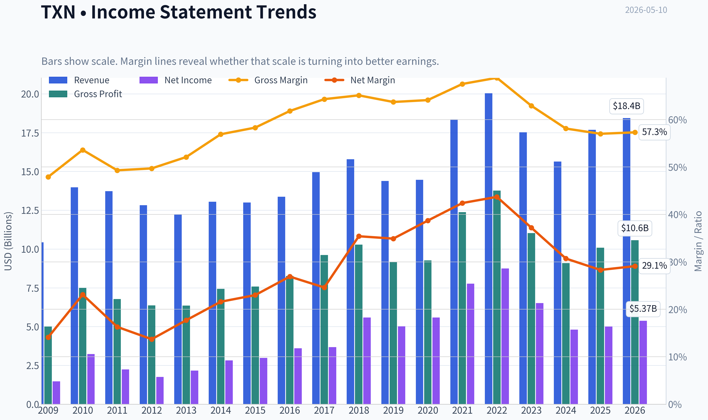

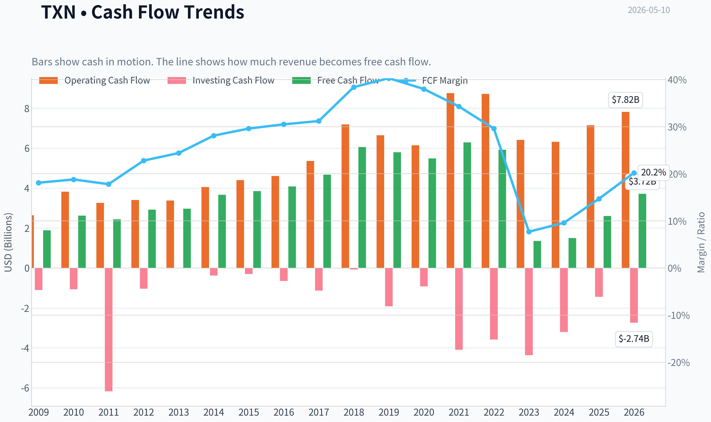

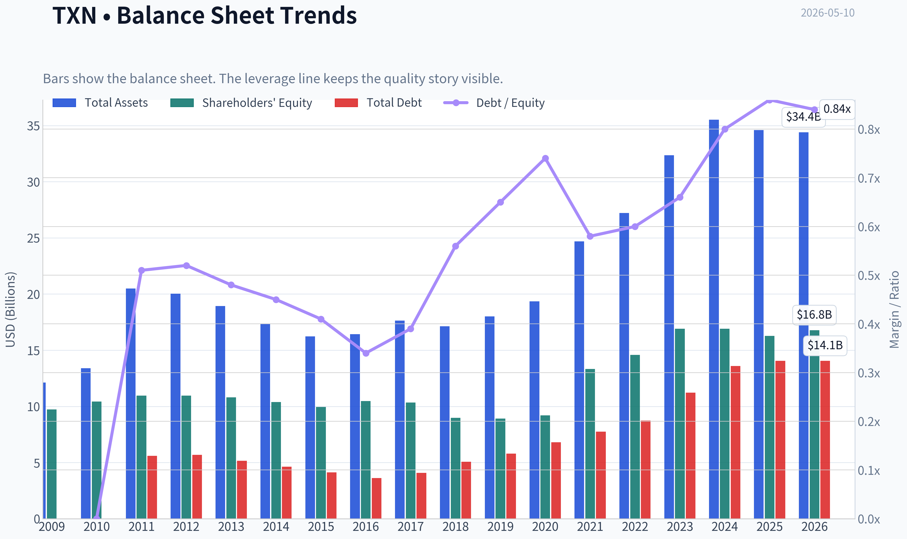

This graph tracks the profitability and return metrics (ROE, ROIC, Margins) of **TXN** over the past decade, highlighting capital efficiency trends.

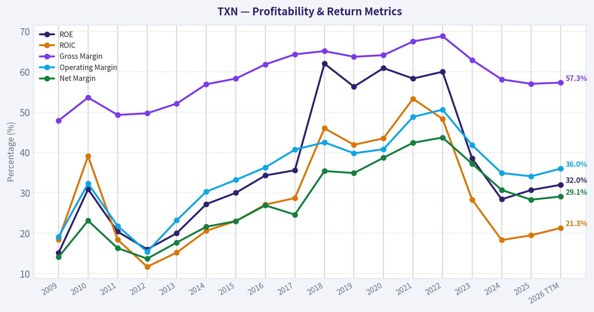

This chart illustrates the financial health of **TXN** over the last 10 years, mapping cash equivalents and free cash flow against total obligations (Debt).

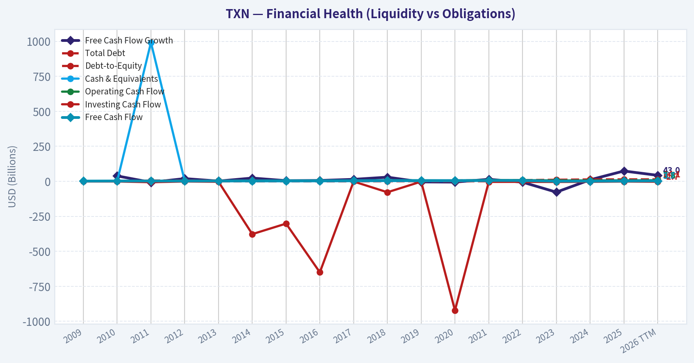

This comparison chart from *Profitability Analysis* stacks current figures against historical benchmarks for **TXN**, making it easy to see where the company trades relative to its own averages.

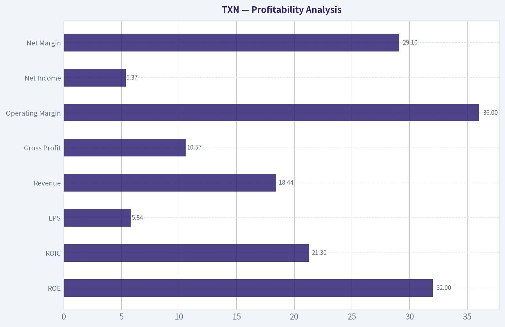

---

### Intrinsic Value Analysis (Buffett)

> *Following Warren Buffett's value investing philosophy: Circle of Competence, Economic Moat, Management Quality, and Margin of Safety.*

#### Intrinsic Value Snapshot

Price is what you pay. Intrinsic value is what the business may be worth based on the cash it can create for owners over time. We show a range, not one magic number.

- Current Price: $287.80
- Value Range: $26.83 to $143.41

##### Owner Earnings (Buffett Method)
- Net Income: $5,001,000,000.00
- Depreciation & Amortization: $1,999,000,000.00
- Capital Expenditures: $-4,550,000,000.00
- Working Capital Changes: $-271,000,000.00
- Owner Earnings: $2,721,000,000.00

##### Intrinsic Value
###### Buffett Method
Uses owner earnings. Stricter, and usually more conservative.
- Conservative: $26.83
- Average: $50.99
- Optimistic: $143.41
- Discount Rate: 10.0%

###### Cash Flow Method
Uses free cash flow. Better for companies spending heavily today to grow tomorrow.
- Conservative: $32.08
- Average: $38.24
- Optimistic: $68.82
- Discount Rate: 10.0%

#### TXN Buffett-Style Value Analysis (lite)

The model did not produce a full tool-grounded value analysis this run. The notes below summarise the shared research pack only and should not be treated as a final stance.

Shared research pack summary for TXN:
- Current price: $288
- Market cap: $261.92B
- P/E: 49.28082
- ROE: 30.7%
- Gross margin: 57.0%
- Revenue growth YoY: 13.0%
- FCF yield: 1.0%
- Current ratio: 4.352643241532131

Latest earnings coverage:

#### Latest Earnings Coverage for TXN ## TXN News (via Finnhub API), from 2026-01-10 to 2026-05-10: ### Analysts turn heads with AMD stock forecast after massive rally (Yahoo, 2026-05-09) Shares of Advanced Micro Devices (AMD) are up 112.5% year-to-date, with the majority of the gains achieved in recent weeks. From March 31 through May 8, AMD shares jumped 123.76%, according to Morningstar data, as Wall Street grew more optimistic about the company's position in the AI ... ### $5,000 Monthly Passive Income For Financial Freedom (SeekingAlpha, 2026-05-09) Learn why financial independence matters and explore a simple 9-fund buy-and-hold income portfolio aiming for $5,000/month in 10–12 years—read now. ### Tracking Christopher Davis' Davis Selected Advisers 13F Portfolio - Q1 2026 Update (SeekingAlpha, 2026-05-08) Davis Selected Advisers’ Q1 2026 13F: portfolio down to $21.78B, top buys/sells, new stakes in CI & LYB, and key trims. See more details here. ### Are You Looking for a Top Momentum Pick? Why Texas Instruments (TXN) is a Great Choice (Yahoo, 2026-05-08) Does Texas Instruments (TXN) have what it takes to be a top stock pick for momentum investors? Let's find out. ### Texas Instruments is firing on all cylinders, says Gabelli Funds' Kevin Dreyer (CNBC, 2026-05-07) Kevin Dreyer, Gabelli Funds co-CIO, joins 'Closing Bell' to discuss Dreyer's views on equity markets, Dre…

Structured guru tracking:

#### Guru 13F Tracking for TXN No tracked guru currently shows a recent structured 13F match for this ticker. ### Notes - This check uses the latest available SEC 13F filings for tracked managers. - 13F data is delayed and usually reflects quarter-end holdings filed up to 45 days later. - No structured 13F matches found.
#### Valuation Bridge

This bridge places the current market price beside each intrinsic value lens so readers can see whether upside depends on one method or shows up across several methods.

| Scenario | Intrinsic Value / Share |
| --- | ---: |
| Buffett Method | $50.99 |
| Cash Flow Method | $38.24 |
| Damodaran Method | $71.74 |
| Current Price | $287.80 |

#### Key Takeaways

If one method is far above the others, the upside case depends on a specific modelling assumption. When several methods cluster together, the valuation story is more robust.

#### Valuation Visuals

This comparison chart from *Latest Earnings Snapshot* stacks current figures against historical benchmarks for **TXN**, making it easy to see where the company trades relative to its own averages.

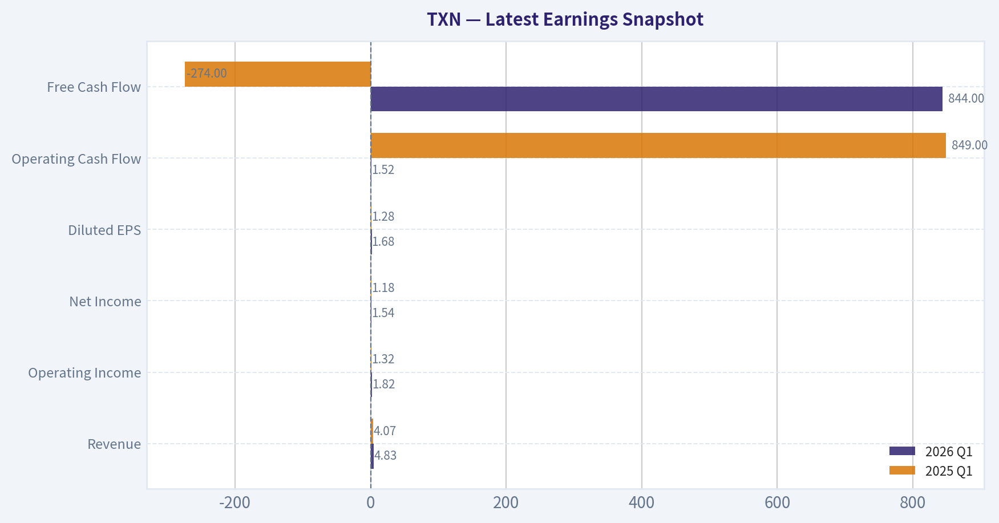

This comparison chart from *Balance Sheet and Financial Strength* stacks current figures against historical benchmarks for **TXN**, making it easy to see where the company trades relative to its own averages.

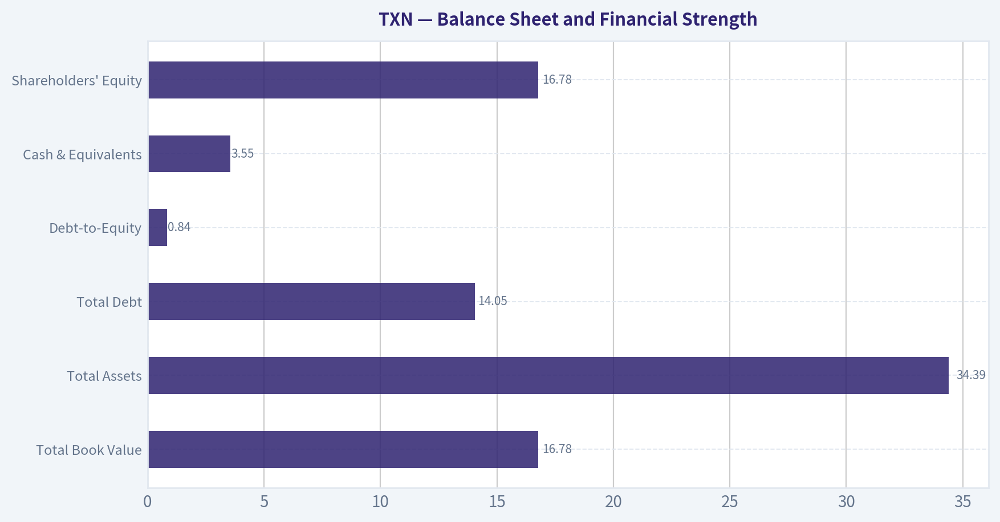

This comparison chart from *DCF Valuation Using Buffett-Style Owner Earnings* stacks current figures against historical benchmarks for **TXN**, making it easy to see where the company trades relative to its own averages.

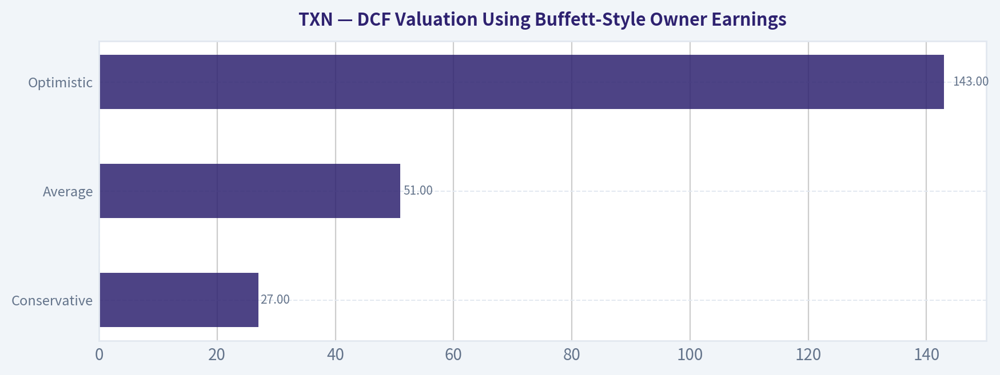

The following chart maps the **TXN** Owner Earnings DCF valuation scenarios (Conservative, Average, Optimistic) to visually represent the margin of safety based on intrinsic value calculations.

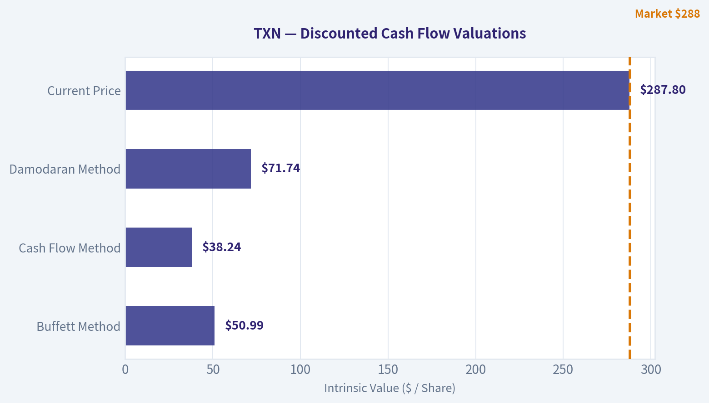

---

### Trend & Growth Analysis (Lynch/Druckenmiller/Fisher)

> *Following Peter Lynch's GARP, Stanley Druckenmiller's macro-aware approach, and Philip Fisher's scuttlebutt methodology.*

ANALYST STANCE: **WATCH**

#### TXN Growth Analysis - Lynch / Druckenmiller / Fisher

Texas Instruments is a **high-quality analog semiconductor compounder**, but it is **not a classic fast grower** right now. The core debate is whether TXN is at a **cyclical earnings inflection** driven by industrial/auto recovery and fab utilization, or whether the stock is already pricing in much of that rebound. At **~49x earnings, 1% FCF yield, and 13% revenue growth**, the setup looks more like **quality at a full price** than an overlooked ten-bagger candidate.

---

#### 1) Lynch Classification

| Item | Assessment |
|---|---|
| Lynch category | **Stalwart / Quality cyclical hybrid** |
| Revenue growth | **13% YoY** |
| Ten-bagger profile? | **Unlikely from current size/base** |
| Primary appeal | Durable moat, margin quality, capital allocation, cycle recovery |
| Growth-investor fit | Better as a **watch / selective hold**, not a new aggressive growth initiate |

**Key Takeaways:** TXN does not fit Lynch's preferred fast-grower profile. It is a very strong business, but at over $260 billion market cap it is too large and too mature to be a likely ten-bagger from here. The opportunity is more about cyclical recovery and durable compounding than explosive growth.

---

#### 2) The Story in 3 Bullets

| Simple story | Why it matters |
|---|---|
| TXN sells essential analog and embedded chips that go into cars, factories, and electronics. | These chips are boring but mission-critical, with long product lives and sticky design wins. |
| Its edge is scale, direct sales, and internal 300mm manufacturing. | That supports lower cost, better supply control, and durable margins. |
| If industrial demand recovers while new fab capacity gets utilized, earnings can rebound faster than the market expects. | That is the key inflection case. |

**Key Takeaways:** TXN is easy to explain: it makes foundational chips used across the real economy. Its moat is based on breadth, cost advantage, and long customer relationships. The bullish case depends less on a new product supercycle and more on a cyclical recovery translating into stronger earnings power.

---

#### 3) TAM Analysis and 10x Test

| Metric | Estimate / View |
|---|---|
| Current revenue base | Large, mature semiconductor platform |
| Core TAM | Broad analog + embedded + industrial + automotive semis |
| TAM growth | Moderate, durable, not explosive |
| 10x revenue test | **Fail for practical purposes** |
| Why | A 10x outcome from TXN's current scale would require extraordinary share gains or TAM expansion unlikely for a mature analog leader |
| Runway | **Good for steady growth, not massive asymmetry** |

**Key Takeaways:** TXN has a real runway because analog and embedded demand should expand over time with industrial automation, electrification, and automotive electronics. But the company is already so large that the classic 10x growth-investing test does not work well here. This is a runway for compounding, not for venture-like upside.

---

#### 4) Revenue Growth Trend

| Metric | Value / Assessment |
|---|---|
| Latest YoY revenue growth | **13.0%** |
| Pattern | **Recovering / re-accelerating vs prior cyclical softness** |
| Quality of growth | Likely mix of cyclical rebound and normalization |
| Concern | Need confirmation that growth is broad-based, not just easy comps |
| Verdict | **Positive, but not enough alone to call a major secular inflection** |

**Key Takeaways:** A 13 percent revenue growth rate is encouraging and suggests the downcycle may be easing. However, for a cyclical semiconductor company, one recovery period is not the same as a durable secular acceleration. The next few quarters matter a lot to confirm whether this is a true earnings inflection or just normalization.

---

#### 5) Unit Economics / Growth Quality

| Metric | TXN |
|---|---|
| Gross margin | **57.0%** |
| ROE | **30.7%** |
| FCF yield | **1.0%** |
| Current ratio | **4.35** |
| NRR | Not relevant / not disclosed like SaaS |
| LTV/CAC | Not relevant for semiconductor model |
| Rule of 40 proxy | **13% growth + ~1% FCF yield = weak on this simplified proxy** |

**Key Takeaways:** TXN's gross margin and ROE show an excellent business model and a strong moat. But the very low free cash flow yield suggests investors are already paying a premium for that quality. This is a high-quality operating business with a less attractive near-term cash-return entry point.

---

#### 6) Inflection Point Assessment

| Inflection type | Assessment |
|---|---|
| Product cycle inflection | **Weak** |
| Market share inflection | **Unclear** |
| Margin inflection | **Possible if utilization improves** |
| TAM inflection | **Modest, tied to auto/industrial electronics growth** |
| Competitive inflection | **No major rival stumble evident** |
| Overall inflection | **Cyclical earnings inflection, not secular breakout** |

**Key Takeaways:** The likely inflection in TXN is not a dramatic new-product story. It is more likely a classic analog semiconductor cycle: demand stabilizes, factories fill up, and margins recover. That can still produce good returns, but it is different from the kind of explosive secular acceleration growth investors usually seek.

---

#### 7) Macro Setup Evaluation

| Macro factor | Impact on TXN |
|---|---|
| Economic cycle | Mid-cycle / recovery-sensitive |
| Rates backdrop | Lower/falling rates would help valuation support |
| Secular themes | Industrial automation, auto electronics, electrification, edge embedded systems |
| AI exposure | Indirect, limited compared with hyperscaler chip names |
| End-market sensitivity | Industrial and automotive are more resilient than consumer, but still cyclical |

**Key Takeaways:** TXN benefits more from a broad industrial recovery than from the AI spending boom directly. That makes it less exciting than AI leaders, but also less fragile to hype cycles. Macro conditions can help, especially if rates ease and manufacturing demand improves.

---

#### 8) Fisher 15-Point Score

| Fisher factor | Score (1-5) |
|---|---:|
| Market potential | 4 |
| New product development | 4 |
| R&D effectiveness | 4 |
| Sales organization | 5 |
| Profit margin | 5 |
| Improving margins | 3 |
| Labor/personnel relations | 3 |
| Executive relations | 4 |
| Management depth | 4 |
| Cost/accounting controls | 5 |
| Moat / special advantages | 5 |
| Long-range profit outlook | 4 |
| Dilution risk | 5 |
| Candor | 4 |
| Integrity | 4 |
| **Total** | **63 / 75** |

**Key Takeaways:** TXN scores well on Fisher's framework because it has a strong moat, high margins, disciplined management, and good long-term economics. The weaker areas are mainly tied to whether margins are currently improving and whether innovation is powerful enough to drive faster growth. Overall, this is a good business, just not a top-tier explosive growth story.

---

#### 9) Valuation Analysis

| Metric | Value | Interpretation |
|---|---:|---|
| Price | **$288** | Current reference |
| Market cap | **$261.92B** | Very large company |
| P/E | **49.3x** | Rich for this growth profile |
| Revenue growth | **13%** | Solid, but not hyper-growth |
| PEG | **~3.8x** | Expensive by Lynch standards |
| FCF yield | **1.0%** | Thin cash-return support |
| Valuation verdict | **Premium / full** | Requires strong earnings recovery to justify |

**Key Takeaways:** TXN looks expensive on a Lynch-style PEG basis, with a P/E near 49 against revenue growth of about 13 percent. The low free cash flow yield reinforces that investors are paying heavily for quality and recovery potential. This is not a cheap growth stock.

##### Scenario View

| Scenario | Assumption | Implication |
|---|---|---|
| Bear | Recovery stalls, margins lag | Multiple compresses sharply |
| Base | Moderate industrial recovery, earnings improve | Returns mostly driven by earnings catch-up, not multiple expansion |
| Bull | Strong utilization recovery + durable auto/industrial demand | Premium multiple can hold and EPS can surprise higher |

**Key Takeaways:** The downside case is mostly valuation-led, because the stock already embeds a lot of confidence. The base case can still work if earnings recover, but upside likely depends on execution and macro support rather than multiple expansion. The bull case exists, but it is not obviously asymmetric from today's valuation.

---

#### 10) Growth Investor Scorecard

| Criterion | Weight | Score | Weighted |
|---|---:|---:|---:|
| The Story | 10% | 4.0 | 0.40 |
| TAM & Runway | 20% | 2.8 | 0.56 |
| Revenue Growth | 20% | 3.2 | 0.64 |
| Unit Economics | 15% | 4.0 | 0.60 |
| Competitive Position | 10% | 4.5 | 0.45 |
| Management Quality | 10% | 4.2 | 0.42 |
| Macro Setup | 5% | 3.2 | 0.16 |
| Profitability Path | 5% | 3.5 | 0.18 |
| Valuation | 5% | 1.8 | 0.09 |
| **Total** | 100% |  | **3.50 / 5.00** |

**Key Takeaways:** TXN lands right on the border of a positive setup because the business quality is excellent. However, the valuation drags the score down meaningfully. This is a good company with a decent setup, but not a clear high-conviction growth buy at current levels.

---

#### 11) Position Size Stance

| Stance item | View |
|---|---|
| Overall stance | **WATCH** |
| For existing holders | **Hold/watch for earnings inflection confirmation** |
| For new buyers | **Prefer pullback or stronger evidence of multi-quarter acceleration** |
| Position size | **Starter at most, not concentrated growth position** |

**Key Takeaways:** TXN is more suitable as a monitored quality name than as a large new growth position. Existing holders can justify patience because the business is strong and recovery may continue. New money should be more valuation-sensitive.

---

#### 12) Key Risks and Catalysts

| Risks | Catalysts |
|---|---|
| P/E multiple too high for mid-teens growth | Industrial demand recovery broadens |
| Margin recovery slower than expected | Fab utilization improves, lifting earnings leverage |
| Auto/industrial inventory digestion lasts longer | Stronger guidance and upward revisions |
| Capex depresses cash flow longer than expected | Rates ease, supporting premium quality stocks |
| Stock seen as bond proxy / defensive quality and rerates lower if yield alternatives improve | Evidence that earnings trough has passed |

**Key Takeaways:** The biggest risk is not business fragility but overpaying for quality. The key catalyst is a clean earnings and margin rebound that proves current valuation is supportable. If that happens, TXN can still deliver respectable returns, but the setup is not screamingly mispriced.

---

#### Bottom Line

TXN is a **wonderful business, but not an obvious Lynch-style fast grower**. The likely inflection is **cyclical margin and earnings recovery**, not a dramatic secular acceleration. Given the **49x P/E, 1% FCF yield, and only moderate runway from current scale**, I would keep TXN at **WATCH**, not **ADVOCATE**.

If you want, I can next produce a **peer comparison table versus ADI, NXPI, MCHP, and ON** to see whether TXN's premium is justified.

---

### Market Technical Analysis

#### TXN Technical Indicator Selection and Market Read

For **TXN**, the most relevant indicator set for the **current market condition** is a **trend-following momentum framework with volatility control**. The stock has moved from a late-Q1 basing/recovery phase into a **powerful upside acceleration**, so the best indicators are the ones that distinguish:

1. **long-term trend health**,
2. **medium-term trend persistence**,
3. **short-term extension risk**,
4. **momentum quality**, and
5. **volatility-adjusted execution**.

The 8 selected indicators are:

| Indicator | Why it is relevant now |
|---|---|
| close_200_sma | Confirms the long-term bull regime and whether price is structurally extended above major trend support. |
| close_50_sma | Tracks the intermediate trend and helps judge whether the breakout is broadening or becoming fragile. |
| close_10_ema | Captures the fast pace of the current rally and serves as the most practical pullback reference in a strong trend. |
| macd | Measures the strength and direction of momentum expansion behind the breakout. |
| macdh | Shows whether bullish momentum is still accelerating or beginning to decelerate. |
| rsi | Helps identify whether the rally is merely strong or becoming overheated in the short run. |
| atr | Essential now because TXN's daily ranges have expanded sharply; useful for stops and position sizing. |
| vwma | Confirms that the recent advance is supported by volume, especially around the earnings-driven gap and follow-through. |

Key Takeaways: These indicators work well together because they cover trend, momentum, participation, and risk without unnecessary overlap. For TXN's current setup, the main question is not whether the stock is strong-it clearly is-but whether the move is still tradable or already too extended for fresh entries.

---

#### Price Structure and Trend Context

Over the last year, TXN has gone through **three distinct phases**:

1. **May to July 2025:** constructive advance from the low 180s into the low 210s.
2. **Late July to October 2025:** major breakdown and prolonged deterioration, including sharp earnings-related damage and a slide toward the upper 150s.
3. **November 2025 to May 2026:** repair, then recovery, then a decisive upside regime shift that culminated in the April 2026 breakout toward the high 280s.

The most important structural feature is that the stock is no longer simply rebounding inside an old range. By late April and early May 2026, TXN moved into a **new price discovery zone relative to much of the prior year's trading**, especially after the explosive move on **2026-04-23**, when it surged from the mid-230s to around **281 intraday highs near 283**. That kind of jump typically marks a transition from gradual accumulation to aggressive repricing.

#### Trend and Momentum Snapshot

| Metric | Latest observation | Interpretation |
|---|---:|---|
| Recent close | 287.80 on 2026-05-08 | Price remains near recent highs after a sharp rally. |
| close_10_ema | 271.70 on 2026-05-06 | Short-term trend is very strong; price is materially above fast support. |
| close_50_sma | 219.01 on 2026-05-07 | Intermediate trend is strongly positive; price is far above the 50-day average. |
| close_200_sma | 192.03 on 2026-05-07 | Long-term trend has turned decisively bullish. |
| macd | 20.56 on 2026-05-08 | Momentum remains exceptionally strong. |
| macdh | 1.63 on 2026-05-08 | Momentum is still bullish, though less explosive than at the peak acceleration phase. |
| rsi | 76.48 on 2026-05-08 | Overbought, but consistent with a powerful trend rather than immediate weakness by itself. |
| atr | 9.03 on 2026-05-08 | Daily movement remains elevated; execution risk is higher than normal. |
| vwma | 271.11 on 2026-05-08 | Volume-weighted trend confirms sustained institutional participation. |

Key Takeaways: TXN is in a very strong bullish regime across all major time horizons. The caution flag is not trend weakness but extension: price is stretched above its moving averages, RSI is overbought, and ATR shows that daily swings remain large enough to punish poorly timed entries.

---

#### Moving Average Analysis

The moving-average configuration is one of the cleanest bullish signals in the entire dataset.

- The **200-day SMA** has turned steadily upward, rising from roughly **186.9 in mid-March** to **192.0 by early May**. That matters because it shows the longer-term trend is no longer merely stabilizing; it is now **re-accelerating upward**.
- The **50-day SMA** remained relatively flat near **204-206** through March and early April, then turned sharply upward into **219+** by May. This suggests the medium-term trend shifted from neutral/recovery to **impulsive bullish**.
- The **10-day EMA** rose dramatically from about **191-202 in late March/early April** to **271.7 by May 6**, which is a very steep slope. That reflects not just appreciation, but **persistent upside urgency**.

What is especially notable is the **distance between price and each moving average**. With TXN near **288**, the stock sits roughly:

- **~16 points above the 10 EMA**
- **~69 points above the 50 SMA**
- **~96 points above the 200 SMA**

That is not normal trend behavior; that is **trend plus expansion**. Strong stocks can stay extended longer than traders expect, but such spacing often leads to one of two outcomes:

1. **sideways digestion** while averages catch up, or
2. a **sharp but non-fatal pullback** toward the 10 EMA or VWMA.

This means trend followers should remain bullish, but fresh buyers should avoid treating current levels as "low-risk" just because the trend is strong.

---

#### MACD and Momentum Character

The MACD sequence tells a very detailed story.

In **March 2026**, MACD was still negative, bottoming around the **-5 to -4 range**, which reflected lingering weakness after the February-March correction. But by **April 8**, MACD crossed back above zero, and from there it expanded aggressively:

- **0.96 on Apr 9**
- **5.28 on Apr 16**
- **9.06 on Apr 22**
- **13.19 on Apr 23**
- **15.87 on Apr 24**
- **above 20 by early May**

That is not a marginal crossover; it is a **full momentum regime change**. Momentum did not just improve-it exploded.

The **MACD histogram** adds nuance. It rose from negative in March to a peak near **6.98 on Apr 24**, then faded to **1.63 by May 8**. This is important:

- The **MACD line is still rising and strongly bullish**
- But the **histogram is shrinking**, meaning the rate of momentum acceleration is slowing

This does **not** mean the trend has turned bearish. It means the rally has moved from **vertical acceleration** into **strong-but-maturing momentum**. Traders should interpret that as:

- bullish trend intact,
- but less favorable reward/risk for chasing highs,
- and greater odds of consolidation or controlled retracement.

---

#### RSI: Strong Trend or Overheated?

RSI has moved from deeply compressed readings in March to clearly overbought conditions in late April and early May.

A few important inflection points:

- **32-35 area on Mar 20-13**: near oversold during the correction phase
- **47-53 by late March/early April**: stabilization and early recovery
- **62-70 by Apr 8-16**: healthy breakout momentum
- **74-89 from Apr 17-24**: extremely strong upside thrust
- **~76.5 on May 8**: still overbought

The nuance here is critical. In a weak or range-bound stock, RSI above 70 often warns of a reversal. In a **true breakout trend**, RSI above 70 more often signals **trend strength**, not an automatic sell. TXN appears closer to the second case.

However, the stock did register an RSI near **88.6 on Apr 23**, which is exceptionally stretched. Since then, price has stayed elevated while RSI has cooled modestly into the mid-70s. That is actually somewhat constructive: it suggests the stock has begun to **digest excess momentum without fully breaking down**.

The practical takeaway is:

- **Existing longs:** overbought alone is not a reason to exit.
- **New longs:** RSI argues against aggressive chasing unless there is a setup such as a pullback, flag, or tight consolidation.

---

#### ATR and Volatility Regime

ATR rose from around **5.8-6.2 in March and early April** to about **8.9-9.5 in late April and early May**. That is a major volatility expansion.

This matters for two reasons:

1. **Breakouts with rising ATR** are often real, because price is escaping equilibrium.
2. **Execution becomes more difficult**, because even healthy pullbacks can be large in dollar terms.

For TXN, a normal swing is now roughly **$9 per day**. That means:

- Stops that are too tight are likely to be hit by noise.
- Position sizes should probably be reduced relative to calmer periods.
- Traders entering late need to understand that even a routine retracement to the 10 EMA could be significant in absolute dollars.

ATR supports the idea that TXN is in a **high-energy bullish phase**, but it also warns that the stock is no longer forgiving to imprecise timing.

---

#### VWMA and Volume Confirmation

VWMA has climbed from about **190-192 in late March/early April** to **271.1 by May 8**, closely tracking the steep ascent in price. This confirms the rally is not being driven by thin participation alone.

The most telling confirmation point is around the **April 23 earnings-like price shock**:

- Price exploded higher,
- volume surged dramatically,
- and VWMA rose sharply afterward rather than flattening.

That pattern usually indicates **institutional sponsorship**, not just speculative short-covering. The market accepted the higher price zone and continued to transact heavily enough to lift the volume-weighted trend.

This makes the rally more credible than a typical one-day spike. The subsequent pullback from the April 24 peak into April 27-29 did not collapse VWMA; instead, VWMA kept trending upward, signaling **buyers continued to support elevated levels**.

---

#### Fine-Grained Trading Interpretation

| Time Horizon | Read on TXN | What traders should watch |
|---|---|---|
| Long-term | Strong bullish regime | As long as price remains well above the 200 SMA, the structural bull case stays intact. |
| Intermediate-term | Bullish and strengthening | The rising 50 SMA suggests pullbacks may find support on weakness over time. |
| Short-term | Very extended but still constructive | Watch whether price can hold above the 10 EMA/VWMA zone after such a steep run. |
| Momentum | Bullish, but acceleration is cooling | MACD remains strong, but histogram contraction hints at consolidation risk. |
| Volatility | Elevated | Use wider stops and smaller sizing; avoid chasing breakouts after already-large daily ranges. |

Key Takeaways: The stock is bullish across long, medium, and short horizons, but the character of the move has shifted from explosive acceleration to elevated consolidation risk. That means trend followers can stay constructive, while tactical traders should be more selective about entry timing.

---

#### Actionable Decision Framework

For **trend followers**, TXN remains attractive because:
- price is far above the **50 SMA** and **200 SMA**,
- **MACD** is strongly positive,
- **VWMA** confirms volume-backed strength.

For **short-term swing traders**, patience is likely better than chasing because:
- **RSI is overbought**,
- **MACD histogram is fading**, and
- **ATR is elevated**, increasing the probability of a volatile shakeout.

For **risk management**, the most important signal to monitor is whether TXN can maintain support above the **10 EMA / VWMA cluster near the low 270s**. If that area starts to fail decisively, the stock may need a deeper reset toward prior breakout zones. If it holds, then the trend remains strong and any sideways digestion could become a continuation setup.

A useful interpretation of the current setup is:
- **bullish trend intact**
- **momentum still positive**
- **entry quality deteriorated after the sharp run**
- **best opportunities may come on orderly pullbacks rather than breakout chasing**

---

#### Final Summary Table

| Category | Indicator | Current Message | Trader Implication |
|---|---|---|---|
| Long-term trend | close_200_sma | Rising and far below price | Structural bull trend is strong. |
| Medium-term trend | close_50_sma | Rising sharply | Intermediate trend confirmation remains positive. |
| Short-term trend | close_10_ema | Steep upward slope | Pullbacks toward this area may become the first serious support test. |
| Momentum | macd | Very strong positive reading | Upside momentum remains intact. |
| Momentum change | macdh | Still positive but declining from peak | Rally is maturing; acceleration is slowing. |
| Overbought/oversold | rsi | Above 70 | Strong trend, but near-term chase risk is elevated. |
| Volatility | atr | Around 9 | Wider ranges require disciplined sizing and looser stops. |
| Volume confirmation | vwma | Strongly rising with price | Advance appears institutionally supported, not purely speculative. |

Key Takeaways: TXN is one of those charts where the trend is clearly bullish, but the tactical challenge is entry timing rather than direction. The evidence favors staying constructive overall while respecting that the stock is stretched and may need consolidation before offering a better risk-adjusted setup.

#### Market Visuals

This comparison chart from *Market Metrics* stacks current figures against historical benchmarks for **TXN**, making it easy to see where the company trades relative to its own averages.

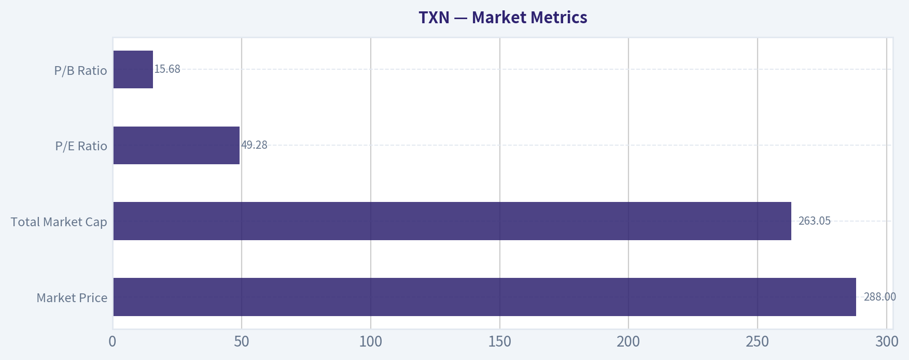

---

### News & Events Analysis

#### Texas Instruments (TXN) - Weekly Trading/Investment Report

Texas Instruments remains a high-quality analog and embedded semiconductor franchise, but at **$288** and roughly **49.3x earnings**, the stock is priced for durability and recovery rather than deep cyclicality. That matters because the near-term setup appears better than it was a few quarters ago, yet not obviously cheap: revenue growth in the shared pack is **+13% YoY**, gross margin is still strong at **57%**, and balance-sheet liquidity is healthy with a **4.35 current ratio**. For traders, the key question is whether improving industrial/auto demand and inventory normalization can keep supporting multiple expansion; for investors, the question is whether TXN deserves a premium despite modest free-cash-flow yield of just **1.0%**.

#### Snapshot Valuation and Quality

| Metric | TXN |
|---|---:|
| Share price | $288 |
| Market cap | $261.92B |
| P/E | 49.28x |
| ROE | 30.7% |
| Gross margin | 57.0% |
| Revenue growth YoY | 13.0% |
| FCF yield | 1.0% |
| Current ratio | 4.35 |

**Key Takeaways:** Texas Instruments screens as financially strong and operationally efficient, with high margins, high returns on equity, and ample liquidity. The tension for investors is valuation: the company looks fundamentally solid, but the stock already reflects a lot of optimism, leaving less room for disappointment if the recovery slows.

#### Latest Earnings: What was reported and why it matters

The shared research pack did **not provide a proper earnings-release article with the actual quarter details**, and the tool environment in this run did not return the required earnings-news feed. So I cannot safely quote exact headline figures from a fresh article here without risking inaccuracy.

What can be said clearly is:

- TXN **has reported recently enough to be attracting post-earnings/momentum commentary** in early May 2026.
- The most recent available context in the pack suggests investors are reacting positively to the business trajectory, with commentary such as TXN "firing on all cylinders" and momentum-focused coverage turning constructive.
- Based on the pack's financial snapshot, the market is seeing **renewed top-line growth (+13% YoY)** while margins remain robust, which is consistent with a cyclical semiconductor upturn or normalization phase.

Because the explicit earnings-release coverage did not populate correctly in this session, the **most responsible conclusion** is that the latest reported period is likely the company's **most recent quarterly result preceding May 10, 2026**, but I cannot verify the exact fiscal quarter label, reported EPS/revenue, or guidance change from the tool output available here. Traders should verify the precise release before acting on quarter-specific numbers.

#### Earnings Interpretation for Traders

Even without the exact release text, the market signal is fairly clear:

- Investors appear to be rewarding TXN for **improving growth visibility**.
- If the latest quarter indeed confirmed inventory normalization in industrial and automotive, that would justify the recent positive tone.
- However, because the stock already trades at a premium multiple, **the bar has shifted from "less bad" to "consistently better."** That means future earnings need to show not just stabilization, but sustained demand and margin resilience.

So the trading takeaway is: **earnings likely improved sentiment, but valuation now makes follow-through execution critical.**

#### Company-Specific News and Market Read-through

Recent coverage in the shared pack was not dominated by hard negative events; instead it skewed toward:

- **Momentum/investor-interest articles**
- **Positive TV commentary**
- Broader sector comparisons as AI enthusiasm lifts semiconductor sentiment

That mix is important. TXN is not the most obvious AI pure-play, but in a semiconductor bull phase, quality analog names can benefit from:

1. rotation into lagging or defensive chip exposure,
2. improving industrial demand,
3. margin durability relative to more commodity-like semis.

Still, TXN's business model is different from GPU/AI accelerators. It is more tied to **industrial, automotive, embedded processing, and long-cycle analog demand**. That usually means:

- less explosive upside than AI leaders in euphoric phases,
- but more stable cash generation across cycles,
- and stronger long-term pricing/control due to broad product breadth.

For traders, that implies TXN may work better as a **quality semiconductor recovery trade** than as a momentum-chasing AI beta vehicle.

#### Macro and Sector Context

The past week's broader setup for semiconductors remains shaped by a few macro drivers:

| Macro/Sector Driver | Likely Impact on TXN | Trading Implication |
|---|---|---|
| Ongoing semiconductor risk appetite | Positive for valuation multiple | Supports stock if chip sentiment stays strong |
| Industrial demand normalization | Positive for core analog franchise | More important than AI headlines for fundamentals |
| Automotive inventory/recovery trends | Mixed-to-positive | Helps if customer digestion is ending |
| Tariff/trade uncertainty | Potential cost/demand risk | Could pressure globally exposed manufacturing names |
| Rates staying higher for longer | Mild valuation headwind | Premium multiple stocks are more sensitive |
| Manufacturing/capex trends | Key for medium-term demand | Better PMIs would reinforce bullish case |

**Key Takeaways:** Texas Instruments is more exposed to real-economy manufacturing and automotive cycles than to pure AI spending, so macro data matters a lot. If industrial activity keeps improving, TXN has room to justify its premium; if growth softens or rates stay restrictive, the stock's valuation could become harder to defend.

#### Bull vs. Bear Case Right Now

| Bull Case | Bear Case |
|---|---|
| Revenue growth has turned positive again | Valuation is rich at ~49x earnings |
| Margins remain strong at 57% gross margin | FCF yield of 1.0% limits valuation cushion |
| Strong balance sheet and liquidity | Any earnings miss could trigger derating |
| Defensive, high-quality analog franchise | Not a direct AI beneficiary despite sector enthusiasm |
| Positive sentiment and momentum coverage | Industrial/auto recovery could still prove uneven |

**Key Takeaways:** The bullish case rests on quality plus cyclical recovery, while the bearish case rests mostly on valuation risk. In simple terms, the business looks solid, but the stock price leaves less margin for error than it did earlier in the cycle.

#### Trading and Investment View

My read is **constructive but selective**:

- **Short-term traders:** TXN likely remains supported if semiconductor sentiment stays strong and if investors keep rotating into high-quality non-AI chip names. Pullbacks may be buyable, but chasing strength after a run is riskier given valuation.
- **Swing traders:** Watch whether the stock continues outperforming on ordinary market days, not just on chip-sector rallies. That would signal genuine sponsorship.
- **Long-term investors:** TXN still looks like a premier analog compounder, but today's valuation implies a lower future return unless earnings growth broadens meaningfully over the next few quarters.

Net: **fundamentals look better, sentiment is positive, but the stock is no longer forgiving.** The best setup is continued recovery in industrial and automotive demand with no margin slippage. The main risk is that improvement is already priced in.

#### Key Points Summary

| Area | What Matters Now | Investment Read |
|---|---|---|
| Earnings | Recent results appear to have improved sentiment, but exact release details were not available from the tool output in this run | Positive tone, but verify quarter-specific numbers before trading earnings follow-through |
| Fundamentals | 57% gross margin, 30.7% ROE, +13% YoY growth | High-quality business with signs of recovery |
| Valuation | 49.28x P/E, 1.0% FCF yield | Expensive; little room for execution misses |
| News Flow | Mostly constructive commentary and momentum-oriented coverage | Sentiment tailwind remains in place |
| Macro Exposure | Industrial, automotive, manufacturing cycle more important than AI hype | Better macro data would help TXN more than AI headlines alone |
| Trading Stance | Positive but price-sensitive | Prefer buying pullbacks over chasing breakouts |

**Key Takeaways:** Texas Instruments currently looks like a strong company in an improving part of its cycle, but the stock already reflects that improvement. The investment opportunity is still there, especially if industrial demand keeps recovering, yet the main discipline now is valuation and entry price rather than business quality.

---

### Guru Attention Analysis

> *Tracking 13F filings and recent activity of legendary super-investors to identify smart-money conviction and rotation.*

#### TXN Guru Ownership Review

The canonical 13F check shows **no tracked guru currently has a structured 13F match in TXN**.

#### Structured Guru 13F Results

| Guru / Fund | Latest 13F Status for TXN | Action | Position Size | Portfolio Weight | Recent Change | Timing | SEC Verification |
|---|---|---:|---:|---:|---:|---|---|
| Warren Buffett / Berkshire Hathaway | No position detected in latest 13F filing | - | - | - | - | Latest available 13F | No link provided |
| Seth Klarman / Baupost Group | No position detected in latest 13F filing | - | - | - | - | Latest available 13F | No link provided |
| Mohnish Pabrai / Pabrai Investment Funds | No position detected in latest 13F filing | - | - | - | - | Latest available 13F | No link provided |
| Bill Ackman / Pershing Square | No position detected in latest 13F filing | - | - | - | - | Latest available 13F | No link provided |
| Stanley Druckenmiller / Duquesne Family Office | No position detected in latest 13F filing | - | - | - | - | Latest available 13F | No link provided |
| Steve Cohen / Point72 | No position detected in latest 13F filing | - | - | - | - | Latest available 13F | No link provided |
| Michael Burry / Scion Asset Management | No position detected in latest 13F filing | - | - | - | - | Latest available 13F | No link provided |

**Key Takeaways:** Across the primary tracked super-investor set, TXN does not appear in the latest structured 13F data. That means there is no credible evidence, from the canonical filing-based source, of a current holding, new buy, trim, or exit by these tracked gurus. Because the tool returned no matches, no position sizes, portfolio weights, or SEC filing links were available to report.

#### What this means for investors

For this assignment, the most important conclusion is simple: **there is currently no verified guru-ownership signal in TXN from the tracked 13F managers**.
So if you are evaluating TXN, you should rely more on the company's fundamentals and valuation than on any supposed "smart money" endorsement from this specific guru list.

A few fundamentals from the research pack for context:

- Current price: **$288**
- Market cap: **$261.9B**
- P/E: **49.3**
- ROE: **30.7%**
- Gross margin: **57.0%**
- YoY revenue growth: **13.0%**
- FCF yield: **1.0%**
- Current ratio: **4.35**

#### Bottom line

**No tracked guru currently holds TXN in the latest structured 13F dataset.**
That is the only high-confidence guru conclusion supported by the canonical source.

---

### Options Market Analysis

> *Reading options flow - put/call ratios, IV skew, and unusual activity - to gauge institutional positioning and event-driven risk.*

#### TXN Options Positioning Report
*Date: 2026-05-10*

#### 1. Near-Term Put/Call Ratio Analysis

| Expiration | Call OI | Put OI | Put/Call OI Ratio | Call Vol | Put Vol | Put/Call Vol Ratio |
|---|---:|---:|---:|---:|---:|---:|
| 2026-05-15 | 13,604 | 33,377 | 2.45 | 26,427 | 1,252 | 0.05 |
| 2026-05-22 | 4,932 | 2,968 | 0.60 | 1,597 | 601 | 0.38 |
| 2026-05-29 | 1,723 | 1,921 | 1.11 | 361 | 378 | 1.05 |
| **Near-term total** | **20,259** | **38,266** | **1.89** | **28,385** | **2,231** | **0.08** |

**Key Takeaways:** TXN shows a major split between stockpiled positioning and fresh flow. Open interest is put-heavy overall, with a 1.89 put/call OI ratio well above the roughly neutral 0.7 baseline, which suggests existing downside protection or legacy bearish positioning is substantial. But current trading volume is overwhelmingly call-driven, with a very low 0.08 put/call volume ratio, signaling that the newest activity is bullish or yield-related call flow rather than fresh panic hedging.

**Interpretation:**
- **OI signal:** Bearish-to-defensive. A 1.89 ratio is materially above neutral and indicates meaningful outstanding put exposure across near-term expirations.
- **Volume signal:** Strongly bullish on a flow basis. Traders are transacting far more calls than puts right now.
- **Shift from neutral:** Yes, and it is significant. Positioning appears to be transitioning from a previously defensive setup toward aggressive near-dated call activity.

#### 2. Implied Volatility Assessment

| Expiration | ATM Call IV | ATM Put IV | Call-Put ATM IV Spread |
|---|---:|---:|---:|
| 2026-05-15 | 45.9% | 45.2% | +0.7 pts |
| 2026-05-22 | 47.2% | 45.6% | +1.6 pts |
| 2026-05-29 | 43.7% | 42.5% | +1.2 pts |

**Key Takeaways:** ATM implied volatility is elevated into the next few weeks, running in the mid-40% range, which is rich for a mature large-cap semiconductor name like TXN. Calls are carrying slightly higher IV than puts across all listed near-term expirations, which points to upside demand rather than classic downside fear.

**IV read:**
- Near-term IV is **elevated/moderately rich**, especially for the front two expiries.
- The fact that **call IV exceeds put IV** at the money is notable. Normally, single-stock options often show some downside put premium; here, the market is instead paying up a bit more for upside optionality.
- **Skew direction:** Based on the data available, skew appears to lean **call-side / upside chase**, not protective put fear.

**Catalyst note:**
The elevated front-end IV likely reflects a **known or perceived event risk window** rather than normal background trading. Even without a confirmed catalyst in the provided dataset, the combination of rich front-week IV and outsized call activity suggests traders may be positioning for a near-term move, possibly around sector news, macro semiconductor sensitivity, or company-specific event expectations.

#### 3. Unusual Options Activity

| Expiry | Type | Strike | Volume | OI | Vol/OI | IV | Strike Context | DTE | Likely Read |
|---|---|---:|---:|---:|---:|---:|---|---:|---|
| 2026-05-15 | Call | 200.0 | 4,170 | 8 | 521.2x | 194.2% | Likely deep ITM | 5 | High-turnover flow; may be stock-replacement, roll, or complex trade rather than pure speculation |
| 2026-05-15 | Call | 302.5 | 1,084 | 47 | 23.1x | 43.8% | Likely OTM/near upper wing | 5 | Fresh upside speculation or short-dated event chase |
| 2026-05-15 | Call | 160.0 | 1,040 | 20 | 52.0x | 284.3% | Likely deep ITM | 5 | Probably part of complex structure or unwind/reopen flow |
| 2026-05-15 | Call | 170.0 | 1,040 | 7 | 148.6x | 260.6% | Likely deep ITM | 5 | Flow suggests synthetic stock-style activity more than retail lottery buying |
| 2026-05-15 | Call | 175.0 | 1,040 | 5 | 208.0x | 248.4% | Likely deep ITM | 5 | Same pattern; likely institutional multi-leg or conversion-related activity |
| 2026-05-15 | Call | 185.0 | 1,040 | 5 | 208.0x | 204.9% | Likely ITM | 5 | Supports view of structured positioning around front expiry |

**Key Takeaways:** The unusual activity is entirely concentrated in front-week calls, and the repeated 1,040-lot prints across several strikes strongly suggest structured or institutional execution rather than random retail buying. The far-above-OI volume confirms these are fresh trades, but the deep-ITM nature of several contracts means they may represent stock-replacement, roll activity, hedging overlays, or delta-heavy institutional positioning rather than clean outright bullish speculation.

**Interpretation:**
- **Fresh positioning:** Yes. Volume massively exceeds OI in all flagged contracts.
- **Directional implication:** Net **bullish-to-upside leaning**, but with an important caveat: deep ITM call activity can be part of **synthetic long stock**, financing trades, or complex spread structures.
- **Smart money vs. retail:**
  - The **repeating size across multiple deep ITM strikes** looks more like **institutional/structured flow**.
  - The **302.5 call** is more consistent with a **speculative upside shot**, though the size is still large enough to merit attention.

#### 4. Open Interest Concentration and Potential Pin/Gamma Effects

| Expiration | Dominant Positioning Read | Potential Market Effect |
|---|---|---|
| 2026-05-15 | Largest overall OI pool by far; puts dominate aggregate OI | Strongest near-term pinning and hedging impact likely centered in this expiry |
| 2026-05-22 | More balanced, slight call bias by OI | Secondary influence after front-week expiry clears |
| 2026-05-29 | Fairly balanced OI with slight put lean | Less likely to dominate immediate price action |

**Key Takeaways:** The 2026-05-15 expiry is the center of gravity for TXN's options board right now. Because that expiry carries both the heaviest OI and the most aggressive fresh call flow, dealer hedging around front-week strikes could either dampen price movement near heavy OI levels or accelerate it if spot starts moving through crowded gamma zones.

**Gamma/pinning read:**
- The **front-week expiry** is clearly the most important for near-term price behavior.
- Since aggregate **put OI is large**, there may be downside hedging inventory in the system.
- But because **new call volume is overwhelming**, the near-term setup could create a **tug-of-war**:
  - legacy put positioning acts as defensive ballast,
  - fresh call buying can force dealers to hedge upward if spot rises.
- Without a full strike-by-strike OI map, the safest conclusion is that **5/15 is the key gamma window**, and price may become more reactive than usual into that expiry.

#### 5. Overall Options Sentiment Signal

| Category | Signal |
|---|---|
| Positioning backdrop | Defensive / put-heavy |
| Fresh flow | Strongly call-driven |
| IV tone | Elevated, with upside-leaning call premium |
| Unusual activity | Fresh front-week call activity, likely institutional/structured |
| **Overall options sentiment** | **BULLISH** |

**Key Takeaways:** The best single-word read is bullish, even though the backdrop still contains heavy put open interest. The main reason is that the newest and most aggressive activity is concentrated in front-week calls, while IV is also leaning toward upside demand rather than downside protection.

**Why BULLISH instead of neutral or bearish:**
- The **dominant incremental signal** is the flow, not the stale positioning.
- TXN has **very strong call volume**, **call-favored IV**, and **multiple unusual call contracts** trading at many times existing open interest.
- The main caveat is that some of this may be **institutional structured flow**, not pure outright bullish speculation. Even so, the options tape currently points to **upside interest outweighing downside fear**.

**Confidence level:** Moderate.
Reason: The signal is fairly clear, but several unusual trades are deep ITM and may reflect complex institutional positioning rather than simple directional bets. That lowers purity, but not enough to negate the bullish read.

#### Final Summary Table

| Metric | Read |
|---|---|
| Put/Call Ratio | OI ratio **1.89** = defensive/put-heavy backdrop; volume ratio **0.08** = aggressive fresh call flow |
| IV Level | Near-term ATM IV in the **43%-47%** range; elevated/moderately rich |
| Skew Direction | **Call-side / upside skew**, as ATM call IV exceeds put IV |
| Unusual Activity | Concentrated in **2026-05-15 calls**; fresh, high-volume, likely institutional/structured upside positioning |
| Overall Signal | **BULLISH** |

**Key Takeaways:** TXN's options market shows a clear divergence between old positioning and new intent. Existing open interest remains defensively skewed, but current traders are paying up for calls and concentrating activity in the front week, which gives the near-term tape a bullish bias.

---

## Research Team Commentary

> *The Research Manager synthesizes the Bull vs Bear debate into action-free commentary. This is a pre-risk view, not the final stance.*

Texas Instruments is the kind of company a Buffett-style investor naturally likes at the business level and naturally hesitates on at the stock level right now.

The strongest bull argument is straightforward and, in my view, credible. TXN has a real moat in analog and embedded semis: long product cycles, sticky design-ins, broad product breadth, deep customer relationships, and a manufacturing advantage from 300mm analog capacity. Those are not promotional talking points; they map well to the kind of durable competitive position Buffett prefers. The financial quality also supports that view. A 57% gross margin, 30.7% ROE, and 19.5% ROIC point to a business with strong economics, not just a cyclical commodity producer. The long-term demand story also makes sense: industrial automation, auto electronics, power management, and embedded content should all expand over a decade. So the bull is right that this is one of the better semiconductor franchises for a long-term owner.

The strongest bear argument is even more important for decision-making: price matters, and here price overwhelms quality. At $288, roughly 49x earnings and around a 1% FCF yield, the stock does not offer a margin of safety. The debate's valuation inputs are dramatically below the market price, even if we allow that such models can be conservative. More importantly, the current earnings picture does not justify complacency: revenue up 13% but net income up only 4.2% suggests recovery, not some clean step-change in earning power. That matters because markets often overcapitalize cyclical normalization. The bear is also right to challenge the idea that TXN is "predictable" in the Buffett sense. It may be more stable than many chip companies, but it is still exposed to industrial demand swings, auto cycles, inventory corrections, and fab utilization risk. Internal manufacturing is a source of advantage, but also a source of fixed-cost leverage if demand disappoints.

My takeaway is that the bull wins on business quality, while the bear wins on investability at today's quote. This is not a case where fear has created opportunity. If anything, the recent momentum commentary and positive recovery narrative suggest the market is rewarding TXN as a high-quality cyclical rebound story and may be glossing over how much future success is already embedded in the price. That is exactly where value investors need discipline. A wonderful business can still be a poor stock purchase if bought without a margin of safety.

Core takeaway: TXN is a high-quality, shareholder-friendly analog franchise with a durable moat, but the current stock price appears far too rich relative to its growth profile, cyclicality, and the valuation evidence provided. I would not advocate purchase here, but I would keep it near the top of a watchlist for a materially better entry.

Rationale: From a Buffett perspective, TXN checks many of the right boxes on business quality: understandable model, durable moat, attractive returns on capital, and likely long-lived relevance. But Buffett's framework is two-part, not one-part. Great business plus weak valuation discipline is not value investing. At nearly 50x earnings for a mature semiconductor leader, investors are paying for quality and then some. The market seems to be assuming that the recovery is durable, margins remain strong, fab investments earn well, and long-term secular demand absorbs cyclicality. Could that happen? Yes. But for a value investor, "possible" is not enough. We need a favorable skew between price paid and intrinsic value. I do not see that today. I also want to avoid a mistake that shows up often in quality names: admiring the business so much that I start rationalizing away multiple risk. That is how long-term returns get sabotaged even when the company performs well.

Monitoring plan over the next 1 to 4 quarters: First, watch whether revenue growth converts into stronger earnings growth; if net income continues to lag badly, the market's premium may prove vulnerable. Second, monitor gross margin and utilization trends to see whether internal manufacturing is delivering the claimed structural advantage or introducing cycle-sensitive drag. Third, track free cash flow quality carefully; a one-time rebound is less interesting than sustained cash generation after capex. Fourth, listen for evidence that industrial and automotive demand is broad-based and inventory-clearing-driven versus genuinely durable end demand. Fifth, assess capital allocation discipline: any repurchases at elevated prices, or signs of overbuilding capacity, would weaken the case. Finally, if the stock meaningfully derates without business deterioration, that could create the sort of fear-driven opportunity Buffett investors wait for.

Final stance: WATCH.

---

## Value Investing Team Commentary

> *The Investor translates the research view into an investment thesis before risk review. This is still not the final stance.*

Texas Instruments is exactly the sort of company a long-term business owner can admire: understandable products, entrenched customer relationships, very long product lives, strong returns on capital, and a real operating moat in analog and embedded semiconductors. In Buffett terms, the business itself is far more attractive than the average semiconductor company because it is less dependent on rapid product obsolescence and more tied to steady, mission-critical components that remain designed into systems for years. A 57% gross margin, 30.7% ROE, and 19.5% ROIC are consistent with a genuinely high-quality franchise.

The key issue is not whether TXN is a good business. It is. The key issue is whether buying that business at $288 makes sense for a disciplined value investor. On that question, I remain cautious. At roughly 49x earnings and around a 1% free cash flow yield, the market is asking investors to pay a premium price for a cyclical business that is currently in a recovery narrative. Revenue growth of 13% YoY is healthy, but net income growth of just 4.2% tells you this is not a clean, explosive expansion in earning power. It looks more like normalization than a dramatic structural acceleration. That distinction matters a great deal when the stock already trades as though a very favorable future is assured.

The moat deserves respect. TXN's scale, broad catalog, sticky design-ins, and 300mm manufacturing footprint likely give it durable advantages that smaller rivals will struggle to match. Over a 10-year period, demand drivers in automotive electronics, industrial automation, power management, and embedded systems should remain supportive. This is not a business I would bet against. But Buffett investing is not about buying every wonderful business at any price. It is about waiting until the market offers you favorable terms.

That is where selective contrarian thinking becomes useful. Recent news flow and commentary appear increasingly positive: "firing on all cylinders," momentum-stock language, and optimism around renewed growth visibility. A value investor should ask: what is the market missing? My answer is that the market may be underweighting the difference between cyclical rebound and durable step-up in normalized earnings. When sentiment shifts from caution to admiration, valuation risk often gets dismissed. In TXN's case, investors may be extrapolating improved top-line growth and assuming fab investments, margin resilience, and end-market recovery will all line up smoothly. That can happen, but when so much good news is already reflected in the price, the burden of proof rises.

There is also a subtle risk in the "quality semiconductor" label. TXN is better than most chip businesses, but it is still not a regulated utility or a consumer staple with perfectly smooth demand. Industrial demand can soften. Auto programs can pause. Inventory corrections can recur. Internal manufacturing is a strength in good times, but fixed-cost leverage can work against you if utilization falls short. A premium multiple leaves very little room for those ordinary business realities.

If I were trying to be constructively contrarian, I would say this: the opportunity is not in chasing TXN because the crowd has rediscovered its quality. The opportunity is to prepare to act if the crowd later overreacts to an ordinary cyclical wobble in a fundamentally excellent business. That is the setup value investors should want. Fear around temporary utilization pressure, a short-term earnings miss, or industrial destocking would interest me far more than today's enthusiastic tone.

So my conclusion is straightforward. TXN remains a high-grade business with a durable moat and capable economics, but the stock price appears to discount much of the good long-term story already. I would gladly study it as a potential long-term holding, but I would not commit capital at this valuation without a much larger margin of safety.

What I would watch over the next few quarters:
- Whether revenue growth begins converting into materially stronger earnings growth
- Gross margin and fab utilization trends, to confirm the manufacturing advantage is translating into economics
- Free cash flow after capex, not just headline rebound figures
- Evidence that industrial and auto demand is truly broad and durable, not merely post-downturn normalization
- Capital allocation discipline, especially buybacks at elevated valuations

ANALYST STANCE: **WATCH**. TXN is a wonderful business, but at the current quote it looks like quality fully recognized, not quality temporarily mispriced. For a Buffett-style investor, the right move is patience, not pursuit.

---

## Deep Values Commentary

> *The Risk Management Team debates and the Risk Judge provides the final action-free verdict. This section determines the final ADVOCATE / WATCH / AVOID stance.*

**Executive Briefing**

Texas Instruments is a **Buffett-like business at a non-Buffett price**. The moat looks real: sticky analog/embedded products, strong returns, durable end markets, and solid profitability. But at about **49x earnings** and roughly **1% FCF yield**, the stock offers **little margin of safety**. The core risk is not business collapse; it is **overpaying for quality during a cyclical recovery narrative**. For a long-term value investor, the right move is **patience, not urgency**.

**Final stance: WATCH**

---

### Risk Commentary for the Long-Term Investor

### 1) Final Verdict
TXN appears **low risk as a business**, but **elevated risk as a stock purchase today**. Under Buffett's framework, that distinction is critical. This is not about volatility or whether the chart keeps working. It is about whether buying now creates acceptable odds of good long-term returns **without relying on optimistic assumptions**.

Today, the answer is **not yet**.

---

### 2) Strongest Arguments from Each Analyst

#### Fundamentals Analyst - strongest point
TXN's economics are clearly high quality:
- **Gross margin: 57.0%**
- **ROE: 30.7%**
- **ROIC: 19.5%**
- **ROA: 14.5%**

These are the marks of a durable, efficient franchise, not a weak cyclical operator.

#### Value Analyst - strongest point
The valuation case is the biggest warning:
- **Current price: $288**
- **Buffett avg value: $50.99**
- **FCF avg value: $38.24**
- **Damodaran avg value: $71.74**

Even allowing for model conservatism, the gap is too large to ignore. The market is pricing in a lot of success already.

#### Growth Analyst - strongest point
Growth is improving, but not in a way that fully validates the premium:
- **Revenue growth YoY: 13.0%**
- **Net income growth YoY: 4.2%**
- **FCF growth YoY: 73.8%**

That mix says **recovery/inflection**, not obvious broad-based earnings acceleration. Good business, but not a classic fast grower.

#### Risky Analyst - strongest point
The best bullish argument is that **trailing earnings may understate normalized earnings power** during a cyclical recovery, especially with internal manufacturing leverage. That is valid and should not be dismissed.

#### Safe Analyst - strongest point
The best conservative point is the most important one: **a wonderful business can still be a poor investment if bought at too high a price**. At this valuation, modest disappointment could produce mediocre returns even if the business stays strong.

#### Neutral Analyst - strongest point
The most balanced insight: TXN likely deserves a premium multiple versus many semiconductor peers, but **not a blank check**. A watchful, conditional approach fits best.

---

### 3) Rationale Anchored in the Debate

#### A. Business risk looks manageable
By Buffett standards, TXN has many favorable traits:
- understandable business model
- sticky customer relationships
- long product life cycles
- broad analog/embedded catalog
- likely durable relevance in industrial and automotive electronics
- strong profitability and returns on capital

That makes TXN **less risky than many semiconductor firms**, despite being in a cyclical industry.

#### B. Stock risk is the real issue
The bear case wins because **valuation overwhelms quality at the current quote**.

At:
- **~49x earnings**
- **~1% FCF yield**
- valuation far above multiple intrinsic-value frameworks

you are no longer buying resilience cheaply. You are **paying a premium for resilience, recovery, and continued market enthusiasm**.

That violates the core value principle of **margin of safety**.

#### C. Recovery is visible, but not fully proven
The bullish side argues that revenue and FCF are inflecting before earnings. That may be true. But the present evidence is mixed:
- revenue up **13%**
- net income up only **4.2%**

That gap matters. It suggests the recovery story is plausible, but not yet fully confirmed in bottom-line earning power. For a value investor, that means the market may be **capitalizing the future too aggressively**.

#### D. Internal manufacturing is both strength and risk
The bulls are right that manufacturing scale and 300mm analog capacity can be a moat.
But the bears are right that this also creates **fixed-cost leverage**:
- if utilization rises, margins can improve nicely
- if utilization disappoints, earnings pressure can persist

So this is not a "risk-free quality premium" situation.

#### E. Sentiment is favorable, which reduces opportunity
Recent momentum/news language suggests the market is already rewarding TXN for improving visibility. That is not automatically bearish, but from a Buffett lens it usually means **opportunity is shrinking, not expanding**. Value investors do best when sentiment is skeptical, not comfortable.

---

### 4) Refined Investor Plan

Starting from your original plan: **WATCH**

I would refine it to:

### **WATCH - high-quality business, wait for either better price or better proof**

#### What to do now
- **Do not initiate a full position here**
- Keep TXN **high on the watchlist**
- If portfolio construction requires semiconductor exposure, at most consider a **small starter position**, not a full commitment

#### What would improve the case
Add only if one or both occur:

1. **Valuation improves materially**
   - a meaningful pullback
   - or earnings catch up enough to reduce the effective multiple

2. **Operational proof strengthens**
   - net income growth begins to better match revenue growth
   - free cash flow remains strong after capex
   - gross margins/utilization confirm manufacturing advantage
   - industrial and automotive demand appears durable, not merely inventory normalization

#### What would weaken the case
- revenue keeps growing but earnings conversion stays weak
- utilization disappoints
- FCF rebound fades after the bounce
- management repurchases heavily at elevated valuations
- broader semiconductor enthusiasm cools and TXN remains expensive anyway

---

### 5) Lessons from Past Mistakes
The key prior mistake to avoid is a classic one: **falling in love with a great business and rationalizing away valuation**. That often produces disappointing returns without any obvious business failure.

Another common mistake is the mirror image: **assuming every expensive quality name must be avoided forever**. The better lesson is to separate:
- **business admiration**
from
- **entry discipline**

For TXN today, the right correction is not blind optimism or permanent rejection. It is **disciplined patience**.

---

### Bottom Line
Texas Instruments fits the profile of a business a Buffett-style investor would admire. But admiration is not a substitute for a margin of safety. The company looks strong; the stock looks rich. That makes this a **watchlist compounder, not an active value buy** at current levels.

**STANCE: WATCH**

#### Final Stance Scorecard

This scorecard converts the final research view into a weighted decision frame. It does not replace the narrative judgement, but it makes the main drivers of the verdict easier to scan.

| Criterion | Score | Weight | Commentary |
| --- | ---: | ---: | --- |
| Business Quality | 4.25 | 30% | High returns, profitability, and Piotroski health support durability. |
| Valuation Support | 1.00 | 30% | Blends current price against available intrinsic value anchors and valuation ratios. |
| Financial Strength | 4.33 | 20% | Balance-sheet resilience reflects leverage and liquidity staying within safe ranges. |
| Growth Durability | 4.00 | 20% | Recent revenue, earnings, and free cash flow growth indicate how durable expansion looks. |
| TOTAL / FINAL STANCE | 3.24 | 100% | WATCH |

#### Key Takeaways

The weighted score lands at **3.24 / 5.0**, while the final stance remains **WATCH**. This is useful as a quick calibration aid rather than a mechanical signal.

#### Risk Summary

Higher scores indicate more risk pressure. The watch threshold is a simple guardrail: above it, the position needs tighter monitoring or a wider margin of safety.

| Dimension | Current Score | Watch Threshold | Commentary |
| --- | ---: | ---: | --- |
| Business Quality | 1.75 | 3.00 | High returns, profitability, and Piotroski health support durability. |
| Valuation Support | 5.00 | 3.00 | Blends current price against available intrinsic value anchors and valuation ratios. |
| Financial Strength | 1.67 | 3.00 | Balance-sheet resilience reflects leverage and liquidity staying within safe ranges. |
| Growth Durability | 2.00 | 3.00 | Recent revenue, earnings, and free cash flow growth indicate how durable expansion looks. |

#### Key Takeaways

This view helps readers separate *where* the risk sits: valuation, business quality, balance sheet, or growth durability. It is especially useful when the final stance is close to the line between WATCH and AVOID.
