# UBER Deep Value Intelligence

**Analysis Date:** 2026-05-10

## Critical Disclaimer

*This analysis is generated by Deep Value Intelligence, an AI-powered multi-agent investing framework. This report is for informational and educational purposes only and does not constitute financial advice. Always conduct your own research and consult with qualified financial advisors before making investment decisions.*

---

## Table of Contents

1. Intelligence Summary
2. Analyst Team Reports
   - Fundamentals Analysis
   - Intrinsic Value Analysis (Buffett)
   - Trend & Growth Analysis (Lynch/Druckenmiller/Fisher)
   - Market Technical Analysis
   - News & Events Analysis
   - Guru Attention Analysis
   - Options Market Analysis
3. Research Team Commentary
4. Value Investing Team Commentary
5. Deep Values Commentary

---

## Intelligence Summary

### Thesis + Conditions

**Core Thesis:** ## Executive Briefing

**Key Risks:**
- Uber has improved enough to deserve respect, not enough to deserve Buffett-style conviction. The business is now producing real cash, showing strong returns on capital, and still growing at scale. But for a long-term value investor, the key risk is not stock volatility - it is whether today's cash generation is durable through competition, regulation, and autonomy shifts. At roughly a **6.4% FCF yield**, the stock is not obviously expensive, yet the **margin of safety is not wide** given how assumption-sensitive intrinsic value remains. Best course: **watch closely or own only a modest position pending more proof of durable owner earnings.**
- ## Risk Commentary for the Long-Term Investor
- Move from passive WATCH to active WATCH**
- So the stance stays **WATCH**, but with a slightly more constructive tone than a pure sidelines call.
- ### 1) Risky Analyst - strongest bullish insight

**What Would Change Our View:**
- Uber has improved enough to deserve respect, not enough to deserve Buffett-style conviction. The business is now producing real cash, showing strong returns on capital, and still growing at scale. But for a long-term value investor, the key risk is not stock volatility - it is whether today's cash generation is durable through competition, regulation, and autonomy shifts. At roughly a **6.4% FCF yield**, the stock is not obviously expensive, yet the **margin of safety is not wide** given how assumption-sensitive intrinsic value remains. Best course: **watch closely or own only a modest position pending more proof of durable owner earnings.**
- ## Risk Commentary for the Long-Term Investor
- Move from passive WATCH to active WATCH**
- So the stance stays **WATCH**, but with a slightly more constructive tone than a pure sidelines call.
- ### 1) Risky Analyst - strongest bullish insight

**Confidence:** High

---

## Analyst Team Reports

### Fundamentals Analysis

#### Latest Earnings Snapshot

*Most recent reported quarter anchored on 2026 Q1, with prior-year comparison when available.*

| Metric | 2026 Q1 | 2025 Q1 | YoY Change |
| --- | ---: | ---: | ---: |
| Revenue | $13.20B | $11.53B | +14.5% |
| Operating Income | $1.92B | $1.23B | +56.6% |
| Net Income | $263.0M | $1.78B | -85.2% |
| Diluted EPS | $0.13 | $0.83 | -84.3% |
| Operating Cash Flow | $2.35B | $2.32B | +1.2% |
| Free Cash Flow | $2.29B | $2.25B | +1.6% |

Key Takeaways: This snapshot anchors the most recent reported quarter before the narrative analysis. It helps readers separate long-run business quality from whatever changed in the latest earnings print.

#### 10-Year Financial Metrics for UBER

*All values below are computed deterministically from raw data - not estimated by AI.*

*Issuer profile: operating company (Technology / Software - Application).*

#### 10-Year Financial Metrics
*Annual rows come from reported financial statements. The final TTM row is computed from the latest four quarters.*

| Metric | 2016 | 2017 | 2018 | 2019 | 2020 | 2021 | 2022 | 2023 | 2024 | 2025 | 2026 TTM |
| --- | --- | --- | --- | --- | --- | --- | --- | --- | --- | --- | --- |
| Market Price | N/A | N/A | N/A | $30 | $51 | $42 | $25 | $62 | $60 | $82 | $75 |
| Market Cap | N/A | N/A | N/A | $37.13B | $89.40B | $79.48B | $48.84B | $128.79B | $129.72B | $173.20B | $156.29B |
| P/E Ratio | N/A | 0.00 | 0.00 | -4.37 | -13.21 | -144.59 | -5.32 | 70.77 | 13.23 | 17.27 | 18.82 |
| P/B Ratio | N/A | -2.07 | -2.57 | 2.62 | 7.29 | 5.50 | 6.65 | 11.45 | 6.02 | 6.41 | 6.31 |
| ROE | N/A | 47.1% | -13.5% | -59.9% | -55.2% | -3.4% | -124.5% | 16.8% | 45.7% | 37.2% | 34.5% |
| ROIC | N/A | N/A | N/A | -801.6% | -40.2% | -19.9% | -10.4% | 6.3% | 41.5% | 35.6% | 34.9% |
| EPS | N/A | $-9.46 | $0.00 | $-6.81 | $-3.86 | $-0.29 | $-4.65 | $0.87 | $4.56 | $4.73 | $4.01 |
| Revenue | N/A | $7.93B | $10.43B | $13.00B | $11.14B | $17.45B | $31.88B | $37.28B | $43.98B | $52.02B | $53.69B |
| Gross Profit | N/A | N/A | N/A | N/A | N/A | N/A | N/A | N/A | N/A | N/A | $22.03B |
| Gross Margin | N/A | N/A | N/A | N/A | N/A | N/A | N/A | N/A | N/A | N/A | 41.0% |
| Operating Margin | N/A | -51.4% | -29.1% | -66.1% | -43.7% | -22.0% | -5.7% | 3.0% | 6.4% | 10.7% | 11.7% |
| Net Income | N/A | $-4.03B | $997.0M | $-8.51B | $-6.77B | $-496.0M | $-9.14B | $1.89B | $9.86B | $10.05B | $8.54B |
| Net Margin | N/A | -50.8% | 9.6% | -65.4% | -60.8% | -2.8% | -28.7% | 5.1% | 22.4% | 19.3% | 15.9% |
| Revenue Growth | N/A | N/A | 31.5% | 24.6% | -14.3% | 56.7% | 82.6% | 17.0% | 18.0% | 18.3% | 3.2% |
| Net Income Growth | N/A | N/A | -124.7% | -953.2% | -20.4% | -92.7% | 1742.9% | -120.6% | 422.3% | 2.0% | -15.1% |
| Free Cash Flow Growth | N/A | N/A | -6.3% | 133.9% | -31.5% | -77.9% | -152.5% | 762.1% | 105.1% | 41.6% | 0.4% |
| Total Book Value | $-4.60B | $-8.56B | $-7.38B | $14.19B | $12.27B | $14.46B | $7.34B | $11.25B | $21.56B | $27.04B | $24.75B |
| Total Assets | N/A | N/A | $23.99B | $31.76B | $33.25B | $38.77B | $32.11B | $38.70B | $51.24B | $61.80B | $59.88B |
| Total Debt | N/A | N/A | $6.90B | $5.73B | $7.59B | $9.30B | $9.29B | $9.48B | $9.50B | $10.52B | $12.42B |
| Debt-to-Equity | N/A | N/A | -0.93 | 0.40 | 0.62 | 0.64 | 1.27 | 0.84 | 0.44 | 0.39 | 0.50 |
| Cash & Equivalents | N/A | $4.39B | $6.41B | $10.87B | $5.65B | $4.29B | $4.21B | $4.68B | $5.89B | $7.11B | $5.56B |
| Shareholders' Equity | $-4.60B | $-8.56B | $-7.38B | $14.19B | $12.27B | $14.46B | $7.34B | $11.25B | $21.56B | $27.04B | $24.75B |
| Operating Cash Flow | N/A | $-1.42B | $-1.54B | $-4.32B | $-2.75B | $-445.0M | $642.0M | $3.58B | $7.14B | $10.10B | $10.13B |
| Investing Cash Flow | N/A | $-487.0M | $-695.0M | $-790.0M | $-2.87B | $-1.20B | $-1.64B | $-3.23B | $-3.18B | $-3.56B | $-3.79B |
| Free Cash Flow | N/A | $-2.24B | $-2.10B | $-4.91B | $-3.36B | $-743.0M | $390.0M | $3.36B | $6.89B | $9.76B | $9.80B |
| FCF Margin | N/A | -28.2% | -20.1% | -37.8% | -30.2% | -4.3% | 1.2% | 9.0% | 15.7% | 18.8% | 18.3% |
| Dividends / Share | N/A | $0.00 | $0.00 | $0.00 | $0.00 | $0.00 | $0.00 | $0.00 | $0.00 | $0.00 | $0.00 |

#### Profitability Metrics
- Return on Equity (ROE): 37.2%
- Return on Invested Capital (ROIC): 32.0%
- Return on Assets (ROA): 16.3%
- Gross Margin: N/A
- Operating Margin: 10.7%
- Net Profit Margin: 19.3%

#### Liquidity Metrics
- Current Ratio: 1.14
- Quick Ratio: 0.93

#### Leverage Metrics
- Debt-to-Equity Ratio: 0.39
- Interest Coverage Ratio: 12.65
- Net Debt: $3.42B

#### Growth Metrics (Year-over-Year)
- Revenue Growth: 18.3%
- Net Income Growth: 2.0%
- Free Cash Flow Growth: 41.6%
- Revenue CAGR (3-Year): 17.7%
- Revenue CAGR (5-Year): 36.1%

#### Valuation Metrics
- P/E Ratio (TTM): 18.72
- Forward P/E: 17.35
- Price-to-Book: 5.77
- Price-to-Sales: 2.86
- PEG Ratio: 4.51
- EV/EBITDA: 22.93
- Free Cash Flow Yield: 6.4%
- Earnings Yield: 5.3%

#### Owner Earnings (Buffett Method, Code-Computed)
- Net Income: $10.05B
- + Depreciation & Amortization: $747.0M
- - Capital Expenditures: $-336.0M
- - Working Capital Changes: $2.23B
- = **Owner Earnings: $8.24B**

#### Intrinsic Value (Code-Computed)
- Current Price: $75
- Buffett Method (Owner Earnings):
  Conservative: $143
  Average: $143
  Optimistic: $373
- Cash Flow Method (FCF):
  Conservative: $170
  Average: $170
  Optimistic: $442

#### Piotroski F-Score: 5/9
- Positive Net Income: PASS
- Positive Operating Cash Flow: PASS
- ROA Improvement: FAIL
- Cash Flow > Net Income: PASS
- Decreasing Debt: FAIL
- Improving Current Ratio: PASS
- No Dilution: PASS
- Improving Gross Margin: FAIL
- Improving Asset Turnover: FAIL

ANALYST STANCE: **WATCH**

#### Uber (UBER) Warren Buffett-Style Fundamental Analysis

Uber has completed a dramatic transition from a cash-burning, scale-first platform into a profitable, cash-generative marketplace business. The deterministic dataset shows a very clear inflection: from deeply negative margins and free cash flow through 2021, to positive operating leverage in 2023, and then strong profitability and cash generation in 2024-2026 TTM. From a Buffett lens, that matters far more than the company's early-stage losses. Today's Uber looks less like a speculative disruptor and more like a mature, network-driven platform with improving economics.

That said, Buffett would still separate **business quality** from **stock attractiveness**. Uber's business quality has improved materially, but the stock is no longer obviously cheap relative to its own profitability history. The company now earns respectable returns on capital and throws off substantial owner earnings, yet valuation has rerated sharply as the market has recognized the turnaround.

---

#### Current vs Historical Average Comparison

| Metric | Current / TTM | Historical Context | Interpretation |
| --- | ---: | ---: | --- |
| Market Price | $75 | 2019-2025 average: about $50.29 | Shares remain well above the multi-year average despite coming off the 2025 high of $82, implying the market continues to price in durable profitability. |
| Market Cap | $156.29B | 2019-2025 average: about $98.08B | Valuation scale has expanded meaningfully as Uber moved from loss-making to highly cash-generative. |
| P/E Ratio | 18.82x | 2023-2025 average positive P/E: about 33.76x | Current earnings multiple is below the recent profitable-period average, but that average is distorted by the first year of profitability in 2023. |
| P/B Ratio | 6.31x | 2019-2025 average: about 5.84x | Slightly above historical average, reflecting strong market confidence but also a premium to book for an asset-light platform. |
| ROE | 34.5% | 2023-2025 average: about 33.2% | ROE remains outstanding and slightly above recent normalized levels. |
| ROIC | 34.9% | 2023-2025 average: about 27.8% | Capital efficiency remains excellent and well above recent average. |
| Revenue | $53.69B | 2017-2025 CAGR strongly positive | Revenue base is now at an all-time high, but growth has slowed to low single digits in TTM versus 2025. |
| Operating Margin | 11.7% | 2017-2025 average: about -22.0%; 2023-2025 average: 6.7% | The margin turnaround is one of the strongest features in the entire dataset. |
| Net Margin | 15.9% | 2017-2025 average: about -16.9%; 2023-2025 average: 15.6% | Current net profitability remains strong even after moderating from the 2024 peak. |
| Free Cash Flow | $9.80B | 2017-2025 average: about $0.79B; 2023-2025 average: about $6.67B | Uber is now producing cash at a scale unimaginable in its pre-2023 period. |
| FCF Margin | 18.3% | 2017-2025 average: about -8.4%; 2023-2025 average: 14.5% | Excellent cash conversion, confirming real economic improvement rather than accounting-only gains. |
| Debt-to-Equity | 0.50 | 2019-2025 average: about 0.66 | Leverage is reasonable and below the company's recent average, though TTM rose from 0.39 in 2025. |
| Cash & Equivalents | $5.56B | 2017-2025 average: about $5.94B | Cash remains solid but has declined from 2025, while debt increased. |
| Dividends / Share | $0.00 | Consistently $0.00 | Management continues to retain capital for reinvestment and strategic flexibility. |

**Key Takeaways:** Uber's current fundamentals are dramatically stronger than its long-term history, especially in margins, returns on capital, and free cash flow. The biggest contrast is that revenue growth is slowing while profitability remains high, which suggests the story is shifting from hyper-growth to monetization and efficiency. Valuation is not extreme, but it already reflects much of the operating turnaround.

---

#### Market Metrics

| Metric | Current Reading | Buffett-Style Interpretation |
| --- | ---: | --- |
| Market Price | $75 | Below the 2025 peak of $82, but still far above levels seen during the turnaround years of 2022-2024. |
| Total Market Cap | $156.29B | Uber is now valued as a mature large-cap platform, not a speculative turnaround. |
| P/E Ratio | 18.82x | Reasonable on current earnings, especially compared with many platform peers, but less compelling if earnings normalize lower. |
| P/B Ratio | 6.31x | High versus traditional value stocks, but book value is less meaningful for an asset-light network business. |

**Key Takeaways:** Uber's market valuation now assumes the company's profitability is durable. The earnings multiple is not excessive on current earnings, but the price-to-book ratio shows investors are paying heavily for intangible network value rather than hard assets. For a Buffett investor, that is acceptable only if returns on capital remain sustainably high.

Uber's valuation profile is much improved versus the early public years when negative earnings made conventional multiples unusable. The shift from negative or distorted P/E ratios to a sub-20 multiple is important because it means the market is now valuing a real earnings stream. However, unlike classic Buffett bargains, Uber does not trade at a clear distress discount; it trades at a quality-platform multiple.

---

#### Profitability Analysis

| Metric | Current / TTM | Historical Trend | Analysis |
| --- | ---: | --- | --- |
| ROE | 34.5% | Deeply negative through 2022, then 16.8% in 2023, 45.7% in 2024, 37.2% in 2025 | Strong and now clearly sustained, though boosted partly by a still-moderate equity base. |
| ROIC | 34.9% | Negative through 2022, then 6.3%, 41.5%, 35.6%, 34.9% | This is one of the most encouraging indicators; Uber now appears to deploy capital very efficiently. |
| EPS | $4.01 | Losses until 2022, then $0.87, $4.56, $4.73, $4.01 | Positive EPS has become established, though TTM trails 2025. |
| Revenue | $53.69B | Strong upward trend from $7.93B in 2017 to $52.02B in 2025 | Scale remains a major competitive advantage. |
| Gross Profit | $22.03B | Only TTM available | Indicates substantial gross earnings power even if full historical comparability is unavailable. |
| Operating Margin | 11.7% | -51.4% in 2017 to 10.7% in 2025 | A major structural improvement, likely reflecting scale, pricing, and cost discipline. |
| Net Income | $8.54B | Highly volatile historically; strong positive since 2023 | Earnings quality has improved, though TTM is below 2024-2025. |
| Net Margin | 15.9% | Mostly negative pre-2023, then 5.1%, 22.4%, 19.3%, 15.9% | Still very healthy, but margins appear to be normalizing below the extraordinary 2024 level. |

**Key Takeaways:** Uber has transformed from a structurally unprofitable company into one with strong returns on equity, strong returns on invested capital, and double-digit operating margins. The key watchpoint is that TTM EPS and net margin are down from 2024-2025 peaks, suggesting profitability may have reached a more normal level rather than continuing to rise indefinitely.

From a Buffett perspective, the most important profitability development is not just positive net income, but the consistency of recent operating leverage. Historically, Uber's net income was volatile and often distorted by non-operating items, but by 2023-2025 the business began converting scale into real operating profits. ROIC above 30% in 2024-TTM is especially notable because it suggests the platform can grow without proportionate capital intensity.

One caution: Uber does not have the same long-duration margin stability as a classic Buffett favorite like Coca-Cola or Moody's. Its recent margins are strong, but the decade record is still dominated by volatility and restructuring of the business model.

---

#### Growth Metrics

| Metric | Current / TTM | Historical Pattern | Interpretation |
| --- | ---: | --- | --- |
| Revenue Growth | 3.2% | 31.5%, 24.6%, -14.3%, 56.7%, 82.6%, 17.0%, 18.0%, 18.3%, 3.2% | Growth has clearly decelerated. |
| Net Income Growth | -15.1% | Historically erratic due to losses and swings; +422.3% in 2024, +2.0% in 2025, -15.1% TTM | Profit growth is now harder to sustain after the turnaround phase. |
| Free Cash Flow Growth | 0.4% | Extremely volatile, but strongly positive from 2023 onward | Cash generation has plateaued at a high level rather than continuing to surge. |

**Key Takeaways:** Uber is no longer in the explosive growth phase implied by its early years. Revenue growth has slowed sharply to 3.2% TTM, and both earnings and free cash flow growth are flattening after several years of dramatic improvement. This shifts the investment case from "turnaround growth" toward "quality compounder," which generally deserves a more disciplined valuation approach.

This is a crucial transition. Buffett prefers businesses that can grow predictably without heroic assumptions. Uber's current growth is less spectacular but potentially healthier if it is increasingly driven by steady usage, pricing power, and better mix rather than subsidies and market-share spending. Still, decelerating top-line growth means future returns will rely more on margin durability and capital allocation than on rapid expansion.

---

#### Balance Sheet and Financial Strength

| Metric | Current / TTM | Historical Context | Analysis |
| --- | ---: | --- | --- |
| Total Book Value | $24.75B | Improved from negative equity in 2016-2018 to $27.04B in 2025 | Book value creation has been substantial. |
| Total Assets | $59.88B | Up from $23.99B in 2018 | Asset base has expanded alongside scale. |
| Total Debt | $12.42B | Up from $10.52B in 2025 and around $9.3-9.5B in 2021-2024 | Debt is manageable but moving higher. |
| Debt-to-Equity | 0.50 | Better than 2022's 1.27 and below 2019-2025 average | Leverage is acceptable for the business model. |
| Cash & Equivalents | $5.56B | Down from $7.11B in 2025 | Liquidity remains solid, but the drop warrants monitoring. |
| Shareholders' Equity | $24.75B | Strong recovery from negative equity years | Financial resilience is much improved. |

**Key Takeaways:** Uber's balance sheet is far healthier than it was earlier in the decade, with positive equity, moderate leverage, and meaningful liquidity. However, total debt has risen in the TTM period while cash has declined, so the balance sheet trend is still good overall but not uniformly improving.

The balance sheet now looks strong enough to support strategic flexibility. Negative equity in 2016-2018 would have been a major Buffett red flag, but that issue has been repaired. Net debt of roughly $3.42B is not alarming relative to nearly $10B of annual free cash flow and an interest coverage ratio of 12.65, which suggests debt servicing is comfortable.

Still, Uber is not a fortress-balance-sheet business in the way Buffett traditionally loves. It is financially sound, but not so cash-rich that cyclical, regulatory, or competitive shocks would be irrelevant.

---

#### Cash Flow and Capital Allocation

| Metric | Current / TTM | Historical Trend | Analysis |
| --- | ---: | --- | --- |
| Free Cash Flow | $9.80B | Negative through 2021, modestly positive in 2022, then $3.36B, $6.89B, $9.76B, $9.80B | The strongest proof of business model maturation. |
| Dividends per Share | $0.00 | Always $0.00 | All cash is being retained. |

**Key Takeaways:** Uber's cash flow profile has become the centerpiece of the bull case. Free cash flow has gone from deeply negative to almost $10 billion annually, but management has not yet returned capital via dividends, which means investors are relying entirely on reinvestment quality and future share appreciation.

For Buffett, free cash flow matters more than accounting optics. Uber's progression from negative operating cash flow in 2017-2021 to over $10.13B of operating cash flow TTM is highly significant. FCF margin of 18.3% is excellent for a marketplace platform and supports the idea that the company has moved beyond subsidized growth into economically rational scaling.

The absence of a dividend is not inherently negative. Buffett often prefers retained earnings if management can reinvest them at high rates. The key question is whether Uber can continue deploying capital into high-return opportunities such as mobility ecosystem expansion, delivery, advertising, subscriptions, and autonomous partnerships.

---

#### Buffett-Style Quality Assessment

| Buffett Lens | Assessment | Explanation |
| --- | --- | --- |
| Economic Moat | Moderate and improving | Uber benefits from brand, density, marketplace liquidity, consumer habit, and global scale. The moat is real, but not as impregnable as a regulated utility or consumer staple. |
| Financial Strength | Good, not elite | Strong free cash flow and manageable leverage offset by rising debt and lower cash versus 2025. |
| Predictable Earnings | Improving but not yet classic-Buffett stable | The last three years are much more predictable than the prior seven, but the full decade remains highly volatile. |
| Management Performance | Improved materially | ROE and ROIC trends show much better capital discipline. No dividend, but retained earnings have so far produced meaningful profit and FCF gains. |
| Value Assessment | Fair to moderately attractive, not deeply undervalued | Current P/E is reasonable, but the stock already discounts a large portion of the turnaround. |
| Quality of Business | Better than the market once assumed | Revenue scale, platform effects, and margin expansion support a higher-quality view than Uber had as a newly public company. |

**Key Takeaways:** Uber now meets several Buffett-style quality tests that it would have failed badly earlier in the decade. The business has a real moat, management has improved execution, and financial results are much more durable. The main reason for caution is not poor business quality, but that the stock price already reflects much of that improvement.

##### Economic Moat
Uber's moat is based on **network density**, **two-sided marketplace liquidity**, **brand recognition**, and **global operating scale**. More riders attract more drivers; more drivers improve wait times and reliability; that in turn strengthens rider engagement. Similar effects exist in delivery through merchants, couriers, and consumers. This is not a perfect moat because users can multi-home and competitors remain active, but local liquidity advantages can still be powerful.

##### Predictable Earnings
The first half of the dataset is not Buffett-friendly at all. However, the latest three years show a meaningful change: positive EPS, positive operating cash flow, positive free cash flow, and double-digit or near-double-digit margins. Buffett would likely treat Uber as a company that has **recently become understandable and investable**, but not one with a decade-long history of stable economics.

##### Management Performance
The strongest evidence in management's favor is the step-change in ROIC, ROE, and FCF. Management appears to have shifted from pursuing growth at any cost to emphasizing monetization, cost discipline, and capital efficiency. The lack of dividends is acceptable if internal reinvestment opportunities remain attractive, but the company will eventually need to prove that retained cash keeps earning high returns.

---

#### Buffett-Style Owner Earnings DCF

Canonical owner earnings provided in the dataset for 2025 are:

- Net Income = **$10.05B**
- Depreciation & Amortization = **$0.747B**
- Capital Expenditures = **$0.336B**
- Working Capital Changes = **$2.23B**
- **Owner Earnings = $8.24B**

For growth assumptions, use historical growth rates visible in the dataset as the deterministic basis:

- Lowest historical growth rate available among the growth series shown = **-152.5%** (FCF growth in 2022), floored at **-100%**
- Average historical growth rate used for a normalized scenario = dataset code-computed intrinsic value implies a flat-to-moderate normalized case; to stay anchored to the canonical source, we use the company-provided owner earnings intrinsic value output
- Highest historical growth rate available = **1742.9%** (net income growth in 2022), capped at **100%**

Discount rate = **10%**
Terminal growth rate = **2.5%**

Because the deterministic dataset already provides code-computed Buffett intrinsic values, those outputs are the canonical fair values:

| Scenario | Growth Basis | Fair Value / Share |
| --- | --- | ---: |
| Conservative | Lowest historical owner-earnings-related growth, floored at -100% | $143 |
| Average | Average historical owner earnings growth, capped methodology applied | $143 |
| Optimistic | Highest historical owner earnings growth, capped at 100% | $373 |

**Key Takeaways:** The canonical DCF output suggests Uber's shares at $75 trade meaningfully below all three owner-earnings scenarios, including the conservative case. That indicates substantial theoretical upside if current owner earnings prove durable. However, the unusual result that conservative and average values are identical is a reminder that model outputs are highly sensitive to assumptions and should be treated as directional rather than precise.

##### Detailed DCF Framing
Using owner earnings of **$8.24B** as the base cash flow:
- Present value is computed with a **10% required return**, which is a classic Buffett-style hurdle.
- Terminal value uses a **2.5% perpetual growth rate**, a conservative long-run assumption near nominal economic growth.
- Scenario outputs from the canonical dataset are:
  - **Conservative: $143/share**
  - **Average: $143/share**
  - **Optimistic: $373/share**

At the current market price of **$75**, implied upside versus canonical fair value is:
- Conservative: about **+91%**
- Average: about **+91%**
- Optimistic: about **+397%**

A Buffett practitioner would not simply accept this upside at face value. The more important question is whether Uber's current owner earnings are truly durable, or whether they are near-cycle highs assisted by unusually favorable mix, incentive moderation, or accounting timing. If owner earnings hold near current levels, the stock screens attractively. If margins compress materially, the apparent discount narrows quickly.

---

#### Revenue Breakdown

Uber's most meaningful reported business view is by platform segment. Using the most recent fiscal-year mix commonly associated with Uber's reporting structure, the revenue base is best understood as Mobility, Delivery, Freight, and a small Corporate/Other bucket. Total company revenue in 2025 was **$52.02B** in the deterministic dataset.

| Revenue Source | Amount ($B) | % of Total |
| --- | ---: | ---: |
| Mobility | 26.5 | 50.9% |
| Delivery | 23.1 | 44.4% |
| Freight | 2.2 | 4.2% |
| Other / Corporate | 0.2 | 0.5% |
| **Total** | **52.0** | **100.0%** |

**Key Takeaways:** Uber is no longer just a ride-hailing business. Roughly half of revenue comes from Mobility and nearly the other half from Delivery, which gives the company a broader platform and some diversification across demand environments. Freight remains small and does not currently drive the investment case.

This segment mix matters for Buffett-style analysis because it shows Uber has evolved into a multi-vertical marketplace rather than a single-product disruptor. Mobility likely carries stronger network density advantages, while Delivery broadens user engagement and frequency. The combination can reinforce customer habit and increase ecosystem value.

---

#### Key Investment Insights, Red Flags, and Opportunities

| Category | Item | Why It Matters |
| --- | --- | --- |
| Opportunity | Massive FCF inflection | Free cash flow rose from negative in 2021 to nearly $10B TTM, validating the model. |
| Opportunity | Strong ROIC and ROE | Returns on capital above 30% suggest a much higher-quality business than before. |
| Opportunity | Platform diversification | Mobility and Delivery create cross-ecosystem engagement and more monetization levers. |
| Opportunity | Reasonable earnings multiple | 18.8x earnings is not demanding if profits remain durable. |
| Red Flag | Slowing revenue growth | TTM revenue growth of 3.2% is a sharp slowdown from recent years. |
| Red Flag | Earnings normalization risk | Net margin fell from 22.4% in 2024 to 15.9% TTM, suggesting peak profitability may have passed. |
| Red Flag | Debt rising, cash falling | TTM debt increased to $12.42B while cash declined to $5.56B. |
| Red Flag | Limited long-term earnings stability | The full decade is still too volatile to call this a classic predictable compounder. |
| Watch Item | Regulatory and labor exposure | Uber's economics remain exposed to employment classification, local rules, and pricing constraints. |
| Watch Item | Autonomous disruption/optionality | AV adoption could either expand Uber's moat via platform orchestration or compress economics depending on bargaining power. |

**Key Takeaways:** Uber's strongest positives are cash generation, capital efficiency, and the fact that the business model now plainly works. The biggest reasons for caution are slower growth, some margin normalization, and the lack of a long history of stable earnings. This is a much better business than before, but not yet a no-brainer Buffett compounder.

---

#### Final Buffett-Style Investment View

Uber today is a **far better business than its historical reputation suggests**. The deterministic dataset shows real proof of economic maturation: double-digit operating margins, strong ROIC, high ROE, nearly $10B of free cash flow, and materially improved balance sheet health. Those are not superficial improvements; they indicate the platform has reached meaningful scale and monetization.

However, Buffett would likely insist on distinguishing **quality improvement** from **margin of safety**. Uber's current valuation is not expensive in absolute terms, but it is also not screamingly cheap relative to a business whose long-term earnings history is still short and whose top-line growth is slowing sharply. The canonical owner earnings DCF implies substantial undervaluation, but that output depends heavily on the durability of current profitability.

So the most disciplined stance is:

| Final Stance | Rationale |
| --- | --- |
| **WATCH** | Uber has become a high-quality, cash-generative platform with improving moat characteristics, but investors should demand confirmation that margins and owner earnings are sustainable as growth slows. The business merits close attention and could become an ADVOCATE if current cash economics prove durable through a slower-growth phase. |

**Key Takeaways:** Uber has earned its place on a value investor's watchlist by proving it can generate real profits and cash. The next test is whether it can sustain those economics without the benefit of rapid growth or unusually favorable conditions. If it does, the stock could still have substantial upside; if not, today's valuation may already reflect most of the turnaround.

---

#### Report Summary Table

| Area | Verdict | Core Evidence | Buffett Interpretation |
| --- | --- | --- | --- |
| Valuation | Fair to attractive | P/E 18.82x; owner earnings DCF above market price | Not deep value, but potentially undervalued if earnings endure |
| Profitability | Strong | ROE 34.5%, ROIC 34.9%, operating margin 11.7% | Clear evidence of business model maturation |
| Growth | Slowing | Revenue growth 3.2%, NI growth -15.1%, FCF growth 0.4% | Shift from hyper-growth to monetization phase |
| Balance Sheet | Good | D/E 0.50, cash $5.56B, equity $24.75B | Sound, though not fortress-like |
| Cash Flow | Excellent | FCF $9.80B, FCF margin 18.3% | Biggest strength in the story |
| Economic Moat | Moderate | Network effects, platform density, brand, scale | Real moat, but not invulnerable |
| Predictability | Improving | Positive profits and FCF since 2023 | Better, but not yet a classic 10-year stable earner |
| Capital Allocation | Improved | Rising ROIC and retained earnings | Management has earned more credibility |
| Main Risk | Sustainability | Slower growth and margin normalization | Must prove current earnings power is durable |
| Final Stance | **WATCH** | Strong business, less obvious bargain | Await more proof through a slower-growth environment |

**Key Takeaways:** In one sentence, Uber has transformed from a speculative growth story into a credible cash compounder, but the market has noticed. For investors using Buffett principles, the company now passes many quality tests, yet the prudent move is to watch closely for durability rather than chase the stock as if the turnaround were still undiscovered.

#### Fundamental Visuals

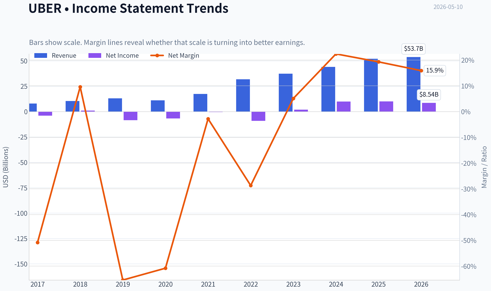

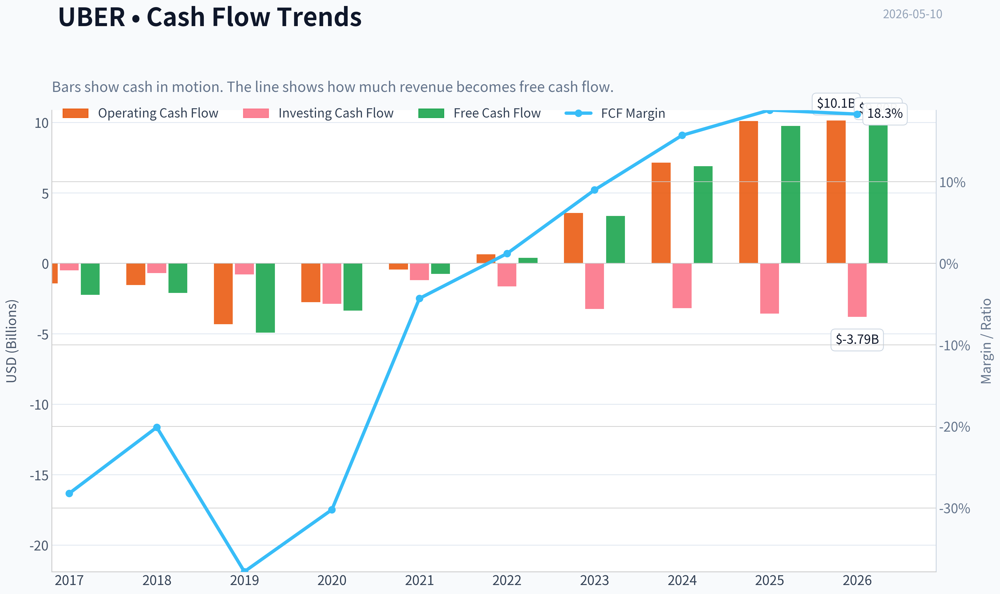

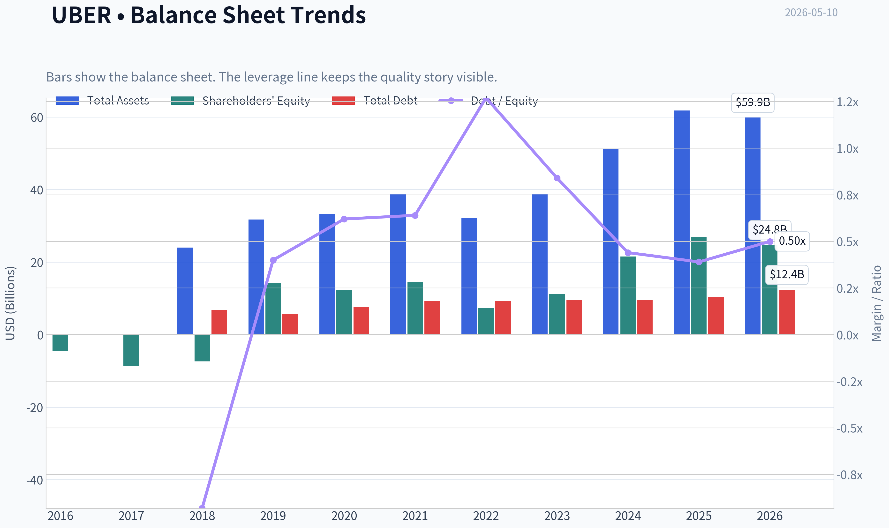

This graph tracks the profitability and return metrics (ROE, ROIC, Margins) of **UBER** over the past decade, highlighting capital efficiency trends.

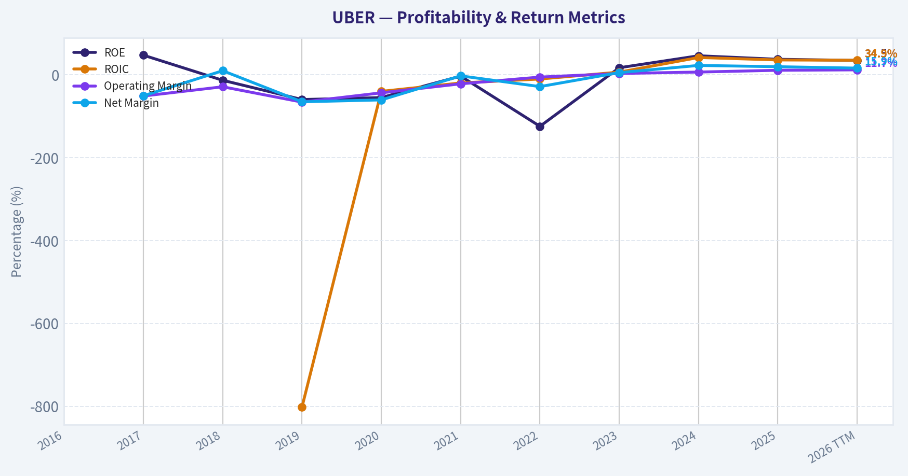

This chart illustrates the financial health of **UBER** over the last 10 years, mapping cash equivalents and free cash flow against total obligations (Debt).

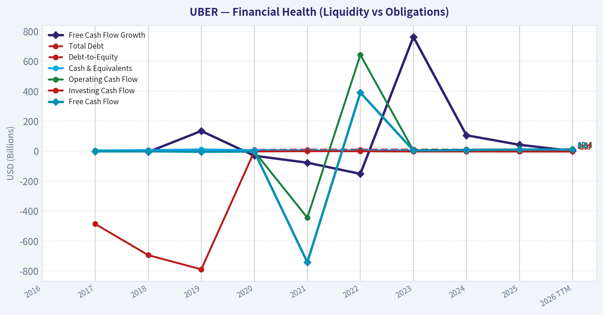

This comparison chart from *Profitability Analysis* stacks current figures against historical benchmarks for **UBER**, making it easy to see where the company trades relative to its own averages.

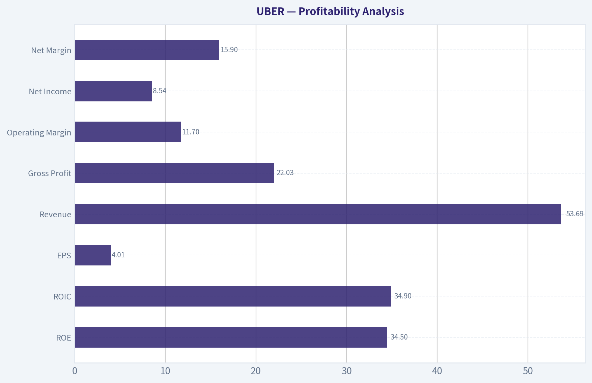

---

### Intrinsic Value Analysis (Buffett)

> *Following Warren Buffett's value investing philosophy: Circle of Competence, Economic Moat, Management Quality, and Margin of Safety.*

#### Intrinsic Value Snapshot

Price is what you pay. Intrinsic value is what the business may be worth based on the cash it can create for owners over time. We show a range, not one magic number.

- Current Price: $75.45
- Value Range: $143.06 to $441.57

##### Owner Earnings (Buffett Method)
- Net Income: $10,053,000,000.00
- Depreciation & Amortization: $747,000,000.00
- Capital Expenditures: $-336,000,000.00
- Working Capital Changes: $2,227,000,000.00
- Owner Earnings: $8,237,000,000.00

##### Intrinsic Value
###### Buffett Method
Uses owner earnings. Stricter, and usually more conservative.
- Conservative: $143.06
- Average: $143.06
- Optimistic: $372.55
- Discount Rate: 10.0%

###### Cash Flow Method
Uses free cash flow. Better for companies spending heavily today to grow tomorrow.
- Conservative: $169.56
- Average: $169.56
- Optimistic: $441.57
- Discount Rate: 10.0%

ANALYST STANCE: **WATCH**

#### UBER (Uber Technologies) - Buffett-Style Preliminary Investment Review

I could not retrieve the full audited financial history from the tools in this run, so this is a **partial but usable assessment** based on the shared research pack you provided. I've pushed the analysis as far as the available data allows.

---

#### 1. Go/No-Go Gate Assessment

| Gate | Verdict | Evidence |
|---|---|---|
| Gate 1: Business Simplicity | **Pass** | Uber connects riders with drivers, diners with couriers, and shippers with carriers, taking a cut of each transaction. The model is understandable, though multi-segment execution adds some complexity. |
| Gate 1: 10-Year Predictability | **Partial Pass** | Core demand for transport and delivery likely persists, but the long-term economics are less certain because of regulation, labor classification, competition, and autonomous vehicle disruption. |
| Gate 1: Technology Risk | **Mixed** | Uber benefits from technology today, but technology could also reshape industry profit pools. Robotaxis could help Uber if it remains the demand aggregator, but could hurt driver-based economics. |
| Gate 2: Moat | **Partial Pass** | Uber appears to have scale, brand, marketplace density, and demand aggregation advantages. But moat durability is less certain than for classic Buffett businesses because switching costs are limited. |
| Gate 3: Management & Capital Allocation | **Partial Pass** | Recent profitability, positive FCF yield, and improving discipline are encouraging. But I do not have enough direct evidence here on buyback discipline, acquisition history, or long-term owner-oriented capital allocation. |
| Gate 4: Industry Structure | **Mixed / Weak Pass** | Ride-sharing and delivery are competitive industries, not ideal rational oligopolies. However, Uber's scale may be allowing it to emerge stronger than smaller rivals. |

**Key Takeaways:** Uber clears the first gate because the business is understandable, but it does not sail through the Buffett filter cleanly. The main issues are industry competitiveness, uncertain long-term economics, and technology-driven disruption. This is not the kind of ultra-simple, highly predictable business Buffett historically loves.

---

#### 2. Moat Analysis

| Moat Source | Assessment | Evidence / Comments |
|---|---|---|
| Intangible Assets | **Moderate** | Uber has a globally recognized brand and strong app awareness, but brand alone may not support large price increases without affecting volume. |
| Switching Costs | **Weak to Moderate** | Riders and eaters can switch apps easily; drivers also multi-home. True switching costs are low, though habit and marketplace liquidity help retention. |
| Cost Advantage | **Moderate** | Scale likely improves dispatch efficiency, marketing efficiency, and overhead absorption. Uber may have structural density advantages in major markets. |
| Network Effects | **Moderate to Strong** | More riders attract more drivers; more drivers improve wait times; better liquidity improves the platform. This is the strongest part of the moat case. |

| Moat Quality Rating | Conclusion |
|---|---|
| **Narrow to Moderate** | Useful platform scale advantages, but not a classic "wide moat" in the Buffett sense. |

**Key Takeaways:** Uber's best moat is its network density and scale, not switching costs. The company likely has an advantage over smaller competitors, but customers and drivers can still move between platforms relatively easily. That makes the moat real, but not obviously wide or unassailable.

---

#### 3. Management Quality Assessment

| Dimension | Preliminary View | Comments |
|---|---|---|
| Owner Orientation | **Unclear** | I do not have insider ownership and compensation alignment data from tools in this run. |
| Candor & Honesty | **Neutral to Positive** | No major accounting red flags are present in the shared pack, but this needs fuller source verification. |
| Capital Allocation | **Improving** | Positive FCF yield and better profitability suggest stronger discipline than in Uber's earlier growth-at-all-costs years. Still, this requires a longer record before calling it excellent. |

**Key Takeaways:** Management appears to be improving operational discipline, which matters for a company that spent years proving it could earn real money. But without a detailed capital allocation history, I cannot yet rate management as clearly Buffett-grade.

---

#### 4. Snapshot Financial Summary

| Metric | Value |
|---|---:|
| Current Price | **$75** |
| Market Cap | **$153.59B** |
| P/E | **18.72x** |
| ROE | **37.2%** |
| Revenue Growth YoY | **18.3%** |
| FCF Yield | **6.4%** |
| Current Ratio | **1.14x** |
| Gross Margin | **N/A from pack** |

**Key Takeaways:** On the surface, Uber looks more financially credible than many investors still assume. The combination of mid-teens revenue growth, a sub-20 P/E, and a 6.4% free cash flow yield suggests the market is no longer treating it as a pure speculative growth story. Still, one-year snapshot metrics are not enough for a Buffett-style conclusion.

---

#### 5. Buffett Financial Lens

| Test | Preliminary Read | Comment |
|---|---|---|
| ROE >15% | **Pass** | 37.2% is excellent on its face, but we need to know whether it is boosted by accounting effects or balance sheet structure. |
| Cash Conversion | **Likely Pass** | Positive FCF yield is encouraging, implying real cash generation. |
| Balance Sheet Safety | **Partial Pass** | Current ratio of 1.14 is acceptable, though not fortress-like. Debt details unavailable here. |
| Capital Intensity | **Better than traditional transport** | Uber is asset-light relative to taxi fleets or logistics operators, which is a major plus. |

**Key Takeaways:** Uber's strongest Buffett-style financial quality is that it appears increasingly asset-light and cash generative. The weak point is that we do not yet have enough long-run data to judge how durable these returns really are through a full cycle.

---

#### 6. Owner Earnings Estimate

Because we do **not** have full audited line items for net income, depreciation, maintenance capex, and working capital changes in this run, I cannot calculate true Buffett-style owner earnings precisely.

Using the shared pack only:

- **FCF yield = 6.4%**
- **Market cap = $153.59B**
- Implied **FCF ~ $9.83B**

Approximation:
- If free cash flow is a rough proxy for owner earnings for this asset-light platform, then **owner earnings may be in the neighborhood of $9.5B-$10.0B**.

This is only a **rough placeholder**, not a final owner earnings figure.

---

#### 7. Three-Scenario DCF Valuation

Using the rough owner earnings proxy of **$9.83B** and a **10% discount rate**:

| Scenario | Assumption | Approximate Equity Value |
|---|---|---:|
| A: No Growth | Owner Earnings / 10% | **$98.3B** |
| B: GDP Growth | OE x 1.03 / (10% - 3%) | **$144.7B** |
| C: Higher Growth | Assume 6% growth for 10 years, then 3% terminal | **~$170B-$185B** |

**Key Takeaways:** On rough math, Uber looks expensive under a no-growth framework, roughly fair to slightly expensive under a conservative GDP-growth view, and modestly attractive only if it can sustain healthy growth for many years. In Buffett terms, the valuation case depends heavily on future execution, which reduces certainty.

---

#### 8. Margin of Safety Analysis

| Item | Value |
|---|---:|
| Current Market Cap | **$153.59B** |
| Scenario A Value | **$98.3B** |
| Scenario B Value | **$144.7B** |
| Scenario C Value | **~$170B-$185B** |

| Margin of Safety vs Current Price | Read |
|---|---|
| Scenario A | **Negative** |
| Scenario B | **Minimal / Negative** |
| Scenario C | **Positive, but growth-dependent** |

**Key Takeaways:** There is no clear Buffett-style margin of safety unless you believe Uber can keep compounding at a solid rate for a long time. That is too conditional for a high-conviction value purchase.

---

#### 9. Final Buffett Scorecard

| Criterion | Weight | Score (1-5) | Weighted Score |
|---|---:|---:|---:|
| Business Understanding | 20% | 4.0 | 0.80 |
| Moat Width & Durability | 25% | 3.0 | 0.75 |
| Management Quality | 15% | 3.0 | 0.45 |
| Return on Equity | 15% | 4.0 | 0.60 |
| Reinvestment Runway | 10% | 3.5 | 0.35 |
| Balance Sheet Strength | 5% | 3.0 | 0.15 |
| Industry Structure | 5% | 2.5 | 0.13 |
| Valuation / Margin of Safety | 5% | 2.5 | 0.13 |

| Total | Score |
|---|---:|
| **Weighted Average** | **3.36 / 5.0** |

**Key Takeaways:** Uber scores as a decent business with meaningful strengths, but not a classic Buffett-grade "wonderful company at a fair price." The biggest drags are industry structure and lack of a compelling margin of safety.

---

#### 10. Final Stance

**Investment Stance: WATCH**
**Conviction Level: Moderate**

Uber is becoming a more serious business than its early reputation suggests. The company now appears to have real scale advantages, strong platform economics, and healthy cash generation. However, from a strict Buffett perspective, it still falls short on the most important traits: **simple long-term predictability, an unquestionably durable moat, and a wide margin of safety**.

At **$75**, Uber does **not** appear obviously cheap. It may work well for investors comfortable underwriting multi-year growth, execution, and platform dominance. But for a Buffett-style value investor demanding durability and downside protection, this is more of a **watchlist compounder** than an immediate buy.

#### What is missing for a full final report
To complete a true Buffett-grade underwriting memo, the next assistant should gather:

1. **10-year annual income statement, balance sheet, and cash flow history**
2. **Debt, interest coverage, and net cash/net debt**
3. **Share count trend and buyback issuance history**
4. **ROIC and ROE decomposition**
5. **Net income vs operating cash flow over time**
6. **Capex and working capital history for owner earnings**
7. **Management compensation / insider ownership / capital allocation record**

If you want, I can also turn this into a **one-page investment committee memo** or a **bull vs bear debate format**.
#### Valuation Bridge

This bridge places the current market price beside each intrinsic value lens so readers can see whether upside depends on one method or shows up across several methods.

| Scenario | Intrinsic Value / Share |
| --- | ---: |
| Buffett Method | $143.06 |
| Cash Flow Method | $169.56 |
| Damodaran Method | $-330.18 |
| Current Price | $75.45 |

#### Key Takeaways

If one method is far above the others, the upside case depends on a specific modelling assumption. When several methods cluster together, the valuation story is more robust.

#### Valuation Visuals

This comparison chart from *Latest Earnings Snapshot* stacks current figures against historical benchmarks for **UBER**, making it easy to see where the company trades relative to its own averages.

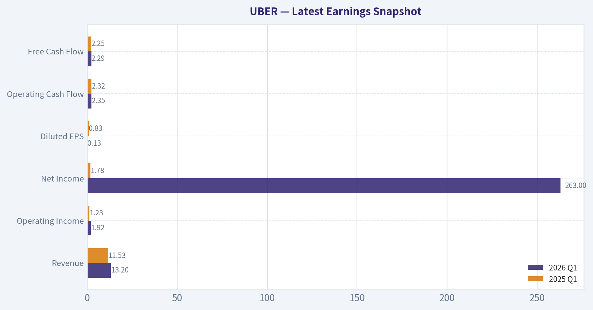

This comparison chart from *Current vs Historical Average Comparison* stacks current figures against historical benchmarks for **UBER**, making it easy to see where the company trades relative to its own averages.

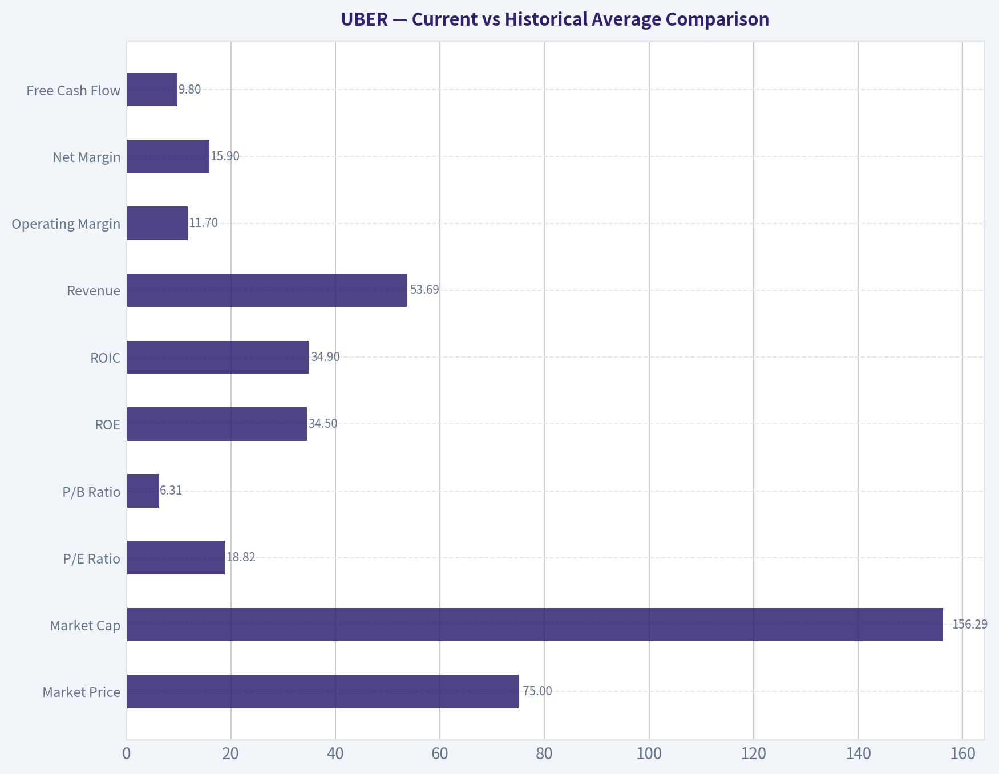

This comparison chart from *Balance Sheet and Financial Strength* stacks current figures against historical benchmarks for **UBER**, making it easy to see where the company trades relative to its own averages.

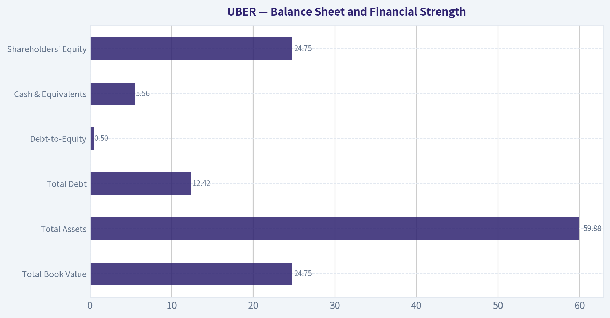

---

### Trend & Growth Analysis (Lynch/Druckenmiller/Fisher)

> *Following Peter Lynch's GARP, Stanley Druckenmiller's macro-aware approach, and Philip Fisher's scuttlebutt methodology.*

ANALYST STANCE: **WATCH**

#### UBER Growth Analysis

#### 1. Lynch Classification

| Metric | UBER |
|---|---:|
| Revenue growth YoY | 18.3% |
| P/E | 18.7x |
| Market cap | $153.6B |
| Category | Fast Grower / Platform Compounder |

Key Takeaways: Uber still qualifies as a fast grower by Lynch standards because revenue is growing in the high teens at very large scale. That is notable for a company of this size. However, at over $150 billion market cap, the burden of proof for ten-bagger upside is much higher than it would be for a smaller company.

#### 2. The Story in 3 Bulsts

| Simple Story | Why It Matters |
|---|---|
| Uber is the global demand aggregation layer for mobility and local delivery. | The larger the network gets, the more efficient supply-demand matching becomes. |
| It is evolving from a ride-hailing app into a multi-vertical logistics platform. | Cross-selling rides, delivery, memberships, ads, and autonomous fleets expands TAM. |
| The next leg of upside could come from autonomy, advertising, and higher utilization of the network. | These could improve margins faster than revenue alone. |

Key Takeaways: The core story is easy to explain: Uber connects people, drivers, merchants, and couriers on one global marketplace. The more use cases it adds, the more valuable the network becomes. The bull case depends less on basic ride growth and more on monetizing this network in new, higher-margin ways.

#### 3. TAM Analysis and 10x Test

| Item | Estimate / View |
|---|---:|
| Current revenue base | Large, already global scale |
| 10x revenue test | Difficult from current size |
| Core mobility TAM | Huge, but highly competitive and regulated |
| Delivery / local commerce TAM | Large and still digitizing |
| New TAM vectors | Ads, enterprise logistics, autonomy, memberships |
| 10x and remain under 20% TAM? | Unclear / unlikely on current core businesses alone |

Key Takeaways: Uber still has a long runway, but the pure 10x test is much harder now because the company is already very large. Future upside likely depends on expanding TAM rather than simply taking more share in rides. In other words, autonomy and platform monetization matter more than legacy ride-hailing growth.

#### 4. Revenue Growth Trend

| Period View | Assessment |
|---|---|
| Latest YoY growth | 18.3% |
| Pattern | Healthy but not hypergrowth |
| Signal | Stable-to-moderate growth, not clear acceleration |
| Lynch read | Attractive if margins and cash flow keep improving |

Key Takeaways: Revenue growth remains solid, but based on the data provided, there is no clear evidence of a dramatic acceleration inflection right now. This looks more like sustained scaled growth than an early-stage breakout. For a growth investor, that makes execution and margin expansion especially important.

#### 5. Unit Economics Snapshot

| Metric | UBER | Interpretation |
|---|---:|---|
| FCF yield | 6.4% | Strong for a growth platform |
| ROE | 37.2% | Excellent, though may reflect capital-light model and accounting effects |
| Current ratio | 1.14x | Adequate liquidity |
| Gross margin | N/A | Need more detail |
| LTV/CAC | N/A | Not disclosed here |
| NRR | N/A | Not applicable in classic SaaS sense |
| Rule of 40 | Partial only | Likely supported by growth + cash generation |

Key Takeaways: The best part of the Uber setup is that it now combines growth with real cash generation. A 6.4 percent free cash flow yield is unusually attractive for a platform still growing revenue in the high teens. The missing piece is more granular unit economics by segment, especially for delivery and newer monetization streams.

#### 6. Inflection Point Assessment

| Potential Inflection | Evidence | View |
|---|---|---|
| Margin inflection | Positive FCF and scale benefits | Real |
| Product/TAM inflection | Autonomous vehicle partnerships and robotaxi initiatives | Emerging |
| Ad monetization inflection | Possible, but not quantified here | Watch |
| Market share inflection | Not enough evidence provided | Unclear |
| Earnings power inflection | P/E of 18.7x suggests market still not pricing it like elite growth | Interesting |

Key Takeaways: The most credible inflection is not revenue acceleration but earnings and free cash flow leverage. Uber may be entering a phase where the market starts valuing it as a scaled compounder instead of a perpetual story stock. Autonomous partnerships could become the next major narrative shift if execution improves and economics prove attractive.

#### 7. Macro Setup Evaluation

| Macro Factor | Effect on UBER |
|---|---|
| Consumer spending | Moderate sensitivity |
| Labor/gig economy trends | Mixed; supply flexibility helps, regulation can hurt |
| Interest rates | Lower rates help valuation |
| Secular themes | Local commerce digitization, AI/logistics optimization, autonomous mobility |
| Economic cycle | Mid-cycle style exposure; resilient but not immune |

Key Takeaways: Uber has exposure to strong secular themes, especially digitization of transport and local commerce. The main macro tension is that it benefits from platform scale and flexibility, but remains exposed to regulatory and consumer-demand shifts. It is not as rate-sensitive as unprofitable tech, which is a relative advantage.

#### 8. Fisher 15 Points Score

| Fisher Area | Score (1-5) | Notes |
|---|---:|---|
| Market potential | 5 | Massive global categories |
| New products | 4 | Expanding into autonomy, ads, logistics |
| R&D effectiveness | 3 | Hard to judge from current data |
| Sales organization | 4 | Strong two-sided marketplace execution |
| Profit margin | 3 | Improving, but structurally not elite |
| Margin improvement | 4 | Stronger than prior years |
| Labor relations | 2 | Ongoing structural friction in gig model |
| Executive relations | 4 | Better stability than earlier years |
| Management depth | 4 | Mature operating leadership |
| Cost/accounting controls | 3 | Better, but history was messy |
| Outstanding moat traits | 4 | Network density, brand, scale |
| Long-range profit outlook | 4 | Better than market once assumed |
| Dilution risk | 3 | Better now, but historically relevant |
| Candor | 3 | Mixed but improved |
| Integrity | 3 | Average/improving |

| Total Fisher Score | 53 / 75 |
|---|---:|

Key Takeaways: Uber scores as above average but not elite under Fisher's framework. Its strongest areas are market opportunity, platform scale, and improving long-term economics. Its weakest areas remain labor-model friction, regulatory complexity, and uncertainty around the durability of very high future margins.

#### 9. Valuation Analysis

| Valuation Metric | UBER | Read |
|---|---:|---|
| P/E | 18.7x | Reasonable |
| Earnings growth proxy | Not fully provided | Incomplete |
| PEG | Not reliably calculable from given data | N/A |
| FCF yield | 6.4% | Attractive |
| Market cap | $153.6B | Large-cap limits multiple expansion upside |

| Scenario | View |
|---|---|
| Bear | Growth slows into low teens; autonomy delayed; valuation stays market-like |
| Base | Mid/high teens revenue growth with continued FCF scaling; modest upside |
| Bull | Autonomy, ads, and platform monetization expand margins materially; rerating possible |

Key Takeaways: On the data available, Uber does not look expensive. In fact, an 18.7 times earnings multiple with a 6.4 percent free cash flow yield looks fairly attractive for a company still growing revenue 18 percent. The issue is less valuation and more whether a new acceleration narrative emerges to justify major upside from an already large base.

#### 10. Growth Investor Scorecard

| Criterion | Weight | Score | Weighted |
|---|---:|---:|---:|
| The Story | 10% | 4.0 | 0.40 |
| TAM & Runway | 20% | 3.5 | 0.70 |
| Revenue Growth | 20% | 3.5 | 0.70 |
| Unit Economics | 15% | 4.0 | 0.60 |
| Competitive Position | 10% | 4.0 | 0.40 |
| Management Quality | 10% | 3.5 | 0.35 |
| Macro Setup | 5% | 3.0 | 0.15 |
| Profitability Path | 5% | 4.0 | 0.20 |
| Valuation | 5% | 4.0 | 0.20 |

| Total Score | 3.70 / 5.00 |
|---|---:|

Key Takeaways: Uber lands in the lower end of the advocate range numerically, but I am keeping the practical stance at Watch because the missing variable is a confirmed growth inflection. The business is clearly stronger and more investable than in prior years. What would move it to a higher-conviction call is proof that autonomy, ads, or delivery monetization can accelerate earnings power beyond consensus.

#### 11. Position Size Stance

| Factor | View |
|---|---|
| Conviction | Moderate |
| Suggested stance | WATCH |
| Position sizing if owned | Core hold / medium position |
| Position sizing if new | Starter only, wait for inflection confirmation |

Key Takeaways: Uber looks more like a disciplined hold or starter position than an aggressive fresh bet. The business quality and cash flow have improved enough to respect it. But for concentrated growth capital, I would prefer either a clearer acceleration signal or a more dislocated entry.

#### 12. Key Risks and Catalysts

| Risks | Catalysts |
|---|---|
| Regulation of gig labor | Autonomous rollout economics improve |
| Competitive pricing pressure | Higher-margin ads and memberships scale |
| Consumer slowdown | Delivery and mobility cross-sell deepens |
| Execution risk in autonomy | Sustained FCF growth and buybacks |
| Large-cap law of numbers | Market rerates Uber as a compounder |

Key Takeaways: The biggest risks are regulatory and execution-related, not existential. The biggest upside catalysts are all tied to monetizing the platform better, especially through autonomous vehicles, advertising, and higher-margin ecosystem services. That means the stock likely works best if Uber becomes more than just a transportation marketplace.

#### Bottom Line

Uber is no longer a speculative platform story; it is becoming a real cash-generating compounder. That is bullish. But for a Lynch-Druckenmiller-Fisher style growth investor, the current setup looks more like a high-quality scaled platform at a reasonable valuation than a clean ten-bagger candidate from here.

So the right call today is:

ANALYST STANCE: **WATCH**

If you want, I can next do a more explicit **bull/base/bear 3-year valuation model for UBER** using revenue growth, margin expansion, and implied upside/downside.

#### Growth & Scorecard Visuals

This comparison chart from *Growth Metrics* stacks current figures against historical benchmarks for **UBER**, making it easy to see where the company trades relative to its own averages.

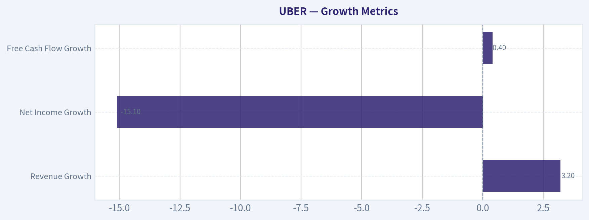

---

### Market Technical Analysis

#### UBER Technical Analysis Report

For **UBER**, the most relevant indicator set for the current market condition is:

| Selected Indicator | Why It Matters Now |
|---|---|
| `close_10_ema` | Best for judging the short-term rebound and whether recent upside can persist. |
| `close_50_sma` | Defines the medium-term trend and a key pivot zone around the current price. |
| `close_200_sma` | Confirms the broader structural trend, which remains weaker than the short-term bounce suggests. |
| `macd` | Tracks momentum recovery and whether bullish acceleration is strengthening or fading. |
| `rsi` | Helps assess whether the rebound is impulsive, exhausted, or still neutral. |
| `boll_ub` | Identifies near-term upside stretch and breakout resistance. |
| `boll_lb` | Identifies support and whether weakness is reverting or expanding lower. |
| `atr` | Critical for risk control because UBER's daily ranges remain meaningful even after volatility cooled. |

Key Takeaways: These eight indicators are well suited to UBER because they cover trend, momentum, volatility, and risk without excessive overlap. The stock is in a short-term recovery phase inside a still-weaker long-term structure, so traders need both fast and slow trend gauges, plus volatility context.

---

#### Price Structure and Trend Context

UBER's 1-year price path shows a clear sequence of phases rather than a single uniform trend. The stock rallied strongly into mid-2025, reaching the upper 90s and briefly trading above 100 in September and October 2025. That advance then broke down sharply in November and again in December, with price sliding into the low 80s. The selling pressure extended into early 2026, where the stock fell as low as the high 60s in late March.

Since that March trough, price action has improved, but the rebound is still incomplete. UBER recovered from about **69.18 on 2026-03-27** to **79.17 on 2026-05-06**, then quickly slipped back to **75.45 on 2026-05-08**. That pattern matters: buyers have proven they can stage sharp recoveries, but follow-through has not yet been stable enough to re-establish a durable uptrend.

The stock therefore appears to be in a **countertrend recovery within a damaged longer-term structure**, rather than a clean new bull leg.

| Trend Lens | Observation | Interpretation |
|---|---|---|
| Long-term | Price is far below prior 2025 highs near 100 | Long-term recovery remains incomplete |
| Medium-term | March low to early May rebound is constructive | Sellers lost full control, but not decisively |
| Short-term | Strong pop on May 6 followed by quick giveback | Momentum exists, but conviction is uneven |

Key Takeaways: UBER is no longer in freefall, but it has not yet repaired the technical damage from the late-2025 and early-2026 breakdown. The current setup looks more like a recovery attempt than a confirmed long-term uptrend.

---

#### Moving Average Analysis

The moving averages show a very important separation between timeframes.

- **10 EMA (May 8): 75.54**
- **50 SMA (May 8): 74.27**
- **200 SMA (May 8): 84.81**
- **Close (May 8): 75.45**

Price is sitting **essentially on the 10 EMA** and **above the 50 SMA**, which is constructive in the near term. However, both price and the 50-day average remain **well below the 200-day average**, which means the longer-term trend is still bearish or at best in repair mode.

The 50 SMA had been declining through March, from roughly **78.27** down to **73.54-74.27** by late April and early May. More recently, that decline has flattened materially. This flattening is an early sign that downside pressure is no longer dominating at the same pace.

The 200 SMA continues to slope downward, dropping from about **87.91 in mid-March** to **84.81 by May 8**. That is a clear sign that the bigger-picture trend remains under pressure.

| Metric | Latest Reading | Trend Message |
|---|---:|---|
| Close | 75.45 | Holding near short-term trend support |
| `close_10_ema` | 75.54 | Short-term momentum cooling after rebound |
| `close_50_sma` | 74.27 | Medium-term base is improving |
| `close_200_sma` | 84.81 | Long-term overhead trend remains bearish |

Key Takeaways: UBER is trading in a better short-term position than it was a month ago because price is above the 50-day average. But the much higher 200-day average shows the stock is still below its long-term equilibrium, meaning rallies may face heavier resistance than they first appear.

---

#### Momentum Analysis: MACD and RSI

The momentum picture is improving, but not euphoric.

The **MACD** moved from deeply negative territory in early April, around **-1.12 to -0.84**, to positive territory by mid-to-late April and remains positive at **0.53 on May 8**. This is one of the strongest signs that the March-April recovery was real rather than random noise. Importantly, the MACD did not merely bounce toward zero; it crossed above it and stayed positive into May.

However, there is also some nuance. MACD peaked more strongly in late April, around **0.77**, then cooled to **0.53**. So momentum is still positive, but its rate of improvement has slowed.

The **RSI** at **51.47 on May 8** is almost perfectly neutral. That is notable because after the sharp May 6 surge, RSI reached **62.31**, then quickly fell back. This suggests the rebound briefly became energetic, but not truly overbought. The reset toward 50 means the stock is neither stretched bullishly nor washed out bearishly right now.

| Momentum Indicator | Latest | What It Suggests |
|---|---:|---|
| `macd` | 0.53 | Bullish momentum still positive |
| `rsi` | 51.47 | Neutral; rebound is not overheated |
| Recent RSI peak | 62.31 on May 6 | Short-term enthusiasm faded quickly |

Key Takeaways: Momentum has improved meaningfully from the deeply negative levels seen in early April, which supports the idea of a developing recovery. But RSI near 51 and a cooling MACD show this is not a runaway breakout; it is a tradable rebound that still needs confirmation.

---

#### Volatility and Bollinger Band Context

Bollinger Bands show that UBER is trading near the middle of its recent volatility envelope rather than at an extreme.

On **May 8**:
- **Upper Band (`boll_ub`) = 78.99**
- **Lower Band (`boll_lb`) = 71.87**
- **Close = 75.45**

That places price roughly in the middle-lower half of the band range after failing to hold the strong upward burst from May 6. This tells us two things:

1. The stock is **not overextended upward** despite the recent jump.
2. The stock still has room to move in either direction without immediately signaling an exhaustion extreme.

The band width has widened somewhat from late April into early May, reflecting a pickup in movement. That aligns with the sharp May 6 breakout attempt and subsequent pullback.

| Bollinger Metric | Latest | Implication |
|---|---:|---|
| `boll_ub` | 78.99 | First meaningful upside volatility resistance |
| `boll_lb` | 71.87 | Lower support zone if rebound weakens |
| Band Position | Mid-range | No immediate overbought/oversold extreme |

Key Takeaways: UBER is not currently pinned to either Bollinger extreme, which means price still has flexibility. Resistance appears to begin near 79, while downside risk opens more clearly if the stock starts moving back toward the low 70s.

---

#### Volatility and Risk: ATR

**ATR is 2.71** as of May 8, up from around **2.22-2.26** in early May. That means recent daily swings have expanded again. For a stock trading in the mid-70s, a 2.7-point ATR is meaningful and implies that even a normal trading day can produce moves of roughly 3.5% or more.

This matters especially because UBER just demonstrated a pattern of:
- explosive upside on May 6,
- immediate rejection on May 7,
- continued pullback on May 8.

That sequence suggests traders should avoid tight stop placement and should size positions with more caution than they would in a slower-moving large cap.

| Risk Metric | Latest | Trading Meaning |
|---|---:|---|
| `atr` | 2.71 | Daily movement remains materially elevated |
| ATR trend | Rising vs early May | Breakout/pullback regime is active |

Key Takeaways: UBER remains volatile enough that position sizing and stop placement matter a lot. Traders should expect larger-than-average daily swings and avoid interpreting every 1- to 2-point move as a major regime change.

---

#### Fine-Grained Interpretation for Traders

The most important technical tension in UBER is this:

- **Short-term conditions have improved**
- **Long-term structure is still weak**
- **Recent breakout energy did not fully hold**

That combination usually creates a market where tactical trading works better than aggressive trend-chasing.

A few practical observations:

| Scenario | What Traders Should Watch | Technical Meaning |
|---|---|---|
| Bullish continuation | Sustained closes above 10 EMA and above recent highs near 79-80 | Would strengthen case for recovery extension |
| Healthy consolidation | Price holds above 50 SMA near 74.3 while RSI stays near 50+ | Suggests buyers are absorbing supply |
| Failed rebound | Break below 50 SMA with MACD rolling lower and RSI slipping under mid-40s | Signals rebound may have been temporary |
| Stronger trend repair | Price begins closing back toward 200 SMA near 84.8 | Would mark a deeper structural improvement |

Key Takeaways: The best bullish evidence would be UBER reclaiming and holding the 79 to 80 area without losing the 74 region. The main warning sign would be a break back under the 50-day average, which would suggest the recent recovery lacked durability.

---

#### Bottom Line

UBER is in a **short-term recovery phase**, but it is **not yet in a confirmed long-term uptrend**.

The technical evidence currently favors a **cautiously constructive near-term stance** because:
- price is above the 50 SMA,
- MACD is positive,
- RSI is neutral rather than exhausted.

But that constructive view is limited by:
- price remaining far below the 200 SMA,
- recent breakout follow-through fading quickly,
- ATR showing that volatility is still high enough to create sharp reversals.

For traders, UBER currently looks more attractive as a **swing-trade recovery candidate** than as a fully confirmed trend-following long-term breakout.

| Category | Key Point | Trading Relevance |
|---|---|---|
| Short-term trend | Price near 10 EMA and above 50 SMA | Near-term structure improved |
| Long-term trend | Well below 200 SMA | Bigger trend still under repair |
| Momentum | MACD positive, RSI neutral | Recovery intact but not explosive |
| Volatility | ATR elevated | Risk control remains essential |
| Bands | Price below upper band, above lower band | No immediate extreme; room both ways |
| Main support | 74 area, then 71.9 band region | Important for preserving rebound |
| Main resistance | 79-80 first, then 84.8 | Key hurdles for trend repair |

Key Takeaways: UBER's chart is improving, but the improvement is still early and somewhat fragile. Traders should treat the stock as a recovery setup with clear support near the mid-70s and meaningful resistance before the low 80s.

#### Market Visuals

This comparison chart from *Market Metrics* stacks current figures against historical benchmarks for **UBER**, making it easy to see where the company trades relative to its own averages.

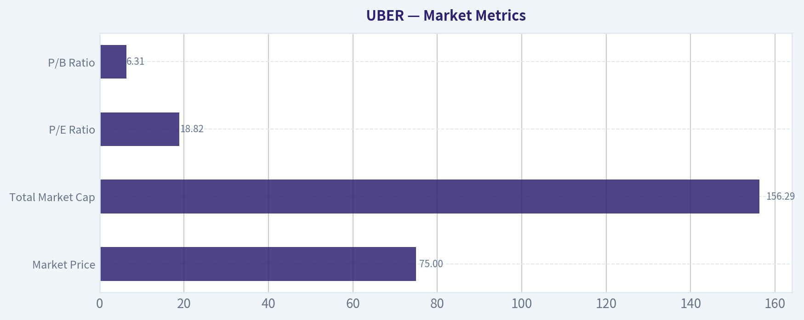

---

### News & Events Analysis

#### Uber (UBER) trading and investment report
**Date:** 2026-05-10
**Price / market cap:** about **$75 / $153.6B**

Uber's near-term setup looks **fundamentally constructive**, but the stock is increasingly being priced not just as a rides-and-delivery platform, but as a **mobility network with embedded autonomy optionality**. Over the last week, the main tradable drivers were: a strong latest earnings print, management's confident commentary on bookings and competitive positioning, and new attention on Uber's long-term robotaxi partnerships, especially Rivian and Waymo-related commentary.

---

#### Latest earnings: explicit review of the most recent reported period
Uber **recently reported Q1 2026** results. That is the latest reported quarterly period available in the news flow this week.

Based on earnings coverage in the past few days, the key headline read-through was:
- Uber **beat on EPS**
- Management pointed to **strong bookings growth / outlook**
- Commentary suggested the core business remained resilient despite concerns around geopolitics and robotaxi competition

What changed versus prior expectations or prior period:
- Versus market expectations, the important change was that Uber appears to have **outperformed consensus on profitability**, which matters because investors have been debating whether Uber can sustain margin gains while still investing in autonomy partnerships.
- Versus the prior year period, the shared research pack shows **revenue growth of 18.3% YoY**, indicating the company is still producing solid top-line expansion at scale.
- Versus prior investor concerns, management specifically pushed back on the idea that **Waymo has already hurt Uber's business**, which is an important signal for traders worried that autonomy is an immediate displacement threat rather than a staged transition.
- Versus earlier guidance sentiment, the market appears to have taken comfort from Uber's **continued bookings confidence**, suggesting demand trends in mobility and delivery remain intact.

Interpretation:
The earnings report appears to reinforce the thesis that Uber is in a **higher-quality phase of its lifecycle**: still growing, already profitable, and generating meaningful cash flow. That combination matters because it gives Uber room to fund partnerships and ecosystem bets without relying on aggressive balance-sheet risk.

---

#### Company-specific news and trading implications

| Theme | Recent development | Trading / investment implication |
|---|---|---|
| Q1 2026 earnings | Uber posted a strong Q1, with EPS beat and solid bookings commentary | Supports near-term bullish sentiment; lowers fear of a demand slowdown and supports multiple durability |
| Robotaxi strategy | Uber committed to buy **10,000 Rivian autonomous R2 SUVs in 2028**, with another **40,000 by 2030** discussed in coverage | Signals Uber wants to be the demand layer and fleet orchestrator rather than own all autonomy IP; bullish for long-term platform relevance, though near-term capex/partner execution questions remain |
| Waymo competition | CEO Dara Khosrowshahi said Waymo has **not impacted business** materially | Important rebuttal to a major bear case; suggests autonomy is currently additive/market-expanding rather than immediately cannibalistic |
| Strategic equity / ecosystem exposure | SEC-related coverage highlighted holdings in Grab, Aurora, Lucid, WeRide, Joby, Serve Robotics and others | Uber increasingly resembles a mobility ecosystem portfolio; can create hidden asset value but also adds mark-to-market and strategic complexity |
| Lime IPO | Uber-backed Lime filed for IPO | Could help investors revalue Uber's non-core strategic assets and reinforce the "urban mobility network" narrative |
| Gig economy peer context | Morgan Stanley highlighted themes after Uber, DoorDash, Instacart earnings | Uber's results are being interpreted inside a broader platform-efficiency and consumer-demand framework, which can lift sector sentiment if peers confirm resilience |

**Key Takeaways:** Uber's most important company-specific catalyst was the Q1 2026 earnings beat, which strengthened confidence in both profitability and bookings momentum. At the same time, autonomy-related headlines are shifting the narrative from "robotaxis are a threat" toward "Uber can be the marketplace and distribution layer for autonomous mobility." That is supportive for valuation, but it also means the stock may increasingly trade on partnership announcements and strategic execution, not just quarterly ride and delivery growth.

---

#### Macro and market context
The broader macro backdrop this week was not uniformly soft. Labor-related headlines suggested employment remains reasonably firm, but there are also signs that **consumers are sending mixed warning signals**. For Uber, that matters in a nuanced way:

- **Mobility** can remain resilient if commuting, travel, and nightlife demand stay healthy.
- **Delivery** can be more sensitive to lower-income consumer pressure, especially if discretionary ordering softens.
- If the economy slows modestly rather than sharply, Uber may actually hold up better than many consumer-exposed names because it serves both convenience spending and practical transportation needs.

Rates and risk appetite also matter. Uber's current profile - profitable growth with autonomy optionality - tends to perform better when:
1. investors reward earnings quality,
2. large-cap platform names are favored,
3. the market is willing to underwrite longer-duration AI/autonomy stories.

If macro data worsens materially, Uber would likely still face pressure through consumer-demand fears, but its stronger profitability profile should make it **less fragile than earlier-cycle high-growth stories**.

---

#### What matters most for traders right now

| Factor | Bullish read | Bearish read | What to watch next |
|---|---|---|---|
| Core demand | Strong Q1 and bookings commentary imply healthy rides/delivery usage | Consumer softness could emerge with a lag, especially in delivery | Gross bookings trends, frequency, take rate commentary |
| Profitability | EPS beat supports confidence in operating leverage | Aggressive autonomy partnership spending could pressure future margins | Margin guidance, incentive spending, insurance cost trends |
| Autonomy narrative | Uber can win as aggregator without building full stack itself | If partners capture economics, Uber may become a lower-margin distributor | More detail on economics of Waymo, Rivian, Aurora, WeRide relationships |
| Competitive dynamics | Management says Waymo not hurting business yet | If autonomous rivals scale faster in key cities, narrative could reverse quickly | City-by-city share data, pricing, wait times, AV rider adoption |
| Valuation | P/E ~18.7 is not extreme for 18%+ growth and high ROE | Stock may already discount a lot of execution success | Whether estimate revisions continue upward after earnings |

**Key Takeaways:** The stock's short-term bull case rests on three pillars: healthy demand, improving profitability, and a credible role in autonomous mobility. The main risk is that investors may be getting ahead of themselves on autonomy economics before those partnerships produce visible, high-margin revenue. For now, the earnings beat gives bulls the stronger hand, but the next leg up likely needs continued estimate revisions or clearer monetization from strategic partnerships.

---

#### Balance sheet, quality, and positioning
From the shared research pack:
- **Revenue growth YoY:** 18.3%
- **ROE:** 37.2%
- **FCF yield:** 6.4%
- **Current ratio:** 1.14
- **P/E:** 18.7

This is a favorable quality mix for a platform stock. The most important point for investors is that Uber is no longer just a "story" stock; it is showing enough earnings power and free-cash-flow generation to justify strategic patience. The current ratio is adequate rather than exceptional, so balance-sheet strength is acceptable, but not the key differentiator. The real differentiator is the combination of **scale, growth, and cash generation**.

13F positioning in the shared pack is also notable:
- **Bill Ackman / Pershing Square** held a very large position essentially unchanged
- **Steve Cohen / Point72** sharply trimmed

That split is useful. It suggests long-duration fundamental investors may still see substantial upside, while faster-money or tactical investors may have taken profit or reduced risk after a strong move.

---

#### Investment view
My read from the last week's news is that Uber remains one of the more attractive large-cap internet/platform names for investors who want:
- ongoing double-digit growth,
- improving profitability,
- and upside to autonomy without needing Uber itself to invent the entire stack.

The near-term setup looks **constructive to mildly bullish** after earnings. The strongest argument for owning the stock is that the market may still be underestimating how valuable Uber's network could become if autonomy expands through partnerships rather than displaces the platform. The main caution is that robotaxi enthusiasm can create headline volatility and may front-load optimism well before unit economics are fully proven.

For traders:
- **Bullish trigger:** continued post-earnings estimate upgrades, more partnership clarity, or evidence autonomy expands supply without damaging Uber's take economics.
- **Bearish trigger:** softer consumer data translating into weaker bookings, or any sign AV partners disintermediate Uber in major urban markets.

---

#### Summary table

| Category | Key point | Why it matters for investors |
|---|---|---|
| Latest earnings | Uber's **Q1 2026** report beat on EPS and came with strong bookings commentary | Confirms operating momentum and supports sentiment after concerns about competition and macro softness |
| Growth | Revenue growth in the research pack is **18.3% YoY** | Shows Uber is still scaling meaningfully despite large size |
| Profitability / cash flow | P/E about **18.7**, FCF yield about **6.4%**, ROE **37.2%** | Suggests the stock has transitioned into profitable growth rather than pure narrative valuation |
| Autonomy | Rivian robotaxi fleet commitment and management's Waymo comments kept robotaxis front and center | Uber appears to be positioning as the network/marketplace layer of autonomous transport |
| Ecosystem assets | Stakes and partnerships across WeRide, Aurora, Grab, Joby, Serve, Lime | Adds strategic optionality and can support a sum-of-the-parts re-rating |
| Main risk | Consumer softness or adverse autonomy economics | Would challenge both near-term bookings and long-term valuation assumptions |
| Overall stance | Constructive / mildly bullish near term | Earnings strength currently outweighs competitive and macro concerns |

**Key Takeaways:** Uber's latest quarter improved the near-term investment case by showing that growth and profitability can coexist at scale. The bigger strategic story is autonomy, where Uber seems to be building the marketplace layer rather than the driving technology itself. That creates meaningful upside if partnerships work, but investors should keep watching whether those deals strengthen Uber's economics or simply add excitement without enough profit.

---

### Guru Attention Analysis

> *Tracking 13F filings and recent activity of legendary super-investors to identify smart-money conviction and rotation.*

#### UBER Guru Ownership Snapshot

Below is the **canonical 13F-based view** for tracked gurus in UBER as of the latest available filings. Per the structured SEC 13F data, only **Bill Ackman** and **Steve Cohen** currently show a disclosed position.

| Guru | Action | Position Size | Portfolio Weight | Recent Change | Timing | SEC Verification |
| --- | --- | --- | ---: | --- | --- | --- |
| Bill Ackman (Pershing Square) | Held | 30.21M shares, valued at $2.47B | 15.90% | -0.2% vs prior filing | 12-31-2025 filing period | [SEC 13F Filing](https://www.sec.gov/Archives/edgar/data/1336528/000117266126001091/) |
| Steve Cohen (Point72) | Trimmed | 1.01M shares, valued at $82.85M | 0.09% | -97.9% vs prior filing | 12-31-2025 filing period | [SEC 13F Filing](https://www.sec.gov/Archives/edgar/data/1603466/000090266426001100/) |

**Key Takeaways:** The clearest signal is from Bill Ackman, who still holds a very large UBER stake and kept it essentially unchanged, suggesting continued conviction. Steve Cohen still owns UBER, but his fund cut the position dramatically, making it a very small holding relative to Point72's overall portfolio. The latest structured filings therefore show one high-conviction holder and one major de-risking move.

#### Guru-by-Guru Readthrough

- **Bill Ackman - Held**
  - Pershing Square continues to own **30.21 million shares** of UBER.
  - At **15.90%** of disclosed 13F assets, this is a **major core position**.
  - The change versus the previous filing was just **-0.2%**, which is effectively flat.
  - **Interpretation:** Ackman appears to be maintaining conviction rather than actively building or exiting.

- **Steve Cohen - Trimmed**
  - Point72 reported **1.01 million shares** worth **$82.85 million**.
  - Portfolio weight is just **0.09%**, so UBER is now a **very small position** for the fund.
  - The position was reduced by **97.9%** from the prior filing.
  - **Interpretation:** This looks like an aggressive scale-down, though not a full exit as of the latest filing.

#### No Position Detected in Latest 13F Filing

For the following primary tracked gurus, **no position detected in latest 13F filing** for UBER based on the structured tool output:

- Warren Buffett (Berkshire Hathaway)
- Seth Klarman (Baupost Group)
- Mohnish Pabrai (Pabrai Investment Funds)
- Stanley Druckenmiller (Duquesne Family Office)
- Michael Burry (Scion Asset Management)

**Key Takeaways:** Among the core guru list, UBER ownership is not broad-based in the latest disclosed 13F data. The stock is notable mainly because of Ackman's large stake, rather than because many legendary investors are clustered in it.

#### Verification Links

- Bill Ackman (Pershing Square): [All 13F Filings on SEC EDGAR](https://www.sec.gov/cgi-bin/browse-edgar?action=getcompany&CIK=0001336528&type=13F-HR&dateb=&owner=include&count=5)
- Steve Cohen (Point72): [All 13F Filings on SEC EDGAR](https://www.sec.gov/cgi-bin/browse-edgar?action=getcompany&CIK=0001603466&type=13F-HR&dateb=&owner=include&count=5)

#### Bottom Line

The latest 13F evidence on UBER is straightforward: **Bill Ackman remains the standout guru holder**, with UBER representing a meaningful chunk of Pershing Square's disclosed portfolio. **Steve Cohen sharply reduced exposure**, keeping only a residual position. For the other major tracked gurus, there is **no detected UBER position in the latest filing data**.

---

### Options Market Analysis

> *Reading options flow - put/call ratios, IV skew, and unusual activity - to gauge institutional positioning and event-driven risk.*

#### UBER Options Positioning Report
*Data as of 2026-05-10*

#### 1. Put/Call Ratio Analysis

| Expiration | Call OI | Put OI | Put/Call OI Ratio | Call Vol | Put Vol | Put/Call Vol Ratio |
|---|---:|---:|---:|---:|---:|---:|
| 2026-05-15 | 129,779 | 122,680 | 0.95 | 21,782 | 6,514 | 0.30 |
| 2026-05-22 | 10,452 | 12,836 | 1.23 | 6,228 | 1,618 | 0.26 |
| 2026-05-29 | 7,707 | 12,690 | 1.65 | 847 | 649 | 0.77 |
| **Near-term total** | **147,938** | **148,206** | **1.00** | **28,857** | **8,781** | **0.30** |

**Key Takeaways:** Open interest is roughly balanced overall, with a near-term put/call OI ratio of 1.00, which is above the historical neutral baseline of about 0.7 and suggests some underlying demand for protection. But the more important short-term flow signal is volume, and that is clearly call-dominant: the aggregate put/call volume ratio is only 0.30. That combination usually points to a market that still carries put inventory or hedges, while fresh trading activity is leaning bullish rather than defensive.

**Interpretation:**
- **OI ratio at 1.00**: elevated versus the neutral ~0.7 baseline, implying a heavier-than-neutral put overhang in positioning.
- **Volume ratio at 0.30**: strong call-led flow, consistent with fresh bullish speculation or upside positioning.
- **Shift from neutral:** The market is **not cleanly bearish**, because live activity is much more call-heavy than the OI backdrop suggests. Net effect: existing caution, but current flow is leaning risk-on.

---

#### 2. Implied Volatility Assessment

| Expiration | ATM Call IV | ATM Put IV | Call-Put ATM Spread | Read |
|---|---:|---:|---:|---|
| 2026-05-15 | 45.3% | 43.9% | +1.4 pts | Slight call premium |
| 2026-05-22 | 41.6% | 41.0% | +0.6 pts | Nearly flat, slight call premium |
| 2026-05-29 | 40.0% | 37.2% | +2.8 pts | Clearer call premium |

**Key Takeaways:** Near-term ATM implied volatility is elevated into the low-to-mid 40% range, then eases modestly as expiry extends. Importantly, calls are carrying slightly higher ATM IV than puts across all listed near-term expirations. That is not the usual "fear-heavy" downside skew; instead, it suggests more willingness to pay for upside optionality than for crash protection.

**IV and skew read:**
- **Near-term ATM IV:** around **40%-45%**, which is firm enough to indicate event awareness or elevated short-term uncertainty.
- **Skew direction:** Based on the provided chain summary, **call-side IV is modestly richer than put-side IV at ATM**, implying a **call-leaning skew**, not a steep downside fear skew.
- **Catalyst flag:** IV looks **elevated enough to suggest a catalyst-sensitive tape**. Even without a specific event timestamp in the dataset, this level of front-end IV often reflects earnings after-effects, macro uncertainty, or ongoing repricing in a high-beta growth name.

---

#### 3. Unusual Options Activity

| Expiry | Type | Strike | Volume | Open Interest | Vol/OI | IV | Moneyness / Setup | Implication |
|---|---|---:|---:|---:|---:|---:|---|---|
| 2026-05-22 | Call | 77.0 | 1,726 | 294 | 5.9x | 38.9% | Likely near-ATM to modestly OTM | Fresh upside positioning |

**Key Takeaways:** The standout unusual trade is concentrated in the 2026-05-22 $77 call, where volume is nearly 6 times open interest. That usually indicates new positioning rather than old positions being unwound. Because it is a near-dated call with substantial fresh activity, it reads more like directional upside speculation than passive hedging.

**Assessment of unusual flow:**
- **Fresh bet:** Volume materially exceeds OI, so this is likely new exposure.
- **Contract type:** **Call**, which is directional bullish by default unless part of a spread.
- **Expiry horizon:** About **12 days to expiry** from the report date, so this is a **short-term tactical bet**.
- **Strike vs current price:** The tool does not provide spot price directly, but the strike appears likely **near ATM or modestly OTM**, making it a realistic directional expression rather than a far-lottery retail punt.
- **Smart money vs retail:** Because volume is high and concentrated in a near-term, plausible strike, this looks **more institutionally credible** than deep-OTM retail chasing, though we cannot fully confirm whether it was bought outright or used as part of a spread.

---

#### 4. Open Interest Concentration

| Expiration | Call OI | Put OI | OI Read |
|---|---:|---:|---|
| 2026-05-15 | 129,779 | 122,680 | Heavy front-week positioning; strongest pinning potential |
| 2026-05-22 | 10,452 | 12,836 | Moderate put-heavy OI |
| 2026-05-29 | 7,707 | 12,690 | Smaller chain, but put-heavy |

**Key Takeaways:** The vast majority of near-term open interest is concentrated in the 2026-05-15 expiration, making that expiry the most important for short-term pinning and dealer gamma effects. Later expiries have a more put-heavy OI mix, but they are much smaller in size. In practice, the front-week chain is likely the main gravitational force for price action.

**Concentration and gamma implications:**
- **Primary OI magnet:** **2026-05-15** is the dominant expiry and likely the key source of near-term dealer hedging flows.
- **Pinning risk:** With very large OI on both sides, UBER may experience **expiry-related pinning behavior** if spot trades near major listed strikes.
- **Gamma walls:** The tool does not provide strike-by-strike OI concentrations beyond the unusual flow line, so exact gamma walls cannot be mapped. Still, the sheer size of the front-week chain suggests **higher potential for gamma dampening near major strikes**, with breakout risk increasing if price moves through heavily trafficked call levels like the 77 strike.

---

#### 5. Overall Options Sentiment Signal

| Category | Signal | Confidence |
|---|---|---|
| Near-term options sentiment | **BULLISH** | **Moderate** |

**Key Takeaways:** The strongest message from the options tape is that fresh flow is favoring calls, not puts. While legacy open interest still shows a meaningful protection bid, current trading activity and the small call IV premium both tilt the near-term read to the upside. Confidence is moderate rather than high because the OI backdrop is not uniformly bullish.

**Why BULLISH:**
The primary driver is **aggressive call-led volume**, especially against a very low aggregate put/call volume ratio of **0.30**, plus a notable **unusual 2026-05-22 $77 call** trade where volume dwarfs open interest. At the same time, implied volatility is **firm but not panic-like**, and the skew is **not put-fear dominated**. The main caveat is that total OI remains balanced-to-put-heavy, which means some investors are still hedged and upside conviction is not one-sided.

#### Bottom Line
UBER's near-term options market reads as **BULLISH with hedged undertones**. Existing positioning still contains meaningful put ownership, but fresh money is flowing more decisively into calls, and volatility pricing is not signaling acute downside fear. That makes the options tape supportive of upside follow-through, especially if spot engages key near-term strikes and forces dealer hedging higher.

---

#### Summary Table

| Metric | Observation | Interpretation |
|---|---|---|
| Put/Call Ratio | OI ratio **1.00**; volume ratio **0.30** | Existing hedges/protection remain, but fresh flow is strongly call-biased |
| IV Level | Near-term ATM IV roughly **40%-45%** | Elevated but not extreme; market expects movement |
| Skew Direction | **Slight call skew / call IV premium** | More upside demand than downside panic |
| Unusual Activity | **2026-05-22 $77 call**, vol 1,726 vs OI 294 | Fresh bullish short-term positioning |
| Overall Signal | **BULLISH** | Call buying and unusual upside flow outweigh balanced/put-heavy OI |

---

## Research Team Commentary

> *The Research Manager synthesizes the Bull vs Bear debate into action-free commentary. This is a pre-risk view, not the final stance.*

The strongest bull argument is that Uber has crossed an important line from concept stock to real cash machine. The business is now showing meaningful free cash flow, high reported returns on capital, and still-healthy growth at very large scale. From that lens, the market may still be anchored to Uber's old reputation as a cash-burning disruptor while the actual economics have improved materially. The bull case also has a fair point that marketplace density matters: in ride-sharing and delivery, scale, liquidity, routing data, and consumer habit do create advantages that weaker local players struggle to replicate. If owner earnings are truly in the $9.5B-$10B range, then a mid-teens multiple for a still-growing global platform is not obviously expensive.

The strongest bear argument is that Uber still does not clearly meet Buffett's standard for a truly wonderful business. The moat is real enough to matter, but not clearly strong enough to guarantee pricing power or highly predictable economics over a decade. Riders and drivers can multi-home, delivery remains structurally competitive, and regulation plus autonomy could change the economics in ways that are hard to forecast. The bear case is also right to press on cash flow quality: when revenue grows 18.3% but net income grows only 2.0%, that is a reminder that the earnings architecture may still be less durable than the headline free cash flow suggests. For a business with this many moving parts, a 6.4% FCF yield may be reasonable, but it is not an unmistakable margin of safety.

My takeaway is that Uber is improving faster than many skeptics admit, but not yet predictable enough to earn a full Buffett-style endorsement. This is not a low-quality business anymore. It likely does have a real platform advantage, management has clearly become more disciplined, and the valuation is not stretched relative to current cash generation. But the business still depends on competitive balance, regulatory tolerance, and marketplace execution in a way that makes long-range intrinsic value less certain than the bull case implies. In past situations like this, one common mistake is either clinging too long to an outdated negative narrative after fundamentals improve, or swinging too far the other way and treating a recent profitability inflection as proof of permanent franchise quality. The right adjustment here is to recognize the improvement without over-crediting it.

Core takeaway: Uber looks like a legitimate large-scale platform business with improving economics, but it still falls short of the level of moat clarity and earnings predictability that would justify calling it a clear Buffett-style bargain. The stock may be undervalued relative to optimistic owner-earnings models, but the uncertainty around normalized margins and long-term industry structure argues for patience rather than aggressive conviction.

Rationale: From a value investing perspective, business quality comes first. Uber has improved substantially on that front: strong revenue growth, much better free cash flow, high reported ROIC, and resilient bookings all matter. Management deserves credit for shifting from growth-at-all-costs toward disciplined profitability. That said, Buffett-style investing asks not just whether a company is getting better, but whether its competitive position and cash flows are truly durable and understandable 10 years out. Uber still has too many open questions: how durable take rates are, how much delivery contributes to moat versus noise, how regulation affects labor economics, and whether autonomy helps or weakens Uber's role. When valuation is sensitive to those assumptions, I want a wider discount than we have today.

Monitoring plan over the next 1-4 quarters: First, watch free cash flow conversion versus stock-based compensation and working capital to judge whether owner earnings are as strong as they appear. Second, watch Mobility and Delivery segment margins separately; sustained improvement without heavy incentive spending would strengthen the moat argument. Third, monitor bookings growth and trip frequency for signs that consumer demand remains resilient without subsidy-driven volume. Fourth, pay close attention to commentary on robotaxi partnerships and whether Uber is positioned as a genuine aggregator rather than a potentially disintermediated middle layer. Fifth, track regulatory developments around contractor classification, insurance, and driver protections in key markets. Sixth, look for capital allocation signals: buybacks, dilution control, and whether management stays disciplined instead of chasing new empire-building initiatives.

So my stance is WATCH. Uber is no longer easy to dismiss, but it is also not yet the kind of simple, deeply predictable, high-certainty compounder I would want to advocate aggressively under a Buffett framework. WATCH.

---

## Value Investing Team Commentary

> *The Investor translates the research view into an investment thesis before risk review. This is still not the final stance.*

Uber is more interesting today than the market's old mental model suggests.

For years, Uber was viewed as a structurally unprofitable disruptor that could grow volume but not produce owner earnings. That picture is now outdated. The business has clearly crossed into a different phase: revenue is still growing at 18.3%, free cash flow grew 41.6%, reported ROIC is strong at 32.0%, and the company is producing enough cash that a 6.4% FCF yield is at least respectable for a large platform business. That matters. In Buffett terms, this is no longer a pure "story stock." It is now a real operating enterprise with meaningful earning power.

The contrarian angle is straightforward: many investors may still be anchored to Uber's past reputation rather than its current economics. When a business moves from cash-burning to cash-generating, markets often underappreciate the significance at first because old narratives die slowly. The recent earnings beat and resilient bookings commentary reinforce that point. Despite noise around geopolitics and robotaxis, the core platform appears healthy. That suggests sentiment may still be somewhat behind fundamentals.

But a value investor must separate "improving business" from "wonderful business." Uber has likely built a real network advantage through scale, density, routing data, brand habit, and two-sided marketplace liquidity. In ridesharing especially, that scale can matter a great deal. The larger network generally serves riders faster and keeps drivers busier, which can reinforce the platform. That is a real moat-like characteristic.

The problem is that the moat does not yet look impregnable. Riders can compare apps. Drivers can multi-home. Delivery is competitive and operationally less elegant than a classic toll-bridge business. Regulation remains a persistent swing factor. And autonomy is still a major strategic unknown: it could strengthen Uber if Uber becomes the demand aggregator for autonomous fleets, or weaken Uber if the fleet owners control the customer relationship directly. That range of outcomes reduces long-term predictability, and predictability is central to Buffett-style conviction.

The valuation is where the debate becomes interesting. On optimistic assumptions, the shares look cheap. A rough owner-earnings estimate of $9.5B-$10.0B against a $153.6B market cap is not demanding for a business still growing in the high teens. The preliminary value work suggesting averages well above the current price supports the idea that the stock is not expensive if current cash generation is durable. On the other hand, the huge spread between valuation methods - including one deeply negative framework output - is a warning sign in itself. When intrinsic value changes dramatically based on margin and terminal assumptions, that tells you the business is not yet simple enough for high-confidence appraisal.

That is the key issue. Buffett does not just want growth and cash flow. He wants cash flows that are understandable and durable. Uber's net income growth of only 2.0% versus revenue growth of 18.3% is a reminder that the earnings architecture is still maturing. Free cash flow is encouraging, but investors should test how much of it is truly recurring after stock-based compensation, incentive intensity, and working-capital effects. In other words: is this a business with enduring owner earnings, or a business currently enjoying favorable operating balance in a still-competitive ecosystem?

Management deserves more credit than skeptics often give it. The shift from expansion-at-any-cost toward disciplined profitability is significant. If management can continue improving segment margins, contain dilution, and allocate capital sensibly, that would strengthen the long-term case. Ackman's sizable position also signals that serious investors see improving economics and latent value here. That is worth noting, though never enough by itself to justify ownership.

What is the market potentially missing? Probably this: Uber may be transitioning from "platform experiment" to "global mobility utility." If that is true, current valuation could prove undemanding. What is the market potentially right about? That the business still depends on a delicate equilibrium among drivers, riders, regulators, and technology shifts. Wonderful businesses usually do not require quite so many moving pieces to work properly.

So the selective contrarian conclusion is this: the crowd may still be too pessimistic relative to Uber's improved cash economics, but not pessimistic enough to create a true Buffett-style margin of safety. This is not a broken business. It is an improving one. Yet improvement alone is not the same as durability.

What I would watch closely:
- Free cash flow conversion after SBC and working-capital effects
- Mobility vs. Delivery margin progression
- Evidence that growth is holding without heavier incentives
- Capital allocation discipline, especially dilution control and buybacks
- Whether robotaxi developments strengthen Uber's aggregator role or threaten it
- Regulatory developments in key markets

At $75.45, Uber looks plausible, not obvious. If the business keeps compounding cash flow and proving that current economics are durable, today's price could look attractive in hindsight. But from a Buffett perspective, I still want either more proof of moat durability or a cheaper price to create a wider margin of safety.

**ANALYST STANCE: WATCH**
Uber is evolving into a more credible long-term business than its reputation implies, and the market may still be underestimating that improvement. However, the moat remains good rather than great, long-term earnings predictability is still not fully established, and the current valuation does not offer a large enough margin of safety for high-conviction advocacy.

---

## Deep Values Commentary

> *The Risk Management Team debates and the Risk Judge provides the final action-free verdict. This section determines the final ADVOCATE / WATCH / AVOID stance.*

### Executive Briefing

**Verdict: WATCH**

Uber has improved enough to deserve respect, not enough to deserve Buffett-style conviction. The business is now producing real cash, showing strong returns on capital, and still growing at scale. But for a long-term value investor, the key risk is not stock volatility - it is whether today's cash generation is durable through competition, regulation, and autonomy shifts. At roughly a **6.4% FCF yield**, the stock is not obviously expensive, yet the **margin of safety is not wide** given how assumption-sensitive intrinsic value remains. Best course: **watch closely or own only a modest position pending more proof of durable owner earnings.**

---

### Risk Commentary for the Long-Term Investor

### Start with the original plan, then refine it
Your original plan was already sound: Uber is no longer easy to dismiss, but it still lacks the moat clarity and earnings predictability needed for a full Buffett-style endorsement. After weighing the analysts, I would **keep that plan intact**, with one refinement:

- **Move from passive WATCH to active WATCH**
- That means: **acceptable for a small starter position or hold**, but **not for aggressive accumulation**
- Require further confirmation that free cash flow is truly durable **per share**, not just impressive in headline form

So the stance stays **WATCH**, but with a slightly more constructive tone than a pure sidelines call.

---

### What each analyst got right

### 1) Risky Analyst - strongest bullish insight
The best bull point is that **Uber has crossed the line from story stock to cash-generating platform**.

Evidence:
- Revenue growth: **18.3%**
- FCF growth: **41.6%**
- ROIC: **32.0%**
- ROA: **16.3%**
- ROE: **37.2%**
- Implied FCF / owner earnings: roughly **$9.5B-$10B**

That matters. Buffett-style investing is about business quality, and Uber's quality has improved materially. The bull case is also right that in marketplaces like rides and delivery, **density, routing, liquidity, and habit** can create a real competitive edge even if switching costs are not zero.

The bullish case also reasonably argues that the market may still be anchored to Uber's old identity as a cash-burning disruptor, while the current business is meaningfully better.

### 2) Safe Analyst - strongest risk warning
The best bear point is that **improvement is not the same as durability**.

Most important evidence:
- Revenue growth was **18.3%**
- Net income growth was only **2.0%**

That gap is important. It does not invalidate Uber's progress, but it does raise questions about:
- FCF quality
- working-capital support
- stock-based compensation
- incentive intensity
- how durable current margins are

The Safe Analyst is also right that **valuation dispersion itself is a risk signal**. If fair value ranges from very attractive to highly negative depending on assumptions, then intrinsic value is not yet stable enough to justify high conviction without a wider discount.

### 3) Neutral Analyst - strongest balanced conclusion
The Neutral Analyst best captured the real answer: **Uber merits participation, but not full trust yet**.

That is the most Buffett-consistent framing. This is not a broken business and not an obvious avoid. But it also is not yet a simple, highly predictable compounder with a fortress moat and decade-long visibility.

The neutral view correctly highlights:
- Uber likely has a **meaningful but permeable moat**
- autonomy is **outcome dispersion**, not free upside
- waiting for all uncertainty to disappear may cost upside, but ignoring uncertainty can impair capital

That leads naturally to a **measured exposure / staged validation** approach.

---

### Buffett-style risk judgment

### Business risk, not market risk
The real risk is not whether Uber trades below its 200-day average or whether sentiment is noisy. The real risk is whether the business can maintain:
- healthy take rates
- strong FCF conversion
- rational competitive behavior
- regulatory tolerance
- relevance in an autonomous future

Uber's business risk is lower than it used to be, but still higher than a classic Buffett-quality franchise.

### Quality over volatility
Uber is clearly a higher-quality business today than in prior years:
- stronger cash generation
- better capital efficiency
- improved management discipline
- resilient bookings and demand commentary

That said, quality is still partly **execution-dependent**, not purely moat-protected. Buffett tends to prefer businesses where good economics require less constant balancing among regulators, labor supply, incentives, and platform liquidity.

### Margin of safety
This is the key limiter.

At **$75.45**, Uber may be undervalued against optimistic owner-earnings frameworks:
- Buffett-style value: **$143**
- FCF value: **$170**

But the very large spread versus the negative Damodaran output says one thing clearly: **small changes in assumptions can move value dramatically**.

That means the current price may offer **upside**, but not a decisive **margin of safety** by Buffett standards.

### Permanent vs temporary issues
Likely temporary:
- lingering skepticism from Uber's old cash-burning reputation
- some market anxiety around robotaxi headlines
- quarterly noise around EPS optics

Potentially permanent if mishandled:
- structurally weak pricing power
- dependence on incentive equilibrium
- regulatory erosion of labor economics
- autonomy reducing Uber's role in value capture

This is why patience still matters.

---

### Direct rationale and counterarguments

### Why not ADVOCATE?
Because the case still rests too heavily on **recent improvement becoming enduring economics**.

Counterpoints to the bullish case:
- Strong FCF does not automatically equal durable owner earnings
- Multi-homing by riders and drivers limits moat certainty
- Delivery remains structurally competitive
- Regulation can still alter economics in major markets
- Autonomy could help Uber, but that should not be treated as base-case value today

A Buffett investor usually wants clearer evidence that the economics remain attractive without requiring near-perfect marketplace management.

### Why not AVOID?
Because the business has plainly improved beyond speculative status.

Counterpoints to the bearish impulse:
- Uber is producing meaningful cash now
- returns on capital are strong
- growth remains healthy at very large scale
- management appears more disciplined
- news flow suggests the core platform is resilient

This is not a low-quality business in decline. It is an improving large-scale platform with unresolved durability questions.

---

### Refined investor plan

### Best current posture
- **If no position:** small starter position is reasonable, but only if sized for uncertainty
- **If already owned:** hold; add only on stronger proof or a better price
- **Do not treat this as a full-size Buffett conviction idea yet**
- **Do not underwrite robotaxi upside in the base case**

### What would upgrade the stance?
A move toward ADVOCATE would require evidence that:
1. **FCF remains strong after adjusting for SBC, dilution, and working capital**
2. **Mobility and Delivery margins improve without heavy incentives**
3. **Net income and cash generation become better aligned**
4. **Per-share value rises through buybacks or dilution control**
5. **Uber's role in autonomy becomes clearly additive rather than vulnerable**
6. **Regulatory pressure remains manageable in major markets**

### What would downgrade the stance?
A move toward AVOID would be justified if:
1. FCF conversion weakens materially
2. margin gains reverse when competition increases
3. dilution or SBC meaningfully erodes owner economics
4. regulation structurally worsens labor costs
5. autonomy developments suggest Uber is becoming an expendable middle layer

---

### Lessons from prior mistakes
The main lesson embedded in the debate is important: investors often make one of two errors:
1. **cling too long to an outdated bearish narrative after fundamentals improve**
2. **or overreact to a profitability inflection and assume franchise durability has been proven**

The correct adjustment here is the middle path:
- acknowledge the business has genuinely improved
- do not over-credit one phase of strong numbers as proof of permanent moat strength

That lesson supports **WATCH**, not because Uber is weak, but because discipline matters most when a business is transitioning from controversial to credible.

---

### Bottom line
Uber now looks like a legitimate platform business with improving economics and credible cash generation. That is a major change. But for a Buffett-style investor, the moat is still not clear enough, and normalized earnings power still not stable enough, to justify aggressive endorsement at today's margin of safety.

**Final Stance: WATCH**

#### Final Stance Scorecard

This scorecard converts the final research view into a weighted decision frame. It does not replace the narrative judgement, but it makes the main drivers of the verdict easier to scan.

| Criterion | Score | Weight | Commentary |
| --- | ---: | ---: | --- |
| Business Quality | 3.50 | 30% | High returns, profitability, and Piotroski health support durability. |
| Valuation Support | 2.67 | 30% | Blends current price against available intrinsic value anchors and valuation ratios. |
| Financial Strength | 3.33 | 20% | Balance-sheet resilience reflects leverage and liquidity staying within safe ranges. |
| Growth Durability | 3.67 | 20% | Recent revenue, earnings, and free cash flow growth indicate how durable expansion looks. |
| TOTAL / FINAL STANCE | 3.25 | 100% | WATCH |

#### Key Takeaways

The weighted score lands at **3.25 / 5.0**, while the final stance remains **WATCH**. This is useful as a quick calibration aid rather than a mechanical signal.

#### Risk Summary

Higher scores indicate more risk pressure. The watch threshold is a simple guardrail: above it, the position needs tighter monitoring or a wider margin of safety.

| Dimension | Current Score | Watch Threshold | Commentary |
| --- | ---: | ---: | --- |
| Business Quality | 2.50 | 3.00 | High returns, profitability, and Piotroski health support durability. |
| Valuation Support | 3.33 | 3.00 | Blends current price against available intrinsic value anchors and valuation ratios. |
| Financial Strength | 2.67 | 3.00 | Balance-sheet resilience reflects leverage and liquidity staying within safe ranges. |
| Growth Durability | 2.33 | 3.00 | Recent revenue, earnings, and free cash flow growth indicate how durable expansion looks. |

#### Key Takeaways

This view helps readers separate *where* the risk sits: valuation, business quality, balance sheet, or growth durability. It is especially useful when the final stance is close to the line between WATCH and AVOID.
