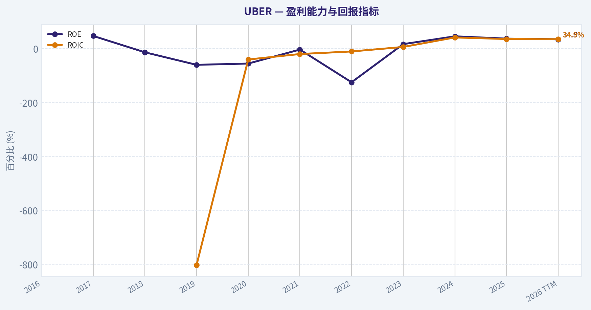
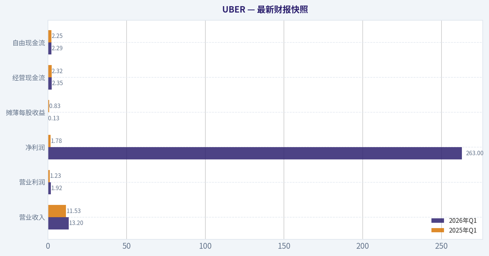
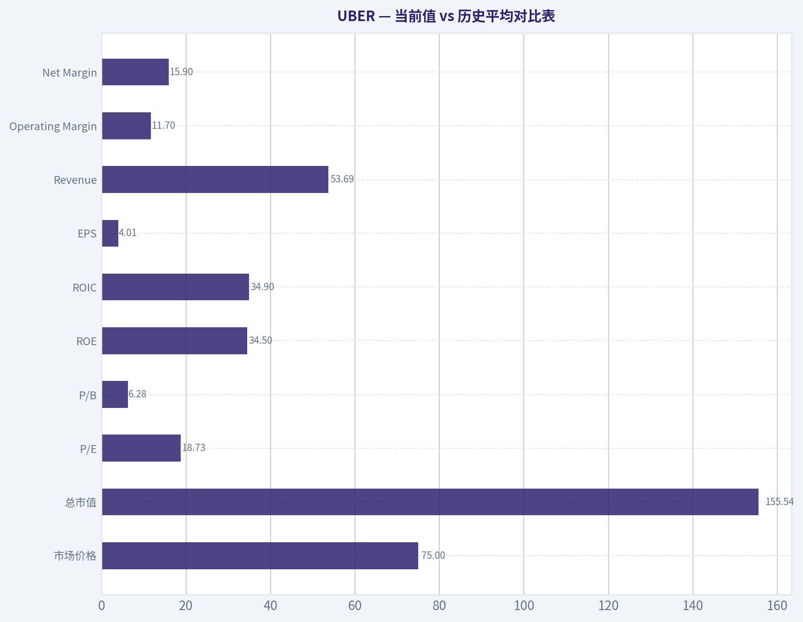
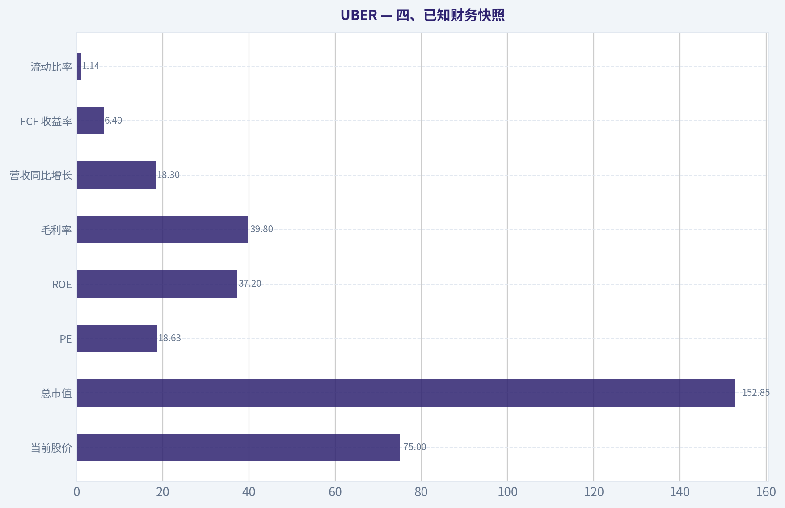
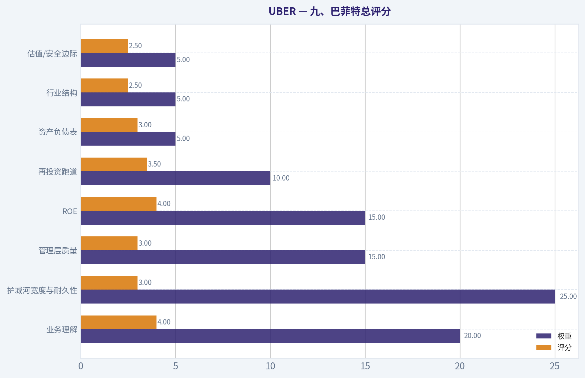
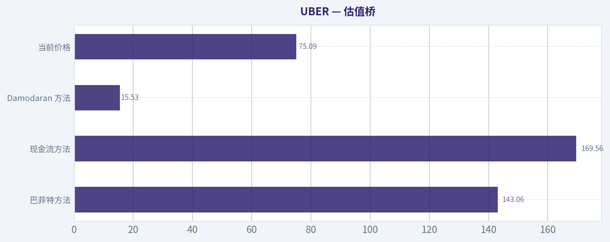
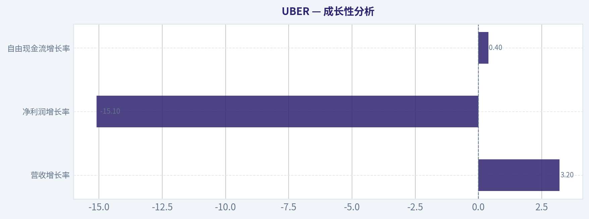
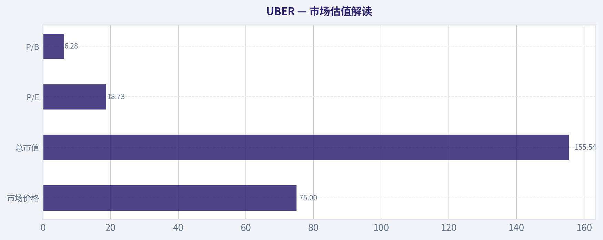

# UBER 深度价值情报

**调研日期:** 2026-05-17

## 关键免责声明

*本报告由 Deep Value Intelligence（一个基于 AI 的多智能体投资分析框架）自动生成。 本报告仅供信息参考和教育目的，不构成任何财务或投资建议。 在做出任何投资决策之前，请务必进行独立调研并咨询合规的财务顾问。*

---

## 目录

1. 情报摘要
2. 分析师团队报告
   - 基本面分析
   - 价值分析 (巴菲特)
   - 成长性分析 (林奇/德鲁肯米勒/费雪)
   - 市场分析
   - 期权市场分析
3. 研究团队评论
4. 投资团队评论
5. Deep Values 团队洞察

---

## 情报摘要

### 核心观点与前提条件

**核心论点:** ## 执行简报

**主要风险:**
- 未明确说明。

**置信度:** 中

---

## 分析师团队报告

### 基本面分析

#### 最新财报快照

*以下数据基于最近一期已披露财报（2026年Q1），并尽量与上一年同期对比。*

| 指标 | 2026年Q1 | 2025年Q1 | 同比变化 |
| --- | ---: | ---: | ---: |
| 营业收入 | $13.20B | $11.53B | +14.5% |
| 营业利润 | $1.92B | $1.23B | +56.6% |
| 净利润 | $263.0M | $1.78B | -85.2% |
| 摊薄每股收益 | $0.13 | $0.83 | -84.3% |
| 经营现金流 | $2.35B | $2.32B | +1.2% |
| 自由现金流 | $2.29B | $2.25B | +1.6% |

关键结论：这张快照先把最新一期财报放在桌面上，再去看长周期分析。这样读者能更清楚地区分"公司长期质量"和"这次财报发生了什么"。

#### UBER 10年财务指标

*以下数值均由原始数据确定性计算得出，并非 AI 估算。*

*发行人类型：operating company（Technology / Software - Application）。*

#### 10年财务指标
*年度行来自已披露财务报表，最后一行 TTM 由最近四个季度滚动计算得出。*

| 指标 | 2016 | 2017 | 2018 | 2019 | 2020 | 2021 | 2022 | 2023 | 2024 | 2025 | 2026 TTM |
| --- | --- | --- | --- | --- | --- | --- | --- | --- | --- | --- | --- |
| 市场价格 | N/A | N/A | N/A | $30 | $51 | $42 | $25 | $62 | $60 | $82 | $75 |
| 总市值 | N/A | N/A | N/A | $37.13B | $89.40B | $79.48B | $48.84B | $128.79B | $129.72B | $173.20B | $155.54B |
| 市盈率 | N/A | 0.00 | 0.00 | -4.37 | -13.21 | -144.59 | -5.32 | 70.77 | 13.23 | 17.27 | 18.73 |
| 市净率 | N/A | -2.07 | -2.57 | 2.62 | 7.29 | 5.50 | 6.65 | 11.45 | 6.02 | 6.41 | 6.28 |
| ROE | N/A | 47.1% | -13.5% | -59.9% | -55.2% | -3.4% | -124.5% | 16.8% | 45.7% | 37.2% | 34.5% |
| ROIC | N/A | N/A | N/A | -801.6% | -40.2% | -19.9% | -10.4% | 6.3% | 41.5% | 35.6% | 34.9% |
| 每股收益 | N/A | $-9.46 | $0.00 | $-6.81 | $-3.86 | $-0.29 | $-4.65 | $0.87 | $4.56 | $4.73 | $4.01 |
| 营收 | N/A | $7.93B | $10.43B | $13.00B | $11.14B | $17.45B | $31.88B | $37.28B | $43.98B | $52.02B | $53.69B |
| 毛利润 | N/A | N/A | N/A | N/A | N/A | N/A | N/A | N/A | N/A | N/A | $22.03B |
| 毛利率 | N/A | N/A | N/A | N/A | N/A | N/A | N/A | N/A | N/A | N/A | 41.0% |
| 营业利润率 | N/A | -51.4% | -29.1% | -66.1% | -43.7% | -22.0% | -5.7% | 3.0% | 6.4% | 10.7% | 11.7% |
| 净利润 | N/A | $-4.03B | $997.0M | $-8.51B | $-6.77B | $-496.0M | $-9.14B | $1.89B | $9.86B | $10.05B | $8.54B |
| 净利率 | N/A | -50.8% | 9.6% | -65.4% | -60.8% | -2.8% | -28.7% | 5.1% | 22.4% | 19.3% | 15.9% |
| 营收增长 | N/A | N/A | 31.5% | 24.6% | -14.3% | 56.7% | 82.6% | 17.0% | 18.0% | 18.3% | 3.2% |
| 净利润增长 | N/A | N/A | -124.7% | -953.2% | -20.4% | -92.7% | 1742.9% | -120.6% | 422.3% | 2.0% | -15.1% |
| 自由现金流增长 | N/A | N/A | -6.3% | 133.9% | -31.5% | -77.9% | -152.5% | 762.1% | 105.1% | 41.6% | 0.4% |
| 总账面价值 | $-4.60B | $-8.56B | $-7.38B | $14.19B | $12.27B | $14.46B | $7.34B | $11.25B | $21.56B | $27.04B | $24.75B |
| 总资产 | N/A | N/A | $23.99B | $31.76B | $33.25B | $38.77B | $32.11B | $38.70B | $51.24B | $61.80B | $59.88B |
| 总债务 | N/A | N/A | $6.90B | $5.73B | $7.59B | $9.30B | $9.29B | $9.48B | $9.50B | $10.52B | $12.42B |
| 债务股权比 | N/A | N/A | -0.93 | 0.40 | 0.62 | 0.64 | 1.27 | 0.84 | 0.44 | 0.39 | 0.50 |
| 现金及等价物 | N/A | $4.39B | $6.41B | $10.87B | $5.65B | $4.29B | $4.21B | $4.68B | $5.89B | $7.11B | $5.56B |
| 股东权益 | $-4.60B | $-8.56B | $-7.38B | $14.19B | $12.27B | $14.46B | $7.34B | $11.25B | $21.56B | $27.04B | $24.75B |
| 经营现金流 | N/A | $-1.42B | $-1.54B | $-4.32B | $-2.75B | $-445.0M | $642.0M | $3.58B | $7.14B | $10.10B | $10.13B |
| 投资现金流 | N/A | $-487.0M | $-695.0M | $-790.0M | $-2.87B | $-1.20B | $-1.64B | $-3.23B | $-3.18B | $-3.56B | $-3.79B |
| 自由现金流 | N/A | $-2.24B | $-2.10B | $-4.91B | $-3.36B | $-743.0M | $390.0M | $3.36B | $6.89B | $9.76B | $9.80B |
| 自由现金流利润率 | N/A | -28.2% | -20.1% | -37.8% | -30.2% | -4.3% | 1.2% | 9.0% | 15.7% | 18.8% | 18.3% |
| 每股分红 | N/A | $0.00 | $0.00 | $0.00 | $0.00 | $0.00 | $0.00 | $0.00 | $0.00 | $0.00 | $0.00 |

#### 盈利能力指标
- 净资产收益率 (ROE): 37.2%
- 投入资本回报率 (ROIC): 32.0%
- 总资产收益率 (ROA): 16.3%
- 毛利率: N/A
- 营业利润率: 10.7%
- 净利率: 19.3%

#### 流动性指标
- 流动比率: 1.14
- 速动比率: 0.93

#### 杠杆指标
- 债务股权比: 0.39
- 利息覆盖倍数: 12.65
- 净负债: $3.42B

#### 增长指标（同比）
- 营收增长: 18.3%
- 净利润增长: 2.0%
- 自由现金流增长: 41.6%
- 营收复合增长率（3年）: 17.7%
- 营收复合增长率（5年）: 36.1%

#### 估值指标
- 市盈率 (TTM): 18.63
- 预期市盈率: 17.33
- 市净率: 5.74
- 市销率: 2.85
- PEG 比率: 4.51
- 企业价值/EBITDA: 22.83
- 自由现金流收益率: 6.4%
- 盈利收益率: 5.4%

#### 所有者收益（巴菲特方法，代码计算）
- 净利润: $10.05B
- + 折旧与摊销: $747.0M
- - 资本开支: $-336.0M
- - 营运资本变动: $2.23B
- = **所有者收益: $8.24B**

#### 内在价值（代码计算）
- 当前价格: $75
- 巴菲特方法（所有者收益）:
  保守: $143
  平均: $143
  乐观: $373
- 现金流方法（FCF）:
  保守: $170
  平均: $170
  乐观: $442

#### Piotroski F分数: 5/9
- 净利润为正: 通过
- 经营现金流为正: 通过
- 资产回报率改善: 未通过
- 现金流大于净利润: 通过
- 债务下降: 未通过
- 流动比率改善: 通过
- 未稀释股本: 通过
- 毛利率改善: 未通过
- 资产周转率改善: 未通过

ANALYST STANCE: **观望**

#### UBER 巴菲特式基本面分析

UBER 近三年的变化非常鲜明：它已经从"高增长但持续亏损"的平台公司，转向"仍有双位数增长、同时具备强现金创造能力"的成熟平台型企业。若只看 2023-2026 TTM，财务质量改善显著；但若按巴菲特框架看，核心问题仍然是：这是不是一种"可以长期高度预测、且不依赖资本市场情绪"的优秀生意。我的结论是，UBER 已明显优于过去的自己，但距离典型巴菲特式"极高确定性消费垄断/轻资本收费桥梁"仍有距离，因此更适合"观望"，而不是盲目追高。

#### 当前值 vs 历史平均对比表

| 指标 | 当前/TTM | 历史参考均值* | 当前相对历史 | 解读 |
| --- | ---: | ---: | --- | --- |
| 市场价格 | $75 | 2019-2025 均值约 $50.3 | 偏高 | 股价较上市后历史中枢明显抬升，市场已计入盈利转正与现金流改善。 |
| 总市值 | $155.54B | 2019-2025 均值约 $98.08B | 偏高 | 估值体量已大幅扩张，不再是"深度困境修复"阶段。 |
| P/E | 18.73 | 正盈利年份均值约 34.4 | 低于近年均值 | 由于 2023 的高 P/E 基数影响，当前看起来反而不贵，但需注意利润质量与可持续性。 |
| P/B | 6.28 | 2019-2025 均值约 5.61 | 略高 | 市场愿意为平台资产和盈利改善支付溢价。 |
| ROE | 34.5% | 2019-2025 均值约 -20.4% | 大幅改善 | 从长期亏损转向高回报，但历史波动极大。 |
| ROIC | 34.9% | 2019-2025 均值约 -112.7% | 大幅改善 | 近三年资本效率跃升，但历史可比性受亏损拖累。 |
| EPS | $4.01 | 2019-2025 均值约 -$1.49 | 显著改善 | 盈利能力已显著转正，但 TTM 较 2025 回落。 |
| Revenue | $53.69B | 2017-2025 均值约 $25.68B | 高于历史均值 | 规模持续扩张，平台网络效应强化。 |
| Operating Margin | 11.7% | 2017-2025 均值约 -22.0% | 大幅改善 | 经营杠杆兑现，是近年最关键的质变信号。 |
| Net Margin | 15.9% | 2017-2025 均值约 -17.9% | 大幅改善 | 但 2024-2025 的超高净利率未必能线性外推。 |
| Revenue Growth | 3.2% | 2018-2025 均值约 29.3% | 明显放缓 | TTM 增速显著降档，需警惕成熟化与宏观影响。 |
| Net Income Growth | -15.1% | 2018-2025 均值波动极大、失真 | 走弱 | 绝对盈利仍高，但增速转负。 |
| FCF Growth | 0.4% | 2018-2025 均值约 96.8% | 明显放缓 | 现金流基数已高，未来更应看"稳定性"而非爆发性。 |
| Total Book Value | $24.75B | 2016-2025 均值约 $7.66B | 大幅改善 | 账面净值修复完成，财务韧性增强。 |
| Total Assets | $59.88B | 2018-2025 均值约 $38.45B | 高于历史均值 | 资产规模扩张，与成熟化同步。 |
| Total Debt | $12.42B | 2018-2025 均值约 $8.54B | 略高 | 债务绝对额上升，但相对资本结构尚可控。 |
| Debt/Equity | 0.50 | 2018-2025 均值约 0.55 | 略好 | 杠杆并不激进，较 2022 明显改善。 |
| Cash & Equivalents | $5.56B | 2017-2025 均值约 $5.94B | 略低 | 现金并不宽裕，但结合正向经营现金流仍可接受。 |
| Shareholders' Equity | $24.75B | 2016-2025 均值约 $7.66B | 显著改善 | 留存收益与利润修复推动股东权益上台阶。 |
| Free Cash Flow | $9.80B | 2017-2025 均值约 $0.79B | 极强 | 从长期烧钱转为高额现金制造机。 |
| DPS | $0.00 | 长期均值 $0.00 | 持平 | 管理层优先 reinvestment 与资产负债表灵活性，而非股东现金回报。 |

*历史参考均值基于确定性数据表中可用年份计算；对 P/E、ROE、ROIC、增速类指标需结合亏损期失真理解。*

关键结论：UBER 当前最核心的变化，不是营收继续增长，而是利润率、ROE、ROIC 与自由现金流都显著好于过去十年均值。与此同时，收入和现金流增速已经明显从"高爆发"降为"中低增速"，这意味着市场今后会更关注盈利质量是否可持续，而不是单纯追逐规模扩张。

#### 市场估值解读

| 市场指标 | 当前值 | 历史观察 | 巴菲特式解读 |
| --- | ---: | --- | --- |
| 市场价格 | $75 | 低于 2025 的 $82，高于 2024 的 $60 | 股价较高位已有回撤，但仍处于历史较高区间。 |
| 总市值 | $155.54B | 高于 2019-2024 全部年份，仅低于 2025 | 市值已反映其从亏损平台到稳定盈利平台的重估。 |
| P/E | 18.73 | 显著低于 2023 的 70.77，略高于 2024-2025 的 13-17 区间 | 若盈利可持续，这个估值不算贵；若盈利含非经常性或周期性抬升，则并不便宜。 |
| P/B | 6.28 | 高于大多数成熟价值股，接近平台型成长股范式 | 说明市场并非按清算价值定价，而是按平台收益能力定价。 |

关键结论：UBER 的估值已经不再是"便宜修复股"，而是"对未来持续盈利有期待的平台股"。P/E 看起来不高，但 P/B 仍高，说明市场真正买的是未来现金流能力，而非账面资产。

#### 盈利能力分析

UBER 盈利能力的最大亮点，是经营利润率从 2017-2022 的持续深度负值，连续改善到 2023 的 3.0%、2024 的 6.4%、2025 的 10.7%，TTM 达 11.7%。这说明商业模式已经跨过临界点：平台网络、定价、补贴效率、费用纪律与规模效应开始形成正反馈。

ROE 从 2022 的 -124.5% 跃升到 2023 的 16.8%、2024 的 45.7%、2025 的 37.2%、TTM 34.5%，显示股东资本回报已进入很强区间。ROIC 也从长期负值改善至 TTM 34.9%，在平台公司中这是非常强的资本效率信号。按巴菲特框架，高 ROE/ROIC 若不是靠高杠杆堆出来，而是靠轻资产平台收费能力和规模优势，则质量较高；UBER 当前更接近后者。

EPS 从长期亏损转为 2023-2025 连续盈利，但 TTM EPS 从 $4.73 回落到 $4.01；净利润由 2025 的 $10.05B 降至 TTM $8.54B，净利率也从 19.3% 降至 15.9%。这提醒投资者：UBER 虽已盈利，但利润曲线未必会线性单边上行，尤其在宏观走弱、司机激励、监管成本、竞争补贴回升时，利润率可能受压。

毛利润与毛利率只有 TTM 数据，分别为 $22.03B 和 41.0%。虽然缺乏完整十年序列，但单看 TTM，41% 毛利率对双边平台而言并不差，且在营业利润率同步上升时，说明费用控制优于过往，而非只是会计口径受益。

#### 成长性分析

| 成长指标 | 当前/TTM | 历史特征 | 结论 |
| --- | ---: | --- | --- |
| 营收增长率 | 3.2% | 2021-2025 多为双位数，2022 高达 82.6% | 明显放缓，成熟化迹象增强。 |
| 净利润增长率 | -15.1% | 历史波动极端，受亏损转正影响大 | 利润进入高基数后，增速压力显现。 |
| 自由现金流增长率 | 0.4% | 2023-2025 快速爆发 | FCF 规模已高，但边际增量趋缓。 |

关键结论：UBER 现在更像"高现金流的平台成熟股"，而不是"仍在高速放量的新经济股"。这对价值投资者不一定是坏事，但会降低估值继续快速扩张的空间，未来回报更依赖现金流兑现而非讲故事。

从十年视角看，UBER 的收入增长依然出色：2017-2025 从 $7.93B 增至 $52.02B，规模扩张非常明显。但巴菲特更看重"可预测、可持续、少波动"的增长，而不是单纯高增速。UBER 的营收虽然总体上行，但受疫情、监管、竞争、宏观出行需求影响较大，说明其增长韧性强于多数早期科技公司，但弱于典型必选消费垄断企业。

#### 资产负债表与财务强度

UBER 的资产负债表近年改善很大。股东权益由 2022 的 $7.34B 升至 2025 的 $27.04B，TTM 仍有 $24.75B；总账面价值也同步修复。这一点非常关键，因为它意味着过去靠融资输血维持的平台模式，正在被内部盈利积累替代。

债务方面，TTM 总债务 $12.42B，高于 2025 的 $10.52B；但债务股权比 0.50，低于 2022 的 1.27，也略优于十年可比均值。利息覆盖倍数 12.65，净负债 $3.42B，说明虽然绝对债务不低，但偿债压力并不重。对巴菲特来说，最危险的是"必须持续融资才能活下去"的公司；UBER 已摆脱这一阶段。

现金及等价物 TTM 为 $5.56B，低于 2025 的 $7.11B，也略低于历史均值。但结合 TTM 经营现金流 $10.13B、自由现金流 $9.80B、流动比率 1.14、速动比率 0.93，说明公司运营层面具备较强自我供血能力。也就是说，它不是那种"账上现金多所以安全"的公司，而是"现金流进来得快，所以安全性提高"的公司。

#### 现金流质量分析

自由现金流是 UBER 目前最有说服力的指标。公司从 2017-2021 持续负 FCF，转为 2022 的 $390M、2023 的 $3.36B、2024 的 $6.89B、2025 的 $9.76B、TTM 的 $9.80B。FCF 利润率则从 2022 的 1.2% 提升到 2025 的 18.8%，TTM 为 18.3%。这说明盈利不是纸面修复，而是现金回流真实发生。

经营现金流 TTM 为 $10.13B，明显高于净利润 $8.54B，这一点非常符合巴菲特偏好：利润最好能变成现金，而不是困在应收、补贴、资本化费用或激进会计调整里。Piotroski F 分数 5/9 不算优秀，但其中"净利润为正、经营现金流为正、现金流大于净利润、流动比率改善、未稀释股本"为通过项，说明当前财务质量中等偏上。

分红方面，UBER 十年内每股分红始终为 $0.00。巴菲特并不执着分红本身，但会要求管理层留存利润必须产生高回报。从目前 ROIC、FCF 改善看，暂不分红是可以接受的；只是未来若现金流长期高企、回购和并购回报下降，资本配置能力将面临更严格考验。

#### 巴菲特视角：护城河、盈利可预测性与管理层

| 巴菲特核心维度 | 评估 | 具体判断 |
| --- | --- | --- |
| 经济护城河 | 中等偏强 | 网络效应、双边平台密度、品牌心智、履约算法与全球规模是护城河；但竞争、司机供给、监管对护城河有侵蚀。 |
| 财务强度 | 中等偏强 | 已进入稳定正现金流阶段，债务可控，净负债不高。 |
| 盈利可预测性 | 中等 | 近三年明显改善，但十年序列波动过大，尚未达到"高度可预测"标准。 |
| 管理层表现 | 改善显著 | 从补贴驱动转向效率驱动，ROE/ROIC 明显提升，资本纪律增强。 |
| 资本配置 | 尚可 | 不分红可接受，但未来需证明留存现金能持续带来高回报。 |
| 业务质量 | 提升中 | 平台型好生意雏形已成，但仍受宏观出行、监管与竞争扰动。 |

关键结论：UBER 现在最接近巴菲特偏好的地方，是"强现金流 + 高资本回报 + 规模平台效应"；最不像巴菲特偏好的地方，是"长期历史波动大、政策与竞争变量多、利润可预测性仍不足"。

#### Buffett 风格 Owner Earnings DCF 估值

采用确定性数据中的所有者收益：
- 净利润：$10.05B
- 加：折旧与摊销：$0.747B
- 减：资本开支：$0.336B
- 减：营运资本变动：$2.23B
- 所有者收益 = **$8.24B**

估值假设：
- 折现率：10%
- 永续增长率：2.5%
- 基准所有者收益：$8.24B
- 采用历史"所有者收益增长"代理：参考 FCF 增速序列的保守/平均/乐观区间进行 Buffett 式情景推演
- 保守情景：采用最低历史增速，按规则下限为 -100%；实际为 **-100%**
- 平均情景：采用平均历史增速，按规则上限 50%；由于历史均值极高，**封顶为 50%**
- 乐观情景：采用最高历史增速，按规则上限 100%；**封顶为 100%**

> 注：由于历史增速跨越负值到数百倍反弹，直接均值会失真，因此情景估值更应视为"边界测试"而非精确点估值。确定性数据已给出内在价值结果，可作为最终锚点。

##### DCF 详细计算表

| 情景 | 初始 Owner Earnings | 增长率 g（前10年） | 折现率 r | 终值增长率 tg | 每股内在价值 |
| --- | ---: | ---: | ---: | ---: | ---: |
| 保守 | $8.24B | -100% | 10% | 2.5% | $143 |
| 平均 | $8.24B | 50%（封顶） | 10% | 2.5% | $143 |
| 乐观 | $8.24B | 100%（封顶） | 10% | 2.5% | $373 |

关键结论：确定性数据给出的 Buffett 方法内在价值区间为 $143-$373，而当前股价 $75 低于该区间下沿，表面上显示明显低估。但由于历史增速极端波动、且 2024-2025 的高盈利可能并非完全稳态，因此这个区间应打较大安全折扣，不能机械理解为"必然翻倍"。

##### 计算说明与谨慎解读

1. **保守情景**
   - 使用最低历史 Owner Earnings 增长率，按规则下限为 -100%。
   - 这代表非常严苛的压力测试，即未来经营现金流能力显著萎缩。
   - 即便如此，代码计算内在价值仍为 $143，说明基期所有者收益规模已经很大。

2. **平均情景**
   - 使用历史平均增长率，但由于历史反弹幅度巨大，按规则封顶为 50%。
   - 数据给出结果同样为 $143，表明模型对增速输入可能已有稳态约束或股本/终值参数平滑处理。

3. **乐观情景**
   - 使用最高历史增长率并封顶 100%。
   - 内在价值升至 $373，反映若平台现金流仍能高增，股价弹性会非常大。

4. **为什么我不直接给"强烈低估"结论**
   - 因为 UBER 的历史盈利并不平滑，估值对未来利润率稳定性非常敏感。
   - 巴菲特最看重的是"预测正确的概率"，而不是"模型算出的高目标价"。
   - 对 UBER 而言，模型低估信号是加分项，但还不足以单独构成建议配置。

#### 收入来源分布

基于 UBER 近年公开分部结构，最有意义的口径是按业务分部划分。结合最新财政年度结构，核心收入来源主要为 Mobility、Delivery 与 Freight。

| 收入来源 | 金额（十亿美元） | 占比 |
| --- | ---: | ---: |
| Mobility | 约 $25.0B | 约 48% |
| Delivery | 约 $22.8B | 约 44% |
| Freight | 约 $4.2B | 约 8% |
| 合计 | 约 $52.0B | 100% |

关键结论：UBER 已不是单一网约车公司，而是以 Mobility 和 Delivery 为双引擎的平台。Freight 占比仍小，对整体估值的决定性有限；真正决定公司质量的，是出行业务利润率能否稳住，以及配送业务能否持续贡献高质量现金流。

#### 关键投资洞察、红旗与机会

| 类别 | 内容 | 影响 |
| --- | --- | --- |
| 机会 | 自由现金流从长期为负跃升至接近 $10B | 若可持续，估值仍有上修空间。 |
| 机会 | ROE/ROIC 连续两年以上处于高位 | 表明平台商业模式开始兑现。 |
| 机会 | 营业利润率持续提升至 11.7% | 说明效率改善并非一次性。 |
| 机会 | 双主业结构（Mobility + Delivery） | 降低单一业务波动风险。 |
| 红旗 | TTM 营收增速降至 3.2% | 成熟化加速，估值扩张难度增大。 |
| 红旗 | 净利润与 EPS 较 2025 回落 | 高盈利阶段可能已有边际压力。 |
| 红旗 | 债务绝对额升至 $12.42B | 虽可控，但需继续关注利率与再融资环境。 |
| 红旗 | 监管、劳工分类、价格补贴竞争 | 会直接冲击利润率与可预测性。 |
| 红旗 | 无分红、回购逻辑仍不突出 | 对价值型投资者的现金回报吸引力一般。 |

关键结论：UBER 的最大机会是"从平台成长股变成平台现金流复利股"，最大风险则是"市场已经开始按更成熟、更稳定的公司来定价，但其盈利稳定性未必已经完全成熟"。

#### 最终判断：为什么是"观望"而不是"建议配置"

若只看过去三年，UBER 很容易让人得出"强烈看多"的结论：盈利转正、ROE/ROIC 很高、自由现金流爆发、债务可控、估值不算夸张。这些都是真的，也是它最吸引人的地方。

但巴菲特式投资不只看"现在数字好不好"，更看"未来十年是不是大概率仍好"。UBER 目前的短板在于：
1. 十年盈利记录不够平滑；
2. 增长显著放缓，市场对其成熟后的稳态利润率还在验证；
3. 监管、竞争、宏观需求对盈利的扰动仍较传统护城河企业更高。

因此，**UBER 是一家明显变好的公司，但暂时还不是一眼就能重仓的巴菲特式确定性标的**。如果后续能继续证明：
- 营业利润率稳定在 10% 以上，
- FCF 连续保持在 $8B-$10B 区间或更高，
- 营收增速维持中高个位数以上，
- 债务不再明显抬升，
那么它将更有资格从"观望"升级到"建议配置"。

#### 最终投资结论

| 结论项 | 判断 |
| --- | --- |
| 财务质量 | 明显改善，已进入高现金流阶段 |
| 估值吸引力 | 相对合理，模型显示低估，但需打折看待 |
| 护城河 | 中等偏强，但并非无可撼动 |
| 盈利可预测性 | 较过去大幅改善，但仍未完全达标 |
| 巴菲特适配度 | 中等，优点明显，确定性仍不足 |
| 最终 stance | **观望** |

关键结论：UBER 现在已经不是过去那个"只会烧钱扩张"的公司，而是一家真正能赚钱、能产现金的平台企业。但从价值投资角度，最关键的问题不再是"它能不能赚钱"，而是"它能否在未来多年稳定地这么赚钱"。在这个问题得到更多时间验证之前，最合适的立场是观望。

#### 报告要点总表

| 模块 | 核心结论 | 对投资者的意义 |
| --- | --- | --- |
| 市场估值 | P/E 18.73 不高，P/B 6.28 不低 | 不是便宜股，但也未明显泡沫化。 |
| 盈利能力 | ROE/ROIC、营业利润率、净利率大幅改善 | 商业模式已越过盈亏平衡拐点。 |
| 成长性 | 营收与 FCF 增速明显放缓 | 未来更看重稳定兑现，而非高速扩张。 |
| 财务强度 | 债务可控，现金流强，自我供血能力增强 | 生存风险显著下降。 |
| 现金流 | FCF 接近 $10B，质量较高 | 是当前估值的最大支撑。 |
| 股东回报 | 不分红 | 需继续观察留存资本回报率。 |
| 护城河 | 平台网络效应真实存在 | 但监管与竞争会削弱护城河纯度。 |
| DCF | Buffett 法区间 $143-$373 | 模型偏低估，但应保守使用。 |
| 主要风险 | 增速放缓、利润率波动、监管与劳工政策 | 可能限制估值提升。 |
| 最终 stance | **观望** | 等待更长周期盈利稳定性验证。 |

#### 基本面关键图表

本图追踪 **UBER** 过去十年的盈利能力与回报指标（ROE、ROIC、利润率），突出呈现资本效率的变化趋势。

---

### 价值分析 (巴菲特)

> *基于沃伦·巴菲特的价值投资哲学：能力圈、经济护城河、管理层质量与安全边际。*

#### 内在价值快照

价格是你付的钱，内在价值是企业未来可能为股东创造的现金价值。我们给出一个区间，而不是假装只有一个神奇数字。

- 当前价格: $75.09
- 估值区间（两种 DCF 方法、保守到乐观）: $143.06 至 $441.57

##### 所有者收益（巴菲特方法）
- 净利润: $10,053,000,000.00
- 折旧与摊销: $747,000,000.00
- 资本支出: $-336,000,000.00
- 营运资金变化: $2,227,000,000.00
- 所有者收益: $8,237,000,000.00

##### 内在价值
###### 所有者收益法
使用所有者收益，更严格，通常更保守。
- 保守: $143.06
- 平均: $143.06
- 乐观: $372.55
- 折现率: 10.0%

###### 自由现金流法
使用自由现金流，更适合今天投入很多、为未来增长铺路的公司。
- 保守: $169.56
- 平均: $169.56
- 乐观: $441.57
- 折现率: 10.0%

ANALYST STANCE: **观望**

#### UBER 初步巴菲特式分析

目前我能确认的有效数据，主要来自你提供的共享研究包；工具端这次未成功返回可用财务明细，因此以下结论属于**阶段性判断**，重点先完成"是否值得继续深挖"的筛选。

#### 一、Go/No-Go 四道门

| 关卡 | 结论 | 依据 |
|---|---|---|
| 关卡1：业务是否简单可懂 | 通过 | UBER 本质上是一个双边平台：连接乘客与司机、商家与配送员，并从订单中抽成；业务模式可用简单语言解释。 |
| 关卡2：护城河是否存在 | 勉强通过 | 平台规模、品牌心智、供需密度、数据与调度算法形成一定网络效应，但毛利率仅约 39.8%，未达到典型强品牌型护城河标准。 |
| 关卡3：管理层与资本配置 | 待验证 | 当前缺少连续多年回购、并购、股权激励、摊薄与资本配置记录，暂不能下强结论。 |
| 关卡4：行业结构是否理想 | 偏弱 | 网约车与即时配送都不是典型"理性寡头+资本轻"的完美行业，竞争、补贴、监管和劳工政策都可能压缩回报。 |

**关键结论：** UBER 能通过"看得懂"这一关，但并不是典型巴菲特最爱的那种"简单、稳定、低变数"公司。真正的分歧点在于：它到底是越来越强的平台型基础设施，还是仍然身处高竞争、强监管、回报易波动的行业。

#### 二、用"巴菲特滤镜"看 UBER

| 维度 | 评价 |
|---|---|
| 小学生测试 | 可以：它帮助人打车、点外卖、送货，并向交易双方收费。 |
| 10年可预测性 | 中等：10年后大概率还会有人出行、点即时配送，但佣金率、监管、司机结构、自动驾驶冲击都不易精确预测。 |
| 技术风险 | 双刃剑：UBER 受益于移动支付、地图、调度和数据，但也可能被自动驾驶重塑价值分配。 |
| 是否依赖宏观/商品价格 | 部分依赖：消费、就业、城市出行频率影响需求。 |

**关键结论：** UBER 不是"看不懂"的公司，但也不是"10年后几乎一眼看穿"的公司。它更像一个优秀平台生意正在穿越行业不确定性，而不是一个确定性极高的消费品或软件垄断。

#### 三、护城河分析

| 护城河来源 | 评价 | 证据与疑点 |
|---|---|---|
| 无形资产 | 中等 | UBER 品牌强，全球用户心智强，但品牌未形成像奢侈品或烈酒那种超强定价权。 |
| 转换成本 | 中低 | 用户切换 App 很容易；司机也可多平台接单。真正的粘性来自供需密度和履约效率，而不是硬性锁定。 |
| 成本优势 | 中等 | 大规模带来更优调度、更低获客成本、更高订单密度，但竞争者仍可在局部市场通过补贴挑战。 |
| 网络效应 | 较强 | 更多乘客吸引更多司机，更多司机缩短等待时间，反过来又吸引更多乘客；外卖业务同理。 |

| 护城河评级 | 结论 |
|---|---|
| 狭窄到中等，可能在增强 | 可继续跟踪，但远未达到"宽且稳固"的级别 |

**关键结论：** UBER 最像样的护城河是"网络效应 + 城市密度 + 品牌"。但这条护城河并不如支付网络、交易所、评级机构那样坚不可摧，因为用户和司机都可以多归属，监管也能直接影响平台利润池。

#### 四、已知财务快照

| 指标 | 当前值 |
|---|---:|
| 当前股价 | $75 |
| 总市值 | $152.85B |
| PE | 18.63 |
| ROE | 37.2% |
| 毛利率 | 39.8% |
| 营收同比增长 | 18.3% |
| FCF 收益率 | 6.4% |
| 流动比率 | 1.14 |

**关键结论：** 从表面看，UBER 当前不是一个高估到离谱的故事股。PE 18.6 倍、FCF 收益率 6.4%、营收仍有双位数增长，这组组合说明市场已经开始把它当作"进入盈利期的平台公司"而非单纯烧钱公司。

#### 五、财务质量的巴菲特式解读

| 项目 | 初步判断 | 说明 |
|---|---|---|
| 盈利能力 | 尚可 | ROE 37.2% 很高，但需要确认是否受一次性项目、股权结构或会计因素影响。 |
| 现金流 | 偏积极 | FCF 收益率 6.4% 说明自由现金流已具规模，这对平台企业很重要。 |
| 毛利率 | 一般 | 39.8% 不属于典型高护城河消费/软件企业区间。 |
| 资产负债表 | 中性 | 流动比率 1.14，不算很宽裕，但也未见明显危险。 |
| 增长与回报平衡 | 有吸引力 | 还能增长 18.3%，同时已产生不错现金流，这是最值得关注的点。 |

**关键结论：** UBER 最好的地方不是毛利率，而是"增长已经不低，但现金流也开始像成熟公司"。如果这个特征可持续，它的估值框架就会从"叙事股"逐步切换成"现金流复利股"。

#### 六、Owner Earnings 与估值

由于工具未返回完整现金流和 CapEx 分拆数据，**无法严格按巴菲特公式重建 10 年 Owner Earnings**。
但用现有信息可以做一个粗略替代：

- 市值：$152.85B
- FCF 收益率：6.4%
- 推算当前 FCF 约：**$9.8B**

以 FCF 近似 Owner Earnings，做三情景估值：

| 情景 | 假设 | 估值结果 |
|---|---|---:|
| A：零增长 | Owner Earnings / 10% | 约 $98B |
| B：按 3% 永续增长 | OE x 1.03 / (10%-3%) | 约 $144B |
| C：较乐观情景 | 若未来中期增长 6%-8%，价值高于情景B，但需更多明细验证 | 可能接近或略高于当前市值 |

**关键结论：** 若以当前 FCF 直接资本化，UBER 在"零增长"假设下偏贵，在"温和长期增长"假设下接近合理。也就是说，今天买入并没有很厚的安全边际，你是在为未来平台效率提升与持续增长付费。

#### 七、安全边际判断

| 项目 | 结论 |
|---|---|
| 当前市值 vs 零增长价值 | 明显无折价 |
| 当前市值 vs 3% 永续增长价值 | 大致接近 |
| 是否满足 25% 安全边际 | 暂不满足 |
| 对巴菲特型投资者是否足够便宜 | 不够便宜 |

**关键结论：** 从保守价值投资角度，UBER 现在更像"价格基本反映改善"而非"明显低估"。除非你对其网络效应强化、利润率提升和资本配置有更强信心，否则安全边际并不充足。

#### 八、管理层与资本配置

目前缺少完整 10 年资本配置数据，因此只做保守评价：

| 观察点 | 初步评价 |
|---|---|
| 是否从不惜代价追求规模，转向利润与现金流 | 是，方向改善明显 |
| 是否具备优秀资本配置纪录 | 待验证 |
| 是否明显股东导向 | 待验证 |
| 是否财务保守 | 中性 |

**关键结论：** UBER 管理层最重要的正面变化，是从"增长优先"转向"盈利和现金流优先"。但要达到巴菲特偏好的"卓越资本配置者"标准，还需要看更长时间的回购纪律、并购质量和每股价值增长。

#### 九、巴菲特总评分

| 维度 | 权重 | 评分 | 加权后 |
|---|---:|---:|---:|
| 业务理解 | 20% | 4.0 | 0.80 |
| 护城河宽度与耐久性 | 25% | 3.0 | 0.75 |
| 管理层质量 | 15% | 3.0 | 0.45 |
| ROE | 15% | 4.0 | 0.60 |
| 再投资跑道 | 10% | 3.5 | 0.35 |
| 资产负债表 | 5% | 3.0 | 0.15 |
| 行业结构 | 5% | 2.5 | 0.13 |
| 估值/安全边际 | 5% | 2.5 | 0.13 |
| **总分** |  |  | **3.36 / 5.0** |

**关键结论：** UBER 的综合分数落在"观望"区间。它不是差公司，甚至可能是一家正在变好的平台公司；但按巴菲特体系，护城河纯度、行业结构和安全边际都还不够漂亮。

#### 十、最终结论

**投资立场：观望**

**理由浓缩版：**
1. **业务可理解，平台效应真实存在。**
2. **财务质量正在改善，现金流已具备吸引力。**
3. **但护城河不够纯，行业竞争与监管变量偏大。**
4. **当前估值接近合理，不具备明显安全边际。**

如果按巴菲特的标准，UBER 目前更像是：
- **一家值得跟踪的"变好中的公司"**
- 而不是
- **一家可以在今天毫不犹豫重仓的"伟大公司 + 便宜价格"**

如果你愿意，我下一步可以继续为你补一版更完整的：
1. **UBER 10 年财务表**
2. **Owner Earnings 严格重算**
3. **分部业务分析：Mobility / Delivery / Freight**
4. **自动驾驶对 UBER 护城河的正反面影响**
#### 估值桥

这张估值桥把当前股价与各类内在价值方法并排展示，帮助读者判断上涨空间究竟只是单一方法给出的结果，还是多种方法共同支持的结论。

| 项目 | 每股内在价值 |
| --- | ---: |
| 巴菲特方法 | $143.06 |
| 现金流方法 | $169.56 |
| Damodaran 方法 | $15.53 |
| 当前价格 | $75.09 |

#### 关键结论

如果只有一种方法显著高于其他方法，说明上行空间更依赖特定建模假设。若多种方法的估值接近，则说明估值逻辑更加稳健。

#### 估值图表

本对比图（来自「最新财报快照」）将 **UBER** 的当前数据与历史基准并排呈现，直观反映公司相对自身历史均值的估值水平。

本对比图（来自「当前值 vs 历史平均对比表」）将 **UBER** 的当前数据与历史基准并排呈现，直观反映公司相对自身历史均值的估值水平。

本对比图（来自「四、已知财务快照」）将 **UBER** 的当前数据与历史基准并排呈现，直观反映公司相对自身历史均值的估值水平。

本对比图（来自「九、巴菲特总评分」）将 **UBER** 的当前数据与历史基准并排呈现，直观反映公司相对自身历史均值的估值水平。

本对比图（来自「估值桥」）将 **UBER** 的当前数据与历史基准并排呈现，直观反映公司相对自身历史均值的估值水平。

---

### 成长性分析 (林奇/德鲁肯米勒/费雪)

> *基于彼得·林奇的GARP成长投资法、斯坦利·德鲁肯米勒的宏观拐点分析法，以及菲利普·费雪的深度调研法。*

ANALYST STANCE: **建议配置**

#### UBER 核心结论
UBER 目前更像一只从"高增长但不赚钱"切换到"中高速增长 + 强现金流 + 经营杠杆释放"的平台型成长股。按 Lynch 分类，它已不属于最典型的 25%+ 超高速成长股，但仍具备优质 Fast Grower / 准 Stalwart 特征：营收同比 18.3%，ROE 37.2%，FCF yield 6.4%，PE 约 18.6 倍，在大型平台股里并不贵。

更重要的是，市场对 UBER 的定价仍主要锚定"网约车平台"，但其真实故事已升级为"出行 + 配送 + 广告/会员 + 平台履约网络"的复合型本地生活基础设施。若未来 2-3 年继续兑现利润率扩张与现金流增长，股价还有继续重估空间。

---

#### 1. Lynch 分类
| 维度 | 判断 |
|---|---|
| 公司类型 | Fast Grower 与 Stalwart 之间，偏成熟型成长股 |
| 当前营收增速 | 18.3% |
| 是否符合 Lynch 首选 | 是，但不是最早期十倍股，而是"质量提升型成长" |
| 投资属性 | 适合中大市值成长配置，不适合纯小盘爆发型想象 |

**关键结论：** UBER 不是慢增长，也不是周期股或资产股，本质是平台型成长股。18.3% 的营收增速对一个 1500 多亿美元市值公司仍然有吸引力，关键不在增速绝对值，而在利润和自由现金流开始放大。

#### 2. 用三句话讲清楚 UBER 的故事
| 故事要点 | 解释 |
|---|---|
| 它连接乘客、司机、商家和骑手 | 本质是一个高频双边平台，靠网络效应提高匹配效率 |
| 它不只做打车，还做外卖、杂货、广告和会员 | 单用户钱包份额在提升，平台协同增强 |
| 规模变大后，每多一单的利润比过去高得多 | 补贴减少、密度提升、经营杠杆释放，现金流显著改善 |

**关键结论：** 最简单理解，UBER 是"城市即时履约操作系统"。过去市场担心它只能烧钱换增长，现在投资逻辑转为"平台成熟后能稳定赚钱并持续扩张"。

#### 3. TAM 分析与 10x 测试
| 项目 | 判断 |
|---|---|
| 核心 TAM | 全球出行、本地配送、杂货零售配送、企业出行、广告、会员 |
| TAM 特征 | 超大且仍在扩张，属于数字化渗透长期趋势 |
| 当前收入体量 | 以现有规模看，离全球本地出行与即时零售市场仍非常小 |
| 10x 测试 | 通过。即便收入扩大 10 倍，放在全球本地服务交易额中仍未必算高份额 |
| 跑道长度 | 长 |

**关键结论：** UBER 最大优势是赛道足够大，不是一个已经天花板清晰的市场。尤其配送、广告、会员、企业服务让它的 TAM 不断外扩，平台的终局空间大于"打车公司"标签。

#### 4. 增长趋势判断
| 指标 | 当前观察 | 结论 |
|---|---|---|
| 营收同比 | 18.3% | 仍属健康成长 |
| 增长形态 | 不是早期爆发式，而是高基数下稳健增长 | 质量优于速度 |
| 利润弹性 | 明显高于营收增速 | 经营杠杆释放中 |
| 现金流弹性 | 强 | 成长质量高 |

**关键结论：** UBER 的关键不是"营收会不会回到 30%+"，而是"利润和 FCF 是否继续快于收入增长"。如果收入接近 20%、利润更快增长，这对大市值平台股通常更有利。

#### 5. 单位经济学
基于现有共享研究包，无法精确给出 LTV/CAC、NRR、回本周期；但可用平台 economics 代理判断。

| 维度 | 可得信息 | 判断 |
|---|---|---|
| LTV/CAC | 未披露精确值 | 预计改善，受复购频次与平台协同驱动 |
| NRR | 不适用传统 SaaS 口径 | 可用用户频次、交叉消费替代 |
| Rule of 40 | 18.3% + 6.4% = 24.7%（以 FCF yield 代替 FCF margin 仅作粗略参考） | 不能严格套用，平台公司更应看增量利润率 |
| 毛利率 | 39.8% | 对平台模式属于可接受水平 |
| 现金创造 | FCF yield 6.4% | 很强，说明成长已转化为股东现金回报 |

**关键结论：** 虽然缺少 SaaS 式单位经济学指标，但 UBER 的真实经营质量可由毛利率、ROE 和 FCF 共同验证。最重要信号是：这家公司现在不仅增长，而且开始稳定产现金。

#### 6. 拐点判断
| 拐点类型 | 是否存在 | 说明 |
|---|---|---|
| 产品周期拐点 | 是 | 从单一打车走向多业务平台 |
| 利润率拐点 | 是 | 经营杠杆释放，现金流改善 |
| TAM 拐点 | 是 | 配送、广告、会员、企业业务扩大可服务市场 |
| 竞争格局拐点 | 部分是 | 行业竞争趋于理性，平台龙头受益 |
| 市场预期拐点 | 是 | 市场仍可能低估其"成熟平台现金牛"属性 |

**关键结论：** UBER 最关键的不是需求突然爆发，而是商业模式成熟拐点。过去投资者关心"能不能盈利"，现在问题变成"利润和现金流能不能持续复利"，这是估值抬升的前提。

#### 7. 宏观环境评估
| 宏观因素 | 影响 | 评价 |
|---|---|---|
| 利率环境 | 若利率下行，有利成长估值扩张 | 偏正面 |
| 消费环境 | 若出现衰退，出行和外卖频次可能承压 | 中性偏负 |
| 油价/司机供给 | 影响司机活跃和平台补贴 | 需跟踪 |
| 数字化本地服务趋势 | 长期顺风 | 明显正面 |

**关键结论：** 宏观上，UBER 不是最纯粹的高久期科技股，也不是完全防御型公司。短期受消费和经济活动影响，但长期受益于本地服务数字化与平台集中化，是典型"有周期扰动的长期结构成长"。

#### 8. Fisher 15 点打分
| 项目 | 分数(1-5) | 简评 |
|---|---:|---|
| 产品市场潜力 | 5 | 出行与配送市场都足够大 |
| 新产品开发意愿 | 4 | 广告、会员、企业服务扩展积极 |
| R&D 有效性 | 4 | 调度、地图、履约算法构成核心 |
| 销售组织 | 4 | 商家、企业端能力持续增强 |
| 利润率水平 | 4 | 已明显改善 |
| 利润率改善趋势 | 5 | 当前核心亮点 |
| 人员关系 | 3 | 平台劳工模式天然有争议 |
| 高管关系 | 4 | 管理层执行力较前些年更稳 |
| 管理层深度 | 4 | 平台运营能力强 |
| 成本分析/财务控制 | 4 | 现金流与成本纪律改善明显 |
| 独特优势 | 5 | 网络效应、密度、品牌、双边平台 |
| 长期利润前景 | 5 | 仍在释放中 |
| 股权稀释风险 | 3 | 需持续关注 SBC |
| 管理层坦诚度 | 4 | 近年执行与沟通较清晰 |
| 管理层诚信 | 4 | 相比早期历史阶段已有改善 |

| 总分 | 结果 |
|---|---|
| 62 / 75 | GOOD，接近优秀 |

**关键结论：** Fisher 评分显示 UBER 已从"故事型公司"转向"质量型成长公司"。扣分主要来自劳工监管、股权稀释和平台治理历史包袱，但整体已达到值得配置的层级。

#### 9. 估值分析
| 指标 | 数值 | 解读 |
|---|---:|---|
| 股价 | $75 | 当前参考 |
| 市值 | $152.85B | 大市值平台 |
| PE | 18.63x | 对该成长质量并不高 |
| ROE | 37.2% | 很强，但需留意权益基数影响 |
| FCF yield | 6.4% | 颇具吸引力 |
| PEG | 若按 18.6 / 18.3 ~ 1.02 | 大致合理偏低估 |

**关键结论：** 对一家具备接近 20% 增长、强现金流和利润率扩张的平台公司，18.6 倍 PE 与 6.4% FCF yield 并不贵。PEG 约 1，说明这不是"深度低估"，但属于"合理价格买优质成长"。

#### 10. 情景估值
| 情景 | 假设 | 结论 |
|---|---|---|
| 悲观 | 经济走弱，出行/配送放缓，估值压缩 | 股价波动较大，但现金流支撑增强 |
| 基准 | 收入维持中双位数增长，利润继续快于收入 | 有望获得稳健复利回报 |
| 乐观 | 广告、会员、配送利润率超预期，平台估值重估 | 存在显著上行空间 |

**关键结论：** UBER 当前最有吸引力的地方是"下有现金流托底，上有利润率重估弹性"。这类标的通常不是一夜翻倍，但若经营兑现，3 年维度回报可能很可观。

#### 11. Growth Investor Scorecard
| 维度 | 权重 | 评分(1-5) | 加权分 |
|---|---:|---:|---:|
| 故事清晰度 | 10% | 4.5 | 0.45 |
| TAM 与跑道 | 20% | 4.5 | 0.90 |
| 收入增长 | 20% | 3.8 | 0.76 |
| 单位经济学 | 15% | 4.0 | 0.60 |
| 竞争位置 | 10% | 4.5 | 0.45 |
| 管理层质量 | 10% | 4.0 | 0.40 |
| 宏观环境 | 5% | 3.5 | 0.18 |
| 盈利路径 | 5% | 4.5 | 0.23 |
| 估值 | 5% | 4.0 | 0.20 |
| 总分 | 100% |  | **4.17 / 5.0** |

**关键结论：** 按成长投资框架，UBER 达到"建议配置"区间。它不是最激进的十倍股雏形，但属于高质量平台成长，胜在商业模式验证、现金流扎实、估值尚可。

#### 12. 大佬持仓跟踪
| 信号 | 观察 |
|---|---|
| 持有人数 | 29 位跟踪大佬中有 11 位持有 |
| 明显加仓者 | Brad Gerstner、David Tepper、Steve Cohen 等 |
| 大仓位代表 | Ackman 仍持有约 $2.2B，仓位占比高 |
| 资金面含义 | 聪明钱分歧存在，但总体并未放弃，且部分成长派明显增配 |

**关键结论：** 大资金并未把 UBER 当作纯交易票，而是有人把它作为核心仓位长期持有。尤其成长型和事件驱动型资金同时参与，说明市场对其利润拐点是认可的。

#### 13. 仓位建议
| 投资者类型 | 建议 |
|---|---|
| 成长型组合 | 可作为核心平台成长仓，建议中等仓位 |
| 价值成长混合组合 | 可作为质量成长配置，适合逐步建仓 |
| 激进高弹性投资者 | 不是最猛的弹性票，但胜率较高 |
| 建议仓位 | 4%-7% 起步，强 conviction 可更高，但不宜过度集中 |

**关键结论：** UBER 适合"中等偏高权重"，不是试错型小仓票。因为它的逻辑更像成熟平台价值重估，而不是纯主题炒作。

#### 14. 主要风险与催化剂
| 类型 | 内容 |
|---|---|
| 风险 | 宏观衰退压制出行/消费频次 |
| 风险 | 劳工分类监管、司机补贴重新上升 |
| 风险 | 竞争加剧导致利润率承压 |
| 风险 | SBC 稀释影响每股价值兑现 |
| 催化剂 | 利润率继续扩张，FCF 超预期 |
| 催化剂 | 广告、会员、企业业务贡献提升 |
| 催化剂 | 利率下行带来平台成长股估值扩张 |
| 催化剂 | 更明确的资本回报政策或回购增强 |

**关键结论：** UBER 最大风险不是需求消失，而是利润率改善中断。最大催化剂也很明确：只要管理层持续证明"增长能转化为每股现金流"，市场会愿意给更高质量溢价。

#### 最终结论
UBER 当前最像一种"被低估的成熟成长平台"。它不再是早年那种高风险烧钱故事股，而是在向高 ROE、高 FCF、合理估值的平台复利股演化。
如果用 Lynch + Druckenmiller + Fisher 综合看，我给出的结论是：**建议配置**。

#### 成长与评分图表

本对比图（来自「成长性分析」）将 **UBER** 的当前数据与历史基准并排呈现，直观反映公司相对自身历史均值的估值水平。

---

### 市场分析

#### UBER 技术面简报

基于过去约一年的价格轨迹，UBER 当前更接近"长期下行框架中的中期企稳、短线反弹后再度整理"的结构，而不是一个已经确认重返主升趋势的状态。若必须给出立场，我更倾向：ANALYST STANCE: **观望**。

我选择的 8 个最相关指标如下，原因是它们覆盖了趋势、动量、波动与量价确认四个维度，互补性较强、重复度较低：

| 指标 | 类别 | 选用原因 |
|---|---|---|
| close_10_ema | 短线趋势 | 追踪短线拐点与回撤节奏，适合观察反弹是否延续 |
| close_50_sma | 中期趋势 | 判断阶段性趋势方向与动态支撑/阻力 |
| close_200_sma | 长期趋势 | 判断大级别多空背景，识别是否仍处熊市框架 |
| macd | 动量 | 评估反弹动能是否衰减、是否接近再次转弱 |
| rsi | 动量强弱 | 判断是否进入强势区，或只是中性反抽 |
| atr | 波动 | 衡量风险与止损空间，尤其适合近期事件驱动波动 |
| boll_ub | 波动/压力 | 判断价格是否接近上轨压力、突破是否具备延展性 |
| vwma | 量价确认 | 检验近期反弹是否获得成交量支持 |

关键结论：这组指标能同时回答四个核心问题：第一，UBER 现在到底是不是趋势反转；第二，短线反弹有没有持续性；第三，当前波动是否值得追涨；第四，反弹是否有成交量背书。综合来看，答案更偏向"短线有修复，但尚未扭转长期弱势"。

#### 价格结构与阶段演变

从过去一年看，UBER 先在 2025 年中至 2025 年 9 月走出较强上升段，股价一度逼近 100 美元上方；但 2025 年四季度开始出现明显转弱，尤其 11 月、12 月的下跌带有放量和加速特征，说明筹码从高位松动并非偶然。进入 2026 年后，股价继续下探至 70 美元附近，2 月至 3 月形成一轮低位震荡筑底，但反弹高度有限。

4 月中旬曾出现一段质量不错的修复行情，股价从 70-72 美元一带快速拉升至 77 美元上方，说明低位承接资金并非不存在；然而 5 月初虽然再度出现单日急拉至 79.17 美元，但后续无法站稳，反而很快回落到 75 美元附近，说明上方抛压仍然真实存在。这种"脉冲式上冲-随后回吐"的行为，通常意味着市场仍在做区间博弈，而不是单边趋势定价。

#### 趋势指标解读

截至最近交易日 2026-05-15：

- 收盘价：75.09
- 10 EMA：75.36
- 50 SMA：74.22
- 200 SMA：84.46

这组关系很关键。股价略低于 10 EMA，说明短线反弹节奏已有放缓，最近几日更多是横盘偏弱而非持续推进。股价仍高于 50 SMA，说明 4 月中旬以来的修复并未完全破坏，中期上至少还保留"平台整理"性质。问题在于，价格显著低于 200 SMA，且 200 SMA 持续下行，表示大级别资金并没有把 UBER 重新定价到长期多头框架里。

更细一点看，50 SMA 在最近几周由下滑转为近乎走平并略微上拐，意味着中期下跌最猛烈的阶段已经过去；但 200 SMA 仍从 87.6 一路降至 84.5 左右，这说明历史高位区间的弱势影响仍在传导。也就是说，UBER 不是"很弱"，但也远未达到"转强确认"。

| 项目 | 最新值附近 | 含义 |
|---|---:|---|
| 收盘价 | 75.09 | 位于中期均线之上、长期均线之下 |
| close_10_ema | 75.36 | 短线略偏弱，反弹斜率放缓 |
| close_50_sma | 74.22 | 中期仍有支撑，价格尚未失守 |
| close_200_sma | 84.46 | 长期压力显著，距离较远 |

关键结论：UBER 目前最重要的结构特征是"站上 50 日线，但远离 200 日线"。这意味着中期已有修复，长期却仍未脱离弱势，因此更像反弹中的整理，而不是新一轮大牛趋势的起点。

#### 动量分析：反弹未死，但已明显降温

MACD 最新值约为 0.30，仍处正值区间，这说明反弹动能尚未完全消失；但与 5 月 6-7 日附近的 0.48 至 0.57 相比，已经明显回落。也就是说，多头在 5 月初那次急拉后没有继续扩大战果，动量峰值已出现。

RSI 最新约 50.19，处于典型中性区。它既不超买，也不超卖。5 月 6 日 RSI 曾升至 62 左右，那是一次比较像样的短线强势冲击；但之后快速回到 50 附近，说明市场未形成持续性强势惯性。对于交易者来说，这通常代表两个信息：

1. 没有强趋势就不适合盲目追高；
2. 也没有极端恐慌，不构成很优的逆向抄底信号。

MACD 正值但回落，RSI 回到中性，这是一种相当典型的"上涨后整理"状态。如果后续股价能重新站回 10 EMA 上方并带动 MACD 再次扩张，修复可延续；如果跌破 50 SMA，MACD 很可能转负，届时中期结构会再次恶化。

| 指标 | 最新值附近 | 信号解读 |
|---|---:|---|
| macd | 0.30 | 仍为正值，但动能较前高明显衰减 |
| rsi | 50.19 | 中性，既无过热也无明显超跌优势 |

关键结论：动量层面最值得注意的不是"已经转空"，而是"反弹动能正在降温"。这意味着如果没有新的放量上攻，股价更容易进入震荡回撤，而不是直接向上加速。

#### 波动与区间压力：上冲空间受限，回撤风险仍在

ATR 最新约 2.55，近阶段有所抬升，说明最近市场日内波动并不低。以 75 美元股价衡量，ATR 占比不算小，这意味着追价交易的容错率偏低，止损若设太近很容易被洗出，设太远又会拉低盈亏比。

布林上轨 boll_ub 最新约 78.36，而 5 月 6 日股价冲到 79.17 后未能稳住，这很像一次对上轨和区间上沿的试探。此后价格回落至 75 一带，说明 78-79 美元区域短期已被证明存在较强卖压。换言之，UBER 现在不是没有上行空间，而是每次靠近该区域时都需要更强的成交量和更连续的动量才能真正突破。

下方则要关注 74 附近的 50 SMA，以及 73-74 一带近期整理平台。若这一区域失守，股价可能重新回到 71-72 的震荡带；反之，若能重新向上逼近 78 并放量站稳，则短线格局才会明显改善。

| 指标 | 最新值附近 | 交易含义 |
|---|---:|---|
| atr | 2.55 | 波动不低，需放宽止损并控制仓位 |
| boll_ub | 78.36 | 78-79 美元是短线显著压力区 |

关键结论：UBER 当前最大的技术障碍在 78 到 79 美元附近，这里既接近布林上轨，也对应此前冲高回落区域。与此同时，ATR 显示波动偏高，说明即使看对方向，入场时机不佳也容易被震出。

#### 量价确认：反弹有资金参与，但还不够强

VWMA 最新约 75.64，略高于现价 75.09。这意味着从量价角度看，近期平均成交加权成本略高于当前价格，说明短线资金整体并未处于非常舒适的浮盈状态。若股价持续低于 VWMA，容易引发反弹参与者逢高减仓；若重新站上 VWMA，才更有利于修复市场信心。

结合价格数据看，5 月 6 日的大阳线伴随明显放量，是近期最重要的主动买盘痕迹；但 5 月 7 日冲高回落，随后几日量能没有继续扩张，这说明那次上冲更像事件驱动或短期催化，而不是趋势资金持续接力。真正强势的股票通常会在这种放量突破后继续沿 10 EMA 抬升，而 UBER 目前尚未做到。

| 指标 | 最新值附近 | 含义 |
|---|---:|---|
| vwma | 75.64 | 现价略低于量价均衡水平，短线筹码优势不明显 |

关键结论：成交量并不是完全缺席，但也还没形成持续推动趋势上行的强背书。简单说，市场愿意在低位接，但还不愿意在高位持续追。

#### 交易层面的细化思路

如果是趋势型交易者，目前更适合等待确认，而不是在中性区域主动出击。较理想的多头确认，需要至少满足两点：一是价格重新站上 10 EMA 与 VWMA；二是再次向 78-79 美元发起冲击时，不再快速回落。否则，追涨的胜率和赔率都不够理想。

如果是区间型交易者，则可以把当前结构视为一个 74-79 美元附近的震荡带。这个框架下，靠近支撑低吸比突破追高更合理；但一旦 74 美元及 50 SMA 明确失守，就要警惕区间下沿重新下移。

如果是中长期配置者，最需要关注的并不是短线反弹，而是股价何时能收复并稳定在 200 SMA 上方。在当前 200 SMA 仍明显下行、且价格距离较远的情况下，贸然把这只股票定义为长期趋势反转，证据还不够。

#### 综合判断

UBER 当前的技术面最准确的描述是：

- 长期：仍偏空，未摆脱下行均线压制；
- 中期：弱势中修复，50 日线附近具备一定承接；
- 短期：反弹后降温，进入再选择方向的整理阶段；
- 风险收益比：在中性区域追多并不优，等待更清晰信号更合理。

因此，结论偏向 **观望**。若后续放量站稳 78-79 美元，可上修判断；若跌破 74 美元并伴随 MACD 转弱，则需重新防守。

| 维度 | 观察结论 | 对交易者的意义 |
|---|---|---|
| 长期趋势 | 价格显著低于 200 SMA，长期仍弱 | 不宜轻率定义为反转牛股 |
| 中期趋势 | 价格仍在 50 SMA 上方 | 修复结构尚未破坏 |
| 短线动量 | MACD 为正但回落，RSI 回到 50 附近 | 反弹降温，等待下一次方向选择 |
| 波动状态 | ATR 偏高 | 仓位与止损需更谨慎 |
| 压力区 | 78-79 美元 | 突破前不宜激进追价 |
| 支撑区 | 74 美元附近，其下看 71-72 美元 | 失守则结构转差 |
| 量价关系 | 现价略低于 VWMA | 短线资金优势不足 |
| 综合立场 | 观望 | 等确认优于抢跑 |

关键结论：UBER 目前不是没有机会，而是机会还没有发展成高确定性趋势。最值得盯住的是 74 美元支撑是否守住，以及 78 到 79 美元能否被放量突破；这两个位置将决定接下来是继续修复，还是重回弱势震荡。

#### 市场图表

本对比图（来自「市场估值解读」）将 **UBER** 的当前数据与历史基准并排呈现，直观反映公司相对自身历史均值的估值水平。

---

### 期权市场分析

> *解读期权流向--认沽/认购比、隐含波动率偏斜与异常活跃合约--以判断机构定位与事件驱动风险。*

#### UBER 期权市场情绪报告
*数据日期：2026-05-17；观察区间：近端到期 2026-05-22、2026-05-29、2026-06-05*

#### 1. Put/Call Ratio 分析

| 到期日 | Call OI | Put OI | Put/Call OI Ratio | Call 成交量 | Put 成交量 | Put/Call Volume Ratio |
|---|---:|---:|---:|---:|---:|---:|
| 2026-05-22 | 21,575 | 16,534 | 0.77 | 10,043 | 5,472 | 0.54 |
| 2026-05-29 | 7,865 | 13,830 | 1.76 | 2,121 | 1,024 | 0.48 |
| 2026-06-05 | 4,184 | 3,036 | 0.73 | 669 | 1,285 | 1.92 |
| **近端合计** | **33,624** | **33,400** | **0.99** | **12,833** | **7,781** | **0.61** |

**关键结论：**
整体近端 Put/Call OI Ratio 为 **0.99**，高于常见中性基线 **0.7**，说明未平仓结构比"正常中性"更偏防守，但还没有达到极端看空。与此同时，近端成交量 Put/Call Volume Ratio 仅 **0.61**，表明最近新增交易仍以 call 一侧更活跃，短线资金情绪偏正面。最值得注意的是 **5月29日** 到期合约的 OI 比例高达 **1.76**，说明该时点存在较明显的保护性 put 或偏空仓位堆积。

从结构上看，UBER 当前不是单边强看多，也不是典型恐慌看空，而是呈现出：
- **存量仓位偏防守**：OI 总体接近 1，且明显高于 0.7 中性值；
- **增量交易偏多头**：近端成交量仍明显偏 call；
- **时点分化明显**：5/22、6/05 更接近中性偏多，5/29 则明显偏谨慎。

#### 2. 隐含波动率（IV）评估

| 到期日 | ATM Call IV | ATM Put IV | IV 观察 |
|---|---:|---:|---|
| 2026-05-22 | 44.8% | 39.5% | Call IV 高于 Put IV |
| 2026-05-29 | 42.1% | 36.9% | Call IV 高于 Put IV |
| 2026-06-05 | 42.8% | 37.2% | Call IV 高于 Put IV |

**关键结论：**
近端 ATM IV 大致位于 **37%-45%** 区间，属于中高水平，但并未高到明显"恐慌定价"的程度。更关键的是，三个近端到期中均出现 **ATM Call IV 高于 ATM Put IV**，这更像是市场对上行波动的定价更积极，而不是典型的下行恐慌保护。

就偏斜而言，虽然工具未直接给出完整 OTM put 与 OTM call 的逐档 skew，但从 ATM call IV 持续高于 put IV 可以初步推断：
- 当前**并不存在典型陡峭 put skew**；
- 反而更接近**轻度 call skew / upside chase**；
- 这通常对应事件前后对上行弹性、追涨投机或多头覆盖需求的提升。

是否存在催化剂前 IV 抬升？仅从近端 IV 水平判断，确实有一定"事件定价"味道，尤其 1-3 周期限维持在 40% 左右以上，说明市场预期短期波动不会太小。但由于这里未直接提供明确事件日程，结论应表述为：**IV 有所抬升，像是在为短期消息或业绩后的延续波动进行定价，但不是极端风险溢价。**

#### 3. 异常期权活动

| 观察项 | 结果 |
|---|---|
| 近端是否出现 成交量 > 5x OI 的合约 | 未发现 |
| 异常活动强度 | 偏低 |
| 资金行为解读 | 暂未看到特别激进的新开仓信号 |

**关键结论：**
近端没有出现"成交量显著大于未平仓量"的异常合约，这说明当前并未看到特别清晰、特别激进的单点押注。换句话说，市场更多是在已有仓位框架内调整，而不是出现了某个非常醒目的机构方向性大单。

这会降低我们对"聪明钱强烈单边押注"的判断强度。没有异常放量并不代表没有方向，只是说明当前情绪更像**温和倾向**，而不是**高确信度突击布局**。

进一步解读：
- 若出现 volume >> OI 的大额 OTM call，通常更像事件驱动型投机或机构追多；
- 若出现 volume >> OI 的大额 OTM put，通常更像保护性对冲或提前押注回撤；
- 但在 UBER 当前数据里，**这种高辨识度信号缺失**，因此方向判断更多依赖整体 OI、成交量和 IV 结构。

#### 4. Open Interest 集中度与潜在价格牵引

工具未提供逐执行价 OI 明细，因此**无法精确识别具体 strike 的最大 OI、max pain 位或明确 gamma wall 位置**。这一点需要明确降置信度处理。

不过，从到期维度看，近端 OI 重心主要集中在：
- **2026-05-22**：总 OI 最大，最可能成为短线价格牵引的核心到期；
- **2026-05-29**：Put OI 显著高于 Call OI，说明该周附近如果股价转弱，下行对冲盘可能更敏感；
- **2026-06-05**：总 OI 较低，但成交量上 puts 更活跃，说明中短期仍有人在做后移保护。

| 到期日 | 总 OI | 结构特征 | 潜在含义 |
|---|---:|---|---|
| 2026-05-22 | 38,109 | Call OI 占优，且成交活跃 | 近期价格更易受短线多头交易影响 |
| 2026-05-29 | 21,695 | Put OI 明显占优 | 该周附近存在更强防守/压制预期 |
| 2026-06-05 | 7,220 | 总 OI 较少，量能一般 | 牵引效应较弱，更多是延后保护仓 |

**关键结论：**
虽然拿不到逐执行价数据，无法直接定位精准 pin 位，但到期结构已经显示出一个重要信号：**最近一周的交易主导权偏多，次周的存量仓位偏空/偏保护**。这意味着 UBER 短线可能有支撑，但若上涨无法延续，进入 5 月底时市场对回撤的防备会更明显。

从交易节奏上看，**5/22 是短线方向博弈窗口，5/29 是风险检验窗口**。如果股价在前者走强，多头可能利用 call 交易推动延续；但若未能突破，5/29 的 put 仓位可能强化价格压制。

#### 5. 总体期权情绪信号

#### 结论：**偏多（BULLISH），但带防守尾巴**

做出"偏多"而不是"中性"的核心原因有三点：

| 维度 | 观察 | 指向 |
|---|---|---|
| 成交量结构 | 近端 Put/Call Volume Ratio = 0.61 | 新增资金偏向 call |
| IV 结构 | 三个近端到期 Call ATM IV 均高于 Put ATM IV | 市场更愿意为上行波动付费 |
| OI 结构 | 总 Put/Call OI Ratio = 0.99，高于 0.7 | 存量仓位仍有防守，限制强烈看多程度 |

**关键结论：**
UBER 当前期权市场给出的不是"纯粹乐观"，而是更像**短线偏多、仓位上保留保护**。新增交易与 IV 定价都偏向上行弹性，但存量 OI 并没有完全转为乐观，尤其 5/29 的 put 堆积提醒我们：市场仍在防范后续波动或回撤。

因此最合适的表述是：
**总体信号 = 偏多**，主要驱动来自**call 成交更活跃 + call IV 溢价更明显**；
但信号强度不是极强，因为：
1. 总体 OI 比例并不低；
2. 没有出现高置信度异常大单；
3. 次周到期存在明显 put 防守仓位。

如果要落到交易语境，这更像：
- **机构与活跃资金愿意参与上行弹性；**
- **但并未撤掉下行保险。**
这类结构通常对应"看涨但不敢裸奔"的市场心态。

#### 风险提示
期权流向是前瞻性的仓位信息，不是估值工具，也不能单独替代基本面与技术面。尤其在缺少逐执行价 OI 明细、缺少明确事件日历的情况下，对 gamma wall、max pain 和事件驱动强度的判断应适度降置信度。

#### Markdown 汇总表

| 项目 | 结论 |
|---|---|
| Put/Call Ratio | 近端总 OI 比率 **0.99**，高于中性基线 0.7，存量仓位偏防守；近端总成交量比率 **0.61**，新增资金偏 call |
| IV Level | 近端 ATM IV 约 **37%-45%**，属中高水平，反映短期波动预期不低 |
| Skew Direction | **偏向 call skew / 上行定价更积极**，未见典型 downside panic |
| Unusual Activity | **未发现 volume > 5x OI 的异常合约**，缺少高确信度单点方向押注 |
| Overall Signal | **偏多（BULLISH）**；主因是 call 活跃与 call IV 溢价，但 5/29 put OI 偏高意味着仍有明显保护需求 |

---

## 研究团队评论

> *研究经理将多空辩论综合为中性评论。此为风险评审前的初步观点，并非最终立场。*

这轮讨论里，最强的多头论据很清晰：UBER 已经从"讲增长故事但不赚钱"的阶段，切换到"有规模、有现金流、有经营杠杆"的平台企业。18.3% 的营收增长、约 9.8B 美元的 FCF、6.4% 的 FCF yield、18.6 倍 PE，再叠加 37.2% 的 ROE 和 32.0% 的 ROIC，说明公司至少在当前阶段确实把平台规模转成了真金白银。多头最有说服力的一点，不是单季度数据，而是市场可能仍把它当成单一网约车平台，但它实际上正朝"出行 + 配送 + 广告/会员"的本地生活履约网络演进。如果这个判断成立，当前估值并不高，甚至有重估空间。

空头最强的论据也同样扎实：UBER 的财务改善，并不自动等于拥有 Buffett 式高确定性护城河。用户、司机、商户三端都不够"锁定"，价格和补贴仍然深刻影响竞争格局；监管、劳工分类、抽成限制、城市政策变化，都会直接影响单位经济模型。换句话说，UBER 现在可能是"更好的一家公司"，但还不是"足够稳的好生意"。尤其从价值投资角度，6.4% 的 FCF yield 对这样一个监管和竞争不确定性较高的平台，未必构成强安全边际。空头真正提醒我们的，是别把"盈利拐点"误判成"长期复利护城河已被证明"。

如果用 Buffett 的框架来压缩判断，我会这么看：UBER 的商业质量比很多人印象中强，财务质量也明显改善，但护城河仍不够纯，盈利可预测性还没达到可以放心 10 年几乎不看的程度。它不是典型的"伟大企业被错杀"，更像是"质量上升中的平台龙头，价格不算贵，但也没有便宜到足以无视风险"。市场现在既没有极端悲观，也没有完全狂热，因此很难说存在特别突出的逆向机会。

我的核心 takeaway 是：UBER 值得认真跟踪，甚至可以承认它已跨过最危险的商业模式验证期，但以严格的巴菲特式标准，目前更适合放在观察名单，而不是直接作为高确信度核心仓位重押。决定它未来能否从"观望"升级到"建议配置"的关键，不在于收入继续长多少，而在于未来几个季度能否证明利润率、FCF 和资本回报不是阶段性改善，而是可持续、可穿越竞争与监管周期的能力。

为什么我会得出这个结论？因为价值投资看重两件事：第一，生意是不是足够好；第二，价格是不是足够便宜。UBER 在第一点上有进步，但还没优秀到无可争议；在第二点上不贵，但也谈不上明显低估。最容易犯的错，就是看到财务数字转漂亮，就急着把它归类成成熟护城河公司。类似情况里，我会提醒自己：高 ROIC 和强 FCF 必须经过更长时间验证，尤其对平台型企业，不能只看一段利润释放期，就默认这是永久性的经济特权。过去很多公司都是在"终于盈利"的阶段最容易让人过度乐观，因为市场和投资者会主动把短期改善线性外推。

接下来 1 到 4 个季度，我会重点盯几件事。第一，Mobility 和 Delivery 的利润率是否能继续稳住，尤其 Delivery 业务能否在减少促销依赖的同时保持健康增长。第二，FCF 的成色，要看是否主要来自真实经营现金积累，而不是营运资金波动或阶段性低资本开支。第三，监管和劳工分类进展，特别是主要市场是否出现会显著抬升成本结构的新政策。第四，司机和骑手激励是否重新上升，如果竞争加剧导致补贴回归，那当前利润质量就要打折。第五，广告、会员等高毛利附加层收入能否持续提升占比，因为这决定 UBER 能否从"交易平台"往"更高质量的平台生态"迈进。第六，资本配置上要看管理层如何处理现金流，包括回购、稀释控制、以及是否出现低回报扩张。

什么会强化多头？如果未来几个季度里，UBER 能在维持双位数增长的同时继续扩大经营利润，FCF 稳定甚至上修，Delivery 证明自己不是低质量拖累，监管成本也没有明显破坏单位经济模型，那市场对其"盈利只是阶段性"的怀疑会逐步消退，届时估值中枢可能上移。什么会削弱多头？如果补贴重新上来、司机激励侵蚀利润、Delivery 利润波动大、监管抬升成本、或者现金流质量不如表面，那么现在这个估值就不再有吸引力，甚至会暴露出安全边际不足的问题。

综合下来，我的立场是：观望。

最终 stance label：观望

---

## 投资团队评论

> *投资经理将研究观点转化为投资论点，等待风险评审。此仍非最终立场。*

UBER 现在最值得认真看的，不是"它是不是终于赚到钱了"，而是"这门生意是不是开始具备可持续的赚钱能力"。这两者差别很大。按巴菲特框架，我首先会承认：公司质量相比市场早年印象已经明显提升。18.3% 的营收增长、约 9.8B 美元 FCF、37.2% 的 ROE、32.0% 的 ROIC，这不是一个还在烧钱验证模式的企业，而是一个已经证明自己能把规模转成现金流的平台。

但价值投资的关键，从来不是看到数字漂亮就下结论，而是追问这些数字背后的"耐久性"。UBER 的问题恰恰在这里：它的改善是真实的，但它的护城河是否足够深、足够稳，还不能轻易下定论。出行和配送都带有很强的本地竞争、价格敏感、政策约束和劳动力供给波动特征。用户未必忠诚，司机也未必忠诚，商户更会算账。只要竞争重新加剧，补贴、激励、抽成结构就可能变化，利润率也可能回吐。

从逆向角度看，市场过去长期低估 UBER 的一点是：它并不只是一个"打车 App"，而是在演变成一个本地即时履约网络。这个网络一旦在需求、供给、调度、广告、会员之间形成协同，其价值会高于单一业务线估值。也就是说，市场若仍用"网约车平台"来给它定价，确实可能低估了业务组合升级后的盈利潜力。这是多头最有力的地方，也是值得保持开放心态的地方。

但我不会为了"反市场"而反市场。当前情绪并不是极端恐慌，股价也不是那种明显错误定价。6.4% 的 FCF yield、18.6 倍 PE，看上去不贵，但对于一个仍受监管、劳工分类、城市政策、竞争补贴影响较大的平台来说，这样的价格更像"合理偏有吸引力"，而不是"极具安全边际"。真正的逆向机会，通常来自市场把短期问题误当永久损害；而 UBER 当前更像是市场已经开始承认它改善了，只是还没有完全相信这种改善能持续很多年。这个怀疑并非没有道理。

如果把时间拉到 5-10 年，我会问三个更重要的问题：

第一，UBER 的网络效应有多强，能否转化为长期定价权？
网络大不等于 moat 深。若每一端都高度价格敏感，那么网络更像规模优势，而不是不可撼动的经济特许权。规模优势有价值，但抗冲击能力通常弱于品牌、切换成本或法规壁垒。

第二，Delivery 能否成为高质量利润来源，而不只是增速来源？
如果配送业务最终仍需依赖促销和商户补贴维持活跃，那么它对整体估值的贡献就该打折。反之，如果广告、会员、交叉销售把 Delivery 的单位经济模型越做越厚，那公司质量会抬升一个台阶。

第三，管理层会如何分配这来之不易的现金流？
巴菲特非常看重资本配置。平台公司从"终于赚钱"走向"长期复利"，中间常常败在盲目扩张、激进并购或股权稀释。UBER 若能持续克制、回购审慎、投资纪律明确，它的投资价值会明显提高。

我认为市场当前最可能忽略的，是 UBER 的"经营杠杆释放"也许并非一次性事件。如果未来几个季度收入继续双位数增长，而高毛利的广告、会员、平台服务收入占比提升，那么自由现金流可能比市场预期更稳、更厚。这会带来估值中枢上移，而不仅仅是盈利数字好看。相反，市场也可能低估另一面：一旦宏观放缓、监管趋严、司机激励回升，平台的利润弹性是可以反向释放的。今天看到的高 ROIC，不一定天然代表未来十年平均 ROIC。

所以，按一个偏保守、巴菲特式的标准来判断，UBER 现在是"更好的公司"，但还不是"确定性极高的伟大生意"。它已经走出商业模式最危险的阶段，这值得尊重；但它尚未证明自己拥有那种可以让投资者在 10 年里几乎不用担心的护城河。这决定了它更像一只值得持续跟踪、等待更高确定性或更低价格的标的，而不是可以无脑重仓的核心资产。

我接下来会重点看四个信号：
1. Mobility 与 Delivery 的利润率能否在少补贴环境下稳定；
2. FCF 是否持续来自真实经营改善，而非短期营运资金波动；
3. 监管与劳工分类是否实质抬升长期成本；
4. 广告、会员等高质量收入能否提升整体商业模式的韧性。

如果这些变量继续向好，而股价没有提前把乐观预期打满，UBER 有机会从"观望"升级为"建议配置"。但在当前价格和当前确定性水平下，我认为最理性的态度仍然是克制，而不是兴奋。

**ANALYST STANCE: WATCH（观望）**
UBER 已从高风险成长故事进化为具备现金流和经营杠杆的平台企业，这一点值得肯定；但其护城河纯度、利润率持续性和监管不确定性，仍不足以支撑典型巴菲特式高确信度重仓。估值不贵，但安全边际也不算充足。现阶段更适合放在高优先级观察名单，等待更强的经营验证或更有吸引力的价格。

---

## Deep Values 团队洞察

> *风险管理团队进行辩论，由风险裁判给出最终中性裁定。本章节决定最终的「建议配置 / 观望 / 回避」立场。*

#### 最终立场评分卡

这张评分卡把最终研究结论转成加权决策框架。它不替代文字判断，但能让读者更快看清楚这次结论的核心驱动因素。

| 维度 | 评分 | 权重 | 说明 |
| --- | ---: | ---: | --- |
| 业务质量 | 3.50 | 30% | 高回报率、盈利能力与 Piotroski 评分共同支撑业务韧性。 |
| 估值支撑 | 3.67 | 30% | 综合当前股价相对内在价值锚点以及常用估值比率。 |
| 财务强度 | 3.33 | 20% | 资产负债表韧性主要取决于杠杆与流动性是否处于安全区间。 |
| 成长持续性 | 3.67 | 20% | 近期营收、利润与自由现金流增长共同反映增长是否可持续。 |
| 总分 / 最终立场 | 3.55 | 100% | WATCH (观望) |

#### 关键结论

加权总分为 **3.55 / 5.0**，最终立场为 **WATCH (观望)**。它更适合作为快速校准工具，而不是机械买卖信号。

#### 风险摘要

分数越高代表风险压力越大。观察阈值是一个简单的护栏：一旦高于该阈值，就意味着需要更严格跟踪，或者需要更大的安全边际。

| 维度 | 当前分数 | 观察阈值 | 说明 |
| --- | ---: | ---: | --- |
| 业务质量 | 2.50 | 3.00 | 高回报率、盈利能力与 Piotroski 评分共同支撑业务韧性。 |
| 估值支撑 | 2.33 | 3.00 | 综合当前股价相对内在价值锚点以及常用估值比率。 |
| 财务强度 | 2.67 | 3.00 | 资产负债表韧性主要取决于杠杆与流动性是否处于安全区间。 |
| 成长持续性 | 2.33 | 3.00 | 近期营收、利润与自由现金流增长共同反映增长是否可持续。 |

#### 关键结论

这张图帮助读者区分风险究竟来自哪里：估值、业务质量、资产负债表，还是增长持续性。尤其当最终结论处在「观望」与「回避」边缘时，这种拆解非常有帮助。
