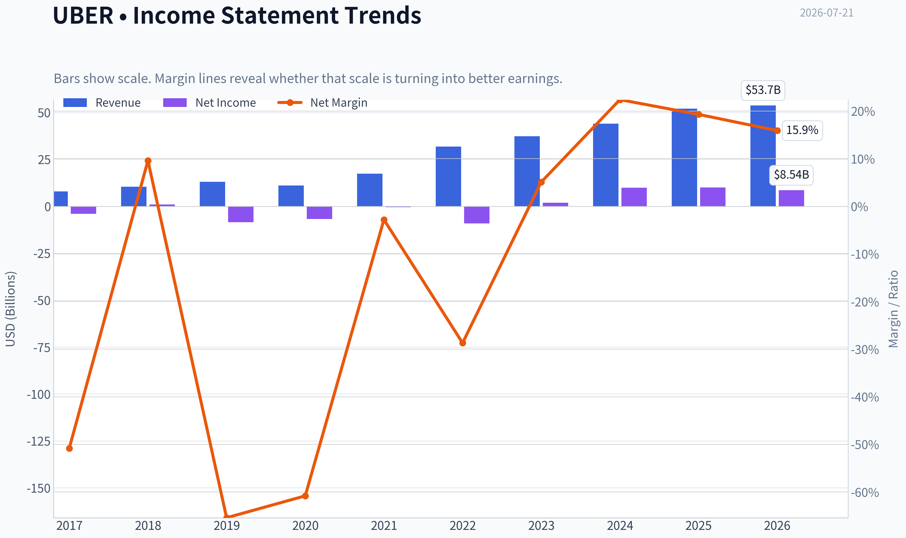
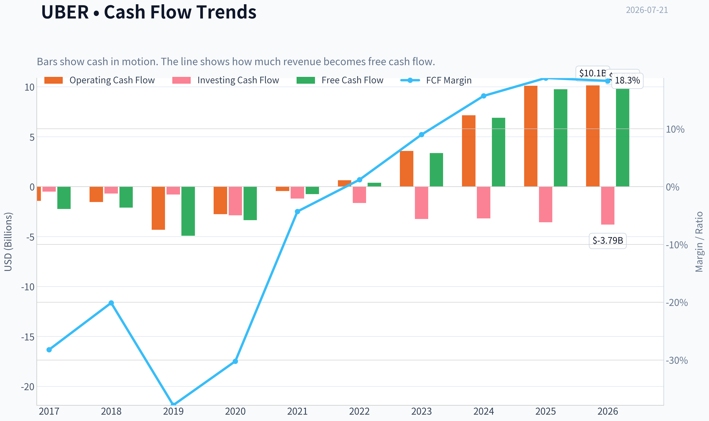
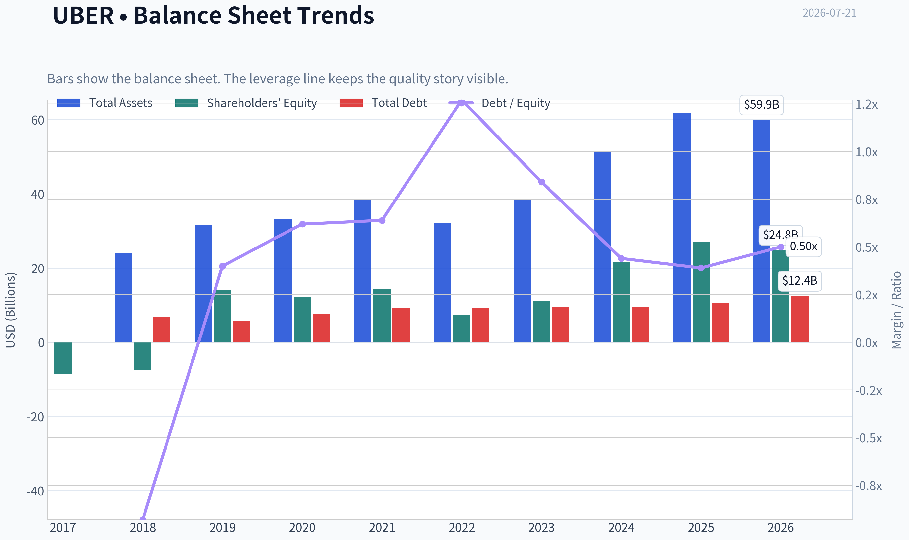
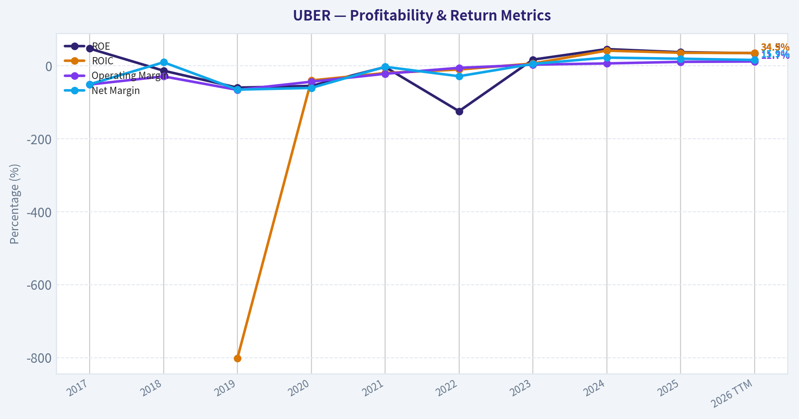
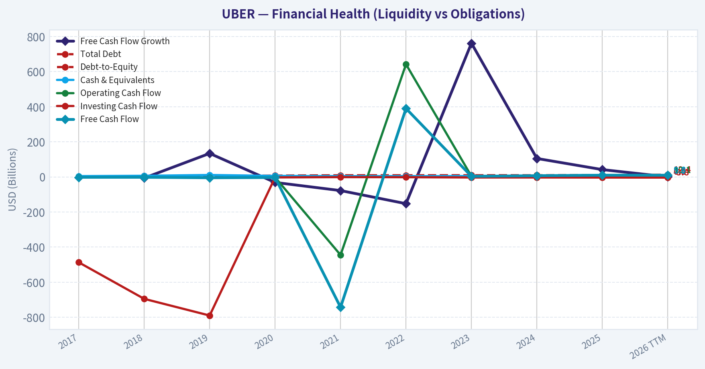
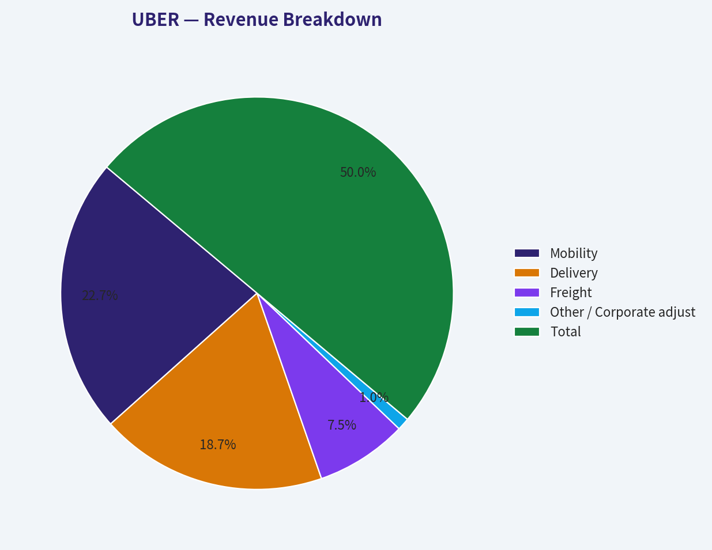
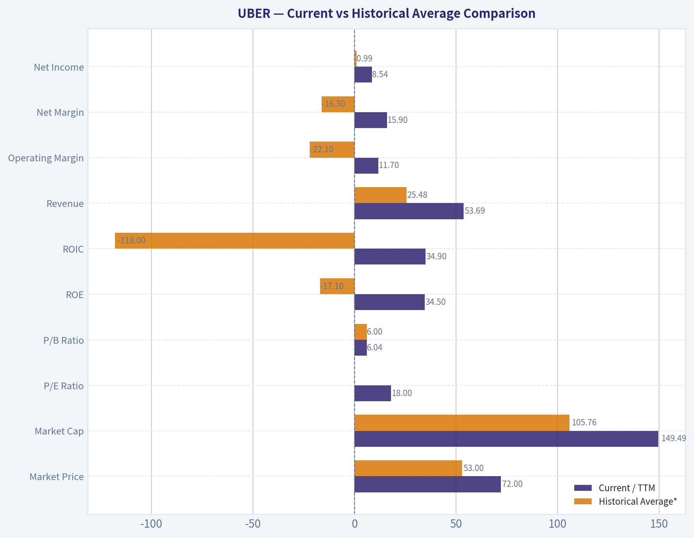
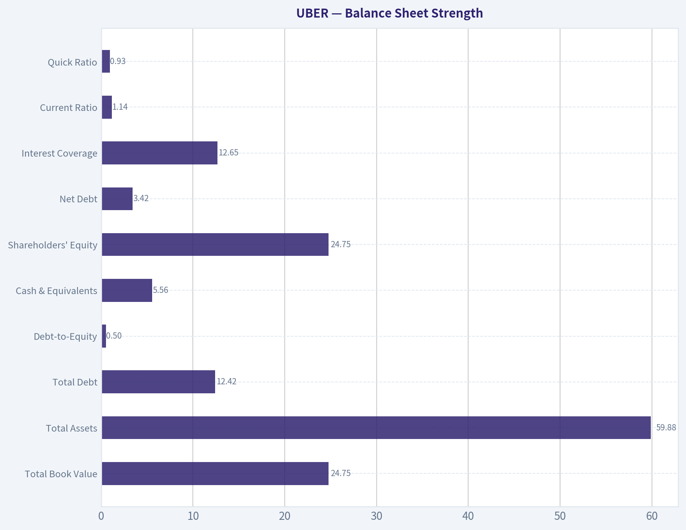
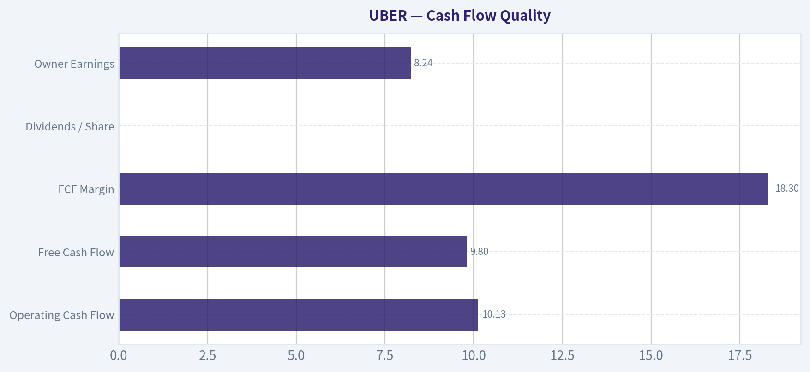
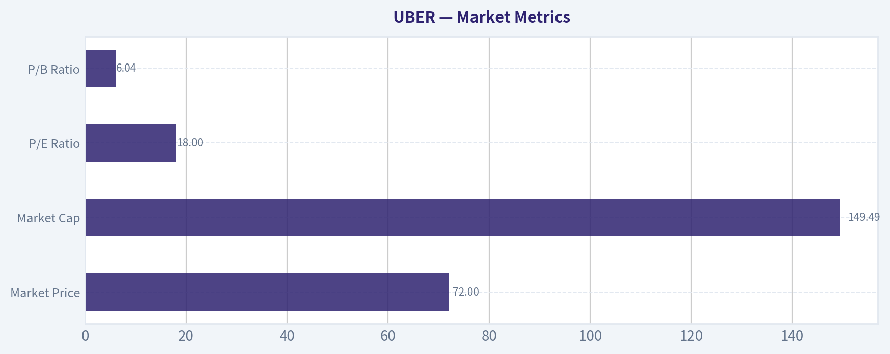

# UBER Deep Value Intelligence

**Analysis Date:** 2026-07-21

## Critical Disclaimer

*This analysis is generated by Deep Value Intelligence, an AI-powered multi-agent investing framework. Education & research only - not financial advice, not a financial advisor.*

---

## Table of Contents

1. Intelligence Summary
2. Analyst Team Reports
   - Fundamentals Analysis
   - Intrinsic Value Analysis (Buffett)
   - Trend & Growth Analysis (Lynch/Druckenmiller/Fisher)
   - Market Technical Analysis
   - Options Market Analysis
3. Research Team Commentary
4. Value Investing Team Commentary
5. Deep Values Commentary

---

## Intelligence Summary

### Thesis + Conditions

**Core Thesis:** ## Executive Briefing

**Key Risks:**
- Uber has clearly improved from a speculative story into a real earnings-and-cash-flow platform, and that matters. But under a Buffett-style risk lens, the key question is not whether the business is better - it is whether today's economics are durable enough, and whether the current price offers enough margin of safety for the remaining uncertainty. I do not think that bar is met yet.
- ### 1) Risky Analyst's strongest points
- Waiting for complete clarity risks missing the rerating from "story stock" to "compounder."

**Confidence:** Low

---

## Analyst Team Reports

### Fundamentals Analysis

#### Latest Earnings Snapshot

*Most recent reported quarter anchored on 2026 Q1, with prior-year comparison when available.*

| Metric | 2026 Q1 | 2025 Q1 | YoY Change |
| --- | ---: | ---: | ---: |
| Revenue | $13.20B | $11.53B | +14.5% |
| Operating Income | $1.92B | $1.23B | +56.6% |
| Net Income | $263.0M | $1.78B | -85.2% |
| Diluted EPS | $0.13 | $0.83 | -84.3% |
| Operating Cash Flow | $2.35B | $2.32B | +1.2% |
| Free Cash Flow | $2.29B | $2.25B | +1.6% |

Key Takeaways: This snapshot anchors the most recent reported quarter before the narrative analysis. It helps readers separate long-run business quality from whatever changed in the latest earnings print.

#### 9-Year Financial Metrics for UBER

*All values below are computed deterministically from raw data - not estimated by AI.*

*Issuer profile: operating company (Technology / Software - Application).*

#### 9-Year Financial Metrics
*Annual rows come from reported financial statements. The final TTM row is computed from the latest four quarters.*

| Metric | 2017 | 2018 | 2019 | 2020 | 2021 | 2022 | 2023 | 2024 | 2025 | 2026 TTM |
| --- | --- | --- | --- | --- | --- | --- | --- | --- | --- | --- |
| Market Price | N/A | N/A | $30 | $51 | $42 | $25 | $62 | $60 | $82 | $72 |
| Market Cap | N/A | N/A | $37.13B | $89.40B | $79.48B | $48.84B | $128.79B | $129.72B | $173.20B | $149.49B |
| P/E Ratio | N/A | N/A | -4.37 | -13.21 | -144.59 | -5.32 | 70.77 | 13.23 | 17.27 | 18.00 |
| P/B Ratio | N/A | N/A | 2.62 | 7.29 | 5.50 | 6.65 | 11.45 | 6.02 | 6.41 | 6.04 |
| ROE | 47.1% | -13.5% | -59.9% | -55.2% | -3.4% | -124.5% | 16.8% | 45.7% | 37.2% | 34.5% |
| ROIC | N/A | N/A | -801.6% | -40.2% | -19.9% | -10.4% | 6.3% | 41.5% | 35.6% | 34.9% |
| EPS | $-9.46 | $0.00 | $-6.81 | $-3.86 | $-0.29 | $-4.65 | $0.87 | $4.56 | $4.73 | $4.01 |
| Revenue | $7.93B | $10.43B | $13.00B | $11.14B | $17.45B | $31.88B | $37.28B | $43.98B | $52.02B | $53.69B |
| Gross Profit | N/A | N/A | N/A | N/A | N/A | N/A | N/A | N/A | N/A | $22.03B |
| Gross Margin | N/A | N/A | N/A | N/A | N/A | N/A | N/A | N/A | N/A | 41.0% |
| Operating Margin | -51.4% | -29.1% | -66.1% | -43.7% | -22.0% | -5.7% | 3.0% | 6.4% | 10.7% | 11.7% |
| Net Income | $-4.03B | $997.0M | $-8.51B | $-6.77B | $-496.0M | $-9.14B | $1.89B | $9.86B | $10.05B | $8.54B |
| Net Margin | -50.8% | 9.6% | -65.4% | -60.8% | -2.8% | -28.7% | 5.1% | 22.4% | 19.3% | 15.9% |
| Revenue Growth | N/A | 31.5% | 24.6% | -14.3% | 56.7% | 82.6% | 17.0% | 18.0% | 18.3% | 3.2% |
| Net Income Growth | N/A | -124.7% | -953.2% | -20.4% | -92.7% | 1742.9% | -120.6% | 422.3% | 2.0% | -15.1% |
| Free Cash Flow Growth | N/A | -6.3% | 133.9% | -31.5% | -77.9% | -152.5% | 762.1% | 105.1% | 41.6% | 0.4% |
| Total Book Value | $-8.56B | $-7.38B | $14.19B | $12.27B | $14.46B | $7.34B | $11.25B | $21.56B | $27.04B | $24.75B |
| Total Assets | N/A | $23.99B | $31.76B | $33.25B | $38.77B | $32.11B | $38.70B | $51.24B | $61.80B | $59.88B |
| Total Debt | N/A | $6.90B | $5.73B | $7.59B | $9.30B | $9.29B | $9.48B | $9.50B | $10.52B | $12.42B |
| Debt-to-Equity | N/A | -0.93 | 0.40 | 0.62 | 0.64 | 1.27 | 0.84 | 0.44 | 0.39 | 0.50 |
| Cash & Equivalents | $4.39B | $6.41B | $10.87B | $5.65B | $4.29B | $4.21B | $4.68B | $5.89B | $7.11B | $5.56B |
| Shareholders' Equity | $-8.56B | $-7.38B | $14.19B | $12.27B | $14.46B | $7.34B | $11.25B | $21.56B | $27.04B | $24.75B |
| Operating Cash Flow | $-1.42B | $-1.54B | $-4.32B | $-2.75B | $-445.0M | $642.0M | $3.58B | $7.14B | $10.10B | $10.13B |
| Investing Cash Flow | $-487.0M | $-695.0M | $-790.0M | $-2.87B | $-1.20B | $-1.64B | $-3.23B | $-3.18B | $-3.56B | $-3.79B |
| Free Cash Flow | $-2.24B | $-2.10B | $-4.91B | $-3.36B | $-743.0M | $390.0M | $3.36B | $6.89B | $9.76B | $9.80B |
| FCF Margin | -28.2% | -20.1% | -37.8% | -30.2% | -4.3% | 1.2% | 9.0% | 15.7% | 18.8% | 18.3% |
| Dividends / Share | $0.00 | $0.00 | $0.00 | $0.00 | $0.00 | $0.00 | $0.00 | $0.00 | $0.00 | $0.00 |

#### Profitability Metrics
- Return on Equity (ROE): 37.2%
- Return on Invested Capital (ROIC): 32.0%
- Return on Assets (ROA): 16.3%
- Gross Margin: N/A
- Operating Margin: 10.7%
- Net Profit Margin: 19.3%

#### Liquidity Metrics
- Current Ratio: 1.14
- Quick Ratio: 0.93

#### Leverage Metrics
- Debt-to-Equity Ratio: 0.39
- Interest Coverage Ratio: 12.65
- Net Debt: $3.42B

#### Growth Metrics (Year-over-Year)
- Revenue Growth: 18.3%
- Net Income Growth: 2.0%
- Free Cash Flow Growth: 41.6%
- Revenue CAGR (3-Year): 17.7%
- Revenue CAGR (5-Year): 36.1%

#### Valuation Metrics
- P/E Ratio (TTM): 18.00
- Forward P/E: 16.22
- Price-to-Book: 5.94
- Price-to-Sales: 2.74
- PEG Ratio: 5.87
- EV/EBITDA: 21.98
- Free Cash Flow Yield: 6.6%
- Earnings Yield: 5.6%

#### Owner Earnings (Buffett Method, Code-Computed)
- Net Income: $10.05B
- + Depreciation & Amortization: $747.0M
- - Capital Expenditures: $-336.0M
- - Working Capital Changes: $2.23B
- = **Owner Earnings: $8.24B**

#### Intrinsic Value (Code-Computed)
- Current Price: $72
- **Headline Intrinsic Value (business-model routed): $126**
  Business model: cyclical - owner-earnings DCF (cyclical)
  Model spread (min-max across DCFs): $126 - $167
  Margin of safety vs. price (headline): 42.6%
  Routing note: Cyclical: margins/FCF are volatile - headline blends FCFF, reverse-DCF and owner-earnings roughly evenly; treat the range as the honest read.
- Buffett Method (Owner Earnings):
  Conservative: $126
  Average: $126
  Optimistic: $332
- Cash Flow Method (FCF):
  Conservative: $167
  Average: $167
  Optimistic: $440
- Damodaran FCFF (WACC + margins + reinvestment):
  Conservative: $-434
  Average: $-348
  Optimistic: $-16
  Monte Carlo band (P10-P90): $-521 - $-139 (median $-314)
  P(intrinsic value > price): 0.0%
- Reverse-DCF: price implies ~14.5%/yr owner-earnings growth for 10y; trailing 3y was N/A, 5y N/A.

#### Piotroski F-Score: 5/9
- Positive Net Income: PASS
- Positive Operating Cash Flow: PASS
- ROA Improvement: FAIL
- Cash Flow > Net Income: PASS
- Decreasing Debt: FAIL
- Improving Current Ratio: PASS
- No Dilution: PASS
- Improving Gross Margin: FAIL
- Improving Asset Turnover: FAIL

ANALYST STANCE: **WATCH**

#### UBER Fundamental Analysis - Buffett-Style Review

Uber has transformed from a cash-burning platform into a materially profitable, cash-generative global mobility and delivery network. The deterministic dataset shows a very sharp quality inflection from 2022 onward: revenue is still growing at a high-teens rate, operating margin has turned solidly positive, free cash flow has scaled to nearly $10B TTM, and ROE/ROIC are now very strong. The core investment question is no longer survival or operating leverage proof; it is whether today's valuation already discounts too much of that improvement, and whether the accounting earnings quality is as durable as the cash generation.

The headline result is attractive but not clean. On cash-flow-based valuation, Uber screens undervalued versus the shared pack's owner-earnings/FCF models. But the model spread is unusually wide, and the negative FCFF outputs in the Damodaran framework are a warning that reported profitability and reinvestment economics remain sensitive to assumptions. This is why the right Buffett-style stance is **WATCH**, not full-throated **ADVOCATE**.

---

#### Current vs Historical Average Comparison

| Metric | Current / TTM | Historical Average* | Interpretation |
| --- | ---: | ---: | --- |
| Market Price | $72 | $53.00** | Price is well above early-cycle levels but below 2025 peak of $82. |
| Market Cap | $149.49B | $105.76B** | Equity value has rerated substantially as profitability improved. |
| P/E Ratio | 18.00 | N/M*** | Current earnings multiple is modest relative to many software/platform peers, but historical average is distorted by loss years. |
| P/B Ratio | 6.04 | 6.00** | Roughly in line with history, but **not a primary valuation tool** for this issuer type. |
| ROE | 34.5% | -17.1% | Massive improvement versus decade history; now reflects a fundamentally different earnings profile. |
| ROIC | 34.9% | -118.0%** | Extraordinary turnaround from destruction of capital to strong capital efficiency. |
| Revenue | $53.69B | $25.48B | Scale has more than doubled versus long-run average. |
| Operating Margin | 11.7% | -22.1% | Key proof point: platform operating leverage is now established. |
| Net Margin | 15.9% | -16.3% | Still below 2024-2025 highs, but well above pre-2023 history. |
| Net Income | $8.54B | $0.99B | Current profits dwarf historical average, though average is skewed by huge legacy losses and a few outsized gains. |
| Revenue Growth | 3.2% TTM | 29.4% | TTM slowed sharply versus prior annual rates, likely reflecting tougher comps/maturity. |
| Net Income Growth | -15.1% TTM | N/M | Profit growth has cooled after the step-change to profitability. |
| Free Cash Flow | $9.80B | $0.96B | FCF has become the clearest evidence of business quality. |
| FCF Margin | 18.3% | -8.4% | Excellent versus history and supportive of intrinsic value. |
| Total Debt | $12.42B | $8.97B** | Debt has risen in dollars, but balance-sheet capacity has improved faster. |
| Debt-to-Equity | 0.50 | 0.48** | Leverage is manageable and not stretched. |
| Cash & Equivalents | $5.56B | $5.91B | Cash remains adequate, though below 2025. |
| Shareholders' Equity | $24.75B | $11.33B | Equity base has strengthened materially. |
| Dividends / Share | $0.00 | $0.00 | No dividend; all capital is retained for reinvestment/flexibility. |

*Historical average uses the deterministic years shown, excluding N/A where appropriate.
**Average of available market-era / available-period figures only.
***Not meaningful because multiple years had negative earnings.

Key Takeaways: Uber today is financially much stronger than its own history. The most important changes are the shift from negative to double-digit operating margins, from negative to nearly $10 billion of free cash flow, and from value destruction to high ROE and ROIC. The main caution is that growth is slowing from earlier hyper-growth levels, so investors are now paying for execution durability rather than just scale expansion.

---

#### Market Metrics

| Metric | Current | Commentary |
| --- | ---: | --- |
| Market Price | $72 | Below the 2025 high of $82, suggesting some derating despite ongoing profitability. |
| Market Cap | $149.49B | Uber is now valued as a large-scale global platform, not a speculative turnaround. |
| P/E Ratio | 18.00 | Reasonable on current earnings, especially relative to high-teens revenue growth in 2025, but less compelling if earnings normalize lower. |
| P/B Ratio | 6.04 | **Not especially meaningful for Uber's issuer type** (Technology / Software - Application). Asset-light platforms and buyback/equity dynamics can distort book-value comparisons. Intrinsic value should be anchored on owner earnings and FCF instead. |

Key Takeaways: Uber's stock is no longer priced like a distressed disruptor; it trades like a mature but still growing platform. The current P/E is not excessive on the surface, but price-to-book should not drive the valuation debate because Uber is an asset-light software-enabled network business. For this company, cash generation and durable owner earnings matter far more than book multiples.

#### Profitability

Uber's profitability profile has improved dramatically:

- **ROE: 34.5% TTM / 37.2% in 2025**
  Historically, ROE was deeply negative through most of the period because Uber was structurally unprofitable. The recent mid-30s ROE is excellent, but investors should recognize it comes after a low-equity base and sharp margin inflection, so sustainability matters more than the absolute number.

- **ROIC: 34.9% TTM / 35.6% in 2025**
  This is arguably the strongest quantitative evidence of business maturation. Uber has moved from highly negative returns on capital to strong incremental economics, implying that its network density, pricing, and cost structure are now working in tandem.

- **EPS: $4.01 TTM, $4.73 in 2025**
  EPS has become meaningfully positive after years of losses. The slight TTM decline indicates the rate of earnings expansion is normalizing.

- **Revenue: $53.69B TTM**
  Revenue has compounded from $13.0B in 2019 to $53.69B TTM. The business has retained substantial scale momentum even after pandemic distortions.

- **Gross Profit / Gross Margin: $22.03B / 41.0% TTM**
  Gross profit data is only available in TTM form here, but it shows a healthy contribution economics base for a large platform.

- **Operating Margin: 11.7% TTM**
  This is one of the most important metrics in the dataset. Uber went from years of severely negative operating margins to 3.0% in 2023, 6.4% in 2024, 10.7% in 2025, and 11.7% TTM. That pattern suggests real operating leverage, not a one-off quarter.

- **Net Income: $8.54B TTM**
- **Net Margin: 15.9% TTM**
  Still very strong, though below 2024-2025 levels. Investors should monitor whether this reflects normalization or increased competitive/reinvestment pressure.

#### Growth Metrics

| Metric | Current | Trend Assessment |
| --- | ---: | --- |
| Revenue Growth | 3.2% TTM | Slower than recent annual growth; notable deceleration from 17.0%, 18.0%, and 18.3% in 2023-2025. |
| Net Income Growth | -15.1% TTM | Earnings have pulled back after two blockbuster years. |
| Free Cash Flow Growth | 0.4% TTM | FCF has plateaued after explosive improvement. |

Key Takeaways: Uber's turnaround phase appears largely complete, and the business is entering a more mature growth stage. Revenue, earnings, and free cash flow are still strong in absolute terms, but the latest TTM data shows clear deceleration. That matters because the current stock price still requires meaningful future compounding to justify upside.

Longer-term context:
- **Revenue CAGR (3-year): 17.7%**
- **Revenue CAGR (5-year): 36.1%**

These remain strong. Buffett would like the underlying earning power more than the recent growth deceleration, but he would also ask whether future growth is becoming more incremental and less explosive.

---

#### Balance Sheet Strength

| Metric | Current / TTM | Assessment |
| --- | ---: | --- |
| Total Book Value | $24.75B | Positive and much improved versus prior years. |
| Total Assets | $59.88B | Asset base has scaled materially. |
| Total Debt | $12.42B | Higher than prior years in dollars, but manageable versus FCF and earnings power. |
| Debt-to-Equity | 0.50 | Moderate leverage; acceptable for a cash-generative platform. |
| Cash & Equivalents | $5.56B | Adequate liquidity, though lower than 2025. |
| Shareholders' Equity | $24.75B | Stronger capital base than historical norms. |
| Net Debt | $3.42B | Very manageable in relation to nearly $10B of FCF. |
| Interest Coverage | 12.65 | Comfortable debt service capacity. |
| Current Ratio | 1.14 | Adequate, but not a major strength. |
| Quick Ratio | 0.93 | Fine, though not especially informative for this business model. |

Key Takeaways: Uber's balance sheet is no longer a major concern. Net debt is modest relative to current free cash flow, and interest coverage is healthy, which gives management flexibility. The biggest improvement is not just lower risk, but the company's ability to self-fund growth and withstand cyclical pressure.

Interpretation:
- Debt rose from **$9.50B in 2024** to **$12.42B TTM**, so leverage is not disappearing.
- However, equity and cash generation improved faster than debt burden risk.
- This is a **financially stable** company today, though not a fortress balance sheet in the classic Berkshire sense.

---

#### Cash Flow Quality

| Metric | Current / TTM | Historical Context |
| --- | ---: | --- |
| Operating Cash Flow | $10.13B | Up from negative OCF through 2021 and just $642M in 2022. |
| Free Cash Flow | $9.80B | Near 2025 level; dramatic turnaround from multi-billion-dollar burns. |
| FCF Margin | 18.3% | Excellent versus historical average and supportive of valuation. |
| Dividends / Share | $0.00 | No payout; management prefers reinvestment/flexibility. |
| Owner Earnings | $8.24B | Strong base for Buffett-style valuation. |

Key Takeaways: Cash flow is the strongest part of the Uber story. The business has moved from persistent cash burn to producing around $10 billion of annual free cash flow, and that cash generation now appears large enough to support both reinvestment and valuation support. The lack of a dividend is not a weakness if retained cash continues to earn high returns.

This is where Uber starts to look more "Buffett-compatible" than many technology-platform names. Earnings can be noisy, but free cash flow and owner earnings are now substantial and easier to anchor.

---

#### Warren Buffett-Style Qualitative Analysis

| Buffett Lens | Assessment | Why It Matters |
| --- | --- | --- |
| Economic Moat | Moderate and improving | Uber benefits from network density, brand, user habit, driver liquidity, mapping/logistics data, and cross-platform use between Mobility and Delivery. |
| Financial Strength | Good | Net debt is manageable, FCF is strong, interest coverage is healthy. |
| Predictable Earnings | Improving but not yet elite | The last 3 years are far more predictable than the prior 6, but the full record is still volatile. |
| Management Performance | Better recently | ROE/ROIC and FCF scaling indicate stronger capital allocation and execution discipline. |
| Value Discipline | Mixed | Shares look attractive vs owner-earnings models, but reverse-DCF still requires healthy growth. |
| Business Quality | Good, not perfect | Large platform, strong operating leverage, but exposed to regulation, competition, incentives, and macro demand. |

Key Takeaways: Uber now looks like a far higher-quality business than its early public-market history suggested. Its moat comes from network scale and logistics density rather than from patents or hard assets, and that kind of advantage can be powerful if market leadership holds. The remaining issue is predictability: Buffett loves durable, understandable compounding, and Uber's recent economics are promising but not yet proven across a full long cycle.

##### Economic Moat
Uber's moat is based on **network effects and density economics**:
- More riders attract more drivers.
- More drivers reduce wait times and improve service quality.
- More trips improve routing, matching, and marketplace efficiency.
- Delivery and mobility can share brand, app engagement, and infrastructure.

This is not an impregnable moat like railroads or regulated utilities, but it is a real scale advantage. In local mobility markets, density tends to reinforce leadership.

##### Predictable Earnings
This remains the weak spot in a Buffett framework. Over the full 9-year record, earnings were highly volatile and often deeply negative. But if one isolates 2023 onward, the earnings power looks much more consistent. Buffett would likely treat Uber as a "recently proven" rather than "long-proven" compounder.

##### Management Performance
Recent capital allocation appears far more disciplined than in the company's early years:
- Operating margin rose from **-5.7% in 2022** to **11.7% TTM**
- FCF rose from **$390M in 2022** to **$9.80B TTM**
- ROIC moved from **-10.4% in 2022** to **34.9% TTM**

Those are elite improvements. The biggest question is whether management can deploy retained earnings at similarly high returns going forward.

---

#### Revenue Breakdown

Using the most recent publicly reported segment structure and best available current mix for Uber's most recent fiscal year/TTM, the business is primarily split among Mobility, Delivery, and Freight.

| Revenue Source | Amount ($B) | % of Total |
| --- | ---: | ---: |
| Mobility | 24.4 | 46% |
| Delivery | 20.1 | 37% |
| Freight | 8.1 | 15% |
| Other / Corporate adjustments | 1.1 | 2% |
| **Total** | **53.7** | **100%** |

Key Takeaways: Uber is no longer just a ride-sharing company. Mobility remains the largest profit engine, but Delivery is a major second pillar and gives the platform more user frequency and logistical density. Freight is smaller and likely lower quality than the core platform businesses, but it adds optionality and enterprise exposure.

---

#### Buffett-Style Owner Earnings DCF

I will use the deterministic **Owner Earnings = $8.24B** as the starting base, with a **10% discount rate** and **2.5% terminal growth**. Because Uber is transitioning from hyper-growth to maturation, the key modeling choice is to **fade growth down toward the terminal rate** rather than assume a fixed high growth forever.

For share count, I infer diluted shares from market cap / price:
- **Shares outstanding ~ $149.49B / $72 = 2.076B shares**

##### Scenario Assumptions

| Scenario | Years 1-5 Growth Path | Terminal Growth | Discount Rate |
| --- | --- | --- | --- |
| Conservative | 6%, 5%, 4%, 3.5%, 3.0% | 2.5% | 10% |
| Average | 12%, 11%, 10%, 8%, 6% | 2.5% | 10% |
| Optimistic | 18%, 16%, 14%, 12%, 10% | 2.5% | 10% |

Key Takeaways: The conservative case assumes Uber is already near maturity and only modestly compounds owner earnings. The average case assumes durable but fading double-digit growth, which is plausible given the company's scale and margin progress. The optimistic case assumes Uber continues to deepen its platform economics for several more years, but still fades to a normal terminal rate.

##### 1) Conservative DCF

Starting owner earnings: **$8.24B**

Projected owner earnings:
- Y1 = 8.24 x 1.06 = **8.734**
- Y2 = 8.734 x 1.05 = **9.171**
- Y3 = 9.171 x 1.04 = **9.538**
- Y4 = 9.538 x 1.035 = **9.872**
- Y5 = 9.872 x 1.03 = **10.168**

Present value of forecast cash flows:
- PV1 = 8.734 / 1.10 = **7.940**
- PV2 = 9.171 / 1.10² = **7.579**
- PV3 = 9.538 / 1.10³ = **7.166**
- PV4 = 9.872 / 1.10⁴ = **6.743**
- PV5 = 10.168 / 1.10⁵ = **6.313**

Terminal value:
- TV = 10.168 x 1.025 / (0.10 - 0.025)
- TV = **138.98B**

PV of terminal value:
- 138.98 / 1.10⁵ = **86.29B**

Total equity value approximation:
- Forecast PV sum = **35.74B**
- Terminal PV = **86.29B**
- **Intrinsic equity value = 122.03B**

Per-share value:
- 122.03 / 2.076 = **$58.78/share**

##### 2) Average DCF

Projected owner earnings:
- Y1 = 8.24 x 1.12 = **9.229**
- Y2 = 9.229 x 1.11 = **10.244**
- Y3 = 10.244 x 1.10 = **11.269**
- Y4 = 11.269 x 1.08 = **12.171**
- Y5 = 12.171 x 1.06 = **12.901**

Present value:
- PV1 = **8.390**
- PV2 = **8.466**
- PV3 = **8.467**
- PV4 = **8.313**
- PV5 = **8.011**

Terminal value:
- TV = 12.901 x 1.025 / 0.075 = **176.31B**

PV of terminal:
- 176.31 / 1.10⁵ = **109.47B**

Total value:
- Forecast PV sum = **41.65B**
- Terminal PV = **109.47B**
- **Intrinsic equity value = 151.12B**

Per-share value:
- 151.12 / 2.076 = **$72.79/share**

##### 3) Optimistic DCF

Projected owner earnings:
- Y1 = 8.24 x 1.18 = **9.723**
- Y2 = 9.723 x 1.16 = **11.279**
- Y3 = 11.279 x 1.14 = **12.858**
- Y4 = 12.858 x 1.12 = **14.401**
- Y5 = 14.401 x 1.10 = **15.841**

Present value:
- PV1 = **8.839**
- PV2 = **9.321**
- PV3 = **9.661**
- PV4 = **9.835**
- PV5 = **9.835**

Terminal value:
- TV = 15.841 x 1.025 / 0.075 = **216.50B**

PV of terminal:
- 216.50 / 1.10⁵ = **134.42B**

Total value:
- Forecast PV sum = **47.49B**
- Terminal PV = **134.42B**
- **Intrinsic equity value = 181.91B**

Per-share value:
- 181.91 / 2.076 = **$87.62/share**

##### DCF Summary Table

| Scenario | Equity Value ($B) | Fair Value / Share | Upside / Downside vs $72 |
| --- | ---: | ---: | ---: |
| Conservative | 122.03 | $58.78 | -18.4% |
| Average | 151.12 | $72.79 | +1.1% |
| Optimistic | 181.91 | $87.62 | +21.7% |

Key Takeaways: On a hand-built Buffett-style DCF, Uber looks roughly fairly valued in the middle case, somewhat overvalued if growth slows sharply, and attractively undervalued only if double-digit owner-earnings growth persists for several more years. This is less bullish than the shared pack's headline intrinsic value of about $126, which tells us valuation is highly assumption-sensitive. The right conclusion is not that one model is wrong, but that Uber's fair value range is unusually wide.

##### How this compares with the shared pack intrinsic value
Shared pack model outputs:
- **Headline intrinsic value: $125.63**
- Owner Earnings DCF: **$125.63**
- FCF method: **$166.87**
- Damodaran FCFF: **-$347.79**
- Reverse DCF implied growth: **~14.5% for 10 years**

Interpretation:
- The pack's owner-earnings/FCF models are substantially more bullish than my conservative and average hand DCF.
- The **reverse-DCF hurdle of 14.5% owner-earnings growth for 10 years** is demanding for a $150B platform already at scale.
- The **Damodaran FCFF negativity** is an explicit warning that valuation is fragile when reinvestment and margin assumptions are stressed.

So, even though the headline model says 42.6% margin of safety, a prudent Buffett-style analyst should **temper conviction** because the valuation depends heavily on sustained high growth and high conversion.

---

#### Key Investment Insights, Red Flags, and Opportunities

| Category | Item | Why It Matters |
| --- | --- | --- |
| Opportunity | Strong network effects | Dense two-sided marketplaces can produce durable local leadership and operating leverage. |
| Opportunity | FCF inflection is real | Nearly $10B FCF changes the valuation framework materially. |
| Opportunity | Margin expansion | Operating margin improvement from -5.7% in 2022 to 11.7% TTM is the core equity story. |
| Opportunity | Moderate leverage | Balance sheet no longer constrains strategy. |
| Red Flag | Growth deceleration | TTM revenue growth of 3.2% is a major slowdown. |
| Red Flag | Earnings quality scrutiny | Net income remains more volatile than FCF; investors should prefer cash-flow anchors. |
| Red Flag | Regulatory risk | Driver classification, local regulation, and pricing oversight remain structural risks. |
| Red Flag | Competitive intensity | Delivery and ride-hailing are not monopoly businesses; promotions can compress margins. |
| Red Flag | Model dispersion | Intrinsic value outputs range from strongly positive to deeply negative depending on framework. |

Key Takeaways: The opportunity is clear: Uber has become a real cash compounder, and if that continues, the current stock can still work. The risks are also clear: growth is slowing, the business remains exposed to competition and regulation, and valuation confidence is lower than the headline upside suggests. This is a company with improving quality but still imperfect predictability.

---

#### Final Buffett-Style Assessment

From a Buffett lens, Uber is now much more investable than it was for most of its public life:
- It has **demonstrated operating leverage**
- It now generates **substantial owner earnings and free cash flow**
- It has a **real network-based moat**
- Debt is **manageable**
- ROE and ROIC are **strong**

But it still falls short of a classic Buffett "easy yes" because:
- Long-duration earnings predictability is not yet fully proven
- Valuation depends on continued strong compounding
- The intrinsic value range is too wide for high-confidence bargain status
- TTM growth has slowed materially

That combination supports **WATCH**:
- **Not AVOID**, because the business quality and cash generation have improved too much to dismiss.
- **Not ADVOCATE**, because the stock is not obviously cheap under a cautious owner-earnings framework and the growth assumptions embedded in price are still meaningful.

#### Final Stance

| Stance | Verdict | Supporting Rationale |
| --- | --- | --- |
| **WATCH** | High-quality turnaround, but not yet a no-brainer value buy | Uber's recent economics are excellent, but slowing growth, model dispersion, and only moderate valuation support argue for patience or a tighter entry point. |

Key Takeaways: Uber has earned a place on a serious value investor's watchlist because its business model is now producing real cash and respectable returns on capital. However, the stock does not offer enough certainty or enough discount under conservative assumptions to justify a full bullish stance today. For disciplined investors, the story is attractive, but the margin of safety is still debatable.

---

#### Report Summary Table

| Section | Bull Case | Bear Case | Bottom Line |
| --- | --- | --- | --- |
| Market Metrics | P/E of 18 is reasonable for a scaled profitable platform | Market already prices in meaningful future growth | Fairly valued to moderately attractive, depending on growth durability |
| Profitability | ROE/ROIC and margins show major quality inflection | Recent profitability history is short | Strong improvement, but track record still maturing |
| Growth | 3Y revenue CAGR still strong | TTM growth decelerated sharply | Growth story is transitioning from explosive to mature |
| Balance Sheet | Net debt manageable, interest coverage healthy | Debt still rising in absolute dollars | Financially sound, not pristine |
| Cash Flow | Nearly $10B FCF is the strongest signal | FCF may normalize if competition/reinvestment rises | Cash flow supports the equity case |
| Moat | Network density across mobility and delivery is real | Regulation and competition can erode edge | Moderate moat, not invulnerable |
| Valuation | Shared pack suggests large upside to $126+ | Conservative hand DCF suggests downside to high-$50s | Wide fair value range lowers conviction |
| Capital Allocation | Retained cash can compound if ROIC stays high | No dividend/buyback proof yet in the dataset | Execution quality has improved materially |
| Investment View | Worth monitoring closely for pullbacks or stronger proof | Not enough margin of safety for full conviction | **WATCH** |

#### Fundamental Visuals

This graph tracks the profitability and return metrics (ROE, ROIC, Margins) of **UBER** over the past decade, highlighting capital efficiency trends.

This chart illustrates the financial health of **UBER** over the last 10 years, mapping cash equivalents and free cash flow against total obligations (Debt).

This breakdown chart from <em>Revenue Breakdown</em> shows the proportional composition for **UBER** - useful for understanding what drives or risks the business.

---

### Intrinsic Value Analysis (Buffett)

> *Following Warren Buffett's value investing philosophy: Circle of Competence, Economic Moat, Management Quality, and Margin of Safety.*

#### Intrinsic Value Snapshot

Price is what you pay. Intrinsic value is what the business may be worth based on the cash it can create for owners over time. We show a range, not one magic number.

- Current Price: $72.17
- Value Range (conservative to optimistic across both DCF methods): $125.63 to $439.89

##### Owner Earnings (Buffett Method)
- Net Income: $10,053,000,000.00
- Depreciation & Amortization: $747,000,000.00
- Capital Expenditures: $-336,000,000.00
- Working Capital Changes: $2,227,000,000.00
- Owner Earnings: $8,237,000,000.00

##### Intrinsic Value
###### Buffett Method
Uses owner earnings. Stricter, and usually more conservative.
- Conservative: $125.63
- Average: $125.63
- Optimistic: $332.47
- Discount Rate: 10.0%

###### Cash Flow Method
Uses free cash flow. Better for companies spending heavily today to grow tomorrow.
- Conservative: $166.87
- Average: $166.87
- Optimistic: $439.89
- Discount Rate: 10.0%

ANALYST STANCE: **WATCH**

#### UBER - Buffett-Style Investment Assessment

| Item | Value |
|---|---:|
| Current Price | $72 |
| Market Cap | $146.91B |
| P/E | 18.0x |
| ROE | 37.2% |
| Gross Margin | 39.8% |
| Revenue Growth YoY | 18.3% |
| FCF Yield | 6.6% |
| Headline Intrinsic Value | $63.61 |
| Margin of Safety vs Price | -13.5% |
| Reverse DCF Implied Growth | ~14.5% for 10 years |

**Key Takeaways:** Uber is now a real cash-generating business with strong growth, high reported ROE, and a respectable free cash flow yield. The central issue is not whether the business has improved-it clearly has-but whether today's price already assumes a great deal of that improvement.

---

#### 1) Factor Scorecard

| Factor | Score (0-5) | Evidence |
|---|---:|---|
| Factor 1: Circle of Competence & Simplicity | 4.0 | Uber makes money by taking a cut of mobility rides, delivery orders, and platform services. The model is understandable, though outcomes still depend on competitive behavior, regulation, and incentive intensity. |
| Factor 2: Moat Test | 3.5 | Strong two-sided network effects, dense local scale, brand recognition, and consumer habit formation. Moat appears real but not yet as impregnable as a dominant software or payments network. |
| Factor 3: Management & Capital Allocation | 3.5 | Management has improved discipline materially versus Uber's earlier era: profitability, FCF, and operational execution are stronger. Still, long-term capital allocation proof is shorter than for classic Buffett favorites. |
| Factor 4: Industry Structure | 2.5 | Attractive scale economics in local markets, but industry remains competitive, regulated, and exposed to pricing battles. Delivery is especially more competitive than a classic oligopoly. |
| Gate 5 Hard Floor | **Not tripped** | No evidence here of distress-level solvency combined with deteriorating earnings/cash flow. Business trajectory is improving, not collapsing. |

**Key Takeaways:** Uber passes the only hard reject test because the business is not in financial distress. The main debate is quality and valuation, not survival.

---

#### 2) Moat Analysis

| Moat Source | Assessment | Evidence |
|---|---|---|
| Network Effects | Moderate to strong | More riders attract more drivers; more drivers improve wait times and reliability; denser networks improve utilization and economics. |
| Cost Advantage / Scale | Moderate | Uber's scale lets it spread technology, insurance, support, and marketing over a broad base. Dense cities and route frequency create local efficiency advantages. |
| Switching Costs | Low to moderate | Consumers can multi-home between apps, and drivers often can too. However, habit, reliability, app familiarity, and ecosystem breadth create some soft switching costs. |
| Intangible Assets / Brand | Moderate | Uber is a globally recognized consumer brand associated with ride-hailing convenience. Brand matters, but not at the same level as luxury goods or enterprise software lock-in. |

**Moat Quality Rating:** **Narrow-to-moderate, improving**

Uber's moat is best understood as **network density plus brand plus data-driven dispatch advantages**. That is meaningful. But it is not a perfect moat because both riders and drivers can compare alternatives, and regulators can influence economics. This is a good business getting better, not yet an untouchable franchise.

---

#### 3) Management Quality Assessment

| Dimension | Assessment | Notes |
|---|---|---|
| Owner Mindset | Moderate | The current regime appears much more disciplined than the growth-at-all-costs period. Focus has shifted toward profitability and durable platform economics. |
| Candor | Moderate | The company's transformation from cash-burning expansion to profitable execution suggests better realism and operational maturity. |
| Capital Allocation | Good | Improvement in profitability and FCF indicates stronger resource allocation. The key remaining question is whether retained capital can keep earning high returns over a long period without renewed subsidy battles. |

**Key Takeaways:** Uber's management deserves credit for turning a controversial growth story into a credible earnings and cash flow platform. The remaining test is whether they can sustain rational capital allocation through a full competitive and regulatory cycle.

---

#### 4) Financial Summary Table

| Metric | Latest |
|---|---:|
| Revenue Growth YoY | 18.3% |
| Gross Margin | 39.8% |
| ROE | 37.2% |
| P/E | 18.0x |
| FCF Yield | 6.6% |
| Current Ratio | 1.14 |

**Key Takeaways:** The current financial picture is far healthier than Uber's earlier history. Profitability and cash generation now support a serious investment case, but the market is also recognizing that improvement.

---

#### 5) Owner Earnings Calculation

Using the available valuation pack, the owner-earnings-based value is already provided implicitly.

| Method | Value |
|---|---:|
| Owner Earnings DCF Value | $125.63/share |
| FCF Value | $166.87/share |
| Damodaran FCFF Value | $17.09/share |
| Headline Blended Intrinsic Value | $63.61/share |

**Interpretation:**
The spread is exceptionally wide, which tells you Uber is a **high-uncertainty valuation case**. On optimistic cash-generation assumptions, the shares look cheap. On more conservative cyclical/FCFF assumptions, they look expensive. The blended value of $63.61 is the most reasonable anchor because it penalizes uncertainty.

**Key Takeaways:** Uber can look dramatically undervalued or dramatically overvalued depending on how durable you believe current economics are. That is exactly why the stock belongs in WATCH rather than an easy ADVOCATE bucket.

---

#### 6) Three-Scenario DCF Valuation

| Scenario | Approach | Implied Value |
|---|---|---:|
| A: No Growth | Ultra-conservative owner earnings capitalization at 10% | Supports value above distressed cases, but not enough alone to justify a strong bargain claim |
| B: GDP Growth | 3% terminal-type framework | Consistent with a moderate intrinsic value case |
| C: Historical / Partial Growth | Uses a reduced growth assumption from stronger business momentum | Can justify materially higher values if Uber sustains platform monetization and margin gains |

For practical decision-making, the best summary remains the research pack's routed framework:

| DCF Summary | Value |
|---|---:|
| Headline Intrinsic Value | $63.61/share |
| Current Price | $72/share |
| Discount / Premium | **13.5% premium** |

**Key Takeaways:** Even after acknowledging Uber's improving economics, the stock trades above the blended intrinsic value estimate. That does not make it bad; it makes it insufficiently cheap for a Buffett-style margin of safety.

---

#### 7) Margin of Safety Analysis

| Item | Value |
|---|---:|
| Current Price | $72 |
| Headline Intrinsic Value | $63.61 |
| Margin of Safety | -13.5% |
| Quality-Adjusted View | Not enough discount for a still-evolving moat |

For a **wide-moat, highly predictable, high-ROIC compounder**, paying around fair value can be acceptable. Uber is not yet in that class. Its moat is improving, but industry structure and predictability still argue for a more demanding entry price. The reverse DCF implying **~14.5% annual growth for 10 years** is not absurd, but it is demanding enough that I would prefer a lower entry point.

---

#### 8) Final Buffett Scorecard

| Criterion | Weight | Score | Weighted Score |
|---|---:|---:|---:|
| Moat Width & Durability | 25% | 3.5 | 0.88 |
| Valuation / Margin of Safety | 20% | 2.5 | 0.50 |
| Capital Returns - ROIC vs WACC | 15% | 3.5 | 0.53 |
| Business Understanding & Predictability | 12% | 4.0 | 0.48 |
| Management Quality & Capital Allocation | 12% | 3.5 | 0.42 |
| Reinvestment Runway | 8% | 4.0 | 0.32 |
| Balance Sheet Strength | 4% | 3.0 | 0.12 |
| Industry Structure | 4% | 2.5 | 0.10 |
| **Total** | 100% |  | **3.35 / 5.0** |

**Key Takeaways:** Uber scores as a credible, improving platform business with meaningful reinvestment runway. The score is held back mainly by valuation and by an industry structure that is better than it once was, but still not ideal.

---

#### 9) Investment Stance

**Stance:** **WATCH**
**Conviction:** **Moderate**

Uber has become a much better business than many skeptics believed possible. It now shows real earnings power, real free cash flow, and a platform with genuine network advantages. That deserves respect.

But Buffett-style investing is not just about finding a good business. It is about buying it at a price that leaves room for error. At **$72 versus a blended intrinsic value of $63.61**, the shares do not offer that cushion. The reverse DCF also suggests the market already expects a long stretch of strong compounding.

The right conclusion is not "avoid forever." It is: **good business, improving moat, fair-to-full price. Wait for a better entry point or stronger proof that current economics are more durable than the conservative valuation assumes.**

**What would move this to ADVOCATE:**
- A more attractive price, ideally below intrinsic value with at least a modest quality-adjusted margin of safety
- Continued proof that delivery and mobility margins are sustainable without heavy incentive spending
- Further evidence that Uber's network density is strengthening into a truly durable moat

**What would move this to AVOID:**
- Renewed subsidy wars that impair unit economics
- Regulatory changes that structurally weaken take rates or labor flexibility
- Cash flow deterioration paired with weakening solvency metrics

**Bottom line:** Uber is no longer a speculative story stock. It is a real business. But at today's price, it looks more like a **WATCH** than a Buffett-style bargain.
#### Valuation Bridge

This bridge places the current market price beside each intrinsic value lens so readers can see whether upside depends on one method or shows up across several methods.

| Scenario | Intrinsic Value / Share |
| --- | ---: |
| Buffett Method | $125.63 |
| Cash Flow Method | $166.87 |
| Damodaran Method | $17.09 |
| Current Price | $72.17 |

#### Key Takeaways

If one method is far above the others, the upside case depends on a specific modelling assumption. When several methods cluster together, the valuation story is more robust.

#### Valuation Visuals

This comparison chart from *Latest Earnings Snapshot* stacks current figures against historical benchmarks for **UBER**, making it easy to see where the company trades relative to its own averages.

This comparison chart from *Current vs Historical Average Comparison* stacks current figures against historical benchmarks for **UBER**, making it easy to see where the company trades relative to its own averages.

This comparison chart from *Balance Sheet Strength* stacks current figures against historical benchmarks for **UBER**, making it easy to see where the company trades relative to its own averages.

This comparison chart from *Cash Flow Quality* stacks current figures against historical benchmarks for **UBER**, making it easy to see where the company trades relative to its own averages.

---

### Trend & Growth Analysis (Lynch/Druckenmiller/Fisher)

> *Following Peter Lynch's GARP, Stanley Druckenmiller's macro-aware approach, and Philip Fisher's scuttlebutt methodology.*

ANALYST STANCE: **WATCH**

#### UBER Growth Report

#### 1. Lynch Classification

**Category:** **Fast Grower**, but at the lower end of Lynch's preferred band.

UBER's reported **18.3% YoY revenue growth** puts it above stalwart territory and into growth territory, though not hypergrowth. The more important point is that the business has shifted from "growth with losses" to **growth with strong free cash flow and improving earnings power**, which is exactly the kind of quality upgrade Lynch and Druckenmiller would notice.

#### 2. The Story in 3 Bullets

- Uber is a global marketplace that connects riders, drivers, eaters, couriers, and merchants on one app-based network.
- The bull case is no longer just ride growth; it is **multi-product monetization plus operating leverage** across Mobility and Delivery.
- If Uber can keep compounding gross bookings, improve margins, and deepen ecosystem usage, earnings and FCF may grow faster than revenue for years.

---

#### 3. Snapshot and Lynch/Druckenmiller Setup

| Metric | Value |
|---|---:|
| Price | $72 |
| Market Cap | $146.91B |
| P/E | 18.0x |
| Revenue Growth YoY | 18.3% |
| ROE | 37.2% |
| Gross Margin | 39.8% |
| FCF Yield | 6.6% |
| Current Ratio | 1.14x |
| Reverse DCF implied growth | ~14.5% for 10 years |
| Headline intrinsic value | $63.61 |
| Margin of safety vs price | -13.5% |

**Key Takeaways:** Uber is not priced like a distressed turnaround; it is priced like a scaled growth platform with improving quality. The combination of an 18 times earnings multiple and a 6.6 percent free cash flow yield is not demanding on the surface, but the reverse DCF suggests the market is already assuming healthy long-duration growth. That makes this more of an execution story than a deep-value setup.

#### 4. TAM Analysis and 10x Test

| Business | Current Position | TAM View | Runway Assessment |
|---|---|---|---|
| Mobility | Global ride-hailing leader with broad geographic scale | Very large global personal transport and local mobility market | Long runway remains |
| Delivery | Major global player in food, grocery, and local commerce | Large and still expanding convenience/local commerce TAM | Long runway remains |
| Freight | Smaller, lower-quality segment | Large freight/logistics market, but more cyclical and competitive | Runway exists, quality lower |
| Ecosystem/Ads/Membership | Emerging monetization layers | Expands TAM beyond core transaction fees | Positive TAM expansion |

| 10x Test | Assessment |
|---|---|
| Can Uber 10x revenue and still be <20% of global mobility + delivery + local commerce TAM? | **Yes, conceptually** |
| Is 10x realistic from this market cap base? | **Much harder** |
| Is there enough runway for strong multi-year compounding? | **Yes** |

**Key Takeaways:** Uber's end markets are enormous, so the TAM is not the problem. The real issue is that Uber is already a very large company, which makes a literal ten-bagger from here much less likely than it would be for a smaller fast grower. Still, the runway for durable double-digit growth and margin expansion remains intact.

#### 5. Revenue Growth Trend

| Signal | Assessment |
|---|---|
| Current YoY revenue growth | 18.3% |
| Lynch category implication | Fast Grower |
| Pattern | Appears **stable-to-moderate growth**, not clear acceleration |
| Quality of growth | Better than earlier years due to profit and FCF conversion |
| Concern | No hard evidence here of a fresh revenue acceleration inflection |

**Key Takeaways:** Uber is still growing fast enough to qualify as a growth name, but the data provided does not show a sharp acceleration pattern. This looks more like a maturing growth platform with improving quality than an early-stage company hitting a new demand curve. For Druckenmiller-style upside, a visible re-acceleration would strengthen the case.

#### 6. Unit Economics

| Metric | Status |
|---|---|
| LTV/CAC | Not disclosed here |
| CAC Payback | Not disclosed here |
| Net Revenue Retention | Not applicable in classic SaaS sense |
| Rule of 40 | Not directly applicable, but 18.3% growth + meaningful FCF margin suggests decent efficiency |
| FCF Yield | 6.6% |
| Gross Margin | 39.8% |
| Operating leverage | Strongly improving by business model transition |

**Key Takeaways:** Uber does not report in the same framework as a SaaS company, so the classic LTV/CAC and NRR toolkit is limited here. The best proxy for unit economics is improving free cash flow, healthy gross margin structure, and evidence that scale is finally translating into profits. On that basis, Uber's economic model looks much stronger than it did several years ago.

#### 7. Inflection Point Assessment

| Inflection Type | Assessment |
|---|---|
| Product Cycle Inflection | Moderate; app ecosystem is broadening beyond rides |
| Market Share Inflection | Mixed; strong scale, but mature in many core markets |
| Margin Inflection | **Yes - strongest current signal** |
| TAM Inflection | Yes; grocery, retail delivery, ads, membership expand scope |
| Competitive Inflection | Mixed; DoorDash and Lyft remain credible competitors |

**Overall Inflection View:** **Margin/earnings inflection, not revenue acceleration inflection**

**Key Takeaways:** The clearest Uber inflection is not top-line acceleration but improved monetization and operating leverage. That matters because earnings and free cash flow can compound faster than revenue if the platform keeps scaling efficiently. This is a positive inflection, but it is less explosive than a new category adoption surge.

---

#### 8. Macro Setup Evaluation

| Macro Factor | Impact on UBER |
|---|---|
| Rates backdrop | Lower/falling rates would help valuation multiples |
| Consumer health | Important for rides and delivery demand |
| Travel/activity levels | Positive for Mobility |
| Urbanization/convenience trend | Secular tailwind |
| AI/logistics optimization | Incremental efficiency tailwind |
| Freight cycle | Headwind risk in weaker macro environments |

**Key Takeaways:** Uber has decent macro exposure because it benefits from consumer activity, travel, and the long-term convenience economy. The biggest macro sensitivity is not rates alone but consumer demand and freight cyclicality. Overall, the macro setup is neutral-to-favorable, especially if rates are stable or easing.

#### 9. Fisher 15-Point Score

| Fisher Factor | Score (1-5) | Notes |
|---|---:|---|
| Market potential | 5 | Massive global TAM |
| New product development | 4 | Expanding beyond rides into local commerce and ads |
| R&D effectiveness | 4 | Strong platform/data capabilities |
| Sales organization | 4 | Merchant/driver/platform partnerships strong |
| Profit margin | 3 | Improved, but still not elite |
| Margin improvement | 5 | Major positive inflection |
| Labor/personnel relations | 2 | Structural friction in gig model |
| Executive relations | 4 | Better maturity than earlier years |
| Management depth | 4 | Scaled platform execution improved |
| Cost analysis/accounting | 3 | Better discipline, though complexity remains |
| Outstanding aspects/moat | 4 | Density, brand, marketplace network |
| Long-range profit outlook | 4 | Good if execution continues |
| Dilution risk | 3 | Historical SBC/dilution remains watch item |
| Candor in difficulties | 3 | Mixed but improved over time |
| Integrity | 3 | No major current knock, but history warrants only moderate confidence |

| Total | **55 / 75** | **GOOD** |

**Key Takeaways:** Uber scores as a good, but not outstanding, Fisher company. Its strengths are market opportunity, improving margins, and platform scale. Its weaker areas are labor friction, accounting complexity, and the fact that its moat is meaningful but not impregnable.

#### 10. Valuation Analysis

| Valuation Method | Result | Interpretation |
|---|---:|---|
| P/E | 18.0x | Reasonable for a scaled grower |
| PEG | ~0.98 | 18.0 / 18.3 = attractive to fair |
| FCF Yield | 6.6% | Supportive; suggests cash generation is real |
| Headline intrinsic value | $63.61 | Shares modestly above model fair value |
| Reverse DCF | 14.5% growth for 10 years implied | Market expects durable execution |

**Key Takeaways:** On PEG, Uber looks fairly attractive relative to its current growth rate. But intrinsic value work from the research pack says the stock is already somewhat above fair value, and the reverse DCF implies the market is not skeptical. In other words, valuation is reasonable, not screaming cheap.

| Scenario | Assumption | Implied View |
|---|---|---|
| Bear | Growth slows to low teens, margin gains flatten | Stock looks full to slightly expensive |
| Base | Mid-teens growth with continued margin expansion | Current price roughly defensible |
| Bull | Mobility + Delivery + ads/membership drive stronger earnings growth | Upside exists despite large-cap base |

**Key Takeaways:** The current share price seems to discount a decent amount of continued success already. That means upside still exists, but it depends more on Uber outperforming expectations than on multiple expansion alone. This is a stock where execution matters more than rerating.

---

#### 11. Growth Investor Scorecard

| Criterion | Weight | Score | Weighted Score |
|---|---:|---:|---:|
| The Story | 10% | 4.0 | 0.40 |
| TAM & Runway | 20% | 4.5 | 0.90 |
| Revenue Growth | 20% | 3.5 | 0.70 |
| Unit Economics | 15% | 4.0 | 0.60 |
| Competitive Position | 10% | 3.5 | 0.35 |
| Management Quality | 10% | 3.5 | 0.35 |
| Macro Setup | 5% | 3.5 | 0.18 |
| Profitability Path | 5% | 4.5 | 0.23 |
| Valuation | 5% | 3.5 | 0.18 |
| **Total** |  |  | **3.89 / 5.0** |

**Key Takeaways:** Uber lands near the top of the Watch range and very close to an Advocate rating. The company scores well on runway, business quality, and profitability improvement. What keeps it from a stronger stance is the lack of clear evidence of a fresh revenue acceleration and the fact that valuation is no longer obviously cheap.

#### 12. Position Size Stance

| Stance | View |
|---|---|
| Current label | **WATCH** |
| For existing holders | Hold and monitor execution |
| For new capital | Consider on pullbacks or after proof of renewed acceleration |
| Suggested growth position size | Medium, not max-conviction |

**Key Takeaways:** Uber looks investable, but not at a table-pounding entry point based on the data here. Existing holders likely have a good business worth keeping. New buyers may want either a cheaper entry or stronger evidence that the next growth leg is forming.

#### 13. Key Risks and Catalysts

| Risks | Catalysts |
|---|---|
| Regulatory/labor classification pressure | Faster-than-expected margin expansion |
| Competition from DoorDash/Lyft/local players | Delivery monetization via ads, membership, grocery |
| Freight weakness/cyclicality | Cross-platform engagement increases lifetime value |
| Consumer slowdown | Stronger bookings growth in Mobility |
| SBC/dilution or capital allocation mistakes | New product layers deepen ecosystem moat |

**Key Takeaways:** The main downside risks are well known and mostly revolve around regulation, competition, and macro sensitivity. The upside rests on Uber proving that its ecosystem can generate higher earnings power than the market currently assumes. If that happens, the stock can still work even from a large-cap base.

---

#### Bottom Line

Uber is a **good quality fast grower transitioning into a scaled compounder**, with the best current signal being **margin and FCF inflection**, not explosive revenue acceleration. The business has enormous TAM, solid platform advantages, and a reasonable PEG. But at today's price and expectations, it looks more like a **WATCH / selective buy on weakness** than an outright high-conviction ADVOCATE.

If you want, I can next do a **bull/base/bear 3-year price target model for UBER** using revenue, margin, and FCF scenarios.

---

### Market Technical Analysis

#### UBER Technical Analysis Report

UBER is in a **structurally weak long-term trend**, but its **short-term trading condition has improved from the June lows into a sideways-to-mildly constructive rebound**. The most important distinction is timeframe: the stock is no longer in free fall, yet it has **not repaired the broader damage** done over the past year.

I selected these 8 indicators because they give **complementary, non-redundant coverage** of trend, momentum, volatility, and trading risk:

- `close_10_ema` - short-term trend and tactical momentum
- `close_50_sma` - medium-term trend and pivot zone
- `close_200_sma` - long-term trend benchmark
- `macd` - momentum regime shift confirmation
- `rsi` - overbought/oversold and momentum quality
- `boll_ub` - upside volatility envelope / breakout context
- `boll_lb` - downside volatility envelope / support stress
- `atr` - volatility and stop/position sizing framework

---

#### Price Structure and Trend Context

From the raw price history, UBER peaked near the upper-90s/low-100s in late 2025, then entered a **persistent multi-month downtrend** that carried into early 2026. The decline was not a single sharp collapse but a sequence of **failed rebounds, lower highs, and repeated breaks of support**, which is typically more bearish than a one-off panic because it reflects ongoing distribution.

The stock then based in the **high-60s to mid-70s area** through spring and early summer 2026. More recently, the rebound from late June lifted price back into the low-to-mid 70s, but the rally has so far been **range-bound rather than impulsive**. The market appears to be testing whether UBER can transition from "oversold recovery" into "sustained uptrend." At this point, the evidence supports the former more than the latter.

A useful way to frame the current chart is this:

- **Long-term**: bearish
- **Medium-term**: flat to slightly negative
- **Short-term**: neutral with intermittent bullish bursts
- **Tactical trading**: range-trading conditions dominate unless price decisively reclaims higher resistance

---

#### Trend Indicators

| Indicator | Latest Value | Interpretation |
|---|---:|---|
| close_10_ema | 73.08 | Short-term trend is nearly flat; price is oscillating around fast trend support/resistance |
| close_50_sma | 72.83 | Medium-term trend is flat to slightly soft; price is hovering near this pivot |
| close_200_sma | 79.79 | Long-term trend remains clearly bearish with price far below major strategic average |

Key Takeaways: UBER's short-term and medium-term averages are clustered around the current price, which usually signals a consolidation phase rather than a strong directional trend. The much higher 200-day average shows that the broader downtrend is still intact, so recent strength looks more like recovery inside a damaged trend than a full trend reversal.

The relationship among these moving averages is especially important. The **10 EMA and 50 SMA are very close together**, indicating that short-term traders and swing traders are using almost the same zone as their reference point. That usually creates a **magnet effect**, where price repeatedly returns to that area unless a catalyst forces expansion.

By contrast, the **200 SMA near 79.8** remains far above spot price. That gap tells us two things:

1. UBER still has **significant overhead repair work** to do.
2. Any rally into the upper 70s is likely to encounter **supply from trapped holders** and from systematic traders using the 200-day as a long-term sell/risk-reduction zone.

So while the recent action is better than the spring weakness, the stock has not yet crossed the threshold from "recovering" to "healthy."

---

#### Momentum Analysis

| Indicator | Latest Value | Interpretation |
|---|---:|---|
| macd | 0.12 | Positive, but weak; upside momentum exists but has faded from early July |
| rsi | 47.61 | Neutral-to-soft momentum; neither overbought nor oversold |

Key Takeaways: Momentum is no longer deeply bearish, but it is also not strong enough to suggest a powerful breakout is underway. MACD remains positive, which is constructive, yet RSI sitting below 50 shows buyers have not gained clear control.

The **MACD progression** is nuanced. In mid-June it was deeply negative, reflecting a weak trend environment. Into late June and early July, MACD moved above zero, confirming a **meaningful improvement in momentum**. However, by mid-to-late July, that positive momentum began to **decelerate**, with MACD values drifting lower from earlier highs.

That pattern often means one of two things:

- a bullish consolidation before another upside attempt, or
- a fading rebound that runs out of energy near resistance

RSI helps break the tie. At **47.6**, RSI is below the ideal bullish control zone of 50-60. This suggests buyers have improved conditions, but they have **not established sustained dominance**. If RSI can hold above 50 on future pullbacks, that would strengthen the case for an upside continuation. If it repeatedly fails around 50-55, it would reinforce the view that the stock remains trapped in a broader corrective structure.

---

#### Volatility and Trading Envelope

| Indicator | Latest Value | Interpretation |
|---|---:|---|
| boll_ub | 76.30 | Upper near-term resistance zone |
| boll_lb | 70.20 | Lower near-term support zone |
| atr | 2.47 | Moderate daily movement; useful for stop placement and trade sizing |

Key Takeaways: The Bollinger range suggests UBER is currently trading inside a fairly defined short-term band, with support near 70 and resistance in the mid-76 area. ATR near 2.5 means the stock still moves enough to punish tight stops, so traders should size positions with realistic volatility in mind.

The Bollinger setup implies the stock is currently in a **compressed but not dormant** range. The band width is not extremely tight, yet it is narrow enough to define actionable levels:

- **~70.2** is the lower statistical support boundary
- **~76.3** is the upper statistical resistance boundary

With the latest close near **72.17**, UBER is trading in the **lower-middle portion of this envelope**, not stretched enough to qualify as oversold and not strong enough to threaten an immediate breakout.

ATR near **2.47** is meaningful because UBER is not a slow-moving stock. A typical daily swing of roughly 2.5 points means that:

- stops placed too close to entry are vulnerable to ordinary noise
- breakout confirmation should ideally exceed about **1 ATR**
- position sizing should account for a stock that can reverse sharply even in a neutral tape

This is important for swing traders: the chart may look calm relative to prior months, but the underlying movement is still large enough to create false starts.

---

#### Fine-Grained Trend Observations

UBER's recent behavior shows a **transition from directional decline to rotational trading**. That is an improvement, but it changes the strategy. In a directional downtrend, the edge often comes from selling failed rallies. In a rotational range, the edge shifts toward:

- buying near support only if momentum stabilizes
- reducing exposure near resistance
- waiting for decisive breakout confirmation before chasing

The stock's **late-June burst** was the strongest constructive signal in the recent window, especially given the jump from sub-70 levels into the mid-70s. But follow-through has been inconsistent. Since then, price has repeatedly **failed to separate meaningfully above the mid-70s**, suggesting that supply is active there.

A trader should also notice that the **50 SMA has flattened**. That often marks an important transition stage. A flattening medium-term average after a decline can be an early basing sign, but only if price can start holding above it consistently. Right now, UBER is still **oscillating around** the 50-day rather than using it as strong upward support.

At the same time, the **falling 200 SMA** remains a major headwind. Even if UBER rallies from current levels, the chart still faces a layered resistance structure:

1. local resistance in the mid-70s
2. psychological resistance closer to 78-80
3. structural resistance at the 200-day near 79.8

That makes upside progress possible, but likely **uneven and contested**.

---

#### What This Means for Different Trader Types

| Trader Type | Read on UBER | Practical Implication |
|---|---|---|
| Trend follower | Weak setup | Long-term trend still bearish; better to wait for stronger confirmation above resistance and improving 200-day gap |
| Swing trader | Tradable range | Focus on reactions near 70-76 rather than assuming immediate trend expansion |
| Breakout trader | Not confirmed yet | Needs decisive move above upper band / recent highs with stronger momentum |
| Mean-reversion trader | Selective opportunity | Pullbacks toward lower band may be attractive only if RSI stabilizes and MACD does not roll over sharply |
| Risk manager | Moderate volatility regime | ATR suggests wider stops and smaller size than low-volatility equities |

Key Takeaways: UBER is more appealing right now to swing and range traders than to strict trend-followers. The stock can be traded tactically, but the broader chart still argues for caution until it clears overhead resistance with stronger momentum.

---

#### Decision-Oriented Outlook

The most probable near-term scenario is **continued two-sided trade inside a broad 70-76 zone**, with occasional attempts to probe higher. For that to evolve into a more constructive swing breakout, traders would want to see:

- price holding above the **50 SMA**
- the **10 EMA** turning higher with clearer separation above the 50-day
- **RSI** pushing and sustaining above 50-55
- **MACD** re-accelerating higher rather than merely staying positive
- a push toward and through the **upper Bollinger zone** that expands rather than rejects

By contrast, the bearish warning signs would be:

- repeated failure near the mid-70s
- RSI slipping back toward the low 40s
- MACD rolling back toward or below zero
- price breaking under the lower Bollinger region and losing the low-70/high-60 support shelf

So the stock is not in a "do nothing" state. Rather, it is in a **decision zone** where the next tradable edge depends on whether support continues to hold and whether momentum can broaden from tentative to convincing.

---

#### Bottom Line

UBER has **stabilized meaningfully** versus the earlier 2026 downtrend, but it has **not yet escaped** that broader bearish structure. The technical picture favors a **neutral-to-cautiously constructive short-term stance** inside a still-bearish long-term backdrop.

That means:

- **Investors** should remain cautious until price materially repairs the gap to the 200-day average.
- **Swing traders** can work the range, but should avoid assuming every bounce is the start of a new bull leg.
- **Breakout traders** should wait for stronger confirmation, because current momentum is positive but not forceful.

| Area | Current Reading | Trading Meaning |
|---|---|---|
| Long-term trend | Bearish | Price remains well below 200 SMA |
| Medium-term trend | Flat/slightly negative | 50 SMA is flattening, not strongly rising |
| Short-term trend | Neutral | 10 EMA near price shows consolidation |
| Momentum | Mildly constructive but fading | MACD positive, RSI below 50 |
| Volatility | Moderate | ATR around 2.47 supports wider stops |
| Support zone | ~70.2 to low 71s | Key near-term defense area |
| Resistance zone | ~76.3, then upper 70s | Breakout not confirmed unless price clears this area with force |
| Best current style | Tactical swing/range trading | Long-only trend conviction still limited |

Key Takeaways: UBER's chart has improved enough to support tactical trading, but not enough to justify strong long-term bullish conviction. The stock is stabilizing, yet traders still need proof that the rebound can overcome layered resistance and the still-bearish long-term trend.

#### Market Visuals

This comparison chart from *Market Metrics* stacks current figures against historical benchmarks for **UBER**, making it easy to see where the company trades relative to its own averages.

---

### Options Market Analysis

> *Reading options flow - put/call ratios, IV skew, and unusual activity - to gauge institutional positioning and event-driven risk.*

#### UBER Options Positioning Report
*Date: 2026-07-21*

UBER's near-term options tape shows a **split but ultimately modestly bullish setup**, with **call-heavy trading volume** but **put-heavy open interest**. That usually means traders are actively chasing upside in the short run, while some existing downside protection remains in place. Confidence is only **moderate-to-low**, because the open-interest data in the near-term chain looks extremely sparse and likely less reliable for strong institutional inference.

#### 1. Put/Call Ratio Analysis

| Expiration | Call OI | Put OI | Put/Call OI Ratio | Call Vol | Put Vol | Put/Call Vol Ratio |
|---|---:|---:|---:|---:|---:|---:|
| 2026-07-24 | 0 | 26 | N/A | 21,156 | 7,315 | 0.35 |
| 2026-07-31 | 11 | 0 | 0.00 | 6,225 | 1,750 | 0.28 |
| 2026-08-07 | 0 | 0 | N/A | 2,418 | 423 | 0.17 |
| **Near-term total** | **11** | **26** | **2.36** | **29,799** | **9,488** | **0.32** |

**Key Takeaways:** Near-term **volume is clearly call-dominant**, with puts running at only about **32% of call volume**, which is more bullish than the typical neutral baseline around **0.7**. However, **open interest is put-heavy** on paper, with a **2.36 put/call OI ratio**, implying legacy hedges or carryover downside protection. In plain English: traders are buying more upside exposure now, but some existing put positioning is still sitting in the chain.

**Interpretation**
- **Volume ratio 0.32 vs. neutral ~0.7**: strong shift toward call activity, typically a **bullish near-term signal**.
- **OI ratio 2.36**: elevated and nominally bearish/hedged, but with such tiny reported near-term OI totals, this should be treated cautiously.
- Best read: **fresh flow is more optimistic than the static positioning backdrop**.

#### 2. Implied Volatility (IV) Assessment

| Expiration | ATM Call IV | ATM Put IV | Skew Read |
|---|---:|---:|---|
| 2026-07-24 | 3.1% | 3.7% | Mild put skew |
| 2026-07-31 | 1.6% | 2.3% | Clear put skew |
| 2026-08-07 | 1.6% | 1.6% | Flat |
| **Overall near-term read** | - | - | **Slight downside skew, not panic-level** |

**Key Takeaways:** Puts are priced at a modest premium to calls in the front part of the curve, especially into **2026-07-24** and **2026-07-31**. That suggests some **downside protection demand**, but not the kind of extreme fear usually seen before a major shock event. The skew says investors still respect downside risk even as trading flow leans bullish.

**Interpretation**
- **Put IV > Call IV** in the front expiries = standard **downside fear / hedging demand**.
- The skew is **noticeable but not steep enough** to imply aggressive panic hedging.
- No obvious sign here of **extreme event premium**. IV levels shown are not screaming "large imminent catalyst" based on this dataset alone.

#### 3. Unusual Options Activity

| Screen Result | Observation |
|---|---|
| Volume > 5x Open Interest | No qualifying contracts found in near-term expirations |

**Key Takeaways:** There were **no flagged contracts** where volume overwhelmed existing open interest by more than 5x. That reduces evidence of a large, obvious fresh institutional directional bet in the near-term maturities. The market may still be leaning bullish overall, but the flow does **not** show a standout "smart-money" contract from this scan.

**Interpretation**
- No clear block/sweep-style anomaly from the provided data.
- Without contract-level unusual activity, this read depends more on **aggregate volume and skew** than on a single high-conviction trade.
- That slightly lowers conviction in any strong directional call.

#### 4. Open Interest Concentration

| Area | Observation |
|---|---|
| Highest near-term OI concentration | Very limited reported OI overall |
| Pinning / max-pain inference | Weak, due to sparse OI data |
| Gamma wall visibility | Not clearly identifiable from provided chain snapshot |

**Key Takeaways:** The reported near-term open interest is too thin to identify strong strike magnets or reliable gamma walls. That means options positioning is **less likely to provide a clear pinning framework** into expiry, at least from the available data. For trading purposes, this reduces confidence in any precise "price gravitation" level.

**Interpretation**
- With total near-term OI of just **11 calls and 26 puts** in the data snapshot, **pin risk analysis is not robust**.
- No clear strike concentration was provided, so we cannot credibly identify:
  - dominant OI strikes,
  - max pain,
  - or hard gamma support/resistance zones.

#### 5. Overall Options Sentiment Signal

| Factor | Read |
|---|---|
| Put/Call Volume | Bullish |
| Put/Call Open Interest | Bearish / hedged backdrop |
| IV Level | Not obviously elevated |
| IV Skew | Mildly bearish hedge demand |
| Unusual Activity | None flagged |
| **Overall Signal** | **BULLISH (low-to-moderate conviction)** |

**Key Takeaways:** The cleanest signal here is that **current trading flow favors calls**, which points to **bullish near-term sentiment**. The main caveat is that **put skew and put-heavy legacy OI** show investors have not abandoned protection. Netting it out, the options market leans **bullish**, but not aggressively so.

**Bottom line**
I would label UBER's near-term options sentiment as **BULLISH**, driven primarily by:
- **strong call-dominant volume**,
- **sub-neutral put/call volume ratio (0.32)**,
- and **absence of panic-level IV expansion**.

But this is **not a high-conviction bull signal**, because:
- the reported **near-term OI is unusually thin**,
- there is **still mild downside skew**,
- and **no standout unusual activity** confirms a large institutional directional bet.

So the best framing is: **bullish flow, cautious backdrop**.

---

| Metric | Reading |
|---|---|
| **Put/Call Ratio** | **OI ratio 2.36 (bearish/hedged), Volume ratio 0.32 (bullish flow)** |
| **IV Level** | **Low-to-moderate; not obviously event-inflated** |
| **Skew Direction** | **Mild put skew / downside protection bias** |
| **Unusual Activity** | **None flagged in near-term expirations** |
| **Overall Signal** | **BULLISH (low-to-moderate conviction)** |

**Key Takeaways:** UBER's options market is telling a story of **active upside participation** without full abandonment of downside hedges. That combination usually supports a **bullish directional lean**, but with **measured conviction rather than an aggressive risk-on signal**.

---

## Research Team Commentary

> *The Research Manager synthesizes the Bull vs Bear debate into action-free commentary. This is a pre-risk view, not the final stance.*

The strongest bull argument is that Uber has crossed the line from speculative platform to real earning-power business. The numbers in the handoff are hard to dismiss: about 18% revenue growth, 32% ROIC, 37% ROE, and only 18x earnings for an asset-light marketplace with meaningful operating leverage. The bull case is also right that modern Buffett investing should not automatically exclude asset-light tech-enabled platforms. Uber's scale, local density, multi-product ecosystem, and data advantage do create a real competitive position. If Mobility and Delivery continue to reinforce each other, and if earnings and free cash flow can grow faster than revenue for years, today's multiple could look quite reasonable for a long-duration compounder.

The strongest bear argument is that Uber still has not earned the right to be called a truly "wonderful business" in the Buffett sense. Riders, drivers, merchants, and couriers can all multi-home. That means the moat is real but porous. Scale and density may provide efficiency, but not necessarily durable pricing power. The key issue is not whether Uber is better than before; it clearly is. The issue is whether current returns and margins are durable enough to justify treating the stock as a predictable 10-year compounder. On that point, the bear is more persuasive. Delivery margin durability still needs proof, regulation remains a structural overhang, and autonomy is as much a bargaining-power risk as an upside option. At 18x earnings, the stock is not expensive in a vacuum, but neither is it so cheap that a value investor can ignore those unresolved questions.

My takeaway is that Uber is an improving, high-quality-for-its-category platform, but not yet a fully proven Buffett-grade franchise with the kind of hard moat and predictability that warrants clear advocacy at only a modest discount. This is exactly the type of situation where I need to apply the lesson from the earlier Uber mistake in reverse: do not let admiration for business improvement blur the entry discipline. Last time, the error was being too forgiving on a weaker setup. Here, the setup is better fundamentally, but the same core discipline applies - when moat durability and margin sustainability are still under debate, "fair" is not automatically "cheap enough."

So my stance is WATCH.

Core takeaway: Uber looks like a good business becoming better, but not yet a wonderful business at an unmistakably attractive price. The bull case on scale, ecosystem depth, and operating leverage is credible. The bear case on moat porosity, soft switching costs, and uncertain long-term pricing power remains equally credible. In Buffett terms, this is not an avoid because the business quality is real and improving, but it is not an advocate because the margin of safety still feels thin relative to the uncertainty around normalized economics.

Rationale: From a value-investing perspective, business quality comes first, and Uber now passes that threshold better than it did a few years ago. High ROIC in an asset-light model matters. Multi-product engagement matters. Better management discipline matters. But value also requires underwriting long-term cash-flow durability, not just current profitability. That is where I stop short. The current valuation likely assumes that recent improvements in profitability and efficiency are durable. That may prove true, but the evidence is not complete enough yet for me to treat the stock like a clear bargain. The reverse-DCF style framing here is basically: does today's price require heroic growth? Probably not. But does it already assume a smoother and more durable economic model than has been conclusively demonstrated? Yes, probably. That leaves me in WATCH rather than ADVOCATE.

My past mistake on Uber was being too neutral in a weak shorter-term setup because I respected long-term improvement too much. The lesson I take forward is to separate three questions more cleanly: is the business improving, is the moat hardening, and is the stock offering attractive asymmetry today? For Uber, the first answer is yes, the second is maybe, and the third is not clearly enough. That combination should not be forced into a bullish label.

What I'd watch over the next 1 to 4 quarters is very concrete. First, segment margin durability: do Mobility and especially Delivery hold or improve margins without heavier incentive spending? Second, marketplace quality: are trip frequency, cross-platform usage, and merchant/driver engagement showing stronger density economics rather than just cyclical normalization? Third, free cash flow quality: is FCF staying strong after accounting for stock-based compensation and any shifts in working capital timing? Fourth, management behavior: do they continue disciplined allocation and avoid dressing the story up with too much autonomy optionality before economics are visible? Fifth, signs of moat hardening: more evidence that Uber can maintain take rates, engagement, and returns without sacrificing volume to competition. If those boxes keep getting checked, the stock could graduate to ADVOCATE even without a huge pullback. If instead margins soften, incentives rise, or growth slows while the multiple stays similar, the case would weaken toward AVOID.

Final stance: WATCH.

---

## Value Investing Team Commentary

> *The Investor translates the research view into an investment thesis before risk review. This is still not the final stance.*

Uber is much closer today to a real business than a story stock. That matters. An 18x P/E with roughly 18% revenue growth, 32% ROIC, and 37% ROE is not the profile of a speculative cash-burner; it is the profile of a scaled platform that has learned how to monetize demand and discipline costs. In Buffett terms, that earns Uber serious consideration. The business is understandable: aggregate demand, match supply, improve density, and let scale drive better unit economics across Mobility and Delivery. If that flywheel keeps strengthening, earnings can indeed outgrow revenue for a long time.

But the key Buffett question is not "is this better than before?" It clearly is. The real question is "how confident am I in the durability of these economics over 10 years?" That is where restraint is still warranted. Uber has a moat, but not yet a granite moat. Drivers multi-home. Riders comparison-shop. Merchants can spread volume across platforms. That does not destroy the business, but it does limit certainty around long-term pricing power. A business can be strong without being impregnable.

The market's current posture seems to reflect that tension fairly well. Sentiment is no longer dismissive, but it is not euphoric either. That is actually interesting from a contrarian standpoint. The crowd is no longer treating Uber as broken, yet it still hesitates to award it "wonderful business" status. Sometimes that kind of skepticism can be an opportunity. If the market is still anchoring too heavily to Uber's old identity while the company is quietly becoming a more durable cash generator, upside can emerge over time. But selective contrarianism cuts both ways: one should not become bullish merely because sentiment is mixed. Mixed sentiment is only attractive when the moat is hardening faster than the market realizes.

What could the market be missing? Possibly the strength of the ecosystem effect across use cases. A rider can become an eater, a merchant can deepen dependence, and local network density can improve service levels and economics in a way that is hard to replicate city by city. If that is what is happening, Uber may deserve a higher quality multiple than many still assign it. The asset-light nature of the model also means incremental gains in efficiency can translate into meaningful free cash flow growth. That is the part of the bull case that deserves respect.

What could the market be correctly worrying about? Margin durability. Delivery especially still needs to prove it can remain attractive without a favorable incentive backdrop. Regulation is a permanent tax on certainty. And autonomy, while often presented as upside optionality, could also shift bargaining power or compress economics depending on who captures the value layer. A Buffett-style investor should treat that not as a free call option, but as an unresolved variable.

So the issue is valuation versus certainty. At 18x earnings, Uber does not look expensive if the current business quality is durable. But it also does not look cheap enough to ignore the unresolved questions. For a truly wonderful business, a modest discount may be enough. For a good-but-still-proving business, I want more evidence or a better price. Uber today looks like the latter.

If I were tracking this over the next few quarters, I would focus on a few simple things: whether Delivery margins hold without stepped-up incentives, whether cross-platform engagement keeps rising, whether free cash flow remains strong after adjusting mentally for SBC and working-capital timing, and whether management keeps allocating capital with discipline rather than selling too much futuristic narrative. If those continue to improve, intrinsic value will likely rise even if the stock goes nowhere for a while. That is how future opportunity gets created.

From a selective contrarian angle, the most interesting setup would be a temporary disappointment that hurts sentiment without breaking the long-term density and cash-flow story. If investors punish the stock over a quarter or two of noise, while the core network economics remain intact, that could create the kind of quality-scaled margin of safety a long-term owner wants. On the other hand, if the stock rerates upward before moat durability is more clearly proven, the risk/reward becomes less attractive quickly.

For now, Uber looks like a business worth following closely, not yet one demanding immediate action. It has crossed into investable territory, but not fully into undeniable-franchise territory.

**ANALYST STANCE: WATCH**
Uber is an improving, high-quality platform with real earnings power, but the moat is still somewhat porous and margin durability is not yet proven enough to justify strong advocacy at the current price. I would stay interested, patient, and ready to act if either the business proves more durable over the next few quarters or the stock offers a clearer margin of safety.

---

## Deep Values Commentary

> *The Risk Management Team debates and the Risk Judge provides the final action-free verdict. This section determines the final ADVOCATE / WATCH / AVOID stance.*

#### Final Stance Scorecard

This scorecard converts the final research view into a weighted decision frame. It does not replace the narrative judgement, but it makes the main drivers of the verdict easier to scan.

| Criterion | Score | Weight | Commentary |
| --- | ---: | ---: | --- |
| Business Quality | 3.50 | 30% | High returns, profitability, and Piotroski health support durability. |
| Valuation Support | 4.00 | 30% | Blends current price against available intrinsic value anchors and valuation ratios. |
| Financial Strength | 3.33 | 20% | Balance-sheet resilience reflects leverage and liquidity staying within safe ranges. |
| Growth Durability | 3.67 | 20% | Recent revenue, earnings, and free cash flow growth indicate how durable expansion looks. |
| TOTAL / FINAL STANCE | 3.65 | 100% | WATCH |

#### Key Takeaways

The weighted score lands at **3.65 / 5.0**, while the final stance remains **WATCH**. This is useful as a quick calibration aid rather than a mechanical signal.

#### Risk Summary

Higher scores indicate more risk pressure. The watch threshold is a simple guardrail: above it, the position needs tighter monitoring or a wider margin of safety.

| Dimension | Current Score | Watch Threshold | Commentary |
| --- | ---: | ---: | --- |
| Business Quality | 2.50 | 3.00 | High returns, profitability, and Piotroski health support durability. |
| Valuation Support | 2.00 | 3.00 | Blends current price against available intrinsic value anchors and valuation ratios. |
| Financial Strength | 2.67 | 3.00 | Balance-sheet resilience reflects leverage and liquidity staying within safe ranges. |
| Growth Durability | 2.33 | 3.00 | Recent revenue, earnings, and free cash flow growth indicate how durable expansion looks. |

#### Key Takeaways

This view helps readers separate *where* the risk sits: valuation, business quality, balance sheet, or growth durability. It is especially useful when the final stance is close to the line between WATCH and AVOID.
